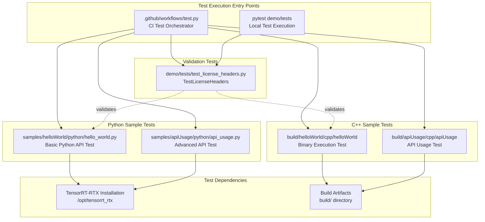
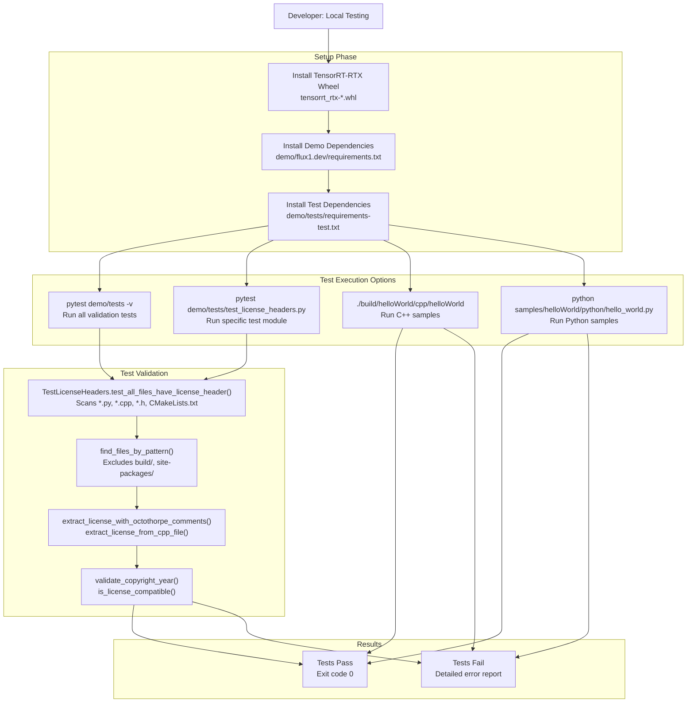
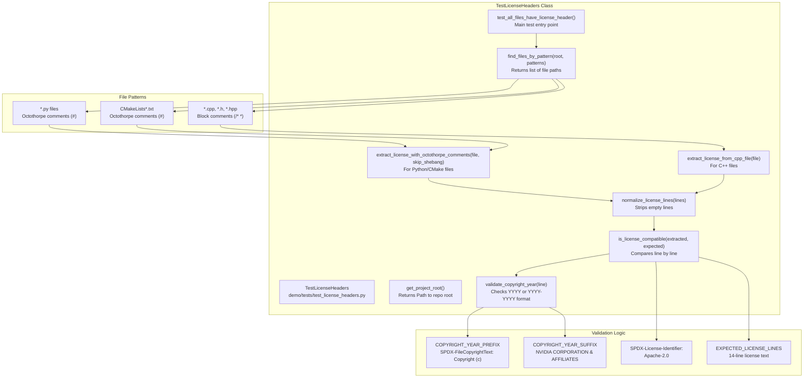
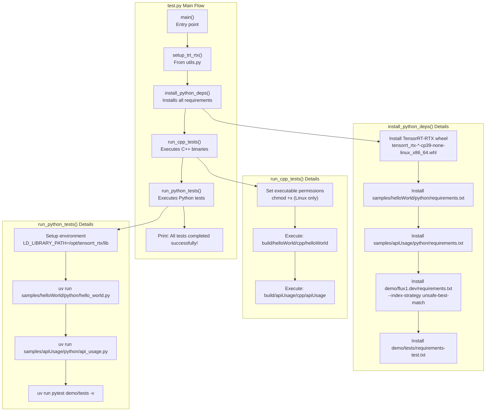
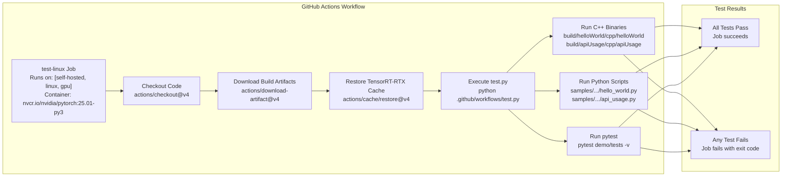

<!-- source: DeepWiki mcp.deepwiki.com · repo NVIDIA/TensorRT-RTX · page 6.3 Testing Guide · fetched 2026-10-26 -->

# Testing Guide

<details>
<summary>Relevant source files</summary>

The following files were used as context for generating this wiki page:

- [.github/workflows/test.py](.github/workflows/test.py)
- [demo/tests/README.md](demo/tests/README.md)
- [demo/tests/test_license_headers.py](demo/tests/test_license_headers.py)

</details>


## Purpose and Scope

This document provides comprehensive guidance for writing, running, and understanding tests in the TensorRT-RTX repository. It covers the test infrastructure, test execution workflows, and validation mechanisms used to ensure code quality and correctness.

For information about code formatting and pre-commit hooks, see [Code Quality and Formatting](#6.2). For general contribution guidelines, see [Contributing to TensorRT-RTX](#6.1). For details about CI test execution in GitHub Actions, see [Testing Infrastructure](#3.3).

---

## Test Architecture Overview

The TensorRT-RTX repository implements a multi-layered testing strategy that validates functionality at different levels of the stack.

### Test Categories



**Sources:** [.github/workflows/test.py:1-78](), [demo/tests/test_license_headers.py:1-252](), [demo/tests/README.md:1-34]()

| Test Category | Purpose | Execution Method | Dependencies |
|--------------|---------|------------------|--------------|
| **C++ Sample Tests** | Validate C++ API functionality | Direct binary execution | TensorRT-RTX libraries, compiled binaries |
| **Python Sample Tests** | Validate Python API functionality | Python script execution | TensorRT-RTX Python wheel, sample requirements |
| **License Header Tests** | Ensure all source files have proper headers | pytest framework | None (static validation) |
| **Integration Tests** | Validate end-to-end workflows | pytest framework | Model files, TensorRT-RTX runtime |

**Sources:** [.github/workflows/test.py:39-60](), [demo/tests/test_license_headers.py:204-251]()

---

## Running Tests Locally

### Prerequisites

```bash
# Python 3.9-3.12 required
python --version

# Install TensorRT-RTX wheel
pip install /path/to/tensorrt_rtx-*.whl

# Install test dependencies
pip install -r demo/tests/requirements-test.txt
```

**Sources:** [demo/tests/README.md:7-25]()

### Test Execution Workflow



**Sources:** [.github/workflows/test.py:23-60](), [demo/tests/test_license_headers.py:44-73]()

### Running All Tests

```bash
# From repository root
python -m pytest demo/tests -v
```

This executes all test modules in the `demo/tests` directory with verbose output.

**Sources:** [demo/tests/README.md:32-33]()

### Running Specific Test Modules

```bash
# Run only license header validation
pytest demo/tests/test_license_headers.py -v

# Run with specific test method
pytest demo/tests/test_license_headers.py::TestLicenseHeaders::test_all_files_have_license_header -v
```

**Sources:** [demo/tests/test_license_headers.py:204-251]()

### Running Sample Tests

```bash
# C++ samples (requires prior build)
./build/helloWorld/cpp/helloWorld
./build/apiUsage/cpp/apiUsage

# Python samples (requires LD_LIBRARY_PATH setup)
export LD_LIBRARY_PATH=/opt/tensorrt_rtx/lib:$LD_LIBRARY_PATH
python samples/helloWorld/python/hello_world.py
python samples/apiUsage/python/api_usage.py
```

**Sources:** [.github/workflows/test.py:39-59]()

---

## License Header Validation

The `TestLicenseHeaders` class ensures all source files contain the required NVIDIA Apache 2.0 license header with proper SPDX identifiers.

### License Header Structure



**Sources:** [demo/tests/test_license_headers.py:21-251]()

### Supported File Types

The test validates three file type categories:

| File Type | Pattern | Comment Style | Parser Method |
|-----------|---------|---------------|---------------|
| Python | `*.py` | `#` prefix | `extract_license_with_octothorpe_comments(skip_shebang=True)` |
| CMake | `CMakeLists*.txt` | `#` prefix | `extract_license_with_octothorpe_comments(skip_shebang=False)` |
| C++ | `*.cpp`, `*.c`, `*.h`, `*.hpp` | `/* */` block | `extract_license_from_cpp_file()` |

**Sources:** [demo/tests/test_license_headers.py:209-213]()

### Expected License Format

The validator enforces this exact structure:

```python
EXPECTED_LICENSE_LINES = [
    "SPDX-FileCopyrightText: Copyright (c) 2025 NVIDIA CORPORATION & AFFILIATES. All rights reserved.",
    "SPDX-License-Identifier: Apache-2.0",
    "",
    'Licensed under the Apache License, Version 2.0 (the "License");',
    # ... (14 lines total)
]
```

**Sources:** [demo/tests/test_license_headers.py:24-42]()

### Copyright Year Validation

The `validate_copyright_year()` method accepts two formats:

1. **Single Year**: `2025` (must match current year)
2. **Year Range**: `2024-2025` (end year must match current year)

```python
# Valid examples:
"SPDX-FileCopyrightText: Copyright (c) 2025 NVIDIA CORPORATION & AFFILIATES. All rights reserved."
"SPDX-FileCopyrightText: Copyright (c) 2024-2025 NVIDIA CORPORATION & AFFILIATES. All rights reserved."
```

**Sources:** [demo/tests/test_license_headers.py:140-168]()

### Directory Exclusions

The test automatically excludes:
- `build/` directories (compiled artifacts)
- `site-packages/` directories (Python dependencies)
- `activate_this.py` (virtual environment files)
- Empty `__init__.py` files

**Sources:** [demo/tests/test_license_headers.py:54-73](), [demo/tests/test_license_headers.py:222-230]()

---

## CI Test Execution

The `.github/workflows/test.py` script orchestrates automated testing in the CI environment.

### Test Script Architecture



**Sources:** [.github/workflows/test.py:23-77]()

### Environment Setup

The test script configures the runtime environment:

```python
# LD_LIBRARY_PATH setup for TensorRT-RTX shared libraries
test_env = os.environ.copy()
test_env["LD_LIBRARY_PATH"] = f"{TRTRTX_INSTALL_DIR}/lib:{test_env.get('LD_LIBRARY_PATH', '')}"
```

**Sources:** [.github/workflows/test.py:53-55]()

### Test Dependencies Installation

The script installs dependencies in a specific order:

1. **TensorRT-RTX Wheel**: Core library from `/opt/tensorrt_rtx/python/`
2. **Sample Requirements**: Dependencies for helloWorld and apiUsage samples
3. **Demo Requirements**: Flux demo dependencies (with `--index-strategy unsafe-best-match` for compatibility)
4. **Test Requirements**: pytest and related testing tools

**Sources:** [.github/workflows/test.py:23-36]()

---

## Writing New Tests

### Test Organization

Tests are organized in the `demo/tests/` directory:

```
demo/tests/
├── README.md                    # Test documentation
├── requirements-test.txt        # Test dependencies
└── test_license_headers.py      # License validation tests
```

**Sources:** [demo/tests/README.md:1-34]()

### Test Class Structure

Tests use pytest conventions with class-based organization:

```python
class TestLicenseHeaders:
    """Test suite to verify that all relevant files have the required NVIDIA license header."""
    
    @classmethod
    def test_all_files_have_license_header(self):
        """Test that all relevant files have the required license header."""
        # Test implementation
```

**Sources:** [demo/tests/test_license_headers.py:21-23](), [demo/tests/test_license_headers.py:203-251]()

### Adding New Validation Tests

To add a new validation test:

1. **Create test file**: `demo/tests/test_<feature>.py`
2. **Import pytest**: Standard pytest imports and fixtures
3. **Define test class**: Use descriptive class name with `Test` prefix
4. **Implement test methods**: Methods starting with `test_` are auto-discovered
5. **Add assertions**: Use pytest assertions for validation
6. **Update requirements**: Add dependencies to `requirements-test.txt`

### Test Naming Conventions

| Convention | Example | Purpose |
|------------|---------|---------|
| Test files | `test_license_headers.py` | Pytest auto-discovery |
| Test classes | `TestLicenseHeaders` | Logical grouping |
| Test methods | `test_all_files_have_license_header()` | Descriptive validation |
| Helper methods | `extract_license_from_cpp_file()` | Utility functions |

**Sources:** [demo/tests/test_license_headers.py:21-252]()

---

## Test Execution in CI Pipeline

The GitHub Actions CI workflow executes tests on specialized hardware with GPU support.

### CI Test Job Configuration



**Sources:** [.github/workflows/test.py:1-78]()

### Hardware Requirements

CI tests run on self-hosted GPU runners with:
- NVIDIA RTX GPU (RTX 4090 or equivalent)
- CUDA 12.9 runtime
- Ubuntu 24.04 base image
- PyTorch container with pre-configured drivers

**Sources:** Referenced from CI/CD workflow architecture diagrams

### Test Failure Handling

When tests fail, the CI system:
1. Captures detailed error output
2. Fails the job with non-zero exit code
3. Blocks PR merge until fixed
4. Provides logs for debugging

**Sources:** [demo/tests/test_license_headers.py:238-251]()

---

## Test Coverage Summary

| Test Type | Location | Framework | Frequency |
|-----------|----------|-----------|-----------|
| C++ Sample Execution | `build/helloWorld/cpp/`, `build/apiUsage/cpp/` | Direct binary | Every CI run |
| Python Sample Execution | `samples/*/python/*.py` | Python scripts | Every CI run |
| License Header Validation | `demo/tests/test_license_headers.py` | pytest | Every CI run |
| Pre-commit Validation | `.pre-commit-config.yaml` | pre-commit hooks | Every commit |

**Sources:** [.github/workflows/test.py:39-60](), [demo/tests/test_license_headers.py:1-252]()

---

