# Page: TensorRT-RTX Overview

# TensorRT-RTX Overview

<details>
<summary>Relevant source files</summary>

The following files were used as context for generating this wiki page:

- [.github/workflows/ci.yaml](.github/workflows/ci.yaml)
- [demo/README.md](demo/README.md)
- [demo/setup.py](demo/setup.py)

</details>


## Purpose and Scope

This document provides a high-level introduction to the TensorRT-RTX repository structure, explaining its purpose as a framework for optimizing deep learning inference on NVIDIA RTX GPUs. It covers the major subsystems—CI/CD infrastructure, demonstration applications, sample code, and core utilities—and how they relate to each other.

For detailed setup instructions, see [Installation](#2.1). For step-by-step tutorials, see [Quick Start Guide](#2.2). For deep dives into specific demonstrations, see [Flux.1 Text-to-Image Demo](#4.1). For API reference and framework internals, see [Core Framework](#5).

**Sources:** [demo/README.md:1-10]()

## What is TensorRT-RTX

TensorRT-RTX is NVIDIA's framework for accelerating deep learning inference on RTX GPUs, with specialized support for Ada and Blackwell architectures. The framework provides:

- **Advanced Precision Support**: FP8 and FP4 quantization for Ada/Blackwell GPUs, with BF16 support for Ampere and newer architectures
- **Runtime Optimization**: JIT compilation with persistent kernel caching to reduce subsequent compilation times
- **Dynamic Shape Support**: Flexible input dimensions without engine recompilation
- **Memory Management**: Low-VRAM modes for memory-constrained environments

The repository packages TensorRT-RTX as a binary release (`TensorRT-RTX-1.3.0.35-Linux-x86_64-cuda-12.9-Release-external.tar.gz`) with both C++ and Python APIs, accompanied by demonstration pipelines and sample applications.

**Sources:** [.github/workflows/ci.yaml:7-8](), [demo/README.md:38-158]()

## Repository Structure

The repository is organized into five major directories, each serving a distinct purpose:

| Directory | Purpose | Key Components |
|-----------|---------|----------------|
| `.github/workflows/` | CI/CD automation | `ci.yaml` workflow, build/test/utils Python scripts |
| `demo/` | Demonstration pipelines | Flux.1 text-to-image demo, utility modules, test suite |
| `samples/` | Minimal API examples | C++ and Python helloWorld and apiUsage samples |
| `.pre-commit-config.yaml` | Code quality enforcement | Formatting, linting, spell checking hooks |
| Root configuration files | Project setup | `CONTRIBUTING.md`, `LICENSE`, issue templates |

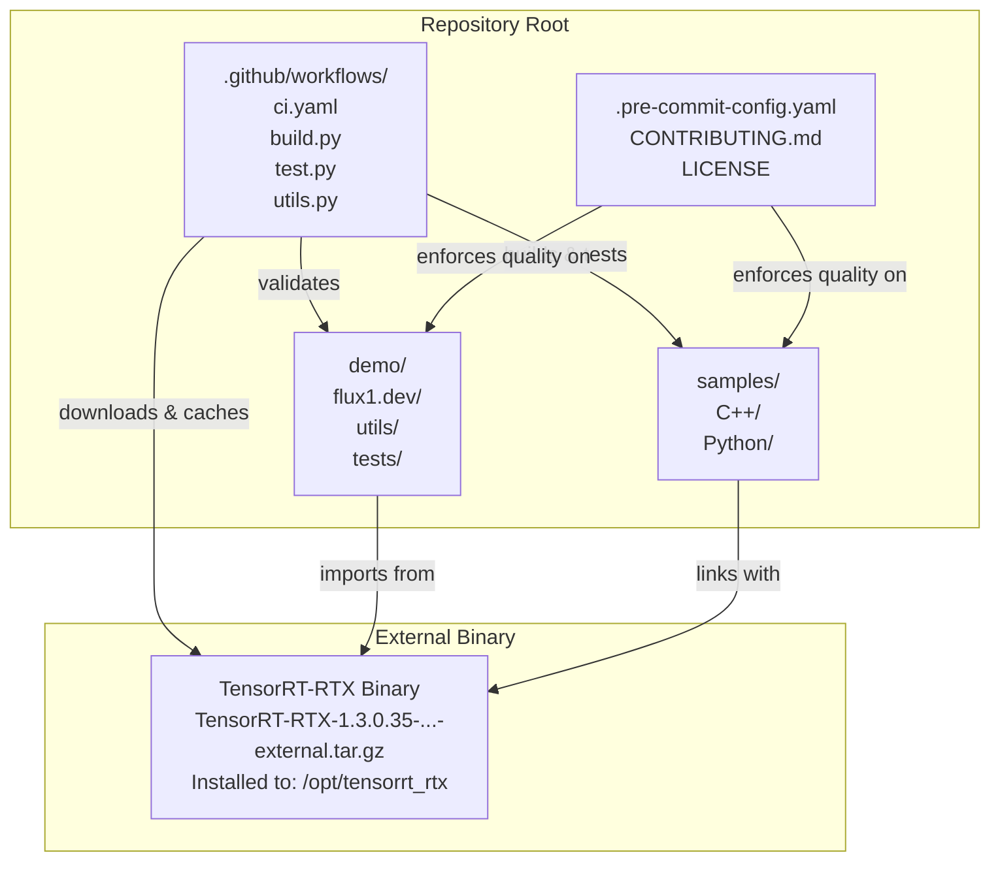

**Sources:** [.github/workflows/ci.yaml:1-92](), [demo/README.md:1-10]()

## Core Components

### CI/CD Infrastructure

The continuous integration system orchestrates building, testing, and validation through three GitHub Actions jobs defined in `.github/workflows/ci.yaml`:

- **`build-linux`**: Compiles C++ samples using CMake, runs on Ubuntu 24.04 with CUDA 12.9 development container
- **`lint`**: Validates code formatting and style using pre-commit hooks
- **`test-linux`**: Executes C++ binaries and Python tests on RTX 4090 GPU hardware

The workflow caches the TensorRT-RTX binary at `/opt/tensorrt_rtx` to avoid redundant downloads across jobs.

**Sources:** [.github/workflows/ci.yaml:12-92]()

### Demonstration System

The `demo/` directory contains the Flux.1 text-to-image generation pipeline, showcasing TensorRT-RTX capabilities:

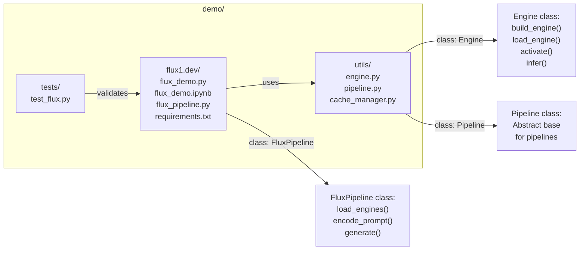

The `flux_demo.py` script provides command-line access while `flux_demo.ipynb` offers an interactive tutorial environment.

**Sources:** [demo/README.md:24-32](), [demo/README.md:34-110]()

### Sample Applications

Minimal examples demonstrating core API patterns:

| Sample Type | Location | Purpose |
|-------------|----------|---------|
| C++ helloWorld | `samples/C++/helloWorld/` | Basic TensorRT-RTX initialization |
| C++ apiUsage | `samples/C++/apiUsage/` | Engine building and inference |
| Python helloWorld | `samples/Python/helloWorld/` | Python API basics |
| Python apiUsage | `samples/Python/apiUsage/` | Python engine management |

These samples are built by the CI system and executed during the `test-linux` job to validate the TensorRT-RTX installation.

**Sources:** [.github/workflows/ci.yaml:34-44](), [.github/workflows/ci.yaml:81-91]()

## System Architecture: Code Entity Mapping

The following diagram maps high-level concepts to specific code entities in the repository:

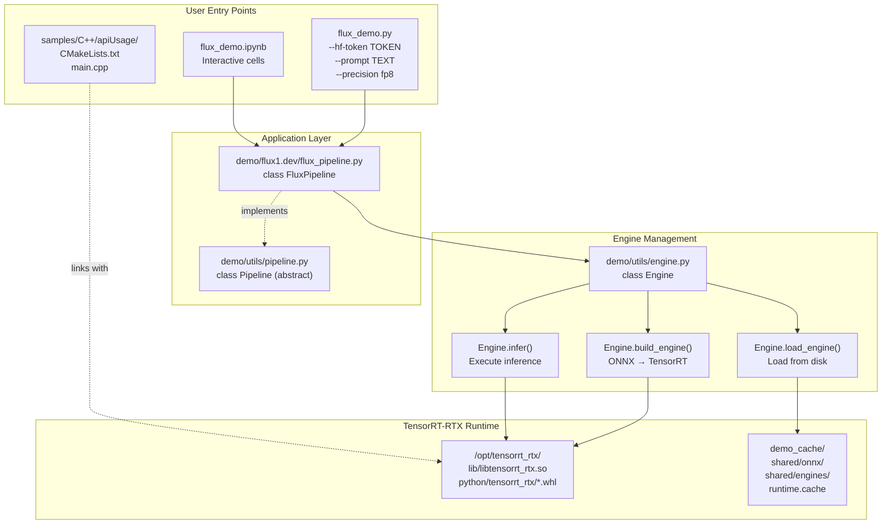

**Sources:** [demo/README.md:27-31](), [.github/workflows/ci.yaml:7-8](), [demo/README.md:189-200]()

## Dependency Chain and Installation

The repository requires external dependencies managed through multiple systems:

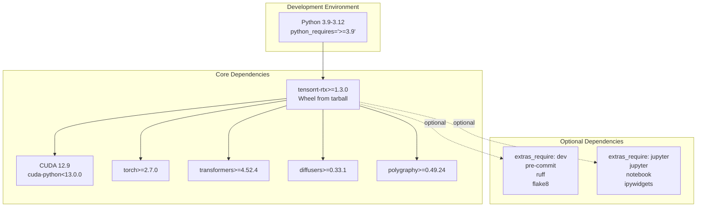

The package is installed via pip from the wheel file included in the TensorRT-RTX tarball:

```bash
python -m pip install path/to/tensorrt_rtx-1.3.0.35-cp312-none-linux_x86_64.whl
python -m pip install -r demo/flux1.dev/requirements.txt
```

**Sources:** [demo/setup.py:18-55](), [demo/README.md:15-22]()

## Quick Start Paths

The repository provides multiple entry points depending on user goals:

| User Goal | Entry Point | Next Steps |
|-----------|-------------|------------|
| **Try the demo** | `demo/flux1.dev/flux_demo.py` | See [Quick Start Guide](#2.2) |
| **Learn interactively** | `demo/flux1.dev/flux_demo.ipynb` | Open in Jupyter |
| **Study minimal examples** | `samples/C++/helloWorld/` or `samples/Python/helloWorld/` | See [Sample Applications](#4.2) |
| **Build custom pipelines** | `demo/utils/pipeline.py` | See [Pipeline Architecture](#5.2) |
| **Contribute code** | `CONTRIBUTING.md` | See [Contributing to TensorRT-RTX](#6.1) |

### Typical First-Time User Flow

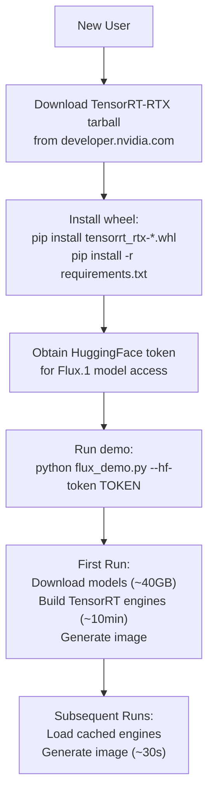

**Sources:** [demo/README.md:7-32](), [demo/README.md:42-46]()

## CI/CD Workflow

The automated build and test pipeline ensures code quality before merging:

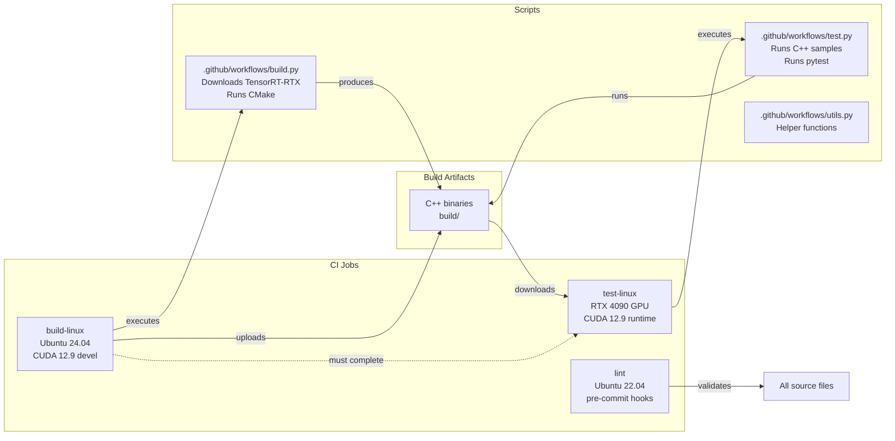

The `build-linux` job runs independently, while `test-linux` depends on its completion to download artifacts. The `lint` job runs in parallel to provide fast feedback on code style issues.

**Sources:** [.github/workflows/ci.yaml:12-54](), [.github/workflows/ci.yaml:56-92]()

## Precision and GPU Architecture Support

TensorRT-RTX supports multiple precision modes tailored to specific GPU architectures:

| Precision | GPU Architecture | VRAM Usage (Default) | VRAM Usage (Low-VRAM) | Code Reference |
|-----------|------------------|----------------------|-----------------------|----------------|
| BF16 | Ampere, Ada, Blackwell | 32.1 GB | 23.1 GB | `--precision bf16` |
| FP8 | Ada, Blackwell | 21.6 GB | 12.0 GB | `--precision fp8` (default) |
| FP4 | Blackwell | 20.5 GB | 11.0 GB | `--precision fp4` |

The precision is configured at engine load time via the `transformer_precision` parameter in `FluxPipeline.load_engines()` or through the `--precision` command-line flag in `flux_demo.py`.

**Sources:** [demo/README.md:120-163]()

## Cache Management Strategy

The demonstration system implements a two-level caching strategy:

1. **Disk Cache** (`demo_cache/`): Stores ONNX models and compiled TensorRT engines, organized by model ID and precision
2. **Runtime Cache** (`runtime.cache`): Stores JIT-compiled CUDA kernels for faster subsequent runs

Cache modes control disk space usage:
- **`full`** (default): Retains all cached models and engines
- **`lean`**: Automatically removes unused models to save disk space

The cache directory structure is defined in the `CacheManager` class and tracked via `.cache_state.json`.

**Sources:** [demo/README.md:70-75](), [demo/README.md:189-200](), [demo/README.md:217-220]()

---

# Page: Getting Started

# Getting Started

<details>
<summary>Relevant source files</summary>

The following files were used as context for generating this wiki page:

- [.github/workflows/utils.py](.github/workflows/utils.py)
- [demo/README.md](demo/README.md)
- [demo/tests/README.md](demo/tests/README.md)

</details>


This page provides an overview of how to set up and begin using TensorRT-RTX. It covers prerequisites, system requirements, and the general workflow for getting your first example running. For detailed installation instructions, see [Installation](#2.1). For a step-by-step tutorial on running the Flux.1 demo, see [Quick Start Guide](#2.2).

## Purpose and Scope

This section guides you through:
- Understanding system prerequisites and requirements
- Overview of the installation process
- Understanding the repository structure relevant to getting started
- General workflow from installation to running your first inference

For information about the CI/CD system and automated builds, see [CI/CD System](#3). For detailed API usage and extending the framework, see [Core Framework](#5).

## Prerequisites

### Hardware Requirements

TensorRT-RTX requires an NVIDIA GPU with specific architecture support:

| Component | Requirement |
|-----------|-------------|
| **GPU Architecture** | Ada (RTX 40 series) or Blackwell required for FP8/FP4 precision<br/>Ampere (RTX 30 series) supported for BF16 precision only |
| **CUDA Version** | CUDA 12.9 or compatible |
| **Minimum VRAM** | 11 GB (with `--low-vram` and `--precision fp4` on Blackwell)<br/>12 GB recommended for FP8 precision<br/>23+ GB for BF16 precision |

### Software Requirements

| Component | Requirement |
|-----------|-------------|
| **Python Version** | 3.9, 3.10, 3.11, or 3.12 |
| **Operating System** | Linux (Ubuntu 22.04/24.04 tested)<br/>Windows (supported) |
| **TensorRT-RTX Binary** | Version 1.3.0.35 or later |

Sources: [demo/README.md:9-9](), [demo/README.md:125-157]()

## Installation Overview

The TensorRT-RTX installation process consists of three main steps:

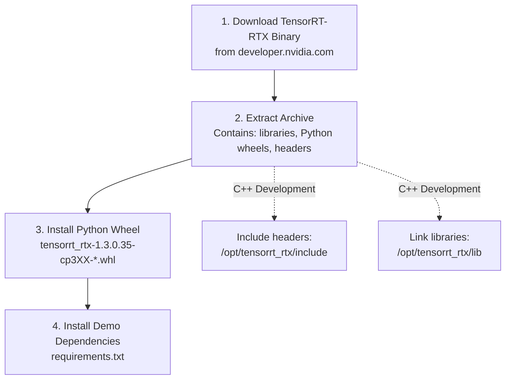

**Installation Workflow**

The binary package available from NVIDIA contains:
- Python wheels for different Python versions and platforms
- C++ headers and shared libraries
- Sample applications
- Documentation

Sources: [.github/workflows/utils.py:26-30](), [demo/README.md:7-22]()

## Repository Structure for Getting Started

After cloning the repository, the key directories for getting started are:

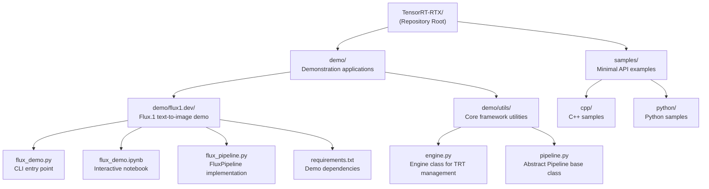

**Key Components**

| Path | Purpose |
|------|---------|
| `demo/flux1.dev/` | Complete text-to-image generation demo showcasing TensorRT-RTX features |
| `demo/utils/engine.py` | `Engine` class managing TensorRT engine lifecycle |
| `demo/utils/pipeline.py` | `Pipeline` base class for building inference pipelines |
| `samples/cpp/` | Minimal C++ examples demonstrating API usage |
| `samples/python/` | Minimal Python examples demonstrating API usage |

Sources: [demo/README.md:1-3](), [demo/flux1.dev/flux_demo.py](), [demo/utils/engine.py](), [demo/utils/pipeline.py]()

## Getting Started Workflow

The typical workflow for getting started with TensorRT-RTX follows these stages:

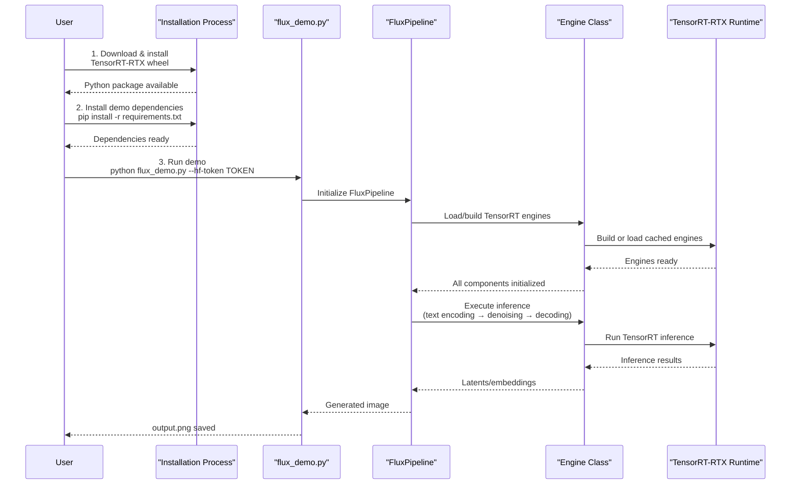

**Workflow Stages**

1. **Installation** ([See Installation](#2.1))
   - Download TensorRT-RTX binary package from `developer.nvidia.com`
   - Install the Python wheel matching your Python version and OS
   - Install demo-specific dependencies

2. **First Run** ([See Quick Start Guide](#2.2))
   - Execute `flux_demo.py` with required Hugging Face token
   - Pipeline downloads model weights from Hugging Face Hub (first run only)
   - TensorRT engines are built and cached (first run only)
   - Image generation occurs

3. **Subsequent Runs**
   - Cached engines are loaded from `demo_cache/`
   - No recompilation needed unless configuration changes
   - Faster startup and inference

Sources: [demo/README.md:7-32](), [.github/workflows/utils.py:44-69]()

## Component Interaction for First Inference

Understanding how the components interact helps clarify the setup requirements:

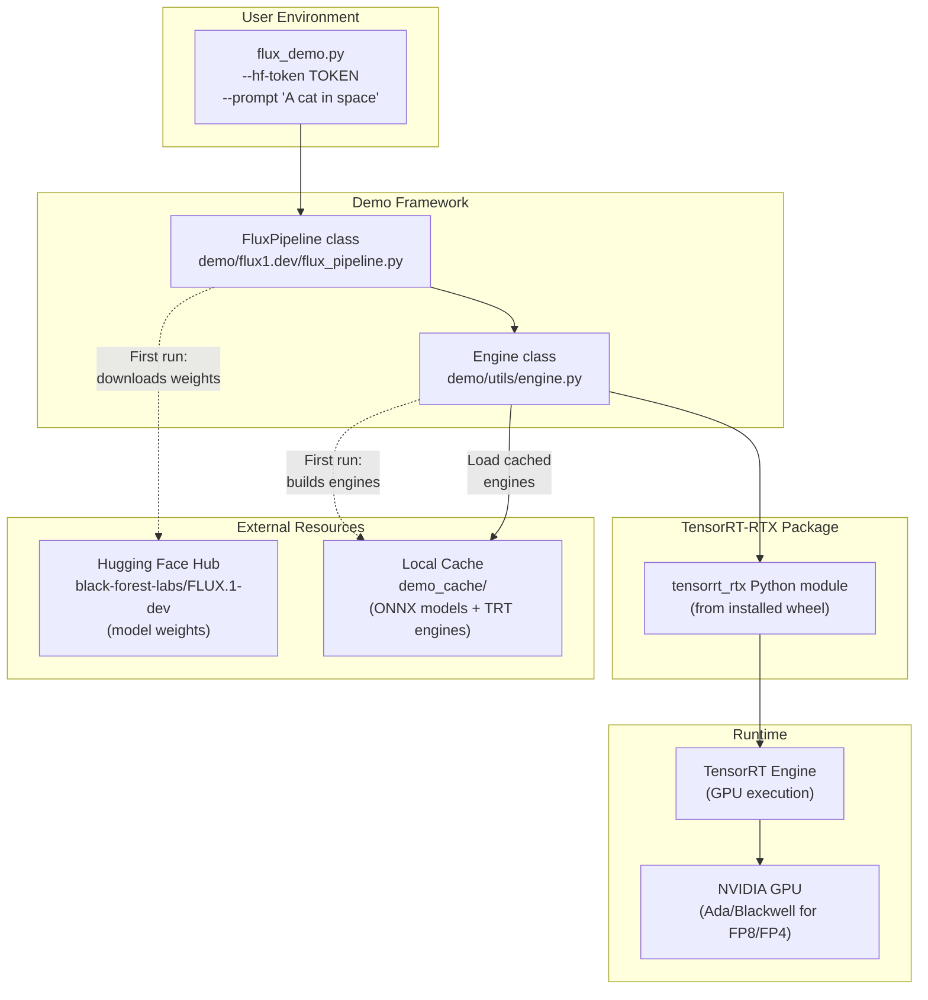

**Component Roles**

| Component | Role | Required for First Run |
|-----------|------|------------------------|
| `tensorrt_rtx` module | Core TensorRT-RTX runtime providing inference APIs | Yes - must be installed |
| `FluxPipeline` | High-level pipeline orchestrating text-to-image generation | Yes - part of demo |
| `Engine` class | Manages TensorRT engine lifecycle (build, load, execute) | Yes - part of demo |
| Hugging Face Hub | Source of pre-trained model weights | Yes - requires `--hf-token` |
| Local cache | Stores ONNX models and compiled TensorRT engines | Created automatically |

Sources: [demo/README.md:7-22](), [demo/flux1.dev/flux_demo.py](), [demo/utils/engine.py](), [demo/utils/pipeline.py]()

## Installation Artifacts and Locations

Understanding where components are installed helps with troubleshooting:

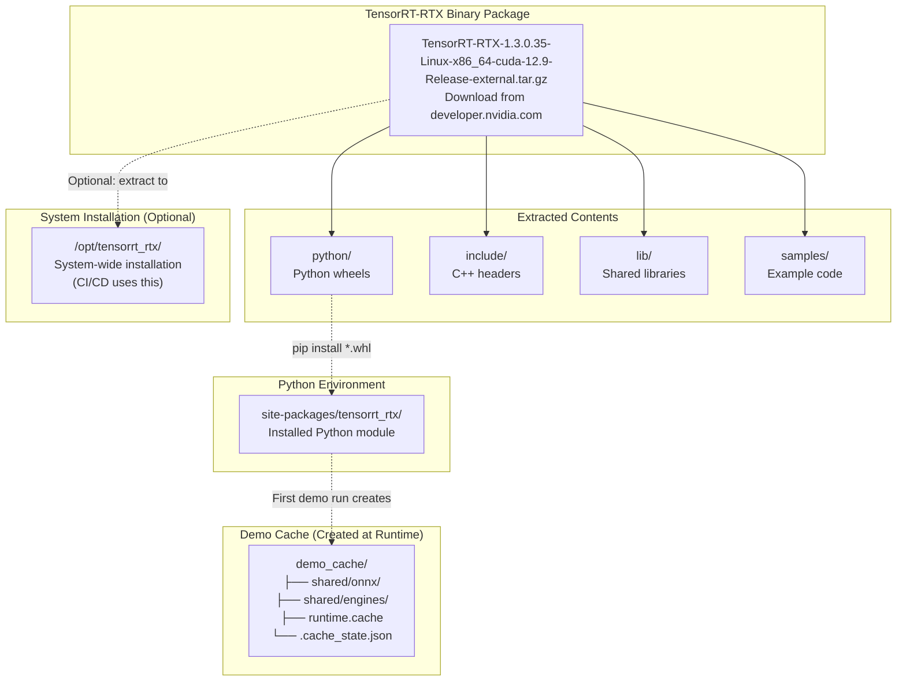

**Installation Paths**

| Path | Description | Set By |
|------|-------------|--------|
| `TRT_RTX_BASE_URL` | Download URL for binary package | [.github/workflows/utils.py:26]() |
| `TRTRTX_INSTALL_DIR` | System installation directory (CI default: `/opt/tensorrt_rtx`) | [.github/workflows/utils.py:30]() |
| `site-packages/tensorrt_rtx/` | Python module location after `pip install` | Python package manager |
| `demo_cache/` | Runtime cache for models and engines | [demo/README.md:73]() via `--cache-dir` |

Sources: [.github/workflows/utils.py:26-31](), [demo/README.md:73-74](), [demo/README.md:189-200]()

## Environment Variables

Key environment variables used by TensorRT-RTX:

| Variable | Purpose | Default | Set In |
|----------|---------|---------|--------|
| `TRT_RTX_FILENAME` | Name of TensorRT-RTX archive file | `TensorRT-RTX-1.3.0.35-Linux-x86_64-cuda-12.9-Release-external.tar.gz` | [.github/workflows/utils.py:27-29]() |
| `TRTRTX_INSTALL_DIR` | Installation directory for TensorRT-RTX | `/opt/tensorrt_rtx` | [.github/workflows/utils.py:30]() |
| `BUILD_DIR` | Build output directory for C++ samples | `build` | [.github/workflows/utils.py:31]() |
| `CACHE_TRT_RTX_HIT` | Skip download if cache exists | `false` | [.github/workflows/utils.py:46]() |

Sources: [.github/workflows/utils.py:25-31]()

## Next Steps

Once you understand the prerequisites and architecture:

1. **Install TensorRT-RTX** - Follow detailed instructions in [Installation](#2.1)
   - Download the binary package
   - Install the Python wheel
   - Verify installation

2. **Run Your First Example** - Follow the [Quick Start Guide](#2.2)
   - Set up Hugging Face authentication
   - Run the Flux.1 demo
   - Explore configuration options

3. **Explore Further**
   - Learn about [Flux Demo Configuration](#4.1.1) for advanced options
   - Understand [Engine Management](#5.1) for custom applications
   - Review [Sample Applications](#4.2) for minimal examples

## Common Setup Issues

| Issue | Solution | Reference |
|-------|----------|-----------|
| Python version incompatibility | Use Python 3.9-3.12 | [demo/README.md:9]() |
| GPU architecture mismatch | Verify precision support for your GPU (FP8 requires Ada/Blackwell) | [demo/README.md:125-157]() |
| Missing dependencies | Install demo requirements: `pip install -r demo/flux1.dev/requirements.txt` | [demo/README.md:21]() |
| CUDA version mismatch | Ensure CUDA 12.9 or compatible version is installed | [.github/workflows/utils.py:28]() |
| Insufficient VRAM | Use `--low-vram` flag and lower precision (FP8 or FP4) | [demo/README.md:66](), [demo/README.md:210-215]() |

Sources: [demo/README.md:9-10](), [demo/README.md:38](), [demo/README.md:202-226]()

---

# Page: Installation

# Installation

<details>
<summary>Relevant source files</summary>

The following files were used as context for generating this wiki page:

- [.github/workflows/.python-version](.github/workflows/.python-version)
- [.github/workflows/pyproject.toml](.github/workflows/pyproject.toml)
- [.github/workflows/utils.py](.github/workflows/utils.py)
- [.github/workflows/uv.lock](.github/workflows/uv.lock)
- [demo/flux1.dev/requirements.txt](demo/flux1.dev/requirements.txt)

</details>


This page provides detailed instructions for installing TensorRT-RTX and its dependencies. It covers system prerequisites, downloading and installing the TensorRT-RTX binary package, configuring the Python environment, and verifying the installation.

For a quick walkthrough of running your first example after installation, see [Quick Start Guide](#2.2). For information about the C++ and Python API usage patterns, see [Sample Applications](#4.2).

---

## System Prerequisites

### Hardware Requirements

TensorRT-RTX requires an NVIDIA GPU with the following characteristics:

| Component | Requirement | Notes |
|-----------|-------------|-------|
| GPU Architecture | Ada (RTX 40-series) or Blackwell | Required for FP8/FP4 precision support |
| VRAM | 8GB minimum, 24GB+ recommended | Flux.1 demo requires ~12GB; low-VRAM mode available |
| Example GPUs | RTX 4090, RTX 4080, RTX 4070 Ti | Consumer GPUs supported |

**Sources:** [Diagram 3: Application Stack]

### Software Requirements

The following software must be installed before proceeding with TensorRT-RTX installation:

| Component | Version | Required |
|-----------|---------|----------|
| Operating System | Ubuntu 24.04 (recommended) or 22.04 | Yes |
| CUDA Toolkit | 12.9 | Yes |
| CUDA Driver | Compatible with CUDA 12.9 | Yes |
| Python | 3.9 or higher | Yes |
| pip | Latest version | Yes |

**Sources:** [.github/workflows/.python-version:1](), [.github/workflows/pyproject.toml:4](), [demo/flux1.dev/requirements.txt:2-3]()

---

## TensorRT-RTX Binary Installation

### Download and Installation Process

The TensorRT-RTX binary package is distributed as a compressed tarball from NVIDIA's download servers. The installation process extracts the package to `/opt/tensorrt_rtx` by default.

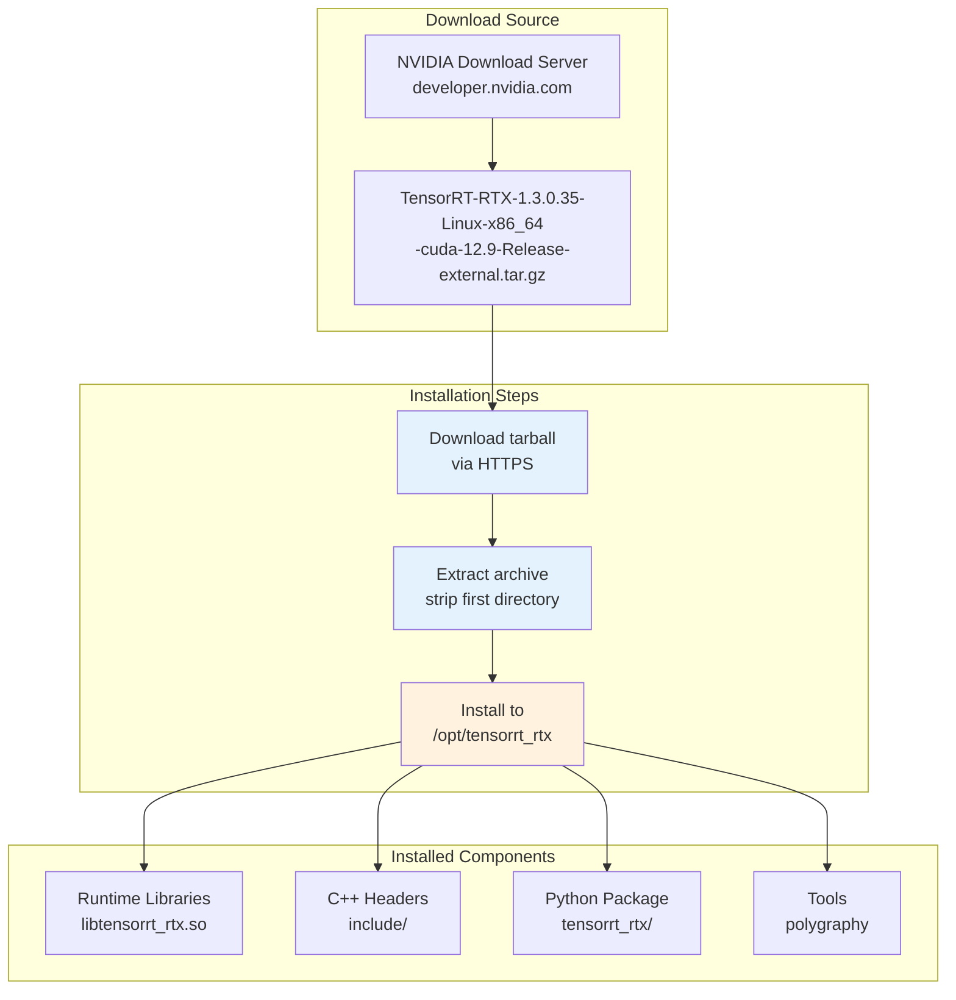

**Sources:** [.github/workflows/utils.py:26-29](), [.github/workflows/utils.py:44-69]()

### Installation Script Method

The repository provides a utility script that automates the download and installation process. This is the recommended method for most users.

```bash
# Clone the repository
git clone https://github.com/NVIDIA/TensorRT-RTX.git
cd TensorRT-RTX

# Run the installation utility
python3 .github/workflows/utils.py
```

The `setup_trt_rtx()` function in [.github/workflows/utils.py:44-69]() performs the following operations:

1. **Check cache status**: If `CACHE_TRT_RTX_HIT` environment variable is set to `"true"`, assumes installation already exists
2. **Download tarball**: Fetches the package from the base URL via HTTPS streaming
3. **Extract contents**: Uses Python's `tarfile` module to extract, stripping the top-level directory
4. **Install to directory**: Places contents in `/opt/tensorrt_rtx` (or path specified by `TRTRTX_INSTALL_DIR`)

**Sources:** [.github/workflows/utils.py:44-69]()

### Manual Installation Method

For environments where the script cannot be used, perform manual installation:

```bash
# Download the package
wget https://developer.nvidia.com/downloads/trt/rtx_sdk/secure/1.3/TensorRT-RTX-1.3.0.35-Linux-x86_64-cuda-12.9-Release-external.tar.gz

# Create installation directory
sudo mkdir -p /opt/tensorrt_rtx

# Extract with directory stripping
tar -xzf TensorRT-RTX-1.3.0.35-Linux-x86_64-cuda-12.9-Release-external.tar.gz \
    --strip-components=1 -C /opt/tensorrt_rtx
```

**Sources:** [.github/workflows/utils.py:26-30](), [.github/workflows/utils.py:61-67]()

### Environment Variables

The installation process can be customized using environment variables:

| Variable | Default Value | Purpose |
|----------|---------------|---------|
| `TRT_RTX_FILENAME` | `TensorRT-RTX-1.3.0.35-Linux-x86_64-cuda-12.9-Release-external.tar.gz` | Specifies the tarball filename to download |
| `TRTRTX_INSTALL_DIR` | `/opt/tensorrt_rtx` | Target installation directory |
| `CACHE_TRT_RTX_HIT` | `""` | Set to `"true"` to skip download if already installed |

**Sources:** [.github/workflows/utils.py:27-30]()

### Directory Structure

After installation, the `/opt/tensorrt_rtx` directory contains the following structure:

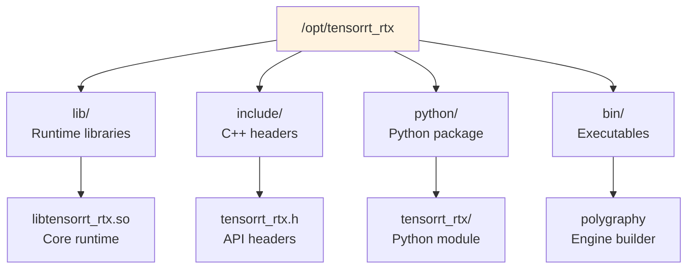

**Sources:** [.github/workflows/utils.py:62-67]()

---

## Python Environment Setup

### Installing Python Dependencies

The demonstration applications and Python samples require additional Python packages. These dependencies are specified in the requirements file.

```bash
# Navigate to the Flux demo directory
cd demo/flux1.dev

# Install dependencies
pip install -r requirements.txt
```

**Sources:** [demo/flux1.dev/requirements.txt:1-21]()

### Core Python Dependencies

The following table lists the essential Python packages and their version requirements:

| Package | Version Requirement | Purpose |
|---------|---------------------|---------|
| `torch` | `>=2.7.0` | PyTorch framework with CUDA 12.9 support |
| `tensorrt-rtx` | `>=1.3.0` | TensorRT-RTX Python bindings |
| `transformers` | `>=4.52.4` | Hugging Face transformers for text encoding |
| `diffusers` | `>=0.33.1` | Diffusion models framework |
| `polygraphy` | `>=0.49.24` | ONNX to TensorRT engine builder |
| `cuda-python` | `<13.0.0` | CUDA Python bindings |

**Sources:** [demo/flux1.dev/requirements.txt:2-15]()

### PyTorch CUDA Configuration

PyTorch must be installed with CUDA 12.9 support. The requirements file includes the appropriate PyTorch index URL:

```
--extra-index-url https://download.pytorch.org/whl/cu129
```

This ensures that `torch>=2.7.0` installs the CUDA 12.9-compatible build.

**Sources:** [demo/flux1.dev/requirements.txt:2-3]()

### Additional Dependencies

Supporting packages for data handling and notebook support:

| Package | Purpose |
|---------|---------|
| `pillow` | Image loading and saving |
| `numpy` | Numerical array operations |
| `tqdm` | Progress bars |
| `huggingface-hub` | Model downloading |
| `accelerate` | Model loading optimization |
| `sentencepiece` | T5 tokenizer |
| `protobuf` | Protocol buffers |
| `packaging` | Version parsing |

**Sources:** [demo/flux1.dev/requirements.txt:1-14]()

### Jupyter Notebook Dependencies

For interactive notebook usage (optional):

```
requests>=2.25.0
ipython>=8.0.0
ipywidgets>=8.0.0
jupyter
```

**Sources:** [demo/flux1.dev/requirements.txt:18-21]()

---

## Library Path Configuration

### Setting LD_LIBRARY_PATH

To enable runtime library loading, add the TensorRT-RTX library directory to your `LD_LIBRARY_PATH`:

```bash
export LD_LIBRARY_PATH=/opt/tensorrt_rtx/lib:$LD_LIBRARY_PATH
```

For persistent configuration, add this to your shell profile (`~/.bashrc` or `~/.zshrc`):

```bash
# TensorRT-RTX configuration
export TRTRTX_INSTALL_DIR=/opt/tensorrt_rtx
export LD_LIBRARY_PATH=$TRTRTX_INSTALL_DIR/lib:$LD_LIBRARY_PATH
export PATH=$TRTRTX_INSTALL_DIR/bin:$PATH
```

**Sources:** [.github/workflows/utils.py:30]()

### Python Path Configuration (for C++ bindings)

If using the Python bindings from the binary distribution:

```bash
export PYTHONPATH=/opt/tensorrt_rtx/python:$PYTHONPATH
```

**Sources:** [demo/flux1.dev/requirements.txt:15]()

---

## Installation Verification

### Verifying TensorRT-RTX Binary

Check that the binary package is correctly installed:

```bash
# Verify installation directory exists
ls -la /opt/tensorrt_rtx

# Check for core library
ls -la /opt/tensorrt_rtx/lib/libtensorrt_rtx.so

# Verify polygraphy tool
/opt/tensorrt_rtx/bin/polygraphy --version
```

### Verifying Python Environment

Verify that Python packages are correctly installed:

```python
# Test imports
import torch
import tensorrt_rtx
import transformers
import diffusers

# Check versions
print(f"PyTorch: {torch.__version__}")
print(f"CUDA available: {torch.cuda.is_available()}")
print(f"CUDA version: {torch.version.cuda}")
print(f"TensorRT-RTX: {tensorrt_rtx.__version__}")
```

### Verifying GPU Access

Ensure CUDA and GPU are accessible:

```python
import torch

# Check GPU availability
assert torch.cuda.is_available(), "CUDA not available"

# Display GPU information
print(f"GPU: {torch.cuda.get_device_name(0)}")
print(f"Compute capability: {torch.cuda.get_device_capability(0)}")
print(f"VRAM: {torch.cuda.get_device_properties(0).total_memory / 1e9:.1f} GB")
```

**Sources:** [demo/flux1.dev/requirements.txt:2-3]()

---

## Installation in CI Environments

### GitHub Actions Caching Strategy

The CI system implements a sophisticated caching mechanism to avoid redundant downloads:

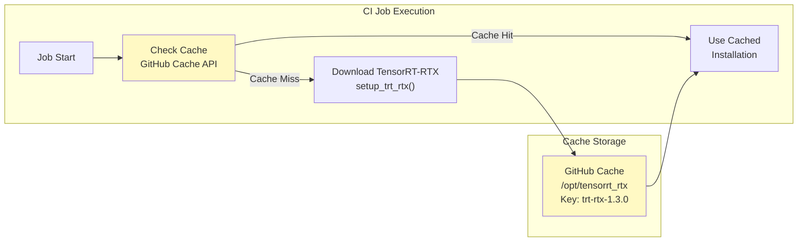

**Sources:** [.github/workflows/utils.py:46-69](), [Diagram 2: CI/CD Workflow]

### Cache Control

The `CACHE_TRT_RTX_HIT` environment variable controls cache behavior:

- When set to `"true"`: Skips download, assumes `/opt/tensorrt_rtx` exists
- When unset or `"false"`: Downloads and extracts the package

This mechanism allows CI systems to cache the installation between runs, significantly reducing job execution time.

**Sources:** [.github/workflows/utils.py:46-52]()

---

## Troubleshooting

### Common Installation Issues

| Issue | Cause | Solution |
|-------|-------|----------|
| Directory already exists | Previous incomplete installation | Remove `/opt/tensorrt_rtx` or set `CACHE_TRT_RTX_HIT=true` |
| Download fails | Network issues or authentication | Check network connectivity; verify URL accessibility |
| Library not found | `LD_LIBRARY_PATH` not set | Add `/opt/tensorrt_rtx/lib` to `LD_LIBRARY_PATH` |
| CUDA version mismatch | Wrong CUDA toolkit installed | Install CUDA 12.9 toolkit and drivers |
| Import tensorrt_rtx fails | Python package not in path | Install via `pip install tensorrt-rtx>=1.3.0` |

### Verifying Installation Directory Permissions

Ensure proper permissions for system-wide installation:

```bash
# Set ownership (if installed to /opt)
sudo chown -R $USER:$USER /opt/tensorrt_rtx

# Or install to user directory
export TRTRTX_INSTALL_DIR=$HOME/tensorrt_rtx
```

**Sources:** [.github/workflows/utils.py:50-52](), [.github/workflows/utils.py:62]()

---

## Next Steps

After completing installation:

1. **Run the Quick Start**: Follow the [Quick Start Guide](#2.2) to generate your first image with the Flux.1 demo
2. **Explore Samples**: Review [Sample Applications](#4.2) for minimal C++ and Python examples
3. **Read the API Documentation**: See [Engine Management](#5.1) for details on the core API

**Sources:** [Table of Contents JSON]

---

# Page: Quick Start Guide

# Quick Start Guide

<details>
<summary>Relevant source files</summary>

The following files were used as context for generating this wiki page:

- [demo/README.md](demo/README.md)
- [demo/flux1.dev/flux_demo.ipynb](demo/flux1.dev/flux_demo.ipynb)
- [demo/tests/README.md](demo/tests/README.md)

</details>


This guide walks you through generating your first image using the TensorRT-RTX Flux.1 text-to-image demo. After completing this tutorial, you will have successfully executed a complete inference pipeline on an NVIDIA RTX GPU.

**Prerequisites**: This guide assumes TensorRT-RTX is already installed. For installation instructions, see [Installation](#2.1). For comprehensive configuration options and advanced usage, see [Flux.1 Text-to-Image Demo](#4.1).

**Scope**: This page covers the minimal steps to generate your first image. It does not cover advanced features like dynamic shapes, low-VRAM mode, or custom pipeline development.

---

## System Requirements

Before proceeding, verify your system meets these requirements:

| Component | Requirement |
|-----------|-------------|
| **Python Version** | 3.9, 3.10, 3.11, or 3.12 |
| **GPU Architecture** | NVIDIA Ada or Blackwell (for FP8/FP4 support) |
| **CUDA Version** | 12.9 or compatible |
| **Available VRAM** | Minimum 12 GB (with `--low-vram` and `--precision fp8`) |
| **Disk Space** | ~50 GB for model weights and cached engines |

Sources: [demo/README.md:9-10](), [demo/README.md:125-157]()

---

## Setup Steps

### Step 1: Install Demo Dependencies

Navigate to the TensorRT-RTX repository root and install the Flux.1 demo requirements:

```bash
cd TensorRT-RTX
python -m pip install -r demo/flux1.dev/requirements.txt
```

This installs packages required by the `FluxPipeline` class, including:
- `transformers` - for CLIP and T5 text encoders
- `diffusers` - for model loading and scheduling
- `safetensors` - for model checkpoint loading
- `pillow` - for image saving
- Additional dependencies for tokenization and processing

Sources: [demo/README.md:20-22]()

### Step 2: Obtain Hugging Face Access Token

The Flux.1-dev model requires authentication to download from Hugging Face Hub:

1. Visit https://huggingface.co/settings/tokens
2. Create a new token with **read** access
3. Accept the model access terms at https://huggingface.co/black-forest-labs/FLUX.1-dev
4. Save your token for use in the next step

Sources: [demo/README.md:42-46]()

---

## Running Your First Image Generation

### Basic Execution Flow

Execute the demo with minimal parameters:

```bash
python demo/flux1.dev/flux_demo.py --hf-token YOUR_HF_TOKEN
```

This command uses default parameters:
- **Prompt**: Default text prompt (if not specified)
- **Height/Width**: 512x512 pixels
- **Precision**: FP8 quantization (Ada/Blackwell GPUs)
- **Inference Steps**: 50 denoising iterations
- **Cache Directory**: `./demo_cache`

Sources: [demo/README.md:79-83]()

### Execution Workflow Diagram

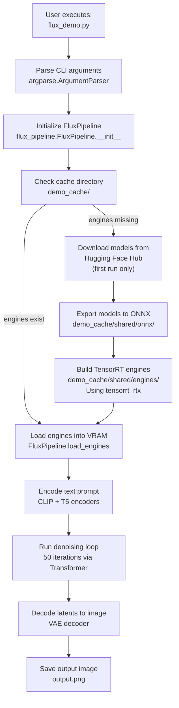

Sources: [demo/flux1.dev/flux_demo.py:1-200](), [demo/README.md:24-32]()

### First Run vs Subsequent Runs

The first execution involves model downloading and engine compilation:

| Phase | First Run | Subsequent Runs |
|-------|-----------|-----------------|
| **Download Models** | ~30 GB from HuggingFace | Skip (cached) |
| **Export to ONNX** | ~5-10 minutes | Skip (cached) |
| **Build TRT Engines** | ~5-15 minutes (depending on GPU) | Skip (cached) |
| **Load Engines** | ~5-10 seconds | ~5-10 seconds |
| **Generate Image** | ~15-30 seconds | ~15-30 seconds |
| **Total Time** | ~30-60 minutes | ~30-60 seconds |

Sources: [demo/README.md:190-200]()

---

## Understanding the Output

### Console Output

During execution, the script logs progress through several stages:

```
Loading tokenizers...
Building/loading engines (this may take a while on first run)...
Loading CLIP text encoder...
Loading T5 text encoder...
Loading transformer...
Loading VAE decoder...
Encoding prompt...
Running denoising loop: 100%|████████| 50/50
Decoding latents...
Image saved to: output.png
```

Sources: [demo/flux1.dev/flux_demo.py:1-200]()

### Generated Artifacts

After successful execution, the following artifacts are created:

```
./
├── output.png                              # Generated image (512x512 RGB)
└── demo_cache/
    ├── shared/
    │   ├── onnx/
    │   │   ├── clip_encoder/fp8/          # CLIP ONNX model
    │   │   ├── t5_encoder/fp8/            # T5 ONNX model
    │   │   ├── transformer/fp8/           # Transformer ONNX model
    │   │   └── vae_decoder/bf16/          # VAE ONNX model
    │   └── engines/
    │       ├── clip_encoder/fp8/          # CLIP TensorRT engine
    │       ├── t5_encoder/fp8/            # T5 TensorRT engine
    │       ├── transformer/fp8/           # Transformer TensorRT engine
    │       └── vae_decoder/bf16/          # VAE TensorRT engine
    ├── runtime.cache                       # JIT kernel cache (if enabled)
    └── .cache_state.json                   # Cache metadata
```

Sources: [demo/README.md:190-200]()

### Data Flow During Generation

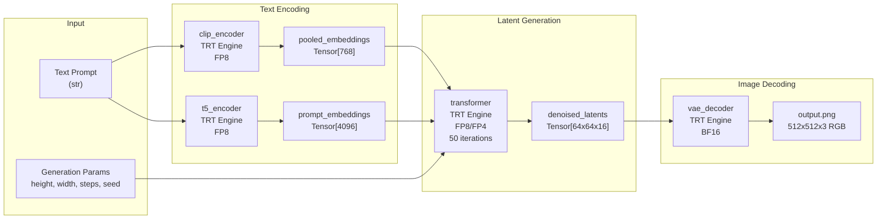

Sources: [demo/README.md:5-110](), [demo/flux1.dev/flux_pipeline.py:1-500]()

---

## Customizing Your First Generation

### Specifying a Custom Prompt

Generate an image with a specific text description:

```bash
python demo/flux1.dev/flux_demo.py \
    --hf-token YOUR_HF_TOKEN \
    --prompt "A serene mountain landscape at sunrise with misty valleys"
```

Sources: [demo/README.md:50-51]()

### Adjusting Image Resolution

Generate a higher resolution image (requires more VRAM):

```bash
python demo/flux1.dev/flux_demo.py \
    --hf-token YOUR_HF_TOKEN \
    --height 1024 \
    --width 1024 \
    --prompt "A detailed cityscape at golden hour"
```

**Note**: Dimensions must be multiples of 16. First-time generation at new resolutions requires engine recompilation.

Sources: [demo/README.md:85-89](), [demo/README.md:204-208]()

### Using Different Precisions

For memory-constrained GPUs (Blackwell architecture):

```bash
python demo/flux1.dev/flux_demo.py \
    --hf-token YOUR_HF_TOKEN \
    --low-vram \
    --precision fp4 \
    --prompt "A serene forest scene"
```

Sources: [demo/README.md:103-107]()

---

## Common Issues and Solutions

### Issue: Out of Memory Error

**Symptoms**: CUDA out of memory error during engine loading or inference.

**Solutions**:
1. Enable low-VRAM mode: `--low-vram`
2. Use lower precision: `--precision fp8` (default) or `--precision fp4` (Blackwell only)
3. Reduce image resolution: `--height 512 --width 512`
4. Disable runtime cache: omit `--enable-runtime-cache` flag

Sources: [demo/README.md:210-215]()

### Issue: Build Failures During Engine Compilation

**Symptoms**: Errors during TensorRT engine build phase.

**Solutions**:
1. Verify GPU architecture supports the specified precision (see table below)
2. Check TensorRT-RTX installation: `python -c "import tensorrt_rtx; print(tensorrt_rtx.__version__)"`
3. Verify CUDA version compatibility: `nvidia-smi`
4. Check disk space: at least 50 GB required in cache directory

| Precision | Supported GPU Architecture |
|-----------|---------------------------|
| `bf16` | Ampere, Ada, Blackwell |
| `fp8` | Ada, Blackwell |
| `fp4` | Blackwell only |

Sources: [demo/README.md:222-225](), [demo/README.md:125-157]()

### Issue: Slow First Run

**Symptoms**: Script takes 30+ minutes on first execution.

**Explanation**: This is expected behavior. The first run downloads ~30 GB of models from Hugging Face Hub and compiles TensorRT engines optimized for your specific GPU. Subsequent runs use cached engines and complete in under a minute.

**Optimization**: Enable runtime caching for faster JIT compilation on subsequent runs with different shapes:

```bash
python demo/flux1.dev/flux_demo.py \
    --hf-token YOUR_HF_TOKEN \
    --enable-runtime-cache
```

Sources: [demo/README.md:91-95]()

### Issue: Disk Space Exhausted

**Symptoms**: No space left on device during model download or engine build.

**Solutions**:
1. Use lean cache mode: `--cache-mode lean` (auto-cleanup unused models)
2. Manually delete cache directory: `rm -rf demo_cache/`
3. Change cache location to larger drive: `--cache-dir /path/to/large/drive`

Sources: [demo/README.md:217-220]()

---

## Interactive Alternative: Jupyter Notebook

For interactive exploration with detailed explanations, use the Jupyter notebook:

```bash
jupyter notebook demo/flux1.dev/flux_demo.ipynb
```

The notebook provides:
- Step-by-step code execution with explanations
- Inline visualization of generated images
- Interactive parameter experimentation
- Detailed documentation of TensorRT-RTX features

Sources: [demo/README.md:29-32](), [demo/README.md:109]()

---

## Next Steps

After successfully generating your first image:

1. **Explore Advanced Configuration**: See [Flux Demo Configuration](#4.1.1) for precision modes, shape modes, and memory management options
2. **Understand the Pipeline**: Read [Flux Pipeline Architecture](#4.1.2) to learn how the `FluxPipeline` class orchestrates model execution
3. **Build Custom Pipelines**: Review [Pipeline Architecture](#5.2) to create your own inference workflows
4. **Examine Sample Code**: Study [Python API Usage Sample](#4.2.2) for minimal API usage patterns

Sources: [demo/README.md:111-183]()

---

## Command Reference

Common command patterns for quick reference:

```bash
# Minimal execution (default 512x512, FP8)
python demo/flux1.dev/flux_demo.py --hf-token YOUR_TOKEN

# Custom prompt
python demo/flux1.dev/flux_demo.py --hf-token YOUR_TOKEN \
    --prompt "Your custom prompt"

# High resolution (1024x1024)
python demo/flux1.dev/flux_demo.py --hf-token YOUR_TOKEN \
    --height 1024 --width 1024

# Low VRAM mode (for 12GB GPUs)
python demo/flux1.dev/flux_demo.py --hf-token YOUR_TOKEN \
    --low-vram --precision fp8

# Dynamic shapes (flexible resolution)
python demo/flux1.dev/flux_demo.py --hf-token YOUR_TOKEN \
    --dynamic-shape

# Enable runtime caching (faster JIT)
python demo/flux1.dev/flux_demo.py --hf-token YOUR_TOKEN \
    --enable-runtime-cache

# Verbose logging
python demo/flux1.dev/flux_demo.py --hf-token YOUR_TOKEN \
    --verbose
```

Sources: [demo/README.md:34-110]()

---

# Page: CI/CD System

# CI/CD System

<details>
<summary>Relevant source files</summary>

The following files were used as context for generating this wiki page:

- [.github/workflows/build.py](.github/workflows/build.py)
- [.github/workflows/ci.yaml](.github/workflows/ci.yaml)
- [.github/workflows/test.py](.github/workflows/test.py)

</details>


## Purpose and Scope

This document describes the continuous integration and continuous deployment (CI/CD) infrastructure for the TensorRT-RTX repository. The CI/CD system automates building, testing, and validation of code changes using GitHub Actions. This includes compiling C++ samples, running test suites on GPU hardware, and enforcing code quality standards.

For details on code quality tools and pre-commit hooks, see [Code Quality and Formatting](#6.2). For information on writing tests, see [Testing Guide](#6.3).

## Workflow Overview

The CI/CD system is defined in [.github/workflows/ci.yaml:1-92]() and implements a three-job pipeline that executes on pull request branches. The workflow orchestrates building, linting, and testing operations across different environments with GPU acceleration.

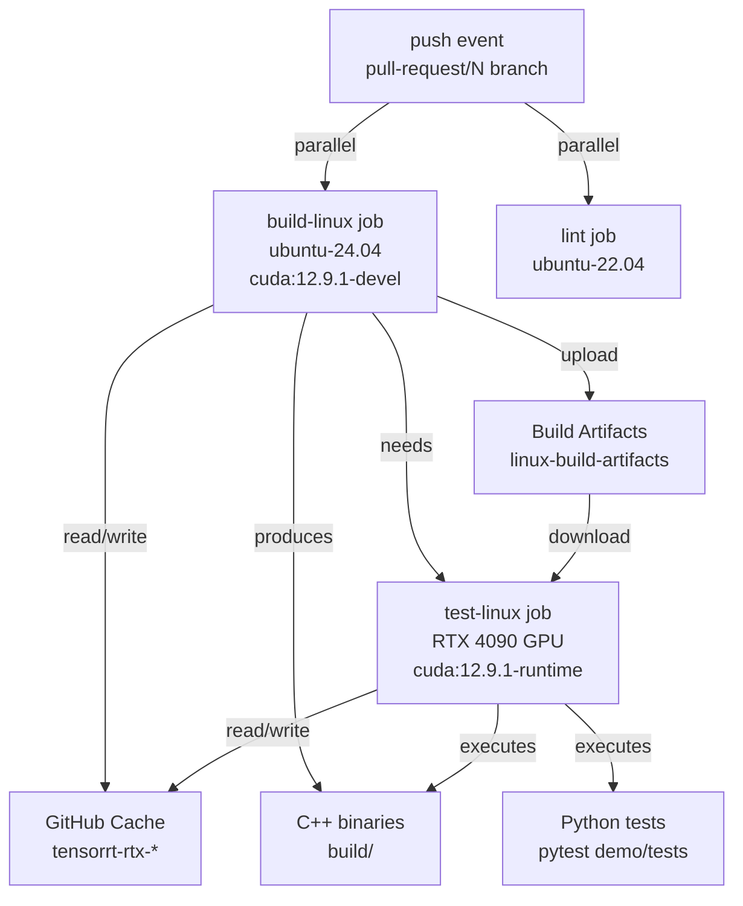

**Sources:** [.github/workflows/ci.yaml:1-92]()

### Trigger Configuration

The workflow triggers on push events to branches matching the pattern `pull-request/[0-9]+` as defined in [.github/workflows/ci.yaml:2-5](). This naming convention integrates with NVIDIA's internal development workflow.

## Environment Variables

Global environment variables configure the workflow execution across all jobs:

| Variable | Value | Purpose |
|----------|-------|---------|
| `TRT_RTX_FILENAME` | `TensorRT-RTX-1.3.0.35-Linux-x86_64-cuda-12.9-Release-external.tar.gz` | TensorRT-RTX binary package filename |
| `TRTRTX_INSTALL_DIR` | `/opt/tensorrt_rtx` | Installation directory for TensorRT-RTX |
| `BUILD_DIR` | `build` | CMake build output directory |
| `UV_PROJECT` | `.github/workflows/` | Project directory for `uv` package manager |

These are defined in [.github/workflows/ci.yaml:6-10]().

**Sources:** [.github/workflows/ci.yaml:6-10]()

## Job Architecture

### build-linux Job

The `build-linux` job compiles C++ samples and prepares build artifacts. It runs on `ubuntu-24.04` using the `nvcr.io/nvidia/cuda:12.9.1-devel-ubuntu22.04` container image to provide CUDA development tools.

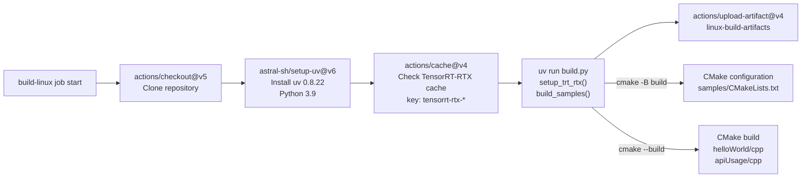

**Sources:** [.github/workflows/ci.yaml:12-44](), [.github/workflows/build.py:1-39]()

#### Build Script Execution

The build process is encapsulated in [.github/workflows/build.py:1-39](). The `main()` function [.github/workflows/build.py:27-34]() executes two operations:

1. **`setup_trt_rtx()`** [.github/workflows/build.py:29]() - Downloads and installs the TensorRT-RTX binary if not cached
2. **`build_samples()`** [.github/workflows/build.py:20-24]() - Configures and builds C++ samples using CMake

The CMake configuration step:
```
cmake -B build -S samples -DTRTRTX_INSTALL_DIR=/opt/tensorrt_rtx
```

The build step:
```
cmake --build build
```

Both commands are executed via the `run_command()` utility function imported from [.github/workflows/build.py:17]().

**Sources:** [.github/workflows/build.py:17-34]()

### lint Job

The `lint` job validates code formatting and style using pre-commit hooks. It runs independently on `ubuntu-22.04` with Python 3.11.

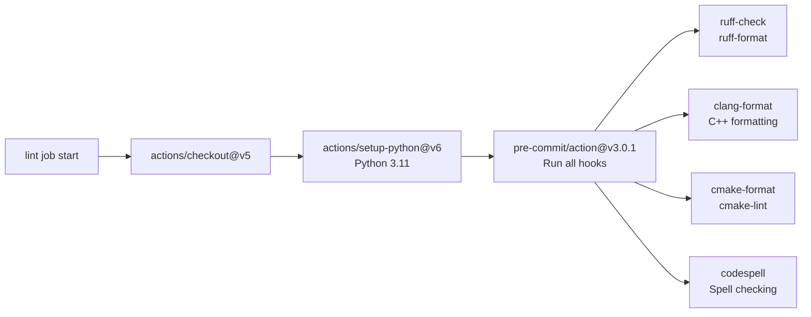

The lint job executes all hooks defined in `.pre-commit-config.yaml` without requiring any manual setup beyond Python installation. See [Code Quality and Formatting](#6.2) for details on individual hooks.

**Sources:** [.github/workflows/ci.yaml:46-54]()

### test-linux Job

The `test-linux` job executes C++ and Python tests on GPU hardware. It runs on a self-hosted runner with an RTX 4090 GPU using the `nvcr.io/nvidia/cuda:12.9.1-runtime-ubuntu22.04` container.

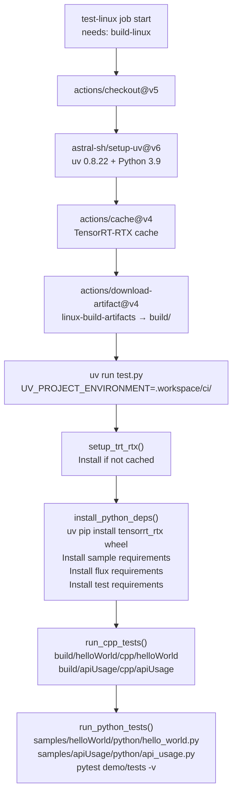

**Sources:** [.github/workflows/ci.yaml:56-91](), [.github/workflows/test.py:1-78]()

#### Test Script Execution

The test execution is orchestrated by [.github/workflows/test.py:62-73](). The `main()` function performs:

1. **`setup_trt_rtx()`** [.github/workflows/test.py:64]() - Ensures TensorRT-RTX is installed
2. **`install_python_deps()`** [.github/workflows/test.py:23-36]() - Installs Python dependencies:
   - TensorRT-RTX wheel from `/opt/tensorrt_rtx/python/`
   - Sample requirements from `samples/*/python/requirements.txt`
   - Flux demo requirements from `demo/flux1.dev/requirements.txt`
   - Test requirements from `demo/tests/requirements-test.txt`
3. **`run_cpp_tests()`** [.github/workflows/test.py:39-47]() - Executes C++ binaries
4. **`run_python_tests()`** [.github/workflows/test.py:50-59]() - Runs Python samples and pytest suite

**Sources:** [.github/workflows/test.py:23-73]()

#### GPU Container Configuration

The test job requires GPU access, configured via the `options: --gpus all` parameter in [.github/workflows/ci.yaml:61](). This passes all available GPUs to the container runtime, enabling CUDA operations during test execution.

**Sources:** [.github/workflows/ci.yaml:56-62]()

## Caching Strategy

The workflow implements a caching strategy to minimize redundant downloads and improve execution time.

### TensorRT-RTX Binary Cache

Both `build-linux` and `test-linux` jobs cache the TensorRT-RTX binary installation using GitHub's cache action:

```yaml
- name: Cache TensorRT RTX
  id: cache-trt-rtx
  uses: actions/cache@v4
  with:
    path: ${{ env.TRTRTX_INSTALL_DIR }}
    key: tensorrt-rtx-${{ runner.os }}-${{ env.TRT_RTX_FILENAME }}
```

**Cache Key Structure:**
- Base: `tensorrt-rtx`
- OS identifier: `${{ runner.os }}` (e.g., `Linux`)
- Version: `${{ env.TRT_RTX_FILENAME }}` (ties cache to specific TensorRT-RTX release)

This is defined in [.github/workflows/ci.yaml:27-32]() and [.github/workflows/ci.yaml:74-79]().

### Cache Hit Detection

The cache action outputs a `cache-hit` boolean that scripts can access via environment variables:

- `CACHE_TRT_RTX_HIT` in build job [.github/workflows/ci.yaml:37]()
- `CACHE_TRT_RTX_HIT` in test job [.github/workflows/ci.yaml:89]()

These variables are consumed by the `setup_trt_rtx()` function (defined in `utils.py`) to conditionally skip download and installation when the cache is populated.

**Sources:** [.github/workflows/ci.yaml:27-32](), [.github/workflows/ci.yaml:74-79](), [.github/workflows/ci.yaml:36-37](), [.github/workflows/ci.yaml:89]()

## Artifact Management

Build artifacts enable sharing compiled binaries between the `build-linux` and `test-linux` jobs.

### Upload Process

The `build-linux` job uploads the entire `build/` directory as an artifact named `linux-build-artifacts`:

```yaml
- name: Upload build artifacts
  uses: actions/upload-artifact@v4
  with:
    name: linux-build-artifacts
    path: ${{ env.BUILD_DIR }}/
```

This is defined in [.github/workflows/ci.yaml:40-44]().

### Download Process

The `test-linux` job downloads these artifacts back into the `build/` directory:

```yaml
- name: Download build artifacts
  uses: actions/download-artifact@v4
  with:
    name: linux-build-artifacts
    path: ${{ env.BUILD_DIR }}/
```

This is defined in [.github/workflows/ci.yaml:81-85]().

### Artifact Contents

The uploaded artifacts include:

| Path | Description |
|------|-------------|
| `build/helloWorld/cpp/helloWorld` | C++ Hello World executable |
| `build/apiUsage/cpp/apiUsage` | C++ API Usage executable |
| `build/CMakeCache.txt` | CMake configuration cache |
| `build/**/CMakeFiles/` | CMake build metadata |

**Sources:** [.github/workflows/ci.yaml:40-44](), [.github/workflows/ci.yaml:81-85]()

## Job Dependencies

The workflow implements a linear dependency chain to ensure proper execution order:

```mermaid
graph LR
    BUILD["build-linux<br/>Compiles samples<br/>Uploads artifacts"]
    LINT["lint<br/>Code quality checks<br/>Independent"]
    TEST["test-linux<br/>needs: build-linux<br/>Downloads artifacts<br/>Executes tests"]
    
    BUILD -->|dependency| TEST
    
    BUILD -.->|parallel with| LINT
    LINT -.->|parallel with| BUILD
```

The `needs: build-linux` declaration in [.github/workflows/ci.yaml:57]() ensures that `test-linux` waits for `build-linux` to complete successfully before starting. The `lint` job has no dependencies and runs in parallel with `build-linux`.

**Sources:** [.github/workflows/ci.yaml:57]()

## Python Environment Management

Both build and test jobs use `uv` as the Python package and environment manager.

### UV Installation

The `astral-sh/setup-uv@v6` action installs `uv` version 0.8.22 with Python 3.9:

```yaml
- name: Install uv
  uses: astral-sh/setup-uv@v6
  with:
    version: "0.8.22"
    python-version: "3.9"
```

This is defined in [.github/workflows/ci.yaml:18-22]() and [.github/workflows/ci.yaml:65-69]().

### Project Configuration

The `UV_PROJECT` environment variable [.github/workflows/ci.yaml:10]() sets the project directory to `.github/workflows/`, which contains:
- `pyproject.toml` - Project metadata and dependencies
- `build.py` - Build script with `[dependency-groups.build]`
- `test.py` - Test script

The test job also sets `UV_PROJECT_ENVIRONMENT=.workspace/ci/` in [.github/workflows/ci.yaml:90]() to isolate the test environment.

**Sources:** [.github/workflows/ci.yaml:10](), [.github/workflows/ci.yaml:18-22](), [.github/workflows/ci.yaml:65-69](), [.github/workflows/ci.yaml:90]()

## Container Images

The workflow uses NVIDIA CUDA container images from the NGC catalog:

| Job | Image | Purpose |
|-----|-------|---------|
| `build-linux` | `nvcr.io/nvidia/cuda:12.9.1-devel-ubuntu22.04` | Provides CUDA development tools, headers, and libraries for compiling C++ |
| `test-linux` | `nvcr.io/nvidia/cuda:12.9.1-runtime-ubuntu22.04` | Provides CUDA runtime libraries for executing GPU-accelerated code |

The `devel` variant includes compilation tools (nvcc, cuDNN headers) while the `runtime` variant is lighter and only includes execution libraries. Both use CUDA 12.9.1 to match the TensorRT-RTX binary requirements.

**Sources:** [.github/workflows/ci.yaml:14](), [.github/workflows/ci.yaml:60]()

## Test Execution Details

### C++ Test Execution

The `run_cpp_tests()` function [.github/workflows/test.py:39-47]() executes both C++ sample binaries:

1. Sets executable permissions on Unix systems [.github/workflows/test.py:44-46]()
2. Runs each binary via `run_command()`:
   - `build/helloWorld/cpp/helloWorld`
   - `build/apiUsage/cpp/apiUsage`

### Python Test Execution

The `run_python_tests()` function [.github/workflows/test.py:50-59]() executes Python tests with custom environment configuration:

1. Creates environment with `LD_LIBRARY_PATH` including TensorRT-RTX libraries [.github/workflows/test.py:54-55]()
2. Runs sample scripts via `uv run`:
   - `samples/helloWorld/python/hello_world.py`
   - `samples/apiUsage/python/api_usage.py`
3. Executes pytest test suite: `pytest demo/tests -v`

All commands inherit the modified environment to ensure shared library visibility.

**Sources:** [.github/workflows/test.py:39-59]()

## Build and Test Workflow Data Flow

```mermaid
graph TD
    REPO["GitHub Repository<br/>pull-request/N"]
    
    CACHE_STORE["GitHub Cache Storage<br/>tensorrt-rtx-Linux-*"]
    ARTIFACT_STORE["GitHub Artifact Storage<br/>linux-build-artifacts"]
    
    BUILD_CONTAINER["build-linux container<br/>cuda:12.9.1-devel"]
    TEST_CONTAINER["test-linux container<br/>cuda:12.9.1-runtime<br/>RTX 4090 GPU"]
    
    TRT_INSTALL["/opt/tensorrt_rtx/<br/>lib/, include/, python/"]
    BUILD_DIR["build/<br/>helloWorld/cpp/helloWorld<br/>apiUsage/cpp/apiUsage"]
    
    REPO -->|checkout| BUILD_CONTAINER
    REPO -->|checkout| TEST_CONTAINER
    
    CACHE_STORE -->|restore if hit| BUILD_CONTAINER
    CACHE_STORE -->|restore if hit| TEST_CONTAINER
    
    BUILD_CONTAINER -->|setup_trt_rtx| TRT_INSTALL
    BUILD_CONTAINER -->|cmake build| BUILD_DIR
    BUILD_CONTAINER -->|save if miss| CACHE_STORE
    
    BUILD_DIR -->|upload| ARTIFACT_STORE
    ARTIFACT_STORE -->|download| TEST_CONTAINER
    
    TRT_INSTALL -->|used by| TEST_CONTAINER
    BUILD_DIR -->|execute| TEST_CONTAINER
    TEST_CONTAINER -->|LD_LIBRARY_PATH| TRT_INSTALL
    TEST_CONTAINER -->|uv pip install| TRT_INSTALL
```

**Sources:** [.github/workflows/ci.yaml:1-92](), [.github/workflows/build.py:1-39](), [.github/workflows/test.py:1-78]()

## Utility Functions

Both `build.py` and `test.py` import shared utilities from `utils.py`:

- **`run_command()`** - Executes shell commands with error handling
- **`setup_trt_rtx()`** - Downloads and installs TensorRT-RTX if not cached
- **Environment variables:**
  - `BUILD_DIR` - Build output directory
  - `TRTRTX_INSTALL_DIR` - TensorRT-RTX installation path

These are imported in [.github/workflows/build.py:17]() and [.github/workflows/test.py:20]().

**Sources:** [.github/workflows/build.py:17](), [.github/workflows/test.py:20]()

---

# Page: Workflow Architecture

# Workflow Architecture

<details>
<summary>Relevant source files</summary>

The following files were used as context for generating this wiki page:

- [.github/workflows/ci.yaml](.github/workflows/ci.yaml)
- [.github/workflows/utils.py](.github/workflows/utils.py)

</details>


## Purpose and Scope

This document explains the GitHub Actions CI workflow architecture for the TensorRT-RTX repository. It covers the workflow structure defined in [.github/workflows/ci.yaml](), job dependencies, caching mechanisms, artifact management, and the utility functions provided by [.github/workflows/utils.py](). For information about the specific build process executed within the workflow, see [Build Process](#3.2). For details about test execution, see [Testing Infrastructure](#3.3).

## Workflow Overview

The CI workflow implements a three-job pipeline that builds C++ samples, validates code quality, and executes tests on GPU hardware. The workflow is triggered on pushes to pull request branches and orchestrates compilation, validation, and testing across different environments.

### Workflow File Structure

```mermaid
graph TB
    subgraph "ci.yaml Structure"
        TRIGGER["Trigger Configuration<br/>on.push.branches"]
        ENV["Environment Variables<br/>TRT_RTX_FILENAME<br/>TRTRTX_INSTALL_DIR<br/>BUILD_DIR<br/>UV_PROJECT"]
        JOBS["Jobs Definition<br/>build-linux<br/>lint<br/>test-linux"]
    end
    
    subgraph "Shared Configuration"
        TRTRTX_VAR["TRTRTX_INSTALL_DIR<br/>/opt/tensorrt_rtx"]
        BUILD_VAR["BUILD_DIR<br/>build"]
        FILENAME_VAR["TRT_RTX_FILENAME<br/>TensorRT-RTX-1.3.0.35-..."]
    end
    
    TRIGGER --> ENV
    ENV --> JOBS
    ENV --> TRTRTX_VAR
    ENV --> BUILD_VAR
    ENV --> FILENAME_VAR
```

**Sources:** [.github/workflows/ci.yaml:1-10]()

The workflow is configured at the repository level with shared environment variables that ensure consistency across all jobs:

| Environment Variable | Default Value | Purpose |
|---------------------|---------------|---------|
| `TRT_RTX_FILENAME` | `TensorRT-RTX-1.3.0.35-Linux-x86_64-cuda-12.9-Release-external.tar.gz` | Specifies the TensorRT-RTX binary package filename |
| `TRTRTX_INSTALL_DIR` | `/opt/tensorrt_rtx` | Installation directory for TensorRT-RTX binaries |
| `BUILD_DIR` | `build` | Output directory for compiled artifacts |
| `UV_PROJECT` | `.github/workflows/` | Project directory for uv package manager |

**Sources:** [.github/workflows/ci.yaml:6-10](), [.github/workflows/utils.py:27-31]()

### Trigger Configuration

The workflow activates on push events to branches matching the pattern `pull-request/[0-9]+`, which corresponds to NVIDIA's internal pull request workflow convention:

```yaml
on:
  push:
    branches:
      - "pull-request/[0-9]+"
```

**Sources:** [.github/workflows/ci.yaml:2-5]()

## Job Architecture

The workflow defines three jobs with specific responsibilities and execution environments. The jobs execute in parallel where possible, with explicit dependency declarations where sequential execution is required.

### Job Execution Flow

```mermaid
graph LR
    subgraph "Parallel Execution"
        BUILD["build-linux<br/>Container: cuda:12.9.1-devel-ubuntu22.04<br/>Runner: ubuntu-24.04"]
        LINT["lint<br/>Runner: ubuntu-22.04<br/>Python: 3.11"]
    end
    
    subgraph "Sequential Execution"
        TEST["test-linux<br/>Container: cuda:12.9.1-runtime-ubuntu22.04<br/>Runner: linux-amd64-gpu-rtx4090-latest-1<br/>GPU: RTX 4090"]
    end
    
    BUILD -->|"needs: build-linux"| TEST
    LINT -.->|"independent"| TEST
```

**Sources:** [.github/workflows/ci.yaml:11-91]()

### build-linux Job

The `build-linux` job compiles C++ samples and prepares build artifacts. It runs in a CUDA development container with full compilation toolchain.

**Job Configuration:**

| Property | Value |
|----------|-------|
| Runner | `ubuntu-24.04` |
| Container | `nvcr.io/nvidia/cuda:12.9.1-devel-ubuntu22.04` |
| Python Version | `3.9` |
| UV Version | `0.8.22` |

**Sources:** [.github/workflows/ci.yaml:12-25]()

#### build-linux Step Sequence

```mermaid
flowchart TD
    CHECKOUT["actions/checkout@v5<br/>Clone repository"]
    SETUP_UV["astral-sh/setup-uv@v6<br/>Install uv 0.8.22<br/>Python 3.9"]
    PYTHON["uv python install<br/>Set up Python environment"]
    CACHE["actions/cache@v4<br/>Cache TensorRT RTX<br/>Path: /opt/tensorrt_rtx<br/>Key: tensorrt-rtx-Linux-TensorRT-RTX-1.3.0.35-..."]
    BUILD_SCRIPT["uv run --group build<br/>.github/workflows/build.py<br/>ENV: CACHE_TRT_RTX_HIT"]
    UPLOAD["actions/upload-artifact@v4<br/>Name: linux-build-artifacts<br/>Path: build/"]
    
    CHECKOUT --> SETUP_UV
    SETUP_UV --> PYTHON
    PYTHON --> CACHE
    CACHE --> BUILD_SCRIPT
    BUILD_SCRIPT --> UPLOAD
```

**Sources:** [.github/workflows/ci.yaml:15-44]()

The job executes the following steps:

1. **Checkout**: Clones the repository using `actions/checkout@v5`
2. **UV Setup**: Installs the `uv` package manager at version `0.8.22`
3. **Python Installation**: Configures Python 3.9 via `uv python install`
4. **Cache Restoration**: Attempts to restore cached TensorRT-RTX binaries
5. **Build Execution**: Runs [.github/workflows/build.py]() with the `build` dependency group
6. **Artifact Upload**: Uploads the contents of `build/` directory as `linux-build-artifacts`

### lint Job

The `lint` job validates code formatting and style compliance using pre-commit hooks. It executes independently of other jobs without GPU requirements.

**Job Configuration:**

| Property | Value |
|----------|-------|
| Runner | `ubuntu-22.04` |
| Python Version | `3.11` |

**Sources:** [.github/workflows/ci.yaml:46-54]()

#### lint Step Sequence

```mermaid
flowchart TD
    CHECKOUT["actions/checkout@v5<br/>Clone repository"]
    SETUP_PY["actions/setup-python@v6<br/>Python 3.11"]
    PRECOMMIT["pre-commit/action@v3.0.1<br/>Run all pre-commit hooks<br/>See .pre-commit-config.yaml"]
    
    CHECKOUT --> SETUP_PY
    SETUP_PY --> PRECOMMIT
```

**Sources:** [.github/workflows/ci.yaml:48-54]()

The lint job performs three steps:
1. **Checkout**: Clones the repository
2. **Python Setup**: Configures Python 3.11
3. **Pre-commit Execution**: Runs all configured pre-commit hooks (see [Code Quality and Formatting](#6.2) for hook details)

### test-linux Job

The `test-linux` job executes compiled C++ samples and Python tests on GPU hardware. This job depends on `build-linux` completion and downloads its artifacts.

**Job Configuration:**

| Property | Value |
|----------|-------|
| Runner | `linux-amd64-gpu-rtx4090-latest-1` (self-hosted) |
| Container | `nvcr.io/nvidia/cuda:12.9.1-runtime-ubuntu22.04` |
| Container Options | `--gpus all` |
| Python Version | `3.9` |
| UV Version | `0.8.22` |
| Depends On | `build-linux` |

**Sources:** [.github/workflows/ci.yaml:56-91]()

#### test-linux Step Sequence

```mermaid
flowchart TD
    CHECKOUT["actions/checkout@v5<br/>Clone repository"]
    SETUP_UV["astral-sh/setup-uv@v6<br/>Install uv 0.8.22<br/>Python 3.9"]
    PYTHON["uv python install<br/>Set up Python environment"]
    CACHE["actions/cache@v4<br/>Cache TensorRT RTX<br/>Path: /opt/tensorrt_rtx"]
    DOWNLOAD["actions/download-artifact@v4<br/>Name: linux-build-artifacts<br/>Path: build/"]
    TEST_SCRIPT["uv run .github/workflows/test.py<br/>ENV: CACHE_TRT_RTX_HIT<br/>ENV: UV_PROJECT_ENVIRONMENT=.workspace/ci/"]
    
    CHECKOUT --> SETUP_UV
    SETUP_UV --> PYTHON
    PYTHON --> CACHE
    CACHE --> DOWNLOAD
    DOWNLOAD --> TEST_SCRIPT
```

**Sources:** [.github/workflows/ci.yaml:63-91]()

The test job executes:

1. **Checkout**: Clones the repository
2. **UV Setup**: Installs `uv` package manager
3. **Python Installation**: Configures Python 3.9
4. **Cache Restoration**: Restores TensorRT-RTX binaries (same cache as build job)
5. **Artifact Download**: Downloads `linux-build-artifacts` to `build/` directory
6. **Test Execution**: Runs [.github/workflows/test.py]() with GPU access

**Key Environment Variables for Test Execution:**

| Variable | Value | Purpose |
|----------|-------|---------|
| `CACHE_TRT_RTX_HIT` | `${{ steps.cache-trt-rtx.outputs.cache-hit }}` | Indicates if cache was hit |
| `UV_PROJECT_ENVIRONMENT` | `.workspace/ci/` | Isolates Python environment |

**Sources:** [.github/workflows/ci.yaml:88-90]()

## Caching Strategy

The workflow implements a sophisticated caching strategy to minimize download times and improve CI performance. The primary cache target is the TensorRT-RTX binary distribution.

### Cache Configuration

```mermaid
graph TB
    subgraph "Cache Configuration"
        CACHE_ACTION["actions/cache@v4<br/>Step ID: cache-trt-rtx"]
        PATH["Cache Path<br/>/opt/tensorrt_rtx"]
        KEY["Cache Key<br/>tensorrt-rtx-$runner.os-$TRT_RTX_FILENAME"]
    end
    
    subgraph "Cache Key Composition"
        OS["runner.os<br/>Linux"]
        FILENAME["TRT_RTX_FILENAME<br/>TensorRT-RTX-1.3.0.35-Linux-x86_64-cuda-12.9-Release-external.tar.gz"]
        FINAL_KEY["Final Key Example<br/>tensorrt-rtx-Linux-TensorRT-RTX-1.3.0.35-Linux-x86_64-cuda-12.9-Release-external.tar.gz"]
    end
    
    CACHE_ACTION --> PATH
    CACHE_ACTION --> KEY
    KEY --> OS
    KEY --> FILENAME
    OS --> FINAL_KEY
    FILENAME --> FINAL_KEY
```

**Sources:** [.github/workflows/ci.yaml:27-32](), [.github/workflows/ci.yaml:74-79]()

### Cache Behavior

The cache action sets an output variable `cache-hit` which is consumed by subsequent steps:

| Cache State | `cache-hit` Value | Behavior |
|-------------|-------------------|----------|
| Cache Hit | `true` | TensorRT-RTX binaries restored from cache, skip download |
| Cache Miss | Empty string | Download and extract TensorRT-RTX binaries |

**Sources:** [.github/workflows/utils.py:44-69]()

The `setup_trt_rtx()` function in [.github/workflows/utils.py]() checks the `CACHE_TRT_RTX_HIT` environment variable:

```python
if os.environ.get("CACHE_TRT_RTX_HIT") != "true":
    # Download from TRT_RTX_BASE_URL
    # Extract to TRTRTX_INSTALL_DIR
else:
    print("Cache hit for TensorRT RTX")
```

**Sources:** [.github/workflows/utils.py:46-69]()

### Cache Restoration in Both Build and Test Jobs

Both `build-linux` and `test-linux` jobs declare the same cache configuration, ensuring the cached binaries are available in both environments:

```mermaid
graph LR
    subgraph "build-linux Job"
        BUILD_CACHE["Cache Step<br/>ID: cache-trt-rtx<br/>Line 27-32"]
        BUILD_USE["Build Script<br/>ENV: CACHE_TRT_RTX_HIT"]
    end
    
    subgraph "GitHub Cache Storage"
        CACHE_STORE["Cached Directory<br/>/opt/tensorrt_rtx<br/>Key: tensorrt-rtx-Linux-..."]
    end
    
    subgraph "test-linux Job"
        TEST_CACHE["Cache Step<br/>ID: cache-trt-rtx<br/>Line 74-79"]
        TEST_USE["Test Script<br/>ENV: CACHE_TRT_RTX_HIT"]
    end
    
    BUILD_CACHE <-->|"save/restore"| CACHE_STORE
    TEST_CACHE <-->|"restore"| CACHE_STORE
    BUILD_CACHE --> BUILD_USE
    TEST_CACHE --> TEST_USE
```

**Sources:** [.github/workflows/ci.yaml:27-32](), [.github/workflows/ci.yaml:74-79]()

## Artifact Management

The workflow uses GitHub Actions artifacts to transfer compiled binaries from `build-linux` to `test-linux`. This mechanism decouples compilation from testing and allows test execution on specialized GPU hardware.

### Artifact Upload in build-linux

After successful compilation, the build job uploads the entire `build/` directory:

```yaml
- name: Upload build artifacts
  uses: actions/upload-artifact@v4
  with:
    name: linux-build-artifacts
    path: ${{ env.BUILD_DIR }}/
```

**Artifact Name:** `linux-build-artifacts`  
**Artifact Contents:** All files in `build/` directory, including compiled C++ sample executables

**Sources:** [.github/workflows/ci.yaml:40-44]()

### Artifact Download in test-linux

The test job downloads artifacts before executing tests:

```yaml
- name: Download build artifacts
  uses: actions/download-artifact@v4
  with:
    name: linux-build-artifacts
    path: ${{ env.BUILD_DIR }}/
```

**Download Target:** `build/` directory  
**Effect:** Restores compiled executables with permissions preserved

**Sources:** [.github/workflows/ci.yaml:81-85]()

### Artifact Flow Diagram

```mermaid
flowchart LR
    subgraph "build-linux Job Execution"
        COMPILE["CMake Build<br/>C++ Samples Compilation<br/>Output: build/"]
        UPLOAD["actions/upload-artifact@v4<br/>Name: linux-build-artifacts<br/>Path: build/"]
    end
    
    subgraph "GitHub Artifacts Storage"
        STORAGE["Artifact Storage<br/>linux-build-artifacts<br/>Retention: 90 days default"]
    end
    
    subgraph "test-linux Job Execution"
        DOWNLOAD["actions/download-artifact@v4<br/>Name: linux-build-artifacts<br/>Path: build/"]
        EXECUTE["Test Execution<br/>Run C++ samples<br/>Run Python tests"]
    end
    
    COMPILE --> UPLOAD
    UPLOAD --> STORAGE
    STORAGE --> DOWNLOAD
    DOWNLOAD --> EXECUTE
```

**Sources:** [.github/workflows/ci.yaml:40-44](), [.github/workflows/ci.yaml:81-85]()

## Container and Environment Configuration

Each job uses specific container images and environment configurations optimized for its purpose.

### Container Image Strategy

| Job | Container Image | CUDA Installation | Purpose |
|-----|----------------|-------------------|---------|
| `build-linux` | `nvcr.io/nvidia/cuda:12.9.1-devel-ubuntu22.04` | CUDA 12.9.1 Development | Provides compilation toolchain (nvcc, headers) |
| `lint` | None (native runner) | Not required | Lightweight linting environment |
| `test-linux` | `nvcr.io/nvidia/cuda:12.9.1-runtime-ubuntu22.04` | CUDA 12.9.1 Runtime | Provides CUDA runtime libraries only |

**Sources:** [.github/workflows/ci.yaml:14](), [.github/workflows/ci.yaml:47](), [.github/workflows/ci.yaml:60]()

### GPU Access Configuration

The `test-linux` job requires GPU access for TensorRT execution:

```yaml
container:
  image: nvcr.io/nvidia/cuda:12.9.1-runtime-ubuntu22.04
  options: --gpus all
```

The `--gpus all` option exposes all available GPUs to the container, enabling TensorRT engine execution on the RTX 4090 runner.

**Sources:** [.github/workflows/ci.yaml:59-61]()

### Python Environment Management

All jobs use the `uv` package manager for Python dependency management:

```mermaid
graph TD
    subgraph "UV Package Manager Configuration"
        INSTALL["astral-sh/setup-uv@v6<br/>Version: 0.8.22"]
        PYTHON_VER["Python Version<br/>build-linux: 3.9<br/>test-linux: 3.9<br/>lint: 3.11"]
        UV_RUN["uv run Command<br/>Manages dependencies<br/>Creates isolated environments"]
    end
    
    subgraph "Dependency Groups"
        BUILD_GROUP["--group build<br/>Build dependencies<br/>build.py requirements"]
        TEST_DEFAULT["Default group<br/>Test dependencies<br/>test.py requirements"]
    end
    
    INSTALL --> PYTHON_VER
    PYTHON_VER --> UV_RUN
    UV_RUN --> BUILD_GROUP
    UV_RUN --> TEST_DEFAULT
```

**Sources:** [.github/workflows/ci.yaml:18-25](), [.github/workflows/ci.yaml:65-72](), [.github/workflows/ci.yaml:50-52]()

The build job uses `uv run --group build` to install build-specific dependencies, while the test job uses the default dependency group via `uv run`.

## Utility Functions

The [.github/workflows/utils.py]() module provides shared utility functions used by both build and test scripts.

### Core Functions

**`run_command(cmd, check=True, shell=False, env=None)`**

Executes shell commands with error handling. Terminates the script with the subprocess exit code on failure.

**Sources:** [.github/workflows/utils.py:34-41]()

**`setup_trt_rtx()`**

Downloads and extracts TensorRT-RTX binaries when cache is not available:

```python
def setup_trt_rtx():
    """Download and setup TensorRT RTX."""
    if os.environ.get("CACHE_TRT_RTX_HIT") != "true":
        # Download from TRT_RTX_BASE_URL
        # Extract to TRTRTX_INSTALL_DIR with path stripping
    else:
        print("Cache hit for TensorRT RTX")
```

**Download URL:** `https://developer.nvidia.com/downloads/trt/rtx_sdk/secure/1.3/{TRT_RTX_FILENAME}`  
**Extraction:** Strips first directory component from tar archive  
**Target:** `TRTRTX_INSTALL_DIR` (default: `/opt/tensorrt_rtx`)

**Sources:** [.github/workflows/utils.py:44-69]()

### Shared Constants

The utility module defines constants synchronized with [.github/workflows/ci.yaml]():

| Constant | Default Value | Environment Variable Override |
|----------|---------------|------------------------------|
| `TRT_RTX_BASE_URL` | `https://developer.nvidia.com/downloads/trt/rtx_sdk/secure/1.3/` | None |
| `TRT_RTX_FILENAME` | `TensorRT-RTX-1.3.0.35-Linux-x86_64-cuda-12.9-Release-external.tar.gz` | `TRT_RTX_FILENAME` |
| `TRTRTX_INSTALL_DIR` | `/opt/tensorrt_rtx` | `TRTRTX_INSTALL_DIR` |
| `BUILD_DIR` | `build` | `BUILD_DIR` |

**Sources:** [.github/workflows/utils.py:25-31]()

## Job Dependencies and Execution Order

The workflow defines an explicit dependency relationship between jobs to ensure proper execution order:

```mermaid
graph TD
    START["Workflow Trigger<br/>Push to pull-request/N"]
    
    subgraph "Parallel Phase"
        BUILD["build-linux<br/>Compile C++ samples<br/>Duration: ~5-10 minutes"]
        LINT["lint<br/>Run pre-commit hooks<br/>Duration: ~2-3 minutes"]
    end
    
    subgraph "Sequential Phase"
        TEST["test-linux<br/>needs: build-linux<br/>Execute tests on GPU<br/>Duration: ~10-15 minutes"]
    end
    
    SUCCESS["Workflow Success<br/>All jobs passed"]
    FAILURE["Workflow Failure<br/>Any job failed"]
    
    START --> BUILD
    START --> LINT
    BUILD -->|"success"| TEST
    BUILD -->|"failure"| FAILURE
    LINT -.->|"independent"| SUCCESS
    TEST -->|"success"| SUCCESS
    TEST -->|"failure"| FAILURE
```

**Sources:** [.github/workflows/ci.yaml:56-57]()

The `needs: build-linux` declaration on the `test-linux` job creates a hard dependency. If `build-linux` fails, `test-linux` is skipped. The `lint` job executes independently and does not block other jobs.

---

# Page: Build Process

# Build Process

<details>
<summary>Relevant source files</summary>

The following files were used as context for generating this wiki page:

- [.github/workflows/build.py](.github/workflows/build.py)
- [.github/workflows/ci.yaml](.github/workflows/ci.yaml)
- [.github/workflows/utils.py](.github/workflows/utils.py)

</details>


## Purpose and Scope

This document describes the automated build process for TensorRT-RTX, specifically focusing on how the CI system compiles C++ samples and prepares build artifacts. The build process is orchestrated by the `build-linux` job in the GitHub Actions workflow and executed by the Python build script.

For information about test execution and validation, see [Testing Infrastructure](#3.3). For the overall CI/CD workflow architecture, see [Workflow Architecture](#3.1).

**Sources:** [.github/workflows/ci.yaml:1-92]()

## Build Environment

The build process executes in a containerized environment with the following specifications:

| Component | Specification |
|-----------|---------------|
| Host OS | Ubuntu 24.04 |
| Container Image | `nvcr.io/nvidia/cuda:12.9.1-devel-ubuntu22.04` |
| Python Version | 3.9 |
| Package Manager | uv 0.8.22 |
| Build System | CMake |
| CUDA Version | 12.9.1 (development environment) |

The container image provides the CUDA development tools necessary for compiling C++ code that links against TensorRT-RTX libraries.

**Sources:** [.github/workflows/ci.yaml:12-22]()

## Build Process Overview

```mermaid
flowchart TD
    START["GitHub Actions Trigger"]
    CHECKOUT["actions/checkout@v5"]
    SETUP_UV["Install uv<br/>astral-sh/setup-uv@v6"]
    SETUP_PYTHON["uv python install<br/>Python 3.9"]
    
    CACHE_CHECK{"Cache Hit?<br/>cache-trt-rtx"}
    CACHE_RESTORE["Restore from Cache<br/>/opt/tensorrt_rtx"]
    
    BUILD_SCRIPT["uv run build.py"]
    
    SETUP_TRT["setup_trt_rtx()"]
    DOWNLOAD{"Cache Hit?"}
    DOWNLOAD_TRT["Download TensorRT-RTX<br/>from NVIDIA"]
    EXTRACT["Extract tar.gz<br/>to /opt/tensorrt_rtx"]
    
    BUILD_SAMPLES["build_samples()"]
    CMAKE_CONFIG["cmake -B build -S samples"]
    CMAKE_BUILD["cmake --build build"]
    
    UPLOAD["Upload Artifacts<br/>build/ directory"]
    END["Build Complete"]
    
    START --> CHECKOUT
    CHECKOUT --> SETUP_UV
    SETUP_UV --> SETUP_PYTHON
    SETUP_PYTHON --> CACHE_CHECK
    
    CACHE_CHECK -->|"Hit"| CACHE_RESTORE
    CACHE_CHECK -->|"Miss"| BUILD_SCRIPT
    CACHE_RESTORE --> BUILD_SCRIPT
    
    BUILD_SCRIPT --> SETUP_TRT
    SETUP_TRT --> DOWNLOAD
    DOWNLOAD -->|"Miss"| DOWNLOAD_TRT
    DOWNLOAD -->|"Hit"| BUILD_SAMPLES
    DOWNLOAD_TRT --> EXTRACT
    EXTRACT --> BUILD_SAMPLES
    
    BUILD_SAMPLES --> CMAKE_CONFIG
    CMAKE_CONFIG --> CMAKE_BUILD
    CMAKE_BUILD --> UPLOAD
    UPLOAD --> END
```

**Diagram: Build Process Execution Flow**

The build process consists of three main phases: environment setup, TensorRT-RTX installation, and sample compilation. The GitHub Actions cache optimizes the TensorRT-RTX download step across workflow runs.

**Sources:** [.github/workflows/ci.yaml:12-44](), [.github/workflows/build.py:1-38]()

## Build Script Architecture

```mermaid
graph TB
    subgraph "build.py"
        MAIN["main()"]
        BUILD_SAMPLES["build_samples()"]
    end
    
    subgraph "utils.py"
        SETUP_TRT_RTX["setup_trt_rtx()"]
        RUN_COMMAND["run_command()"]
        CONSTANTS["TRT_RTX_FILENAME<br/>TRTRTX_INSTALL_DIR<br/>BUILD_DIR"]
    end
    
    subgraph "Environment Variables"
        ENV_CACHE["CACHE_TRT_RTX_HIT"]
        ENV_INSTALL["TRTRTX_INSTALL_DIR<br/>default: /opt/tensorrt_rtx"]
        ENV_BUILD["BUILD_DIR<br/>default: build"]
        ENV_FILENAME["TRT_RTX_FILENAME"]
    end
    
    subgraph "External Dependencies"
        NVIDIA_SERVER["developer.nvidia.com<br/>TensorRT-RTX tar.gz"]
        CMAKE["CMake Build System"]
        SAMPLES_DIR["samples/ directory<br/>CMakeLists.txt"]
    end
    
    MAIN --> SETUP_TRT_RTX
    MAIN --> BUILD_SAMPLES
    
    BUILD_SAMPLES --> RUN_COMMAND
    SETUP_TRT_RTX --> RUN_COMMAND
    
    SETUP_TRT_RTX --> CONSTANTS
    BUILD_SAMPLES --> CONSTANTS
    
    CONSTANTS --> ENV_CACHE
    CONSTANTS --> ENV_INSTALL
    CONSTANTS --> ENV_BUILD
    CONSTANTS --> ENV_FILENAME
    
    SETUP_TRT_RTX -->|"downloads if cache miss"| NVIDIA_SERVER
    BUILD_SAMPLES -->|"invokes"| CMAKE
    CMAKE -->|"reads"| SAMPLES_DIR
```

**Diagram: Build Script Component Relationships**

The build script is modularized into `build.py` (main orchestration) and `utils.py` (shared utilities). Configuration is driven by environment variables with sensible defaults.

**Sources:** [.github/workflows/build.py:1-38](), [.github/workflows/utils.py:1-70]()

## TensorRT-RTX Installation

The `setup_trt_rtx()` function manages the TensorRT-RTX binary installation process:

```mermaid
flowchart LR
    CHECK_CACHE["Check CACHE_TRT_RTX_HIT<br/>environment variable"]
    CACHE_HIT{"Cache Hit?"}
    LOG_HIT["Print: Cache hit for TensorRT RTX"]
    
    BUILD_URL["Construct URL:<br/>TRT_RTX_BASE_URL +<br/>TRT_RTX_FILENAME"]
    CHECK_DIR{"Directory<br/>exists?"}
    ERROR["Exit with error:<br/>Directory already exists"]
    
    DOWNLOAD["requests.get(url, stream=True)"]
    EXTRACT_TAR["tarfile.open(fileobj=tar_bytes)"]
    STRIP_DIR["Strip first directory component<br/>from tar members"]
    EXTRACT_TO["Extract to TRTRTX_INSTALL_DIR"]
    
    CHECK_CACHE --> CACHE_HIT
    CACHE_HIT -->|"true"| LOG_HIT
    CACHE_HIT -->|"false"| BUILD_URL
    BUILD_URL --> CHECK_DIR
    CHECK_DIR -->|"yes"| ERROR
    CHECK_DIR -->|"no"| DOWNLOAD
    DOWNLOAD --> EXTRACT_TAR
    EXTRACT_TAR --> STRIP_DIR
    STRIP_DIR --> EXTRACT_TO
```

**Diagram: TensorRT-RTX Installation Logic**

The installation process handles caching intelligently. When `CACHE_TRT_RTX_HIT` is set to `"true"`, the function skips downloading. Otherwise, it downloads the tar.gz file from NVIDIA's server and extracts it to `/opt/tensorrt_rtx`, stripping the first directory component to flatten the structure.

**Key Implementation Details:**

| Aspect | Implementation |
|--------|----------------|
| Download URL | `https://developer.nvidia.com/downloads/trt/rtx_sdk/secure/1.3/{filename}` |
| Target Directory | `/opt/tensorrt_rtx` (configurable via `TRTRTX_INSTALL_DIR`) |
| Archive Format | tar.gz with streaming extraction |
| Path Normalization | Strips first directory component using `Path().parts[1:]` |
| Cache Detection | Environment variable `CACHE_TRT_RTX_HIT` |

**Sources:** [.github/workflows/utils.py:44-70]()

### TensorRT-RTX Binary Specification

The binary package is defined by these constants:

- **Filename**: `TensorRT-RTX-1.3.0.35-Linux-x86_64-cuda-12.9-Release-external.tar.gz`
- **Version**: 1.3.0.35
- **Platform**: Linux x86_64
- **CUDA Version**: 12.9
- **Build Type**: Release
- **Variant**: external (not internal NVIDIA build)

**Sources:** [.github/workflows/ci.yaml:7-8](), [.github/workflows/utils.py:26-30]()

## C++ Sample Compilation

The `build_samples()` function compiles all C++ samples using CMake:

```mermaid
sequenceDiagram
    participant BS as build_samples()
    participant RC as run_command()
    participant CMAKE as CMake Process
    participant SAMPLES as samples/ Directory
    participant BUILD as build/ Directory
    
    BS->>RC: cmake -B build -S samples<br/>-DTRTRTX_INSTALL_DIR=/opt/tensorrt_rtx
    RC->>CMAKE: Execute configuration
    CMAKE->>SAMPLES: Read CMakeLists.txt
    CMAKE->>BUILD: Generate build files
    CMAKE-->>RC: Configuration complete
    RC-->>BS: Return
    
    BS->>RC: cmake --build build
    RC->>CMAKE: Execute build
    CMAKE->>BUILD: Compile C++ sources
    CMAKE->>BUILD: Link against TensorRT-RTX
    CMAKE->>BUILD: Output binaries
    CMAKE-->>RC: Build complete
    RC-->>BS: Return
```

**Diagram: C++ Sample Build Sequence**

The build process executes two CMake commands:

1. **Configuration**: `cmake -B {BUILD_DIR} -S samples -DTRTRTX_INSTALL_DIR={TRTRTX_INSTALL_DIR}`
   - `-B {BUILD_DIR}`: Specifies build directory (default: `build`)
   - `-S samples`: Specifies source directory containing CMakeLists.txt
   - `-DTRTRTX_INSTALL_DIR={TRTRTX_INSTALL_DIR}`: Passes TensorRT-RTX installation path

2. **Build**: `cmake --build {BUILD_DIR}`
   - Compiles all C++ samples
   - Links against TensorRT-RTX libraries
   - Produces executable binaries

**Sources:** [.github/workflows/build.py:20-24]()

### Build Directory Structure

After compilation, the `build/` directory contains:

```
build/
├── CMakeFiles/           # CMake internal files
├── CMakeCache.txt        # CMake configuration cache
├── Makefile              # Generated build rules
├── helloWorld            # C++ sample executable
├── apiUsage              # C++ sample executable
└── [other build artifacts]
```

**Sources:** [.github/workflows/ci.yaml:9](), [.github/workflows/build.py:20-24]()

## Command Execution Utility

The `run_command()` function provides error handling for all subprocess invocations:

| Parameter | Type | Description |
|-----------|------|-------------|
| `cmd` | str or list | Command to execute |
| `check` | bool | Whether to check return code (default: True) |
| `shell` | bool | Whether to use shell execution (default: False) |
| `env` | dict | Environment variables to pass |

**Error Handling Behavior:**

1. Executes command via `subprocess.run()`
2. If `CalledProcessError` is raised:
   - Prints the failing command
   - Prints the exit code
   - Calls `sys.exit()` with the error code

This ensures build failures propagate correctly to the CI system, causing the workflow to fail and report the error.

**Sources:** [.github/workflows/utils.py:34-41]()

## Build Artifacts

The build process produces artifacts that are uploaded to GitHub Actions:

```mermaid
graph LR
    subgraph "Build Outputs"
        BUILD_DIR["build/ Directory"]
        HELLOWORLD["helloWorld<br/>C++ Executable"]
        APIUSAGE["apiUsage<br/>C++ Executable"]
        CMAKE_FILES["CMake Build Files"]
    end
    
    subgraph "GitHub Actions"
        UPLOAD["actions/upload-artifact@v4"]
        STORAGE["GitHub Artifact Storage<br/>linux-build-artifacts"]
    end
    
    subgraph "Test Job"
        DOWNLOAD["actions/download-artifact@v4"]
        TEST_DIR["build/ Directory<br/>in test-linux job"]
        EXECUTE["Execute C++ samples"]
    end
    
    BUILD_DIR --> HELLOWORLD
    BUILD_DIR --> APIUSAGE
    BUILD_DIR --> CMAKE_FILES
    
    BUILD_DIR --> UPLOAD
    UPLOAD --> STORAGE
    STORAGE --> DOWNLOAD
    DOWNLOAD --> TEST_DIR
    TEST_DIR --> EXECUTE
```

**Diagram: Build Artifact Flow**

**Artifact Details:**

- **Artifact Name**: `linux-build-artifacts`
- **Content**: Entire `build/` directory
- **Purpose**: Transfer compiled binaries from build job to test job
- **Retention**: GitHub Actions default retention policy

The test job (running on GPU hardware) downloads these artifacts and executes the compiled C++ samples to validate functionality.

**Sources:** [.github/workflows/ci.yaml:40-44](), [.github/workflows/ci.yaml:81-85]()

## Build Configuration Variables

The build process is configured through environment variables:

| Variable | Default | Purpose | Set By |
|----------|---------|---------|--------|
| `TRT_RTX_FILENAME` | `TensorRT-RTX-1.3.0.35-Linux-x86_64-cuda-12.9-Release-external.tar.gz` | TensorRT-RTX archive filename | CI workflow |
| `TRTRTX_INSTALL_DIR` | `/opt/tensorrt_rtx` | Installation directory for TensorRT-RTX | CI workflow |
| `BUILD_DIR` | `build` | CMake build output directory | CI workflow |
| `CACHE_TRT_RTX_HIT` | (dynamic) | Whether cache was hit for TensorRT-RTX | GitHub Actions cache |
| `UV_PROJECT` | `.github/workflows/` | uv project directory for dependency management | CI workflow |

These variables can be overridden in the CI workflow or when running the build script locally for development purposes.

**Sources:** [.github/workflows/ci.yaml:6-10](), [.github/workflows/utils.py:26-31]()

## Build Script Entry Point

The build script executes the following sequence:

```python
def main():
    # Setup TensorRT RTX
    setup_trt_rtx()
    
    # Build samples
    build_samples()
    
    print("Build completed successfully!")
```

This simple orchestration ensures TensorRT-RTX is available before attempting compilation. The script is designed to be idempotent—running it multiple times with caching enabled will skip unnecessary downloads and rebuilds.

**Sources:** [.github/workflows/build.py:27-38]()

## Build Process Invocation

In the CI workflow, the build script is invoked via uv:

```yaml
- name: Run build script
  env:
    CACHE_DEB_HIT: ${{ steps.cache-deb.outputs.cache-hit }}
    CACHE_TRT_RTX_HIT: ${{ steps.cache-trt-rtx.outputs.cache-hit }}
  run: uv run --group build .github/workflows/build.py
```

The `--group build` flag ensures build-specific dependencies (defined in the uv project configuration) are installed before executing the script. Cache hit variables are passed as environment variables to control download behavior.

**Sources:** [.github/workflows/ci.yaml:34-38]()

---

# Page: Testing Infrastructure

# Testing Infrastructure

<details>
<summary>Relevant source files</summary>

The following files were used as context for generating this wiki page:

- [.github/workflows/ci.yaml](.github/workflows/ci.yaml)
- [.github/workflows/test.py](.github/workflows/test.py)
- [demo/tests/README.md](demo/tests/README.md)

</details>


## Purpose and Scope

This document describes the automated testing infrastructure that validates TensorRT-RTX functionality across C++ and Python interfaces. The testing system executes on GPU-equipped runners to ensure correctness of compiled binaries, sample applications, and demonstration code.

For information about the build process that precedes testing, see [Build Process](#3.2). For information about pre-commit validation and code quality checks, see [Code Quality and Formatting](#6.2).

## Test Execution Architecture

The testing infrastructure operates as part of the CI/CD pipeline, executing after successful compilation. The `test-linux` job downloads build artifacts and orchestrates test execution through a Python script that manages environment setup, dependency installation, and test suite execution.

```mermaid
graph TB
    subgraph "GitHub Actions test-linux Job"
        JOB["test-linux Job<br/>linux-amd64-gpu-rtx4090-latest-1"]
        CONTAINER["Container<br/>nvcr.io/nvidia/cuda:12.9.1-runtime-ubuntu22.04<br/>--gpus all"]
        
        CACHE["Cache TensorRT RTX<br/>/opt/tensorrt_rtx"]
        ARTIFACTS["Download Artifacts<br/>linux-build-artifacts"]
        
        TEST_SCRIPT["test.py<br/>.github/workflows/test.py"]
    end
    
    subgraph "Test Script Functions"
        SETUP["setup_trt_rtx()<br/>utils.py"]
        INSTALL_DEPS["install_python_deps()<br/>test.py:23-36"]
        CPP_TESTS["run_cpp_tests()<br/>test.py:39-47"]
        PY_TESTS["run_python_tests()<br/>test.py:50-59"]
    end
    
    subgraph "Test Artifacts"
        CPP_BIN1["build/helloWorld/cpp/helloWorld"]
        CPP_BIN2["build/apiUsage/cpp/apiUsage"]
        
        PY_SAMPLE1["samples/helloWorld/python/hello_world.py"]
        PY_SAMPLE2["samples/apiUsage/python/api_usage.py"]
        
        PYTEST["pytest demo/tests"]
    end
    
    subgraph "Dependencies"
        WHEEL["tensorrt_rtx-*-cp39-none-linux_x86_64.whl<br/>/opt/tensorrt_rtx/python/"]
        REQ_HELLO["samples/helloWorld/python/requirements.txt"]
        REQ_API["samples/apiUsage/python/requirements.txt"]
        REQ_FLUX["demo/flux1.dev/requirements.txt"]
        REQ_TEST["demo/tests/requirements-test.txt"]
    end
    
    JOB --> CONTAINER
    CONTAINER --> CACHE
    CONTAINER --> ARTIFACTS
    CONTAINER --> TEST_SCRIPT
    
    TEST_SCRIPT --> SETUP
    TEST_SCRIPT --> INSTALL_DEPS
    TEST_SCRIPT --> CPP_TESTS
    TEST_SCRIPT --> PY_TESTS
    
    SETUP --> CACHE
    
    INSTALL_DEPS --> WHEEL
    INSTALL_DEPS --> REQ_HELLO
    INSTALL_DEPS --> REQ_API
    INSTALL_DEPS --> REQ_FLUX
    INSTALL_DEPS --> REQ_TEST
    
    CPP_TESTS --> CPP_BIN1
    CPP_TESTS --> CPP_BIN2
    
    PY_TESTS --> PY_SAMPLE1
    PY_TESTS --> PY_SAMPLE2
    PY_TESTS --> PYTEST
```

**Test Execution Architecture**

Sources: [.github/workflows/ci.yaml:56-91](), [.github/workflows/test.py:1-78]()

## Test Job Configuration

The `test-linux` job executes on specialized GPU hardware with the following configuration:

| Configuration | Value |
|--------------|-------|
| Runner Label | `linux-amd64-gpu-rtx4090-latest-1` |
| Container Image | `nvcr.io/nvidia/cuda:12.9.1-runtime-ubuntu22.04` |
| GPU Access | `--gpus all` |
| Python Version | 3.9 |
| Package Manager | `uv` (0.8.22) |
| Job Dependency | `needs: build-linux` |

The job depends on the `build-linux` job completing successfully, ensuring that all C++ binaries are compiled before test execution begins.

Sources: [.github/workflows/ci.yaml:56-61]()

## Test Types and Organization

The testing infrastructure executes three categories of tests:

### C++ Sample Tests

Two C++ binaries are validated by executing them directly:

- `build/helloWorld/cpp/helloWorld` - Basic TensorRT-RTX initialization and engine creation
- `build/apiUsage/cpp/apiUsage` - Comprehensive API demonstration including build, load, and execution workflows

The test script sets executable permissions on these binaries before execution (non-Windows systems) and validates successful completion through exit codes.

Sources: [.github/workflows/test.py:39-47]()

### Python Sample Tests

Two Python sample scripts are executed to validate the Python bindings:

- `samples/helloWorld/python/hello_world.py` - Basic Python API usage
- `samples/apiUsage/python/api_usage.py` - Advanced Python API patterns

These tests require the TensorRT-RTX Python wheel to be installed and the library path configured via `LD_LIBRARY_PATH`.

Sources: [.github/workflows/test.py:50-59]()

### Pytest Suite

The `demo/tests/` directory contains pytest-based tests for utility functions and demo components. These tests validate:

- Engine management utilities
- Pipeline abstractions
- Demo-specific functionality

The pytest suite executes with verbose output (`-v` flag) and requires both demo dependencies and test-specific dependencies.

Sources: [.github/workflows/test.py:59](), [demo/tests/README.md:1-34]()

## Test Execution Flow

```mermaid
sequenceDiagram
    participant CI as "test-linux Job"
    participant Script as "test.py"
    participant Utils as "utils.py"
    participant System as "System"
    
    CI->>Script: Execute test.py
    
    Script->>Utils: setup_trt_rtx()
    alt Cache Hit
        Utils->>Utils: Verify /opt/tensorrt_rtx exists
    else Cache Miss
        Utils->>System: Download TRT_RTX_FILENAME
        Utils->>System: Extract to /opt/tensorrt_rtx
    end
    Utils-->>Script: TensorRT RTX ready
    
    Script->>Script: install_python_deps()
    Script->>System: Install tensorrt_rtx wheel
    Script->>System: Install sample requirements
    Script->>System: Install demo requirements
    Script->>System: Install test requirements
    Script-->>Script: Dependencies installed
    
    Script->>Script: run_cpp_tests()
    loop For each C++ binary
        Script->>System: chmod +x binary
        Script->>System: Execute binary
        System-->>Script: Exit code
    end
    Script-->>Script: C++ tests complete
    
    Script->>Script: run_python_tests()
    Script->>System: Set LD_LIBRARY_PATH
    Script->>System: Execute hello_world.py
    Script->>System: Execute api_usage.py
    Script->>System: pytest demo/tests -v
    Script-->>Script: Python tests complete
    
    Script-->>CI: Success/Failure
```

**Test Execution Sequence**

Sources: [.github/workflows/test.py:62-77]()

## Environment Setup and Dependencies

### TensorRT RTX Installation

The test infrastructure relies on the `setup_trt_rtx()` function from `utils.py` to ensure TensorRT-RTX is available. This function checks the cache and downloads/extracts the binary package if necessary:

- **Installation Directory**: `/opt/tensorrt_rtx` (defined by `TRTRTX_INSTALL_DIR`)
- **Package Filename**: `TensorRT-RTX-1.3.0.35-Linux-x86_64-cuda-12.9-Release-external.tar.gz`
- **Cache Key**: `tensorrt-rtx-${{ runner.os }}-${{ env.TRT_RTX_FILENAME }}`

Sources: [.github/workflows/ci.yaml:6-8](), [.github/workflows/test.py:20]()

### Python Dependency Installation

The `install_python_deps()` function installs dependencies in the following order:

1. **TensorRT-RTX Wheel**: Located at `/opt/tensorrt_rtx/python/tensorrt_rtx-*-cp39-none-linux_x86_64.whl`
2. **Sample Dependencies**: 
   - `samples/helloWorld/python/requirements.txt`
   - `samples/apiUsage/python/requirements.txt`
3. **Demo Dependencies**: `demo/flux1.dev/requirements.txt` (installed with `--index-strategy unsafe-best-match`)
4. **Test Dependencies**: `demo/tests/requirements-test.txt`

Sources: [.github/workflows/test.py:23-36]()

### Environment Variables

The Python tests execute with a modified environment:

```python
test_env = os.environ.copy()
test_env["LD_LIBRARY_PATH"] = f"{TRTRTX_INSTALL_DIR}/lib:{test_env.get('LD_LIBRARY_PATH', '')}"
```

This ensures the TensorRT-RTX shared libraries are discoverable at runtime.

Sources: [.github/workflows/test.py:53-55]()

## Running Tests Locally

Developers can execute the test suite locally by following the procedure documented in `demo/tests/README.md`:

### Prerequisites

- Python 3.9-3.12
- TensorRT-RTX binary package downloaded from [developer.nvidia.com/tensorrt-rtx](https://developer.nvidia.com/tensorrt-rtx)
- NVIDIA GPU with appropriate drivers

### Installation Steps

```bash
# Clone repository
git clone https://github.com/NVIDIA/TensorRT-RTX.git
cd TensorRT-RTX

# Install TensorRT-RTX wheel (customize for your Python version)
python -m pip install YOUR_TENSORRT_RTX_DOWNLOAD_DIR/python/tensorrt_rtx-1.3.0.35-cp312-none-linux_x86_64.whl

# Install demo dependencies
python -m pip install -r demo/flux1.dev/requirements.txt

# Install test dependencies
python -m pip install -r demo/tests/requirements-test.txt
```

### Running Tests

```bash
# Run pytest suite
python -m pytest demo/tests -v
```

Sources: [demo/tests/README.md:6-34]()

## Test Artifacts and Caching

The test infrastructure leverages GitHub Actions caching to optimize execution time:

### Build Artifacts

The `test-linux` job downloads build artifacts produced by the `build-linux` job:

| Artifact Name | Content | Path |
|--------------|---------|------|
| `linux-build-artifacts` | Compiled C++ binaries | `build/` |

These artifacts are downloaded using `actions/download-artifact@v4` and placed in the `BUILD_DIR` location.

Sources: [.github/workflows/ci.yaml:81-85]()

### TensorRT RTX Cache

The TensorRT-RTX binary package is cached using `actions/cache@v4`:

- **Cache Path**: `/opt/tensorrt_rtx`
- **Cache Key**: `tensorrt-rtx-${{ runner.os }}-${{ env.TRT_RTX_FILENAME }}`

Cache hits prevent redundant downloads and extractions, significantly reducing test job duration.

Sources: [.github/workflows/ci.yaml:74-79]()

## Test Failure Handling

Test failures propagate through exit codes at each level:

1. **C++ Binary Failures**: Non-zero exit codes from C++ executables cause the test script to fail via `run_command()` in `utils.py`
2. **Python Script Failures**: Uncaught exceptions or assertion failures cause immediate script termination
3. **Pytest Failures**: Failed test cases result in non-zero pytest exit code

The `test-linux` job marks the CI run as failed if any test fails, blocking pull request merges.

Sources: [.github/workflows/test.py:39-59]()

## GPU Validation

All tests execute on hardware with GPU access (`--gpus all`), enabling validation of:

- CUDA kernel execution
- TensorRT engine inference
- GPU memory management
- Multi-precision operations (FP8, FP4, BF16)

The runner's RTX 4090 GPU provides Ada Lovelace architecture features required by advanced TensorRT-RTX capabilities.

Sources: [.github/workflows/ci.yaml:58-61]()

---

# Page: Demonstrations and Examples

# Demonstrations and Examples

<details>
<summary>Relevant source files</summary>

The following files were used as context for generating this wiki page:

- [demo/README.md](demo/README.md)
- [demo/setup.py](demo/setup.py)
- [samples/apiUsage/cpp/apiUsage.cpp](samples/apiUsage/cpp/apiUsage.cpp)

</details>


## Purpose and Scope

This document provides an overview of the demonstration applications and sample code included in the TensorRT-RTX repository. These examples serve two primary purposes: (1) showcasing real-world applications of TensorRT-RTX capabilities through the Flux.1 text-to-image generation demo, and (2) providing minimal reference implementations that demonstrate core API usage patterns in both C++ and Python.

For detailed information about specific examples, see:
- Flux.1 demo features and usage: [Flux.1 Text-to-Image Demo](#4.1)
- Minimal API samples: [Sample Applications](#4.2)
- Core framework classes used by examples: [Core Framework](#5)

**Sources:** [demo/README.md:1-230]()

## Available Examples

The repository provides three categories of examples, each targeting different use cases:

| Category | Location | Language | Complexity | Purpose |
|----------|----------|----------|------------|---------|
| **Flux.1 Text-to-Image Demo** | `demo/flux1.dev/` | Python | Full Application | Production-ready pipeline demonstrating image generation with advanced features (precision modes, caching, memory management) |
| **C++ API Usage Sample** | `samples/apiUsage/cpp/` | C++ | Minimal | Reference implementation showing engine building, refitting, dynamic shapes, and inference execution |
| **Python API Usage Sample** | `samples/apiUsage/python/` | Python | Minimal | Reference implementation demonstrating Python API for engine management and inference |

**Sources:** [demo/README.md:1-33](), [samples/apiUsage/cpp/apiUsage.cpp:1-654]()

## Repository Structure

```mermaid
graph TB
    subgraph "demo/"
        FLUX_DIR["flux1.dev/"]
        UTILS_DIR["utils/"]
        TESTS_DIR["tests/"]
        DEMO_README["README.md"]
        DEMO_SETUP["setup.py"]
    end
    
    subgraph "samples/"
        CPP_DIR["apiUsage/cpp/"]
        PY_DIR["apiUsage/python/"]
        HELLO_CPP["helloWorld/cpp/"]
        HELLO_PY["helloWorld/python/"]
    end
    
    subgraph "Flux Demo Contents"
        FLUX_SCRIPT["flux_demo.py"]
        FLUX_NB["flux_demo.ipynb"]
        FLUX_PIPE["flux_pipeline.py"]
        FLUX_REQ["requirements.txt"]
    end
    
    subgraph "Demo Utils"
        ENGINE_PY["engine.py"]
        PIPELINE_PY["pipeline.py"]
    end
    
    subgraph "C++ Sample Contents"
        API_CPP["apiUsage.cpp"]
        CMAKE_CPP["CMakeLists.txt"]
    end
    
    FLUX_DIR --> FLUX_SCRIPT
    FLUX_DIR --> FLUX_NB
    FLUX_DIR --> FLUX_PIPE
    FLUX_DIR --> FLUX_REQ
    
    UTILS_DIR --> ENGINE_PY
    UTILS_DIR --> PIPELINE_PY
    
    CPP_DIR --> API_CPP
    CPP_DIR --> CMAKE_CPP
    
    FLUX_PIPE -.uses.-> ENGINE_PY
    FLUX_PIPE -.extends.-> PIPELINE_PY
```

**Sources:** [demo/README.md:1-33](), [samples/apiUsage/cpp/apiUsage.cpp:1-17]()

## Flux.1 Text-to-Image Demonstration

The Flux.1 demo is a complete text-to-image generation application built on the `black-forest-labs/FLUX.1-dev` model from Hugging Face. It demonstrates TensorRT-RTX capabilities in a production-ready pipeline.

### Key Components

```mermaid
graph LR
    subgraph "Entry Points"
        SCRIPT["flux_demo.py<br/>(CLI Interface)"]
        NOTEBOOK["flux_demo.ipynb<br/>(Interactive Tutorial)"]
    end
    
    subgraph "Pipeline Implementation"
        FLUX_PIPELINE["FluxPipeline<br/>(flux_pipeline.py)"]
        PIPELINE_BASE["Pipeline<br/>(utils/pipeline.py)"]
    end
    
    subgraph "Engine Management"
        ENGINE["Engine<br/>(utils/engine.py)"]
    end
    
    subgraph "Model Components"
        CLIP["CLIP Text Encoder"]
        T5["T5 Text Encoder"]
        TRANSFORMER["Flux Transformer<br/>(Denoising)"]
        VAE["VAE Decoder"]
    end
    
    SCRIPT --> FLUX_PIPELINE
    NOTEBOOK --> FLUX_PIPELINE
    
    FLUX_PIPELINE -.implements.-> PIPELINE_BASE
    FLUX_PIPELINE --> ENGINE
    
    ENGINE --> CLIP
    ENGINE --> T5
    ENGINE --> TRANSFORMER
    ENGINE --> VAE
```

**Sources:** [demo/README.md:24-32](), [demo/README.md:111-183]()

### Feature Highlights

The Flux demo showcases advanced TensorRT-RTX features:

- **Precision Modes**: Supports `bf16`, `fp8`, and `fp4` quantization with GPU architecture-specific optimization
- **Dynamic Shapes**: Runtime flexibility for different image resolutions without recompilation
- **Memory Management**: Low-VRAM mode reduces peak memory usage by 9-11 GB
- **Caching System**: Two-tier caching (disk and runtime) for ONNX models, TensorRT engines, and JIT-compiled kernels
- **Cross-Platform**: Works on Windows and Linux with CUDA 12.9+

For complete configuration details, see [Flux Demo Configuration](#4.1.1). For implementation details, see [Flux Pipeline Architecture](#4.1.2).

**Sources:** [demo/README.md:111-118](), [demo/README.md:120-183]()

## Sample Applications

The repository includes minimal sample applications demonstrating fundamental TensorRT-RTX API patterns. Unlike the Flux demo which showcases a complete pipeline, these samples focus on individual API operations.

### C++ API Usage Sample

The C++ sample demonstrates the complete TensorRT-RTX workflow:

```mermaid
graph TD
    subgraph "Phase 1: AOT Compilation"
        BUILDER["nvinfer1::IBuilder<br/>createInferBuilder()"]
        CONFIG["nvinfer1::IBuilderConfig<br/>createBuilderConfig()"]
        NETWORK["nvinfer1::INetworkDefinition<br/>createNetworkV2()"]
        SERIALIZE["IHostMemory<br/>buildSerializedNetwork()"]
    end
    
    subgraph "Phase 2: Engine Loading"
        RUNTIME["nvinfer1::IRuntime<br/>createInferRuntime()"]
        VALIDATE["getEngineValidity()"]
        ENGINE["nvinfer1::ICudaEngine<br/>deserializeCudaEngine()"]
    end
    
    subgraph "Phase 3: Weight Refitting"
        REFITTER["nvinfer1::IRefitter<br/>createInferRefitter()"]
        SET_WEIGHTS["setNamedWeights()"]
        REFIT["refitCudaEngine()"]
    end
    
    subgraph "Phase 4: JIT Compilation"
        RT_CONFIG["nvinfer1::IRuntimeConfig<br/>createRuntimeConfig()"]
        RT_CACHE["nvinfer1::IRuntimeCache<br/>createRuntimeCache()"]
        CONTEXT["nvinfer1::IExecutionContext<br/>createExecutionContext()"]
    end
    
    subgraph "Phase 5: Inference Execution"
        SET_PROFILE["setOptimizationProfileAsync()"]
        SET_SHAPE["setInputShape()"]
        SET_TENSOR["setTensorAddress()"]
        ENQUEUE["enqueueV3()"]
    end
    
    BUILDER --> CONFIG
    CONFIG --> NETWORK
    NETWORK --> SERIALIZE
    
    SERIALIZE --> RUNTIME
    RUNTIME --> VALIDATE
    VALIDATE --> ENGINE
    
    ENGINE --> REFITTER
    REFITTER --> SET_WEIGHTS
    SET_WEIGHTS --> REFIT
    
    ENGINE --> RT_CONFIG
    RT_CONFIG --> RT_CACHE
    RT_CACHE --> CONTEXT
    
    CONTEXT --> SET_PROFILE
    SET_PROFILE --> SET_SHAPE
    SET_SHAPE --> SET_TENSOR
    SET_TENSOR --> ENQUEUE
```

**Key APIs Demonstrated:**

| API Category | Classes/Functions | Lines |
|--------------|-------------------|-------|
| Network Building | `IBuilder`, `IBuilderConfig`, `INetworkDefinition` | [samples/apiUsage/cpp/apiUsage.cpp:72-196]() |
| Optimization Profiles | `IOptimizationProfile::setDimensions()` | [samples/apiUsage/cpp/apiUsage.cpp:79-85]() |
| Compute Capabilities | `setNbComputeCapabilities()`, `setComputeCapability()` | [samples/apiUsage/cpp/apiUsage.cpp:88-121]() |
| Engine Serialization | `buildSerializedNetwork()` | [samples/apiUsage/cpp/apiUsage.cpp:236-238]() |
| Weight Refitting | `IRefitter::setNamedWeights()`, `refitCudaEngine()` | [samples/apiUsage/cpp/apiUsage.cpp:517-539]() |
| Runtime Configuration | `IRuntimeConfig`, `IRuntimeCache` | [samples/apiUsage/cpp/apiUsage.cpp:543-565]() |
| Dynamic Shapes | `setInputShape()`, `inferShapes()` | [samples/apiUsage/cpp/apiUsage.cpp:300-316]() |
| CUDA Graphs | `setCudaGraphStrategy()` | [samples/apiUsage/cpp/apiUsage.cpp:567-583]() |
| Inference Execution | `enqueueV3()` | [samples/apiUsage/cpp/apiUsage.cpp:381]() |

The sample builds a simple two-layer fully connected network with dynamic batch size, demonstrating both AOT (ahead-of-time) and JIT (just-in-time) compilation phases. For detailed walkthrough, see [C++ API Usage Sample](#4.2.1).

**Sources:** [samples/apiUsage/cpp/apiUsage.cpp:1-654]()

### Python API Usage Sample

The Python samples demonstrate equivalent functionality using the `tensorrt_rtx` Python bindings. These samples show how to integrate TensorRT-RTX into Python applications and scientific computing workflows.

For detailed Python examples, see [Python API Usage Sample](#4.2.2).

**Sources:** [demo/setup.py:23-38]()

## Relationship to Core Framework

All examples build upon the core framework components documented in [Core Framework](#5). The following diagram shows how demonstration and sample code depends on framework classes:

```mermaid
graph TB
    subgraph "Examples Layer"
        FLUX_DEMO["flux_demo.py<br/>flux_demo.ipynb"]
        CPP_SAMPLE["apiUsage.cpp"]
        PY_SAMPLE["Python Samples"]
    end
    
    subgraph "Application Framework"
        FLUX_PIPELINE["FluxPipeline<br/>(flux_pipeline.py)"]
        PIPELINE_BASE["Pipeline<br/>(demo/utils/pipeline.py)"]
    end
    
    subgraph "Engine Management"
        ENGINE_CLASS["Engine<br/>(demo/utils/engine.py)"]
    end
    
    subgraph "TensorRT-RTX C++ API"
        BUILDER_API["IBuilder<br/>IBuilderConfig<br/>INetworkDefinition"]
        RUNTIME_API["IRuntime<br/>ICudaEngine<br/>IExecutionContext"]
        REFITTER_API["IRefitter"]
        CONFIG_API["IRuntimeConfig<br/>IRuntimeCache"]
    end
    
    FLUX_DEMO --> FLUX_PIPELINE
    FLUX_PIPELINE -.extends.-> PIPELINE_BASE
    FLUX_PIPELINE --> ENGINE_CLASS
    
    ENGINE_CLASS --> RUNTIME_API
    
    CPP_SAMPLE --> BUILDER_API
    CPP_SAMPLE --> RUNTIME_API
    CPP_SAMPLE --> REFITTER_API
    CPP_SAMPLE --> CONFIG_API
    
    PY_SAMPLE --> RUNTIME_API
```

**Framework Usage Patterns:**

| Example | Uses `Pipeline` | Uses `Engine` | Direct TensorRT-RTX API |
|---------|----------------|---------------|------------------------|
| **Flux Demo** | Yes (extends `Pipeline` base class) | Yes (via `FluxPipeline`) | Indirect |
| **C++ Sample** | No | No | Yes (demonstrates all core APIs) |
| **Python Sample** | No | No | Yes (Python bindings) |

The `Pipeline` base class ([demo/utils/pipeline.py]()) provides a high-level abstraction for multi-model inference workflows, while the `Engine` class ([demo/utils/engine.py]()) manages individual TensorRT engine lifecycle. Samples demonstrate direct API usage for applications that need fine-grained control.

For `Engine` class documentation, see [Engine Management](#5.1). For `Pipeline` class documentation, see [Pipeline Architecture](#5.2).

**Sources:** [demo/README.md:1-230](), [samples/apiUsage/cpp/apiUsage.cpp:1-654]()

## Getting Started with Examples

### Quick Start Matrix

Choose an example based on your goals:

| Goal | Recommended Example | Run Command |
|------|-------------------|-------------|
| **Generate images quickly** | Flux.1 demo script | `python demo/flux1.dev/flux_demo.py --hf-token TOKEN` |
| **Learn interactively** | Flux.1 Jupyter notebook | `jupyter notebook demo/flux1.dev/flux_demo.ipynb` |
| **Understand C++ API** | C++ API usage sample | Build with CMake, run `apiUsage` binary |
| **Integrate into Python app** | Python API usage sample | Run Python sample scripts |

**Sources:** [demo/README.md:24-32]()

### Installation Prerequisites

All examples require TensorRT-RTX to be installed. The installation process differs by example type:

**For Flux Demo:**
```bash
# Install TensorRT-RTX wheel (customize for your Python version)
python -m pip install /path/to/tensorrt_rtx-1.3.0.35-cp312-none-linux_x86_64.whl

# Install demo-specific dependencies
python -m pip install -r demo/flux1.dev/requirements.txt
```

**For C++ Samples:**
```bash
# TensorRT-RTX libraries must be installed at /opt/tensorrt_rtx
# CMake will automatically find and link against TensorRT-RTX
cmake -B build -S samples/apiUsage/cpp
cmake --build build
```

For complete installation instructions, see [Installation](#2.1).

**Sources:** [demo/README.md:7-22](), [demo/setup.py:23-38]()

### GPU Compatibility

Different examples have different GPU requirements:

| Example | Minimum GPU Architecture | Precision Support |
|---------|-------------------------|-------------------|
| **Flux Demo (bf16)** | Ampere (SM80+) | bf16 on Ampere/Ada/Blackwell |
| **Flux Demo (fp8)** | Ada (SM89+) | fp8 on Ada/Blackwell |
| **Flux Demo (fp4)** | Blackwell (SM120+) | fp4 on Blackwell only |
| **C++ Sample** | Ampere (SM80+) | Configurable via `setComputeCapability()` |
| **Python Sample** | Ampere (SM80+) | Configurable programmatically |

The Flux demo provides hardware-specific optimizations through precision selection. See [Flux Demo Configuration](#4.1.1) for VRAM usage by precision mode.

**Sources:** [demo/README.md:38-157](), [samples/apiUsage/cpp/apiUsage.cpp:88-121]()

## Example Execution Flow

### Flux Demo Execution

```mermaid
sequenceDiagram
    participant User
    participant FluxDemo["flux_demo.py"]
    participant FluxPipeline["FluxPipeline"]
    participant Engine["Engine"]
    participant TRT["TensorRT-RTX"]
    participant GPU

    User->>FluxDemo: python flux_demo.py --hf-token TOKEN
    FluxDemo->>FluxPipeline: __init__(precision, low_vram)
    
    FluxDemo->>FluxPipeline: load_engines()
    FluxPipeline->>Engine: build_or_load(model_id, precision)
    Engine->>TRT: Check cache for engine
    alt Engine not cached
        Engine->>TRT: Build engine from ONNX
        TRT->>GPU: AOT Compilation
    end
    Engine->>TRT: deserializeCudaEngine()
    TRT->>GPU: JIT Compilation
    Engine-->>FluxPipeline: Engine ready
    
    FluxDemo->>FluxPipeline: generate(prompt, height, width)
    FluxPipeline->>Engine: encode_text(prompt) via CLIP/T5
    Engine->>GPU: Inference (text encoding)
    FluxPipeline->>Engine: denoise() via Transformer (50 steps)
    loop 50 iterations
        Engine->>GPU: Inference (denoising step)
    end
    FluxPipeline->>Engine: decode() via VAE
    Engine->>GPU: Inference (decoding)
    FluxPipeline-->>FluxDemo: Generated image
    FluxDemo-->>User: Save output.png
```

**Sources:** [demo/README.md:34-109]()

### C++ Sample Execution

```mermaid
sequenceDiagram
    participant Main["main()"]
    participant Builder["IBuilder"]
    participant Runtime["IRuntime"]
    participant Engine["ICudaEngine"]
    participant Context["IExecutionContext"]
    participant GPU

    Main->>Builder: createInferBuilder(logger)
    Main->>Builder: createBuilderConfig()
    Main->>Builder: createNetworkV2(flags)
    Main->>Builder: Add layers (fc1, relu, fc2)
    Main->>Builder: buildSerializedNetwork()
    Builder->>GPU: AOT Compilation
    Builder-->>Main: serializedEngine
    
    Main->>Runtime: createInferRuntime(logger)
    Main->>Runtime: getEngineValidity()
    Main->>Runtime: deserializeCudaEngine()
    Runtime->>GPU: JIT Compilation
    Runtime-->>Main: engine
    
    Main->>Engine: createRuntimeConfig()
    Main->>Engine: createRuntimeCache()
    Main->>Engine: createExecutionContext(config)
    Engine-->>Main: context
    
    loop For each batch size
        Main->>Context: setOptimizationProfileAsync()
        Main->>Context: setInputShape(batchSize)
        Main->>GPU: cudaMemcpyAsync(input)
        Main->>Context: enqueueV3(stream)
        Context->>GPU: Execute inference
        Main->>GPU: cudaMemcpyAsync(output)
        Main->>GPU: cudaStreamSynchronize()
        GPU-->>Main: Results
    end
```

**Sources:** [samples/apiUsage/cpp/apiUsage.cpp:444-653]()

## Dependencies and Requirements

### Flux Demo Dependencies

The Flux demo requires the following Python packages (specified in [demo/setup.py:23-38]()):

| Package | Version | Purpose |
|---------|---------|---------|
| `tensorrt-rtx` | ≥1.3.0 | TensorRT-RTX runtime |
| `torch` | ≥2.7.0 | PyTorch backend for model loading |
| `transformers` | ≥4.52.4 | Hugging Face model implementations |
| `diffusers` | ≥0.33.1 | Diffusion pipeline components |
| `huggingface-hub` | ≥0.32.4 | Model download and caching |
| `polygraphy` | ≥0.49.24 | ONNX to TensorRT conversion |
| `cuda-python` | <13.0.0 | CUDA runtime bindings |
| `pillow` | - | Image I/O |
| `numpy` | - | Numerical operations |

### C++ Sample Dependencies

The C++ samples link against:
- TensorRT-RTX libraries (libnvinfer, libnvinfer_plugin)
- CUDA runtime libraries
- C++17 standard library

Build requirements are specified via CMake. The build system expects TensorRT-RTX to be installed at `/opt/tensorrt_rtx`.

**Sources:** [demo/setup.py:23-38]()

## Troubleshooting Examples

Common issues and solutions when running examples:

| Issue | Example Affected | Solution |
|-------|-----------------|----------|
| **Out of Memory** | Flux Demo | Enable `--low-vram` or use lower precision (`--precision fp8` or `fp4`) |
| **Build Errors** | C++ Sample | Verify TensorRT-RTX installation at `/opt/tensorrt_rtx` |
| **Slow Compilation** | All | Enable runtime caching (`--enable-runtime-cache` for Flux, `IRuntimeCache` for samples) |
| **Image Quality Issues** | Flux Demo | Ensure dimensions are multiples of 16, adjust `--seed` and `--guidance-scale` |
| **Disk Space Issues** | Flux Demo | Use `--cache-mode lean` to auto-cleanup unused models |
| **Unsupported Precision** | All | Check GPU architecture supports precision mode (see [GPU Compatibility](#gpu-compatibility)) |

For Flux-specific troubleshooting, see [Flux.1 Text-to-Image Demo](#4.1). For build system issues, see [Build Process](#3.2).

**Sources:** [demo/README.md:202-225]()

## Testing Examples

Both the Flux demo and sample applications are validated through the CI/CD system. To run tests locally:

**Flux Demo Tests:**
```bash
pytest demo/tests/
```

**C++ Sample Tests:**
```bash
# After building with CMake
./build/apiUsage
```

For complete testing documentation, see [Testing Infrastructure](#3.3) and [Testing Guide](#6.3).

**Sources:** [demo/README.md:227-229]()

---

# Page: Flux.1 Text-to-Image Demo

# Flux.1 Text-to-Image Demo

<details>
<summary>Relevant source files</summary>

The following files were used as context for generating this wiki page:

- [demo/README.md](demo/README.md)
- [demo/flux1.dev/flux_demo.ipynb](demo/flux1.dev/flux_demo.ipynb)
- [demo/flux1.dev/pipelines/flux_pipeline.py](demo/flux1.dev/pipelines/flux_pipeline.py)

</details>


## Purpose and Scope

The Flux.1 Text-to-Image Demo is a complete demonstration application showcasing the capabilities of TensorRT-RTX for accelerating text-to-image generation using the FLUX.1 [dev] model from Black Forest Labs. This demo illustrates key features including JIT compilation, quantization (FP8/FP4), runtime caching, dynamic shape specialization, CUDA graphs, and low-VRAM memory management.

**Related Pages:**
- For detailed configuration options, see [Flux Demo Configuration](#4.1.1)
- For deep technical details on the pipeline implementation, see [Flux Pipeline Architecture](#4.1.2)
- For information on contributing code to the demo, see [Contributing to TensorRT-RTX](#6.1)

This page focuses on understanding what the demo does, how to run it, and the overall system architecture.

## Demo Entry Points

The Flux demo provides two primary interfaces for users:

```mermaid
graph TB
    User["User"]
    
    subgraph "Entry Points"
        CLI["flux_demo.py<br/>CLI Script"]
        NB["flux_demo.ipynb<br/>Jupyter Notebook"]
    end
    
    subgraph "Core Implementation"
        Pipeline["FluxPipeline<br/>demo/flux1.dev/pipelines/flux_pipeline.py"]
    end
    
    subgraph "Model Components"
        CLIP["FluxTextEncoderModel<br/>CLIP Encoder"]
        T5["FluxT5EncoderModel<br/>T5 Encoder"]
        Trans["FluxTransformerModel<br/>Denoising Network"]
        VAE["FluxVAEModel<br/>VAE Decoder"]
    end
    
    User --> CLI
    User --> NB
    
    CLI --> Pipeline
    NB --> Pipeline
    
    Pipeline --> CLIP
    Pipeline --> T5
    Pipeline --> Trans
    Pipeline --> VAE
```

**Sources:** [demo/README.md:24-32](), [demo/flux1.dev/pipelines/flux_pipeline.py:54-102]()

### CLI Script

The standalone Python script `flux_demo.py` provides command-line access to image generation:

```bash
python demo/flux1.dev/flux_demo.py --hf-token YOUR_TOKEN --prompt "A cat in space"
```

Key CLI parameters include:
- `--hf-token`: Required HuggingFace token for model access
- `--prompt`: Text description for image generation
- `--height`, `--width`: Output image dimensions (default: 512x512)
- `--precision`: Transformer precision (bf16, fp8, fp4)
- `--dynamic-shape`: Enable dynamic shape engines
- `--low-vram`: Enable low VRAM mode
- `--enable-runtime-cache`: Enable JIT compilation caching

**Sources:** [demo/README.md:40-108]()

### Jupyter Notebook

The interactive notebook `flux_demo.ipynb` provides a guided walkthrough with:
- Step-by-step explanations of each feature
- Interactive parameter exploration
- Detailed performance comparisons
- Visual output display

**Sources:** [demo/README.md:31-32](), [demo/flux1.dev/flux_demo.ipynb:1-235]()

## Pipeline Architecture Overview

The `FluxPipeline` class orchestrates the complete text-to-image generation workflow:

```mermaid
graph TB
    subgraph "FluxPipeline Initialization"
        Init["__init__<br/>flux_pipeline.py:57-102"]
        TokenInit["initialize_tokenizers<br/>flux_pipeline.py:156-178"]
        ModelInit["initialize_models<br/>flux_pipeline.py:118-154"]
    end
    
    subgraph "Model Instances"
        CLIP["clip_text_encoder<br/>FluxTextEncoderModel"]
        T5["t5_text_encoder<br/>FluxT5EncoderModel"]
        Trans["transformer<br/>FluxTransformerModel"]
        VAE["vae_decoder<br/>FluxVAEModel"]
    end
    
    subgraph "Tokenizers"
        CLIPTok["CLIPTokenizer"]
        T5Tok["T5TokenizerFast"]
    end
    
    subgraph "Core Methods"
        LoadEng["load_engines<br/>Build/Load TRT Engines"]
        LoadRes["load_resources<br/>Allocate Buffers"]
        Infer["infer<br/>Generate Images"]
    end
    
    Init --> TokenInit
    Init --> ModelInit
    
    TokenInit --> CLIPTok
    TokenInit --> T5Tok
    
    ModelInit --> CLIP
    ModelInit --> T5
    ModelInit --> Trans
    ModelInit --> VAE
    
    LoadEng --> CLIP
    LoadEng --> T5
    LoadEng --> Trans
    LoadEng --> VAE
    
    LoadRes --> CLIP
    LoadRes --> T5
    LoadRes --> Trans
    LoadRes --> VAE
    
    Infer --> CLIP
    Infer --> T5
    Infer --> Trans
    Infer --> VAE
```

**Sources:** [demo/flux1.dev/pipelines/flux_pipeline.py:54-178]()

### Key Pipeline Methods

| Method | Purpose | Location |
|--------|---------|----------|
| `__init__` | Initialize pipeline configuration and components | [flux_pipeline.py:57-102]() |
| `initialize_models` | Create model instances for all components | [flux_pipeline.py:118-154]() |
| `initialize_tokenizers` | Load CLIP and T5 tokenizers | [flux_pipeline.py:156-178]() |
| `load_engines` | Build/load TensorRT engines with specified configuration | [flux_pipeline.py:194-290]() |
| `load_resources` | Allocate input/output buffers and workspace | Referenced in usage |
| `infer` | Execute complete generation pipeline | Referenced in usage |

## Text-to-Image Data Flow

The complete data flow from text prompt to generated image follows this sequence:

```mermaid
flowchart LR
    subgraph "Input Processing"
        Prompt["Text Prompt"]
        CLIPTok["CLIPTokenizer<br/>tokenize"]
        T5Tok["T5TokenizerFast<br/>tokenize"]
    end
    
    subgraph "Text Encoding"
        CLIPEnc["FluxTextEncoderModel<br/>encode"]
        T5Enc["FluxT5EncoderModel<br/>encode"]
        PoolEmb["Pooled Embeddings<br/>768-dim"]
        PromptEmb["Prompt Embeddings<br/>4096-dim"]
    end
    
    subgraph "Denoising Process"
        Noise["Random Noise<br/>Gaussian Distribution"]
        Sched["FlowMatchEulerDiscreteScheduler<br/>50 timesteps"]
        TransModel["FluxTransformerModel<br/>iterative denoising"]
        Latents["Denoised Latents<br/>64x64x16"]
    end
    
    subgraph "Decoding"
        VAEDec["FluxVAEModel<br/>decode"]
        Output["Generated Image<br/>512x512x3 RGB"]
    end
    
    Prompt --> CLIPTok
    Prompt --> T5Tok
    
    CLIPTok --> CLIPEnc
    T5Tok --> T5Enc
    
    CLIPEnc --> PoolEmb
    T5Enc --> PromptEmb
    
    Noise --> TransModel
    PoolEmb --> TransModel
    PromptEmb --> TransModel
    Sched --> TransModel
    
    TransModel --> Latents
    Latents --> VAEDec
    VAEDec --> Output
```

**Sources:** [demo/flux1.dev/pipelines/flux_pipeline.py:54-290]()

## Model Components

The pipeline utilizes four distinct neural network components, each optimized as a separate TensorRT engine:

### Component Table

| Component | Model Class | Input | Output | Precision Options |
|-----------|------------|-------|--------|------------------|
| CLIP Text Encoder | `FluxTextEncoderModel` | Tokenized text | 768-dim pooled embeddings | BF16 (default) |
| T5 Text Encoder | `FluxT5EncoderModel` | Tokenized text | 4096-dim prompt embeddings | BF16 (default) |
| Transformer | `FluxTransformerModel` | Noise + embeddings | Denoised latents | BF16, FP8, FP4 |
| VAE Decoder | `FluxVAEModel` | Latents 64×64×16 | Image 512×512×3 | BF16 (default) |

**Sources:** [demo/flux1.dev/pipelines/flux_pipeline.py:124-154](), [demo/README.md:122-162]()

### Model Initialization

Each model component is instantiated through the `initialize_models` method:

```python
self.model_instances = {
    "clip_text_encoder": FluxTextEncoderModel(...),
    "t5_text_encoder": FluxT5EncoderModel(...),
    "transformer": FluxTransformerModel(...),
    "vae_decoder": FluxVAEModel(...),
}
```

**Sources:** [demo/flux1.dev/pipelines/flux_pipeline.py:125-154]()

## TensorRT-RTX Features Demonstrated

The demo showcases several key TensorRT-RTX capabilities:

```mermaid
graph TB
    subgraph "Performance Optimizations"
        JIT["JIT Compilation<br/>GPU-specific optimization"]
        Cache["Runtime Cache<br/>Faster subsequent runs"]
        CudaG["CUDA Graphs<br/>Reduced kernel overhead"]
    end
    
    subgraph "Memory Management"
        LowVRAM["Low-VRAM Mode<br/>CPU offloading"]
        DiskCache["Disk Cache<br/>ONNX + Engine storage"]
    end
    
    subgraph "Shape Handling"
        Static["Static Shapes<br/>Fixed dimensions"]
        Dynamic["Dynamic Shapes<br/>Runtime specialization"]
    end
    
    subgraph "Quantization"
        FP8["FP8 Precision<br/>Ada/Blackwell GPUs"]
        FP4["FP4 Precision<br/>Blackwell GPUs only"]
        BF16["BF16 Precision<br/>All supported GPUs"]
    end
    
    Pipeline["FluxPipeline"] --> JIT
    Pipeline --> Cache
    Pipeline --> CudaG
    Pipeline --> LowVRAM
    Pipeline --> DiskCache
    Pipeline --> Static
    Pipeline --> Dynamic
    Pipeline --> FP8
    Pipeline --> FP4
    Pipeline --> BF16
```

**Sources:** [demo/README.md:111-118](), [demo/flux1.dev/flux_demo.ipynb:186-234]()

### Precision and Memory Trade-offs

Different precision modes offer varying performance and memory characteristics:

| Precision | GPU Support | Max VRAM (Default) | Max VRAM (Low-VRAM) |
|-----------|-------------|-------------------|---------------------|
| BF16 | Ampere, Ada, Blackwell | 32.1 GB | 23.1 GB |
| FP8 | Ada, Blackwell | 21.6 GB | 12.0 GB |
| FP4 | Blackwell | 20.5 GB | 11.0 GB |

**Sources:** [demo/README.md:122-162]()

## Cache Management

The demo implements a sophisticated caching system to optimize disk space and reduce rebuild times:

```mermaid
graph TB
    subgraph "Cache Structure"
        Root["demo_cache/"]
        Shared["shared/"]
        ONNX["onnx/{model_id}/{precision}/"]
        Engines["engines/{model_id}/{precision}/"]
        Runtime["runtime.cache"]
        State[".cache_state.json"]
    end
    
    subgraph "Cache Modes"
        Full["full mode<br/>Keep all cached models"]
        Lean["lean mode<br/>Auto-cleanup unused models"]
    end
    
    Root --> Shared
    Root --> Runtime
    Root --> State
    
    Shared --> ONNX
    Shared --> Engines
    
    PathMgr["PathManager"] --> Full
    PathMgr --> Lean
    PathMgr --> Root
```

**Sources:** [demo/README.md:184-200]()

### Cache Directory Structure

The cache is organized as follows:

```
demo_cache/
├── shared/
│   ├── onnx/{model_id}/{precision}/    # ONNX models
│   └── engines/{model_id}/{precision}/ # TensorRT engines  
├── runtime.cache                       # JIT compilation cache
└── .cache_state.json                   # Usage tracking
```

**Sources:** [demo/README.md:189-200]()

## Configuration Examples

### Basic Image Generation

```bash
# Default parameters (512x512, FP8, static shapes)
python demo/flux1.dev/flux_demo.py --hf-token YOUR_TOKEN
```

### High Resolution with Runtime Caching

```bash
# 1024x1024 with faster JIT compilation
python demo/flux1.dev/flux_demo.py \
    --hf-token YOUR_TOKEN \
    --height 1024 \
    --width 1024 \
    --enable-runtime-cache \
    --prompt "A detailed cityscape at golden hour"
```

### Dynamic Shapes with Shape Specialization

```bash
# Enable dynamic shape engines for flexible resolutions
python demo/flux1.dev/flux_demo.py \
    --hf-token YOUR_TOKEN \
    --dynamic-shape \
    --prompt "A dramatic cityscape from a dazzling angle"
```

### Low VRAM Configuration

```bash
# Optimize for GPUs with limited memory (Blackwell with FP4)
python demo/flux1.dev/flux_demo.py \
    --hf-token YOUR_TOKEN \
    --low-vram \
    --precision fp4 \
    --prompt "A serene forest scene"
```

**Sources:** [demo/README.md:77-108]()

## Troubleshooting

Common issues and solutions:

| Issue | Solution | Reference |
|-------|----------|-----------|
| GPU Out of Memory | Use `--low-vram` flag, reduce resolution/batch size, or use lower precision (fp8/fp4) | [demo/README.md:210-215]() |
| Slow JIT Compilation | Enable `--enable-runtime-cache` to cache kernel compilations | [demo/README.md:91-95]() |
| Image Quality Issues | Ensure dimensions are multiples of 16, adjust seed and guidance_scale | [demo/README.md:204-208]() |
| Disk Space Issues | Use `--cache-mode lean` for automatic cleanup of unused models | [demo/README.md:217-220]() |
| Build Errors | Verify TensorRT-RTX installation and GPU architecture compatibility | [demo/README.md:222-225]() |

**Sources:** [demo/README.md:202-225]()

## Next Steps

For detailed information on:
- **Configuration parameters and their effects:** See [Flux Demo Configuration](#4.1.1)
- **Pipeline implementation details:** See [Flux Pipeline Architecture](#4.1.2)
- **Core framework utilities:** See [Engine Management](#5.1) and [Pipeline Architecture](#5.2)
- **Running tests:** See [Testing Guide](#6.3)

**Sources:** [demo/README.md:1-230](), [demo/flux1.dev/pipelines/flux_pipeline.py:1-290]()

---

# Page: Flux Demo Configuration

# Flux Demo Configuration

<details>
<summary>Relevant source files</summary>

The following files were used as context for generating this wiki page:

- [demo/README.md](demo/README.md)
- [demo/flux1.dev/pipelines/flux_pipeline.py](demo/flux1.dev/pipelines/flux_pipeline.py)
- [demo/flux1.dev/requirements.txt](demo/flux1.dev/requirements.txt)

</details>


This document provides comprehensive documentation of all configuration options available in the Flux.1 text-to-image demo. These settings control precision modes, shape behavior, memory management, caching strategies, and image generation parameters. For information about the internal architecture and implementation of the Flux pipeline, see [Flux Pipeline Architecture](#4.1.2). For general usage and quick start instructions, see [Quick Start Guide](#2.2).

## Configuration Overview

The Flux demo exposes configuration options through three interfaces: CLI arguments, direct Python API parameters, and environment-level settings. These configurations control four primary subsystems: precision and quantization, shape handling, memory management, and runtime optimization.

**Configuration Flow: CLI to Pipeline Initialization**

```mermaid
flowchart TD
    CLI["CLI Arguments<br/>flux_demo.py"]
    PARSE["argparse<br/>Parameter Parsing"]
    
    PIPE_INIT["FluxPipeline.__init__()<br/>flux_pipeline.py:57-82"]
    LOAD_ENG["load_engines()<br/>flux_pipeline.py:306-397"]
    INFER["infer()<br/>flux_pipeline.py:759-881"]
    
    PREC["precision_config<br/>Dict[str, str]"]
    SHAPE["shape_config<br/>Dict[str, str]"]
    CACHE["PathManager<br/>cache_dir, cache_mode"]
    VRAM["low_vram<br/>bool"]
    RT_CACHE["runtime_cache_path<br/>Optional[Path]"]
    
    CLI --> PARSE
    PARSE -->|"--precision"| PREC
    PARSE -->|"--dynamic-shape"| SHAPE
    PARSE -->|"--cache-dir, --cache-mode"| CACHE
    PARSE -->|"--low-vram"| VRAM
    PARSE -->|"--enable-runtime-cache"| RT_CACHE
    
    PREC --> LOAD_ENG
    SHAPE --> LOAD_ENG
    CACHE --> PIPE_INIT
    VRAM --> PIPE_INIT
    RT_CACHE --> PIPE_INIT
    
    PIPE_INIT --> LOAD_ENG
    LOAD_ENG --> INFER
    
    PARSE -->|"--prompt, --height, --width<br/>--seed, --num-inference-steps"| INFER
```

Sources: [demo/flux1.dev/pipelines/flux_pipeline.py:54-102](), [demo/README.md:40-76]()

## Precision Configuration

Precision modes control the numerical precision used by the Transformer model during inference. The setting directly impacts memory usage, inference speed, and GPU compatibility. Other models (CLIP, T5, VAE) use fixed precisions optimized for their respective architectures.

### Supported Precision Modes

| Precision | Data Type | GPU Architecture | Compute Capability | Default VRAM | Low-VRAM Mode |
|-----------|-----------|------------------|-------------------|--------------|---------------|
| `bf16` | BFloat16 | Ampere, Ada, Blackwell | ≥ 8.0 | 32.1 GB | 23.1 GB |
| `fp8` | Float8 | Ada, Blackwell | ≥ 8.9 | 21.6 GB | 12.0 GB |
| `fp4` | Float4 | Blackwell | ≥ 12.0 | 20.5 GB | 11.0 GB |

**CLI Usage:**
```bash
# FP8 (default, Ada/Blackwell GPUs)
python demo/flux1.dev/flux_demo.py --hf-token TOKEN --precision fp8

# BF16 (compatible with Ampere GPUs)
python demo/flux1.dev/flux_demo.py --hf-token TOKEN --precision bf16

# FP4 (Blackwell GPUs only)
python demo/flux1.dev/flux_demo.py --hf-token TOKEN --precision fp4
```

**Python API:**
```python
from pipelines.flux_pipeline import FluxPipeline

pipeline = FluxPipeline(cache_dir="./demo_cache", hf_token=token)
pipeline.load_engines(transformer_precision="fp8")  # Configures Transformer precision
```

### Precision Validation

The `load_engines()` method validates precision compatibility with the GPU's compute capability:

```mermaid
flowchart LR
    INPUT["transformer_precision<br/>parameter"]
    CHECK["torch.cuda.get_device_capability()<br/>flux_pipeline.py:326"]
    
    FP8_CHECK{"precision == 'fp8'<br/>AND<br/>compute_cap < (8, 9)?"}
    FP4_CHECK{"precision == 'fp4'<br/>AND<br/>compute_cap < (12, 0)?"}
    
    ERROR["logger.error()<br/>flux_pipeline.py:328-336"]
    PROCEED["Continue Engine Build"]
    
    INPUT --> CHECK
    CHECK --> FP8_CHECK
    FP8_CHECK -->|Yes| ERROR
    FP8_CHECK -->|No| FP4_CHECK
    FP4_CHECK -->|Yes| ERROR
    FP4_CHECK -->|No| PROCEED
```

Sources: [demo/flux1.dev/pipelines/flux_pipeline.py:326-336](), [demo/README.md:122-157]()

### Model-Specific Precision Assignment

While the Transformer precision is configurable, other models use fixed precisions defined in the model registry:

| Model Role | Precision | Rationale |
|------------|-----------|-----------|
| `clip_text_encoder` | bf16 | Text encoding doesn't benefit from quantization |
| `t5_text_encoder` | bf16 | Maintains embedding quality |
| `transformer` | User-configured | Main compute-intensive component |
| `vae_decoder` | bf16 | Preserves image decoding quality |

The `precision_config` dictionary in `FluxPipeline` stores these mappings and is initialized during `load_engines()` at [flux_pipeline.py:347]().

Sources: [demo/flux1.dev/pipelines/flux_pipeline.py:103-112](), [demo/flux1.dev/pipelines/flux_pipeline.py:347]()

## Shape Mode Configuration

Shape modes determine whether TensorRT engines are compiled for specific input dimensions (static) or support variable dimensions (dynamic). This affects compilation time, runtime performance, and flexibility.

### Static vs Dynamic Shapes

**Static Shape Mode (Default):**
- Engines compiled for exact `opt_height` × `opt_width` dimensions
- Fastest inference performance
- Requires recompilation if dimensions change
- Lower VRAM usage during compilation

**Dynamic Shape Mode:**
- Engines support variable dimensions within a range
- More flexibility without recompilation
- Slightly higher VRAM usage
- JIT compilation of shape-specific kernels on first use

```mermaid
graph TD
    subgraph "Static Shape Mode (shape_mode='static')"
        STATIC_BUILD["Engine Build<br/>Fixed shapes only"]
        STATIC_OPT["Optimized for<br/>512×512"]
        STATIC_INFER["Inference at 512×512<br/>Maximum Performance"]
        STATIC_CHANGE["Resolution Change<br/>e.g., 1024×1024"]
        STATIC_REBUILD["Rebuild Required<br/>refresh_engines()"]
        
        STATIC_BUILD --> STATIC_OPT
        STATIC_OPT --> STATIC_INFER
        STATIC_INFER --> STATIC_CHANGE
        STATIC_CHANGE --> STATIC_REBUILD
    end
    
    subgraph "Dynamic Shape Mode (shape_mode='dynamic')"
        DYN_BUILD["Engine Build<br/>Range: 256-1024 per dim"]
        DYN_FIRST["First Inference 512×512<br/>JIT kernel compilation"]
        DYN_INFER["Inference at 512×512<br/>Cached kernel"]
        DYN_CHANGE["Resolution Change<br/>e.g., 1024×1024"]
        DYN_JIT["JIT compile new kernel<br/>No rebuild needed"]
        
        DYN_BUILD --> DYN_FIRST
        DYN_FIRST --> DYN_INFER
        DYN_INFER --> DYN_CHANGE
        DYN_CHANGE --> DYN_JIT
    end
```

**CLI Usage:**
```bash
# Static shapes (default)
python demo/flux1.dev/flux_demo.py --hf-token TOKEN --height 512 --width 512

# Dynamic shapes
python demo/flux1.dev/flux_demo.py --hf-token TOKEN --dynamic-shape --height 512 --width 512
```

**Python API:**
```python
# Static mode
pipeline.load_engines(
    transformer_precision="fp8",
    opt_height=512,
    opt_width=512,
    shape_mode="static"
)

# Dynamic mode
pipeline.load_engines(
    transformer_precision="fp8",
    opt_height=512,
    opt_width=512,
    shape_mode="dynamic"
)
```

### VAE Decoder Shape Optimization

When dynamic shape mode is enabled for the pipeline, the VAE decoder is automatically set to static shape mode to reduce VRAM consumption. This optimization occurs in `load_engines()`:

```python
# VAE Decoder set to static shape to reduce VRAM usage
if shape_mode == "dynamic":
    logger.info("Setting VAE Decoder to static shape to reduce VRAM usage")
    shape_config["vae_decoder"] = "static"
```

Sources: [demo/flux1.dev/pipelines/flux_pipeline.py:362-364](), [demo/README.md:62-68](), [demo/README.md:164-172]()

### Engine Refresh Mechanism

The `refresh_engines()` method detects when input shapes change and triggers selective recompilation:

```mermaid
flowchart TD
    INFER_CALL["infer() called<br/>new height/width"]
    REFRESH["refresh_engines()<br/>flux_pipeline.py:399-493"]
    
    CHECK_COMPAT["metadata_manager.check_engine_compatibility()<br/>flux_pipeline.py:425-430"]
    
    COMPAT_CHECK{"Engine compatible<br/>with new shapes?"}
    
    REBUILD["build_and_load_engine()<br/>flux_pipeline.py:446-455"]
    REACTIVATE["Reactivate engines<br/>with new shared memory"]
    SKIP["Skip rebuild<br/>return False"]
    
    INFER_CALL --> REFRESH
    REFRESH --> CHECK_COMPAT
    CHECK_COMPAT --> COMPAT_CHECK
    
    COMPAT_CHECK -->|No| REBUILD
    COMPAT_CHECK -->|Yes| SKIP
    
    REBUILD --> REACTIVATE
```

Sources: [demo/flux1.dev/pipelines/flux_pipeline.py:399-493](), [demo/flux1.dev/pipelines/flux_pipeline.py:805]()

## Memory Management Configuration

Memory management encompasses both GPU VRAM optimization and disk cache management. These settings enable the demo to run on GPUs with varying memory capacities.

### VRAM Management (Low-VRAM Mode)

The `low_vram` flag enables dynamic loading and unloading of models during inference, trading increased inference time for reduced peak VRAM usage.

**Configuration Mapping:**

```mermaid
flowchart LR
    CLI_FLAG["--low-vram<br/>CLI flag"]
    INIT_PARAM["low_vram parameter<br/>FluxPipeline.__init__():66"]
    
    BEHAVIOR1["Engines not loaded<br/>into GPU on build<br/>flux_pipeline.py:257-258"]
    BEHAVIOR2["Buffers not allocated<br/>in load_resources()<br/>flux_pipeline.py:533-536"]
    BEHAVIOR3["ModelMemoryManager<br/>loads/unloads per model<br/>flux_pipeline.py:813-856"]
    
    CLI_FLAG --> INIT_PARAM
    INIT_PARAM --> BEHAVIOR1
    INIT_PARAM --> BEHAVIOR2
    INIT_PARAM --> BEHAVIOR3
```

**Behavior Details:**

| Mode | Default | Low-VRAM |
|------|---------|----------|
| Engine GPU Loading | All engines loaded at `load_engines()` | Engines loaded on-demand via `ModelMemoryManager` |
| Buffer Allocation | Pre-allocated in `load_resources()` | Allocated per-model during inference |
| Workspace Memory | Shared across all models | Per-model allocation |
| Inference Speed | Fastest | ~20-30% slower |
| Peak VRAM (FP8) | 21.6 GB | 12.0 GB |

**Implementation:**

The `ModelMemoryManager` context manager handles dynamic loading:

```python
# In infer() method
with self.model_memory_manager("t5_text_encoder", self.low_vram):
    t5_embeds = self.encode_prompt(prompt, "t5_text_encoder")
# Model automatically unloaded after block if low_vram=True
```

Sources: [demo/flux1.dev/pipelines/flux_pipeline.py:66](), [demo/flux1.dev/pipelines/flux_pipeline.py:179-192](), [demo/flux1.dev/pipelines/flux_pipeline.py:257-258](), [demo/flux1.dev/pipelines/flux_pipeline.py:533-536](), [demo/flux1.dev/pipelines/flux_pipeline.py:813-856](), [demo/README.md:176-182]()

### Disk Cache Management

Cache modes control disk space usage for downloaded models and compiled TensorRT engines.

**Cache Modes:**

| Mode | Behavior | Use Case |
|------|----------|----------|
| `full` (default) | Retains all models, ONNX files, and engines | Development, repeated runs with different configs |
| `lean` | Automatically removes unused models | Limited disk space environments |

**Cache Directory Structure:**

```
demo_cache/
├── shared/
│   ├── onnx/{model_id}/{precision}/           # ONNX model files
│   │   └── model.onnx
│   └── engines/{model_id}/{precision}/        # TensorRT engines
│       ├── {shape_mode}/
│       │   ├── model.engine
│       │   └── model.metadata.json
├── runtime.cache                              # JIT kernel cache (if enabled)
└── .cache_state.json                          # Usage tracking metadata
```

**CLI Usage:**
```bash
# Full cache mode (default)
python demo/flux1.dev/flux_demo.py --hf-token TOKEN --cache-dir ./my_cache --cache-mode full

# Lean cache mode
python demo/flux1.dev/flux_demo.py --hf-token TOKEN --cache-dir ./my_cache --cache-mode lean
```

**Python API:**
```python
pipeline = FluxPipeline(
    cache_dir="./demo_cache",
    cache_mode="lean",
    hf_token=token
)
```

Sources: [demo/README.md:184-200](), [demo/README.md:71-75](), [demo/flux1.dev/pipelines/flux_pipeline.py:59](), [demo/flux1.dev/pipelines/flux_pipeline.py:62]()

## Runtime Cache Configuration

Runtime caching stores JIT-compiled CUDA kernels to disk, reducing compilation time on subsequent runs with the same configuration. This is distinct from the disk cache for models and engines.

**Performance Impact:**

| Configuration | First Run | Subsequent Runs | Cache File Size |
|---------------|-----------|-----------------|-----------------|
| Without runtime cache | ~8-12 min compilation | Same | 0 MB |
| With runtime cache | ~8-12 min compilation + cache write | <1 min (cache load) | ~500 MB - 2 GB |

**Configuration Mapping:**

```mermaid
flowchart TD
    CLI["--enable-runtime-cache<br/>CLI flag"]
    INIT["enable_runtime_cache<br/>FluxPipeline.__init__():68"]
    
    PATH_SET["runtime_cache_path<br/>cache_dir/runtime.cache<br/>pipeline.py:89-90"]
    
    ENGINE_CREATE["Engine() constructor<br/>engine.py:__init__"]
    
    TRT_FLAG["runtime_cache_path<br/>passed to engine builder<br/>engine.py:build()"]
    
    CLI --> INIT
    INIT -->|True| PATH_SET
    INIT -->|False| NONE["runtime_cache_path = None"]
    
    PATH_SET --> ENGINE_CREATE
    NONE --> ENGINE_CREATE
    
    ENGINE_CREATE --> TRT_FLAG
```

**CLI Usage:**
```bash
# Without runtime cache (default)
python demo/flux1.dev/flux_demo.py --hf-token TOKEN

# With runtime cache (faster subsequent runs)
python demo/flux1.dev/flux_demo.py --hf-token TOKEN --enable-runtime-cache
```

**Python API:**
```python
pipeline = FluxPipeline(
    cache_dir="./demo_cache",
    enable_runtime_cache=True,  # Enables runtime caching
    hf_token=token
)
```

**Cache Location:**

When enabled, the runtime cache is stored at `{cache_dir}/runtime.cache`. Multiple precision configurations share the same runtime cache file, as the cache is keyed by kernel configurations.

Sources: [demo/README.md:91-95](), [demo/flux1.dev/pipelines/flux_pipeline.py:68](), [demo/README.md:198]()

## Image Generation Parameters

These parameters control the image generation process and do not affect engine compilation.

### Core Generation Parameters

| Parameter | CLI Flag | Python API | Default | Valid Range | Description |
|-----------|----------|------------|---------|-------------|-------------|
| Prompt | `--prompt` | `prompt` | Required | Any string | Text description for generation |
| Height | `--height` | `height` | 512 | Multiple of 16 | Image height in pixels |
| Width | `--width` | `width` | 512 | Multiple of 16 | Image width in pixels |
| Batch Size | `--batch-size` | `batch_size` | 1 | ≥ 1 | Number of images per inference |
| Inference Steps | `--num-inference-steps` | `num_inference_steps` | 50 | 1-100+ | Denoising iterations |
| Guidance Scale | `--guidance-scale` | `guidance_scale` | 3.5 | 1.0-20.0 | Prompt adherence strength |
| Seed | `--seed` | `seed` | 0 | Any integer | Random seed for reproducibility |

### Parameter Validation

The `infer()` method validates resolution constraints:

```python
# Resolution multiples of 16 are supported
if height % 16 != 0 or width % 16 != 0:
    raise ValueError("Height and width must be multiples of 16")
```

This requirement stems from the VAE's spatial compression ratio (8×) and the Transformer's patch-based processing (2× packing), resulting in a 16× grid constraint.

Sources: [demo/flux1.dev/pipelines/flux_pipeline.py:784-785](), [demo/README.md:48-58]()

### Scheduler Configuration

The Flux demo uses `FlowMatchEulerDiscreteScheduler` with dynamic shift parameters calculated per resolution:

```python
def calculate_shift(image_seq_len, base_seq_len=256, max_seq_len=4096, 
                   base_shift=0.5, max_shift=1.16):
    m = (max_shift - base_shift) / (max_seq_len - base_seq_len)
    b = base_shift - m * base_seq_len
    mu = image_seq_len * m + b
    return mu
```

The `mu` parameter adjusts the noise schedule based on image size, improving quality for larger resolutions.

Sources: [demo/flux1.dev/pipelines/flux_pipeline.py:41-51](), [demo/flux1.dev/pipelines/flux_pipeline.py:662-668]()

## Complete Configuration Reference

### FluxPipeline Initialization Parameters

```python
FluxPipeline(
    cache_dir: str = "./demo_cache",           # Base directory for all caches
    device: str = "cuda",                      # CUDA device identifier
    verbose: bool = True,                      # Enable detailed logging
    cache_mode: str = "full",                  # "full" or "lean"
    guidance_scale: float = 3.5,              # Default guidance scale
    num_inference_steps: int = 50,            # Default denoising steps
    hf_token: Optional[str] = None,           # HuggingFace access token
    low_vram: bool = False,                   # Enable low-VRAM mode
    log_level: str = "INFO",                  # Logging verbosity
    enable_runtime_cache: bool = False,       # Enable runtime kernel cache
    cuda_graph_strategy: str = "disabled",    # CUDA graph optimization
)
```

Sources: [demo/flux1.dev/pipelines/flux_pipeline.py:57-82]()

### load_engines() Parameters

```python
pipeline.load_engines(
    transformer_precision: str = "fp8",       # "bf16", "fp8", or "fp4"
    opt_batch_size: int = 1,                  # Optimal batch size
    opt_height: int = 512,                    # Optimal image height
    opt_width: int = 512,                     # Optimal image width
    shape_mode: str = "static",               # "static" or "dynamic"
    extra_args: Optional[dict[str]] = None,   # Additional polygraphy args
)
```

Sources: [demo/flux1.dev/pipelines/flux_pipeline.py:306-325]()

### infer() Parameters

```python
pipeline.infer(
    prompt: str,                               # Text prompt (required)
    save_path: str = None,                    # Output directory path
    batch_size: int = 1,                      # Number of images
    height: int = 512,                        # Image height (multiple of 16)
    width: int = 512,                         # Image width (multiple of 16)
    seed: Optional[int] = None,               # Random seed
    num_inference_steps: Optional[int] = None, # Override default steps
    guidance_scale: Optional[float] = None,    # Override default guidance
)
```

Sources: [demo/flux1.dev/pipelines/flux_pipeline.py:759-782]()

## Configuration Examples

### Memory-Constrained GPU (12 GB VRAM)

```bash
python demo/flux1.dev/flux_demo.py \
    --hf-token TOKEN \
    --precision fp8 \
    --low-vram \
    --height 512 \
    --width 512 \
    --prompt "A serene mountain landscape"
```

**Configuration Analysis:**
- `--precision fp8`: Reduces model size (21.6 GB → 12.0 GB with low-VRAM)
- `--low-vram`: Enables dynamic loading/unloading
- Resolution: 512×512 minimizes memory footprint

Sources: [demo/README.md:104-107]()

### High-Resolution Generation (1024×1024)

```bash
python demo/flux1.dev/flux_demo.py \
    --hf-token TOKEN \
    --precision fp8 \
    --dynamic-shape \
    --height 1024 \
    --width 1024 \
    --enable-runtime-cache \
    --prompt "A detailed cityscape at golden hour"
```

**Configuration Analysis:**
- `--dynamic-shape`: Avoids recompilation for different resolutions
- `--enable-runtime-cache`: Speeds up subsequent runs
- Higher resolution requires more VRAM (check GPU capacity)

Sources: [demo/README.md:85-89](), [demo/README.md:91-95]()

### Fastest Inference (Static Shapes + Runtime Cache)

```bash
python demo/flux1.dev/flux_demo.py \
    --hf-token TOKEN \
    --precision fp8 \
    --enable-runtime-cache \
    --height 512 \
    --width 512 \
    --prompt "A cat exploring a futuristic city"
```

**Configuration Analysis:**
- Static shapes (default): Maximum kernel optimization
- Runtime cache: Eliminates JIT compilation time on subsequent runs
- Standard resolution: Optimal for most GPUs

Sources: [demo/README.md:91-95]()

### Blackwell GPU with FP4 Quantization

```bash
python demo/flux1.dev/flux_demo.py \
    --hf-token TOKEN \
    --precision fp4 \
    --low-vram \
    --height 512 \
    --width 512 \
    --prompt "A serene forest scene"
```

**Configuration Analysis:**
- `--precision fp4`: Leverages Blackwell's FP4 support (20.5 GB → 11.0 GB)
- Lowest memory footprint for Blackwell architecture

Sources: [demo/README.md:104-107](), [demo/README.md:150-155]()

---

# Page: Flux Pipeline Architecture

# Flux Pipeline Architecture

<details>
<summary>Relevant source files</summary>

The following files were used as context for generating this wiki page:

- [demo/flux1.dev/pipelines/flux_pipeline.py](demo/flux1.dev/pipelines/flux_pipeline.py)
- [demo/utils/engine.py](demo/utils/engine.py)
- [demo/utils/pipeline.py](demo/utils/pipeline.py)

</details>


## Purpose and Scope

This document provides a detailed technical explanation of the `FluxPipeline` implementation, covering its internal architecture, model component orchestration, engine management, and inference execution flow. The FluxPipeline extends the abstract `Pipeline` base class to implement a complete text-to-image generation pipeline using the Flux.1-dev model architecture.

For configuration options and usage instructions, see [Flux Demo Configuration](#4.1.1). For details about the base `Pipeline` abstraction and the `Engine` class, see [Pipeline Architecture](#5.2) and [Engine Management](#5.1).

**Sources:** [demo/flux1.dev/pipelines/flux_pipeline.py:1-929]()

---

## Pipeline Class Hierarchy

The `FluxPipeline` inherits from the abstract `Pipeline` base class, which provides common infrastructure for all TensorRT-RTX pipelines.

```mermaid
classDiagram
    class Pipeline {
        <<abstract>>
        +dict engines
        +dict model_instances
        +PathManager path_manager
        +InferenceTimingData timing_data
        +configure_logging()
        +load_engines()*
        +activate_engines()
        +load_resources()*
        +run_engine()
        +infer()*
        +cleanup()
    }
    
    class FluxPipeline {
        +FlowMatchEulerDiscreteScheduler scheduler
        +CLIPTokenizer tokenizer
        +T5TokenizerFast tokenizer2
        +FluxParams model_params
        +float guidance_scale
        +int num_inference_steps
        +initialize_models()
        +initialize_tokenizers()
        +build_and_load_engine()
        +load_engines()
        +refresh_engines()
        +load_resources()
        +encode_prompt()
        +denoise_latents()
        +decode_latents()
        +infer()
    }
    
    class Engine {
        +Path engine_path
        +str precision
        +context
        +OrderedDict tensors
        +build()
        +load()
        +activate()
        +allocate_buffers()
        +infer()
        +cleanup()
    }
    
    class FluxTextEncoderModel {
        +str name
        +dict config
        +get_input_profile()
        +get_shape_dict()
    }
    
    class FluxT5EncoderModel {
        +str name
        +dict config
        +get_input_profile()
        +get_shape_dict()
    }
    
    class FluxTransformerModel {
        +str name
        +dict config
        +get_input_profile()
        +get_shape_dict()
    }
    
    class FluxVAEModel {
        +str name
        +dict config
        +get_input_profile()
        +get_shape_dict()
    }
    
    Pipeline <|-- FluxPipeline
    FluxPipeline --> Engine : manages 4 engines
    FluxPipeline --> FluxTextEncoderModel : clip_text_encoder
    FluxPipeline --> FluxT5EncoderModel : t5_text_encoder
    FluxPipeline --> FluxTransformerModel : transformer
    FluxPipeline --> FluxVAEModel : vae_decoder
```

**Key Relationships:**
- `FluxPipeline` extends the abstract `Pipeline` class [demo/flux1.dev/pipelines/flux_pipeline.py:54]()
- `FluxPipeline` manages four `Engine` instances stored in `self.engines` dictionary [demo/flux1.dev/pipelines/flux_pipeline.py:304]()
- Each engine corresponds to a model component with configuration from model classes [demo/flux1.dev/pipelines/flux_pipeline.py:125-154]()

**Sources:** [demo/flux1.dev/pipelines/flux_pipeline.py:54-155](), [demo/utils/pipeline.py:39-50](), [demo/utils/engine.py:78-97]()

---

## Core Pipeline Components

The FluxPipeline orchestrates four distinct model components, each managed through a dedicated `Engine` instance. These components are initialized in the `initialize_models()` method.

### Model Component Overview

| Role | Model Class | Purpose | Input | Output |
|------|-------------|---------|-------|--------|
| `clip_text_encoder` | `FluxTextEncoderModel` | CLIP-based text encoding | Token IDs (77 tokens max) | Pooled embeddings (768-dim) |
| `t5_text_encoder` | `FluxT5EncoderModel` | T5-based text encoding | Token IDs (512 tokens max) | Prompt embeddings (4096-dim) |
| `transformer` | `FluxTransformerModel` | Latent denoising | Noisy latents + text embeddings | Denoised latents |
| `vae_decoder` | `FluxVAEModel` | Latent to image decoding | Latent representation (64×64×16) | RGB image (512×512×3) |

```mermaid
graph TB
    subgraph "Model Initialization"
        INIT["initialize_models()"]
        MODEL_ID["model_id = 'black-forest-labs/FLUX.1-dev'"]
        
        CLIP["FluxTextEncoderModel<br/>name='flux_clip_text_encoder'"]
        T5["FluxT5EncoderModel<br/>name='flux_t5_text_encoder'"]
        TRANS["FluxTransformerModel<br/>name='flux_transformer'"]
        VAE["FluxVAEModel<br/>name='flux_vae_decoder'"]
        
        INSTANCES["self.model_instances = {<br/>'clip_text_encoder': ...,<br/>'t5_text_encoder': ...,<br/>'transformer': ...,<br/>'vae_decoder': ...}"]
    end
    
    subgraph "Tokenizer Initialization"
        INIT_TOK["initialize_tokenizers()"]
        CLIP_TOK["CLIPTokenizer<br/>max_length=77"]
        T5_TOK["T5TokenizerFast<br/>max_length=512"]
        
        TOK_OUT["self.tokenizer = CLIPTokenizer<br/>self.tokenizer2 = T5TokenizerFast"]
    end
    
    INIT --> MODEL_ID
    MODEL_ID --> CLIP
    MODEL_ID --> T5
    MODEL_ID --> TRANS
    MODEL_ID --> VAE
    
    CLIP --> INSTANCES
    T5 --> INSTANCES
    TRANS --> INSTANCES
    VAE --> INSTANCES
    
    INIT_TOK --> CLIP_TOK
    INIT_TOK --> T5_TOK
    CLIP_TOK --> TOK_OUT
    T5_TOK --> TOK_OUT
```

**Model Instance Dictionary Structure:**
The `self.model_instances` dictionary [demo/flux1.dev/pipelines/flux_pipeline.py:125-154]() stores model configuration objects that provide:
- `get_input_profile()`: Returns TensorRT input shapes for static/dynamic engine building
- `get_shape_dict()`: Returns actual tensor shapes for buffer allocation
- `config`: Model-specific configuration parameters (channels, scaling factors, etc.)

**Sources:** [demo/flux1.dev/pipelines/flux_pipeline.py:118-177]()

---

## Engine Management System

The `FluxPipeline` uses the `Engine` class to manage the lifecycle of TensorRT engines for each model component. The engine management flow involves building, loading, activation, and execution.

### Engine Lifecycle

```mermaid
stateDiagram-v2
    [*] --> CheckCache : build_and_load_engine()
    
    CheckCache --> CheckCompatibility : Engine exists
    CheckCache --> AcquireONNX : No engine
    
    CheckCompatibility --> LoadCached : Compatible
    CheckCompatibility --> DeleteCache : Incompatible
    
    DeleteCache --> AcquireONNX
    
    AcquireONNX --> BuildEngine : ONNX acquired
    AcquireONNX --> Error : Acquisition failed
    
    BuildEngine --> SaveMetadata : Build successful
    BuildEngine --> Error : Build failed
    
    SaveMetadata --> LoadEngine : Metadata saved
    
    LoadCached --> EngineLoaded
    LoadEngine --> EngineLoaded
    
    EngineLoaded --> Activated : activate()
    Activated --> BuffersAllocated : allocate_buffers()
    BuffersAllocated --> Ready : Ready for inference
    
    Ready --> [*]
    Error --> [*]
```

### Build and Load Engine Process

The `build_and_load_engine()` method [demo/flux1.dev/pipelines/flux_pipeline.py:194-304]() handles the complete engine preparation process:

**Step 1: Check Engine Cache**
- Verifies if engine file exists at path [demo/flux1.dev/pipelines/flux_pipeline.py:239]()
- If exists, checks metadata compatibility using `metadata_manager.check_engine_compatibility()` [demo/flux1.dev/pipelines/flux_pipeline.py:247-252]()
- Validates target shapes match current requirements [demo/flux1.dev/pipelines/flux_pipeline.py:242-245]()

**Step 2: Acquire ONNX Model**
- If engine doesn't exist or is incompatible, retrieves ONNX file [demo/flux1.dev/pipelines/flux_pipeline.py:218-235]()
- Uses `path_manager.acquire_onnx_file()` to download from Hugging Face or copy from local path
- ONNX source determined by model registry configuration

**Step 3: Build TensorRT Engine**
- Creates `Engine` instance with path and precision [demo/flux1.dev/pipelines/flux_pipeline.py:290]()
- Calls `engine.build()` with input profile and extra arguments [demo/flux1.dev/pipelines/flux_pipeline.py:291-297]()
- Input profile specifies static or dynamic shapes via `get_input_profile()` [demo/flux1.dev/pipelines/flux_pipeline.py:281-287]()
- Saves metadata after successful build [demo/utils/engine.py:201-208]()

**Step 4: Load and Activate**
- If not in low-VRAM mode, immediately loads engine into memory [demo/flux1.dev/pipelines/flux_pipeline.py:298-299]()
- Stores engine in `self.engines[role]` dictionary [demo/flux1.dev/pipelines/flux_pipeline.py:304]()

### Engine Loading and Activation

The `load_engines()` method [demo/flux1.dev/pipelines/flux_pipeline.py:306-397]() orchestrates engine preparation for all model components:

```mermaid
sequenceDiagram
    participant Pipeline as FluxPipeline
    participant PathMgr as PathManager
    participant Registry as model_registry
    participant Engine as Engine
    participant TRT as TensorRT-RTX
    
    Pipeline->>Pipeline: Validate precision config
    Pipeline->>Registry: get_pipeline_config()
    Registry-->>Pipeline: model configs (role -> model_id, precision)
    
    Pipeline->>PathMgr: set_pipeline_models()
    PathMgr-->>Pipeline: Paths configured
    
    loop For each model role
        Pipeline->>Pipeline: build_and_load_engine(role, ...)
        
        alt Engine cached and compatible
            Pipeline->>Engine: Engine(engine_path, ...)
            Pipeline->>Engine: load()
            Engine->>TRT: Load serialized engine
            TRT-->>Engine: Engine loaded
        else Need to build
            Pipeline->>Engine: Engine(engine_path, ...)
            Pipeline->>Engine: build(onnx_path, input_profile, ...)
            Engine->>TRT: Build from ONNX
            TRT-->>Engine: Engine built
            Pipeline->>Engine: load()
        end
        
        Pipeline->>Pipeline: Store in self.engines[role]
    end
    
    Pipeline->>Pipeline: activate_engines()
    Pipeline->>Pipeline: Allocate shared device memory
    
    loop For each engine
        Pipeline->>Engine: activate(shared_device_memory)
        Engine->>TRT: create_execution_context()
        TRT-->>Engine: Context created
        Engine-->>Pipeline: JIT compilation time
    end
```

**Shared Device Memory Optimization:**
All engines share a single workspace allocation [demo/utils/pipeline.py:224-232]():
- Calculates maximum workspace required across all engines [demo/utils/pipeline.py:262-283]()
- Allocates once using `cudart.cudaMalloc()` [demo/utils/pipeline.py:230]()
- Each engine's context uses the same shared memory [demo/utils/engine.py:284-287]()
- Saves significant VRAM compared to individual allocations [demo/utils/pipeline.py:279-281]()

**Sources:** [demo/flux1.dev/pipelines/flux_pipeline.py:194-397](), [demo/utils/engine.py:140-213](), [demo/utils/pipeline.py:224-250]()

---

## Inference Execution Flow

The `infer()` method [demo/flux1.dev/pipelines/flux_pipeline.py:758-881]() implements the complete text-to-image generation pipeline.

### High-Level Inference Flow

```mermaid
graph TB
    START["infer(prompt, height, width, seed, ...)"]
    
    VALIDATE["Validate inputs<br/>(height/width multiples of 16)"]
    SETUP["Setup generator with seed<br/>Reset timing data"]
    
    REFRESH["refresh_engines()<br/>Rebuild if shapes changed"]
    LOAD_RES["load_resources()<br/>Allocate buffers"]
    
    ENC_T5["encode_prompt('t5_text_encoder')<br/>Tokenize + Encode"]
    ENC_CLIP["encode_prompt('clip_text_encoder')<br/>pooled_output=True"]
    
    INIT_LATENTS["Initialize random latents<br/>torch.randn(..., generator)"]
    
    DENOISE["denoise_latents()<br/>50 iterations"]
    
    DECODE["decode_latents()<br/>VAE decoder"]
    
    POST["Post-process<br/>Scale to [0, 255]<br/>Convert to uint8 numpy"]
    
    SAVE["Save image if save_path provided"]
    
    RETURN["Return images, image_paths"]
    
    START --> VALIDATE
    VALIDATE --> SETUP
    SETUP --> REFRESH
    REFRESH --> LOAD_RES
    LOAD_RES --> ENC_T5
    ENC_T5 --> ENC_CLIP
    ENC_CLIP --> INIT_LATENTS
    INIT_LATENTS --> DENOISE
    DENOISE --> DECODE
    DECODE --> POST
    POST --> SAVE
    SAVE --> RETURN
```

### Detailed Step-by-Step Process

#### Step 1: Text Encoding

The `encode_prompt()` method [demo/flux1.dev/pipelines/flux_pipeline.py:553-644]() handles tokenization and encoding for both CLIP and T5 models:

**Tokenization Process:**
```mermaid
graph LR
    PROMPT["Text Prompt<br/>(string)"]
    
    subgraph "CLIP Path"
        CLIP_TOK["self.tokenizer<br/>(CLIPTokenizer)"]
        CLIP_IDS["input_ids<br/>(batch, 77)"]
        CLIP_ENG["run_engine('clip_text_encoder')"]
        CLIP_OUT["pooled_embeddings<br/>(batch, 768)"]
    end
    
    subgraph "T5 Path"
        T5_TOK["self.tokenizer2<br/>(T5TokenizerFast)"]
        T5_IDS["input_ids<br/>(batch, 512)"]
        T5_ENG["run_engine('t5_text_encoder')"]
        T5_OUT["text_embeddings<br/>(batch, 512, 4096)"]
    end
    
    PROMPT --> CLIP_TOK
    PROMPT --> T5_TOK
    
    CLIP_TOK --> CLIP_IDS
    CLIP_IDS --> CLIP_ENG
    CLIP_ENG --> CLIP_OUT
    
    T5_TOK --> T5_IDS
    T5_IDS --> T5_ENG
    T5_ENG --> T5_OUT
```

**Key Implementation Details:**
- Maximum sequence lengths defined by `FluxParams` [demo/flux1.dev/pipelines/flux_pipeline.py:569-572]()
- Tokenization with padding to max length and truncation [demo/flux1.dev/pipelines/flux_pipeline.py:580-592]()
- Truncation warning if prompt exceeds limit [demo/flux1.dev/pipelines/flux_pipeline.py:595-608]()
- Engine execution via `run_engine()` [demo/flux1.dev/pipelines/flux_pipeline.py:617-621]()
- Output selection: pooled embeddings for CLIP, text embeddings for T5 [demo/flux1.dev/pipelines/flux_pipeline.py:623-628]()

#### Step 2: Latent Initialization

Random latents are initialized [demo/flux1.dev/pipelines/flux_pipeline.py:839-847]():
- Shape: `(batch_size, num_channels_latents, latent_height, latent_width)`
- Latent dimensions are 1/8 of target image dimensions [demo/flux1.dev/pipelines/flux_pipeline.py:832-835]()
- Uses seeded generator for reproducibility [demo/flux1.dev/pipelines/flux_pipeline.py:846]()
- Data type: `torch.bfloat16` [demo/flux1.dev/pipelines/flux_pipeline.py:845]()

#### Step 3: Denoising Loop

The `denoise_latents()` method [demo/flux1.dev/pipelines/flux_pipeline.py:646-733]() implements the iterative denoising process:

```mermaid
graph TB
    SETUP["Setup scheduler<br/>Calculate timesteps and mu<br/>Pack latents"]
    
    PREP["Prepare img_ids and txt_ids<br/>Setup guidance tensor"]
    
    LOOP_START["for step_index, timestep in enumerate(timesteps):"]
    
    PREP_INPUT["Prepare transformer inputs:<br/>- hidden_states (packed latents)<br/>- timestep<br/>- pooled_projections<br/>- encoder_hidden_states<br/>- img_ids, txt_ids<br/>- guidance (optional)"]
    
    RUN_TRANS["run_engine('transformer', params)"]
    
    STEP["scheduler.step(noise_pred, timestep, latents)"]
    
    NEXT{"More steps?"}
    
    UNPACK["Unpack latents<br/>Reshape for VAE"]
    
    SETUP --> PREP
    PREP --> LOOP_START
    LOOP_START --> PREP_INPUT
    PREP_INPUT --> RUN_TRANS
    RUN_TRANS --> STEP
    STEP --> NEXT
    NEXT -->|Yes| LOOP_START
    NEXT -->|No| UNPACK
```

**Latent Packing/Unpacking:**
- Flux uses packed latent representation [demo/flux1.dev/pipelines/flux_pipeline.py:675]()
- `_pack_latents()` reshapes from `(B, C, H, W)` to `(B, H//2 * W//2, C*4)` [demo/flux1.dev/pipelines/flux_pipeline.py:892-897]()
- `_unpack_latents()` reverses the operation [demo/flux1.dev/pipelines/flux_pipeline.py:900-910]()
- Packing matches Flux transformer's expected input format

**Scheduler Configuration:**
- Uses `FlowMatchEulerDiscreteScheduler` [demo/flux1.dev/pipelines/flux_pipeline.py:89-91]()
- Timesteps calculated with shift parameter `mu` [demo/flux1.dev/pipelines/flux_pipeline.py:662-670]()
- Shift adapts to image sequence length [demo/flux1.dev/pipelines/flux_pipeline.py:41-51]()

**Transformer Execution:**
- Input dictionary contains 6-7 tensors [demo/flux1.dev/pipelines/flux_pipeline.py:698-708]()
- Autocast enabled for FP16 precision [demo/flux1.dev/pipelines/flux_pipeline.py:688-691]()
- Optional timing via CUDA events [demo/flux1.dev/pipelines/flux_pipeline.py:712-718]()
- Scheduler updates latents each step [demo/flux1.dev/pipelines/flux_pipeline.py:725]()

#### Step 4: VAE Decoding

The `decode_latents()` method [demo/flux1.dev/pipelines/flux_pipeline.py:735-756]() converts latents to images:

**Decoding Process:**
1. Apply scaling and shift factors [demo/flux1.dev/pipelines/flux_pipeline.py:738-740]()
2. Execute VAE decoder engine [demo/flux1.dev/pipelines/flux_pipeline.py:743-751]()
3. Output shape: `(batch, 3, height, width)` in range `[-1, 1]`

**Post-Processing:**
- Scale from `[-1, 1]` to `[0, 255]` [demo/flux1.dev/pipelines/flux_pipeline.py:864]()
- Clamp values and convert to uint8 [demo/flux1.dev/pipelines/flux_pipeline.py:864]()
- Permute to `(batch, height, width, channels)` for PIL [demo/flux1.dev/pipelines/flux_pipeline.py:864]()
- Save as PNG files [demo/flux1.dev/pipelines/flux_pipeline.py:870-877]()

**Sources:** [demo/flux1.dev/pipelines/flux_pipeline.py:553-881](), [demo/utils/pipeline.py:285-288]()

---

## Memory Management

The FluxPipeline implements sophisticated memory management to support both standard and low-VRAM modes.

### Standard Memory Mode

In standard mode, all models remain loaded in GPU memory throughout the inference process:

```mermaid
graph TB
    subgraph "GPU Memory Layout (Standard Mode)"
        WEIGHTS["Model Weights<br/>Serialized engine data"]
        WORKSPACE["Shared Workspace<br/>Max of all engine requirements"]
        BUFFERS["I/O Buffers<br/>All 4 models allocated"]
    end
    
    subgraph "Allocation Strategy"
        LOAD["load_engines()"]
        ACTIVATE["activate_engines()"]
        ALLOC["load_resources()"]
        
        LOAD --> |"Engine.load()"| WEIGHTS
        ACTIVATE --> |"cudaMalloc(max_workspace)"| WORKSPACE
        ALLOC --> |"Engine.allocate_buffers()"| BUFFERS
    end
    
    TOTAL["Total VRAM = Weights + Workspace + Buffers"]
    
    WEIGHTS --> TOTAL
    WORKSPACE --> TOTAL
    BUFFERS --> TOTAL
```

**Memory Allocation Details:**

| Component | Method | Size Calculation |
|-----------|--------|------------------|
| Weights | `Engine.load()` | Size of serialized `.engine` file |
| Workspace | `activate_engines()` | `max(engine.device_memory_size_v2 for all engines)` |
| Buffers | `allocate_buffers()` | Sum of all input/output tensor sizes |

**Workspace Sharing Implementation:**
The shared workspace optimization [demo/utils/pipeline.py:262-283]() works as follows:
1. Calculate maximum workspace across all engines [demo/utils/pipeline.py:267-275]()
2. Allocate once with `cudaMalloc()` [demo/utils/pipeline.py:230]()
3. Pass same memory pointer to all engines [demo/utils/pipeline.py:242]()
4. Engines share workspace sequentially (never execute simultaneously)

**Sources:** [demo/utils/pipeline.py:224-250](), [demo/flux1.dev/pipelines/flux_pipeline.py:495-551]()

### Low-VRAM Mode

The low-VRAM mode (`low_vram=True`) dynamically loads and unloads models during inference using the `ModelMemoryManager` context manager.

```mermaid
sequenceDiagram
    participant Pipeline as FluxPipeline.infer()
    participant MMM as ModelMemoryManager
    participant Engine as Engine
    participant GPU as GPU Memory
    
    Note over Pipeline: Text Encoding Phase
    Pipeline->>MMM: with model_memory_manager('t5_text_encoder'):
    MMM->>Engine: load()
    Engine->>GPU: Load weights + allocate workspace
    MMM->>Engine: activate()
    MMM->>Engine: allocate_buffers(shape_dict)
    Engine->>GPU: Allocate I/O buffers
    
    Pipeline->>Engine: encode_prompt() → run_engine()
    Engine->>GPU: Execute inference
    
    MMM->>Engine: deallocate_buffers()
    Engine->>GPU: Free buffers
    MMM->>Engine: deactivate()
    MMM->>Engine: unload()
    Engine->>GPU: Free weights + workspace
    
    Note over Pipeline: CLIP Encoding Phase
    Pipeline->>MMM: with model_memory_manager('clip_text_encoder'):
    MMM->>Engine: load() + activate() + allocate()
    Pipeline->>Engine: encode_prompt() → run_engine()
    MMM->>Engine: cleanup
    
    Note over Pipeline: Denoising Phase
    Pipeline->>MMM: with model_memory_manager('transformer'):
    MMM->>Engine: load() + activate() + allocate()
    loop 50 denoising steps
        Pipeline->>Engine: run_engine('transformer')
    end
    MMM->>Engine: cleanup
    
    Note over Pipeline: Decoding Phase
    Pipeline->>MMM: with model_memory_manager('vae_decoder'):
    MMM->>Engine: load() + activate() + allocate()
    Pipeline->>Engine: decode_latents() → run_engine()
    MMM->>Engine: cleanup
```

**ModelMemoryManager Implementation:**

The context manager [demo/utils/memory_manager.py]() handles the complete load/unload cycle:

```python
# Usage in infer() method
with self.model_memory_manager("t5_text_encoder", self.low_vram):
    t5_embeds = self.encode_prompt(prompt, "t5_text_encoder")
# Model automatically unloaded after this block
```

**Key Methods:**
- `__enter__()`: Loads engine, activates context, allocates buffers
- `__exit__()`: Deallocates buffers, deactivates context, unloads engine
- Used for each model sequentially [demo/flux1.dev/pipelines/flux_pipeline.py:813-856]()

**Low-VRAM Mode Characteristics:**
- Only one model loaded at a time
- Significantly reduces peak VRAM usage
- Increases inference time due to load/unload overhead
- Shape dictionaries stored but buffers not pre-allocated [demo/flux1.dev/pipelines/flux_pipeline.py:533-536]()
- Workspace memory allocation deferred [demo/utils/engine.py:288-291]()

**Memory Footprint Comparison:**

| Mode | Peak VRAM | Inference Time | Use Case |
|------|-----------|----------------|----------|
| Standard | ~24 GB (4 models loaded) | Fastest | GPUs with ≥24GB VRAM |
| Low-VRAM | ~8 GB (1 model at a time) | ~2-3x slower | GPUs with 8-12GB VRAM |

**Sources:** [demo/flux1.dev/pipelines/flux_pipeline.py:179-192](), [demo/flux1.dev/pipelines/flux_pipeline.py:813-856](), [demo/utils/memory_manager.py]()

---

## Resource Allocation and Buffer Management

The `load_resources()` method [demo/flux1.dev/pipelines/flux_pipeline.py:495-551]() handles buffer allocation and CUDA stream initialization.

### Resource Allocation Flow

```mermaid
graph TB
    START["load_resources(batch_size, height, width)"]
    
    CHECK_STREAM{"stream == None?"}
    CREATE_STREAM["cudaStreamCreate()"]
    STREAM_SET["self.stream = stream"]
    
    CHECK_SHAPES{"current_shapes<br/>match requested?"}
    RETURN_EARLY["Return early<br/>(already allocated)"]
    
    DEALLOCATE{"Existing allocation?"}
    FREE["engine.deallocate_buffers()<br/>for all engines"]
    
    LOOP_START["for model_name, engine in self.engines.items():"]
    
    GET_SHAPES["get_shape_dict(batch_size, height, width)"]
    
    CHECK_LOW{"low_vram<br/>mode?"}
    STORE_DICT["self.shape_dicts[model_name] = shape_dict"]
    ALLOCATE["engine.allocate_buffers(shape_dict)"]
    
    UPDATE["self.current_shapes = {<br/>batch_size, height, width}"]
    
    START --> CHECK_STREAM
    CHECK_STREAM -->|Yes| CREATE_STREAM
    CHECK_STREAM -->|No| CHECK_SHAPES
    CREATE_STREAM --> STREAM_SET
    STREAM_SET --> CHECK_SHAPES
    
    CHECK_SHAPES -->|Match| RETURN_EARLY
    CHECK_SHAPES -->|Different| DEALLOCATE
    
    DEALLOCATE -->|Yes| FREE
    DEALLOCATE -->|No| LOOP_START
    FREE --> LOOP_START
    
    LOOP_START --> GET_SHAPES
    GET_SHAPES --> CHECK_LOW
    
    CHECK_LOW -->|Yes| STORE_DICT
    CHECK_LOW -->|No| ALLOCATE
    
    STORE_DICT --> UPDATE
    ALLOCATE --> UPDATE
```

### Buffer Allocation Process

For each engine, `allocate_buffers()` [demo/utils/engine.py:330-369]() performs the following:

**Step 1: Iterate Through All Tensors**
- Get tensor count from `engine.num_io_tensors` [demo/utils/engine.py:336]()
- Retrieve tensor name, shape, dtype, and mode [demo/utils/engine.py:337-342]()

**Step 2: Determine Tensor Shape**
- Use shape from `shape_dict` if available [demo/utils/engine.py:340-342]()
- Fall back to engine's tensor shape for missing entries [demo/utils/engine.py:343-344]()
- Set input shape in context for dynamic inputs [demo/utils/engine.py:347-348]()

**Step 3: Allocate Tensor**
- Convert TensorRT dtype to PyTorch dtype [demo/utils/engine.py:351]()
- Create empty tensor on device [demo/utils/engine.py:355]()
- Track memory usage [demo/utils/engine.py:358-362]()
- Store in `self.tensors` OrderedDict [demo/utils/engine.py:364]()

**Buffer Memory Calculation:**
```python
# Total buffer memory per model
for binding in range(engine.num_io_tensors):
    tensor = torch.empty(shape, dtype=dtype, device=device)
    tensor_memory = tensor.numel() * tensor.element_size()
    total_buffer_memory += tensor_memory
```

### Shape Change Handling

The `refresh_engines()` method [demo/flux1.dev/pipelines/flux_pipeline.py:399-493]() handles dynamic shape changes:

**Refresh Trigger Conditions:**
1. Static shape mode: Any dimension change requires rebuild
2. Dynamic shape mode: Only changes outside min/max range require rebuild

**Refresh Process:**
1. Check each engine's metadata compatibility [demo/flux1.dev/pipelines/flux_pipeline.py:425-430]()
2. Rebuild incompatible engines [demo/flux1.dev/pipelines/flux_pipeline.py:443-455]()
3. Reallocate shared workspace if needed [demo/flux1.dev/pipelines/flux_pipeline.py:461-476]()
4. Reactivate all engines with new workspace [demo/flux1.dev/pipelines/flux_pipeline.py:479-486]()

**Workspace Reallocation Logic:**
```python
new_max_workspace = calculate_max_device_memory()
if new_max_workspace > current_max_workspace:
    cudart.cudaFree(shared_device_memory)  # Free old
    _, shared_device_memory = cudart.cudaMalloc(new_max_workspace)  # Allocate new
    
    # Update all engines
    for engine in engines.values():
        engine.reactivate(shared_device_memory)
```

**Sources:** [demo/flux1.dev/pipelines/flux_pipeline.py:495-551](), [demo/utils/engine.py:330-389](), [demo/flux1.dev/pipelines/flux_pipeline.py:399-493]()

---

## Engine Execution

The `run_engine()` method [demo/utils/pipeline.py:285-288]() provides a unified interface for executing any engine:

```mermaid
sequenceDiagram
    participant Pipeline as FluxPipeline
    participant RunEngine as run_engine()
    participant Engine as Engine.infer()
    participant Context as TRT ExecutionContext
    
    Pipeline->>RunEngine: run_engine('transformer', inputs)
    RunEngine->>Engine: infer(inputs, stream)
    
    Engine->>Engine: Copy inputs to self.tensors
    Note over Engine: for name, buf in inputs.items():<br/>self.tensors[name].copy_(buf)
    
    Engine->>Context: Set tensor addresses
    Note over Context: context.set_tensor_address(name, ptr)
    
    Engine->>Context: execute_async_v3(stream)
    Note over Context: Async GPU execution
    
    Context-->>Engine: Execution complete
    Engine-->>RunEngine: Return self.tensors (contains outputs)
    RunEngine-->>Pipeline: Output tensors
```

**Engine Inference Implementation [demo/utils/engine.py:391-406]():**

1. **Input Copying:** Inputs copied to pre-allocated tensors [demo/utils/engine.py:394-395]()
2. **Address Setting:** Tensor addresses set in context [demo/utils/engine.py:398-399]()
3. **Async Execution:** Non-blocking GPU execution [demo/utils/engine.py:402]()
4. **Output Return:** Returns full tensor dictionary [demo/utils/engine.py:406]()

**Timing Integration:**
When `enable_timing=True`, the pipeline wraps engine calls with CUDA event timing [demo/flux1.dev/pipelines/flux_pipeline.py:614-619]():
```python
def run_model():
    return self.run_engine(model_name, engine_inputs)

outputs, elapsed_ms = self._record_cuda_timing(model_name, run_model)
```

**CUDA Event Timing [demo/utils/pipeline.py:168-205]():**
- Creates start/end events per engine [demo/utils/pipeline.py:170-173]()
- Records events before/after execution [demo/utils/pipeline.py:193-197]()
- Calculates elapsed time [demo/utils/pipeline.py:200]()
- Stores in `timing_data.pipeline_times` [demo/utils/pipeline.py:203]()

**Sources:** [demo/utils/pipeline.py:285-288](), [demo/utils/engine.py:391-406](), [demo/utils/pipeline.py:168-205]()

---

# Page: Sample Applications

# Sample Applications

<details>
<summary>Relevant source files</summary>

The following files were used as context for generating this wiki page:

- [.github/workflows/test.py](.github/workflows/test.py)
- [demo/tests/README.md](demo/tests/README.md)
- [samples/apiUsage/cpp/apiUsage.cpp](samples/apiUsage/cpp/apiUsage.cpp)

</details>


## Purpose and Scope

This document describes the minimal sample applications provided in the TensorRT-RTX repository to demonstrate core API usage patterns. The samples are located in the `samples/` directory and include both C++ and Python implementations of two example types: `helloWorld` and `apiUsage`.

These samples serve as entry points for developers who want to understand how to integrate TensorRT-RTX into their applications. They demonstrate the fundamental workflow: building TensorRT engines from network definitions, serializing and deserializing engines, and executing inference.

For a complete, production-ready demonstration of TensorRT-RTX capabilities in a real-world application, see [Flux.1 Text-to-Image Demo](#4.1). For detailed framework classes that abstract these APIs, see [Core Framework](#5).

Sources: [.github/workflows/test.py:39-60](), [samples/apiUsage/cpp/apiUsage.cpp:1-653]()

## Sample Structure and Organization

The sample applications are organized into two categories, each available in both C++ and Python implementations:

| Sample Name | Purpose | Complexity | Key Concepts |
|-------------|---------|------------|--------------|
| `helloWorld` | Minimal "hello world" example | Basic | Engine creation, basic inference |
| `apiUsage` | Comprehensive API demonstration | Advanced | Dynamic shapes, refitting, runtime cache, CUDA graphs |

Each sample type is structured as follows:

```
samples/
├── helloWorld/
│   ├── cpp/
│   │   └── (C++ source files)
│   └── python/
│       ├── hello_world.py
│       └── requirements.txt
└── apiUsage/
    ├── cpp/
    │   └── apiUsage.cpp
    └── python/
        ├── api_usage.py
        └── requirements.txt
```

Sources: [.github/workflows/test.py:33-34](), [.github/workflows/test.py:42](), [.github/workflows/test.py:57-58]()

## Sample Application Workflow

The following diagram illustrates the complete workflow implemented in the samples, from network definition through inference execution:

```mermaid
graph TB
    subgraph "AOT Compilation Phase"
        WEIGHTS["WeightsData<br/>fc1WeightsData<br/>fc2WeightsData"]
        BUILDER["createInferBuilder()<br/>nvinfer1::IBuilder"]
        CONFIG["createBuilderConfig()<br/>nvinfer1::IBuilderConfig"]
        NETWORK["createNetworkV2()<br/>nvinfer1::INetworkDefinition"]
        
        PROFILE["createOptimizationProfile()<br/>setDimensions()"]
        LAYERS["Network Layers<br/>addInput()<br/>addConstant()<br/>addMatrixMultiply()<br/>addActivation()"]
        
        BUILD["buildSerializedNetwork()<br/>Generates Engine"]
        SERIALIZED["IHostMemory<br/>Serialized Engine Blob"]
    end
    
    subgraph "Runtime Initialization"
        RUNTIME["createInferRuntime()<br/>nvinfer1::IRuntime"]
        VALIDATE["getEngineValidity()<br/>Version/CC Check"]
        DESERIALIZE["deserializeCudaEngine()<br/>nvinfer1::ICudaEngine"]
        
        REFITTER["createInferRefitter()<br/>nvinfer1::IRefitter"]
        REFIT["setNamedWeights()<br/>refitCudaEngine()"]
    end
    
    subgraph "JIT Compilation Phase"
        RTCONFIG["createRuntimeConfig()<br/>nvinfer1::IRuntimeConfig"]
        RTCACHE["createRuntimeCache()<br/>nvinfer1::IRuntimeCache"]
        CUDAGRAPH["setCudaGraphStrategy()<br/>kWHOLE_GRAPH_CAPTURE"]
        SHAPESTRAT["setDynamicShapesKernelSpecializationStrategy()<br/>kLAZY/kEAGER/kNONE"]
        
        CONTEXT["createExecutionContext()<br/>nvinfer1::IExecutionContext"]
    end
    
    subgraph "Inference Execution"
        SETPROFILE["setOptimizationProfileAsync()"]
        SETSHAPE["setInputShape()<br/>Runtime Dimensions"]
        INFERSHAPE["inferShapes()"]
        SETTENSOR["setTensorAddress()<br/>GPU Bindings"]
        ENQUEUE["enqueueV3()<br/>Execute on Stream"]
    end
    
    WEIGHTS --> NETWORK
    BUILDER --> CONFIG
    BUILDER --> NETWORK
    CONFIG --> PROFILE
    PROFILE --> BUILD
    NETWORK --> LAYERS
    LAYERS --> BUILD
    BUILD --> SERIALIZED
    
    SERIALIZED --> RUNTIME
    RUNTIME --> VALIDATE
    VALIDATE --> DESERIALIZE
    DESERIALIZE --> REFITTER
    WEIGHTS --> REFIT
    REFITTER --> REFIT
    
    DESERIALIZE --> RTCONFIG
    RTCONFIG --> RTCACHE
    RTCONFIG --> CUDAGRAPH
    RTCONFIG --> SHAPESTRAT
    RTCONFIG --> CONTEXT
    
    CONTEXT --> SETPROFILE
    SETPROFILE --> SETSHAPE
    SETSHAPE --> INFERSHAPE
    INFERSHAPE --> SETTENSOR
    SETTENSOR --> ENQUEUE
```

This workflow is fully demonstrated in the `apiUsage` C++ sample. The AOT (Ahead-of-Time) compilation phase occurs once, typically at installation time or first run, and produces a serialized engine that can be reused. The JIT (Just-in-Time) compilation phase happens when creating an execution context and targets the specific GPU on which the application is running. Inference execution is performed repeatedly with different input data and batch sizes.

Sources: [samples/apiUsage/cpp/apiUsage.cpp:198-239](), [samples/apiUsage/cpp/apiUsage.cpp:444-653]()

## Key API Components in Samples

The samples demonstrate the following core TensorRT-RTX API components:

### Builder Infrastructure

| Class/Function | Purpose | Used In |
|----------------|---------|---------|
| `nvinfer1::createInferBuilder()` | Creates builder for network definition | `apiUsage.cpp:212` |
| `nvinfer1::IBuilderConfig` | Configures optimization settings | `apiUsage.cpp:72-133` |
| `nvinfer1::IOptimizationProfile` | Defines min/opt/max shapes for dynamic dimensions | `apiUsage.cpp:79-85` |
| `buildSerializedNetwork()` | Performs AOT compilation to generate engine | `apiUsage.cpp:236` |

### Network Definition

| Class/Function | Purpose | Used In |
|----------------|---------|---------|
| `createNetworkV2()` | Creates empty network graph | `apiUsage.cpp:159` |
| `addInput()` | Adds input tensor with dynamic dimensions | `apiUsage.cpp:163-164` |
| `addConstant()` | Creates constant layer for weights | `apiUsage.cpp:167-171` |
| `addMatrixMultiply()` | Adds fully connected layer | `apiUsage.cpp:178-189` |
| `addActivation()` | Adds activation function (ReLU) | `apiUsage.cpp:183` |
| `markOutput()` | Marks tensor as network output | `apiUsage.cpp:193` |

### Runtime and Execution

| Class/Function | Purpose | Used In |
|----------------|---------|---------|
| `nvinfer1::createInferRuntime()` | Creates runtime for engine deserialization | `apiUsage.cpp:465` |
| `getEngineValidity()` | Validates engine compatibility | `apiUsage.cpp:484` |
| `deserializeCudaEngine()` | Loads engine from serialized blob | `apiUsage.cpp:510` |
| `createExecutionContext()` | Creates context for inference (JIT phase) | `apiUsage.cpp:589` |
| `setInputShape()` | Sets runtime tensor dimensions | `apiUsage.cpp:300` |
| `setTensorAddress()` | Binds GPU memory to tensors | `apiUsage.cpp:368` |
| `enqueueV3()` | Executes inference on CUDA stream | `apiUsage.cpp:381` |

### Advanced Features

| Class/Function | Purpose | Used In |
|----------------|---------|---------|
| `nvinfer1::IRefitter` | Updates weights in existing engine | `apiUsage.cpp:518-540` |
| `nvinfer1::IRuntimeCache` | Caches JIT-compiled kernels | `apiUsage.cpp:550-564` |
| `setCudaGraphStrategy()` | Enables CUDA graph capture | `apiUsage.cpp:575` |
| `setDynamicShapesKernelSpecializationStrategy()` | Configures shape-specialized kernel compilation | `apiUsage.cpp:437-438` |

Sources: [samples/apiUsage/cpp/apiUsage.cpp:18-653]()

## Sample Execution in CI/CD Pipeline

The samples are automatically built and tested as part of the CI/CD pipeline to ensure API compatibility and correctness:

```mermaid
graph LR
    subgraph "Build Phase - build-linux"
        CMAKE["cmake -S samples -B build"]
        COMPILE["cmake --build build"]
        CPP_BIN["Build Artifacts<br/>build/helloWorld/cpp/helloWorld<br/>build/apiUsage/cpp/apiUsage"]
    end
    
    subgraph "Test Phase - test-linux"
        SETUP["setup_trt_rtx()<br/>Install TensorRT-RTX"]
        WHEEL["Install Python Wheel<br/>tensorrt_rtx-*.whl"]
        
        REQ_HW["pip install<br/>samples/helloWorld/python/requirements.txt"]
        REQ_API["pip install<br/>samples/apiUsage/python/requirements.txt"]
        
        RUN_CPP["run_cpp_tests()<br/>Execute C++ Binaries"]
        RUN_PY["run_python_tests()<br/>uv run hello_world.py<br/>uv run api_usage.py"]
    end
    
    CMAKE --> COMPILE
    COMPILE --> CPP_BIN
    CPP_BIN --> RUN_CPP
    
    SETUP --> WHEEL
    WHEEL --> REQ_HW
    WHEEL --> REQ_API
    REQ_HW --> RUN_PY
    REQ_API --> RUN_PY
```

The build phase compiles C++ samples using CMake, producing standalone executables. The test phase installs the TensorRT-RTX Python wheel, installs sample-specific dependencies, and executes both C++ and Python samples to validate their functionality on GPU hardware.

Sources: [.github/workflows/test.py:39-60]()

## Sample Dependencies

### C++ Samples

The C++ samples link against the following libraries:
- TensorRT-RTX core library (`libnvinfer.so`)
- CUDA runtime (`libcudart.so`)

Include directories:
- `${TRTRTX_INSTALL_DIR}/include` - TensorRT-RTX headers
- `/usr/local/cuda/include` - CUDA headers

### Python Samples

Both Python samples have their dependencies specified in `requirements.txt` files:
- [samples/helloWorld/python/requirements.txt]() - Dependencies for the hello world sample
- [samples/apiUsage/python/requirements.txt]() - Dependencies for the API usage sample

The primary dependency is the TensorRT-RTX Python wheel:
```
tensorrt_rtx-*-cp39-none-linux_x86_64.whl
```

Additional dependencies typically include:
- NumPy for array operations
- CUDA Python bindings for GPU memory management

Sources: [.github/workflows/test.py:23-36]()

## Dynamic Shapes and Optimization Profiles

The `apiUsage` sample demonstrates a key TensorRT-RTX feature: dynamic batch dimensions using optimization profiles. This allows a single engine to handle multiple batch sizes efficiently:

```mermaid
graph TD
    subgraph "Profile Definition - AOT Phase"
        MINSHAPE["Min Shape<br/>Batch: 1<br/>Input: 3"]
        OPTSHAPE["Opt Shape<br/>Batch: 4<br/>Input: 3"]
        MAXSHAPE["Max Shape<br/>Batch: 32<br/>Input: 3"]
        
        PROFILE["IOptimizationProfile<br/>setDimensions()"]
        
        MINSHAPE --> PROFILE
        OPTSHAPE --> PROFILE
        MAXSHAPE --> PROFILE
    end
    
    subgraph "Runtime Shape Selection - JIT Phase"
        CONTEXT["IExecutionContext"]
        SETPROFILE["setOptimizationProfileAsync(0)"]
        SETSHAPE["setInputShape(batchSize, kInputSize)"]
        
        CONTEXT --> SETPROFILE
        SETPROFILE --> SETSHAPE
    end
    
    subgraph "Inference with Different Batch Sizes"
        BATCH1["Batch Size: 1"]
        BATCH2["Batch Size: 2"]
        BATCH4["Batch Size: 4"]
        BATCH18["Batch Size: 18"]
        BATCH32["Batch Size: 32"]
    end
    
    PROFILE --> CONTEXT
    SETSHAPE --> BATCH1
    SETSHAPE --> BATCH2
    SETSHAPE --> BATCH4
    SETSHAPE --> BATCH18
    SETSHAPE --> BATCH32
```

The optimization profile specifies three shape configurations:
- **Minimum**: Smallest dimensions the engine must support (batch=1)
- **Optimum**: Shape optimized for best performance (batch=4)
- **Maximum**: Largest dimensions the engine must support (batch=32)

At runtime, any batch size within this range can be used. The sample demonstrates inference with batch sizes {1, 2, 4, 18, 32} to validate this capability.

Sources: [samples/apiUsage/cpp/apiUsage.cpp:60-68](), [samples/apiUsage/cpp/apiUsage.cpp:78-85](), [samples/apiUsage/cpp/apiUsage.cpp:599-631]()

## Logger Implementation

TensorRT-RTX requires applications to implement the `nvinfer1::ILogger` interface for diagnostic messages. The samples provide a minimal implementation:

```mermaid
classDiagram
    class ILogger {
        <<interface>>
        +log(Severity, const char*) void
    }
    
    class Logger {
        +log(Severity, const char*) void
        -severityToString(Severity) string
    }
    
    class Severity {
        <<enumeration>>
        kVERBOSE
        kINFO
        kWARNING
        kERROR
        kINTERNAL_ERROR
    }
    
    ILogger <|.. Logger : implements
    Logger --> Severity : uses
```

The `Logger` class implements `nvinfer1::ILogger::log()` to output messages to `std::cout` with severity prefixes. This logger is passed to all TensorRT-RTX API calls that require logging capability.

Sources: [samples/apiUsage/cpp/apiUsage.cpp:34-58]()

## Engine Validation and Diagnostics

The `apiUsage` sample demonstrates engine validity checking before deserialization, which helps diagnose compatibility issues:

```mermaid
graph TD
    SERIALIZED["Serialized Engine Blob"]
    HEADER["getEngineHeaderSize()<br/>Extract Header Bytes"]
    VALIDATE["getEngineValidity()<br/>Returns Validity + Diagnostics"]
    
    CHECK{Validity Status}
    
    VALID["kVALID<br/>Engine Compatible"]
    SUBOPTIMAL["kSUBOPTIMAL<br/>Usable but Not Optimal"]
    INVALID["kINVALID<br/>Cannot Use Engine"]
    
    DIAG["Diagnostics Bitmask"]
    VERSION["kVERSION_MISMATCH<br/>TensorRT Version Incompatible"]
    CC["kUNSUPPORTED_CC<br/>GPU Compute Capability"]
    DRIVER["kOLD_CUDA_DRIVER<br/>CUDA Driver Too Old"]
    RUNTIME["kOLD_CUDA_RUNTIME<br/>CUDA Runtime Too Old"]
    MEMORY["kINSUFFICIENT_GPU_MEMORY<br/>Not Enough VRAM"]
    MALFORMED["kMALFORMED_ENGINE<br/>Corrupted Data"]
    CUDAERR["kCUDA_ERROR<br/>CUDA Error Occurred"]
    
    SERIALIZED --> HEADER
    HEADER --> VALIDATE
    VALIDATE --> CHECK
    
    CHECK --> VALID
    CHECK --> SUBOPTIMAL
    CHECK --> INVALID
    
    INVALID --> DIAG
    DIAG --> VERSION
    DIAG --> CC
    DIAG --> DRIVER
    DIAG --> RUNTIME
    DIAG --> MEMORY
    DIAG --> MALFORMED
    DIAG --> CUDAERR
```

The diagnostics bitmask provides detailed failure reasons when an engine is invalid, enabling applications to provide informative error messages to users.

Sources: [samples/apiUsage/cpp/apiUsage.cpp:472-506]()

## Weight Refitting

The samples demonstrate weight refitting, which allows updating model weights in an existing engine without rebuilding the entire engine:

```mermaid
graph LR
    subgraph "Initial Engine Build"
        BUILD["buildSerializedNetwork()<br/>With kSTRIP_PLAN + kREFIT flags"]
        ENGINE1["Engine<br/>Weights Stripped"]
    end
    
    subgraph "Weight Refitting"
        REFIT["createInferRefitter()"]
        NEWWEIGHTS["New Weights<br/>fc1Weights<br/>fc2Weights"]
        SETWEIGHTS["setNamedWeights('fc1 weights')<br/>setNamedWeights('fc2 weights')"]
        DOREFIT["refitCudaEngine()"]
        ENGINE2["Engine<br/>Updated Weights"]
    end
    
    BUILD --> ENGINE1
    ENGINE1 --> REFIT
    NEWWEIGHTS --> SETWEIGHTS
    REFIT --> SETWEIGHTS
    SETWEIGHTS --> DOREFIT
    DOREFIT --> ENGINE2
```

This feature is essential for applications that need to update model weights (e.g., fine-tuning, quantization) without re-running the expensive AOT compilation phase. The engine must be built with `kSTRIP_PLAN` and `kREFIT` flags to support refitting.

Sources: [samples/apiUsage/cpp/apiUsage.cpp:123-130](), [samples/apiUsage/cpp/apiUsage.cpp:517-540]()

## Runtime Cache Serialization

The samples show how to serialize and persist the runtime cache, which stores JIT-compiled kernels and CUDA graphs:

```mermaid
graph TD
    subgraph "First Run"
        RTCONFIG1["IRuntimeConfig"]
        RTCACHE1["createRuntimeCache()"]
        CONTEXT1["createExecutionContext()<br/>JIT Compilation Occurs"]
        INFER1["Multiple Inference Runs<br/>Cache Populated"]
    end
    
    subgraph "Cache Persistence"
        SERIALIZE["runtimeCache->serialize()"]
        HOSTMEM["IHostMemory<br/>Serialized Cache Blob"]
        DISK["Save to Disk<br/>cache.bin"]
    end
    
    subgraph "Subsequent Run"
        RTCONFIG2["IRuntimeConfig"]
        RTCACHE2["createRuntimeCache()"]
        LOAD["Load from Disk<br/>deserialize()"]
        CONTEXT2["createExecutionContext()<br/>Uses Cached Kernels"]
        INFER2["Inference Runs<br/>No JIT Compilation"]
    end
    
    RTCONFIG1 --> RTCACHE1
    RTCACHE1 --> CONTEXT1
    CONTEXT1 --> INFER1
    INFER1 --> SERIALIZE
    SERIALIZE --> HOSTMEM
    HOSTMEM --> DISK
    
    DISK --> LOAD
    RTCONFIG2 --> RTCACHE2
    LOAD --> RTCACHE2
    RTCACHE2 --> CONTEXT2
    CONTEXT2 --> INFER2
```

Persisting the runtime cache eliminates JIT compilation overhead on subsequent application runs, significantly reducing startup time. The cache is GPU-specific and should be regenerated if the GPU changes.

Sources: [samples/apiUsage/cpp/apiUsage.cpp:550-564](), [samples/apiUsage/cpp/apiUsage.cpp:642-650]()

## CUDA Graph Strategy

The `apiUsage` sample demonstrates CUDA graph configuration for optimized inference:

| Strategy | Behavior | Use Case |
|----------|----------|----------|
| `kDISABLED` | No graph capture, kernels launched directly | Debugging, profiling individual kernels |
| `kWHOLE_GRAPH_CAPTURE` | Captures complete computation graph after shape-specialized kernels compile | Production inference with dynamic shapes |

The `kWHOLE_GRAPH_CAPTURE` strategy captures the entire model's computational graph and executes it atomically on the GPU stream. For dynamic shapes, the graph is captured after shape-specialized kernels are compiled for a given input shape. This reduces kernel launch overhead and improves inference throughput.

Sources: [samples/apiUsage/cpp/apiUsage.cpp:567-583]()

## Dynamic Shapes Kernel Specialization

The sample demonstrates three kernel specialization strategies for handling dynamic shapes:

```mermaid
graph TD
    INPUT["Input Shape at Runtime"]
    
    STRATEGY{Specialization Strategy}
    
    subgraph "kLAZY Strategy (Default)"
        LAZY1["Use Fallback Kernel<br/>Inference Starts Immediately"]
        LAZY2["Async Compile Shape-Specialized Kernel"]
        LAZY3["Next Inference Uses Specialized Kernel"]
    end
    
    subgraph "kEAGER Strategy"
        EAGER1["Compile Shape-Specialized Kernel"]
        EAGER2["Wait for Compilation"]
        EAGER3["Inference Uses Specialized Kernel"]
    end
    
    subgraph "kNONE Strategy"
        NONE1["Use Fallback Kernel"]
        NONE2["Never Compile Specialized Kernel"]
    end
    
    INPUT --> STRATEGY
    STRATEGY -->|kLAZY| LAZY1
    LAZY1 --> LAZY2
    LAZY2 --> LAZY3
    
    STRATEGY -->|kEAGER| EAGER1
    EAGER1 --> EAGER2
    EAGER2 --> EAGER3
    
    STRATEGY -->|kNONE| NONE1
    NONE1 --> NONE2
```

- **kLAZY** (default): Balances latency and performance. First inference uses a fallback kernel while a shape-specialized kernel compiles asynchronously in the background.
- **kEAGER**: Prioritizes performance. Waits for shape-specialized kernel compilation before running inference.
- **kNONE**: Prioritizes consistent latency. Always uses fallback kernels, never compiles shape-specialized versions.

Sources: [samples/apiUsage/cpp/apiUsage.cpp:426-441]()

## Memory Management Pattern

The samples demonstrate proper CUDA memory management for inference:

```mermaid
graph TD
    subgraph "Memory Allocation"
        STREAM["cudaStream_t stream"]
        MALLOC["cudaMallocAsync()<br/>Allocate GPU Memory for Bindings"]
        TENSORS["Input/Output Tensor Buffers"]
    end
    
    subgraph "Data Transfer"
        H2D["cudaMemcpyAsync()<br/>HostToDevice<br/>Copy Input Data"]
        D2H["cudaMemcpyAsync()<br/>DeviceToHost<br/>Copy Output Data"]
    end
    
    subgraph "Inference Execution"
        SETADDR["setTensorAddress()<br/>Bind GPU Memory"]
        ENQUEUE["enqueueV3(stream)<br/>Execute Inference"]
    end
    
    subgraph "Memory Cleanup"
        FREE["cudaFreeAsync()<br/>Release GPU Memory"]
        SYNC["cudaStreamSynchronize()<br/>Wait for Completion"]
    end
    
    STREAM --> MALLOC
    MALLOC --> TENSORS
    TENSORS --> H2D
    H2D --> SETADDR
    SETADDR --> ENQUEUE
    ENQUEUE --> D2H
    D2H --> FREE
    FREE --> SYNC
```

The pattern uses asynchronous CUDA operations on a stream for maximum GPU utilization. Memory is allocated with `cudaMallocAsync()`, bound to tensors with `setTensorAddress()`, and freed with `cudaFreeAsync()`. All operations are synchronized at the end with `cudaStreamSynchronize()`.

Sources: [samples/apiUsage/cpp/apiUsage.cpp:355-398](), [samples/apiUsage/cpp/apiUsage.cpp:604-606]()

## Next Steps

For detailed walkthroughs of individual samples:
- [C++ API Usage Sample](#4.2.1) - Complete analysis of the C++ `apiUsage` implementation
- [Python API Usage Sample](#4.2.2) - Python equivalents and bindings

For understanding how these samples integrate into larger applications:
- [Flux.1 Text-to-Image Demo](#4.1) - Production application built on these concepts
- [Core Framework](#5) - Higher-level abstractions built on top of the sample APIs

---

# Page: C++ API Usage Sample

# C++ API Usage Sample

<details>
<summary>Relevant source files</summary>

The following files were used as context for generating this wiki page:

- [.github/workflows/build.py](.github/workflows/build.py)
- [samples/apiUsage/cpp/apiUsage.cpp](samples/apiUsage/cpp/apiUsage.cpp)

</details>


## Purpose and Scope

This document provides a detailed walkthrough of the C++ API Usage Sample, which demonstrates the fundamental TensorRT-RTX C++ API patterns for building, optimizing, and executing neural network inference engines. The sample covers the complete engine lifecycle from network definition through inference execution, including advanced features like dynamic shapes, weight refitting, and runtime caching.

This sample is located at [samples/apiUsage/cpp/apiUsage.cpp]() and serves as a practical reference for developers integrating TensorRT-RTX into C++ applications. For information about building this sample, see [3.2](#3.2). For the Python equivalent, see [4.2.2](#4.2.2). For detailed API concepts used in production pipelines, see [5.1](#5.1).

**Sources:** [samples/apiUsage/cpp/apiUsage.cpp:1-654]()

## Sample Overview

The C++ API Usage Sample demonstrates a complete inference workflow using a simple two-layer fully connected neural network with dynamic batch dimensions. The sample creates a network with one hidden layer, builds it into an optimized TensorRT engine, performs weight refitting, and executes inference across multiple batch sizes.

### Network Architecture

The sample implements a minimal neural network with the following structure:

| Component | Input Shape | Output Shape | Description |
|-----------|-------------|--------------|-------------|
| Input Layer | `[batch, 3]` | - | Dynamic batch dimension |
| FC1 (Fully Connected 1) | `[batch, 3]` | `[batch, 10]` | Matrix multiply with weights |
| ReLU Activation | `[batch, 10]` | `[batch, 10]` | Non-linear activation |
| FC2 (Fully Connected 2) | `[batch, 10]` | `[batch, 2]` | Output layer |

The batch dimension is dynamic, supporting sizes from 1 to 32 with an optimum size of 4.

**Sources:** [samples/apiUsage/cpp/apiUsage.cpp:60-68](), [samples/apiUsage/cpp/apiUsage.cpp:149-196]()

## High-Level Workflow

```mermaid
flowchart TB
    subgraph "Ahead-of-Time (AOT) Compilation"
        CreateLogger["Create Logger<br/>Logger class"]
        CreateWeights["Initialize Weights<br/>WeightsData struct"]
        CreateBuilder["Create IBuilder<br/>createInferBuilder()"]
        CreateConfig["Create IBuilderConfig<br/>createBuilderConfig()"]
        DefineNetwork["Define Network<br/>createNetwork()"]
        BuildEngine["Build Serialized Engine<br/>buildSerializedNetwork()"]
        SerializedEngine["IHostMemory<br/>Serialized Engine"]
    end
    
    subgraph "Runtime Initialization"
        CreateRuntime["Create IRuntime<br/>createInferRuntime()"]
        ValidateEngine["Validate Engine<br/>getEngineValidity()"]
        DeserializeEngine["Deserialize Engine<br/>deserializeCudaEngine()"]
        CreateRefitter["Create IRefitter<br/>createInferRefitter()"]
        RefitWeights["Refit Weights<br/>refitCudaEngine()"]
        InferenceEngine["ICudaEngine<br/>Ready for Inference"]
    end
    
    subgraph "Just-in-Time (JIT) Compilation"
        CreateRuntimeConfig["Create IRuntimeConfig<br/>createRuntimeConfig()"]
        CreateRuntimeCache["Create IRuntimeCache<br/>createRuntimeCache()"]
        ConfigureDynamicShapes["Configure Dynamic Shapes<br/>setDynamicShapesKernelSpecializationStrategy()"]
        ConfigureCudaGraphs["Configure CUDA Graphs<br/>setCudaGraphStrategy()"]
        CreateContext["Create IExecutionContext<br/>createExecutionContext()"]
    end
    
    subgraph "Inference Execution"
        SetProfile["Set Optimization Profile<br/>setOptimizationProfileAsync()"]
        SetInputShape["Set Input Shape<br/>setInputShape()"]
        AllocateMemory["Allocate GPU Memory<br/>cudaMallocAsync()"]
        SetTensorAddress["Set Tensor Addresses<br/>setTensorAddress()"]
        CopyToDevice["Copy Input to Device<br/>cudaMemcpyAsync()"]
        EnqueueInference["Execute Inference<br/>enqueueV3()"]
        CopyToHost["Copy Output to Host<br/>cudaMemcpyAsync()"]
    end
    
    CreateLogger --> CreateWeights
    CreateWeights --> CreateBuilder
    CreateBuilder --> CreateConfig
    CreateConfig --> DefineNetwork
    DefineNetwork --> BuildEngine
    BuildEngine --> SerializedEngine
    
    SerializedEngine --> CreateRuntime
    CreateRuntime --> ValidateEngine
    ValidateEngine --> DeserializeEngine
    DeserializeEngine --> CreateRefitter
    CreateRefitter --> RefitWeights
    RefitWeights --> InferenceEngine
    
    InferenceEngine --> CreateRuntimeConfig
    CreateRuntimeConfig --> CreateRuntimeCache
    CreateRuntimeCache --> ConfigureDynamicShapes
    ConfigureDynamicShapes --> ConfigureCudaGraphs
    ConfigureCudaGraphs --> CreateContext
    
    CreateContext --> SetProfile
    SetProfile --> SetInputShape
    SetInputShape --> AllocateMemory
    AllocateMemory --> SetTensorAddress
    SetTensorAddress --> CopyToDevice
    CopyToDevice --> EnqueueInference
    EnqueueInference --> CopyToHost
```

**Diagram: Complete TensorRT-RTX Engine Lifecycle and Inference Pipeline**

This diagram illustrates the three major phases: AOT compilation (network building), runtime initialization (engine loading and refitting), and JIT compilation/execution (context creation and inference).

**Sources:** [samples/apiUsage/cpp/apiUsage.cpp:444-653]()

## Core Components

### Logger Implementation

The `Logger` class is a required implementation of the `nvinfer1::ILogger` interface. All TensorRT-RTX API calls require a logger instance for diagnostic output.

```mermaid
classDiagram
    class ILogger {
        <<interface>>
        +log(Severity, const char*) void
        +Severity enum
    }
    
    class Logger {
        -severityToString(Severity) string
        +log(Severity, const char*) void
    }
    
    class Severity {
        <<enumeration>>
        kVERBOSE
        kINFO
        kWARNING
        kERROR
        kINTERNAL_ERROR
    }
    
    ILogger <|-- Logger : implements
    ILogger ..> Severity : uses
```

**Diagram: Logger Class Hierarchy**

The sample's `Logger` implementation converts severity levels to human-readable strings and outputs messages to standard output.

**Sources:** [samples/apiUsage/cpp/apiUsage.cpp:31-58]()

### Weights Data Management

The `WeightsData` struct manages the host memory backing for network weights. This data must remain valid throughout the engine build and refit process.

| Member | Type | Size | Initialization |
|--------|------|------|----------------|
| `fc1WeightsData` | `std::vector<float>` | 3 × 10 = 30 | All values 1.0f |
| `fc2WeightsData` | `std::vector<float>` | 10 × 2 = 20 | All values 1.0f |

The `nvinfer1::Weights` structures reference this data without taking ownership.

**Sources:** [samples/apiUsage/cpp/apiUsage.cpp:135-147](), [samples/apiUsage/cpp/apiUsage.cpp:451-455]()

## Network Definition

### Creating the Network Graph

The `createNetwork()` function constructs a strongly-typed network definition using TensorRT's layer API:

```mermaid
graph LR
    Input["Input Tensor<br/>name: 'input'<br/>shape: [-1, 3]<br/>type: FLOAT"]
    FC1Weights["FC1 Weights Constant<br/>shape: [3, 10]"]
    FC1["Matrix Multiply<br/>name: 'fully connected layer 1'"]
    ReLU["Activation Layer<br/>type: ReLU<br/>name: 'relu activation'"]
    FC2Weights["FC2 Weights Constant<br/>shape: [10, 2]"]
    FC2["Matrix Multiply<br/>name: 'fully connected layer 2'"]
    Output["Output Tensor<br/>name: 'output'<br/>shape: [-1, 2]"]
    
    Input --> FC1
    FC1Weights --> FC1
    FC1 --> ReLU
    ReLU --> FC2
    FC2Weights --> FC2
    FC2 --> Output
```

**Diagram: Network Graph Structure**

The network uses `-1` for the batch dimension to indicate dynamic sizing.

**Sources:** [samples/apiUsage/cpp/apiUsage.cpp:149-196]()

### Network Creation Flags

The sample explicitly sets the `kSTRONGLY_TYPED` flag when creating the network:

```cpp
nvinfer1::NetworkDefinitionCreationFlags flags = 1U
    << static_cast<uint32_t>(nvinfer1::NetworkDefinitionCreationFlag::kSTRONGLY_TYPED);
```

This flag is required by TensorRT-RTX to ensure type safety and proper precision handling.

**Sources:** [samples/apiUsage/cpp/apiUsage.cpp:154-156]()

### Naming Conventions

The sample demonstrates proper naming for debugging and refitting:

| API Call | Purpose | Example Name |
|----------|---------|--------------|
| `addInput()` | Define tensor binding names | `"input"` |
| `setName()` | Name layers for debugging | `"fully connected layer 1"` |
| `setWeightsName()` | Name weights for refitting | `"fc1 weights"`, `"fc2 weights"` |
| `markOutput()` | Define output tensors | `"output"` |

**Sources:** [samples/apiUsage/cpp/apiUsage.cpp:163-193]()

## Builder Configuration

### Optimization Profiles for Dynamic Shapes

The `createBuilderConfig()` function configures optimization profiles that define the range of valid input shapes:

```mermaid
graph TB
    subgraph "IOptimizationProfile"
        MinDims["Min Dimensions<br/>setDimensions(..., kMIN)<br/>[1, 3]"]
        OptDims["Opt Dimensions<br/>setDimensions(..., kOPT)<br/>[4, 3]"]
        MaxDims["Max Dimensions<br/>setDimensions(..., kMAX)<br/>[32, 3]"]
    end
    
    subgraph "IBuilderConfig"
        AddProfile["addOptimizationProfile()"]
        CCConfig["Compute Capability Config"]
        RefitFlags["Refit Flags"]
    end
    
    MinDims --> AddProfile
    OptDims --> AddProfile
    MaxDims --> AddProfile
    AddProfile --> BuildEngine["buildSerializedNetwork()"]
    CCConfig --> BuildEngine
    RefitFlags --> BuildEngine
```

**Diagram: Builder Configuration Components**

The optimization profile tells TensorRT to optimize primarily for batch size 4 while supporting the range [1, 32].

**Sources:** [samples/apiUsage/cpp/apiUsage.cpp:72-85]()

### Compute Capability Configuration

The sample demonstrates three approaches to compute capability configuration:

| Strategy | Code Flag | Use Case | Compute Capabilities |
|----------|-----------|----------|---------------------|
| Current GPU | `kCURRENT` | Local/AOT compilation | Current GPU only |
| Default | Not set | Cross-platform deployment | Ampere and later (SM80+) |
| Explicit List | `kSM89`, `kSM120` | Targeted deployment | Ada and Blackwell |
| Turing Support | `kSM75` | Legacy GPU support | Turing (SM75) |

The default behavior (when not set explicitly) supports all RTX GPUs from Ampere onwards:

```cpp
// Setting kCURRENT provides fastest AOT compilation
builderConfig->setNbComputeCapabilities(1);
builderConfig->setComputeCapability(nvinfer1::ComputeCapability::kCURRENT, 0);
```

**Sources:** [samples/apiUsage/cpp/apiUsage.cpp:87-121]()

### Refit Flags

The sample enables weight refitting by setting two builder flags:

```cpp
builderConfig->setFlag(nvinfer1::BuilderFlag::kSTRIP_PLAN);
builderConfig->setFlag(nvinfer1::BuilderFlag::kREFIT);
```

- `kSTRIP_PLAN`: Removes weights from the serialized engine, reducing size
- `kREFIT`: Allows weights to be updated after engine creation

**Sources:** [samples/apiUsage/cpp/apiUsage.cpp:123-130]()

## Engine Building and Serialization

### AOT Compilation

The `createSerializedEngine()` function performs ahead-of-time compilation:

```mermaid
sequenceDiagram
    participant Main as main()
    participant CreateSE as createSerializedEngine()
    participant Builder as IBuilder
    participant Network as INetworkDefinition
    participant Config as IBuilderConfig
    participant Engine as Serialized Engine
    
    Main->>CreateSE: fc1Weights, fc2Weights
    CreateSE->>Builder: createInferBuilder(logger)
    CreateSE->>Config: createBuilderConfig()
    CreateSE->>Network: createNetwork()
    Network-->>CreateSE: Network graph
    CreateSE->>Builder: buildSerializedNetwork(network, config)
    Note over Builder: Ahead-of-Time<br/>Optimization
    Builder-->>Engine: IHostMemory
    Engine-->>Main: Serialized engine bytes
```

**Diagram: Engine Building Sequence**

AOT compilation analyzes the network graph and generates an optimized execution plan but does not perform GPU-specific JIT compilation.

**Sources:** [samples/apiUsage/cpp/apiUsage.cpp:198-239](), [samples/apiUsage/cpp/apiUsage.cpp:456-463]()

### Serialization Format

The serialized engine is returned as an `IHostMemory` object with the following interface:

| Method | Return Type | Purpose |
|--------|-------------|---------|
| `data()` | `void*` | Pointer to serialized bytes |
| `size()` | `size_t` | Total size in bytes |
| `type()` | `DataType` | Memory type (CPU/GPU) |

This can be saved to disk and loaded in subsequent runs to avoid rebuilding.

**Sources:** [samples/apiUsage/cpp/apiUsage.cpp:236-238](), [samples/apiUsage/cpp/apiUsage.cpp:638-650]()

## Runtime and Engine Validation

### Engine Validation

Before deserializing, the sample validates the engine header:

```mermaid
flowchart TD
    GetHeaderSize["runtime->getEngineHeaderSize()"]
    CheckSize{"Size >= HeaderSize?"}
    GetValidity["runtime->getEngineValidity(data, nbBytes, &diagnostics)"]
    CheckValidity{"Validity Status?"}
    
    DiagVersion["VERSION_MISMATCH"]
    DiagCC["UNSUPPORTED_CC"]
    DiagDriver["OLD_CUDA_DRIVER"]
    DiagRuntime["OLD_CUDA_RUNTIME"]
    DiagMemory["INSUFFICIENT_GPU_MEMORY"]
    DiagMalformed["MALFORMED_ENGINE"]
    DiagCuda["CUDA_ERROR"]
    
    Success["Engine Valid"]
    Failure["Engine Invalid"]
    
    GetHeaderSize --> CheckSize
    CheckSize -->|No| Failure
    CheckSize -->|Yes| GetValidity
    GetValidity --> CheckValidity
    CheckValidity -->|kVALID| Success
    CheckValidity -->|kINVALID| DiagVersion
    CheckValidity -->|kINVALID| DiagCC
    CheckValidity -->|kINVALID| DiagDriver
    CheckValidity -->|kINVALID| DiagRuntime
    CheckValidity -->|kINVALID| DiagMemory
    CheckValidity -->|kINVALID| DiagMalformed
    CheckValidity -->|kINVALID| DiagCuda
    
    DiagVersion --> Failure
    DiagCC --> Failure
    DiagDriver --> Failure
    DiagRuntime --> Failure
    DiagMemory --> Failure
    DiagMalformed --> Failure
    DiagCuda --> Failure
```

**Diagram: Engine Validation Process**

The `diagnostics` bitmask provides detailed failure reasons using the `nvinfer1::EngineInvalidityDiagnostics` enum.

**Sources:** [samples/apiUsage/cpp/apiUsage.cpp:472-506]()

### Deserialization

Engine deserialization is performed by the runtime:

```cpp
auto inferenceEngine = std::unique_ptr<nvinfer1::ICudaEngine>(
    runtime->deserializeCudaEngine(serializedEngine->data(), serializedEngine->size()));
```

This validates the engine format and prepares it for weight refitting and context creation.

**Sources:** [samples/apiUsage/cpp/apiUsage.cpp:508-515]()

## Weight Refitting

### Refitter API

The sample demonstrates updating weights without rebuilding the engine:

```mermaid
sequenceDiagram
    participant Main as main()
    participant Refitter as IRefitter
    participant Engine as ICudaEngine
    
    Main->>Refitter: createInferRefitter(engine, logger)
    Main->>Refitter: setNamedWeights("fc1 weights", fc1Weights)
    Main->>Refitter: setNamedWeights("fc2 weights", fc2Weights)
    Main->>Refitter: refitCudaEngine()
    Note over Refitter,Engine: Weights updated<br/>in-place
    Refitter-->>Main: Success
```

**Diagram: Weight Refitting Sequence**

The refitter uses the names assigned via `setWeightsName()` during network creation to identify which weights to update.

**Sources:** [samples/apiUsage/cpp/apiUsage.cpp:517-540]()

### Refit Requirements

For successful refitting:

1. Engine must be built with `kREFIT` flag
2. Engine built with `kSTRIP_PLAN` contains no weights (must be refitted before use)
3. Weight names must match those specified in network definition
4. Weight dimensions and types must match original network

**Sources:** [samples/apiUsage/cpp/apiUsage.cpp:123-130](), [samples/apiUsage/cpp/apiUsage.cpp:174-175](), [samples/apiUsage/cpp/apiUsage.cpp:526-532]()

## Runtime Configuration

### Runtime Cache

The runtime cache stores JIT-compiled GPU kernels for reuse:

```mermaid
graph TB
    CreateRC["runtimeConfig->createRuntimeCache()"]
    SetRC["runtimeConfig->setRuntimeCache(cache)"]
    CreateContext["engine->createExecutionContext(runtimeConfig)"]
    ExecuteInference["context->enqueueV3(stream)"]
    SerializeCache["cache->serialize()"]
    
    CreateRC --> SetRC
    SetRC --> CreateContext
    CreateContext --> ExecuteInference
    ExecuteInference -->|After inference| SerializeCache
    
    subgraph "Runtime Cache Contents"
        ShapeKernels["Shape-specialized kernels"]
        CudaGraphs["Captured CUDA graphs"]
        JITArtifacts["Other JIT artifacts"]
    end
    
    ExecuteInference -.->|Populates| ShapeKernels
    ExecuteInference -.->|Populates| CudaGraphs
    ExecuteInference -.->|Populates| JITArtifacts
```

**Diagram: Runtime Cache Lifecycle**

The cache can be serialized and saved to disk to avoid JIT recompilation on subsequent runs.

**Sources:** [samples/apiUsage/cpp/apiUsage.cpp:550-564](), [samples/apiUsage/cpp/apiUsage.cpp:641-650]()

### Dynamic Shapes Kernel Specialization

The sample configures the kernel specialization strategy:

| Strategy | Behavior | Use Case |
|----------|----------|----------|
| `kLAZY` (default) | Run fallback kernel, compile specialized kernel in background | Balance performance and latency |
| `kEAGER` | Always compile specialized kernel before inference | Maximum performance |
| `kNONE` | Always use fallback kernel | Minimize compilation overhead |

```cpp
runtimeConfig->setDynamicShapesKernelSpecializationStrategy(
    nvinfer1::DynamicShapesKernelSpecializationStrategy::kLAZY);
```

**Sources:** [samples/apiUsage/cpp/apiUsage.cpp:426-441]()

### CUDA Graph Strategy

The sample enables whole graph capture for reduced kernel launch overhead:

| Strategy | Behavior | Performance Impact |
|----------|----------|-------------------|
| `kDISABLED` | No graph capture, direct stream execution | Baseline |
| `kWHOLE_GRAPH_CAPTURE` | Capture entire model as CUDA graph | Reduced launch overhead |

```cpp
runtimeConfig->setCudaGraphStrategy(nvinfer1::CudaGraphStrategy::kWHOLE_GRAPH_CAPTURE);
```

CUDA graphs are captured automatically after shape-specialized kernels are ready.

**Sources:** [samples/apiUsage/cpp/apiUsage.cpp:567-583]()

## Execution Context and Inference

### JIT Compilation

Creating the execution context triggers JIT compilation:

```cpp
auto context = std::unique_ptr<nvinfer1::IExecutionContext>(
    inferenceEngine->createExecutionContext(runtimeConfig.get()));
```

This phase is faster than AOT compilation and targets the current GPU specifically.

**Sources:** [samples/apiUsage/cpp/apiUsage.cpp:585-594]()

### Inference Execution Wrapper

The `InferenceContext` struct encapsulates the inference execution logic:

```mermaid
classDiagram
    class InferenceContext {
        -NonOwningPtr~ICudaEngine~ inferenceEngine
        -NonOwningPtr~IExecutionContext~ context
        -Logger logger
        +InferenceContext(engine, context)
        +runInference(input, batchSize, stream) optional~vector~float~~
    }
    
    class IExecutionContext {
        <<interface>>
        +setOptimizationProfileAsync(index, stream) bool
        +setInputShape(name, dims) bool
        +allInputDimensionsSpecified() bool
        +inferShapes(nbErrors, errors) int32_t
        +getTensorShape(name) Dims
        +setTensorAddress(name, data) bool
        +enqueueV3(stream) bool
    }
    
    class ICudaEngine {
        <<interface>>
        +getNbIOTensors() int32_t
        +getIOTensorName(index) const char*
        +getProfileShape(name, index, selector) Dims
    }
    
    InferenceContext --> IExecutionContext : uses
    InferenceContext --> ICudaEngine : queries
```

**Diagram: Inference Context Class Structure**

**Sources:** [samples/apiUsage/cpp/apiUsage.cpp:256-268](), [samples/apiUsage/cpp/apiUsage.cpp:282-400]()

### Inference Execution Steps

The `runInference()` method performs the following operations:

```mermaid
sequenceDiagram
    participant Caller as main()
    participant IC as InferenceContext
    participant Context as IExecutionContext
    participant Engine as ICudaEngine
    participant CUDA as CUDA Runtime
    
    Caller->>IC: runInference(input, batchSize, stream)
    IC->>Context: setOptimizationProfileAsync(0, stream)
    IC->>Context: setInputShape("input", [batchSize, 3])
    IC->>Context: allInputDimensionsSpecified()
    IC->>Context: inferShapes(0, nullptr)
    
    IC->>Engine: getNbIOTensors()
    loop For each tensor
        IC->>Engine: getIOTensorName(i)
        IC->>Context: getTensorShape(name)
    end
    
    loop For each tensor
        IC->>CUDA: cudaMallocAsync(&binding, size, stream)
    end
    
    loop For each tensor
        IC->>Context: setTensorAddress(name, binding)
    end
    
    IC->>CUDA: cudaMemcpyAsync(input -> device)
    IC->>Context: enqueueV3(stream)
    Note over Context: Execute inference
    IC->>CUDA: cudaMemcpyAsync(device -> output)
    
    loop For each tensor
        IC->>CUDA: cudaFreeAsync(binding, stream)
    end
    
    IC->>CUDA: cudaStreamSynchronize(stream)
    IC-->>Caller: output vector
```

**Diagram: Inference Execution Sequence**

**Sources:** [samples/apiUsage/cpp/apiUsage.cpp:289-400]()

### Dynamic Shape Handling

For each inference call, the runtime shape must be configured:

```cpp
// Select optimization profile (index 0)
context->setOptimizationProfileAsync(0, stream);

// Set actual runtime input shape
context->setInputShape("input", nvinfer1::Dims2{batchSize, kInputSize});

// Verify all shapes are specified
if (!context->allInputDimensionsSpecified()) {
    // Error handling
}

// Infer output shapes based on input
context->inferShapes(0, nullptr);
```

The sample runs inference with five different batch sizes: 1, 2, 4, 18, and 32.

**Sources:** [samples/apiUsage/cpp/apiUsage.cpp:292-316](), [samples/apiUsage/cpp/apiUsage.cpp:600-631]()

### Memory Management

The sample uses CUDA stream-ordered memory operations for efficient GPU memory management:

| Operation | API Call | Purpose |
|-----------|----------|---------|
| Allocate | `cudaMallocAsync()` | Allocate GPU memory on stream |
| Copy to device | `cudaMemcpyAsync(..., cudaMemcpyHostToDevice)` | Transfer input data |
| Copy to host | `cudaMemcpyAsync(..., cudaMemcpyDeviceToHost)` | Transfer output data |
| Free | `cudaFreeAsync()` | Release GPU memory on stream |
| Synchronize | `cudaStreamSynchronize()` | Wait for all operations to complete |

All memory operations are asynchronous and ordered by the CUDA stream.

**Sources:** [samples/apiUsage/cpp/apiUsage.cpp:355-397]()

### Tensor Address Binding

Before inference, tensor addresses must be bound:

```cpp
// For each I/O tensor
for (int32_t i = 0; i < nbIOTensors; ++i) {
    context->setTensorAddress(tensorNames[i].c_str(), bindings[i]);
}

// Execute inference
bool success = context->enqueueV3(stream);
```

The `enqueueV3()` method is the primary inference execution API.

**Sources:** [samples/apiUsage/cpp/apiUsage.cpp:364-385]()

## Advanced Features

### Profile Dimension Queries

The sample demonstrates querying optimization profile dimensions:

```cpp
nvinfer1::Dims minShape = inferenceEngine->getProfileShape(
    tensorName, profileIndex, nvinfer1::OptProfileSelector::kMIN);
nvinfer1::Dims optShape = inferenceEngine->getProfileShape(
    tensorName, profileIndex, nvinfer1::OptProfileSelector::kOPT);
nvinfer1::Dims maxShape = inferenceEngine->getProfileShape(
    tensorName, profileIndex, nvinfer1::OptProfileSelector::kMAX);
```

This is useful for validating runtime shapes against the profile constraints.

**Sources:** [samples/apiUsage/cpp/apiUsage.cpp:405-424]()

### Multi-Batch Inference

The sample demonstrates running inference with varying batch sizes:

```cpp
std::vector<int32_t> batchSizes = {
    kMinBatchSize,                           // 1
    (kMinBatchSize + kOptBatchSize) / 2,     // 2
    kOptBatchSize,                           // 4
    (kOptBatchSize + kMaxBatchSize) / 2,     // 18
    kMaxBatchSize                            // 32
};

for (int32_t batchSize : batchSizes) {
    // Run inference with this batch size
}
```

This tests the dynamic shape handling across the full range of the optimization profile.

**Sources:** [samples/apiUsage/cpp/apiUsage.cpp:600-631]()

## Building the Sample

The sample is built using CMake as part of the CI workflow:

```bash
cmake -B build -S samples -DTRTRTX_INSTALL_DIR=/opt/tensorrt_rtx
cmake --build build
```

This generates the `apiUsage` executable in the build directory. For detailed build instructions, see [3.2](#3.2).

**Sources:** [.github/workflows/build.py:20-24]()

## Key Takeaways

The C++ API Usage Sample demonstrates the following essential patterns:

1. **Logger Implementation**: Custom `ILogger` implementation is required for all TensorRT-RTX operations
2. **Strongly-Typed Networks**: Networks must be created with `kSTRONGLY_TYPED` flag
3. **Dynamic Shapes**: Optimization profiles define min/opt/max dimensions for dynamic inputs
4. **Two-Phase Compilation**: AOT phase (build) + JIT phase (context creation)
5. **Weight Refitting**: Enables weight updates without rebuilding the entire engine
6. **Runtime Caching**: JIT-compiled kernels can be cached and reused
7. **Stream-Ordered Operations**: All GPU operations use asynchronous CUDA streams
8. **CUDA Graph Optimization**: Whole-graph capture reduces kernel launch overhead

These patterns form the foundation for production TensorRT-RTX applications. For real-world usage in complex pipelines, see [4.1.2](#4.1.2).

**Sources:** [samples/apiUsage/cpp/apiUsage.cpp:1-654]()

---

# Page: Python API Usage Sample

# Python API Usage Sample

<details>
<summary>Relevant source files</summary>

The following files were used as context for generating this wiki page:

- [.github/workflows/test.py](.github/workflows/test.py)
- [demo/flux1.dev/requirements.txt](demo/flux1.dev/requirements.txt)
- [demo/tests/README.md](demo/tests/README.md)

</details>


## Purpose and Scope

This page documents the Python sample applications that demonstrate how to use the TensorRT-RTX API from Python code. These samples provide minimal, focused examples of core API patterns for building, loading, and executing TensorRT engines using TensorRT-RTX.

The repository provides two Python samples:
- **helloWorld**: A basic example showing the simplest usage pattern
- **apiUsage**: A more comprehensive demonstration of key API features

For information about the C++ equivalent samples, see [C++ API Usage Sample](#4.2.1). For production-ready examples using the framework abstractions, see [Flux.1 Text-to-Image Demo](#4.1) and [Core Framework](#5).

**Sources:** [.github/workflows/test.py:57-58]()

## Sample Overview

The Python samples are located in the `samples/` directory and organized by sample name:

| Sample | Location | Purpose | Complexity |
|--------|----------|---------|------------|
| helloWorld | `samples/helloWorld/python/` | Basic TensorRT-RTX usage | Minimal |
| apiUsage | `samples/apiUsage/python/` | Comprehensive API demonstration | Moderate |

Both samples demonstrate end-to-end workflows from model definition to inference execution, serving as templates for integrating TensorRT-RTX into Python applications.

**Sources:** [.github/workflows/test.py:33-34]()

## Sample Architecture

```mermaid
graph TB
    subgraph "Sample Scripts"
        HW["hello_world.py"]
        API["api_usage.py"]
    end
    
    subgraph "TensorRT-RTX Python Package"
        WHEEL["tensorrt_rtx wheel<br/>tensorrt_rtx-*.whl"]
        MODULE["tensorrt_rtx module"]
        BINDINGS["Python bindings"]
    end
    
    subgraph "TensorRT-RTX Runtime"
        LIB["libtensorrt_rtx.so"]
        CORE["TensorRT-RTX Core"]
    end
    
    subgraph "Dependencies"
        REQ_HW["requirements.txt<br/>helloWorld"]
        REQ_API["requirements.txt<br/>apiUsage"]
        NUMPY["numpy"]
        CUDA["cuda-python"]
    end
    
    HW -->|imports| MODULE
    API -->|imports| MODULE
    
    HW -->|requires| REQ_HW
    API -->|requires| REQ_API
    
    MODULE -->|packaged in| WHEEL
    MODULE -->|calls| BINDINGS
    BINDINGS -->|links to| LIB
    LIB -->|implements| CORE
    
    REQ_HW -->|includes| NUMPY
    REQ_API -->|includes| NUMPY
    REQ_API -->|includes| CUDA
    
    style HW fill:#e8f5e9
    style API fill:#e8f5e9
    style MODULE fill:#fff3e0
    style LIB fill:#ffebee
```

**Diagram: Python Sample Dependency Structure**

The samples import the `tensorrt_rtx` Python module, which is distributed as a wheel package. The Python bindings provide a Pythonic interface to the underlying C++ TensorRT-RTX library. Each sample has its own `requirements.txt` specifying additional dependencies like NumPy for array operations.

**Sources:** [.github/workflows/test.py:28-34](), [demo/flux1.dev/requirements.txt:15]()

## Installation and Setup

### Prerequisites

The Python samples require:
- Python 3.9 to 3.12 (recommended range for dependency compatibility)
- NVIDIA GPU with CUDA support
- TensorRT-RTX installed (see [Installation](#2.1))

### Installing Dependencies

The TensorRT-RTX wheel must be installed first, followed by sample-specific dependencies:

```bash
# Install TensorRT-RTX wheel
python -m pip install /path/to/tensorrt_rtx-*.whl

# Install helloWorld dependencies
python -m pip install -r samples/helloWorld/python/requirements.txt

# Install apiUsage dependencies
python -m pip install -r samples/apiUsage/python/requirements.txt
```

The wheel package is located in the `python/` subdirectory of the TensorRT-RTX installation directory downloaded from NVIDIA.

**Sources:** [.github/workflows/test.py:28-34](), [demo/tests/README.md:18]()

### Environment Configuration

The samples require the TensorRT-RTX library directory in the library search path:

```bash
export LD_LIBRARY_PATH=/opt/tensorrt_rtx/lib:$LD_LIBRARY_PATH
```

This ensures the Python bindings can locate the native TensorRT-RTX library at runtime.

**Sources:** [.github/workflows/test.py:54-56]()

## Running the Samples

### helloWorld Sample

The helloWorld sample demonstrates the minimal usage pattern:

```bash
python samples/helloWorld/python/hello_world.py
```

This sample showcases:
- Importing the `tensorrt_rtx` module
- Basic engine lifecycle management
- Simple inference execution

### apiUsage Sample

The apiUsage sample provides a more comprehensive demonstration:

```bash
python samples/apiUsage/python/api_usage.py
```

This sample demonstrates:
- Engine building from model definitions
- Engine loading and activation
- Memory management
- Inference execution with input/output handling
- Error handling patterns

**Sources:** [.github/workflows/test.py:57-58]()

## Automated Testing

The Python samples are validated in the CI/CD pipeline as part of the test suite. The test infrastructure:

1. Downloads and caches the TensorRT-RTX installation
2. Installs the Python wheel
3. Installs sample dependencies
4. Configures the library path
5. Executes each sample script
6. Verifies successful completion

```mermaid
flowchart LR
    subgraph "Test Preparation"
        SETUP["setup_trt_rtx()"]
        INSTALL["install_python_deps()"]
    end
    
    subgraph "Python Test Execution"
        TEST["run_python_tests()"]
        ENV["test_env<br/>LD_LIBRARY_PATH set"]
    end
    
    subgraph "Sample Execution"
        HW_RUN["uv run hello_world.py"]
        API_RUN["uv run api_usage.py"]
        PYTEST["pytest demo/tests"]
    end
    
    SETUP --> INSTALL
    INSTALL --> TEST
    TEST --> ENV
    ENV --> HW_RUN
    ENV --> API_RUN
    ENV --> PYTEST
    
    style SETUP fill:#e3f2fd
    style TEST fill:#fff3e0
    style HW_RUN fill:#e8f5e9
    style API_RUN fill:#e8f5e9
```

**Diagram: Python Sample Test Workflow**

The test script uses `uv` (a fast Python package manager) to run the samples in an isolated environment. Each sample execution must complete without errors for the CI pipeline to pass.

**Sources:** [.github/workflows/test.py:50-60]()

## Integration with Core Framework

The Python samples demonstrate direct API usage, which differs from the higher-level abstractions provided by the Core Framework:

| Approach | Use Case | Abstraction Level | Example |
|----------|----------|-------------------|---------|
| **Direct API** (samples) | Learning, prototyping, custom workflows | Low-level engine operations | `hello_world.py`, `api_usage.py` |
| **Engine Class** | Reusable engine management | Mid-level lifecycle management | `demo/utils/engine.py` |
| **Pipeline Class** | Production applications | High-level workflow orchestration | `demo/flux1.dev/flux_pipeline.py` |

The samples demonstrate the foundational patterns that the Engine class (see [Engine Management](#5.1)) builds upon. For production applications, the Engine and Pipeline abstractions provide more robust error handling, caching, and memory management.

**Sources:** [.github/workflows/test.py:33-34](), [.github/workflows/test.py:57-58]()

## Sample Dependency Specifications

Both samples declare their Python dependencies in `requirements.txt` files within their respective directories:

- `samples/helloWorld/python/requirements.txt`: Minimal dependencies for basic operations
- `samples/apiUsage/python/requirements.txt`: Additional dependencies for comprehensive API usage

The TensorRT-RTX package itself requires:
- `tensorrt-rtx>=1.3.0`: The core library
- `cuda-python<13.0.0`: CUDA runtime bindings
- `numpy`: Array operations
- `polygraphy>=0.49.24`: Optional, for advanced engine building

**Sources:** [demo/flux1.dev/requirements.txt:10-15](), [.github/workflows/test.py:33-34]()

## Key API Patterns Demonstrated

While the actual sample code is not included in this documentation, the Python samples typically demonstrate these core patterns based on their usage in the test infrastructure:

### Module Import Pattern
Importing the TensorRT-RTX Python module provides access to the API:
```python
import tensorrt_rtx
```

### Environment Setup Pattern
Ensuring the runtime library is accessible:
```python
import os
os.environ['LD_LIBRARY_PATH'] = '/opt/tensorrt_rtx/lib:' + os.environ.get('LD_LIBRARY_PATH', '')
```

### Execution Pattern
Running the samples with proper environment configuration:
```python
# Set up environment
test_env = os.environ.copy()
test_env["LD_LIBRARY_PATH"] = f"{TRTRTX_INSTALL_DIR}/lib:{test_env.get('LD_LIBRARY_PATH', '')}"

# Execute sample
subprocess.run(["python", "samples/helloWorld/python/hello_world.py"], env=test_env)
```

**Sources:** [.github/workflows/test.py:54-58]()

## Relationship to Other Components

```mermaid
graph TB
    subgraph "Python Sample Layer"
        HW["hello_world.py<br/>Basic patterns"]
        API["api_usage.py<br/>Comprehensive demo"]
    end
    
    subgraph "Framework Layer"
        ENGINE["Engine class<br/>demo/utils/engine.py"]
        PIPELINE["Pipeline class<br/>demo/utils/pipeline.py"]
    end
    
    subgraph "Application Layer"
        FLUX["FluxPipeline<br/>Production example"]
        CUSTOM["Custom applications"]
    end
    
    subgraph "TensorRT-RTX Runtime"
        MODULE["tensorrt_rtx module"]
        NATIVE["libtensorrt_rtx.so"]
    end
    
    HW -->|"demonstrates direct use of"| MODULE
    API -->|"demonstrates direct use of"| MODULE
    
    ENGINE -->|"builds on patterns from"| API
    PIPELINE -->|"builds on patterns from"| API
    
    ENGINE -->|"uses"| MODULE
    PIPELINE -->|"uses"| ENGINE
    
    FLUX -->|"implements"| PIPELINE
    CUSTOM -->|"can implement"| PIPELINE
    CUSTOM -->|"or use directly"| ENGINE
    CUSTOM -->|"or use directly"| MODULE
    
    MODULE -->|"wraps"| NATIVE
    
    style HW fill:#e8f5e9
    style API fill:#e8f5e9
    style ENGINE fill:#fff3e0
    style MODULE fill:#ffebee
```

**Diagram: Python Sample Position in Architecture**

The samples sit at the lowest application level, demonstrating direct usage of the TensorRT-RTX Python module. The framework classes (Engine, Pipeline) build on these patterns to provide higher-level abstractions. Production applications like Flux can use either the framework abstractions or the direct API depending on their needs.

**Sources:** [.github/workflows/test.py:33-34](), [.github/workflows/test.py:57-58]()

## Next Steps

After understanding the Python samples:

- Review [C++ API Usage Sample](#4.2.1) to understand the native API
- Explore [Engine Management](#5.1) for production-ready engine lifecycle management
- Study [Flux.1 Text-to-Image Demo](#4.1) for a complete application example
- Consult [Python Environment and Dependencies](#7.1) for detailed dependency information

**Sources:** [.github/workflows/test.py:50-60]()

---

# Page: Core Framework

# Core Framework

<details>
<summary>Relevant source files</summary>

The following files were used as context for generating this wiki page:

- [demo/flux1.dev/pipelines/flux_pipeline.py](demo/flux1.dev/pipelines/flux_pipeline.py)
- [demo/utils/engine.py](demo/utils/engine.py)
- [demo/utils/pipeline.py](demo/utils/pipeline.py)

</details>


This document describes the foundational classes and utilities that power TensorRT-RTX applications in this repository. The Core Framework consists of two primary abstractions: the `Engine` class for managing TensorRT-RTX engine lifecycle and the `Pipeline` abstract base class for orchestrating multi-model inference workflows.

For detailed API reference and implementation specifics:
- Engine lifecycle management: see [Engine Management](#5.1)
- Custom pipeline implementation: see [Pipeline Architecture](#5.2)
- Flux.1 demonstration example: see [Flux Pipeline Architecture](#4.1.2)

## Architecture Overview

The Core Framework implements a two-layer architecture where the `Engine` class provides low-level TensorRT operations, and the `Pipeline` class provides high-level workflow orchestration.

```mermaid
graph TB
    subgraph "Application Layer"
        APP["Application Code<br/>(flux_demo.py, custom apps)"]
    end
    
    subgraph "Pipeline Layer"
        PIPELINE["Pipeline (Abstract)<br/>demo/utils/pipeline.py"]
        FLUX["FluxPipeline<br/>flux_pipeline.py"]
        CUSTOM["Custom Pipeline<br/>User Implementation"]
    end
    
    subgraph "Engine Layer"
        ENGINE["Engine<br/>demo/utils/engine.py"]
        METADATA["metadata_manager<br/>engine_metadata.py"]
        PATHMGR["PathManager<br/>path_manager.py"]
    end
    
    subgraph "TensorRT-RTX Runtime"
        TRT["tensorrt_rtx (trt)<br/>C++ Library"]
        POLY["polygraphy<br/>Engine Builder"]
    end
    
    APP --> FLUX
    APP --> CUSTOM
    
    FLUX -.implements.-> PIPELINE
    CUSTOM -.implements.-> PIPELINE
    
    PIPELINE --> ENGINE
    ENGINE --> METADATA
    ENGINE --> PATHMGR
    
    ENGINE --> POLY
    ENGINE --> TRT
    POLY --> TRT
    
    style PIPELINE fill:#f9f9f9
    style ENGINE fill:#f9f9f9
    style TRT fill:#e8e8e8
```

**Sources:** [demo/utils/pipeline.py:1-400](), [demo/utils/engine.py:1-407](), [demo/flux1.dev/pipelines/flux_pipeline.py:1-929]()

## Core Classes

### Engine Class

The `Engine` class ([demo/utils/engine.py:78-407]()) manages the complete lifecycle of TensorRT-RTX engines:

| Lifecycle Stage | Method | Description |
|----------------|--------|-------------|
| **Build** | `build()` | Converts ONNX to TensorRT engine using polygraphy |
| **Load** | `load()` | Deserializes engine from disk into memory |
| **Activate** | `activate()` | Creates execution context and allocates device memory |
| **Allocate** | `allocate_buffers()` | Allocates input/output tensors |
| **Execute** | `infer()` | Runs inference on GPU |
| **Deallocate** | `deallocate_buffers()` | Frees tensor memory |
| **Deactivate** | `deactivate()` | Destroys execution context |
| **Unload** | `unload()` | Frees engine from memory |

**Key Attributes:**
- `engine_path`: Path to serialized TensorRT engine file
- `engine`: TensorRT `ICudaEngine` object ([demo/utils/engine.py:88]())
- `context`: TensorRT `IExecutionContext` object ([demo/utils/engine.py:89]())
- `tensors`: OrderedDict of allocated input/output buffers ([demo/utils/engine.py:90]())
- `precision`: Precision mode (e.g., "fp8", "fp16", "bf16") ([demo/utils/engine.py:91]())

**Sources:** [demo/utils/engine.py:78-407]()

### Pipeline Class

The `Pipeline` abstract base class ([demo/utils/pipeline.py:39-400]()) provides infrastructure for multi-model inference workflows:

| Component | Attribute/Method | Description |
|-----------|------------------|-------------|
| **Configuration** | `precision_config` | Per-model precision settings ([demo/utils/pipeline.py:117]()) |
| **State Management** | `engines` | Dictionary of loaded Engine instances ([demo/utils/pipeline.py:108]()) |
| **Memory Management** | `shared_device_memory` | Shared workspace across engines ([demo/utils/pipeline.py:114]()) |
| **Timing** | `timing_data` | Performance metrics ([demo/utils/pipeline.py:121]()) |
| **Execution** | `run_engine()` | Execute specific engine ([demo/utils/pipeline.py:285-288]()) |

**Abstract Methods (must be implemented by subclasses):**
- `load_engines()`: Build and load all required engines ([demo/utils/pipeline.py:220-222]())
- `load_resources()`: Allocate buffers for inference ([demo/utils/pipeline.py:253-260]())
- `infer()`: Execute full pipeline ([demo/utils/pipeline.py:290-292]())
- `initialize_models()`: Create model instances ([demo/utils/pipeline.py:215-217]())
- `get_model_names()`: Return model identifiers ([demo/utils/pipeline.py:211-213]())

**Sources:** [demo/utils/pipeline.py:39-400]()

## Engine Lifecycle

The Engine class implements a state machine that manages TensorRT engine resources:

```mermaid
stateDiagram-v2
    [*] --> Created: "Engine(__init__)"
    
    Created --> Built: "build(onnx_path, input_profile)"
    Built --> Loaded: "load()"
    
    Loaded --> Activated: "activate(device_memory)"
    Activated --> BuffersAllocated: "allocate_buffers(shape_dict)"
    
    BuffersAllocated --> Executing: "infer(feed_dict, stream)"
    Executing --> BuffersAllocated: "execution complete"
    
    BuffersAllocated --> Activated: "deallocate_buffers()"
    Activated --> Loaded: "deactivate()"
    Loaded --> Created: "unload()"
    
    Created --> [*]
    
    note right of Built
        Saves metadata.json
        Uses polygraphy CLI
    end note
    
    note right of Activated
        Creates IExecutionContext
        Sets device_memory pointer
        JIT compilation occurs
    end note
    
    note right of BuffersAllocated
        Allocates torch tensors
        Sets input shapes
        Ready for inference
    end note
```

**Key State Transitions:**

1. **Build** ([demo/utils/engine.py:140-213]()): Invokes `polygraphy convert` to transform ONNX to TensorRT engine with specified precision and shapes
2. **Load** ([demo/utils/engine.py:214-240]()): Deserializes engine file using `engine_from_bytes()`
3. **Activate** ([demo/utils/engine.py:254-305]()): Creates `IExecutionContext` with optional shared device memory and runtime cache
4. **Allocate Buffers** ([demo/utils/engine.py:330-369]()): Creates torch tensors for all engine I/O bindings
5. **Infer** ([demo/utils/engine.py:391-406]()): Copies input data, sets tensor addresses, executes asynchronously

**Sources:** [demo/utils/engine.py:78-407]()

## Pipeline Workflow

The Pipeline class orchestrates multi-model workflows with shared resources:

```mermaid
sequenceDiagram
    participant App as "Application"
    participant Pipeline as "Pipeline<br/>(FluxPipeline)"
    participant Engine as "Engine"
    participant TRT as "TensorRT-RTX"
    
    App->>Pipeline: __init__(cache_dir, precision)
    Pipeline->>Pipeline: initialize_models()
    
    App->>Pipeline: load_engines()
    loop For each model
        Pipeline->>Engine: build_and_load_engine()
        Engine->>Engine: build(onnx_path, input_profile)
        Engine->>TRT: polygraphy convert ONNX → engine
        TRT-->>Engine: engine file
        Engine->>Engine: load()
        Engine-->>Pipeline: Engine instance
    end
    
    Pipeline->>Pipeline: calculate_max_device_memory()
    Pipeline->>TRT: cudaMalloc(max_workspace)
    TRT-->>Pipeline: shared_device_memory
    
    loop For each engine
        Pipeline->>Engine: activate(shared_device_memory)
        Engine->>TRT: create_execution_context()
        TRT-->>Engine: IExecutionContext
    end
    
    App->>Pipeline: load_resources(batch_size, height, width)
    loop For each engine
        Pipeline->>Engine: allocate_buffers(shape_dict)
        Engine->>Engine: create torch tensors
    end
    
    App->>Pipeline: infer(prompt, ...)
    Pipeline->>Engine: run_engine("clip_text_encoder", inputs)
    Engine->>TRT: execute_async_v3(stream)
    TRT-->>Engine: outputs
    Engine-->>Pipeline: tensors
    
    Pipeline->>Engine: run_engine("transformer", inputs)
    Engine->>TRT: execute_async_v3(stream)
    TRT-->>Engine: outputs
    
    Pipeline->>Engine: run_engine("vae_decoder", inputs)
    Engine->>TRT: execute_async_v3(stream)
    TRT-->>Engine: outputs
    
    Pipeline-->>App: generated images
    
    App->>Pipeline: cleanup()
    loop For each engine
        Pipeline->>Engine: deallocate_buffers()
        Pipeline->>Engine: deactivate()
        Pipeline->>Engine: unload()
    end
    Pipeline->>TRT: cudaFree(shared_device_memory)
```

**Sources:** [demo/utils/pipeline.py:39-400](), [demo/flux1.dev/pipelines/flux_pipeline.py:54-929]()

## Memory Management Architecture

The framework implements sophisticated memory management with shared workspace and optional low-VRAM mode:

```mermaid
graph TB
    subgraph "Standard Mode"
        SW["Shared Workspace<br/>shared_device_memory<br/>(max of all engine workspaces)"]
        E1["Engine 1<br/>Context"]
        E2["Engine 2<br/>Context"]
        E3["Engine 3<br/>Context"]
        B1["Buffer Pool 1<br/>I/O Tensors"]
        B2["Buffer Pool 2<br/>I/O Tensors"]
        B3["Buffer Pool 3<br/>I/O Tensors"]
        
        SW --> E1
        SW --> E2
        SW --> E3
        E1 --> B1
        E2 --> B2
        E3 --> B3
    end
    
    subgraph "Low-VRAM Mode"
        LVM["No Shared Workspace<br/>(deferred allocation)"]
        LE1["Engine 1<br/>load → activate → infer → deactivate → unload"]
        LE2["Engine 2<br/>load → activate → infer → deactivate → unload"]
        LE3["Engine 3<br/>load → activate → infer → deactivate → unload"]
        
        LVM -.-> LE1
        LVM -.-> LE2
        LVM -.-> LE3
    end
    
    note1["Standard Mode:<br/>All engines loaded simultaneously<br/>Shared workspace reduces memory"]
    note2["Low-VRAM Mode:<br/>Sequential engine loading<br/>Higher latency, lower memory"]
```

### Standard Mode Memory Layout

In standard mode, the Pipeline calculates the maximum workspace requirement across all engines and allocates a single shared buffer:

```python
# Pseudocode from Pipeline.calculate_max_device_memory()
max_workspace = 0
for engine in engines:
    max_workspace = max(max_workspace, engine.device_memory_size_v2)

shared_device_memory = cudaMalloc(max_workspace)

# All engines share this workspace
for engine in engines:
    engine.activate(device_memory=shared_device_memory)
```

**Memory Formula:** `Total VRAM = Weights + max(Workspaces) + Buffers`

**Sources:** [demo/utils/pipeline.py:262-283](), [demo/utils/pipeline.py:224-250]()

### Low-VRAM Mode

When `low_vram=True`, engines are dynamically loaded/unloaded during inference using the `ModelMemoryManager` context manager:

```python
# Example from FluxPipeline.infer()
with self.model_memory_manager("t5_text_encoder", self.low_vram):
    t5_embeds = self.encode_prompt(prompt, "t5_text_encoder")
# Engine automatically unloaded after context exit
```

The `ModelMemoryManager` ([demo/utils/memory_manager.py]()) calls:
- `engine.load()` on context entry
- `engine.activate()` with deferred memory allocation
- `engine.allocate_buffers()` for I/O tensors
- `engine.deallocate_buffers()`, `engine.deactivate()`, `engine.unload()` on context exit

**Sources:** [demo/flux1.dev/pipelines/flux_pipeline.py:179-192](), [demo/flux1.dev/pipelines/flux_pipeline.py:813-819]()

## Precision Configuration

The framework supports per-model precision configuration through the `precision_config` dictionary:

| Precision | Description | Compute Capability | Use Case |
|-----------|-------------|-------------------|----------|
| `fp32` | 32-bit floating point | All GPUs | Maximum accuracy |
| `fp16` | 16-bit floating point | ≥ 6.1 | Balanced performance/accuracy |
| `bf16` | Brain float 16 | ≥ 8.0 | Default for most models |
| `fp8` | 8-bit floating point | ≥ 8.9 (Ada/Hopper) | 2x performance, good accuracy |
| `fp4` | 4-bit floating point | ≥ 12.0 (Blackwell) | Maximum performance |

**Configuration Example:**

```python
# From FluxPipeline initialization
self.precision_config = {
    "clip_text_encoder": "bf16",
    "t5_text_encoder": "bf16", 
    "transformer": "fp8",  # User-configurable
    "vae_decoder": "bf16"
}
```

The precision is validated during engine build ([demo/flux1.dev/pipelines/flux_pipeline.py:326-336]()) and passed to polygraphy for compilation.

**Sources:** [demo/utils/pipeline.py:117](), [demo/flux1.dev/pipelines/flux_pipeline.py:306-397]()

## Engine Building with Polygraphy

The `Engine.build()` method uses polygraphy as a subprocess to convert ONNX models to TensorRT engines:

```mermaid
flowchart LR
    ONNX["ONNX Model<br/>model.onnx"]
    PROFILE["Input Profile<br/>{name: [min, opt, max]}"]
    POLY["polygraphy convert"]
    ENGINE["TensorRT Engine<br/>model.engine"]
    META["Metadata<br/>model.metadata.json"]
    
    ONNX --> POLY
    PROFILE --> POLY
    POLY --> ENGINE
    POLY --> META
    
    subgraph "Polygraphy Arguments"
        SHAPES["--trt-min-shapes<br/>--trt-opt-shapes<br/>--trt-max-shapes"]
        PREC["Precision flags<br/>(implicit from ONNX)"]
        EXTRA["--extra-args<br/>(user-provided)"]
    end
    
    SHAPES -.-> POLY
    PREC -.-> POLY
    EXTRA -.-> POLY
```

### Build Command Construction

The build process ([demo/utils/engine.py:140-213]()) constructs a polygraphy command:

```bash
polygraphy convert model.onnx \
    --convert-to trt \
    --use-gpu \
    --output model.engine \
    --trt-min-shapes input:[1,3,512,512] \
    --trt-opt-shapes input:[1,3,1024,1024] \
    --trt-max-shapes input:[4,3,2048,2048] \
    --verbosity error
```

### Static vs Dynamic Shapes

The `input_profile` parameter determines shape mode:

**Static Shape:**
```python
input_profile = {
    "hidden_states": [1, 4096, 3072],
    "timestep": [1]
}
```

**Dynamic Shape:**
```python
input_profile = {
    "hidden_states": [
        [1, 256, 3072],   # min
        [1, 4096, 3072],  # opt
        [1, 16384, 3072]  # max
    ],
    "timestep": [[1], [1], [1]]
}
```

**Sources:** [demo/utils/engine.py:140-213](), [demo/utils/engine.py:105-138]()

## Runtime Caching

The framework supports JIT compilation result caching to accelerate subsequent activations:

```mermaid
graph LR
    ACT1["First Activation"]
    JIT1["JIT Compilation<br/>(slow)"]
    CACHE["Runtime Cache<br/>runtime.cache"]
    ACT2["Subsequent Activation"]
    JIT2["Load from Cache<br/>(fast)"]
    
    ACT1 --> JIT1
    JIT1 --> CACHE
    ACT2 --> JIT2
    JIT2 -.reads.-> CACHE
    
    note1["enable_runtime_cache=True<br/>saves ~5-10s per activation"]
```

**Implementation:**

```python
# In Engine.activate()
if self.runtime_cache_path:
    self.runtime_cache = self.runtime_config.create_runtime_cache()
    if os.path.exists(self.runtime_cache_path):
        cache_bytes = load_file(self.runtime_cache_path)
        self.runtime_cache.deserialize(cache_bytes)
    self.runtime_config.set_runtime_cache(self.runtime_cache)
```

The cache is saved during `engine.deactivate()` ([demo/utils/engine.py:312-328]()).

**Sources:** [demo/utils/engine.py:262-281](), [demo/utils/engine.py:312-328](), [demo/utils/pipeline.py:102-105]()

## CUDA Graphs

The framework supports CUDA graph capture for reduced kernel launch overhead:

```python
# Configure during Pipeline initialization
cuda_graph_strategy = "whole_graph_capture"

# Applied in Engine.activate()
if self.cuda_graph_strategy == "whole_graph_capture":
    self.runtime_config.cuda_graph_strategy = trt.CudaGraphStrategy.WHOLE_GRAPH_CAPTURE
```

**Performance Impact:** CUDA graphs can reduce inference latency by 10-20% for small batch sizes by capturing the entire execution graph.

**Sources:** [demo/utils/pipeline.py:96-100](), [demo/utils/engine.py:259-260]()

## Integration Example

The following code demonstrates how `Engine` and `Pipeline` work together in the Flux demo:

```python
# FluxPipeline extends Pipeline
class FluxPipeline(Pipeline):
    def load_engines(self, transformer_precision="fp8", ...):
        # Build each model's engine
        for role, (model_id, precision, shape_mode) in model_configs.items():
            self.build_and_load_engine(
                role, model_id, precision, shape_mode,
                opt_batch_size, opt_height, opt_width
            )
        
        # Activate all engines with shared memory
        self.activate_engines()
    
    def build_and_load_engine(self, role, model_id, precision, shape_mode, ...):
        # Create Engine instance
        engine = Engine(engine_path, precision, model_id, 
                       self.runtime_cache_path, self.cuda_graph_strategy)
        
        # Build if needed
        if not engine_path.exists():
            engine.build(onnx_path=onnx_path, input_profile=input_profile, ...)
        
        # Load and store
        if not self.low_vram:
            engine.load()
        self.engines[role] = engine
    
    def infer(self, prompt, ...):
        # Use engines through Pipeline.run_engine()
        clip_embeds = self.run_engine("clip_text_encoder", inputs)
        transformer_output = self.run_engine("transformer", inputs)
        images = self.run_engine("vae_decoder", inputs)
```

**Sources:** [demo/flux1.dev/pipelines/flux_pipeline.py:194-304](), [demo/flux1.dev/pipelines/flux_pipeline.py:306-397](), [demo/flux1.dev/pipelines/flux_pipeline.py:759-881]()

## Supporting Components

### PathManager

The `PathManager` class ([demo/utils/path_manager.py]()) manages cache directory structure and ONNX/engine file locations:

```
demo_cache/
├── onnx/
│   ├── flux_clip_text_encoder_bf16.onnx
│   ├── flux_t5_text_encoder_bf16.onnx
│   ├── flux_transformer_fp8.onnx
│   └── flux_vae_decoder_bf16.onnx
├── engines/
│   ├── flux_clip_text_encoder/
│   │   └── bf16/
│   │       ├── static/
│   │       │   ├── flux_clip_text_encoder_bf16.engine
│   │       │   └── flux_clip_text_encoder_bf16.metadata.json
│   │       └── dynamic/
│   └── ...
└── runtime.cache
```

**Key Methods:**
- `get_onnx_path(model_id, precision)`: Returns ONNX file path
- `get_engine_path(model_id, precision, shape_mode)`: Returns engine file path
- `acquire_onnx_file()`: Downloads ONNX from Hugging Face if needed

**Sources:** [demo/utils/path_manager.py]()

### Engine Metadata Manager

The `metadata_manager` ([demo/utils/engine_metadata.py]()) saves and validates engine build configurations:

```json
{
  "model_name": "flux_transformer",
  "precision": "fp8",
  "onnx_path": "demo_cache/onnx/flux_transformer_fp8.onnx",
  "input_shapes": {
    "hidden_states": [[1, 256, 3072], [1, 4096, 3072], [1, 16384, 3072]],
    "timestep": [[1], [1], [1]]
  },
  "extra_args": [],
  "build_timestamp": "2025-01-15T10:30:45.123456"
}
```

**Key Functions:**
- `save_metadata(engine_path, ...)`: Saves build configuration after successful compilation
- `check_engine_compatibility(engine_path, target_shapes, ...)`: Validates whether cached engine can be reused

This prevents unnecessary rebuilds and detects when shape changes require recompilation.

**Sources:** [demo/utils/engine_metadata.py](), [demo/flux1.dev/pipelines/flux_pipeline.py:247-265]()

### Model Registry

The `registry` ([demo/utils/model_registry.py]()) centralizes model configuration including ONNX repositories, default precisions, and pipeline compositions:

```python
registry = {
    "flux_1_dev": {
        "clip_text_encoder": "flux_clip_text_encoder",
        "t5_text_encoder": "flux_t5_text_encoder",
        "transformer": "flux_transformer",
        "vae_decoder": "flux_vae_decoder"
    }
}
```

This enables consistent model identification across the codebase.

**Sources:** [demo/utils/model_registry.py]()

## Error Handling

The framework implements validation at multiple levels:

### Engine Build Validation

```python
# Input profile validation
is_static = self._validate_input_profile(input_profile)
assert is_static == static_shape, "Profile and shape mode mismatch"

# Compute capability checks
compute_capability = torch.cuda.get_device_capability()
if transformer_precision == "fp8" and compute_capability < (8, 9):
    logger.error("fp8 requires compute capability >= 8.9")
```

**Sources:** [demo/utils/engine.py:105-138](), [demo/flux1.dev/pipelines/flux_pipeline.py:326-336]()

### Engine Load Validation

```python
# Check engine compatibility before loading
is_compatible, reason = metadata_manager.check_engine_compatibility(
    engine_path, target_shapes, static_shape, extra_args
)

if not is_compatible:
    logger.debug(f"Recompiling: {reason}")
    self.path_manager.delete_cached_engine_files(...)
```

**Sources:** [demo/flux1.dev/pipelines/flux_pipeline.py:247-265]()

### Inference Validation

```python
# Resolution validation
if height % 16 != 0 or width % 16 != 0:
    raise ValueError("Height and width must be multiples of 16")

# Execute with error checking
noerror = self.context.execute_async_v3(stream)
if not noerror:
    raise ValueError(f"ERROR: Inference with {self.engine_path} failed.")
```

**Sources:** [demo/flux1.dev/pipelines/flux_pipeline.py:784-785](), [demo/utils/engine.py:402-404]()

---

# Page: Engine Management

# Engine Management

<details>
<summary>Relevant source files</summary>

The following files were used as context for generating this wiki page:

- [.github/workflows/utils.py](.github/workflows/utils.py)
- [demo/utils/engine.py](demo/utils/engine.py)
- [samples/apiUsage/cpp/apiUsage.cpp](samples/apiUsage/cpp/apiUsage.cpp)

</details>


## Purpose and Scope

This document provides a complete reference for the `Engine` class ([demo/utils/engine.py:78-407]()), which manages the complete lifecycle of TensorRT engines in the TensorRT-RTX framework. The `Engine` class abstracts TensorRT-RTX operations including engine building from ONNX models, loading serialized engines, creating execution contexts, managing memory allocation, and executing inference.

For information about how the `Engine` class is used within inference pipelines, see [Pipeline Architecture](#5.2). For concrete usage examples, see [Flux Pipeline Architecture](#4.1.2).

**Sources:** [demo/utils/engine.py:1-407]()

---

## Engine Class Overview

The `Engine` class is the central abstraction for TensorRT engine management in Python applications. It encapsulates all operations required to convert ONNX models to optimized TensorRT engines and execute inference on NVIDIA GPUs.

### Core Attributes

| Attribute | Type | Purpose |
|-----------|------|---------|
| `engine_path` | `Path` | File path to the serialized TensorRT engine |
| `engine` | `trt.ICudaEngine` | TensorRT engine object (loaded) |
| `context` | `trt.IExecutionContext` | Execution context for running inference |
| `tensors` | `OrderedDict` | I/O tensor buffers for inference |
| `precision` | `str` | Precision mode (e.g., "fp8", "fp16", "bf16") |
| `model_name` | `str` | Identifier for the model |
| `runtime_config` | `trt.IRuntimeConfig` | Runtime configuration settings |
| `runtime_cache` | `trt.IRuntimeCache` | JIT-compiled kernel cache |
| `cuda_graph_strategy` | `str` | CUDA graph capture strategy |

**Sources:** [demo/utils/engine.py:78-96]()

---

## Engine Lifecycle State Machine

The `Engine` class manages engines through distinct lifecycle phases. Understanding these phases is critical for proper memory management and performance optimization.

```mermaid
stateDiagram-v2
    [*] --> Initialized: Engine.__init__()
    Initialized --> Built: build()
    Initialized --> Loaded: load()
    Built --> Loaded: load()
    Loaded --> Activated: activate()
    Activated --> Ready: allocate_buffers()
    Ready --> Executing: infer()
    Executing --> Ready: completion
    Ready --> Activated: deallocate_buffers()
    Activated --> Loaded: deactivate()
    Loaded --> Initialized: unload()
    Initialized --> [*]: __del__()
    
    note right of Built
        Engine serialized to disk
        Metadata saved
    end note
    
    note right of Loaded
        Engine in memory
        Weighs GB-scale
    end note
    
    note right of Activated
        Execution context created
        JIT compilation occurs
        Runtime cache initialized
    end note
    
    note right of Ready
        I/O buffers allocated
        Ready for inference
    end note
```

**Sources:** [demo/utils/engine.py:78-407]()

---

## Building Engines from ONNX Models

The `build()` method converts ONNX models to optimized TensorRT engines using the Polygraphy tool. This is typically performed once at installation or first run and saved for reuse.

### Build Method Signature

```python
def build(
    self,
    onnx_path: str,
    input_profile: dict[str, Any],
    static_shape: bool = True,
    verbose: bool = False,
    extra_args: Optional[set[str]] = None,
)
```

**Sources:** [demo/utils/engine.py:140-212]()

### Input Profile Formats

The `input_profile` parameter specifies tensor shapes for engine optimization. Two formats are supported:

**Static Shape Profile (single shape per input):**
```python
input_profile = {
    "input": [1, 3, 224, 224],  # Fixed NCHW dimensions
    "timestep": [1],
}
```

**Dynamic Shape Profile (min/opt/max ranges):**
```python
input_profile = {
    "input": [
        [1, 3, 224, 224],   # minimum shape
        [4, 3, 512, 512],   # optimal shape
        [8, 3, 1024, 1024], # maximum shape
    ],
}
```

**Sources:** [demo/utils/engine.py:105-138](), [demo/utils/engine.py:164-182]()

### Build Process Flow

```mermaid
flowchart TD
    START["build()"] --> VALIDATE["Validate input_profile format"]
    VALIDATE --> BUILD_CMD["Construct polygraphy command"]
    BUILD_CMD --> STATIC{Static or Dynamic?}
    
    STATIC -->|Static| STATIC_ARGS["Add --input-shapes args"]
    STATIC -->|Dynamic| DYNAMIC_ARGS["Add --trt-min-shapes<br/>--trt-opt-shapes<br/>--trt-max-shapes"]
    
    STATIC_ARGS --> EXTRA["Add extra_args if provided"]
    DYNAMIC_ARGS --> EXTRA
    
    EXTRA --> EXECUTE["subprocess.run() polygraphy convert"]
    EXECUTE --> SUCCESS{Build Success?}
    
    SUCCESS -->|Yes| METADATA["metadata_manager.save_metadata()"]
    SUCCESS -->|No| ERROR["Raise RuntimeError"]
    
    METADATA --> END["Engine file created at engine_path"]
    ERROR --> FAIL[Build Failed]
    
    style EXECUTE fill:#f9f9f9
    style METADATA fill:#f9f9f9
```

### Example Polygraphy Command

The `build()` method constructs and executes commands similar to:

```bash
polygraphy convert model.onnx --convert-to trt --use-gpu \
  --output model.engine \
  --input-shapes input:[1,3,512,512] timestep:[1] \
  --verbosity error
```

**Sources:** [demo/utils/engine.py:158-212]()

---

## Loading Engines into Memory

The `load()` method deserializes a TensorRT engine from disk into GPU memory. This operation is memory-intensive, as engines can be several gigabytes in size.

### Load Process

```mermaid
flowchart LR
    START["load()"] --> CHECK{"engine != None?"}
    CHECK -->|Yes| WARN["Log warning: already loaded"]
    CHECK -->|No| READ["bytes_from_path(engine_path)"]
    
    READ --> SIZE["Calculate serialized_size_gb"]
    SIZE --> DESERIALIZE["engine_from_bytes()"]
    DESERIALIZE --> MEMORY["Calculate device_memory_gb"]
    MEMORY --> TENSORS["Log I/O tensor info"]
    TENSORS --> END["Engine loaded"]
    
    WARN --> SKIP["Skip reloading"]
```

### Memory Calculation

The loader calculates total VRAM requirements:

| Memory Component | Formula | Logged As |
|-----------------|---------|-----------|
| Serialized Weights | `len(engine_bytes) / (1024³)` | `serialized_size_gb` |
| Device Memory | `engine.device_memory_size_v2 / (1024³)` | `device_memory_gb` |
| Total Estimate | `serialized_size_gb + device_memory_gb` | "Total VRAM estimate" |

**Sources:** [demo/utils/engine.py:214-240]()

### Unloading Engines

The `unload()` method releases engine memory:

```python
def unload(self):
    if self.engine is not None:
        del self.engine
        self.engine = None
        del self.runtime_cache
        self.runtime_cache = None
        gc.collect()
        torch.cuda.empty_cache()
```

This triggers Python garbage collection and clears the PyTorch CUDA cache to reclaim VRAM.

**Sources:** [demo/utils/engine.py:241-252]()

---

## Activation and Execution Context Management

The `activate()` method creates a TensorRT execution context, which performs Just-in-Time (JIT) compilation for the target GPU. This is the stage where hardware-specific optimizations occur.

### Activation Method Signature

```python
def activate(
    self, 
    device_memory: Optional[int] = None, 
    defer_memory_allocation: bool = False
) -> float:  # Returns JIT compilation time in seconds
```

**Sources:** [demo/utils/engine.py:254-305]()

### Activation Configuration Flow

```mermaid
flowchart TD
    START["activate()"] --> CREATE_CONFIG["runtime_config = engine.create_runtime_config()"]
    CREATE_CONFIG --> CUDA_GRAPH{"cuda_graph_strategy == 'whole_graph_capture'?"}
    
    CUDA_GRAPH -->|Yes| SET_GRAPH["runtime_config.cuda_graph_strategy = WHOLE_GRAPH_CAPTURE"]
    CUDA_GRAPH -->|No| CACHE_CHECK{runtime_cache_path exists?}
    SET_GRAPH --> CACHE_CHECK
    
    CACHE_CHECK -->|Yes| LOAD_CACHE["Load runtime cache from disk<br/>with LockFile synchronization"]
    CACHE_CHECK -->|No| CREATE_CACHE["Create new runtime cache"]
    
    LOAD_CACHE --> DESERIALIZE["runtime_cache.deserialize(cache_bytes)"]
    CREATE_CACHE --> SET_CACHE["runtime_config.set_runtime_cache()"]
    DESERIALIZE --> SET_CACHE
    
    SET_CACHE --> MEM_CHECK{Memory allocation strategy?}
    
    MEM_CHECK -->|"device_memory != None"| EXPLICIT["Set EXPLICIT allocation strategy<br/>context.device_memory = device_memory"]
    MEM_CHECK -->|defer_memory_allocation| DEFERRED["Set DEFERRED allocation strategy<br/>Memory allocated on first use"]
    MEM_CHECK -->|Default| IMMEDIATE["Allocate workspace immediately<br/>Use engine.device_memory_size_v2"]
    
    EXPLICIT --> CREATE_CTX["engine.create_execution_context(runtime_config)"]
    DEFERRED --> CREATE_CTX
    IMMEDIATE --> CREATE_CTX
    
    CREATE_CTX --> LOG_TIME["Calculate and log JIT time"]
    LOG_TIME --> END["Return jit_time"]
    
    style CREATE_CTX fill:#f9f9f9
    style LOG_TIME fill:#f9f9f9
```

### Runtime Cache Management

The runtime cache stores JIT-compiled GPU kernels for reuse across runs:

- **Location**: Specified by `runtime_cache_path` parameter
- **Serialization**: Saved to disk during `deactivate()`
- **Deserialization**: Loaded during `activate()` if cache file exists
- **Synchronization**: Uses `LockFile` for thread-safe access

**Sources:** [demo/utils/engine.py:262-281](), [demo/utils/engine.py:314-319]()

### CUDA Graph Strategy

When `cuda_graph_strategy` is set to `"whole_graph_capture"`, TensorRT captures the entire inference graph into a CUDA graph, reducing kernel launch overhead:

```python
self.runtime_config.cuda_graph_strategy = trt.CudaGraphStrategy.WHOLE_GRAPH_CAPTURE
```

**Sources:** [demo/utils/engine.py:259-260]()

### Deactivation

The `deactivate()` method serializes the runtime cache and releases the execution context:

```python
def deactivate(self):
    # Save runtime cache to disk with file locking
    if self.runtime_cache_path and self.runtime_cache is not None:
        with LockFile(self.runtime_cache_path), self.runtime_cache.serialize() as buffer:
            save_file(buffer, self.runtime_cache_path, description="Runtime cache")
    
    # Release resources
    del self.runtime_cache
    del self.runtime_config
    del self.context
```

**Sources:** [demo/utils/engine.py:312-328]()

---

## Buffer Allocation and Memory Management

The `allocate_buffers()` method creates GPU tensors for all engine inputs and outputs. This separates memory allocation from inference execution.

### Buffer Allocation Process

```mermaid
flowchart TD
    START["allocate_buffers(shape_dict, device)"] --> INIT["Initialize total_buffer_memory = 0"]
    INIT --> LOOP["For each I/O tensor in engine"]
    
    LOOP --> SHAPE{Name in shape_dict?}
    SHAPE -->|Yes| USE_DICT["shape = shape_dict[name]"]
    SHAPE -->|No| USE_ENGINE["shape = engine.get_tensor_shape(name)<br/>Log warning"]
    
    USE_DICT --> SET_INPUT{"Tensor mode == INPUT?"}
    USE_ENGINE --> SET_INPUT
    
    SET_INPUT -->|Yes| SET_SHAPE["context.set_input_shape(name, shape)"]
    SET_INPUT -->|No| CREATE_TENSOR
    SET_SHAPE --> CREATE_TENSOR["Create torch.empty() tensor<br/>dtype from trt_to_torch_dtype_dict"]
    
    CREATE_TENSOR --> TRACK["Track tensor_memory<br/>total_buffer_memory += size"]
    TRACK --> STORE["tensors[name] = tensor"]
    STORE --> LOG["Log buffer info"]
    
    LOG --> MORE{More tensors?}
    MORE -->|Yes| LOOP
    MORE -->|No| SUMMARY["Log total buffer memory<br/>Log combined (buffers + engine)"]
    SUMMARY --> END["Buffers allocated"]
    
    style CREATE_TENSOR fill:#f9f9f9
    style TRACK fill:#f9f9f9
```

### Tensor Data Type Mapping

TensorRT data types are mapped to PyTorch data types via `trt_to_torch_dtype_dict`:

| TensorRT Type | PyTorch Type | Typical Use Case |
|--------------|--------------|------------------|
| `trt.DataType.BOOL` | `torch.bool` | Masks, flags |
| `trt.DataType.UINT8` | `torch.uint8` | Image data |
| `trt.DataType.INT8` | `torch.int8` | Quantized weights |
| `trt.DataType.INT32` | `torch.int32` | Indices, tokens |
| `trt.DataType.INT64` | `torch.int64` | Large indices |
| `trt.DataType.HALF` | `torch.float16` | FP16 inference |
| `trt.DataType.FLOAT` | `torch.float32` | FP32 inference |
| `trt.DataType.BF16` | `torch.bfloat16` | BF16 inference |

**Sources:** [demo/utils/engine.py:54-64](), [demo/utils/engine.py:351]()

### Memory Tracking and Logging

The allocator logs detailed memory information:

```
[MEMORY] Allocating buffers for model_name:
[MEMORY]   input (INPUT): [1, 3, 512, 512] torch.float16 = 1.50 MB
[MEMORY]   output (OUTPUT): [1, 1000] torch.float32 = 0.00 MB
[MEMORY] Total buffers: 1.503 GB
[MEMORY] Combined (buffers + engine): 3.821 GB
```

**Sources:** [demo/utils/engine.py:330-369]()

### Buffer Deallocation

The `deallocate_buffers()` method releases all I/O buffers:

```python
def deallocate_buffers(self):
    for idx in range(self.engine.num_io_tensors):
        binding = self.engine[idx]
        if binding in self.tensors:
            del self.tensors[binding]
    
    gc.collect()
    torch.cuda.empty_cache()
```

**Sources:** [demo/utils/engine.py:371-389]()

---

## Inference Execution

The `infer()` method executes a forward pass through the engine using provided input tensors.

### Inference Flow

```mermaid
sequenceDiagram
    participant Caller
    participant Engine.infer()
    participant tensors["self.tensors<br/>(OrderedDict)"]
    participant context["self.context<br/>(IExecutionContext)"]
    participant stream["torch.cuda.Stream"]
    
    Caller->>Engine.infer(): feed_dict, stream
    
    Note over Engine.infer(),tensors: Copy input data
    loop For each input in feed_dict
        Engine.infer()->>tensors: tensors[name].copy_(buf)
    end
    
    Note over Engine.infer(),context: Set tensor addresses
    loop For each tensor
        Engine.infer()->>context: set_tensor_address(name, tensor.data_ptr())
    end
    
    Note over Engine.infer(),context: Execute inference
    Engine.infer()->>context: execute_async_v3(stream)
    context-->>Engine.infer(): success/failure
    
    alt Inference failed
        Engine.infer()->>Caller: Raise ValueError
    else Inference succeeded
        Engine.infer()->>Caller: Return self.tensors
    end
```

### Inference Method Implementation

```python
def infer(self, feed_dict: dict[str, Any], stream: torch.cuda.Stream):
    # Copy input data to pre-allocated tensors
    for name, buf in feed_dict.items():
        self.tensors[name].copy_(buf)
    
    # Set tensor addresses in execution context
    for name, tensor in self.tensors.items():
        self.context.set_tensor_address(name, tensor.data_ptr())
    
    # Execute inference asynchronously on stream
    noerror = self.context.execute_async_v3(stream)
    if not noerror:
        raise ValueError(f"ERROR: Inference with {self.engine_path} failed.")
    
    return self.tensors
```

**Sources:** [demo/utils/engine.py:391-406]()

### Feed Dictionary Format

The `feed_dict` parameter maps input tensor names to PyTorch tensors:

```python
feed_dict = {
    "input": torch.randn(1, 3, 512, 512, device="cuda"),
    "timestep": torch.tensor([10], device="cuda"),
}

output_tensors = engine.infer(feed_dict, cuda_stream)
output = output_tensors["output"]  # Access output tensor
```

**Sources:** [demo/utils/engine.py:393-395]()

---

## C++ API Comparison

The TensorRT-RTX C++ API provides similar engine management capabilities with lower-level control. Key parallels between Python and C++ APIs:

### Lifecycle Mapping

| Python `Engine` Method | C++ Equivalent | Description |
|----------------------|----------------|-------------|
| `build()` | `IBuilder::buildSerializedNetwork()` | AOT engine building |
| `load()` | `IRuntime::deserializeCudaEngine()` | Deserialize engine |
| `activate()` | `ICudaEngine::createExecutionContext()` | JIT compilation |
| `infer()` | `IExecutionContext::enqueueV3()` | Async inference |
| Runtime cache | `IRuntimeConfig::setRuntimeCache()` | Cache management |

**Sources:** [samples/apiUsage/cpp/apiUsage.cpp:208-238](), [samples/apiUsage/cpp/apiUsage.cpp:508-515](), [samples/apiUsage/cpp/apiUsage.cpp:585-594](), [samples/apiUsage/cpp/apiUsage.cpp:380-382]()

### C++ Engine Building Example

```cpp
// Create builder and configuration
auto builder = createInferBuilder(logger);
auto builderConfig = createBuilderConfig(builder);

// Create network with weights
auto network = createNetwork(builder, fc1Weights, fc2Weights);

// Build serialized engine (AOT compilation)
auto serializedEngine = builder->buildSerializedNetwork(*network, *builderConfig);
```

**Sources:** [samples/apiUsage/cpp/apiUsage.cpp:208-238]()

### C++ Runtime Configuration

```cpp
// Create runtime and deserialize engine
auto runtime = createInferRuntime(logger);
auto inferenceEngine = runtime->deserializeCudaEngine(
    serializedEngine->data(), serializedEngine->size());

// Create runtime config with cache
auto runtimeConfig = inferenceEngine->createRuntimeConfig();
auto runtimeCache = runtimeConfig->createRuntimeCache();
runtimeConfig->setRuntimeCache(*runtimeCache);

// Enable CUDA graphs
runtimeConfig->setCudaGraphStrategy(
    nvinfer1::CudaGraphStrategy::kWHOLE_GRAPH_CAPTURE);

// Create execution context (JIT compilation)
auto context = inferenceEngine->createExecutionContext(runtimeConfig);
```

**Sources:** [samples/apiUsage/cpp/apiUsage.cpp:543-594]()

### C++ Inference Execution

```cpp
// Set optimization profile and input shapes
context->setOptimizationProfileAsync(0, stream);
context->setInputShape("input", Dims2{batchSize, kInputSize});

// Allocate device memory for I/O tensors
cudaMallocAsync(&inputBuffer, inputSize * sizeof(float), stream);
cudaMallocAsync(&outputBuffer, outputSize * sizeof(float), stream);

// Set tensor addresses
context->setTensorAddress("input", inputBuffer);
context->setTensorAddress("output", outputBuffer);

// Copy input data and execute inference
cudaMemcpyAsync(inputBuffer, hostInput, size, cudaMemcpyHostToDevice, stream);
context->enqueueV3(stream);
cudaMemcpyAsync(hostOutput, outputBuffer, size, cudaMemcpyDeviceToHost, stream);
```

**Sources:** [samples/apiUsage/cpp/apiUsage.cpp:293-397]()

---

## Integration with Polygraphy

The `Engine` class uses Polygraphy as a high-level tool for ONNX-to-TensorRT conversion. Polygraphy provides a command-line interface and Python API for engine building.

### Polygraphy Environment Setup

The engine module ensures Polygraphy uses TensorRT-RTX features:

```python
if os.environ.get("POLYGRAPHY_USE_TENSORRT_RTX") != "1":
    os.environ["POLYGRAPHY_USE_TENSORRT_RTX"] = "1"
```

**Sources:** [demo/utils/engine.py:38-41]()

### Polygraphy Version Requirements

```python
import polygraphy
from packaging import version

if version.parse(polygraphy.__version__) < version.parse("0.49.24"):
    raise ImportError(f"polygraphy version {polygraphy.__version__} is too old")
```

**Sources:** [demo/utils/engine.py:44-48]()

### Polygraphy Imports

The engine uses these Polygraphy utilities:

| Import | Purpose |
|--------|---------|
| `bytes_from_path` | Read engine file as bytes |
| `engine_from_bytes` | Deserialize TensorRT engine |
| `LockFile` | Thread-safe file locking |
| `load_file`, `save_file` | File I/O with error handling |

**Sources:** [demo/utils/engine.py:50-52]()

---

## Engine Metadata Management

The `Engine` class integrates with `metadata_manager` to track build parameters and enable reproducibility.

### Saved Metadata

After successful engine builds, the following metadata is persisted:

```python
metadata_manager.save_metadata(
    engine_path=self.engine_path,
    model_name=self.model_name,
    precision=self.precision,
    onnx_path=onnx_path,
    input_shapes=input_profile,
    extra_args=extra_args,
)
```

This metadata enables:
- **Reproducibility**: Rebuild engines with identical parameters
- **Debugging**: Trace engine configurations
- **Cache validation**: Verify engine compatibility

**Sources:** [demo/utils/engine.py:201-208](), [demo/utils/engine.py:32]()

---

## Complete Usage Example

Typical engine usage follows this pattern:

```python
from pathlib import Path
import torch

# 1. Initialize Engine
engine = Engine(
    engine_path=Path("model.engine"),
    precision="fp16",
    model_name="my_model",
    runtime_cache_path="model_runtime_cache.bin",
    cuda_graph_strategy="whole_graph_capture",
)

# 2. Build or load engine
if not engine.engine_path.exists():
    engine.build(
        onnx_path="model.onnx",
        input_profile={"input": [1, 3, 512, 512]},
        static_shape=True,
    )

engine.load()

# 3. Activate and allocate
cuda_stream = torch.cuda.Stream()
engine.activate()
engine.allocate_buffers(shape_dict={"input": [1, 3, 512, 512]})

# 4. Run inference
input_tensor = torch.randn(1, 3, 512, 512, device="cuda")
output_tensors = engine.infer({"input": input_tensor}, cuda_stream)
cuda_stream.synchronize()

result = output_tensors["output"].cpu()

# 5. Cleanup
engine.deallocate_buffers()
engine.deactivate()
engine.unload()
```

This pattern ensures proper resource management and optimal performance.

**Sources:** [demo/utils/engine.py:78-407]()

---

# Page: Pipeline Architecture

# Pipeline Architecture

<details>
<summary>Relevant source files</summary>

The following files were used as context for generating this wiki page:

- [demo/flux1.dev/pipelines/flux_pipeline.py](demo/flux1.dev/pipelines/flux_pipeline.py)
- [demo/utils/engine.py](demo/utils/engine.py)
- [demo/utils/pipeline.py](demo/utils/pipeline.py)

</details>


## Purpose and Scope

This document describes the `Pipeline` abstract base class and its role as the foundational framework for orchestrating TensorRT-RTX inference workflows. The Pipeline architecture provides a standardized pattern for managing the complete lifecycle of model execution, from engine building to resource cleanup.

For information about the `Engine` class that manages individual TensorRT engines, see [Engine Management](#5.1). For specific implementation details of the Flux.1 demonstration pipeline, see [Flux Pipeline Architecture](#4.1.2).

## Overview

The Pipeline architecture implements a template method pattern that standardizes the execution flow for TensorRT-RTX applications. The abstract `Pipeline` class ([demo/utils/pipeline.py:39-400]()) defines the common infrastructure and lifecycle management, while concrete implementations like `FluxPipeline` ([demo/flux1.dev/pipelines/flux_pipeline.py:54-929]()) provide model-specific logic.

**Key Responsibilities:**
- Managing TensorRT engine lifecycle (building, loading, activation)
- Coordinating memory allocation and deallocation
- Providing standardized inference execution flow
- Implementing caching and resource optimization strategies
- Collecting performance timing data

**Sources:** [demo/utils/pipeline.py:17-49]()

## Class Hierarchy

```mermaid
classDiagram
    class Pipeline {
        <<abstract>>
        +pipeline_name: str
        +engines: dict
        +model_instances: dict
        +stream: cudaStream
        +shared_device_memory: int
        +precision_config: dict
        +__init__(pipeline_name, cache_dir, device)
        +activate_engines() dict
        +calculate_max_device_memory() int
        +run_engine(model_name, inputs) dict
        +cleanup() None
        +load_engines()* None
        +load_resources(**shape_params)* None
        +infer(*args, **kwargs)*
        +get_model_names()* list
        +initialize_models()* None
    }
    
    class FluxPipeline {
        +guidance_scale: float
        +num_inference_steps: int
        +scheduler: FlowMatchEulerDiscreteScheduler
        +tokenizer: CLIPTokenizer
        +tokenizer2: T5TokenizerFast
        +initialize_models() None
        +get_model_names() list
        +load_engines(transformer_precision, opt_batch_size) dict
        +load_resources(batch_size, height, width) None
        +encode_prompt(prompt, model_name) Tensor
        +denoise_latents(latents, prompt_embeds) Tensor
        +decode_latents(latents) Tensor
        +infer(prompt, save_path, batch_size) Tensor
    }
    
    class Engine {
        +engine_path: Path
        +engine: IRuntime
        +context: IExecutionContext
        +tensors: OrderedDict
        +build(onnx_path, input_profile) None
        +load() None
        +activate(device_memory) float
        +allocate_buffers(shape_dict) None
        +infer(feed_dict, stream) dict
        +deactivate() None
        +unload() None
    }
    
    class PathManager {
        +cache_dir: Path
        +cache_mode: str
        +get_onnx_path(model_id, precision) Path
        +get_engine_path(model_id, precision, shape_mode) Path
        +acquire_onnx_file(model_id, precision) bool
        +delete_cached_engine_files(model_id, precision) None
    }
    
    class InferenceTimingData {
        +total_inference_time: float
        +pipeline_times: dict
        +height: int
        +width: int
        +batch_size: int
    }
    
    Pipeline <|-- FluxPipeline : extends
    Pipeline "1" o-- "n" Engine : manages
    Pipeline "1" o-- "1" PathManager : uses
    Pipeline "1" o-- "1" InferenceTimingData : tracks
    FluxPipeline "1" o-- "4" FluxModel : composes
```

**Sources:** [demo/utils/pipeline.py:39-400](), [demo/flux1.dev/pipelines/flux_pipeline.py:54-154](), [demo/utils/engine.py:78-407]()

## Pipeline Lifecycle

The Pipeline follows a well-defined five-stage lifecycle, with each stage building upon the previous:

```mermaid
stateDiagram-v2
    [*] --> Initialized: __init__()
    
    Initialized --> EnginesLoaded: load_engines()
    note right of EnginesLoaded
        Builds TensorRT engines if needed
        Loads engine files from disk
        Creates Engine instances
    end note
    
    EnginesLoaded --> EnginesActivated: activate_engines()
    note right of EnginesActivated
        Creates execution contexts
        Allocates shared workspace
        Performs JIT compilation
    end note
    
    EnginesActivated --> ResourcesAllocated: load_resources()
    note right of ResourcesAllocated
        Allocates input/output buffers
        Creates CUDA stream
        Sets input shapes
    end note
    
    ResourcesAllocated --> Inferring: infer()
    Inferring --> ResourcesAllocated: next inference
    note right of Inferring
        Runs model inference
        Manages model loading (low VRAM)
        Collects timing data
    end note
    
    ResourcesAllocated --> CleanedUp: cleanup()
    EnginesActivated --> CleanedUp: cleanup()
    EnginesLoaded --> CleanedUp: cleanup()
    Initialized --> CleanedUp: cleanup()
    
    CleanedUp --> [*]
    note left of CleanedUp
        Deallocates buffers
        Deactivates contexts
        Frees shared memory
        Unloads engines
    end note
```

**Sources:** [demo/utils/pipeline.py:39-49](), [demo/utils/pipeline.py:220-293]()

### Stage 1: Initialization

The `__init__` method ([demo/utils/pipeline.py:51-126]()) establishes the pipeline's configuration:

| Configuration Parameter | Type | Default | Description |
|------------------------|------|---------|-------------|
| `pipeline_name` | `str` | Required | Identifies the pipeline in the model registry |
| `cache_dir` | `str` | `"./demo_cache"` | Directory for ONNX models and TensorRT engines |
| `device` | `str` | `"cuda"` | Target device for inference |
| `cache_mode` | `str` | `"full"` | Cache management strategy (`"full"` or `"lean"`) |
| `low_vram` | `bool` | `False` | Enable dynamic model loading for memory-constrained GPUs |
| `enable_runtime_cache` | `bool` | `False` | Enable JIT kernel cache serialization |
| `cuda_graph_strategy` | `str` | `"disabled"` | CUDA graph capture mode |

**Key initialization steps:**
1. Configure logging ([demo/utils/pipeline.py:127-166]())
2. Create `PathManager` for cache management ([demo/utils/pipeline.py:87]())
3. Load default precision configuration from registry ([demo/utils/pipeline.py:117]())
4. Initialize timing infrastructure ([demo/utils/pipeline.py:119-122]())

**Sources:** [demo/utils/pipeline.py:51-126]()

### Stage 2: Engine Loading

The `load_engines()` abstract method must be implemented by subclasses to build and load TensorRT engines. The `FluxPipeline` implementation ([demo/flux1.dev/pipelines/flux_pipeline.py:306-398]()) demonstrates the pattern:

**Engine Loading Flow:**
1. Validate precision and shape configurations against model registry
2. For each model role (e.g., `"clip_text_encoder"`, `"transformer"`):
   - Check if ONNX file exists, download if necessary ([demo/flux1.dev/pipelines/flux_pipeline.py:217-236]())
   - Check engine cache compatibility using metadata ([demo/flux1.dev/pipelines/flux_pipeline.py:247-253]())
   - Build engine if cache miss or incompatibility ([demo/flux1.dev/pipelines/flux_pipeline.py:268-300]())
   - Create `Engine` instance and store in `self.engines` ([demo/flux1.dev/pipelines/flux_pipeline.py:255-304]())

**Sources:** [demo/flux1.dev/pipelines/flux_pipeline.py:194-305](), [demo/flux1.dev/pipelines/flux_pipeline.py:306-398]()

### Stage 3: Engine Activation

The `activate_engines()` method ([demo/utils/pipeline.py:224-250]()) creates execution contexts and allocates shared workspace memory:

```mermaid
flowchart TD
    Start["activate_engines()"] --> CalcMem["calculate_max_device_memory()"]
    CalcMem --> AllocShared["cudaMalloc(max_workspace)"]
    AllocShared --> Loop{"For each engine"}
    
    Loop -->|Next| SetCache["engine.runtime_cache = shared_cache"]
    SetCache --> Activate["engine.activate(shared_device_memory)"]
    Activate --> RecordJIT["Record JIT compilation time"]
    RecordJIT --> Loop
    
    Loop -->|Done| Return["Return jit_times dict"]
    
    CalcMem -.->|"Finds max across all engines"| MaxCalc["max(engine.device_memory_size_v2)"]
    
    Activate -.->|"Creates"| Context["IExecutionContext"]
    Activate -.->|"Performs"| JIT["JIT Kernel Compilation"]
```

**Memory Optimization:** The shared workspace pattern ([demo/utils/pipeline.py:262-283]()) allocates a single memory region sized to the largest engine's requirement, then shares it across all engines. This reduces total VRAM consumption compared to allocating separate workspace for each engine.

**Sources:** [demo/utils/pipeline.py:224-250](), [demo/utils/pipeline.py:262-283]()

### Stage 4: Resource Allocation

The `load_resources()` abstract method allocates input/output buffers for each engine. The `FluxPipeline` implementation ([demo/flux1.dev/pipelines/flux_pipeline.py:495-552]()) demonstrates:

**Resource Allocation Process:**
1. Create CUDA stream if not exists ([demo/flux1.dev/pipelines/flux_pipeline.py:507-508]())
2. Detect shape changes and trigger reallocation if needed ([demo/flux1.dev/pipelines/flux_pipeline.py:512-524]())
3. For each engine, call `engine.allocate_buffers()` with shape dictionary ([demo/flux1.dev/pipelines/flux_pipeline.py:527-542]())
4. Track current shapes for subsequent inference calls ([demo/flux1.dev/pipelines/flux_pipeline.py:546-551]())

**Low VRAM Mode:** When `low_vram=True`, the pipeline stores shape dictionaries but defers actual buffer allocation until inference time, allowing dynamic loading/unloading of models ([demo/flux1.dev/pipelines/flux_pipeline.py:534-536]()).

**Sources:** [demo/flux1.dev/pipelines/flux_pipeline.py:495-552](), [demo/utils/engine.py:330-390]()

### Stage 5: Inference Execution

The `infer()` abstract method implements the model-specific inference logic. Pipelines use the `run_engine()` helper method ([demo/utils/pipeline.py:285-288]()) to execute individual engines:

```python
# Example from FluxPipeline.denoise_latents
outputs = self.run_engine("transformer", {
    "hidden_states": latents,
    "timestep": timestep_inp / 1000,
    "pooled_projections": pooled_prompt_embeds,
    "encoder_hidden_states": prompt_embeds,
    "txt_ids": txt_ids.float(),
    "img_ids": img_ids.float(),
    "guidance": guidance
})
```

**Sources:** [demo/flux1.dev/pipelines/flux_pipeline.py:711-720](), [demo/utils/pipeline.py:285-288]()

## Extension Points and Abstract Methods

Subclasses must implement five abstract methods to create a concrete pipeline:

| Method | Signature | Purpose |
|--------|-----------|---------|
| `get_model_names()` | `() -> list[str]` | Return list of model identifiers used by the pipeline |
| `initialize_models()` | `() -> None` | Create model instances and tokenizers |
| `load_engines()` | `(**config) -> None` | Build and load TensorRT engines for all models |
| `load_resources()` | `(**shape_params) -> None` | Allocate input/output buffers for the current shapes |
| `infer()` | `(*args, **kwargs) -> Any` | Execute the complete inference workflow |

**FluxPipeline Implementation Example:**

```mermaid
flowchart LR
    subgraph "Abstract Methods"
        GM["get_model_names()"]
        IM["initialize_models()"]
        LE["load_engines()"]
        LR["load_resources()"]
        INF["infer()"]
    end
    
    subgraph "FluxPipeline Implementation"
        GM_IMPL["Returns:\n['clip_text_encoder',\n't5_text_encoder',\n'transformer',\n'vae_decoder']"]
        IM_IMPL["Creates:\n- CLIPTokenizer\n- T5TokenizerFast\n- FluxTextEncoderModel\n- FluxT5EncoderModel\n- FluxTransformerModel\n- FluxVAEModel"]
        LE_IMPL["For each model:\n- Validate precision\n- Check ONNX cache\n- Build engine if needed\n- Load into self.engines"]
        LR_IMPL["- Create CUDA stream\n- Detect shape changes\n- Allocate buffers\n- Update current_shapes"]
        INF_IMPL["1. encode_prompt()\n2. denoise_latents()\n3. decode_latents()\n4. Save images"]
    end
    
    GM --> GM_IMPL
    IM --> IM_IMPL
    LE --> LE_IMPL
    LR --> LR_IMPL
    INF --> INF_IMPL
```

**Sources:** [demo/utils/pipeline.py:211-292](), [demo/flux1.dev/pipelines/flux_pipeline.py:114-154]()

## Memory Management Strategies

The Pipeline architecture implements sophisticated memory management to support both high-performance and memory-constrained scenarios.

### Shared Workspace Memory

All engines share a single workspace allocation sized to the largest requirement:

```mermaid
flowchart TB
    subgraph "Traditional Approach"
        E1["Engine 1\n2.5 GB workspace"] --> W1["Workspace 1\n2.5 GB"]
        E2["Engine 2\n3.1 GB workspace"] --> W2["Workspace 2\n3.1 GB"]
        E3["Engine 3\n1.8 GB workspace"] --> W3["Workspace 3\n1.8 GB"]
        E4["Engine 4\n2.2 GB workspace"] --> W4["Workspace 4\n2.2 GB"]
    end
    
    Total1["Total: 9.6 GB"]
    
    subgraph "Shared Workspace Approach"
        S1["Engine 1\n2.5 GB workspace"]
        S2["Engine 2\n3.1 GB workspace"]
        S3["Engine 3\n1.8 GB workspace"]
        S4["Engine 4\n2.2 GB workspace"]
        
        S1 --> SW["Shared Workspace\n3.1 GB\n(max across all)"]
        S2 --> SW
        S3 --> SW
        S4 --> SW
    end
    
    Total2["Total: 3.1 GB\nSavings: 6.5 GB"]
    
    W1 -.-> Total1
    W2 -.-> Total1
    W3 -.-> Total1
    W4 -.-> Total1
    
    SW -.-> Total2
```

**Implementation:** The `calculate_max_device_memory()` method ([demo/utils/pipeline.py:262-283]()) iterates through all engines to find the maximum workspace requirement, then `activate_engines()` allocates a single `cudaMalloc()` region that is shared across all engines via `engine.activate(device_memory=shared_device_memory)` ([demo/utils/pipeline.py:242]()).

**Sources:** [demo/utils/pipeline.py:224-250](), [demo/utils/pipeline.py:262-283]()

### Low VRAM Mode

When `low_vram=True`, the pipeline implements dynamic model loading to reduce peak memory usage:

**Key Characteristics:**
- Engines are loaded but not activated during `load_engines()` ([demo/flux1.dev/pipelines/flux_pipeline.py:257-259]())
- Buffers are not pre-allocated during `load_resources()` ([demo/flux1.dev/pipelines/flux_pipeline.py:534-536]())
- Models are loaded on-demand during `infer()` using `ModelMemoryManager` context manager ([demo/flux1.dev/pipelines/flux_pipeline.py:813-818]())

**Example from FluxPipeline:**
```python
# Text encoder loaded only when needed
with self.model_memory_manager("t5_text_encoder", self.low_vram):
    t5_embeds = self.encode_prompt(prompt, "t5_text_encoder")
# t5_text_encoder automatically unloaded after block

# Transformer loaded for denoising loop
with self.model_memory_manager("transformer", self.low_vram):
    latents = self.denoise_latents(latents, t5_embeds, pooled_embeds)
# transformer automatically unloaded after block
```

The `ModelMemoryManager` ([demo/flux1.dev/pipelines/flux_pipeline.py:179-192]()) handles loading engines into GPU memory on entry and unloading on exit, allowing sequential execution with minimal peak memory.

**Sources:** [demo/flux1.dev/pipelines/flux_pipeline.py:179-192](), [demo/flux1.dev/pipelines/flux_pipeline.py:809-856]()

### Dynamic Shape Reallocation

The `refresh_engines()` method ([demo/flux1.dev/pipelines/flux_pipeline.py:399-493]()) handles shape changes during runtime:

**Refresh Process:**
1. Compare target shapes with engine metadata ([demo/flux1.dev/pipelines/flux_pipeline.py:419-434]())
2. Rebuild engines that are incompatible with new shapes ([demo/flux1.dev/pipelines/flux_pipeline.py:443-456]())
3. Reallocate shared workspace if maximum requirement increased ([demo/flux1.dev/pipelines/flux_pipeline.py:461-477]())
4. Reactivate affected engines with new memory ([demo/flux1.dev/pipelines/flux_pipeline.py:479-492]())

**Sources:** [demo/flux1.dev/pipelines/flux_pipeline.py:399-493]()

## Timing Infrastructure

The Pipeline provides built-in performance monitoring through CUDA event-based timing:

### Timing Data Collection

The `InferenceTimingData` class ([demo/utils/timing_data.py]()) tracks:
- Total inference time
- Per-model execution times
- Batch size, height, width
- Number of inference steps
- Guidance scale

**Recording Pattern:**
```python
if self.enable_timing:
    def run_model():
        return self.run_engine("transformer", params)
    
    outputs, elapsed_time = self._record_cuda_timing("transformer", run_model)
else:
    outputs = self.run_engine("transformer", params)
```

The `_record_cuda_timing()` method ([demo/utils/pipeline.py:175-205]()) uses CUDA events to measure GPU kernel execution time, synchronizing the stream and calculating elapsed milliseconds.

**Sources:** [demo/utils/pipeline.py:168-205](), [demo/flux1.dev/pipelines/flux_pipeline.py:712-720]()

### CUDA Event Management

CUDA events are created lazily and cached for reuse ([demo/utils/pipeline.py:168-173]()):
- `_create_cuda_events(name)` creates start/end event pair
- Events stored in `self._cuda_events` dictionary
- Destroyed during cleanup ([demo/utils/pipeline.py:299-303]())

**Sources:** [demo/utils/pipeline.py:168-205](), [demo/utils/pipeline.py:299-303]()

## Configuration Management

Pipelines integrate with the model registry system to manage precision and shape configurations:

### Precision Configuration

The `precision_config` dictionary ([demo/utils/pipeline.py:117]()) maps model roles to precision modes:

```python
# Example FluxPipeline precision config
{
    "clip_text_encoder": "fp16",
    "t5_text_encoder": "fp16", 
    "transformer": "fp8",  # Configurable at runtime
    "vae_decoder": "bf16"
}
```

Precision modes are validated against the model registry during `load_engines()` ([demo/flux1.dev/pipelines/flux_pipeline.py:343-345]()).

**Sources:** [demo/flux1.dev/pipelines/flux_pipeline.py:306-348]()

### Shape Configuration

The `shape_config` dictionary ([demo/utils/pipeline.py:111]()) maps model roles to shape modes:

```python
# Example shape configuration
{
    "clip_text_encoder": "static",
    "t5_text_encoder": "static",
    "transformer": "dynamic",  # Or "static"
    "vae_decoder": "static"    # Always static to reduce VRAM
}
```

**Static vs. Dynamic Shapes:**
- **Static:** Engine built for single fixed shape, optimal performance
- **Dynamic:** Engine supports range of shapes (min/opt/max), flexible but slightly slower

The VAE decoder is always configured for static shapes to reduce VRAM usage ([demo/flux1.dev/pipelines/flux_pipeline.py:362-364]()).

**Sources:** [demo/flux1.dev/pipelines/flux_pipeline.py:349-367]()

## PathManager Integration

The Pipeline delegates file management to `PathManager` ([demo/utils/path_manager.py]()):

**Key PathManager Operations:**
- `get_onnx_path(model_id, precision)` - Resolve ONNX file location
- `get_engine_path(model_id, precision, shape_mode)` - Resolve TensorRT engine location
- `acquire_onnx_file(model_id, precision, ...)` - Download ONNX from registry or HuggingFace
- `delete_cached_engine_files(model_id, precision, shape_mode)` - Clear invalid cache entries
- `print_cache_summary()` - Display cache statistics

**Cache Directory Structure:**
```
demo_cache/
├── onnx/
│   ├── model_id_precision.onnx
│   └── ...
├── engines/
│   ├── model_id/
│   │   ├── precision/
│   │   │   ├── static_shape.plan
│   │   │   ├── static_shape.metadata.json
│   │   │   ├── dynamic_shape.plan
│   │   │   └── dynamic_shape.metadata.json
│   └── ...
└── runtime.cache  (optional)
```

**Sources:** [demo/utils/pipeline.py:87](), [demo/flux1.dev/pipelines/flux_pipeline.py:214-236]()

## Complete FluxPipeline Example

The following diagram shows the complete `FluxPipeline.infer()` execution flow, demonstrating how all pipeline components interact:

```mermaid
sequenceDiagram
    participant User
    participant FluxPipeline
    participant Engine
    participant CUDA
    
    User->>FluxPipeline: infer(prompt, height=512, width=512)
    
    FluxPipeline->>FluxPipeline: refresh_engines(batch_size, height, width)
    Note over FluxPipeline: Check if shapes changed,<br/>rebuild engines if needed
    
    FluxPipeline->>FluxPipeline: load_resources(batch_size, height, width)
    Note over FluxPipeline: Allocate buffers if needed
    
    rect rgb(240, 240, 240)
        Note over FluxPipeline,CUDA: Text Encoding Phase
        FluxPipeline->>Engine: load() t5_text_encoder
        FluxPipeline->>Engine: activate() t5_text_encoder
        FluxPipeline->>FluxPipeline: encode_prompt("t5_text_encoder")
        FluxPipeline->>Engine: infer(input_ids)
        Engine->>CUDA: execute_async_v3(stream)
        CUDA-->>Engine: t5_embeddings
        Engine-->>FluxPipeline: t5_embeddings
        FluxPipeline->>Engine: deactivate() t5_text_encoder
        FluxPipeline->>Engine: unload() t5_text_encoder
        
        FluxPipeline->>Engine: load() clip_text_encoder
        FluxPipeline->>Engine: activate() clip_text_encoder
        FluxPipeline->>FluxPipeline: encode_prompt("clip_text_encoder")
        FluxPipeline->>Engine: infer(input_ids)
        Engine->>CUDA: execute_async_v3(stream)
        CUDA-->>Engine: pooled_embeddings
        Engine-->>FluxPipeline: pooled_embeddings
        FluxPipeline->>Engine: deactivate() clip_text_encoder
        FluxPipeline->>Engine: unload() clip_text_encoder
    end
    
    rect rgb(240, 240, 240)
        Note over FluxPipeline,CUDA: Denoising Phase (50 steps)
        FluxPipeline->>Engine: load() transformer
        FluxPipeline->>Engine: activate() transformer
        
        loop 50 denoising steps
            FluxPipeline->>FluxPipeline: denoise_latents()
            FluxPipeline->>Engine: infer(hidden_states, timestep, ...)
            Engine->>CUDA: execute_async_v3(stream)
            CUDA-->>Engine: noise_prediction
            Engine-->>FluxPipeline: noise_prediction
            FluxPipeline->>FluxPipeline: scheduler.step()
        end
        
        FluxPipeline->>Engine: deactivate() transformer
        FluxPipeline->>Engine: unload() transformer
    end
    
    rect rgb(240, 240, 240)
        Note over FluxPipeline,CUDA: Decoding Phase
        FluxPipeline->>Engine: load() vae_decoder
        FluxPipeline->>Engine: activate() vae_decoder
        FluxPipeline->>FluxPipeline: decode_latents()
        FluxPipeline->>Engine: infer(latent)
        Engine->>CUDA: execute_async_v3(stream)
        CUDA-->>Engine: decoded_image
        Engine-->>FluxPipeline: decoded_image
        FluxPipeline->>Engine: deactivate() vae_decoder
        FluxPipeline->>Engine: unload() vae_decoder
    end
    
    FluxPipeline-->>User: generated_images, image_paths
```

**Sources:** [demo/flux1.dev/pipelines/flux_pipeline.py:758-881]()

## Cleanup and Resource Management

The `cleanup()` method ([demo/utils/pipeline.py:294-338]()) ensures proper resource deallocation:

**Cleanup Sequence:**
1. Destroy CUDA timing events ([demo/utils/pipeline.py:299-303]())
2. For each engine:
   - Deallocate buffers ([demo/utils/pipeline.py:308]())
   - Deactivate execution context ([demo/utils/pipeline.py:309]())
   - Unload engine from memory ([demo/utils/pipeline.py:310]())
3. Free shared workspace memory ([demo/utils/pipeline.py:313-316]())
4. Destroy CUDA stream ([demo/utils/pipeline.py:318-321]())
5. Clear Python object references ([demo/utils/pipeline.py:323-333]())
6. Force garbage collection ([demo/utils/pipeline.py:336-338]())

The destructor `__del__()` ([demo/utils/pipeline.py:340-341]()) ensures cleanup is called even if the user forgets to explicitly call it.

**Sources:** [demo/utils/pipeline.py:294-341]()

---

# Page: Development Guide

# Development Guide

<details>
<summary>Relevant source files</summary>

The following files were used as context for generating this wiki page:

- [.pre-commit-config.yaml](.pre-commit-config.yaml)
- [CONTRIBUTING.md](CONTRIBUTING.md)
- [demo/tests/test_license_headers.py](demo/tests/test_license_headers.py)

</details>


## Purpose and Scope

This guide provides essential information for developers contributing to the TensorRT-RTX repository. It covers the development environment setup, code quality tools, automated validation, and the contribution workflow. This document focuses on the technical infrastructure that supports development.

For detailed contribution guidelines including issue tracking and PR submission, see [Contributing to TensorRT-RTX](#6.1). For comprehensive testing procedures, see [Testing Guide](#6.3). For code formatting specifics, see [Code Quality and Formatting](#6.2).

## Development Environment Setup

### Prerequisites

Developers require a standard development environment with the following components:

- **Git**: Version control with commit signing capabilities
- **Python 3.10+**: Required for pre-commit hooks and Python development
- **CMake 3.18+**: For building C++ samples
- **CUDA 12.9**: For GPU-dependent testing
- **Clang-format 16.0**: For C++ code formatting
- **Pre-commit framework**: For automated local validation

### Installing Pre-commit Hooks

The repository uses pre-commit hooks to enforce code quality standards before commits are created. Install and activate the hooks:

```bash
# Install pre-commit framework
pip install pre-commit

# Install hooks from .pre-commit-config.yaml
pre-commit install

# Manually run hooks on all files
pre-commit run --all-files
```

Once installed, pre-commit automatically runs on each `git commit` operation, validating changes before the commit is created.

**Sources:** [.pre-commit-config.yaml:1-59]()

## Development Workflow Overview

The following diagram illustrates the complete development workflow from local changes through to merged contributions:

```mermaid
graph TD
    DEV["Developer<br/>Local Workstation"]
    FORK["Fork Repository<br/>github.com/USER/TensorRT-RTX"]
    
    subgraph "Local Development"
        BRANCH["Create Feature Branch<br/>git checkout -b feature"]
        EDIT["Edit Source Files"]
        PRECOMMIT["Pre-commit Validation<br/>.pre-commit-config.yaml"]
        COMMIT["Git Commit<br/>--signoff required"]
        TEST_LOCAL["Run Local Tests<br/>build.py, test.py"]
    end
    
    subgraph "Remote Validation"
        PUSH["Push to Fork<br/>git push origin feature"]
        PR["Create Pull Request<br/>to NVIDIA/TensorRT-RTX"]
    end
    
    subgraph "CI Validation"
        BUILD_CI["build-linux Job<br/>ci.yaml"]
        LINT_CI["lint Job<br/>ci.yaml"]
        TEST_CI["test-linux Job<br/>ci.yaml<br/>RTX 4090 GPU"]
    end
    
    subgraph "Review and Merge"
        REVIEW["Code Review<br/>TensorRT-RTX Engineer"]
        DCO["DCO Check<br/>Signed-off-by validation"]
        MERGE["Merge to Main"]
    end
    
    DEV --> FORK
    FORK --> BRANCH
    BRANCH --> EDIT
    EDIT --> PRECOMMIT
    PRECOMMIT -->|"Passes"| COMMIT
    PRECOMMIT -->|"Fails"| EDIT
    COMMIT --> TEST_LOCAL
    TEST_LOCAL -->|"Optional but recommended"| PUSH
    COMMIT --> PUSH
    
    PUSH --> PR
    PR --> BUILD_CI
    PR --> LINT_CI
    PR --> TEST_CI
    
    BUILD_CI -->|"All pass"| REVIEW
    LINT_CI --> REVIEW
    TEST_CI --> REVIEW
    
    BUILD_CI -->|"Fails"| EDIT
    LINT_CI -->|"Fails"| EDIT
    TEST_CI -->|"Fails"| EDIT
    
    REVIEW -->|"Approved"| DCO
    REVIEW -->|"Changes requested"| EDIT
    DCO -->|"Valid"| MERGE
    DCO -->|"Missing"| EDIT
```

**Sources:** [CONTRIBUTING.md:79-103](), [.github/workflows/ci.yaml]()

## Code Quality Toolchain

### Pre-commit Hook Configuration

The repository enforces code quality through multiple automated tools configured in `.pre-commit-config.yaml`. Each tool targets specific file types and validation rules:

```mermaid
graph LR
    subgraph "Configuration"
        CONFIG[".pre-commit-config.yaml"]
    end
    
    subgraph "Python Tools"
        RUFF["ruff-check<br/>ruff-format<br/>v0.11.13"]
        CODESPELL["codespell<br/>v2.4.1<br/>Spell checking"]
    end
    
    subgraph "C++ Tools"
        CLANG["clang-format<br/>v16.0.0<br/>Style enforcement"]
    end
    
    subgraph "CMake Tools"
        CMAKE_FMT["cmake-format<br/>v0.6.10"]
        CMAKE_LINT["cmake-lint<br/>v0.6.10"]
    end
    
    subgraph "Markdown Tools"
        MDFORMAT["mdformat<br/>v1.0.0<br/>+ gfm, black, beautysh"]
    end
    
    subgraph "General Tools"
        HOOKS["pre-commit-hooks<br/>v4.4.0"]
        TRAIL["trailing-whitespace"]
        EOF["end-of-file-fixer"]
        YAML["check-yaml"]
        LARGE["check-added-large-files<br/>10MB limit"]
        MERGE["check-merge-conflict"]
    end
    
    CONFIG --> RUFF
    CONFIG --> CODESPELL
    CONFIG --> CLANG
    CONFIG --> CMAKE_FMT
    CONFIG --> CMAKE_LINT
    CONFIG --> MDFORMAT
    CONFIG --> HOOKS
    
    HOOKS --> TRAIL
    HOOKS --> EOF
    HOOKS --> YAML
    HOOKS --> LARGE
    HOOKS --> MERGE
    
    RUFF -.->|"*.py, *.pyi"| PY_FILES["Python Source Files"]
    CLANG -.->|"*.cpp, *.c, *.h, *.hpp"| CPP_FILES["C++ Source Files"]
    CMAKE_FMT -.->|"CMakeLists.txt"| CMAKE_FILES["CMake Files"]
    CMAKE_LINT -.-> CMAKE_FILES
    MDFORMAT -.->|"*.md"| MD_FILES["Markdown Files"]
```

**Sources:** [.pre-commit-config.yaml:1-59]()

### Tool-Specific Behavior

| Tool | Purpose | Auto-fix | File Types | Key Arguments |
|------|---------|----------|------------|---------------|
| `ruff-check` | Python linting | Yes | `.py`, `.pyi` | `--fix` |
| `ruff-format` | Python formatting | Yes | `.py`, `.pyi` | N/A |
| `clang-format` | C++ formatting | Yes | `.cpp`, `.c`, `.h`, `.hpp` | Style from `.clang-format` |
| `cmake-format` | CMake formatting | Yes | `CMakeLists.txt` | N/A |
| `cmake-lint` | CMake validation | No | `CMakeLists.txt` | N/A |
| `mdformat` | Markdown formatting | Yes | `.md` | Excludes `.github/` |
| `codespell` | Spell checking | No | All text files | Skips `.ipynb` |

**Sources:** [.pre-commit-config.yaml:3-58]()

### Manual Code Formatting

While pre-commit hooks automatically format code during commits, developers can manually format files:

**Python (via Ruff):**
```bash
# Format specific file
ruff format path/to/file.py

# Check and fix linting issues
ruff check --fix path/to/file.py
```

**C++ (via clang-format):**
```bash
# Format specific file
clang-format -style=file -i path/to/file.cpp

# Format staged git changes
git-clang-format --style file

# Format entire samples directory (maintainers only)
find samples -iname "*.h" -o -iname "*.c" -o -iname "*.cpp" -o -iname "*.hpp" \
    | xargs clang-format -style=file -i -fallback-style=none
```

**Sources:** [CONTRIBUTING.md:15-42](), [.pre-commit-config.yaml:24-30]()

## License Header Requirements

### Required Header Format

All source files must include an NVIDIA Apache 2.0 license header. The header format varies by language but contains identical legal text:

**Python files (using `#` comments):**
```python
# SPDX-FileCopyrightText: Copyright (c) 2025 NVIDIA CORPORATION & AFFILIATES. All rights reserved.
# SPDX-License-Identifier: Apache-2.0
#
# Licensed under the Apache License, Version 2.0 (the "License");
# you may not use this file except in compliance with the License.
# You may obtain a copy of the License at
#
# http://www.apache.org/licenses/LICENSE-2.0
#
# Unless required by applicable law or agreed to in writing, software
# distributed under the License is distributed on an "AS IS" BASIS,
# WITHOUT WARRANTIES OR CONDITIONS OF ANY KIND, either express or implied.
# See the License for the specific language governing permissions and
# limitations under the License.
```

**C++ files (using `/* */` block comments):**
```cpp
/*
 * SPDX-FileCopyrightText: Copyright (c) 2025 NVIDIA CORPORATION & AFFILIATES. All rights reserved.
 * SPDX-License-Identifier: Apache-2.0
 *
 * Licensed under the Apache License, Version 2.0 (the "License");
 * ...
 */
```

### License Validation

The test suite automatically validates license headers using `TestLicenseHeaders` class:

```mermaid
graph TD
    TEST["test_license_headers.py<br/>TestLicenseHeaders"]
    
    subgraph "File Discovery"
        ROOT["get_project_root()<br/>Returns repository root"]
        PATTERNS["find_files_by_pattern()<br/>Searches *.py, *.cpp, *.h, CMakeLists.txt"]
        EXCLUDE["Excludes: build/, site-packages/"]
    end
    
    subgraph "Extraction Methods"
        PY_EXTRACT["extract_license_with_octothorpe_comments()<br/>Python/CMake files<br/>Handles shebang"]
        CPP_EXTRACT["extract_license_from_cpp_file()<br/>C++ files<br/>Handles /* */ blocks"]
        NORMALIZE["normalize_license_lines()<br/>Removes empty lines"]
    end
    
    subgraph "Validation Logic"
        YEAR_CHECK["validate_copyright_year()<br/>Checks YYYY or YYYY-YYYY<br/>Requires current year"]
        COMPAT_CHECK["is_license_compatible()<br/>Compares with EXPECTED_LICENSE_LINES"]
    end
    
    subgraph "Test Execution"
        SCAN["test_all_files_have_license_header()<br/>Scans all source files"]
        MISSING["Reports missing headers"]
        INCORRECT["Reports incorrect headers"]
    end
    
    TEST --> ROOT
    ROOT --> PATTERNS
    PATTERNS --> EXCLUDE
    
    EXCLUDE --> PY_EXTRACT
    EXCLUDE --> CPP_EXTRACT
    
    PY_EXTRACT --> NORMALIZE
    CPP_EXTRACT --> NORMALIZE
    
    NORMALIZE --> YEAR_CHECK
    NORMALIZE --> COMPAT_CHECK
    
    YEAR_CHECK --> SCAN
    COMPAT_CHECK --> SCAN
    
    SCAN --> MISSING
    SCAN --> INCORRECT
```

**Key validation rules:**

1. **Copyright year**: Must be current year (2025) or range ending in current year (e.g., "2023-2025")
2. **Complete header**: All 14 lines of the Apache 2.0 license text must be present
3. **File coverage**: Python (`.py`, `.pyi`), C++ (`.cpp`, `.c`, `.h`, `.hpp`), CMake (`CMakeLists.txt`)
4. **Exclusions**: Empty `__init__.py` files, build directories, external packages

**Sources:** [demo/tests/test_license_headers.py:21-251]()

### License Header Implementation Details

The `TestLicenseHeaders` class provides three extraction methods for different comment styles:

| Method | Comment Style | Skip Shebang | Line Numbers |
|--------|---------------|--------------|--------------|
| `extract_license_with_octothorpe_comments()` | Python `#` | Yes | [76-98]() |
| `extract_license_with_octothorpe_comments()` | CMake `#` | No | [76-98]() |
| `extract_license_from_cpp_file()` | C++ `/* */` | N/A | [112-137]() |

The validation process normalizes extracted lines and compares them against `EXPECTED_LICENSE_LINES` (defined at [demo/tests/test_license_headers.py:27-42]()), with special handling for the copyright year line.

**Sources:** [demo/tests/test_license_headers.py:76-137](), [demo/tests/test_license_headers.py:140-168]()

## Build and Test Requirements

### Local Build Validation

Before submitting changes, developers should build and test locally to catch issues early:

```bash
# Build C++ samples
python3 scripts/build.py

# Run Python tests
python3 scripts/test.py

# Run specific test file
pytest demo/tests/test_license_headers.py -v
```

The build script compiles C++ samples with strict warning enforcement. The CI system rejects PRs with build warnings.

**Sources:** [CONTRIBUTING.md:59-61]()

### Test Execution Requirements

The following tests must pass before a PR can be merged:

```mermaid
graph LR
    subgraph "C++ Sample Tests"
        CPP_BUILD["C++ Compilation<br/>CMake build<br/>-Werror enabled"]
        CPP_RUN["C++ Execution<br/>helloWorld<br/>apiUsage"]
    end
    
    subgraph "Python Tests"
        PY_UNIT["Unit Tests<br/>pytest demo/tests/"]
        LICENSE["License Header Test<br/>test_license_headers.py"]
    end
    
    subgraph "Demo Tests"
        FLUX_TEST["Flux Demo Tests<br/>Engine building<br/>Inference validation"]
    end
    
    subgraph "Lint Checks"
        PRECOMMIT_CI["Pre-commit Hooks<br/>All languages<br/>All formatters"]
    end
    
    SUBMIT["Submit PR"] --> CPP_BUILD
    SUBMIT --> CPP_RUN
    SUBMIT --> PY_UNIT
    SUBMIT --> LICENSE
    SUBMIT --> FLUX_TEST
    SUBMIT --> PRECOMMIT_CI
    
    CPP_BUILD --> MERGE["Merge Approved"]
    CPP_RUN --> MERGE
    PY_UNIT --> MERGE
    LICENSE --> MERGE
    FLUX_TEST --> MERGE
    PRECOMMIT_CI --> MERGE
```

All tests run automatically in CI on GPU-enabled runners (RTX 4090) to validate real-world performance and correctness.

**Sources:** [CONTRIBUTING.md:61-65](), [.github/workflows/ci.yaml]()

## Development Best Practices

### Code Organization

Follow these principles when adding new code:

1. **Consistency**: Match existing conventions in the relevant file, module, and project
2. **Simplicity**: Avoid unnecessary complexity that impacts maintainability
3. **Modularity**: Keep PRs focused on single concerns
4. **Documentation**: All new components require accompanying README files
5. **Testing**: All new functionality requires accompanying tests

**Sources:** [CONTRIBUTING.md:8-66]()

### Commit Guidelines

Commits must follow specific conventions:

**Commit format:**
```
#<Issue Number> - <Imperative Mood Title>

<Detailed description of changes>

Signed-off-by: Your Name <your@email.com>
```

**Commit signing (required):**
```bash
# Sign individual commit
git commit -s -m "Add cool feature."

# Configure automatic signing
git config --global user.name "Your Name"
git config --global user.email "your@email.com"
```

The `-s` flag adds the required `Signed-off-by` trailer, certifying that you have the right to submit the code under the project's license (Developer Certificate of Origin).

**Sources:** [CONTRIBUTING.md:51-121]()

### Issue Tracking Requirement

All contributions must begin with an issue:

1. Create a [TensorRT-RTX Issue Request](https://github.com/nvidia/TensorRT-RTX/issues)
2. Wait for review and approval by TensorRT-RTX engineers
3. Begin development only after issue approval

This ensures alignment with project goals before significant development work.

**Sources:** [CONTRIBUTING.md:3-6]()

## Integration with TensorRT Guidelines

TensorRT-RTX follows the same coding guidelines as TensorRT. All source code contributions must strictly adhere to the [TensorRT Coding Guidelines](https://github.com/NVIDIA/TensorRT/blob/HEAD/CODING-GUIDELINES.md), which cover:

- Class, function/method, and variable/field naming conventions
- Comment style requirements
- Indentation rules
- Line length limits

The `.clang-format` configuration file in the repository root implements these rules automatically.

**Sources:** [CONTRIBUTING.md:8-21]()

## Next Steps

For detailed information on specific aspects of development:

- **Contribution process**: See [Contributing to TensorRT-RTX](#6.1) for PR workflow, review process, and DCO requirements
- **Code quality details**: See [Code Quality and Formatting](#6.2) for tool configuration and formatting standards
- **Testing procedures**: See [Testing Guide](#6.3) for comprehensive testing instructions and test development guidelines

**Sources:** [CONTRIBUTING.md:1-149](), [.pre-commit-config.yaml:1-59](), [demo/tests/test_license_headers.py:1-252]()

---

# Page: Contributing to TensorRT-RTX

# Contributing to TensorRT-RTX

<details>
<summary>Relevant source files</summary>

The following files were used as context for generating this wiki page:

- [.github/ISSUE_TEMPLATE/bug_report.md](.github/ISSUE_TEMPLATE/bug_report.md)
- [.github/copy-pr-bot.yaml](.github/copy-pr-bot.yaml)
- [CONTRIBUTING.md](CONTRIBUTING.md)

</details>


This document provides the complete guide to contributing code, documentation, and bug reports to the TensorRT-RTX project. It covers the required workflow from issue creation through pull request submission, code review, and merge requirements.

For information about code quality enforcement and automated formatting, see [Code Quality and Formatting](#6.2). For testing requirements and procedures, see [Testing Guide](#6.3). For bug reporting templates, see [Issue Templates and Bug Reporting](#7.3).

## Scope and Purpose

This page documents the mandatory contribution process enforced by the TensorRT-RTX project, including:
- Issue tracking workflow
- Fork and pull request procedures
- Coding guidelines and formatting requirements
- Developer Certificate of Origin (DCO) signing
- Code review expectations

All contributions must follow this process. The TensorRT-RTX team reviews all submissions and provides feedback through GitHub's pull request interface.

**Sources:** [CONTRIBUTING.md:1-149]()

## Contribution Workflow Overview

The following diagram illustrates the complete contribution process from issue creation to merge:

```mermaid
graph TD
    START["Developer Identifies<br/>Bug or Enhancement"]
    
    ISSUE["Create GitHub Issue<br/>github.com/nvidia/TensorRT-RTX/issues"]
    REVIEW_ISSUE["TensorRT-RTX Engineer<br/>Reviews Issue"]
    APPROVE_ISSUE{"Issue<br/>Approved?"}
    
    FORK["Fork Repository<br/>github.com/nvidia/TensorRT-RTX"]
    CLONE["git clone Forked Repo"]
    
    BRANCH["git checkout -b feature-branch"]
    DEVELOP["Implement Changes<br/>Follow Coding Guidelines"]
    
    PRECOMMIT["Run Pre-commit Hooks<br/>clang-format, ruff"]
    
    COMMIT["git commit -s<br/>(DCO Sign-off)"]
    PUSH["git push origin feature-branch"]
    
    PR["Create Pull Request<br/>to upstream/main"]
    WIP["Mark as [WIP]<br/>if In Progress"]
    
    CI["CI Validation<br/>build-linux, test-linux"]
    REVIEW_PR["TensorRT-RTX Engineer<br/>Code Review"]
    
    CHANGES{"Changes<br/>Requested?"}
    APPROVE_PR{"Review<br/>Approved?"}
    
    DCO_CHECK["DCO Verification<br/>All Commits Signed"]
    MERGE["Merge to Main Branch"]
    CLOSE["Close Issue"]
    
    START --> ISSUE
    ISSUE --> REVIEW_ISSUE
    REVIEW_ISSUE --> APPROVE_ISSUE
    APPROVE_ISSUE -->|No| ISSUE
    APPROVE_ISSUE -->|Yes| FORK
    
    FORK --> CLONE
    CLONE --> BRANCH
    BRANCH --> DEVELOP
    
    DEVELOP --> PRECOMMIT
    PRECOMMIT --> COMMIT
    COMMIT --> PUSH
    PUSH --> PR
    
    PR --> WIP
    WIP --> CI
    CI --> REVIEW_PR
    
    REVIEW_PR --> CHANGES
    CHANGES -->|Yes| DEVELOP
    CHANGES -->|No| APPROVE_PR
    
    APPROVE_PR -->|No| DEVELOP
    APPROVE_PR -->|Yes| DCO_CHECK
    
    DCO_CHECK --> MERGE
    MERGE --> CLOSE
```

**Sources:** [CONTRIBUTING.md:3-103]()

## Issue Tracking Requirements

All contributions must begin with an approved GitHub issue. This ensures that proposed changes align with project goals and prevents duplicate or conflicting work.

### Issue Creation Process

1. **Navigate to Issue Tracker:** Create a new issue at `https://github.com/nvidia/TensorRT-RTX/issues`
2. **Select Template:** Choose the appropriate template (Bug Report or Feature Request)
3. **Provide Required Information:** Fill out all sections of the template
4. **Wait for Review:** A TensorRT-RTX engineer will review and approve or request clarification

### Bug Report Template Structure

The bug report template ([.github/ISSUE_TEMPLATE/bug_report.md:1-36]()) requires the following information:

| Section | Required Information |
|---------|---------------------|
| **Describe the bug** | Clear and concise description of the issue |
| **Steps to reproduce** | Numbered list of exact steps to trigger the bug |
| **Expected behavior** | What should have happened |
| **Environment** | TensorRT-RTX version, GPU model, OS, CUDA version, CPU architecture |
| **Screenshots** | Visual evidence if applicable |
| **Additional context** | Logs, stack traces, error messages |

The environment section is critical for reproducibility:
- **TensorRT-RTX version:** Specific version number (e.g., v1.3.0)
- **GPU:** Exact model (e.g., RTX 4090, RTX 6000 Ada)
- **Operating system:** Distribution and version (e.g., Ubuntu 24.04)
- **CUDA version:** Full version string (e.g., 12.9)
- **CPU architecture:** x86_64 or ARM64

**Sources:** [CONTRIBUTING.md:3-6](), [.github/ISSUE_TEMPLATE/bug_report.md:1-36]()

## Repository Fork and Clone Workflow

After issue approval, developers must work from a personal fork of the repository. Direct commits to the upstream repository are not permitted.

### Fork Setup

```mermaid
graph LR
    UPSTREAM["upstream<br/>github.com/nvidia/TensorRT-RTX"]
    FORK["origin<br/>github.com/YOUR_USERNAME/TensorRT-RTX"]
    LOCAL["local clone<br/>~/TensorRT-RTX"]
    
    UPSTREAM -->|"Fork via GitHub UI"| FORK
    FORK -->|"git clone"| LOCAL
    LOCAL -->|"git push origin"| FORK
    FORK -->|"Pull Request"| UPSTREAM
```

### Git Configuration Commands

The following commands establish the fork-based workflow:

```bash
# Step 1: Fork via GitHub web interface at github.com/nvidia/TensorRT-RTX

# Step 2: Clone your fork
git clone https://github.com/YOUR_USERNAME/TensorRT-RTX.git TensorRT-RTX
cd TensorRT-RTX

# Step 3: Add upstream remote for syncing
git remote add upstream https://github.com/nvidia/TensorRT-RTX.git

# Step 4: Create feature branch from main
git checkout -b feature/issue-123-add-capability

# Step 5: Make changes and commit with DCO sign-off
git commit -s -m "#123 - Add new capability"

# Step 6: Push to your fork
git push -u origin feature/issue-123-add-capability
```

**Sources:** [CONTRIBUTING.md:81-92]()

## Coding Guidelines

TensorRT-RTX follows the [TensorRT Coding Guidelines](https://github.com/NVIDIA/TensorRT/blob/HEAD/CODING-GUIDELINES.md) with additional formatting requirements enforced through automated tools.

### Code Formatting Requirements

| Language | Tool | Configuration File | Auto-Fix Command |
|----------|------|-------------------|------------------|
| C++ | `clang-format` | `.clang-format` | `git-clang-format --style file` |
| Python | `ruff` | `.pre-commit-config.yaml` | `ruff format` |
| CMake | `cmake-format` | `.pre-commit-config.yaml` | `cmake-format -i` |
| Markdown | `mdformat` | `.pre-commit-config.yaml` | `mdformat` |

### C++ Formatting Commands

Three scopes of formatting are supported:

**Format staged changes only:**
```bash
git-clang-format --style file
```

**Format specific commit:**
```bash
git-clang-format --style file <commit-hash>
```

**Format individual files:**
```bash
clang-format -style=file -i -fallback-style=none samples/apiUsage/apiUsage.cpp
```

### Code Style Requirements

The following style rules apply across all source files ([CONTRIBUTING.md:13-21]()):

1. **Naming Conventions:**
   - Classes: `PascalCase` (e.g., `FluxPipeline`, `Engine`)
   - Functions/methods: `camelCase` (e.g., `buildEngine`, `runInference`)
   - Variables/fields: `camelCase` (e.g., `enginePath`, `inputTensor`)
   - Constants: `UPPER_SNAKE_CASE` (e.g., `MAX_BATCH_SIZE`)

2. **Comment Style:**
   - Use Doxygen-style comments for public APIs
   - Inline comments should explain "why", not "what"
   - Remove commented-out code before submission

3. **Indentation:**
   - Use 4 spaces (no tabs)
   - Consistent brace placement per file conventions

4. **Line Length:**
   - Maximum 120 characters per line
   - Break long function calls across multiple lines

**Sources:** [CONTRIBUTING.md:8-43]()

## Pull Request Submission

Once changes are committed to your fork, create a pull request to merge them into the upstream repository.

### Pull Request Creation

```mermaid
graph TD
    LOCAL["Local Changes<br/>Committed & Pushed"]
    
    GH_UI["Navigate to GitHub<br/>github.com/nvidia/TensorRT-RTX"]
    NEW_PR["Click 'New Pull Request'"]
    
    SELECT_BRANCH["Select Branches<br/>base: main<br/>compare: YOUR_USERNAME:feature-branch"]
    
    FILL_TEMPLATE["Fill PR Template<br/>Title: #123 - Description<br/>Body: Details & Testing"]
    
    WIP["Prefix Title with [WIP]<br/>if Still In Progress"]
    
    SUBMIT["Submit Pull Request"]
    
    ASSIGN["TensorRT-RTX Engineer<br/>Auto-Assigned for Review"]
    
    CI_TRIGGER["CI Pipeline Triggered<br/>build-linux, lint, test-linux"]
    
    LOCAL --> GH_UI
    GH_UI --> NEW_PR
    NEW_PR --> SELECT_BRANCH
    SELECT_BRANCH --> FILL_TEMPLATE
    FILL_TEMPLATE --> WIP
    WIP --> SUBMIT
    SUBMIT --> ASSIGN
    SUBMIT --> CI_TRIGGER
```

### Pull Request Best Practices

Follow these guidelines to expedite review ([CONTRIBUTING.md:46-49]()):

| Guideline | Rationale | Example |
|-----------|-----------|---------|
| **Single Concern Per PR** | Easier to review and merge | ✅ One PR adds FP4 support<br/>❌ One PR adds FP4 + fixes unrelated bug |
| **Concise Commits** | Clear history and easier bisection | ✅ 3-5 focused commits<br/>❌ 50 micro-commits or 1 huge commit |
| **No Commented Code** | Reduces noise and confusion | ✅ Delete unused code<br/>❌ Leave `// old_function()` blocks |
| **Clean Build Log** | No warnings or errors | ✅ All builds pass `-Werror`<br/>❌ "Warning: unused variable" |
| **Reference Issue Number** | Links PR to approved work | ✅ "#123 - Add feature"<br/>❌ "Add feature" |

### Commit Message Format

Use imperative mood and reference the issue number ([CONTRIBUTING.md:51-57]()):

```
#<Issue Number> - <Commit Title>

<Commit Body>

Signed-off-by: Your Name <your@email.com>
```

**Example:**
```
#456 - Add FP8 precision support to VAE decoder

Implements FP8 quantization for the VAE decoder component of the
Flux pipeline. This reduces VRAM usage by 40% on RTX 4090 while
maintaining image quality within acceptable thresholds.

Testing: Verified on flux_demo.py with --precision fp8

Signed-off-by: Jane Developer <jane@example.com>
```

**Sources:** [CONTRIBUTING.md:79-103]()

## Developer Certificate of Origin (DCO)

All commits must include a DCO sign-off certifying that you have the right to contribute the code under the project's license.

### DCO Signing Process

Every commit must be signed using the `-s` or `--signoff` flag:

```bash
git commit -s -m "#123 - Add feature"
```

This appends the following to the commit message:
```
Signed-off-by: Your Name <your@email.com>
```

The name and email must match your Git configuration:
```bash
git config user.name "Your Name"
git config user.email "your@email.com"
```

### DCO Verification in Pull Requests

```mermaid
graph TD
    PR["Pull Request Submitted"]
    
    CHECK["DCO Bot Checks<br/>All Commits"]
    
    VERIFY{"All Commits<br/>Signed?"}
    
    PASS["✓ DCO Check Passes<br/>Green Status"]
    FAIL["✗ DCO Check Fails<br/>Red Status"]
    
    FIX["Developer Must Fix<br/>Unsigned Commits"]
    AMEND["git commit --amend -s<br/>git push --force"]
    
    REVIEW["Code Review Proceeds"]
    BLOCK["PR Blocked Until Fixed"]
    
    PR --> CHECK
    CHECK --> VERIFY
    
    VERIFY -->|Yes| PASS
    VERIFY -->|No| FAIL
    
    PASS --> REVIEW
    FAIL --> BLOCK
    BLOCK --> FIX
    FIX --> AMEND
    AMEND --> CHECK
```

### DCO Legal Text

By signing off, you certify the following ([CONTRIBUTING.md:122-148]()):

1. **(a)** The contribution was created by you and you have the right to submit it under the project's open source license
2. **(b)** The contribution is based on previous work covered by an appropriate open source license, and you have the right to submit modifications under the same license
3. **(c)** The contribution was provided to you by someone who certified (a) or (b), and you have not modified it
4. **(d)** You understand the contribution is public and will be maintained indefinitely

**Any pull request with unsigned commits will be rejected** until all commits are properly signed.

**Sources:** [CONTRIBUTING.md:104-148]()

## Code Review Process

After pull request submission, a TensorRT-RTX engineer reviews the code and provides feedback.

### Review Stages and Criteria

```mermaid
graph TD
    PR["Pull Request Submitted"]
    
    AUTO["Automated Checks<br/>CI Pipeline"]
    BUILD["build-linux Job<br/>C++ Compilation"]
    LINT["lint Job<br/>Pre-commit Hooks"]
    TEST["test-linux Job<br/>Sample & Demo Tests"]
    
    MANUAL["Manual Review<br/>TensorRT-RTX Engineer"]
    
    CHECK_DESIGN["Design Review<br/>Architecture & Approach"]
    CHECK_CODE["Code Quality<br/>Readability & Maintainability"]
    CHECK_TESTS["Test Coverage<br/>Unit & Integration Tests"]
    CHECK_DOCS["Documentation<br/>READMEs & Comments"]
    
    FEEDBACK{"Changes<br/>Requested?"}
    
    REVISE["Developer Revises<br/>Push to Same Branch"]
    
    APPROVE["Review Approved"]
    DCO["DCO Verification"]
    MERGE["Merge to Main"]
    
    PR --> AUTO
    AUTO --> BUILD
    AUTO --> LINT
    AUTO --> TEST
    
    BUILD --> MANUAL
    LINT --> MANUAL
    TEST --> MANUAL
    
    MANUAL --> CHECK_DESIGN
    MANUAL --> CHECK_CODE
    MANUAL --> CHECK_TESTS
    MANUAL --> CHECK_DOCS
    
    CHECK_DESIGN --> FEEDBACK
    CHECK_CODE --> FEEDBACK
    CHECK_TESTS --> FEEDBACK
    CHECK_DOCS --> FEEDBACK
    
    FEEDBACK -->|Yes| REVISE
    REVISE --> AUTO
    
    FEEDBACK -->|No| APPROVE
    APPROVE --> DCO
    DCO --> MERGE
```

### Review Checklist

Engineers evaluate contributions against the following criteria:

| Category | Review Points |
|----------|---------------|
| **Design** | - Aligns with approved issue requirements<br/>- Follows existing architectural patterns<br/>- Avoids unnecessary complexity |
| **Code Quality** | - Adheres to coding guidelines<br/>- Passes all pre-commit hooks<br/>- No compiler warnings or errors<br/>- Readable variable/function names |
| **Testing** | - All sample tests pass ([samples/README.md]())<br/>- All demo tests pass ([demo/tests/README.md]())<br/>- New functionality includes tests |
| **Documentation** | - README files updated for new features<br/>- Public APIs have clear comments<br/>- Complex logic has explanatory comments |
| **Compatibility** | - No breaking changes to existing APIs<br/>- Backward compatibility maintained<br/>- CMake options for new features |

### Testing Requirements

Before review, ensure all tests pass ([CONTRIBUTING.md:61-65]()):

**Build and run C++ samples:**
```bash
# See samples/README.md for detailed instructions
cd samples
mkdir build && cd build
cmake ..
make
./helloWorld/helloWorld
./apiUsage/apiUsage
```

**Run Python demo tests:**
```bash
# See demo/tests/README.md for detailed instructions
cd demo
pytest tests/
```

### Work-in-Progress Pull Requests

Mark incomplete PRs with `[WIP]` prefix in the title ([CONTRIBUTING.md:100]()):
- `[WIP] #123 - Add FP8 support` - Signals reviewers not to merge yet
- Remove `[WIP]` when ready for final review

**Sources:** [CONTRIBUTING.md:59-65](), [CONTRIBUTING.md:99-103]()

## Component-Specific Requirements

Different types of contributions have additional requirements beyond the standard workflow.

### New OSS Components

When adding a new component (e.g., new pipeline, new sample), provide ([CONTRIBUTING.md:63-67]()):

1. **Documentation:** README file describing:
   - Component functionality and purpose
   - Dependencies and system requirements
   - Known issues and limitations
   - Usage examples

2. **Testing:** Test sample demonstrating:
   - Basic functionality verification
   - Integration with existing systems
   - Error handling and edge cases

### Feature Flags and CMake Options

When adding or disabling functionality, use CMake options ([CONTRIBUTING.md:69-73]()):

**Add CMake option with default value:**
```cmake
option(ENABLE_NEW_FEATURE "Enable new feature" ON)
```

**Selective compilation:**
- For entire files: Modify `CMakeLists.txt` to conditionally include files
- For minor changes: Use `#if` guards in existing files

Example pattern:
```cmake
# In CMakeLists.txt
if(ENABLE_FP4_PRECISION)
    target_sources(flux_pipeline PRIVATE fp4_quantizer.cpp)
endif()
```

```cpp
// In existing file
#if defined(ENABLE_FP4_PRECISION)
    // FP4-specific code
#endif
```

**Sources:** [CONTRIBUTING.md:63-73]()

## Contribution Process Summary

The following table summarizes the mandatory steps and their enforcement mechanisms:

| Step | Requirement | Enforcement | Consequence of Non-Compliance |
|------|-------------|-------------|-------------------------------|
| **1. Issue Creation** | Create approved GitHub issue | Manual engineer review | PR rejected if no linked issue |
| **2. Fork & Clone** | Work from personal fork | GitHub permissions | Cannot push to upstream |
| **3. Coding Standards** | Follow TensorRT guidelines | Pre-commit hooks | Commit blocked locally |
| **4. Code Formatting** | Run clang-format/ruff | lint CI job | PR fails CI checks |
| **5. Testing** | All tests pass | test-linux CI job | PR fails CI checks |
| **6. Build Clean** | No warnings or errors | build-linux CI job | PR fails CI checks |
| **7. DCO Sign-off** | All commits signed with `-s` | DCO bot verification | PR blocked from merge |
| **8. Documentation** | READMEs for new components | Manual engineer review | Changes requested in review |
| **9. Code Review** | Engineer approval | Manual review process | PR not merged until approved |

### Quick Reference Commands

**Initial Setup:**
```bash
git clone https://github.com/YOUR_USERNAME/TensorRT-RTX.git
cd TensorRT-RTX
git remote add upstream https://github.com/nvidia/TensorRT-RTX.git
```

**Development Cycle:**
```bash
git checkout main
git pull upstream main
git checkout -b feature/issue-N-description
# Make changes
git add .
git commit -s -m "#N - Description"
git push -u origin feature/issue-N-description
# Create PR via GitHub UI
```

**Addressing Review Feedback:**
```bash
# Make requested changes
git add .
git commit -s -m "#N - Address review feedback"
git push origin feature/issue-N-description
# PR automatically updates
```

**Sources:** [CONTRIBUTING.md:1-149]()

---

# Page: Code Quality and Formatting

# Code Quality and Formatting

<details>
<summary>Relevant source files</summary>

The following files were used as context for generating this wiki page:

- [.github/workflows/ci.yaml](.github/workflows/ci.yaml)
- [.pre-commit-config.yaml](.pre-commit-config.yaml)
- [CONTRIBUTING.md](CONTRIBUTING.md)

</details>


This document describes the automated code quality and formatting enforcement system used in TensorRT-RTX. The repository uses pre-commit hooks to validate code style, formatting, and quality across Python, C++, CMake, and Markdown files before commits are allowed. Additionally, the CI system validates all code submissions through a dedicated lint job.

For information about the overall contribution process, see [Contributing to TensorRT-RTX](#6.1). For testing guidelines, see [Testing Guide](#6.3).

---

## Pre-commit Hook System

The TensorRT-RTX repository uses the `pre-commit` framework to automatically validate code quality before commits are accepted. This provides immediate feedback to developers and prevents non-compliant code from entering the codebase.

### Hook Execution Flow

```mermaid
flowchart TD
    COMMIT["git commit"]
    
    subgraph "Pre-commit Validation"
        RUFF_CHECK["ruff-check<br/>Python linting"]
        RUFF_FMT["ruff-format<br/>Python formatting"]
        CLANG["clang-format<br/>C/C++ formatting"]
        CMAKE_FMT["cmake-format<br/>CMake formatting"]
        CMAKE_LINT["cmake-lint<br/>CMake linting"]
        MDFORMAT["mdformat<br/>Markdown formatting"]
        CODESPELL["codespell<br/>Spell checking"]
        WHITESPACE["trailing-whitespace<br/>Whitespace cleanup"]
        EOF["end-of-file-fixer<br/>File ending normalization"]
        YAML["check-yaml<br/>YAML syntax validation"]
        LARGE["check-added-large-files<br/>Size limit enforcement"]
        MERGE["check-merge-conflict<br/>Conflict detection"]
    end
    
    PASS["Commit Allowed"]
    FAIL["Commit Blocked<br/>Fix Issues and Retry"]
    
    COMMIT --> RUFF_CHECK
    COMMIT --> RUFF_FMT
    COMMIT --> CLANG
    COMMIT --> CMAKE_FMT
    COMMIT --> CMAKE_LINT
    COMMIT --> MDFORMAT
    COMMIT --> CODESPELL
    COMMIT --> WHITESPACE
    COMMIT --> EOF
    COMMIT --> YAML
    COMMIT --> LARGE
    COMMIT --> MERGE
    
    RUFF_CHECK -->|pass| PASS
    RUFF_FMT -->|pass| PASS
    CLANG -->|pass| PASS
    CMAKE_FMT -->|pass| PASS
    CMAKE_LINT -->|pass| PASS
    MDFORMAT -->|pass| PASS
    CODESPELL -->|pass| PASS
    WHITESPACE -->|pass| PASS
    EOF -->|pass| PASS
    YAML -->|pass| PASS
    LARGE -->|pass| PASS
    MERGE -->|pass| PASS
    
    RUFF_CHECK -->|fail| FAIL
    RUFF_FMT -->|fail| FAIL
    CLANG -->|fail| FAIL
    CMAKE_FMT -->|fail| FAIL
    CMAKE_LINT -->|fail| FAIL
    MDFORMAT -->|fail| FAIL
    CODESPELL -->|fail| FAIL
    WHITESPACE -->|fail| FAIL
    EOF -->|fail| FAIL
    YAML -->|fail| FAIL
    LARGE -->|fail| FAIL
    MERGE -->|fail| FAIL
```

**Sources:** [.pre-commit-config.yaml:1-59](), [.github/workflows/ci.yaml:46-54]()

### Installation and Setup

Pre-commit hooks are automatically configured through the `.pre-commit-config.yaml` file. Developers should install the hooks locally:

```bash
# Install pre-commit framework
pip install pre-commit

# Install the configured hooks
pre-commit install
```

Once installed, the hooks run automatically on `git commit`. To manually run hooks on all files:

```bash
pre-commit run --all-files
```

**Sources:** [.pre-commit-config.yaml:1-59]()

---

## Python Code Quality

Python code quality is enforced using **Ruff**, a fast Python linter and formatter that combines the functionality of multiple tools (flake8, black, isort, etc.).

### Ruff Configuration

| Hook | Version | Purpose | Auto-fix |
|------|---------|---------|----------|
| `ruff-check` | v0.11.13 | Linting and style validation | Yes (`--fix`) |
| `ruff-format` | v0.11.13 | Code formatting | Yes (automatic) |

Both hooks apply to Python source files (`.py`) and type stub files (`.pyi`).

**Sources:** [.pre-commit-config.yaml:2-11]()

### Hook Behavior

```mermaid
flowchart LR
    PY["Python Files<br/>.py, .pyi"]
    
    subgraph "ruff-check"
        LINT["Lint Checks:<br/>- Import sorting<br/>- Unused imports<br/>- Code complexity<br/>- Style violations"]
        AUTOFIX["Auto-fix<br/>Simple Issues"]
    end
    
    subgraph "ruff-format"
        FORMAT["Format Code:<br/>- Line length<br/>- Indentation<br/>- Whitespace<br/>- Quote style"]
    end
    
    PASS["Pass: Commit Allowed"]
    MANUAL["Fail: Manual Fix Required"]
    
    PY --> LINT
    LINT --> AUTOFIX
    AUTOFIX -->|fixed| FORMAT
    AUTOFIX -->|unfixable| MANUAL
    FORMAT --> PASS
```

**Sources:** [.pre-commit-config.yaml:3-11]()

---

## C++ Code Quality

C++ code formatting is enforced using **clang-format** version 16.0.0. TensorRT-RTX follows the [TensorRT Coding Guidelines](https://github.com/NVIDIA/TensorRT/blob/HEAD/CODING-GUIDELINES.md) as referenced in [CONTRIBUTING.md:10-11]().

### Formatting Rules

The `.clang-format` configuration file (not shown in provided files but referenced in [CONTRIBUTING.md:32-34]()) defines formatting rules for:

- Class, function/method, and variable/field naming
- Comment style
- Indentation
- Line length

### Hook Configuration

| Hook | Version | File Types | Purpose |
|------|---------|------------|---------|
| `clang-format` | v16.0.0 | `.c`, `.cpp`, `.h`, `.hpp` | Format C/C++ code |

**Sources:** [.pre-commit-config.yaml:24-29](), [CONTRIBUTING.md:10-42]()

### Manual Formatting

For manual formatting outside of pre-commit hooks:

```bash
# Format git changes (staged or from specific commit)
git-clang-format --style file [commit ID/reference]

# Format specific files in-place
clang-format -style=file -i -fallback-style=none <file(s)>

# Format entire codebase (maintainers only)
find samples -iname *.h -o -iname *.c -o -iname *.cpp -o -iname *.hpp \
    | xargs clang-format -style=file -i -fallback-style=none
```

**Sources:** [CONTRIBUTING.md:22-42]()

---

## CMake Formatting and Linting

CMake files have both formatting and linting enforcement through the `cmake-format-precommit` toolset.

### Configuration

| Hook | Version | Purpose | File Types |
|------|---------|---------|------------|
| `cmake-format` | v0.6.10 | Format CMake syntax | `.cmake`, `CMakeLists.txt` |
| `cmake-lint` | v0.6.10 | Validate CMake best practices | `.cmake`, `CMakeLists.txt` |

Both hooks apply to files identified as CMake type by pre-commit's file type detection.

```mermaid
flowchart LR
    CMAKE["CMake Files<br/>CMakeLists.txt<br/>*.cmake"]
    
    FMT["cmake-format<br/>Normalize Syntax"]
    LINT["cmake-lint<br/>Validate Practices"]
    
    PASS["Pass"]
    FAIL["Fail: Fix Required"]
    
    CMAKE --> FMT
    FMT --> LINT
    LINT -->|valid| PASS
    LINT -->|invalid| FAIL
```

**Sources:** [.pre-commit-config.yaml:31-38]()

---

## Markdown Formatting

Markdown files are formatted using **mdformat** with additional plugins for enhanced formatting capabilities.

### Configuration

| Component | Version | Purpose |
|-----------|---------|---------|
| `mdformat` | 1.0.0 | Base Markdown formatter |
| `mdformat-gfm` | (dependency) | GitHub Flavored Markdown support |
| `mdformat-black` | (dependency) | Code block formatting (Black style) |
| `mdformat-beautysh` | (dependency) | Shell script formatting in code blocks |

### Exclusions

Markdown files in `.github/` directory are excluded from formatting to preserve issue templates and workflow documentation that may have specific formatting requirements.

**Sources:** [.pre-commit-config.yaml:40-50]()

---

## Spell Checking

The **codespell** tool checks for common spelling errors across all text files in the repository.

### Configuration

| Hook | Version | Additional Dependencies | Arguments |
|------|---------|------------------------|-----------|
| `codespell` | v2.4.1 | `tomli` | `--skip "*.ipynb"` |

Jupyter notebooks (`.ipynb`) are excluded from spell checking due to their JSON structure and potential for false positives.

**Sources:** [.pre-commit-config.yaml:52-58]()

---

## File Hygiene Checks

Several general-purpose hooks from the `pre-commit-hooks` repository ensure basic file quality standards.

### Standard Hooks

```mermaid
flowchart TD
    FILES["Modified Files"]
    
    subgraph "Hygiene Checks"
        WS["trailing-whitespace<br/>Remove trailing spaces"]
        EOF["end-of-file-fixer<br/>Ensure final newline"]
        YAML["check-yaml<br/>Validate YAML syntax"]
        SIZE["check-added-large-files<br/>Max 10MB"]
        MERGE["check-merge-conflict<br/>Detect conflict markers"]
    end
    
    FILES --> WS
    FILES --> EOF
    FILES --> YAML
    FILES --> SIZE
    FILES --> MERGE
    
    WS --> AUTO["Auto-fixed"]
    EOF --> AUTO
    YAML --> MANUAL["Manual Fix Required"]
    SIZE --> MANUAL
    MERGE --> MANUAL
```

### Hook Details

| Hook | Purpose | Action |
|------|---------|--------|
| `trailing-whitespace` | Remove trailing whitespace | Auto-fix |
| `end-of-file-fixer` | Ensure files end with newline | Auto-fix |
| `check-yaml` | Validate YAML file syntax | Validation only |
| `check-added-large-files` | Prevent files >10MB from being committed | Validation only |
| `check-merge-conflict` | Detect unresolved merge conflict markers | Validation only |

**Sources:** [.pre-commit-config.yaml:14-22]()

---

## CI Enforcement

The GitHub Actions CI system enforces code quality through a dedicated `lint` job that runs independently of the build and test jobs.

### Lint Job Architecture

```mermaid
flowchart TD
    PR["Pull Request<br/>or Push to<br/>pull-request/N"]
    
    subgraph "lint Job"
        RUNNER["ubuntu-22.04<br/>runner"]
        CHECKOUT["actions/checkout@v5<br/>Clone Repository"]
        PYTHON["actions/setup-python@v6<br/>Python 3.11"]
        PRECOMMIT["pre-commit/action@v3.0.1<br/>Run All Hooks"]
    end
    
    PASS["Job Success<br/>✓ All Checks Pass"]
    FAIL["Job Failure<br/>✗ Fix Required"]
    
    PR --> RUNNER
    RUNNER --> CHECKOUT
    CHECKOUT --> PYTHON
    PYTHON --> PRECOMMIT
    
    PRECOMMIT -->|all hooks pass| PASS
    PRECOMMIT -->|any hook fails| FAIL
```

### Job Configuration

| Property | Value | Purpose |
|----------|-------|---------|
| Runner | `ubuntu-22.04` | Standardized Linux environment |
| Python Version | `3.11` | Consistent Python runtime |
| Pre-commit Action | `v3.0.1` | Official pre-commit GitHub Action |

The lint job runs the exact same hooks defined in [.pre-commit-config.yaml:1-59]() but in the CI environment, ensuring that any code pushed to the repository passes all quality checks.

**Sources:** [.github/workflows/ci.yaml:46-54]()

### Workflow Integration

```mermaid
flowchart LR
    TRIGGER["Git Push"]
    
    BUILD["build-linux<br/>Compile C++ samples<br/>Package Python wheel"]
    LINT["lint<br/>Validate Code Quality"]
    TEST["test-linux<br/>Run Tests on GPU"]
    
    TRIGGER --> BUILD
    TRIGGER --> LINT
    
    BUILD --> TEST
    
    LINT -.->|must pass| MERGE["Ready for Review"]
    BUILD -.->|must pass| MERGE
    TEST -.->|must pass| MERGE
```

The lint job runs in parallel with the build job, providing fast feedback on code quality issues without waiting for the full build process.

**Sources:** [.github/workflows/ci.yaml:11-54]()

---

## Manual Quality Checks

While pre-commit hooks automate most quality checks, certain standards must be manually verified:

### Build Warnings

As stated in [CONTRIBUTING.md:59]():
> Ensure that the build log is clean, meaning no warnings or errors should be present.

This is validated through the `build-linux` CI job which uses strict compiler flags.

### Testing Requirements

From [CONTRIBUTING.md:61-65]():
- All sample and demo tests must pass before submission
- New components must include accompanying tests

These requirements are enforced through the `test-linux` CI job.

### Documentation Requirements

From [CONTRIBUTING.md:63]():
> All OSS components must contain accompanying documentation (READMEs) describing the functionality, dependencies, and known issues.

This is validated during code review.

**Sources:** [CONTRIBUTING.md:59-77]()

---

## Common Workflow Patterns

### Standard Development Flow

```mermaid
sequenceDiagram
    participant Dev as Developer
    participant Git as Local Git
    participant PC as Pre-commit
    participant CI as GitHub CI
    
    Dev->>Git: git add <files>
    Dev->>Git: git commit -m "message"
    Git->>PC: Trigger hooks
    
    alt All hooks pass
        PC->>Git: Allow commit
        Git->>Dev: Commit created
        Dev->>CI: git push
        CI->>CI: Run lint job
        CI->>Dev: CI success
    else Any hook fails
        PC->>Dev: Block commit + show errors
        Dev->>Dev: Fix issues
        Dev->>Git: git commit (retry)
    end
```

### Hook Bypass (Emergency Only)

Developers can bypass hooks using `--no-verify`, but CI will still enforce all checks:

```bash
# Not recommended: Bypasses local hooks but CI will still fail
git commit --no-verify -m "emergency fix"
```

**Sources:** [.pre-commit-config.yaml:1-59](), [.github/workflows/ci.yaml:46-54]()

---

## Tool Versions and Updates

All tool versions are pinned in [.pre-commit-config.yaml:1-59]() to ensure consistent behavior across all development environments:

| Tool | Current Version | Repository |
|------|----------------|------------|
| ruff | v0.11.13 | `astral-sh/ruff-pre-commit` |
| pre-commit-hooks | v4.4.0 | `pre-commit/pre-commit-hooks` |
| clang-format | v16.0.0 | `pre-commit/mirrors-clang-format` |
| cmake-format | v0.6.10 | `cheshirekow/cmake-format-precommit` |
| mdformat | 1.0.0 | `executablebooks/mdformat` |
| codespell | v2.4.1 | `codespell-project/codespell` |

Updates to these versions should be tested thoroughly to avoid introducing unexpected formatting changes across the codebase.

**Sources:** [.pre-commit-config.yaml:1-59]()

---

# Page: Testing Guide

# Testing Guide

<details>
<summary>Relevant source files</summary>

The following files were used as context for generating this wiki page:

- [.github/workflows/test.py](.github/workflows/test.py)
- [demo/tests/README.md](demo/tests/README.md)
- [demo/tests/test_license_headers.py](demo/tests/test_license_headers.py)

</details>


## Purpose and Scope

This document provides comprehensive guidance for writing, running, and understanding tests in the TensorRT-RTX repository. It covers the test infrastructure, test execution workflows, and validation mechanisms used to ensure code quality and correctness.

For information about code formatting and pre-commit hooks, see [Code Quality and Formatting](#6.2). For general contribution guidelines, see [Contributing to TensorRT-RTX](#6.1). For details about CI test execution in GitHub Actions, see [Testing Infrastructure](#3.3).

---

## Test Architecture Overview

The TensorRT-RTX repository implements a multi-layered testing strategy that validates functionality at different levels of the stack.

### Test Categories

```mermaid
graph TB
    subgraph "Test Execution Entry Points"
        CI_TEST[".github/workflows/test.py<br/>CI Test Orchestrator"]
        LOCAL_PYTEST["pytest demo/tests<br/>Local Test Execution"]
    end
    
    subgraph "C++ Sample Tests"
        CPP_HELLO["build/helloWorld/cpp/helloWorld<br/>Binary Execution Test"]
        CPP_API["build/apiUsage/cpp/apiUsage<br/>API Usage Test"]
    end
    
    subgraph "Python Sample Tests"
        PY_HELLO["samples/helloWorld/python/hello_world.py<br/>Basic Python API Test"]
        PY_API["samples/apiUsage/python/api_usage.py<br/>Advanced API Test"]
    end
    
    subgraph "Validation Tests"
        LICENSE["demo/tests/test_license_headers.py<br/>TestLicenseHeaders"]
    end
    
    subgraph "Test Dependencies"
        TRTRTX["TensorRT-RTX Installation<br/>/opt/tensorrt_rtx"]
        BUILD_ARTIFACTS["Build Artifacts<br/>build/ directory"]
    end
    
    CI_TEST --> CPP_HELLO
    CI_TEST --> CPP_API
    CI_TEST --> PY_HELLO
    CI_TEST --> PY_API
    CI_TEST --> LICENSE
    
    LOCAL_PYTEST --> LICENSE
    
    CPP_HELLO --> BUILD_ARTIFACTS
    CPP_API --> BUILD_ARTIFACTS
    PY_HELLO --> TRTRTX
    PY_API --> TRTRTX
    LICENSE -.validates.-> PY_HELLO
    LICENSE -.validates.-> CPP_HELLO
```

**Sources:** [.github/workflows/test.py:1-78](), [demo/tests/test_license_headers.py:1-252](), [demo/tests/README.md:1-34]()

| Test Category | Purpose | Execution Method | Dependencies |
|--------------|---------|------------------|--------------|
| **C++ Sample Tests** | Validate C++ API functionality | Direct binary execution | TensorRT-RTX libraries, compiled binaries |
| **Python Sample Tests** | Validate Python API functionality | Python script execution | TensorRT-RTX Python wheel, sample requirements |
| **License Header Tests** | Ensure all source files have proper headers | pytest framework | None (static validation) |
| **Integration Tests** | Validate end-to-end workflows | pytest framework | Model files, TensorRT-RTX runtime |

**Sources:** [.github/workflows/test.py:39-60](), [demo/tests/test_license_headers.py:204-251]()

---

## Running Tests Locally

### Prerequisites

```bash
# Python 3.9-3.12 required
python --version

# Install TensorRT-RTX wheel
pip install /path/to/tensorrt_rtx-*.whl

# Install test dependencies
pip install -r demo/tests/requirements-test.txt
```

**Sources:** [demo/tests/README.md:7-25]()

### Test Execution Workflow

```mermaid
flowchart TD
    START["Developer: Local Testing"]
    
    subgraph "Setup Phase"
        INSTALL_TRT["Install TensorRT-RTX Wheel<br/>tensorrt_rtx-*.whl"]
        INSTALL_DEMO["Install Demo Dependencies<br/>demo/flux1.dev/requirements.txt"]
        INSTALL_TEST["Install Test Dependencies<br/>demo/tests/requirements-test.txt"]
    end
    
    subgraph "Test Execution Options"
        RUN_ALL["pytest demo/tests -v<br/>Run all validation tests"]
        RUN_SPECIFIC["pytest demo/tests/test_license_headers.py<br/>Run specific test module"]
        RUN_CPP["./build/helloWorld/cpp/helloWorld<br/>Run C++ samples"]
        RUN_PY["python samples/helloWorld/python/hello_world.py<br/>Run Python samples"]
    end
    
    subgraph "Test Validation"
        LICENSE_CHECK["TestLicenseHeaders.test_all_files_have_license_header()<br/>Scans *.py, *.cpp, *.h, CMakeLists.txt"]
        FILE_SCAN["find_files_by_pattern()<br/>Excludes build/, site-packages/"]
        HEADER_EXTRACT["extract_license_with_octothorpe_comments()<br/>extract_license_from_cpp_file()"]
        VALIDATE["validate_copyright_year()<br/>is_license_compatible()"]
    end
    
    subgraph "Results"
        PASS["Tests Pass<br/>Exit code 0"]
        FAIL["Tests Fail<br/>Detailed error report"]
    end
    
    START --> INSTALL_TRT
    INSTALL_TRT --> INSTALL_DEMO
    INSTALL_DEMO --> INSTALL_TEST
    
    INSTALL_TEST --> RUN_ALL
    INSTALL_TEST --> RUN_SPECIFIC
    INSTALL_TEST --> RUN_CPP
    INSTALL_TEST --> RUN_PY
    
    RUN_ALL --> LICENSE_CHECK
    RUN_SPECIFIC --> LICENSE_CHECK
    
    LICENSE_CHECK --> FILE_SCAN
    FILE_SCAN --> HEADER_EXTRACT
    HEADER_EXTRACT --> VALIDATE
    
    VALIDATE --> PASS
    VALIDATE --> FAIL
    
    RUN_CPP --> PASS
    RUN_CPP --> FAIL
    RUN_PY --> PASS
    RUN_PY --> FAIL
```

**Sources:** [.github/workflows/test.py:23-60](), [demo/tests/test_license_headers.py:44-73]()

### Running All Tests

```bash
# From repository root
python -m pytest demo/tests -v
```

This executes all test modules in the `demo/tests` directory with verbose output.

**Sources:** [demo/tests/README.md:32-33]()

### Running Specific Test Modules

```bash
# Run only license header validation
pytest demo/tests/test_license_headers.py -v

# Run with specific test method
pytest demo/tests/test_license_headers.py::TestLicenseHeaders::test_all_files_have_license_header -v
```

**Sources:** [demo/tests/test_license_headers.py:204-251]()

### Running Sample Tests

```bash
# C++ samples (requires prior build)
./build/helloWorld/cpp/helloWorld
./build/apiUsage/cpp/apiUsage

# Python samples (requires LD_LIBRARY_PATH setup)
export LD_LIBRARY_PATH=/opt/tensorrt_rtx/lib:$LD_LIBRARY_PATH
python samples/helloWorld/python/hello_world.py
python samples/apiUsage/python/api_usage.py
```

**Sources:** [.github/workflows/test.py:39-59]()

---

## License Header Validation

The `TestLicenseHeaders` class ensures all source files contain the required NVIDIA Apache 2.0 license header with proper SPDX identifiers.

### License Header Structure

```mermaid
graph TB
    subgraph "TestLicenseHeaders Class"
        CLASS["TestLicenseHeaders<br/>demo/tests/test_license_headers.py"]
        
        GET_ROOT["get_project_root()<br/>Returns Path to repo root"]
        FIND_FILES["find_files_by_pattern(root, patterns)<br/>Returns list of file paths"]
        
        EXTRACT_PY["extract_license_with_octothorpe_comments(file, skip_shebang)<br/>For Python/CMake files"]
        EXTRACT_CPP["extract_license_from_cpp_file(file)<br/>For C++ files"]
        
        NORMALIZE["normalize_license_lines(lines)<br/>Strips empty lines"]
        VALIDATE_YEAR["validate_copyright_year(line)<br/>Checks YYYY or YYYY-YYYY format"]
        CHECK_COMPAT["is_license_compatible(extracted, expected)<br/>Compares line by line"]
        
        TEST_METHOD["test_all_files_have_license_header()<br/>Main test entry point"]
    end
    
    subgraph "File Patterns"
        PY_FILES["*.py files<br/>Octothorpe comments (#)"]
        CMAKE_FILES["CMakeLists*.txt<br/>Octothorpe comments (#)"]
        CPP_FILES["*.cpp, *.h, *.hpp<br/>Block comments (/* *)"]
    end
    
    subgraph "Validation Logic"
        COPYRIGHT["COPYRIGHT_YEAR_PREFIX<br/>SPDX-FileCopyrightText: Copyright (c)"]
        SUFFIX["COPYRIGHT_YEAR_SUFFIX<br/>NVIDIA CORPORATION & AFFILIATES"]
        LICENSE_ID["SPDX-License-Identifier:<br/>Apache-2.0"]
        FULL_TEXT["EXPECTED_LICENSE_LINES<br/>14-line license text"]
    end
    
    TEST_METHOD --> FIND_FILES
    FIND_FILES --> PY_FILES
    FIND_FILES --> CMAKE_FILES
    FIND_FILES --> CPP_FILES
    
    PY_FILES --> EXTRACT_PY
    CMAKE_FILES --> EXTRACT_PY
    CPP_FILES --> EXTRACT_CPP
    
    EXTRACT_PY --> NORMALIZE
    EXTRACT_CPP --> NORMALIZE
    
    NORMALIZE --> CHECK_COMPAT
    CHECK_COMPAT --> VALIDATE_YEAR
    
    VALIDATE_YEAR --> COPYRIGHT
    VALIDATE_YEAR --> SUFFIX
    CHECK_COMPAT --> LICENSE_ID
    CHECK_COMPAT --> FULL_TEXT
```

**Sources:** [demo/tests/test_license_headers.py:21-251]()

### Supported File Types

The test validates three file type categories:

| File Type | Pattern | Comment Style | Parser Method |
|-----------|---------|---------------|---------------|
| Python | `*.py` | `#` prefix | `extract_license_with_octothorpe_comments(skip_shebang=True)` |
| CMake | `CMakeLists*.txt` | `#` prefix | `extract_license_with_octothorpe_comments(skip_shebang=False)` |
| C++ | `*.cpp`, `*.c`, `*.h`, `*.hpp` | `/* */` block | `extract_license_from_cpp_file()` |

**Sources:** [demo/tests/test_license_headers.py:209-213]()

### Expected License Format

The validator enforces this exact structure:

```python
EXPECTED_LICENSE_LINES = [
    "SPDX-FileCopyrightText: Copyright (c) 2025 NVIDIA CORPORATION & AFFILIATES. All rights reserved.",
    "SPDX-License-Identifier: Apache-2.0",
    "",
    'Licensed under the Apache License, Version 2.0 (the "License");',
    # ... (14 lines total)
]
```

**Sources:** [demo/tests/test_license_headers.py:24-42]()

### Copyright Year Validation

The `validate_copyright_year()` method accepts two formats:

1. **Single Year**: `2025` (must match current year)
2. **Year Range**: `2024-2025` (end year must match current year)

```python
# Valid examples:
"SPDX-FileCopyrightText: Copyright (c) 2025 NVIDIA CORPORATION & AFFILIATES. All rights reserved."
"SPDX-FileCopyrightText: Copyright (c) 2024-2025 NVIDIA CORPORATION & AFFILIATES. All rights reserved."
```

**Sources:** [demo/tests/test_license_headers.py:140-168]()

### Directory Exclusions

The test automatically excludes:
- `build/` directories (compiled artifacts)
- `site-packages/` directories (Python dependencies)
- `activate_this.py` (virtual environment files)
- Empty `__init__.py` files

**Sources:** [demo/tests/test_license_headers.py:54-73](), [demo/tests/test_license_headers.py:222-230]()

---

## CI Test Execution

The `.github/workflows/test.py` script orchestrates automated testing in the CI environment.

### Test Script Architecture

```mermaid
graph TB
    subgraph "test.py Main Flow"
        MAIN["main()<br/>Entry point"]
        SETUP["setup_trt_rtx()<br/>From utils.py"]
        INSTALL["install_python_deps()<br/>Installs all requirements"]
        CPP["run_cpp_tests()<br/>Executes C++ binaries"]
        PY["run_python_tests()<br/>Executes Python tests"]
        SUCCESS["Print: All tests completed successfully!"]
    end
    
    subgraph "install_python_deps() Details"
        WHEEL["Install TensorRT-RTX wheel<br/>tensorrt_rtx-*-cp39-none-linux_x86_64.whl"]
        HELLO_REQ["Install samples/helloWorld/python/requirements.txt"]
        API_REQ["Install samples/apiUsage/python/requirements.txt"]
        FLUX_REQ["Install demo/flux1.dev/requirements.txt<br/>--index-strategy unsafe-best-match"]
        TEST_REQ["Install demo/tests/requirements-test.txt"]
    end
    
    subgraph "run_cpp_tests() Details"
        BIN1["Execute: build/helloWorld/cpp/helloWorld"]
        BIN2["Execute: build/apiUsage/cpp/apiUsage"]
        CHMOD["Set executable permissions<br/>chmod +x (Linux only)"]
    end
    
    subgraph "run_python_tests() Details"
        ENV["Setup environment<br/>LD_LIBRARY_PATH=/opt/tensorrt_rtx/lib"]
        RUN_HELLO["uv run samples/helloWorld/python/hello_world.py"]
        RUN_API["uv run samples/apiUsage/python/api_usage.py"]
        PYTEST["uv run pytest demo/tests -v"]
    end
    
    MAIN --> SETUP
    SETUP --> INSTALL
    INSTALL --> CPP
    CPP --> PY
    PY --> SUCCESS
    
    INSTALL --> WHEEL
    WHEEL --> HELLO_REQ
    HELLO_REQ --> API_REQ
    API_REQ --> FLUX_REQ
    FLUX_REQ --> TEST_REQ
    
    CPP --> CHMOD
    CHMOD --> BIN1
    BIN1 --> BIN2
    
    PY --> ENV
    ENV --> RUN_HELLO
    RUN_HELLO --> RUN_API
    RUN_API --> PYTEST
```

**Sources:** [.github/workflows/test.py:23-77]()

### Environment Setup

The test script configures the runtime environment:

```python
# LD_LIBRARY_PATH setup for TensorRT-RTX shared libraries
test_env = os.environ.copy()
test_env["LD_LIBRARY_PATH"] = f"{TRTRTX_INSTALL_DIR}/lib:{test_env.get('LD_LIBRARY_PATH', '')}"
```

**Sources:** [.github/workflows/test.py:53-55]()

### Test Dependencies Installation

The script installs dependencies in a specific order:

1. **TensorRT-RTX Wheel**: Core library from `/opt/tensorrt_rtx/python/`
2. **Sample Requirements**: Dependencies for helloWorld and apiUsage samples
3. **Demo Requirements**: Flux demo dependencies (with `--index-strategy unsafe-best-match` for compatibility)
4. **Test Requirements**: pytest and related testing tools

**Sources:** [.github/workflows/test.py:23-36]()

---

## Writing New Tests

### Test Organization

Tests are organized in the `demo/tests/` directory:

```
demo/tests/
├── README.md                    # Test documentation
├── requirements-test.txt        # Test dependencies
└── test_license_headers.py      # License validation tests
```

**Sources:** [demo/tests/README.md:1-34]()

### Test Class Structure

Tests use pytest conventions with class-based organization:

```python
class TestLicenseHeaders:
    """Test suite to verify that all relevant files have the required NVIDIA license header."""
    
    @classmethod
    def test_all_files_have_license_header(self):
        """Test that all relevant files have the required license header."""
        # Test implementation
```

**Sources:** [demo/tests/test_license_headers.py:21-23](), [demo/tests/test_license_headers.py:203-251]()

### Adding New Validation Tests

To add a new validation test:

1. **Create test file**: `demo/tests/test_<feature>.py`
2. **Import pytest**: Standard pytest imports and fixtures
3. **Define test class**: Use descriptive class name with `Test` prefix
4. **Implement test methods**: Methods starting with `test_` are auto-discovered
5. **Add assertions**: Use pytest assertions for validation
6. **Update requirements**: Add dependencies to `requirements-test.txt`

### Test Naming Conventions

| Convention | Example | Purpose |
|------------|---------|---------|
| Test files | `test_license_headers.py` | Pytest auto-discovery |
| Test classes | `TestLicenseHeaders` | Logical grouping |
| Test methods | `test_all_files_have_license_header()` | Descriptive validation |
| Helper methods | `extract_license_from_cpp_file()` | Utility functions |

**Sources:** [demo/tests/test_license_headers.py:21-252]()

---

## Test Execution in CI Pipeline

The GitHub Actions CI workflow executes tests on specialized hardware with GPU support.

### CI Test Job Configuration

```mermaid
graph LR
    subgraph "GitHub Actions Workflow"
        TEST_JOB["test-linux Job<br/>Runs on: [self-hosted, linux, gpu]<br/>Container: nvcr.io/nvidia/pytorch:25.01-py3"]
        
        CHECKOUT["Checkout Code<br/>actions/checkout@v4"]
        DOWNLOAD["Download Build Artifacts<br/>actions/download-artifact@v4"]
        CACHE["Restore TensorRT-RTX Cache<br/>actions/cache/restore@v4"]
        
        RUN_TESTS["Execute test.py<br/>python .github/workflows/test.py"]
        
        CPP_EXEC["Run C++ Binaries<br/>build/helloWorld/cpp/helloWorld<br/>build/apiUsage/cpp/apiUsage"]
        PY_EXEC["Run Python Scripts<br/>samples/.../hello_world.py<br/>samples/.../api_usage.py"]
        PYTEST_EXEC["Run pytest<br/>pytest demo/tests -v"]
    end
    
    subgraph "Test Results"
        PASS["All Tests Pass<br/>Job succeeds"]
        FAIL["Any Test Fails<br/>Job fails with exit code"]
    end
    
    TEST_JOB --> CHECKOUT
    CHECKOUT --> DOWNLOAD
    DOWNLOAD --> CACHE
    CACHE --> RUN_TESTS
    
    RUN_TESTS --> CPP_EXEC
    RUN_TESTS --> PY_EXEC
    RUN_TESTS --> PYTEST_EXEC
    
    CPP_EXEC --> PASS
    CPP_EXEC --> FAIL
    PY_EXEC --> PASS
    PY_EXEC --> FAIL
    PYTEST_EXEC --> PASS
    PYTEST_EXEC --> FAIL
```

**Sources:** [.github/workflows/test.py:1-78]()

### Hardware Requirements

CI tests run on self-hosted GPU runners with:
- NVIDIA RTX GPU (RTX 4090 or equivalent)
- CUDA 12.9 runtime
- Ubuntu 24.04 base image
- PyTorch container with pre-configured drivers

**Sources:** Referenced from CI/CD workflow architecture diagrams

### Test Failure Handling

When tests fail, the CI system:
1. Captures detailed error output
2. Fails the job with non-zero exit code
3. Blocks PR merge until fixed
4. Provides logs for debugging

**Sources:** [demo/tests/test_license_headers.py:238-251]()

---

## Test Coverage Summary

| Test Type | Location | Framework | Frequency |
|-----------|----------|-----------|-----------|
| C++ Sample Execution | `build/helloWorld/cpp/`, `build/apiUsage/cpp/` | Direct binary | Every CI run |
| Python Sample Execution | `samples/*/python/*.py` | Python scripts | Every CI run |
| License Header Validation | `demo/tests/test_license_headers.py` | pytest | Every CI run |
| Pre-commit Validation | `.pre-commit-config.yaml` | pre-commit hooks | Every commit |

**Sources:** [.github/workflows/test.py:39-60](), [demo/tests/test_license_headers.py:1-252]()

---

# Page: Reference

# Reference

<details>
<summary>Relevant source files</summary>

The following files were used as context for generating this wiki page:

- [.github/workflows/.python-version](.github/workflows/.python-version)
- [.github/workflows/pyproject.toml](.github/workflows/pyproject.toml)
- [.github/workflows/uv.lock](.github/workflows/uv.lock)
- [demo/flux1.dev/requirements.txt](demo/flux1.dev/requirements.txt)
- [demo/setup.py](demo/setup.py)

</details>


This section provides technical reference material for the TensorRT-RTX repository, including detailed specifications of Python dependencies, package versions, and configuration file formats. Use this reference when troubleshooting environment issues, understanding version requirements, or contributing to the codebase.

For step-by-step installation instructions, see [Installation](#2.1). For development environment setup, see [Contributing to TensorRT-RTX](#6.1). For Python environment configuration details, see [Python Environment and Dependencies](#7.1).

---

## Dependency Overview

The TensorRT-RTX repository maintains dependencies across three distinct scopes: demonstration applications, CI/CD infrastructure, and development tooling. Understanding these dependency boundaries is critical for proper environment setup.

```mermaid
graph TB
    subgraph "Demo Applications"
        DEMO_SETUP["demo/setup.py<br/>rtx-demos package"]
        DEMO_REQ["demo/flux1.dev/requirements.txt<br/>Flux demo dependencies"]
    end
    
    subgraph "CI/CD Infrastructure"
        CI_PYPROJECT[".github/workflows/pyproject.toml<br/>trt_rtx_ci package"]
        CI_LOCK[".github/workflows/uv.lock<br/>Locked versions"]
        CI_VERSION[".github/workflows/.python-version<br/>Python 3.9"]
    end
    
    subgraph "Core Dependencies"
        TRTRTX["tensorrt-rtx>=1.3.0<br/>Main framework"]
        TORCH["torch>=2.7.0<br/>Deep learning backend"]
        TRANSFORMERS["transformers>=4.52.4<br/>Model library"]
        DIFFUSERS["diffusers>=0.33.1<br/>Generation pipeline"]
        POLYGRAPHY["polygraphy>=0.49.24<br/>Engine builder"]
    end
    
    subgraph "Build Tools"
        CMAKE["cmake==3.*<br/>C++ build system"]
        REQUESTS["requests==2.*<br/>HTTP client"]
    end
    
    DEMO_SETUP -->|installs| TRTRTX
    DEMO_SETUP -->|installs| TORCH
    DEMO_SETUP -->|installs| TRANSFORMERS
    DEMO_SETUP -->|installs| DIFFUSERS
    DEMO_SETUP -->|installs| POLYGRAPHY
    
    DEMO_REQ -->|specifies| TRTRTX
    DEMO_REQ -->|specifies| TORCH
    DEMO_REQ -->|specifies| TRANSFORMERS
    DEMO_REQ -->|specifies| DIFFUSERS
    
    CI_PYPROJECT -->|installs| REQUESTS
    CI_PYPROJECT -->|build-dep| CMAKE
    CI_LOCK -->|locks versions of| REQUESTS
    CI_LOCK -->|locks versions of| CMAKE
    
    CI_VERSION -->|specifies| CI_PYPROJECT
```

**Sources:** [demo/setup.py:1-55](), [demo/flux1.dev/requirements.txt:1-22](), [.github/workflows/pyproject.toml:1-13](), [.github/workflows/.python-version:1-2]()

---

## Core Package Dependencies

The demonstration framework (`rtx-demos` package) requires a specific set of deep learning and inference libraries. The following table lists all required dependencies with their minimum versions and purposes:

| Package | Version Constraint | Purpose |
|---------|-------------------|---------|
| `tensorrt-rtx` | `>=1.3.0` | TensorRT-RTX inference runtime with FP8/FP4 support |
| `torch` | `>=2.7.0` | PyTorch deep learning framework with CUDA 12.9 support |
| `transformers` | `>=4.52.4` | Hugging Face model loading and tokenization |
| `diffusers` | `>=0.33.1` | Diffusion model pipeline infrastructure |
| `huggingface-hub` | `>=0.32.4` | Model download and caching from Hugging Face Hub |
| `polygraphy` | `>=0.49.24` | ONNX to TensorRT engine conversion utilities |
| `accelerate` | (any) | Multi-GPU and mixed precision training utilities |
| `cuda-python` | `<13.0.0` | Python bindings for CUDA runtime API |
| `tqdm` | `>=4.67.1` | Progress bar visualization |
| `pillow` | (any) | Image loading and saving |
| `numpy` | (any) | Numerical computing arrays |
| `packaging` | (any) | Version parsing utilities |
| `protobuf` | (any) | Protocol buffer serialization |
| `sentencepiece` | (any) | T5 tokenizer implementation |

**Sources:** [demo/setup.py:23-38](), [demo/flux1.dev/requirements.txt:1-15]()

---

## PyTorch CUDA Configuration

The demo applications require PyTorch built with CUDA 12.9 support. This is enforced through the `--extra-index-url` directive in the requirements file:

```text
--extra-index-url https://download.pytorch.org/whl/cu129
torch>=2.7.0
```

This configuration ensures PyTorch is installed from the CUDA 12.9-specific wheel repository rather than the default CPU-only builds. The setup.py file specifies the same constraint but relies on the user to have configured their pip index correctly.

**Sources:** [demo/flux1.dev/requirements.txt:2-3]()

---

## Optional Dependency Groups

The `rtx-demos` package defines two optional dependency groups via `extras_require`:

### Development Tools (`dev`)

```python
"dev": [
    "pre-commit",
    "ruff",
    "flake8",
]
```

Install with: `pip install -e "demo[dev]"`

These tools enable local code quality checks. See [Code Quality and Formatting](#6.2) for usage.

### Jupyter Notebook Support (`jupyter`)

```python
"jupyter": [
    "requests>=2.25.0",
    "ipython>=8.0.0",
    "ipywidgets>=8.0.0",
    "jupyter",
    "notebook",
    "jupyterlab",
]
```

Install with: `pip install -e "demo[jupyter]"`

Required for running the interactive Flux demo notebook. See [Flux.1 Text-to-Image Demo](#4.1) for details.

**Sources:** [demo/setup.py:39-53]()

---

## CI/CD Environment Configuration

The continuous integration system uses a separate, minimal Python environment defined in `.github/workflows/`:

```mermaid
graph LR
    PYTHON_VER[".python-version<br/>3.9"]
    PYPROJECT["pyproject.toml<br/>trt_rtx_ci package"]
    UV_LOCK["uv.lock<br/>revision 3"]
    
    PYTHON_VER -->|"Python version for"| PYPROJECT
    PYPROJECT -->|"locked by"| UV_LOCK
    
    PYPROJECT -->|"runtime dep"| REQUESTS["requests==2.*"]
    PYPROJECT -->|"build dep"| CMAKE["cmake==3.*"]
    
    UV_LOCK -->|"pins"| REQUESTS_PIN["requests 2.32.5"]
    UV_LOCK -->|"pins"| CMAKE_PIN["cmake 3.31.6"]
    UV_LOCK -->|"includes transitive"| CERTIFI["certifi 2025.8.3"]
    UV_LOCK -->|"includes transitive"| CHARSET["charset-normalizer 3.4.3"]
    UV_LOCK -->|"includes transitive"| IDNA["idna 3.10"]
    UV_LOCK -->|"includes transitive"| URLLIB3["urllib3 2.5.0"]
```

**Sources:** [.github/workflows/.python-version:1-2](), [.github/workflows/pyproject.toml:1-13](), [.github/workflows/uv.lock:1-166]()

---

## Package Metadata

### Demo Package (`rtx-demos`)

The demonstration framework is packaged as `rtx-demos` version `1.3.0`:

```python
setup(
    name="rtx-demos",
    version="1.3.0",
    description="RTX Demos",
    packages=find_packages(),
    python_requires=">=3.9",
)
```

This package is installed in editable mode during development: `pip install -e demo/`

**Key Characteristics:**
- **Minimum Python Version:** 3.9
- **Package Discovery:** Automatic via `find_packages()`
- **License:** Apache 2.0 (specified in file headers)

**Sources:** [demo/setup.py:18-55]()

### CI Utility Package (`trt_rtx_ci`)

The CI system uses a minimal package for build utilities:

```toml
[project]
name = "trt_rtx_ci"
version = "0.1.0"
requires-python = ">=3.9"
dependencies = ["requests==2.*"]

[dependency-groups]
build = ["cmake==3.*"]
```

This package provides HTTP download utilities and CMake for building C++ samples.

**Sources:** [.github/workflows/pyproject.toml:1-13]()

---

## Dependency Lock File Structure

The CI system uses `uv.lock` format (revision 3) to ensure reproducible builds. The lock file contains:

### Package Entry Format

```toml
[[package]]
name = "requests"
version = "2.32.5"
source = { registry = "https://pypi.org/simple" }
dependencies = [
    { name = "certifi" },
    { name = "charset-normalizer" },
    { name = "idna" },
    { name = "urllib3" },
]
sdist = { url = "...", hash = "sha256:...", size = 134517 }
wheels = [
    { url = "...", hash = "sha256:...", size = 64738 },
]
```

Each package entry specifies:
- **Source registry:** PyPI URL
- **Dependencies:** Transitive dependencies with names
- **Source distribution:** Download URL with SHA256 hash
- **Wheel files:** Pre-built binaries for various platforms

### Locked Dependency Tree

The CI lock file pins these versions:

| Package | Version | Purpose |
|---------|---------|---------|
| `requests` | 2.32.5 | HTTP client for downloading TensorRT-RTX binaries |
| `cmake` | 3.31.6 | C++ build system with 17 platform-specific wheels |
| `certifi` | 2025.8.3 | SSL certificate bundle |
| `charset-normalizer` | 3.4.3 | Character encoding detection (73 platform wheels) |
| `idna` | 3.10 | Internationalized domain name support |
| `urllib3` | 2.5.0 | Low-level HTTP implementation |

**Sources:** [.github/workflows/uv.lock:1-166]()

---

## Version Compatibility Matrix

The following table shows tested compatibility between major dependencies:

| TensorRT-RTX | PyTorch | CUDA | Python | Transformers | Diffusers |
|--------------|---------|------|--------|--------------|-----------|
| >=1.3.0 | >=2.7.0 | 12.9 | >=3.9 | >=4.52.4 | >=0.33.1 |

**Hardware Requirements:**
- NVIDIA GPU with Ada Lovelace or Blackwell architecture
- CUDA Compute Capability 8.9+ (for FP8 support)
- Minimum 16GB VRAM recommended for Flux.1 demo

**Operating System:**
- Ubuntu 22.04 or 24.04 (tested in CI)
- Linux x86_64 (primary support)
- Other platforms untested

**Sources:** [demo/setup.py:23-38](), [demo/flux1.dev/requirements.txt:1-15]()

---

## Configuration File Locations

```mermaid
graph TB
    ROOT["Repository Root<br/>TensorRT-RTX/"]
    
    ROOT --> DEMO["demo/"]
    ROOT --> GITHUB[".github/"]
    
    DEMO --> SETUP["setup.py<br/>Demo package config"]
    DEMO --> FLUX["flux1.dev/"]
    
    FLUX --> REQ["requirements.txt<br/>Runtime dependencies"]
    
    GITHUB --> WORKFLOWS["workflows/"]
    
    WORKFLOWS --> PY_VER[".python-version<br/>Python 3.9"]
    WORKFLOWS --> PYPROJ["pyproject.toml<br/>CI package config"]
    WORKFLOWS --> LOCK["uv.lock<br/>Locked versions"]
    
    style SETUP fill:#fff3e0
    style REQ fill:#fff3e0
    style PY_VER fill:#e3f2fd
    style PYPROJ fill:#e3f2fd
    style LOCK fill:#e3f2fd
```

**Configuration File Purposes:**

| File | Scope | Managed By | Used By |
|------|-------|------------|---------|
| `demo/setup.py` | Demo applications | Developers | `pip install` |
| `demo/flux1.dev/requirements.txt` | Flux demo | Developers | `pip install -r` |
| `.github/workflows/.python-version` | CI Python version | CI maintainers | GitHub Actions |
| `.github/workflows/pyproject.toml` | CI utilities | CI maintainers | `uv` package manager |
| `.github/workflows/uv.lock` | CI locked deps | `uv` tool | `uv sync` |

**Sources:** [demo/setup.py:1-55](), [demo/flux1.dev/requirements.txt:1-22](), [.github/workflows/.python-version:1-2](), [.github/workflows/pyproject.toml:1-13](), [.github/workflows/uv.lock:1-166]()

---

## Installing Dependencies

### Demo Application Setup

```bash
# Install core dependencies
cd demo
pip install -e .

# Install with Jupyter support
pip install -e ".[jupyter]"

# Install with development tools
pip install -e ".[dev]"

# Install from requirements file (alternative)
cd flux1.dev
pip install -r requirements.txt
```

### CI Environment Setup

```bash
# Navigate to CI directory
cd .github/workflows

# Install locked dependencies with uv
uv sync

# Install build dependencies only
uv sync --group build
```

**Sources:** [demo/setup.py:18-55](), [demo/flux1.dev/requirements.txt:1-22](), [.github/workflows/pyproject.toml:1-13]()

---

## Dependency Resolution Order

When installing the demo package, pip resolves dependencies in this order:

```mermaid
graph TD
    INSTALL["pip install -e demo/"]
    
    INSTALL --> PARSE["Parse setup.py<br/>Read install_requires"]
    
    PARSE --> CORE["Install core deps:<br/>tensorrt-rtx, torch,<br/>transformers, diffusers"]
    
    CORE --> TRANSITIVE["Resolve transitive deps:<br/>numpy, pillow, tqdm,<br/>huggingface-hub, etc."]
    
    TRANSITIVE --> TORCH_DEPS["PyTorch dependencies:<br/>nvidia-* packages,<br/>sympy, jinja2, etc."]
    
    TORCH_DEPS --> TRT_DEPS["TensorRT-RTX deps:<br/>polygraphy, onnx,<br/>cuda-python"]
    
    TRT_DEPS --> VERIFY["Verify compatibility<br/>Check version constraints"]
    
    VERIFY --> COMPLETE["Installation complete"]
```

**Potential Conflicts:**
- `cuda-python` version must be `<13.0.0` to match CUDA 12.9
- PyTorch must be installed from CUDA-specific index
- TensorRT-RTX requires specific polygraphy version

**Sources:** [demo/setup.py:23-38]()

---

## Related Pages

For additional reference material:
- **Python Environment Details:** See [Python Environment and Dependencies](#7.1)
- **Configuration Files:** See [Configuration Files Reference](#7.2)
- **Issue Reporting:** See [Issue Templates and Bug Reporting](#7.3)
- **Installation Guide:** See [Installation](#2.1)
- **Development Setup:** See [Contributing to TensorRT-RTX](#6.1)

---

# Page: Python Environment and Dependencies

# Python Environment and Dependencies

<details>
<summary>Relevant source files</summary>

The following files were used as context for generating this wiki page:

- [.github/workflows/.python-version](.github/workflows/.python-version)
- [.github/workflows/pyproject.toml](.github/workflows/pyproject.toml)
- [.github/workflows/uv.lock](.github/workflows/uv.lock)
- [demo/flux1.dev/requirements.txt](demo/flux1.dev/requirements.txt)
- [demo/setup.py](demo/setup.py)

</details>


This page documents the Python version requirements and package dependencies for TensorRT-RTX applications. It covers runtime dependencies, development tooling, CI/CD requirements, and the various dependency specification files used throughout the repository.

For information about configuring the Flux demo specifically, see [Flux Demo Configuration](#4.1.1). For details about the development workflow and quality tools, see [Code Quality and Formatting](#6.2).

---

## Python Version Requirements

TensorRT-RTX requires **Python 3.9 or later**.

| Specification Location | Required Version | Purpose |
|------------------------|------------------|---------|
| [demo/setup.py:54]() | `>=3.9` | Demo package installation |
| [.github/workflows/.python-version:1]() | `3.9` | CI/CD baseline version |
| [.github/workflows/pyproject.toml:4]() | `>=3.9` | CI utilities |

The Python 3.9 baseline ensures compatibility with CUDA 12.9 runtime environments and modern PyTorch distributions.

**Sources:** [demo/setup.py:54](), [.github/workflows/.python-version:1](), [.github/workflows/pyproject.toml:4]()

---

## Dependency Hierarchy

```mermaid
graph TD
    subgraph "Runtime Dependencies"
        TRTRTX["tensorrt-rtx>=1.3.0"]
        TORCH["torch>=2.7.0"]
        TRANSFORMERS["transformers>=4.52.4"]
        DIFFUSERS["diffusers>=0.33.1"]
        POLYGRAPHY["polygraphy>=0.49.24"]
        HF["huggingface-hub>=0.32.4"]
    end
    
    subgraph "CUDA Integration"
        CUDAPY["cuda-python<13.0.0"]
        TORCH_CUDA["PyTorch CUDA 12.9"]
    end
    
    subgraph "Data Processing"
        NUMPY["numpy"]
        PILLOW["pillow"]
        TQDM["tqdm>=4.67.1"]
        PROTOBUF["protobuf"]
        SENTENCEPIECE["sentencepiece"]
    end
    
    subgraph "Development Tools"
        PRECOMMIT["pre-commit"]
        RUFF["ruff"]
        FLAKE8["flake8"]
    end
    
    subgraph "Jupyter Integration"
        JUPYTER["jupyter"]
        IPYTHON["ipython>=8.0.0"]
        IPYWIDGETS["ipywidgets>=8.0.0"]
        REQUESTS["requests>=2.25.0"]
    end
    
    subgraph "Utility Libraries"
        ACCELERATE["accelerate"]
        PACKAGING["packaging"]
    end
    
    TRTRTX --> POLYGRAPHY
    TORCH --> TORCH_CUDA
    TORCH_CUDA --> CUDAPY
    TRANSFORMERS --> HF
    TRANSFORMERS --> PROTOBUF
    TRANSFORMERS --> SENTENCEPIECE
    DIFFUSERS --> HF
    DIFFUSERS --> PILLOW
    
    style TRTRTX fill:#fff3e0
    style TORCH fill:#e3f2fd
    style CUDAPY fill:#ffebee
```

**Sources:** [demo/flux1.dev/requirements.txt:1-22](), [demo/setup.py:23-38]()

---

## Core Runtime Dependencies

### TensorRT and Inference Stack

| Package | Version Constraint | Purpose |
|---------|-------------------|---------|
| `tensorrt-rtx` | `>=1.3.0` | Core TensorRT-RTX inference runtime with FP8/FP4 support |
| `torch` | `>=2.7.0` | PyTorch tensor operations and model loading |
| `polygraphy` | `>=0.49.24` | TensorRT engine building and ONNX conversion |
| `cuda-python` | `<13.0.0` | CUDA runtime bindings for memory management |

The PyTorch dependency uses the CUDA 12.9 wheel distribution via the extra index URL specified in [demo/flux1.dev/requirements.txt:2]():

```
--extra-index-url https://download.pytorch.org/whl/cu129
```

**Sources:** [demo/flux1.dev/requirements.txt:2-3,10-11,15](), [demo/setup.py:24,31-32,34]()

### Hugging Face Ecosystem

| Package | Version Constraint | Purpose |
|---------|-------------------|---------|
| `transformers` | `>=4.52.4` | CLIP and T5 text encoder models |
| `diffusers` | `>=0.33.1` | Flux.1 pipeline components and VAE decoder |
| `huggingface-hub` | `>=0.32.4` | Model downloading and caching from Hugging Face Hub |
| `accelerate` | (no constraint) | Model parallelism and memory optimization utilities |

These packages enable integration with pre-trained models hosted on Hugging Face Hub, particularly for the Flux.1 demo application.

**Sources:** [demo/flux1.dev/requirements.txt:1,4-6](), [demo/setup.py:25-27,35]()

### Data Processing and Utilities

| Package | Version Constraint | Purpose |
|---------|-------------------|---------|
| `numpy` | (no constraint) | Array operations and tensor conversions |
| `pillow` | (no constraint) | Image loading, saving, and format conversion |
| `tqdm` | `>=4.67.1` | Progress bars for long-running operations |
| `packaging` | (no constraint) | Version parsing and comparison utilities |
| `protobuf` | (no constraint) | Protocol buffer serialization for model weights |
| `sentencepiece` | (no constraint) | Tokenization for T5 text encoder |

**Sources:** [demo/flux1.dev/requirements.txt:7-9,12-14](), [demo/setup.py:28-30,33,36-37]()

---

## Development Dependencies

Development dependencies are specified as `extras_require` in [demo/setup.py:39-44]():

```mermaid
graph LR
    subgraph "dev Extra"
        PRECOMMIT["pre-commit"]
        RUFF["ruff"]
        FLAKE8["flake8"]
    end
    
    INSTALL["pip install -e .[dev]"] --> PRECOMMIT
    INSTALL --> RUFF
    INSTALL --> FLAKE8
    
    PRECOMMIT --> |"runs"| RUFF
    PRECOMMIT --> |"runs"| FLAKE8
```

| Package | Purpose |
|---------|---------|
| `pre-commit` | Git hook framework for automated code quality checks |
| `ruff` | Fast Python linter and formatter (replaces Black, isort, flake8-plugins) |
| `flake8` | Python style guide enforcement |

These tools are automatically configured via [.pre-commit-config.yaml]() and enforce code standards before commits are allowed. See [Code Quality and Formatting](#6.2) for configuration details.

**Sources:** [demo/setup.py:40-44]()

---

## Jupyter Notebook Dependencies

Jupyter support is provided through the `jupyter` extra in [demo/setup.py:45-52]():

```mermaid
graph TD
    JUPYTER_EXTRA["pip install -e .[jupyter]"]
    
    JUPYTER_EXTRA --> REQUESTS["requests>=2.25.0"]
    JUPYTER_EXTRA --> IPYTHON["ipython>=8.0.0"]
    JUPYTER_EXTRA --> IPYWIDGETS["ipywidgets>=8.0.0"]
    JUPYTER_EXTRA --> JUPYTER["jupyter"]
    JUPYTER_EXTRA --> NOTEBOOK["notebook"]
    JUPYTER_EXTRA --> JUPYTERLAB["jupyterlab"]
    
    NOTEBOOK --> |"provides"| FLUX_DEMO_IPYNB["flux_demo.ipynb"]
```

| Package | Version Constraint | Purpose |
|---------|-------------------|---------|
| `requests` | `>=2.25.0` | HTTP client for downloading model weights |
| `ipython` | `>=8.0.0` | Enhanced interactive Python shell |
| `ipywidgets` | `>=8.0.0` | Interactive UI widgets for parameter tuning |
| `jupyter` | (no constraint) | Jupyter notebook server |
| `notebook` | (no constraint) | Classic Jupyter Notebook interface |
| `jupyterlab` | (no constraint) | Modern JupyterLab IDE |

The Jupyter dependencies are also listed in [demo/flux1.dev/requirements.txt:17-21]() for standalone installation without the demo package.

**Sources:** [demo/setup.py:45-52](), [demo/flux1.dev/requirements.txt:17-21]()

---

## CI/CD Dependencies

The CI/CD system has minimal Python dependencies specified in [.github/workflows/pyproject.toml:1-12]():

```mermaid
graph TB
    subgraph "CI Python Environment"
        PYPROJECT[".github/workflows/pyproject.toml"]
        
        PYPROJECT --> REQUESTS["requests==2.*"]
        PYPROJECT --> CMAKE["cmake==3.*<br/>(build group)"]
    end
    
    subgraph "Usage"
        BUILD_PY["build.py"] --> REQUESTS
        TEST_PY["test.py"] --> REQUESTS
        UTILS_PY["utils.py"] --> REQUESTS
        
        BUILD_PY --> CMAKE
    end
    
    subgraph "Lock File"
        UV_LOCK[".github/workflows/uv.lock"]
        UV_LOCK --> |"resolves to"| REQUESTS_RESOLVED["requests==2.32.5"]
        UV_LOCK --> |"resolves to"| CMAKE_RESOLVED["cmake==3.31.6"]
    end
```

| Package | Version Constraint | Purpose | Dependency Group |
|---------|-------------------|---------|------------------|
| `requests` | `==2.*` | HTTP client for downloading TensorRT-RTX binaries | default |
| `cmake` | `==3.*` | CMake build tool for C++ samples | build |

The [.github/workflows/uv.lock:1-166]() file contains the complete resolved dependency tree managed by `uv`, including transitive dependencies like `certifi`, `charset-normalizer`, `idna`, and `urllib3`.

**Sources:** [.github/workflows/pyproject.toml:1-12](), [.github/workflows/uv.lock:1-166]()

---

## Dependency Specification Files

```mermaid
graph TD
    subgraph "Dependency Sources"
        REQUIREMENTS["demo/flux1.dev/requirements.txt"]
        SETUP_PY["demo/setup.py"]
        PYPROJECT["./github/workflows/pyproject.toml"]
    end
    
    subgraph "Installation Methods"
        PIP_R["pip install -r requirements.txt"]
        PIP_E["pip install -e ."]
        UV["uv pip install"]
    end
    
    subgraph "Target Environments"
        DEMO_ENV["Demo Application Environment"]
        DEV_ENV["Development Environment"]
        CI_ENV["CI/CD Environment"]
    end
    
    REQUIREMENTS --> PIP_R
    REQUIREMENTS --> PIP_E
    
    SETUP_PY --> PIP_E
    SETUP_PY --> |"reads metadata"| PIP_R
    
    PYPROJECT --> UV
    
    PIP_R --> DEMO_ENV
    PIP_E --> DEMO_ENV
    PIP_E --> |"with [dev]"| DEV_ENV
    UV --> CI_ENV
```

### requirements.txt Format

The [demo/flux1.dev/requirements.txt:1-22]() file uses the traditional pip requirements format:

- **Direct dependencies:** Package names with version constraints (e.g., `torch>=2.7.0`)
- **Extra index URLs:** Custom PyPI indexes for PyTorch CUDA wheels
- **Comments:** Section headers for organizational clarity

### setup.py Format

The [demo/setup.py:16-55]() file defines the `rtx-demos` package with:

- **name:** `"rtx-demos"` (package identifier)
- **version:** `"1.3.0"` (aligned with TensorRT-RTX version)
- **packages:** Auto-discovered via `find_packages()`
- **install_requires:** Core runtime dependencies
- **extras_require:** Optional dependency groups (`dev`, `jupyter`)
- **python_requires:** Minimum Python version constraint

### pyproject.toml Format

The [.github/workflows/pyproject.toml:1-12]() file uses modern `pyproject.toml` syntax:

- **[project]:** Project metadata and core dependencies
- **[dependency-groups]:** Optional dependency groups (PEP 735 style)
- Locked via `uv` tool to [.github/workflows/uv.lock]()

**Sources:** [demo/flux1.dev/requirements.txt:1-22](), [demo/setup.py:16-55](), [.github/workflows/pyproject.toml:1-12]()

---

## Installation Methods

### Method 1: Using requirements.txt

```bash
cd demo/flux1.dev
pip install -r requirements.txt
```

This installs all dependencies needed to run the Flux.1 demo, including Jupyter support. Suitable for users who want to run the demo without installing the `rtx-demos` package.

**Sources:** [demo/flux1.dev/requirements.txt:1-22]()

### Method 2: Using setup.py (Editable Install)

```bash
cd demo
pip install -e .                    # Core dependencies only
pip install -e .[dev]               # Include development tools
pip install -e .[jupyter]           # Include Jupyter support
pip install -e .[dev,jupyter]       # All dependencies
```

This installs the `rtx-demos` package in editable mode, allowing changes to the source code to take effect immediately without reinstallation. Recommended for development.

**Sources:** [demo/setup.py:16-55]()

### Method 3: CI/CD Environment (uv)

```bash
cd .github/workflows
uv pip install -r pyproject.toml
uv pip install -r pyproject.toml --group build  # Include build tools
```

The CI system uses `uv` for fast dependency resolution and installation, with dependencies locked in [.github/workflows/uv.lock:1-166](). This ensures reproducible builds across CI runs.

**Sources:** [.github/workflows/pyproject.toml:1-12](), [.github/workflows/uv.lock:1-166]()

---

## Version Constraints Rationale

```mermaid
graph TD
    subgraph "Strict Lower Bounds"
        TRTRTX["tensorrt-rtx>=1.3.0<br/>API compatibility"]
        TORCH["torch>=2.7.0<br/>CUDA 12.9 support"]
        TRANSFORMERS["transformers>=4.52.4<br/>Flux.1 model support"]
        DIFFUSERS["diffusers>=0.33.1<br/>Pipeline API changes"]
    end
    
    subgraph "Flexible Constraints"
        NUMPY["numpy<br/>No constraint<br/>Wide compatibility"]
        PILLOW["pillow<br/>No constraint<br/>Stable API"]
        PACKAGING["packaging<br/>No constraint<br/>Utility only"]
    end
    
    subgraph "Upper Bounds"
        CUDAPY["cuda-python<13.0.0<br/>CUDA 12.x compatibility"]
    end
```

### Strict Lower Bounds

Packages with `>=` constraints require specific features or API changes:

- **tensorrt-rtx>=1.3.0:** Required for FP8/FP4 precision modes introduced in version 1.3.0
- **torch>=2.7.0:** Needed for CUDA 12.9 compatibility and tensor optimizations
- **transformers>=4.52.4:** Required for Flux.1 model architecture support
- **diffusers>=0.33.1:** Pipeline API changes for text-to-image generation

### No Constraints

Packages without version constraints have stable APIs:

- **numpy, pillow, protobuf:** Core data processing libraries with backward compatibility
- **accelerate, sentencepiece:** Utility libraries with minimal version dependencies

### Upper Bounds

- **cuda-python<13.0.0:** Ensures compatibility with CUDA 12.x runtime (excludes CUDA 13.x)

**Sources:** [demo/flux1.dev/requirements.txt:1-22](), [demo/setup.py:23-38]()

---

## Dependency Resolution and Conflicts

### PyTorch CUDA Version

The `--extra-index-url` directive in [demo/flux1.dev/requirements.txt:2]() ensures PyTorch is installed with CUDA 12.9 support:

```
--extra-index-url https://download.pytorch.org/whl/cu129
torch>=2.7.0
```

Without this directive, pip would install the CPU-only version of PyTorch, which lacks GPU acceleration.

### TensorRT-RTX Installation

The `tensorrt-rtx` package is not available on PyPI. It must be downloaded from NVIDIA and installed manually or via the automated installation script used in CI. See [Installation](#2.1) for details.

### CUDA Python Compatibility

The constraint `cuda-python<13.0.0` in [demo/flux1.dev/requirements.txt:10]() prevents installation of incompatible CUDA 13.x bindings, ensuring alignment with the CUDA 12.9 runtime environment.

**Sources:** [demo/flux1.dev/requirements.txt:2,10,15]()

---

# Page: Configuration Files Reference

# Configuration Files Reference

<details>
<summary>Relevant source files</summary>

The following files were used as context for generating this wiki page:

- [.github/copy-pr-bot.yaml](.github/copy-pr-bot.yaml)
- [.github/workflows/ci.yaml](.github/workflows/ci.yaml)
- [.pre-commit-config.yaml](.pre-commit-config.yaml)

</details>


This document provides a detailed reference for all configuration files used in the TensorRT-RTX repository. These files control the CI/CD pipeline, code quality enforcement, and automated workflows. For information about Python package dependencies and environment setup, see [Python Environment and Dependencies](#7.1). For guidance on using these tools during development, see [Code Quality and Formatting](#6.2).

## Overview

The TensorRT-RTX repository uses three primary categories of configuration files:

1. **CI/CD Workflows** - GitHub Actions workflow definitions
2. **Code Quality Tools** - Pre-commit hooks for automated formatting and validation
3. **Automation Bots** - Repository automation configurations

These files define the automated infrastructure that ensures code quality, validates builds, and manages pull requests.

## CI Workflow Configuration

The main CI workflow is defined in `.github/workflows/ci.yaml` and orchestrates the build, lint, and test pipeline.

### Workflow Structure

```mermaid
graph TB
    subgraph "Trigger Events"
        PUSH["Push Event<br/>branches: pull-request/[0-9]+"]
    end
    
    subgraph "Global Environment Variables"
        ENV_FILE["TRT_RTX_FILENAME<br/>TensorRT-RTX-1.3.0.35-Linux-x86_64-cuda-12.9-Release-external.tar.gz"]
        ENV_DIR["TRTRTX_INSTALL_DIR<br/>/opt/tensorrt_rtx"]
        ENV_BUILD["BUILD_DIR<br/>build"]
        ENV_UV["UV_PROJECT<br/>.github/workflows/"]
    end
    
    subgraph "Jobs"
        BUILD["build-linux<br/>ubuntu-24.04<br/>cuda:12.9.1-devel"]
        LINT["lint<br/>ubuntu-22.04<br/>Python 3.11"]
        TEST["test-linux<br/>RTX 4090 GPU<br/>cuda:12.9.1-runtime"]
    end
    
    subgraph "Dependencies"
        DEP["test-linux needs build-linux"]
    end
    
    PUSH --> BUILD
    PUSH --> LINT
    BUILD --> TEST
    
    ENV_FILE -.->|used by| BUILD
    ENV_FILE -.->|used by| TEST
    ENV_DIR -.->|used by| BUILD
    ENV_DIR -.->|used by| TEST
    ENV_BUILD -.->|used by| BUILD
    ENV_BUILD -.->|used by| TEST
```

**Sources:** [.github/workflows/ci.yaml:1-92]()

### Environment Variables

The workflow defines four global environment variables that are available to all jobs:

| Variable | Value | Purpose |
|----------|-------|---------|
| `TRT_RTX_FILENAME` | `TensorRT-RTX-1.3.0.35-Linux-x86_64-cuda-12.9-Release-external.tar.gz` | Specifies the exact TensorRT-RTX binary package version |
| `TRTRTX_INSTALL_DIR` | `/opt/tensorrt_rtx` | Installation directory for TensorRT-RTX binaries |
| `BUILD_DIR` | `build` | Directory for compiled artifacts |
| `UV_PROJECT` | `.github/workflows/` | Project directory for uv dependency management |

These variables ensure consistency across all jobs and simplify version updates.

**Sources:** [.github/workflows/ci.yaml:6-10]()

### Job: build-linux

The `build-linux` job compiles C++ samples and prepares build artifacts.

```yaml
build-linux:
  runs-on: ubuntu-24.04
  container: nvcr.io/nvidia/cuda:12.9.1-devel-ubuntu22.04
```

#### Execution Environment

- **Runner:** `ubuntu-24.04` GitHub-hosted runner
- **Container:** `nvcr.io/nvidia/cuda:12.9.1-devel-ubuntu22.04` (CUDA development image)
- **Python Version:** 3.9 (via uv)
- **uv Version:** 0.8.22

**Sources:** [.github/workflows/ci.yaml:12-25]()

#### Caching Strategy

```mermaid
graph LR
    subgraph "Cache Configuration"
        CACHE_KEY["Cache Key<br/>tensorrt-rtx-Linux-TensorRT-RTX-1.3.0.35..."]
        CACHE_PATH["Cache Path<br/>/opt/tensorrt_rtx"]
        CACHE_HIT["Cache Hit Result<br/>steps.cache-trt-rtx.outputs.cache-hit"]
    end
    
    subgraph "Build Script Execution"
        BUILD_PY["build.py<br/>uv run --group build"]
        ENV_VAR["Environment Variable<br/>CACHE_TRT_RTX_HIT"]
    end
    
    CACHE_HIT --> ENV_VAR
    ENV_VAR --> BUILD_PY
    CACHE_KEY -.->|identifies| CACHE_PATH
```

The job uses GitHub Actions cache to avoid re-downloading TensorRT-RTX binaries:

- **Cache ID:** `cache-trt-rtx`
- **Cache Key:** `tensorrt-rtx-${{ runner.os }}-${{ env.TRT_RTX_FILENAME }}`
- **Cache Path:** Value of `TRTRTX_INSTALL_DIR` environment variable
- **Hit Output:** Available as `steps.cache-trt-rtx.outputs.cache-hit`

**Sources:** [.github/workflows/ci.yaml:27-32]()

#### Build Execution

The build script is executed via uv with the build dependency group:

```yaml
run: uv run --group build .github/workflows/build.py
```

Environment variables passed to the script:
- `CACHE_DEB_HIT` - Result of Debian package cache (referenced but cache step not shown)
- `CACHE_TRT_RTX_HIT` - Result of TensorRT-RTX cache lookup

**Sources:** [.github/workflows/ci.yaml:34-38]()

#### Artifact Upload

Build outputs are uploaded for use by downstream jobs:

```yaml
- name: Upload build artifacts
  uses: actions/upload-artifact@v4
  with:
    name: linux-build-artifacts
    path: ${{ env.BUILD_DIR }}/
```

- **Artifact Name:** `linux-build-artifacts`
- **Contents:** All files in the `build/` directory
- **Action Version:** `actions/upload-artifact@v4`

**Sources:** [.github/workflows/ci.yaml:40-44]()

### Job: lint

The `lint` job validates code quality using pre-commit hooks.

```mermaid
graph TB
    subgraph "Lint Job Configuration"
        RUNNER["Runner<br/>ubuntu-22.04"]
        PYTHON["Python Version<br/>3.11"]
        ACTION["Pre-commit Action<br/>pre-commit/action@v3.0.1"]
    end
    
    subgraph "Pre-commit Execution"
        CHECKOUT["actions/checkout@v5"]
        SETUP["actions/setup-python@v6"]
        PRECOMMIT["Run all hooks from<br/>.pre-commit-config.yaml"]
    end
    
    RUNNER --> CHECKOUT
    PYTHON --> SETUP
    CHECKOUT --> SETUP
    SETUP --> ACTION
    ACTION --> PRECOMMIT
```

#### Configuration

- **Runner:** `ubuntu-22.04` (older Ubuntu version for compatibility)
- **Python Version:** 3.11
- **Pre-commit Action:** `pre-commit/action@v3.0.1`

This job runs independently of the build and test jobs, providing fast feedback on code quality issues.

**Sources:** [.github/workflows/ci.yaml:46-54]()

### Job: test-linux

The `test-linux` job executes tests on GPU hardware.

#### Execution Environment

```yaml
test-linux:
  needs: build-linux
  runs-on: [linux-amd64-gpu-rtx4090-latest-1]
  container:
    image: nvcr.io/nvidia/cuda:12.9.1-runtime-ubuntu22.04
    options: --gpus all
```

- **Dependencies:** Requires `build-linux` to complete
- **Runner:** Self-hosted runner with RTX 4090 GPU
- **Container:** `nvcr.io/nvidia/cuda:12.9.1-runtime-ubuntu22.04` (CUDA runtime image, not development)
- **GPU Access:** All GPUs exposed via `--gpus all` container option
- **Python Version:** 3.9 (via uv)
- **uv Version:** 0.8.22

**Sources:** [.github/workflows/ci.yaml:56-72]()

#### Cache and Artifact Retrieval

```mermaid
graph LR
    subgraph "Inputs"
        CACHE["Cache Restore<br/>tensorrt-rtx-Linux..."]
        ARTIFACT["Artifact Download<br/>linux-build-artifacts"]
    end
    
    subgraph "Test Script"
        TEST_PY["test.py<br/>uv run"]
        ENV_CACHE["CACHE_TRT_RTX_HIT"]
        ENV_PROJECT["UV_PROJECT_ENVIRONMENT<br/>.workspace/ci/"]
    end
    
    CACHE --> ENV_CACHE
    ENV_CACHE --> TEST_PY
    ENV_PROJECT --> TEST_PY
    ARTIFACT -.->|provides build/| TEST_PY
```

The test job retrieves both cached TensorRT-RTX binaries and build artifacts:

**Cache Configuration:**
- Same cache key as build-linux job
- Cache hit result passed as `CACHE_TRT_RTX_HIT` environment variable

**Sources:** [.github/workflows/ci.yaml:74-79]()

**Artifact Download:**
```yaml
- name: Download build artifacts
  uses: actions/download-artifact@v4
  with:
    name: linux-build-artifacts
    path: ${{ env.BUILD_DIR }}/
```

Downloads artifacts to the `build/` directory, making compiled binaries available for testing.

**Sources:** [.github/workflows/ci.yaml:81-85]()

#### Test Execution

```yaml
- name: Run test script
  env:
    CACHE_TRT_RTX_HIT: ${{ steps.cache-trt-rtx.outputs.cache-hit }}
    UV_PROJECT_ENVIRONMENT: .workspace/ci/
  run: uv run .github/workflows/test.py
```

Environment variables:
- `CACHE_TRT_RTX_HIT` - Indicates whether TensorRT-RTX was cached
- `UV_PROJECT_ENVIRONMENT` - Custom uv project environment directory

**Sources:** [.github/workflows/ci.yaml:87-91]()

## Pre-commit Configuration

The `.pre-commit-config.yaml` file defines automated code quality checks that run before commits.

### Hook Execution Flow

```mermaid
graph TB
    subgraph "Git Commit Trigger"
        COMMIT["git commit"]
    end
    
    subgraph "Pre-commit Framework"
        PRECOMMIT["pre-commit framework<br/>Executes all hooks"]
    end
    
    subgraph "Hook Repositories"
        RUFF["astral-sh/ruff-pre-commit@v0.11.13<br/>ruff-check + ruff-format"]
        HOOKS["pre-commit/pre-commit-hooks@v4.4.0<br/>trailing-whitespace, end-of-file-fixer, etc."]
        CLANG["pre-commit/mirrors-clang-format@v16.0.0<br/>clang-format"]
        CMAKE["cheshirekow/cmake-format-precommit@v0.6.10<br/>cmake-format + cmake-lint"]
        MDFORMAT["executablebooks/mdformat@1.0.0<br/>mdformat"]
        CODESPELL["codespell-project/codespell@v2.4.1<br/>codespell"]
    end
    
    COMMIT --> PRECOMMIT
    PRECOMMIT --> RUFF
    PRECOMMIT --> HOOKS
    PRECOMMIT --> CLANG
    PRECOMMIT --> CMAKE
    PRECOMMIT --> MDFORMAT
    PRECOMMIT --> CODESPELL
```

**Sources:** [.pre-commit-config.yaml:1-59]()

### Python Linting: Ruff

```yaml
- repo: https://github.com/astral-sh/ruff-pre-commit
  rev: v0.11.13
  hooks:
    - id: ruff-check
      types_or: [ python, pyi ]
      args: [ --fix ]
    - id: ruff-format
      types_or: [ python, pyi ]
```

#### Configuration Details

| Hook | ID | Purpose | File Types | Arguments |
|------|----|---------| -----------|-----------|
| Linter | `ruff-check` | Checks and auto-fixes Python code issues | `python`, `pyi` | `--fix` (auto-fix violations) |
| Formatter | `ruff-format` | Formats Python code | `python`, `pyi` | None |

- **Repository:** `astral-sh/ruff-pre-commit`
- **Version:** `v0.11.13`
- **Execution Order:** Runs before other Python tools

**Sources:** [.pre-commit-config.yaml:2-11]()

### File Hygiene: Standard Hooks

```yaml
- repo: https://github.com/pre-commit/pre-commit-hooks
  rev: v4.4.0
  hooks:
    - id: trailing-whitespace
    - id: end-of-file-fixer
    - id: check-yaml
    - id: check-added-large-files
      args: [--maxkb=10000]
    - id: check-merge-conflict
```

#### Hook Details

| Hook ID | Purpose | Arguments | Applies To |
|---------|---------|-----------|------------|
| `trailing-whitespace` | Removes trailing whitespace | None | All files |
| `end-of-file-fixer` | Ensures files end with newline | None | All files |
| `check-yaml` | Validates YAML syntax | None | YAML files |
| `check-added-large-files` | Prevents committing large files | `--maxkb=10000` (10MB limit) | All files |
| `check-merge-conflict` | Detects merge conflict markers | None | All files |

- **Repository:** `pre-commit/pre-commit-hooks`
- **Version:** `v4.4.0`

**Sources:** [.pre-commit-config.yaml:14-22]()

### C++ Formatting: clang-format

```yaml
- repo: https://github.com/pre-commit/mirrors-clang-format
  rev: v16.0.0
  hooks:
    - id: clang-format
      types_or: [c++, c]
```

#### Configuration

- **Repository:** `pre-commit/mirrors-clang-format`
- **Version:** `v16.0.0` (LLVM 16)
- **File Types:** `c++`, `c`
- **Style:** Determined by `.clang-format` file in repository root (if present)

**Sources:** [.pre-commit-config.yaml:24-29]()

### CMake Formatting: cmake-format

```yaml
- repo: https://github.com/cheshirekow/cmake-format-precommit
  rev: v0.6.10
  hooks:
    - id: cmake-format
      types_or: [cmake]
    - id: cmake-lint
      types_or: [cmake]
```

#### Hook Details

| Hook ID | Purpose | File Types |
|---------|---------|------------|
| `cmake-format` | Formats CMakeLists.txt and .cmake files | `cmake` |
| `cmake-lint` | Validates CMake code style and best practices | `cmake` |

- **Repository:** `cheshirekow/cmake-format-precommit`
- **Version:** `v0.6.10`
- **Execution:** Both hooks run on all CMake files

**Sources:** [.pre-commit-config.yaml:31-38]()

### Markdown Formatting: mdformat

```yaml
- repo: https://github.com/executablebooks/mdformat
  rev: 1.0.0
  hooks:
    - id: mdformat
      exclude: ^.github/
      additional_dependencies:
      - mdformat-gfm
      - mdformat-black
      - mdformat-beautysh
      types_or: [markdown]
```

#### Configuration

- **Repository:** `executablebooks/mdformat`
- **Version:** `1.0.0`
- **Exclusions:** Files under `.github/` directory (prevents formatting of GitHub-specific markdown)
- **File Types:** `markdown`

#### Additional Dependencies

| Dependency | Purpose |
|------------|---------|
| `mdformat-gfm` | GitHub Flavored Markdown support (tables, task lists, etc.) |
| `mdformat-black` | Code block formatting using Black style |
| `mdformat-beautysh` | Shell script formatting in code blocks |

**Sources:** [.pre-commit-config.yaml:40-50]()

### Spell Checking: codespell

```yaml
- repo: https://github.com/codespell-project/codespell
  rev: v2.4.1
  hooks:
    - id: codespell
      additional_dependencies:
      - tomli
      args: [--skip, "*.ipynb"]
```

#### Configuration

- **Repository:** `codespell-project/codespell`
- **Version:** `v2.4.1`
- **Additional Dependencies:** `tomli` (TOML configuration file support)
- **Exclusions:** Jupyter notebooks (`*.ipynb`) via `--skip` argument
- **Configuration File:** Can use `pyproject.toml` or `.codespellrc` for custom dictionary

**Sources:** [.pre-commit-config.yaml:52-58]()

## PR Bot Configuration

The `.github/copy-pr-bot.yaml` file configures the automated pull request mirroring bot.

```yaml
enabled: true
```

### Configuration

| Setting | Value | Description |
|---------|-------|-------------|
| `enabled` | `true` | Activates the PR copy bot for this repository |

This minimal configuration enables automatic mirroring of pull requests from forks to internal NVIDIA infrastructure. The bot requires no additional settings beyond the enabled flag.

**Sources:** [.github/copy-pr-bot.yaml:1-2]()

## Configuration File Dependencies

```mermaid
graph TB
    subgraph "Developer Workflow"
        DEV["Developer<br/>Local Machine"]
        COMMIT["git commit"]
    end
    
    subgraph "Configuration Files"
        PRECOMMIT[".pre-commit-config.yaml<br/>Defines hooks"]
        CI_YAML[".github/workflows/ci.yaml<br/>Defines CI pipeline"]
        COPY_BOT[".github/copy-pr-bot.yaml<br/>PR mirroring config"]
    end
    
    subgraph "External Repositories"
        RUFF_REPO["astral-sh/ruff-pre-commit@v0.11.13"]
        HOOKS_REPO["pre-commit/pre-commit-hooks@v4.4.0"]
        CLANG_REPO["pre-commit/mirrors-clang-format@v16.0.0"]
        CMAKE_REPO["cheshirekow/cmake-format-precommit@v0.6.10"]
        MD_REPO["executablebooks/mdformat@1.0.0"]
        SPELL_REPO["codespell-project/codespell@v2.4.1"]
    end
    
    subgraph "CI Actions"
        CHECKOUT["actions/checkout@v5"]
        SETUP_UV["astral-sh/setup-uv@v6"]
        SETUP_PY["actions/setup-python@v6"]
        CACHE["actions/cache@v4"]
        UPLOAD["actions/upload-artifact@v4"]
        DOWNLOAD["actions/download-artifact@v4"]
        PRECOMMIT_ACTION["pre-commit/action@v3.0.1"]
    end
    
    DEV --> COMMIT
    COMMIT --> PRECOMMIT
    
    PRECOMMIT -.uses.-> RUFF_REPO
    PRECOMMIT -.uses.-> HOOKS_REPO
    PRECOMMIT -.uses.-> CLANG_REPO
    PRECOMMIT -.uses.-> CMAKE_REPO
    PRECOMMIT -.uses.-> MD_REPO
    PRECOMMIT -.uses.-> SPELL_REPO
    
    CI_YAML -.uses.-> CHECKOUT
    CI_YAML -.uses.-> SETUP_UV
    CI_YAML -.uses.-> SETUP_PY
    CI_YAML -.uses.-> CACHE
    CI_YAML -.uses.-> UPLOAD
    CI_YAML -.uses.-> DOWNLOAD
    CI_YAML -.uses.-> PRECOMMIT_ACTION
    
    PRECOMMIT_ACTION -.runs.-> PRECOMMIT
```

This diagram shows how configuration files depend on external repositories and actions. The pre-commit configuration references six external hook repositories, while the CI workflow uses seven different GitHub Actions. The `lint` job in CI executes the same pre-commit hooks defined in `.pre-commit-config.yaml`, ensuring consistency between local development and CI validation.

**Sources:** [.pre-commit-config.yaml:1-59](), [.github/workflows/ci.yaml:1-92](), [.github/copy-pr-bot.yaml:1-2]()

## Version Matrix

The following table summarizes all pinned versions across configuration files:

| Component | Version | Configuration File | Line Reference |
|-----------|---------|-------------------|----------------|
| TensorRT-RTX Binary | 1.3.0.35 | `.github/workflows/ci.yaml` | [7]() |
| CUDA Container (devel) | 12.9.1 | `.github/workflows/ci.yaml` | [14]() |
| CUDA Container (runtime) | 12.9.1 | `.github/workflows/ci.yaml` | [60]() |
| uv | 0.8.22 | `.github/workflows/ci.yaml` | [21, 68]() |
| Python (CI) | 3.9 | `.github/workflows/ci.yaml` | [22, 69]() |
| Python (lint) | 3.11 | `.github/workflows/ci.yaml` | [52]() |
| actions/checkout | v5 | `.github/workflows/ci.yaml` | [16, 49, 63]() |
| astral-sh/setup-uv | v6 | `.github/workflows/ci.yaml` | [19, 66]() |
| actions/setup-python | v6 | `.github/workflows/ci.yaml` | [50]() |
| actions/cache | v4 | `.github/workflows/ci.yaml` | [29, 76]() |
| actions/upload-artifact | v4 | `.github/workflows/ci.yaml` | [41]() |
| actions/download-artifact | v4 | `.github/workflows/ci.yaml` | [82]() |
| pre-commit/action | v3.0.1 | `.github/workflows/ci.yaml` | [54]() |
| ruff-pre-commit | v0.11.13 | `.pre-commit-config.yaml` | [5]() |
| pre-commit-hooks | v4.4.0 | `.pre-commit-config.yaml` | [15]() |
| clang-format | v16.0.0 | `.pre-commit-config.yaml` | [26]() |
| cmake-format-precommit | v0.6.10 | `.pre-commit-config.yaml` | [33]() |
| mdformat | 1.0.0 | `.pre-commit-config.yaml` | [42]() |
| codespell | v2.4.1 | `.pre-commit-config.yaml` | [53]() |

**Sources:** [.github/workflows/ci.yaml:1-92](), [.pre-commit-config.yaml:1-59]()

---

# Page: Issue Templates and Bug Reporting

# Issue Templates and Bug Reporting

<details>
<summary>Relevant source files</summary>

The following files were used as context for generating this wiki page:

- [.github/ISSUE_TEMPLATE/bug_report.md](.github/ISSUE_TEMPLATE/bug_report.md)
- [CONTRIBUTING.md](CONTRIBUTING.md)

</details>


## Purpose and Scope

This document explains the issue tracking system for the TensorRT-RTX repository, including bug report templates, feature request processes, and the workflow for issue creation and approval. For information about the overall contribution process and pull request workflow, see [Contributing to TensorRT-RTX](#6.1). For details on code review and DCO requirements, also see [Contributing to TensorRT-RTX](#6.1).

## Overview

The TensorRT-RTX repository uses GitHub Issues as the central mechanism for tracking bugs, feature requests, and enhancement proposals. All code changes—whether bugfixes, enhancements, or new features—must originate from an approved GitHub Issue before proceeding to implementation and pull request submission.

**Sources:** [CONTRIBUTING.md:1-6]()

## Issue Tracking Workflow

The issue tracking process follows a structured workflow that ensures all changes are reviewed and approved before implementation begins.

```mermaid
flowchart TD
    START["Developer Identifies<br/>Bug or Enhancement"]
    
    CREATE["Create GitHub Issue<br/>github.com/nvidia/TensorRT-RTX/issues"]
    
    TEMPLATE{"Issue Type?"}
    
    BUG["Use Bug Report Template<br/>.github/ISSUE_TEMPLATE/bug_report.md"]
    FEATURE["Create Feature Request<br/>(No template - manual)"]
    
    FILL_BUG["Complete Bug Report Fields:<br/>- Description<br/>- Reproduction Steps<br/>- Environment Details"]
    
    FILL_FEATURE["Describe Enhancement:<br/>- Use Case<br/>- Proposed Solution<br/>- Impact"]
    
    SUBMIT["Submit Issue"]
    
    REVIEW["TensorRT-RTX Engineer Review"]
    
    DECISION{"Approved?"}
    
    APPROVED["Issue Approved<br/>Label: approved"]
    REJECTED["Issue Rejected/Closed<br/>Feedback Provided"]
    
    IMPLEMENT["Developer Implements Fix<br/>References Issue #"]
    
    PR["Submit Pull Request<br/>Title: #<Issue> - <Description>"]
    
    START --> CREATE
    CREATE --> TEMPLATE
    
    TEMPLATE -->|"Bug"| BUG
    TEMPLATE -->|"Feature/Enhancement"| FEATURE
    
    BUG --> FILL_BUG
    FEATURE --> FILL_FEATURE
    
    FILL_BUG --> SUBMIT
    FILL_FEATURE --> SUBMIT
    
    SUBMIT --> REVIEW
    REVIEW --> DECISION
    
    DECISION -->|"Yes"| APPROVED
    DECISION -->|"No"| REJECTED
    
    APPROVED --> IMPLEMENT
    IMPLEMENT --> PR
```

**Key Requirements:**

- **Mandatory Issue Creation**: All enhancement, bugfix, or change requests must begin with a GitHub Issue ([CONTRIBUTING.md:5]())
- **Pre-Implementation Review**: Issues must be reviewed and approved by TensorRT-RTX engineers before code implementation begins ([CONTRIBUTING.md:6]())
- **Issue Reference in PRs**: Pull request commit titles must reference the corresponding issue number using the format `#<Issue Number> - <Commit Title>` ([CONTRIBUTING.md:51-57]())

**Sources:** [CONTRIBUTING.md:3-6](), [CONTRIBUTING.md:51-57]()

## Bug Report Template Structure

The repository provides a structured bug report template to ensure consistent and complete issue reporting. This template is located at `.github/ISSUE_TEMPLATE/bug_report.md` and is automatically presented when users create a new bug report.

```mermaid
flowchart TB
    TEMPLATE["bug_report.md<br/>GitHub Issue Template"]
    
    METADATA["Template Metadata<br/>---<br/>name: Bug report<br/>title: [BUG]<br/>labels: (empty)<br/>assignees: (empty)"]
    
    SECTIONS["Template Sections"]
    
    DESC["Section 1: Describe the bug<br/>Clear description of the issue"]
    
    REPRO["Section 2: Steps to reproduce<br/>1. setup<br/>2. test<br/>3. process<br/>+ code samples<br/>+ error messages<br/>+ stack traces"]
    
    EXPECTED["Section 3: Expected behavior<br/>What should have happened"]
    
    ENV["Section 4: Environment<br/>- TensorRT-RTX version<br/>- GPU model<br/>- Operating system<br/>- CUDA version<br/>- CPU architecture"]
    
    SCREEN["Section 5: Screenshots<br/>(Optional visual aids)"]
    
    CONTEXT["Section 6: Additional context<br/>Verbose logs<br/>Other relevant details"]
    
    TEMPLATE --> METADATA
    TEMPLATE --> SECTIONS
    
    SECTIONS --> DESC
    SECTIONS --> REPRO
    SECTIONS --> EXPECTED
    SECTIONS --> ENV
    SECTIONS --> SCREEN
    SECTIONS --> CONTEXT
```

**Sources:** [.github/ISSUE_TEMPLATE/bug_report.md:1-36]()

### Template Fields Reference

| Field | Required | Purpose | Line Reference |
|-------|----------|---------|----------------|
| **Describe the bug** | Yes | Concise description of the issue | [.github/ISSUE_TEMPLATE/bug_report.md:10-11]() |
| **Steps to reproduce** | Yes | Numbered list of reproduction steps, including setup, test execution, and process details | [.github/ISSUE_TEMPLATE/bug_report.md:13-18]() |
| **Expected behavior** | Yes | Clear description of what should have occurred | [.github/ISSUE_TEMPLATE/bug_report.md:20-21]() |
| **TensorRT-RTX version** | Yes | Specific version number or commit hash | [.github/ISSUE_TEMPLATE/bug_report.md:24]() |
| **GPU** | Yes | GPU model (e.g., RTX 4090, RTX 6000 Ada) | [.github/ISSUE_TEMPLATE/bug_report.md:25]() |
| **Operating system** | Yes | OS version (e.g., Ubuntu 24.04, Windows 11) | [.github/ISSUE_TEMPLATE/bug_report.md:26]() |
| **CUDA version** | Yes | CUDA runtime/toolkit version | [.github/ISSUE_TEMPLATE/bug_report.md:27]() |
| **CPU architecture** | Yes | x86_64, ARM64, etc. | [.github/ISSUE_TEMPLATE/bug_report.md:28]() |
| **Screenshots** | Optional | Visual evidence of the issue | [.github/ISSUE_TEMPLATE/bug_report.md:30-31]() |
| **Additional context** | Optional | Verbose logs, related issues, workarounds | [.github/ISSUE_TEMPLATE/bug_report.md:33-35]() |

**Sources:** [.github/ISSUE_TEMPLATE/bug_report.md:10-35]()

## Environment Information Requirements

The bug report template requires comprehensive environment details to ensure reproducibility and efficient debugging. This information is critical for TensorRT-RTX engineers to replicate issues in matching test environments.

### Required Environment Fields

**TensorRT-RTX Version** ([.github/ISSUE_TEMPLATE/bug_report.md:24]()):
- Specify the exact version number (e.g., `v1.3.0`)
- For development builds, provide the commit hash
- Indicate whether using the binary package or building from source

**GPU Model** ([.github/ISSUE_TEMPLATE/bug_report.md:25]()):
- Full GPU name including architecture generation
- Examples: `NVIDIA RTX 4090`, `NVIDIA A100`, `RTX 6000 Ada Generation`
- Include VRAM capacity if relevant to the issue

**Operating System** ([.github/ISSUE_TEMPLATE/bug_report.md:26]()):
- Distribution and version: `Ubuntu 24.04`, `Ubuntu 22.04`, `Windows 11`
- Kernel version for Linux systems (from `uname -r`)

**CUDA Version** ([.github/ISSUE_TEMPLATE/bug_report.md:27]()):
- CUDA toolkit version: `12.9`, `12.6`, etc.
- Driver version (from `nvidia-smi`)
- Both runtime and development versions if applicable

**CPU Architecture** ([.github/ISSUE_TEMPLATE/bug_report.md:28]()):
- Architecture type: `x86_64`, `ARM64`
- Useful for debugging platform-specific issues

**Sources:** [.github/ISSUE_TEMPLATE/bug_report.md:23-28]()

## Reproduction Steps Best Practices

The "Steps to reproduce" section is critical for enabling engineers to replicate and debug issues. The template provides a structured format for documenting reproduction procedures.

```mermaid
flowchart LR
    SETUP["1. Setup<br/>Environment preparation<br/>Installation steps<br/>Configuration"]
    
    TEST["2. Test<br/>Command executed<br/>Script run<br/>API calls"]
    
    PROCESS["3. Process<br/>Observed behavior<br/>Error occurrence<br/>Unexpected output"]
    
    ARTIFACTS["Supporting Artifacts<br/>- Code samples<br/>- Error messages<br/>- Stack traces"]
    
    SETUP --> TEST --> PROCESS --> ARTIFACTS
```

**Recommended Content:**

1. **Setup Phase** ([.github/ISSUE_TEMPLATE/bug_report.md:14]()):
   - Installation commands used
   - Configuration file modifications
   - Environment variable settings
   - Model or data preparation steps

2. **Test Execution** ([.github/ISSUE_TEMPLATE/bug_report.md:15]()):
   - Exact command line invocation
   - Script parameters and arguments
   - API calls with parameter values
   - Configuration options selected

3. **Process and Results** ([.github/ISSUE_TEMPLATE/bug_report.md:16]()):
   - What happened when the test executed
   - Error messages displayed
   - Unexpected behavior observed
   - System state changes

4. **Code Samples and Diagnostics** ([.github/ISSUE_TEMPLATE/bug_report.md:18]()):
   - Minimal reproducing code snippet
   - Complete error messages (not truncated)
   - Full stack traces
   - Verbose log output if available

**Sources:** [.github/ISSUE_TEMPLATE/bug_report.md:13-18]()

## Feature Request Process

While the repository provides a structured template for bug reports, feature requests and enhancement proposals are created manually without a predefined template. This allows for flexibility in describing new capabilities and improvements.

**Creating Feature Requests:**

1. Navigate to [TensorRT-RTX Issues](https://github.com/nvidia/TensorRT-RTX/issues)
2. Click "New issue"
3. Choose a blank issue (no template)
4. Include in the description:
   - **Use Case**: The problem or workflow being addressed
   - **Proposed Solution**: Detailed description of the enhancement
   - **Implementation Approach**: Technical considerations if applicable
   - **Impact**: Benefits and potential breaking changes
   - **Alternatives Considered**: Other approaches evaluated

**Review Process:**

Feature requests follow the same approval workflow as bug reports ([CONTRIBUTING.md:5-6]()):
- TensorRT-RTX engineers review the proposal
- Discussion may occur in issue comments
- Issue must be approved before implementation begins
- Approved issues proceed to pull request creation

**Sources:** [CONTRIBUTING.md:3-6]()

## Issue-to-Pull-Request Workflow

The integration between issues and pull requests ensures traceability and proper review sequencing.

```mermaid
flowchart TD
    ISSUE_CREATED["GitHub Issue Created<br/>Issue #123"]
    
    ENGINEER_REVIEW["TensorRT-RTX Engineer<br/>Reviews Issue"]
    
    APPROVAL{"Engineer<br/>Decision"}
    
    LABEL_APPROVED["Issue Labeled/Approved<br/>Comments Added"]
    
    FORK["Developer Forks Repo<br/>github.com/YOUR_USERNAME/TensorRT-RTX"]
    
    CLONE["git clone<br/>Create Local Branch"]
    
    IMPLEMENT["Implement Fix/Feature<br/>Reference Issue in Commits"]
    
    COMMIT["git commit -s -m<br/>'#123 - Fix XYZ issue'"]
    
    PUSH["git push origin<br/>local-branch:remote-branch"]
    
    PR_CREATE["Create Pull Request<br/>Title: #123 - Fix XYZ"]
    
    PR_REVIEW["Code Review Process<br/>CI/CD Validation"]
    
    MERGE["Merge to Main<br/>Issue Auto-Closed"]
    
    ISSUE_CREATED --> ENGINEER_REVIEW
    ENGINEER_REVIEW --> APPROVAL
    
    APPROVAL -->|"Approved"| LABEL_APPROVED
    APPROVAL -->|"Rejected"| CLOSED["Issue Closed<br/>Feedback Provided"]
    
    LABEL_APPROVED --> FORK
    FORK --> CLONE
    CLONE --> IMPLEMENT
    IMPLEMENT --> COMMIT
    COMMIT --> PUSH
    PUSH --> PR_CREATE
    
    PR_CREATE --> PR_REVIEW
    PR_REVIEW --> MERGE
```

**Commit Message Format** ([CONTRIBUTING.md:51-57]()):

```
#<Issue Number> - <Commit Title>

<Commit Body>
```

Example:
```
#123 - Fix memory leak in Engine::activate

The activation method was not properly releasing temporary
buffers. This commit adds explicit cleanup in the destructor.

Signed-off-by: Developer Name <dev@example.com>
```

**Sources:** [CONTRIBUTING.md:51-57](), [CONTRIBUTING.md:83-102]()

## Issue Template Metadata

The bug report template includes YAML frontmatter metadata that controls how GitHub presents the template in the issue creation interface.

**Template Configuration** ([.github/ISSUE_TEMPLATE/bug_report.md:1-8]()):

| Metadata Field | Value | Purpose |
|----------------|-------|---------|
| `name` | `Bug report` | Display name in template selection UI |
| `about` | `Create a report to help us improve` | Description shown to users |
| `title` | `[BUG] ` | Pre-filled title prefix for new issues |
| `labels` | ` ` (empty) | Labels to auto-apply (currently none) |
| `assignees` | ` ` (empty) | Users to auto-assign (currently none) |

The empty `labels` and `assignees` fields indicate that issue triage and assignment is performed manually by TensorRT-RTX engineers during the review process rather than being automated through the template.

**Sources:** [.github/ISSUE_TEMPLATE/bug_report.md:1-8]()

## Best Practices for Issue Reporting

### For Bug Reports

**Complete Environment Details:**
- Always fill all required fields in the Environment section
- Include driver versions from `nvidia-smi` output
- Specify exact package versions (TensorRT-RTX, Python dependencies)

**Reproducible Test Cases:**
- Provide minimal, self-contained code samples ([.github/ISSUE_TEMPLATE/bug_report.md:18]())
- Include complete error output, not just excerpts
- Attach verbose logs when available ([.github/ISSUE_TEMPLATE/bug_report.md:35]())
- Specify exact commands that trigger the issue

**Clear Descriptions:**
- Distinguish between observed behavior and expected behavior
- Use screenshots for UI or visualization issues ([.github/ISSUE_TEMPLATE/bug_report.md:30-31]())
- Include relevant configuration file contents

### For Feature Requests

**Justify the Enhancement:**
- Explain the use case and motivation
- Describe current limitations or gaps
- Provide examples of how the feature would be used

**Technical Detail:**
- Suggest implementation approaches when possible
- Identify potential compatibility concerns
- Reference similar features in other frameworks

**Consider Impact:**
- Describe benefits to the TensorRT-RTX ecosystem
- Identify any breaking changes
- Propose migration strategies if applicable

**Sources:** [.github/ISSUE_TEMPLATE/bug_report.md:10-35](), [CONTRIBUTING.md:46-49]()

## Issue Review and Approval Timeline

The review process follows these general guidelines:

1. **Initial Triage**: TensorRT-RTX engineers review new issues regularly
2. **Clarification**: Engineers may request additional information or reproduction steps
3. **Approval Decision**: Issues are approved, rejected, or marked for further discussion
4. **Implementation**: Once approved, developers may begin work on pull requests

**Note**: The CONTRIBUTING.md document ([CONTRIBUTING.md:102]()) states "there is no CI/CD process in place yet" for automatic validation. While this statement refers to the historical state, the repository now has a complete CI/CD system as documented in [CI/CD System](#3). However, the manual review and approval process for issues remains a requirement regardless of CI automation.

**Sources:** [CONTRIBUTING.md:3-6](), [CONTRIBUTING.md:98-102]()