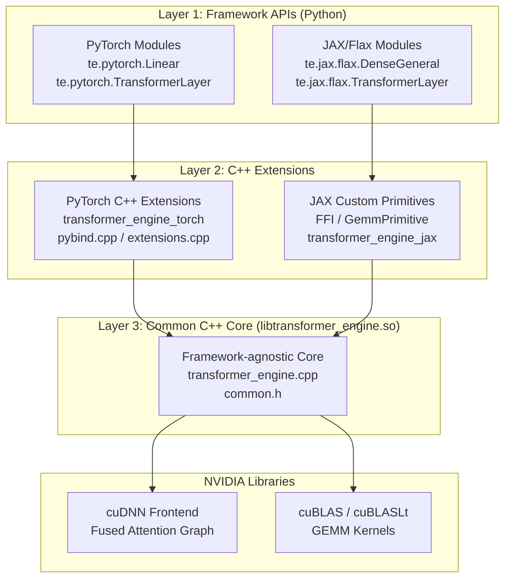
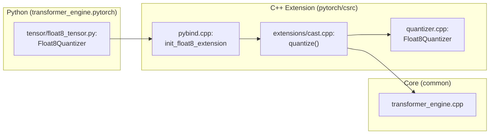
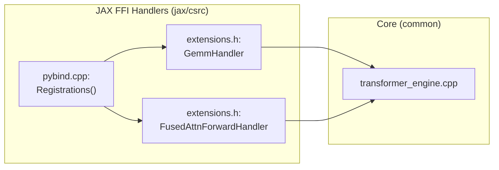

<!-- source: DeepWiki mcp.deepwiki.com · repo NVIDIA/TransformerEngine · page 3.1 System Architecture · fetched 2026-10-26 -->

# System Architecture

Relevant source files

The following files were used as context for generating this wiki page:

- [.github/workflows/build.yml](.github/workflows/build.yml)
- [.github/workflows/lint.yml](.github/workflows/lint.yml)
- [README.rst](README.rst)
- [build_tools/build_ext.py](build_tools/build_ext.py)
- [docs/installation.rst](docs/installation.rst)
- [examples/README.md](examples/README.md)
- [tests/cpp/test_common.cu](tests/cpp/test_common.cu)
- [tests/cpp/test_common.h](tests/cpp/test_common.h)
- [tests/pytorch/test_grouped_tensor.py](tests/pytorch/test_grouped_tensor.py)
- [transformer_engine/common/cast/dispatch/quantize.cuh](transformer_engine/common/cast/dispatch/quantize.cuh)
- [transformer_engine/common/common.h](transformer_engine/common/common.h)
- [transformer_engine/common/include/transformer_engine/transformer_engine.h](transformer_engine/common/include/transformer_engine/transformer_engine.h)
- [transformer_engine/common/transformer_engine.cpp](transformer_engine/common/transformer_engine.cpp)
- [transformer_engine/jax/csrc/extensions.h](transformer_engine/jax/csrc/extensions.h)
- [transformer_engine/jax/csrc/extensions/activation.cpp](transformer_engine/jax/csrc/extensions/activation.cpp)
- [transformer_engine/jax/csrc/extensions/ffi.cpp](transformer_engine/jax/csrc/extensions/ffi.cpp)
- [transformer_engine/jax/csrc/extensions/ffi.h](transformer_engine/jax/csrc/extensions/ffi.h)
- [transformer_engine/jax/csrc/extensions/normalization.cpp](transformer_engine/jax/csrc/extensions/normalization.cpp)
- [transformer_engine/jax/csrc/extensions/pybind.cpp](transformer_engine/jax/csrc/extensions/pybind.cpp)
- [transformer_engine/jax/csrc/extensions/quantization.cpp](transformer_engine/jax/csrc/extensions/quantization.cpp)
- [transformer_engine/jax/setup.py](transformer_engine/jax/setup.py)
- [transformer_engine/pytorch/csrc/common.h](transformer_engine/pytorch/csrc/common.h)
- [transformer_engine/pytorch/csrc/extensions.h](transformer_engine/pytorch/csrc/extensions.h)
- [transformer_engine/pytorch/csrc/extensions/cast.cpp](transformer_engine/pytorch/csrc/extensions/cast.cpp)
- [transformer_engine/pytorch/csrc/extensions/pybind.cpp](transformer_engine/pytorch/csrc/extensions/pybind.cpp)
- [transformer_engine/pytorch/csrc/quantizer.cpp](transformer_engine/pytorch/csrc/quantizer.cpp)
- [transformer_engine/pytorch/setup.py](transformer_engine/pytorch/setup.py)

This document describes the multi-layered architecture of Transformer Engine (TE), detailing how Python APIs, C++ extensions, and common CUDA kernels interact across framework boundaries. The architecture enables multiple deep learning frameworks (PyTorch, JAX) to share optimized FP8/FP4 kernels while maintaining framework-specific interfaces.

## Overview

Transformer Engine employs a three-layer architecture that separates framework-specific logic from shared computational kernels. The core logic is implemented in a framework-agnostic C++ library, which is then exposed to PyTorch and JAX through specialized extension layers.

### Three-Tier Architecture

**Sources:** [README.rst:33-58](), [transformer_engine/pytorch/csrc/extensions/pybind.cpp:122-130](), [transformer_engine/common/transformer_engine.cpp:7-24]()

## Layer 1: Framework APIs

The Python API layer provides framework-specific modules that users interact with directly. These modules handle framework-specific logic such as autograd, parameter registration, and distributed training strategies.

### PyTorch Integration
PyTorch modules like `te.Linear` leverage the `torch.autograd.Function` pattern. For example, the forward pass of a linear layer calls into C++ extensions to perform quantized operations.

### JAX Integration
JAX integration uses a custom primitive system. Modules like `te_flax.DenseGeneral` lower to JAX primitives, which use JAX's FFI (Foreign Function Interface) to call the same underlying C++ kernels as PyTorch.

**Sources:** [README.rst:72-100](), [README.rst:101-141](), [transformer_engine/jax/csrc/extensions/pybind.cpp:135-142]()

## Layer 2: C++ Extensions

The C++ extension layer bridges framework-specific Python objects (like `at::Tensor` in PyTorch) to the common C++ core.

### PyTorch C++ Extensions (`transformer_engine_torch`)
This layer uses `pybind11` to expose C++ functions to Python. It handles the conversion of PyTorch tensors to the `TensorWrapper` abstractions used by the core library.

**Code Entity Mapping (PyTorch):**

**Key Components:**
- `init_extension()` [transformer_engine/pytorch/csrc/extensions/pybind.cpp:122-130](): Initializes framework-specific bindings for FP8, MXFP8, and NVFP4.
- `quantize()` [transformer_engine/pytorch/csrc/extensions/cast.cpp:52-88](): High-level C++ entry point for tensor quantization.
- `Quantizer` [transformer_engine/pytorch/csrc/common.h:99-149](): Abstract base class for framework-specific quantization logic.

**Sources:** [transformer_engine/pytorch/csrc/extensions/pybind.cpp:1-130](), [transformer_engine/pytorch/csrc/extensions/cast.cpp:52-88](), [transformer_engine/pytorch/csrc/common.h:99-149]()

### JAX C++ Extensions (`transformer_engine_jax`)
JAX integration uses the XLA FFI to register handlers for operations like GEMM, Attention, and Softmax.

**Code Entity Mapping (JAX):**

**Sources:** [transformer_engine/jax/csrc/extensions/pybind.cpp:22-133](), [transformer_engine/jax/csrc/extensions.h:178-182]()

## Layer 3: Common C++ Core

The common C++ core is framework-agnostic. It defines the fundamental tensor abstractions and wraps low-level NVIDIA libraries.

### Tensor Abstraction System
The core library uses a `Shape` class to wrap `NVTEShape` and provides a unified `DType` system.

| Code Entity | Description | Location |
| :--- | :--- | :--- |
| `DType` | Enum defining supported data types (FP8, FP4, BF16, etc.). | [transformer_engine/common/include/transformer_engine/transformer_engine.h:25-38]() |
| `NVTEScalingMode` | Defines quantization scaling (Delayed, Block, MXFP8, NVFP4). | [transformer_engine/common/include/transformer_engine/transformer_engine.h:99-119]() |
| `Shape` | C++ class wrapping NVTEShape with std::vector-like interface. | [transformer_engine/common/common.h:130-205]() |

### Core Computational Kernels
The core library dispatches to specialized CUDA kernels or library calls. It includes logic for checking tensor shapes and scaling factors for various precision formats.

**Key Implementations:**
- **Quantization Checks**: `CheckScaleTensorShape` validates that scaling factors (like `scale_inv`) match the expected shapes for formats like MXFP8 and NVFP4 [transformer_engine/common/transformer_engine.cpp:64-141]().
- **Data Type Management**: `typeToNumBits` and `to_string` provide utility functions for handling the wide variety of low-precision types supported by TE [transformer_engine/common/transformer_engine.cpp:27-53]().

**Sources:** [transformer_engine/common/common.h:130-205](), [transformer_engine/common/transformer_engine.cpp:1-141](), [transformer_engine/common/include/transformer_engine/transformer_engine.h:1-119]()

## Cross-Framework Kernel Sharing

Because both PyTorch and JAX call into the same core C++ logic, optimizations applied to the core benefit both frameworks simultaneously.

### Data Flow Example: Quantization
1. **Framework Layer**: PyTorch calls `tex.quantize` [transformer_engine/pytorch/csrc/extensions/cast.cpp:52]().
2. **Extension Layer**: The PyTorch extension converts the `at::Tensor` into a `TensorWrapper` [transformer_engine/pytorch/csrc/extensions/cast.cpp:59]().
3. **Core Layer**: The core quantization logic is invoked, which may include stochastic rounding or amax reduction across groups [transformer_engine/pytorch/csrc/extensions/cast.cpp:144-175]().
4. **Library Layer**: CUDA kernels are launched to perform the actual bit-manipulation and scaling.

**Sources:** [transformer_engine/pytorch/csrc/extensions/cast.cpp:52-88](), [transformer_engine/pytorch/csrc/extensions/cast.cpp:144-175]()

## Build and Compilation

The system is built using `pip` which triggers `cmake` for the C++ components. The build process can be customized to build specific framework integrations using environment variables like `NVTE_FRAMEWORK`.

- **Core Build**: `NVTE_FRAMEWORK=none` builds only the framework-agnostic core [github/workflows/build.yml:36]().
- **PyTorch Build**: `NVTE_FRAMEWORK=pytorch` builds the core plus PyTorch extensions [github/workflows/build.yml:87]().
- **JAX Build**: `NVTE_FRAMEWORK=jax` builds the core plus JAX extensions [github/workflows/build.yml:110]().

**Sources:** [.github/workflows/build.yml:1-161]()

---

