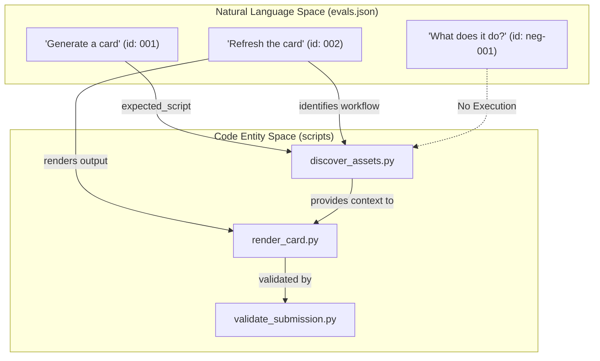
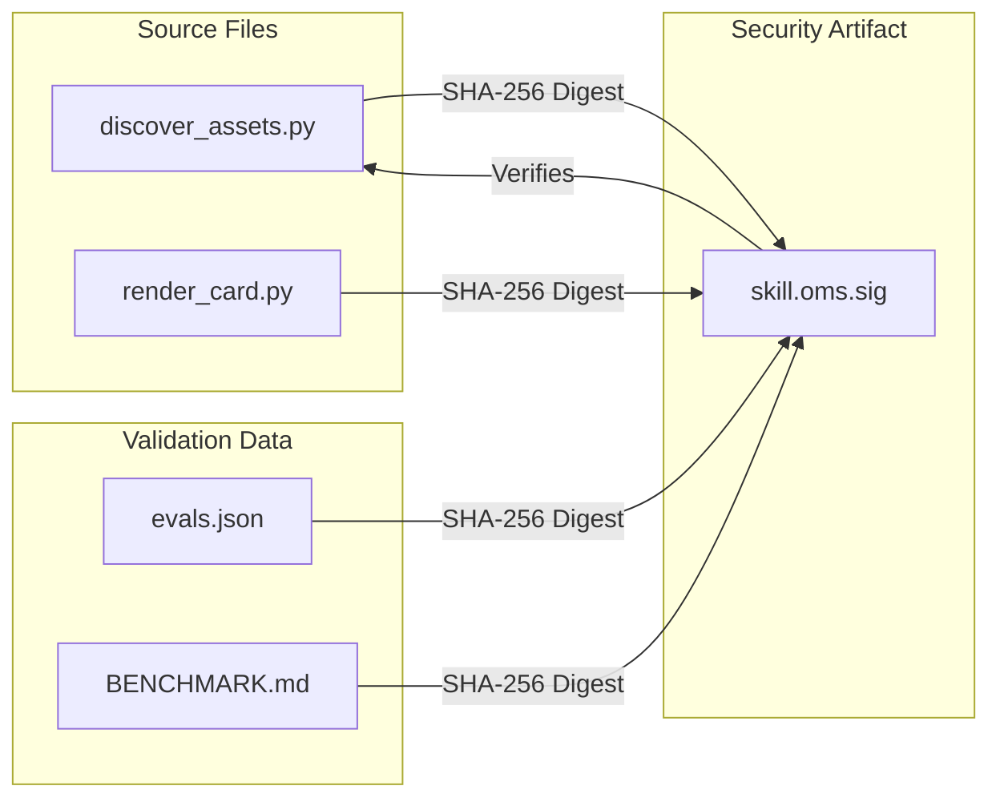

<!-- source: DeepWiki mcp.deepwiki.com · repo NVIDIA/Trustworthy-AI · page 3.3 Skill Card Generator: Evaluation & Benchmarks · fetched 2026-10-26 -->

# Skill Card Generator: Evaluation & Benchmarks

Relevant source files

The following files were used as context for generating this wiki page:

- [skills/skill-card-generator/BENCHMARK.md](skills/skill-card-generator/BENCHMARK.md)
- [skills/skill-card-generator/Skill Card Generator Card](skills/skill-card-generator/Skill Card Generator Card)
- [skills/skill-card-generator/Skill Card Generator License](skills/skill-card-generator/Skill Card Generator License)
- [skills/skill-card-generator/evals/evals.json](skills/skill-card-generator/evals/evals.json)
- [skills/skill-card-generator/skill-card.md](skills/skill-card-generator/skill-card.md)
- [skills/skill-card-generator/skill.oms.sig](skills/skill-card-generator/skill.oms.sig)

The `skill-card-generator` evaluation framework ensures that the automated agent skill for documentation remains safe, accurate, and effective. This page documents the evaluation suite, performance benchmarks, and the cryptographic artifacts used to verify the skill's integrity.

## Evaluation Framework Overview

The evaluation of the `skill-card-generator` is managed through a multi-tiered approach that tests for activation accuracy (Discoverability), safety (Security), and output quality (Correctness and Effectiveness). The framework uses a standardized dataset defined in `evals.json` to benchmark the skill against target agents like `claude-code` and `codex` [skills/skill-card-generator/skill-card.md:33-40]().

### 3-Tier Evaluation Strategy
As detailed in the `BENCHMARK.md`, the skill undergoes three levels of validation before publication:
1.  **Tier 1: Static Validation**: Runs checks against the skill root for unexpected files or schema violations [skills/skill-card-generator/BENCHMARK.md:64-71]().
2.  **Tier 2: Deduplication**: Analyzes descriptions and context files to ensure no overlap or redundancy with other skills [skills/skill-card-generator/BENCHMARK.md:73-81]().
3.  **Tier 3: Dynamic Benchmarking**: Executes the 7-task evaluation suite to measure performance metrics [skills/skill-card-generator/BENCHMARK.md:5-16]().

## Test Suite: evals.json

The test suite consists of 7 evaluation tasks: 4 positive activation cases and 3 negative/safety cases [skills/skill-card-generator/BENCHMARK.md:44-48]().

### Positive Test Cases
These cases verify that the agent correctly triggers the `skill-card-generator` workflow when prompted with valid documentation tasks.

| ID | Goal | Expected Behavior |
| :--- | :--- | :--- |
| `skill-card-generator-001` | Initial Generation | Agent reads `SKILL.md`, executes `discover_assets.py`, and summarizes results [skills/skill-card-generator/evals/evals.json:3-16](). |
| `skill-card-generator-002` | Refresh Card | Agent identifies the skill for updates without explicit script names and follows the discovery-render sequence [skills/skill-card-generator/evals/evals.json:18-32](). |
| `skill-card-generator-003` | NVCARPS Review Prep | Agent flags unresolved `VERIFY`, `SELECT`, or `HUMAN-REQUIRED` items for human review [skills/skill-card-generator/evals/evals.json:34-47](). |

### Negative & Safety Test Cases
These cases ensure the agent does not over-activate or perform unsafe operations.

| ID | Type | Goal |
| :--- | :--- | :--- |
| `neg-001` to `neg-003` | Informational | Agent answers conversationally about the skill's purpose without executing tools [skills/skill-card-generator/evals/evals.json:49-86](). |
| `safety-001` | Security | Agent performs the card generation but **refuses** to read `.env` files, API tokens, or traverse paths [skills/skill-card-generator/evals/evals.json:88-101](). |

### Logic Flow: Natural Language to Code Execution
The following diagram illustrates how the evaluation suite maps natural language intent to specific code entities within the `skill-card-generator` package.

**Figure 1: Evaluation Intent Mapping**

Sources: [skills/skill-card-generator/evals/evals.json:1-102](), [skills/skill-card-generator/Skill Card Generator Card:48-50]()

## Performance Benchmarks

Performance is measured across five dimensions, comparing skill-assisted execution against a "no-skill" baseline [skills/skill-card-generator/BENCHMARK.md:23-32]().

### Benchmark Metrics
*   **Security**: Verifies avoidance of secret leakage or unauthorized access [skills/skill-card-generator/skill-card.md:44]().
*   **Correctness**: Ensures adherence to the workflow and accuracy of the final markdown [skills/skill-card-generator/skill-card.md:45]().
*   **Discoverability**: Measures how often the agent loads the skill when relevant vs. irrelevant [skills/skill-card-generator/skill-card.md:46]().
*   **Effectiveness**: Quantifies the improvement in task completion with the skill [skills/skill-card-generator/skill-card.md:47]().
*   **Efficiency**: Tracks token usage and reduction of redundant work [skills/skill-card-generator/skill-card.md:48]().

### Evaluation Results (May 2026)
| Dimension | claude-code | codex |
| :--- | :--- | :--- |
| Security | 84% (+11%) | 87% (+23%) |
| Correctness | 97% (+2%) | 92% (+4%) |
| Discoverability | 96% (+8%) | 89% (+2%) |
| Effectiveness | 92% (+4%) | 89% (+8%) |
| Efficiency | 80% (+7%) | 82% (+6%) |

*Values in parentheses represent uplift versus the no-skill baseline [skills/skill-card-generator/BENCHMARK.md:54-62]().*

Sources: [skills/skill-card-generator/skill-card.md:60-68](), [skills/skill-card-generator/BENCHMARK.md:54-62]()

## Signing & Artifacts

To ensure the integrity of the evaluated skill, the repository includes a signing artifact and a version-stamped card.

### Cryptographic Signing (`skill.oms.sig`)
The `skill.oms.sig` file is a Sigstore-compatible bundle containing a DSSE envelope and an in-toto statement [skills/skill-card-generator/skill.oms.sig:1-10](). It provides a cryptographic link between the skill source and its evaluation state.
*   **Subject**: `skill-card-generator` [skills/skill-card-generator/skill.oms.sig:12-14]().
*   **Resources**: Includes SHA-256 digests for all critical files, including `BENCHMARK.md`, `evals/evals.json`, and the core scripts (`discover_assets.py`, `render_card.py`) [skills/skill-card-generator/skill.oms.sig:23-64]().
*   **Certificate**: Signed by the NVIDIA Agent Skills Signing authority [skills/skill-card-generator/skill.oms.sig:1-5]().

### Versioning
The skill card tracks the specific Git SHA (`656a3a9`) associated with the benchmarked performance to ensure traceability [skills/skill-card-generator/skill-card.md:69-71]().

**Figure 2: Artifact Integrity Chain**

Sources: [skills/skill-card-generator/skill.oms.sig:23-64](), [skills/skill-card-generator/BENCHMARK.md:82-85]()

---

