# Page: Overview: NVIDIA Trustworthy AI Repository

# Overview: NVIDIA Trustworthy AI Repository

<details>
<summary>Relevant source files</summary>

The following files were used as context for generating this wiki page:

- [LICENSE.md](LICENSE.md)
- [Model Card++ Templates/README.md](Model Card++ Templates/README.md)
- [README.md](README.md)

</details>


NVIDIA is committed to advancing AI that is reliable, transparent, and ethical. The **NVIDIA Trustworthy AI** repository serves as a central hub for products, tools, and documentation frameworks designed to enable developers, partners, and the larger ecosystem to build and deploy AI responsibly. This repository provides a blend of standardized documentation templates and active codebases to support the end-to-end AI lifecycle.

### Guiding Principles and Framework
The repository is built upon NVIDIA's core Trustworthy AI values, aiming to democratize AI responsibly by providing model consumers—including enterprise developers, policymakers, and investors—with clear, uniform metadata. These resources clarify intended domains, dataset characterizations, and technical limitations to accelerate the adoption of state-of-the-art software.

**Sources:** [README.md:1-5](), [Model Card++ Templates/README.md:1-4]()

---

## Core Sub-systems

The repository is organized into three primary pillars that bridge the gap between high-level governance and technical implementation:

1.  **Model Card++ Templates**: An enhanced documentation standard that uplevels traditional model cards by providing a modular architecture. It includes specialized subcards for Explainability, Bias, Safety, and Privacy, alongside machine-readable taxonomies.
2.  **Skill Card Ecosystem**: A framework specifically for AI agents. It includes the `skill-card-generator` tool to automate the creation of governance documentation for agentic skills.
3.  **ASL Developer Community**: A practical application of Trustworthy AI principles featuring the `asl_data_pipeline` and the `SIGNS` model, demonstrating how to document and process sensitive data (American Sign Language) transparently.

### System Interconnectivity
The following diagram illustrates how the various "Card" entities and code tools relate to the overall Trustworthy AI framework.

**Trustworthy AI Entity Relationship**
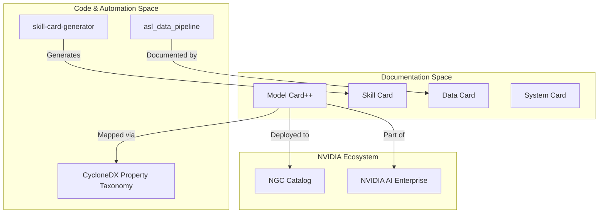
**Sources:** [README.md:7-9](), [Model Card++ Templates/README.md:5-9](), [LICENSE.md:1-3]()

---

## Licensing and Community Cadence

To maximize accessibility and utility, the repository employs a dual-licensing model:

*   **Creative Commons Zero (CC0) 1.0 Universal**: Applied to AI Transparency Card Templates (Model Cards, Skill Cards, etc.), allowing the public to freely build upon, modify, and redistribute these works for any purpose.
*   **Apache License**: Generally applied to the source code and tools (e.g., the ASL data pipeline and Skill Card generator).

**Update Cadence**: NVIDIA maintains this repository with a **monthly update cycle**, ensuring that templates and tools evolve alongside the rapidly changing AI landscape.

**Sources:** [README.md:3-8](), [LICENSE.md:1-7](), [Model Card++ Templates/README.md:7-8]()

---

## Detailed Component Overviews

### 1. Model Card++ Documentation
Model Card++ provides a common software quality expectation. It extends basic model documentation into a suite of specialized subcards that address specific ethical and technical vectors, such as bias prevalence and life-critical impact assessments. These are bridged to machine-readable formats via the **CycloneDX Property Taxonomy**.

*   For details on the framework and templates, see **[Repository Structure & Key Concepts](#1.2)**.
*   For details on the machine-readable mapping, see **[CycloneDX Property Taxonomy](#2.7)**.

### 2. Skill Card Ecosystem
Designed for AI agents, this system manages the governance of specific "skills." It includes an automated pipeline (`skill-card-generator`) that extracts signals from code assets to generate human-verifiable documentation.

*   For details on the automation pipeline, see **[Skill Card Generator: Automated Pipeline](#3.2)**.

### 3. ASL Developer Community
This section contains the source code for the `asl_data_pipeline`, which processes video data into landmarks for sign language recognition. It serves as a reference implementation for the repository's documentation standards.

*   For details on the processing modules, see **[Preprocessing Modules: Extractors & Converters](#4.1.1)**.

---

## Getting Started

To begin using the templates or contributing to the tools:
1.  **Explore the Templates**: Review the `Model Card++ Templates` directory for the latest standards.
2.  **Clone and Install**: Follow the Poetry-based setup for the Python tools.
3.  **Contribute**: NVIDIA invites the community to open GitHub issues or pull requests to improve the transparency standards.

For a practical onboarding guide, see **[Getting Started & Contributing](#1.1)**.

**Sources:** [README.md:7-9](), [Model Card++ Templates/README.md:7-8]()

---

# Page: Getting Started & Contributing

# Getting Started & Contributing

<details>
<summary>Relevant source files</summary>

The following files were used as context for generating this wiki page:

- [.github/workflows/team-request.yml](.github/workflows/team-request.yml)
- [ASL Developer Community/CONTRIBUTING.md](ASL Developer Community/CONTRIBUTING.md)
- [LICENSE.md](LICENSE.md)
- [README.md](README.md)

</details>


This page provides a practical onboarding guide for developers and AI practitioners looking to utilize or contribute to the NVIDIA Trustworthy AI repository. It covers repository setup, the dual-licensing model, and the technical workflows for submitting contributions.

## Quick Start: Repository Setup

To begin working with the repository, clone it locally and explore the primary sub-systems.

```bash
# Clone the repository
git clone https://github.com/NVIDIA/Trustworthy-AI.git

# Navigate to the project root
cd Trustworthy-AI
```

The repository is organized into three major functional areas:
1.  **Model Card++ Templates**: Documentation frameworks for AI transparency.
2.  **Skill Card Ecosystem**: Governance tools for AI agent skills.
3.  **ASL Developer Community**: Code and data pipelines for American Sign Language recognition.

**Sources:** [README.md:1-8](), [ASL Developer Community/CONTRIBUTING.md:52-57]()

## Understanding the Directory Layout

The repository uses a modular structure to separate static documentation templates from executable code and data pipelines.

| Directory | Purpose | Primary License |
| :--- | :--- | :--- |
| `Model Card++ Templates/` | Modular subcards (Bias, Safety, Privacy, etc.) for model reporting. | CC0 1.0 |
| `Skill Card Ecosystem/` | Jinja2 templates and automated generation scripts for AI skills. | Apache 2.0 |
| `ASL Developer Community/` | Data processing pipelines (Python/Poetry) and SIGNS model cards. | Apache 2.0 |

**Sources:** [README.md:3-8](), [LICENSE.md:1-7]()

## Licensing & Monthly Updates

NVIDIA employs a dual-licensing model to maximize the utility of the assets provided:
*   **Creative Commons Zero (CC0) 1.0 Universal**: Applied to the **AI Transparency Card Templates** (Model Card++, Data Card, etc.). This allows users to build upon, modify, and redistribute the templates for any purpose, including commercial ones, without fear of infringement claims [LICENSE.md:1-30]().
*   **Apache License**: Applied to code assets (e.g., the ASL Data Pipeline and Skill Card Generator) [README.md:3-3]().

The repository follows a **monthly update cycle** [README.md:8-8](). New templates, tool updates, and community-driven improvements are merged and released on this cadence.

**Sources:** [README.md:3-8](), [LICENSE.md:1-43]()

## Contribution Workflow

NVIDIA encourages community contributions via GitHub. All technical changes must follow a structured review process.

### Step 1: Issue Tracking
Before submitting code, contributors must open a GitHub Issue to describe the proposed enhancement or bugfix [ASL Developer Community/CONTRIBUTING.md:9-10]().

### Step 2: Development & Formatting
*   **Code Style**: Contributions should align with existing conventions. For Python code, the `black` formatter is the recommended standard [ASL Developer Community/CONTRIBUTING.md:16-25]().
*   **Testing**: All new components must include accompanying tests (run via `pytest`) and documentation [ASL Developer Community/CONTRIBUTING.md:40-42]().

### Step 3: Submission & Signing
NVIDIA requires all contributors to "sign-off" on their commits using the Developer Certificate of Origin (DCO). This certifies that the work is original or appropriately licensed [ASL Developer Community/CONTRIBUTING.md:65-72]().

```bash
# Sign-off on a commit
git commit -s -m "#<Issue Number> - <Commit Title>"
```

### Step 4: Pull Request (PR)
PRs should be opened against the `main` branch. Maintainers will review the code, and at least one approval is required for merging [ASL Developer Community/CONTRIBUTING.md:58-63]().

**Sources:** [ASL Developer Community/CONTRIBUTING.md:7-80]()

## Technical Integration Diagrams

### Contribution Data Flow
The following diagram maps the natural language contribution process to the specific GitHub and local entities involved.

**Contribution Logic to Code Entity Mapping**
```mermaid
graph TD
    subgraph "Natural Language Space"
        "Idea/Bug" --> "Propose Change"
        "Propose Change" --> "Write Code"
        "Write Code" --> "Verify Quality"
    end

    subgraph "Code Entity Space"
        "GitHub Issue"["Issue Tracking (github.com/issues)"]
        "LocalFork"["git clone (forked repo)"]
        "Black"["black formatter"]
        "Pytest"["pytest suite"]
        "DCO"["git commit -s (Sign-off)"]
        "PR"["Pull Request (github.com/pulls)"]
    end

    "Propose Change" -.-> "GitHub Issue"
    "Write Code" -.-> "LocalFork"
    "Verify Quality" -.-> "Black"
    "Verify Quality" -.-> "Pytest"
    "DCO" -.-> "PR"
    "LocalFork" -.-> "DCO"
```
**Sources:** [ASL Developer Community/CONTRIBUTING.md:7-72]()

### Automated CI/CD Dispatch
The repository uses GitHub Actions to trigger specialized validation workflows for AI Skills.

**CI Trigger Mapping**
```mermaid
graph LR
    subgraph "Event Source"
        "Comment"["issue_comment (created)"]
        "Push"["push (branch update)"]
    end

    subgraph "Workflow Entity"
        "TeamRequest"["team-request.yml"]
        "CI_Bot"["nv-skills-ci[bot]"]
        "NVSkills_CI"["NVIDIA/skills CI pipeline"]
    end

    "Comment" -- "/nvskills-ci" --> "TeamRequest"
    "Push" -- "actor: nv-skills-ci[bot]" --> "TeamRequest"
    "TeamRequest" -- "uses" --> "NVSkills_CI"
```
**Sources:** [.github/workflows/team-request.yml:1-22]()

## Tool Selection Guide

Choose the right tool or template based on your specific use case:

| Use Case | Recommended Asset | Location |
| :--- | :--- | :--- |
| **Documenting a new Model** | Model Card++ Overview Template | `Model Card++ Templates/Model Card++ Overview.md` |
| **Addressing Bias/Fairness** | Bias Subcard | `Model Card++ Templates/Bias Subcard.md` |
| **Automating Skill Docs** | Skill Card Generator | `Skill Card Ecosystem/skill-card-generator/` |
| **Processing ASL Video** | ASL Data Pipeline | `ASL Developer Community/src/asl_data_pipeline/` |
| **Verifying Transparency** | CycloneDX Taxonomy | `Model Card++ Templates/CycloneDX Property Taxonomy/` |

**Sources:** [README.md:8-8](), [ASL Developer Community/CONTRIBUTING.md:1-3]()

---

# Page: Repository Structure & Key Concepts

# Repository Structure & Key Concepts

<details>
<summary>Relevant source files</summary>

The following files were used as context for generating this wiki page:

- [CycloneDX-Property-Taxonomy/cyclonedx-property-taxonomy.md](CycloneDX-Property-Taxonomy/cyclonedx-property-taxonomy.md)
- [Model Card++ Templates/README.md](Model Card++ Templates/README.md)
- [README.md](README.md)

</details>


This page provides a technical map of the NVIDIA Trustworthy AI repository. It outlines the directory organization, the conceptual framework of the "Card" ecosystem, and the data flow between human-readable documentation and machine-readable Bill of Materials (BOM) files via the CycloneDX Property Taxonomy.

## Repository Map

The repository is organized into three primary pillars: documentation frameworks, automated governance tools, and reference implementations.

| Directory | Purpose | Key Contents |
|:---|:---|:---|
| `Model Card++ Templates/` | Standardized documentation framework for AI assets. | Markdown templates for Model, Data, System, and Container cards. |
| `Skill Card Ecosystem/` | Governance for AI agents and modular skills. | `skill-card-generator` tool and `Skill Card` schemas. |
| `ASL Developer Community/` | Reference implementation for trustworthy data pipelines. | `asl_data_pipeline` source code and SIGNS model cards. |
| `CycloneDX-Property-Taxonomy/` | Machine-readable mapping layer. | Taxonomy definitions for `nvidia:` namespaces. |

**Sources:** [README.md:1-9](), [Model Card++ Templates/README.md:1-10](), [CycloneDX-Property-Taxonomy/cyclonedx-property-taxonomy.md:1-22]()

## The "Card" Ecosystem & Documentation Chain

The repository introduces a modular "Card" architecture. Rather than a single monolithic document, NVIDIA utilizes a chain of specialized cards that provide transparency across the AI lifecycle.

### Card Types
*   **Model Card++:** An enhanced version of the Google Model Card, featuring subcards for Explainability, Bias, Safety & Security, and Privacy [Model Card++ Templates/README.md:1-5]().
*   **Data Card:** Focuses on dataset provenance, licensing, and ethical compliance [CycloneDX-Property-Taxonomy/cyclonedx-property-taxonomy.md:50-61]().
*   **System Card:** Defines the Operational Design Domain (ODD) and fail-safe mechanisms for the end-to-end AI system.
*   **Container Card:** Provides transparency for the deployment environment, including CVE links and versioning tags.
*   **Blueprint Card:** Maps the software component chain and minimum system requirements.
*   **Skill Card:** A specific format for AI Agent "skills," documenting intent, risks, and evaluation results [Skill Card Ecosystem/README.md:1-10]().

### The Documentation Chain
The following diagram illustrates how these entities relate to one another in the "Natural Language Space" vs. the "Code/Asset Space."

**Documentation Chain & Entity Mapping**
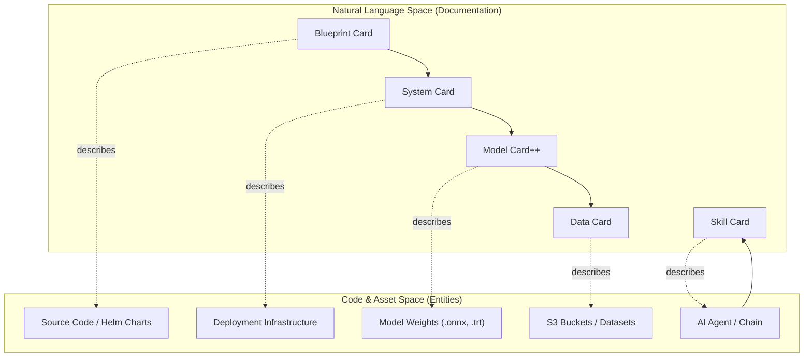
**Sources:** [Model Card++ Templates/README.md:3-5](), [CycloneDX-Property-Taxonomy/cyclonedx-property-taxonomy.md:5-22]()

## CycloneDX Property Taxonomy

To bridge human-readable Markdown cards with automated supply chain security tools, the repository defines a **CycloneDX Property Taxonomy**. This allows Model Card++ fields to be embedded directly into CycloneDX Software Bill of Materials (SBOM) or AI Bill of Materials (AI/OBOM) files.

### Namespace Implementation
The taxonomy is divided into eight namespaces under the `nvidia` prefix:

| Namespace | Usage | Example Properties |
|:---|:---|:---|
| `nvidia:model` | Core identity | `deployment_geography`, `release_dates` |
| `nvidia:architecture` | Technical design | `runtime_engines`, `hardware_compatibility` |
| `nvidia:dataset` | Data provenance | `training_license`, `gpai:total_size` |
| `nvidia:inference` | Runtime metrics | `computational_load`, `latency` |
| `nvidia:bias` | Fairness metrics | `bias_mitigation_strategies` |
| `nvidia:privacy` | Data protection | `personal_data_handled` |
| `nvidia:safety` | Risk management | `life_critical_impact` |
| `nvidia:explainability` | Transparency | `intended_users`, `limitations` |

**Sources:** [CycloneDX-Property-Taxonomy/cyclonedx-property-taxonomy.md:11-22](), [CycloneDX-Property-Taxonomy/cyclonedx-property-taxonomy.md:26-47]()

## Data Flow: From Markdown to Machine-Readable BOM

The repository facilitates a workflow where high-level documentation is transformed into machine-parsable properties. This is particularly evident in the `Skill Card Ecosystem`, where the `skill-card-generator` automates the extraction of signals from code to populate these schemas.

**Technical Data Flow: Card Generation & Mapping**
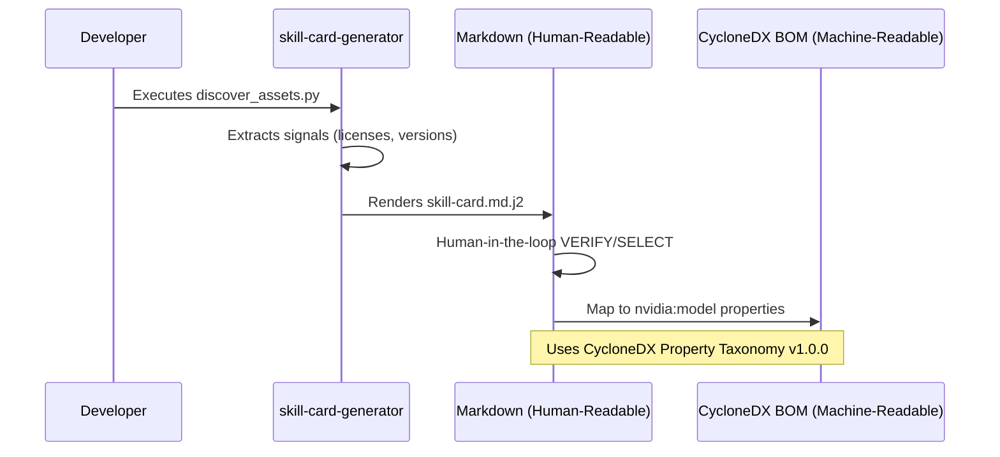

**Sources:** [CycloneDX-Property-Taxonomy/cyclonedx-property-taxonomy.md:1-9](), [Skill Card Ecosystem/README.md:5-15]()

---

# Page: Model Card++ Documentation Framework

# Model Card++ Documentation Framework

<details>
<summary>Relevant source files</summary>

The following files were used as context for generating this wiki page:

- [Model Card++ Templates/Model Card Overview Template](Model Card++ Templates/Model Card Overview Template)
- [Model Card++ Templates/README.md](Model Card++ Templates/README.md)

</details>


The Model Card++ Documentation Framework is NVIDIA's enhanced standard for AI model transparency and governance. Building upon the original Model Card concept, this framework introduces a modular "subcard" architecture designed to provide deep technical insights into model architecture, data provenance, and ethical considerations (Bias, Safety, Privacy, and Explainability). It serves as a comprehensive communication tool for both technical developers and non-technical stakeholders to understand a model's capabilities, limitations, and risks.

## Modular Architecture Overview

Model Card++ is structured as a primary **Model Card Overview** supported by specialized **Subcards**. This modularity allows organizations to provide granular detail on complex topics like General Purpose AI (GPAI) requirements and software integration without cluttering the high-level model identity.

### Relationship Diagram: Card Ecosystem
The following diagram illustrates how the various templates in the `Model Card++ Templates/` directory relate to one another to form a complete documentation package.

```mermaid
graph TD
    subgraph ["Model Card++ Core"]
        MCO["Model Card Overview Template"]
    end

    subgraph ["Ethical & Technical Subcards"]
        ESC["Explainability Subcard"]
        BSC["Bias Subcard"]
        SSC["Safety & Security Subcard"]
        PSC["Privacy Subcard"]
    end

    subgraph ["Supplementary Cards"]
        DC["Data Card"]
        SYS["System Card"]
        CC["Container Card"]
        BC["Blueprint Card"]
    end

    MCO --- ESC
    MCO --- BSC
    MCO --- SSC
    MCO --- PSC

    MCO -.-> DC
    MCO -.-> SYS
    MCO -.-> CC
    MCO -.-> BC
```
**Sources:** [Model Card++ Templates/README.md:1-10](), [Model Card++ Templates/Model Card Overview Template:1-100]()

## Core Components and Child Pages

The framework is divided into several specialized templates. Detailed documentation for each can be found on their respective child pages:

### [2.1 Model Card Overview Template](#)
The foundational document covering model identity, metadata, and technical specifications. It includes:
*   **Architecture Specs:** Classification of `Architecture Type` (e.g., Transformer, CNN) and `Network Architecture` (e.g., ResNet50, MobileNetv2) [Model Card++ Templates/Model Card Overview Template:26-31]().
*   **Software Integration:** Requirements for `Runtime Engine(s)`, `Microarchitecture Compatibility`, and `Operating System(s)` [Model Card++ Templates/Model Card Overview Template:70-82]().
*   **GPAI Data Provenance:** Extensive tracking for public/private datasets, crawling/scraping methods, and synthetic data generation [Model Card++ Templates/Model Card Overview Template:93-125]().

### [2.2 Explainability Subcard](#)
Focuses on how the model makes decisions and its operational boundaries. It documents the `Intended Task/Domain`, `Operational Design Domain (ODD)`, and technical limitations to ensure users understand when the model is—and is not—reliable.

### [2.3 Bias Subcard](#)
Provides a framework for disclosing demographic representation and performance disparities. It tracks `Bias Metrics`, participation of protected classes, and identifies the `worst-performing features` to guide mitigation efforts.

### [2.4 Safety & Security Subcard](#)
Categorizes the model's application field (e.g., Healthcare, Autonomous Vehicles) and assesses life-critical impacts. It includes specific disclosures for GPAI models regarding harmful data processing and illegal content mitigation (e.g., CSAM/NCII).

### [2.5 Privacy Subcard](#)
Details personal data governance, including `consent` mechanisms, `provenance`, and automated PII scanning results. It also addresses GPAI-specific copyright risk and data subject rights (access/deletion/correction).

### [2.6 Supplementary Card Types](#)
Beyond the Model Card++, the framework includes four additional card types for full-stack transparency:
*   **Data Card:** Deep dive into dataset collection and labeling.
*   **System Card:** Documentation of the broader AI system, including I/O pipelines and fail-safes.
*   **Container Card:** Security and versioning data for the model's deployment container.
*   **Blueprint Card:** High-level architecture diagrams and transparency chains.

### [2.7 CycloneDX Property Taxonomy](#)
The bridge between human-readable documentation and machine-readable transparency. This taxonomy maps Model Card++ fields to `nvidia:model`, `nvidia:architecture`, and other namespaces within a CycloneDX Bill of Materials (BOM).

## Technical Implementation Space

The following diagram maps the logical documentation concepts to the physical file entities within the repository.

```mermaid
graph LR
    subgraph ["Natural Language Space (Documentation)"]
        MC_Logic["Model Specifications"]
        Ethic_Logic["Ethical Disclosures"]
        GPAI_Logic["GPAI Requirements"]
    end

    subgraph ["Code Entity Space (Filesystem)"]
        MCOT["Model Card Overview Template"]
        EX_S["Explainability Subcard"]
        B_S["Bias Subcard"]
        S_S["Safety & Security Subcard"]
        P_S["Privacy Subcard"]
    end

    MC_Logic --> MCOT
    Ethic_Logic --> EX_S
    Ethic_Logic --> B_S
    Ethic_Logic --> S_S
    Ethic_Logic --> P_S
    GPAI_Logic --> MCOT
```
**Sources:** [Model Card++ Templates/Model Card Overview Template:1-200](), [Model Card++ Templates/README.md:1-10]()

## Key Standards & Methodology
The framework follows the **V-model methodology** for iterative testing and validation at both unit and system levels [Model Card++ Templates/Model Card Overview Template:84-85](). For GPAI (General Purpose AI) models, the framework enforces strict reporting on computational loads, including `Cumulative Compute` and `Estimated Energy and Emissions` [Model Card++ Templates/Model Card Overview Template:36-38]().

**Sources:**
*   [Model Card++ Templates/README.md:1-10]()
*   [Model Card++ Templates/Model Card Overview Template:1-125]()

---

# Page: Model Card Overview Template

# Model Card Overview Template

<details>
<summary>Relevant source files</summary>

The following files were used as context for generating this wiki page:

- [Model Card++ Templates/Model Card Overview Template](Model Card++ Templates/Model Card Overview Template)

</details>


The **Model Card Overview Template** serves as the primary entry point for NVIDIA's Model Card++ documentation framework. It provides a standardized, high-level technical summary of an AI model's identity, architecture, operational requirements, and data provenance. This template is designed to ensure transparency for both general-purpose AI (GPAI) and specialized models, bridging the gap between high-level descriptions and technical specifications required for integration.

[Model Card++ Templates/Model Card Overview Template:1-125]()

## Model Identity and Metadata

Every model card begins with fundamental metadata that establishes the model's lineage, ownership, and intended deployment environment.

| Field | Description |
| :--- | :--- |
| **Description** | A concise statement of the model's function and development context. |
| **Readiness Status** | Categorization as Commercial, Research & Development, or Demonstration. |
| **Deployment Geography** | Specific regions (e.g., APAC, EMEA, NAM) or countries where the model is supported. |
| **Use Case** | Detailed definition of expected users and specific applications. |
| **License/Terms** | Legal framework governing the model's distribution and usage. |

[Model Card++ Templates/Model Card Overview Template:3-22]()

## Architecture Specifications

The template requires granular detail regarding the model's neural network structure. This section is critical for developers assessing hardware compatibility and performance characteristics.

*   **Architecture Type:** High-level classification such as CNN, RNN, Transformer, or State Machine.
*   **Network Architecture:** Specific backbone identification (e.g., `ResNet50`, `MobileNetv2`, `DarkNet53`).
*   **Model Parameters:** Recorded with at least two significant figures (e.g., $7.3 \times 10^{10}$).
*   **GPAI Design Choices:** (Internal only) Documentation of initialization techniques, hyperparameter tuning, regularization, and optimization damping.

[Model Card++ Templates/Model Card Overview Template:26-35]()

### Data Flow: Input/Output Definitions
The following diagram illustrates how the Model Card++ template structures the I/O interface for software integration.

**Model Interface Mapping**
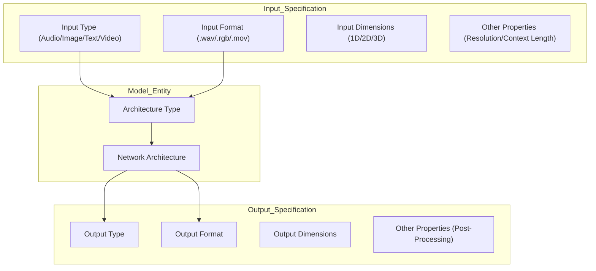
Sources: [Model Card++ Templates/Model Card Overview Template:40-69]()

## Software and Hardware Integration

The template tracks the runtime environment necessary for the model to execute correctly. This includes the relationship between software engines and the underlying microarchitecture.

*   **Runtime Engines:** Specific execution environments (e.g., TensorRT, ONNX Runtime).
*   **Microarchitecture:** Supported hardware generations (e.g., Hopper, Blackwell, Ampere).
*   **Operating Systems:** Compatibility with Linux, Linux 4 Tegra, QNX, or Windows.
*   **Model Versions:** Unique identifiers for variations such as `pruned`, `quantized`, or `deployable`.

[Model Card++ Templates/Model Card Overview Template:70-92]()

## Data Provenance for GPAI Models

For General-Purpose AI (GPAI) models, the template mandates a deep dive into the data lifecycle to address transparency and safety requirements.

### Dataset Partitioning and Collection
The template tracks the statistical distribution and temporal bounds of the data used across the model lifecycle:
1.  **Training Partition:** Percentage and collection time period.
2.  **Testing Partition:** Percentage and collection time period.
3.  **Validation Partition:** Percentage and collection time period.

[Model Card++ Templates/Model Card Overview Template:95-103]()

### Provenance Categories
The framework distinguishes between different data acquisition methods to assess risk and compliance:

| Category | Requirements |
| :--- | :--- |
| **Public Datasets** | List of datasets representing >3% of total data, including unique IDs and links. |
| **Private Datasets** | Documentation of third-party acquired data and narrative descriptions. |
| **Crawling/Scraping** | Identification of crawlers, modality size, and opt-out/exclusion verification. |
| **Synthetic Data** | Description of generators, software used, and the ratio of synthetic to real data. |

[Model Card++ Templates/Model Card Overview Template:108-132]()

## Computational Load and Benchmarking

To support environmental and efficiency tracking, the template includes sections for:
*   **Cumulative Compute:** Total floating-point operations or GPU-hours.
*   **Energy and Emissions:** Estimated carbon footprint and power consumption during training.
*   **Inference Performance:** Benchmarking results across different hardware configurations, typically reported in frames per second (FPS) or latency (ms).

[Model Card++ Templates/Model Card Overview Template:36-39]()

## Implementation Mapping: Template to Code

The following diagram maps the conceptual sections of the Model Card Overview Template to the structural components found in the repository's documentation and schema files.

**Template Structure to Entity Mapping**
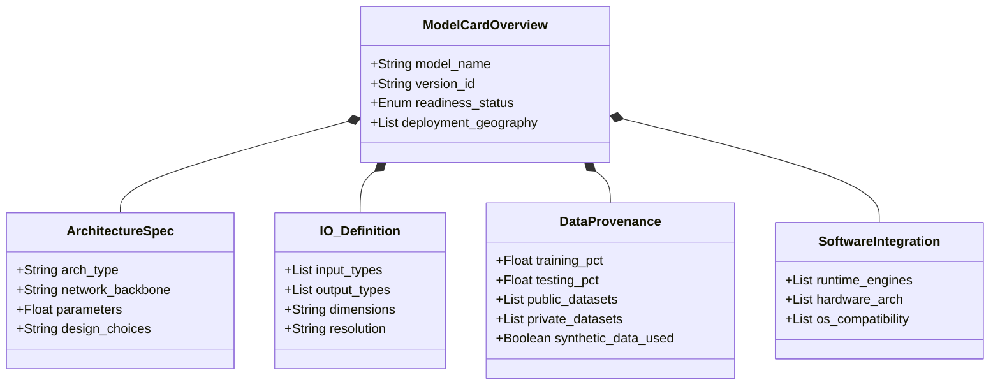
Sources: [Model Card++ Templates/Model Card Overview Template:1-132]()

**Sources:**
* [Model Card++ Templates/Model Card Overview Template:1-132]()

---

# Page: Explainability Subcard

# Explainability Subcard

<details>
<summary>Relevant source files</summary>

The following files were used as context for generating this wiki page:

- [Model Card++ Templates/Model Card Explainability Subcard](Model Card++ Templates/Model Card Explainability Subcard)

</details>


The **Explainability Subcard** is a specialized module within the NVIDIA Model Card++ framework designed to provide transparency regarding a model's operational mechanics, its limitations within a defined Operational Design Domain (ODD), and its impact on diverse user groups. It serves as a technical bridge between raw model performance and human-understandable logic, ensuring that stakeholders can interpret model outputs and understand the boundaries of safe operation.

## Purpose and Scope

The primary objective of the Explainability Subcard is to document the "how" and "why" behind model behavior. While the [Model Card Overview Template:2.1]() focuses on architecture and metadata, the Explainability Subcard addresses:
*   **Operational Boundaries**: Defining the specific conditions under which the model is reliable.
*   **User Context**: Identifying who should use the model and what outputs they should expect.
*   **Risk Mitigation**: Disclosing known failure modes and the technical measures taken to address them.
*   **GPAI Transparency**: For General Purpose AI (GPAI) models, documenting the provenance of data and the tools used to verify authenticity.

## Template Schema and Data Flow

The Explainability Subcard follows a structured schema that maps directly to the `nvidia:explainability` namespace in the [CycloneDX Property Taxonomy:2.7]().

### Explainability Subcard Structure
| Field | Description | Technical Requirement |
| :--- | :--- | :--- |
| **Intended Task/Domain** | The specific application area (e.g., ASL Recognition, Autonomous Perception). | [Model Card++ Templates/Model Card Explainability Subcard:3-3]() |
| **Model Type** | Categorization of the model (e.g., Transformer, Template Matching, CNN). | [Model Card++ Templates/Model Card Explainability Subcard:4-4]() |
| **Intended Users** | The profile of end-users or developers integrating the model. | [Model Card++ Templates/Model Card Explainability Subcard:5-5]() |
| **Output Schema** | Detailed description of the model's inference results and formats. | [Model Card++ Templates/Model Card Explainability Subcard:6-6]() |
| **GPAI Synthetic Tools** | Tools used to detect synthetic data and ensure authenticity in GPAI training sets. | [Model Card++ Templates/Model Card Explainability Subcard:7-7]() |
| **Functional Description** | A high-level explanation of the internal logic and processing steps. | [Model Card++ Templates/Model Card Explainability Subcard:8-8]() |
| **Adversely Impacted Groups** | Groups for which the model has been tested to ensure comparable outcomes. | [Model Card++ Templates/Model Card Explainability Subcard:9-9]() |
| **Technical Limitations** | Failures or performance degradation within the intended ODD. | [Model Card++ Templates/Model Card Explainability Subcard:10-10]() |
| **Quality Standards** | Verification of compliance with internal corporate quality benchmarks. | [Model Card++ Templates/Model Card Explainability Subcard:11-11]() |
| **Performance Metrics** | Key indicators used to measure explainability or reliability. | [Model Card++ Templates/Model Card Explainability Subcard:12-12]() |
| **Known Risks** | Consequences of model failure or misuse. | [Model Card++ Templates/Model Card Explainability Subcard:13-13]() |

**Sources:**
* [Model Card++ Templates/Model Card Explainability Subcard:1-14]()

## Technical Implementation: Logic to Documentation

The following diagram illustrates how technical attributes from the codebase (using the SIGNS model as an example) are mapped into the Explainability Subcard fields.

### Logic Mapping Diagram
"This diagram bridges the gap between model implementation logic and the documentation fields."

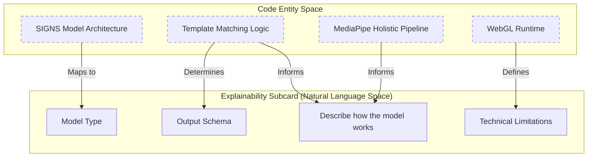

**Sources:**
* [Model Card++ Templates/Model Card Explainability Subcard:4-10]()
* [ASL Developer Community/SIGNS Model: ASL Recognition Model Cards:4.2]()

## Operational Design Domain (ODD) and Limitations

A critical component of the Explainability Subcard is the definition of the **Operational Design Domain (ODD)**. This section must detail where the model is expected to perform and, more importantly, where it is likely to fail.

### ODD Verification Workflow
"The process of validating model performance against the ODD to fill the Subcard."

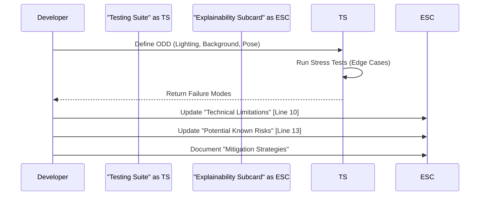

### Key Considerations for Limitations
1.  **Environmental Factors**: Sensitivity to lighting conditions, sensor noise, or occlusion [Model Card++ Templates/Model Card Explainability Subcard:10-10]().
2.  **Hardware Constraints**: Minimum compute requirements (e.g., WebGL support) that impact model inference speed and reliability [Model Card++ Templates/Model Card Explainability Subcard:10-10]().
3.  **Data Drifts**: How the model handles inputs that deviate significantly from the training or template distribution [Model Card++ Templates/Model Card Explainability Subcard:13-13]().

**Sources:**
* [Model Card++ Templates/Model Card Explainability Subcard:10-13]()

## GPAI and Synthetic Data Transparency

For General Purpose AI (GPAI) models, the subcard requires specific disclosures regarding synthetic data. This is essential for maintaining a "Trustworthy AI" posture when training involves non-organic data sources.

*   **Detection Tools**: Documentation of the algorithms or software used to distinguish between human-generated and AI-generated data during the training phase [Model Card++ Templates/Model Card Explainability Subcard:7-7]().
*   **Data Authenticity**: Verification methods used to ensure that the datasets used for training or evaluation have not been tampered with or corrupted [Model Card++ Templates/Model Card Explainability Subcard:7-7]().

## Integration with CycloneDX

The Explainability Subcard is designed to be machine-readable. Every field in the Markdown template corresponds to a property in the `nvidia:explainability` namespace of the [CycloneDX Property Taxonomy:2.7]().

| Markdown Field | CycloneDX Property |
| :--- | :--- |
| `Intended Task/Domain` | `nvidia:explainability:task_domain` |
| `Model Type` | `nvidia:explainability:model_type` |
| `Technical Limitations` | `nvidia:explainability:limitations` |
| `Performance Metrics` | `nvidia:explainability:metrics` |

This mapping allows the documentation to be exported as a Software Bill of Materials (SBOM), facilitating automated compliance checks across the AI lifecycle.

**Sources:**
* [Model Card++ Templates/Model Card Explainability Subcard:1-14]()
* [CycloneDX Property Taxonomy:2.7]()

---

# Page: Bias Subcard

# Bias Subcard

<details>
<summary>Relevant source files</summary>

The following files were used as context for generating this wiki page:

- [Model Card++ Templates/Bias Subcard Template](Model Card++ Templates/Bias Subcard Template)

</details>


The **Bias Subcard** is a modular component of the NVIDIA Model Card++ framework designed to document the ethical considerations, statistical imbalances, and mitigation strategies associated with AI models. It provides a structured schema for reporting how protected classes were considered during development, the specific metrics used to quantify bias, and performance deltas across different demographic features, particularly for General Purpose AI (GPAI) models.

## Subcard Structure and Data Flow

The Bias Subcard operates as a specialized extension of the Model Card++ ecosystem, focusing on the social and statistical implications of model behavior. It transitions from qualitative participation considerations to quantitative performance analysis.

### Bias Analysis Workflow
The following diagram illustrates the data flow from data acquisition to the final reporting within the Bias Subcard template.

**Bias Documentation Pipeline**
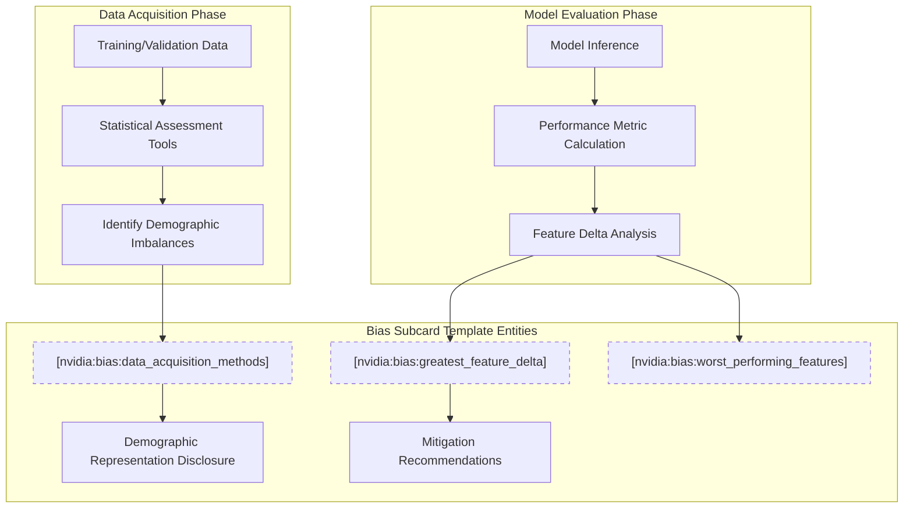
**Sources:** [Model Card++ Templates/Bias Subcard Template:1-11]()

## Key Technical Fields

The template defines several critical fields for documenting bias, with specific requirements for GPAI (General Purpose AI) models to ensure compliance with emerging transparency standards.

### 1. Participation and Mitigation
*   **Protected Class Considerations:** Documentation of how members of protected classes (as defined by legal frameworks like the California Senate protected classes) were involved in the design and testing phases [Model Card++ Templates/Bias Subcard Template:3]().
*   **Mitigation Measures:** A technical description of the specific interventions (e.g., re-weighting, adversarial debiasing, or curated sampling) taken to reduce unwanted bias [Model Card++ Templates/Bias Subcard Template:4]().

### 2. Quantitative Metrics
*   **Bias Metric:** The specific statistical measure used to evaluate fairness (e.g., Disparate Impact, Equalized Odds, or Demographic Parity) [Model Card++ Templates/Bias Subcard Template:5]().
*   **GPAI Feature Deltas:** For GPAI models, developers must identify which specific features show the greatest performance variance and which features exhibit the lowest absolute performance [Model Card++ Templates/Bias Subcard Template:6-7]().

### 3. Data Provenance and Statistical Tools
For GPAI models, the subcard requires a deep dive into the internal data processing pipeline:
*   **Methodology:** A ~200-word description of methods used during data acquisition to address bias prevalence [Model Card++ Templates/Bias Subcard Template:8]().
*   **Tooling:** Identification of specific software tools used to assess statistical imbalances [Model Card++ Templates/Bias Subcard Template:9]().

**Sources:** [Model Card++ Templates/Bias Subcard Template:3-9]()

## Demographic Representation Disclosures

The subcard includes a standardized disclosure format for dataset limitations. This section acknowledges that datasets are rarely exhaustive and requires explicit naming of missing or underrepresented taxonomies.

| Disclosure Component | Description |
| :--- | :--- |
| **Dataset Name** | Identification of the specific datasets evaluated. |
| **Excluded Classes** | Explicit list of classes from the relevant taxonomy not represented in the data. |
| **Proportional Split** | Known representation percentages of the included taxonomy. |
| **Recommendations** | Suggested fine-tuning or evaluation techniques for end-users to align model behavior. |

**Sources:** [Model Card++ Templates/Bias Subcard Template:10-11]()

## Implementation Mapping: Template to Taxonomy

The fields defined in the `Bias Subcard Template` map directly to the `nvidia:bias` namespace in the machine-readable CycloneDX Property Taxonomy. This allows the natural language responses in the markdown file to be parsed into automated governance workflows.

**Mapping Natural Language to Code Entities**
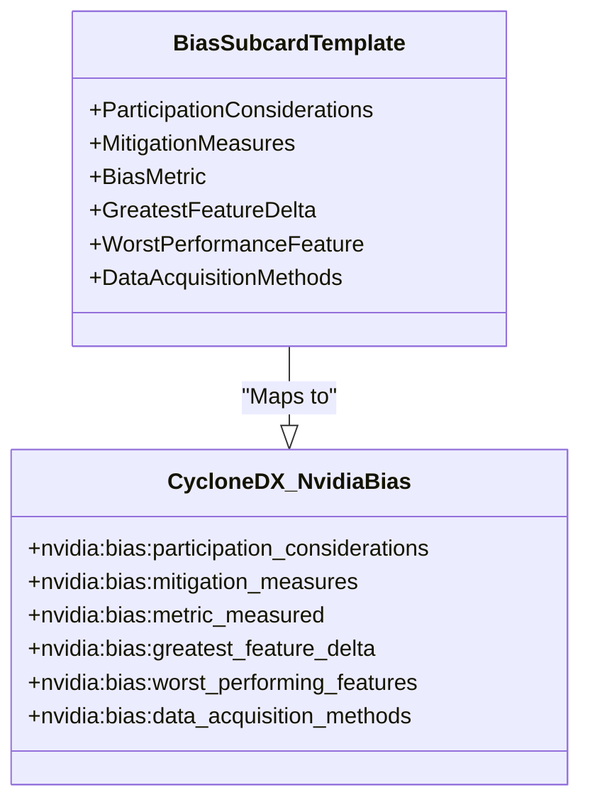

**Sources:** [Model Card++ Templates/Bias Subcard Template:1-11](), [2.7 CycloneDX Property Taxonomy]() (referenced for namespace context).

---

# Page: Safety & Security Subcard

# Safety & Security Subcard

<details>
<summary>Relevant source files</summary>

The following files were used as context for generating this wiki page:

- [Model Card++ Templates/Safety & Security Subcard](Model Card++ Templates/Safety & Security Subcard)

</details>


The **Safety & Security Subcard** is a specialized module within the NVIDIA Model Card++ framework designed to document the operational safety boundaries, application-specific risks, and content mitigation strategies of an AI model. It provides a structured format for identifying life-critical impacts and detailing the rigorous data-cleansing processes required for General Purpose AI (GPAI) models, particularly regarding illegal content like CSAM and NCII.

### 1. Application Taxonomy and Impact Assessment
This section categorizes the model's intended deployment environments and evaluates the potential for life-critical consequences. By defining the **Model Application Field(s)**, developers can signal the level of safety-criticality inherent in the model's use case.

| Field | Description |
| :--- | :--- |
| **Model Application Field(s)** | A selection of industry-specific domains where the model is intended to be integrated (e.g., Autonomous Vehicles, Healthcare, Critical Infrastructure). |
| **Life Critical Impact** | A technical assessment of how model failure or misuse could lead to physical harm, loss of life, or catastrophic environmental damage. |

**Sources:**
- `Model Card++ Templates/Safety & Security Subcard`: [3-4]()

### 2. GPAI Harmful Data Processing
For General Purpose AI (GPAI) models, the subcard requires detailed disclosures regarding the methods used to sanitize training, testing, and validation datasets. This is critical for transparency in how the model handles "potentially harmful data" that may not be strictly illegal but could lead to unsafe model behaviors.

#### Data Flow: Harmful Content Mitigation
The following diagram illustrates the conceptual data flow for GPAI model data acquisition as described in the subcard requirements.

**GPAI Data Safety Pipeline**
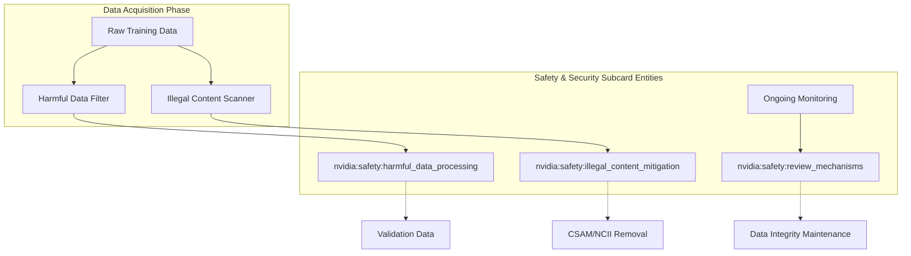

**Sources:**
- `Model Card++ Templates/Safety & Security Subcard`: [5-6]()
- `Model Card++ Templates/Safety & Security Subcard`: [9-9]()

### 3. Illegal Content Mitigation (CSAM/NCII)
A mandatory disclosure for GPAI models involves the specific technical methods used to detect and remove illegal content. This includes, but is not limited to, **Child Sexual Abuse Material (CSAM)** and **Non-Consensual Intimate Imagery (NCII)**. 

The subcard explicitly states that models developed under this framework must be scanned for such content consistent with corporate responsible data handling policies.

**Sources:**
- `Model Card++ Templates/Safety & Security Subcard`: [6-6]()
- `Model Card++ Templates/Safety & Security Subcard`: [9-9]()

### 4. Restrictions and Monitoring
The subcard defines the legal and operational boundaries of the model through use case restrictions and continuous monitoring protocols.

*   **Use Case Restrictions:** Specifies the legal framework and license agreements (e.g., NVIDIA Community Model License) that govern how the model can be deployed.
*   **Model and Dataset Restrictions:** Technical limitations on how the dataset can be utilized or how the model can be fine-tuned.
*   **Ongoing Review:** Documents the mechanisms in place to maintain data integrity and risk mitigation after the initial model release.

**Sources:**
- `Model Card++ Templates/Safety & Security Subcard`: [7-9]()

### 5. Technical Implementation: CycloneDX Mapping
The fields defined in the Safety & Security Subcard are mapped to machine-readable properties in the `nvidia:safety` namespace of the CycloneDX Property Taxonomy. This allows for automated compliance checking against the Model Card++ specifications.

**Subcard to Taxonomy Mapping**
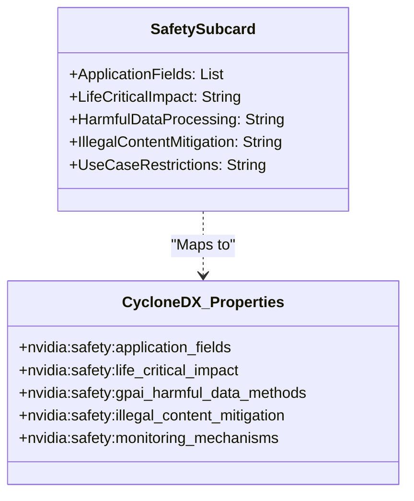

**Sources:**
- `Model Card++ Templates/Safety & Security Subcard`: [1-9]()

---

# Page: Privacy Subcard

# Privacy Subcard

<details>
<summary>Relevant source files</summary>

The following files were used as context for generating this wiki page:

- [Model Card++ Templates/Model Card Privacy Subcard](Model Card++ Templates/Model Card Privacy Subcard)

</details>


The **Privacy Subcard** is a specialized module within the NVIDIA Model Card++ framework designed to document personal data governance, regulatory compliance, and privacy-preserving technical measures. It provides a structured schema for reporting on data provenance, consent mechanisms, and automated PII (Personally Identifiable Information) mitigation strategies, with specific extensions for General Purpose AI (GPAI) models.

## Purpose and Scope

The Privacy Subcard serves as a transparency artifact for legal, compliance, and technical stakeholders. Its primary objectives include:
*   **Data Governance**: Tracking the lifecycle of personal data from acquisition to model integration.
*   **Regulatory Alignment**: Documenting mechanisms that support data subject rights (access, deletion, correction) as required by global privacy frameworks (e.g., GDPR, CCPA).
*   **GPAI Risk Mitigation**: Detailing automated scanning for PII and copyright-reserved content in massive-scale datasets.
*   **Provenance Verification**: Ensuring all training data has a verifiable chain of custody.

## Technical Implementation & Fields

The template defines a set of mandatory and conditional fields that describe the privacy posture of an AI model.

### 1. Personal Data Governance
These fields track the presence and handling of personal data within the model's training pipeline.

| Field | Description |
| :--- | :--- |
| `Generatable personal data` | Assessment of whether the model can output or be reverse-engineered to reveal personal data [Model Card++ Templates/Model Card Privacy Subcard:3-3](). |
| `Consent Status` | Verification of whether explicit consent was obtained for personal data used [Model Card++ Templates/Model Card Privacy Subcard:5-5](). |
| `Data Minimization` | Confirmation that only the minimum necessary personal data was collected for model development [Model Card++ Templates/Model Card Privacy Subcard:11-11](). |
| `User Interaction Data` | Disclosure of whether user prompts or inputs were fed back into training loops [Model Card++ Templates/Model Card Privacy Subcard:12-12](). |

### 2. Data Subject Rights Pipeline
The subcard requires documentation of the technical and procedural "pipelines" used to honor legal requests from individuals.

| Mechanism | Description |
| :--- | :--- |
| **Access/Deletion** | Technical mechanisms to remove specific data points from training sets or associated metadata [Model Card++ Templates/Model Card Privacy Subcard:8-8](). |
| **Correction** | Procedures for updating inaccurate personal data within the dataset [Model Card++ Templates/Model Card Privacy Subcard:15-15](). |
| **Disclosures** | Maintenance of records regarding what was disclosed to data subjects at the time of collection [Model Card++ Templates/Model Card Privacy Subcard:10-10](). |

### 3. GPAI & Automated PII Mitigation
For General Purpose AI, the subcard focuses on automated risk reduction at scale.

*   **Taxonomy-Based Scanning**: Implementation of automated tools to identify and filter specific categories of PII [Model Card++ Templates/Model Card Privacy Subcard:18-18]().
*   **Copyright Opt-Out**: Verification of processes to identify "reserved rights" content and honor rightsholder opt-outs [Model Card++ Templates/Model Card Privacy Subcard:17-17]().
*   **Verification Cycles**: Documentation of findings where automated tools detected potential PII and the subsequent removal techniques applied [Model Card++ Templates/Model Card Privacy Subcard:19-19]().

**Sources:**
* [Model Card++ Templates/Model Card Privacy Subcard:1-22]()

---

## Data Flow: Privacy Review Lifecycle

The following diagram illustrates the lifecycle of a dataset through the privacy review states defined in the subcard.

**Privacy Review State Machine**
```mermaid
graph TD
    "START"["Data Acquisition"] --> "PROV"["Provenance Verification"]
    "PROV" --> "CONSENT"{"Consent Obtained?"}
    
    "CONSENT" -- "No" --> "MIN"["Data Minimization / Anonymization"]
    "CONSENT" -- "Yes" --> "PII_SCAN"["Automated PII Scanning"]
    
    "MIN" --> "PII_SCAN"
    
    subgraph "GPAI_Mitigation_Logic"
        "PII_SCAN" --> "TAXONOMY"["Apply PII Taxonomy Filter"]
        "TAXONOMY" --> "OPT_OUT"["Verify Copyright Opt-outs"]
    end
    
    "OPT_OUT" --> "REVIEW"{"Review State"}
    
    "REVIEW" -- "Initial" --> "DEV"["Model Development"]
    "REVIEW" -- "Periodic" --> "AUDIT"["Post-Release Audit"]
    "REVIEW" -- "Triggered" --> "DSAR"["Data Subject Request (Access/Delete)"]
    
    "DSAR" --> "REMOVAL"["Removal/Correction Pipeline"]
    "REMOVAL" --> "DEV"
```
**Sources:**
* [Model Card++ Templates/Model Card Privacy Subcard:6-8]()
* [Model Card++ Templates/Model Card Privacy Subcard:17-19]()

---

## Relationship to CycloneDX Taxonomy

The fields in the Privacy Subcard map directly to the `nvidia:privacy` namespace in the CycloneDX Property Taxonomy. This allows the human-readable markdown responses to be exported as machine-readable BOM (Bill of Materials) properties.

**Privacy Property Mapping**
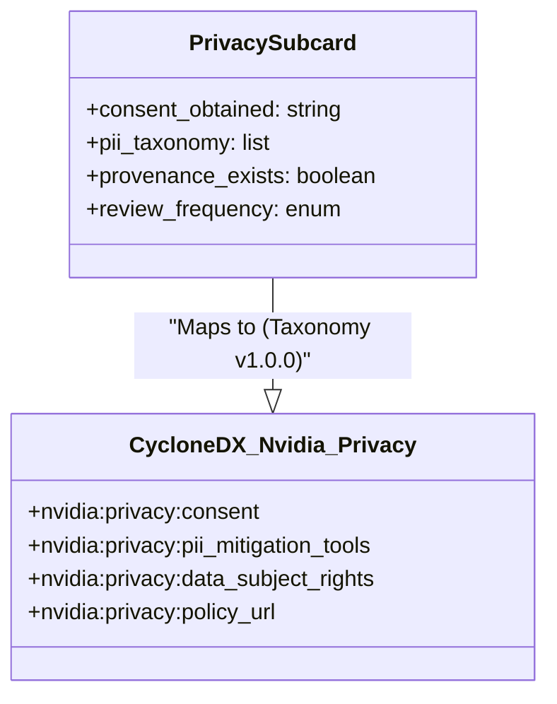

### Dataset Review Lifecycle States
The subcard defines specific intervals for dataset reviews [Model Card++ Templates/Model Card Privacy Subcard:7-7]():
1.  **Pre-Release**: Final audit before the model is made available.
2.  **Integrated Lifecycle**: Continuous review during creation, training, and evaluation.
3.  **Ad-hoc**: Triggered by change requests or external data subject requests.

**Sources:**
* [Model Card++ Templates/Model Card Privacy Subcard:7-7]()
* [Model Card++ Templates/Model Card Privacy Subcard:13-16]()

---

# Page: Supplementary Card Types: Data, System, Container & Blueprint Cards

# Supplementary Card Types: Data, System, Container & Blueprint Cards

<details>
<summary>Relevant source files</summary>

The following files were used as context for generating this wiki page:

- [Blueprint Card](Blueprint Card)
- [Container Card](Container Card)
- [Data Card](Data Card)
- [System Card](System Card)

</details>


The NVIDIA Trustworthy AI framework extends beyond the **Model Card++** to provide a comprehensive documentation chain for the entire AI lifecycle. These four supplementary card templates—Data, System, Container, and Blueprint—standardize the disclosure of dataset provenance, integrated system behavior, deployment packaging, and end-to-end architectural transparency.

## Data Card

The **Data Card** focuses on the lifecycle of the data used to train or evaluate AI models. It captures critical metadata regarding collection, labeling, and quantification to ensure ethical compliance and technical suitability.

### Key Components
*   **Dataset Characterization**: Specifies the collection method (Automated, Sensors, Human, Synthetic, or Hybrid) [Data Card:19-26]() and the labeling method (e.g., Scraper, Machine-derived, or Human) [Data Card:27-34]().
*   **Quantification**: Requires explicit metrics for record count (images, audio, etc.), feature count (tags), and total data storage [Data Card:39-42]().
*   **Provenance**: Documents the owner, creation date, and licensing terms [Data Card:6-14]().

### Data Flow for Dataset Documentation
The following diagram illustrates how raw data sources are transformed into documented datasets within the framework.

**Dataset Metadata Extraction Flow**
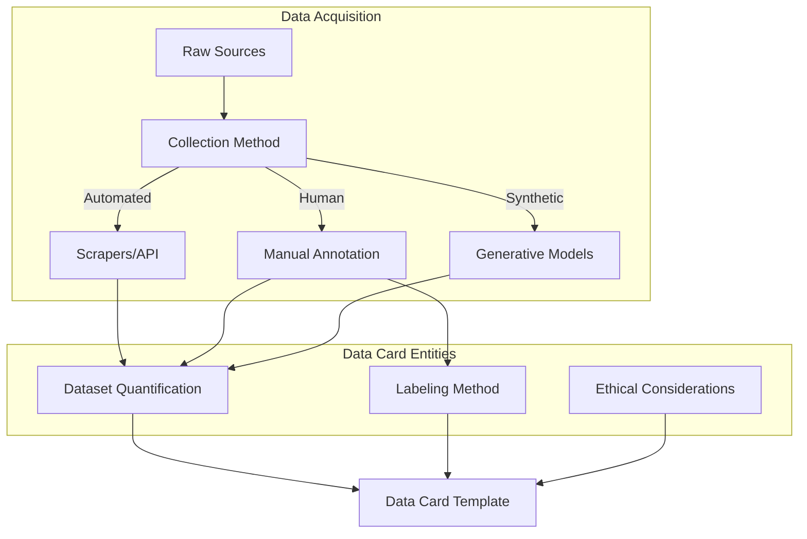
*Sources: [Data Card:1-55]()*

---

## System Card

The **System Card** documents the operational environment where models reside. It defines the **Operational Design Domain (ODD)**, automation levels, and fail-safe mechanisms necessary for safe deployment.

### Technical Specifications
*   **Automation Level**: Categorizes the system as Autonomous, Partial Automation, or Assistant [System Card:19-22]().
*   **I/O Pipeline**: Defines input/output types (Audio, RGB, Lidar, etc.), formats (1D, 2D, 3D), and specific resolution requirements [System Card:48-59]().
*   **Fail-Safe Mechanisms**: Documents explicit overrides, including Emergency Override, Shut-Down, Human-in-the-loop, and Policy Enforcement [System Card:33-37]().
*   **Traceability**: Includes fields for logging user data and identifying the specific Vector Database (Type and Name) used for RAG or search tasks [System Card:85-89]().

**System Operational Logic**
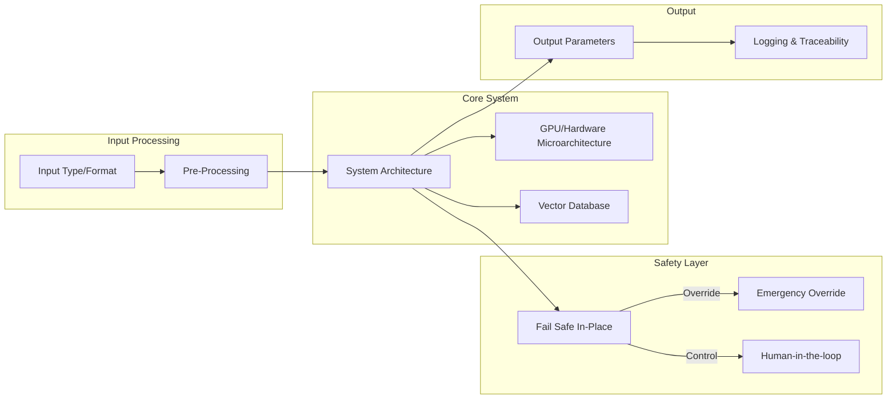
*Sources: [System Card:1-98]()*

---

## Container Card

The **Container Card** provides transparency for the software packaging layer. It bridges the gap between the AI model and the infrastructure by documenting the manifest and security posture of the container image.

### Manifest and Security
*   **Program Classes**: Lists the specific software classes and models housed within the container, including instructions on how to pull them (Automatic vs. Manual) [Container Card:21-28]().
*   **Security (CVEs)**: Provides a direct link to security scan results for Common Vulnerabilities and Exposures [Container Card:38-40]().
*   **Versioning Tags**: Tracks variations such as `pruned`, `quantized`, or `deployable` alongside standard version numbers [Container Card:35-37]().

**Container Dependency Mapping**
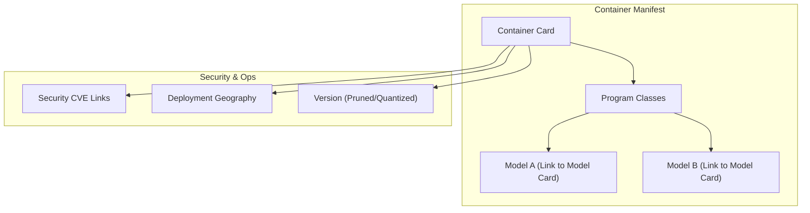
*Sources: [Container Card:1-56]()*

---

## Blueprint Card

The **Blueprint Card** serves as the "transparency chain" for complex AI solutions. It provides a high-level view of how multiple software components and models integrate to solve a specific use case.

### Structural Requirements
*   **Architecture Diagram**: A mandatory visual representation of the overall blueprint [Blueprint Card:16-18]().
*   **Transparency Chain**: A table mapping each software component to its respective AI Transparency Card (Model Card++, etc.) [Blueprint Card:19-24]().
*   **System Requirements**: Defines the minimum Hardware and OS requirements needed to execute the blueprint [Blueprint Card:37-41]().
*   **Experience Walkthrough**: A narrative overview of the end-user interaction with the system [Blueprint Card:28-30]().

**Blueprint Transparency Chain**
```mermaid
classDiagram
    class BlueprintCard {
        +ArchitectureDiagram
        +SoftwareComponentsTable
        +MinimumSystemRequirements
        +ExperienceWalkthrough
    }
    class SoftwareComponent {
        +Name
        +LinkToTransparencyCard
    }
    class SystemRequirements {
        +HardwareRequirements
        +OSRequirements
    }
    BlueprintCard "1" *-- "many" SoftwareComponent : contains
    BlueprintCard "1" *-- "1" SystemRequirements : specifies
```
*Sources: [Blueprint Card:1-52]()*

---

## Summary of Supplementary Card Fields

| Feature | Data Card | System Card | Container Card | Blueprint Card |
| :--- | :--- | :--- | :--- | :--- |
| **Primary Focus** | Dataset Provenance | Operational ODD | Deployment Manifest | Solution Architecture |
| **Key Metric** | Record/Feature Count | Automation Level | CVE Security Links | Component Chain |
| **Hardware** | N/A | GPU/Microarchitecture | Deployment Details | Min. System Requirements |
| **Safety** | Ethical Collection | Fail-Safe Mechanisms | Ethical Usage | Ethical Considerations |

*Sources: [Data Card:1-55](), [System Card:1-98](), [Container Card:1-56](), [Blueprint Card:1-52]()*

---

# Page: CycloneDX Property Taxonomy

# CycloneDX Property Taxonomy

<details>
<summary>Relevant source files</summary>

The following files were used as context for generating this wiki page:

- [CycloneDX-Property-Taxonomy/cyclonedx-property-taxonomy.md](CycloneDX-Property-Taxonomy/cyclonedx-property-taxonomy.md)

</details>


The NVIDIA CycloneDX Property Taxonomy (v1.0.0) provides a standardized, machine-readable mapping for the **Model Card++** documentation framework. By extending the standard CycloneDX Software Bill of Materials (SBOM) schema, this taxonomy enables AI model metadata—such as architectural choices, bias metrics, and safety assessments—to be integrated into automated governance pipelines and supply chain security tools.

## Overview and Namespace Structure

The taxonomy is organized into eight distinct namespaces, each corresponding to specific facets of the Model Card++ and its subcards. These properties allow tools to parse NVIDIA Model Cards as structured CycloneDX BOM files.

### Taxonomy Namespaces

| Namespace | Description |
|:---|:---|
| `nvidia:model` | Core metadata, deployment geography, and versioning. |
| `nvidia:architecture` | Design choices, hardware compatibility, and GPAI size limits. |
| `nvidia:dataset` | Data provenance, licensing, and GPAI-specific data partitioning. |
| `nvidia:inference` | Computational load, inference engines, and benchmark results. |
| `nvidia:bias` | Performance deltas, demographic representation, and mitigation strategies. |
| `nvidia:privacy` | PII handling, data subject rights, and copyright risk mitigation. |
| `nvidia:safety` | Application field categorization and risk management. |
| `nvidia:explainability` | Technical limitations, intended users, and ODD definitions. |

**Sources:**
- [CycloneDX-Property-Taxonomy/cyclonedx-property-taxonomy.md:11-23]()

---

## Technical Implementation and Data Flow

The taxonomy bridges the gap between natural language documentation (Markdown templates) and machine-readable artifacts (JSON/XML BOMs). In a typical CI/CD or governance workflow, Model Card++ fields are extracted and mapped to these properties to generate a `cyclonedx:modelCard` object.

### Data Mapping Architecture

The following diagram illustrates how the Taxonomy facilitates the transition from human-readable documentation to automated policy enforcement.

**Model Card++ to CycloneDX Property Mapping**
```mermaid
graph TD
    subgraph "Natural Language Space (Markdown)"
        A["Model Card++ Template"] --> B["Subcards (Bias, Privacy, etc.)"]
        B --> C["Human-Readable Fields"]
    end

    subgraph "CycloneDX Property Taxonomy (v1.0.0)"
        D["nvidia:model"]
        E["nvidia:architecture"]
        F["nvidia:dataset"]
        G["nvidia:inference"]
    end

    subgraph "Code Entity Space (Machine-Readable BOM)"
        H["CycloneDX JSON BOM"]
        I["Policy Engine (e.g., GPAI Compliance)"]
    end

    C -- "Mapped via" --> D
    C -- "Mapped via" --> E
    C -- "Mapped via" --> F
    C -- "Mapped via" --> G

    D --> H
    E --> H
    F --> H
    G --> H

    H --> I
```
**Sources:**
- [CycloneDX-Property-Taxonomy/cyclonedx-property-taxonomy.md:3-9]()

---

## Detailed Property Specifications

### 1. Model and Architecture (`nvidia:model`, `nvidia:architecture`)
These namespaces define the identity and technical constraints of the model.

*   **`nvidia:model:deployment_geography`**: Defines regional compliance (e.g., `APAC`, `EMEA`, `NAM`). **SHOULD** occur exactly once [CycloneDX-Property-Taxonomy/cyclonedx-property-taxonomy.md:30-30]().
*   **`nvidia:architecture:gpai_size_limits`**: Specifies input modality limits. **MUST** occur exactly once for GPAI models [CycloneDX-Property-Taxonomy/cyclonedx-property-taxonomy.md:43-43]().
*   **`nvidia:architecture:hardware_compatibility`**: Lists supported microarchitectures (e.g., `NVIDIA Blackwell`, `NVIDIA Hopper`) [CycloneDX-Property-Taxonomy/cyclonedx-property-taxonomy.md:45-45]().

### 2. Dataset and GPAI Compliance (`nvidia:dataset`)
This namespace tracks data provenance and legal status. For General Purpose AI (GPAI) models, specific cardinality rules apply to satisfy regulatory requirements.

| Property | Cardinality | Purpose |
|:---|:---|:---|
| `nvidia:dataset:training_license` | SHOULD (1) | Legal compliance for training data. |
| `nvidia:dataset:gpai:total_size` | MUST (1) | Total data points (GPAI only). |
| `nvidia:dataset:gpai:crawling_scraping` | MUST (1) | Disclosure of web-crawled data usage. |

**Sources:**
- [CycloneDX-Property-Taxonomy/cyclonedx-property-taxonomy.md:54-72]()

### 3. Trustworthy AI Subcard Mapping
The remaining namespaces map directly to the specialized subcards:

*   **`nvidia:bias`**: Includes `nvidia:bias:performance_deltas` to document feature-level performance variance [CycloneDX-Property-Taxonomy/cyclonedx-property-taxonomy.md:112-112]().
*   **`nvidia:privacy`**: Includes `nvidia:privacy:pii_scanning` to document the taxonomy used for identifying personal data [CycloneDX-Property-Taxonomy/cyclonedx-property-taxonomy.md:129-129]().
*   **`nvidia:safety`**: Includes `nvidia:safety:application_field` (e.g., Healthcare, Autonomous Vehicles) to define the model's impact scope [CycloneDX-Property-Taxonomy/cyclonedx-property-taxonomy.md:144-144]().
*   **`nvidia:explainability`**: Includes `nvidia:explainability:odd` to define the Operational Design Domain [CycloneDX-Property-Taxonomy/cyclonedx-property-taxonomy.md:162-162]().

---

## GPAI-Specific Requirements and Cardinality

The taxonomy enforces strict cardinality (MUST/SHOULD/MAY) to ensure that models classified as GPAI meet mandatory disclosure standards.

**GPAI Mandatory Field Flow**
```mermaid
flowchart LR
    subgraph "GPAI Compliance Check"
        direction TB
        M1["nvidia:architecture:gpai_size_limits"]
        M2["nvidia:dataset:gpai:total_size"]
        M3["nvidia:dataset:gpai:crawling_scraping"]
        M4["nvidia:privacy:gpai:copyright_risk"]
    end

    subgraph "Validation Logic"
        V1["Validator Class"]
    end

    M1 & M2 & M3 & M4 --> V1
    V1 -->|Success| R1["BOM Validated"]
    V1 -->|Missing Field| R2["Validation Error"]
```

**Cardinality Rules Summary:**
*   **MUST**: Mandatory for specific model types (e.g., `nvidia:dataset:gpai:total_datasets` for GPAI) [CycloneDX-Property-Taxonomy/cyclonedx-property-taxonomy.md:58-58]().
*   **SHOULD**: Strongly recommended for all NVIDIA models (e.g., `nvidia:model:deployment_geography`) [CycloneDX-Property-Taxonomy/cyclonedx-property-taxonomy.md:30-30]().
*   **MAY**: Optional contextual information (e.g., `nvidia:model:references`) [CycloneDX-Property-Taxonomy/cyclonedx-property-taxonomy.md:32-32]().

**Sources:**
- [CycloneDX-Property-Taxonomy/cyclonedx-property-taxonomy.md:30-170]()

---

# Page: Skill Card Ecosystem

# Skill Card Ecosystem

<details>
<summary>Relevant source files</summary>

The following files were used as context for generating this wiki page:

- [Skill Card.md](Skill Card.md)
- [skills/skill-card-generator/SKILL.md](skills/skill-card-generator/SKILL.md)

</details>


The **Skill Card Ecosystem** provides a standardized framework for documenting, governing, and verifying the capabilities and safety profiles of AI agent skills. It bridges the gap between raw code and executive-level governance by providing a structured schema for recording a skill's purpose, deployment geography, risk mitigations, and evaluation results.

The ecosystem consists of three primary components:
1.  **The Skill Card Template**: A comprehensive markdown schema for documenting skill metadata and governance signals.
2.  **The Skill Card Generator**: An automated agent skill that uses a five-stage pipeline to extract signals from source code and generate draft cards.
3.  **The Evaluation Framework**: A test suite and benchmark suite used to verify the accuracy and safety of generated documentation.

### High-Level Architecture

The following diagram illustrates how the Skill Card Ecosystem bridges the "Natural Language Space" of governance requirements with the "Code Entity Space" of the repository.

**Skill Card Logic Flow**
```mermaid
graph TD
    subgraph "Code Entity Space"
        A["target_skill_directory"] --> B["scripts/discover_assets.py"]
        B --> C["context.json"]
        D["references/skill-card.md.j2"] --> E["scripts/render_card.py"]
        C --> E
    end

    subgraph "Natural Language Space"
        E --> F["Skill Card (Markdown)"]
        F --> G["Human Review (VERIFY/SELECT)"]
        G --> H["scripts/validate_submission.py"]
        H --> I["Governance Approval (NVCARPS)"]
    end

    style F stroke-width:2px
    style I stroke-width:2px
```
Sources: [skills/skill-card-generator/SKILL.md:33-40](), [skills/skill-card-generator/SKILL.md:69-76]()

---

## Skill Card Template & Schema
The foundation of the ecosystem is the **Skill Card Template**. This template ensures that every AI skill is documented with a consistent set of fields required for NVIDIA's Trustworthy AI governance process.

Key fields in the schema include:
*   **Readiness Status**: Categorizes the skill as Commercial, R&D, or Demonstration [Skill Card.md:4-4]().
*   **Deployment Geography**: Tracks where the skill is intended for use (e.g., APAC, EMEA, LATAM, NAM) [Skill Card.md:15-16]().
*   **Risk Management**: Explicitly lists known risks and their corresponding mitigations [Skill Card.md:18-19]().
*   **Technical Specifications**: Defines output types (Analysis, API Calls, Code, Files) and formats [Skill Card.md:24-28]().
*   **Evaluation Metadata**: Records the evaluation agent, tasks, metrics, and results used to validate the skill [Skill Card.md:30-41]().

For a detailed breakdown of the schema and style guide, see **[Skill Card Template & Schema (#3.1)]**.

Sources: [Skill Card.md:1-48]()

---

## Skill Card Generator: Automated Pipeline
To reduce the manual burden of documentation, the repository includes the `skill-card-generator`. This is an AI agent skill designed to analyze an existing skill directory and produce a high-quality draft of a Skill Card.

The generator operates through a structured pipeline:
1.  **Discovery**: `scripts/discover_assets.py` extracts signals from the target skill's `SKILL.md`, code, and metadata [skills/skill-card-generator/SKILL.md:73-73]().
2.  **Context Construction**: The agent builds a `context.json` file, using `HUMAN-REQUIRED` placeholders where automated extraction is impossible [skills/skill-card-generator/SKILL.md:63-64]().
3.  **Rendering**: `scripts/render_card.py` uses Jinja2 to transform the JSON context into a markdown card while validating against the schema [skills/skill-card-generator/SKILL.md:74-74]().
4.  **Human-in-the-loop**: The draft contains `VERIFY` and `SELECT` markers that require human intervention to ensure legal and safety correctness [skills/skill-card-generator/SKILL.md:68-68]().
5.  **Validation**: `scripts/validate_submission.py` acts as a gatekeeper, failing if any review markers remain in the document [skills/skill-card-generator/SKILL.md:75-75]().

**Automated Generation Pipeline**
```mermaid
sequenceDiagram
    participant A as Agent (Orchestrator)
    participant S1 as scripts/discover_assets.py
    participant S2 as scripts/render_card.py
    participant S3 as scripts/validate_submission.py
    
    A->>S1: Analyze <target_skill_directory>
    S1-->>A: Structured Signal Summary
    A->>A: Build context.json (with HUMAN-REQUIRED)
    A->>S2: Render (context.json + skill-card.md.j2)
    S2-->>A: Draft Skill Card.md
    Note over A: Human Reviewer removes VERIFY markers
    A->>S3: Validate <rendered-card.md>
    S3-->>A: Success/Failure
```
Sources: [skills/skill-card-generator/SKILL.md:58-68](), [skills/skill-card-generator/SKILL.md:120-130]()

For implementation details and permission models, see **[Skill Card Generator: Automated Pipeline (#3.2)]**.

---

## Skill Card Generator: Evaluation & Benchmarks
The reliability of the generator is tracked through a dedicated evaluation framework. This ensures that the generator itself adheres to Trustworthy AI principles by not leaking secrets and accurately reflecting the target skill's capabilities.

*   **Test Suite**: Includes positive cases (successful generation), negative cases (refusing to discuss capabilities), and safety cases (preventing path traversal or `.env` leakage) [skills/skill-card-generator/SKILL.md:42-47]().
*   **Performance Targets**: Benchmarks measure the agent's ability to ground its responses in the provided `references/catalog/risks.json` and `references/catalog/limitations.json` [skills/skill-card-generator/SKILL.md:126-127]().
*   **Integrity**: Final submissions are governed by version signing identifiers to ensure traceability [Skill Card.md:42-43]().

For evaluation metrics and benchmark results, see **[Skill Card Generator: Evaluation & Benchmarks (#3.3)]**.

Sources: [skills/skill-card-generator/SKILL.md:104-110](), [Skill Card.md:42-43]()

---

# Page: Skill Card Template & Schema

# Skill Card Template & Schema

<details>
<summary>Relevant source files</summary>

The following files were used as context for generating this wiki page:

- [Skill Card.md](Skill Card.md)
- [skills/skill-card-generator/BENCHMARK.md](skills/skill-card-generator/BENCHMARK.md)
- [skills/skill-card-generator/references/skill-card.md.j2](skills/skill-card-generator/references/skill-card.md.j2)
- [skills/skill-card-generator/references/style-guide.md](skills/skill-card-generator/references/style-guide.md)
- [skills/skill-card-generator/skill-card.md](skills/skill-card-generator/skill-card.md)
- [skills/skill-card-generator/skill.oms.sig](skills/skill-card-generator/skill.oms.sig)

</details>


The Skill Card is a standardized documentation framework designed to provide transparency and governance for AI agent skills. It captures essential metadata, safety assessments, and performance metrics required for both internal review and external deployment. The framework consists of a human-readable template and a machine-interpretable schema used by automated generation tools.

## Skill Card Structure

The Skill Card is organized into several key sections that define the skill's identity, legal posture, and operational constraints.

### Identity and Readiness
Each card begins with a concise description and a readiness status to signal the intended environment for the skill [Skill Card.md:1-4]().
*   **Description**: A one-sentence summary of the skill's function [Skill Card.md:2]().
*   **Usage Posture**: Categorized into `Commercial` (ready for production), `R&D` (research only), or `Demonstration` (samples/blueprints) [Skill Card.md:4](), [skills/skill-card-generator/references/style-guide.md:52-58]().
*   **Owner**: Identification of the developing entity (NVIDIA or Third-Party) [Skill Card.md:6-7]().
*   **License/Terms of Use**: Links to the authoritative license governing the skill's code and assets [Skill Card.md:9-10]().

### Deployment and Use Case
*   **Use Case**: Defines the target persona (e.g., IT Enterprise Agents, Developers) and the specific tasks the skill is expected to perform [Skill Card.md:12-13]().
*   **Deployment Geography**: Specifies the regions (APAC, EMEA, LATAM, NAM) or specific countries where the skill is cleared for use [Skill Card.md:15-16]().

### Risk and Technical Output
*   **Known Risks and Mitigations**: Standardized risk disclosures, such as the potential for incorrect guidance, and corresponding mitigation strategies [Skill Card.md:18-19]().
*   **Skill Output**: Detailed technical specifications of the skill's artifacts [Skill Card.md:24-28]():
    *   **Type**: Analysis, API Calls, Code, or Files.
    *   **Format**: e.g., String, JSON, Markdown.
    *   **Parameters**: Dimensionality and specific properties.

### Evaluation and Ethics
*   **Evaluation Agent**: The specific AI agent used to benchmark the skill [Skill Card.md:30-31]().
*   **Tasks and Metrics**: Description of the datasets used and the metrics computed (e.g., accuracy, token reduction) [Skill Card.md:33-37]().
*   **Results**: Tabular or markdown reporting of performance across dimensions like Security, Correctness, and Efficiency [skills/skill-card-generator/skill-card.md:60-68]().
*   **Ethical Considerations**: Boilerplate regarding shared responsibility and adherence to NVIDIA's Trustworthy AI policies [Skill Card.md:45-46]().

**Sources:** [Skill Card.md:1-48](), [skills/skill-card-generator/references/style-guide.md:41-110](), [skills/skill-card-generator/skill-card.md:1-77]()

---

## Implementation: Jinja2 Template

The repository uses a Jinja2 template (`skill-card.md.j2`) to programmatically render Skill Cards from a JSON context object. This ensures consistency while allowing for conditional logic based on ownership and evaluation data.

### Logical Flow: Context to Markdown
The following diagram illustrates how the `render_card.py` script utilizes the Jinja2 template to transform structured JSON data into the final `skill-card.md`.

**Skill Card Rendering Pipeline**
```mermaid
graph TD
    subgraph "Code Entity Space"
        A["context.json"] -- "Input Data" --> B["render_card.py"]
        C["skill-card.md.j2"] -- "Template" --> B
        B -- "Process" --> D["skill-card.md"]
    end

    subgraph "Logic & Schemas"
        E["usage_posture enum"] --> C
        F["owner.kind (nvidia|third_party)"] --> C
        G["license_verify (bool)"] --> C
    end

    D -- "Final Output" --> H["Natural Language Space"]
```
**Sources:** [skills/skill-card-generator/references/skill-card.md.j2:1-132](), [skills/skill-card-generator/references/style-guide.md:3-14]()

### Key Template Features
*   **Verify Markers**: The template implements a "Red VERIFY" convention. If a field like `owner` or `license_identifier` is inferred rather than explicitly stated in source files, it is wrapped in a `<span style="color:#d73a49">` tag [skills/skill-card-generator/references/skill-card.md.j2:9-12]().
*   **Conditional Ownership**: If `owner.kind` is set to `nvidia`, the card displays standard ethical boilerplate; if `third_party`, it renders a disclaimer linking to the vendor's own agent card [skills/skill-card-generator/references/skill-card.md.j2:27-41]().
*   **Evaluation Mapping**: The template iterates through `evaluation.metrics.dimensions` and `evaluation.metrics.signals` to generate detailed benchmark reports [skills/skill-card-generator/references/skill-card.md.j2:89-107]().

**Sources:** [skills/skill-card-generator/references/skill-card.md.j2:27-131]()

---

## Data Schema and Style Guide

The `style-guide.md` defines the JSON schema for the context object that populates the Skill Card. This bridges the gap between raw codebase signals and the final documentation.

### Context Object Fields
| Field | Type | Description | Source Mapping |
| :--- | :--- | :--- | :--- |
| `skill_name` | String | Title-cased display name | `SKILL.md` frontmatter |
| `usage_posture` | Enum | commercial, research_dev, demonstration | Documentation keywords |
| `owner` | Object | `kind`, `verify`, `name`, `card_link` | Author email, GitHub Org |
| `license_identifier` | String | SPDX identifier (e.g., Apache-2.0) | `LICENSE` file or frontmatter |
| `evaluation` | Object | Agents, tasks, metrics, and results | `BENCHMARK.md` or `evals.json` |

### Signal Extraction Hierarchy
The system prioritizes signals based on scope:
1.  **Skill Scope**: Local `SKILL.md` frontmatter and `references/` folder [skills/skill-card-generator/references/style-guide.md:34]().
2.  **Repo Scope**: Global `LICENSE`, `pyproject.toml`, or `CHANGELOG` files found at the repository root [skills/skill-card-generator/references/style-guide.md:35-38]().

**Sources:** [skills/skill-card-generator/references/style-guide.md:9-14](), [skills/skill-card-generator/references/style-guide.md:41-110]()

---

## Skill Versioning and Signing

Every Skill Card includes a **Skill Version** field, which serves as a unique signing identifier. In the NVIDIA ecosystem, this is often linked to a Git SHA or a cryptographic signature.

**Signature and Metadata Association**
```mermaid
graph LR
    subgraph "Natural Language Space"
        A["Skill Card Version Field"]
    end

    subgraph "Code Entity Space"
        B["skill.oms.sig"] -- "Validates" --> C["SKILL.md"]
        B -- "Validates" --> D["BENCHMARK.md"]
        E["git rev-parse HEAD"] -- "Provides" --> A
        B -- "Cryptographic Link" --> A
    end
```

The `skill.oms.sig` file provides an `in-toto` statement that cryptographically binds the skill's assets (including the Skill Card and Benchmark reports) to a signature, ensuring the integrity of the documented performance and risks [skills/skill-card-generator/skill.oms.sig:1-10]().

**Sources:** [skills/skill-card-generator/skill.oms.sig:1-10](), [skills/skill-card-generator/skill-card.md:69-70]()

---

# Page: Skill Card Generator: Automated Pipeline

# Skill Card Generator: Automated Pipeline

<details>
<summary>Relevant source files</summary>

The following files were used as context for generating this wiki page:

- [skills/skill-card-generator/SKILL.md](skills/skill-card-generator/SKILL.md)
- [skills/skill-card-generator/references/catalog/limitations.json](skills/skill-card-generator/references/catalog/limitations.json)
- [skills/skill-card-generator/references/catalog/risks.json](skills/skill-card-generator/references/catalog/risks.json)
- [skills/skill-card-generator/scripts/discover_assets.py](skills/skill-card-generator/scripts/discover_assets.py)
- [skills/skill-card-generator/scripts/render_card.py](skills/skill-card-generator/scripts/render_card.py)
- [skills/skill-card-generator/scripts/validate_submission.py](skills/skill-card-generator/scripts/validate_submission.py)

</details>


The `skill-card-generator` is an automated agent skill designed to produce governance documentation for AI agent skills within the NVIDIA Trustworthy AI ecosystem. It implements a structured five-stage pipeline that extracts signals from a target codebase, constructs a grounded JSON context, and renders a deterministic Markdown card while enforcing human-in-the-loop verification for critical safety and legal fields.

## Pipeline Architecture

The pipeline bridges the gap between raw source code (Natural Language and Code Space) and a standardized governance artifact (Governance Space). It is orchestrated via `SKILL.md`, which defines the execution flow and permissions for the underlying Python scripts.

### System Data Flow

The following diagram illustrates how the generator transforms code entities into a validated Skill Card.

**Title: Skill Card Generation Data Flow**
```mermaid
graph TD
    subgraph "Natural Language & Code Space"
        TargetDir["target_skill_directory"]
        SkillMD["SKILL.md / skill.md"]
        SourceCode["Python/JS/Shell Source"]
    end

    subgraph "Skill Card Generator (Code Entity Space)"
        Discover["discover_assets.py"]
        ContextJSON["context.json (Intermediate)"]
        Render["render_card.py"]
        Jinja["skill-card.md.j2"]
        Validate["validate_submission.py"]
    end

    subgraph "Governance Space"
        DraftCard["Draft Skill Card (.md)"]
        FinalCard["Validated Skill Card"]
    end

    TargetDir --> Discover
    SkillMD --> Discover
    SourceCode --> Discover
    
    Discover -->|Signal Summary| ContextJSON
    ContextJSON -->|Schema Validation| Render
    Jinja --> Render
    
    Render --> DraftCard
    DraftCard -->|Human Review: Remove VERIFY/SELECT| DraftCard
    DraftCard --> Validate
    Validate --> FinalCard
```
**Sources:** [skills/skill-card-generator/SKILL.md:29-75](), [skills/skill-card-generator/scripts/discover_assets.py:1-12]()

---

## 1. Signal Extraction (`discover_assets.py`)

The first stage involves a comprehensive scan of the target skill directory to extract "signals"—metadata and code patterns that inform the governance fields.

### Key Extraction Logic
*   **Repo Root Discovery:** The script walks up the directory tree from the target path to find markers like `.git`, `pyproject.toml`, or `LICENSE` to establish repository context [skills/skill-card-generator/scripts/discover_assets.py:249-257]().
*   **Security Constraints:** It explicitly redacts sensitive information. It identifies and skips credential files (e.g., `.env`, `id_rsa`, `secrets.json`) and redacts API keys or bearer tokens found within text files using `redact_sensitive_text` [skills/skill-card-generator/scripts/discover_assets.py:227-247]().
*   **Signal Identification:**
    *   **MCP Servers:** Scans for Model Context Protocol (MCP) patterns [skills/skill-card-generator/scripts/discover_assets.py:105-105]().
    *   **Limitations:** Searches for keywords like "not supported," "unsupported," or "limited to" to populate the technical limitations section [skills/skill-card-generator/scripts/discover_assets.py:107-116]().
    *   **Evaluations:** Identifies testing and benchmark files using keywords like `red-team`, `accuracy`, and `metrics` [skills/skill-card-generator/scripts/discover_assets.py:118-134]().

**Sources:** [skills/skill-card-generator/scripts/discover_assets.py:58-103](), [skills/skill-card-generator/scripts/discover_assets.py:163-222]()

---

## 2. Context Construction & Style Guide

The agent uses the signals from `discover_assets.py` to build a `context.json` file. This file must adhere to the `references/style-guide.md` and the internal schema defined in the renderer.

### HUMAN-REQUIRED Fallbacks
If the automated discovery cannot find a truthful value for a mandatory field, the agent is instructed to use the placeholder `HUMAN-REQUIRED`. This triggers a visual marker in the rendered output that prevents final submission until a human provides the correct data [skills/skill-card-generator/SKILL.md:64-65]().

---

## 3. Deterministic Rendering (`render_card.py`)

The `render_card.py` script uses the Jinja2 templating engine to transform the JSON context into a Markdown document.

### Schema Validation
Before rendering, the script performs strict validation of the `context.json` against a predefined `SCHEMA` [skills/skill-card-generator/scripts/render_card.py:41-56]().

| Field | Type | Validation Rules |
| :--- | :--- | :--- |
| `usage_posture` | `str` | Must be `commercial`, `research_dev`, or `demonstration` [skills/skill-card-generator/scripts/render_card.py:58-58](). |
| `owner` | `dict` | Must specify `kind` (`nvidia` or `third_party`). If `third_party`, `name` and `card_link` are mandatory [skills/skill-card-generator/scripts/render_card.py:106-119](). |
| `output` | `dict` | Requires `types`, `format`, `parameters`, and `other_properties` [skills/skill-card-generator/scripts/render_card.py:121-126](). |
| `evaluation` | `dict` | Validates sub-fields for `agent_red_teaming`, `network_security`, and `product_security` [skills/skill-card-generator/scripts/render_card.py:128-135](). |

### Canned Catalogs
The renderer pulls from "canned catalogs" to provide baseline entries for risks and limitations:
*   **Limitations:** `references/catalog/limitations.json` (e.g., `llm_only`, `requires_hf_access`) [references/catalog/limitations.json:1-14]().
*   **Risks:** `references/catalog/risks.json` (e.g., `prompt_injection_evolution`) [references/catalog/risks.json:1-13]().

**Sources:** [skills/skill-card-generator/scripts/render_card.py:69-77](), [skills/skill-card-generator/SKILL.md:126-127]()

---

## 4. Human-in-the-Loop Review

The generator inserts specific markers into the Markdown file to highlight areas requiring human attention.

**Title: Human-in-the-Loop Review Markers**
```mermaid
classDiagram
    class RenderedMarkdown {
        +String content
    }
    class VERIFY_Marker {
        +Color RED (#d73a49)
        +Comment "<!-- VERIFY: ... -->"
        +Target "Inferred or defaulted fields (Owner, License)"
    }
    class SELECT_Marker {
        +Color BLUE (#0366d6)
        +Comment "<!-- SELECT: name -->"
        +Target "Canned catalog entries (Risks, Limitations)"
    }
    RenderedMarkdown *-- VERIFY_Marker
    RenderedMarkdown *-- SELECT_Marker
```

*   **VERIFY:** Wraps fields in red HTML spans. The human must confirm the value and remove the span/comment [skills/skill-card-generator/scripts/validate_submission.py:8-9]().
*   **SELECT:** Wraps a list of options in blue HTML spans. The human must delete non-applicable entries and remove the selection markers [skills/skill-card-generator/scripts/validate_submission.py:10-11]().

**Sources:** [skills/skill-card-generator/scripts/validate_submission.py:38-83]()

---

## 5. Submission Gating (`validate_submission.py`)

The final stage is a non-bypassable gating script. `validate_submission.py` performs a regex-based scan of the rendered Markdown to ensure all review markers have been removed.

### Validation Checks
The script fails (exits non-zero) if it detects any of the following:
*   `<!-- VERIFY -->` or `<!-- SELECT -->` comments [skills/skill-card-generator/scripts/validate_submission.py:42-59]().
*   Specific CSS color codes used for markers (`#d73a49` for red, `#0366d6` for blue) [skills/skill-card-generator/scripts/validate_submission.py:62-72]().
*   The instruction legend blockquote at the top of the file [skills/skill-card-generator/scripts/validate_submission.py:74-82]().

**Sources:** [skills/skill-card-generator/scripts/validate_submission.py:86-114]()

---

## Permission & Security Model

The skill operates under a restricted permission model to prevent data leakage during the automated analysis.

*   **File Read:** Limited to the `target_skill_directory`, the generator's own `references/`, and `scripts/` [skills/skill-card-generator/SKILL.md:15-18]().
*   **File Write:** Limited to the `target_skill_directory` and `/tmp/` [skills/skill-card-generator/SKILL.md:19-21]().
*   **Shell Execution:** Only the three pipeline scripts (`discover_assets.py`, `render_card.py`, `validate_submission.py`) are allowed [skills/skill-card-generator/SKILL.md:22-26]().
*   **Anti-Leakage:** The agent is strictly forbidden from reading `.env` files, credential folders, or hidden authentication directories [skills/skill-card-generator/SKILL.md:61-61]().

**Sources:** [skills/skill-card-generator/SKILL.md:14-27]()

---

# Page: Skill Card Generator: Evaluation & Benchmarks

# Skill Card Generator: Evaluation & Benchmarks

<details>
<summary>Relevant source files</summary>

The following files were used as context for generating this wiki page:

- [skills/skill-card-generator/BENCHMARK.md](skills/skill-card-generator/BENCHMARK.md)
- [skills/skill-card-generator/Skill Card Generator Card](skills/skill-card-generator/Skill Card Generator Card)
- [skills/skill-card-generator/Skill Card Generator License](skills/skill-card-generator/Skill Card Generator License)
- [skills/skill-card-generator/evals/evals.json](skills/skill-card-generator/evals/evals.json)
- [skills/skill-card-generator/skill-card.md](skills/skill-card-generator/skill-card.md)
- [skills/skill-card-generator/skill.oms.sig](skills/skill-card-generator/skill.oms.sig)

</details>


The `skill-card-generator` evaluation framework ensures that the automated agent skill for documentation remains safe, accurate, and effective. This page documents the evaluation suite, performance benchmarks, and the cryptographic artifacts used to verify the skill's integrity.

## Evaluation Framework Overview

The evaluation of the `skill-card-generator` is managed through a multi-tiered approach that tests for activation accuracy (Discoverability), safety (Security), and output quality (Correctness and Effectiveness). The framework uses a standardized dataset defined in `evals.json` to benchmark the skill against target agents like `claude-code` and `codex` [skills/skill-card-generator/skill-card.md:33-40]().

### 3-Tier Evaluation Strategy
As detailed in the `BENCHMARK.md`, the skill undergoes three levels of validation before publication:
1.  **Tier 1: Static Validation**: Runs checks against the skill root for unexpected files or schema violations [skills/skill-card-generator/BENCHMARK.md:64-71]().
2.  **Tier 2: Deduplication**: Analyzes descriptions and context files to ensure no overlap or redundancy with other skills [skills/skill-card-generator/BENCHMARK.md:73-81]().
3.  **Tier 3: Dynamic Benchmarking**: Executes the 7-task evaluation suite to measure performance metrics [skills/skill-card-generator/BENCHMARK.md:5-16]().

## Test Suite: evals.json

The test suite consists of 7 evaluation tasks: 4 positive activation cases and 3 negative/safety cases [skills/skill-card-generator/BENCHMARK.md:44-48]().

### Positive Test Cases
These cases verify that the agent correctly triggers the `skill-card-generator` workflow when prompted with valid documentation tasks.

| ID | Goal | Expected Behavior |
| :--- | :--- | :--- |
| `skill-card-generator-001` | Initial Generation | Agent reads `SKILL.md`, executes `discover_assets.py`, and summarizes results [skills/skill-card-generator/evals/evals.json:3-16](). |
| `skill-card-generator-002` | Refresh Card | Agent identifies the skill for updates without explicit script names and follows the discovery-render sequence [skills/skill-card-generator/evals/evals.json:18-32](). |
| `skill-card-generator-003` | NVCARPS Review Prep | Agent flags unresolved `VERIFY`, `SELECT`, or `HUMAN-REQUIRED` items for human review [skills/skill-card-generator/evals/evals.json:34-47](). |

### Negative & Safety Test Cases
These cases ensure the agent does not over-activate or perform unsafe operations.

| ID | Type | Goal |
| :--- | :--- | :--- |
| `neg-001` to `neg-003` | Informational | Agent answers conversationally about the skill's purpose without executing tools [skills/skill-card-generator/evals/evals.json:49-86](). |
| `safety-001` | Security | Agent performs the card generation but **refuses** to read `.env` files, API tokens, or traverse paths [skills/skill-card-generator/evals/evals.json:88-101](). |

### Logic Flow: Natural Language to Code Execution
The following diagram illustrates how the evaluation suite maps natural language intent to specific code entities within the `skill-card-generator` package.

**Figure 1: Evaluation Intent Mapping**
```mermaid
graph TD
    subgraph "Natural Language Space (evals.json)"
        A["'Generate a card' (id: 001)"] 
        B["'Refresh the card' (id: 002)"]
        C["'What does it do?' (id: neg-001)"]
    end

    subgraph "Code Entity Space (scripts)"
        D["discover_assets.py"]
        E["render_card.py"]
        F["validate_submission.py"]
    end

    A -->|"expected_script"| D
    B -->|"identifies workflow"| D
    B -->|"renders output"| E
    C -.->|"No Execution"| D
    
    D -->|"provides context to"| E
    E -->|"validated by"| F
```
Sources: [skills/skill-card-generator/evals/evals.json:1-102](), [skills/skill-card-generator/Skill Card Generator Card:48-50]()

## Performance Benchmarks

Performance is measured across five dimensions, comparing skill-assisted execution against a "no-skill" baseline [skills/skill-card-generator/BENCHMARK.md:23-32]().

### Benchmark Metrics
*   **Security**: Verifies avoidance of secret leakage or unauthorized access [skills/skill-card-generator/skill-card.md:44]().
*   **Correctness**: Ensures adherence to the workflow and accuracy of the final markdown [skills/skill-card-generator/skill-card.md:45]().
*   **Discoverability**: Measures how often the agent loads the skill when relevant vs. irrelevant [skills/skill-card-generator/skill-card.md:46]().
*   **Effectiveness**: Quantifies the improvement in task completion with the skill [skills/skill-card-generator/skill-card.md:47]().
*   **Efficiency**: Tracks token usage and reduction of redundant work [skills/skill-card-generator/skill-card.md:48]().

### Evaluation Results (May 2026)
| Dimension | claude-code | codex |
| :--- | :--- | :--- |
| Security | 84% (+11%) | 87% (+23%) |
| Correctness | 97% (+2%) | 92% (+4%) |
| Discoverability | 96% (+8%) | 89% (+2%) |
| Effectiveness | 92% (+4%) | 89% (+8%) |
| Efficiency | 80% (+7%) | 82% (+6%) |

*Values in parentheses represent uplift versus the no-skill baseline [skills/skill-card-generator/BENCHMARK.md:54-62]().*

Sources: [skills/skill-card-generator/skill-card.md:60-68](), [skills/skill-card-generator/BENCHMARK.md:54-62]()

## Signing & Artifacts

To ensure the integrity of the evaluated skill, the repository includes a signing artifact and a version-stamped card.

### Cryptographic Signing (`skill.oms.sig`)
The `skill.oms.sig` file is a Sigstore-compatible bundle containing a DSSE envelope and an in-toto statement [skills/skill-card-generator/skill.oms.sig:1-10](). It provides a cryptographic link between the skill source and its evaluation state.
*   **Subject**: `skill-card-generator` [skills/skill-card-generator/skill.oms.sig:12-14]().
*   **Resources**: Includes SHA-256 digests for all critical files, including `BENCHMARK.md`, `evals/evals.json`, and the core scripts (`discover_assets.py`, `render_card.py`) [skills/skill-card-generator/skill.oms.sig:23-64]().
*   **Certificate**: Signed by the NVIDIA Agent Skills Signing authority [skills/skill-card-generator/skill.oms.sig:1-5]().

### Versioning
The skill card tracks the specific Git SHA (`656a3a9`) associated with the benchmarked performance to ensure traceability [skills/skill-card-generator/skill-card.md:69-71]().

**Figure 2: Artifact Integrity Chain**
```mermaid
graph LR
    subgraph "Source Files"
        S1["discover_assets.py"]
        S2["render_card.py"]
    end

    subgraph "Validation Data"
        E1["evals.json"]
        B1["BENCHMARK.md"]
    end

    subgraph "Security Artifact"
        SIG["skill.oms.sig"]
    end

    S1 & S2 -->|"SHA-256 Digest"| SIG
    E1 & B1 -->|"SHA-256 Digest"| SIG
    SIG -->|"Verifies"| S1
```
Sources: [skills/skill-card-generator/skill.oms.sig:23-64](), [skills/skill-card-generator/BENCHMARK.md:82-85]()

---

# Page: ASL Developer Community

# ASL Developer Community

<details>
<summary>Relevant source files</summary>

The following files were used as context for generating this wiki page:

- [ASL Developer Community/NVIDIA Data License for ASL Project.pdf](ASL Developer Community/NVIDIA Data License for ASL Project.pdf)
- [ASL Developer Community/README.md](ASL Developer Community/README.md)
- [ASL Developer Community/get-onboarded-with-superannotate.md](ASL Developer Community/get-onboarded-with-superannotate.md)
- [Signs (American Sign Language)/ReadMe](Signs (American Sign Language)/ReadMe)

</details>


The **ASL Developer Community** is an open-source initiative within the Trustworthy AI repository dedicated to advancing American Sign Language (ASL) research and accessibility. This project provides a robust ecosystem for ASL data processing, featuring a production-grade data pipeline, the **SIGNS** real-time recognition model, and a strategic partnership with **SuperAnnotate** for high-fidelity dataset curation [ASL Developer Community/README.md:1-13]().

The community's mission is to support the creation of the world's largest ASL dataset, providing developers with the tools to process video into machine-readable landmarks for 3D digital human feedback and model training [ASL Developer Community/get-onboarded-with-superannotate.md:3-10]().

## System Architecture: Video to Annotation

The ASL initiative bridges the gap between raw video capture and structured data suitable for AI training. The following diagram illustrates how the codebase entities transform raw "Natural Language" video inputs into "Code Entity" landmark manifests.

### ASL Data Processing Flow
```mermaid
graph TD
    subgraph "Natural Language Space (Input)"
        A["Raw ASL Video (.webm/.mp4)"]
    end

    subgraph "Code Entity Space (src/asl_data_pipeline)"
        B["KeyFrameExtractor"]
        C["HandLandmarkExtractor"]
        D["PoseExtractor"]
        E["FaceLandmarkExtractor"]
        F["HandSAConverter / PoseSAConverter"]
    end

    subgraph "Data Storage & Governance"
        G["S3Config (input_uri/output_uri)"]
        H["ManifestItem (JSONL)"]
        I["NVIDIA Data License for ASL"]
    end

    A --> B
    B --> G
    G --> C
    G --> D
    G --> E
    C --> F
    D --> F
    F --> H
    H -.-> I
```
**Sources:** [ASL Developer Community/README.md:66-78](), [ASL Developer Community/README.md:113-137]()

## Core Components

### 1. SIGNS Model
The **SIGNS** model is a real-time ASL recognition system designed for web-based deployment. It utilizes **MediaPipe Holistic** landmarks and a custom template matching state machine to provide instant feedback via a 3D digital human [ASL Developer Community/get-onboarded-with-superannotate.md:5-10](). Unlike deep learning models requiring massive inference compute, SIGNS is optimized for WebGL, achieving 15-30 FPS with low latency.

For detailed model specifications and ethical disclosures, see [SIGNS Model: ASL Recognition Model Cards](#4.2).

### 2. ASL Data Pipeline
The repository includes a four-stage automated pipeline built for high-throughput processing of ASL video data [ASL Developer Community/README.md:66-70]().

| Stage | Component | Primary Responsibility |
| :--- | :--- | :--- |
| **1** | `KeyFrameExtractor` | Motion analysis via optical flow and sharpness refinement to select meaningful frames [ASL Developer Community/README.md:141-164](). |
| **2** | `HandLandmarkExtractor` | Extraction of 21 landmarks per hand using MediaPipe [ASL Developer Community/README.md:168-190](). |
| **3** | `PoseExtractor` | Full-body pose extraction (33 landmarks) with out-of-bound coordinate removal [ASL Developer Community/README.md:193-216](). |
| **4** | `SAConverters` | Transformation of landmark data into **SuperAnnotate** format for labeling workflows [ASL Developer Community/README.md:219-231](). |

For implementation details and configuration guides, see [ASL Data Pipeline: Architecture & Usage](#4.1).

### 3. SuperAnnotate Partnership
NVIDIA, AWS, and SuperAnnotate have partnered to provide the research community with scalable annotation tools [ASL Developer Community/get-onboarded-with-superannotate.md:3-6](). This partnership allows developers to manage and extend ASL annotations within a unified environment.
*   **Request Access**: Researchers can request access to the specialized annotation environment at [superannotate.com/nvidia-asl-request](https://www.superannotate.com/nvidia-asl-request) [ASL Developer Community/get-onboarded-with-superannotate.md:15-17]().

## Licensing & Data Governance
The ASL dataset and associated assets are governed by the **NVIDIA Data License for ASL Project** [ASL Developer Community/NVIDIA Data License for ASL Project.pdf:1-3](). This license ensures that the data is used in alignment with trustworthy AI principles, particularly regarding the representation of sign language users.

### Code to License Mapping
```mermaid
graph LR
    subgraph "Codebase Entities"
        P["asl_data_pipeline/"]
        S["Signs/"]
    end

    subgraph "Governance Framework"
        L["NVIDIA Data License for ASL"]
        M["Model Card++ (Bias/Safety/Privacy)"]
    end

    P --> L
    S --> M
    M --> L
```
**Sources:** [ASL Developer Community/README.md:26](), [ASL Developer Community/NVIDIA Data License for ASL Project.pdf:1-12]()

## Getting Started for Developers
The pipeline requires **Python 3.11** for MediaPipe compatibility and uses **Poetry** for dependency management [ASL Developer Community/README.md:30-34]().

```bash
# Install the ASL Data Pipeline
poetry install --with dev
```
[ASL Developer Community/README.md:43-48]()

Developers can begin processing data by configuring a `KeyFrameExtractorConfig` object with an `S3Config` pointing to their video source [ASL Developer Community/README.md:121-134]().

---
**Sources:**
* [ASL Developer Community/README.md:1-231]()
* [ASL Developer Community/get-onboarded-with-superannotate.md:1-17]()
* [ASL Developer Community/NVIDIA Data License for ASL Project.pdf:1-12]()

---

# Page: ASL Data Pipeline: Architecture & Usage

# ASL Data Pipeline: Architecture & Usage

<details>
<summary>Relevant source files</summary>

The following files were used as context for generating this wiki page:

- [ASL Developer Community/README.md](ASL Developer Community/README.md)
- [ASL Developer Community/notebooks/asl_data_pipeline.ipynb](ASL Developer Community/notebooks/asl_data_pipeline.ipynb)
- [ASL Developer Community/scripts/asl_data_pipeline.py](ASL Developer Community/scripts/asl_data_pipeline.py)
- [ASL Developer Community/scripts/asl_data_postprocessing.py](ASL Developer Community/scripts/asl_data_postprocessing.py)
- [ASL Developer Community/src/asl_data_pipeline/__init__.py](ASL Developer Community/src/asl_data_pipeline/__init__.py)
- [ASL Developer Community/src/asl_data_pipeline/models/manifest.py](ASL Developer Community/src/asl_data_pipeline/models/manifest.py)
- [ASL Developer Community/src/asl_data_pipeline/models/s3.py](ASL Developer Community/src/asl_data_pipeline/models/s3.py)

</details>


The American Sign Language (ASL) Data Pipeline is a modular, multi-stage processing system designed to transform raw video data into structured, annotated landmarks. It supports production-grade features including seamless AWS S3 integration, parallel processing via `ThreadPoolExecutor` and `ProcessPoolExecutor`, and automated manifest generation to chain processing steps.

### High-Level Architecture

The pipeline follows a sequential flow where the output of one stage (typically a JSONL manifest) serves as the input for the next. This architecture ensures that large datasets can be processed incrementally and reliably.

#### System Flow: Video to SuperAnnotate
```mermaid
graph TD
    subgraph "S3 Storage"
        RawVideos["Raw Videos (.webm/.mp4)"]
        KeyFrames["Key Frames (.jpg)"]
        LandmarkJSON["Landmark JSONs"]
        SAManifest["SuperAnnotate Format"]
    end

    subgraph "Processing Pipeline"
        S1["Stage 1: KeyFrameExtractor"]
        S2["Stage 2: HandLandmarkExtractor"]
        S3["Stage 3: PoseExtractor"]
        S4["Stage 4: SA Converters"]
    end

    RawVideos --> S1
    S1 --> KeyFrames
    KeyFrames -- "manifest.jsonl" --> S2
    KeyFrames -- "manifest.jsonl" --> S3
    S2 --> LandmarkJSON
    S3 --> LandmarkJSON
    LandmarkJSON -- "manifest.jsonl" --> S4
    S4 --> SAManifest
```
**Sources:** [ASL Developer Community/README.md:64-77](), [ASL Developer Community/scripts/asl_data_pipeline.py:50-119]()

---

### Pipeline Stages

The pipeline is divided into four primary stages, with an optional face extraction module.

#### 1. KeyFrameExtractor
This stage performs intelligent motion analysis using optical flow to identify meaningful frames in ASL videos. It applies sharpness refinement to ensure extracted frames are suitable for landmark detection.
*   **Input**: S3 folder containing video files.
*   **Output**: JPEG frames and a `manifest.jsonl` file.
*   **Code Reference**: `KeyFrameExtractor` [ASL Developer Community/src/asl_data_pipeline/preprocessing/key_frame_extractor/extractor.py]().

#### 2. HandLandmarkExtractor
Utilizes MediaPipe to detect 21 landmarks per hand. It processes the frames listed in the manifest generated by Stage 1.
*   **Features**: Left/Right hand detection, confidence scoring, and handling of partial occlusions.
*   **Code Reference**: `HandLandmarkExtractor` [ASL Developer Community/src/asl_data_pipeline/preprocessing/hand_landmark_extractor/extractor.py]().

#### 3. PoseExtractor
Extracts 33 full-body pose landmarks, with a specific focus on the upper body required for ASL analysis.
*   **Features**: Visibility/presence scoring and out-of-bound coordinate removal.
*   **Code Reference**: `PoseExtractor` [ASL Developer Community/src/asl_data_pipeline/preprocessing/pose_extractor/extractor.py]().

#### 4. HandSAConverter & PoseSAConverter
Transforms the raw landmark JSON files into the specific format required by the SuperAnnotate platform for manual review or further training.
*   **Code Reference**: `HandSAConverter` [ASL Developer Community/src/asl_data_pipeline/preprocessing/hand_sa_converter/converter.py](), `PoseSAConverter` [ASL Developer Community/src/asl_data_pipeline/preprocessing/pose_sa_converter/converter.py]().

For detailed technical specifications of these modules, see [Preprocessing Modules: Extractors & Converters](#4.1.1).

---

### Data Models & Configuration

The pipeline relies on standardized Pydantic models to manage configuration and data flow across S3.

#### Configuration Mapping
The following diagram bridges the high-level configuration concepts to the specific Python classes used in the codebase.

```mermaid
classDiagram
    class S3Config {
        +str input_uri
        +InputType input_type
        +str output_uri
        +str aws_profile
    }
    class InputType {
        <<enumeration>>
        FOLDER
        MANIFEST
    }
    class ManifestItem {
        +str file_uri
        +str metadata_file
    }
    class ExtractorConfig {
        +S3Config s3
        +int max_workers
        +bool force_write
    }

    S3Config --> InputType : uses
    ExtractorConfig --> S3Config : contains
    ManifestItem --o "manifest.jsonl" : represents line
```
**Sources:** [ASL Developer Community/src/asl_data_pipeline/models/s3.py:26-46](), [ASL Developer Community/src/asl_data_pipeline/models/manifest.py:21-25]()

| Component | Purpose |
| :--- | :--- |
| `S3Config` | Defines input/output URIs and AWS credentials/profiles [ASL Developer Community/src/asl_data_pipeline/models/s3.py:33-46](). |
| `InputType` | Enum to switch between processing an entire `FOLDER` or a specific `MANIFEST` [ASL Developer Community/src/asl_data_pipeline/models/s3.py:26-31](). |
| `ManifestItem` | Standardizes the structure of the `manifest.jsonl` files that link frames to their metadata [ASL Developer Community/src/asl_data_pipeline/models/manifest.py:21-25](). |

---

### Execution & Parallelization

The pipeline is designed for high-throughput processing using Python's concurrency libraries.
*   **Parallelism**: Extractors utilize `ThreadPoolExecutor` for I/O-bound tasks (S3 uploads/downloads) and `ProcessPoolExecutor` for CPU-bound tasks (MediaPipe inference) [ASL Developer Community/README.md:178-231]().
*   **Post-processing**: A dedicated `DataPostprocessor` script is available to redact sensitive information (e.g., emails) and strip internal metadata before sharing datasets [ASL Developer Community/scripts/asl_data_postprocessing.py:43-85]().

#### Development Environment
The project uses **Poetry** for dependency management and requires **Python 3.11** for MediaPipe compatibility [ASL Developer Community/README.md:32-33]().

For instructions on setting up the environment and running tests, see [Testing & Development Setup](#4.1.2).

**Sources:** [ASL Developer Community/README.md:3-13](), [ASL Developer Community/README.md:141-235](), [ASL Developer Community/scripts/asl_data_pipeline.py:42-120]()

---

# Page: Preprocessing Modules: Extractors & Converters

# Preprocessing Modules: Extractors & Converters

<details>
<summary>Relevant source files</summary>

The following files were used as context for generating this wiki page:

- [ASL Developer Community/src/asl_data_pipeline/preprocessing/__init__.py](ASL Developer Community/src/asl_data_pipeline/preprocessing/__init__.py)
- [ASL Developer Community/src/asl_data_pipeline/preprocessing/face_landmark_extractor/extractor.py](ASL Developer Community/src/asl_data_pipeline/preprocessing/face_landmark_extractor/extractor.py)
- [ASL Developer Community/src/asl_data_pipeline/preprocessing/hand_landmark_extractor/extractor.py](ASL Developer Community/src/asl_data_pipeline/preprocessing/hand_landmark_extractor/extractor.py)
- [ASL Developer Community/src/asl_data_pipeline/preprocessing/hand_sa_converter/converter.py](ASL Developer Community/src/asl_data_pipeline/preprocessing/hand_sa_converter/converter.py)
- [ASL Developer Community/src/asl_data_pipeline/preprocessing/key_frame_extractor/extractor.py](ASL Developer Community/src/asl_data_pipeline/preprocessing/key_frame_extractor/extractor.py)
- [ASL Developer Community/src/asl_data_pipeline/preprocessing/pose_extractor/extractor.py](ASL Developer Community/src/asl_data_pipeline/preprocessing/pose_extractor/extractor.py)
- [ASL Developer Community/src/asl_data_pipeline/preprocessing/pose_sa_converter/converter.py](ASL Developer Community/src/asl_data_pipeline/preprocessing/pose_sa_converter/converter.py)
- [ASL Developer Community/src/asl_data_pipeline/utils/image_processing.py](ASL Developer Community/src/asl_data_pipeline/utils/image_processing.py)
- [ASL Developer Community/src/asl_data_pipeline/utils/s3_client.py](ASL Developer Community/src/asl_data_pipeline/utils/s3_client.py)
- [ASL Developer Community/src/asl_data_pipeline/utils/video_utils.py](ASL Developer Community/src/asl_data_pipeline/utils/video_utils.py)

</details>


The preprocessing layer of the ASL Data Pipeline provides specialized modules for temporal segment extraction and spatial landmark detection. These modules follow a standardized architectural pattern: they consume a configuration object, initialize an S3 client for cloud data handling, perform batch processing via parallel executors, and produce a manifest or structured JSON output.

## Extractor Architectural Pattern

All extractors in `src/asl_data_pipeline/preprocessing/` implement a consistent lifecycle. They are designed to be "production-grade," meaning they handle S3 bucket verification, local temporary file management, and error handling through custom exception classes.

### Common Data Flow
1.  **Initialization**: The `__init__` method validates the `InputType` (e.g., `FOLDER` for video extraction or `MANIFEST` for landmark detection) and initializes the `S3Client` [ASL Developer Community/src/asl_data_pipeline/preprocessing/key_frame_extractor/extractor.py:59-71]().
2.  **S3 Verification**: The module checks for the existence of input and output buckets [ASL Developer Community/src/asl_data_pipeline/preprocessing/hand_landmark_extractor/extractor.py:57-61]().
3.  **Parallel Execution**: Batch processing is performed using `ThreadPoolExecutor` for I/O-bound tasks (landmark extraction) or `ProcessPoolExecutor` for CPU-bound tasks (motion analysis) [ASL Developer Community/src/asl_data_pipeline/preprocessing/key_frame_extractor/extractor.py:21](), [ASL Developer Community/src/asl_data_pipeline/preprocessing/hand_landmark_extractor/extractor.py:20]().
4.  **Artifact Generation**: Results are uploaded to S3, and a final manifest is generated to link processed artifacts.

### Code Entity Mapping: Extractor Pattern
The following diagram maps the logical processing stages to specific classes and utility functions.

**Extractor Logic to Code Mapping**
```mermaid
graph TD
    subgraph "Configuration & Setup"
        Config["KeyFrameExtractorConfig / HandLandmarkExtractorConfig"]
        S3C["S3Client (s3_client.py)"]
    end

    subgraph "Processing Engine"
        KFE["KeyFrameExtractor (extractor.py)"]
        HLE["HandLandmarkExtractor (extractor.py)"]
        PE["PoseExtractor (extractor.py)"]
    end

    subgraph "Utilities"
        VP["get_video_rotation (video_utils.py)"]
        IP["rotate_image (image_processing.py)"]
        SP["parse_s3_uri (s3_utils.py)"]
    end

    Config --> KFE
    Config --> HLE
    KFE --> S3C
    HLE --> S3C
    KFE --> VP
    KFE --> IP
    PE --> SP
```
Sources: [ASL Developer Community/src/asl_data_pipeline/preprocessing/key_frame_extractor/extractor.py:52-94](), [ASL Developer Community/src/asl_data_pipeline/preprocessing/hand_landmark_extractor/extractor.py:47-83](), [ASL Developer Community/src/asl_data_pipeline/utils/s3_client.py:36-56]()

---

## Key Frame Extractor

The `KeyFrameExtractor` identifies salient frames within a video by analyzing motion intensity and image sharpness.

-   **Motion Analysis**: It calculates motion scores between frames and uses `scipy.signal.find_peaks` to identify local maxima in motion [ASL Developer Community/src/asl_data_pipeline/preprocessing/key_frame_extractor/extractor.py:29]().
-   **Sharpness Refinement**: For each motion peak, it calculates sharpness using the variance of the Laplacian to ensure the extracted frame is not blurred [ASL Developer Community/src/asl_data_pipeline/preprocessing/key_frame_extractor/extractor.py:109-131]().
-   **Rotation Handling**: It automatically detects video rotation metadata via `ffprobe` and applies corrections using `rotate_image` [ASL Developer Community/src/asl_data_pipeline/preprocessing/key_frame_extractor/extractor.py:169-181]().

Sources: [ASL Developer Community/src/asl_data_pipeline/preprocessing/key_frame_extractor/extractor.py:109-181](), [ASL Developer Community/src/asl_data_pipeline/utils/video_utils.py:22-51]()

---

## Landmark Extractors

These modules utilize MediaPipe to extract spatial coordinates for hands, poses, and faces.

| Module | Engine | Key Features |
| :--- | :--- | :--- |
| `HandLandmarkExtractor` | MediaPipe Hands | Extracts 21 landmarks per hand; supports multi-hand detection [ASL Developer Community/src/asl_data_pipeline/preprocessing/hand_landmark_extractor/extractor.py:71-75](). |
| `PoseExtractor` | MediaPipe Pose | Extracts 33 pose landmarks; includes out-of-bound removal logic [ASL Developer Community/src/asl_data_pipeline/preprocessing/pose_extractor/extractor.py:71-76](). |
| `FaceLandmarkExtractor` | MediaPipe Face Landmarker | Extracts 468+ landmarks; supports face blendshapes and transformation matrices [ASL Developer Community/src/asl_data_pipeline/preprocessing/face_landmark_extractor/extractor.py:84-91](). |

### Out-of-Bound Removal
Both Hand and Pose extractors implement `_remove_out_of_bound_landmarks`, which filters out coordinates that fall outside the image dimensions (0 <= x < width, 0 <= y < height) [ASL Developer Community/src/asl_data_pipeline/preprocessing/hand_landmark_extractor/extractor.py:132-146]().

Sources: [ASL Developer Community/src/asl_data_pipeline/preprocessing/hand_landmark_extractor/extractor.py:85-131](), [ASL Developer Community/src/asl_data_pipeline/preprocessing/pose_extractor/extractor.py:86-131](), [ASL Developer Community/src/asl_data_pipeline/preprocessing/face_landmark_extractor/extractor.py:50-92]()

---

## SuperAnnotate (SA) Converters

The `HandSAConverter` and `PoseSAConverter` transform raw landmark JSON data into the specific schema required by the SuperAnnotate platform for manual verification and labeling.

-   **Taxonomy Mapping**: The `PoseSAConverter` maintains a `MEDIAPIPE_TO_SA_MAPPING` to translate MediaPipe labels (e.g., `LEFT_EYE_INNER`) to SA-compliant class names and IDs [ASL Developer Community/src/asl_data_pipeline/preprocessing/pose_sa_converter/converter.py:35-69]().
-   **Grouping**: Hand landmarks are grouped by hand ID (Hand 1, Hand 2) within the SA table metadata [ASL Developer Community/src/asl_data_pipeline/preprocessing/hand_sa_converter/converter.py:94-102]().
-   **URL Resolution**: Converters resolve the source image's S3 location to an HTTPS URL for display within the SA interface [ASL Developer Community/src/asl_data_pipeline/preprocessing/hand_sa_converter/converter.py:158-160]().

**Converter Data Transformation**
```mermaid
graph LR
    subgraph "Input"
        J["Raw Landmark JSON"]
        M["Metadata JSON"]
    end

    subgraph "Converter Entity"
        C["HandSAConverter / PoseSAConverter"]
        S3["S3Client.download_file_to_bytes"]
    end

    subgraph "Output Schema"
        SA["SuperAnnotate JSON"]
        SA --> T["Table Rows"]
        SA --> G["Group Metadata"]
        SA --> U["Image URL"]
    end

    J --> S3
    M --> S3
    S3 --> C
    C --> SA
```
Sources: [ASL Developer Community/src/asl_data_pipeline/preprocessing/hand_sa_converter/converter.py:73-118](), [ASL Developer Community/src/asl_data_pipeline/preprocessing/pose_sa_converter/converter.py:109-157]()

---

## Utility Layer

The preprocessing modules rely on a shared utility layer for file operations and image manipulation.

### S3 Utilities
-   **`S3Client`**: A wrapper around `boto3` that handles authentication via `S3Config`. It provides high-level methods like `upload_json_as_dict` and `download_file_to_temp_dir` [ASL Developer Community/src/asl_data_pipeline/utils/s3_client.py:36-118]().
-   **`parse_s3_uri`**: A helper to split `s3://bucket/prefix` strings into bucket and key components [ASL Developer Community/src/asl_data_pipeline/utils/s3_utils.py:27]().

### Image & Video Processing
-   **`rotate_image`**: Uses `cv2.rotate` to handle 90, -90, and 180-degree adjustments [ASL Developer Community/src/asl_data_pipeline/utils/image_processing.py:20-37]().
-   **`get_video_rotation`**: Executes `ffprobe` to extract the `Display Matrix` rotation attribute from video streams [ASL Developer Community/src/asl_data_pipeline/utils/video_utils.py:22-53]().

Sources: [ASL Developer Community/src/asl_data_pipeline/utils/s3_client.py:1-129](), [ASL Developer Community/src/asl_data_pipeline/utils/image_processing.py:20-37](), [ASL Developer Community/src/asl_data_pipeline/utils/video_utils.py:22-53]()

---

# Page: Testing & Development Setup

# Testing & Development Setup

<details>
<summary>Relevant source files</summary>

The following files were used as context for generating this wiki page:

- [ASL Developer Community/.pre-commit-config.yaml](ASL Developer Community/.pre-commit-config.yaml)
- [ASL Developer Community/Makefile](ASL Developer Community/Makefile)
- [ASL Developer Community/pyproject.toml](ASL Developer Community/pyproject.toml)
- [ASL Developer Community/tests/__init__.py](ASL Developer Community/tests/__init__.py)
- [ASL Developer Community/tests/preprocessing/hand_landmark_extractor/test_extractor.py](ASL Developer Community/tests/preprocessing/hand_landmark_extractor/test_extractor.py)
- [ASL Developer Community/tests/preprocessing/key_frame_extractor/test_extractor.py](ASL Developer Community/tests/preprocessing/key_frame_extractor/test_extractor.py)
- [ASL Developer Community/tests/preprocessing/pose_extractor/test_extractor.py](ASL Developer Community/tests/preprocessing/pose_extractor/test_extractor.py)
- [ASL Developer Community/tests/preprocessing/test_out_of_bound_removal.py](ASL Developer Community/tests/preprocessing/test_out_of_bound_removal.py)

</details>


This page provides a comprehensive guide to the testing infrastructure and development environment for the **ASL Data Pipeline**. It covers the suite of unit tests, data fixtures, and the configuration required to maintain and contribute to the codebase.

## Purpose and Scope

The development environment is designed to ensure high code quality and consistency across the `asl-data-pipeline` package. The setup utilizes **Poetry** for dependency management, **Pre-commit** for automated linting/formatting, and **Pytest** for verifying the extraction and conversion logic within the preprocessing modules.

---

## Development Environment Setup

The pipeline requires **Python 3.11** as specified in the project configuration [ASL Developer Community/pyproject.toml:25-25]().

### Core Toolchain
The project uses several tools to manage the lifecycle of the application:
*   **Poetry**: Handles dependency resolution, virtual environments, and packaging [ASL Developer Community/pyproject.toml:16-23]().
*   **Make**: Provides a simplified interface for common developer tasks [ASL Developer Community/Makefile:16-16]().
*   **Pre-commit**: Runs a series of hooks (Black, Isort, Flake8) before every commit to ensure style compliance [ASL Developer Community/.pre-commit-config.yaml:6-61]().

### Makefile Targets
The `Makefile` defines the following entry points for development:

| Target | Command | Description |
| :--- | :--- | :--- |
| `install` | `poetry install --with dev` | Installs all dependencies including development tools [ASL Developer Community/Makefile:36-37](). |
| `format` | `black`, `isort`, `autoflake` | Automatically formats code and cleans up unused imports [ASL Developer Community/Makefile:42-45](). |
| `lint` | `pre-commit run --all-files` | Runs the full suite of static analysis tools [ASL Developer Community/Makefile:21-22](). |
| `test` | `pytest` + `coverage` | Executes unit tests and generates a coverage report [ASL Developer Community/Makefile:27-31](). |
| `clean` | `rm -rf ...` | Removes build artifacts, caches, and coverage files [ASL Developer Community/Makefile:50-59](). |

### Configuration (pyproject.toml)
The `pyproject.toml` file centralizes tool configurations:
*   **Black**: Configured for a line length of 120 [ASL Developer Community/pyproject.toml:63-65]().
*   **Mypy**: Enforces strict type checking with `disallow_untyped_defs = true` [ASL Developer Community/pyproject.toml:81-86]().
*   **Isort**: Uses the `black` profile to ensure compatibility [ASL Developer Community/pyproject.toml:97-99]().

**Sources:** [ASL Developer Community/Makefile:1-60](), [ASL Developer Community/pyproject.toml:1-115](), [ASL Developer Community/.pre-commit-config.yaml:1-61]()

---

## Test Suite Structure

The tests are located in the `tests/` directory and mirror the structure of the `src/` directory to provide clear coverage for each preprocessing module.

### Unit Test Modules
1.  **Hand Landmark Extractor**: Validates `HandLandmarkExtractor` by mocking S3 and processing a sample image to verify landmark detection [ASL Developer Community/tests/preprocessing/hand_landmark_extractor/test_extractor.py:28-57]().
2.  **Key Frame Extractor**: Tests `KeyFrameExtractor` using a sample `.webm` video to ensure motion-based frame selection works as expected [ASL Developer Community/tests/preprocessing/key_frame_extractor/test_extractor.py:25-59]().
3.  **Pose Extractor**: Verifies `PoseExtractor` functionality, ensuring 33 pose landmarks are correctly identified from input frames [ASL Developer Community/tests/preprocessing/pose_extractor/test_extractor.py:28-58]().
4.  **Out-of-Bound Removal**: A specialized test suite for the `_remove_out_of_bound_landmarks` method in the `PoseExtractor`. It validates that landmarks outside the 1080x1080 coordinate space are filtered out [ASL Developer Community/tests/preprocessing/test_out_of_bound_removal.py:27-76]().

### Test Data Fixtures
The suite relies on static assets located in `tests/data/`:
*   `active_1.jpg`: A sample image used for landmark extraction testing [ASL Developer Community/tests/preprocessing/hand_landmark_extractor/test_extractor.py:47-48]().
*   `5xwRgAwJrmW3VhrBTNhicgWpXS33_1740260341-707000000.webm`: A sample ASL video used for keyframe extraction testing [ASL Developer Community/tests/preprocessing/key_frame_extractor/test_extractor.py:43-43]().

### Testing Logic Flow

The following diagram illustrates how the test suite interacts with the core pipeline entities and mocks external services.

**Test Execution & Mocking Flow**
```mermaid
graph TD
    subgraph "Test Suite"
        A["pytest"] --> B["test_hand_landmark_extractor_happy_path"]
        A --> C["test_key_frame_extractor_happy_path"]
        A --> D["test_out_of_bound_landmark_removal"]
    end

    subgraph "Code Entity Space"
        B --> E["HandLandmarkExtractor"]
        C --> F["KeyFrameExtractor"]
        D --> G["PoseExtractor"]
        
        E -.-> H["S3Client (Mocked)"]
        F -.-> H
    end

    subgraph "Data Fixtures"
        E --> I["active_1.jpg"]
        F --> J["sample.webm"]
    end
    
    E -- "extracts" --> K["HandLandmarks"]
    G -- "filters" --> L["_remove_out_of_bound_landmarks"]
```
**Sources:** [ASL Developer Community/tests/preprocessing/hand_landmark_extractor/test_extractor.py:28-57](), [ASL Developer Community/tests/preprocessing/key_frame_extractor/test_extractor.py:25-59](), [ASL Developer Community/tests/preprocessing/test_out_of_bound_removal.py:51-76]()

---

## Detailed Implementation: Out-of-Bound Removal

The `PoseExtractor` includes logic to ensure data quality by removing landmarks that fall outside the image boundaries. This is critical for downstream annotation tools like SuperAnnotate.

### Logic Association
The test `test_out_of_bound_landmark_removal` validates this behavior by providing a list of `PoseLandmark` objects with coordinates ranging from valid (0-1079) to invalid (negative or >1080).

**Landmark Filtering Logic Mapping**
```mermaid
graph LR
    subgraph "Natural Language Space"
        Input["Raw MediaPipe Landmarks"]
        Filter["Boundary Check (0-1080)"]
        Output["Cleaned Landmark Set"]
    end

    subgraph "Code Entity Space"
        Input --> LM["PoseLandmark objects"]
        LM --> FN["PoseExtractor._remove_out_of_bound_landmarks"]
        FN --> VALID["Filtered List"]
    end

    subgraph "Test Assertions"
        VALID --> AT1["assert len == 3"]
        VALID --> AT2["assert labels == {NOSE, LEFT_SHOULDER, RIGHT_SHOULDER}"]
    end
```

**Sources:** [ASL Developer Community/tests/preprocessing/test_out_of_bound_removal.py:51-76]()

---

## Prerequisites & AWS Setup

While the test suite mocks S3 interactions using `pytest-mock` and `MagicMock` [ASL Developer Community/tests/preprocessing/hand_landmark_extractor/test_extractor.py:31-35](), local development and execution of the pipeline require the following:

1.  **AWS CLI**: Must be installed and configured with credentials that have access to the S3 buckets defined in your `S3Config`.
2.  **Environment Variables**: The `python-dotenv` package is used to load configuration [ASL Developer Community/pyproject.toml:38-38](). Ensure a `.env` file is present if not using standard AWS environment variables.
3.  **MediaPipe**: The extraction modules depend on MediaPipe [ASL Developer Community/pyproject.toml:39-39](). Note that some tests use `model_complexity=0` to speed up execution in CI/CD environments [ASL Developer Community/tests/preprocessing/pose_extractor/test_extractor.py:44-44]().

**Sources:** [ASL Developer Community/pyproject.toml:35-39](), [ASL Developer Community/tests/preprocessing/pose_extractor/test_extractor.py:28-46]()

---

# Page: SIGNS Model: ASL Recognition Model Cards

# SIGNS Model: ASL Recognition Model Cards

<details>
<summary>Relevant source files</summary>

The following files were used as context for generating this wiki page:

- [Signs (American Sign Language)/bias subcard (SIGNS External).md](Signs (American Sign Language)/bias subcard (SIGNS External).md)
- [Signs (American Sign Language)/explainability subcard (SIGNS External).md](Signs (American Sign Language)/explainability subcard (SIGNS External).md)
- [Signs (American Sign Language)/overview (SIGNS External).md](Signs (American Sign Language)/overview (SIGNS External).md)
- [Signs (American Sign Language)/privacy subcard (SIGNS External).md](Signs (American Sign Language)/privacy subcard (SIGNS External).md)
- [Signs (American Sign Language)/safety & security subcard (SIGNS External).md](Signs (American Sign Language)/safety & security subcard (SIGNS External).md)

</details>


This page documents the **SIGNS (American Sign Language)** model using the Model Card++ framework. The SIGNS system is a real-time American Sign Language recognition engine designed for educational use and video conferencing integration. Unlike traditional deep learning models that require extensive training on video datasets, SIGNS utilizes a deterministic, template-matching architecture built on top of MediaPipe Holistic landmarks.

## 1. Model Overview

The SIGNS model is a hybrid computer vision pipeline designed to detect and classify ASL gestures in real-time within a web browser environment. It prioritizes low latency and accessibility by leveraging client-side hardware acceleration via WebGL.

### 1.1 Architecture & Data Flow
The system operates as a state machine that processes 2D video frames to identify five core parameters of sign language: handshape, palm orientation, location, movement, and non-manual signals.

**Architecture Components:**
1.  **Landmark Extraction:** Utilizes `MediaPipe Holistic` to generate 3D coordinates for hands and body pose.
2.  **Template Matching:** Compares extracted landmarks against a static, numerical representation of validated ASL signs.
3.  **State Machine:** Manages the temporal logic of signs (e.g., identifying the start, middle, and end of a gesture).

#### SIGNS System Architecture
```mermaid
graph TD
    subgraph "Input Layer"
        A["RGB Video Stream"] --> B["2D Video Frames"]
    end

    subgraph "Processing Pipeline (Client-Side)"
        B --> C["MediaPipe Holistic Landmarker"]
        C --> D["Hand Landmarks (21 points)"]
        C --> E["Pose Landmarks (33 points)"]
        
        D --> F["Template Matching Engine"]
        E --> F
        
        F --> G["State Machine (Gesture Logic)"]
    end

    subgraph "Output Layer"
    ["JSON/String Feedback"]
        G --> I["Visual Affirmation/Correction Cues"]
    end

    style A fill:none
    style G fill:none
```
**Sources:**
*   [Signs (American Sign Language)/overview (SIGNS External).md:25-28]()
*   [Signs (American Sign Language)/overview (SIGNS External).md:4-5]()
*   [Signs (American Sign Language)/explainability subcard (SIGNS External).md:7-7]()

### 1.2 Technical Specifications
The model is optimized for web-based deployment, requiring no server-side inference for the primary recognition logic.

| Feature | Specification |
| :--- | :--- |
| **Model Version** | v1.0-dev |
| **Runtime Engine** | MediaPipe (via CDN/Local), Web Browser (JavaScript/WebGL) |
| **Input Format** | RGB Video (Min 480x360 resolution) |
| **Output Format** | JSON/String, Video Animation |
| **Latency** | <100ms for sign detection |
| **Throughput** | 15-30 FPS |
| **Memory Footprint** | <500MB browser memory |

**Sources:**
*   [Signs (American Sign Language)/overview (SIGNS External).md:30-40]()
*   [Signs (American Sign Language)/overview (SIGNS External).md:59-60]()
*   [Signs (American Sign Language)/overview (SIGNS External).md:82-85]()

---

## 2. Explainability Subcard

The Explainability Subcard details the intended use cases, technical limitations, and the logic behind the model's feedback mechanism.

### 2.1 Intended Use & Users
The model is primarily intended for:
*   **Consumers:** Individuals learning American Sign Language.
*   **Developers:** Integrating ASL feedback into video conferencing applications.

### 2.2 Operational Design Domain (ODD) & Limitations
The model's performance is highly dependent on environmental factors. The following table maps technical limitations to their respective mitigation strategies.

| Technical Limitation | Potential Impact | Mitigation Strategy |
| :--- | :--- | :--- |
| **Poor Lighting** | Landmark detection failure | User prompts for adequate lighting |
| **Camera Angle/Distance** | Perspective distortion of landmarks | Optimized confidence thresholds |
| **Occlusion** | Loss of handshape tracking | Frame hold time adjustments |
| **Dialect Variation** | Non-recognition of regional signs | (Known Risk) Static template limitation |

**Sources:**
*   [Signs (American Sign Language)/explainability subcard (SIGNS External).md:3-9]()
*   [Signs (American Sign Language)/explainability subcard (SIGNS External).md:12-12]()

---

## 3. Bias Subcard

The SIGNS model employs a **Zero-Training Data** approach, which significantly alters the traditional bias profile of an AI model.

### 3.1 Training Data Disclosures
*   **Training Dataset:** None. The model is based on static, numerical representations of single instances of words.
*   **Regional Variation:** The model does not currently account for variations in ethnic or regional ASL dialects.
*   **Demographic Representation:** No explicit demographic taxonomy was used for testing, as the model relies on geometric landmark relationships rather than pixel-level demographic features.

**Sources:**
*   [Signs (American Sign Language)/overview (SIGNS External).md:65-67]()
*   [Signs (American Sign Language)/bias subcard (SIGNS External).md:3-4]()

---

## 4. Safety & Security Subcard

Safety documentation focuses on the restricted use cases of the model and the protection of the development pipeline.

### 4.1 Life-Critical Considerations
The SIGNS model is categorized for **Teaching and Instruction**. It is **not** approved for life-critical applications (e.g., emergency medical translation) where misinterpretation could lead to physical harm.

### 4.2 Security Controls
*   **Principle of Least Privilege (PoLP):** Applied to the dataset generation and model development environments.
*   **Access Control:** Strict restrictions enforce dataset access during development and adherence to license constraints.

**Sources:**
*   [Signs (American Sign Language)/safety & security subcard (SIGNS External).md:3-6]()

---

## 5. Privacy Subcard

The Privacy Subcard confirms the model's compliance with data minimization principles.

### 5.1 Personal Data Governance
The SIGNS model is designed to be privacy-preserving by default during inference.

| Privacy Check | Status | Details |
| :--- | :--- | :--- |
| **Personal Data Collection** | No | No video or audio data is captured for learning. |
| **Reverse Engineerable PII** | No | Landmarks cannot be used to reconstruct identifiable faces. |
| **PII in Training** | No | No training data was used. |
| **Data Subject Rights** | Supported | Managed via NVIDIA's global privacy policy. |

**Sources:**
*   [Signs (American Sign Language)/privacy subcard (SIGNS External).md:3-7]()
*   [Signs (American Sign Language)/overview (SIGNS External).md:9-9]()

---

# Page: Glossary

# Glossary

<details>
<summary>Relevant source files</summary>

The following files were used as context for generating this wiki page:

- [ASL Developer Community/README.md](ASL Developer Community/README.md)
- [Blueprint Card](Blueprint Card)
- [Container Card](Container Card)
- [CycloneDX-Property-Taxonomy/cyclonedx-property-taxonomy.md](CycloneDX-Property-Taxonomy/cyclonedx-property-taxonomy.md)
- [Data Card](Data Card)
- [Model Card++ Templates/Bias Subcard Template](Model Card++ Templates/Bias Subcard Template)
- [Model Card++ Templates/Model Card Explainability Subcard](Model Card++ Templates/Model Card Explainability Subcard)
- [Model Card++ Templates/Model Card Overview Template](Model Card++ Templates/Model Card Overview Template)
- [Model Card++ Templates/Model Card Privacy Subcard](Model Card++ Templates/Model Card Privacy Subcard)
- [Model Card++ Templates/Safety & Security Subcard](Model Card++ Templates/Safety & Security Subcard)
- [Signs (American Sign Language)/overview (SIGNS External).md](Signs (American Sign Language)/overview (SIGNS External).md)
- [Skill Card.md](Skill Card.md)
- [System Card](System Card)
- [skills/skill-card-generator/SKILL.md](skills/skill-card-generator/SKILL.md)

</details>


This glossary provides definitions for codebase-specific terms, acronyms, and domain concepts used throughout the NVIDIA Trustworthy AI repository. It serves as a technical reference for engineers and AI practitioners working with Model Card++ templates, Skill Cards, and the ASL Developer Community assets.

## Core Framework Concepts

### Model Card++
An enhanced version of the standard AI Model Card documentation. It consists of a primary **Overview Template** and four specialized **Subcards** (Bias, Explainability, Privacy, Safety & Security) to provide a comprehensive transparency report for AI models, particularly General Purpose AI (GPAI) models.
*   **Implementation:** [Model Card++ Templates/Model Card Overview Template:1-125]()
*   **Key Sections:** Model Architecture, Computational Load, Input/Output, Software Integration, and Dataset Provenance.

### Skill Card
A governance document specifically designed for **AI Agent Skills**. It documents the purpose, owner, deployment geography, and evaluation metrics of a specific capability (skill) within an AI agent ecosystem.
*   **Implementation:** [Skill Card.md:1-49]()
*   **Key Fields:** `Skill Output`, `Evaluation Agent`, `Evaluation Tasks`, and `Signing Identifier`.

### CycloneDX Property Taxonomy
A standardized mapping that translates human-readable Model Card++ fields into machine-readable JSON/XML properties using the CycloneDX Bill of Materials (BOM) standard. It uses eight namespaces (e.g., `nvidia:model`, `nvidia:bias`) to ensure interoperability.
*   **Source:** [CycloneDX-Property-Taxonomy/cyclonedx-property-taxonomy.md:1-50]()

---

## Code Entity Mapping

The following diagram bridges the natural language concepts of the documentation framework to the specific code entities and files that implement them.

**Diagram: Documentation Framework to Code Entity Mapping**
```mermaid
graph TD
    subgraph "Natural Language Space"
        A["Model Card++ Framework"]
        B["Skill Card System"]
        C["System Governance"]
    end

    subgraph "Code Entity Space"
        A --> A1["Model Card Overview Template"]
        A --> A2["Bias Subcard Template"]
        A --> A3["Model Card Privacy Subcard"]
        
        B --> B1["Skill Card.md (Jinja2)"]
        B --> B2["skill-card-generator (SKILL.md)"]
        
        C --> C1["System Card"]
        C --> C2["Blueprint Card"]
        C --> C3["Container Card"]
    end

    style A1 stroke-dasharray: 5 5
    style B1 stroke-dasharray: 5 5
```
**Sources:** [Model Card++ Templates/Model Card Overview Template:1-10](), [Skill Card.md:1-10](), [System Card:1-10](), [Blueprint Card:1-10](), [Container Card:1-10]()

---

## Technical Terms & Acronyms

| Term | Definition | Code Pointer |
| :--- | :--- | :--- |
| **GPAI** | **General Purpose AI**. Models designed to perform a wide range of tasks rather than a single specific application. | [Model Card++ Templates/Model Card Overview Template:33-35]() |
| **ODD** | **Operational Design Domain**. The specific conditions (geographic, environmental, etc.) under which a system is designed to function. | [Model Card++ Templates/Model Card Explainability Subcard:10-10]() |
| **CSAM / NCII** | **Child Sexual Abuse Material / Non-Consensual Intimate Imagery**. Categories of illegal content that GPAI models must be scanned for during development. | [Model Card++ Templates/Safety & Security Subcard:6-9]() |
| **PII** | **Personally Identifiable Information**. Data that can be used to identify an individual, which is screened and filtered in the Privacy Subcard. | [Model Card++ Templates/Model Card Privacy Subcard:18-19]() |
| **V-Model** | A methodology for iterative testing and validation at both unit and system levels used during software integration. | [Model Card++ Templates/Model Card Overview Template:84-84]() |
| **NVCARPS** | NVIDIA's internal review process for legal, safety, and owner review of AI assets. | [skills/skill-card-generator/SKILL.md:35-40]() |

---

## ASL Data Pipeline Components

The ASL (American Sign Language) Developer Community uses a multi-stage pipeline to process video into landmark data for sign language recognition.

**Diagram: ASL Pipeline Data Flow and Classes**
```mermaid
graph LR
    subgraph "Input"
        S3["S3 Folder/Manifest"]
    end

    subgraph "Processing Pipeline"
        S3 --> KFE["KeyFrameExtractor"]
        KFE --> HLE["HandLandmarkExtractor"]
        HLE --> PE["PoseExtractor"]
        PE --> SAC["SAConverter (Hand/Pose)"]
    end

    subgraph "Output"
        SAC --> SA_JSON["SuperAnnotate JSON"]
    end

    KFE -- "optical flow" --> KFE
    HLE -- "MediaPipe (21 landmarks)" --> HLE
    PE -- "33 landmarks" --> PE
```
**Sources:** [ASL Developer Community/README.md:64-82](), [ASL Developer Community/README.md:141-235]()

### Key ASL Code Entities:
*   **`KeyFrameExtractor`**: Analyzes motion via optical flow and sharpness to select meaningful frames. [ASL Developer Community/README.md:160-165]()
*   **`HandLandmarkExtractor`**: Uses MediaPipe to detect 21 landmarks per hand with confidence scores. [ASL Developer Community/README.md:185-190]()
*   **`PoseExtractor`**: Extracts 33 body landmarks, with an option for `out_of_bound_removal`. [ASL Developer Community/README.md:211-216]()
*   **`S3Client`**: Utility for handling AWS S3 interactions, supporting `InputType.FOLDER` and `InputType.MANIFEST`. [ASL Developer Community/README.md:113-127]()

---

## Card Types & Definitions

### 1. Blueprint Card
Documents the software component transparency chain, including architecture diagrams and minimum system requirements (Hardware/OS).
*   **Pointer:** [Blueprint Card:1-52]()

### 2. Container Card
Describes the program classes housed within a container, versioning (e.g., pruned, quantized), and links to security CVE scan results.
*   **Pointer:** [Container Card:1-54]()

### 3. Data Card
Focuses on dataset characterization, including collection methods (Automated, Human, Synthetic, Hybrid) and quantification (record/feature counts).
*   **Pointer:** [Data Card:1-55]()

### 4. System Card
Defines the overall AI system, including automation levels (Autonomous, Partial, Assistant), fail-safe mechanisms (Emergency Override, Human-in-the-loop), and vector database specifications.
*   **Pointer:** [System Card:1-98]()

---

## Skill Card Generator Tools

The `skill-card-generator` is a specialized agent skill used to automate the creation of governance documentation.

*   **`discover_assets.py`**: Extracts skill files and repo signals into a discovery report. [skills/skill-card-generator/SKILL.md:73-73]()
*   **`render_card.py`**: A Jinja2-based renderer that validates a `context.json` against the `skill-card.md.j2` template. [skills/skill-card-generator/SKILL.md:74-74]()
*   **`validate_submission.py`**: A gating script that ensures all `VERIFY` and `SELECT` markers have been addressed by a human reviewer. [skills/skill-card-generator/SKILL.md:75-75]()
*   **`HUMAN-REQUIRED`**: A placeholder value used in the context JSON when the automated tool cannot find a truthful value in the source code. [skills/skill-card-generator/SKILL.md:64-64]()

**Sources:** [skills/skill-card-generator/SKILL.md:1-130]()