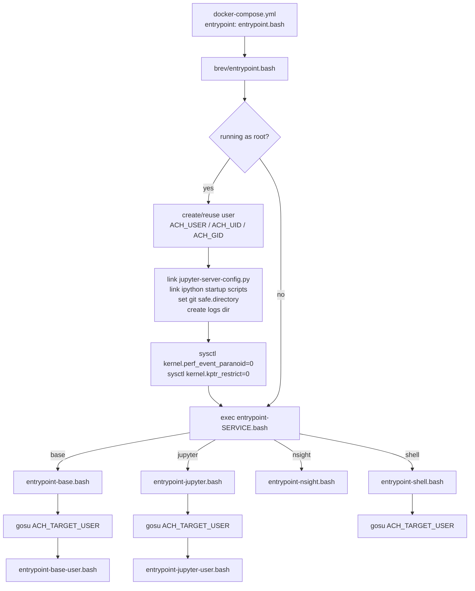
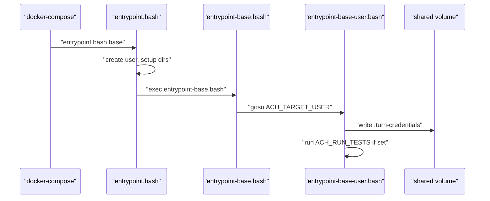
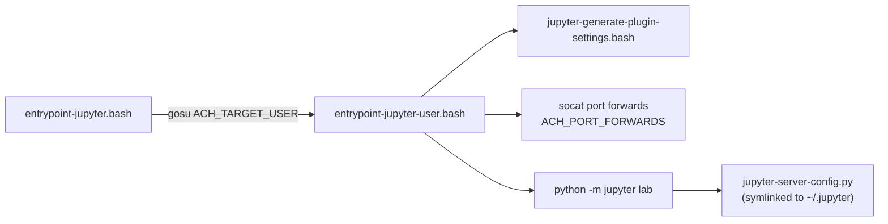
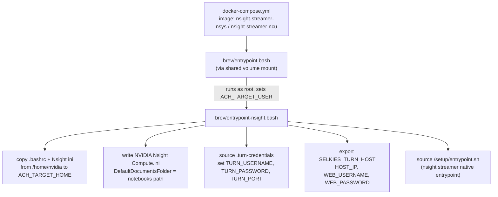
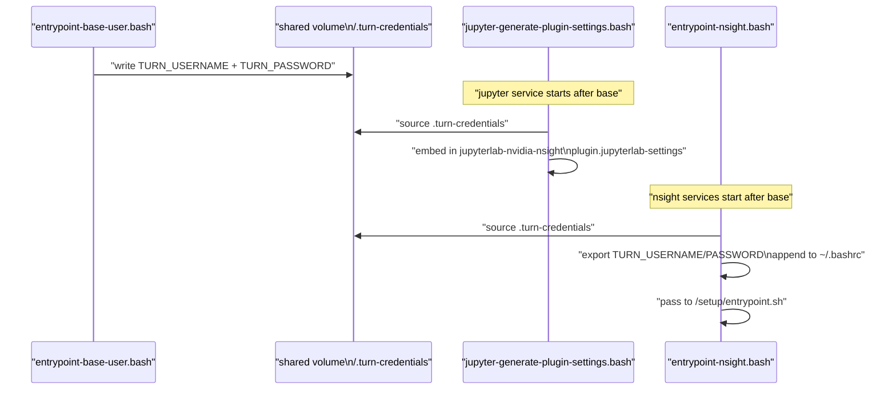

<!-- source: DeepWiki mcp.deepwiki.com · repo NVIDIA/accelerated-computing-hub · page 2.2 Container Services and Entrypoints · fetched 2026-10-26 -->

# Container Services and Entrypoints

<details>
<summary>Relevant source files</summary>

The following files were used as context for generating this wiki page:

- [brev/entrypoint-base-user.bash](brev/entrypoint-base-user.bash)
- [brev/entrypoint-base.bash](brev/entrypoint-base.bash)
- [brev/entrypoint-jupyter-user.bash](brev/entrypoint-jupyter-user.bash)
- [brev/entrypoint-jupyter.bash](brev/entrypoint-jupyter.bash)
- [brev/entrypoint-nsight.bash](brev/entrypoint-nsight.bash)
- [brev/entrypoint-shell.bash](brev/entrypoint-shell.bash)
- [brev/entrypoint.bash](brev/entrypoint.bash)
- [brev/jupyter-generate-plugin-settings.bash](brev/jupyter-generate-plugin-settings.bash)
- [brev/jupyter-server-config.py](brev/jupyter-server-config.py)
- [tutorials/accelerated-python/brev/docker-compose.yml](tutorials/accelerated-python/brev/docker-compose.yml)
- [tutorials/accelerated-python/brev/dockerfile](tutorials/accelerated-python/brev/dockerfile)
- [tutorials/cuda-cpp/brev/docker-compose.yml](tutorials/cuda-cpp/brev/docker-compose.yml)
- [tutorials/cuda-cpp/brev/dockerfile](tutorials/cuda-cpp/brev/dockerfile)
- [tutorials/cuda-tile/brev/docker-compose.yml](tutorials/cuda-tile/brev/docker-compose.yml)
- [tutorials/cuda-tile/brev/dockerfile](tutorials/cuda-tile/brev/dockerfile)
- [tutorials/nvmath-python/brev/docker-compose.yml](tutorials/nvmath-python/brev/docker-compose.yml)
- [tutorials/nvmath-python/brev/dockerfile](tutorials/nvmath-python/brev/dockerfile)
- [tutorials/stdpar/brev/docker-compose.yml](tutorials/stdpar/brev/docker-compose.yml)
- [tutorials/stdpar/brev/docker-recipe.py](tutorials/stdpar/brev/docker-recipe.py)

</details>


## Purpose and Scope

This page documents the shared runtime layer that starts and configures every tutorial container: the `brev/entrypoint.bash` dispatcher, the service-specific entrypoint scripts it delegates to, the JupyterLab server configuration, TURN credential generation, and the Nsight streamer integration.

This page covers runtime behavior — what happens when a container starts. For how Docker images are built and how Docker Compose files are structured per tutorial, see [Tutorial Docker Environments](#2.1). For the developer scripts that invoke these services locally, see [Development Workflow Scripts](#2.3).

---

## Service Model

Every tutorial shares the same four-service Docker Compose pattern. All services start as `root` and hand off to a non-root user via `gosu`. The `base` service runs once at startup, and all other services `depends_on: base`.

**Service Summary**

| Service | Image | Restart | Ports | Purpose |
|---|---|---|---|---|
| `base` | tutorial image | `no` | — | One-time setup: user creation, TURN credential generation, optional test run |
| `jupyter` | tutorial image | `unless-stopped` | `127.0.0.1:8888:8888` | JupyterLab server |
| `nsys` | `nsight-streamer-nsys` | `unless-stopped` | `127.0.0.1:8080:8080`, `0.0.0.0:3478:3478` | Nsight Systems web streamer |
| `ncu` | `nsight-streamer-ncu` | `unless-stopped` | `127.0.0.1:8081:8080`, `0.0.0.0:3479:3479` | Nsight Compute web streamer |

The `nsys` and `ncu` services use NVIDIA's pre-built Nsight Streamer images (`nvcr.io/nvidia/devtools/nsight-streamer-nsys` and `nvcr.io/nvidia/devtools/nsight-streamer-ncu`), not the tutorial image. The `brev/entrypoint.bash` script is injected into them via the shared volume mount at `/accelerated-computing-hub`.

Sources: [tutorials/accelerated-python/brev/docker-compose.yml:42-78](), [tutorials/cuda-cpp/brev/docker-compose.yml:42-78]()

---

## Entrypoint Script Chain

Every service's Docker Compose entry uses the form:

```
entrypoint: ["/accelerated-computing-hub/brev/entrypoint.bash", "<service>"]
```

`entrypoint.bash` is the single entry point for all services. It reads the first argument as the service name, performs shared root-level setup, then delegates to `entrypoint-<service>.bash`.

**Entrypoint Dispatch Flow**



Sources: [brev/entrypoint.bash:1-91](), [brev/entrypoint-base.bash:1-8](), [brev/entrypoint-jupyter.bash:1-8](), [brev/entrypoint-shell.bash:1-8](), [brev/entrypoint-nsight.bash:1-87]()

---

## `entrypoint.bash` — Root Setup Stage

[brev/entrypoint.bash:1-91]()

When the container runs as root (which it always does per `user: root` in the Compose files), this script performs the following before dispatching:

**User Provisioning**

The script reads `ACH_USER`, `ACH_UID`, and `ACH_GID` from the environment. These are set by Docker Compose's `common-env` block and default to `ach`/`1000`/`1000`.

The provisioning logic handles conflicts gracefully:

1. If `ACH_USER` already exists → reuse it.
2. If `ACH_USER` doesn't exist but `ACH_UID` is taken → reuse the existing username for that UID.
3. Otherwise → create a new group and user. Also adds the user to the `docker` group if it exists.

The resolved username is exported as `ACH_TARGET_USER` and the home directory as `ACH_TARGET_HOME` for downstream scripts.

**Jupyter Directory Setup (via gosu)**

The following directories and symlinks are created as the target user:

| Path | Action |
|---|---|
| `~/.jupyter` | `mkdir -p` |
| `~/.local/share/jupyter` | `mkdir -p` |
| `~/.ipython/profile_default/startup` | `mkdir -p` |
| `~/.local/state` | `mkdir -p` |
| `~/.jupyter/jupyter_server_config.py` | symlink → `brev/jupyter-server-config.py` |
| `~/.ipython/profile_default/startup/00-add-cwd-to-path.py` | symlink → `brev/ipython-startup-add-cwd-to-path.py` |

**Profiling Permissions**

Two `sysctl` calls relax kernel profiling restrictions so Nsight tools can run without root:

```
kernel.perf_event_paranoid = 0
kernel.kptr_restrict = 0
```

Sources: [brev/entrypoint.bash:26-82]()

---

## `base` Service

The `base` service runs once at startup (`restart: "no"`) and must complete successfully before `jupyter`, `nsys`, and `ncu` start.



**TURN Credential Generation**

[brev/entrypoint-base-user.bash:9-22]()

If `/accelerated-computing-hub/.turn-credentials` does not yet exist, the script generates it:

- `TURN_USERNAME` = `turn_` + 16 random alphanumeric characters (via `openssl rand`)
- `TURN_PASSWORD` = 32 random alphanumeric characters

The file is written with mode `644` so all services can read it from the shared Docker volume.

**Test Execution**

[brev/entrypoint-base-user.bash:24-72]()

If both `ACH_TUTORIAL` and `ACH_RUN_TESTS` are set, the script executes `tutorials/<ACH_TUTORIAL>/brev/test.bash` and tees output to `/accelerated-computing-hub/logs/test.log`. A non-zero exit code from the test script causes the base service to fail, which prevents the dependent services from starting.

Sources: [brev/entrypoint-base.bash:1-8](), [brev/entrypoint-base-user.bash:1-73]()

---

## `jupyter` Service



### JupyterLab Server Configuration

[brev/jupyter-server-config.py:1-52]()

The file `brev/jupyter-server-config.py` is symlinked into the user's `~/.jupyter/` directory at startup. Key settings:

| Setting | Value | Effect |
|---|---|---|
| `ServerApp.ip` | `0.0.0.0` | Binds to all interfaces |
| `ServerApp.open_browser` | `False` | No auto-open |
| `ServerApp.allow_root` | `True` | Permits root execution |
| `ServerApp.password` | `''` | No password |
| `IdentityProvider.token` | `''` | No token |
| `ServerApp.root_dir` | `'/'` | Full filesystem visible |
| `terminado_settings.shell_command` | `['/bin/bash']` | Bash in terminals |
| `Application.log_level` | `'INFO'` | File + console logging |

Logs are written to `/accelerated-computing-hub/logs/jupyter-server.log`.

### `jupyter-server-proxy` Integration

[brev/jupyter-server-config.py:33-52]()

The `c.ServerProxy.servers` dict registers two reverse-proxy entries in JupyterLab's launcher:

| Proxy key | Local port | Launcher title | Category |
|---|---|---|---|
| `nsys` | `8080` | Nsight Systems | Nsight |
| `ncu` | `8081` | Nsight Compute | Nsight |

Both entries set `new_browser_tab: False` so the Nsight UI renders in the JupyterLab panel. The `command` field is empty because `jupyter-server-proxy` is not launching the process — the `nsys` and `ncu` Docker Compose services are already running it.

### `socat` Port Forwarding

[brev/entrypoint-jupyter-user.bash:16-22]()

The `nsys` and `ncu` Docker Compose services expose HTTP on ports `8080` and `8081` respectively. However, `jupyter-server-proxy` can only forward to `localhost`. The `jupyter` service sets:

```
ACH_PORT_FORWARDS="8080:nsys:8080 8081:ncu:8080"
```

The user-level Jupyter entrypoint parses this variable and starts a `socat` relay for each entry:

```
socat TCP-LISTEN:<LOCAL_PORT>,fork,reuseaddr TCP:<REMOTE>
```

This makes `nsys:8080` reachable as `localhost:8080` inside the `jupyter` container, which `jupyter-server-proxy` then proxies to the browser.

### Plugin Settings Generation

[brev/jupyter-generate-plugin-settings.bash:1-59]()

Called from `entrypoint-jupyter-user.bash` before JupyterLab starts. Writes three settings files:

| File path | Plugin | Content |
|---|---|---|
| `~/.jupyter/lab/user-settings/@jupyterlab/apputils-extension/themes.jupyterlab-settings` | Theme | JupyterLab Dark theme |
| `~/.jupyter/lab/user-settings/jupyterlab-nvidia-nsight/plugin.jupyterlab-settings` | Nsight plugin | Host, Docker host, streamer URL, TURN credentials |
| `~/.jupyter/lab/user-settings/@jupyterlab/notebook-extension/tracker.jupyterlab-settings` | Notebook | `recordTiming: true` |

The Nsight plugin settings use `BREV_ENV_ID` to construct DNS names in the form `jupyter0-<BREV_ENV_ID>.brevlab.com` and `nsys0-<BREV_ENV_ID>.brevlab.com`. TURN credentials are read from the `/accelerated-computing-hub/.turn-credentials` file generated by the `base` service.

Sources: [brev/entrypoint-jupyter.bash:1-8](), [brev/entrypoint-jupyter-user.bash:1-31](), [brev/jupyter-server-config.py:1-52](), [brev/jupyter-generate-plugin-settings.bash:1-59]()

---

## `nsys` and `ncu` Services (Nsight Streamer)

The `nsys` and `ncu` services use NVIDIA Nsight Streamer container images that have their own native entrypoint at `/setup/entrypoint.sh`. The `brev/entrypoint.bash` chain is used to inject pre-configuration before handing off.



**Key responsibilities of `entrypoint-nsight.bash`:**

1. **Group name fix** — The Nsight Streamer's native entrypoint runs `chown $USER:$USER` internally. If the target GID was already taken and a group with a different name was reused, this command would fail. The script creates a group named `ACH_TARGET_USER` if one does not already exist to satisfy this requirement.

2. **Home directory population** — Copies `/home/nvidia/.bashrc` and the Nsight Systems `.ini` file into `ACH_TARGET_HOME` so the streamer finds its expected configuration.

3. **Nsight Compute default folder** — Writes `~/.config/NVIDIA Corporation/NVIDIA Nsight Compute.ini` with `CorePlugin.DefaultDocumentsFolder` set to the tutorial's notebooks directory.

4. **TURN credential injection** — Reads `/accelerated-computing-hub/.turn-credentials` and exports `TURN_USERNAME`, `TURN_PASSWORD`, and optionally `TURN_PORT` into the environment and appends them to `~/.bashrc`. The public IP for TURN relay is fetched via `curl -sSL ifconfig.me` and exported as `SELKIES_TURN_HOST`.

5. **Restart workaround** — Removes `/usr/lib/x86_64-linux-gnu/libnvrtc.so` and `/mnt/persist/home/host` if they exist, preventing symlink creation failures on container restart.

6. **Native handoff** — Calls `source /setup/entrypoint.sh`, which performs user switching using the `USER` environment variable (set to `ACH_TARGET_USER`) and starts the streaming server.

**Port assignments:**

| Service | HTTP (container) | HTTP (host) | TURN (container) | TURN (host) | TURN_PORT env |
|---|---|---|---|---|---|
| `nsys` | 8080 | 8080 | 3478 | 3478 | (default) |
| `ncu` | 8080 | 8081 | 3479 | 3479 | `3479` |

Sources: [brev/entrypoint-nsight.bash:1-87](), [tutorials/accelerated-python/brev/docker-compose.yml:61-77]()

---

## TURN Credential Flow

TURN credentials are generated once (in the `base` service) and consumed by three other services. The shared Docker volume is the communication channel.



Sources: [brev/entrypoint-base-user.bash:9-22](), [brev/jupyter-generate-plugin-settings.bash:20-26](), [brev/entrypoint-nsight.bash:41-47]()

---

## Environment Variables Reference

The following environment variables control entrypoint behavior. They are defined in each tutorial's `docker-compose.yml` under the `common-env` anchor and resolved at container start time.

| Variable | Default | Set by | Consumed by |
|---|---|---|---|
| `ACH_USER` | `ach` | Docker Compose `common-env` | `entrypoint.bash` — username to create |
| `ACH_UID` | `1000` | Docker Compose `common-env` | `entrypoint.bash` — UID for new user |
| `ACH_GID` | `1000` | Docker Compose `common-env` | `entrypoint.bash` — GID for new user |
| `ACH_TUTORIAL` | (tutorial name) | Docker Compose `common-env` | `entrypoint-base-user.bash` — test script path |
| `ACH_RUN_TESTS` | `''` | Docker Compose `common-env` | `entrypoint-base-user.bash` — enables test run |
| `BREV_ENV_ID` | `''` | Docker Compose `common-env` | `jupyter-generate-plugin-settings.bash` — Brev DNS hostname |
| `ACH_PORT_FORWARDS` | (set per service) | `jupyter` service environment | `entrypoint-jupyter-user.bash` — socat forwards |
| `TURN_PORT` | `3478` | `ncu` service environment | `entrypoint-nsight.bash` — non-default TURN port |
| `ACH_TARGET_USER` | (resolved) | `entrypoint.bash` (exported) | all `entrypoint-*.bash` scripts |
| `ACH_TARGET_HOME` | (resolved) | `entrypoint.bash` (exported) | all `entrypoint-*.bash` scripts |

Sources: [brev/entrypoint.bash:27-51](), [tutorials/accelerated-python/brev/docker-compose.yml:21-28](), [tutorials/accelerated-python/brev/docker-compose.yml:56-58](), [tutorials/accelerated-python/brev/docker-compose.yml:72-74]()

---

