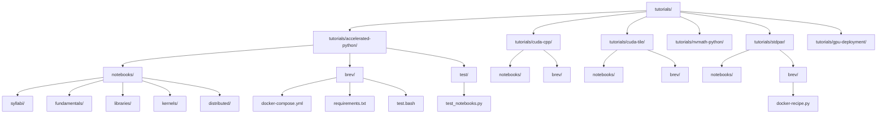
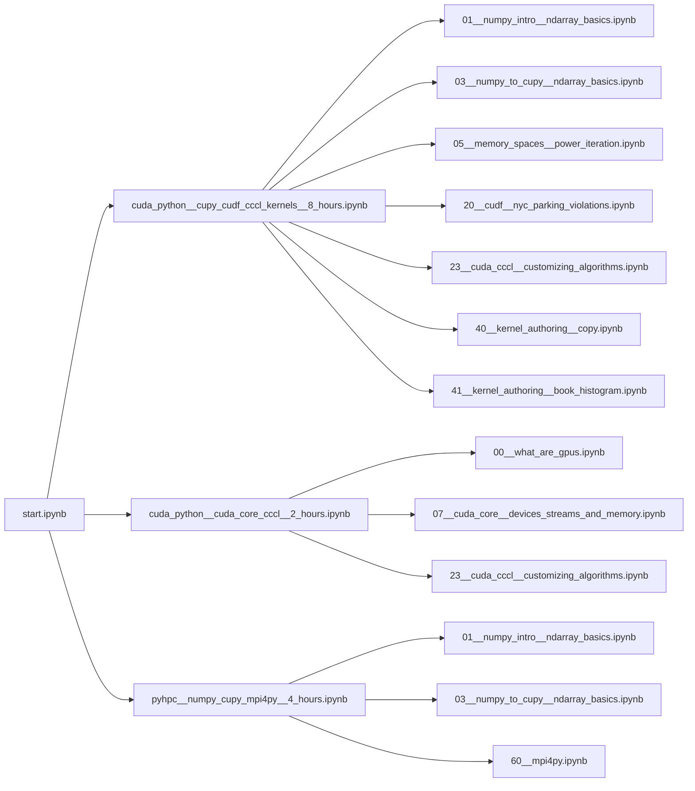
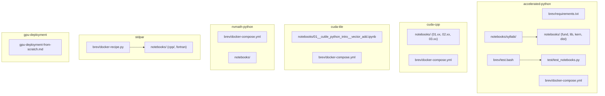

<!-- source: DeepWiki mcp.deepwiki.com · repo NVIDIA/accelerated-computing-hub · page 4 Tutorials · fetched 2026-10-26 -->

# Tutorials

Relevant source files

The following files were used as context for generating this wiki page:

- [.gitattributes](.gitattributes)
- [README.md](README.md)
- [tutorials/accelerated-python/README.md](tutorials/accelerated-python/README.md)
- [tutorials/accelerated-python/brev/requirements.txt](tutorials/accelerated-python/brev/requirements.txt)
- [tutorials/accelerated-python/brev/test.bash](tutorials/accelerated-python/brev/test.bash)
- [tutorials/accelerated-python/notebooks/fundamentals/07__cuda_core__devices_streams_and_memory.ipynb](tutorials/accelerated-python/notebooks/fundamentals/07__cuda_core__devices_streams_and_memory.ipynb)
- [tutorials/accelerated-python/notebooks/fundamentals/solutions/07__cuda_core__devices_streams_and_memory__SOLUTION.ipynb](tutorials/accelerated-python/notebooks/fundamentals/solutions/07__cuda_core__devices_streams_and_memory__SOLUTION.ipynb)
- [tutorials/accelerated-python/notebooks/start.ipynb](tutorials/accelerated-python/notebooks/start.ipynb)
- [tutorials/accelerated-python/notebooks/syllabi/cuda_python__cuda_core_cccl__2_hours.ipynb](tutorials/accelerated-python/notebooks/syllabi/cuda_python__cuda_core_cccl__2_hours.ipynb)
- [tutorials/accelerated-python/test/pytest.ini](tutorials/accelerated-python/test/pytest.ini)
- [tutorials/accelerated-python/test/test_notebooks.py](tutorials/accelerated-python/test/test_notebooks.py)
- [tutorials/accelerated-python/test/test_rapids.py](tutorials/accelerated-python/test/test_rapids.py)
- [tutorials/cuda-cpp/README.md](tutorials/cuda-cpp/README.md)
- [tutorials/cuda-tile/README.md](tutorials/cuda-tile/README.md)
- [tutorials/stdpar/README.md](tutorials/stdpar/README.md)

This page provides an overview of all tutorial tracks in the repository: their learning objectives, notebook organization, and how to deploy them on NVIDIA Brev or Google Colab. For infrastructure details such as Docker environments, container services, and developer scripts that support these tutorials, see [Infrastructure](#2). For the standalone chapter-based Accelerated Python User Guide, see [Accelerated Python User Guide](#5).

---

## Tutorial Tracks

Six tutorial tracks live under the `tutorials/` directory. Each track is self-contained with its own notebooks, Docker Compose configuration, and Docker images.

| Track | Directory | Primary Language | Child Page |
|---|---|---|---|
| Accelerated Python | `tutorials/accelerated-python/` | Python | [4.1](#4.1) |
| CUDA C++ | `tutorials/cuda-cpp/` | C++ | [4.2](#4.2) |
| CUDA Tile | `tutorials/cuda-tile/` | Python / C++ | [4.3](#4.3) |
| nvmath-python | `tutorials/nvmath-python/` | Python | [4.4](#4.4) |
| Standard Parallelism | `tutorials/stdpar/` | C++ / Fortran | [4.5](#4.5) |
| GPU Deployment | `tutorials/gpu-deployment/` | N/A | [GPU Deployment Guide](#6) |

Sources: [README.md:1-31]()

---

## Directory Structure

Each tutorial track follows a consistent layout. The Accelerated Python track is the most elaborate and demonstrates all conventions used across the repository.

**Tutorial track directory layout**

Sources: [tutorials/accelerated-python/README.md:1-64](), [tutorials/cuda-cpp/README.md:1-69](), [tutorials/cuda-tile/README.md:1-18](), [tutorials/stdpar/README.md:1-33]()

---

## Deployment

All tutorials can be run on **NVIDIA Brev** or **Google Colab** (where applicable). Each tutorial's `brev/docker-compose.yml` configures the container environment for Brev Launchables.

### Brev Instance Requirements

| Track | Recommended Instance | Provider Requirements | Notes |
|---|---|---|---|
| CUDA Tile | 1×B300, 1×B200, or 1×RTX Pro 6000 | Any Blackwell provider | Blackwell GPU required; no Flexible Ports needed yet |
| CUDA C++ | L40S, L4, or T4 | Crusoe or any with Flexible Ports | — |
| Standard Parallelism | 4×L4, 2×L4, 2×L40S, or 1×L40S | GCP, AWS, or any with Flexible Ports | Requires Linux 6.1.24+, 6.2.11+, or 6.3+ for HMM |
| Accelerated Python | L40S, L4, or T4; 4×L4 or 2×L4 for distributed | Crusoe or any with Flexible Ports | Multi-GPU needed for distributed notebooks |
| nvmath-python | 4×L4, 2×L4, 2×L40S, or 1×L40S | Crusoe or any with Flexible Ports | — |
| GPU Deployment | N/A | Any | Markdown guide, no container required |

Sources: [README.md:11-21](), [tutorials/cuda-tile/README.md:10-12](), [tutorials/cuda-cpp/README.md:11-14](), [tutorials/stdpar/README.md:9-12](), [tutorials/accelerated-python/README.md:10-14]()

---

## Accelerated Python Tutorial

The Accelerated Python track is the most modular. Notebooks are numbered and grouped into four categories, and three pre-defined **syllabi** select a curated subset for specific learning objectives.

### Syllabus System

The entry point is `tutorials/accelerated-python/notebooks/start.ipynb`, which links to each syllabus notebook. A syllabus notebook renders a table of the selected notebooks and links to the appropriate Docker Compose file for that configuration.

**Syllabi and notebook mapping**

Sources: [tutorials/accelerated-python/notebooks/start.ipynb:1-34](), [tutorials/accelerated-python/notebooks/syllabi/cuda_python__cuda_core_cccl__2_hours.ipynb:1-54](), [tutorials/accelerated-python/README.md:15-19]()

### Notebook Categories

| Category | Number Range | Topics |
|---|---|---|
| `fundamentals/` | 01–07 | NumPy, CuPy, memory spaces, asynchrony, `cuda.core` |
| `libraries/` | 20–28 | cuDF, cudf.pandas, cuML, CCCL, nvmath-python, PyNVML |
| `kernels/` | 40–43 | Numba `cuda.jit`, histogram, Gaussian blur, image processing |
| `distributed/` | 60–61 | `mpi4py`, Dask |

Each exercise notebook has a corresponding solution under a `solutions/` subdirectory within the same category (e.g., `fundamentals/solutions/01__numpy_intro__ndarray_basics__SOLUTION.ipynb`).

Sources: [tutorials/accelerated-python/README.md:22-63]()

### Python Environment

Dependencies are declared in `tutorials/accelerated-python/brev/requirements.txt`. Key packages:

| Package | Version | Purpose |
|---|---|---|
| `cuda-python` | `== 13.*` | Low-level CUDA driver bindings (`cuda.core`) |
| `numba-cuda` | `== 0.20.0` | GPU kernel authoring via `@cuda.jit` |
| `nvmath-python` | `[cu13]` | GEMM, FFT, kernel fusion |
| `cupy-cuda13x` | `== 13.6.0` | NumPy-compatible GPU arrays |
| `cuda-cccl` | `[test-cu13]` | C++ Core Compute Libraries (parallel algorithms) |
| `nvtx` | — | Profiling annotations |
| `mpi4py` | — | Distributed multi-GPU workloads |

RAPIDS libraries (`cuDF`, `cuML`) are installed into a separate virtual environment at `/opt/venvs/rapids/` and are not in `requirements.txt`.

Sources: [tutorials/accelerated-python/brev/requirements.txt:1-32]()

### Testing

The test suite is invoked via `tutorials/accelerated-python/brev/test.bash`, which runs three separate test stages:

1. **Package tests** — `test/test_packages.py` validates core package imports.
2. **RAPIDS tests** — `test/test_rapids.py` is executed inside the RAPIDS venv at `/opt/venvs/rapids/bin/pytest`. It tests `cuDF` DataFrame operations and `cuML` `KMeans` training.
3. **Notebook tests** — `test/test_notebooks.py` uses `nbclient.NotebookClient` to execute every `*SOLUTION*.ipynb` notebook end-to-end with a 600-second per-cell timeout.

`pytest.ini` is configured with `-v -s --durations=0` so all cell timings are reported.

Sources: [tutorials/accelerated-python/brev/test.bash:1-38](), [tutorials/accelerated-python/test/test_notebooks.py:1-137](), [tutorials/accelerated-python/test/pytest.ini:1-3](), [tutorials/accelerated-python/test/test_rapids.py:1-57]()

---

## CUDA C++ Tutorial

**Location:** `tutorials/cuda-cpp/`

Three notebook series, each covering a distinct aspect of GPU programming:

| Series | Prefix | Topic |
|---|---|---|
| CUDA Made Easy | `01.xx` | Execution spaces, vocabulary types (`mdspan`), serial vs. parallel, memory spaces |
| Asynchrony and Streams | `02.xx` | Asynchrony, CUDA streams, pinned memory, Nsight profiling, NVTX |
| Implementing Kernels | `03.xx` | Kernel authoring, atomics, synchronization, shared memory, cooperative algorithms |

Notebooks include both lesson and exercise variants. The YouTube lecture playlist maps one-to-one with the notebook series.

Sources: [tutorials/cuda-cpp/README.md:1-69]()

---

## CUDA Tile Tutorial

**Location:** `tutorials/cuda-tile/`

Teaches the cuTile programming model using a Python DSL (`cuTile Python`), a C++ DSL (`cuTile C++`), and an MLIR-based intermediate representation (`Tile IR`).

**Hardware requirement:** a Blackwell GPU (B300, B200, or RTX Pro 6000). This is the only tutorial in the repository with this constraint.

The current notebook set begins with `01__cutile_python_intro__vector_add.ipynb`, demonstrating a `vector_add` kernel using `ct.load` and `ct.store` operations. See [CUDA Tile Tutorial](#4.3) for details.

Sources: [tutorials/cuda-tile/README.md:1-18]()

---

## Standard Parallelism Tutorial

**Location:** `tutorials/stdpar/`

Two parallel tracks covering GPU acceleration without CUDA-specific code:

| Track | Language | Labs |
|---|---|---|
| ISO C++ | C++ | DAXPY, Select, 2D Heat Equation, Parallel Tree Construction |
| ISO Fortran | Fortran | MATMUL, DAXPY, Heat Equation |

This tutorial differs from all others in that its Dockerfile is generated from an HPCCM recipe (`brev/docker-recipe.py`) rather than maintained as a static `Dockerfile`. See [Standard Parallelism Tutorial](#4.5) for details.

Instances require a sufficiently modern Linux kernel (6.1.24+, 6.2.11+, or 6.3+) for Heterogeneous Memory Management (HMM).

Sources: [tutorials/stdpar/README.md:1-33]()

---

## nvmath-python Tutorial

**Location:** `tutorials/nvmath-python/`

Focused on the `nvmath-python` library. Topics include kernel fusion for GEMM, stateless vs. stateful API usage, FFT prolog/epilog callbacks, and sparse direct solvers using CSR format with `cuDSS`. See [nvmath-python Tutorial](#4.4) for details.

Sources: [README.md:17]()

---

## GPU Deployment Tutorial

**Location:** `tutorials/gpu-deployment/`

A Markdown-based (non-notebook) guide covering NVIDIA Brev VM provisioning, checking GPU and CUDA Toolkit status with `nvidia-smi`, installing GPU-accelerated Python libraries with `pip`, `uv`, and `conda`, and using GPU monitoring tools. No Docker container is required. See [GPU Deployment Guide](#6) for details.

Sources: [README.md:21]()

---

## Tutorial Comparison Summary

**Tutorial tracks mapped to key files and technologies**

Sources: [README.md:1-31](), [tutorials/accelerated-python/README.md:1-64](), [tutorials/cuda-cpp/README.md:1-69](), [tutorials/cuda-tile/README.md:1-18](), [tutorials/stdpar/README.md:1-33]()

---

