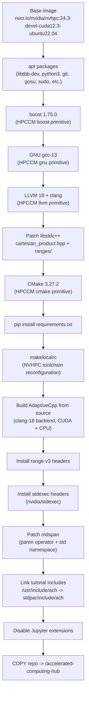
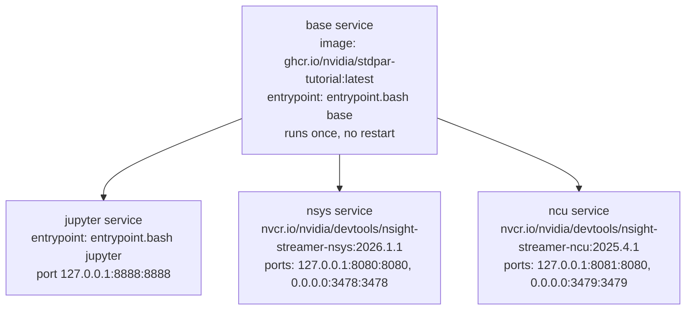
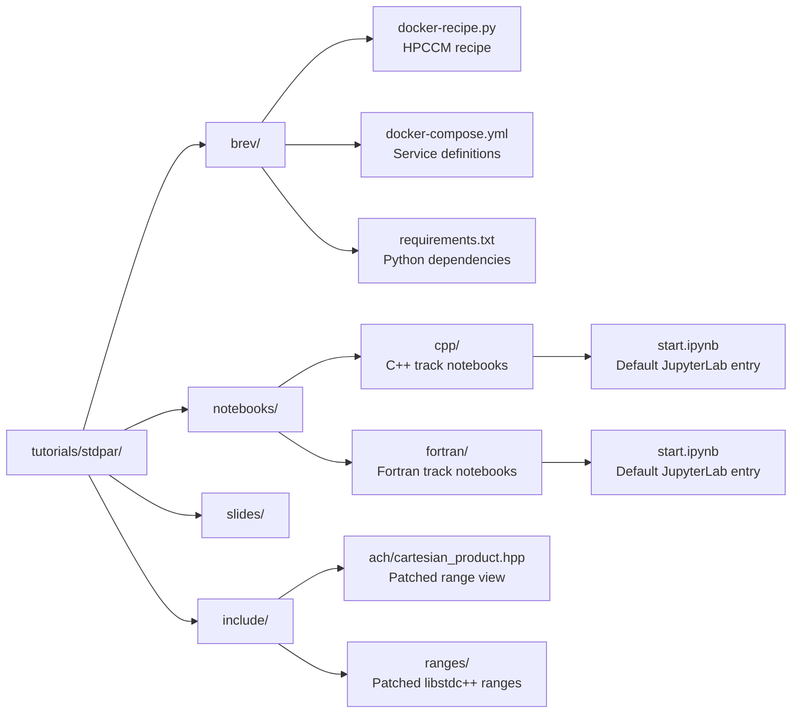

<!-- source: DeepWiki mcp.deepwiki.com · repo NVIDIA/accelerated-computing-hub · page 4.5 Standard Parallelism Tutorial · fetched 2026-10-26 -->

# Standard Parallelism Tutorial

<details>
<summary>Relevant source files</summary>

The following files were used as context for generating this wiki page:

- [.gitattributes](.gitattributes)
- [README.md](README.md)
- [brev/entrypoint.bash](brev/entrypoint.bash)
- [tutorials/accelerated-python/README.md](tutorials/accelerated-python/README.md)
- [tutorials/accelerated-python/brev/docker-compose.yml](tutorials/accelerated-python/brev/docker-compose.yml)
- [tutorials/accelerated-python/brev/dockerfile](tutorials/accelerated-python/brev/dockerfile)
- [tutorials/accelerated-python/notebooks/fundamentals/07__cuda_core__devices_streams_and_memory.ipynb](tutorials/accelerated-python/notebooks/fundamentals/07__cuda_core__devices_streams_and_memory.ipynb)
- [tutorials/accelerated-python/notebooks/fundamentals/solutions/07__cuda_core__devices_streams_and_memory__SOLUTION.ipynb](tutorials/accelerated-python/notebooks/fundamentals/solutions/07__cuda_core__devices_streams_and_memory__SOLUTION.ipynb)
- [tutorials/accelerated-python/notebooks/start.ipynb](tutorials/accelerated-python/notebooks/start.ipynb)
- [tutorials/accelerated-python/notebooks/syllabi/cuda_python__cuda_core_cccl__2_hours.ipynb](tutorials/accelerated-python/notebooks/syllabi/cuda_python__cuda_core_cccl__2_hours.ipynb)
- [tutorials/cuda-cpp/README.md](tutorials/cuda-cpp/README.md)
- [tutorials/cuda-cpp/brev/docker-compose.yml](tutorials/cuda-cpp/brev/docker-compose.yml)
- [tutorials/cuda-cpp/brev/dockerfile](tutorials/cuda-cpp/brev/dockerfile)
- [tutorials/cuda-tile/README.md](tutorials/cuda-tile/README.md)
- [tutorials/cuda-tile/brev/docker-compose.yml](tutorials/cuda-tile/brev/docker-compose.yml)
- [tutorials/cuda-tile/brev/dockerfile](tutorials/cuda-tile/brev/dockerfile)
- [tutorials/nvmath-python/brev/docker-compose.yml](tutorials/nvmath-python/brev/docker-compose.yml)
- [tutorials/nvmath-python/brev/dockerfile](tutorials/nvmath-python/brev/dockerfile)
- [tutorials/stdpar/README.md](tutorials/stdpar/README.md)
- [tutorials/stdpar/brev/docker-compose.yml](tutorials/stdpar/brev/docker-compose.yml)
- [tutorials/stdpar/brev/docker-recipe.py](tutorials/stdpar/brev/docker-recipe.py)

</details>


This page covers the Standard Parallelism (`stdpar`) tutorial: its subject matter, notebook content, Docker environment, and the HPCCM-based build system that makes its container unique among all tutorials in the repository.

For general information about the shared container infrastructure all tutorials use, see [Infrastructure](#2). For developer scripts used to build and run the container locally, see [Development Workflow Scripts](#2.3).

---

## Overview

The Standard Parallelism tutorial teaches GPU-accelerated programming using only the parallelism and concurrency features of modern **ISO C++** and **ISO Fortran** standards — without requiring CUDA-specific syntax. It targets portable HPC application development, where the same source code can target multi-core CPUs and GPUs by switching compiler flags and execution policies.

The tutorial is identified internally by the name `stdpar` and is hosted under `tutorials/stdpar/`.

---

## Notebook Content

The tutorial is split into two independent tracks.

### ISO C++ Track

Located under `tutorials/stdpar/notebooks/cpp/`.

| Notebook | Topic |
|---|---|
| `start.ipynb` | Introduction |
| `lab1_daxpy/daxpy.ipynb` | Lab 1: DAXPY |
| `lab1_select/select.ipynb` | Lab 1: Select (optional) |
| `lab2_heat/heat.ipynb` | Lab 2: 2D Heat Equation |
| `lab3_tree/tree.ipynb` | Lab 3: Parallel Tree Construction |

### ISO Fortran Track

Located under `tutorials/stdpar/notebooks/fortran/`.

| Notebook | Topic |
|---|---|
| `start.ipynb` | Introduction |
| `lab1_matmul/matmul.ipynb` | Lab 1: MATMUL |
| `lab2_daxpy/daxpy.ipynb` | Lab 2: DAXPY |
| `lab3_heat/heat.ipynb` | Lab 3: Heat Equation |

The default JupyterLab URL configured in the Docker Compose file opens `start.ipynb` in the `notebooks` directory automatically when the container starts.

Sources: [tutorials/stdpar/README.md:13-33](), [tutorials/stdpar/brev/docker-compose.yml:7-7]()

---

## Docker Environment

### HPCCM-Based Dockerfile Generation

The `stdpar` tutorial is the **only tutorial** in the repository that does not ship a plain `dockerfile`. Instead, it provides `tutorials/stdpar/brev/docker-recipe.py`, a Python script written for [HPC Container Maker (HPCCM)](https://github.com/NVIDIA/hpc-container-maker).

This script is processed at build time by the CI pipeline (see [Docker Image Build and Test Pipeline](#3.1)) to produce a `dockerfile` that is committed to the `generated/main` branch. Using HPCCM allows the recipe to express complex multi-component toolchain setup (compiler installs, library builds, patches) using higher-level Python abstractions instead of raw shell commands.

**HPCCM Recipe: `tutorials/stdpar/brev/docker-recipe.py`**

The recipe variable assignments at the top define the pinned versions for all components:

| Variable | Value | Purpose |
|---|---|---|
| `nvhpc_ver` | `'24.3'` | NVIDIA HPC SDK version |
| `cuda_ver` | `'12.3'` | CUDA version for NVHPC image |
| `gcc_ver` | `'13'` | GCC toolchain version |
| `llvm_ver` | `'18'` | LLVM/Clang toolchain version |
| `cmake_ver` | `'3.27.2'` | CMake version |
| `boost_ver` | `'1.75.0'` | Boost version (required by AdaptiveCpp) |

Sources: [tutorials/stdpar/brev/docker-recipe.py:9-16]()

### Base Image

```
nvcr.io/nvidia/nvhpc:24.3-devel-cuda12.3-ubuntu22.04
```

This is the NVIDIA HPC SDK developer image, providing the `nvfortran` and `nvc++` compilers, which are required for GPU-offloaded standard parallelism in Fortran and C++.

Sources: [tutorials/stdpar/brev/docker-recipe.py:19-19]()

### Environment Variables

The recipe sets a dense set of environment variables via the HPCCM `environment` primitive:

| Variable | Value / Purpose |
|---|---|
| `ACH_STDPAR_NVHPC_VERSION` | `24.3` — exposed to notebooks for version display |
| `ACH_STDPAR_CUDA_VERSION` | `12.3` — exposed to notebooks |
| `ACH_STDPAR_ARCH` | `platform.machine()` — CPU arch, used in paths |
| `ACH_NSYS_PATH` | Path to `nsys` inside the NVHPC SDK tree |
| `ACH_NCU_PATH` | Path to `ncu` inside the NVHPC SDK tree |
| `ACPP_APPDB_DIR` | `/accelerated-computing-hub/` — AdaptiveCpp app DB |
| `PATH` | Prepends `brev/wrappers` and appends `/opt/adaptivecpp/bin` |
| `LD_LIBRARY_PATH` / `LIBRARY_PATH` | Points to `llvm-18` libraries for AdaptiveCpp |
| `OMPI_ALLOW_RUN_AS_ROOT` | `1` — permits MPI runs as root in container |
| `NVCOMPILER_ACC_GANGLIMIT` | `67108864` — workaround for nvfortran 64K gang limit |

Sources: [tutorials/stdpar/brev/docker-recipe.py:21-62]()

### Key Build Steps

The recipe's `shell` primitive executes a sequence of setup commands in a single `RUN` layer:

**Component installation diagram:**

**Build Steps in `docker-recipe.py`**



Sources: [tutorials/stdpar/brev/docker-recipe.py:64-157]()

#### AdaptiveCpp Build

AdaptiveCpp (formerly hipSYCL) is cloned from the `develop` branch and built against Clang 18 with both CUDA and CPU backends enabled. The install prefix is `/opt/adaptivecpp` and its `bin/` directory is appended to `PATH`.

[tutorials/stdpar/brev/docker-recipe.py:104-111]()

#### libstdc++ Patch

The recipe patches GCC 13's `cartesian_product` range view to avoid requiring Heterogeneous Memory Management (HMM/ATS) from the host kernel. This is done by copying two files from the repository into the GCC 13 system include path:

- `tutorials/stdpar/include/ach/cartesian_product.hpp` → `/usr/include/ach/`
- `tutorials/stdpar/include/ranges` → `/usr/include/c++/13/ranges`

[tutorials/stdpar/brev/docker-recipe.py:82-84]()

#### mdspan Setup

The NVHPC SDK's `mdspan` header is patched to use the parenthesis operator (C++20 compatible) and to pull `std::experimental` into the `std` namespace. It is then symlinked into `/usr/include/mdspan` so it is findable without compiler-specific include flags.

[tutorials/stdpar/brev/docker-recipe.py:124-130]()

---

## Container Services

The `tutorials/stdpar/brev/docker-compose.yml` defines the same four-service pattern used by all tutorials:

**Service layout for `stdpar`:**



The `base` service runs once to completion (initializing user setup via `entrypoint.bash base`). The `jupyter`, `nsys`, and `ncu` services restart unless stopped and depend on `base` completing successfully.

For details on what `entrypoint.bash` does, see [Container Services and Entrypoints](#2.2).

Sources: [tutorials/stdpar/brev/docker-compose.yml:1-79]()

### Port Assignments

| Service | Internal Port | External Binding | Protocol |
|---|---|---|---|
| `jupyter` | 8888 | `127.0.0.1:8888` | JupyterLab HTTP |
| `nsys` | 8080 | `127.0.0.1:8080` | Nsight Systems HTTP |
| `nsys` | 3478 | `0.0.0.0:3478` | TURN (WebRTC relay) |
| `ncu` | 8080 | `127.0.0.1:8081` | Nsight Compute HTTP |
| `ncu` | 3479 | `0.0.0.0:3479` | TURN (WebRTC relay) |

The `jupyter` service sets `ACH_PORT_FORWARDS: "8080:nsys:8080 8081:ncu:8080"` to proxy the Nsight tool UIs through JupyterLab via `jupyter-server-proxy`.

Sources: [tutorials/stdpar/brev/docker-compose.yml:54-76]()

### Environment Variables

All services share a common environment block:

| Variable | Default | Purpose |
|---|---|---|
| `ACH_TUTORIAL` | `stdpar` | Identifies the tutorial |
| `ACH_USER` | `ach` | Username created in the container |
| `ACH_UID` | `1000` | UID for the created user |
| `ACH_GID` | `1000` | GID for the created user |
| `ACH_RUN_TESTS` | *(empty)* | Enables test mode when set |
| `BREV_ENV_ID` | *(empty)* | Set by Brev at launch time |

Sources: [tutorials/stdpar/brev/docker-compose.yml:21-27]()

---

## Comparison with Other Tutorials

The `stdpar` tutorial differs from other tutorials in two important ways:

**Dockerfile generation approach:**

| Tutorial | Dockerfile source |
|---|---|
| `accelerated-python` | Plain `dockerfile` |
| `cuda-cpp` | Plain `dockerfile` |
| `cuda-tile` | Plain `dockerfile` |
| `nvmath-python` | Plain `dockerfile` |
| `stdpar` | **`docker-recipe.py` (HPCCM)** |

**Hardware requirements:** The `stdpar` tutorial requires Linux kernel 6.1.24+, 6.2.11+, or 6.3+ on the host for HMM (Heterogeneous Memory Management) support. This is why the libstdc++ cartesian_product patch exists — it avoids requiring HMM in cases where the range view would otherwise access host memory from the device.

Recommended Brev instances: 4×L4, 2×L4, 2×L40S, or 1×L40S, on GCP, AWS, or any provider with Flexible Ports and a qualifying kernel version.

Sources: [tutorials/stdpar/brev/docker-recipe.py:79-84](), [tutorials/stdpar/README.md:9-11](), [README.md:11-17]()

---

## File Map



Sources: [tutorials/stdpar/brev/docker-recipe.py:1-157](), [tutorials/stdpar/brev/docker-compose.yml:1-79](), [tutorials/stdpar/README.md:1-33]()

---

