# Page: Overview

# Overview

<details>
<summary>Relevant source files</summary>

The following files were used as context for generating this wiki page:

- [.gitattributes](.gitattributes)
- [CONTRIBUTING.md](CONTRIBUTING.md)
- [README.md](README.md)
- [brev/dev-start.bash](brev/dev-start.bash)
- [brev/dev-stop.bash](brev/dev-stop.bash)
- [brev/dev-test.bash](brev/dev-test.bash)
- [tutorials/accelerated-python/README.md](tutorials/accelerated-python/README.md)
- [tutorials/accelerated-python/notebooks/fundamentals/07__cuda_core__devices_streams_and_memory.ipynb](tutorials/accelerated-python/notebooks/fundamentals/07__cuda_core__devices_streams_and_memory.ipynb)
- [tutorials/accelerated-python/notebooks/fundamentals/solutions/07__cuda_core__devices_streams_and_memory__SOLUTION.ipynb](tutorials/accelerated-python/notebooks/fundamentals/solutions/07__cuda_core__devices_streams_and_memory__SOLUTION.ipynb)
- [tutorials/accelerated-python/notebooks/start.ipynb](tutorials/accelerated-python/notebooks/start.ipynb)
- [tutorials/accelerated-python/notebooks/syllabi/cuda_python__cuda_core_cccl__2_hours.ipynb](tutorials/accelerated-python/notebooks/syllabi/cuda_python__cuda_core_cccl__2_hours.ipynb)
- [tutorials/cuda-cpp/README.md](tutorials/cuda-cpp/README.md)
- [tutorials/cuda-tile/README.md](tutorials/cuda-tile/README.md)
- [tutorials/stdpar/README.md](tutorials/stdpar/README.md)

</details>


This page describes the purpose, structure, and navigation of the NVIDIA Accelerated Computing Hub repository. It covers the top-level layout, the available tutorial tracks, the user guide, and the shared infrastructure that ties them together. For details on any specific system, follow the links to the relevant child pages.

---

## Purpose

The NVIDIA Accelerated Computing Hub is an open learning repository for GPU computing. It provides interactive tutorials, syllabi, user guides, and reference material targeting learners at various levels — from Python programmers adopting GPU libraries, to C++ developers writing custom CUDA kernels.

The stated goal from [README.md:3-5]() is:

> A living project where documents, examples, best practices, optimizations, and new features can become both visible and accessible to users quickly and easily.

All content is licensed for broad reuse:
- Written materials (guides, docs, presentations): **Creative Commons CC BY-NC-SA 4.0**
- Code (notebook code, coding examples): **Apache License, Version 2.0**

Sources: [README.md:1-31]()

---

## Repository Layout

The repository is organized into four top-level areas:

**Repository structure diagram**

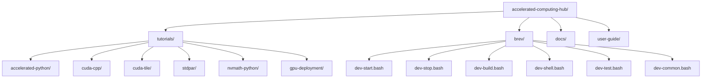

Sources: [README.md:1-31](), [brev/dev-start.bash:1-55](), [brev/dev-stop.bash:1-44](), [brev/dev-test.bash:1-91]()

Each tutorial directory under `tutorials/` contains:

| Subdirectory | Contents |
|---|---|
| `notebooks/` | Lesson notebooks and exercise notebooks |
| `notebooks/syllabi/` | Curated subsets of notebooks for specific learning objectives |
| `notebooks/solutions/` | Solution notebooks for exercises |
| `slides/` | Lecture slide decks (stored in Git LFS) |
| `brev/` | `docker-compose.yml` and Dockerfile for the tutorial environment |

Sources: [tutorials/accelerated-python/README.md:1-63](), [tutorials/cuda-cpp/README.md:1-68](), [CONTRIBUTING.md:39-55]()

---

## Tutorial Tracks

The following tutorials are available. Each can be launched on NVIDIA Brev or run locally via Docker Compose. Most also support Google Colab.

| Tutorial | Directory | Recommended GPU | Notes |
|---|---|---|---|
| CUDA Tile Tutorial | `tutorials/cuda-tile/` | 1×B300, 1×B200, or 1×RTX Pro 6000 | Requires Blackwell GPU |
| CUDA C++ Tutorial | `tutorials/cuda-cpp/` | L40S, L4, or T4 | Needs Flexible Ports |
| Standard Parallelism Tutorial | `tutorials/stdpar/` | 4×L4, 2×L4, 2×L40S, or 1×L40S | Requires Linux 6.1.24+/6.2.11+/6.3+ for HMM |
| Accelerated Python Tutorial | `tutorials/accelerated-python/` | L40S, L4, or T4; 4×L4 or 2×L4 for distributed | Multiple syllabi available |
| nvmath-python Tutorial | `tutorials/nvmath-python/` | 4×L4, 2×L4, 2×L40S, or 1×L40S | Needs Flexible Ports |
| GPU Deployment Guide | `tutorials/gpu-deployment/` | Any NVIDIA GPU | Markdown-only, no container needed |

Sources: [README.md:11-21]()

### Syllabi (Accelerated Python)

The Accelerated Python tutorial supports three pre-defined syllabi that select a subset of its notebooks for a particular event format:

| Syllabus | Duration | Key Technologies |
|---|---|---|
| CUDA Python – CuPy, cuDF, CCCL, & Kernels | 8 hours | CuPy, cuDF, cuda-cccl, Numba |
| CUDA Python – cuda.core & CCCL | 2 hours | cuda.core, cuda-cccl |
| PyHPC – NumPy, CuPy, & mpi4py | 4 hours | NumPy, CuPy, mpi4py |

Syllabus files live at `tutorials/accelerated-python/notebooks/syllabi/`. The entry point for the tutorial is [tutorials/accelerated-python/notebooks/start.ipynb]().

Sources: [tutorials/accelerated-python/README.md:15-19](), [tutorials/accelerated-python/notebooks/start.ipynb:1-34](), [tutorials/accelerated-python/notebooks/syllabi/cuda_python__cuda_core_cccl__2_hours.ipynb:1-54]()

---

## Content and Delivery Model

**How content is delivered**

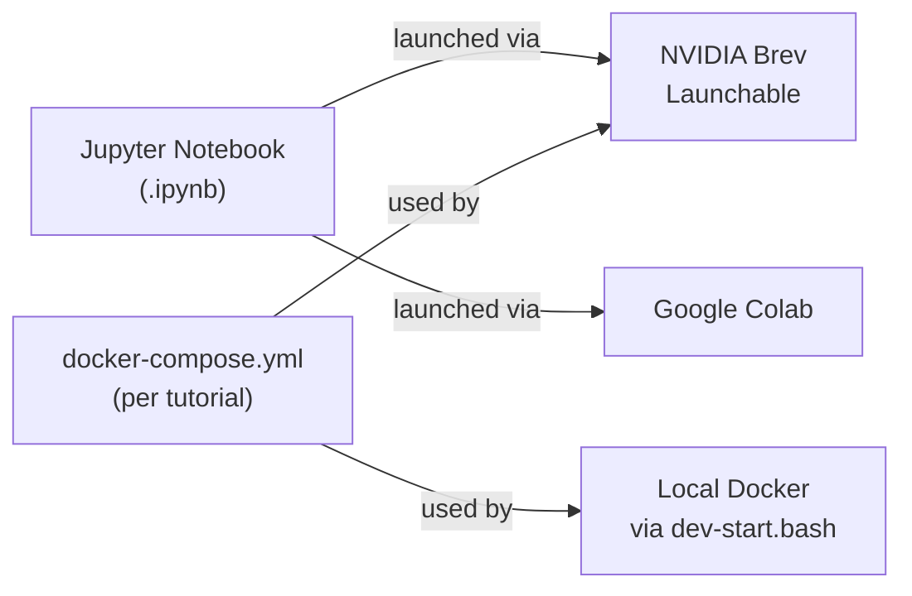

Sources: [README.md:9-21](), [brev/dev-start.bash:44-55]()

Each tutorial's `brev/docker-compose.yml` defines one or more services (typically `base`, `jupyter`, `nsight`). When launched on Brev or locally, the compose file starts a JupyterLab server with all required dependencies pre-installed in the container.

For local development, [brev/dev-start.bash]() rewrites `127.0.0.1` port bindings to `0.0.0.0` so services are reachable outside the container ([brev/dev-start.bash:48-50]()).

---

## Infrastructure Summary

The shared infrastructure layer is described in detail on page [2](#2). A brief summary:

**Infrastructure component map**

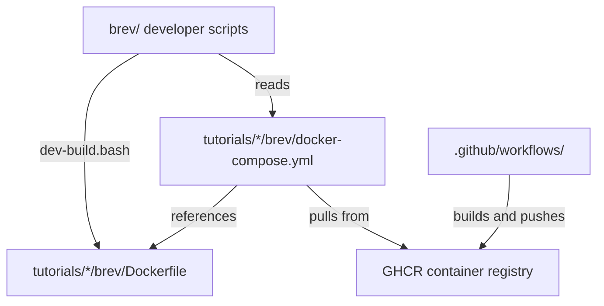

| Script | Purpose |
|---|---|
| `brev/dev-start.bash` | Start containers for a named tutorial |
| `brev/dev-stop.bash` | Stop containers for a named tutorial |
| `brev/dev-build.bash` | Build Docker images; generates Dockerfiles from HPCCM recipes if present |
| `brev/dev-shell.bash` | Open an interactive shell inside a running container |
| `brev/dev-test.bash` | Run a tutorial's test suite with the local repo mounted |
| `brev/dev-common.bash` | Shared utilities (volume creation, `ACH_UID`/`ACH_GID` export) |

Sources: [CONTRIBUTING.md:9-21](), [brev/dev-start.bash:1-55](), [brev/dev-stop.bash:1-44](), [brev/dev-test.bash:1-91]()

---

## CI/CD Summary

GitHub Actions workflows live under `.github/workflows/`. There are two main pipeline categories:

1. **Docker image lifecycle** — builds tutorial images on merge, pushes to GHCR, and tests compose files. See page [3.1](#3.1).
2. **Code quality checks** — link validation, commit signature checks, Git LFS usage, YAML linting. See page [3.2](#3.2).

---

## Accelerated Python User Guide

Separate from the tutorials, the repository also contains a **User Guide** — a standalone collection of advanced notebooks covering topics like NVIDIA Warp, distributed computing with cuPyNumeric, and developer tooling. This is documented on page [5](#5).

---

## Other Pages in This Wiki

| Page | Topic |
|---|---|
| [Infrastructure](#2) | Docker environments, entrypoints, dev scripts |
| [CI/CD Pipelines](#3) | GitHub Actions workflows |
| [Tutorials](#4) | All tutorial tracks in detail |
| [Accelerated Python User Guide](#5) | Advanced user guide notebooks |
| [GPU Deployment Guide](#6) | Brev provisioning and GPU tooling |

---

## Contributing

Contributions are governed by [CONTRIBUTING.md](). Key guidelines:

- Start significant changes with a GitHub Issue.
- Notebooks should follow the style defined in `docs/notebook_template.ipynb`.
- New modules require a `README.ipynb`, per-language subdirectories, and a `solutions/` directory.
- All commits must include a `Signed-off-by` tag; GPG-signed commits are preferred.
- PRs from forks require a maintainer to push the branch to the upstream repo before CI runs ([CONTRIBUTING.md:56-81]()).

Sources: [CONTRIBUTING.md:1-86]()

---

# Page: Infrastructure

# Infrastructure

<details>
<summary>Relevant source files</summary>

The following files were used as context for generating this wiki page:

- [brev/entrypoint-base-user.bash](brev/entrypoint-base-user.bash)
- [brev/entrypoint-base.bash](brev/entrypoint-base.bash)
- [brev/entrypoint-jupyter-user.bash](brev/entrypoint-jupyter-user.bash)
- [brev/entrypoint-jupyter.bash](brev/entrypoint-jupyter.bash)
- [brev/entrypoint-nsight.bash](brev/entrypoint-nsight.bash)
- [brev/entrypoint-shell.bash](brev/entrypoint-shell.bash)
- [brev/entrypoint.bash](brev/entrypoint.bash)
- [brev/jupyter-generate-plugin-settings.bash](brev/jupyter-generate-plugin-settings.bash)
- [brev/jupyter-server-config.py](brev/jupyter-server-config.py)
- [tutorials/accelerated-python/brev/docker-compose.yml](tutorials/accelerated-python/brev/docker-compose.yml)
- [tutorials/accelerated-python/brev/dockerfile](tutorials/accelerated-python/brev/dockerfile)
- [tutorials/cuda-cpp/brev/docker-compose.yml](tutorials/cuda-cpp/brev/docker-compose.yml)
- [tutorials/cuda-cpp/brev/dockerfile](tutorials/cuda-cpp/brev/dockerfile)
- [tutorials/cuda-tile/brev/docker-compose.yml](tutorials/cuda-tile/brev/docker-compose.yml)
- [tutorials/cuda-tile/brev/dockerfile](tutorials/cuda-tile/brev/dockerfile)
- [tutorials/nvmath-python/brev/docker-compose.yml](tutorials/nvmath-python/brev/docker-compose.yml)
- [tutorials/nvmath-python/brev/dockerfile](tutorials/nvmath-python/brev/dockerfile)
- [tutorials/stdpar/brev/docker-compose.yml](tutorials/stdpar/brev/docker-compose.yml)
- [tutorials/stdpar/brev/docker-recipe.py](tutorials/stdpar/brev/docker-recipe.py)

</details>


This page provides an overview of the shared infrastructure layer that all tutorials in the Accelerated Computing Hub repository rely on. It covers the Docker-based runtime environments, multi-service container orchestration, entrypoint scripts, and developer utilities.

For details on individual subsystems, see:
- [Tutorial Docker Environments](#2.1) — per-tutorial Dockerfiles and Compose configurations
- [Container Services and Entrypoints](#2.2) — entrypoint script chain, user management, JupyterLab configuration
- [Development Workflow Scripts](#2.3) — local developer scripts for building, starting, and testing environments

---

## Structural Overview

Each tutorial is self-contained under its `tutorials/<name>/brev/` directory and shares a common set of runtime scripts from the top-level `brev/` directory. All tutorials converge on the same multi-service container pattern.

**Infrastructure component map**

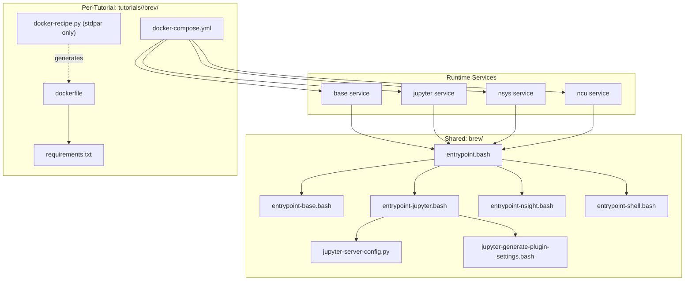

Sources: [brev/entrypoint.bash:1-91](), [brev/entrypoint-jupyter.bash:1-9](), [brev/entrypoint-base.bash:1-8](), [brev/entrypoint-nsight.bash:1-88](), [tutorials/accelerated-python/brev/docker-compose.yml:1-80]()

---

## Docker Environments

Every tutorial has a `dockerfile` under `tutorials/<name>/brev/`. Each container image:

- Sets `ACH_TUTORIAL` to identify the tutorial at runtime.
- Installs Python, GPU-relevant Python packages, Nsight Systems, and Nsight Compute.
- Copies the full repository into `/accelerated-computing-hub` and makes it world-writable.
- Sets `ENTRYPOINT` to `["/accelerated-computing-hub/brev/entrypoint.bash", "jupyter"]`.

The `stdpar` tutorial is the only exception: its Dockerfile is generated from an HPCCM recipe (`tutorials/stdpar/brev/docker-recipe.py`) rather than maintained as a static file, because it requires a complex HPC SDK toolchain.

**Tutorial image registry**

| Tutorial | Image | Base Image |
|---|---|---|
| `accelerated-python` | `ghcr.io/nvidia/accelerated-python-tutorial:latest` | `ghcr.io/nvidia/mirrors/nvidia-cuda-13.1.0-devel-ubuntu22.04` |
| `cuda-cpp` | `ghcr.io/nvidia/cuda-cpp-tutorial:latest` | `ghcr.io/nvidia/mirrors/rapidsai-devcontainers-25.10-cpp-cuda12.9` |
| `cuda-tile` | `ghcr.io/nvidia/cuda-tile-tutorial:latest` | `ghcr.io/nvidia/mirrors/nvidia-cuda-13.1.0-devel-ubuntu22.04` |
| `nvmath-python` | `ghcr.io/nvidia/nvmath-python-tutorial:latest` | `ghcr.io/nvidia/mirrors/pytorch-2.9.0-cuda12.8-cudnn9-runtime` |
| `stdpar` | `ghcr.io/nvidia/stdpar-tutorial:latest` | `nvcr.io/nvidia/nvhpc:<ver>-devel-cuda<ver>-ubuntu22.04` |

Sources: [tutorials/accelerated-python/brev/dockerfile:1-2](), [tutorials/cuda-cpp/brev/dockerfile:1-2](), [tutorials/cuda-tile/brev/dockerfile:1-2](), [tutorials/nvmath-python/brev/dockerfile:1-2](), [tutorials/stdpar/brev/docker-recipe.py:19]()

---

## Container Services

Every tutorial's `docker-compose.yml` declares four services with a consistent pattern.

**Docker Compose service topology**

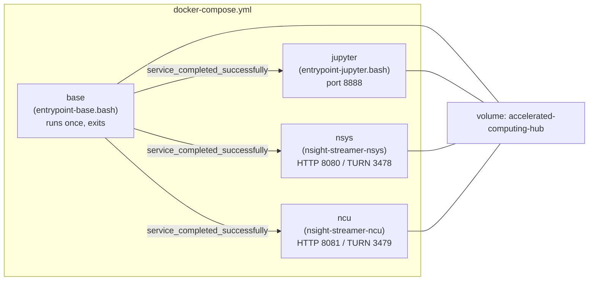

| Service | Image | Restart Policy | Purpose |
|---|---|---|---|
| `base` | tutorial image | `no` | One-time setup: TURN credential generation, optional test run |
| `jupyter` | tutorial image | `unless-stopped` | JupyterLab server on port 8888 |
| `nsys` | `nvcr.io/nvidia/devtools/nsight-streamer-nsys:2026.1.1` | `unless-stopped` | Nsight Systems web UI |
| `ncu` | `nvcr.io/nvidia/devtools/nsight-streamer-ncu:2025.4.1` | `unless-stopped` | Nsight Compute web UI |

All services share:
- A named Docker volume `accelerated-computing-hub` mounted at `/accelerated-computing-hub`.
- The Docker socket bind-mount `/var/run/docker.sock`.
- GPU access via `deploy.resources.reservations.devices` with `capabilities: [gpu]`.
- `privileged: true`, `ulimits.memlock: -1`, `shm_size: 1g`.

Sources: [tutorials/accelerated-python/brev/docker-compose.yml:8-80](), [tutorials/cuda-cpp/brev/docker-compose.yml:7-78]()

---

## Entrypoint Chain

The entrypoint system is split into a root-level dispatcher and per-service scripts. All containers share the same `entrypoint.bash` from `brev/`, which is baked into every image at build time.

**Entrypoint dispatch flow**

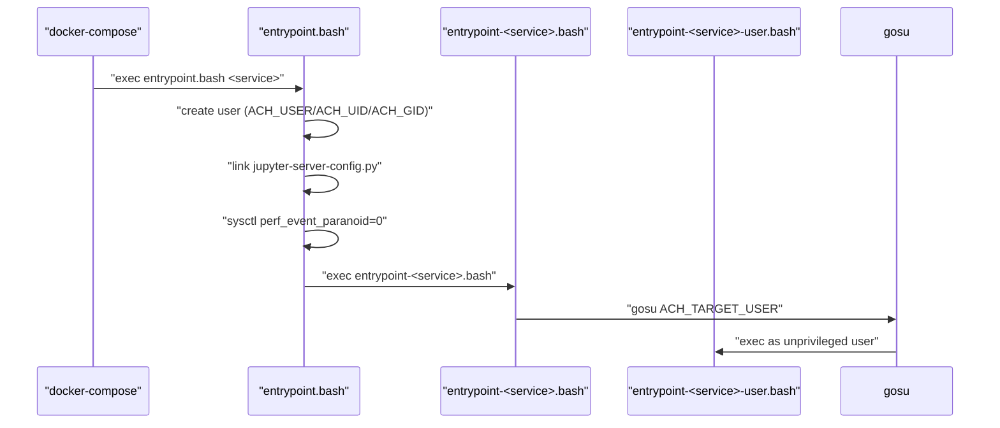

The `SERVICE` argument in `entrypoint.bash` controls dispatch. Valid values are `base`, `jupyter`, `nsys`, `ncu`, and `shell`.

[brev/entrypoint.bash:11-91]() handles:
1. Installing `gosu` if absent.
2. Creating the target user/group from `ACH_USER`, `ACH_UID`, `ACH_GID`.
3. Linking `jupyter-server-config.py` into `~/.jupyter/`.
4. Linking `ipython-startup-add-cwd-to-path.py` into the IPython startup directory.
5. Relaxing kernel profiling restrictions (`perf_event_paranoid`, `kptr_restrict`).
6. Delegating to `/accelerated-computing-hub/brev/entrypoint-${SERVICE}.bash`.

Sources: [brev/entrypoint.bash:1-91](), [brev/entrypoint-base.bash:1-8](), [brev/entrypoint-jupyter.bash:1-9](), [brev/entrypoint-nsight.bash:1-88](), [brev/entrypoint-shell.bash:1-8]()

---

## Key Environment Variables

These variables are set in both Dockerfiles and Docker Compose files and form the convention by which all scripts identify and configure tutorial containers.

| Variable | Set In | Purpose |
|---|---|---|
| `ACH_TUTORIAL` | Dockerfile `ENV`, Compose `common-env` | Identifies the tutorial (e.g. `accelerated-python`) |
| `ACH_USER` | Compose `common-env` (default: `ach`) | Username created at container startup |
| `ACH_UID` | Compose `common-env` (default: `1000`) | UID for the created user |
| `ACH_GID` | Compose `common-env` (default: `1000`) | GID for the created user |
| `ACH_RUN_TESTS` | Compose `common-env` (optional) | If set, `entrypoint-base-user.bash` runs `tutorials/<name>/brev/test.bash` |
| `BREV_ENV_ID` | Compose `common-env` (optional) | Brev environment identifier; used to construct JupyterLab plugin URLs |
| `ACH_PORT_FORWARDS` | `jupyter` service environment | Space-separated `localport:host:remoteport` tuples for `socat` forwarding |
| `ACH_NSYS_PATH` | Dockerfile `ENV` | Absolute path to the `nsys` binary |
| `ACH_NCU_PATH` | Dockerfile `ENV` | Absolute path to the `ncu` binary |
| `TURN_PORT` | `ncu` service environment (default: `3479`) | TURN server port for Nsight Compute streamer |

Sources: [tutorials/accelerated-python/brev/dockerfile:3-20](), [tutorials/accelerated-python/brev/docker-compose.yml:21-27](), [brev/entrypoint-base-user.bash:9-22](), [brev/entrypoint-jupyter-user.bash:16-21]()

---

## JupyterLab Configuration

`brev/jupyter-server-config.py` is linked into the user's `~/.jupyter/` directory by `entrypoint.bash`. It sets:

- `ServerApp.ip = '0.0.0.0'` — binds on all interfaces inside the container.
- `ServerApp.password = ''` and `IdentityProvider.token = ''` — no authentication (access is controlled by host port binding to `127.0.0.1`).
- `ServerApp.root_dir = '/'` — allows the file browser to navigate the full filesystem.
- `ServerProxy.servers` — registers `nsys` (port 8080) and `ncu` (port 8081) as proxied services accessible from the JupyterLab launcher.

`brev/jupyter-generate-plugin-settings.bash` generates per-session settings including the JupyterLab dark theme, TURN credentials, and the `jupyterlab-nvidia-nsight` plugin configuration pointing at the Nsight streamer URL.

The `jupyter` service uses `socat` to forward ports from the `nsys` and `ncu` Docker Compose services to localhost, as `jupyter-server-proxy` only proxies to localhost targets. The forwarding spec comes from `ACH_PORT_FORWARDS`, e.g. `"8080:nsys:8080 8081:ncu:8080"`.

Sources: [brev/jupyter-server-config.py:1-52](), [brev/jupyter-generate-plugin-settings.bash:1-60](), [brev/entrypoint-jupyter-user.bash:15-22]()

---

## TURN Credential Flow

The `base` service runs once before all other services. Its user-level script (`entrypoint-base-user.bash`) generates a random TURN username and password using `openssl rand` and writes them to `/accelerated-computing-hub/.turn-credentials` on the shared volume. Subsequent services (`nsys`, `ncu`, `jupyter`) read this file to configure TURN authentication for the Nsight streamers' WebRTC connections.

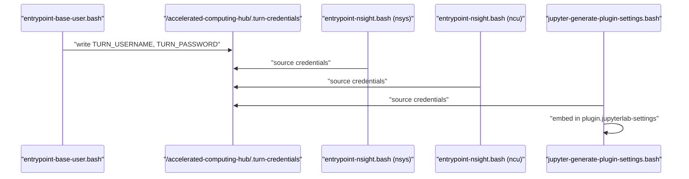

Sources: [brev/entrypoint-base-user.bash:12-22](), [brev/entrypoint-nsight.bash:42-47](), [brev/jupyter-generate-plugin-settings.bash:20-38]()

---

# Page: Tutorial Docker Environments

# Tutorial Docker Environments

<details>
<summary>Relevant source files</summary>

The following files were used as context for generating this wiki page:

- [brev/entrypoint.bash](brev/entrypoint.bash)
- [tutorials/accelerated-python/brev/docker-compose.yml](tutorials/accelerated-python/brev/docker-compose.yml)
- [tutorials/accelerated-python/brev/dockerfile](tutorials/accelerated-python/brev/dockerfile)
- [tutorials/cuda-cpp/brev/docker-compose.yml](tutorials/cuda-cpp/brev/docker-compose.yml)
- [tutorials/cuda-cpp/brev/dockerfile](tutorials/cuda-cpp/brev/dockerfile)
- [tutorials/cuda-tile/brev/docker-compose.yml](tutorials/cuda-tile/brev/docker-compose.yml)
- [tutorials/cuda-tile/brev/dockerfile](tutorials/cuda-tile/brev/dockerfile)
- [tutorials/nvmath-python/brev/docker-compose.yml](tutorials/nvmath-python/brev/docker-compose.yml)
- [tutorials/nvmath-python/brev/dockerfile](tutorials/nvmath-python/brev/dockerfile)
- [tutorials/stdpar/brev/docker-compose.yml](tutorials/stdpar/brev/docker-compose.yml)
- [tutorials/stdpar/brev/docker-recipe.py](tutorials/stdpar/brev/docker-recipe.py)

</details>


## Overview

This page documents the per-tutorial Docker configuration found under each `tutorials/<name>/brev/` directory. It covers base image selection, the environment variable conventions used across all tutorials, the shared Docker Compose service topology, GPU resource configuration, and the Nsight tool port assignments. It also highlights how the `stdpar` tutorial's HPCCM-based recipe differs from the plain Dockerfiles used by other tutorials.

For documentation of the entrypoint scripts that these containers execute at startup, see [Container Services and Entrypoints](#2.2). For the developer workflow scripts that build and run these environments locally, see [Development Workflow Scripts](#2.3). For how the CI/CD pipeline builds and publishes these images, see [Docker Image Build and Test Pipeline](#3.1).

---

## Directory Layout

Every tutorial follows the same layout convention inside its `brev/` subdirectory:

```
tutorials/<name>/brev/
├── dockerfile          # (or docker-recipe.py for stdpar)
├── docker-compose.yml
└── requirements.txt
```

The `stdpar` tutorial is the only one that generates its Dockerfile from a Python recipe rather than maintaining a static `dockerfile`. All others use a plain `dockerfile`.

---

## Base Image Selection

Each tutorial selects a base image tailored to its toolchain requirements. All base images are pulled from the mirrored registry `ghcr.io/nvidia/mirrors/` to avoid Docker Hub rate limits.

| Tutorial | Base Image | CUDA Version |
|---|---|---|
| `accelerated-python` | `ghcr.io/nvidia/mirrors/nvidia-cuda-13.1.0-devel-ubuntu22.04` | 13.1 |
| `cuda-cpp` | `ghcr.io/nvidia/mirrors/rapidsai-devcontainers-25.10-cpp-cuda12.9` | 12.9 |
| `cuda-tile` | `ghcr.io/nvidia/mirrors/nvidia-cuda-13.1.0-devel-ubuntu22.04` | 13.1 |
| `nvmath-python` | `ghcr.io/nvidia/mirrors/pytorch-2.9.0-cuda12.8-cudnn9-runtime` | 12.8 |
| `stdpar` | `nvcr.io/nvidia/nvhpc:24.3-devel-cuda12.3-ubuntu22.04` | 12.3 |

Sources: [tutorials/accelerated-python/brev/dockerfile:1](), [tutorials/cuda-cpp/brev/dockerfile:1](), [tutorials/cuda-tile/brev/dockerfile:1](), [tutorials/nvmath-python/brev/dockerfile:1](), [tutorials/stdpar/brev/docker-recipe.py:9-20]()

---

## Environment Variables

All tutorials set a common set of environment variables. Some variables are baked into the image via `ENV` directives; others are injected at runtime by Docker Compose.

### Build-time (`ENV` in Dockerfile)

| Variable | Purpose | Example Value |
|---|---|---|
| `ACH_TUTORIAL` | Identifies the tutorial; used by entrypoint scripts and CI | `accelerated-python` |
| `ACH_NSYS_PATH` | Absolute path to the `nsys` binary | `/opt/nvidia/nsight-systems-cli/2026.1.1/bin/nsys` |
| `ACH_NCU_PATH` | Absolute path to the `ncu` binary | `/opt/nvidia/nsight-compute/2025.4.1/ncu` |
| `PYTHON_VERSION` | Python version to install (ubuntu-based images only) | `3.12` |
| `NSIGHT_SYSTEMS_VERSION` | Nsight Systems version string | `2026.1.1` |
| `NSIGHT_COMPUTE_VERSION` | Nsight Compute version string | `2025.4.1` |
| `CUPY_CACHE_DIR` | Overrides CuPy JIT cache to a writable path | `/tmp/cupy_cache` |
| `MPLCONFIGDIR` | Overrides Matplotlib config to a writable path | `/tmp/matplotlib_cache` |
| `PIP_ROOT_USER_ACTION` | Silences pip root-user warning | `ignore` |
| `ACH_RAPIDS_VENV` | Path to the isolated RAPIDS venv (accelerated-python only) | `/opt/venvs/rapids` |

### Runtime (Docker Compose `environment` block)

| Variable | Purpose | Default |
|---|---|---|
| `ACH_USER` | Username created inside the container by the entrypoint | `ach` |
| `ACH_UID` | UID assigned to `ACH_USER` | `1000` |
| `ACH_GID` | GID assigned to `ACH_USER` | `1000` |
| `BREV_ENV_ID` | Brev platform environment ID; empty in local dev | `""` |
| `ACH_RUN_TESTS` | When set, the `base` service runs the test suite | `""` |
| `ACH_PORT_FORWARDS` | Tells the `jupyter` service which Nsight ports to proxy | `"8080:nsys:8080 8081:ncu:8080"` |
| `TURN_PORT` | Overrides the TURN listener port for the `ncu` service | `3479` |

Sources: [tutorials/accelerated-python/brev/dockerfile:3-20](), [tutorials/cuda-cpp/brev/dockerfile:3-9](), [tutorials/cuda-tile/brev/dockerfile:3-17](), [tutorials/nvmath-python/brev/dockerfile:3-6](), [tutorials/accelerated-python/brev/docker-compose.yml:21-28]()

---

## Dockerfile Build Layers

The Dockerfiles share a common layering strategy to maximize Docker build cache reuse.

**Shared build layer order (ubuntu-based images)**

```
FROM base-image
  │
  ├─ ENV  (ACH_TUTORIAL, tool versions, PATH)
  ├─ RUN  apt-get: system packages (git, gosu, curl, sudo, ...)
  ├─ RUN  sudo configuration (passwordless, env passthrough)
  ├─ RUN  Python installation (deadsnakes PPA, pip bootstrap)
  ├─ RUN  Docker-in-Docker installation
  ├─ RUN  PyTorch install (where required)
  ├─ COPY requirements.txt  → pip install  (cache-optimized layer)
  ├─ RUN  MPI install (accelerated-python only)
  ├─ RUN  Nsight Systems + Nsight Compute .deb install
  ├─ RUN  Jupyter lab extension disables
  ├─ RUN  RAPIDS venv creation (accelerated-python only)
  ├─ COPY . /accelerated-computing-hub
  ├─ RUN  chmod -R a+rwX /accelerated-computing-hub
  ├─ WORKDIR /accelerated-computing-hub/tutorials/<name>/notebooks
  └─ ENTRYPOINT ["/accelerated-computing-hub/brev/entrypoint.bash", "jupyter"]
```

The `requirements.txt` copy is deliberately placed before the full repo copy so that a change to notebook content does not invalidate the slow pip-install layer.

The `cuda-cpp` and `nvmath-python` images derive from heavier base images that already bundle Nsight tools, so they omit the Nsight `.deb` install step.

`ACH_NSYS_PATH` and `ACH_NCU_PATH` point at the tool binaries that match the specific version installed or pre-bundled in each image.

Sources: [tutorials/accelerated-python/brev/dockerfile:22-128](), [tutorials/cuda-cpp/brev/dockerfile:11-60](), [tutorials/cuda-tile/brev/dockerfile:19-87](), [tutorials/nvmath-python/brev/dockerfile:8-57]()

---

## Docker Compose Service Topology

Every tutorial's `docker-compose.yml` defines the same four services using YAML anchors to share configuration blocks.

**Docker Compose Service Topology**

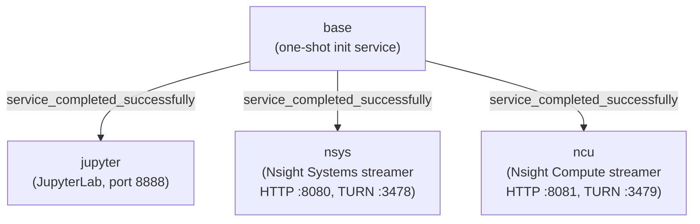

Sources: [tutorials/accelerated-python/brev/docker-compose.yml:36-78](), [tutorials/cuda-cpp/brev/docker-compose.yml:35-79]()

### Services

| Service | Image | Restart | Role |
|---|---|---|---|
| `base` | tutorial image | `no` | Runs `entrypoint.bash base`; performs one-time setup; other services wait for it |
| `jupyter` | tutorial image | `unless-stopped` | Runs `entrypoint.bash jupyter`; serves JupyterLab |
| `nsys` | `nvcr.io/nvidia/devtools/nsight-streamer-nsys:2026.1.1` | `unless-stopped` | Streams Nsight Systems UI |
| `ncu` | `nvcr.io/nvidia/devtools/nsight-streamer-ncu:2025.4.1` | `unless-stopped` | Streams Nsight Compute UI |

The `nsys` and `ncu` services use separate vendor images from NVIDIA Container Registry rather than the tutorial image. The entrypoint for both is still `entrypoint.bash nsight`.

Sources: [tutorials/accelerated-python/brev/docker-compose.yml:42-78](), [tutorials/cuda-cpp/brev/docker-compose.yml:41-78]()

### GPU Configuration Block

All four services in every tutorial receive the same GPU resource block, expressed as the `gpu-config` YAML anchor:

```
privileged: true
ulimits:
  memlock: -1
  stack: 67108864
shm_size: 1g
deploy.resources.reservations.devices:
  - driver: nvidia, count: all, capabilities: [gpu]
```

`privileged: true` is required by the Nsight profiling tools. `memlock: -1` removes the locked-memory limit needed for pinned memory allocations. `shm_size: 1g` prevents shared-memory exhaustion in multi-process workloads such as MPI.

Sources: [tutorials/accelerated-python/brev/docker-compose.yml:8-20](), [tutorials/cuda-cpp/brev/docker-compose.yml:7-19]()

### Shared Volumes

Every service mounts the same two volumes:

| Mount | Purpose |
|---|---|
| `accelerated-computing-hub:/accelerated-computing-hub` | Named volume holding tutorial content; populated by the `base` service |
| `/var/run/docker.sock:/var/run/docker.sock` | Allows Docker-in-Docker for tutorials that build containers |

Sources: [tutorials/accelerated-python/brev/docker-compose.yml:28-34]()

---

## Port Assignments

**Port Map Across Services**

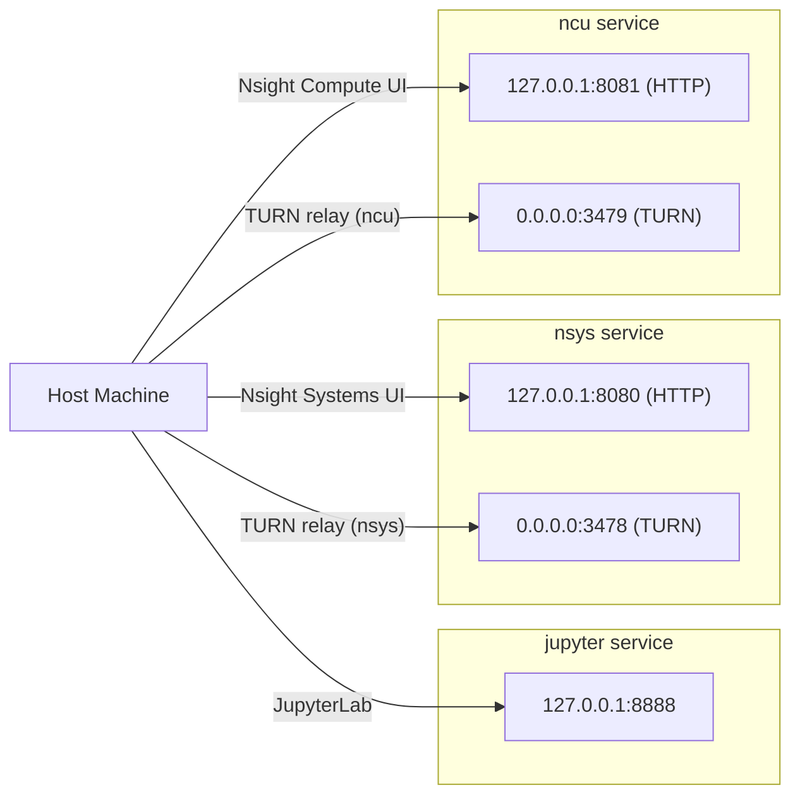

| Port | Protocol | Bound Address | Service | Purpose |
|---|---|---|---|---|
| `8888` | HTTP | `127.0.0.1` | `jupyter` | JupyterLab UI |
| `8080` | HTTP | `127.0.0.1` | `nsys` | Nsight Systems web UI |
| `3478` | UDP/TCP | `0.0.0.0` | `nsys` | TURN relay for WebRTC |
| `8081` | HTTP | `127.0.0.1` | `ncu` | Nsight Compute web UI |
| `3479` | UDP/TCP | `0.0.0.0` | `ncu` | TURN relay for WebRTC (overridden via `TURN_PORT=3479`) |

HTTP ports for JupyterLab and the Nsight streamers bind to `127.0.0.1` only. TURN ports bind to `0.0.0.0` because they must be reachable by the client's WebRTC stack from outside the host. The `ncu` service overrides the default TURN port (`3478`) by setting `TURN_PORT: "3479"` to avoid collision with the `nsys` service.

The `jupyter` service sets `ACH_PORT_FORWARDS: "8080:nsys:8080 8081:ncu:8080"`, which tells the entrypoint to set up reverse-proxy connections from the JupyterLab container into the Nsight streamer containers.

Sources: [tutorials/accelerated-python/brev/docker-compose.yml:58-77](), [tutorials/cuda-cpp/brev/docker-compose.yml:58-75](), [tutorials/cuda-tile/brev/docker-compose.yml:58-77]()

---

## Per-Tutorial Comparison

**Dockerfile and Image Differences Across Tutorials**

```mermaid
graph TD
    subgraph "accelerated-python"
        ap_base["ghcr.io/nvidia/mirrors/\nnvidia-cuda-13.1.0-devel-ubuntu22.04"]
        ap_extras["+ Python 3.12 (deadsnakes)\n+ PyTorch cu130\n+ Nsight Systems 2026.1.1 .deb\n+ Nsight Compute 2025.4.1 .deb\n+ OpenMPI\n+ RAPIDS venv (cuDF, cuML)\n+ Docker-in-Docker"]
        ap_base --> ap_extras
    end

    subgraph "cuda-cpp"
        cc_base["ghcr.io/nvidia/mirrors/\nrapidsai-devcontainers-25.10-cpp-cuda12.9"]
        cc_extras["+ Python packages from requirements.txt\n+ ffmpeg, git-lfs, gosu, sudo\n+ Docker-in-Docker\n(nsys/ncu bundled in base image)"]
        cc_base --> cc_extras
    end

    subgraph "cuda-tile"
        ct_base["ghcr.io/nvidia/mirrors/\nnvidia-cuda-13.1.0-devel-ubuntu22.04"]
        ct_extras["+ Python 3.12 (deadsnakes)\n+ PyTorch cu130\n+ Nsight Systems 2026.1.1 .deb\n+ Nsight Compute 2025.4.1 .deb\n(no RAPIDS venv, no MPI)"]
        ct_base --> ct_extras
    end

    subgraph "nvmath-python"
        nm_base["ghcr.io/nvidia/mirrors/\npytorch-2.9.0-cuda12.8-cudnn9-runtime"]
        nm_extras["+ Python packages from requirements.txt\n+ git-lfs, gosu, sudo\n+ Docker-in-Docker\n(PyTorch + nsys/ncu in base image)"]
        nm_base --> nm_extras
    end

    subgraph "stdpar"
        sp_base["nvcr.io/nvidia/nvhpc:\n24.3-devel-cuda12.3-ubuntu22.04"]
        sp_extras["+ GCC 13 + LLVM 18\n+ CMake 3.27.2\n+ Boost 1.75.0\n+ AdaptiveCpp\n+ range-v3, stdexec\n+ OpenMPI\n(via HPCCM docker-recipe.py)"]
        sp_base --> sp_extras
    end
```

Sources: [tutorials/accelerated-python/brev/dockerfile:1-129](), [tutorials/cuda-cpp/brev/dockerfile:1-61](), [tutorials/cuda-tile/brev/dockerfile:1-88](), [tutorials/nvmath-python/brev/dockerfile:1-57](), [tutorials/stdpar/brev/docker-recipe.py:1-157]()

### Notable Per-Tutorial Details

**`accelerated-python`**
- Installs Nsight Systems and Nsight Compute from `.deb` packages downloaded at build time using `NSIGHT_SYSTEMS_DEB_FILE` and `NSIGHT_COMPUTE_DEB_FILE` env vars. [tutorials/accelerated-python/brev/dockerfile:92-101]()
- Creates an isolated venv at `ACH_RAPIDS_VENV=/opt/venvs/rapids` containing `cudf-cu13`, `cuml-cu13`, and `ipykernel`, then registers it as a Jupyter kernel named `cudf-cu13-25.10`. [tutorials/accelerated-python/brev/dockerfile:108-119]()
- Installs OpenMPI for distributed computing exercises. [tutorials/accelerated-python/brev/dockerfile:84-90]()
- Sets `OMPI_ALLOW_RUN_AS_ROOT=1` and `OMPI_ALLOW_RUN_AS_ROOT_CONFIRM=1` for MPI-over-root-user scenarios.

**`cuda-cpp`**
- Derives from the RAPIDS devcontainers image which already bundles a complete C++ toolchain, Nsight tools, and a Python environment. The Dockerfile is therefore shorter — it only adds Python packages, a few system utilities, and Docker. [tutorials/cuda-cpp/brev/dockerfile:14-51]()
- `ACH_NSYS_PATH` and `ACH_NCU_PATH` point into `/usr/local/cuda-12.9/bin/` rather than standalone install paths. [tutorials/cuda-cpp/brev/dockerfile:4-5]()

**`cuda-tile`**
- Structurally identical to `accelerated-python` but omits the RAPIDS venv, MPI installation, and `socat`. [tutorials/cuda-tile/brev/dockerfile:1-88]()
- Sets a `default-jupyter-url` that opens `start.ipynb` directly at container launch. [tutorials/cuda-tile/brev/docker-compose.yml:7]()

**`nvmath-python`**
- Derives from the PyTorch runtime image which includes CUDA 12.8, cuDNN 9, and an existing Python environment. No Nsight tool install step is needed. [tutorials/nvmath-python/brev/dockerfile:1]()
- The `docker-compose.yml` includes `large: &large true` [tutorials/nvmath-python/brev/docker-compose.yml:7](), a metadata flag consumed by the CI discovery step to control resource allocation.

**`stdpar`**
- The only tutorial without a static `dockerfile`. Instead, `docker-recipe.py` is a Python script using the [HPCCM](https://github.com/NVIDIA/hpc-container-maker) library to programmatically generate the Dockerfile. [tutorials/stdpar/brev/docker-recipe.py:1-157]()
- The base image is the NVIDIA HPC SDK image (`nvhpc`), providing `nvfortran`, `nvc++`, and MPI.
- Additional toolchains — GCC 13, LLVM 18, Boost, CMake, AdaptiveCpp, `range-v3`, and `stdexec` — are compiled and installed from source inside the recipe. [tutorials/stdpar/brev/docker-recipe.py:75-138]()
- `ACH_NSYS_PATH` and `ACH_NCU_PATH` reference binaries within the HPC SDK directory (`/opt/nvidia/hpc_sdk/Linux_<arch>/<ver>/compilers/bin/`). [tutorials/stdpar/brev/docker-recipe.py:28-29]()
- Does **not** have a `default-jupyter-url` override in its compose file, unlike `cuda-tile` and `stdpar`. [tutorials/stdpar/brev/docker-compose.yml:7]()

---

## Entrypoint Convention

Every image declares the same `ENTRYPOINT` form:

```
ENTRYPOINT ["/accelerated-computing-hub/brev/entrypoint.bash", "jupyter"]
```

The first argument (`jupyter`) is the service name. The Docker Compose file overrides this argument per-service — for example, the `base` service passes `"base"` and the `nsys` service passes `"nsight"`. The entrypoint script at `brev/entrypoint.bash` reads `$1` to determine which service-specific script to delegate to. See [Container Services and Entrypoints](#2.2) for the full dispatch logic.

Sources: [tutorials/accelerated-python/brev/dockerfile:128](), [brev/entrypoint.bash:84-91](), [tutorials/accelerated-python/brev/docker-compose.yml:46-65]()

---

# Page: Container Services and Entrypoints

# Container Services and Entrypoints

<details>
<summary>Relevant source files</summary>

The following files were used as context for generating this wiki page:

- [brev/entrypoint-base-user.bash](brev/entrypoint-base-user.bash)
- [brev/entrypoint-base.bash](brev/entrypoint-base.bash)
- [brev/entrypoint-jupyter-user.bash](brev/entrypoint-jupyter-user.bash)
- [brev/entrypoint-jupyter.bash](brev/entrypoint-jupyter.bash)
- [brev/entrypoint-nsight.bash](brev/entrypoint-nsight.bash)
- [brev/entrypoint-shell.bash](brev/entrypoint-shell.bash)
- [brev/entrypoint.bash](brev/entrypoint.bash)
- [brev/jupyter-generate-plugin-settings.bash](brev/jupyter-generate-plugin-settings.bash)
- [brev/jupyter-server-config.py](brev/jupyter-server-config.py)
- [tutorials/accelerated-python/brev/docker-compose.yml](tutorials/accelerated-python/brev/docker-compose.yml)
- [tutorials/accelerated-python/brev/dockerfile](tutorials/accelerated-python/brev/dockerfile)
- [tutorials/cuda-cpp/brev/docker-compose.yml](tutorials/cuda-cpp/brev/docker-compose.yml)
- [tutorials/cuda-cpp/brev/dockerfile](tutorials/cuda-cpp/brev/dockerfile)
- [tutorials/cuda-tile/brev/docker-compose.yml](tutorials/cuda-tile/brev/docker-compose.yml)
- [tutorials/cuda-tile/brev/dockerfile](tutorials/cuda-tile/brev/dockerfile)
- [tutorials/nvmath-python/brev/docker-compose.yml](tutorials/nvmath-python/brev/docker-compose.yml)
- [tutorials/nvmath-python/brev/dockerfile](tutorials/nvmath-python/brev/dockerfile)
- [tutorials/stdpar/brev/docker-compose.yml](tutorials/stdpar/brev/docker-compose.yml)
- [tutorials/stdpar/brev/docker-recipe.py](tutorials/stdpar/brev/docker-recipe.py)

</details>


## Purpose and Scope

This page documents the shared runtime layer that starts and configures every tutorial container: the `brev/entrypoint.bash` dispatcher, the service-specific entrypoint scripts it delegates to, the JupyterLab server configuration, TURN credential generation, and the Nsight streamer integration.

This page covers runtime behavior — what happens when a container starts. For how Docker images are built and how Docker Compose files are structured per tutorial, see [Tutorial Docker Environments](#2.1). For the developer scripts that invoke these services locally, see [Development Workflow Scripts](#2.3).

---

## Service Model

Every tutorial shares the same four-service Docker Compose pattern. All services start as `root` and hand off to a non-root user via `gosu`. The `base` service runs once at startup, and all other services `depends_on: base`.

**Service Summary**

| Service | Image | Restart | Ports | Purpose |
|---|---|---|---|---|
| `base` | tutorial image | `no` | — | One-time setup: user creation, TURN credential generation, optional test run |
| `jupyter` | tutorial image | `unless-stopped` | `127.0.0.1:8888:8888` | JupyterLab server |
| `nsys` | `nsight-streamer-nsys` | `unless-stopped` | `127.0.0.1:8080:8080`, `0.0.0.0:3478:3478` | Nsight Systems web streamer |
| `ncu` | `nsight-streamer-ncu` | `unless-stopped` | `127.0.0.1:8081:8080`, `0.0.0.0:3479:3479` | Nsight Compute web streamer |

The `nsys` and `ncu` services use NVIDIA's pre-built Nsight Streamer images (`nvcr.io/nvidia/devtools/nsight-streamer-nsys` and `nvcr.io/nvidia/devtools/nsight-streamer-ncu`), not the tutorial image. The `brev/entrypoint.bash` script is injected into them via the shared volume mount at `/accelerated-computing-hub`.

Sources: [tutorials/accelerated-python/brev/docker-compose.yml:42-78](), [tutorials/cuda-cpp/brev/docker-compose.yml:42-78]()

---

## Entrypoint Script Chain

Every service's Docker Compose entry uses the form:

```
entrypoint: ["/accelerated-computing-hub/brev/entrypoint.bash", "<service>"]
```

`entrypoint.bash` is the single entry point for all services. It reads the first argument as the service name, performs shared root-level setup, then delegates to `entrypoint-<service>.bash`.

**Entrypoint Dispatch Flow**

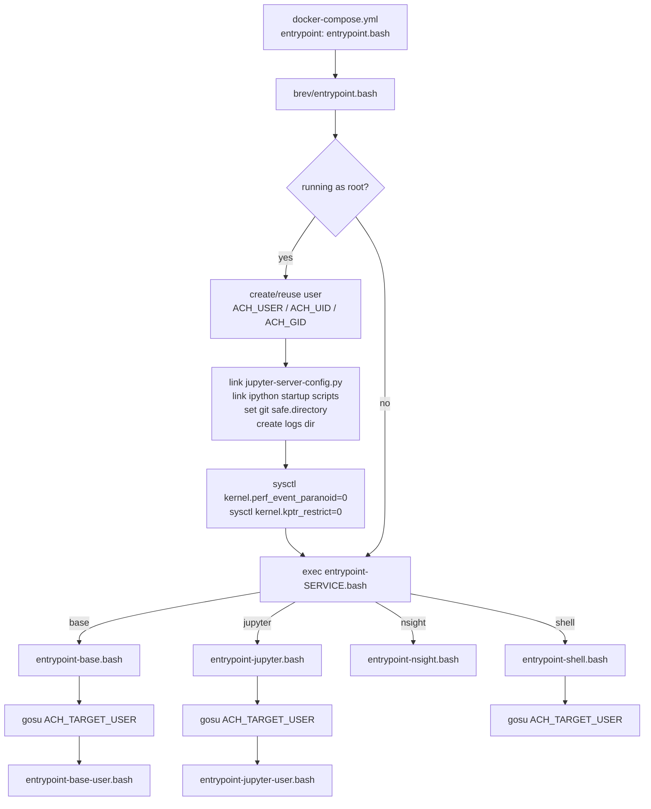

Sources: [brev/entrypoint.bash:1-91](), [brev/entrypoint-base.bash:1-8](), [brev/entrypoint-jupyter.bash:1-8](), [brev/entrypoint-shell.bash:1-8](), [brev/entrypoint-nsight.bash:1-87]()

---

## `entrypoint.bash` — Root Setup Stage

[brev/entrypoint.bash:1-91]()

When the container runs as root (which it always does per `user: root` in the Compose files), this script performs the following before dispatching:

**User Provisioning**

The script reads `ACH_USER`, `ACH_UID`, and `ACH_GID` from the environment. These are set by Docker Compose's `common-env` block and default to `ach`/`1000`/`1000`.

The provisioning logic handles conflicts gracefully:

1. If `ACH_USER` already exists → reuse it.
2. If `ACH_USER` doesn't exist but `ACH_UID` is taken → reuse the existing username for that UID.
3. Otherwise → create a new group and user. Also adds the user to the `docker` group if it exists.

The resolved username is exported as `ACH_TARGET_USER` and the home directory as `ACH_TARGET_HOME` for downstream scripts.

**Jupyter Directory Setup (via gosu)**

The following directories and symlinks are created as the target user:

| Path | Action |
|---|---|
| `~/.jupyter` | `mkdir -p` |
| `~/.local/share/jupyter` | `mkdir -p` |
| `~/.ipython/profile_default/startup` | `mkdir -p` |
| `~/.local/state` | `mkdir -p` |
| `~/.jupyter/jupyter_server_config.py` | symlink → `brev/jupyter-server-config.py` |
| `~/.ipython/profile_default/startup/00-add-cwd-to-path.py` | symlink → `brev/ipython-startup-add-cwd-to-path.py` |

**Profiling Permissions**

Two `sysctl` calls relax kernel profiling restrictions so Nsight tools can run without root:

```
kernel.perf_event_paranoid = 0
kernel.kptr_restrict = 0
```

Sources: [brev/entrypoint.bash:26-82]()

---

## `base` Service

The `base` service runs once at startup (`restart: "no"`) and must complete successfully before `jupyter`, `nsys`, and `ncu` start.

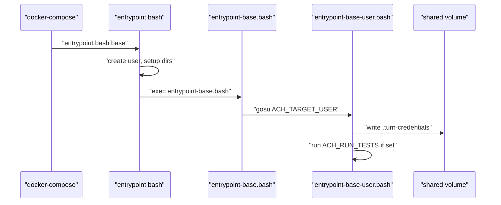

**TURN Credential Generation**

[brev/entrypoint-base-user.bash:9-22]()

If `/accelerated-computing-hub/.turn-credentials` does not yet exist, the script generates it:

- `TURN_USERNAME` = `turn_` + 16 random alphanumeric characters (via `openssl rand`)
- `TURN_PASSWORD` = 32 random alphanumeric characters

The file is written with mode `644` so all services can read it from the shared Docker volume.

**Test Execution**

[brev/entrypoint-base-user.bash:24-72]()

If both `ACH_TUTORIAL` and `ACH_RUN_TESTS` are set, the script executes `tutorials/<ACH_TUTORIAL>/brev/test.bash` and tees output to `/accelerated-computing-hub/logs/test.log`. A non-zero exit code from the test script causes the base service to fail, which prevents the dependent services from starting.

Sources: [brev/entrypoint-base.bash:1-8](), [brev/entrypoint-base-user.bash:1-73]()

---

## `jupyter` Service

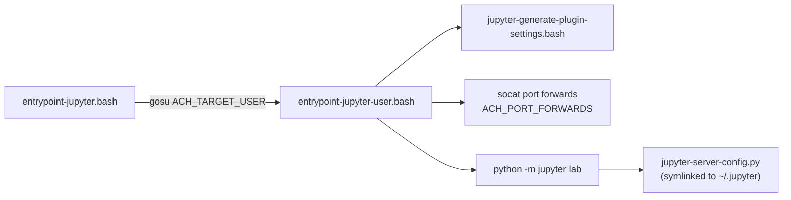

### JupyterLab Server Configuration

[brev/jupyter-server-config.py:1-52]()

The file `brev/jupyter-server-config.py` is symlinked into the user's `~/.jupyter/` directory at startup. Key settings:

| Setting | Value | Effect |
|---|---|---|
| `ServerApp.ip` | `0.0.0.0` | Binds to all interfaces |
| `ServerApp.open_browser` | `False` | No auto-open |
| `ServerApp.allow_root` | `True` | Permits root execution |
| `ServerApp.password` | `''` | No password |
| `IdentityProvider.token` | `''` | No token |
| `ServerApp.root_dir` | `'/'` | Full filesystem visible |
| `terminado_settings.shell_command` | `['/bin/bash']` | Bash in terminals |
| `Application.log_level` | `'INFO'` | File + console logging |

Logs are written to `/accelerated-computing-hub/logs/jupyter-server.log`.

### `jupyter-server-proxy` Integration

[brev/jupyter-server-config.py:33-52]()

The `c.ServerProxy.servers` dict registers two reverse-proxy entries in JupyterLab's launcher:

| Proxy key | Local port | Launcher title | Category |
|---|---|---|---|
| `nsys` | `8080` | Nsight Systems | Nsight |
| `ncu` | `8081` | Nsight Compute | Nsight |

Both entries set `new_browser_tab: False` so the Nsight UI renders in the JupyterLab panel. The `command` field is empty because `jupyter-server-proxy` is not launching the process — the `nsys` and `ncu` Docker Compose services are already running it.

### `socat` Port Forwarding

[brev/entrypoint-jupyter-user.bash:16-22]()

The `nsys` and `ncu` Docker Compose services expose HTTP on ports `8080` and `8081` respectively. However, `jupyter-server-proxy` can only forward to `localhost`. The `jupyter` service sets:

```
ACH_PORT_FORWARDS="8080:nsys:8080 8081:ncu:8080"
```

The user-level Jupyter entrypoint parses this variable and starts a `socat` relay for each entry:

```
socat TCP-LISTEN:<LOCAL_PORT>,fork,reuseaddr TCP:<REMOTE>
```

This makes `nsys:8080` reachable as `localhost:8080` inside the `jupyter` container, which `jupyter-server-proxy` then proxies to the browser.

### Plugin Settings Generation

[brev/jupyter-generate-plugin-settings.bash:1-59]()

Called from `entrypoint-jupyter-user.bash` before JupyterLab starts. Writes three settings files:

| File path | Plugin | Content |
|---|---|---|
| `~/.jupyter/lab/user-settings/@jupyterlab/apputils-extension/themes.jupyterlab-settings` | Theme | JupyterLab Dark theme |
| `~/.jupyter/lab/user-settings/jupyterlab-nvidia-nsight/plugin.jupyterlab-settings` | Nsight plugin | Host, Docker host, streamer URL, TURN credentials |
| `~/.jupyter/lab/user-settings/@jupyterlab/notebook-extension/tracker.jupyterlab-settings` | Notebook | `recordTiming: true` |

The Nsight plugin settings use `BREV_ENV_ID` to construct DNS names in the form `jupyter0-<BREV_ENV_ID>.brevlab.com` and `nsys0-<BREV_ENV_ID>.brevlab.com`. TURN credentials are read from the `/accelerated-computing-hub/.turn-credentials` file generated by the `base` service.

Sources: [brev/entrypoint-jupyter.bash:1-8](), [brev/entrypoint-jupyter-user.bash:1-31](), [brev/jupyter-server-config.py:1-52](), [brev/jupyter-generate-plugin-settings.bash:1-59]()

---

## `nsys` and `ncu` Services (Nsight Streamer)

The `nsys` and `ncu` services use NVIDIA Nsight Streamer container images that have their own native entrypoint at `/setup/entrypoint.sh`. The `brev/entrypoint.bash` chain is used to inject pre-configuration before handing off.

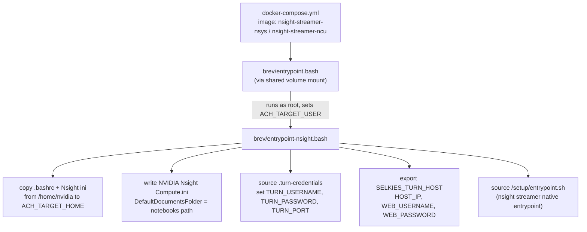

**Key responsibilities of `entrypoint-nsight.bash`:**

1. **Group name fix** — The Nsight Streamer's native entrypoint runs `chown $USER:$USER` internally. If the target GID was already taken and a group with a different name was reused, this command would fail. The script creates a group named `ACH_TARGET_USER` if one does not already exist to satisfy this requirement.

2. **Home directory population** — Copies `/home/nvidia/.bashrc` and the Nsight Systems `.ini` file into `ACH_TARGET_HOME` so the streamer finds its expected configuration.

3. **Nsight Compute default folder** — Writes `~/.config/NVIDIA Corporation/NVIDIA Nsight Compute.ini` with `CorePlugin.DefaultDocumentsFolder` set to the tutorial's notebooks directory.

4. **TURN credential injection** — Reads `/accelerated-computing-hub/.turn-credentials` and exports `TURN_USERNAME`, `TURN_PASSWORD`, and optionally `TURN_PORT` into the environment and appends them to `~/.bashrc`. The public IP for TURN relay is fetched via `curl -sSL ifconfig.me` and exported as `SELKIES_TURN_HOST`.

5. **Restart workaround** — Removes `/usr/lib/x86_64-linux-gnu/libnvrtc.so` and `/mnt/persist/home/host` if they exist, preventing symlink creation failures on container restart.

6. **Native handoff** — Calls `source /setup/entrypoint.sh`, which performs user switching using the `USER` environment variable (set to `ACH_TARGET_USER`) and starts the streaming server.

**Port assignments:**

| Service | HTTP (container) | HTTP (host) | TURN (container) | TURN (host) | TURN_PORT env |
|---|---|---|---|---|---|
| `nsys` | 8080 | 8080 | 3478 | 3478 | (default) |
| `ncu` | 8080 | 8081 | 3479 | 3479 | `3479` |

Sources: [brev/entrypoint-nsight.bash:1-87](), [tutorials/accelerated-python/brev/docker-compose.yml:61-77]()

---

## TURN Credential Flow

TURN credentials are generated once (in the `base` service) and consumed by three other services. The shared Docker volume is the communication channel.

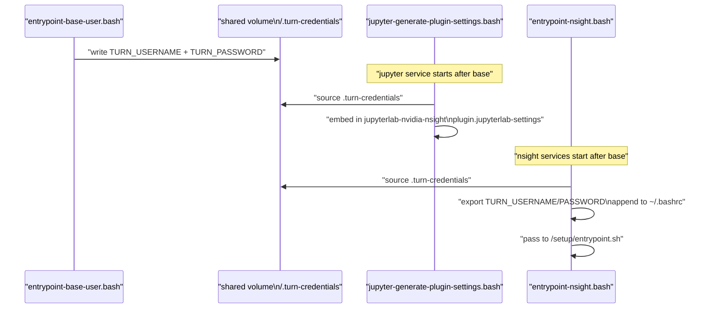

Sources: [brev/entrypoint-base-user.bash:9-22](), [brev/jupyter-generate-plugin-settings.bash:20-26](), [brev/entrypoint-nsight.bash:41-47]()

---

## Environment Variables Reference

The following environment variables control entrypoint behavior. They are defined in each tutorial's `docker-compose.yml` under the `common-env` anchor and resolved at container start time.

| Variable | Default | Set by | Consumed by |
|---|---|---|---|
| `ACH_USER` | `ach` | Docker Compose `common-env` | `entrypoint.bash` — username to create |
| `ACH_UID` | `1000` | Docker Compose `common-env` | `entrypoint.bash` — UID for new user |
| `ACH_GID` | `1000` | Docker Compose `common-env` | `entrypoint.bash` — GID for new user |
| `ACH_TUTORIAL` | (tutorial name) | Docker Compose `common-env` | `entrypoint-base-user.bash` — test script path |
| `ACH_RUN_TESTS` | `''` | Docker Compose `common-env` | `entrypoint-base-user.bash` — enables test run |
| `BREV_ENV_ID` | `''` | Docker Compose `common-env` | `jupyter-generate-plugin-settings.bash` — Brev DNS hostname |
| `ACH_PORT_FORWARDS` | (set per service) | `jupyter` service environment | `entrypoint-jupyter-user.bash` — socat forwards |
| `TURN_PORT` | `3478` | `ncu` service environment | `entrypoint-nsight.bash` — non-default TURN port |
| `ACH_TARGET_USER` | (resolved) | `entrypoint.bash` (exported) | all `entrypoint-*.bash` scripts |
| `ACH_TARGET_HOME` | (resolved) | `entrypoint.bash` (exported) | all `entrypoint-*.bash` scripts |

Sources: [brev/entrypoint.bash:27-51](), [tutorials/accelerated-python/brev/docker-compose.yml:21-28](), [tutorials/accelerated-python/brev/docker-compose.yml:56-58](), [tutorials/accelerated-python/brev/docker-compose.yml:72-74]()

---

# Page: Development Workflow Scripts

# Development Workflow Scripts

<details>
<summary>Relevant source files</summary>

The following files were used as context for generating this wiki page:

- [CONTRIBUTING.md](CONTRIBUTING.md)
- [brev/.lycheeignore](brev/.lycheeignore)
- [brev/dev-build.bash](brev/dev-build.bash)
- [brev/dev-common.bash](brev/dev-common.bash)
- [brev/dev-shell.bash](brev/dev-shell.bash)
- [brev/dev-start.bash](brev/dev-start.bash)
- [brev/dev-stop.bash](brev/dev-stop.bash)
- [brev/dev-test.bash](brev/dev-test.bash)
- [brev/discover-tutorials.bash](brev/discover-tutorials.bash)
- [brev/lychee.toml](brev/lychee.toml)
- [brev/test-links.bash](brev/test-links.bash)

</details>


This page documents the developer-facing Bash scripts located in the `brev/` directory that manage tutorial environments on a local workstation. These scripts handle building images, starting and stopping containers, opening interactive shells, and running tests — all against a locally cloned copy of the repository.

This page covers only the local development tooling. For documentation on what runs *inside* the containers (entrypoints, JupyterLab, Nsight services), see [Container Services and Entrypoints](#2.2). For the Docker Compose files and Dockerfiles that these scripts operate on, see [Tutorial Docker Environments](#2.1). For the CI pipelines that use related but distinct scripts, see [CI/CD Pipelines](#3).

---

## Script Overview

All scripts live in the `brev/` directory at the root of the repository. They are designed to be run from any working directory — each script resolves `REPO_ROOT` from its own location.

| Script | Purpose | Required Arguments |
|---|---|---|
| `brev/dev-build.bash` | Build Docker images for one or all tutorials | `[tutorial-name]` (optional) |
| `brev/dev-start.bash` | Start containers for a tutorial | `<tutorial-name>` |
| `brev/dev-stop.bash` | Stop containers for a tutorial | `<tutorial-name>` |
| `brev/dev-shell.bash` | Open an interactive shell in a container service | `<tutorial-name\|compose-file> <service-name>` |
| `brev/dev-test.bash` | Run tutorial tests with local repo mounted | `<tutorial-name\|compose-file>` |
| `brev/dev-common.bash` | Shared helper library (sourced, not executed directly) | — |
| `brev/discover-tutorials.bash` | List all tutorials that have a `brev/docker-compose.yml` | — |

Sources: [brev/dev-build.bash:1-10](), [brev/dev-start.bash:1-10](), [brev/dev-stop.bash:1-10](), [brev/dev-shell.bash:1-12](), [brev/dev-test.bash:1-14](), [brev/dev-common.bash:1-13](), [brev/discover-tutorials.bash:1-10](), [CONTRIBUTING.md:9-22]()

---

## Script Relationships

**Workflow overview — which scripts call which:**

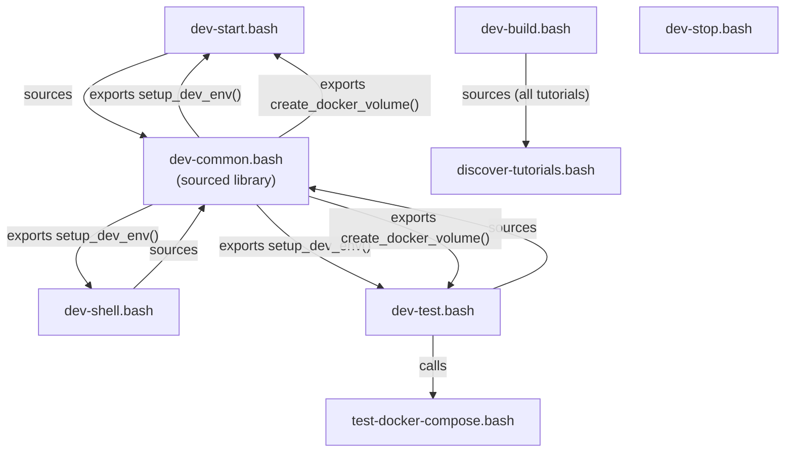

Sources: [brev/dev-build.bash:54](), [brev/dev-start.bash:41-43](), [brev/dev-shell.bash:24-25](), [brev/dev-test.bash:80-82](), [brev/dev-common.bash:15-46]()

---

## `dev-common.bash` — Shared Library

`brev/dev-common.bash` is sourced by `dev-start.bash`, `dev-shell.bash`, and `dev-test.bash`. It defines two functions:

### `setup_dev_env(REPO_ROOT)`

[brev/dev-common.bash:15-25]()

Exports four environment variables into the calling shell:

| Variable | Source | Purpose |
|---|---|---|
| `ACH_UID` | `id -u` | Host user's numeric UID, passed into Docker containers |
| `ACH_GID` | `id -g` | Host user's numeric GID |
| `ACH_USER` | `id -un` | Host username string |
| `ACH_REPO_ROOT` | Argument | Absolute path to the cloned repository |

These variables allow Docker Compose to create container users that match the host user, avoiding file permission issues when the repository is bind-mounted.

### `create_docker_volume(ACH_TUTORIAL)`

[brev/dev-common.bash:28-46]()

1. Removes any pre-existing Docker volumes named `<tutorial>_accelerated-computing-hub` or `accelerated-computing-hub` to ensure they point to the current repository path.
2. Creates a new local bind-mount Docker volume named `<tutorial>_accelerated-computing-hub` that maps to `ACH_REPO_ROOT`.

This volume is what makes the local repository visible at `/accelerated-computing-hub` inside the running containers.

**Volume creation flow:**

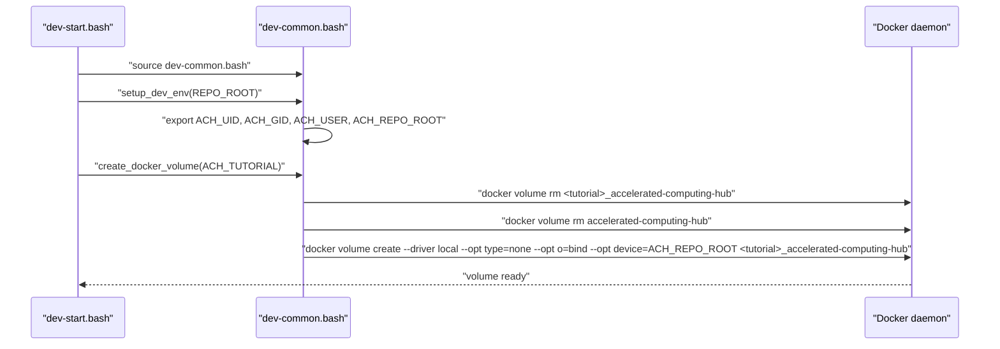

Sources: [brev/dev-common.bash:15-46]()

---

## `discover-tutorials.bash`

[brev/discover-tutorials.bash:1-18]()

Scans the `tutorials/` directory for subdirectories that contain a `brev/docker-compose.yml` file. Outputs one absolute path per line, sorted alphabetically. A tutorial is considered valid if and only if it has a Compose file; tutorials without one are silently skipped.

Used by `dev-build.bash` when no tutorial name is provided (build-all mode).

```
tutorials/accelerated-python
tutorials/cuda-cpp
tutorials/standard-parallelism
...
```

Sources: [brev/discover-tutorials.bash:12-17](), [brev/dev-build.bash:54-58]()

---

## `dev-build.bash`

[brev/dev-build.bash:1-75]()

Builds one or all tutorial Docker images.

**Usage:**
```bash
# Build a single tutorial
./brev/dev-build.bash accelerated-python

# Build all tutorials
./brev/dev-build.bash
```

### HPCCM Recipe Support

Before running `docker compose build`, the `build_tutorial()` function checks whether `brev/docker-recipe.py` exists in the tutorial directory [brev/dev-build.bash:32-40](). If it does:

1. Verifies `hpccm` is on `PATH`; exits with an error if not.
2. Runs `hpccm --recipe docker-recipe.py --format docker` and writes the output to `brev/dockerfile`.
3. Proceeds with `docker compose build`, which uses the freshly generated `dockerfile`.

This mechanism is currently used by the Standard Parallelism tutorial (see [4.5](#4.5) for details on that tutorial's HPCCM recipe).

**Build flow:**

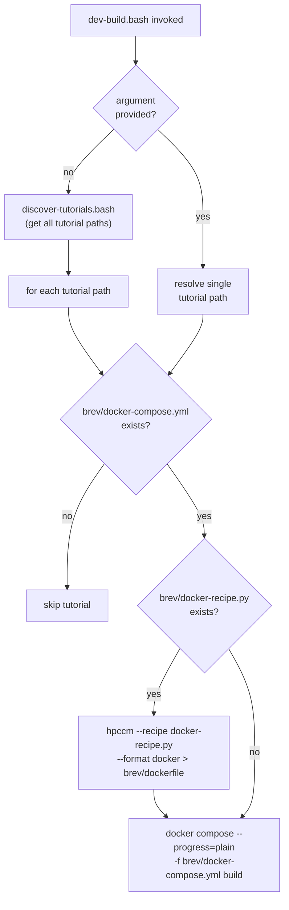

Sources: [brev/dev-build.bash:17-74]()

---

## `dev-start.bash`

[brev/dev-start.bash:1-56]()

Starts the Docker Compose stack for a named tutorial in detached mode.

**Usage:**
```bash
./brev/dev-start.bash accelerated-python
```

### Port Binding Rewrite

The tutorial `docker-compose.yml` files bind ports to `127.0.0.1` by default, so they are inaccessible from outside the host when running on a remote VM or in Brev. For local development, `dev-start.bash` performs a sed substitution before launching:

[brev/dev-start.bash:50]()

```
sed 's/127\.0\.0\.1:/0.0.0.0:/g' "${DOCKER_COMPOSE}" > "${DOCKER_COMPOSE_DEV}"
```

The modified file is written to `/tmp/docker-compose.<tutorial>.dev.yml` and is what gets passed to `docker compose up`. This makes all ports accessible from the developer's machine.

### Startup Sequence

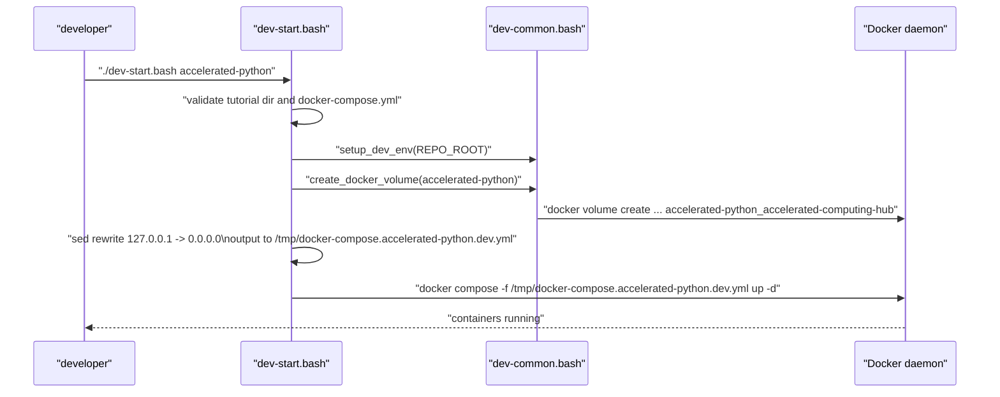

Sources: [brev/dev-start.bash:41-55]()

---

## `dev-stop.bash`

[brev/dev-stop.bash:1-44]()

Stops and removes the Docker Compose stack for a tutorial. Unlike `dev-start.bash`, it uses the original (unmodified) `docker-compose.yml` directly for `docker compose down`.

**Usage:**
```bash
./brev/dev-stop.bash accelerated-python
```

Sources: [brev/dev-stop.bash:40-43]()

---

## `dev-shell.bash`

[brev/dev-shell.bash:1-122]()

Opens an interactive `bash` shell inside a named service of a tutorial's Docker Compose stack.

**Usage:**
```bash
# By tutorial name + service name
./brev/dev-shell.bash accelerated-python jupyter

# By path to docker-compose.yml + service name
./brev/dev-shell.bash tutorials/accelerated-python/brev/docker-compose.yml jupyter
```

The script accepts either a tutorial name or a direct path to a `docker-compose.yml` file as its first argument. A path is detected by the presence of `/` in the argument string [brev/dev-shell.bash:62-87]().

Before launching the shell, any existing Docker volume for the tutorial is removed to ensure a fresh bind mount [brev/dev-shell.bash:102-107](). The shell is started with:

```
docker compose -f <compose-file> run --rm -it \
    --entrypoint "/accelerated-computing-hub/brev/entrypoint.bash" \
    <service> shell
```

[brev/dev-shell.bash:114-116]()

This invokes `entrypoint.bash` with `shell` as its argument, which drops into an interactive bash session as the host-matching user. For more on `entrypoint.bash`, see [Container Services and Entrypoints](#2.2).

Sources: [brev/dev-shell.bash:56-116]()

---

## `dev-test.bash`

[brev/dev-test.bash:1-92]()

Sets up the development environment (volume bind mount, UID/GID exports) and then delegates to `brev/test-docker-compose.bash` to execute the tutorial's test suite.

**Usage:**
```bash
./brev/dev-test.bash accelerated-python
./brev/dev-test.bash tutorials/accelerated-python/brev/docker-compose.yml
```

Like `dev-shell.bash`, the first argument can be either a tutorial name or a Compose file path. The tutorial name is extracted from the path in the latter case [brev/dev-test.bash:57-73]().

The actual test execution is delegated to `test-docker-compose.bash` [brev/dev-test.bash:91](), which is also used by the CI pipeline (see [Docker Image Build and Test Pipeline](#3.1)).

Sources: [brev/dev-test.bash:56-91]()

---

## Argument Resolution — Name vs. Path

Both `dev-shell.bash` and `dev-test.bash` accept either a tutorial name or a Compose file path. The following table summarizes the resolution logic:

| Input form | Detection rule | Example |
|---|---|---|
| Tutorial name | No `/` in argument | `accelerated-python` |
| Compose file path | Contains `/` | `tutorials/accelerated-python/brev/docker-compose.yml` |

When given a path, the tutorial name is derived by traversing up two directories from the Compose file:

```
.../tutorials/<tutorial-name>/brev/docker-compose.yml
                 ^-- basename of parent of parent
```

Sources: [brev/dev-shell.bash:62-87](), [brev/dev-test.bash:57-73]()

---

## Full Developer Workflow

**Typical local development session:**

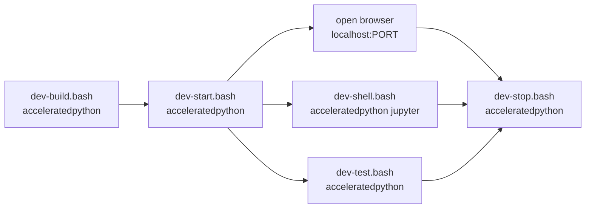

Sources: [CONTRIBUTING.md:9-22]()

---

# Page: CI/CD Pipelines

# CI/CD Pipelines

<details>
<summary>Relevant source files</summary>

The following files were used as context for generating this wiki page:

- [.github/workflows/build-brev-tutorial-docker-images.yml](.github/workflows/build-brev-tutorial-docker-images.yml)
- [.github/workflows/mirror-base-images.yml](.github/workflows/mirror-base-images.yml)
- [.github/workflows/pr-comment-fork.yml](.github/workflows/pr-comment-fork.yml)
- [.github/workflows/pr-comment-git-lfs.yml](.github/workflows/pr-comment-git-lfs.yml)
- [.github/workflows/pr-comment-git-signatures.yml](.github/workflows/pr-comment-git-signatures.yml)
- [.github/workflows/pr-comment-links.yml](.github/workflows/pr-comment-links.yml)
- [.github/workflows/pr-comment-yaml.yml](.github/workflows/pr-comment-yaml.yml)
- [.github/workflows/test-brev-tutorial-docker-images.yml](.github/workflows/test-brev-tutorial-docker-images.yml)
- [.github/workflows/test-git-lfs.yml](.github/workflows/test-git-lfs.yml)
- [.github/workflows/test-git-signatures.yml](.github/workflows/test-git-signatures.yml)
- [.github/workflows/test-links.yml](.github/workflows/test-links.yml)
- [.github/workflows/test-yaml.yml](.github/workflows/test-yaml.yml)
- [brev/test-docker-compose.bash](brev/test-docker-compose.bash)
- [brev/test-git-lfs.bash](brev/test-git-lfs.bash)
- [brev/test-git-signatures.bash](brev/test-git-signatures.bash)

</details>


## Purpose and Scope

This page provides an overview of the GitHub Actions automation in the Accelerated Computing Hub repository. All workflow files live under `.github/workflows/`. The pipelines fall into two categories:

- **Docker image lifecycle** — building, testing, and mirroring tutorial container images. Detailed coverage is in [Docker Image Build and Test Pipeline](#3.1).
- **Code quality enforcement** — PR checks for broken links, commit signatures, Git LFS compliance, and YAML syntax. Detailed coverage is in [Code Quality and Repository Checks](#3.2).

For information about the local developer scripts that complement these pipelines (e.g. `dev-build.bash`, `dev-test.bash`), see [Development Workflow Scripts](#2.3). For the Docker environments that these pipelines build and test, see [Tutorial Docker Environments](#2.1).

---

## Workflow Inventory

| File | Name | Category | Triggers |
|---|---|---|---|
| `build-brev-tutorial-docker-images.yml` | Build and Push Brev Tutorial Docker Images | Image lifecycle | `push` to `main`/PR branches, nightly schedule, `workflow_dispatch` |
| `test-brev-tutorial-docker-images.yml` | Test Brev Tutorial Docker Images | Image lifecycle | `workflow_dispatch` only (triggered by build workflow) |
| `mirror-base-images.yml` | Mirror Base Images to GHCR | Image lifecycle | Nightly schedule, `workflow_dispatch` |
| `test-links.yml` | Test Links | Code quality | `push` to any branch, `pull_request` |
| `test-git-signatures.yml` | Test Git Signatures | Code quality | `push` to any branch, `pull_request` |
| `test-git-lfs.yml` | Test Git LFS | Code quality | `push` to any branch, `pull_request` |
| `test-yaml.yml` | Test YAML | Code quality | `push` to any branch, `pull_request` |
| `pr-comment-links.yml` | PR Comment on Link Check | PR feedback | `workflow_run` on Test Links completion |
| `pr-comment-git-signatures.yml` | PR Comment on Git Signatures Check | PR feedback | `workflow_run` on Test Git Signatures completion |
| `pr-comment-git-lfs.yml` | PR Comment on Git LFS Check | PR feedback | `workflow_run` on Test Git LFS completion |
| `pr-comment-yaml.yml` | PR Comment on YAML Check | PR feedback | `workflow_run` on Test YAML completion |
| `pr-comment-fork.yml` | PR Comment on Forks | PR feedback | `pull_request_target` opened/reopened from forks |

Sources: [.github/workflows/build-brev-tutorial-docker-images.yml:1-12](), [.github/workflows/test-brev-tutorial-docker-images.yml:1-18](), [.github/workflows/mirror-base-images.yml:1-13](), [.github/workflows/test-links.yml:1-9](), [.github/workflows/test-git-signatures.yml:1-9](), [.github/workflows/test-git-lfs.yml:1-9](), [.github/workflows/test-yaml.yml:1-9]()

---

## Pipeline Architecture

The following diagram maps all workflow files to their roles and relationships.

**Overall CI/CD Pipeline Architecture**

```mermaid
flowchart TD
    subgraph "Triggers"
        T1["push to main / PR branch"]
        T2["nightly schedule (cron)"]
        T3["workflow_dispatch"]
        T4["pull_request event"]
        T5["workflow_run (completed)"]
    end

    subgraph "Image Lifecycle Pipelines"
        BLD["`build-brev-tutorial-docker-images.yml`"]
        TST["`test-brev-tutorial-docker-images.yml`"]
        MIR["`mirror-base-images.yml`"]
    end

    subgraph "Code Quality Pipelines"
        LNK["`test-links.yml`"]
        SIG["`test-git-signatures.yml`"]
        LFS["`test-git-lfs.yml`"]
        YML["`test-yaml.yml`"]
    end

    subgraph "PR Feedback Workflows"
        PC_LNK["`pr-comment-links.yml`"]
        PC_SIG["`pr-comment-git-signatures.yml`"]
        PC_LFS["`pr-comment-git-lfs.yml`"]
        PC_YML["`pr-comment-yaml.yml`"]
        PC_FORK["`pr-comment-fork.yml`"]
    end

    subgraph "Artifacts and Registries"
        GHCR["GHCR (ghcr.io/nvidia/...)"]
        GEN["generated branch"]
        CA["GitHub Actions Artifacts"]
        CS["GitHub Commit Statuses API"]
    end

    T1 --> BLD
    T2 --> BLD
    T3 --> BLD
    T2 --> MIR
    T3 --> MIR
    T1 --> LNK
    T4 --> LNK
    T1 --> SIG
    T4 --> SIG
    T1 --> LFS
    T4 --> LFS
    T1 --> YML
    T4 --> YML
    T4 --> PC_FORK

    BLD -- "triggers via gh workflow run" --> TST
    BLD -- "pushes image" --> GHCR
    BLD -- "pushes compose files" --> GEN
    BLD -- "uploads artifact" --> CA
    BLD -- "creates pending status" --> CS
    MIR -- "pushes mirror" --> GHCR
    TST -- "downloads artifact" --> CA
    TST -- "pulls image" --> GHCR
    TST -- "updates status success/failure" --> CS

    LNK -- "uploads pr-comment-data" --> CA
    SIG -- "uploads pr-comment-data" --> CA
    LFS -- "uploads pr-comment-data" --> CA
    YML -- "uploads pr-comment-data" --> CA

    T5 --> PC_LNK
    T5 --> PC_SIG
    T5 --> PC_LFS
    T5 --> PC_YML

    PC_LNK -- "downloads pr-comment-data" --> CA
    PC_SIG -- "downloads pr-comment-data" --> CA
    PC_LFS -- "downloads pr-comment-data" --> CA
    PC_YML -- "downloads pr-comment-data" --> CA
```

Sources: [.github/workflows/build-brev-tutorial-docker-images.yml:1-264](), [.github/workflows/test-brev-tutorial-docker-images.yml:1-189](), [.github/workflows/mirror-base-images.yml:1-92](), [.github/workflows/pr-comment-links.yml:1-10](), [.github/workflows/pr-comment-git-signatures.yml:1-10](), [.github/workflows/pr-comment-git-lfs.yml:1-10](), [.github/workflows/pr-comment-yaml.yml:1-10]()

---

## Docker Image Lifecycle

The three image lifecycle workflows work together to maintain up-to-date tutorial images in GHCR and keep build times short through cached base images.

**Docker Image Lifecycle Workflow Sequence**

```mermaid
sequenceDiagram
    participant G as "GitHub Push / Schedule"
    participant B as "build-brev-tutorial-docker-images.yml"
    participant M as "mirror-base-images.yml"
    participant T as "test-brev-tutorial-docker-images.yml"
    participant GHCR as "ghcr.io/nvidia/..."
    participant CS as "GitHub Commit Status"

    G->>M: "nightly cron (4 AM UTC)"
    M->>GHCR: "pull from Docker Hub / nvcr.io"
    M->>GHCR: "push to ghcr.io/nvidia/mirrors/..."

    G->>B: "push / nightly / dispatch"
    B->>B: "discover-tutorials.bash → matrix"
    B->>B: "HPCCM recipe → Dockerfile (if docker-recipe.py exists)"
    B->>B: "generate-tagged-docker-composes.py"
    B->>GHCR: "docker buildx bake → image push"
    B->>CS: "POST /statuses (pending)"
    B-->>T: "gh workflow run (dispatch)"
    T->>GHCR: "docker pull (pre-pull)"
    T->>T: "brev/test-docker-compose.bash"
    T->>CS: "POST /statuses (success | failure)"
```

Sources: [.github/workflows/build-brev-tutorial-docker-images.yml:22-253](), [.github/workflows/test-brev-tutorial-docker-images.yml:31-188](), [.github/workflows/mirror-base-images.yml:34-91]()

### Key Design Decisions

**Tutorial discovery via matrix:** The `discover-tutorials` job runs `brev/discover-tutorials.bash` and emits the result as a JSON array. The `build-and-push` job consumes it via `strategy.matrix`, so each tutorial builds and pushes independently and in parallel. See [.github/workflows/build-brev-tutorial-docker-images.yml:22-53]().

**HPCCM conditional Dockerfile generation:** If a tutorial contains `brev/docker-recipe.py`, the workflow installs `hpccm` and generates a `Dockerfile` from the recipe before invoking `docker buildx bake`. Tutorials without `docker-recipe.py` supply a static `dockerfile` directly. See [.github/workflows/build-brev-tutorial-docker-images.yml:79-103]().

**Docker image tags produced per build:**

| Tag pattern | Purpose |
|---|---|
| `{branch}-git-{short_sha}` | Commit-pinned; used by test workflow |
| `{branch}-latest` | Latest build for a given branch |
| `latest` | Only on `main` branch builds |
| `buildcache-{branch}` | BuildKit cache storage in GHCR |

See [.github/workflows/build-brev-tutorial-docker-images.yml:220-228]().

**Compose artifact flow:** The build workflow uploads the commit-specific compose file as a GitHub Actions artifact named `docker-compose-{tutorial}-{branch}-git-{sha}`. The test workflow downloads this artifact by `run_id` to ensure it tests exactly the image built in that run. See [.github/workflows/build-brev-tutorial-docker-images.yml:119-124]() and [.github/workflows/test-brev-tutorial-docker-images.yml:54-60]().

**`generated` branch:** Branch-latest compose files are committed to a separate `generated` branch with retry logic to handle concurrent pushes from parallel matrix jobs. See [.github/workflows/build-brev-tutorial-docker-images.yml:126-168]().

**Cache behavior:** Nightly scheduled builds and manual `workflow_dispatch` runs with `purge_cache: true` skip `--cache-from` flags and prune the local BuildKit cache before building. All other builds attempt to reuse the branch-specific or `main` build cache from GHCR. See [.github/workflows/build-brev-tutorial-docker-images.yml:184-228]().

**Test runner:** The test job runs on `linux-amd64-gpu-l4-latest-1`, a self-hosted GPU runner. It stops DCGM services before testing so that Nsight Compute profiling inside the container is not blocked. The actual test is performed by `brev/test-docker-compose.bash`, which starts containers, checks for restart loops, tests a restart cycle, and tears down. See [.github/workflows/test-brev-tutorial-docker-images.yml:69-161]() and [brev/test-docker-compose.bash:96-277]().

**Base image mirroring:** `mirror-base-images.yml` copies a fixed set of upstream images (RAPIDS devcontainers, PyTorch, CUDA) into `ghcr.io/nvidia/mirrors/` nightly. This decouples tutorial builds from Docker Hub rate limits and upstream registry availability. The matrix is defined inline at [.github/workflows/mirror-base-images.yml:22-30]().

Sources: [.github/workflows/build-brev-tutorial-docker-images.yml:1-264](), [.github/workflows/test-brev-tutorial-docker-images.yml:1-189](), [.github/workflows/mirror-base-images.yml:1-92](), [brev/test-docker-compose.bash:1-278]()

---

## Code Quality Enforcement

Four check workflows run on every push and pull request. Each check workflow follows the same pattern: run the check, write a `pr-comment-data/` directory with the PR number and outcome, upload it as an artifact, and then a paired `pr-comment-*.yml` workflow downloads that artifact and posts a remediation comment if the check failed.

**PR Check and Comment Feedback Loop**

```mermaid
flowchart LR
    subgraph "Check Workflow (runs on push + pull_request)"
        C1["checkout"]
        C2["run check tool"]
        C3["save pr-comment-data/"]
        C4["upload-artifact: pr-comment-data"]
        C1 --> C2 --> C3 --> C4
    end

    subgraph "Comment Workflow (workflow_run trigger)"
        D1["download-artifact: pr-comment-data"]
        D2["read pr_number + outcome"]
        D3["github-script: createComment or updateComment"]
        D1 --> D2 --> D3
    end

    C4 -- "workflow_run completed" --> D1
    D3 -- "posts to" --> PR["Pull Request Comments"]
```

Sources: [.github/workflows/test-links.yml:47-60](), [.github/workflows/pr-comment-links.yml:1-94](), [.github/workflows/test-git-signatures.yml:110-128](), [.github/workflows/pr-comment-git-signatures.yml:1-110]()

### Individual Checks

| Workflow | Tool | What it checks | Paired comment workflow |
|---|---|---|---|
| `test-links.yml` | `lychee` (via `lycheeverse/lychee-action`) + `nbconvert` | Converts notebooks to Markdown, then validates all hyperlinks using `brev/lychee.toml` and `brev/.lycheeignore` | `pr-comment-links.yml` |
| `test-git-signatures.yml` | GitHub API (`github.rest.repos.getCommit`) | Every commit on the branch that is not in `origin/main` must have `verification.verified == true` | `pr-comment-git-signatures.yml` |
| `test-git-lfs.yml` | `brev/test-git-lfs.bash` | No `.gitattributes` in subdirectories; all files matching `filter=lfs` patterns in the top-level `.gitattributes` are actual LFS objects | `pr-comment-git-lfs.yml` |
| `test-yaml.yml` | `yamllint` | All YAML files pass `yamllint` with line-length checking disabled | `pr-comment-yaml.yml` |

Sources: [.github/workflows/test-links.yml:28-45](), [.github/workflows/test-git-signatures.yml:25-108](), [.github/workflows/test-git-lfs.yml:22-25](), [.github/workflows/test-yaml.yml:27-33]()

### Link Check Details

The `test-links.yml` workflow first converts all `.ipynb` files to Markdown with `jupyter nbconvert --to markdown` before running `lychee`. This ensures that links embedded in notebook cells are also validated. The `lychee` invocation uses `brev/lychee.toml` for configuration and `brev/.lycheeignore` to suppress known false positives. See [.github/workflows/test-links.yml:34-45]().

### Git Signature Check Details

The `test-git-signatures.yml` workflow skips verification when running on `main` (to avoid failing on historical unsigned commits). On any other branch it collects commits via `git rev-list origin/main..HEAD` and calls the GitHub API per commit to read the `commit.verification` object. Failed commits are collected into outputs (`unsigned_count`, `unsigned_commits`) that the paired comment workflow uses to produce a remediation message. See [.github/workflows/test-git-signatures.yml:36-108]().

A local shell equivalent is available at `brev/test-git-signatures.bash`, which uses `git verify-commit` instead of the API. See [brev/test-git-signatures.bash:71-111]().

### Git LFS Check Details

The `brev/test-git-lfs.bash` script performs two checks:

1. Searches for `.gitattributes` files more than one directory level deep (`find -mindepth 2`). Only the top-level `.gitattributes` is allowed.
2. For each file extension declared with `filter=lfs` in `.gitattributes`, finds matching files and verifies each is either listed in `git lfs ls-files` output, is an LFS pointer file, or has the `filter=lfs` git attribute set.

The script writes `error_type` and `error_files` to `$GITHUB_OUTPUT` when invoked in CI, allowing the `pr-comment-git-lfs.yml` workflow to emit a type-specific remediation comment. See [brev/test-git-lfs.bash:74-209]().

### Fork PR Handling

Because the build workflow uses self-hosted runners and cannot run on pull requests from forks (a GitHub Actions security restriction), `pr-comment-fork.yml` posts an informational comment on any PR opened from a fork. The comment instructs maintainers to follow the manual CI trigger process described in `CONTRIBUTING.md`. See [.github/workflows/pr-comment-fork.yml:1-26]().

Sources: [.github/workflows/test-links.yml:1-60](), [.github/workflows/test-git-signatures.yml:1-128](), [.github/workflows/test-git-lfs.yml:1-43](), [.github/workflows/test-yaml.yml:1-49](), [brev/test-git-lfs.bash:1-213](), [brev/test-git-signatures.bash:1-143](), [.github/workflows/pr-comment-fork.yml:1-26]()

---

## Runner Requirements

| Workflow | Runner | Notes |
|---|---|---|
| `build-and-push` job in `build-brev-tutorial-docker-images.yml` | `linux-amd64-cpu4` (self-hosted) | Requires Docker Buildx with registry cache support; not available for fork PRs |
| `discover-tutorials` job | `linux-amd64-cpu4` (self-hosted) | CPU-only discovery step |
| `test-tutorial` job in `test-brev-tutorial-docker-images.yml` | `linux-amd64-gpu-l4-latest-1` (self-hosted GPU) | Requires NVIDIA L4 GPU; DCGM is stopped before tests |
| All code quality workflows | `ubuntu-latest` (GitHub-hosted) | Standard hosted runner; no GPU or Docker registry access needed |
| `mirror-base-images.yml` | `ubuntu-latest` (GitHub-hosted) | Only needs Docker and GHCR push access |

Sources: [.github/workflows/build-brev-tutorial-docker-images.yml:23-24](), [.github/workflows/test-brev-tutorial-docker-images.yml:22-23](), [.github/workflows/mirror-base-images.yml:18](), [.github/workflows/test-links.yml:16]()

---

# Page: Docker Image Build and Test Pipeline

# Docker Image Build and Test Pipeline

<details>
<summary>Relevant source files</summary>

The following files were used as context for generating this wiki page:

- [.github/workflows/build-brev-tutorial-docker-images.yml](.github/workflows/build-brev-tutorial-docker-images.yml)
- [.github/workflows/mirror-base-images.yml](.github/workflows/mirror-base-images.yml)
- [.github/workflows/test-brev-tutorial-docker-images.yml](.github/workflows/test-brev-tutorial-docker-images.yml)
- [brev/test-docker-compose.bash](brev/test-docker-compose.bash)

</details>


## Purpose and Scope

This page covers the three GitHub Actions workflows responsible for the Docker image lifecycle in the Accelerated Computing Hub repository: building and pushing per-tutorial images, testing those images on GPU hardware, and mirroring upstream base images to GHCR for reliable builds.

This page is specific to the CI automation. For the local developer equivalents of these operations, see [Development Workflow Scripts](#2.3). For the Dockerfiles and Compose configurations that these workflows operate on, see [Tutorial Docker Environments](#2.1).

---

## Overview of the Three Workflows

| Workflow File | Name | Trigger | Purpose |
|---|---|---|---|
| `build-brev-tutorial-docker-images.yml` | Build and Push Brev Tutorial Docker Images | push, schedule, `workflow_dispatch` | Discover tutorials, build images, push to GHCR, trigger tests |
| `test-brev-tutorial-docker-images.yml` | Test Brev Tutorial Docker Images | `workflow_dispatch` only (called by build) | Pull built image, run container lifecycle tests on GPU runner |
| `mirror-base-images.yml` | Mirror Base Images to GHCR | schedule, `workflow_dispatch` | Re-host upstream base images on GHCR for build stability |

---

## Build and Push Workflow

### Triggers

The build workflow runs under three conditions:

- **Push** to `main` or any branch matching `pull-request/[0-9]+`
- **Nightly schedule** at 05:00 UTC (midnight EST)
- **Manual dispatch** via `workflow_dispatch`, with an optional boolean input `purge_cache`

> **Note:** `pull_request` events are intentionally not supported due to self-hosted runner constraints with fork PRs. See `CONTRIBUTING.md` for the manual PR review procedure.

Sources: [.github/workflows/build-brev-tutorial-docker-images.yml:1-20]()

### Job Structure

The build workflow has two sequential jobs.

**Workflow: build-brev-tutorial-docker-images.yml — Job Graph**

```mermaid
flowchart TD
  A["discover-tutorials\n(linux-amd64-cpu4)"] -->|"matrix: tutorials[]"| B["build-and-push\n(linux-amd64-cpu4)\n× N tutorials"]
  B --> C["test-brev-tutorial-docker-images.yml\n(triggered via gh workflow run)"]
```

Sources: [.github/workflows/build-brev-tutorial-docker-images.yml:21-54]()

### Job 1: `discover-tutorials`

Runs `brev/discover-tutorials.bash` and captures the output as a JSON array of tutorial directory paths. This array becomes the matrix input for the `build-and-push` job.

```
tutorials=$(brev/discover-tutorials.bash | jq -R -s -c 'split("\n") | map(select(length > 0))')
```

Sources: [.github/workflows/build-brev-tutorial-docker-images.yml:22-38]()

### Job 2: `build-and-push` (matrix)

One instance of this job runs per tutorial. The steps within it are:

**Step-by-step breakdown:**

```mermaid
flowchart TD
  S1["Set branch + SHA variables\n(GIT_BRANCH_NAME, DOCKER_TAG_BRANCH,\nGIT_SHORT_SHA)"]
  S2["Set IMAGE_NAME\nghcr.io/owner/tutorialname-tutorial"]
  S3{"Has\ndocker-recipe.py?"}
  S4a["Install hpccm\nGenerate Dockerfile\nvia hpccm --recipe"]
  S4b["Use existing Dockerfile"]
  S5["generate-tagged-docker-composes.py\n(commit-specific + branch-latest)"]
  S6["Upload commit-specific\ncompose as artifact"]
  S7["Push branch-latest compose\nto generated branch"]
  S8["docker buildx bake\nPush to GHCR"]
  S9["Create pending commit status\ngh api POST /statuses"]
  S10["gh workflow run\ntest-brev-tutorial-docker-images.yml"]

  S1 --> S2 --> S3
  S3 -->|yes| S4a --> S5
  S3 -->|no| S4b --> S5
  S5 --> S6 --> S7 --> S8 --> S9 --> S10
```

Sources: [.github/workflows/build-brev-tutorial-docker-images.yml:56-253]()

### HPCCM Dockerfile Generation

Some tutorials (notably Standard Parallelism) define their Docker environment via an HPCCM recipe file `brev/docker-recipe.py` instead of a plain `Dockerfile`. The workflow detects this:

[.github/workflows/build-brev-tutorial-docker-images.yml:79-103]()

If `HAS_HPCCM=true`, the workflow installs the `hpccm` Python package and runs:

```
hpccm --recipe <tutorial>/brev/docker-recipe.py --format docker > <tutorial>/brev/dockerfile
```

The generated `dockerfile` is then consumed by the subsequent `docker buildx bake` step. For tutorials without a recipe, the existing `dockerfile` is used directly.

Sources: [.github/workflows/build-brev-tutorial-docker-images.yml:79-103]()

### Docker Compose Artifact Generation

The script `brev/generate-tagged-docker-composes.py` is called twice per tutorial to produce two tagged variants of the Docker Compose file:

| Variant | Tag Pattern | Output Directory | Retention |
|---|---|---|---|
| Commit-specific | `<branch>-git-<short-sha>` | `artifacts/commit-specific/` | 30 days (uploaded as GitHub artifact) |
| Branch-latest | `<branch>-latest` | `artifacts/branch-latest/` | Pushed to `generated` git branch |

The `generated` branch maintains a directory structure of `<branch-name>/tutorials/<tutorial-name>/` and is updated with retry logic to handle concurrent matrix job pushes.

Sources: [.github/workflows/build-brev-tutorial-docker-images.yml:105-170]()

### Docker Image Build and Push

The image build uses `docker buildx bake` targeting the `base` service in the tutorial's `docker-compose.yml`. Images are pushed directly to GHCR (`type=registry`).

**Image tag conventions:**

| Condition | Tags applied |
|---|---|
| Any branch | `<branch-latest>`, `<branch>-git-<short-sha>` |
| `main` branch only | `latest` (additional tag) |

**Cache strategy:**

- **Normal builds** use `--cache-from` pointing to the branch-specific and `main` build caches stored in GHCR under the `buildcache-<branch>` tag.
- **Nightly scheduled builds** and manual `purge_cache` builds skip `--cache-from` entirely and clear local buildx and Docker caches beforehand.
- **Cache writes** use `mode=max` with `zstd` compression at level 3.

The build step uses `nick-fields/retry@v3` with up to 3 attempts and a 60-minute timeout per attempt.

Sources: [.github/workflows/build-brev-tutorial-docker-images.yml:172-228]()

### Test Workflow Trigger

After a successful push, the build job:
1. Posts a `pending` commit status via the GitHub API under the context `Test Brev Tutorial Docker Images / test-tutorial (tutorials/<name>)`
2. Dispatches `test-brev-tutorial-docker-images.yml` with three inputs: `tutorial`, `git_sha`, and `workflow_run_id`

Sources: [.github/workflows/build-brev-tutorial-docker-images.yml:230-253]()

---

## Test Workflow

### Trigger and Inputs

The test workflow is only triggered by `workflow_dispatch` — it is always called programmatically by the build workflow, never by a push event.

| Input | Description |
|---|---|
| `tutorial` | Tutorial name (e.g., `accelerated-python`) |
| `git_sha` | Full commit SHA, used to post final commit status |
| `workflow_run_id` | Run ID of the build job, used to download its artifact |

The test runner is `linux-amd64-gpu-l4-latest-1`, a GPU-equipped runner required to start the tutorial containers.

Sources: [.github/workflows/test-brev-tutorial-docker-images.yml:1-31]()

### Test Job Steps

**Workflow: test-brev-tutorial-docker-images.yml — Step Flow**

```mermaid
flowchart TD
  T1["Checkout repository"]
  T2["Set branch + SHA variables"]
  T3["Download artifact\ndocker-compose-tutorial-branch-git-sha\nfrom build workflow run"]
  T4["Log in to GHCR"]
  T5["Stop DCGM services\n(docker stop dcgm-exporter,\nsystemctl stop nvidia-dcgm)\nRelax perf_event_paranoid"]
  T6["Debug GPU/NCU config\n(nvidia-smi, lsmod, /dev/nvidia*)"]
  T7["Pre-pull images\n(main ghcr.io image + nsight nvcr.io image)"]
  T8["brev/test-docker-compose.bash\nartifacts/commit-specific/tutorial/brev/docker-compose.yml"]
  T9a["gh api POST /statuses\nstate=success"]
  T9b["gh api POST /statuses\nstate=failure"]

  T1 --> T2 --> T3 --> T4 --> T5 --> T6 --> T7 --> T8
  T8 -->|"exit 0"| T9a
  T8 -->|"exit 1"| T9b
```

Sources: [.github/workflows/test-brev-tutorial-docker-images.yml:32-188]()

### DCGM Teardown

Before running tests, the workflow stops the DCGM (Data Center GPU Manager) services that run on the GPU host. DCGM holds an exclusive lock on the GPU that blocks Nsight Compute (`ncu`) profiling inside containers. The teardown sequence:

1. Stops the `dcgm-exporter` Docker container
2. Stops `dcgm-exporter`, `nvidia-dcgm`, `dcgm`, and `nv-hostengine` systemd services
3. Kills any remaining `nv-hostengine` and `dcgm` processes
4. Sets `kernel.perf_event_paranoid=2` and `kernel.kptr_restrict=0`

Sources: [.github/workflows/test-brev-tutorial-docker-images.yml:69-95]()

### `brev/test-docker-compose.bash`

The actual container test is delegated to `brev/test-docker-compose.bash`. This script accepts either a tutorial name or a path to a `docker-compose.yml` file.

**Test sequence inside `test-docker-compose.bash`:**

```mermaid
sequenceDiagram
  participant Script as "test-docker-compose.bash"
  participant Compose as "docker compose"

  Script->>Compose: "down (cleanup any existing)"
  Script->>Compose: "volume rm <tutorial>_accelerated-computing-hub"
  Script->>Script: "export ACH_RUN_TESTS=1"
  Script->>Compose: "up -d --quiet-pull"
  Script->>Script: "sleep 5, check for Restarting state (3 iterations)"
  Script->>Compose: "ps (verify Up/running)"
  Script->>Compose: "logs (capture)"
  Script->>Compose: "restart"
  Script->>Script: "sleep 5, check for Restarting/Exit state"
  Script->>Compose: "ps (verify still running)"
  Script->>Compose: "down"
  Script->>Script: "exit 0 or 1"
```

Key details:
- `ACH_RUN_TESTS=1` is exported before starting containers. Container entrypoints use this variable to execute notebook test suites instead of starting the full interactive server.
- The volume `<tutorial>_accelerated-computing-hub` is removed before each run to ensure a clean state.
- A restart-loop check runs three times with 5-second intervals between checks, looking for `Restarting` in `docker compose ps` output.

Sources: [brev/test-docker-compose.bash:1-277]()

---

## Base Image Mirror Workflow

### Purpose

The `mirror-base-images.yml` workflow copies upstream images from Docker Hub and NVIDIA's registry (`nvcr.io`) into GHCR. This avoids pull rate limits and registry availability failures during tutorial image builds.

Mirrored images are stored at `ghcr.io/<owner>/mirrors/<target_name>`.

### Mirrored Images

| Source Image | GHCR Target Name |
|---|---|
| `rapidsai/devcontainers:25.08-cpp-cuda12.8` | `rapidsai-devcontainers-25.08-cpp-cuda12.8` |
| `rapidsai/devcontainers:25.10-cpp-cuda12.9` | `rapidsai-devcontainers-25.10-cpp-cuda12.9` |
| `pytorch/pytorch:2.9.0-cuda12.8-cudnn9-runtime` | `pytorch-2.9.0-cuda12.8-cudnn9-runtime` |
| `nvcr.io/nvidia/cuda:13.1.0-devel-ubuntu22.04` | `nvidia-cuda-13.1.0-devel-ubuntu22.04` |

Sources: [.github/workflows/mirror-base-images.yml:22-32]()

### Schedule and Cache Behavior

- Runs nightly at 04:00 UTC (11 PM EST), one hour before the tutorial build at 05:00 UTC.
- By default, a mirror is skipped if the target image already exists in GHCR (`docker manifest inspect` succeeds).
- The `force_pull` `workflow_dispatch` input bypasses this check and re-mirrors regardless.

Sources: [.github/workflows/mirror-base-images.yml:5-14](), [.github/workflows/mirror-base-images.yml:48-84]()

---

## End-to-End Pipeline Flow

**Full pipeline: from code push to commit status**

```mermaid
flowchart TD
  Push["git push to main\nor pull-request/N"]
  Discover["discover-tutorials job\nbrev/discover-tutorials.bash"]
  Matrix["build-and-push job\n(one per tutorial)"]
  HPCCM{"brev/docker-recipe.py\nexists?"}
  GenDF["hpccm --recipe\n-> brev/dockerfile"]
  GenCompose["generate-tagged-docker-composes.py\n-> artifacts/commit-specific/\n-> artifacts/branch-latest/"]
  Artifact["upload-artifact\ndocker-compose-tutorial-branch-sha"]
  GenBranch["git push origin generated\nbranch-latest compose"]
  Build["docker buildx bake\n-f docker-compose.yml base\n-> ghcr.io/owner/name-tutorial:tag"]
  Pending["gh api POST /statuses\nstate=pending"]
  Dispatch["gh workflow run\ntest-brev-tutorial-docker-images.yml"]
  Download["Download artifact\nfrom build run_id"]
  DCGM["Stop DCGM\nRelax perf permissions"]
  Pull["docker pull\nghcr.io image + nvcr.io nsight image"]
  Test["brev/test-docker-compose.bash\nACH_RUN_TESTS=1"]
  Status{"exit code?"}
  Success["gh api POST /statuses\nstate=success"]
  Failure["gh api POST /statuses\nstate=failure"]

  Push --> Discover --> Matrix
  Matrix --> HPCCM
  HPCCM -->|yes| GenDF --> GenCompose
  HPCCM -->|no| GenCompose
  GenCompose --> Artifact --> GenBranch --> Build --> Pending --> Dispatch
  Dispatch --> Download --> DCGM --> Pull --> Test --> Status
  Status -->|0| Success
  Status -->|1| Failure
```

Sources: [.github/workflows/build-brev-tutorial-docker-images.yml:1-264](), [.github/workflows/test-brev-tutorial-docker-images.yml:1-188](), [brev/test-docker-compose.bash:1-277]()

---

## Key Naming Conventions

| Symbol | Value / Pattern |
|---|---|
| Image name | `ghcr.io/<github_repository_owner>/<tutorial-name>-tutorial` |
| Branch-latest tag | `<docker-tag-branch>-latest` |
| Commit-specific tag | `<docker-tag-branch>-git-<7-char-sha>` |
| Build cache tag | `buildcache-<docker-tag-branch>` |
| `latest` tag | Applied only when `GIT_BRANCH_NAME == main` |
| Artifact name | `docker-compose-<tutorial>-<branch>-git-<short-sha>` |
| Test runner | `linux-amd64-gpu-l4-latest-1` |
| Build runner | `linux-amd64-cpu4` |
| Volume name in tests | `<tutorial>_accelerated-computing-hub` |

Branch names are sanitized for Docker tag compatibility by replacing characters outside `[a-zA-Z0-9._-]` with hyphens and lowercasing the result.

Sources: [.github/workflows/build-brev-tutorial-docker-images.yml:60-77](), [.github/workflows/test-brev-tutorial-docker-images.yml:43-52]()

---

# Page: Code Quality and Repository Checks

# Code Quality and Repository Checks

<details>
<summary>Relevant source files</summary>

The following files were used as context for generating this wiki page:

- [.github/workflows/pr-comment-fork.yml](.github/workflows/pr-comment-fork.yml)
- [.github/workflows/pr-comment-git-lfs.yml](.github/workflows/pr-comment-git-lfs.yml)
- [.github/workflows/pr-comment-git-signatures.yml](.github/workflows/pr-comment-git-signatures.yml)
- [.github/workflows/pr-comment-links.yml](.github/workflows/pr-comment-links.yml)
- [.github/workflows/pr-comment-yaml.yml](.github/workflows/pr-comment-yaml.yml)
- [.github/workflows/test-git-lfs.yml](.github/workflows/test-git-lfs.yml)
- [.github/workflows/test-git-signatures.yml](.github/workflows/test-git-signatures.yml)
- [.github/workflows/test-links.yml](.github/workflows/test-links.yml)
- [.github/workflows/test-yaml.yml](.github/workflows/test-yaml.yml)
- [brev/.lycheeignore](brev/.lycheeignore)
- [brev/dev-build.bash](brev/dev-build.bash)
- [brev/discover-tutorials.bash](brev/discover-tutorials.bash)
- [brev/lychee.toml](brev/lychee.toml)
- [brev/test-git-lfs.bash](brev/test-git-lfs.bash)
- [brev/test-git-signatures.bash](brev/test-git-signatures.bash)
- [brev/test-links.bash](brev/test-links.bash)

</details>


This page documents the automated code quality checks that run on every branch push and pull request in the repository. These checks enforce link integrity, commit signing, binary file storage policy, and YAML syntax correctness. For documentation on Docker image build and test pipelines, see [3.1](#3.1).

---

## Overview

The repository defines four independent check workflows and a parallel set of PR comment workflows. The check workflows fail fast and upload artifacts; the comment workflows consume those artifacts to post actionable remediation instructions directly onto the pull request.

**Check workflows** (defined in `.github/workflows/`):

| Workflow file | Check performed | Tool used |
|---|---|---|
| `test-links.yml` | Broken hyperlinks in Markdown and notebooks | `lychee` |
| `test-git-signatures.yml` | Unsigned commits on the branch | GitHub API via `actions/github-script` |
| `test-git-lfs.yml` | Binary files not tracked by Git LFS | `brev/test-git-lfs.bash` |
| `test-yaml.yml` | YAML syntax and formatting errors | `yamllint` |

**PR comment workflows** (triggered on `workflow_run` completion):

| Workflow file | Triggered by |
|---|---|
| `pr-comment-links.yml` | `Test Links` failure |
| `pr-comment-git-signatures.yml` | `Test Git Signatures` failure |
| `pr-comment-git-lfs.yml` | `Test Git LFS` failure |
| `pr-comment-yaml.yml` | `Test YAML` failure |
| `pr-comment-fork.yml` | Any PR opened from a fork |

Sources: [.github/workflows/test-links.yml:1-61](), [.github/workflows/test-git-signatures.yml:1-127](), [.github/workflows/test-git-lfs.yml:1-43](), [.github/workflows/test-yaml.yml:1-49]()

---

## Workflow Trigger Pattern

All four check workflows share the same trigger configuration: they run on every branch push and on pull request events (`opened`, `reopened`, `synchronize`).

**Workflow trigger diagram:**

```mermaid
flowchart TD
    push["push (any branch)"]
    pr["pull_request (opened / reopened / synchronize)"]

    push --> TL["test-links.yml"]
    push --> TGS["test-git-signatures.yml"]
    push --> TGLFS["test-git-lfs.yml"]
    push --> TY["test-yaml.yml"]

    pr --> TL
    pr --> TGS
    pr --> TGLFS
    pr --> TY

    TL -->|"workflow_run completed"| PCL["pr-comment-links.yml"]
    TGS -->|"workflow_run completed"| PCGS["pr-comment-git-signatures.yml"]
    TGLFS -->|"workflow_run completed"| PCGLFS["pr-comment-git-lfs.yml"]
    TY -->|"workflow_run completed"| PCY["pr-comment-yaml.yml"]
```

Sources: [.github/workflows/test-links.yml:3-8](), [.github/workflows/test-git-signatures.yml:3-8](), [.github/workflows/test-git-lfs.yml:3-8](), [.github/workflows/test-yaml.yml:3-8]()

---

## Artifact-Based PR Comment Pattern

Each check workflow uses a two-phase approach to post PR comments safely. Because PR comment workflows require `pull-requests: write` permission, and the check workflows run with minimal `contents: read` permission, they communicate via GitHub Actions artifacts.

**Artifact handoff diagram:**

```mermaid
sequenceDiagram
    participant CW as "Check Workflow (read-only)"
    participant A as "actions/upload-artifact@v4"
    participant DA as "actions/download-artifact@v4"
    participant CmW as "Comment Workflow (write)"
    participant PR as "Pull Request"

    CW->>CW: "Run check (e.g. lychee, yamllint)"
    CW->>A: "Upload pr-comment-data/ (pr_number, outcome, ...)"
    Note over A: "retention-days: 1"
    CmW->>DA: "Download pr-comment-data artifact"
    CmW->>CmW: "Read pr_number, error details"
    CmW->>PR: "issues.createComment or issues.updateComment"
```

The artifact directory `pr-comment-data/` always contains `pr_number` and `outcome`. Some workflows include additional files:

| Workflow | Extra artifact files |
|---|---|
| `test-git-signatures.yml` | `unsigned_count`, `unsigned_commits` |
| `test-git-lfs.yml` | `error_type`, `error_files` |
| `test-links.yml` | (none beyond `pr_number` and `outcome`) |
| `test-yaml.yml` | (none beyond `pr_number` and `outcome`) |

Comment workflows check for an existing bot comment before posting, updating in place rather than creating duplicates.

Sources: [.github/workflows/test-links.yml:47-60](), [.github/workflows/test-git-signatures.yml:110-127](), [.github/workflows/pr-comment-links.yml:1-94](), [.github/workflows/pr-comment-git-signatures.yml:79-110]()

---

## Link Validation (`test-links.yml`)

### How It Works

The workflow converts all Jupyter notebooks (`.ipynb`) to Markdown using `jupyter nbconvert`, then runs the `lychee` link checker across the entire repository tree.

**Steps:**
1. Install `nbconvert` via pip.
2. `find . -name "*.ipynb"` and convert each to Markdown in-place.
3. Invoke `lycheeverse/lychee-action@v2` with:
   - `--config brev/lychee.toml`
   - `--exclude-file brev/.lycheeignore`
   - Target: `'.'` (entire repository)

Sources: [.github/workflows/test-links.yml:27-44]()

### Configuration: `brev/lychee.toml`

| Setting | Value | Purpose |
|---|---|---|
| `verbose` | `"info"` | Log level |
| `timeout` | `20` | Per-request timeout in seconds |
| `max_retries` | `3` | Retry count on transient failure |
| `retry_wait_time` | `2` | Seconds between retries |
| `user_agent` | `"Mozilla/5.0 (compatible; Lychee/LinkChecker)"` | Avoids bot blocks |
| `cache` | `true` | Speeds up repeated runs |
| `max_concurrency` | `32` | Parallel network requests |
| `accept` | `200–308, 429` | HTTP status codes treated as success |

HTTP 429 (Too Many Requests) is accepted because some sites rate-limit link checkers but the links are still valid.

Sources: [brev/lychee.toml:1-29]()

### Ignore List: `brev/.lycheeignore`

Certain URLs are excluded from checking because they return non-200 codes to automated clients despite being valid. The ignore file uses URL patterns (with regex support):

| Pattern | Reason |
|---|---|
| `https://www.sciencedirect.com/...` | Academic paywall, returns 403 to bots |
| `https://dl.acm.org/...` | Academic paywall, returns 403 to bots |
| `https://opendata.cityofnewyork.us/...` | Bot protection |
| `https://medium.com/.*` | Returns 403 to automated requests |
| `https://docs.rapids.ai/.*` | Aggressive bot protection causing connection resets |
| `file://.*/no-magic-execution-space-changes.cpp` | Theoretical local file link in CUDA C++ tutorial |

Sources: [brev/.lycheeignore:1-19]()

### Local Testing

The script `brev/test-links.bash` replicates CI behavior locally. It creates a temporary copy of the repo, converts notebooks, and runs `lychee` against the specified path.

```
./brev/test-links.bash .                       # entire repo
./brev/test-links.bash tutorials/cuda-cpp      # specific tutorial
```

The script requires `lychee` and `jupyter nbconvert` on `PATH`. It loads the same `brev/lychee.toml` and `brev/.lycheeignore` configuration files.

Sources: [brev/test-links.bash:1-166]()

---

## Git Commit Signature Verification (`test-git-signatures.yml`)

### How It Works

The workflow uses `actions/github-script@v7` to query the GitHub REST API for each commit's verification status. This approach handles GPG, SSH, and web-flow (web-based) commit signatures.

**Logic flow:**

```mermaid
flowchart TD
    A["Checkout (fetch-depth: 0)"] --> B{"Branch == main?"}
    B -->|"yes"| C["Skip check (historical commits exempt)"]
    B -->|"no"| D["git rev-list origin/main..HEAD"]
    D --> E["For each SHA: github.rest.repos.getCommit"]
    E --> F{"verification.verified == true?"}
    F -->|"yes"| G["Log OK"]
    F -->|"no"| H["Add to unsignedCommits list"]
    H --> I{"Any unsigned?"}
    G --> I
    I -->|"yes"| J["core.setFailed + set outputs"]
    I -->|"no"| K["All commits pass"]
```

The check only runs on commits reachable from `HEAD` but not from `origin/main`. This prevents the workflow from failing on historical commits that predate the signing requirement.

Sources: [.github/workflows/test-git-signatures.yml:27-108]()

### Local Testing

`brev/test-git-signatures.bash` runs a local equivalent using `git verify-commit`. It reports three states per commit:

| Symbol | Meaning |
|---|---|
| `✓` | Signature verified by local GPG |
| `⚠` | Signature present but cannot be locally verified (valid in CI) |
| `✗` | No signature found |

The local script defaults to comparing against `origin/main` but accepts an alternate base ref as an argument.

Sources: [brev/test-git-signatures.bash:1-143]()

### Remediation (from `pr-comment-git-signatures.yml`)

When the check fails, the bot posts the following remediation steps:

```bash
# Configure signing (GPG)
git config --global commit.gpgsign true

# Or configure SSH signing (Git 2.34+)
git config --global gpg.format ssh
git config --global user.signingkey ~/.ssh/id_ed25519.pub

# Re-sign existing commits
git rebase -i origin/main --exec "git commit --amend --no-edit -S"
git push --force-with-lease
```

Sources: [.github/workflows/pr-comment-git-signatures.yml:57-77]()

---

## Git LFS Check (`test-git-lfs.yml`)

### How It Works

The workflow calls `brev/test-git-lfs.bash .` against the checked-out repository.

The script performs two checks in sequence:

**Check 1 — No subdirectory `.gitattributes` files.**
Only the top-level `.gitattributes` is permitted for LFS configuration. Any `.gitattributes` found at `mindepth 2` causes an immediate failure with `error_type=subdir_gitattributes`.

**Check 2 — All files matching LFS patterns are tracked.**
The script reads `*.ext filter=lfs ...` lines from `.gitattributes` to determine which file extensions are LFS-managed, then finds all matching files in the target path and checks each one using three methods:

```mermaid
flowchart TD
    Start["For each binary file matching LFS extension"] --> M1{"In git lfs ls-files output?"}
    M1 -->|"yes"| Pass["Tracked by LFS"]
    M1 -->|"no"| M2{"File contains LFS pointer header?"}
    M2 -->|"yes"| Pass
    M2 -->|"no"| M3{"git check-attr filter == lfs?"}
    M3 -->|"yes"| Fail["NOT tracked by LFS"]
    M3 -->|"no"| Fail
```

Method 2 (pointer header check) handles CI environments where `git lfs fetch` has not been run and files are stored as pointer objects rather than full content.

Sources: [brev/test-git-lfs.bash:74-178]()

### Error Types and Remediation

The script writes structured output to `$GITHUB_OUTPUT` for consumption by `pr-comment-git-lfs.yml`:

| `error_type` | Meaning | Fix |
|---|---|---|
| `subdir_gitattributes` | `.gitattributes` found in subdirectory | `git rm <path/.gitattributes>` |
| `not_lfs_tracked` | File matches LFS pattern but is not tracked | `git rm --cached <file>; git add <file>` |

Sources: [brev/test-git-lfs.bash:86-97](), [brev/test-git-lfs.bash:198-208](), [.github/workflows/pr-comment-git-lfs.yml:49-87]()

---

## YAML Linting (`test-yaml.yml`)

### How It Works

The workflow installs `yamllint` and runs it against the entire repository:

```
yamllint -f github -d '{rules: {line-length: disable}}' .
```

The `-f github` flag formats output as GitHub annotations so errors appear inline in pull request diffs. The `line-length: disable` rule is applied because many YAML files in the repository (particularly GitHub Actions workflows) contain long strings that are not a meaningful quality signal.

All other default `yamllint` rules apply, including:

- Indentation consistency (spaces only, not tabs)
- Proper key-value syntax
- No trailing whitespace
- No duplicate keys

Sources: [.github/workflows/test-yaml.yml:30-33]()

### Local Testing

```bash
pip install yamllint
yamllint -d "{rules: {line-length: disable}}" .
```

Sources: [.github/workflows/pr-comment-yaml.yml:57-63]()

---

## Fork PR Handling (`pr-comment-fork.yml`)

Pull requests from forked repositories cannot trigger GitHub Actions with write permissions in the standard `pull_request` event. The `pr-comment-fork.yml` workflow uses `pull_request_target` to detect fork PRs and immediately posts a comment notifying the contributor that a maintainer must manually trigger CI.

This workflow only runs when `github.event.pull_request.head.repo.full_name != github.repository`.

Sources: [.github/workflows/pr-comment-fork.yml:1-26]()

---

## Complete Check Pipeline Diagram

The diagram below maps all workflows and their relationships to the configuration files and helper scripts they depend on.

```mermaid
flowchart LR
    subgraph "Check Workflows"
        TL[".github/workflows/test-links.yml"]
        TGS[".github/workflows/test-git-signatures.yml"]
        TGLFS[".github/workflows/test-git-lfs.yml"]
        TY[".github/workflows/test-yaml.yml"]
    end

    subgraph "Comment Workflows"
        PCL[".github/workflows/pr-comment-links.yml"]
        PCGS[".github/workflows/pr-comment-git-signatures.yml"]
        PCGLFS[".github/workflows/pr-comment-git-lfs.yml"]
        PCY[".github/workflows/pr-comment-yaml.yml"]
        PCF[".github/workflows/pr-comment-fork.yml"]
    end

    subgraph "Configuration"
        LT["brev/lychee.toml"]
        LI["brev/.lycheeignore"]
    end

    subgraph "Scripts"
        TLBASH["brev/test-links.bash"]
        TGLBASH["brev/test-git-lfs.bash"]
        TGSBASH["brev/test-git-signatures.bash"]
    end

    TL --> LT
    TL --> LI
    TL -->|"workflow_run"| PCL

    TGS -->|"GitHub REST API"| TGS
    TGS -->|"workflow_run"| PCGS

    TGLFS --> TGLBASH
    TGLFS -->|"workflow_run"| PCGLFS

    TY -->|"yamllint"| TY
    TY -->|"workflow_run"| PCY

    TLBASH --> LT
    TLBASH --> LI
```

Sources: [.github/workflows/test-links.yml:1-61](), [.github/workflows/test-git-signatures.yml:1-127](), [.github/workflows/test-git-lfs.yml:1-43](), [.github/workflows/test-yaml.yml:1-49](), [brev/lychee.toml:1-29](), [brev/.lycheeignore:1-19](), [brev/test-git-lfs.bash:1-213](), [brev/test-git-signatures.bash:1-143](), [brev/test-links.bash:1-166]()

---

# Page: Tutorials

# Tutorials

<details>
<summary>Relevant source files</summary>

The following files were used as context for generating this wiki page:

- [.gitattributes](.gitattributes)
- [README.md](README.md)
- [tutorials/accelerated-python/README.md](tutorials/accelerated-python/README.md)
- [tutorials/accelerated-python/brev/requirements.txt](tutorials/accelerated-python/brev/requirements.txt)
- [tutorials/accelerated-python/brev/test.bash](tutorials/accelerated-python/brev/test.bash)
- [tutorials/accelerated-python/notebooks/fundamentals/07__cuda_core__devices_streams_and_memory.ipynb](tutorials/accelerated-python/notebooks/fundamentals/07__cuda_core__devices_streams_and_memory.ipynb)
- [tutorials/accelerated-python/notebooks/fundamentals/solutions/07__cuda_core__devices_streams_and_memory__SOLUTION.ipynb](tutorials/accelerated-python/notebooks/fundamentals/solutions/07__cuda_core__devices_streams_and_memory__SOLUTION.ipynb)
- [tutorials/accelerated-python/notebooks/start.ipynb](tutorials/accelerated-python/notebooks/start.ipynb)
- [tutorials/accelerated-python/notebooks/syllabi/cuda_python__cuda_core_cccl__2_hours.ipynb](tutorials/accelerated-python/notebooks/syllabi/cuda_python__cuda_core_cccl__2_hours.ipynb)
- [tutorials/accelerated-python/test/pytest.ini](tutorials/accelerated-python/test/pytest.ini)
- [tutorials/accelerated-python/test/test_notebooks.py](tutorials/accelerated-python/test/test_notebooks.py)
- [tutorials/accelerated-python/test/test_rapids.py](tutorials/accelerated-python/test/test_rapids.py)
- [tutorials/cuda-cpp/README.md](tutorials/cuda-cpp/README.md)
- [tutorials/cuda-tile/README.md](tutorials/cuda-tile/README.md)
- [tutorials/stdpar/README.md](tutorials/stdpar/README.md)

</details>


This page provides an overview of all tutorial tracks in the repository: their learning objectives, notebook organization, and how to deploy them on NVIDIA Brev or Google Colab. For infrastructure details such as Docker environments, container services, and developer scripts that support these tutorials, see [Infrastructure](#2). For the standalone chapter-based Accelerated Python User Guide, see [Accelerated Python User Guide](#5).

---

## Tutorial Tracks

Six tutorial tracks live under the `tutorials/` directory. Each track is self-contained with its own notebooks, Docker Compose configuration, and Docker images.

| Track | Directory | Primary Language | Child Page |
|---|---|---|---|
| Accelerated Python | `tutorials/accelerated-python/` | Python | [4.1](#4.1) |
| CUDA C++ | `tutorials/cuda-cpp/` | C++ | [4.2](#4.2) |
| CUDA Tile | `tutorials/cuda-tile/` | Python / C++ | [4.3](#4.3) |
| nvmath-python | `tutorials/nvmath-python/` | Python | [4.4](#4.4) |
| Standard Parallelism | `tutorials/stdpar/` | C++ / Fortran | [4.5](#4.5) |
| GPU Deployment | `tutorials/gpu-deployment/` | N/A | [GPU Deployment Guide](#6) |

Sources: [README.md:1-31]()

---

## Directory Structure

Each tutorial track follows a consistent layout. The Accelerated Python track is the most elaborate and demonstrates all conventions used across the repository.

**Tutorial track directory layout**

```mermaid
graph TD
    T["tutorials/"] --> AP["tutorials/accelerated-python/"]
    T --> CC["tutorials/cuda-cpp/"]
    T --> CT["tutorials/cuda-tile/"]
    T --> NM["tutorials/nvmath-python/"]
    T --> SP["tutorials/stdpar/"]
    T --> GD["tutorials/gpu-deployment/"]

    AP --> AP_NB["notebooks/"]
    AP --> AP_BR["brev/"]
    AP --> AP_TS["test/"]

    AP_NB --> AP_SY["syllabi/"]
    AP_NB --> AP_FU["fundamentals/"]
    AP_NB --> AP_LI["libraries/"]
    AP_NB --> AP_KE["kernels/"]
    AP_NB --> AP_DI["distributed/"]

    AP_BR --> AP_DC["docker-compose.yml"]
    AP_BR --> AP_REQ["requirements.txt"]
    AP_BR --> AP_TB["test.bash"]

    AP_TS --> AP_TNB["test_notebooks.py"]

    CC --> CC_NB["notebooks/"]
    CC --> CC_BR["brev/"]

    CT --> CT_NB["notebooks/"]
    CT --> CT_BR["brev/"]

    SP --> SP_NB["notebooks/"]
    SP --> SP_BR["brev/"]
    SP_BR --> SP_DR["docker-recipe.py"]
```

Sources: [tutorials/accelerated-python/README.md:1-64](), [tutorials/cuda-cpp/README.md:1-69](), [tutorials/cuda-tile/README.md:1-18](), [tutorials/stdpar/README.md:1-33]()

---

## Deployment

All tutorials can be run on **NVIDIA Brev** or **Google Colab** (where applicable). Each tutorial's `brev/docker-compose.yml` configures the container environment for Brev Launchables.

### Brev Instance Requirements

| Track | Recommended Instance | Provider Requirements | Notes |
|---|---|---|---|
| CUDA Tile | 1×B300, 1×B200, or 1×RTX Pro 6000 | Any Blackwell provider | Blackwell GPU required; no Flexible Ports needed yet |
| CUDA C++ | L40S, L4, or T4 | Crusoe or any with Flexible Ports | — |
| Standard Parallelism | 4×L4, 2×L4, 2×L40S, or 1×L40S | GCP, AWS, or any with Flexible Ports | Requires Linux 6.1.24+, 6.2.11+, or 6.3+ for HMM |
| Accelerated Python | L40S, L4, or T4; 4×L4 or 2×L4 for distributed | Crusoe or any with Flexible Ports | Multi-GPU needed for distributed notebooks |
| nvmath-python | 4×L4, 2×L4, 2×L40S, or 1×L40S | Crusoe or any with Flexible Ports | — |
| GPU Deployment | N/A | Any | Markdown guide, no container required |

Sources: [README.md:11-21](), [tutorials/cuda-tile/README.md:10-12](), [tutorials/cuda-cpp/README.md:11-14](), [tutorials/stdpar/README.md:9-12](), [tutorials/accelerated-python/README.md:10-14]()

---

## Accelerated Python Tutorial

The Accelerated Python track is the most modular. Notebooks are numbered and grouped into four categories, and three pre-defined **syllabi** select a curated subset for specific learning objectives.

### Syllabus System

The entry point is `tutorials/accelerated-python/notebooks/start.ipynb`, which links to each syllabus notebook. A syllabus notebook renders a table of the selected notebooks and links to the appropriate Docker Compose file for that configuration.

**Syllabi and notebook mapping**

```mermaid
graph LR
    START["start.ipynb"] --> S1["cuda_python__cupy_cudf_cccl_kernels__8_hours.ipynb"]
    START --> S2["cuda_python__cuda_core_cccl__2_hours.ipynb"]
    START --> S3["pyhpc__numpy_cupy_mpi4py__4_hours.ipynb"]

    S1 --> F01["01__numpy_intro__ndarray_basics.ipynb"]
    S1 --> F03["03__numpy_to_cupy__ndarray_basics.ipynb"]
    S1 --> F05["05__memory_spaces__power_iteration.ipynb"]
    S1 --> L20["20__cudf__nyc_parking_violations.ipynb"]
    S1 --> L23["23__cuda_cccl__customizing_algorithms.ipynb"]
    S1 --> K40["40__kernel_authoring__copy.ipynb"]
    S1 --> K41["41__kernel_authoring__book_histogram.ipynb"]

    S2 --> F00["00__what_are_gpus.ipynb"]
    S2 --> F07["07__cuda_core__devices_streams_and_memory.ipynb"]
    S2 --> L23b["23__cuda_cccl__customizing_algorithms.ipynb"]

    S3 --> F01b["01__numpy_intro__ndarray_basics.ipynb"]
    S3 --> F03b["03__numpy_to_cupy__ndarray_basics.ipynb"]
    S3 --> D60["60__mpi4py.ipynb"]
```

Sources: [tutorials/accelerated-python/notebooks/start.ipynb:1-34](), [tutorials/accelerated-python/notebooks/syllabi/cuda_python__cuda_core_cccl__2_hours.ipynb:1-54](), [tutorials/accelerated-python/README.md:15-19]()

### Notebook Categories

| Category | Number Range | Topics |
|---|---|---|
| `fundamentals/` | 01–07 | NumPy, CuPy, memory spaces, asynchrony, `cuda.core` |
| `libraries/` | 20–28 | cuDF, cudf.pandas, cuML, CCCL, nvmath-python, PyNVML |
| `kernels/` | 40–43 | Numba `cuda.jit`, histogram, Gaussian blur, image processing |
| `distributed/` | 60–61 | `mpi4py`, Dask |

Each exercise notebook has a corresponding solution under a `solutions/` subdirectory within the same category (e.g., `fundamentals/solutions/01__numpy_intro__ndarray_basics__SOLUTION.ipynb`).

Sources: [tutorials/accelerated-python/README.md:22-63]()

### Python Environment

Dependencies are declared in `tutorials/accelerated-python/brev/requirements.txt`. Key packages:

| Package | Version | Purpose |
|---|---|---|
| `cuda-python` | `== 13.*` | Low-level CUDA driver bindings (`cuda.core`) |
| `numba-cuda` | `== 0.20.0` | GPU kernel authoring via `@cuda.jit` |
| `nvmath-python` | `[cu13]` | GEMM, FFT, kernel fusion |
| `cupy-cuda13x` | `== 13.6.0` | NumPy-compatible GPU arrays |
| `cuda-cccl` | `[test-cu13]` | C++ Core Compute Libraries (parallel algorithms) |
| `nvtx` | — | Profiling annotations |
| `mpi4py` | — | Distributed multi-GPU workloads |

RAPIDS libraries (`cuDF`, `cuML`) are installed into a separate virtual environment at `/opt/venvs/rapids/` and are not in `requirements.txt`.

Sources: [tutorials/accelerated-python/brev/requirements.txt:1-32]()

### Testing

The test suite is invoked via `tutorials/accelerated-python/brev/test.bash`, which runs three separate test stages:

1. **Package tests** — `test/test_packages.py` validates core package imports.
2. **RAPIDS tests** — `test/test_rapids.py` is executed inside the RAPIDS venv at `/opt/venvs/rapids/bin/pytest`. It tests `cuDF` DataFrame operations and `cuML` `KMeans` training.
3. **Notebook tests** — `test/test_notebooks.py` uses `nbclient.NotebookClient` to execute every `*SOLUTION*.ipynb` notebook end-to-end with a 600-second per-cell timeout.

`pytest.ini` is configured with `-v -s --durations=0` so all cell timings are reported.

Sources: [tutorials/accelerated-python/brev/test.bash:1-38](), [tutorials/accelerated-python/test/test_notebooks.py:1-137](), [tutorials/accelerated-python/test/pytest.ini:1-3](), [tutorials/accelerated-python/test/test_rapids.py:1-57]()

---

## CUDA C++ Tutorial

**Location:** `tutorials/cuda-cpp/`

Three notebook series, each covering a distinct aspect of GPU programming:

| Series | Prefix | Topic |
|---|---|---|
| CUDA Made Easy | `01.xx` | Execution spaces, vocabulary types (`mdspan`), serial vs. parallel, memory spaces |
| Asynchrony and Streams | `02.xx` | Asynchrony, CUDA streams, pinned memory, Nsight profiling, NVTX |
| Implementing Kernels | `03.xx` | Kernel authoring, atomics, synchronization, shared memory, cooperative algorithms |

Notebooks include both lesson and exercise variants. The YouTube lecture playlist maps one-to-one with the notebook series.

Sources: [tutorials/cuda-cpp/README.md:1-69]()

---

## CUDA Tile Tutorial

**Location:** `tutorials/cuda-tile/`

Teaches the cuTile programming model using a Python DSL (`cuTile Python`), a C++ DSL (`cuTile C++`), and an MLIR-based intermediate representation (`Tile IR`).

**Hardware requirement:** a Blackwell GPU (B300, B200, or RTX Pro 6000). This is the only tutorial in the repository with this constraint.

The current notebook set begins with `01__cutile_python_intro__vector_add.ipynb`, demonstrating a `vector_add` kernel using `ct.load` and `ct.store` operations. See [CUDA Tile Tutorial](#4.3) for details.

Sources: [tutorials/cuda-tile/README.md:1-18]()

---

## Standard Parallelism Tutorial

**Location:** `tutorials/stdpar/`

Two parallel tracks covering GPU acceleration without CUDA-specific code:

| Track | Language | Labs |
|---|---|---|
| ISO C++ | C++ | DAXPY, Select, 2D Heat Equation, Parallel Tree Construction |
| ISO Fortran | Fortran | MATMUL, DAXPY, Heat Equation |

This tutorial differs from all others in that its Dockerfile is generated from an HPCCM recipe (`brev/docker-recipe.py`) rather than maintained as a static `Dockerfile`. See [Standard Parallelism Tutorial](#4.5) for details.

Instances require a sufficiently modern Linux kernel (6.1.24+, 6.2.11+, or 6.3+) for Heterogeneous Memory Management (HMM).

Sources: [tutorials/stdpar/README.md:1-33]()

---

## nvmath-python Tutorial

**Location:** `tutorials/nvmath-python/`

Focused on the `nvmath-python` library. Topics include kernel fusion for GEMM, stateless vs. stateful API usage, FFT prolog/epilog callbacks, and sparse direct solvers using CSR format with `cuDSS`. See [nvmath-python Tutorial](#4.4) for details.

Sources: [README.md:17]()

---

## GPU Deployment Tutorial

**Location:** `tutorials/gpu-deployment/`

A Markdown-based (non-notebook) guide covering NVIDIA Brev VM provisioning, checking GPU and CUDA Toolkit status with `nvidia-smi`, installing GPU-accelerated Python libraries with `pip`, `uv`, and `conda`, and using GPU monitoring tools. No Docker container is required. See [GPU Deployment Guide](#6) for details.

Sources: [README.md:21]()

---

## Tutorial Comparison Summary

**Tutorial tracks mapped to key files and technologies**

```mermaid
graph TD
    subgraph "accelerated-python"
        AP_REQ["brev/requirements.txt"]
        AP_DC["brev/docker-compose.yml"]
        AP_TB["brev/test.bash"]
        AP_TNB["test/test_notebooks.py"]
        AP_SY["notebooks/syllabi/"]
        AP_NB["notebooks/ (fund, lib, kern, dist)"]
        AP_SY --> AP_NB
        AP_TB --> AP_TNB
    end

    subgraph "cuda-cpp"
        CC_NB["notebooks/ (01.xx, 02.xx, 03.xx)"]
        CC_DC["brev/docker-compose.yml"]
    end

    subgraph "cuda-tile"
        CT_NB["notebooks/01__cutile_python_intro__vector_add.ipynb"]
        CT_DC["brev/docker-compose.yml"]
    end

    subgraph "nvmath-python"
        NM_DC["brev/docker-compose.yml"]
        NM_NB["notebooks/"]
    end

    subgraph "stdpar"
        SP_DR["brev/docker-recipe.py"]
        SP_NB["notebooks/ (cpp/, fortran)"]
        SP_DR --> SP_NB
    end

    subgraph "gpu-deployment"
        GD_MD["gpu-deployment-from-scratch.md"]
    end
```

Sources: [README.md:1-31](), [tutorials/accelerated-python/README.md:1-64](), [tutorials/cuda-cpp/README.md:1-69](), [tutorials/cuda-tile/README.md:1-18](), [tutorials/stdpar/README.md:1-33]()

---

# Page: Accelerated Python Tutorial

# Accelerated Python Tutorial

<details>
<summary>Relevant source files</summary>

The following files were used as context for generating this wiki page:

- [.gitattributes](.gitattributes)
- [README.md](README.md)
- [brev/ipython-startup-add-cwd-to-path.py](brev/ipython-startup-add-cwd-to-path.py)
- [tutorials/accelerated-python/README.md](tutorials/accelerated-python/README.md)
- [tutorials/accelerated-python/brev/requirements.txt](tutorials/accelerated-python/brev/requirements.txt)
- [tutorials/accelerated-python/brev/test.bash](tutorials/accelerated-python/brev/test.bash)
- [tutorials/accelerated-python/notebooks/fundamentals/07__cuda_core__devices_streams_and_memory.ipynb](tutorials/accelerated-python/notebooks/fundamentals/07__cuda_core__devices_streams_and_memory.ipynb)
- [tutorials/accelerated-python/notebooks/fundamentals/solutions/07__cuda_core__devices_streams_and_memory__SOLUTION.ipynb](tutorials/accelerated-python/notebooks/fundamentals/solutions/07__cuda_core__devices_streams_and_memory__SOLUTION.ipynb)
- [tutorials/accelerated-python/notebooks/start.ipynb](tutorials/accelerated-python/notebooks/start.ipynb)
- [tutorials/accelerated-python/notebooks/syllabi/cuda_python__cuda_core_cccl__2_hours.ipynb](tutorials/accelerated-python/notebooks/syllabi/cuda_python__cuda_core_cccl__2_hours.ipynb)
- [tutorials/accelerated-python/test/pytest.ini](tutorials/accelerated-python/test/pytest.ini)
- [tutorials/accelerated-python/test/test_notebooks.py](tutorials/accelerated-python/test/test_notebooks.py)
- [tutorials/accelerated-python/test/test_rapids.py](tutorials/accelerated-python/test/test_rapids.py)
- [tutorials/cuda-cpp/README.md](tutorials/cuda-cpp/README.md)
- [tutorials/cuda-tile/README.md](tutorials/cuda-tile/README.md)
- [tutorials/stdpar/README.md](tutorials/stdpar/README.md)

</details>


This page documents the Accelerated Python Tutorial track located at `tutorials/accelerated-python/`. It covers the tutorial's syllabus options, notebook catalog, Python environment, and test infrastructure. For information about the GPU libraries covered in the notebook content itself, see [4.1.2](#4.1.2). For kernel authoring notebooks, see [4.1.3](#4.1.3). For the shared Docker and container infrastructure used to run the tutorial, see [2.1](#2.1) and [2.2](#2.2).

---

## Overview

The Accelerated Python Tutorial is a modular, interactive learning track covering GPU-accelerated Python from first principles through custom kernel authoring and distributed computing. Learners choose a **syllabus** that selects a focused subset of notebooks appropriate for a given time budget and learning goal.

The tutorial can be run on NVIDIA Brev or Google Colab. For single-GPU work, L40S, L4, or T4 instances are recommended. For the distributed notebooks, 4×L4 or 2×L4 instances are required.

Sources: [tutorials/accelerated-python/README.md:1-14](), [tutorials/accelerated-python/notebooks/start.ipynb:1-35]()

---

## Structure

**Repository layout:**

```
tutorials/accelerated-python/
├── brev/
│   ├── docker-compose.yml
│   ├── requirements.txt
│   └── test.bash
├── notebooks/
│   ├── start.ipynb
│   ├── syllabi/
│   │   ├── cuda_python__cupy_cudf_cccl_kernels__8_hours.ipynb
│   │   ├── cuda_python__cuda_core_cccl__2_hours.ipynb
│   │   └── pyhpc__numpy_cupy_mpi4py__4_hours.ipynb
│   ├── fundamentals/
│   ├── libraries/
│   ├── kernels/
│   └── distributed/
├── slides/
└── test/
    ├── test_notebooks.py
    ├── test_packages.py
    ├── test_rapids.py
    └── pytest.ini
```

Sources: [tutorials/accelerated-python/README.md:1-64](), [tutorials/accelerated-python/brev/test.bash:1-38]()

---

## Syllabi

The entry point notebook `notebooks/start.ipynb` directs learners to one of three syllabus notebooks, each of which links to a curated subset of the full notebook catalog.

| Syllabus Notebook | Duration | Key Technologies | GPU Requirements |
|---|---|---|---|
| `cuda_python__cupy_cudf_cccl_kernels__8_hours.ipynb` | 8 hours | CuPy, cuDF, cuda-cccl, Numba kernels | L40S, L4, or T4 |
| `cuda_python__cuda_core_cccl__2_hours.ipynb` | 2 hours | cuda.core, cuda-cccl | L40S, L4, or T4 |
| `pyhpc__numpy_cupy_mpi4py__4_hours.ipynb` | 4 hours | NumPy, CuPy, mpi4py | 4×L4, 2×L4, 2×L40S, or 1×L40S |

The 2-hour `cuda.core & CCCL` syllabus includes notebooks 00, 07, and 23 ([tutorials/accelerated-python/notebooks/syllabi/cuda_python__cuda_core_cccl__2_hours.ipynb:11-17]()).

Sources: [tutorials/accelerated-python/README.md:15-19](), [tutorials/accelerated-python/notebooks/start.ipynb:1-35](), [tutorials/accelerated-python/notebooks/syllabi/cuda_python__cuda_core_cccl__2_hours.ipynb:1-54]()

---

## Notebook Catalog

The notebooks are numbered into four groups. Each exercise notebook has a corresponding `*__SOLUTION.ipynb` in a `solutions/` subdirectory.

**Syllabus → Notebook Group relationship:**

```mermaid
flowchart TD
    start["notebooks/start.ipynb"]
    s1["cuda_python__cupy_cudf_cccl_kernels__8_hours.ipynb"]
    s2["cuda_python__cuda_core_cccl__2_hours.ipynb"]
    s3["pyhpc__numpy_cupy_mpi4py__4_hours.ipynb"]
    fund["fundamentals/ (01-07)"]
    libs["libraries/ (20-28)"]
    kern["kernels/ (40-43)"]
    dist["distributed/ (60-61)"]

    start --> s1
    start --> s2
    start --> s3

    s1 --> fund
    s1 --> libs
    s1 --> kern
    s2 --> fund
    s2 --> libs
    s3 --> fund
    s3 --> dist
```

Sources: [tutorials/accelerated-python/notebooks/start.ipynb:1-35](), [tutorials/accelerated-python/notebooks/syllabi/cuda_python__cuda_core_cccl__2_hours.ipynb:11-17](), [tutorials/accelerated-python/README.md:23-63]()

### Fundamentals (01–07)

| # | Notebook | Technologies |
|---|---|---|
| 01 | NumPy Intro: `ndarray` Basics | NumPy |
| 02 | NumPy Linear Algebra: SVD Reconstruction | NumPy |
| 03 | NumPy to CuPy: `ndarray` Basics | CuPy |
| 04 | NumPy to CuPy: SVD Reconstruction | CuPy |
| 05 | Memory Spaces: Power Iteration | CuPy |
| 06 | Asynchrony: Power Iteration | CuPy |
| 07 | CUDA Core: Devices, Streams and Memory | `cuda.core` |

Sources: [tutorials/accelerated-python/README.md:23-33]()

### Libraries (20–28)

| # | Notebook | Technologies |
|---|---|---|
| 20 | cuDF: NYC Parking Violations | `cudf` |
| 21 | cudf.pandas: NYC Parking Violations | `cudf.pandas` |
| 22 | cuML | `cuml` |
| 23 | CUDA CCCL: Customizing Algorithms | `cuda-cccl` |
| 24 | nvmath-python: Interop | `nvmath-python` |
| 25 | nvmath-python: Kernel Fusion | `nvmath-python` |
| 26 | nvmath-python: Stateful APIs | `nvmath-python` |
| 27 | nvmath-python: Scaling | `nvmath-python` |
| 28 | PyNVML | `pynvml` |

Sources: [tutorials/accelerated-python/README.md:36-47]()

### Kernels (40–43)

| # | Notebook | Technologies |
|---|---|---|
| 40 | Kernel Authoring: Copy | Numba `cuda.jit` |
| 41 | Kernel Authoring: Book Histogram | Numba `cuda.jit` |
| 42 | Kernel Authoring: Gaussian Blur | Numba `cuda.jit` |
| 43 | Kernel Authoring: Black and White | Numba `cuda.jit` |

Sources: [tutorials/accelerated-python/README.md:49-57]()

### Distributed (60–61)

| # | Notebook | Technologies |
|---|---|---|
| 60 | mpi4py | `mpi4py` |
| 61 | Dask | `dask` |

Sources: [tutorials/accelerated-python/README.md:59-63]()

---

## Python Environment

The tutorial environment is defined in `tutorials/accelerated-python/brev/requirements.txt`. RAPIDS libraries (`cudf`, `cuml`) are installed in a separate virtual environment at `/opt/venvs/rapids/` and are tested separately (see [test.bash:14-16]()).

**Package manifest by category:**

```mermaid
graph LR
    env["requirements.txt"]
    arrays["Arrays\nnumpy"]
    sci["Scientific\nscipy\nmatplotlib\nopencv-python-headless"]
    jup["Jupyter\njupyter\njupyterlab\njupyter-server-proxy\njupyterlab-nvidia-nsight\njupyterlab-execute-time"]
    cuda["CUDA\ncuda-python==13.*\nnumba-cuda[cu13]==0.20.0\nnvmath-python[cu13]\ncupy-cuda13x==13.6.0\ncuda-cccl[test-cu13]"]
    devtools["Dev Tools\nnvtx\nnsightful[notebook]"]
    dist["Distributed\nmpi4py"]
    test["Testing\npytest"]

    env --> arrays
    env --> sci
    env --> jup
    env --> cuda
    env --> devtools
    env --> dist
    env --> test
```

Sources: [tutorials/accelerated-python/brev/requirements.txt:1-32]()

### Key Packages

| Package | Version Constraint | Purpose |
|---|---|---|
| `cuda-python` | `== 13.*` | Low-level CUDA driver/runtime bindings (`cuda.core`) |
| `numba-cuda` | `== 0.20.0` (cu13) | Python CUDA kernel authoring via `@cuda.jit` |
| `nvmath-python` | `[cu13]` | Math library APIs: GEMM, FFT, fusion |
| `cupy-cuda13x` | `== 13.6.0` | NumPy-compatible GPU array library |
| `cuda-cccl` | `[test-cu13]` | CUDA C++ Core Libraries Python bindings |
| `nvtx` | — | NVTX range annotations for profiling |
| `nsightful` | git source | Nsight notebook integration |
| `mpi4py` | — | MPI bindings for distributed notebooks |
| `jupyter-server-proxy` | — | Proxied access to Nsight tools from JupyterLab |

Sources: [tutorials/accelerated-python/brev/requirements.txt:1-32]()

---

## Test Infrastructure

### Test Runner: `test.bash`

`tutorials/accelerated-python/brev/test.bash` orchestrates three sequential test suites and exits non-zero if any suite fails.

**Test execution flow:**

```mermaid
flowchart TD
    A["test.bash"]
    B["pytest test_packages.py\n(main venv)"]
    C["rapids/bin/pytest test_rapids.py\n(RAPIDS venv)"]
    D["pytest test_notebooks.py\n(main venv)"]
    E{"EXIT_CODE_PACKAGES\nOR EXIT_CODE_RAPIDS\nOR EXIT_CODE_NOTEBOOKS"}
    F["exit \$EXIT_CODE"]

    A --> B
    B --> C
    C --> D
    D --> E
    E --> F
```

- `test_packages.py` — validates that all main-environment packages are importable and functional.
- `test_rapids.py` — validates `cudf` and `cuml` in the RAPIDS virtual environment at `/opt/venvs/rapids/`.
- `test_notebooks.py` — executes all `*SOLUTION*.ipynb` notebooks end-to-end via `nbclient`.

Sources: [tutorials/accelerated-python/brev/test.bash:1-38]()

### Notebook Test Framework: `test_notebooks.py`

`test_notebooks.py` uses `pytest` with `nbclient` to discover and execute every solution notebook.

**Key code entities:**

| Symbol | Role |
|---|---|
| `solution_notebooks` | Module-level list; discovers all `*SOLUTION*.ipynb` files recursively under `NOTEBOOKS_DIR` via `rglob`, excluding `.ipynb_checkpoints` |
| `notebook_ids` | List of relative path strings used as pytest parametrize IDs |
| `test_solution_notebook_executes` | Parametrized test function; one invocation per solution notebook |
| `NotebookClient` | `nbclient` class; executes a notebook kernel cell-by-cell with a 600-second per-cell timeout |
| `extract_cell_outputs` | Helper; extracts `stdout`, `stderr`, and `error` outputs from all executed cells for failure diagnostics |
| `check_gpu_state` | Helper; calls `nvidia-smi` to print current GPU state before each notebook test |
| `CellExecutionError` | `nbclient` exception; caught to produce a detailed `pytest.fail` message including all cell outputs and timing |

The test function sets `resources={'metadata': {'path': str(notebook_path.parent)}}` on the `NotebookClient`, ensuring that relative file paths used within notebooks resolve correctly.

**Notebook discovery and execution flow:**

```mermaid
flowchart TD
    rglob["NOTEBOOKS_DIR.rglob('*SOLUTION*.ipynb')"]
    filter["filter .ipynb_checkpoints"]
    solution_notebooks["solution_notebooks list"]
    parametrize["@pytest.mark.parametrize"]
    test_fn["test_solution_notebook_executes(notebook_path)"]
    check_gpu["check_gpu_state()"]
    nbformat_read["nbformat.read(notebook_path)"]
    NotebookClient["NotebookClient(nb, timeout=600, kernel_name)"]
    setup_kernel["client.setup_kernel()"]
    execute_cell["client.execute_cell(cell, i)"]
    CellExecutionError["CellExecutionError → pytest.fail(...)"]
    pass_["Test passes"]

    rglob --> filter --> solution_notebooks --> parametrize --> test_fn
    test_fn --> check_gpu
    test_fn --> nbformat_read --> NotebookClient --> setup_kernel --> execute_cell
    execute_cell -->|"success"| pass_
    execute_cell -->|"error"| CellExecutionError
```

Sources: [tutorials/accelerated-python/test/test_notebooks.py:1-138](), [tutorials/accelerated-python/test/pytest.ini:1-3]()

### RAPIDS Test: `test_rapids.py`

`test_rapids.py` contains two test functions:

- `test_cudf()` — creates a `cudf.DataFrame`, performs arithmetic and `groupby` operations, asserts on expected values.
- `test_cuml()` — fits a `KMeans` model from `cuml.cluster` on synthetic float32 data, asserts label count and range.

These tests run in the RAPIDS venv (`/opt/venvs/rapids/bin/pytest`) because `cudf` and `cuml` have conflicting dependencies with the main tutorial venv.

Sources: [tutorials/accelerated-python/test/test_rapids.py:1-57](), [tutorials/accelerated-python/brev/test.bash:13-16]()

### pytest Configuration

`tutorials/accelerated-python/test/pytest.ini` applies the following options to all test runs:

```
addopts = -v -s --durations=0 --durations-min=0.0
```

- `-v`: verbose output.
- `-s`: no stdout capture (important for live cell-by-cell progress from `test_notebooks.py`).
- `--durations=0 --durations-min=0.0`: report timing for every test, useful for diagnosing slow notebooks.

Sources: [tutorials/accelerated-python/test/pytest.ini:1-3]()

---

## Utility: `ipython-startup-add-cwd-to-path.py`

`brev/ipython-startup-add-cwd-to-path.py` is an IPython startup script that inserts the current working directory into `sys.path` if it is not already present. This enables notebooks to `import` local Python modules placed alongside them without additional `sys.path` manipulation inside the notebook cells.

Sources: [brev/ipython-startup-add-cwd-to-path.py:1-4]()

---

## Related Pages

| Topic | Page |
|---|---|
| NumPy / CuPy fundamentals notebooks (01–06) | [4.1.1](#4.1.1) |
| GPU library notebooks: cuDF, cuML, cuda-cccl (20–23) | [4.1.2](#4.1.2) |
| Kernel authoring notebooks: Numba, profiling (40–43) | [4.1.3](#4.1.3) |
| Docker environment and `docker-compose.yml` for this tutorial | [2.1](#2.1) |
| Container entrypoint and JupyterLab service configuration | [2.2](#2.2) |
| Developer scripts (`dev-start.bash`, `dev-build.bash`, etc.) | [2.3](#2.3) |
| CI/CD pipeline that builds and tests this tutorial's Docker image | [3.1](#3.1) |
| nvmath-python Tutorial (standalone track) | [4.4](#4.4) |

---

# Page: Fundamentals: NumPy and CuPy

# Fundamentals: NumPy and CuPy

<details>
<summary>Relevant source files</summary>

The following files were used as context for generating this wiki page:

- [tutorials/accelerated-python/notebooks/fundamentals/01__numpy_intro__ndarray_basics.ipynb](tutorials/accelerated-python/notebooks/fundamentals/01__numpy_intro__ndarray_basics.ipynb)
- [tutorials/accelerated-python/notebooks/fundamentals/03__numpy_to_cupy__ndarray_basics.ipynb](tutorials/accelerated-python/notebooks/fundamentals/03__numpy_to_cupy__ndarray_basics.ipynb)
- [tutorials/accelerated-python/notebooks/fundamentals/05__memory_spaces__power_iteration.ipynb](tutorials/accelerated-python/notebooks/fundamentals/05__memory_spaces__power_iteration.ipynb)
- [tutorials/accelerated-python/notebooks/fundamentals/solutions/01__numpy_intro__ndarray_basics__SOLUTION.ipynb](tutorials/accelerated-python/notebooks/fundamentals/solutions/01__numpy_intro__ndarray_basics__SOLUTION.ipynb)
- [tutorials/accelerated-python/notebooks/fundamentals/solutions/03__numpy_to_cupy__ndarray_basics__SOLUTION.ipynb](tutorials/accelerated-python/notebooks/fundamentals/solutions/03__numpy_to_cupy__ndarray_basics__SOLUTION.ipynb)
- [tutorials/accelerated-python/notebooks/fundamentals/solutions/05__memory_spaces__power_iteration__SOLUTION.ipynb](tutorials/accelerated-python/notebooks/fundamentals/solutions/05__memory_spaces__power_iteration__SOLUTION.ipynb)

</details>


## Purpose and Scope

This page documents the fundamentals notebook series in the Accelerated Python tutorial track. It covers the NumPy `ndarray` programming model, how CuPy replicates that model on the GPU, explicit host/device memory transfer patterns, and the performance implications of implicit transfers. The worked example is the **Power Iteration** algorithm, which illustrates a full CPU-to-GPU port.

This series is the entry point to the Accelerated Python tutorial. For GPU library usage built on top of these concepts, see [GPU Libraries: cuDF, cuML, and CCCL](#4.1.2). For writing custom CUDA kernels using Numba, see [Kernel Authoring](#4.1.3). For the tutorial environment setup, see [Accelerated Python Tutorial](#4.1).

---

## Notebooks in This Series

The fundamentals series lives under `tutorials/accelerated-python/notebooks/fundamentals/`. Each notebook has a corresponding solution in the `solutions/` subdirectory.

| File | Topic |
|------|-------|
| `01__numpy_intro__ndarray_basics.ipynb` | NumPy `ndarray` structure, views, broadcasting, vectorization |
| `03__numpy_to_cupy__ndarray_basics.ipynb` | CuPy API compatibility, `cupyx.profiler.benchmark`, device management |
| `05__memory_spaces__power_iteration.ipynb` | Host/device memory, explicit transfers, Power Iteration algorithm |

Solutions:

| File | Topic |
|------|-------|
| `solutions/01__numpy_intro__ndarray_basics__SOLUTION.ipynb` | NumPy solutions |
| `solutions/03__numpy_to_cupy__ndarray_basics__SOLUTION.ipynb` | CuPy solutions |
| `solutions/05__memory_spaces__power_iteration__SOLUTION.ipynb` | Power Iteration solutions |

Sources: `tutorials/accelerated-python/notebooks/fundamentals/01__numpy_intro__ndarray_basics.ipynb`, `tutorials/accelerated-python/notebooks/fundamentals/03__numpy_to_cupy__ndarray_basics.ipynb`, `tutorials/accelerated-python/notebooks/fundamentals/05__memory_spaces__power_iteration.ipynb`

---

## Notebook 01 — NumPy `ndarray` Basics

### The `ndarray` Data Model

The `ndarray` is a fixed-size, contiguous block of memory described by four metadata fields:

| Property | Description |
|----------|-------------|
| `data` | Pointer to the raw memory buffer |
| `dtype` | Uniform element type (e.g., `float64`, `int32`) |
| `shape` | Tuple of sizes per dimension |
| `strides` | Bytes to advance per step in each dimension |

This layout is what makes vectorized operations fast and enables zero-copy **views**.

**Views vs. Copies:** Operations like `arr.reshape()` and `arr.T` return a **view** — they change only the `shape` and `strides` metadata without duplicating the underlying buffer. This makes shape changes essentially free.

Sources: `tutorials/accelerated-python/notebooks/fundamentals/01__numpy_intro__ndarray_basics.ipynb:57-76`, `tutorials/accelerated-python/notebooks/fundamentals/solutions/01__numpy_intro__ndarray_basics__SOLUTION.ipynb:57-76`

### Key API: Array Creation and Manipulation

| Function / Method | Description |
|-------------------|-------------|
| `np.arange(start, stop)` | Integer range, half-open `[start, stop)` |
| `np.linspace(start, stop, num)` | `num` evenly spaced samples over `[start, stop]` |
| `np.random.default_rng().random(size)` | Random floats in `[0.0, 1.0)` |
| `arr.reshape(new_shape)` | Returns a view with new shape; use `-1` to auto-compute one dimension |
| `arr.sort()` | In-place sort; `np.sort(arr)` returns a copy |
| `arr.nbytes` | Total bytes of the element buffer |
| `arr.ndim` / `arr.size` / `arr.shape` | Dimension count, element count, shape tuple |

Sources: `tutorials/accelerated-python/notebooks/fundamentals/01__numpy_intro__ndarray_basics.ipynb:162-176`

### Aggregations, Axes, and Broadcasting

**Aggregations** collapse dimensions. The `axis` parameter specifies which dimension is reduced:
- `np.sum(arr, axis=0)` — collapse rows, one result per column
- `np.sum(arr, axis=1)` — collapse columns, one result per row

**Broadcasting** allows arithmetic between arrays of different shapes by logically stretching dimensions of size 1 without copying memory. Two dimensions are compatible when they are equal or one of them is 1.

Example pattern (row normalization):
```
arr_sum = arr_new.sum(axis=1)              # shape: (M,)
normalized = arr_new / arr_sum[:, np.newaxis]  # broadcasts (M,) → (M,1) → (M,N)
```

**Vectorization:** NumPy functions execute in optimized C/Fortran code. A vectorized `ndarray` operation is typically ~100× faster than an equivalent Python `for` loop over the same data.

Sources: `tutorials/accelerated-python/notebooks/fundamentals/01__numpy_intro__ndarray_basics.ipynb:241-295`, `tutorials/accelerated-python/notebooks/fundamentals/solutions/01__numpy_intro__ndarray_basics__SOLUTION.ipynb:279-325`

---

## Notebook 03 — Transitioning from NumPy to CuPy

### The Zero-Friction API Model

CuPy implements the NumPy API backed by CUDA C++. The most common migration path is changing the import alias:

```python
# CPU
import numpy as np
arr = np.ones((1000, 500, 500))

# GPU — identical syntax
import cupy as cp
arr = cp.ones((1000, 500, 500))
```

The namespace is a drop-in replacement for the vast majority of operations. Arrays, constructors, linear algebra, random generation, and testing utilities all mirror their NumPy counterparts.

Sources: `tutorials/accelerated-python/notebooks/fundamentals/03__numpy_to_cupy__ndarray_basics.ipynb:22-31`

### API and Module Mapping Diagram

**Figure: NumPy → CuPy API Mapping**

```mermaid
graph LR
  subgraph "numpy (CPU)"
    np_ones["np.ones()"]
    np_random["np.random.random()"]
    np_linalg["np.linalg.svd()"]
    np_sort["np.sort()"]
    np_testing["np.testing.assert_allclose()"]
    np_newaxis["np.newaxis"]
  end
  subgraph "cupy (GPU)"
    cp_ones["cp.ones()"]
    cp_random["cp.random.random()"]
    cp_linalg["cp.linalg.svd()"]
    cp_sort["cp.sort()"]
    cp_testing["cp.testing.assert_allclose()"]
    cp_newaxis["cp.newaxis"]
  end
  np_ones -->|"drop-in"| cp_ones
  np_random -->|"drop-in"| cp_random
  np_linalg -->|"drop-in"| cp_linalg
  np_sort -->|"drop-in"| cp_sort
  np_testing -->|"drop-in"| cp_testing
  np_newaxis -->|"drop-in"| cp_newaxis
```

Sources: `tutorials/accelerated-python/notebooks/fundamentals/03__numpy_to_cupy__ndarray_basics.ipynb`, `tutorials/accelerated-python/notebooks/fundamentals/solutions/03__numpy_to_cupy__ndarray_basics__SOLUTION.ipynb`

### NumPy Dispatch via `__array_function__`

When a `cupy.ndarray` is passed to a NumPy function that supports the `__array_function__` protocol (e.g., `np.linalg.svd`), NumPy detects the CuPy input and delegates the call to CuPy's implementation. The GPU executes the operation even though the `np.*` function was called.

This allows **device-agnostic code** — the same `np.*` call runs on CPU or GPU depending on the array's origin.

**Limitation:** Not all NumPy functions have CuPy overrides. When CuPy does not implement an override, NumPy attempts a fallback that converts the `cupy.ndarray` to a `numpy.ndarray`. CuPy **blocks this implicit conversion** by raising a `TypeError`. This is intentional: it prevents silent GPU→CPU data copies that would degrade performance.

Sources: `tutorials/accelerated-python/notebooks/fundamentals/03__numpy_to_cupy__ndarray_basics.ipynb:248-276`, `tutorials/accelerated-python/notebooks/fundamentals/solutions/03__numpy_to_cupy__ndarray_basics__SOLUTION.ipynb:383-394`

### Benchmarking with `cupyx.profiler.benchmark`

GPU kernels are **asynchronous**: the CPU enqueues work into a CUDA stream and continues without waiting. Wall-clock timing with `time.time()` will undercount GPU execution time.

The `benchmark` function from `cupyx.profiler` provides accurate timing by:
- Running warm-up iterations to eliminate cold-start overhead
- Synchronizing GPU streams before measuring
- Reporting `cpu_times` and `gpu_times` separately

```python
from cupyx.profiler import benchmark
result = benchmark(cp.sort, (arr_gpu,), n_repeat=5)
avg_ms = result.gpu_times.mean() * 1000
```

Sources: `tutorials/accelerated-python/notebooks/fundamentals/03__numpy_to_cupy__ndarray_basics.ipynb:94-110`, `tutorials/accelerated-python/notebooks/fundamentals/solutions/03__numpy_to_cupy__ndarray_basics__SOLUTION.ipynb:44-55`

### Device Management with `cp.cuda.Device`

CuPy operates on a **current device** context. On multi-GPU systems, use a `with` block to bind array creation to a specific device:

```python
with cp.cuda.Device(0):
    x_on_gpu0 = cp.random.random((100000, 1000))

print(x_on_gpu0.device)  # device(0)
```

CuPy functions require all input arrays to reside on the **same device**. Passing arrays from different devices may produce incorrect results or errors.

Sources: `tutorials/accelerated-python/notebooks/fundamentals/03__numpy_to_cupy__ndarray_basics.ipynb:282-308`

---

## Notebook 05 — Memory Spaces and Power Iteration

### Host and Device Memory Architecture

A heterogeneous compute system exposes two physically separate memory spaces:

| Space | Hardware | Accessible by |
|-------|----------|---------------|
| Host Memory | System RAM (DRAM) | CPU |
| Device Memory | HBM on the GPU | GPU |

Data must be explicitly moved between spaces. CuPy provides two primary transfer functions:

| Direction | Function | Example |
|-----------|----------|---------|
| Host → Device | `cp.asarray(x_host)` | `A_gpu = cp.asarray(A_host)` |
| Device → Host | `cp.asnumpy(x_device)` | `result = cp.asnumpy(A_gpu)` |

Alternatively, `.item()` on a 0-d CuPy array performs a Device → Host transfer and returns a Python scalar.

**Figure: Data Movement Between Memory Spaces**

```mermaid
flowchart LR
  host_mem["Host Memory\n(System RAM)"]
  device_mem["Device Memory\n(GPU HBM)"]

  host_mem -->|"cp.asarray(x_host)"| device_mem
  device_mem -->|"cp.asnumpy(x_device)\nor .item()"| host_mem

  numpy_arr["numpy.ndarray"]
  cupy_arr["cupy.ndarray"]

  host_mem --- numpy_arr
  device_mem --- cupy_arr
```

Sources: `tutorials/accelerated-python/notebooks/fundamentals/05__memory_spaces__power_iteration.ipynb:20-43`

### Implicit Synchronization Pitfalls

Certain Python operations on CuPy arrays silently trigger a Device → Host transfer and force the GPU to synchronize (stall) before continuing. These are performance hazards inside hot loops:

| Operation | Effect |
|-----------|--------|
| `print(gpu_array)` | Transfers all elements to CPU for string formatting |
| `float(gpu_scalar)` or `.item()` | Transfers a single value to CPU |
| `if gpu_scalar > 0:` | Transfers the scalar for boolean evaluation |

The Power Iteration notebook uses a configurable `check_frequency` parameter in `PowerIterationConfig` to control how often convergence is checked (and thus how often implicit synchronization occurs). Setting `check_frequency=1` maximally stalls the GPU; a larger value reduces synchronization overhead.

Sources: `tutorials/accelerated-python/notebooks/fundamentals/05__memory_spaces__power_iteration.ipynb:33-43`, `tutorials/accelerated-python/notebooks/fundamentals/solutions/05__memory_spaces__power_iteration__SOLUTION.ipynb:519-523`

### Power Iteration: CPU Baseline

The Power Iteration algorithm estimates the dominant eigenvalue of a square matrix by repeatedly multiplying a vector by the matrix and normalizing.

**Steps per iteration:**

1. **Matrix-vector multiply:** `y = A @ x`
2. **Rayleigh quotient:** `λ = (x @ y) / (x @ x)`
3. **Residual:** `r = ‖y − λx‖`
4. **Normalize:** `x = y / ‖y‖`

Convergence is checked when `r < residual_threshold`.

The CPU baseline is implemented in `generate_host` and `estimate_host`:

- `generate_host` constructs a diagonalizable matrix `A = P D P⁻¹` using `np.random`, `np.diag`, and `np.linalg.inv`.
- `estimate_host` runs the iteration using `np.linalg.norm` and `@`.

Sources: `tutorials/accelerated-python/notebooks/fundamentals/05__memory_spaces__power_iteration.ipynb:44-201`

### Power Iteration: GPU Port

**Figure: Power Iteration — CPU vs GPU Implementation Flow**

```mermaid
flowchart TD
  subgraph "CPU Path (estimate_host)"
    h_gen["generate_host(cfg)\nnp.random, np.diag,\nnp.linalg.inv"]
    h_init["x = np.ones(dim)"]
    h_loop["y = A @ x\nlam = xTy / xTx\nres = np.linalg.norm(y - lam*x)\nx = y / np.linalg.norm(y)"]
    h_return["return Rayleigh quotient\n(Python float)"]
    h_gen --> h_init --> h_loop --> h_return
  end

  subgraph "GPU Path (estimate_device_exercise)"
    d_transfer["cp.asarray(A_host)\nif isinstance(A, np.ndarray)"]
    d_init["x = cp.ones(dim, dtype=cp.float64)"]
    d_loop["y = A_gpu @ x\nlam = xTy / xTx\nres = cp.linalg.norm(y - lam*x)\nx = y / cp.linalg.norm(y)"]
    d_return["result.item()\n(Device → Host scalar)"]
    d_transfer --> d_init --> d_loop --> d_return
  end
```

Sources: `tutorials/accelerated-python/notebooks/fundamentals/solutions/05__memory_spaces__power_iteration__SOLUTION.ipynb:229-296`

The key changes from CPU to GPU implementation:

| CPU (`estimate_host`) | GPU (`estimate_device_exercise`) |
|-----------------------|----------------------------------|
| `A` already in host memory | `cp.asarray(A)` if `isinstance(A, np.ndarray)` |
| `x = np.ones(...)` | `x = cp.ones(...)` |
| `np.linalg.norm(...)` | `cp.linalg.norm(...)` |
| Returns `float` directly | Returns `result.item()` |

Sources: `tutorials/accelerated-python/notebooks/fundamentals/solutions/05__memory_spaces__power_iteration__SOLUTION.ipynb:229-296`, `tutorials/accelerated-python/notebooks/fundamentals/05__memory_spaces__power_iteration.ipynb:229-293`

### Optimizing Data Generation

In the base GPU exercise, the matrix is generated on the CPU and then transferred with `cp.asarray`. For large matrices this transfer is a bottleneck. The preferred pattern is to generate data directly in device memory using `generate_device_exercise`:

| CPU generation | GPU generation |
|----------------|----------------|
| `np.random.seed(42)` | `cp.random.seed(42)` |
| `np.random.random(size)` | `cp.random.random(size)` |
| `np.random.permutation(x)` | `cp.random.permutation(x)` |
| `np.concatenate(...)` | `cp.concatenate(...)` |
| `np.diag(...)` | `cp.diag(...)` |
| `np.linalg.inv(P)` | `cp.linalg.inv(P)` |

**Important:** `np.random` (Mersenne Twister or PCG64) and `cp.random` (XORWOW via cuRAND) produce **different number sequences** even with the same seed value. `A_host` and `A_device` will not be numerically identical. If bit-identical data is required across both devices, generate on one and transfer to the other.

Sources: `tutorials/accelerated-python/notebooks/fundamentals/solutions/05__memory_spaces__power_iteration__SOLUTION.ipynb:299-416`

### Benchmarking the Three Scenarios

The solution notebook benchmarks three configurations using `cupyx.profiler.benchmark`:

| Scenario | Function call | Input |
|----------|---------------|-------|
| CPU only | `estimate_host(A_host, cfg)` | NumPy array on host |
| GPU with transfer | `estimate_device_exercise(A_host, cfg)` | NumPy array (transferred inside) |
| GPU pure | `estimate_device_exercise(A_device, cfg)` | CuPy array on device |

Comparing "GPU with transfer" vs "GPU pure" isolates the cost of the Host → Device `cp.asarray` call.

The timing results are captured as:
- `result_cpu.cpu_times.mean() * 1000` for CPU milliseconds
- `result_transfer.gpu_times.mean() * 1000` for GPU milliseconds (including transfer)
- `result_pure.gpu_times.mean() * 1000` for GPU milliseconds (pure compute)

Sources: `tutorials/accelerated-python/notebooks/fundamentals/solutions/05__memory_spaces__power_iteration__SOLUTION.ipynb:479-505`

### CuPy API Coverage Note

Not all NumPy functions have CuPy equivalents. The solution notebook calls out that `np.linalg.eigvals` is used for verification because `cp.linalg.eigvals` is not implemented. The reference always checks the [CuPy NumPy comparison table](https://docs.cupy.dev/en/stable/reference/comparison.html) before assuming a direct port works.

Sources: `tutorials/accelerated-python/notebooks/fundamentals/05__memory_spaces__power_iteration.ipynb:408-413`

---

## Configuration: `PowerIterationConfig`

The Power Iteration algorithm is parameterized by a `dataclass` defined in both the exercise and solution notebooks:

[tutorials/accelerated-python/notebooks/fundamentals/05__memory_spaces__power_iteration.ipynb:98-106]()

| Field | Default | Purpose |
|-------|---------|---------|
| `dim` | `4096` | Matrix side length |
| `dominance` | `0.1` | Gap between dominant and next eigenvalue; smaller = slower convergence |
| `max_steps` | `400` | Maximum iterations |
| `check_frequency` | `10` | Steps between convergence checks and implicit GPU syncs |
| `progress` | `True` | Whether to print residuals (triggers implicit transfers) |
| `residual_threshold` | `1e-10` | Convergence criterion |

`check_frequency` directly controls the synchronization rate. Setting it to `1` causes a Device → Host transfer every step; setting it higher amortizes the synchronization overhead over multiple kernel launches.

Sources: `tutorials/accelerated-python/notebooks/fundamentals/05__memory_spaces__power_iteration.ipynb:87-106`

---

## Summary of Concepts

```mermaid
graph TD
  ndarray["numpy.ndarray\n(CPU, system RAM)"]
  cupy_arr["cupy.ndarray\n(GPU, HBM)"]

  ndarray -->|"cp.asarray()"| cupy_arr
  cupy_arr -->|"cp.asnumpy() or .item()"| ndarray

  cupy_arr -->|"__array_function__ dispatch"| np_compat["np.* functions\n(runs on GPU if CuPy implements override)"]
  cupy_arr -->|"TypeError on implicit copy"| blocked["Blocked implicit\nGPU→CPU transfer"]

  benchmark["cupyx.profiler.benchmark\n(accurate async timing)"]
  cupy_arr --- benchmark

  device_ctx["cp.cuda.Device(n)\ncontext manager"]
  cupy_arr --- device_ctx
```

Sources: `tutorials/accelerated-python/notebooks/fundamentals/03__numpy_to_cupy__ndarray_basics.ipynb`, `tutorials/accelerated-python/notebooks/fundamentals/05__memory_spaces__power_iteration.ipynb`

---

# Page: GPU Libraries: cuDF, cuML, and CCCL

# GPU Libraries: cuDF, cuML, and CCCL

<details>
<summary>Relevant source files</summary>

The following files were used as context for generating this wiki page:

- [Accelerated_Python_User_Guide/notebooks/Chapter_cuda.cccl.parallel.ipynb](Accelerated_Python_User_Guide/notebooks/Chapter_cuda.cccl.parallel.ipynb)
- [Accelerated_Python_User_Guide/notebooks/Chapter_cuda.core.ipynb](Accelerated_Python_User_Guide/notebooks/Chapter_cuda.core.ipynb)
- [tutorials/accelerated-python/notebooks/libraries/20__cudf__nyc_parking_violations.ipynb](tutorials/accelerated-python/notebooks/libraries/20__cudf__nyc_parking_violations.ipynb)
- [tutorials/accelerated-python/notebooks/libraries/21__cudf_pandas__nyc_parking_violations.ipynb](tutorials/accelerated-python/notebooks/libraries/21__cudf_pandas__nyc_parking_violations.ipynb)
- [tutorials/accelerated-python/notebooks/libraries/22__cuml.ipynb](tutorials/accelerated-python/notebooks/libraries/22__cuml.ipynb)
- [tutorials/accelerated-python/notebooks/libraries/23__cuda_cccl__customizing_algorithms.ipynb](tutorials/accelerated-python/notebooks/libraries/23__cuda_cccl__customizing_algorithms.ipynb)
- [tutorials/accelerated-python/notebooks/libraries/solutions/20__cudf__nyc_parking_violations__SOLUTION.ipynb](tutorials/accelerated-python/notebooks/libraries/solutions/20__cudf__nyc_parking_violations__SOLUTION.ipynb)
- [tutorials/accelerated-python/notebooks/libraries/solutions/21__cudf_pandas__nyc_parking_violations__SOLUTION.ipynb](tutorials/accelerated-python/notebooks/libraries/solutions/21__cudf_pandas__nyc_parking_violations__SOLUTION.ipynb)
- [tutorials/accelerated-python/notebooks/libraries/solutions/23__cuda_cccl__customizing_algorithms__SOLUTION.ipynb](tutorials/accelerated-python/notebooks/libraries/solutions/23__cuda_cccl__customizing_algorithms__SOLUTION.ipynb)
- [tutorials/cuda-cpp/notebooks/01.04-Vocabulary-Types/01.04.01-Vocabulary-Types.ipynb](tutorials/cuda-cpp/notebooks/01.04-Vocabulary-Types/01.04.01-Vocabulary-Types.ipynb)
- [tutorials/cuda-cpp/notebooks/02.02-Asynchrony/02.02.01-Asynchrony.ipynb](tutorials/cuda-cpp/notebooks/02.02-Asynchrony/02.02.01-Asynchrony.ipynb)
- [tutorials/cuda-cpp/notebooks/03.06-Cooperative-Algorithms/03.06.02-Exercise-Cooperative-Histogram.ipynb](tutorials/cuda-cpp/notebooks/03.06-Cooperative-Algorithms/03.06.02-Exercise-Cooperative-Histogram.ipynb)

</details>


This page documents the GPU libraries notebook series within the Accelerated Python tutorial track. It covers GPU-accelerated DataFrame operations via `cuDF` and `cudf.pandas`, machine learning via `cuML`, and parallel algorithms via `cuda-cccl`. These notebooks are numbered 20–23 within the `tutorials/accelerated-python/notebooks/libraries/` directory.

For the fundamentals of GPU arrays and CuPy, see [4.1.1](#4.1.1). For writing custom CUDA kernels with Numba, see [4.1.3](#4.1.3).

---

## Notebook Overview

| Notebook File | Topic | Primary APIs |
|---|---|---|
| `20__cudf__nyc_parking_violations.ipynb` | DataFrames: Pandas → cuDF | `cudf.DataFrame`, `.apply()` |
| `21__cudf_pandas__nyc_parking_violations.ipynb` | cudf.pandas transparent mode | `%load_ext cudf.pandas`, `%%cudf.pandas.line_profile` |
| `22__cuml.ipynb` | GPU machine learning | `KNeighborsClassifier`, `train_test_split` |
| `23__cuda_cccl__customizing_algorithms.ipynb` | Parallel algorithms | `cuda.compute` module |

Sources: [tutorials/accelerated-python/notebooks/libraries/20__cudf__nyc_parking_violations.ipynb:1-50](), [tutorials/accelerated-python/notebooks/libraries/21__cudf_pandas__nyc_parking_violations.ipynb:1-30](), [tutorials/accelerated-python/notebooks/libraries/22__cuml.ipynb:1-30](), [tutorials/accelerated-python/notebooks/libraries/23__cuda_cccl__customizing_algorithms.ipynb:1-50]()

---

## Library Abstraction Levels

The following diagram positions each library by its abstraction level and use case, mapping library names to Python import paths used in the notebooks.

**Library Stack and Abstraction Levels**

```mermaid
graph TD
    A["Pandas API\n(import pandas as pd)"] --> B["cudf.DataFrame\n(import cudf)"]
    A --> C["cudf.pandas mode\n(%load_ext cudf.pandas)"]
    D["scikit-learn API\n(sklearn.neighbors)"] --> E["cuml.neighbors.KNeighborsClassifier\ncuml.model_selection.train_test_split"]
    F["CuPy / PyTorch arrays"] --> G["cuda.compute\n(import cuda.compute as comp)"]
    G --> H["comp.reduce_into()\ncomp.inclusive_scan()\ncomp.merge_sort()\ncomp.radix_sort()\ncomp.unary_transform()"]
    B --> I["GPU DataFrame\n(data lives on device)"]
    C --> I
    E --> J["GPU ML inference\n(data lives on device)"]
    H --> K["GPU parallel primitives\n(no kernel writing required)"]
```

Sources: [tutorials/accelerated-python/notebooks/libraries/23__cuda_cccl__customizing_algorithms.ipynb:62-100](), [tutorials/accelerated-python/notebooks/libraries/22__cuml.ipynb:1-50](), [tutorials/accelerated-python/notebooks/libraries/21__cudf_pandas__nyc_parking_violations.ipynb:1-50]()

---

## cuDF: GPU DataFrames

### Pandas API Compatibility

`cudf` is a GPU DataFrame library from the RAPIDS suite. It mirrors the `pandas` API, enabling an import-swap workflow. Most operations are drop-in compatible.

**Pandas-to-cuDF API Mapping**

```mermaid
flowchart LR
    subgraph pandas["pandas (CPU)"]
        p1["pd.DataFrame({...})"]
        p2["df.groupby('col').mean()"]
        p3["df['col'].str.upper()"]
        p4["df['date'].dt.year"]
        p5["df.sort_values(by='col')"]
        p6["df['col'].apply(func)"]
    end
    subgraph cudf_api["cudf (GPU)"]
        c1["cudf.DataFrame({...})"]
        c2["gdf.groupby('col').mean()"]
        c3["gdf['col'].str.upper()"]
        c4["gdf['date'].dt.year"]
        c5["gdf.sort_values(by='col')"]
        c6["gdf['col'].apply(func) -- restricted"]
    end
    p1 --> c1
    p2 --> c2
    p3 --> c3
    p4 --> c4
    p5 --> c5
    p6 --> c6
```

Sources: [tutorials/accelerated-python/notebooks/libraries/20__cudf__nyc_parking_violations.ipynb:340-510]()

### cuDF UDF Constraints

The `.apply()` method in cuDF is significantly more restricted than in pandas. Key constraints:

- Functions passed to `.apply()` must be JIT-compilable by **Numba** for the CUDA target.
- General Python objects, `isinstance` checks, and dynamic type branching are not supported.
- Even functions that compile successfully via `.apply()` are slower than vectorized column operations due to JIT compilation overhead and kernel launch overhead.

**UDF compatibility rules:**

| Function Characteristic | pandas `.apply()` | cuDF `.apply()` |
|---|---|---|
| Pure arithmetic (`x + 10`) | ✓ | ✓ |
| `isinstance()` check | ✓ | ✗ (compilation fails) |
| String object manipulation | ✓ | Partially supported |
| Dynamic return type | ✓ | ✗ |

**Best practice:** Prefer vectorized operations (`gdf["a"] + 10`) over `.apply()` in all cases for cuDF.

Sources: [tutorials/accelerated-python/notebooks/libraries/20__cudf__nyc_parking_violations.ipynb:405-510]()

### Date Format Strictness

cuDF requires ISO-standard date format (`YYYY-MM-DD`). Pandas tolerates ambiguous formats like `11/20/2018`; `cudf.date_range("11/20/2018", ...)` will raise an error.

Sources: [tutorials/accelerated-python/notebooks/libraries/20__cudf__nyc_parking_violations.ipynb:370-402]()

### NYC Parking Violations Exercise

Notebook `20` uses the NYC Parking Violations 2022 dataset (`nyc_parking_violations_2022.parquet`) to compare Pandas and cuDF pipelines side-by-side. The exercise tasks are:

1. Load data and inspect columns with pandas.
2. Filter rows, group by `Registration State`, count, sort.
3. Replicate the pipeline with `cudf` and compare wall time using `%%time`.

Sources: [tutorials/accelerated-python/notebooks/libraries/20__cudf__nyc_parking_violations.ipynb:510-655](), [tutorials/accelerated-python/notebooks/libraries/solutions/20__cudf__nyc_parking_violations__SOLUTION.ipynb:555-655]()

---

## cudf.pandas: Transparent Acceleration

`cudf.pandas` is a pandas accelerator mode that dispatches supported operations to the GPU automatically, falling back to CPU pandas for unsupported operations. No changes to existing pandas code are required beyond loading the extension.

### Activation

```
%load_ext cudf.pandas
import pandas as pd
```

After loading the extension, `pd` refers to a proxy module that routes GPU-compatible operations to `cudf` transparently.

### Line Profiler

The `%%cudf.pandas.line_profile` cell magic reports, line by line, whether each operation ran on GPU or fell back to CPU. This is useful for identifying bottlenecks.

```
%%cudf.pandas.line_profile

small_df = pd.DataFrame(...)
small_df.min(axis=0)     # check: GPU or CPU?
small_df.min(axis=1)     # check: GPU or CPU?
counts = small_df.groupby("a").b.count()
```

Sources: [tutorials/accelerated-python/notebooks/libraries/21__cudf_pandas__nyc_parking_violations.ipynb:165-216]()

### Optimization Exercise

Notebook `21` includes an exercise that demonstrates a slow `.apply()` call using a custom Python function `is_in_march` that converts datetimes to strings and parses them manually. The exercise asks learners to replace this with the vectorized form `df["Issue Date"].dt.month == 3`.

The solution is in [tutorials/accelerated-python/notebooks/libraries/solutions/21__cudf_pandas__nyc_parking_violations__SOLUTION.ipynb:55-59]().

---

## cuML: GPU Machine Learning

`cuml` provides GPU-accelerated equivalents of scikit-learn estimators. The API is designed to be a drop-in replacement with minimal code changes.

### KNeighborsClassifier Workflow

Notebook `22` demonstrates a supervised classification pipeline on a diabetes dataset:

**cuML Workflow**

```mermaid
flowchart TD
    A["cudf.read_csv(url)\n-> df (cudf.DataFrame)"] --> B["df.drop(columns=['Outcome'])\n-> X (features)"]
    A --> C["df['Outcome'].values\n-> y (labels)"]
    B --> D["train_test_split(X, y, test_size=0.2,\nrandom_state=1, stratify=y)\n(cuml.model_selection)"]
    C --> D
    D --> E["X_train, X_test\ny_train, y_test"]
    E --> F["KNeighborsClassifier(n_neighbors=3)\n(cuml.neighbors)"]
    F --> G["knn.fit(X_train, y_train)"]
    G --> H["knn.predict(X_test)"]
    G --> I["knn.score(X_test, y_test)"]
```

Sources: [tutorials/accelerated-python/notebooks/libraries/22__cuml.ipynb:50-175]()

### cuML vs scikit-learn

| Operation | scikit-learn import | cuML import |
|---|---|---|
| Train-test split | `sklearn.model_selection.train_test_split` | `cuml.model_selection.train_test_split` |
| K-Nearest Neighbors | `sklearn.neighbors.KNeighborsClassifier` | `cuml.neighbors.KNeighborsClassifier` |
| Fit, predict, score | `.fit()`, `.predict()`, `.score()` | Same API |

The model trains and infers on GPU. Input data is a `cudf.DataFrame`, and output predictions remain on the device.

Sources: [tutorials/accelerated-python/notebooks/libraries/22__cuml.ipynb:100-170]()

---

## cuda-cccl: Parallel Algorithms

The `cuda-cccl` Python package provides two subpackages:

| Subpackage | Import | Purpose |
|---|---|---|
| `cuda.compute` | `import cuda.compute as comp` | Device-wide parallel algorithms (reduce, scan, sort, transform) |
| `cuda.coop` | `import cuda.coop` | Block/warp-level cooperative primitives for use inside Numba kernels |

Notebook `23` focuses on `cuda.compute`.

### When to Use cuda.compute

`cuda.compute` occupies a middle layer between high-level array frameworks (CuPy, PyTorch) and raw CUDA kernels (Numba). Use it when:

- An operation cannot be expressed efficiently as CuPy/PyTorch vectorized ops.
- You need operator fusion to avoid intermediate allocations.
- You need a custom comparator or reduction operator.
- You do not want to write a full CUDA kernel.

**Algorithm Coverage in cuda.compute**

```mermaid
graph TD
    comp["cuda.compute (comp)"]
    comp --> red["Reduction\ncomp.reduce_into()"]
    comp --> scan["Scan (prefix sum)\ncomp.inclusive_scan()\ncomp.exclusive_scan()"]
    comp --> sort["Sorting\ncomp.merge_sort()\ncomp.radix_sort()"]
    comp --> xform["Transform\ncomp.unary_transform()\ncomp.binary_transform()"]
    comp --> iter["Iterators\ncomp.CountingIterator\ncomp.ConstantIterator\ncomp.TransformIterator\ncomp.ZipIterator\ncomp.TransformOutputIterator"]
    comp --> struct["Custom types\n@comp.gpu_struct decorator"]
    red --> opkind["comp.OpKind\n.PLUS .MINIMUM .LESS"]
    sort --> sortorder["comp.SortOrder\n.ASCENDING .DESCENDING"]
```

Sources: [tutorials/accelerated-python/notebooks/libraries/23__cuda_cccl__customizing_algorithms.ipynb:14-43]()

---

### Reductions with `reduce_into`

`reduce_into` collapses an input array to a single output value using a binary operation.

**Signature pattern:**
```
comp.reduce_into(d_input, d_output, op, n_elements, h_init)
```

- `d_input`: CuPy (device) array — input sequence.
- `d_output`: CuPy array of size 1 — where the result is written.
- `op`: Either a `comp.OpKind` enum value or a Python function `(a, b) -> result`.
- `n_elements`: Number of elements to reduce.
- `h_init`: NumPy (host) array of size 1 — identity value for the operation.

**Built-in operator kinds (`comp.OpKind`):**

| Enum Value | Operation |
|---|---|
| `comp.OpKind.PLUS` | Addition |
| `comp.OpKind.MINIMUM` | Minimum |
| `comp.OpKind.LESS` | Less-than (comparator) |

**Custom operator example** — sum of even values only:

```python
def sum_even_op(a, b):
    return (a if a % 2 == 0 else 0) + (b if b % 2 == 0 else 0)

comp.reduce_into(d_input, d_output, sum_even_op, len(d_input), h_init)
```

The notebook benchmarks this against a naive CuPy equivalent (`d_input[d_input % 2 == 0].sum()`) and shows significant speedup, attributed to operator fusion, no intermediate allocations, and lower Python dispatch overhead.

Sources: [tutorials/accelerated-python/notebooks/libraries/23__cuda_cccl__customizing_algorithms.ipynb:180-530]()

---

### Scan Algorithms

A **scan** (prefix sum) computes a running accumulation. Two variants:

- **Inclusive scan**: position `i` includes element `i` in its output.
- **Exclusive scan**: position `i` excludes element `i`; output is shifted right by one.

```
Input:     [3, 1, 4, 1, 5]
Inclusive: [3, 4, 8, 9, 14]
Exclusive: [0, 3, 4, 8, 9]
```

Functions: `comp.inclusive_scan()` and `comp.exclusive_scan()`.

Both accept a custom binary operator, enabling non-additive scans such as running maximum:

```python
def max_op(a, b):
    return a if a > b else b

comp.inclusive_scan(d_input, d_output, max_op, h_init, len(d_input))
```

Sources: [tutorials/accelerated-python/notebooks/libraries/23__cuda_cccl__customizing_algorithms.ipynb:539-634]()

---

### Sorting Algorithms

Two sort functions are available with different capabilities:

| Function | Algorithm | Supports custom comparator | Supports key-value pairs |
|---|---|---|---|
| `comp.merge_sort()` | Merge sort | Yes (Python function) | Yes |
| `comp.radix_sort()` | Radix sort | No (numeric order only) | Yes |

**`merge_sort` signature pattern:**
```
comp.merge_sort(d_in_keys, d_in_values, d_out_keys, d_out_values, comparator_or_OpKind, n_elements)
```
Pass `None` for values if only key sorting is needed. Arrays may be reused in-place for input and output.

**`radix_sort` signature pattern:**
```
comp.radix_sort(d_in_keys, d_out_keys, d_in_values, d_out_values, comp.SortOrder.ASCENDING, n_elements)
```

`comp.SortOrder.ASCENDING` and `comp.SortOrder.DESCENDING` control direction.

Sources: [tutorials/accelerated-python/notebooks/libraries/23__cuda_cccl__customizing_algorithms.ipynb:640-875]()

---

### Transform Algorithms

Transforms apply a function element-wise across one or two input arrays.

| Function | Arity | Description |
|---|---|---|
| `comp.unary_transform(d_in, d_out, func, n)` | Unary | `d_out[i] = func(d_in[i])` |
| `comp.binary_transform(d_in1, d_in2, d_out, func, n)` | Binary | `d_out[i] = func(d_in1[i], d_in2[i])` |

The binary transform also accepts `comp.OpKind` values directly (e.g., `comp.OpKind.PLUS` for elementwise addition).

Sources: [tutorials/accelerated-python/notebooks/libraries/23__cuda_cccl__customizing_algorithms.ipynb:882-995]()

---

### Custom Struct Types with `@comp.gpu_struct`

`cuda.compute` supports user-defined struct types as element types for arrays and iterators. The `@comp.gpu_struct` decorator declares a struct compatible with GPU execution:

```python
@comp.gpu_struct
class SumAndCount:
    sum: np.float32
    count: np.int32
```

Instances are created with positional arguments: `SumAndCount(0.0, 0)`. Struct fields are accessible as attributes within operator functions. This enables algorithms such as online aggregation (e.g., computing a running average by scanning over `SumAndCount` values).

Sources: [tutorials/accelerated-python/notebooks/libraries/23__cuda_cccl__customizing_algorithms.ipynb:1007-1100](), [tutorials/accelerated-python/notebooks/libraries/solutions/23__cuda_cccl__customizing_algorithms__SOLUTION.ipynb:125-158]()

---

### Iterators

Iterators in `cuda.compute` are lazy, zero-copy views over data that can be composed with algorithms. They avoid materializing intermediate arrays.

**Iterator Types in cuda.compute**

```mermaid
flowchart LR
    subgraph input_iterators["Input Iterators"]
        CI["comp.CountingIterator\n(generates 0,1,2,...)"]
        CNST["comp.ConstantIterator(val)\n(generates val,val,val,...)"]
        TI["comp.TransformIterator(it, func)\n(applies func lazily on read)"]
        ZI["comp.ZipIterator(it1, it2)\n(pairs elements from two iterators)"]
    end
    subgraph output_iterators["Output Iterators"]
        TOI["comp.TransformOutputIterator(d_out, func)\n(applies func before writing to d_out)"]
    end
    CI --> alg["comp.reduce_into()\ncomp.inclusive_scan()\ncomp.merge_sort()\ncomp.unary_transform()"]
    CNST --> alg
    TI --> alg
    ZI --> alg
    alg --> TOI
```

The capstone exercise in notebook `23` combines all of these to compute a running average:
- `comp.ZipIterator(d_input, comp.ConstantIterator(np.int32(1)))` pairs each element with count 1.
- `comp.TransformOutputIterator(d_output, compute_running_average)` divides sum by count on write.
- `comp.inclusive_scan` drives the pipeline.

Sources: [tutorials/accelerated-python/notebooks/libraries/23__cuda_cccl__customizing_algorithms.ipynb:1100-1700](), [tutorials/accelerated-python/notebooks/libraries/solutions/23__cuda_cccl__customizing_algorithms__SOLUTION.ipynb:119-158]()

---

## Performance Characteristics

| Library | GPU Data Path | CPU Fallback | Key Overhead |
|---|---|---|---|
| `cudf` direct | Data lives on device | None (explicit copy needed) | JIT compile on first `.apply()` call |
| `cudf.pandas` | Transparent dispatch | Automatic for unsupported ops | Proxy overhead; diagnose with `line_profile` |
| `cuml` | Fit/predict on device | None | Model initialization |
| `cuda.compute` | Input/output stay on device | None | First-call JIT compilation of custom ops |

Sources: [tutorials/accelerated-python/notebooks/libraries/23__cuda_cccl__customizing_algorithms.ipynb:433-530](), [tutorials/accelerated-python/notebooks/libraries/21__cudf_pandas__nyc_parking_violations.ipynb:165-260]()

---

# Page: Kernel Authoring

# Kernel Authoring

<details>
<summary>Relevant source files</summary>

The following files were used as context for generating this wiki page:

- [tutorials/accelerated-python/notebooks/fundamentals/06__asynchrony__power_iteration.ipynb](tutorials/accelerated-python/notebooks/fundamentals/06__asynchrony__power_iteration.ipynb)
- [tutorials/accelerated-python/notebooks/fundamentals/solutions/06__asynchrony__power_iteration__SOLUTION.ipynb](tutorials/accelerated-python/notebooks/fundamentals/solutions/06__asynchrony__power_iteration__SOLUTION.ipynb)
- [tutorials/accelerated-python/notebooks/kernels/40__kernel_authoring__copy.ipynb](tutorials/accelerated-python/notebooks/kernels/40__kernel_authoring__copy.ipynb)
- [tutorials/accelerated-python/notebooks/kernels/41__kernel_authoring__book_histogram.ipynb](tutorials/accelerated-python/notebooks/kernels/41__kernel_authoring__book_histogram.ipynb)
- [tutorials/accelerated-python/notebooks/kernels/solutions/40__kernel_authoring__copy__SOLUTION.ipynb](tutorials/accelerated-python/notebooks/kernels/solutions/40__kernel_authoring__copy__SOLUTION.ipynb)
- [tutorials/accelerated-python/notebooks/kernels/solutions/41__kernel_authoring__book_histogram__SOLUTION.ipynb](tutorials/accelerated-python/notebooks/kernels/solutions/41__kernel_authoring__book_histogram__SOLUTION.ipynb)
- [tutorials/cuda-cpp/notebooks/02.02-Asynchrony/02.02.03-Exercise-Nsight.ipynb](tutorials/cuda-cpp/notebooks/02.02-Asynchrony/02.02.03-Exercise-Nsight.ipynb)
- [tutorials/cuda-cpp/notebooks/02.02-Asynchrony/02.02.04-Exercise-NVTX.ipynb](tutorials/cuda-cpp/notebooks/02.02-Asynchrony/02.02.04-Exercise-NVTX.ipynb)
- [tutorials/cuda-cpp/notebooks/02.03-Streams/02.03.02-Exercise-Async-Copy.ipynb](tutorials/cuda-cpp/notebooks/02.03-Streams/02.03.02-Exercise-Async-Copy.ipynb)
- [tutorials/cuda-cpp/notebooks/02.04-Pinned-Memory/02.04.02-Exercise-Copy-Overlap.ipynb](tutorials/cuda-cpp/notebooks/02.04-Pinned-Memory/02.04.02-Exercise-Copy-Overlap.ipynb)
- [tutorials/stdpar/notebooks/fortran/lab3_heat/heat.ipynb](tutorials/stdpar/notebooks/fortran/lab3_heat/heat.ipynb)

</details>


This page documents the Kernel Authoring notebooks within the Accelerated Python tutorial track. These notebooks teach how to write custom CUDA kernels in Python using Numba's `cuda.jit` decorator, how to use advanced CUDA features such as shared memory and atomic operations, how to manage GPU asynchrony with CUDA streams, and how to profile kernels with Nsight Compute and Nsight Systems.

For background on the broader Accelerated Python tutorial environment, see [4.1](#4.1). For GPU library use without custom kernels, see [4.1.2](#4.1.2). For the fundamentals series that introduces CuPy and Power Iteration, see [4.1.1](#4.1.1).

---

## Notebook Overview

| Notebook | Location | Topics |
|---|---|---|
| `40__kernel_authoring__copy.ipynb` | `notebooks/kernels/` | `@cuda.jit`, thread indexing, blocked vs striped memory access, Nsight Compute |
| `41__kernel_authoring__book_histogram.ipynb` | `notebooks/kernels/` | Data races, `cuda.atomic.add`, shared memory, `cuda.syncthreads`, `coop.block.load` |
| `06__asynchrony__power_iteration.ipynb` | `notebooks/fundamentals/` | CUDA streams in CuPy, implicit synchronization, NVTX, Nsight Systems, pinned memory |

Solutions for the first two notebooks are in `notebooks/kernels/solutions/`. The asynchrony notebook's solution is in `notebooks/fundamentals/solutions/`.

Sources: [tutorials/accelerated-python/notebooks/kernels/40__kernel_authoring__copy.ipynb:1-30](), [tutorials/accelerated-python/notebooks/kernels/41__kernel_authoring__book_histogram.ipynb:1-55](), [tutorials/accelerated-python/notebooks/fundamentals/06__asynchrony__power_iteration.ipynb:1-50]()

---

## Notebook and Tool Relationships

**Figure: Notebooks, APIs, and Profiling Tools**

```mermaid
flowchart TD
    subgraph "notebooks/kernels/"
        N40["40__kernel_authoring__copy.ipynb"]
        N41["41__kernel_authoring__book_histogram.ipynb"]
    end
    subgraph "notebooks/fundamentals/"
        N06["06__asynchrony__power_iteration.ipynb"]
    end
    subgraph "Python APIs"
        CUDAJIT["numba.cuda.jit"]
        CUDAGRID["cuda.grid(1)"]
        ATOMICADD["cuda.atomic.add"]
        SHAREDARRAY["cuda.shared.array"]
        SYNCTHREADS["cuda.syncthreads"]
        BLOCKLOAD["cuda.coop / coop.block.load"]
        NVTX["nvtx.annotate"]
        CPXPROFILE["cupyx.profiler.profile"]
        CPXBENCHMARK["cupyx.profiler.benchmark"]
    end
    subgraph "Profiling Tools"
        NCU["ncu (Nsight Compute)"]
        NSYS["nsys (Nsight Systems)"]
        NSIGHTFUL["nsightful.display_ncu_csv_in_notebook"]
    end
    N40 --> CUDAJIT
    N40 --> CUDAGRID
    N40 --> NCU
    N40 --> NSIGHTFUL
    N40 --> CPXBENCHMARK
    N41 --> CUDAJIT
    N41 --> ATOMICADD
    N41 --> SHAREDARRAY
    N41 --> SYNCTHREADS
    N41 --> BLOCKLOAD
    N41 --> NCU
    N41 --> NSIGHTFUL
    N06 --> NVTX
    N06 --> CPXPROFILE
    N06 --> NSYS
    N06 --> NSIGHTFUL
```

Sources: [tutorials/accelerated-python/notebooks/kernels/40__kernel_authoring__copy.ipynb:29-49](), [tutorials/accelerated-python/notebooks/kernels/41__kernel_authoring__book_histogram.ipynb:29-54](), [tutorials/accelerated-python/notebooks/fundamentals/06__asynchrony__power_iteration.ipynb:33-49]()

---

## Writing CUDA Kernels with Numba

Kernels are written as regular Python functions decorated with `@cuda.jit` from the `numba` package. The decorator compiles the function to PTX for execution on the GPU.

**Kernel definition pattern:**

```
@cuda.jit
def my_kernel(src, dst):
    idx = cuda.grid(1)   # unique global thread index in 1D
    ...
```

**Launch syntax:**

```
my_kernel[blocks, threads_per_block](src, dst)
```

The number of blocks is typically derived from the data size and the chosen `threads_per_block` constant. The solution notebooks use `items_per_thread` to control how many elements each thread processes.

Sources: [tutorials/accelerated-python/notebooks/kernels/40__kernel_authoring__copy.ipynb:57-135](), [tutorials/accelerated-python/notebooks/kernels/41__kernel_authoring__book_histogram.ipynb:84-135]()

---

## Copy Kernel: Blocked vs Striped Memory Access

The copy notebook presents two layouts for how threads access memory, each with different performance characteristics.

### Blocked Access (Baseline)

Each thread copies a contiguous region. Thread `i` operates on indices `[i * items_per_thread, (i+1) * items_per_thread)`. Adjacent threads access non-adjacent memory locations within a warp, which prevents memory coalescing.

### Striped Access (Optimized)

Each thread copies items spaced `threads_per_block` apart. Thread `i` operates on indices `i, i + threads_per_block, i + 2 * threads_per_block, ...`. Adjacent threads access adjacent memory locations, enabling coalesced reads and writes.

**Figure: Blocked vs Striped Access Patterns**

```mermaid
block-beta
    columns 8
    block:blocked["Blocked (Thread 0 | Thread 1 | Thread 2 | Thread 3)"]:8
        b0["T0"] b1["T0"] b2["T0"] b3["T0"] b4["T1"] b5["T1"] b6["T1"] b7["T1"]
    end
    block:striped["Striped (T0 T1 T2 T3 | T0 T1 T2 T3)"]:8
        s0["T0"] s1["T1"] s2["T2"] s3["T3"] s4["T0"] s5["T1"] s6["T2"] s7["T3"]
    end
```

The profiling section of the copy notebook uses `ncu` to collect a full performance report, then visualizes it via `nsightful.display_ncu_csv_in_notebook`. The memory workload analysis in Nsight Compute shows the difference in DRAM throughput between the two approaches.

Benchmarking uses `cpx.profiler.benchmark(launch, args, n_repeat=15, n_warmup=4)` from `cupyx`.

Sources: [tutorials/accelerated-python/notebooks/kernels/40__kernel_authoring__copy.ipynb:52-200](), [tutorials/accelerated-python/notebooks/kernels/solutions/40__kernel_authoring__copy__SOLUTION.ipynb:52-200]()

---

## Histogram Kernel: Atomics and Shared Memory

The histogram notebook (`41__kernel_authoring__book_histogram.ipynb`) builds an optimized ASCII character frequency counter over a 15 MB book corpus (`books__15m.txt`).

### Stage 1: Data Races in Global Memory

The naive implementation reads and increments a global histogram array directly. This produces incorrect results because the read–modify–write sequence is not atomic: two threads can both read the same bin value, both increment it, and write back the same incremented value, losing one update.

The problem is illustrated explicitly in the notebook with a two-thread scenario:

[tutorials/accelerated-python/notebooks/kernels/41__kernel_authoring__book_histogram.ipynb:183-202]()

### Stage 2: Fixing Races with `cuda.atomic.add`

`cuda.atomic.add(array, index, value)` performs the increment as a single indivisible operation, eliminating the race. The corrected kernel in the solution writes:

```
cuda.atomic.add(histogram, value, 1)
```

[tutorials/accelerated-python/notebooks/kernels/solutions/41__kernel_authoring__book_histogram__SOLUTION.ipynb:127-151]()

### Stage 3: Shared Memory and Cooperative Groups

Global atomic operations to a 256-bin histogram cause severe contention: many thousands of threads serialized on 256 memory locations. The solution uses per-block shared memory to reduce global atomic traffic:

1. Each block initializes a `local_histogram` in shared memory using `cuda.shared.array(bins, dtype=histogram.dtype)`.
2. Threads update `local_histogram` using `cuda.atomic.add`.
3. `cuda.syncthreads()` ensures all local updates are complete before the merge.
4. Each thread contributes one bin's local count to the global histogram using `cuda.atomic.add(histogram, bin, local_histogram[bin])`.

Data loading is separated from the histogram update and uses `coop.block.load` (from `cuda.coop`) to perform a striped block load, which requires linking the algorithm object to the kernel via `@cuda.jit(link=block_load.files)`.

[tutorials/accelerated-python/notebooks/kernels/solutions/41__kernel_authoring__book_histogram__SOLUTION.ipynb:461-527]()

**Figure: Histogram Kernel Optimization Pipeline**

```mermaid
flowchart TD
    subgraph "histogram_global.py"
        GV["values[cuda.grid(1) * items_per_thread + i]"]
        GA["cuda.atomic.add(histogram, value, 1)"]
        GV --> GA
    end

    subgraph "histogram_localized.py"
        BL["coop.block.load(cp.uint8, threads_per_block, items_per_thread, 'striped')"]
        LA["cuda.local.array(items_per_thread, dtype)"]
        SA["cuda.shared.array(bins, dtype=histogram.dtype)"]
        INIT["Initialize local_histogram = 0"]
        SYNC1["cuda.syncthreads()"]
        LADD["cuda.atomic.add(local_histogram, items[i], 1)"]
        SYNC2["cuda.syncthreads()"]
        GADD["cuda.atomic.add(histogram, bin, local_histogram[bin])"]

        BL --> LA
        LA --> INIT
        SA --> INIT
        INIT --> SYNC1
        SYNC1 --> LADD
        LADD --> SYNC2
        SYNC2 --> GADD
    end
```

Sources: [tutorials/accelerated-python/notebooks/kernels/41__kernel_authoring__book_histogram.ipynb:77-400](), [tutorials/accelerated-python/notebooks/kernels/solutions/41__kernel_authoring__book_histogram__SOLUTION.ipynb:82-528]()

### Performance Impact

| Version | Description | Typical Time |
|---|---|---|
| `histogram_global` (with atomic) | Direct global atomics | ~8.6 ms |
| `histogram_localized` (shared memory) | Per-block shared memory | ~0.71 ms |

The ~12× improvement comes from reducing global atomic contention by aggregating counts locally before writing to global memory.

Sources: [tutorials/accelerated-python/notebooks/kernels/solutions/41__kernel_authoring__book_histogram__SOLUTION.ipynb:174-187](), [tutorials/accelerated-python/notebooks/kernels/solutions/41__kernel_authoring__book_histogram__SOLUTION.ipynb:550-563]()

---

## Asynchrony, NVTX, and Profiling with Nsight Systems

The notebook `06__asynchrony__power_iteration.ipynb` revisits the Power Iteration algorithm (introduced in [4.1.1](#4.1.1)) and focuses on execution timing, implicit synchronization, and NVTX-assisted profiling.

### CUDA Streams in CuPy

All CuPy operations by default run on the default CUDA stream. GPU kernels are launched asynchronously from the host perspective, but certain operations force the host to wait for the GPU to finish (implicit synchronization):

- Accessing element values from a device array (e.g., `res.item()`)
- Printing a device array value
- `cp.asnumpy()` (by default)
- Explicit synchronization calls

[tutorials/accelerated-python/notebooks/fundamentals/06__asynchrony__power_iteration.ipynb:52-76]()

The solution demonstrates how to use separate streams and `cudaStreamSynchronize`-equivalent calls to overlap compute with data transfer, and how to use `cp.cuda.Stream` for managing CuPy-level streams.

### NVTX Annotations

`nvtx.annotate` is a context manager that places named ranges into the profiling timeline. The solution wraps each phase of the Power Iteration loop with `nvtx.annotate`:

```
with nvtx.annotate("Setup"):
    ...
with nvtx.annotate("Loop"):
    with nvtx.annotate(f"Compute & Residual {i}"):
        ...
    with nvtx.annotate(f"Copy {i}"):
        ...
```

These annotations appear as labeled segments in Nsight Systems, making it straightforward to identify which phase dominates runtime.

[tutorials/accelerated-python/notebooks/fundamentals/solutions/06__asynchrony__power_iteration__SOLUTION.ipynb:111-145]()

### Pinned Memory

Asynchronous device-to-host transfers require host memory to be page-locked (pinned). In CuPy, pinned memory allows `cp.asnumpy()` to proceed asynchronously on a non-default stream. Without pinned memory, the transfer blocks until complete even if issued on a separate stream. The notebooks reference this via `thrust::universal_host_pinned_vector` in the CUDA C++ track and equivalent CuPy constructs in the Python track.

Sources: [tutorials/accelerated-python/notebooks/fundamentals/06__asynchrony__power_iteration.ipynb:52-76](), [tutorials/accelerated-python/notebooks/fundamentals/solutions/06__asynchrony__power_iteration__SOLUTION.ipynb:77-161]()

---

## Profiling Tools

Both Nsight Compute and Nsight Systems are used in this section for different levels of analysis.

**Figure: Profiling Tool Scope**

```mermaid
flowchart LR
    subgraph "Kernel-Level: Nsight Compute"
        NCU["ncu --kernel-name regex:histogram_global --set full -o report.ncu-rep"]
        NCUIMPORT["ncu --import report.ncu-rep --csv"]
        DISPLAY["nsightful.display_ncu_csv_in_notebook(csv)"]
        NCU --> NCUIMPORT --> DISPLAY
    end

    subgraph "System-Level: Nsight Systems"
        NSYS["nsys profile --force-overwrite true -o report script.py"]
        CPXP["cpx.profiler.profile()  context manager"]
        NSYS --> CPXP
    end

    subgraph "Benchmarking"
        BENCH["cpx.profiler.benchmark(launch, args, n_repeat=15, n_warmup=4)"]
    end
```

| Tool | Purpose | Invocation |
|---|---|---|
| `ncu` | Per-kernel metrics: memory throughput, compute utilization, occupancy | CLI, then import to CSV |
| `nsys` | System-wide timeline: CPU/GPU overlap, stream activity, memory transfers | CLI, open `.nsys-rep` in Nsight Systems UI |
| `cpx.profiler.benchmark` | GPU execution time statistics over multiple runs | Python API, returns `gpu_times` |
| `cpx.profiler.profile()` | Brackets a profiling region for `nsys` | Python context manager |
| `nsightful.display_ncu_csv_in_notebook` | Renders `ncu` CSV output as an interactive widget in JupyterLab | Python API |

Sources: [tutorials/accelerated-python/notebooks/kernels/41__kernel_authoring__book_histogram.ipynb:210-240](), [tutorials/accelerated-python/notebooks/fundamentals/06__asynchrony__power_iteration.ipynb:33-49](), [tutorials/accelerated-python/notebooks/kernels/solutions/41__kernel_authoring__book_histogram__SOLUTION.ipynb:253-280]()

---

## Dependency Setup

Both kernel notebooks include a Colab guard that installs Nsight Compute, `numba-cuda`, `cuda-cccl`, `nvtx`, and `nsightful` if running outside the Brev environment:

[tutorials/accelerated-python/notebooks/kernels/40__kernel_authoring__copy.ipynb:30-49]()

[tutorials/accelerated-python/notebooks/kernels/41__kernel_authoring__book_histogram.ipynb:29-54]()

The full Python environment including these dependencies is defined in the tutorial's `requirements.txt`; see [4.1](#4.1) for environment details.

---

# Page: CUDA C++ Tutorial

# CUDA C++ Tutorial

<details>
<summary>Relevant source files</summary>

The following files were used as context for generating this wiki page:

- [.gitattributes](.gitattributes)
- [README.md](README.md)
- [tutorials/accelerated-python/README.md](tutorials/accelerated-python/README.md)
- [tutorials/accelerated-python/notebooks/fundamentals/06__asynchrony__power_iteration.ipynb](tutorials/accelerated-python/notebooks/fundamentals/06__asynchrony__power_iteration.ipynb)
- [tutorials/accelerated-python/notebooks/fundamentals/07__cuda_core__devices_streams_and_memory.ipynb](tutorials/accelerated-python/notebooks/fundamentals/07__cuda_core__devices_streams_and_memory.ipynb)
- [tutorials/accelerated-python/notebooks/fundamentals/solutions/06__asynchrony__power_iteration__SOLUTION.ipynb](tutorials/accelerated-python/notebooks/fundamentals/solutions/06__asynchrony__power_iteration__SOLUTION.ipynb)
- [tutorials/accelerated-python/notebooks/fundamentals/solutions/07__cuda_core__devices_streams_and_memory__SOLUTION.ipynb](tutorials/accelerated-python/notebooks/fundamentals/solutions/07__cuda_core__devices_streams_and_memory__SOLUTION.ipynb)
- [tutorials/accelerated-python/notebooks/kernels/40__kernel_authoring__copy.ipynb](tutorials/accelerated-python/notebooks/kernels/40__kernel_authoring__copy.ipynb)
- [tutorials/accelerated-python/notebooks/kernels/41__kernel_authoring__book_histogram.ipynb](tutorials/accelerated-python/notebooks/kernels/41__kernel_authoring__book_histogram.ipynb)
- [tutorials/accelerated-python/notebooks/kernels/solutions/40__kernel_authoring__copy__SOLUTION.ipynb](tutorials/accelerated-python/notebooks/kernels/solutions/40__kernel_authoring__copy__SOLUTION.ipynb)
- [tutorials/accelerated-python/notebooks/kernels/solutions/41__kernel_authoring__book_histogram__SOLUTION.ipynb](tutorials/accelerated-python/notebooks/kernels/solutions/41__kernel_authoring__book_histogram__SOLUTION.ipynb)
- [tutorials/accelerated-python/notebooks/start.ipynb](tutorials/accelerated-python/notebooks/start.ipynb)
- [tutorials/accelerated-python/notebooks/syllabi/cuda_python__cuda_core_cccl__2_hours.ipynb](tutorials/accelerated-python/notebooks/syllabi/cuda_python__cuda_core_cccl__2_hours.ipynb)
- [tutorials/cuda-cpp/README.md](tutorials/cuda-cpp/README.md)
- [tutorials/cuda-cpp/notebooks/02.02-Asynchrony/02.02.03-Exercise-Nsight.ipynb](tutorials/cuda-cpp/notebooks/02.02-Asynchrony/02.02.03-Exercise-Nsight.ipynb)
- [tutorials/cuda-cpp/notebooks/02.02-Asynchrony/02.02.04-Exercise-NVTX.ipynb](tutorials/cuda-cpp/notebooks/02.02-Asynchrony/02.02.04-Exercise-NVTX.ipynb)
- [tutorials/cuda-cpp/notebooks/02.03-Streams/02.03.02-Exercise-Async-Copy.ipynb](tutorials/cuda-cpp/notebooks/02.03-Streams/02.03.02-Exercise-Async-Copy.ipynb)
- [tutorials/cuda-cpp/notebooks/02.04-Pinned-Memory/02.04.02-Exercise-Copy-Overlap.ipynb](tutorials/cuda-cpp/notebooks/02.04-Pinned-Memory/02.04.02-Exercise-Copy-Overlap.ipynb)
- [tutorials/cuda-tile/README.md](tutorials/cuda-tile/README.md)
- [tutorials/stdpar/README.md](tutorials/stdpar/README.md)
- [tutorials/stdpar/notebooks/fortran/lab3_heat/heat.ipynb](tutorials/stdpar/notebooks/fortran/lab3_heat/heat.ipynb)

</details>


This page documents the CUDA C++ Tutorial track, located at `tutorials/cuda-cpp/`. It covers GPU programming fundamentals using modern CUDA C++, including execution spaces, memory spaces, vocabulary types, asynchrony, CUDA streams, and cooperative histogram algorithms. The tutorial is implemented as a series of Jupyter notebooks containing C++ code compiled and run via shell commands within the notebook cells.

For Python-based GPU programming content, see [Accelerated Python Tutorial](#4.1). For tile-based GPU programming with the cuTile DSL, see [CUDA Tile Tutorial](#4.3).

---

## Overview

The tutorial is titled **"Fundamentals of Accelerated Computing with Modern CUDA C++"** and is organized into two chapters:

| Chapter | Title | Focus |
|---|---|---|
| 01 | CUDA Made Easy | Parallel algorithms, execution spaces, vocabulary types, memory |
| 02 | CUDA Made Interactive | Asynchrony, CUDA streams, pinned memory, cooperative histogram |

Companion lecture slides are included in `tutorials/cuda-cpp/slides/`. Video lectures are available as a YouTube playlist referenced in `tutorials/cuda-cpp/README.md`.

Sources: [tutorials/cuda-cpp/README.md:1-32]()

---

## Notebook Series

### Chapter 01 — CUDA Made Easy: Accelerating Applications with Parallel Algorithms

| Notebook | Topic |
|---|---|
| `01.01.01` | Introduction: CUDA Made Easy |
| `01.02.01` | Execution Spaces |
| `01.02.02` | Exercise: Annotate Execution Spaces |
| `01.02.03` | Exercise: Changing Execution Space |
| `01.02.04` | Exercise: Compute Median Temperature |
| `01.03.01` | Extending Algorithms |
| `01.03.02` | Exercise: Computing Variance |
| `01.04.01` | Vocabulary Types |
| `01.04.02` | Exercise: `mdspan` |
| `01.05.01` | Serial vs Parallel |
| `01.05.02` | Exercise: Segmented Sum Optimization |
| `01.05.03` | Exercise: Segmented Mean |

Sources: [tutorials/cuda-cpp/README.md:18-32]()

### Chapter 02 — CUDA Made Interactive: Parallel GPU Simulations

| Notebook | Topic |
|---|---|
| `02.01.xx` | Introduction to Asynchrony |
| `02.02.01` | Asynchrony concepts |
| `02.02.03` | Exercise: Profile with Nsight Systems |
| `02.02.04` | Exercise: Use NVTX |
| `02.03.01` | Streams |
| `02.03.02` | Exercise: Async Copy and Streams |
| `02.04.01` | Pinned Memory |
| `02.04.02` | Exercise: Async Copy and Pinned Memory |
| `02.05.xx` | Cooperative Histogram |

Sources: [tutorials/cuda-cpp/README.md:1-90](), [tutorials/cuda-cpp/notebooks/02.02-Asynchrony/02.02.03-Exercise-Nsight.ipynb:1-30](), [tutorials/cuda-cpp/notebooks/02.02-Asynchrony/02.02.04-Exercise-NVTX.ipynb:1-30](), [tutorials/cuda-cpp/notebooks/02.03-Streams/02.03.02-Exercise-Async-Copy.ipynb:1-40](), [tutorials/cuda-cpp/notebooks/02.04-Pinned-Memory/02.04.02-Exercise-Copy-Overlap.ipynb:1-30]()

---

## Concept Map: Notebook Modules to C++ Constructs

The following diagram maps the tutorial's conceptual modules to the specific C++ types and functions introduced in each.

**Notebook module to key C++ constructs**

```mermaid
graph TD
  ExecSpaces["01.02 Execution Spaces"]
  ExtAlgo["01.03 Extending Algorithms"]
  VocabTypes["01.04 Vocabulary Types"]
  MemSpaces["01.06 Memory Spaces"]
  Async["02.02 Asynchrony"]
  Streams["02.03 Streams"]
  PinnedMem["02.04 Pinned Memory"]
  Histogram["02.05 Cooperative Histogram"]

  ExecSpaces --> dv["thrust::device_vector"]
  ExecSpaces --> hv["thrust::host_vector"]
  ExtAlgo --> cub_transform["cub::DeviceTransform::Transform"]
  VocabTypes --> mdspan["cuda::std::mdspan"]
  MemSpaces --> cudaMemcpy["cudaMemcpy"]
  Async --> nvtx3["nvtx3::scoped_range"]
  Async --> nsys["nsys (Nsight Systems)"]
  Streams --> cudaStream_t["cudaStream_t"]
  Streams --> cudaStreamCreate["cudaStreamCreate"]
  Streams --> cudaStreamSynchronize["cudaStreamSynchronize"]
  Streams --> cudaMemcpyAsync["cudaMemcpyAsync"]
  PinnedMem --> pinned["thrust::universal_host_pinned_vector"]
  Histogram --> sharedmem["cuda::atomic / shared memory"]
```

Sources: [tutorials/cuda-cpp/notebooks/02.02-Asynchrony/02.02.04-Exercise-NVTX.ipynb:37-70](), [tutorials/cuda-cpp/notebooks/02.03-Streams/02.03.02-Exercise-Async-Copy.ipynb:13-35](), [tutorials/cuda-cpp/notebooks/02.04-Pinned-Memory/02.04.02-Exercise-Copy-Overlap.ipynb:40-55]()

---

## Key Concepts

### Execution Spaces

Execution spaces control where code runs — host (CPU) or device (GPU). Notebooks in `01.02` teach learners to annotate and change execution spaces using CUDA C++ function qualifiers and CCCL algorithms like `cub::DeviceTransform::Transform`.

The shared header `Sources/ach.h` (used in Chapter 02 notebooks) provides helper utilities used across exercises.

Sources: [tutorials/cuda-cpp/notebooks/02.02-Asynchrony/02.02.04-Exercise-NVTX.ipynb:37-47]()

### Vocabulary Types

The `01.04` module introduces `cuda::std::mdspan` as a non-owning multidimensional array view type. It is used in exercises to operate on 2D grids without copying data, and appears throughout Chapter 02 exercises as the primary data layout abstraction.

Example use in notebook code:
```
cuda::std::mdspan temp_in(thrust::raw_pointer_cast(in.data()), height, width);
```

Sources: [tutorials/cuda-cpp/notebooks/02.02-Asynchrony/02.02.04-Exercise-NVTX.ipynb:43-44]()

### Asynchrony and CUDA Streams

The `02.02` and `02.03` modules explain that GPU operations are launched asynchronously. Key constructs taught:

| Construct | Purpose |
|---|---|
| `cudaStream_t` | Handle for a CUDA stream |
| `cudaStreamCreate` | Allocate a stream |
| `cudaStreamSynchronize` | Block host until stream completes |
| `cudaStreamDestroy` | Release a stream |
| `cudaMemcpyAsync` | Asynchronous device-to-host or host-to-device copy |
| `cub::DeviceTransform::Transform(..., stream)` | Submit a transform kernel to a specific stream |

The `02.02` exercises use Nsight Systems (`nsys`) to visualize execution timelines, and NVTX (`nvtx3::scoped_range`) to annotate regions in those timelines.

Sources: [tutorials/cuda-cpp/notebooks/02.02-Asynchrony/02.02.03-Exercise-Nsight.ipynb:1-20](), [tutorials/cuda-cpp/notebooks/02.03-Streams/02.03.02-Exercise-Async-Copy.ipynb:13-50]()

### Pinned Memory

The `02.04` module teaches that `cudaMemcpyAsync` only achieves true overlap between copy and compute when the host buffer is in **pinned (non-pageable) memory**. The exercise requires replacing `thrust::host_vector` with `thrust::universal_host_pinned_vector` and verifying via profiling that the copy becomes asynchronous.

Sources: [tutorials/cuda-cpp/notebooks/02.04-Pinned-Memory/02.04.02-Exercise-Copy-Overlap.ipynb:1-60]()

### Cooperative Histogram

The `02.05` module teaches cooperative GPU algorithms for histogram computation. This parallels similar content in the Accelerated Python Tutorial's kernel authoring section (see [4.1.3](#4.1.3)), but implemented entirely in CUDA C++ using CUB device-level primitives and shared memory.

---

## Shared Header: `ach.h`

Many Chapter 02 exercises depend on a shared header `Sources/ach.h` (and `Sources/nvtx3.hpp`) that abstracts initialization and computation helpers:

- `ach::init(height, width)` — initialize a simulation grid as a `thrust::device_vector<float>`
- `ach::compute(id, temp_in)` — compute one simulation step for a given element

These are included at the top of each exercise source file via `#include "ach.h"`.

Sources: [tutorials/cuda-cpp/notebooks/02.02-Asynchrony/02.02.04-Exercise-NVTX.ipynb:37-70](), [tutorials/cuda-cpp/notebooks/02.03-Streams/02.03.02-Exercise-Async-Copy.ipynb:1-50]()

---

## Library and Technology Stack

**CUDA C++ Tutorial: Technology dependency map**

```mermaid
graph TD
  Tutorial["cuda-cpp tutorial"]
  CCCL["CCCL (C++ Core Compute Libraries)"]
  CUB["cub (DeviceTransform, histogram)"]
  Thrust["thrust (device_vector, host_vector, universal_host_pinned_vector)"]
  LibCUDACXX["libcudacxx (cuda::std::mdspan, cuda::atomic)"]
  NVTX["NVTX3 (nvtx3::scoped_range)"]
  NsightSystems["Nsight Systems (nsys)"]
  CUDA["CUDA Runtime (cudaStream_t, cudaMemcpyAsync)"]

  Tutorial --> CCCL
  Tutorial --> NVTX
  Tutorial --> NsightSystems
  Tutorial --> CUDA
  CCCL --> CUB
  CCCL --> Thrust
  CCCL --> LibCUDACXX
```

Sources: [tutorials/cuda-cpp/README.md:1-32](), [tutorials/cuda-cpp/notebooks/02.02-Asynchrony/02.02.04-Exercise-NVTX.ipynb:37-70](), [tutorials/cuda-cpp/notebooks/02.03-Streams/02.03.02-Exercise-Async-Copy.ipynb:1-55]()

---

## Infrastructure and Environment

The tutorial's Docker image and Compose configuration are in `tutorials/cuda-cpp/brev/`. The shared infrastructure model follows the same conventions as other tutorials in this repository (see [Infrastructure](#2) and [Tutorial Docker Environments](#2.1)).

| Property | Value |
|---|---|
| Docker image registry | `ghcr.io/nvidia/cuda-cpp-tutorial` |
| Docker Compose file | `tutorials/cuda-cpp/brev/docker-compose.yml` |
| Recommended Brev instances | L40S, L4, or T4 |
| Recommended Brev providers | Crusoe or any provider with Flexible Ports |

Notebooks can also be opened directly in Google Colab via the badge links in `tutorials/cuda-cpp/README.md`. When run in Colab, each notebook's setup cell installs required system packages (Nsight Systems) and downloads the necessary `Sources/` headers.

Sources: [tutorials/cuda-cpp/README.md:1-16]()

---

## Relation to Other Tutorial Tracks

| Tutorial | Language | Key Similarity | Distinction |
|---|---|---|---|
| [Accelerated Python Tutorial (4.1)](#4.1) | Python | Streams, histogram, NVTX profiling | Uses `numba.cuda`, CuPy; Python syntax |
| [CUDA Tile Tutorial (4.3)](#4.3) | Python DSL | GPU kernel authoring | cuTile DSL, MLIR-based Tile IR |
| [Standard Parallelism Tutorial (4.5)](#4.5) | C++/Fortran | Parallel algorithms | Uses `std::for_each`, `do concurrent`; no CUDA-specific APIs |

---

# Page: CUDA Tile Tutorial

# CUDA Tile Tutorial

<details>
<summary>Relevant source files</summary>

The following files were used as context for generating this wiki page:

- [.gitattributes](.gitattributes)
- [README.md](README.md)
- [tutorials/accelerated-python/README.md](tutorials/accelerated-python/README.md)
- [tutorials/accelerated-python/notebooks/fundamentals/07__cuda_core__devices_streams_and_memory.ipynb](tutorials/accelerated-python/notebooks/fundamentals/07__cuda_core__devices_streams_and_memory.ipynb)
- [tutorials/accelerated-python/notebooks/fundamentals/solutions/07__cuda_core__devices_streams_and_memory__SOLUTION.ipynb](tutorials/accelerated-python/notebooks/fundamentals/solutions/07__cuda_core__devices_streams_and_memory__SOLUTION.ipynb)
- [tutorials/accelerated-python/notebooks/start.ipynb](tutorials/accelerated-python/notebooks/start.ipynb)
- [tutorials/accelerated-python/notebooks/syllabi/cuda_python__cuda_core_cccl__2_hours.ipynb](tutorials/accelerated-python/notebooks/syllabi/cuda_python__cuda_core_cccl__2_hours.ipynb)
- [tutorials/cuda-cpp/README.md](tutorials/cuda-cpp/README.md)
- [tutorials/cuda-cpp/brev/requirements.txt](tutorials/cuda-cpp/brev/requirements.txt)
- [tutorials/cuda-tile/README.md](tutorials/cuda-tile/README.md)
- [tutorials/cuda-tile/brev/requirements.txt](tutorials/cuda-tile/brev/requirements.txt)
- [tutorials/cuda-tile/notebooks/01__cutile_python_intro__vector_add.ipynb](tutorials/cuda-tile/notebooks/01__cutile_python_intro__vector_add.ipynb)
- [tutorials/cuda-tile/notebooks/start.ipynb](tutorials/cuda-tile/notebooks/start.ipynb)
- [tutorials/nvmath-python/brev/requirements.txt](tutorials/nvmath-python/brev/requirements.txt)
- [tutorials/stdpar/README.md](tutorials/stdpar/README.md)
- [tutorials/stdpar/brev/requirements.txt](tutorials/stdpar/brev/requirements.txt)

</details>


This page documents the CUDA Tile tutorial track located at `tutorials/cuda-tile/`. It covers the CUDA Tile programming model, the cuTile Python DSL, Tile IR, and the `vector_add_tile` worked example. The tutorial introduces a higher-level alternative to CUDA SIMT kernel programming where the programmer operates on tiles of data rather than individual threads.

For lower-level CUDA kernel writing in Python using Numba, see the Kernel Authoring content in [4.1.3](#4.1.3). For CUDA C++ and SIMT-based kernel programming, see [4.2](#4.2).

---

## Overview

The CUDA Tile tutorial teaches a programming model where:

- Input arrays are divided into fixed-size local arrays called **tiles**.
- Tiles are processed concurrently by groups of execution resources called **blocks**.
- A **tile kernel** is executed once per block.
- Array operations within a kernel are automatically parallelized across the block.
- The framework handles parallelization, synchronization, and data movement.
- Architecture-specific details are abstracted — you express an algorithm once and the system lowers it to the right implementation for a given NVIDIA GPU architecture.

The tutorial currently contains one notebook and is under active development.

Sources: [tutorials/cuda-tile/README.md](), [tutorials/cuda-tile/notebooks/start.ipynb:1-39]()

---

## Hardware and Software Requirements

| Requirement | Value |
|---|---|
| GPU Architecture | Blackwell (B300, B200, or RTX Pro 6000) |
| NVIDIA Kernel Driver | R580 or later |
| CUDA Toolkit | 13.1 or later |
| Python Package | `cuda-tile` (via pip) |

Unlike other tutorial tracks that run on Volta/Turing/Ampere hardware, the CUDA Tile tutorial **requires a Blackwell GPU**. This restriction is noted as expected to be lifted in later releases.

Sources: [tutorials/cuda-tile/README.md](), [tutorials/cuda-tile/notebooks/01__cutile_python_intro__vector_add.ipynb:18-29]()

---

## Software Environment

The Brev environment is defined in `tutorials/cuda-tile/brev/requirements.txt`. Key packages:

| Package | Role |
|---|---|
| `cuda-tile` | cuTile Python DSL and runtime |
| `cuda-python == 13.*` | Low-level CUDA bindings (`cuda.core`) |
| `cupy-cuda13x == 13.6.0` | GPU array library; used for input data and benchmarking |
| `numba-cuda[cu13] == 0.20.0` | Numba CUDA JIT; used for SIMT comparison kernels |
| `nvmath-python[cu13]` | NVIDIA math library bindings |
| `cuda-cccl[test-cu13]` | CUDA C++ Core Libraries |
| `nvtx` | NVIDIA profiling annotations |
| `nsightful` | JupyterLab integration for Nsight tools |

Sources: [tutorials/cuda-tile/brev/requirements.txt:1-32]()

---

## Programming Model

**CUDA Tile programming model diagram**

```mermaid
flowchart TD
    A["Global Array (e.g. CuPy array)"] --> B["ct.load: extract tile N"]
    B --> C["Tile (local array in a block)"]
    C --> D["Array operations (e.g. addition, elementwise ops)"]
    D --> E["Result Tile"]
    E --> F["ct.store: write tile N back to global array"]
    G["ct.bid(0): block index"] --> B
    G --> F
    H["ct.Constant: tile shape (compile-time constant)"] --> B
```

Sources: [tutorials/cuda-tile/notebooks/01__cutile_python_intro__vector_add.ipynb:68-115]()

### Key Concepts

| Concept | Description |
|---|---|
| **Tile** | A fixed-size local array slice of a global array. Size is a compile-time constant. |
| **Block** | A group of GPU execution resources; one kernel invocation per block. |
| **Tile kernel** | A Python function decorated with `@ct.kernel`; operates on tiles rather than individual threads. |
| **Tile IR** | An MLIR-based intermediate representation that cuTile Python lowers to. |
| **`ct.Constant`** | A parameter type embedded as a literal into the compiled kernel (analogous to a C++ template parameter). Changing it triggers recompilation. |

---

## The `cuda.tile` API

The module is imported as:

```python
import cuda.tile as ct
```

[tutorials/cuda-tile/notebooks/01__cutile_python_intro__vector_add.ipynb:62-66]()

**cuTile Python API surface diagram**

```mermaid
graph LR
    subgraph "cuda.tile (ct)"
        K["ct.kernel\n(decorator)"]
        A["ct.Array\n(parameter type)"]
        C["ct.Constant[T]\n(compile-time param)"]
        L["ct.load(array, index, shape)"]
        S["ct.store(array, index, tile)"]
        B["ct.bid(axis)"]
        LN["ct.launch(stream, grid, kernel, args)"]
        CD["ct.cdiv(n, d)"]
    end
    K --> |"decorates"| KernelFn["kernel function"]
    A --> |"annotates array params"| KernelFn
    C --> |"annotates constant params"| KernelFn
    L --> |"used inside"| KernelFn
    S --> |"used inside"| KernelFn
    B --> |"provides block index inside"| KernelFn
    LN --> |"invokes"| KernelFn
    CD --> |"computes grid size"| LN
```

Sources: [tutorials/cuda-tile/notebooks/01__cutile_python_intro__vector_add.ipynb:68-115](), [tutorials/cuda-tile/notebooks/01__cutile_python_intro__vector_add.ipynb:130-152]()

### API Reference Summary

| Symbol | Signature | Description |
|---|---|---|
| `ct.kernel` | Decorator | Marks a function as a CUDA Tile kernel. |
| `ct.Array` | Type annotation | Accepts any GPU array (CuPy, JAX, PyTorch, etc.). |
| `ct.Constant[T]` | Type annotation | Embeds the value as a compile-time literal; triggers JIT recompile on change. |
| `ct.load` | `(array, index, shape)` | Returns the tile at position `index` of dimensions `shape` from `array`. |
| `ct.store` | `(array, index, tile)` | Writes `tile` into `array` at position `index`. |
| `ct.bid` | `(axis)` | Returns the block index along the given axis. |
| `ct.launch` | `(stream, grid, kernel, args)` | Launches a kernel with a given stream, grid tuple, and argument tuple. |
| `ct.cdiv` | `(n, d)` | Ceiling integer division; used to compute grid dimensions. |

---

## Notebook: `01__cutile_python_intro__vector_add.ipynb`

Located at `tutorials/cuda-tile/notebooks/01__cutile_python_intro__vector_add.ipynb`.

This notebook introduces the CUDA Tile model using vector addition (`C[i] = A[i] + B[i]`) as the worked example.

### Structure

| Section | Content |
|---|---|
| Installing cuTile Python | pip install steps, environment check |
| Example: Vector Add | `vector_add_tile` kernel using `ct.load`, `ct.store`, and `ct.bid` |
| SIMT comparison | `vector_add_simt` using Numba `@cs.jit` for reference |
| Validation | `cp.testing.assert_array_almost_equal` against expected results |
| Benchmarking | `cupyx.profiler.benchmark` comparing CuPy, Tile, and SIMT; memory bandwidth percentage |
| Tile size tuning | Grid sweep over `t_shape` values `[16, 32, 64, 128, 256, 512, 1024]` |
| SIMT parameter tuning | Grid sweep over `items_per_thread` and `threads_per_block` |

### `vector_add_tile` Kernel

[tutorials/cuda-tile/notebooks/01__cutile_python_intro__vector_add.ipynb:97-103]()

The kernel is defined with the `@ct.kernel` decorator. `A`, `B`, `C` are annotated as `ct.Array` and `t_shape` is annotated as `ct.Constant[int]`. Inside the kernel:

1. `ct.load(A, index=(ct.bid(0),), shape=(t_shape,))` — loads the `ct.bid(0)`-th tile of size `t_shape` from `A`.
2. `ct.load(B, ...)` — same for `B`.
3. `a_tile + b_tile` — standard Python addition, parallelized across the block.
4. `ct.store(C, index=(ct.bid(0),), tile=c_tile)` — writes the result tile back.

### JIT Compilation and `ct.Constant`

Parameters annotated with `ct.Constant` are embedded as literals into the compiled kernel binary, functioning like C++ template parameters. The kernel is JIT-compiled the first time it is invoked with a given set of constant values. If a constant parameter value changes (e.g., `t_shape` changes from `1024` to `512`), the kernel must be recompiled.

[tutorials/cuda-tile/notebooks/01__cutile_python_intro__vector_add.ipynb:78-88]()

### Kernel Launch

[tutorials/cuda-tile/notebooks/01__cutile_python_intro__vector_add.ipynb:131-142]()

```
grid = (ct.cdiv(a_shape, t_shape), 1, 1)
ct.launch(cp.cuda.get_current_stream(), grid, vector_add_tile, (A, B, C, t_shape))
```

`ct.cdiv(a_shape, t_shape)` computes the number of blocks needed to cover the entire array. The CuPy current stream is passed directly to `ct.launch`.

### Kernel Compilation and Launch Flow

**JIT compilation and launch lifecycle**

```mermaid
sequenceDiagram
    participant U as "User Code"
    participant CT as "cuda.tile (ct)"
    participant TileIR as "Tile IR (MLIR)"
    participant GPU as "GPU (Blackwell)"

    U ->> CT: "ct.launch(stream, grid, vector_add_tile, (A, B, C, t_shape))"
    CT ->> CT: "Check if compiled for these ct.Constant values"
    alt "Not compiled yet"
        CT ->> TileIR: "Lower @ct.kernel Python function to Tile IR"
        TileIR ->> GPU: "Compile Tile IR to GPU binary"
        GPU -->> CT: "Compiled kernel binary"
    end
    CT ->> GPU: "Launch kernel with grid and args"
    GPU -->> U: "Async kernel execution on stream"
```

Sources: [tutorials/cuda-tile/notebooks/01__cutile_python_intro__vector_add.ipynb:78-88](), [tutorials/cuda-tile/notebooks/01__cutile_python_intro__vector_add.ipynb:131-152]()

---

## Benchmarking

The notebook benchmarks `vector_add_tile` against two alternatives using `cupyx.profiler.benchmark` with 15 repetitions and 5 warmup runs.

[tutorials/cuda-tile/notebooks/01__cutile_python_intro__vector_add.ipynb:197-221]()

| Baseline | Implementation |
|---|---|
| **CuPy** | `A + B` (built-in CuPy operator) |
| **Tile** | `ct.launch(...)` with `vector_add_tile` |
| **SIMT** | Numba `@cs.jit` `vector_add_simt` |

Results are reported as mean GPU time, relative standard deviation, achieved memory bandwidth in GB/s, and percentage of peak theoretical bandwidth. Peak memory bandwidth is retrieved via `cuda.core.experimental.Device` properties (`memory_clock_rate`, `global_memory_bus_width`).

[tutorials/cuda-tile/notebooks/01__cutile_python_intro__vector_add.ipynb:165-195]()

The notebook also performs a parameter sweep over `t_shape` values for the Tile kernel and a joint sweep over `items_per_thread` × `threads_per_block` for the SIMT kernel to find optimal configurations.

[tutorials/cuda-tile/notebooks/01__cutile_python_intro__vector_add.ipynb:230-288]()

---

## Tile IR

Tile IR is an MLIR-based intermediate representation that cuTile Python lowers to. It sits between the high-level Python DSL and the final GPU binary. Tile IR is one of three entry points into the CUDA Tile system:

- **cuTile Python** — Python DSL (`cuda.tile`), the focus of this tutorial track.
- **cuTile C++** — C++ interface (mentioned in the tutorial README).
- **Tile IR** — Direct IR authoring for advanced use cases.

The Python DSL compiles to Tile IR transparently; users interacting with `@ct.kernel`-decorated functions do not need to author Tile IR directly.

Sources: [tutorials/cuda-tile/README.md](), [tutorials/cuda-tile/notebooks/01__cutile_python_intro__vector_add.ipynb:8-13](), [tutorials/cuda-tile/notebooks/start.ipynb:12-18]()

---

## Relation to Other Tutorial Tracks

| Tutorial | Kernel API | Language | Hardware |
|---|---|---|---|
| CUDA Tile (this page) | `@ct.kernel`, `ct.load`, `ct.store` | Python DSL | Blackwell only |
| CUDA C++ ([4.2](#4.2)) | `__global__` SIMT kernels | C++ | Volta/Turing/Ampere |
| Accelerated Python — Kernel Authoring ([4.1.3](#4.1.3)) | `@cuda.jit` (Numba) | Python | Volta/Turing/Ampere |

```mermaid
graph TD
    M["CUDA Tile Programming Model"]
    M --> PY["cuTile Python\n(cuda.tile / @ct.kernel)"]
    M --> CPP["cuTile C++"]
    M --> IR["Tile IR (MLIR)"]
    PY --> TIR["Tile IR compilation"]
    CPP --> TIR
    IR --> TIR
    TIR --> BIN["GPU binary\n(Blackwell)"]
    PY --> NB["Notebook 01:\nvector_add_tile"]
```

Sources: [tutorials/cuda-tile/README.md](), [tutorials/cuda-tile/notebooks/start.ipynb:12-18](), [tutorials/cuda-tile/notebooks/01__cutile_python_intro__vector_add.ipynb:8-13]()

---

# Page: nvmath-python Tutorial

# nvmath-python Tutorial

<details>
<summary>Relevant source files</summary>

The following files were used as context for generating this wiki page:

- [Accelerated_Python_User_Guide/notebooks/Chapter_05_CUDA_Kernels_with_Numba.ipynb](Accelerated_Python_User_Guide/notebooks/Chapter_05_CUDA_Kernels_with_Numba.ipynb)
- [Accelerated_Python_User_Guide/notebooks/Chapter_06_Intro_to_nvmath-python.ipynb](Accelerated_Python_User_Guide/notebooks/Chapter_06_Intro_to_nvmath-python.ipynb)
- [Accelerated_Python_User_Guide/notebooks/Chapter_10_Developer_Tools.ipynb](Accelerated_Python_User_Guide/notebooks/Chapter_10_Developer_Tools.ipynb)
- [Accelerated_Python_User_Guide/notebooks/Chapter_11_Distributed_Computing_cuPyNumeric.ipynb](Accelerated_Python_User_Guide/notebooks/Chapter_11_Distributed_Computing_cuPyNumeric.ipynb)
- [Accelerated_Python_User_Guide/notebooks/images/chapter-06/nvmath-python.jpg](Accelerated_Python_User_Guide/notebooks/images/chapter-06/nvmath-python.jpg)
- [tutorials/accelerated-python/notebooks/libraries/images/nvdashboard.gif](tutorials/accelerated-python/notebooks/libraries/images/nvdashboard.gif)
- [tutorials/accelerated-python/notebooks/syllabi/cuda_python__cupy_cudf_cccl_kernels__8_hours.ipynb](tutorials/accelerated-python/notebooks/syllabi/cuda_python__cupy_cudf_cccl_kernels__8_hours.ipynb)
- [tutorials/cuda-cpp/notebooks/01.02-Execution-Spaces/01.02.02-Exercise-Annotate-Execution-Spaces.ipynb](tutorials/cuda-cpp/notebooks/01.02-Execution-Spaces/01.02.02-Exercise-Annotate-Execution-Spaces.ipynb)
- [tutorials/cuda-cpp/notebooks/01.02-Execution-Spaces/01.02.03-Exercise-Changing-Execution-Space.ipynb](tutorials/cuda-cpp/notebooks/01.02-Execution-Spaces/01.02.03-Exercise-Changing-Execution-Space.ipynb)
- [tutorials/cuda-cpp/notebooks/01.05-Serial-vs-Parallel/01.05.03-Exercise-Segmented-Mean.ipynb](tutorials/cuda-cpp/notebooks/01.05-Serial-vs-Parallel/01.05.03-Exercise-Segmented-Mean.ipynb)
- [tutorials/cuda-cpp/notebooks/01.06-Memory-Spaces/01.06.01-Memory-Spaces.ipynb](tutorials/cuda-cpp/notebooks/01.06-Memory-Spaces/01.06.01-Memory-Spaces.ipynb)
- [tutorials/cuda-cpp/notebooks/03.02-Kernels/03.02.01-Kernels.ipynb](tutorials/cuda-cpp/notebooks/03.02-Kernels/03.02.01-Kernels.ipynb)
- [tutorials/nvmath-python/README.md](tutorials/nvmath-python/README.md)

</details>


## Purpose and Scope

This page documents the **nvmath-python Tutorial** track located at `tutorials/nvmath-python/`. It covers the six-notebook series that teaches how to use nvmath-python, NVIDIA's Python library bridging the scientific computing ecosystem with CUDA-X math libraries.

This tutorial is focused on using nvmath-python as a standalone math operations library that works alongside array libraries like CuPy and NumPy. It is distinct from the introductory nvmath-python content in the Accelerated Python User Guide (see [Distributed Computing and Math Libraries](#5.2)) and the brief nvmath-python references within the Accelerated Python Tutorial (see [Accelerated Python Tutorial](#4.1)).

---

## What nvmath-python Is (and Is Not)

nvmath-python is **not** an array library. It does not replace NumPy, CuPy, or PyTorch. Instead, it provides high-performance mathematical operations—kernel fusion, FFT callbacks, and device-level RNG—that complement those libraries.

| Concern | Library |
|---|---|
| Array allocation and basic arithmetic | NumPy, CuPy, PyTorch |
| Benchmarking GPU code | `cupyx.profiler.benchmark` |
| High-performance GEMM with fusion | `nvmath.linalg.advanced.matmul` / `Matmul` |
| N-dimensional FFT with callbacks | `nvmath.fft.fft` / `FFT` |
| Device-level RNG in custom kernels | `nvmath.device.random` |
| Sparse direct solver | `nvmath.sparse` (backed by cuDSS) |

Sources: [tutorials/nvmath-python/README.md:1-157]()

---

## Repository Layout

```
tutorials/nvmath-python/
├── README.md
├── brev/
│   └── docker-compose.yml
├── images/
└── notebooks/
    ├── 01_kernel_fusion.ipynb
    ├── 01_kernel_fusion_SOLUTION.ipynb
    ├── 02_mem_exec_spaces.ipynb
    ├── 02_mem_exec_spaces_SOLUTION.ipynb
    ├── 03_stateful_api.ipynb
    ├── 03_stateful_api_SOLUTION.ipynb
    ├── 04_callbacks.ipynb
    ├── 04_callbacks_SOLUTION.ipynb
    ├── 05_device_api.ipynb
    ├── 05_device_api_SOLUTION.ipynb
    ├── 06_sparse_solver.ipynb
    └── 06_sparse_solver_SOLUTION.ipynb
```

Each notebook ships with a `_SOLUTION` counterpart. The tutorial can be run on NVIDIA Brev (using 4xL4, 2xL4, 2xL40S, or 1xL40S instances on Crusoe or any provider with Flexible Ports) or on Google Colab.

Sources: [tutorials/nvmath-python/README.md:27-37]()

---

## Notebook Series Overview

**Notebook-to-concept map:**

```mermaid
flowchart TD
    N01["01_kernel_fusion.ipynb"]
    N02["02_mem_exec_spaces.ipynb"]
    N03["03_stateful_api.ipynb"]
    N04["04_callbacks.ipynb"]
    N05["05_device_api.ipynb"]
    N06["06_sparse_solver.ipynb"]

    C_GEMM["GEMM Kernel Fusion\nnvmath.linalg.advanced.matmul"]
    C_MEM["Memory & Execution Spaces\nmatmul vs fft behavior"]
    C_STATE["Stateful API\nMatmul class / plan() / execute()"]
    C_AUTOTUNE["Autotuning\nautotune()"]
    C_CB["FFT Callbacks\ncompile_prolog / compile_epilog"]
    C_LTO["LTO-IR JIT Compilation"]
    C_DRNG["Device RNG\nnvmath.device.random\nStatesPhilox4_32_10"]
    C_SPARSE["Sparse Direct Solver\nCSR format / cuDSS"]

    N01 --> C_GEMM
    N02 --> C_MEM
    N03 --> C_STATE
    N03 --> C_AUTOTUNE
    N04 --> C_CB
    N04 --> C_LTO
    N05 --> C_DRNG
    N06 --> C_SPARSE
```

Sources: [tutorials/nvmath-python/README.md:40-139]()

---

## Notebook 01 — Kernel Fusion

**File:** `tutorials/nvmath-python/notebooks/01_kernel_fusion.ipynb`

**Core concept:** For composite matrix operations such as `D = α(A·B) + βC` (scaled GEMM), executing multiple CuPy operations requires multiple kernel launches and intermediate memory writes. `nvmath.linalg.advanced.matmul` fuses the entire expression into a single GPU kernel.

**Key APIs introduced:**

| API | Description |
|---|---|
| `nvmath.linalg.advanced.matmul(a, b)` | Stateless (function-form) GEMM |
| `cupyx.profiler.benchmark(fn, n_warmup, n_repeat)` | Benchmark utility used throughout all notebooks |

**Benchmarking approach used in all notebooks:**
- `cupyx.profiler.benchmark` wraps calls with GPU-synchronized CUDA events
- Warm-up runs eliminate cold-start JIT effects
- Minimum time across repetitions is reported

**Key insight:** Profiling with NVIDIA Nsight Systems (via the JupyterLab plugin) shows CuPy requiring multiple kernel launches for the same GEMM expression, while nvmath-python issues a single fused kernel.

Sources: [tutorials/nvmath-python/README.md:40-55]()

---

## Notebook 02 — Memory and Execution Spaces

**File:** `tutorials/nvmath-python/notebooks/02_mem_exec_spaces.ipynb`

This notebook distinguishes two orthogonal concepts:
- **Memory space** — where data is stored (host/CPU vs. device/GPU)
- **Execution space** — where computation happens (CPU vs. GPU)

### Specialized vs. Generic APIs

```mermaid
flowchart LR
    subgraph "Specialized API"
        SA["nvmath.linalg.advanced.matmul\n(GPU execution only)"]
        CPU_in["CPU ndarray input"] -->|"auto H2D copy\n(expensive)"| SA
        GPU_in["CuPy ndarray input"] --> SA
    end

    subgraph "Generic API"
        GA["nvmath.fft.fft\n(adapts to input location)"]
        CPU_in2["NumPy ndarray"] -->|"executes on CPU\n(uses FFTW)"| GA
        GPU_in2["CuPy ndarray"] -->|"executes on GPU\n(uses cuFFT)"| GA
    end
```

**Key rules:**
- `nvmath.linalg.advanced.matmul` always executes on the GPU. Passing CPU (NumPy) arrays causes an implicit, expensive host-to-device copy.
- `nvmath.fft.fft` adapts: NumPy input → CPU FFT; CuPy input → GPU FFT via cuFFT.
- nvmath-python's logging mechanism exposes the internal **specification**, **planning**, and **execution** phases, useful for diagnosing unexpected data transfers.

Sources: [tutorials/nvmath-python/README.md:57-71](), [Accelerated_Python_User_Guide/notebooks/Chapter_06_Intro_to_nvmath-python.ipynb:86-115]()

---

## Notebook 03 — Stateful API and Autotuning

**File:** `tutorials/nvmath-python/notebooks/03_stateful_api.ipynb`

### Stateless vs. Stateful API

nvmath-python provides two API styles for the same operations:

| Style | Entry Point | Cost Model |
|---|---|---|
| Stateless (function form) | `nvmath.linalg.advanced.matmul(a, b)` | Specification + planning + execution on every call |
| Stateful (class form) | `nvmath.linalg.advanced.Matmul(a, b)` | Specification + planning once; execution reused |

### Stateful API Lifecycle

```mermaid
stateDiagram-v2
    [*] --> "Matmul(a, b)": "construct"
    "Matmul(a, b)" --> "mm.plan()": "plan once"
    "mm.plan()" --> "mm.autotune()": "optional"
    "mm.plan()" --> "mm.execute()": "execute N times"
    "mm.autotune()" --> "mm.execute()": "execute N times"
    "mm.execute()" --> "mm.execute()": "repeat with same shape"
    "mm.execute()" --> "[*]": "mm.free() / context exit"
```

**Four phases of the stateful API:**

1. **Specification** — binds input tensors and configuration to the `Matmul` object
2. **Planning** — selects candidate kernels; returns a list of algorithm objects
3. **Autotuning** — benchmarks the candidates and selects the best for the given hardware
4. **Execution** — runs the chosen kernel; can be called repeatedly

**Usage pattern (context manager):**

```python
with nvmath.linalg.advanced.Matmul(a, b) as mm:
    mm.plan()
    mm.autotune()         # optional
    result = mm.execute() # reusable
```

The stateful API is critical for batch workloads where many matrices of similar shape are multiplied in sequence, because the one-time planning cost is amortized across all executions.

Sources: [tutorials/nvmath-python/README.md:74-88](), [Accelerated_Python_User_Guide/notebooks/Chapter_06_Intro_to_nvmath-python.ipynb:196-229]()

---

## Notebook 04 — FFT Callbacks

**File:** `tutorials/nvmath-python/notebooks/04_callbacks.ipynb`

### Concept: Prolog and Epilog

nvmath-python's FFT API accepts user-defined Python functions as **prolog** (pre-FFT) or **epilog** (post-FFT) callbacks. These are compiled to **LTO-IR** (Link-Time Optimization Intermediate Representation) using `nvmath.fft.compile_prolog` / `nvmath.fft.compile_epilog`, and are fused with the FFT kernel at link time.

### Compilation and Execution Flow

```mermaid
flowchart TD
    PF["Python callback function\ne.g. def convolve(data_in, offset, ...)"]
    LTO["nvmath.fft.compile_prolog(fn, dtype_in, dtype_out)\nproduces LTO-IR bytes"]
    FFT["nvmath.fft.fft / FFT class"]
    FUSED["Single fused GPU kernel\n(FFT + callback)"]
    OUT["Output array"]

    PF --> LTO
    LTO -->|"prolog={'ltoir': ..., 'data': ptr}"| FFT
    FFT --> FUSED
    FUSED --> OUT
```

### Application Example: Gaussian Image Filtering

The notebook applies Gaussian blurring via FFT convolution:
1. Forward FFT of image
2. Multiply in frequency domain (prolog to IFFT)
3. Inverse FFT

### Cost Amortization

| Scenario | CuPy | nvmath-python (stateful) |
|---|---|---|
| Single image | Faster (no compilation overhead) | Slower (compile + plan cost) |
| Large batch of images | Similar | Faster (compilation amortized) |

JIT compilation overhead is a one-time cost per unique callback signature and kernel shape. For large batches, the stateful `FFT` class is the preferred approach.

Sources: [tutorials/nvmath-python/README.md:91-106](), [Accelerated_Python_User_Guide/notebooks/Chapter_06_Intro_to_nvmath-python.ipynb:342-381]()

---

## Notebook 05 — Device API

**File:** `tutorials/nvmath-python/notebooks/05_device_api.ipynb`

### Concept

nvmath-python exposes device-level APIs callable **inside Numba-CUDA kernels**. This is distinct from the host APIs: instead of calling nvmath from Python, you call it from within a GPU thread.

The primary use case shown is high-performance random number generation (RNG) inside custom kernels.

### Device API Integration with Numba-CUDA

```mermaid
flowchart TD
    subgraph "Python (host)"
        COMPILE["random.Compile()\nreturns compiled_apis"]
        STATES["random.StatesPhilox4_32_10(nthreads)\nallocates RNG state array"]
        JITSETUP["@cuda.jit(link=compiled_apis.files,\nextensions=compiled_apis.extension)\ndef setup(states)"]
        JITKERNEL["@cuda.jit(link=compiled_apis.files,\nextensions=compiled_apis.extension)\ndef kernel(states)"]
    end

    subgraph "GPU (device thread)"
        INIT["random.init(seed, thread_id, offset, states[i])"]
        SAMPLE["random.normal2(states[i])\nor random.uniform4(states[i])"]
    end

    COMPILE --> JITSETUP
    COMPILE --> JITKERNEL
    STATES --> JITSETUP
    JITSETUP --> INIT
    JITKERNEL --> SAMPLE
```

**Key types and functions:**

| Symbol | Role |
|---|---|
| `random.Compile()` | Compiles device RNG APIs; returns `compiled_apis` with `.files` and `.extension` |
| `random.StatesPhilox4_32_10(n)` | Allocates RNG state array for `n` threads using Philox 4x32-10 algorithm |
| `random.init(seed, id, offset, state)` | Per-thread RNG state initialization (called in setup kernel) |
| `random.normal2(state)` | Samples 2 normal-distributed values per call |
| `random.uniform4(state)` | Samples 4 uniform values per call (Philox returns 4 at once) |

### Application Example: Monte Carlo GBM

The notebook simulates stock prices using Geometric Brownian Motion. The Philox4_32_10 generator produces 4 random variates per call, enabling each thread to consume variates in groups of 4 — a vectorized pattern that reduces state reads.

**Key insight:** The device RNG eliminates the need for intermediate arrays of random numbers (no separate `cp.random` allocation step), reducing memory pressure in compute-intensive loops.

Sources: [tutorials/nvmath-python/README.md:109-124](), [Accelerated_Python_User_Guide/notebooks/Chapter_06_Intro_to_nvmath-python.ipynb:403-444]()

---

## Notebook 06 — Direct Sparse Solver

**File:** `tutorials/nvmath-python/notebooks/06_sparse_solver.ipynb`

### Concept

Solves large sparse linear systems of the form `A·X = B` using a **direct** method (factorization-based), backed by NVIDIA cuDSS.

### CSR Format

The solver accepts matrices in **Compressed Sparse Row (CSR)** format — the standard GPU-friendly sparse representation:

| Component | Description |
|---|---|
| `data` | Array of non-zero values |
| `indices` | Column indices of each non-zero |
| `indptr` | Row pointer array (length `n_rows + 1`) |

### Execution Modes

| Mode | Description |
|---|---|
| GPU | All factorization and solve steps on GPU |
| Hybrid | Factorization on GPU, some analysis on CPU |

**Key insight:** Direct methods are well-suited for structured sparse systems (e.g., PDE discretizations) where iterative methods may not converge reliably.

Sources: [tutorials/nvmath-python/README.md:127-139]()

---

## API Surface Summary

The diagram below maps the primary nvmath-python Python symbols used across the tutorial to the CUDA-X libraries they wrap.

```mermaid
flowchart LR
    subgraph "nvmath.linalg.advanced"
        matmul["matmul(a, b, epilog=...)"]
        Matmul["Matmul(a, b)\n.plan() / .autotune() / .execute()"]
        MatmulEpilog["MatmulEpilog.BIAS\nMatmulEpilog.RELU\nMatmulEpilog.GELU"]
    end

    subgraph "nvmath.fft"
        fft_fn["fft(a, axes=...)"]
        ifft_fn["ifft(a, axes=...)"]
        FFT_cls["FFT class\n.plan() / .execute()"]
        compile_prolog["compile_prolog(fn, dtype_in, dtype_out)"]
        compile_epilog["compile_epilog(fn, dtype_in, dtype_out)"]
    end

    subgraph "nvmath.device"
        random_mod["random module\nCompile()\nStatesPhilox4_32_10\nrandom.init\nrandom.normal2"]
    end

    subgraph "nvmath.sparse"
        sparse_solver["Direct sparse solver\nCSR input\ncuDSS backend"]
    end

    cuBLASLt["cuBLASLt"]
    cuFFT["cuFFT"]
    cuRAND["cuRAND device API"]
    cuDSS["cuDSS"]

    matmul --> cuBLASLt
    Matmul --> cuBLASLt
    fft_fn --> cuFFT
    ifft_fn --> cuFFT
    FFT_cls --> cuFFT
    random_mod --> cuRAND
    sparse_solver --> cuDSS
```

Sources: [tutorials/nvmath-python/README.md:1-157](), [Accelerated_Python_User_Guide/notebooks/Chapter_06_Intro_to_nvmath-python.ipynb:1-515]()

---

## Benchmarking Methodology

All notebooks use a consistent approach via `cupyx.profiler.benchmark`:

- **Warm-up runs** — eliminates JIT compilation and CUDA context init from measurements
- **Multiple repetitions** — provides statistical stability
- **CUDA event synchronization** — ensures GPU work completes before timing stops
- **Reported metric** — minimum time across all repetitions

For profiling at the kernel level, notebooks integrate the NVIDIA Nsight Systems JupyterLab plugin to capture GPU traces and inspect kernel launches.

Sources: [tutorials/nvmath-python/README.md:142-156]()

---

## Running the Tutorial

### NVIDIA Brev

Use Docker images published at `ghcr.io/nvidia/nvmath-python-tutorial` with the Docker Compose file at `tutorials/nvmath-python/brev/docker-compose.yml`. Recommended instance types:
- 4xL4, 2xL4, 2xL40S, or 1xL40S
- Crusoe or any provider with Flexible Ports

### Google Colab

Each notebook links to a Colab-runnable version. The Colab badge links in `tutorials/nvmath-python/README.md` point directly to `notebooks/0N_*.ipynb` and their solution counterparts.

Sources: [tutorials/nvmath-python/README.md:11-18]()

---

# Page: Standard Parallelism Tutorial

# Standard Parallelism Tutorial

<details>
<summary>Relevant source files</summary>

The following files were used as context for generating this wiki page:

- [.gitattributes](.gitattributes)
- [README.md](README.md)
- [brev/entrypoint.bash](brev/entrypoint.bash)
- [tutorials/accelerated-python/README.md](tutorials/accelerated-python/README.md)
- [tutorials/accelerated-python/brev/docker-compose.yml](tutorials/accelerated-python/brev/docker-compose.yml)
- [tutorials/accelerated-python/brev/dockerfile](tutorials/accelerated-python/brev/dockerfile)
- [tutorials/accelerated-python/notebooks/fundamentals/07__cuda_core__devices_streams_and_memory.ipynb](tutorials/accelerated-python/notebooks/fundamentals/07__cuda_core__devices_streams_and_memory.ipynb)
- [tutorials/accelerated-python/notebooks/fundamentals/solutions/07__cuda_core__devices_streams_and_memory__SOLUTION.ipynb](tutorials/accelerated-python/notebooks/fundamentals/solutions/07__cuda_core__devices_streams_and_memory__SOLUTION.ipynb)
- [tutorials/accelerated-python/notebooks/start.ipynb](tutorials/accelerated-python/notebooks/start.ipynb)
- [tutorials/accelerated-python/notebooks/syllabi/cuda_python__cuda_core_cccl__2_hours.ipynb](tutorials/accelerated-python/notebooks/syllabi/cuda_python__cuda_core_cccl__2_hours.ipynb)
- [tutorials/cuda-cpp/README.md](tutorials/cuda-cpp/README.md)
- [tutorials/cuda-cpp/brev/docker-compose.yml](tutorials/cuda-cpp/brev/docker-compose.yml)
- [tutorials/cuda-cpp/brev/dockerfile](tutorials/cuda-cpp/brev/dockerfile)
- [tutorials/cuda-tile/README.md](tutorials/cuda-tile/README.md)
- [tutorials/cuda-tile/brev/docker-compose.yml](tutorials/cuda-tile/brev/docker-compose.yml)
- [tutorials/cuda-tile/brev/dockerfile](tutorials/cuda-tile/brev/dockerfile)
- [tutorials/nvmath-python/brev/docker-compose.yml](tutorials/nvmath-python/brev/docker-compose.yml)
- [tutorials/nvmath-python/brev/dockerfile](tutorials/nvmath-python/brev/dockerfile)
- [tutorials/stdpar/README.md](tutorials/stdpar/README.md)
- [tutorials/stdpar/brev/docker-compose.yml](tutorials/stdpar/brev/docker-compose.yml)
- [tutorials/stdpar/brev/docker-recipe.py](tutorials/stdpar/brev/docker-recipe.py)

</details>


This page covers the Standard Parallelism (`stdpar`) tutorial: its subject matter, notebook content, Docker environment, and the HPCCM-based build system that makes its container unique among all tutorials in the repository.

For general information about the shared container infrastructure all tutorials use, see [Infrastructure](#2). For developer scripts used to build and run the container locally, see [Development Workflow Scripts](#2.3).

---

## Overview

The Standard Parallelism tutorial teaches GPU-accelerated programming using only the parallelism and concurrency features of modern **ISO C++** and **ISO Fortran** standards — without requiring CUDA-specific syntax. It targets portable HPC application development, where the same source code can target multi-core CPUs and GPUs by switching compiler flags and execution policies.

The tutorial is identified internally by the name `stdpar` and is hosted under `tutorials/stdpar/`.

---

## Notebook Content

The tutorial is split into two independent tracks.

### ISO C++ Track

Located under `tutorials/stdpar/notebooks/cpp/`.

| Notebook | Topic |
|---|---|
| `start.ipynb` | Introduction |
| `lab1_daxpy/daxpy.ipynb` | Lab 1: DAXPY |
| `lab1_select/select.ipynb` | Lab 1: Select (optional) |
| `lab2_heat/heat.ipynb` | Lab 2: 2D Heat Equation |
| `lab3_tree/tree.ipynb` | Lab 3: Parallel Tree Construction |

### ISO Fortran Track

Located under `tutorials/stdpar/notebooks/fortran/`.

| Notebook | Topic |
|---|---|
| `start.ipynb` | Introduction |
| `lab1_matmul/matmul.ipynb` | Lab 1: MATMUL |
| `lab2_daxpy/daxpy.ipynb` | Lab 2: DAXPY |
| `lab3_heat/heat.ipynb` | Lab 3: Heat Equation |

The default JupyterLab URL configured in the Docker Compose file opens `start.ipynb` in the `notebooks` directory automatically when the container starts.

Sources: [tutorials/stdpar/README.md:13-33](), [tutorials/stdpar/brev/docker-compose.yml:7-7]()

---

## Docker Environment

### HPCCM-Based Dockerfile Generation

The `stdpar` tutorial is the **only tutorial** in the repository that does not ship a plain `dockerfile`. Instead, it provides `tutorials/stdpar/brev/docker-recipe.py`, a Python script written for [HPC Container Maker (HPCCM)](https://github.com/NVIDIA/hpc-container-maker).

This script is processed at build time by the CI pipeline (see [Docker Image Build and Test Pipeline](#3.1)) to produce a `dockerfile` that is committed to the `generated/main` branch. Using HPCCM allows the recipe to express complex multi-component toolchain setup (compiler installs, library builds, patches) using higher-level Python abstractions instead of raw shell commands.

**HPCCM Recipe: `tutorials/stdpar/brev/docker-recipe.py`**

The recipe variable assignments at the top define the pinned versions for all components:

| Variable | Value | Purpose |
|---|---|---|
| `nvhpc_ver` | `'24.3'` | NVIDIA HPC SDK version |
| `cuda_ver` | `'12.3'` | CUDA version for NVHPC image |
| `gcc_ver` | `'13'` | GCC toolchain version |
| `llvm_ver` | `'18'` | LLVM/Clang toolchain version |
| `cmake_ver` | `'3.27.2'` | CMake version |
| `boost_ver` | `'1.75.0'` | Boost version (required by AdaptiveCpp) |

Sources: [tutorials/stdpar/brev/docker-recipe.py:9-16]()

### Base Image

```
nvcr.io/nvidia/nvhpc:24.3-devel-cuda12.3-ubuntu22.04
```

This is the NVIDIA HPC SDK developer image, providing the `nvfortran` and `nvc++` compilers, which are required for GPU-offloaded standard parallelism in Fortran and C++.

Sources: [tutorials/stdpar/brev/docker-recipe.py:19-19]()

### Environment Variables

The recipe sets a dense set of environment variables via the HPCCM `environment` primitive:

| Variable | Value / Purpose |
|---|---|
| `ACH_STDPAR_NVHPC_VERSION` | `24.3` — exposed to notebooks for version display |
| `ACH_STDPAR_CUDA_VERSION` | `12.3` — exposed to notebooks |
| `ACH_STDPAR_ARCH` | `platform.machine()` — CPU arch, used in paths |
| `ACH_NSYS_PATH` | Path to `nsys` inside the NVHPC SDK tree |
| `ACH_NCU_PATH` | Path to `ncu` inside the NVHPC SDK tree |
| `ACPP_APPDB_DIR` | `/accelerated-computing-hub/` — AdaptiveCpp app DB |
| `PATH` | Prepends `brev/wrappers` and appends `/opt/adaptivecpp/bin` |
| `LD_LIBRARY_PATH` / `LIBRARY_PATH` | Points to `llvm-18` libraries for AdaptiveCpp |
| `OMPI_ALLOW_RUN_AS_ROOT` | `1` — permits MPI runs as root in container |
| `NVCOMPILER_ACC_GANGLIMIT` | `67108864` — workaround for nvfortran 64K gang limit |

Sources: [tutorials/stdpar/brev/docker-recipe.py:21-62]()

### Key Build Steps

The recipe's `shell` primitive executes a sequence of setup commands in a single `RUN` layer:

**Component installation diagram:**

**Build Steps in `docker-recipe.py`**

```mermaid
flowchart TD
    A["Base image\nnvcr.io/nvidia/nvhpc:24.3-devel-cuda12.3-ubuntu22.04"] --> B["apt packages\n(libtbb-dev, python3, git, gosu, sudo, etc.)"]
    B --> C["boost 1.75.0\n(HPCCM boost primitive)"]
    C --> D["GNU gcc-13\n(HPCCM gnu primitive)"]
    D --> E["LLVM 18 + clang\n(HPCCM llvm primitive)"]
    E --> F["Patch libstdc++\ncartesian_product.hpp + ranges/"]
    F --> G["CMake 3.27.2\n(HPCCM cmake primitive)"]
    G --> H["pip install requirements.txt"]
    H --> I["makelocalrc\n(NVHPC toolchain reconfiguration)"]
    I --> J["Build AdaptiveCpp from source\n(clang-18 backend, CUDA + CPU)"]
    J --> K["Install range-v3 headers"]
    K --> L["Install stdexec headers\n(nvidia/stdexec)"]
    L --> M["Patch mdspan\n(paren operator + std namespace)"]
    M --> N["Link tutorial includes\n/usr/include/ach -> stdpar/include/ach"]
    N --> O["Disable Jupyter extensions"]
    O --> P["COPY repo -> /accelerated-computing-hub"]
```

Sources: [tutorials/stdpar/brev/docker-recipe.py:64-157]()

#### AdaptiveCpp Build

AdaptiveCpp (formerly hipSYCL) is cloned from the `develop` branch and built against Clang 18 with both CUDA and CPU backends enabled. The install prefix is `/opt/adaptivecpp` and its `bin/` directory is appended to `PATH`.

[tutorials/stdpar/brev/docker-recipe.py:104-111]()

#### libstdc++ Patch

The recipe patches GCC 13's `cartesian_product` range view to avoid requiring Heterogeneous Memory Management (HMM/ATS) from the host kernel. This is done by copying two files from the repository into the GCC 13 system include path:

- `tutorials/stdpar/include/ach/cartesian_product.hpp` → `/usr/include/ach/`
- `tutorials/stdpar/include/ranges` → `/usr/include/c++/13/ranges`

[tutorials/stdpar/brev/docker-recipe.py:82-84]()

#### mdspan Setup

The NVHPC SDK's `mdspan` header is patched to use the parenthesis operator (C++20 compatible) and to pull `std::experimental` into the `std` namespace. It is then symlinked into `/usr/include/mdspan` so it is findable without compiler-specific include flags.

[tutorials/stdpar/brev/docker-recipe.py:124-130]()

---

## Container Services

The `tutorials/stdpar/brev/docker-compose.yml` defines the same four-service pattern used by all tutorials:

**Service layout for `stdpar`:**

```mermaid
graph TD
    base["base service\nimage: ghcr.io/nvidia/stdpar-tutorial:latest\nentrypoint: entrypoint.bash base\nruns once, no restart"] --> jupyter["jupyter service\nentrypoint: entrypoint.bash jupyter\nport 127.0.0.1:8888:8888"]
    base --> nsys["nsys service\nnvcr.io/nvidia/devtools/nsight-streamer-nsys:2026.1.1\nports: 127.0.0.1:8080:8080, 0.0.0.0:3478:3478"]
    base --> ncu["ncu service\nnvcr.io/nvidia/devtools/nsight-streamer-ncu:2025.4.1\nports: 127.0.0.1:8081:8080, 0.0.0.0:3479:3479"]
```

The `base` service runs once to completion (initializing user setup via `entrypoint.bash base`). The `jupyter`, `nsys`, and `ncu` services restart unless stopped and depend on `base` completing successfully.

For details on what `entrypoint.bash` does, see [Container Services and Entrypoints](#2.2).

Sources: [tutorials/stdpar/brev/docker-compose.yml:1-79]()

### Port Assignments

| Service | Internal Port | External Binding | Protocol |
|---|---|---|---|
| `jupyter` | 8888 | `127.0.0.1:8888` | JupyterLab HTTP |
| `nsys` | 8080 | `127.0.0.1:8080` | Nsight Systems HTTP |
| `nsys` | 3478 | `0.0.0.0:3478` | TURN (WebRTC relay) |
| `ncu` | 8080 | `127.0.0.1:8081` | Nsight Compute HTTP |
| `ncu` | 3479 | `0.0.0.0:3479` | TURN (WebRTC relay) |

The `jupyter` service sets `ACH_PORT_FORWARDS: "8080:nsys:8080 8081:ncu:8080"` to proxy the Nsight tool UIs through JupyterLab via `jupyter-server-proxy`.

Sources: [tutorials/stdpar/brev/docker-compose.yml:54-76]()

### Environment Variables

All services share a common environment block:

| Variable | Default | Purpose |
|---|---|---|
| `ACH_TUTORIAL` | `stdpar` | Identifies the tutorial |
| `ACH_USER` | `ach` | Username created in the container |
| `ACH_UID` | `1000` | UID for the created user |
| `ACH_GID` | `1000` | GID for the created user |
| `ACH_RUN_TESTS` | *(empty)* | Enables test mode when set |
| `BREV_ENV_ID` | *(empty)* | Set by Brev at launch time |

Sources: [tutorials/stdpar/brev/docker-compose.yml:21-27]()

---

## Comparison with Other Tutorials

The `stdpar` tutorial differs from other tutorials in two important ways:

**Dockerfile generation approach:**

| Tutorial | Dockerfile source |
|---|---|
| `accelerated-python` | Plain `dockerfile` |
| `cuda-cpp` | Plain `dockerfile` |
| `cuda-tile` | Plain `dockerfile` |
| `nvmath-python` | Plain `dockerfile` |
| `stdpar` | **`docker-recipe.py` (HPCCM)** |

**Hardware requirements:** The `stdpar` tutorial requires Linux kernel 6.1.24+, 6.2.11+, or 6.3+ on the host for HMM (Heterogeneous Memory Management) support. This is why the libstdc++ cartesian_product patch exists — it avoids requiring HMM in cases where the range view would otherwise access host memory from the device.

Recommended Brev instances: 4×L4, 2×L4, 2×L40S, or 1×L40S, on GCP, AWS, or any provider with Flexible Ports and a qualifying kernel version.

Sources: [tutorials/stdpar/brev/docker-recipe.py:79-84](), [tutorials/stdpar/README.md:9-11](), [README.md:11-17]()

---

## File Map

```mermaid
graph LR
    A["tutorials/stdpar/"] --> B["brev/"]
    A --> C["notebooks/"]
    A --> D["slides/"]
    A --> E["include/"]
    B --> F["docker-recipe.py\nHPCCM recipe"]
    B --> G["docker-compose.yml\nService definitions"]
    B --> H["requirements.txt\nPython dependencies"]
    C --> I["cpp/\nC++ track notebooks"]
    C --> J["fortran/\nFortran track notebooks"]
    E --> K["ach/cartesian_product.hpp\nPatched range view"]
    E --> L["ranges/\nPatched libstdc++ ranges"]
    I --> M["start.ipynb\nDefault JupyterLab entry"]
    J --> N["start.ipynb\nDefault JupyterLab entry"]
```

Sources: [tutorials/stdpar/brev/docker-recipe.py:1-157](), [tutorials/stdpar/brev/docker-compose.yml:1-79](), [tutorials/stdpar/README.md:1-33]()

---

# Page: Accelerated Python User Guide

# Accelerated Python User Guide

<details>
<summary>Relevant source files</summary>

The following files were used as context for generating this wiki page:

- [Accelerated_Python_User_Guide/notebooks/Chapter_05_CUDA_Kernels_with_Numba.ipynb](Accelerated_Python_User_Guide/notebooks/Chapter_05_CUDA_Kernels_with_Numba.ipynb)
- [Accelerated_Python_User_Guide/notebooks/Chapter_06_Intro_to_nvmath-python.ipynb](Accelerated_Python_User_Guide/notebooks/Chapter_06_Intro_to_nvmath-python.ipynb)
- [Accelerated_Python_User_Guide/notebooks/Chapter_10_Developer_Tools.ipynb](Accelerated_Python_User_Guide/notebooks/Chapter_10_Developer_Tools.ipynb)
- [Accelerated_Python_User_Guide/notebooks/Chapter_11_Distributed_Computing_cuPyNumeric.ipynb](Accelerated_Python_User_Guide/notebooks/Chapter_11_Distributed_Computing_cuPyNumeric.ipynb)
- [Accelerated_Python_User_Guide/notebooks/Chapter_12.1_IsingModel_In_Warp.ipynb](Accelerated_Python_User_Guide/notebooks/Chapter_12.1_IsingModel_In_Warp.ipynb)
- [Accelerated_Python_User_Guide/notebooks/Chapter_12_Intro_to_NVIDIA_Warp.ipynb](Accelerated_Python_User_Guide/notebooks/Chapter_12_Intro_to_NVIDIA_Warp.ipynb)
- [Accelerated_Python_User_Guide/notebooks/README.md](Accelerated_Python_User_Guide/notebooks/README.md)
- [Accelerated_Python_User_Guide/notebooks/images/chapter-06/nvmath-python.jpg](Accelerated_Python_User_Guide/notebooks/images/chapter-06/nvmath-python.jpg)
- [Accelerated_Python_User_Guide/notebooks/images/chapter-12.1/ising_animation.gif](Accelerated_Python_User_Guide/notebooks/images/chapter-12.1/ising_animation.gif)
- [Accelerated_Python_User_Guide/notebooks/images/chapter-12/warp-compilation-pipeline.svg](Accelerated_Python_User_Guide/notebooks/images/chapter-12/warp-compilation-pipeline.svg)
- [tutorials/accelerated-python/notebooks/libraries/images/nvdashboard.gif](tutorials/accelerated-python/notebooks/libraries/images/nvdashboard.gif)
- [tutorials/accelerated-python/notebooks/syllabi/cuda_python__cupy_cudf_cccl_kernels__8_hours.ipynb](tutorials/accelerated-python/notebooks/syllabi/cuda_python__cupy_cudf_cccl_kernels__8_hours.ipynb)
- [tutorials/cuda-cpp/notebooks/01.02-Execution-Spaces/01.02.02-Exercise-Annotate-Execution-Spaces.ipynb](tutorials/cuda-cpp/notebooks/01.02-Execution-Spaces/01.02.02-Exercise-Annotate-Execution-Spaces.ipynb)
- [tutorials/cuda-cpp/notebooks/01.02-Execution-Spaces/01.02.03-Exercise-Changing-Execution-Space.ipynb](tutorials/cuda-cpp/notebooks/01.02-Execution-Spaces/01.02.03-Exercise-Changing-Execution-Space.ipynb)
- [tutorials/cuda-cpp/notebooks/01.05-Serial-vs-Parallel/01.05.03-Exercise-Segmented-Mean.ipynb](tutorials/cuda-cpp/notebooks/01.05-Serial-vs-Parallel/01.05.03-Exercise-Segmented-Mean.ipynb)
- [tutorials/cuda-cpp/notebooks/01.06-Memory-Spaces/01.06.01-Memory-Spaces.ipynb](tutorials/cuda-cpp/notebooks/01.06-Memory-Spaces/01.06.01-Memory-Spaces.ipynb)
- [tutorials/cuda-cpp/notebooks/03.02-Kernels/03.02.01-Kernels.ipynb](tutorials/cuda-cpp/notebooks/03.02-Kernels/03.02.01-Kernels.ipynb)

</details>


## Purpose and Scope

The **Accelerated Python User Guide** is a standalone, chapter-based collection of Jupyter notebooks located at `Accelerated_Python_User_Guide/notebooks/`. It covers GPU-accelerated Python programming from first principles through advanced topics including distributed computing, high-performance math libraries, developer tooling, and the NVIDIA Warp simulation framework.

This guide targets Python practitioners who want a reference-style resource they can read chapter by chapter or use selectively. Each notebook is independently runnable on Google Colab without any local Docker environment.

> **Related content:** For the structured tutorial track with exercises and syllabi, see the Accelerated Python Tutorial ([4.1](#4.1)). For detailed coverage of NVIDIA Warp chapters specifically, see [5.1](#5.1). For the distributed computing and math library chapters, see [5.2](#5.2).

Sources: [Accelerated_Python_User_Guide/notebooks/README.md:1-20]()

---

## Chapter Inventory

The guide is organized into 13 notebooks spanning foundational GPU concepts through advanced application frameworks.

| Chapter | Title | Key Libraries / Tools |
|---------|-------|----------------------|
| 1 | GPU Computing Basics | — |
| 2 | Brief Intro to CUDA | — |
| 3 | Python on the GPU | — |
| 4 | Scientific Computing with CuPy | `cupy` |
| 5 | CUDA Kernels with Numba | `numba.cuda`, `@cuda.jit` |
| 6 | Intro to nvmath-python | `nvmath.fft`, `nvmath.linalg.advanced` |
| 7 | Intro to cuDF | `cudf` |
| 8 | Intro to cuML | `cuml` |
| 9 | Intro to cuGraph | `cugraph` |
| 10 | Developer Tools | `nsys`, `ncu`, Compute Sanitizer, `nvtx` |
| 11 | Distributed Computing with cuPyNumeric | `cupynumeric`, `legate` |
| 12 | Intro to NVIDIA Warp | `warp` (`wp`) |
| 12.1 | Ising Model in NVIDIA Warp | `warp` (`wp`), `wp.kernel`, `wp.launch` |

Sources: [Accelerated_Python_User_Guide/notebooks/README.md:1-20]()

---

## Repository Location and Access

All notebooks reside in `Accelerated_Python_User_Guide/notebooks/`. Each notebook includes a Google Colab badge that links to a hosted, executable version, requiring no local installation.

**Notebook structure:**

```
Accelerated_Python_User_Guide/
└── notebooks/
    ├── Chapter_01_GPU_Computing_Basics.ipynb
    ├── Chapter_02_Brief_Intro_to_CUDA.ipynb
    ├── Chapter_03_Python_on_the_GPU.ipynb
    ├── Chapter_04_Scientific_Computing_with_CuPy.ipynb
    ├── Chapter_05_CUDA_Kernels_with_Numba.ipynb
    ├── Chapter_06_Intro_to_nvmath-python.ipynb
    ├── Chapter_07_Intro_to_cuDF.ipynb
    ├── Chapter_08_Intro_to_cuML.ipynb
    ├── Chapter_09_Intro_to_cuGraph.ipynb
    ├── Chapter_10_Developer_Tools.ipynb
    ├── Chapter_11_Distributed_Computing_cuNumeric.ipynb
    ├── Chapter_12_Intro_to_NVIDIA_Warp.ipynb
    └── Chapter_12.1_IsingModel_In_Warp.ipynb
```

Sources: [Accelerated_Python_User_Guide/notebooks/README.md:1-20]()

---

## Topic Coverage Map

The following diagram shows how chapters group by topic domain and which code-level APIs they introduce.

**Diagram: Chapter-to-API mapping**

```mermaid
graph TD
    UG["Accelerated_Python_User_Guide/notebooks/"]

    UG --> F["Foundations (Ch 1-4)"]
    UG --> K["Kernel Authoring (Ch 5)"]
    UG --> M["Math Libraries (Ch 6)"]
    UG --> R["RAPIDS (Ch 7-9)"]
    UG --> D["Developer Tools (Ch 10)"]
    UG --> DC["Distributed Computing (Ch 11)"]
    UG --> W["NVIDIA Warp (Ch 12, 12.1)"]

    F --> F1["GPU execution model"]
    F --> F2["cupy.ndarray"]
    F --> F3["host/device memory transfer"]

    K --> K1["numba.cuda / @cuda.jit"]
    K --> K2["cuda.threadIdx, cuda.blockIdx"]
    K --> K3["cuda.synchronize()"]

    M --> M1["nvmath.fft.fft / nvmath.fft.ifft"]
    M --> M2["nvmath.linalg.advanced.matmul"]
    M --> M3["nvmath.linalg.advanced.Matmul (stateful)"]
    M --> M4["nvmath.device (cuFFTDx, cuBLASDx, cuRAND)"]

    R --> R1["cudf.DataFrame"]
    R --> R2["cuml (KNeighborsClassifier, etc.)"]
    R --> R3["cugraph"]

    D --> D1["nsys profile"]
    D --> D2["ncu (Nsight Compute)"]
    D --> D3["compute-sanitizer"]
    D --> D4["nvtx.push_range / nvtx.pop_range"]

    DC --> DC1["cupynumeric as np"]
    DC --> DC2["legate driver CLI"]

    W --> W1["@wp.kernel / @wp.func"]
    W --> W2["wp.array / wp.array2d"]
    W --> W3["wp.launch()"]
    W --> W4["wp.rand_init / wp.randf"]
```

Sources: [Accelerated_Python_User_Guide/notebooks/README.md:1-20](), [Accelerated_Python_User_Guide/notebooks/Chapter_05_CUDA_Kernels_with_Numba.ipynb:1-50](), [Accelerated_Python_User_Guide/notebooks/Chapter_06_Intro_to_nvmath-python.ipynb:1-120](), [Accelerated_Python_User_Guide/notebooks/Chapter_10_Developer_Tools.ipynb:1-80](), [Accelerated_Python_User_Guide/notebooks/Chapter_11_Distributed_Computing_cuPyNumeric.ipynb:1-100](), [Accelerated_Python_User_Guide/notebooks/Chapter_12_Intro_to_NVIDIA_Warp.ipynb:1-100]()

---

## Chapters 1–4: GPU Computing Foundations

Chapters 1 through 4 establish the baseline knowledge needed for the rest of the guide:

- **Chapter 1** covers the GPU execution model: streaming multiprocessors (SMs), thread blocks, and the SIMT model.
- **Chapter 2** introduces core CUDA concepts: kernels, memory spaces (host vs. device), and the heterogeneous programming model.
- **Chapter 3** surveys Python-layer options for GPU programming and where each fits.
- **Chapter 4** focuses on `CuPy`, the NumPy-compatible GPU array library, including `cupy.ndarray`, device memory management, and explicit host↔device transfers.

---

## Chapter 5: CUDA Kernels with Numba

Chapter 5 (`Chapter_05_CUDA_Kernels_with_Numba.ipynb`) covers writing custom CUDA kernels from Python using the `numba.cuda` module.

Key APIs and concepts:

| Concept | Code |
|---------|------|
| Kernel decorator | `@cuda.jit` |
| Thread identification | `cuda.threadIdx.x`, `cuda.blockIdx.x`, `cuda.blockDim.x` |
| Convenience indexing | `cuda.grid(1)` |
| Kernel launch syntax | `foo[grid_blocks, block_threads](input, output)` |
| Synchronization | `cuda.synchronize()` |
| CuPy interop | Pass `cupy.ndarray` directly via `__cuda_array_interface__` |

The chapter recommends block sizes that are multiples of 32 (the hardware warp size), with 128–256 threads per block as a starting point. It notes that `cuda.synchronize()` must be called before reading results back on the CPU.

The chapter also shows how `numba_config.CUDA_ENABLE_PYNVJITLINK = True` enables `pynvjitlink` for LTO-IR-based compilation, required when combining Numba kernels with `nvmath.device` APIs.

Sources: [Accelerated_Python_User_Guide/notebooks/Chapter_05_CUDA_Kernels_with_Numba.ipynb:1-184]()

---

## Chapter 6: nvmath-python

Chapter 6 (`Chapter_06_Intro_to_nvmath-python.ipynb`) introduces the `nvmath` library, which exposes NVIDIA math library performance to Python.

### High-Level API Surface

| Module | Function / Class | Description |
|--------|-----------------|-------------|
| `nvmath.fft` | `fft(a, axes=...)` | N-D forward FFT (host or CUDA) |
| `nvmath.fft` | `ifft(b, axes=...)` | N-D inverse FFT |
| `nvmath.fft` | `compile_prolog(fn, ...)` | Compile Python callback to LTO-IR for fused epilog/prolog |
| `nvmath.linalg.advanced` | `matmul(a, b)` | Stateless scaled matrix multiplication |
| `nvmath.linalg.advanced` | `Matmul(a, b)` | Stateful object: plan → autotune → execute |
| `nvmath.linalg.advanced` | `MatmulEpilog.BIAS` | Fused bias epilog (also: `RELU`, `GELU`, `SIGMOID`, `TANH`) |
| `nvmath.device` | `random.Compile()` / `StatesPhilox4_32_10` | Device-side cuRAND via Numba extensions |

### Stateless vs. Stateful Matmul

The stateless API is a single function call; the stateful `Matmul` context manager amortizes planning and autotuning costs across repeated executions.

```
# Stateless (one-shot)
result = nvmath.linalg.advanced.matmul(a, b)

# Stateful (plan once, execute many times)
with nvmath.linalg.advanced.Matmul(a, b) as mm:
    mm.plan()
    result = mm.execute()
```

### FFT with LTO-IR Prolog

The `compile_prolog` function compiles a Python function to NVIDIA's LTO-IR format, which the FFT engine fuses at link time. This enables, for example, a convolution prolog on the inverse FFT without a separate kernel launch:

See [Accelerated_Python_User_Guide/notebooks/Chapter_06_Intro_to_nvmath-python.ipynb:344-381]() for the convolution prolog example.

Sources: [Accelerated_Python_User_Guide/notebooks/Chapter_06_Intro_to_nvmath-python.ipynb:1-430]()

---

## Chapters 7–9: RAPIDS Ecosystem

These chapters introduce the RAPIDS GPU data science libraries:

| Chapter | Library | Focus |
|---------|---------|-------|
| 7 | `cuDF` | GPU DataFrames, pandas-compatible API, UDFs |
| 8 | `cuML` | GPU machine learning (e.g., `KNeighborsClassifier`) |
| 9 | `cuGraph` | GPU graph analytics |

Each chapter is a self-contained introduction and mirrors the API style of its CPU counterpart (`pandas`, `scikit-learn`, `networkx`), allowing users to accelerate existing code with minimal changes.

---

## Chapter 10: Developer Tools

Chapter 10 (`Chapter_10_Developer_Tools.ipynb`) covers the NVIDIA performance and correctness toolchain.

### Tools Covered

| Tool | Purpose | Access Method |
|------|---------|---------------|
| Nsight Systems (`nsys`) | Platform-level profiling: CPU, GPU, memory, OS | CLI: `nsys profile ...` or GUI |
| Nsight Compute (`ncu`) | Kernel-level roofline and occupancy analysis | CLI or GUI |
| Compute Sanitizer | Runtime error detection: memory faults, races, leaks | CLI: `compute-sanitizer ...` |
| `nvtx` | User-defined annotations visible in profiler timelines | `nvtx.push_range()` / `nvtx.pop_range()` |

### NVTX Annotation Pattern

The chapter demonstrates marking workload phases with `nvtx.push_range` / `nvtx.pop_range` so they appear as labeled ranges in the Nsight Systems timeline. See [Accelerated_Python_User_Guide/notebooks/Chapter_10_Developer_Tools.ipynb:226-260]() for the annotated CuPy example.

### Common Correctness Pitfalls

The chapter enumerates three primary categories of GPU code errors:
1. **Memory access violations** — out-of-bounds reads/writes
2. **Memory leaks** — allocated but unreleased GPU memory
3. **Data race conditions** — concurrent reads/writes without synchronization

Sources: [Accelerated_Python_User_Guide/notebooks/Chapter_10_Developer_Tools.ipynb:1-260]()

---

## Chapter 11: Distributed Computing with cuPyNumeric

Chapter 11 (`Chapter_11_Distributed_Computing_cuPyNumeric.ipynb`) covers `cupynumeric`, a NumPy-compatible library that distributes computation across multiple GPUs and nodes via the Legate runtime.

### Key Properties

- Import as `import cupynumeric as np` — same API as NumPy
- Execution is controlled by the `legate` CLI driver, not Python's interpreter directly
- Scales from a laptop to HPC clusters (e.g., Perlmutter/NERSC) without code changes

### Execution Examples

| Scenario | Command |
|----------|---------|
| Single node, 2 GPUs | `legate --gpus 2 ./main.py` |
| Multi-node, 4 GPUs/node | `legate --gpus 4 --launcher srun --nodes 2 ./main.py` |

### Installation

```
pip install nvidia-cupynumeric       # via PyPI
conda install -c conda-forge -c legate cupynumeric  # via Conda
```

The `legate` package is installed as a dependency alongside `cupynumeric` and is required for the distributed runtime.

Sources: [Accelerated_Python_User_Guide/notebooks/Chapter_11_Distributed_Computing_cuPyNumeric.ipynb:1-210]()

---

## Chapters 12 and 12.1: NVIDIA Warp

These two chapters introduce the NVIDIA Warp framework for GPU kernel programming in Python. Chapter 12 covers the Warp fundamentals; Chapter 12.1 applies them to the 2-D Ising model simulation.

**Diagram: Warp kernel lifecycle from Python source to GPU execution**

```mermaid
flowchart LR
    PY["Python function\n(@wp.kernel decorator)"]
    AST["Warp AST analysis\n(type checking, restrictions)"]
    CPP["Generated C++/CUDA source\n(.cu file in kernel_cache_dir)"]
    NVRTC["NVRTC compilation\n(.ptx / .cubin)"]
    CACHE["wp.config.kernel_cache_dir\n(on-disk cache)"]
    GPU["GPU execution\n(via wp.launch())"]

    PY --> AST
    AST --> CPP
    CPP --> NVRTC
    NVRTC --> CACHE
    CACHE --> GPU
    CACHE -.->|"cache hit: skip compile"| GPU
```

Sources: [Accelerated_Python_User_Guide/notebooks/Chapter_12_Intro_to_NVIDIA_Warp.ipynb:429-458]()

### Chapter 12: Warp Fundamentals

**Core API elements:**

| API | Role |
|-----|------|
| `@wp.kernel` | Marks a Python function for JIT compilation as a GPU kernel |
| `@wp.func` | Marks a Python function callable from within a kernel |
| `wp.array(data, dtype=...)` | Allocates a typed GPU array from Python/NumPy data |
| `wp.array2d(dtype=...)` | 2-D typed array annotation for kernel arguments |
| `wp.launch(kernel, dim, inputs)` | Launches the kernel with the specified grid dimensions |
| `wp.tid()` | Returns the current thread index (1-D, 2-D, 3-D, or 4-D) |
| `wp.init()` | Explicitly initializes Warp (called implicitly on first use) |
| `wp.config.kernel_cache_dir` | Path to the on-disk compiled kernel cache |

**Kernel restrictions:**

- Arguments must be explicitly typed
- Cannot use `return`; threads write results into `wp.array` arguments
- Only a subset of Python language constructs are supported
- Kernels are JIT-compiled on first launch; subsequent launches use the cache

**Interoperability:**
- `wp.array(numpy_array, dtype=...)` — import from NumPy
- `wp_array.numpy()` — export to NumPy (triggers device→host copy)
- Compatible with PyTorch and JAX via zero-copy array protocols

Sources: [Accelerated_Python_User_Guide/notebooks/Chapter_12_Intro_to_NVIDIA_Warp.ipynb:24-440]()

### Chapter 12.1: Ising Model Case Study

Chapter 12.1 (`Chapter_12.1_IsingModel_In_Warp.ipynb`) demonstrates GPU-parallel implementation of the 2-D Ising model using the Metropolis-Hastings algorithm. It serves as a worked example of GPU parallelization strategy, race condition analysis, and the checkerboard decomposition pattern.

**Diagram: Warp kernel structure for Ising model simulation**

```mermaid
flowchart TD
    INIT["generate_lattice kernel\n(wp.array2d dtype=wp.int8)\nwp.rand_init + wp.randf → spin ±1"]
    L0["lattice_0\n(wp.array2d, wp.int8)\ncurrent state"]
    L1["lattice_1\n(wp.array2d, wp.int8)\noutput buffer"]
    UPDATE["update_lattice kernel\nbeta: float, rng_seed: int\nlattice_in, lattice_out"]
    SWAP["Python: lattice_0, lattice_1 = lattice_1, lattice_0"]
    LOOP["Monte Carlo loop\n(N steps)"]

    INIT --> L0
    L0 --> UPDATE
    UPDATE --> L1
    L1 --> SWAP
    SWAP --> LOOP
    LOOP --> UPDATE
```

**Key kernels:**

| Kernel | Signature | Purpose |
|--------|-----------|---------|
| `generate_lattice` | `(lattice: wp.array2d(dtype=wp.int8), rng_seed: int)` | Initialize all lattice sites with random ±1 spins in parallel |
| `update_lattice` | `(beta: float, rng_seed: int, lattice_in: wp.array2d(dtype=wp.int8), lattice_out: wp.array2d(dtype=wp.int8))` | Apply one Metropolis step per site in parallel |

**Random number generation in kernels:**
Each thread initializes its own RNG state with `wp.rand_init(rng_seed, thread_offset)` where `thread_offset = i * lattice_size + j`. Acceptance decisions use `wp.randf(rng_state, 0.0, 1.0)`.

**Race condition problem and solution:**

The naive parallelization reads neighbors from `lattice_in` (read-only) and writes to `lattice_out` (write-only), which avoids write-write races but introduces a physical inaccuracy: all sites update simultaneously based on the *same* snapshot, rather than sequentially. The chapter introduces the **checkerboard decomposition** pattern as the physically correct solution, where only independent (non-neighboring) sites are updated in each parallel sweep.

See [Accelerated_Python_User_Guide/notebooks/Chapter_12.1_IsingModel_In_Warp.ipynb:512-743]() for the `update_lattice` kernel implementation and buffer-swap loop.

Sources: [Accelerated_Python_User_Guide/notebooks/Chapter_12.1_IsingModel_In_Warp.ipynb:1-850](), [Accelerated_Python_User_Guide/notebooks/Chapter_12_Intro_to_NVIDIA_Warp.ipynb:580-650]()

---

## Relationship to Other Sections

**Diagram: User Guide vs. Tutorial — code boundary**

```mermaid
graph LR
    subgraph "User Guide"
        UG_DIR["Accelerated_Python_User_Guide/notebooks/"]
        UG_CH12["Chapter_12_Intro_to_NVIDIA_Warp.ipynb"]
        UG_CH12_1["Chapter_12.1_IsingModel_In_Warp.ipynb"]
        UG_CH11["Chapter_11_Distributed_Computing_cuNumeric.ipynb"]
        UG_CH06["Chapter_06_Intro_to_nvmath-python.ipynb"]
        UG_CH10["Chapter_10_Developer_Tools.ipynb"]
    end

    subgraph "Tutorial Track"
        TUT_DIR["tutorials/accelerated-python/notebooks/"]
        TUT_SYL["syllabi/cuda_python__cupy_cudf_cccl_kernels__8_hours.ipynb"]
        TUT_FUND["fundamentals/"]
        TUT_LIBS["libraries/"]
        TUT_KERN["kernels/"]
    end

    UG_DIR -.->|"broader reference coverage\nno Docker required\nColab badge on each chapter"| TUT_DIR
    TUT_DIR -.->|"structured exercises\nsyllabi & slides\nDocker + Brev environment"| UG_DIR
```

Sources: [Accelerated_Python_User_Guide/notebooks/README.md:1-20](), [tutorials/accelerated-python/notebooks/syllabi/cuda_python__cupy_cudf_cccl_kernels__8_hours.ipynb:1-70]()

---

# Page: NVIDIA Warp

# NVIDIA Warp

<details>
<summary>Relevant source files</summary>

The following files were used as context for generating this wiki page:

- [Accelerated_Python_User_Guide/notebooks/Chapter_12.1_IsingModel_In_Warp.ipynb](Accelerated_Python_User_Guide/notebooks/Chapter_12.1_IsingModel_In_Warp.ipynb)
- [Accelerated_Python_User_Guide/notebooks/Chapter_12_Intro_to_NVIDIA_Warp.ipynb](Accelerated_Python_User_Guide/notebooks/Chapter_12_Intro_to_NVIDIA_Warp.ipynb)
- [Accelerated_Python_User_Guide/notebooks/README.md](Accelerated_Python_User_Guide/notebooks/README.md)
- [Accelerated_Python_User_Guide/notebooks/images/chapter-12.1/ising_animation.gif](Accelerated_Python_User_Guide/notebooks/images/chapter-12.1/ising_animation.gif)
- [Accelerated_Python_User_Guide/notebooks/images/chapter-12/warp-compilation-pipeline.svg](Accelerated_Python_User_Guide/notebooks/images/chapter-12/warp-compilation-pipeline.svg)

</details>


## Purpose and Scope

This page documents the NVIDIA Warp chapters of the Accelerated Python User Guide — Chapter 12 (Introduction to NVIDIA Warp) and Chapter 12.1 (GPU-Accelerated Ising Model Simulation) — covering the Warp programming model, JIT compilation pipeline, core APIs (`@wp.kernel`, `@wp.func`, `wp.array`, `wp.launch`), and a progressive Ising model case study.

For documentation of other User Guide chapters (distributed computing, nvmath-python, developer tools), see [5.2](#5.2). For the separate Accelerated Python tutorial track with its own Docker environment, see [4.1](#4.1).

---

## Overview

NVIDIA Warp is an open-source Python framework installed as `warp-lang` and conventionally imported as `wp`. Its central design: Python functions decorated with `@wp.kernel` are JIT-compiled to C++/CUDA at first launch, producing near-native GPU performance while remaining authored in Python.

**Key capabilities:**

| Capability | Description |
|---|---|
| JIT compilation | Python kernels compiled to native CUDA/C++ at first launch |
| Kernel-based programming | Familiar to CUDA users; written in Python |
| Built-in compiler toolchain | Bundles LLVM (CPU) and NVRTC (GPU); no separate CUDA toolkit needed |
| Reverse-mode autodiff | Every kernel has a compiled backward pass for use with PyTorch/JAX |
| Framework interoperability | Arrays interoperate with NumPy, PyTorch, and JAX |

Sources: [Accelerated_Python_User_Guide/notebooks/Chapter_12_Intro_to_NVIDIA_Warp.ipynb:28-63]()

---

## Installation and Initialization

```
pip install warp-lang
```

After installation, import and optionally initialize:

```python
import warp as wp
wp.init()  # optional; auto-called on first Warp API use
```

`wp.init()` prints detected devices (e.g., `"cpu"`, `"cuda:0"`).

| Distribution | Command |
|---|---|
| PyPI stable | `pip install warp-lang` |
| conda-forge (CUDA 12.6) | `conda install conda-forge::warp-lang=*=*cuda126*` |
| conda-forge (CUDA 11.8) | `conda install conda-forge::warp-lang=*=*cuda118*` |
| NVIDIA PyPI nightly | `pip install -U --pre warp-lang --extra-index-url=https://pypi.nvidia.com/` |

Sources: [Accelerated_Python_User_Guide/notebooks/Chapter_12_Intro_to_NVIDIA_Warp.ipynb:57-128]()

---

## Core API

Every Warp program is built from three primitives: arrays for data, kernels for computation, and `wp.launch()` for execution. Helper device functions use `@wp.func`.

**Core Warp API components:**

```mermaid
flowchart TD
    wpfunc["@wp.func\ndevice helper callable from kernels only"]
    wpkernel["@wp.kernel\ncompiled GPU/CPU parallel function"]
    wparray["wp.array / wp.array2d\nGPU or CPU memory container"]
    wplaunch["wp.launch(kernel, dim, inputs, outputs)"]
    wptid["wp.tid()\nthread index inside kernel body"]
    wpatomic["wp.atomic_add() etc.\natomic memory operations"]

    wpfunc --> wpkernel
    wplaunch --> wpkernel
    wparray --> wplaunch
    wpkernel --> wptid
    wpkernel --> wpatomic
```

Sources: [Accelerated_Python_User_Guide/notebooks/Chapter_12_Intro_to_NVIDIA_Warp.ipynb:281-398]()

---

### Kernels (`@wp.kernel`)

A kernel is a Python function annotated with `@wp.kernel`. When launched via `wp.launch()`, its body executes once per thread in parallel across the specified launch dimensions.

**Constraints on kernel functions:**
- Arguments must carry explicit type annotations (Warp type annotations)
- No `return` statement — results are written to `wp.array` arguments
- Only a subset of Python constructs is permitted

**Thread indexing with `wp.tid()`:**

| Expression | Dimensionality |
|---|---|
| `i = wp.tid()` | 1-D |
| `i, j = wp.tid()` | 2-D |
| `i, j, k = wp.tid()` | 3-D |
| `i, j, k, l = wp.tid()` | 4-D |

Multi-dimensional kernels are launched by passing a tuple as `dim`, e.g. `wp.launch(kernel, dim=(rows, cols), ...)`.

**Debug output from inside kernels:**
- `wp.printf("format %d\n", arg)` — C-style formatted string output
- `print(value)` — for composite types such as `wp.vec3`, matrices

**Helper functions (`@wp.func`):**
Functions annotated with `@wp.func` are JIT-compiled device functions. They may only be called from within `@wp.kernel` or other `@wp.func` functions, never launched directly. They allow reusable logic to be extracted from kernels without overhead.

Sources: [Accelerated_Python_User_Guide/notebooks/Chapter_12_Intro_to_NVIDIA_Warp.ipynb:361-776]()

---

### Arrays (`wp.array`)

`wp.array` wraps a contiguous memory allocation on a specific device (CPU or GPU). All elements must share the same `dtype`.

**Construction functions:**

| Function | Behavior |
|---|---|
| `wp.array(data, dtype=T)` | Initialize from Python list or NumPy array |
| `wp.empty(shape, dtype=T)` | Uninitialized allocation |
| `wp.zeros(shape, dtype=T)` | Zero-filled allocation |
| `wp.ones(shape, dtype=T)` | One-filled allocation |
| `wp.full(shape, value, dtype=T)` | Constant-filled allocation |
| `wp.empty_like(arr)` | Matching shape and dtype, uninitialized |

**Scalar `dtype` options:**

| Type | Width | Description |
|---|---|---|
| `wp.bool` | 1-bit | Boolean |
| `wp.int8` | 8-bit | Signed byte |
| `wp.uint8` | 8-bit | Unsigned byte |
| `wp.int16` | 16-bit | Signed short |
| `wp.int32` | 32-bit | Signed integer |
| `wp.int64` | 64-bit | Signed long |
| `wp.float16` | 16-bit | Half-precision float |
| `wp.float32` | 32-bit | Single-precision float |
| `wp.float64` | 64-bit | Double-precision float |

Composite types such as `wp.vec3` (3-component 32-bit float vector) are also valid `dtype` values.

**Key array properties:** `array.shape`, `array.dtype`, `array.device`, `array.device.is_cuda`

**NumPy interop:** `array.numpy()` copies data to CPU and returns a NumPy array. A NumPy array can be passed directly to `wp.array(numpy_arr, dtype=T)` to create a Warp array on the GPU.

**Typed 2-D arrays in kernel signatures:** `wp.array2d(dtype=wp.int8)` annotates a 2-D array parameter in a kernel function. Elements are accessed inside the kernel as `arr[i, j]`.

Sources: [Accelerated_Python_User_Guide/notebooks/Chapter_12_Intro_to_NVIDIA_Warp.ipynb:836-994]()

---

### Launching Kernels (`wp.launch`)

```python
wp.launch(kernel, dim=(N,), inputs=[...], outputs=[...], device="cuda:0")
```

| Parameter | Description |
|---|---|
| `kernel` | The `@wp.kernel`-decorated function to execute |
| `dim` | Launch dimensions as a tuple (1-D to 4-D) |
| `inputs` | Read arguments matched to kernel signature |
| `outputs` | Write arguments matched to kernel signature |
| `device` | Target device string; defaults to `wp.get_device()` |

All arrays in `inputs` and `outputs` must reside on the same `device` as the launch. Warp internally maps multi-dimensional `dim` tuples to a flat 1-D CUDA kernel grid. Default CUDA thread block size is 256 threads.

Sources: [Accelerated_Python_User_Guide/notebooks/Chapter_12_Intro_to_NVIDIA_Warp.ipynb:312-323]()

---

## JIT Compilation Pipeline

On first launch of any kernel in a module, Warp compiles all kernels defined in that module. Subsequent launches load pre-built binaries from the kernel cache.

**Warp JIT Compilation Pipeline:**

```mermaid
flowchart LR
    pySource["Python\n@wp.kernel functions"]
    builtinH["builtin.h\nArray, Math, Geometry built-ins"]
    astTraversal["AST Traversal\nWarp code analysis"]
    cppSource[".cpp\nC++ source (CPU path)"]
    cuSource[".cu\nCUDA source (GPU path)"]
    llvm["LLVM\nCPU compiler"]
    nvrtc["NVRTC\nGPU compiler"]
    obj[".obj\nCPU binary"]
    ptx[".ptx / .cubin\nGPU binary"]
    kernelCache["Kernel Cache\nwp.config.kernel_cache_dir"]
    execLaunch["Python\nwp.launch()"]

    pySource --> astTraversal
    builtinH --> cppSource
    builtinH --> cuSource
    astTraversal --> cppSource
    astTraversal --> cuSource
    cppSource --> llvm
    cuSource --> nvrtc
    llvm --> obj
    nvrtc --> ptx
    obj --> kernelCache
    ptx --> kernelCache
    kernelCache --> execLaunch
```

Sources: [Accelerated_Python_User_Guide/notebooks/images/chapter-12/warp-compilation-pipeline.svg:1-1](), [Accelerated_Python_User_Guide/notebooks/Chapter_12_Intro_to_NVIDIA_Warp.ipynb:429-591]()

**Kernel cache details:**
- Location: `wp.config.kernel_cache_dir` (a configurable directory path)
- Each module version is identified by a content hash; any change in kernel source invalidates the cache for that module and triggers recompilation
- Both a **forward** and **backward** (autodiff) version of every kernel are stored
- After the first run, loading from cache eliminates recompilation overhead

The kernel cache stores both the generated `.cu`/`.cpp` source and the compiled `.ptx` or `.cubin` objects, making it straightforward to inspect the CUDA code Warp produces from a given Python kernel.

---

## GPU Execution Model

`wp.launch()` maps to the standard CUDA thread execution hierarchy:

**GPU Thread Execution Hierarchy:**

```mermaid
flowchart TD
    launch["wp.launch(kernel, dim=(N,))"]
    grid["1-D CUDA Thread Grid\nN total threads"]
    block["Thread Blocks\n256 threads per block (default, max 1024)"]
    sm["Streaming Multiprocessor (SM)\nruns one or more blocks concurrently"]
    hwarp["Hardware Warps\n32 threads each, SIMT execution"]
    core["CUDA Cores"]

    launch --> grid
    grid --> block
    block --> sm
    sm --> hwarp
    hwarp --> core
```

Sources: [Accelerated_Python_User_Guide/notebooks/Chapter_12_Intro_to_NVIDIA_Warp.ipynb:406-423]()

Key points:
- Thread blocks are scheduled independently across SMs in any order
- `wp.tid()` returns a logical index matching the user-specified `dim`, not a raw CUDA thread or block index
- The name "Warp" refers to the framework, not to the underlying 32-thread hardware warp (a potential source of confusion)

---

## Type System

Warp enforces strict typing because it compiles to native C++/CUDA. It does not perform implicit type conversions.

- Passing a `float` array to a kernel expecting `int` raises a `TypeError` at launch time
- Explicit casts inside kernels use Python syntax (`float(x)`, `int(x)`) or Warp-specific constructors (`wp.float32(x)`, `wp.int8(x)`)

**Generic kernels** use `typing.Any` as a type parameter. Inside such a kernel, `type(dx)(expr)` casts `expr` to the resolved type of `dx`. This allows a single kernel definition to be specialized for `wp.float16`, `wp.float32`, and `wp.float64` at launch without code duplication. See [Accelerated_Python_User_Guide/notebooks/Chapter_12_Intro_to_NVIDIA_Warp.ipynb:688-715]().

Sources: [Accelerated_Python_User_Guide/notebooks/Chapter_12_Intro_to_NVIDIA_Warp.ipynb:596-715]()

---

## Device Management

| API | Description |
|---|---|
| `wp.init()` | Initialize Warp; detects and lists CPU and CUDA devices |
| `wp.get_device()` | Returns the default device (`"cuda:0"` if GPU present, else `"cpu"`) |
| `wp.get_cuda_device_count()` | Returns the number of available CUDA-capable GPUs |
| `device="cuda:0"` | Explicit device keyword for array constructors and `wp.launch()` |
| `device="cpu"` | CPU execution (currently single-threaded for kernels) |

The default device is `"cuda:0"` when a GPU is detected; otherwise it falls back to `"cpu"`. Arrays and launches must use the same device — a mismatch raises a runtime error.

Sources: [Accelerated_Python_User_Guide/notebooks/Chapter_12_Intro_to_NVIDIA_Warp.ipynb:783-830](), [Accelerated_Python_User_Guide/notebooks/Chapter_12.1_IsingModel_In_Warp.ipynb:92-102]()

---

## Random Number Generation in Kernels

Monte Carlo simulations require each GPU thread to produce independent random values. Warp provides a stateful per-thread RNG callable directly from within kernel code:

| Function | Description |
|---|---|
| `wp.rand_init(seed, offset)` | Creates an RNG state; `seed` is shared across threads, `offset` uniquely identifies each thread |
| `wp.randf(state, low, high)` | Samples a uniform `float` from `[low, high)` |

**Standard per-thread RNG pattern** from the `generate_lattice` kernel at [Accelerated_Python_User_Guide/notebooks/Chapter_12.1_IsingModel_In_Warp.ipynb:615-624]():

```
thread_offset = i * lattice.shape[1] + j
rng_state = wp.rand_init(rng_seed, thread_offset)
random_value = wp.randf(rng_state, 0.0, 1.0)
```

Using a thread's linear index as `offset` guarantees independent random streams per thread while keeping the simulation reproducible from the same seed.

Sources: [Accelerated_Python_User_Guide/notebooks/Chapter_12.1_IsingModel_In_Warp.ipynb:563-630]()

---

## Automatic Differentiation

Warp compiles both a forward and a backward pass for every kernel. The backward pass enables reverse-mode automatic differentiation, allowing Warp simulators to be used in PyTorch or JAX gradient-based training loops. This is visible in the kernel cache, where each kernel produces both a standard CUDA source file and a corresponding `_bwd` variant.

Sources: [Accelerated_Python_User_Guide/notebooks/Chapter_12_Intro_to_NVIDIA_Warp.ipynb:519-527]()

---

## Case Study: 2-D Ising Model

Chapter 12.1 applies Warp fundamentals to a 2-D Ising model simulation. The notebook progresses through three implementations, each revealing a deeper aspect of GPU parallelism.

### Physics Background

Spins (`σ = +1` or `-1`) are placed on an `L×L` grid. The system energy is:

```
H(σ) = -J Σ σᵢ σⱼ    (nearest-neighbor pairs, J = 1)
```

The **Metropolis-Hastings** update rule for a candidate spin flip at site `(i, j)`:

1. Compute `ΔE = 2 · J · σᵢⱼ · (sum of 4 neighbors)`
2. Accept flip if `ΔE ≤ 0`; otherwise accept with probability `exp(-ΔE / T)`

Observable: magnetization `M = Σᵢ σᵢ / N`. Critical temperature for the 2-D case: `T_c ≈ 2.269` (with `J = k_B = 1`).

Sources: [Accelerated_Python_User_Guide/notebooks/Chapter_12.1_IsingModel_In_Warp.ipynb:120-196]()

---

### Implementation 1: CPU Baseline

Three plain Python functions establish correctness and provide a timing reference:

| Function | Signature | Role |
|---|---|---|
| `initialize_lattice` | `(L) -> list[list[int]]` | Returns an `L×L` nested list with random ±1 spins |
| `monte_carlo_step` | `(lattice, L, T)` | One full Metropolis sweep; sites visited in randomized order |
| `calculate_magnetization` | `(lattice, L) -> float` | Returns `Σ σᵢ / (L×L)` |

Randomized visit order in `monte_carlo_step` avoids systematic artifacts from sequential scanning. This implementation has no GPU dependency and serves as the physics reference.

Sources: [Accelerated_Python_User_Guide/notebooks/Chapter_12.1_IsingModel_In_Warp.ipynb:236-505]()

---

### Implementation 2: Naive GPU Parallelization

Launches one GPU thread per lattice site. A double-buffer strategy (two arrays `lattice_0` and `lattice_1`) prevents write-after-read hazards within a single step.

**Naive GPU implementation data flow:**

```mermaid
flowchart LR
    init["generate_lattice kernel\nwp.launch with lattice_0, rng_seed"]
    loop["Monte Carlo Loop\nstep = 0 .. N-1"]
    update["update_lattice kernel\nwp.launch with beta, step, lattice_0, lattice_1"]
    swap["Buffer swap\nlattice_0, lattice_1 = lattice_1, lattice_0"]
    vis["Visualization\nlattice_1.numpy()"]

    init --> loop
    loop --> update
    update --> swap
    swap --> loop
    loop --> vis
```

**`generate_lattice` kernel** ([Accelerated_Python_User_Guide/notebooks/Chapter_12.1_IsingModel_In_Warp.ipynb:594-629]()):
- Signature: `(lattice: wp.array2d(dtype=wp.int8), rng_seed: int)`
- Each thread calls `wp.rand_init(rng_seed, i * width + j)` then `wp.randf` to produce a spin
- Writes `wp.int8(1)` or `wp.int8(-1)` to `lattice[i, j]`

**`update_lattice` kernel** ([Accelerated_Python_User_Guide/notebooks/Chapter_12.1_IsingModel_In_Warp.ipynb:689-724]()):
- Signature: `(beta: float, rng_seed: int, lattice_in: wp.array2d(dtype=wp.int8), lattice_out: wp.array2d(dtype=wp.int8))`
- Reads from `lattice_in`, writes accepted or rejected spin to `lattice_out`
- Periodic boundary indexing: `(i - 1 + lattice_size) % lattice_size`
- Acceptance computation: `wp.exp(-2.0 * beta * wp.float32(nn_sum) * wp.float32(spin_ij))`
- Per-thread random number: `wp.randf(wp.rand_init(rng_seed, i * lattice_size + j), 0.0, 1.0)`

Sources: [Accelerated_Python_User_Guide/notebooks/Chapter_12.1_IsingModel_In_Warp.ipynb:511-743]()

---

### Race Condition Analysis

The double-buffer eliminates write-after-read conflicts (all threads read `lattice_in`, all threads write to `lattice_out`). However, a subtler algorithmic correctness issue remains.

**Problem:** All `N²` flip proposals are evaluated simultaneously from the same lattice snapshot. Sequential Metropolis-Hastings reads updated neighbor values as it proceeds through the sweep — a spin flip at site `(i, j)` immediately influences the acceptance decision at `(i+1, j)`. In the fully parallel update, this propagation is absent.

**Observable effect:** Near the critical temperature (`T ≈ 2.269`), the naive parallel scheme produces incorrect spin correlations and inaccurate thermodynamic observables. At temperatures far from `T_c` the difference is less significant.

This motivates the checkerboard decomposition.

Sources: [Accelerated_Python_User_Guide/notebooks/Chapter_12.1_IsingModel_In_Warp.ipynb:107-118](), [Accelerated_Python_User_Guide/notebooks/Chapter_12.1_IsingModel_In_Warp.ipynb:749-754]()

---

### Implementation 3: Checkerboard Decomposition

The checkerboard (bipartite) decomposition splits each Monte Carlo step into two sub-steps, alternating between the two non-interacting sublattices of the grid:

**Checkerboard update pattern:**

```mermaid
flowchart TD
    step["One Monte Carlo Step"]
    even["Sub-step A: Update Even sublattice\n(i + j) mod 2 == 0\nNeighbors are all Odd (unchanged this sub-step)"]
    odd["Sub-step B: Update Odd sublattice\n(i + j) mod 2 == 1\nNeighbors are all Even (already updated)"]

    step --> even
    even --> odd
    odd --> step
```

**Why this is correct:**
- Every site with `(i + j) % 2 == 0` has all four nearest neighbors satisfying `(i + j) % 2 == 1`, and vice versa
- Within sub-step A, no two simultaneously updated sites are adjacent — their neighbor sums are mutually unaffected
- Sub-step B reads the committed state of the even sublattice from sub-step A, faithfully replicating sequential Metropolis statistics

**Why this is efficient:**
- Each sub-step parallelizes across `N²/2` independent sites simultaneously
- No CPU-side random ordering of sites is needed, eliminating that overhead

Sources: [Accelerated_Python_User_Guide/notebooks/Chapter_12.1_IsingModel_In_Warp.ipynb:36-52]()

---

### Performance Summary

| Implementation | Physics Correct | GPU Accelerated | Key Code |
|---|---|---|---|
| CPU baseline | Yes | No | `initialize_lattice`, `monte_carlo_step` |
| Naive GPU (double-buffer) | Approximately | Yes | `generate_lattice`, `update_lattice` |
| Checkerboard GPU | Yes | Yes | Checkerboard-aware `update_lattice` variant |

Target speedup of the GPU implementations over the CPU baseline: **~10–20×** on a 256×256 lattice over 200 Monte Carlo steps.

Sources: [Accelerated_Python_User_Guide/notebooks/Chapter_12.1_IsingModel_In_Warp.ipynb:36-52]()

---

## Notebook Reference

| Notebook | Chapter | Topics |
|---|---|---|
| `Chapter_12_Intro_to_NVIDIA_Warp.ipynb` | 12 | `@wp.kernel`, `@wp.func`, `wp.array`, `wp.launch`, JIT pipeline, types, device management, NumPy interop, autodiff |
| `Chapter_12.1_IsingModel_In_Warp.ipynb` | 12.1 | `initialize_lattice`, `monte_carlo_step`, `generate_lattice` kernel, `update_lattice` kernel, race condition analysis, checkerboard decomposition |

Sources: [Accelerated_Python_User_Guide/notebooks/README.md:18-19]()

---

# Page: Distributed Computing and Math Libraries

# Distributed Computing and Math Libraries

<details>
<summary>Relevant source files</summary>

The following files were used as context for generating this wiki page:

- [Accelerated_Python_User_Guide/notebooks/Chapter_05_CUDA_Kernels_with_Numba.ipynb](Accelerated_Python_User_Guide/notebooks/Chapter_05_CUDA_Kernels_with_Numba.ipynb)
- [Accelerated_Python_User_Guide/notebooks/Chapter_06_Intro_to_nvmath-python.ipynb](Accelerated_Python_User_Guide/notebooks/Chapter_06_Intro_to_nvmath-python.ipynb)
- [Accelerated_Python_User_Guide/notebooks/Chapter_10_Developer_Tools.ipynb](Accelerated_Python_User_Guide/notebooks/Chapter_10_Developer_Tools.ipynb)
- [Accelerated_Python_User_Guide/notebooks/Chapter_11_Distributed_Computing_cuPyNumeric.ipynb](Accelerated_Python_User_Guide/notebooks/Chapter_11_Distributed_Computing_cuPyNumeric.ipynb)
- [Accelerated_Python_User_Guide/notebooks/images/chapter-06/nvmath-python.jpg](Accelerated_Python_User_Guide/notebooks/images/chapter-06/nvmath-python.jpg)
- [tutorials/accelerated-python/notebooks/libraries/images/nvdashboard.gif](tutorials/accelerated-python/notebooks/libraries/images/nvdashboard.gif)
- [tutorials/accelerated-python/notebooks/syllabi/cuda_python__cupy_cudf_cccl_kernels__8_hours.ipynb](tutorials/accelerated-python/notebooks/syllabi/cuda_python__cupy_cudf_cccl_kernels__8_hours.ipynb)
- [tutorials/cuda-cpp/notebooks/01.02-Execution-Spaces/01.02.02-Exercise-Annotate-Execution-Spaces.ipynb](tutorials/cuda-cpp/notebooks/01.02-Execution-Spaces/01.02.02-Exercise-Annotate-Execution-Spaces.ipynb)
- [tutorials/cuda-cpp/notebooks/01.02-Execution-Spaces/01.02.03-Exercise-Changing-Execution-Space.ipynb](tutorials/cuda-cpp/notebooks/01.02-Execution-Spaces/01.02.03-Exercise-Changing-Execution-Space.ipynb)
- [tutorials/cuda-cpp/notebooks/01.05-Serial-vs-Parallel/01.05.03-Exercise-Segmented-Mean.ipynb](tutorials/cuda-cpp/notebooks/01.05-Serial-vs-Parallel/01.05.03-Exercise-Segmented-Mean.ipynb)
- [tutorials/cuda-cpp/notebooks/01.06-Memory-Spaces/01.06.01-Memory-Spaces.ipynb](tutorials/cuda-cpp/notebooks/01.06-Memory-Spaces/01.06.01-Memory-Spaces.ipynb)
- [tutorials/cuda-cpp/notebooks/03.02-Kernels/03.02.01-Kernels.ipynb](tutorials/cuda-cpp/notebooks/03.02-Kernels/03.02.01-Kernels.ipynb)

</details>


This page documents the User Guide chapters covering multi-GPU distributed computing, high-performance math operations, custom CUDA kernel authoring, and developer tools as they appear in the Accelerated Python User Guide. The primary source notebooks are:

- `Accelerated_Python_User_Guide/notebooks/Chapter_11_Distributed_Computing_cuPyNumeric.ipynb`
- `Accelerated_Python_User_Guide/notebooks/Chapter_06_Intro_to_nvmath-python.ipynb`
- `Accelerated_Python_User_Guide/notebooks/Chapter_05_CUDA_Kernels_with_Numba.ipynb`
- `Accelerated_Python_User_Guide/notebooks/Chapter_10_Developer_Tools.ipynb`

For information about the nvmath-python tutorial track (a standalone interactive tutorial with its own Docker environment), see [4.4](#4.4). For Numba kernel authoring as part of the Accelerated Python tutorial, see [4.1.3](#4.1.3). For the NVIDIA Warp User Guide chapter, see [5.1](#5.1).

---

## Distributed Computing with cuPyNumeric

**Chapter 11** of the User Guide covers cuPyNumeric, a distributed and accelerated NumPy drop-in replacement built on the Legate runtime.

### Architecture

cuPyNumeric operates through the Legate layer, which implements the Legion programming model. The user-facing API is intentionally NumPy-compatible, allowing the same script to run on a single laptop or a multi-node HPC cluster with no code changes.

**cuPyNumeric / Legate Runtime Architecture**

```mermaid
graph TD
    userscript["main.py\n(import cupynumeric as np)"] --> cupynumeric["cupynumeric\n(NumPy-compatible API)"]
    legate_timing["legate.timing.time"] --> userscript
    cupynumeric --> legate["legate runtime\n(Legion programming model)"]
    legate --> singlenode["Single Node\n(--gpus N)"]
    legate --> multinode["Multi-Node HPC\n(--launcher srun --nodes N)"]
    singlenode --> gpu1["GPU 0"]
    singlenode --> gpu2["GPU 1 ... GPU N"]
    multinode --> node1["Node 0 (4 GPUs)"]
    multinode --> node2["Node 1 (4 GPUs)"]
    legatecli["legate driver CLI"] --> |"--gpus --launcher --nodes --verbose"| legate
```

Sources: [Accelerated_Python_User_Guide/notebooks/Chapter_11_Distributed_Computing_cuPyNumeric.ipynb:1-210]()

### Key Differences from NumPy

| Feature | NumPy | cuPyNumeric |
|---|---|---|
| Execution device | CPU only | CPU or GPU |
| Scale | Single process | Multi-node, multi-GPU |
| Parallelism | None (serial) | Managed by Legate |
| Code changes | — | Import swap only |

### Installation

| Method | Command |
|---|---|
| pip | `pip install nvidia-cupynumeric` |
| conda | `conda create -n legate -c conda-forge -c legate cupynumeric` |

HPC clusters requiring MPI or GASNet wrappers need additional build steps; see the Legate GASNet documentation.

Sources: [Accelerated_Python_User_Guide/notebooks/Chapter_11_Distributed_Computing_cuPyNumeric.ipynb:54-115]()

### Running with the `legate` Driver

Scripts import cuPyNumeric as `import cupynumeric as np`, making the API surface identical to NumPy. Timing uses `legate.timing.time` rather than wall-clock time because Legate tasks execute asynchronously.

The `legate` driver CLI is used to launch scripts. It accepts resource flags at the process boundary:

| Scenario | Driver Invocation |
|---|---|
| Single node, 2 GPUs | `legate --gpus 2 ./main.py` |
| Multi-node HPC (srun) | `legate --gpus 4 --launcher srun --nodes 2 ./main.py` |
| Limit output to rank 0 | Set `LEGATE_LIMIT_STDOUT=1` |

By default, `legate` duplicates output once per rank. The `--verbose` flag prints the full resolved launch invocation.

Sources: [Accelerated_Python_User_Guide/notebooks/Chapter_11_Distributed_Computing_cuPyNumeric.ipynb:157-209]()

### Matrix Multiplication Example

The matrix multiplication example in the chapter illustrates how cuPyNumeric internally handles scatter-gather, partial sums, and reduction that would otherwise need to be written explicitly. The call `np.dot(vector1, vector2)` with `import cupynumeric as np` distributes the operation automatically across the configured GPUs.

Sources: [Accelerated_Python_User_Guide/notebooks/Chapter_11_Distributed_Computing_cuPyNumeric.ipynb:211-224]()

---

## nvmath-python

**Chapter 6** of the User Guide introduces `nvmath-python`, a library that exposes NVIDIA's math libraries through a Python API.

### Module Structure

**nvmath-python API Hierarchy**

```mermaid
graph TD
    nvmath["nvmath"] --> fft_mod["nvmath.fft"]
    nvmath --> linalg_mod["nvmath.linalg.advanced"]
    nvmath --> device_mod["nvmath.device"]
    nvmath --> bindings_mod["nvmath.bindings"]

    fft_mod --> fft_fn["fft()"]
    fft_mod --> ifft_fn["ifft()"]
    fft_mod --> compile_prolog["compile_prolog()"]

    linalg_mod --> matmul_fn["matmul() (stateless)"]
    linalg_mod --> Matmul_cls["Matmul (stateful class)"]
    linalg_mod --> MatmulEpilog["MatmulEpilog enum\n(BIAS, RELU, GELU, SIGMOID, TANH)"]

    device_mod --> random_mod["random\n(cuRAND device API)"]
    device_mod --> cufftdx_mod["cuFFTDx"]
    device_mod --> cublasdx_mod["cuBLASDx"]

    bindings_mod --> cublas_b["nvmath.bindings.cublas"]
    bindings_mod --> cublaslt_b["nvmath.bindings.cublasLt"]
    bindings_mod --> cufft_b["nvmath.bindings.cufft"]
    bindings_mod --> curand_b["nvmath.bindings.curand"]
    bindings_mod --> cusolver_b["nvmath.bindings.cusolver"]
    bindings_mod --> cusolverdn_b["nvmath.bindings.cusolverDn"]
    bindings_mod --> cusparse_b["nvmath.bindings.cusparse"]
```

Sources: [Accelerated_Python_User_Guide/notebooks/Chapter_06_Intro_to_nvmath-python.ipynb:1-491]()

### Installation

The chapter installs via `pip install nvmath-python[cu12,dx,cpu]`, enabling CUDA 12 support and the device API (`dx` extra). Host-only configurations omit the `dx` extra.

Sources: [Accelerated_Python_User_Guide/notebooks/Chapter_06_Intro_to_nvmath-python.ipynb:38-53]()

### Linear Algebra: Stateless vs. Stateful API

The chapter contrasts two API styles for matrix multiplication. Both accept CuPy, NumPy, and PyTorch tensors and return results in the same framework as the input.

| API Style | Class / Function | Use Case |
|---|---|---|
| Stateless | `nvmath.linalg.advanced.matmul(a, b)` | Single-shot execution |
| Stateful | `nvmath.linalg.advanced.Matmul(a, b)` | Repeated execution; amortizes planning cost |

The stateful `Matmul` class is used as a context manager. Its lifecycle is: instantiate → `mm.plan()` → `mm.execute()`. The `plan()` call returns a list of candidate algorithms that can be inspected or configured before execution.

GPU execution is non-blocking by default; the caller must explicitly call `cp.cuda.get_current_stream().synchronize()` to wait for results.

Sources: [Accelerated_Python_User_Guide/notebooks/Chapter_06_Intro_to_nvmath-python.ipynb:150-263]()

### Epilog Fusion

Epilog operations are fused into the matrix multiplication kernel, avoiding a separate pass. Available epilogs are defined on the `MatmulEpilog` enum:

| Epilog | Description |
|---|---|
| `MatmulEpilog.RELU` | Rectified Linear Unit activation |
| `MatmulEpilog.GELU` | Gaussian Error Linear Unit |
| `MatmulEpilog.BIAS` | Adds a bias vector |
| `MatmulEpilog.SIGMOID` | Sigmoid activation |
| `MatmulEpilog.TANH` | Hyperbolic tangent |

Epilog inputs are passed as a dictionary, e.g. `epilog_inputs={"bias": bias}`. Some epilogs can be combined.

Sources: [Accelerated_Python_User_Guide/notebooks/Chapter_06_Intro_to_nvmath-python.ipynb:236-264]()

### Fast Fourier Transform

`nvmath.fft.fft()` and `nvmath.fft.ifft()` are backed by cuFFT. The `axes` parameter selects dimensions to transform; the complement dimensions are treated as a batch.

**FFT with Prolog Callback:** A Python function can be compiled to LTO-IR using `nvmath.fft.compile_prolog(fn, input_dtype, output_dtype)` and passed as a `prolog` argument to `nvmath.fft.ifft()`. This fuses the callback into the FFT kernel at link time, enabling operations like convolution as a fused kernel. The compiled prolog is passed as `{"ltoir": prolog, "data": data_ptr}`.

Sources: [Accelerated_Python_User_Guide/notebooks/Chapter_06_Intro_to_nvmath-python.ipynb:271-380]()

### Device APIs and Low-Level Bindings

`nvmath.device` exposes cuFFTDx, cuBLASDx, and cuRAND for use inside Numba CUDA kernels. Usage requires:
1. Compiling the device API with `random.Compile()` to obtain `compiled_apis.files` and `compiled_apis.extension`.
2. Decorating Numba kernels with `@cuda.jit(link=compiled_apis.files, extensions=compiled_apis.extension)`.
3. Calling functions like `random.init()` and `random.normal2()` inside the kernel body.

State objects such as `random.StatesPhilox4_32_10(nthreads)` must be allocated before the first kernel launch.

`nvmath.bindings` provides direct Python bindings to C library APIs. Function names follow a documented mapping from C to Python.

Sources: [Accelerated_Python_User_Guide/notebooks/Chapter_06_Intro_to_nvmath-python.ipynb:388-466]()

---

## CUDA Kernel Authoring with Numba

**Chapter 5** covers writing custom CUDA kernels in Python using Numba's `@cuda.jit` decorator.

### Kernel Execution Model

```mermaid
graph LR
    python_fn["Python function\n(@cuda.jit)"] --> |"JIT compile via\nCUDA_ENABLE_PYNVJITLINK"| ptx["PTX / SASS\n(device code)"]
    ptx --> launch["kernel[grid_size, block_size](args)"]
    launch --> grid["CUDA grid\n(gridDim.x blocks)"]
    grid --> block["Thread block\n(blockDim.x threads)"]
    block --> thread["Thread\n(cuda.grid(1) → i)"]
    thread --> sync["cuda.synchronize()\n(barrier)"]
```

Sources: [Accelerated_Python_User_Guide/notebooks/Chapter_05_CUDA_Kernels_with_Numba.ipynb:1-115]()

### Key API Elements

| Construct | Purpose |
|---|---|
| `@cuda.jit` | Marks a function as a CUDA kernel (JIT-compiled on first call) |
| `numba_config.CUDA_ENABLE_PYNVJITLINK = True` | Enables the pynvjitlink backend |
| `cuda.grid(1)` | Computes the global thread index in 1D |
| `cuda.threadIdx.x` | Thread index within a block |
| `cuda.blockIdx.x` | Block index within the grid |
| `cuda.blockDim.x` | Number of threads per block |
| `cuda.gridsize(1)` | Total number of threads in the grid |
| `cuda.synchronize()` | Waits for all pending GPU work to complete |

### Thread and Block Sizing

Rules of thumb from the chapter:
- Block size should be a multiple of 32 (warp size); 128–256 is a common starting value.
- Grid size is derived from problem size: `grid = ceil((problem_size) / block_size)`.
- Exceeding 1024 threads per block causes a launch error.

### Interoperability with CuPy

CuPy arrays implement `__cuda_array_interface__`, allowing them to be passed directly to `@cuda.jit` kernels without copying. The same kernel can accept either NumPy or CuPy arrays.

Sources: [Accelerated_Python_User_Guide/notebooks/Chapter_05_CUDA_Kernels_with_Numba.ipynb:119-184]()

---

## Developer Tools

**Chapter 10** covers four categories of tools for profiling and correctness checking of CUDA Python workloads.

### Tool Overview

```mermaid
graph TD
    tools["Developer Tools\n(Chapter 10)"] --> nsys["Nsight Systems\n(nsys profile)"]
    tools --> ncu["Nsight Compute\n(ncu)"]
    tools --> sanitizer["Compute Sanitizer"]
    tools --> nvtx_lib["nvtx Python library"]

    nsys --> |"platform timeline:\nCPU, GPU, OS, Memory"| sys_profile["System-wide profile (.nsys-rep)"]
    ncu --> |"per-kernel GPU metrics:\nSM, memory, tensor cores"| kernel_profile["Kernel profile (.ncu-rep)"]
    sanitizer --> |"runtime error detection"| errors["Memory violations\nLeaks, Data races\nAPI misuse"]
    nvtx_lib --> |"nvtx.push_range()\nnvtx.pop_range()"| annotations["User-defined ranges\non CPU and GPU timelines"]
```

Sources: [Accelerated_Python_User_Guide/notebooks/Chapter_10_Developer_Tools.ipynb:1-50]()

### Nsight Systems (`nsys`)

Nsight Systems provides a time-correlated view of the entire platform. The chapter demonstrates a progressive profiling workflow on a CuPy workload.

**Recommended CLI flags for Python profiling:**

| Flag | Effect |
|---|---|
| `--gpu-metrics-device=all` | Collect GPU hardware metrics |
| `--python-sampling=true` | Sample Python call stacks |
| `--python-sampling-frequency=1000` | Sampling rate (Hz) |
| `--trace=cuda,nvtx` | Capture CUDA API calls and NVTX ranges |
| `--cpuctxsw=process-tree` | CPU context switch trace |
| `--python-functions-trace=<file.json>` | Automatically annotate specific Python functions |

**Annotation file format** (for `--python-functions-trace`): a JSON array listing modules, colors, and function names to automatically trace. This eliminates the need for manual `nvtx` instrumentation for library calls.

**Tensor core activation**: the chapter shows that setting `os.environ["CUPY_TF32"] = "1"` before launching a CuPy workload activates Tensor cores for `float32` dot products. The profiler's **SM Instructions → Tensor Active** row confirms activation.

Sources: [Accelerated_Python_User_Guide/notebooks/Chapter_10_Developer_Tools.ipynb:82-375]()

### nvtx Annotations

The `nvtx` Python module (installed via `pip install nvtx`) enables custom range markers visible on the Nsight Systems timeline.

| Function | Usage |
|---|---|
| `nvtx.push_range(label, color=...)` | Opens a named range at the current point |
| `nvtx.pop_range()` | Closes the most recently opened range |

Ranges appear as colored bands on both the CPU thread row and the CUDA HW row, with a visible offset between them reflecting GPU scheduling latency.

Sources: [Accelerated_Python_User_Guide/notebooks/Chapter_10_Developer_Tools.ipynb:199-273]()

### Nsight Compute (`ncu`)

Where Nsight Systems provides platform-wide visibility, Nsight Compute does deep per-kernel analysis. It is used for Numba kernels as well as native CUDA C++ kernels. Key configuration options from the chapter:

| Setting | Value |
|---|---|
| Activity | Profile |
| Kernel filter | Demangled base names |
| CPU call stack | Yes (Python or All) |
| Metrics set | Detailed (starting point) |

Nsight Compute replays each kernel multiple times to collect different hardware counters.

Sources: [Accelerated_Python_User_Guide/notebooks/Chapter_10_Developer_Tools.ipynb:383-415]()

### Compute Sanitizer

Compute Sanitizer is a runtime tool that detects:

| Error Category | Examples |
|---|---|
| Memory access violations | Out-of-bounds reads/writes |
| Memory leaks | Allocated but unfreed GPU memory |
| Data race conditions | Unsynchronized concurrent writes |
| Incorrect API usage | Misused CUDA API calls |

It is the recommended first step when a CUDA program produces incorrect results or crashes.

Sources: [Accelerated_Python_User_Guide/notebooks/Chapter_10_Developer_Tools.ipynb:25-48]()

### Common Pitfalls

| Symptom | Likely Cause |
|---|---|
| 0% GPU utilization | Code not GPU-enabled; wrong library versions; missing CUDA Toolkit |
| < ~15% GPU utilization | Too many GPUs for workload; excessive CPU↔GPU transfers; slow output writes |
| Memory errors | Access violations; memory leaks; unsynchronized concurrent access |

Sources: [Accelerated_Python_User_Guide/notebooks/Chapter_10_Developer_Tools.ipynb:33-47]()

---

# Page: GPU Deployment Guide

# GPU Deployment Guide

<details>
<summary>Relevant source files</summary>

The following files were used as context for generating this wiki page:

- [tutorials/gpu-deployment/gpu-deployment-from-scratch.md](tutorials/gpu-deployment/gpu-deployment-from-scratch.md)
- [tutorials/gpu-deployment/images/brev-setup.png](tutorials/gpu-deployment/images/brev-setup.png)
- [tutorials/gpu-deployment/images/nsight-view.png](tutorials/gpu-deployment/images/nsight-view.png)
- [tutorials/gpu-deployment/images/nvdashboard.png](tutorials/gpu-deployment/images/nvdashboard.png)
- [tutorials/gpu-deployment/images/nvtop.png](tutorials/gpu-deployment/images/nvtop.png)

</details>


## Purpose and Scope

This page documents the end-to-end process of setting up a GPU computing environment from scratch: provisioning a cloud VM via NVIDIA Brev, verifying the CUDA software stack, installing GPU-accelerated Python libraries using `pip`, `uv`, and `conda`, and using monitoring and profiling tools to observe GPU behavior.

This guide is based on the standalone tutorial document at [tutorials/gpu-deployment/gpu-deployment-from-scratch.md](). It does not cover Docker-based environments used by other tutorials in this repository — for that, see [Tutorial Docker Environments](#2.1). For information on the Accelerated Python library tutorials (CuPy, cuDF, Numba, etc.) that build on a working environment, see [Accelerated Python Tutorial](#4.1).

---

## GPU Software Stack Overview

Before diving into steps, it helps to understand the layered dependency model for GPU-accelerated Python.

**Diagram: GPU software stack layers**

```mermaid
flowchart TD
  hw["GPU Hardware"]
  drv["NVIDIA Driver (e.g. 570.158.01)"]
  cuda["CUDA Toolkit (e.g. cuda-toolkit-12-8)\n/usr/local/cuda"]
  nvrtc["libnvrtc.so.12\n(NVIDIA Runtime Compiler)"]
  pylib["GPU Python Libraries\n(cupy-cuda12x, cudf-cu12, cuml-cu12)"]
  usercode["User Python Code"]

  hw --> drv --> cuda --> nvrtc --> pylib --> usercode
```

Sources: [tutorials/gpu-deployment/gpu-deployment-from-scratch.md:136-151]()

The key insight: `pip`-installed GPU packages (like `cupy-cuda12x`) expect CUDA libraries such as `libnvrtc.so.12` to already exist at `/usr/local/cuda` or on the system library path. `conda` packages, by contrast, can declare and install individual CUDA libraries as package dependencies directly.

---

## NVIDIA Brev VM Provisioning

The tutorial uses [NVIDIA Brev](https://brev.nvidia.com) as its cloud GPU platform. Brev provides a web portal and CLI for launching GPU VMs.

### Setup Steps

1. Sign in or register at `https://brev.nvidia.com`.
2. Ensure your account belongs to an organization (created automatically on registration).
3. Apply any credits via **Billing → Redeem Code**.
4. Under **GPUs**, select **New Instance**.
5. Choose a GPU type under \$1/hour (e.g., NVIDIA L4) and select **GCP** as the provider.
6. Name the VM and press **Deploy**.
7. Wait for status **Running** and software environment **Building** to complete.

> **Known issue:** There is a known problem running this material on AWS instances. Other providers are untested. GCP is the recommended provider.

### Connecting via `brev` CLI

The CLI method for macOS is:

```
brew install brevdev/homebrew-brev/brev
brev login --token ****
brev ls
brev shell <your-vm-name>
```

For Linux and Windows, refer to the [brev-cli install documentation](https://docs.nvidia.com/brev/latest/brev-cli.html).

Sources: [tutorials/gpu-deployment/gpu-deployment-from-scratch.md:14-51]()

---

## Verifying the GPU Software Environment

After connecting to the VM, verify what is installed before attempting to install GPU libraries.

### OS and Driver Check

```
cat /etc/os-release          # e.g., Ubuntu 22.04.5 LTS
nvidia-smi                   # shows driver, CUDA version, GPU model
nvidia-smi -L                # list all GPUs
nvidia-smi -q                # dump detailed information
```

Sample `nvidia-smi` output fields:

| Field | Example Value |
|---|---|
| Driver Version | 570.158.01 |
| CUDA Version (max supported) | 12.8 |
| GPU Model | NVIDIA L4 |
| GPU Memory | 23034 MiB |
| GPU Utilization | 0% |

Sources: [tutorials/gpu-deployment/gpu-deployment-from-scratch.md:61-84](), [tutorials/gpu-deployment/gpu-deployment-from-scratch.md:317-329]()

### Checking for CUDA Toolkit

```
ls -ld /usr/local/cuda*
```

If this directory is missing, CUDA libraries are not installed at the system level. This is the root cause of errors like `libnvrtc.so.12: cannot open shared object file: No such file or directory` when running GPU Python code.

Sources: [tutorials/gpu-deployment/gpu-deployment-from-scratch.md:136-151]()

---

## Installing GPU-Accelerated Python Libraries

The installation method determines how CUDA dependencies are resolved.

**Diagram: CUDA dependency resolution by package manager**

```mermaid
flowchart LR
  subgraph pip_path["pip / uv path"]
    pipinst["pip install cupy-cuda12x\ncudf-cu12"] 
    sysreq["Requires CUDA Toolkit\ninstalled at system level\n(/usr/local/cuda)"]
    pipinst --> sysreq
  end

  subgraph conda_path["conda path"]
    condainst["conda create -c rapidsai -c nvidia\ncudf python=3.13\ncuda-version>=12.0"]
    condadep["conda installs each CUDA\nlibrary as a package\n(no system install needed)"]
    condainst --> condadep
  end

  drv["NVIDIA Driver\n(always system-level)"] --> pip_path
  drv --> conda_path
```

Sources: [tutorials/gpu-deployment/gpu-deployment-from-scratch.md:151-315]()

### pip

When using `pip`, install the CUDA Toolkit at the system level first using `apt`.

```
# Add NVIDIA apt repo
wget https://developer.download.nvidia.com/compute/cuda/repos/ubuntu2204/x86_64/cuda-keyring_1.1-1_all.deb
sudo dpkg -i cuda-keyring_1.1-1_all.deb
sudo apt-get update

# Install CUDA Toolkit matching your driver version (check nvidia-smi)
sudo apt-get -y install cuda-toolkit-12-8
```

Then install Python packages with CUDA version suffixes:

```
pip install cupy-cuda12x
pip install cudf-cu12
```

> **Note:** The CUDA version is embedded in the package name (e.g., `cudf-cu12`) due to Python packaging spec limitations. The [wheelnext](https://wheelnext.dev) project is working on wheel variants to address this. `uv` has an experimental build supporting wheel variants today.

> **Note on custom indexes:** Some RAPIDS packages exceed PyPI size limits and require a custom index. As of the 25.10 release, `cudf` and `cuml` do not require a custom index. Use the [RAPIDS installation selector](https://docs.rapids.ai/install) to check per-package requirements.

Sources: [tutorials/gpu-deployment/gpu-deployment-from-scratch.md:161-214]()

### uv

`uv` is a fast Python package manager from Astral. Install it with:

```
curl -LsSf https://astral.sh/uv/install.sh | sh
source ~/.bashrc
```

Create a virtual environment and install packages:

```
mkdir sandbox && cd sandbox
uv venv --python 3.12
source .venv/bin/activate
uv pip install "cudf-cu12==25.10.*"
```

> **Limitation:** `uv` uses an all-or-nothing strategy for pre-release and nightly packages. Mixing nightlies with stable packages requires explicit configuration; otherwise version conflicts can occur. See the [uv pre-release compatibility documentation](https://docs.astral.sh/uv/pip/compatibility/#pre-release-compatibility).

Sources: [tutorials/gpu-deployment/gpu-deployment-from-scratch.md:216-270]()

### conda

With `conda`, each CUDA library is a first-class conda package. There is no need to pre-install the CUDA Toolkit at the system level.

Install Miniforge first:

```
curl -L -O "https://github.com/conda-forge/miniforge/releases/latest/download/Miniforge3-$(uname)-$(uname -m).sh"
bash Miniforge3-$(uname)-$(uname -m).sh
source ~/.bashrc
```

Create an environment:

```
conda create -n rapids -c rapidsai -c conda-forge -c nvidia cudf python=3.13 'cuda-version>=12.0,<=12.9'
conda activate rapids
```

Two conda advantages over pip for GPU packages:

| Feature | Description |
|---|---|
| Packaged CUDA libraries | Each CUDA library (e.g., `libcurand`, `libcufft`) is a separate conda package; no system-level install needed |
| Virtual packages | conda can query the installed NVIDIA driver and expose the supported CUDA version to the solver, selecting the right build automatically |

> **Historical note:** conda predates Python binary wheels. It was built as a binary package manager capable of packaging compiled code (like CUDA libraries) from the start. This is why conda-forge hosts CUDA packages that are not on PyPI.

Sources: [tutorials/gpu-deployment/gpu-deployment-from-scratch.md:272-314]()

### Package Manager Comparison

| | pip | uv | conda |
|---|---|---|---|
| CUDA Toolkit required at system level | Yes | Yes | No |
| Virtual package (driver awareness) | No | No | Yes |
| Package index | PyPI + optional custom | PyPI + optional custom | conda-forge, rapidsai, nvidia channels |
| Pre-release handling | Permissive | All-or-nothing | Flexible |
| Speed | Moderate | Fast | Moderate |

---

## GPU Monitoring and Profiling Tools

### `nvidia-smi`

The primary command-line tool for GPU inspection, built on top of NVML.

```
nvidia-smi          # summary table
nvidia-smi -L       # list GPUs
nvidia-smi -q       # verbose dump of all GPU properties
```

Sources: [tutorials/gpu-deployment/gpu-deployment-from-scratch.md:317-329]()

### pynvml

`pynvml` provides Python bindings to NVML (the library that backs `nvidia-smi`).

```
pip install nvidia-ml-py   # imported as: import pynvml
```

Key API calls:

| Call | Purpose |
|---|---|
| `pynvml.nvmlInit()` | Initialize NVML session |
| `pynvml.nvmlDeviceGetCount()` | Number of installed GPUs |
| `pynvml.nvmlDeviceGetHandleByIndex(i)` | Get handle to GPU `i` |
| `pynvml.nvmlDeviceGetName(handle)` | GPU model name string |
| `pynvml.nvmlDeviceGetMemoryInfo(handle)` | Used/free memory in bytes |

> **Package name mismatch:** The PyPI package is `nvidia-ml-py` but the import name is `pynvml`.

Sources: [tutorials/gpu-deployment/gpu-deployment-from-scratch.md:331-364]()

### jupyterlab-nvdashboard

Provides a live GPU metrics panel inside JupyterLab. Install into the Python environment that JupyterLab runs from.

On a Brev VM, JupyterLab is managed by `systemd` in the system Python environment:

```
conda deactivate   # exit any conda env
deactivate         # exit any virtualenv
which python3      # confirm: /usr/bin/python3

pip install jupyterlab_nvdashboard
sudo systemctl restart jupyter
```

After restarting, the NVDashboard panel becomes available in the JupyterLab sidebar.

> **Note:** As a stretch exercise, you can register `uv` and `conda` environments as JupyterLab kernels using `ipykernel`. See the [IPython kernel installation docs](https://ipython.readthedocs.io/en/stable/install/kernel_install.html).

Sources: [tutorials/gpu-deployment/gpu-deployment-from-scratch.md:367-394]()

### nvtop

A third-party CLI tool that shows live GPU utilization similar to `htop`.

```
sudo apt install nvtop
nvtop
```

To observe a running workload:

1. Start a GPU-intensive Python process (e.g., a loop using `cupy` array operations).
2. Press `Ctrl+Z` to suspend it, then `bg` to background it.
3. Run `nvtop` to observe memory usage and utilization.
4. Press `q` to quit `nvtop`, then `fg` and `Ctrl+C` to stop the workload.

Sources: [tutorials/gpu-deployment/gpu-deployment-from-scratch.md:396-429]()

### cudf.pandas Profiler

`cudf.pandas` is a transparent pandas accelerator. It includes a Jupyter magic for profiling which pandas operations ran on GPU vs CPU.

```python
%load_ext cudf.pandas
import pandas as pd

%%cudf.pandas.profile

small_df = pd.DataFrame({"a": ["0", "1", "2"], "b": ["x", "y", "z"]})
small_df = pd.concat([small_df, small_df])
small_df.min(axis=0)
```

The `%%cudf.pandas.profile` cell magic outputs a report showing per-operation GPU/CPU dispatch decisions.

Sources: [tutorials/gpu-deployment/gpu-deployment-from-scratch.md:432-452]()

### Nsight Systems (`nsys`)

`nsys` is NVIDIA's system-wide profiler. It traces CUDA kernel launches, OS runtime events, and NVTX annotations, producing a `.nsys-rep` report file.

**Diagram: nsys profiling workflow**

```mermaid
flowchart LR
  script["my_script.py\n(uses cudf.pandas)"]
  nsys_cmd["nsys profile\n--trace cuda,osrt,nvtx\n--gpu-metrics-devices all\n--cuda-memory-usage true\n--output profile_run_v1"]
  rep["profile_run_v1.nsys-rep"]
  viewer["Nsight Systems\nlocal viewer"]

  script --> nsys_cmd --> rep --> viewer
```

Run profiling with:

```
sudo nsys profile \
  --trace cuda,osrt,nvtx \
  --gpu-metrics-devices all \
  --cuda-memory-usage true \
  --force-overwrite true \
  --output profile_run_v1 \
  $(which python) my_script.py
```

> **Privilege note:** `sudo` is needed for low-level GPU metrics. Because `sudo` can change the active `PATH`, use `$(which python)` to pass the absolute path of the Python binary from your active `uv` or `conda` environment.

Download the `.nsys-rep` file and open it with the [Nsight Systems desktop viewer](https://developer.nvidia.com/nsight-systems/get-started). A JupyterLab extension (`jupyterlab-nvidia-nsight`) is also available on PyPI.

Sources: [tutorials/gpu-deployment/gpu-deployment-from-scratch.md:454-505]()

---

## Monitoring Tools Summary

```mermaid
flowchart TD
  subgraph cli_tools["CLI Tools"]
    smi["nvidia-smi\n(driver-level summary)"]
    nvtop_node["nvtop\n(live htop-style monitor)"]
    nsys_node["nsys profile\n(execution trace -> .nsys-rep)"]
  end

  subgraph python_tools["Python / Jupyter Tools"]
    pynvml_node["pynvml\n(programmatic NVML access)"]
    nvdash["jupyterlab_nvdashboard\n(JupyterLab sidebar panel)"]
    cudfprof["cudf.pandas.profile\n(cell magic for pandas dispatch)"]
    nsight_ext["jupyterlab-nvidia-nsight\n(Nsight in Jupyter)"]
  end

  subgraph desktop_tools["Desktop Tools"]
    nsight_desktop["Nsight Systems\n(GUI trace viewer for .nsys-rep)"]
  end

  nvml["NVML\n(NVIDIA Management Library)"]

  nvml --> smi
  nvml --> pynvml_node
  nvml --> nvdash
  nvml --> nvtop_node
  nsys_node --> nsight_desktop
  nsys_node --> nsight_ext
```

Sources: [tutorials/gpu-deployment/gpu-deployment-from-scratch.md:316-505]()

| Tool | Install | Use Case |
|---|---|---|
| `nvidia-smi` | Pre-installed | Quick GPU status, driver info |
| `pynvml` | `pip install nvidia-ml-py` | Programmatic GPU metrics in Python |
| `jupyterlab_nvdashboard` | `pip install jupyterlab_nvdashboard` | Live dashboard in JupyterLab UI |
| `nvtop` | `sudo apt install nvtop` | Interactive CLI GPU monitor |
| `cudf.pandas` profiler | via `cudf-cu12` | Per-operation GPU/CPU dispatch report |
| `nsys` | Pre-installed on many NVIDIA images | Full system execution trace |
| Nsight Systems (desktop) | Download from NVIDIA | Visualize `.nsys-rep` trace files |

---

## Applying This to Other Platforms

The same stack layers apply regardless of cloud provider. Common platforms and their starting points:

| Platform | Typical Starting Point | Gap to Close |
|---|---|---|
| Fresh Ubuntu VM (Brev/GCP/AWS/Azure) | NVIDIA Driver only | Install CUDA Toolkit + Python packages |
| Snowflake | CUDA Toolkit + some libraries | Add missing packages |
| Databricks / Coiled / Vertex AI | Varies | Check RAPIDS deployment docs per platform |
| Existing cluster | Varies | Walk through layers: driver → toolkit → packages |

The RAPIDS project maintains [platform-specific deployment guides](https://docs.rapids.ai/deployment/stable) for Databricks, Coiled, Snowflake, AWS SageMaker, Azure Machine Learning, and Google Cloud Vertex AI.

Sources: [tutorials/gpu-deployment/gpu-deployment-from-scratch.md:508-515]()