# Page: Overview

# Overview

<details>
<summary>Relevant source files</summary>

The following files were used as context for generating this wiki page:

- [.dockerignore](.dockerignore)
- [5GModel/AGENTS.md](5GModel/AGENTS.md)
- [5GModel/README.md](5GModel/README.md)

</details>


## Purpose and Scope

This page introduces the NVIDIA Aerial CUDA Accelerated RAN repository as a 5G NR physical-layer reference, simulation, and testing framework. It summarizes how the MATLAB reference model, its Python interface, generated test vectors, and downstream GPU validation fit together. For subsystem detail, see [System Architecture](#1.1) and [Key Components](#1.2).

**Sources:** [5GModel/AGENTS.md:3-14]()

---

## Repository Purpose

The `5GModel` reference implementation supports waveform compliance checks against MATLAB 5G Toolbox, test-vector generation for cuPHY and cuBB verification, and receiver performance simulations based on 3GPP specifications. Its MATLAB regression workflow is `startup` followed by `runRegression`; generated test vectors are placed in `nr_matlab/GPU_test_input/`. [5GModel/AGENTS.md:5-20]() [5GModel/README.md:3-15]()

The generated `GPU_test_input/*.h5` vectors are consumed by cuPHY unit tests and the `testBenches/perf/` harness. The `aerial_mcore` Python package provides a programmatic route to generate test vectors through an example script. For more detail on subsystem relationships, see [System Architecture](#1.1); for component summaries, see [Key Components](#1.2). [5GModel/AGENTS.md:21-30]()

**Sources:** [5GModel/AGENTS.md:5-30](), [5GModel/README.md:3-15]()

---

## System Architecture

At a high level, `nr_matlab` provides the MATLAB reference workflow, while `aerial_mcore` offers a Python interface for programmatic use. The resulting test vectors connect the reference-model workflow to cuPHY and performance testing. This overview is limited to relationships documented by the repository’s 5GModel overview; see [System Architecture](#1.1) for the dedicated architecture page. [5GModel/AGENTS.md:16-30]()

### Reference Model and Validation Flow

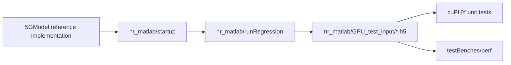

**Sources:** [5GModel/AGENTS.md:5-20](), [5GModel/AGENTS.md:26-30](), [5GModel/README.md:9-15]()

### Python Entry Point and Test-Vector Flow


**Sources:** [5GModel/AGENTS.md:18-24](), [5GModel/AGENTS.md:26-30]()

---

## Core Components

The documented high-level components and their roles are summarized below. For expanded component coverage—including cuPHY/cuMAC, cuPHY-CP, `pyaerial`, and test-vector infrastructure—see [Key Components](#1.2). The source material provided for this page gives specific implementation detail primarily for the 5GModel workflow and its relationship to cuPHY and performance testing. [5GModel/AGENTS.md:16-30]()

| Component | Repository role |
|---|---|
| `5GModel/nr_matlab/` | MATLAB 5G NR reference implementation; its regression workflow generates test vectors. [5GModel/AGENTS.md:18-20]() |
| `5GModel/aerial_mcore/` | Python API package for programmatic test-vector generation. [5GModel/AGENTS.md:21-24]() |
| `GPU_test_input/` | Destination for generated test vectors used in cuPHY and cuBB verification. [5GModel/AGENTS.md:9-10]() [5GModel/AGENTS.md:26-30]() |
| `cuPHY` | Downstream consumer of generated vectors in unit tests. [5GModel/AGENTS.md:26-30]() |
| `testBenches/perf/` | Performance-test harness that consumes generated vectors. [5GModel/AGENTS.md:28-30]() |

**Sources:** [5GModel/AGENTS.md:16-30]()

---

## `aerial_mcore`: Python–MATLAB Interface

`aerial_mcore` is a pip-installable Python package that provides an API for programmatic use of the 5GModel workflow. The documented example for generating test vectors is `aerial_mcore/examples/example_5GModel_regression.py`; package installation and usage details are covered by the child pages. [5GModel/AGENTS.md:21-24]()

The core MATLAB regression entry point is `nr_matlab/runRegression.m`, and its generated vectors are written under `nr_matlab/GPU_test_input/`. For Python API details, see [aerial_mcore Package](#3); for the broader component overview, see [Key Components](#1.2). [5GModel/AGENTS.md:18-24]()

**Sources:** [5GModel/AGENTS.md:18-24]()

---

## Repository Layout and Build Context

The Docker build-context allowlist names top-level areas including `5GModel`, `cuPHY`, `cuPHY-CP`, `cuMAC`, `pyaerial`, `testBenches`, and `testVectors`. This establishes the repository areas included by that configuration, but does not by itself describe their build or runtime dependencies. For build details, see [Build System](#11). [.dockerignore:1-24]()

**Sources:** [.dockerignore:1-24]()

---

## Next Steps

- For subsystem relationships and data flow, see [System Architecture](#1.1).
- For concise descriptions of the major repository components, see [Key Components](#1.2).
- For environment and installation guidance, see [Environment Setup](#2.1) and [Installation](#2.2).
- For regression and test-vector workflows, see [Testing and Validation](#5).

**Sources:** [5GModel/AGENTS.md:5-30]()

---

# Page: System Architecture

# System Architecture

<details>
<summary>Relevant source files</summary>

The following files were used as context for generating this wiki page:

- [.dockerignore](.dockerignore)
- [5GModel/AGENTS.md](5GModel/AGENTS.md)

</details>


## Purpose and Scope

This page describes the high-level architecture of the NVIDIA Aerial CUDA Accelerated RAN repository, focusing on the relationship between the 5GModel reference implementation, `aerial_mcore`, physical-layer and control-plane components, `pyaerial`, and testing infrastructure. The available source details identify 5GModel’s simulation and test-vector roles, and the test vectors’ consumers; repository inclusion rules identify the major subsystem directories. They do not specify implementation-level interfaces or call sequences for every subsystem, so those are not inferred here. [5GModel/AGENTS.md:3-30](), [.dockerignore:8-20]()

Sources: [5GModel/AGENTS.md:3-30](), [.dockerignore:8-20]()

## Architectural Overview

The repository combines an offline MATLAB/Python reference-model workflow with CUDA-oriented subsystem directories and test infrastructure. 5GModel is described as a MATLAB and Python reference implementation used for waveform-compliance validation, test-vector generation, and receiver-performance simulations. Its `nr_matlab/` and `aerial_mcore/` components provide MATLAB and Python entry points, respectively. [5GModel/AGENTS.md:3-24]()

The model-generated HDF5 test vectors under `GPU_test_input/` are consumed by cuPHY unit tests and the `testBenches/perf/` harness, or by the harness using `$TEST_VECTOR_DIR`. The repository’s Docker build-context allowlist includes the 5GModel, cuPHY, cuPHY-CP, cuMAC, cuMAC-CP, pyaerial, testBenches, and testVectors areas. [5GModel/AGENTS.md:26-30](), [.dockerignore:8-20]()

### Repository-to-Code Entity Map

This diagram maps the named system areas to directory and file entities present in the source. The arrows indicate only relationships explicitly described in the available documentation. [5GModel/AGENTS.md:18-30](), [.dockerignore:10-20]()

**Diagram: System Names and Repository Entities**

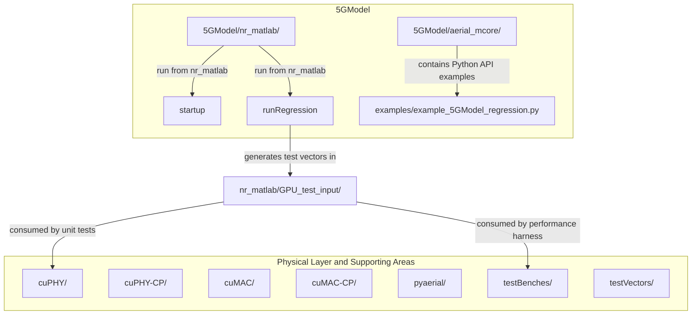

Sources: [5GModel/AGENTS.md:18-30](), [.dockerignore:10-20]()

### System Boundary and Component Roles

| System area | Established role or relationship |
|---|---|
| `5GModel/nr_matlab/` | MATLAB 5G NR reference implementation. Its documented regression workflow is to run `startup` and then `runRegression` from this directory. [5GModel/AGENTS.md:18-20]() |
| `5GModel/aerial_mcore/` | Python API bindings, distributed as a pip-installable wheel. Its example regression script is `aerial_mcore/examples/example_5GModel_regression.py`. [5GModel/AGENTS.md:21-24]() |
| `GPU_test_input/` | Destination for generated HDF5 test vectors; those vectors are consumed by cuPHY unit tests and the `testBenches/perf/` harness. [5GModel/AGENTS.md:18-20](), [5GModel/AGENTS.md:26-30]() |
| `cuPHY/` | Physical-layer subsystem directory included in the Docker build context; the available documentation specifically identifies its unit tests as test-vector consumers. [.dockerignore:16-20](), [5GModel/AGENTS.md:26-30]() |
| `cuPHY-CP/`, `cuMAC/`, `cuMAC-CP/` | Subsystem directories included in the Docker build context. The available source does not describe their internal interfaces or runtime behavior. [.dockerignore:14-17]() |
| `pyaerial/` | Subsystem directory included in the Docker build context. The available source does not describe its API or implementation. [.dockerignore:18-20]() |
| `testBenches/`, `testVectors/` | Testing-related directories included in the Docker build context. `testBenches/perf/` is identified as a consumer of 5GModel-generated test vectors. [.dockerignore:18-20](), [5GModel/AGENTS.md:26-30]() |

Sources: [5GModel/AGENTS.md:18-30](), [.dockerignore:14-20]()

## 5GModel and `aerial_mcore`

The 5GModel reference implementation is intended primarily for offline testing and analysis. Its documented purposes are validating waveform compliance against the MATLAB 5G Toolbox, generating HDF5 test vectors for cuPHY and cuBB verification, and running receiver-performance simulations based on 3GPP specifications. [5GModel/AGENTS.md:3-14]()

Within `nr_matlab/`, the documented workflow is to run `startup` and then `runRegression`. The regression entry point generates test vectors in `nr_matlab/GPU_test_input/`. The source also identifies `nr_matlab/test/` as the location for test-case definitions and `nr_matlab/gNBreceiver.m` and `nr_matlab/gNBtransmitter.m` as reference receiver and transmitter implementations. [5GModel/AGENTS.md:18-20](), [5GModel/AGENTS.md:32-42]()

`aerial_mcore` provides Python API bindings and a pip-installable wheel under `aerial_mcore/aerial_pkg/dist/`. Its documented example for programmatic test-vector generation is `aerial_mcore/examples/example_5GModel_regression.py`; the package metadata files are `aerial_mcore/aerial_pkg/pyproject.toml` and `setup.py`. [5GModel/AGENTS.md:21-24](), [5GModel/AGENTS.md:32-37]()

The available source establishes that `aerial_mcore` exposes a Python API and supports programmatic test-vector generation, but does not specify the binding implementation, MATLAB engine calls, function signatures, or call sequence between Python and MATLAB. [5GModel/AGENTS.md:21-24]()

Sources: [5GModel/AGENTS.md:3-14](), [5GModel/AGENTS.md:18-24](), [5GModel/AGENTS.md:32-42]()

### Simulation and Test-Vector Flow

This diagram connects the documented workflow names to their repository entities. It shows the specified generation and consumption path; it does not imply unprovided implementation details about internal function calls. [5GModel/AGENTS.md:18-30]()

**Diagram: Reference Model to Validation Inputs**

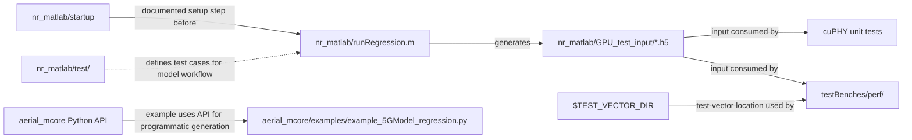

Sources: [5GModel/AGENTS.md:18-30](), [5GModel/AGENTS.md:32-40]()

## Physical Layer, Control Plane, and Python Subsystems

The repository includes directories named `cuPHY/`, `cuPHY-CP/`, `cuMAC/`, `cuMAC-CP/`, and `pyaerial/`. The available source establishes their presence in the repository and Docker build context, but does not provide their internal component structure, APIs, or runtime interactions. [ .dockerignore:14-20]()

One explicit relationship is that 5GModel-generated HDF5 test vectors are consumed by cuPHY unit tests. The model documentation also says the vectors are generated for cuPHY and cuBB verification. No corresponding detailed data flow for `cuPHY-CP`, `cuMAC`, `cuMAC-CP`, or `pyaerial` is specified in the available files. [5GModel/AGENTS.md:8-10](), [5GModel/AGENTS.md:26-30](), [.dockerignore:14-20]()

Sources: [5GModel/AGENTS.md:8-10](), [5GModel/AGENTS.md:26-30](), [.dockerignore:14-20]()

## Testing Infrastructure and Test-Vector Contract

The model’s generated test vectors are HDF5 files located under `nr_matlab/GPU_test_input/`. The documentation describes these as inputs for cuPHY unit tests and the performance harness under `testBenches/perf/`; it also identifies `$TEST_VECTOR_DIR` as a test-vector location used by the performance harness. Missing or stale test vectors can cause cuPHY tests to skip or fail. [5GModel/AGENTS.md:18-20](), [5GModel/AGENTS.md:26-30]()

`nr_matlab/test/` contains test-case definitions, while `nr_matlab/cfg_template.yaml` is identified as the base configuration template for simulation runs. The available source does not define the HDF5 schema or enumerate individual test-harness executables. [5GModel/AGENTS.md:32-40]()

Sources: [5GModel/AGENTS.md:18-20](), [5GModel/AGENTS.md:26-40]()

## Build and Repository Packaging Boundary

The `.dockerignore` file starts by excluding all paths, then selectively allows repository files and directories. Among the allowed entries are `5GModel`, `cuPHY`, `cuPHY-CP`, `cuMAC`, `cuMAC-CP`, `pyaerial`, `testBenches`, and `testVectors`, as well as `CMakeLists.txt` and `CMakePresets.json`. This documents which named subsystem areas can enter the Docker build context, not how those components are built. [.dockerignore:1-24]()

The 5GModel documentation identifies the `aerial_mcore` package metadata files and wheel distribution directory, but the available source does not provide build commands or describe CMake targets. [5GModel/AGENTS.md:21-24](), [5GModel/AGENTS.md:32-37]()

Sources: [.dockerignore:1-24](), [5GModel/AGENTS.md:21-24](), [5GModel/AGENTS.md:32-37]()

---

# Page: Key Components

# Key Components

<details>
<summary>Relevant source files</summary>

The following files were used as context for generating this wiki page:

- [5GModel/README.md](5GModel/README.md)
- [5GModel/aerial_mcore/QuickStart.md](5GModel/aerial_mcore/QuickStart.md)

</details>


## Purpose and Scope

This page summarizes the components and data flow that can be documented from the supplied repository files. Those files describe `5GModel`, its `nr_matlab` regression entry points, the `aerial_mcore` Python interface, and the generation of test-vector files for `cuPHY` and `cuBB`. They do not provide implementation details for `cuMAC`, `cuPHY-CP`, `pyaerial`, or the internal structure of `nr_matlab`; those details are therefore not inferred here. [5GModel/README.md:1-15](), [5GModel/aerial_mcore/QuickStart.md:1-3]()

Sources: [5GModel/README.md:1-15](), [5GModel/aerial_mcore/QuickStart.md:1-3]()

---

## Component Architecture Overview

The supplied files show two ways to access the 5GModel regression and test-vector workflow: MATLAB entry points in `nr_matlab` (`startup`, `runRegression`) and a Python-facing route through `aerial_mcore`. The Python quick start runs `example_5GModel_regression.py allChannels` and lists generated files in `GPU_test_input/`. The 5GModel README identifies waveform compliance, test-vector generation for `cuPHY` and `cuBB` verification, and receiver performance simulation as regression purposes. [5GModel/README.md:3-15](), [5GModel/aerial_mcore/QuickStart.md:1-22]()

**Diagram: Documented component names mapped to workflow entities**

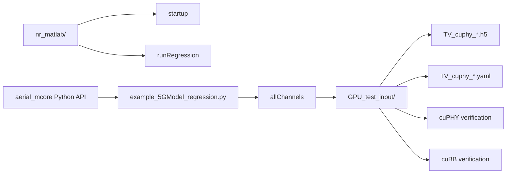

Sources: [5GModel/README.md:3-15](), [5GModel/aerial_mcore/QuickStart.md:1-22](), [5GModel/aerial_mcore/QuickStart.md:55-68]()

Sources: [5GModel/README.md:3-15](), [5GModel/aerial_mcore/QuickStart.md:1-22]()

---

## 5GModel and aerial_mcore

### 5GModel and `nr_matlab` Simulation Core

The 5GModel README lists three purposes for regression: waveform compliance testing against MATLAB 5GToolBox, test-vector generation for `cuPHY` and `cuBB` verification, and receiver performance simulation based on the 3GPP specification. It documents running `startup` followed by `runRegression` from the `nr_matlab` directory. The supplied file does not describe the internal MATLAB functions or signal-processing implementation. [5GModel/README.md:3-13]()

The README names `GPU_test_input` under the `nr_matlab` directory as the location of generated test vectors. [5GModel/README.md:10-15]()

Sources: [5GModel/README.md:3-15]()

### `aerial_mcore` Python Package

The quick start describes `aerial_mcore` as Python API bindings to the Aerial 5GModel and demonstrates using the bindings to generate Aerial test-vector `.h5` files. It installs a wheel from `5GModel/aerial_mcore/aerial_pkg/dist/`, then runs the example script from `5GModel/aerial_mcore/examples`. [5GModel/aerial_mcore/QuickStart.md:1-20]()

The example command `python3 ./example_5GModel_regression.py allChannels` is preceded by sourcing `../scripts/setup.sh` and setting `REGRESSION_MODE=1`. The quick start’s sample output reports downlink and uplink `runSim` tests, channel allocations, and successful detections for PUSCH, PRACH, and PUCCH UCI. These are example output details, not a specification of the package’s full API. [5GModel/aerial_mcore/QuickStart.md:15-22](), [5GModel/aerial_mcore/QuickStart.md:31-51]()

**Diagram: Python example path from code entities to generated test vectors**

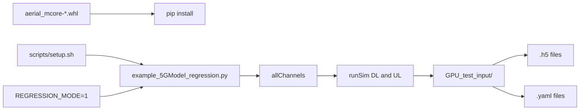

Sources: [5GModel/aerial_mcore/QuickStart.md:9-22](), [5GModel/aerial_mcore/QuickStart.md:31-68]()

Sources: [5GModel/aerial_mcore/QuickStart.md:1-22]()

---

## Physical Layer Components (`cuPHY` and `cuMAC`)

The 5GModel README identifies `cuPHY` and `cuBB` as verification targets for generated test vectors. The supplied files do not describe `cuPHY` library internals, `cuMAC`, or interactions between those systems, so no implementation or orchestration details are asserted here. [5GModel/README.md:5-7]()

Sources: [5GModel/README.md:5-7]()

---

## cuPHY-CP Control Plane

The supplied files do not document `cuPHY-CP`, its control-plane responsibilities, or its interfaces. The available evidence only identifies `cuPHY` as a test-vector verification target. [5GModel/README.md:5-7]()

Sources: [5GModel/README.md:5-7]()

---

## Machine Learning Bindings (`pyaerial`)

The supplied files do not document `pyaerial`, its bindings, or ML models. The Python interface described in the available quick start is `aerial_mcore`, which is presented as bindings to the Aerial 5GModel. [5GModel/aerial_mcore/QuickStart.md:1-3]()

Sources: [5GModel/aerial_mcore/QuickStart.md:1-3]()

---

## Test Vector System

### Generation and Output

The 5GModel README says regression generates test vectors for `cuPHY` and `cuBB` verification and places them in `nr_matlab/GPU_test_input`. [5GModel/README.md:5-15]()

The Python quick start lists generated `.h5` and `.yaml` files under `GPU_test_input/`. Its examples include files named `TV_cuphy_...h5` and paired `TV_cuphy_...yaml` files, as well as templates with names such as `template_UL_PUSCH_gNB_CUPHY_s0p0.h5` and `template_UL_gNB_FAPI_s0.h5`. The supplied files do not specify the full schema or field-level contents of these formats. [5GModel/aerial_mcore/QuickStart.md:55-68]()

| Observed filename pattern | What the supplied files establish |
|---|---|
| `TV_cuphy_*.h5` | An example of a generated test-vector file listed in `GPU_test_input/`. [5GModel/aerial_mcore/QuickStart.md:55-63]() |
| `TV_cuphy_*.yaml` | An example YAML file listed alongside a `TV_cuphy_*.h5` file. [5GModel/aerial_mcore/QuickStart.md:59-63]() |
| `template_UL_PUSCH_*.h5` | An example uplink PUSCH template file listed in the output directory. [5GModel/aerial_mcore/QuickStart.md:64-66]() |
| `template_UL_gNB_FAPI_*.h5` | An example uplink gNB FAPI template file listed in the output directory. [5GModel/aerial_mcore/QuickStart.md:67-68]() |

Sources: [5GModel/README.md:5-15](), [5GModel/aerial_mcore/QuickStart.md:55-68]()

### Validation Workflow

The documented workflow is to run regression from MATLAB or invoke the Python example, then inspect the generated files. The README associates regression with waveform compliance, test-vector generation, and receiver performance simulation; the quick start demonstrates the Python route and output directory. The supplied material does not describe the specific test-vector loading or comparison code used by `cuPHY` or `cuBB`. [5GModel/README.md:3-15](), [5GModel/aerial_mcore/QuickStart.md:15-22]()

**Diagram: Regression entry points and documented output**

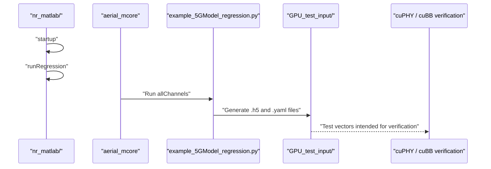

Sources: [5GModel/README.md:3-15](), [5GModel/aerial_mcore/QuickStart.md:15-22](), [5GModel/aerial_mcore/QuickStart.md:55-68]()

Sources: [5GModel/README.md:3-15](), [5GModel/aerial_mcore/QuickStart.md:15-22]()

---

## Build and Deployment Tools

The quick start demonstrates installing `aerial_mcore` from a wheel matching `aerial_mcore-*.whl` in the package’s `dist/` directory. It also instructs users to source `../scripts/setup.sh` before running the example and set `REGRESSION_MODE=1`. These instructions establish the documented quick-start setup, not a complete build or deployment process. [5GModel/aerial_mcore/QuickStart.md:9-20]()

Sources: [5GModel/aerial_mcore/QuickStart.md:9-20]()

---

# Page: Getting Started

# Getting Started

<details>
<summary>Relevant source files</summary>

The following files were used as context for generating this wiki page:

- [5GModel/aerial_mcore/QuickStart.md](5GModel/aerial_mcore/QuickStart.md)
- [5GModel/aerial_mcore/scripts/setup.sh](5GModel/aerial_mcore/scripts/setup.sh)

</details>


This page introduces the initial setup, installation, and first example workflow for `aerial_mcore`. It stays at a high level; use the child pages for detailed instructions.

- For runtime, Python, CUDA, and dependency requirements, see [Environment Setup](#2.1).
- For development and release installation and component builds, see [Installation](#2.2).
- For generating test vectors and running examples, see [Quick Start Tutorial](#2.3).

Sources: [5GModel/aerial_mcore/QuickStart.md:1-20]()

---

## Overview

The getting started workflow connects environment configuration, package installation, and simulation. The quick-start example is run inside the Aerial development container, installs a built `aerial_mcore` wheel, sources the package setup script, then runs a regression example that produces files in `GPU_test_input/`.[5GModel/aerial_mcore/QuickStart.md:9-22]() The setup script adds MATLAB Runtime library paths and sets `MCORE_BUILD_TYPE` to `dev`.[5GModel/aerial_mcore/scripts/setup.sh:18-25]()

**Workflow from setup to generated test vectors**

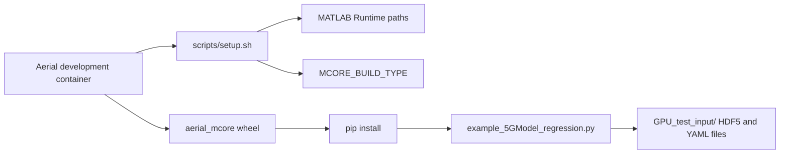

Sources: [5GModel/aerial_mcore/QuickStart.md:9-22](), [5GModel/aerial_mcore/scripts/setup.sh:18-25]()

For component-specific setup and build details, see [Environment Setup](#2.1) and [Installation](#2.2).

Sources: [5GModel/aerial_mcore/QuickStart.md:9-20](), [5GModel/aerial_mcore/scripts/setup.sh:18-25]()

---

## Environment Setup

The supplied `setup.sh` is intended to be sourced. It sets `AERIAL_PYTHON` on initial setup, appends MATLAB Runtime R2026a library directories to `LD_LIBRARY_PATH`, and exports `MCORE_BUILD_TYPE=dev`.[5GModel/aerial_mcore/scripts/setup.sh:18-25]() The quick-start instructions source this script from the `aerial_mcore/examples` directory before running the regression example.[5GModel/aerial_mcore/QuickStart.md:15-20]()

For CUDA requirements, Python environment details, and dependencies beyond these script settings, see [Environment Setup](#2.1).

Sources: [5GModel/aerial_mcore/scripts/setup.sh:18-25](), [5GModel/aerial_mcore/QuickStart.md:15-20]()

---

## Installation

The documented quick-start path installs a prebuilt `aerial_mcore` wheel from the package distribution directory using `pip`.[5GModel/aerial_mcore/QuickStart.md:9-13]() The setup script also sets `MCORE_BUILD_TYPE` to `dev`; consult [Installation](#2.2) for the development and release installation paths and for instructions covering cuPHY, cuMAC, and pyaerial builds.

**Installation path and code entities**

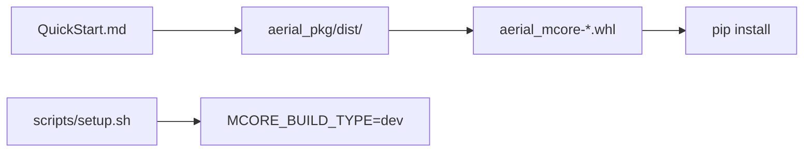

Sources: [5GModel/aerial_mcore/QuickStart.md:9-13](), [5GModel/aerial_mcore/scripts/setup.sh:25-25]()

---

## Quick Start Tutorial

The quick-start example sources the setup script, sets `REGRESSION_MODE=1`, and runs `example_5GModel_regression.py` with the `allChannels` argument.[5GModel/aerial_mcore/QuickStart.md:15-22]() Its sample output shows downlink and uplink runs reporting `PASS`, with HDF5 and YAML artifacts listed under `GPU_test_input/`.[5GModel/aerial_mcore/QuickStart.md:24-67]()

For step-by-step instructions and guidance on running basic examples, see [Quick Start Tutorial](#2.3).

**Example workflow: command and artifact entities**

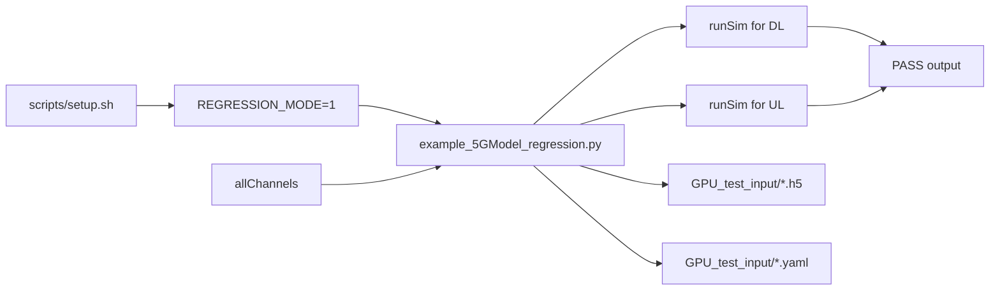

Sources: [5GModel/aerial_mcore/QuickStart.md:15-22](), [5GModel/aerial_mcore/QuickStart.md:31-67]()

---

## Summary of Key Environment Variables

| Variable | Role in the documented workflow |
|---|---|
| `AERIAL_PYTHON` | Set by `setup.sh` when it has not already been set.[5GModel/aerial_mcore/scripts/setup.sh:20-22]() |
| `LD_LIBRARY_PATH` | Extended with MATLAB Runtime R2026a library directories by `setup.sh`.[5GModel/aerial_mcore/scripts/setup.sh:23-23]() |
| `MCORE_BUILD_TYPE` | Exported as `dev` by `setup.sh`.[5GModel/aerial_mcore/scripts/setup.sh:25-25]() |
| `REGRESSION_MODE` | Set to `1` in the documented test-vector example workflow.[5GModel/aerial_mcore/QuickStart.md:17-20]() |

Sources: [5GModel/aerial_mcore/scripts/setup.sh:20-25](), [5GModel/aerial_mcore/QuickStart.md:15-20]()

---

# Page: Environment Setup

# Environment Setup

<details>
<summary>Relevant source files</summary>

The following files were used as context for generating this wiki page:

- [5GModel/aerial_mcore/scripts/setup.sh](5GModel/aerial_mcore/scripts/setup.sh)
- [5GModel/get_uuid.sh](5GModel/get_uuid.sh)

</details>


## Purpose and scope

This page documents the environment configuration established by the supplied `aerial_mcore` setup script and the repository UUID script. The available setup script configures MATLAB Runtime library lookup and development-mode environment variables. The supplied files do not specify Python or CUDA versions, installation steps, or dependency-installation procedures; those requirements are therefore not inferred here. [5GModel/aerial_mcore/scripts/setup.sh:18-25](); [5GModel/get_uuid.sh:19-38]()

Sources: [5GModel/aerial_mcore/scripts/setup.sh:18-25](); [5GModel/get_uuid.sh:19-38]()

## Environment configuration

### Shell setup

`5GModel/aerial_mcore/scripts/setup.sh` is intended to be sourced so its environment changes apply to the current shell. On its first invocation in a shell where `AERIAL_PYTHON` is unset, it sets `AERIAL_PYTHON=1`, prefixes the prompt with `[Aerial Python]`, and appends MATLAB Runtime library directories to `LD_LIBRARY_PATH`. It sets `MCORE_BUILD_TYPE` to `dev` after the guard, so that assignment occurs whenever the script is sourced. [5GModel/aerial_mcore/scripts/setup.sh:18-25]()

| Setting | Behavior in `setup.sh` |
|---|---|
| `AERIAL_PYTHON` | If unset, set to `1`; this also gates the prompt and library-path updates. [5GModel/aerial_mcore/scripts/setup.sh:20-24]() |
| `PS1` | If `AERIAL_PYTHON` was unset, prefix the prompt with `[Aerial Python]`. [5GModel/aerial_mcore/scripts/setup.sh:20-23]() |
| `LD_LIBRARY_PATH` | If `AERIAL_PYTHON` was unset, append five MATLAB Runtime directories. [5GModel/aerial_mcore/scripts/setup.sh:20-24]() |
| `MCORE_BUILD_TYPE` | Set to `dev` whenever the script is sourced. [5GModel/aerial_mcore/scripts/setup.sh:25]() |

Sources: [5GModel/aerial_mcore/scripts/setup.sh:18-25]()

### MATLAB Runtime library lookup

The script appends these paths under `/usr/local/MATLAB/MATLAB_Runtime/R2026a`: `runtime/glnxa64`, `bin/glnxa64`, `sys/os/glnxa64`, `extern/bin/glnxa64`, and `sys/opengl/lib/glnxa64`. This is the Runtime location and release encoded in the supplied script; the file does not install the Runtime or verify that the directories exist. [5GModel/aerial_mcore/scripts/setup.sh:23]()

| Path appended to `LD_LIBRARY_PATH` |
|---|
| `/usr/local/MATLAB/MATLAB_Runtime/R2026a/runtime/glnxa64` |
| `/usr/local/MATLAB/MATLAB_Runtime/R2026a/bin/glnxa64` |
| `/usr/local/MATLAB/MATLAB_Runtime/R2026a/sys/os/glnxa64` |
| `/usr/local/MATLAB/MATLAB_Runtime/R2026a/extern/bin/glnxa64` |
| `/usr/local/MATLAB/MATLAB_Runtime/R2026a/sys/opengl/lib/glnxa64` |

Sources: [5GModel/aerial_mcore/scripts/setup.sh:23]()

**Diagram: MATLAB Runtime configuration mapped to setup entities**

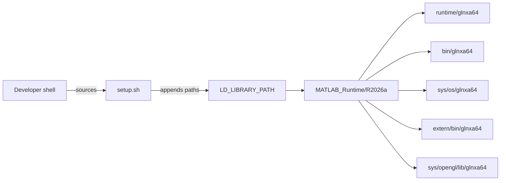

Sources: [5GModel/aerial_mcore/scripts/setup.sh:18-24]()

## Python environment

The setup script labels the shell prompt `[Aerial Python]`, uses `AERIAL_PYTHON` as a guard for its first-time shell configuration, and selects `MCORE_BUILD_TYPE=dev`. These settings do not establish a Python interpreter version, create a virtual environment, install Python packages, or demonstrate that Python is available. [5GModel/aerial_mcore/scripts/setup.sh:20-25]()

| Concern | What the supplied script establishes |
|---|---|
| Shell marker | `AERIAL_PYTHON=1` when the variable is initially unset. [5GModel/aerial_mcore/scripts/setup.sh:20-21]() |
| Prompt marker | `[Aerial Python]` prefix when the guard condition is met. [5GModel/aerial_mcore/scripts/setup.sh:20-23]() |
| Build mode | `MCORE_BUILD_TYPE=dev`. [5GModel/aerial_mcore/scripts/setup.sh:25]() |
| Interpreter and packages | No Python version or package-install procedure is specified in the supplied script. [5GModel/aerial_mcore/scripts/setup.sh:18-25]() |

Sources: [5GModel/aerial_mcore/scripts/setup.sh:18-25]()

**Diagram: Python-oriented shell settings mapped to code entities**

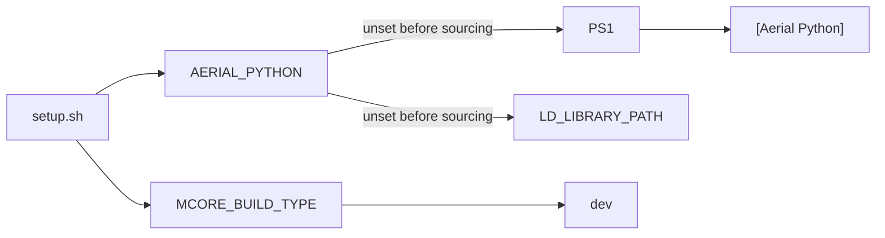

Sources: [5GModel/aerial_mcore/scripts/setup.sh:20-25]()

## CUDA and subsystem dependencies

The supplied `setup.sh` configures MATLAB Runtime paths and shell variables; it contains no CUDA version, CUDA installation path, driver requirement, or CUDA dependency-installation steps. The supplied `get_uuid.sh` operates on files under `5GModel` to calculate a checksum-derived UUID; it likewise does not describe CUDA setup. CUDA requirements for cuPHY, cuMAC, or other subsystems cannot be established from these files. [5GModel/aerial_mcore/scripts/setup.sh:18-25](); [5GModel/get_uuid.sh:19-38]()

The UUID script changes to `$cuBB_SDK`, filters selected files from the UUID input, sorts the remaining file checksums, and hashes the result. It excludes Markdown files and specified `5GModel` paths, including `aerial_pkg`, `CompilerSDKOutput`, `scripts`, `documents`, and internal directories. This is repository-content identification logic, not environment or CUDA dependency configuration. [5GModel/get_uuid.sh:26-38]()

| Area | Information available from the supplied files |
|---|---|
| MATLAB Runtime | `setup.sh` encodes the `R2026a` Linux library paths. [5GModel/aerial_mcore/scripts/setup.sh:23]() |
| Python | `setup.sh` defines shell markers and `MCORE_BUILD_TYPE=dev`, but no interpreter version or package dependencies. [5GModel/aerial_mcore/scripts/setup.sh:20-25]() |
| CUDA | No CUDA version or installation requirement is specified. [5GModel/aerial_mcore/scripts/setup.sh:18-25]() |
| UUID inputs | `get_uuid.sh` selects and hashes files under `5GModel`; this is not a dependency installer. [5GModel/get_uuid.sh:26-38]() |

Sources: [5GModel/aerial_mcore/scripts/setup.sh:18-25](); [5GModel/get_uuid.sh:26-38]()

**Diagram: repository UUID workflow mapped to script entities**


Sources: [5GModel/get_uuid.sh:21-38]()

---

# Page: Installation

# Installation

<details>
<summary>Relevant source files</summary>

The following files were used as context for generating this wiki page:

- [5GModel/aerial_mcore/scripts/build_pkg.sh](5GModel/aerial_mcore/scripts/build_pkg.sh)
- [5GModel/aerial_mcore/scripts/install_dev_pkg.sh](5GModel/aerial_mcore/scripts/install_dev_pkg.sh)

</details>


## Purpose and scope

This page documents the `aerial_mcore` package build, editable development installation, and the release-installation boundary supported by the available scripts. The supplied installation scripts do not document how to build cuPHY, cuMAC, or pyaerial; those build procedures are therefore not specified here.

Sources: [5GModel/aerial_mcore/scripts/build_pkg.sh:18-35](), [5GModel/aerial_mcore/scripts/install_dev_pkg.sh:18-32]()

## Overview

The package scripts provide two operations: `build_pkg.sh` invokes `python3 -m build` in `aerial_pkg` after removing its existing `dist` directory, while `install_dev_pkg.sh` runs an editable pip install of `aerial_pkg` with `~/.local` as the prefix. Both scripts enable `set -e`, so a failing command stops the script. [5GModel/aerial_mcore/scripts/build_pkg.sh:18-32](), [5GModel/aerial_mcore/scripts/install_dev_pkg.sh:18-30]()

The build script produces package build artifacts through the Python build frontend. The provided files do not specify a release-wheel installation command or describe package metadata, dependencies, or wheel contents. [5GModel/aerial_mcore/scripts/build_pkg.sh:28-32]()

Sources: [5GModel/aerial_mcore/scripts/build_pkg.sh:18-32](), [5GModel/aerial_mcore/scripts/install_dev_pkg.sh:18-30]()

## Installation Architecture

**Diagram: `aerial_mcore` script responsibilities and package flow**

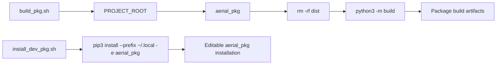

The diagram associates the package build and developer-install operations with their script entities. `build_pkg.sh` resolves and enters `PROJECT_ROOT`, then builds from `aerial_pkg`; `install_dev_pkg.sh` uses the same root-directory setup and invokes pip with editable mode. [5GModel/aerial_mcore/scripts/build_pkg.sh:21-32](), [5GModel/aerial_mcore/scripts/install_dev_pkg.sh:21-30]()

Sources: [5GModel/aerial_mcore/scripts/build_pkg.sh:21-32](), [5GModel/aerial_mcore/scripts/install_dev_pkg.sh:21-30]()

### Package build flow

**Diagram: build script operations mapped to shell commands**

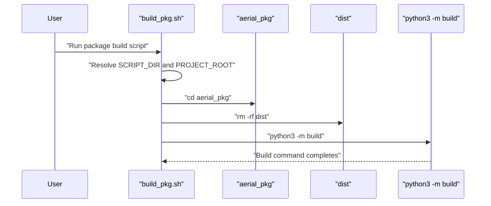

The script determines its location using `readlink -f`, derives `SCRIPT_DIR` and `PROJECT_ROOT`, changes to the project root and then `aerial_pkg`, removes `dist`, and invokes the build frontend. The script uses `set -e`, so command failures stop execution. [5GModel/aerial_mcore/scripts/build_pkg.sh:18-32]()

Sources: [5GModel/aerial_mcore/scripts/build_pkg.sh:18-32]()

## Building the Package

### Build execution

Run `build_pkg.sh` from its repository location. The script calculates the project root from its own path, changes into that root, enters `aerial_pkg`, removes the existing `dist` directory, and runs `python3 -m build`. [5GModel/aerial_mcore/scripts/build_pkg.sh:21-32]()

The script does not define build flags or pass arguments to `python3 -m build`. Its visible behavior is limited to the directory setup, removal of `dist`, and invocation of the build frontend. [5GModel/aerial_mcore/scripts/build_pkg.sh:21-32]()

Sources: [5GModel/aerial_mcore/scripts/build_pkg.sh:21-32]()

### Release artifacts and installation

`build_pkg.sh` runs the Python build frontend from `aerial_pkg` after clearing that directory’s existing `dist` folder. The supplied files do not identify the exact artifact filenames or give a command for installing a built release artifact; use the package’s release instructions for those details. [5GModel/aerial_mcore/scripts/build_pkg.sh:28-32]()

Sources: [5GModel/aerial_mcore/scripts/build_pkg.sh:28-32]()

### cuPHY, cuMAC, and pyaerial builds

The supplied files contain scripts for building and installing `aerial_mcore`, but no cuPHY, cuMAC, or pyaerial build scripts or instructions. This page consequently cannot give verified build steps for those components. [5GModel/aerial_mcore/scripts/build_pkg.sh:28-32](), [5GModel/aerial_mcore/scripts/install_dev_pkg.sh:28-30]()

Sources: [5GModel/aerial_mcore/scripts/build_pkg.sh:28-32](), [5GModel/aerial_mcore/scripts/install_dev_pkg.sh:28-30]()

## Development Installation

`install_dev_pkg.sh` installs `aerial_pkg` in editable mode, using `~/.local` as the installation prefix. The script resolves its own location, derives `PROJECT_ROOT`, changes to that directory, and invokes pip with `-e aerial_pkg`. [5GModel/aerial_mcore/scripts/install_dev_pkg.sh:21-30]()

### Installation command

Run `install_dev_pkg.sh` from its repository location. The pip operation performed by the script is `pip3 install --prefix ~/.local -e aerial_pkg`. [5GModel/aerial_mcore/scripts/install_dev_pkg.sh:21-30]()

### Installation parameters

| Parameter | Meaning in the script |
|---|---|
| `--prefix ~/.local` | Sets the installation prefix passed to pip. [5GModel/aerial_mcore/scripts/install_dev_pkg.sh:28-30]() |
| `-e aerial_pkg` | Requests an editable install of the `aerial_pkg` directory. [5GModel/aerial_mcore/scripts/install_dev_pkg.sh:28-30]() |

The supplied script does not include a package-import verification step or specify Python path configuration. [5GModel/aerial_mcore/scripts/install_dev_pkg.sh:28-32]()

Sources: [5GModel/aerial_mcore/scripts/install_dev_pkg.sh:21-32]()

## Release Installation

The supplied build script invokes `python3 -m build` in `aerial_pkg`, but the supplied files do not include a release installation script or document how to install the resulting artifact. [5GModel/aerial_mcore/scripts/build_pkg.sh:28-32]()

| Operation | Documented behavior |
|---|---|
| Build | `build_pkg.sh` clears `aerial_pkg/dist` and invokes `python3 -m build`. [5GModel/aerial_mcore/scripts/build_pkg.sh:28-32]() |
| Editable development install | `install_dev_pkg.sh` runs pip with `--prefix ~/.local -e aerial_pkg`. [5GModel/aerial_mcore/scripts/install_dev_pkg.sh:28-30]() |
| Release artifact installation | Not specified by the supplied files. |

Sources: [5GModel/aerial_mcore/scripts/build_pkg.sh:28-32](), [5GModel/aerial_mcore/scripts/install_dev_pkg.sh:28-30]()

## Installation Verification

Neither supplied script runs an import test, checks the installed package location, or initializes MATLAB. The available scripts therefore do not define a post-install verification procedure. [5GModel/aerial_mcore/scripts/build_pkg.sh:28-35](), [5GModel/aerial_mcore/scripts/install_dev_pkg.sh:28-32]()

Sources: [5GModel/aerial_mcore/scripts/build_pkg.sh:28-35](), [5GModel/aerial_mcore/scripts/install_dev_pkg.sh:28-32]()

## Troubleshooting

Both scripts enable `set -e`, which causes the script to exit when a command fails. The supplied files do not provide error-specific diagnostics or recovery instructions. [5GModel/aerial_mcore/scripts/build_pkg.sh:18-19](), [5GModel/aerial_mcore/scripts/install_dev_pkg.sh:18-19]()

Sources: [5GModel/aerial_mcore/scripts/build_pkg.sh:18-19](), [5GModel/aerial_mcore/scripts/install_dev_pkg.sh:18-19]()

## Build System Integration

**Diagram: build and editable-install entry points**

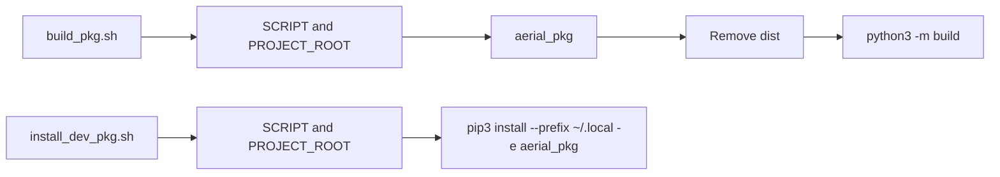

`build_pkg.sh` is the build entry point and `install_dev_pkg.sh` is the editable-install entry point. Both derive the project root from their script paths; only the build script clears `dist` and invokes `python3 -m build`. [5GModel/aerial_mcore/scripts/build_pkg.sh:21-32](), [5GModel/aerial_mcore/scripts/install_dev_pkg.sh:21-30]()

Sources: [5GModel/aerial_mcore/scripts/build_pkg.sh:21-32](), [5GModel/aerial_mcore/scripts/install_dev_pkg.sh:21-30]()

---

# Page: Quick Start Tutorial

# Quick Start Tutorial

<details>
<summary>Relevant source files</summary>

The following files were used as context for generating this wiki page:

- [5GModel/aerial_mcore/QuickStart.md](5GModel/aerial_mcore/QuickStart.md)
- [5GModel/aerial_mcore/examples/example_5GModel_regression.py](5GModel/aerial_mcore/examples/example_5GModel_regression.py)

</details>


## Purpose and Scope

This section shows how to generate initial Aerial test-vector (TV) files using `aerial_mcore` and the 5GModel regression example. It covers installing the package wheel, preparing the example environment, selecting a regression mode, and locating generated files. The supplied quick-start instructions run inside the Aerial development container. [5GModel/aerial_mcore/QuickStart.md:1-22]()

Sources: [5GModel/aerial_mcore/QuickStart.md:1-22]()

## Quick Start Workflow

The workflow starts by installing the built `aerial_mcore` wheel. From the examples directory, source the package’s setup script, set `REGRESSION_MODE`, and run `example_5GModel_regression.py` with a channel argument. The documented example uses `allChannels`; the regression script initializes the simulator and calls MATLAB’s `runRegression` through the returned engine. [5GModel/aerial_mcore/QuickStart.md:9-22]()[5GModel/aerial_mcore/examples/example_5GModel_regression.py:16-17]()[5GModel/aerial_mcore/examples/example_5GModel_regression.py:22-66]()

### Natural-language workflow mapped to code entities

**Diagram: Quick-start steps and their code entities**

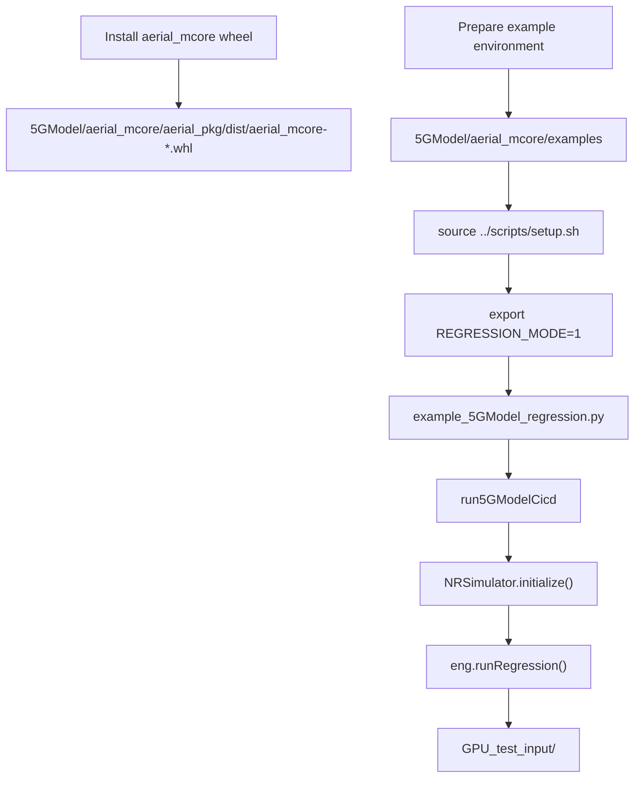

Sources: [5GModel/aerial_mcore/QuickStart.md:9-22]()[5GModel/aerial_mcore/examples/example_5GModel_regression.py:16-17]()[5GModel/aerial_mcore/examples/example_5GModel_regression.py:22-66]()

### Run the documented example

Use the following commands inside the Aerial development container. The wheel installation command uses the wheel under `${cuBB_SDK}/5GModel/aerial_mcore/aerial_pkg/dist/`; the example commands run from `${cuBB_SDK}/5GModel/aerial_mcore/examples`. [5GModel/aerial_mcore/QuickStart.md:9-22]()

```bash
sudo -H pip install ${cuBB_SDK}/5GModel/aerial_mcore/aerial_pkg/dist/aerial_mcore-*.whl

cd ${cuBB_SDK}/5GModel/aerial_mcore/examples
source ../scripts/setup.sh
export REGRESSION_MODE=1
python3 ./example_5GModel_regression.py allChannels
ls -alF GPU_test_input/
```

Sources: [5GModel/aerial_mcore/QuickStart.md:9-22]()

## Regression Modes and Execution Flow

`example_5GModel_regression.py` reads `REGRESSION_MODE` and accepts values from 0 through 2. Its `run5GModelCicd` function initializes the simulator with `NRSimulator.initialize()`, then selects a `runRegression` invocation according to the mode: mode 0 runs compact `allTests`, mode 1 runs full `allTests`, and mode 2 runs compact `TestVector`. The script removes `GPU_test_input/disabled*` after each regression invocation and returns the regression error count; the command-line entry point exits with status 1 if that count is greater than zero. [5GModel/aerial_mcore/examples/example_5GModel_regression.py:22-66]()[5GModel/aerial_mcore/examples/example_5GModel_regression.py:86-103]()

The quick-start example sets mode 1 and passes `allChannels`. The example script’s usage text describes `REGRESSION_MODE` values as MR subset, nightly full regression, and nightly test-vector generation, respectively. If `RELEASE_NUMBER` is unset, the script defaults to `10000`; its usage text also identifies `2240` as Rel-22.4. [5GModel/aerial_mcore/QuickStart.md:15-22]()[5GModel/aerial_mcore/examples/example_5GModel_regression.py:68-83]()[5GModel/aerial_mcore/examples/example_5GModel_regression.py:86-101]()

**Diagram: Python entry point to MATLAB regression and test-vector output**

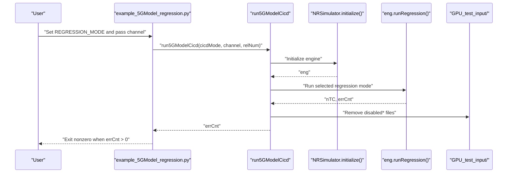

Sources: [5GModel/aerial_mcore/examples/example_5GModel_regression.py:22-66]()[5GModel/aerial_mcore/examples/example_5GModel_regression.py:86-103]()

Sources: [5GModel/aerial_mcore/examples/example_5GModel_regression.py:22-66]()[5GModel/aerial_mcore/examples/example_5GModel_regression.py:86-103]()

## Expected Results and Output Files

The documented example reports separate downlink and uplink `runSim` checks. The sample output shows downlink allocation for SSB, PDCCH, PDSCH, and CSI-RS, followed by uplink allocation for PRACH, PUCCH, PUSCH, and SRS. It reports `PUSCH TB detected`, `PRACH detected`, and `PUCCH UCI detected`, with `PASS` results in the displayed checks. [5GModel/aerial_mcore/QuickStart.md:31-51]()

Generated files are listed in `GPU_test_input/`. The sample directory listing includes paired `TV_cuphy_*.h5` and `TV_cuphy_*.yaml` files, as well as `template_UL_*.h5` files such as `template_UL_PUCCH_F0_gNB_CUPHY_s0p1.h5`, `template_UL_PUSCH_gNB_CUPHY_s0p0.h5`, and `template_UL_SRS_gNB_CUPHY_s0p0.h5`. The listing also includes `template_UL_gNB_FAPI_s0.h5`. [5GModel/aerial_mcore/QuickStart.md:21-22]()[5GModel/aerial_mcore/QuickStart.md:55-67]()

| Sample artifact | Example shown in the quick-start listing |
|---|---|
| Test-vector HDF5 file | `TV_cuphy_F01-DS-01_slot0_MIMO4x4_PRB106_DataSyms11_qam256.h5` |
| Test-vector YAML file | `TV_cuphy_F01-DS-01_slot0_MIMO4x4_PRB106_DataSyms11_qam256.yaml` |
| Uplink PUSCH template | `template_UL_PUSCH_gNB_CUPHY_s0p0.h5` |
| Uplink FAPI template | `template_UL_gNB_FAPI_s0.h5` |

The examples above are names present in the supplied directory listing; this page does not infer additional file-format semantics from the extensions or names. [5GModel/aerial_mcore/QuickStart.md:55-67]()

Sources: [5GModel/aerial_mcore/QuickStart.md:21-22]()[5GModel/aerial_mcore/QuickStart.md:31-51]()[5GModel/aerial_mcore/QuickStart.md:55-67]()

## Quick-start Reference

| Setting or command | Effect documented by the code or quick-start |
|---|---|
| `REGRESSION_MODE=0` | Selects compact `allTests` regression in `run5GModelCicd`. |
| `REGRESSION_MODE=1` | Selects full `allTests` regression; this is the mode used in the quick-start command. |
| `REGRESSION_MODE=2` | Selects compact `TestVector` regression. |
| `RELEASE_NUMBER` unset | The script defaults to release number `10000`. |
| `python3 ./example_5GModel_regression.py allChannels` | Runs the documented example with `allChannels` as the channel argument. |
| `GPU_test_input/` | Directory inspected after generation in the quick-start instructions. |

Mode selection and the release-number default are implemented in the regression example; the example command and output-directory inspection are shown in the quick-start guide. [5GModel/aerial_mcore/examples/example_5GModel_regression.py:40-65]()[5GModel/aerial_mcore/examples/example_5GModel_regression.py:86-101]()[5GModel/aerial_mcore/QuickStart.md:15-22]()

Sources: [5GModel/aerial_mcore/QuickStart.md:15-22]()[5GModel/aerial_mcore/examples/example_5GModel_regression.py:40-65]()[5GModel/aerial_mcore/examples/example_5GModel_regression.py:86-101]()

---

# Page: aerial_mcore Package

# aerial_mcore Package

<details>
<summary>Relevant source files</summary>

The following files were used as context for generating this wiki page:

- [5GModel/aerial_mcore/QuickStart.md](5GModel/aerial_mcore/QuickStart.md)
- [5GModel/aerial_mcore/aerial_pkg/setup.py](5GModel/aerial_mcore/aerial_pkg/setup.py)

</details>


## Purpose and Scope

`aerial_mcore` provides Python bindings to the Aerial 5GModel and supports generating Aerial test-vector files through its Python API. This parent page summarizes the package’s role, build and distribution, API workflows, and MATLAB integration; follow the child pages for implementation detail. [5GModel/aerial_mcore/QuickStart.md:1-3]()

- For package organization, build configuration, versioning, and wheel distribution, see [Package Structure and Build](#3.1).
- For the Python API and returned data structures, see [Python API Reference](#3.2).
- For MATLAB integration details, see [MATLAB Integration](#3.3).

Sources: [5GModel/aerial_mcore/QuickStart.md:1-3]()

## Package Overview

The package is distributed as `aerial_mcore`; its setup configuration identifies it as “Aerial 5GModel Python bindings,” packages modules from `src`, and includes `.ctf` and `VERSION_aerial.py` package data. The configured minimum Python version is 3.8. [5GModel/aerial_mcore/aerial_pkg/setup.py:33-43]()

A documented workflow installs a wheel, sets up the example environment, runs `example_5GModel_regression.py allChannels`, and checks the resulting `GPU_test_input/` directory. The example output includes HDF5 test vectors and YAML metadata. [5GModel/aerial_mcore/QuickStart.md:9-22] [5GModel/aerial_mcore/QuickStart.md:55-67]()

Sources: [5GModel/aerial_mcore/aerial_pkg/setup.py:33-43](), [5GModel/aerial_mcore/QuickStart.md:9-22](), [5GModel/aerial_mcore/QuickStart.md:55-67]()

## Package Architecture

At a high level, the package connects Python-based workflows to the Aerial 5GModel. The quickstart demonstrates a regression example that exercises configured downlink and uplink simulations and produces test-vector files; details of the API and MATLAB boundary are covered in the child pages. [5GModel/aerial_mcore/QuickStart.md:15-22] [5GModel/aerial_mcore/QuickStart.md:31-51]()

**Python workflow to simulation and test-vector entities**

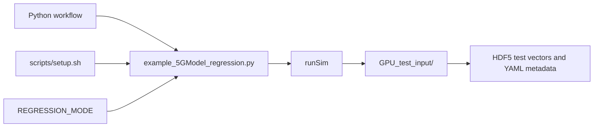

Sources: [5GModel/aerial_mcore/QuickStart.md:15-22](), [5GModel/aerial_mcore/QuickStart.md:31-51](), [5GModel/aerial_mcore/QuickStart.md:55-67]()

### Package Build and Distribution

`setup.py` defines the package name, source directory, package-data patterns, and Python version requirement. It requires `BUILD_ID` to be set, reads `MCORE_BUILD_TYPE` when present, and uses those values to form the package version. For build and wheel details, see [Package Structure and Build](#3.1). [5GModel/aerial_mcore/aerial_pkg/setup.py:20-43]()

**Build configuration to package entities**

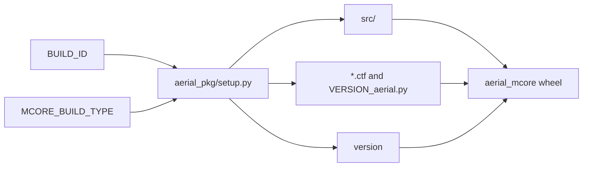

Sources: [5GModel/aerial_mcore/aerial_pkg/setup.py:20-43]()

## Core Workflow

The quickstart’s example runs regression for `allChannels` after sourcing `scripts/setup.sh` and setting `REGRESSION_MODE=1`. Its displayed output reports downlink and uplink runs and a `PASS` result; generated files are listed under `GPU_test_input/`. [5GModel/aerial_mcore/QuickStart.md:15-22] [5GModel/aerial_mcore/QuickStart.md:31-51] [5GModel/aerial_mcore/QuickStart.md:55-67]()

For API-level details, see [Python API Reference](#3.2); for MATLAB integration, see [MATLAB Integration](#3.3).

Sources: [5GModel/aerial_mcore/QuickStart.md:15-22](), [5GModel/aerial_mcore/QuickStart.md:31-51](), [5GModel/aerial_mcore/QuickStart.md:55-67]()

## Package Build and Distribution

The documented quickstart installs an `aerial_mcore` wheel from `aerial_pkg/dist/` using `pip`. The setup configuration names the distribution `aerial_mcore` and declares package data for `*.ctf` and `VERSION_aerial.py`. [5GModel/aerial_mcore/QuickStart.md:9-13] [5GModel/aerial_mcore/aerial_pkg/setup.py:33-43]()

For build configuration, `BUILD_ID` versioning, and wheel distribution details, see [Package Structure and Build](#3.1).

Sources: [5GModel/aerial_mcore/QuickStart.md:9-13](), [5GModel/aerial_mcore/aerial_pkg/setup.py:33-43]()

## Summary

`aerial_mcore` is the Python-binding package for the Aerial 5GModel. Its documented quickstart demonstrates a regression workflow that produces HDF5 test vectors and YAML metadata, while `setup.py` defines package metadata, version inputs, and included package data. [5GModel/aerial_mcore/QuickStart.md:1-3] [5GModel/aerial_mcore/QuickStart.md:15-22] [5GModel/aerial_mcore/QuickStart.md:55-67] [5GModel/aerial_mcore/aerial_pkg/setup.py:20-43]()

- See [Package Structure and Build](#3.1) for packaging and versioning.
- See [Python API Reference](#3.2) for the API.
- See [MATLAB Integration](#3.3) for the Python–MATLAB boundary.

Sources: [5GModel/aerial_mcore/QuickStart.md:1-3](), [5GModel/aerial_mcore/QuickStart.md:15-22](), [5GModel/aerial_mcore/QuickStart.md:55-67](), [5GModel/aerial_mcore/aerial_pkg/setup.py:20-43]()

---

# Page: Package Structure and Build

# Package Structure and Build

<details>
<summary>Relevant source files</summary>

The following files were used as context for generating this wiki page:

- [5GModel/aerial_mcore/aerial_pkg/dist/aerial_mcore-0.20261.508652.508652-py3-none-any.whl](5GModel/aerial_mcore/aerial_pkg/dist/aerial_mcore-0.20261.508652.508652-py3-none-any.whl)
- [5GModel/aerial_mcore/aerial_pkg/pyproject.toml](5GModel/aerial_mcore/aerial_pkg/pyproject.toml)
- [5GModel/aerial_mcore/aerial_pkg/setup.py](5GModel/aerial_mcore/aerial_pkg/setup.py)

</details>


## Purpose and Scope

This page documents the `aerial_mcore` package’s build configuration, package metadata, `BUILD_ID`-based version construction, and the wheel artifact present in the repository. The package metadata identifies it as “Aerial 5GModel Python bindings.” [5GModel/aerial_mcore/aerial_pkg/setup.py:33-43]()

**Sources:** [5GModel/aerial_mcore/aerial_pkg/setup.py:33-43]()

---

## Package Directory Structure

The package’s build configuration is in `5GModel/aerial_mcore/aerial_pkg/`. `setup.py` maps package discovery to the `src` directory, and `pyproject.toml` selects the setuptools build backend. A wheel artifact is present under `dist/`; the provided file is a Git LFS pointer rather than the wheel’s unpacked contents. [5GModel/aerial_mcore/aerial_pkg/setup.py:33-43]() [5GModel/aerial_mcore/aerial_pkg/pyproject.toml:16-21]() [5GModel/aerial_mcore/aerial_pkg/dist/aerial_mcore-0.20261.508652.508652-py3-none-any.whl:1-3]()

### Package Organization Diagram

```mermaid
graph TB
    subgraph root["5GModel/aerial_mcore/aerial_pkg/"]
        setup["setup.py"]
        project["pyproject.toml"]
        subgraph source["src/"]
            packages["Packages discovered by find_packages"]
        end
        subgraph dist["dist/"]
            wheel["aerial_mcore-0.20261.508652.508652-py3-none-any.whl"]
        end
    end
    project -->|"Selects build backend"| setup
    setup -->|"Discovers packages under src/"| packages
    setup -->|"Distribution artifact present"| wheel
```

**Sources:** [5GModel/aerial_mcore/aerial_pkg/setup.py:33-43]() [5GModel/aerial_mcore/aerial_pkg/pyproject.toml:16-21]() [5GModel/aerial_mcore/aerial_pkg/dist/aerial_mcore-0.20261.508652.508652-py3-none-any.whl:1-3]()

The package layout and distribution-related settings are:

| Area | Configuration or artifact | Meaning |
|---|---|---|
| Package root | `5GModel/aerial_mcore/aerial_pkg/` | Contains the packaging configuration files. [5GModel/aerial_mcore/aerial_pkg/setup.py:33-43]() |
| Source mapping | `package_dir={"": "src"}` | Maps package directories to `src`. [5GModel/aerial_mcore/aerial_pkg/setup.py:38]() |
| Package discovery | `setuptools.find_packages(where="src")` | Discovers packages under `src`. [5GModel/aerial_mcore/aerial_pkg/setup.py:39]() |
| Distribution artifact | `dist/aerial_mcore-0.20261.508652.508652-py3-none-any.whl` | A wheel file tracked through Git LFS; the supplied contents show its LFS pointer metadata, not its internal files. [5GModel/aerial_mcore/aerial_pkg/dist/aerial_mcore-0.20261.508652.508652-py3-none-any.whl:1-3]() |

**Sources:** [5GModel/aerial_mcore/aerial_pkg/setup.py:33-43]() [5GModel/aerial_mcore/aerial_pkg/dist/aerial_mcore-0.20261.508652.508652-py3-none-any.whl:1-3]()

---

## Build System Configuration

### `pyproject.toml`

`pyproject.toml` declares the build-system requirements as `setuptools>=42` and `wheel`, and uses `setuptools.build_meta` as the build backend. [5GModel/aerial_mcore/aerial_pkg/pyproject.toml:16-21]()

| Configuration | Value | Effect |
|---|---|---|
| `build-system.requires` | `setuptools>=42`, `wheel` | Declares the build dependencies. [5GModel/aerial_mcore/aerial_pkg/pyproject.toml:16-20]() |
| `build-backend` | `setuptools.build_meta` | Selects the setuptools PEP 517 backend. [5GModel/aerial_mcore/aerial_pkg/pyproject.toml:21]() |

**Sources:** [5GModel/aerial_mcore/aerial_pkg/pyproject.toml:16-21]()

### `setup.py`

`setup.py` reads `BUILD_ID` and `MCORE_BUILD_TYPE` from the process environment, constructs the package version, then passes package metadata and discovery settings to `setuptools.setup()`. [5GModel/aerial_mcore/aerial_pkg/setup.py:16-43]()

### `setup.py` Logic Flow

```mermaid
flowchart LR
    buildId["BUILD_ID"]
    buildType["MCORE_BUILD_TYPE"]
    requiredCheck["Require BUILD_ID"]
    defaultType["Default MCORE_BUILD_TYPE to empty string"]
    version["version = 0.20261.BUILD_ID.MCORE_BUILD_TYPE-plus-BUILD_ID"]
    setupCall["setuptools.setup"]
    discovery["find_packages where src"]
    data["package_data: *.ctf and VERSION_aerial.py"]
    buildId --> requiredCheck
    requiredCheck --> version
    buildType --> defaultType
    defaultType --> version
    version --> setupCall
    discovery --> setupCall
    data --> setupCall
```

**Sources:** [5GModel/aerial_mcore/aerial_pkg/setup.py:20-43]()

#### Key Configuration Parameters

| Parameter | Value | Description |
|---|---|---|
| `name` | `aerial_mcore` | Distribution name. [5GModel/aerial_mcore/aerial_pkg/setup.py:33-35]() |
| `version` | `0.20261.{BUILD_ID}.{MCORE_BUILD_TYPE}{BUILD_ID}` | Version assembled from the environment. [5GModel/aerial_mcore/aerial_pkg/setup.py:20-31]() |
| `author` | `NVIDIA` | Package author metadata. [5GModel/aerial_mcore/aerial_pkg/setup.py:35-37]() |
| `description` | `Aerial 5GModel Python bindings` | Package description metadata. [5GModel/aerial_mcore/aerial_pkg/setup.py:36-38]() |
| `package_dir` | `{"": "src"}` | Maps packages to the `src` directory. [5GModel/aerial_mcore/aerial_pkg/setup.py:38]() |
| `packages` | `setuptools.find_packages(where="src")` | Discovers packages in `src`. [5GModel/aerial_mcore/aerial_pkg/setup.py:39]() |
| `include_package_data` | `True` | Enables inclusion of package data. [5GModel/aerial_mcore/aerial_pkg/setup.py:40]() |
| `package_data` | `{"": ["*.ctf","VERSION_aerial.py"]}` | Specifies data-file patterns. [5GModel/aerial_mcore/aerial_pkg/setup.py:41]() |
| `python_requires` | `>=3.8` | Declares the minimum Python version. [5GModel/aerial_mcore/aerial_pkg/setup.py:42]() |
| `zip_safe` | `False` | Marks the distribution as not zip-safe. [5GModel/aerial_mcore/aerial_pkg/setup.py:43]() |

**Sources:** [5GModel/aerial_mcore/aerial_pkg/setup.py:33-43]()

#### Environment Variable Requirements

- **`BUILD_ID` (required):** The setup script reads this environment variable and raises `RuntimeError` if it is absent. The source comment describes it as coming from Jenkins. [5GModel/aerial_mcore/aerial_pkg/setup.py:20-23]()
- **`MCORE_BUILD_TYPE` (optional):** The script reads this variable and assigns an empty string when it is unset. Its value is incorporated into the generated version. [5GModel/aerial_mcore/aerial_pkg/setup.py:25-31]()

**Sources:** [5GModel/aerial_mcore/aerial_pkg/setup.py:20-31]()

---

## Build Process

The supplied build configuration identifies setuptools as the backend and declares setuptools and wheel as build requirements. The supplied files do not describe a build command, wrapper script, cleanup procedure, or the sequence used to produce the repository’s wheel artifact. [5GModel/aerial_mcore/aerial_pkg/pyproject.toml:16-21]() [5GModel/aerial_mcore/aerial_pkg/setup.py:33-43]()

### Build Workflow Diagram

```mermaid
flowchart LR
    project["pyproject.toml"]
    requirements["setuptools>=42 and wheel"]
    backend["setuptools.build_meta"]
    setup["setup.py"]
    metadata["Package metadata and version"]
    wheel["Wheel distribution"]
    project --> requirements
    project --> backend
    backend --> setup
    setup --> metadata
    metadata -->|"Packaging configuration"| wheel
```

**Sources:** [5GModel/aerial_mcore/aerial_pkg/pyproject.toml:16-21]() [5GModel/aerial_mcore/aerial_pkg/setup.py:20-43]()

**Sources:** [5GModel/aerial_mcore/aerial_pkg/pyproject.toml:16-21]() [5GModel/aerial_mcore/aerial_pkg/setup.py:20-43]()

---

## Versioning Scheme

The setup script constructs the version using the format `0.20261.{BUILD_ID}.{MCORE_BUILD_TYPE}{BUILD_ID}`. `BUILD_ID` is required; `MCORE_BUILD_TYPE` defaults to the empty string when unset. [5GModel/aerial_mcore/aerial_pkg/setup.py:20-31]()

### Version Format

| Component | Source | Role |
|---|---|---|
| `0.20261` | Literal in the version expression | Fixed leading version components. [5GModel/aerial_mcore/aerial_pkg/setup.py:29-31]() |
| First `{BUILD_ID}` | `BUILD_ID` environment variable | Build identifier in the version. [5GModel/aerial_mcore/aerial_pkg/setup.py:20-23]()] |
| `{MCORE_BUILD_TYPE}{BUILD_ID}` | Optional build-type value followed by `BUILD_ID` | Final version component; the build type is empty if unset. [5GModel/aerial_mcore/aerial_pkg/setup.py:25-31]() |

**Sources:** [5GModel/aerial_mcore/aerial_pkg/setup.py:20-31]()

The wheel filename present in the repository is `aerial_mcore-0.20261.508652.508652-py3-none-any.whl`. Its filename version is `0.20261.508652.508652`; the supplied `setup.py` expression produces that shape when `BUILD_ID` is `508652` and `MCORE_BUILD_TYPE` is empty. The artifact is represented in the supplied file contents by a Git LFS pointer, so its internal wheel metadata is not available here. [5GModel/aerial_mcore/aerial_pkg/setup.py:20-31]() [5GModel/aerial_mcore/aerial_pkg/dist/aerial_mcore-0.20261.508652.508652-py3-none-any.whl:1-3]()

**Sources:** [5GModel/aerial_mcore/aerial_pkg/setup.py:20-31]() [5GModel/aerial_mcore/aerial_pkg/dist/aerial_mcore-0.20261.508652.508652-py3-none-any.whl:1-3]()

---

## Distribution Format

The repository contains a `.whl` distribution artifact. The `setup.py` configuration supplies package discovery, package-data patterns, Python-version metadata, and the `zip_safe` setting used by setuptools. [5GModel/aerial_mcore/aerial_pkg/setup.py:33-43]() [5GModel/aerial_mcore/aerial_pkg/dist/aerial_mcore-0.20261.508652.508652-py3-none-any.whl:1-3]()

### Wheel Contents

| Content category | Setup configuration | What can be established |
|---|---|---|
| Python packages | `find_packages(where="src")` and `package_dir={"": "src"}` | Package discovery is configured for packages under `src`. [5GModel/aerial_mcore/aerial_pkg/setup.py:38-39]() |
| Package data | `include_package_data=True` | Package-data inclusion is enabled. [5GModel/aerial_mcore/aerial_pkg/setup.py:40]() |
| Explicit data patterns | `*.ctf`, `VERSION_aerial.py` | These patterns are listed in `package_data`. [5GModel/aerial_mcore/aerial_pkg/setup.py:41]() |

The supplied wheel file is a Git LFS pointer containing the object identifier and size, not an unpacked listing of wheel members. Therefore, the configured data patterns describe what `setup.py` requests for packaging; they do not independently verify the contents of that particular wheel. [5GModel/aerial_mcore/aerial_pkg/dist/aerial_mcore-0.20261.508652.508652-py3-none-any.whl:1-3]() [5GModel/aerial_mcore/aerial_pkg/setup.py:38-41]()

**Sources:** [5GModel/aerial_mcore/aerial_pkg/setup.py:38-41]() [5GModel/aerial_mcore/aerial_pkg/dist/aerial_mcore-0.20261.508652.508652-py3-none-any.whl:1-3]()

The package is marked `zip_safe=False`. The supplied configuration does not state the reason for this setting, so no further runtime consequence is asserted here. [5GModel/aerial_mcore/aerial_pkg/setup.py:43]()

**Sources:** [5GModel/aerial_mcore/aerial_pkg/setup.py:43]()

---

# Page: Python API Reference

# Python API Reference

<details>
<summary>Relevant source files</summary>

The following files were used as context for generating this wiki page:

- [5GModel/aerial_mcore/examples/example_nrSimulator.py](5GModel/aerial_mcore/examples/example_nrSimulator.py)
- [5GModel/aerial_mcore/examples/example_runSim.py](5GModel/aerial_mcore/examples/example_runSim.py)

</details>


## Purpose and Scope

This page describes the Python-facing `aerial_mcore` API as exercised by the package examples: initializing the simulator, running a YAML-configured simulation with `runSim`, invoking `nrSimulator` with programmatically configured parameters, and interpreting the returned values. It also records the `runRegression` usage documented in the existing reference. The examples show calls through an `eng` object returned by `NRSimulator.initialize()`; they do not define the underlying MATLAB implementation. [5GModel/aerial_mcore/examples/example_nrSimulator.py:16-21](), [5GModel/aerial_mcore/examples/example_runSim.py:16-39](), [5GModel/aerial_mcore/examples/example_5GModel_regression.py:34-61]()

Sources: [5GModel/aerial_mcore/examples/example_nrSimulator.py:16-21](), [5GModel/aerial_mcore/examples/example_runSim.py:16-39](), [5GModel/aerial_mcore/examples/example_5GModel_regression.py:34-61]()

---

## Module Import and Initialization

### Importing the Module

The examples import `aerial_mcore` under the alias `NRSimulator`. The `example_nrSimulator.py` example also imports `matlab` and NumPy: it uses `matlab.double` for a PUSCH field and converts a returned MATLAB value with `np.array`. [5GModel/aerial_mcore/examples/example_nrSimulator.py:16-18](), [5GModel/aerial_mcore/examples/example_nrSimulator.py:51-51](), [5GModel/aerial_mcore/examples/example_nrSimulator.py:96-96]()

Sources: [5GModel/aerial_mcore/examples/example_nrSimulator.py:16-18](), [5GModel/aerial_mcore/examples/example_nrSimulator.py:51-51](), [5GModel/aerial_mcore/examples/example_nrSimulator.py:96-96]()

### Initialization Function

#### `NRSimulator.initialize()`

Both supplied examples call `NRSimulator.initialize()` and assign its return value to `eng`. Subsequent simulation operations are invoked as methods on `eng`, including `runSim`, `initSysPar`, `cfgPusch`, and `nrSimulator`. [5GModel/aerial_mcore/examples/example_nrSimulator.py:21-21](), [5GModel/aerial_mcore/examples/example_nrSimulator.py:28-36](), [5GModel/aerial_mcore/examples/example_runSim.py:32-39]()

The examples establish this usage pattern but do not specify the return type or initialization internals. [5GModel/aerial_mcore/examples/example_nrSimulator.py:21-21](), [5GModel/aerial_mcore/examples/example_runSim.py:32-39]()

Sources: [5GModel/aerial_mcore/examples/example_nrSimulator.py:21-36](), [5GModel/aerial_mcore/examples/example_runSim.py:32-39]()

---

## API Architecture

### Natural Language to Code Entity Mapping

| System concept | Code entity | Example use |
|---|---|---|
| Python package entry point | `aerial_mcore` imported as `NRSimulator` | Import in the simulator examples. [5GModel/aerial_mcore/examples/example_nrSimulator.py:16-16](), [5GModel/aerial_mcore/examples/example_runSim.py:16-16]() |
| API initialization | `NRSimulator.initialize()` | Assigns the returned object to `eng`. [5GModel/aerial_mcore/examples/example_nrSimulator.py:21-21](), [5GModel/aerial_mcore/examples/example_runSim.py:32-32]() |
| System parameter setup | `eng.initSysPar(testAlloc)` | Initializes `SysPar` using channel allocation flags. [5GModel/aerial_mcore/examples/example_nrSimulator.py:23-28]() |
| PUSCH configuration creation | `eng.cfgPusch()` | Supplies a PUSCH configuration placed in `SysPar["pusch"]`. [5GModel/aerial_mcore/examples/example_nrSimulator.py:36-36]() |
| Programmatic simulator entry point | `eng.nrSimulator(SysPar, nargout=3)` | Returns updated system parameters and UE/gNB structures. [5GModel/aerial_mcore/examples/example_nrSimulator.py:92-92]() |
| Configuration-file runner | `eng.runSim(...)` | Accepts configuration and test-vector filenames, with an optional receive filename. [5GModel/aerial_mcore/examples/example_runSim.py:26-39]() |
| Regression entry point | `eng.runRegression(...)` | Used by the regression example to obtain test-case and error counts. [5GModel/aerial_mcore/examples/example_5GModel_regression.py:44-61]() |

Sources: [5GModel/aerial_mcore/examples/example_nrSimulator.py:16-36](), [5GModel/aerial_mcore/examples/example_nrSimulator.py:92-92](), [5GModel/aerial_mcore/examples/example_runSim.py:16-39](), [5GModel/aerial_mcore/examples/example_5GModel_regression.py:44-61]()

### API Execution Flow

**Diagram: Python API names mapped to simulator operations**

```mermaid
flowchart TD
    Import["import aerial_mcore as NRSimulator"] --> Init["NRSimulator.initialize()"]
    Init --> Eng["eng"]
    Eng --> InitSys["eng.initSysPar(testAlloc)"]
    Eng --> Cfg["eng.cfgPusch()"]
    Eng --> NrSim["eng.nrSimulator(SysPar, nargout=3)"]
    Eng --> RunSim["eng.runSim(cfgFileName, tvFileName, rxFileName, nargout=4)"]
    Eng --> Regression["eng.runRegression(...)"]
    InitSys --> SysPar["SysPar"]
    Cfg --> Pusch["SysPar['pusch']"]
    SysPar --> NrSim
    Pusch --> NrSim
    RunSim --> RunResult["errFlag, SysPar, UE, gNB"]
    NrSim --> NrResult["SysPar_out, UE, gNB"]
    Regression --> RegressionResult["nTC, errCnt"]
```

The diagram maps the names used in the Python examples to the calls and returned values shown there. The `runSim` example chooses between the two-argument-file form and the form with an additional `rxFileName`; the programmatic example builds `SysPar` before calling `nrSimulator`. [5GModel/aerial_mcore/examples/example_nrSimulator.py:21-36](), [5GModel/aerial_mcore/examples/example_nrSimulator.py:90-92](), [5GModel/aerial_mcore/examples/example_runSim.py:26-39](), [5GModel/aerial_mcore/examples/example_5GModel_regression.py:44-61]()

Sources: [5GModel/aerial_mcore/examples/example_nrSimulator.py:21-36](), [5GModel/aerial_mcore/examples/example_nrSimulator.py:90-92](), [5GModel/aerial_mcore/examples/example_runSim.py:26-39](), [5GModel/aerial_mcore/examples/example_5GModel_regression.py:44-61]()

### API Workflows

**Diagram: Example workflow names mapped to API entities**

```mermaid
flowchart LR
    subgraph Programmatic["Programmatic simulation"]
        PInit["NRSimulator.initialize()"] --> PAlloc["eng.initSysPar(testAlloc)"]
        PAlloc --> PConfig["eng.cfgPusch()"]
        PConfig --> PCall["eng.nrSimulator(SysPar, nargout=3)"]
        PCall --> PResult["SysPar_out, UE, gNB"]
    end
    subgraph FileBased["Configuration-file simulation"]
        FInit["NRSimulator.initialize()"] --> FCall["eng.runSim(cfgFileName, tvFileName, optional rxFileName, nargout=4)"]
        FCall --> FResult["errFlag, SysPar, UE, gNB"]
    end
    subgraph Regression["Regression"]
        RInit["NRSimulator.initialize()"] --> RCall["eng.runRegression(...)"]
        RCall --> RResult["nTC, errCnt"]
    end
```

The programmatic and file-based paths are demonstrated in the supplied simulator examples. The regression path and its two-result assignment are documented by the regression example referenced in the existing page. [5GModel/aerial_mcore/examples/example_nrSimulator.py:21-36](), [5GModel/aerial_mcore/examples/example_nrSimulator.py:90-92](), [5GModel/aerial_mcore/examples/example_runSim.py:32-39](), [5GModel/aerial_mcore/examples/example_5GModel_regression.py:34-61]()

Sources: [5GModel/aerial_mcore/examples/example_nrSimulator.py:21-36](), [5GModel/aerial_mcore/examples/example_nrSimulator.py:90-92](), [5GModel/aerial_mcore/examples/example_runSim.py:32-39](), [5GModel/aerial_mcore/examples/example_5GModel_regression.py:34-61]()

---

## Core API Functions

### Configuration Functions

#### `eng.initSysPar(testAlloc)`

The programmatic example passes a dictionary with `dl`, `ul`, and `pusch` keys to `eng.initSysPar`, assigning the result to `SysPar`. In that example, `dl` is disabled while `ul` and `pusch` are enabled. [5GModel/aerial_mcore/examples/example_nrSimulator.py:23-28]()

| Input key | Example value | Meaning shown by the example |
|---|---:|---|
| `dl` | `0` | Downlink allocation flag in the supplied test allocation. [5GModel/aerial_mcore/examples/example_nrSimulator.py:23-27]() |
| `ul` | `1` | Uplink allocation flag in the supplied test allocation. [5GModel/aerial_mcore/examples/example_nrSimulator.py:23-27]() |
| `pusch` | `1` | PUSCH allocation flag in the supplied test allocation. [5GModel/aerial_mcore/examples/example_nrSimulator.py:23-27]() |

The example then modifies the returned `SysPar`, including simulation-control and carrier fields. [5GModel/aerial_mcore/examples/example_nrSimulator.py:28-34]()

Sources: [5GModel/aerial_mcore/examples/example_nrSimulator.py:23-34]()

#### `eng.cfgPusch()`

The example calls `eng.cfgPusch()` and places the result in a one-element list at `SysPar["pusch"]`. It then updates the first list element with a PUSCH parameter dictionary. [5GModel/aerial_mcore/examples/example_nrSimulator.py:36-36](), [5GModel/aerial_mcore/examples/example_nrSimulator.py:37-90]()

Sources: [5GModel/aerial_mcore/examples/example_nrSimulator.py:36-90]()

### Simulation Functions

#### `eng.nrSimulator(SysPar, nargout=3)`

The programmatic example calls `eng.nrSimulator(SysPar, nargout=3)` and unpacks the result as `SysPar_out`, `UE`, and `gNB`. It subsequently reads the first UE’s transmit grid from `UE[0]['Phy']['tx']['Xtf']`. [5GModel/aerial_mcore/examples/example_nrSimulator.py:92-96]()

| Return value | Example use |
|---|---|
| `SysPar_out` | Reads PUSCH resource-allocation fields to calculate resource-grid indices. [5GModel/aerial_mcore/examples/example_nrSimulator.py:98-101]() |
| `UE` | Reads the first UE’s `Phy` → `tx` → `Xtf` data. [5GModel/aerial_mcore/examples/example_nrSimulator.py:96-96]() |
| `gNB` | Returned as the third output; the example does not inspect it. [5GModel/aerial_mcore/examples/example_nrSimulator.py:92-92]() |

Sources: [5GModel/aerial_mcore/examples/example_nrSimulator.py:92-101]()

#### `eng.runSim(cfgFileName, tvFileName, [rxFileName], nargout=4)`

The file-based example reads a configuration filename and test-vector filename from command-line arguments. It accepts an optional third filename as `rxFileName`, initializes `eng`, then calls `runSim` with either two filenames or all three. It requests four outputs in both cases. [5GModel/aerial_mcore/examples/example_runSim.py:21-39]()

| Argument or result | Role in the example |
|---|---|
| `cfgFileName` | First filename argument, passed to `runSim`. [5GModel/aerial_mcore/examples/example_runSim.py:21-27](), [5GModel/aerial_mcore/examples/example_runSim.py:37-39]() |
| `tvFileName` | Second filename argument, passed to `runSim`. [5GModel/aerial_mcore/examples/example_runSim.py:21-27](), [5GModel/aerial_mcore/examples/example_runSim.py:37-39]() |
| `rxFileName` | Optional third filename; when present, passed as an additional `runSim` argument. [5GModel/aerial_mcore/examples/example_runSim.py:28-39]() |
| `errFlag`, `SysPar`, `UE`, `gNB` | Four unpacked return values. [5GModel/aerial_mcore/examples/example_runSim.py:36-39]() |

The example prints `errFlag` and elapsed time, and exits with status `1` when `errFlag` is nonzero. [5GModel/aerial_mcore/examples/example_runSim.py:35-45]()

Sources: [5GModel/aerial_mcore/examples/example_runSim.py:21-45]()

### Regression Testing Functions

#### `eng.runRegression(...)`

The existing reference describes a regression example that calls `eng.runRegression` with test-set, channel, mode, subset, and release arguments, requesting two outputs. The outputs are assigned to `nTC` and `errCnt`. [5GModel/aerial_mcore/examples/example_5GModel_regression.py:44-61]()

| Return value | Description in the existing reference |
|---|---|
| `nTC` | Number of test cases executed. [5GModel/aerial_mcore/examples/example_5GModel_regression.py:44-61]() |
| `errCnt` | Number of test cases with errors. [5GModel/aerial_mcore/examples/example_5GModel_regression.py:44-61]() |

The provided regression reference also checks the error count and reports a failed test condition when it is nonzero. [5GModel/aerial_mcore/examples/example_5GModel_regression.py:102-103]()

Sources: [5GModel/aerial_mcore/examples/example_5GModel_regression.py:44-61](), [5GModel/aerial_mcore/examples/example_5GModel_regression.py:102-103]()

---

## Data Structures

### `SysPar`

`SysPar` is the parameter value returned by `eng.initSysPar(testAlloc)` and passed to `eng.nrSimulator`. The example accesses `SimCtrl`, `carrier`, and `pusch` fields, setting values in the first two and adding a PUSCH configuration list. [5GModel/aerial_mcore/examples/example_nrSimulator.py:28-36]()

| Field | Example access or update |
|---|---|
| `SimCtrl` | Sets `fp16AlgoSel` and `N_frame`. [5GModel/aerial_mcore/examples/example_nrSimulator.py:30-31]() |
| `carrier` | Sets `Nant_gNB`, `Nant_UE`, and `N_ID_CELL`. [5GModel/aerial_mcore/examples/example_nrSimulator.py:32-34]() |
| `pusch` | Replaced with a list containing `eng.cfgPusch()`; its first item is updated with PUSCH parameters. [5GModel/aerial_mcore/examples/example_nrSimulator.py:36-36](), [5GModel/aerial_mcore/examples/example_nrSimulator.py:90-90]() |

Sources: [5GModel/aerial_mcore/examples/example_nrSimulator.py:28-36](), [5GModel/aerial_mcore/examples/example_nrSimulator.py:90-90]()

### PUSCH Configuration

The example creates a PUSCH configuration with `eng.cfgPusch()` and updates it with fields covering bandwidth-part and resource allocation, modulation and coding, DMRS, payload, HARQ, and related settings. The following table highlights fields subsequently used for resource-grid inspection. [5GModel/aerial_mcore/examples/example_nrSimulator.py:36-90]()

| Field | Example value or use |
|---|---|
| `BWPSize` | Set to `273.0`. [5GModel/aerial_mcore/examples/example_nrSimulator.py:37-40]() |
| `rbStart` | Set to `24.`; used to calculate the starting resource element. [5GModel/aerial_mcore/examples/example_nrSimulator.py:58-60](), [5GModel/aerial_mcore/examples/example_nrSimulator.py:98-99]() |
| `rbSize` | Set to `26.`; used to calculate the resource-element span. [5GModel/aerial_mcore/examples/example_nrSimulator.py:59-60](), [5GModel/aerial_mcore/examples/example_nrSimulator.py:98-99]() |
| `StartSymbolIndex` | Set to `0.` and used to calculate the symbol range. [5GModel/aerial_mcore/examples/example_nrSimulator.py:65-66](), [5GModel/aerial_mcore/examples/example_nrSimulator.py:100-101]() |
| `NrOfSymbols` | Set to `14.` and used to calculate the symbol range. [5GModel/aerial_mcore/examples/example_nrSimulator.py:65-66](), [5GModel/aerial_mcore/examples/example_nrSimulator.py:100-101]() |
| `DmrsSymbPos` | Set using `matlab.double` and read while classifying symbols in the output grid. [5GModel/aerial_mcore/examples/example_nrSimulator.py:51-52](), [5GModel/aerial_mcore/examples/example_nrSimulator.py:102-106]() |

Sources: [5GModel/aerial_mcore/examples/example_nrSimulator.py:36-90](), [5GModel/aerial_mcore/examples/example_nrSimulator.py:98-106]()

### Output Structures: `UE` and `gNB`

`eng.nrSimulator` returns `UE` and `gNB` as its second and third outputs. The example accesses the first UE, follows the nested `Phy`, `tx`, and `Xtf` fields, and converts the resulting value to a NumPy array. It does not inspect `gNB`. [5GModel/aerial_mcore/examples/example_nrSimulator.py:92-96]()

The example calculates a resource-element range from the returned PUSCH allocation and iterates over the configured symbol range. For each symbol it checks `DmrsSymbPos` and prints the first resource element as DMRS or DATA accordingly. [5GModel/aerial_mcore/examples/example_nrSimulator.py:98-106]()

Sources: [5GModel/aerial_mcore/examples/example_nrSimulator.py:92-106]()

---

## MATLAB Data Type Conversion

The programmatic example uses `matlab.double` for `DmrsSymbPos`. It converts `UE[0]['Phy']['tx']['Xtf']` with `np.array` before indexing the transmit grid. These examples demonstrate conversion at the Python/MATLAB boundary for those particular values. [5GModel/aerial_mcore/examples/example_nrSimulator.py:16-18](), [5GModel/aerial_mcore/examples/example_nrSimulator.py:51-51](), [5GModel/aerial_mcore/examples/example_nrSimulator.py:96-96]()

Sources: [5GModel/aerial_mcore/examples/example_nrSimulator.py:16-18](), [5GModel/aerial_mcore/examples/example_nrSimulator.py:51-51](), [5GModel/aerial_mcore/examples/example_nrSimulator.py:96-96]()

---

## Return Value Handling

### `nargout`

The examples specify `nargout` at calls that return multiple MATLAB outputs:

| Call | Requested outputs | Unpacked values |
|---|---:|---|
| `eng.nrSimulator(...)` | `3` | `SysPar_out`, `UE`, `gNB`. [5GModel/aerial_mcore/examples/example_nrSimulator.py:92-92]() |
| `eng.runSim(...)` | `4` | `errFlag`, `SysPar`, `UE`, `gNB`. [5GModel/aerial_mcore/examples/example_runSim.py:36-39]() |
| `eng.runRegression(...)` | `2` | `nTC`, `errCnt`. [5GModel/aerial_mcore/examples/example_5GModel_regression.py:44-61]() |

Sources: [5GModel/aerial_mcore/examples/example_nrSimulator.py:92-92](), [5GModel/aerial_mcore/examples/example_runSim.py:36-39](), [5GModel/aerial_mcore/examples/example_5GModel_regression.py:44-61]()

### Error Handling

The `runSim` example treats a nonzero `errFlag` as failure and exits with status `1`. The regression example checks `errCnt` and reports failure when it is nonzero. [5GModel/aerial_mcore/examples/example_runSim.py:42-45](), [5GModel/aerial_mcore/examples/example_5GModel_regression.py:102-103]()

Sources: [5GModel/aerial_mcore/examples/example_runSim.py:42-45](), [5GModel/aerial_mcore/examples/example_5GModel_regression.py:102-103]()

---

# Page: MATLAB Integration

# MATLAB Integration

<details>
<summary>Relevant source files</summary>

The following files were used as context for generating this wiki page:

- [5GModel/aerial_mcore/scripts/setup.sh](5GModel/aerial_mcore/scripts/setup.sh)
- [5GModel/nr_matlab/build_runSim.sh](5GModel/nr_matlab/build_runSim.sh)

</details>


## Purpose and Scope

This page describes the MATLAB integration points visible in the supplied `aerial_mcore` and `nr_matlab` files: configuring MATLAB Runtime library paths for a Python environment and launching a MATLAB build step. These files do not establish the Python MATLAB Engine call path, `yamlmatlab` setup, or `.ctf` packaging details, so those implementation details are not asserted here. [5GModel/aerial_mcore/scripts/setup.sh:18-25](), [5GModel/nr_matlab/build_runSim.sh:18-18]()

Sources: [5GModel/aerial_mcore/scripts/setup.sh:18-25](), [5GModel/nr_matlab/build_runSim.sh:18-18]()

## Architecture Overview

The supplied integration files show two distinct operations: `setup.sh` prepares a shell environment for Aerial Python by setting MATLAB Runtime library paths, while `build_runSim.sh` invokes a MATLAB executable to run `mcc_build.m`. [5GModel/aerial_mcore/scripts/setup.sh:18-25](), [5GModel/nr_matlab/build_runSim.sh:18-18]()

### Integration Components

**Diagram: Environment setup and MATLAB build entry point**

```mermaid
flowchart LR
    subgraph "Python environment setup"
        USER["User sources setup.sh"]
        SETUP["5GModel/aerial_mcore/scripts/setup.sh"]
        AERIAL["AERIAL_PYTHON"]
        BUILD_TYPE["MCORE_BUILD_TYPE"]
        LIBPATH["LD_LIBRARY_PATH"]
        RUNTIME["MATLAB_Runtime/R2026a"]
        USER --> SETUP
        SETUP --> AERIAL
        SETUP --> BUILD_TYPE
        SETUP --> LIBPATH
        LIBPATH --> RUNTIME
    end

    subgraph "MATLAB build invocation"
        BUILDSCRIPT["5GModel/nr_matlab/build_runSim.sh"]
        MATLAB["/home/tools/matlab/mathworks_r2026a/bin/matlab"]
        MCC["mcc_build.m"]
        BUILDSCRIPT --> MATLAB
        MATLAB --> MCC
    end
```

Sources: [5GModel/aerial_mcore/scripts/setup.sh:18-25](), [5GModel/nr_matlab/build_runSim.sh:18-18]()

**Diagram: Natural-language responsibilities mapped to code entities**

```mermaid
flowchart TB
    PYTHON_SETUP["Prepare Aerial Python shell"]
    SOURCE_SETUP["source setup.sh"]
    SCRIPT_SETUP["5GModel/aerial_mcore/scripts/setup.sh"]
    ENV_FLAG["AERIAL_PYTHON"]
    DEV_MODE["MCORE_BUILD_TYPE=dev"]
    MATLAB_RUNTIME_PATHS["MATLAB Runtime library paths"]

    MATLAB_BUILD["Run the MATLAB build"]
    BUILD_RUNSIM["5GModel/nr_matlab/build_runSim.sh"]
    MATLAB_EXECUTABLE["/home/tools/matlab/mathworks_r2026a/bin/matlab"]
    MCC_BUILD["mcc_build.m"]

    PYTHON_SETUP --> SOURCE_SETUP
    SOURCE_SETUP --> SCRIPT_SETUP
    SCRIPT_SETUP --> ENV_FLAG
    SCRIPT_SETUP --> DEV_MODE
    SCRIPT_SETUP --> MATLAB_RUNTIME_PATHS

    MATLAB_BUILD --> BUILD_RUNSIM
    BUILD_RUNSIM --> MATLAB_EXECUTABLE
    MATLAB_EXECUTABLE --> MCC_BUILD
```

Sources: [5GModel/aerial_mcore/scripts/setup.sh:18-25](), [5GModel/nr_matlab/build_runSim.sh:18-18]()

Sources: [5GModel/aerial_mcore/scripts/setup.sh:18-25](), [5GModel/nr_matlab/build_runSim.sh:18-18]()

## MATLAB Runtime Environment

`setup.sh` is intended to be sourced, rather than run as a standalone process. On its first activation—when `AERIAL_PYTHON` is not set—it sets `AERIAL_PYTHON=1`, prefixes the shell prompt with `[Aerial Python]`, and appends MATLAB Runtime library directories to `LD_LIBRARY_PATH`. It sets `MCORE_BUILD_TYPE=dev` after the conditional, so that assignment is performed whenever the script is sourced. [5GModel/aerial_mcore/scripts/setup.sh:18-25]()

The configured runtime paths point to MATLAB Runtime `R2026a` and include its runtime, binary, operating-system, external-binary, and OpenGL library directories. [5GModel/aerial_mcore/scripts/setup.sh:23-23]()

| Setting | Behavior established by the script |
|---|---|
| `AERIAL_PYTHON` | Set to `1` if it is not already set. [5GModel/aerial_mcore/scripts/setup.sh:20-21]() |
| `PS1` | Prefixed with `[Aerial Python]` when the setup guard runs. [5GModel/aerial_mcore/scripts/setup.sh:20-23]() |
| `LD_LIBRARY_PATH` | Appended with MATLAB Runtime `R2026a` library directories when the setup guard runs. [5GModel/aerial_mcore/scripts/setup.sh:20-23]() |
| `MCORE_BUILD_TYPE` | Set to `dev` whenever the script is sourced. [5GModel/aerial_mcore/scripts/setup.sh:25-25]() |

The guard checks whether `AERIAL_PYTHON` is set, not whether its value is `1`; if it is already set, the guarded prompt and library-path changes are skipped. The unconditional `MCORE_BUILD_TYPE` assignment still runs. [5GModel/aerial_mcore/scripts/setup.sh:20-25]()

Sources: [5GModel/aerial_mcore/scripts/setup.sh:18-25]()

## MATLAB Build Invocation

`build_runSim.sh` invokes a MATLAB executable at `/home/tools/matlab/mathworks_r2026a/bin/matlab` with `-nodisplay`, `-nosplash`, and `-nodesktop`. Its `-r` argument runs `./mcc_build.m` and then exits MATLAB. The supplied file shows the invocation, but does not include `mcc_build.m` or specify which artifacts that build produces. [5GModel/nr_matlab/build_runSim.sh:18-18]()

**Diagram: `build_runSim.sh` execution flow**

```mermaid
sequenceDiagram
    participant Caller as "Caller"
    participant Script as "build_runSim.sh"
    participant MATLAB as "MATLAB executable"
    participant Build as "mcc_build.m"

    Caller->>Script: "Invoke build_runSim.sh"
    Script->>MATLAB: "Start non-display MATLAB session"
    MATLAB->>Build: "Run ./mcc_build.m"
    Build-->>MATLAB: "Return from build script"
    MATLAB->>MATLAB: "exit"
```

Sources: [5GModel/nr_matlab/build_runSim.sh:18-18]()

Sources: [5GModel/nr_matlab/build_runSim.sh:18-18]()

## Engine, YAML, and CTF Boundaries

The available files do not show an implementation of MATLAB Engine API calls from Python, MATLAB function dispatch, Python/MATLAB data conversion, `yamlmatlab` installation or configuration, or `.ctf` creation and inclusion in a wheel. Those topics therefore cannot be detailed from the provided code evidence. [5GModel/aerial_mcore/scripts/setup.sh:18-25](), [5GModel/nr_matlab/build_runSim.sh:18-18]()

The concrete MATLAB integration behavior established here is limited to configuring MATLAB Runtime shared-library lookup paths for the Aerial Python shell and invoking `mcc_build.m` through a MATLAB executable. [5GModel/aerial_mcore/scripts/setup.sh:18-25](), [5GModel/nr_matlab/build_runSim.sh:18-18]()

Sources: [5GModel/aerial_mcore/scripts/setup.sh:18-25](), [5GModel/nr_matlab/build_runSim.sh:18-18]()

---

# Page: Examples and Usage

# Examples and Usage

<details>
<summary>Relevant source files</summary>

The following files were used as context for generating this wiki page:

- [5GModel/aerial_mcore/scripts/run_examples.sh](5GModel/aerial_mcore/scripts/run_examples.sh)

</details>


## Purpose and Scope

This page introduces the example scripts used with `aerial_mcore` and points to the detailed guides for each example type. The `run_examples.sh` launcher runs a small set of scripts from the `examples` directory; the child pages cover simulation, test-vector generation, physical-layer examples, and end-to-end workflows in more detail. [5GModel/aerial_mcore/scripts/run_examples.sh:28-33]()

**Sources:** [5GModel/aerial_mcore/scripts/run_examples.sh:28-33]()

## Example Categories and Scripts

The launcher changes into the `examples` directory and runs three Python scripts in sequence: `genCuPhyChEstCoeffs.py`, `example_nrSimulator.py`, and `example_testCompGenTV_pusch.py`. It stops if a command fails because the script enables `set -e`. [5GModel/aerial_mcore/scripts/run_examples.sh:18-19](), [5GModel/aerial_mcore/scripts/run_examples.sh:28-33]()

For the broader workflows and their configuration details, see the child pages linked below. [5GModel/aerial_mcore/scripts/run_examples.sh:28-33]()

**Sources:** [5GModel/aerial_mcore/scripts/run_examples.sh:18-19](), [5GModel/aerial_mcore/scripts/run_examples.sh:28-33]()

### Example Launcher: Natural-Language Tasks to Script Names

This mapping connects the example types covered by the child pages to the script names explicitly invoked by the launcher. The filenames indicate the launcher’s channel-estimation, simulator, and PUSCH test-vector examples. [5GModel/aerial_mcore/scripts/run_examples.sh:28-33]()

```mermaid
flowchart LR
    Tasks["Example tasks"]
    ChEst["Channel estimation coefficients"]
    Sim["NR simulation"]
    Pusch["PUSCH test-vector example"]
    Launcher["run_examples.sh"]
    ChEstPy["genCuPhyChEstCoeffs.py"]
    SimPy["example_nrSimulator.py"]
    PuschPy["example_testCompGenTV_pusch.py"]

    Tasks --> ChEst
    Tasks --> Sim
    Tasks --> Pusch
    ChEst --> Launcher
    Sim --> Launcher
    Pusch --> Launcher
    Launcher --> ChEstPy
    Launcher --> SimPy
    Launcher --> PuschPy
```

**Sources:** [5GModel/aerial_mcore/scripts/run_examples.sh:28-33]()

### Launcher Execution Flow: Script and Directory Entities

The launcher resolves its own path, derives `PROJECT_ROOT`, changes to that directory, and then runs the three examples from `examples`. This diagram connects those steps to the corresponding shell variables and commands. [5GModel/aerial_mcore/scripts/run_examples.sh:21-33]()

```mermaid
flowchart TD
    Script["run_examples.sh"]
    Resolve["SCRIPT"]
    ScriptDir["SCRIPT_DIR"]
    ProjectRoot["PROJECT_ROOT"]
    ChangeDir["cd PROJECT_ROOT"]
    ExamplesDir["pushd examples"]
    ChEstPy["python3 genCuPhyChEstCoeffs.py"]
    SimPy["python3 example_nrSimulator.py"]
    PuschPy["python3 example_testCompGenTV_pusch.py"]
    ReturnDir["popd"]

    Script --> Resolve
    Resolve --> ScriptDir
    ScriptDir --> ProjectRoot
    ProjectRoot --> ChangeDir
    ChangeDir --> ExamplesDir
    ExamplesDir --> ChEstPy
    ChEstPy --> SimPy
    SimPy --> PuschPy
    PuschPy --> ReturnDir
```

**Sources:** [5GModel/aerial_mcore/scripts/run_examples.sh:21-33]()

### Summary

| Example area | Script invoked by `run_examples.sh` | Child page |
|---|---|---|
| Basic simulation | `example_nrSimulator.py` [5GModel/aerial_mcore/scripts/run_examples.sh:30-32]() | [Basic Simulation Examples](#4.1) |
| Test-vector generation | `example_testCompGenTV_pusch.py` [5GModel/aerial_mcore/scripts/run_examples.sh:30-33]() | [Test Vector Generation](#4.2) |
| Physical-layer examples | `genCuPhyChEstCoeffs.py` [5GModel/aerial_mcore/scripts/run_examples.sh:28-31]() | [Physical Layer Examples](#4.3) |
| End-to-end test-vector generation | See the dedicated child page for this workflow. | [End-to-End Test Vector Generation](#4.4) |

**Sources:** [5GModel/aerial_mcore/scripts/run_examples.sh:28-33]()

## Basic Simulation Examples

The launcher includes `example_nrSimulator.py` as its simulation example. This parent page does not detail its API or configuration; see [Basic Simulation Examples](#4.1) for the `nrSimulator` and `runSim` guidance. [5GModel/aerial_mcore/scripts/run_examples.sh:30-32]()

**Sources:** [5GModel/aerial_mcore/scripts/run_examples.sh:30-32]()

## Test Vector Generation

The launcher runs `example_testCompGenTV_pusch.py`, identifying a PUSCH test-vector example in its selected set. The broader test-vector generation workflows are covered in [Test Vector Generation](#4.2). [5GModel/aerial_mcore/scripts/run_examples.sh:31-33]()

**Sources:** [5GModel/aerial_mcore/scripts/run_examples.sh:31-33]()

## Physical Layer and E2E Artifacts

The launcher also runs `genCuPhyChEstCoeffs.py`, a channel-estimation-coefficient example. For details on physical-layer examples, see [Physical Layer Examples](#4.3). For the separate end-to-end test-vector workflows, see [End-to-End Test Vector Generation](#4.4). [5GModel/aerial_mcore/scripts/run_examples.sh:28-31]()

**Sources:** [5GModel/aerial_mcore/scripts/run_examples.sh:28-31]

---

# Page: Basic Simulation Examples

# Basic Simulation Examples

<details>
<summary>Relevant source files</summary>

The following files were used as context for generating this wiki page:

- [5GModel/aerial_mcore/examples/example_nrSimulator.py](5GModel/aerial_mcore/examples/example_nrSimulator.py)
- [5GModel/aerial_mcore/examples/example_runSim.py](5GModel/aerial_mcore/examples/example_runSim.py)
- [5GModel/nr_matlab/cfg_template.yaml](5GModel/nr_matlab/cfg_template.yaml)

</details>


## Purpose and Scope

This page describes two examples in `aerial_mcore/examples`: direct parameter-driven simulation with `nrSimulator`, and configuration-file-driven execution through `runSim`. The examples initialize the `aerial_mcore` MATLAB engine interface and expose simulation results to Python. [5GModel/aerial_mcore/examples/example_nrSimulator.py:16-28](), [5GModel/aerial_mcore/examples/example_runSim.py:16-40]()

**Sources:** [5GModel/aerial_mcore/examples/example_nrSimulator.py:16-28](), [5GModel/aerial_mcore/examples/example_runSim.py:16-40]()

---

## Simulation Approaches Overview

The examples demonstrate two interfaces. `example_nrSimulator.py` constructs and updates simulation parameters in Python before calling `eng.nrSimulator`; `example_runSim.py` accepts configuration and output filenames as command-line arguments and invokes `eng.runSim`. The optional third argument to `example_runSim.py` supplies an RX filename. [5GModel/aerial_mcore/examples/example_nrSimulator.py:21-36](), [5GModel/aerial_mcore/examples/example_nrSimulator.py:90-106](), [5GModel/aerial_mcore/examples/example_runSim.py:21-39]()

| Approach | Example | Inputs shown in the example | MATLAB entry point | Results used by the example |
|---|---|---|---|---|
| Direct parameter-driven | `example_nrSimulator.py` | `testAlloc`, `SysPar`, and a PUSCH configuration | `eng.nrSimulator` | `SysPar_out`, `UE`, `gNB`; the script extracts `UE[0]['Phy']['tx']['Xtf']` |
| Configuration-file-driven | `example_runSim.py` | `cfgFileName`, `tvFileName`, and optional `rxFileName` | `eng.runSim` | `errFlag`, `SysPar`, `UE`, `gNB` |

[5GModel/aerial_mcore/examples/example_nrSimulator.py:21-36](), [5GModel/aerial_mcore/examples/example_nrSimulator.py:90-106](), [5GModel/aerial_mcore/examples/example_runSim.py:21-45]()

**Sources:** [5GModel/aerial_mcore/examples/example_nrSimulator.py:21-36](), [5GModel/aerial_mcore/examples/example_nrSimulator.py:90-106](), [5GModel/aerial_mcore/examples/example_runSim.py:21-45]()

### System Names Mapped to Code Entities: Direct Simulation

This diagram maps the example’s simulation concepts to the identifiers used in the Python script. [5GModel/aerial_mcore/examples/example_nrSimulator.py:16-36](), [5GModel/aerial_mcore/examples/example_nrSimulator.py:90-106]()

**Direct simulation: concept-to-code mapping**

```mermaid
flowchart LR
    User["Python example user"] --> Script["example_nrSimulator.py"]
    Script --> Init["NRSimulator.initialize()"]
    Init --> Engine["eng"]
    Engine --> Alloc["eng.initSysPar(testAlloc)"]
    Alloc --> Params["SysPar"]
    Params --> Config["SysPar['pusch'][0].update(updatePusch)"]
    Config --> Sim["eng.nrSimulator(SysPar,nargout=3)"]
    Sim --> Result["SysPar_out, UE, gNB"]
    Result --> Tensor["UE[0]['Phy']['tx']['Xtf']"]
```

**Sources:** [5GModel/aerial_mcore/examples/example_nrSimulator.py:16-36](), [5GModel/aerial_mcore/examples/example_nrSimulator.py:90-106]()

### System Names Mapped to Code Entities: Configuration-Based Simulation

This diagram connects the user-provided configuration and output filenames to the command-line handling and MATLAB call in `example_runSim.py`. The diagram represents the calls and values shown in the example; it does not imply additional `runSim` implementation details. [5GModel/aerial_mcore/examples/example_runSim.py:21-45]()

**Configuration-based simulation: concept-to-code mapping**

```mermaid
flowchart LR
    User["Configuration-based simulation user"] --> Script["example_runSim.py"]
    Script --> Args["sys.argv"]
    Args --> Cfg["cfgFileName"]
    Args --> TV["tvFileName"]
    Args --> RX["rxFileName optional"]
    Script --> Init["NRSimulator.initialize()"]
    Init --> Engine["eng"]
    Cfg --> RunSim["eng.runSim(cfgFileName,tvFileName)"]
    TV --> RunSim
    RX --> RunSimRx["eng.runSim(cfgFileName,tvFileName,rxFileName)"]
    RunSim --> Result["errFlag, SysPar, UE, gNB"]
    RunSimRx --> Result
```

**Sources:** [5GModel/aerial_mcore/examples/example_runSim.py:21-45]()

---

## Direct Simulation with `nrSimulator`

### Workflow Overview

`example_nrSimulator.py` initializes the engine, creates a baseline `SysPar` using `eng.initSysPar(testAlloc)`, configures a PUSCH entry, and calls `eng.nrSimulator(SysPar, nargout=3)`. It then converts the UE transmit field `Xtf` to a NumPy array and uses the returned PUSCH allocation to inspect resource elements across the configured symbol interval. [5GModel/aerial_mcore/examples/example_nrSimulator.py:21-28](), [5GModel/aerial_mcore/examples/example_nrSimulator.py:36-36](), [5GModel/aerial_mcore/examples/example_nrSimulator.py:90-106]()

**Sources:** [5GModel/aerial_mcore/examples/example_nrSimulator.py:21-28](), [5GModel/aerial_mcore/examples/example_nrSimulator.py:36-36](), [5GModel/aerial_mcore/examples/example_nrSimulator.py:90-106]()

### Initialization and System Allocation

The script imports `aerial_mcore` under the name `NRSimulator` and calls `NRSimulator.initialize()` to obtain `eng`. It sets `testAlloc` to disable downlink and enable uplink and PUSCH, then passes that allocation dictionary to `eng.initSysPar`. [5GModel/aerial_mcore/examples/example_nrSimulator.py:16-28]()

| `testAlloc` key | Example value |
|---|---:|
| `dl` | `0` |
| `ul` | `1` |
| `pusch` | `1` |

[5GModel/aerial_mcore/examples/example_nrSimulator.py:23-28]()

**Sources:** [5GModel/aerial_mcore/examples/example_nrSimulator.py:16-28]()

### System and PUSCH Configuration

The example updates `SysPar['SimCtrl']` with `fp16AlgoSel = 1` and `N_frame = 1`. It sets the gNB and UE antenna counts to `2.0` and `1.0`, respectively, and sets the cell identity to `41`. [5GModel/aerial_mcore/examples/example_nrSimulator.py:30-34]()

The script initializes the PUSCH configuration with `eng.cfgPusch()`, stores it in a one-element list at `SysPar["pusch"]`, and applies the `updatePusch` dictionary to that entry. The dictionary includes bandwidth-part settings, RNTI and MCS values, DMRS symbol positions, resource allocation (`rbStart` and `rbSize`), symbol-range settings, payload-related fields, and other PUSCH parameters. `DmrsSymbPos` is converted using `matlab.double`. [5GModel/aerial_mcore/examples/example_nrSimulator.py:36-90]()

| Configuration area | Example fields |
|---|---|
| Simulation control | `fp16AlgoSel`, `N_frame` |
| Carrier | `Nant_gNB`, `Nant_UE`, `N_ID_CELL` |
| PUSCH allocation and scheduling | `BWPSize`, `RNTI`, `mcsIndex`, `rbStart`, `rbSize`, `StartSymbolIndex`, `NrOfSymbols` |
| PUSCH DMRS | `DmrsSymbPos`, `dmrsConfigType`, `DmrsScramblingId`, `DmrsMappingType` |

[5GModel/aerial_mcore/examples/example_nrSimulator.py:30-34](), [5GModel/aerial_mcore/examples/example_nrSimulator.py:36-90]()

**Sources:** [5GModel/aerial_mcore/examples/example_nrSimulator.py:30-34](), [5GModel/aerial_mcore/examples/example_nrSimulator.py:36-90]()

### Execution and Result Inspection

The example calls `eng.nrSimulator(SysPar, nargout=3)` and unpacks the result into `SysPar_out`, `UE`, and `gNB`. It extracts `UE[0]['Phy']['tx']['Xtf']` as a NumPy array. [5GModel/aerial_mcore/examples/example_nrSimulator.py:92-96]()

For inspection, the script calculates the first and last resource-element indices from the returned PUSCH `rbStart` and `rbSize` values, and calculates the symbol interval from `StartSymbolIndex` and `NrOfSymbols`. It iterates through that symbol interval and prints the `Xtf` value at the first resource element. The printed label is selected using the corresponding entry in `DmrsSymbPos`. [5GModel/aerial_mcore/examples/example_nrSimulator.py:96-106]()

**Sources:** [5GModel/aerial_mcore/examples/example_nrSimulator.py:92-106]()

---

## Configuration-Based Simulation with `runSim`

### Workflow Overview

`example_runSim.py` checks that at least two command-line arguments follow the script name, reads the configuration and test-vector filenames, and optionally reads an RX filename. It initializes `eng`, records elapsed wall-clock time around the call to `eng.runSim`, prints the returned error flag and elapsed time, and exits with status `1` if `errFlag` is nonzero. [5GModel/aerial_mcore/examples/example_runSim.py:21-45]()

The example calls `eng.runSim(cfgFileName, tvFileName, nargout=4)` when no RX filename is supplied. If `rxFileName` is supplied, it calls `eng.runSim(cfgFileName, tvFileName, rxFileName, nargout=4)`. Both branches unpack four outputs: `errFlag`, `SysPar`, `UE`, and `gNB`. [5GModel/aerial_mcore/examples/example_runSim.py:26-39]()

**Sources:** [5GModel/aerial_mcore/examples/example_runSim.py:21-45]()

### YAML Configuration Structure

`5GModel/nr_matlab/cfg_template.yaml` provides a YAML example containing a `testAlloc` mapping and configuration sections for the carrier and physical channels. The visible portion sets allocation flags for channels including SSB, PDCCH, PDSCH, CSIRS, PRACH, PUCCH, PUSCH, and SRS. [5GModel/nr_matlab/cfg_template.yaml:16-17]()

The `carrier` section includes carrier frequency, duplex mode, cyclic-prefix type, numerology, grid dimensions, cell identity, antenna counts, and slot configuration. [5GModel/nr_matlab/cfg_template.yaml:18-39]()

The visible channel sections illustrate per-channel parameters. For example, the PDSCH entry includes bandwidth-part, MCS, layer, DMRS, resource-allocation, and symbol-range fields; the CSIRS section includes resource-bandwidth and pattern-related fields. [5GModel/nr_matlab/cfg_template.yaml:99-168]()

| YAML section | Examples of visible configuration |
|---|---|
| `testAlloc` | Channel allocation flags |
| `carrier` | `carrierFreq`, `mu`, `N_grid_size_mu`, `N_ID_CELL`, antenna counts |
| `ssb` | SSB offsets, period, case type, beam and bitmap fields |
| `pdcch` | CORESET, symbol duration, DCI fields |
| `pdsch` | MCS, layers, DMRS, resource allocation, symbol range |
| `csirs` | Resource allocation, CSI type, row, frequency-domain settings |

[5GModel/nr_matlab/cfg_template.yaml:16-39](), [5GModel/nr_matlab/cfg_template.yaml:40-98](), [5GModel/nr_matlab/cfg_template.yaml:99-168]()

**Sources:** [5GModel/nr_matlab/cfg_template.yaml:16-39](), [5GModel/nr_matlab/cfg_template.yaml:40-98](), [5GModel/nr_matlab/cfg_template.yaml:99-168]()

### Command-Line Inputs and Return Handling

The example’s usage check requires a configuration filename and a test-vector filename. It assigns `sys.argv[1]` to `cfgFileName`, `sys.argv[2]` to `tvFileName`, and, when present, `sys.argv[3]` to `rxFileName`. [5GModel/aerial_mcore/examples/example_runSim.py:21-30]()

The script initializes the engine before calling `runSim`. Its timer surrounds the `runSim` call, and the script prints `errFlag` and elapsed seconds after the call. A nonzero `errFlag` causes the process to exit with status `1`. [5GModel/aerial_mcore/examples/example_runSim.py:32-45]()

**Sources:** [5GModel/aerial_mcore/examples/example_runSim.py:21-45]()

---

## Comparing the Approaches

Use the direct `nrSimulator` example when constructing parameters in Python and inspecting the returned simulation structures is the focus. Use the `runSim` example when providing a configuration filename and test-vector filename to the `runSim` entry point is the desired interface. These distinctions follow from the inputs and calls implemented in the two example scripts. [5GModel/aerial_mcore/examples/example_nrSimulator.py:21-36](), [5GModel/aerial_mcore/examples/example_nrSimulator.py:90-106](), [5GModel/aerial_mcore/examples/example_runSim.py:21-39]()

| Aspect | `nrSimulator` example | `runSim` example |
|---|---|---|
| Scenario inputs | Python allocation and parameter structures | Configuration filename, test-vector filename, optional RX filename |
| Call | `eng.nrSimulator(SysPar, nargout=3)` | `eng.runSim(...)` with `nargout=4` |
| Outputs unpacked by the example | `SysPar_out`, `UE`, `gNB` | `errFlag`, `SysPar`, `UE`, `gNB` |
| Example’s result handling | Converts UE `Xtf` to a NumPy array and prints selected values | Prints error flag and elapsed time; exits nonzero if `errFlag != 0` |

[5GModel/aerial_mcore/examples/example_nrSimulator.py:90-106](), [5GModel/aerial_mcore/examples/example_runSim.py:32-45]()

**Sources:** [5GModel/aerial_mcore/examples/example_nrSimulator.py:90-106](), [5GModel/aerial_mcore/examples/example_runSim.py:32-45]()

### Result Structures Shown by the Examples

The direct example unpacks `SysPar_out`, `UE`, and `gNB`, and accesses the UE transmit field through `UE[0]['Phy']['tx']['Xtf']`. The configuration-based example unpacks `errFlag`, `SysPar`, `UE`, and `gNB`; it does not access nested fields in those structures in the provided script. [5GModel/aerial_mcore/examples/example_nrSimulator.py:92-96](), [5GModel/aerial_mcore/examples/example_runSim.py:37-45]()

**Output names and accesses in the examples**

```mermaid
flowchart TD
    Direct["eng.nrSimulator(SysPar,nargout=3)"] --> DirectOut["SysPar_out, UE, gNB"]
    UE["UE"] --> UE0["UE[0]"]
    UE0 --> Phy["UE[0]['Phy']"]
    Phy --> Tx["UE[0]['Phy']['tx']"]
    Tx --> Xtf["UE[0]['Phy']['tx']['Xtf']"]
    Config["eng.runSim(...,nargout=4)"] --> ConfigOut["errFlag, SysPar, UE, gNB"]
    ConfigOut --> Status["errFlag checked by example_runSim.py"]
```

**Sources:** [5GModel/aerial_mcore/examples/example_nrSimulator.py:92-96](), [5GModel/aerial_mcore/examples/example_runSim.py:37-45]()

---

## Running the Examples

`example_nrSimulator.py` is a standalone example script: it initializes the engine, runs the configured simulation, and prints selected values from the UE transmit tensor. [5GModel/aerial_mcore/examples/example_nrSimulator.py:21-28](), [5GModel/aerial_mcore/examples/example_nrSimulator.py:92-106]()

`example_runSim.py` documents its required positional arguments in its usage message as `cfgFileName` and `tvFileName`, with `rxFileName` optional. Supply the paths appropriate to the environment and configuration being used. The provided files establish the argument order and behavior but do not specify a required working directory or a guaranteed output-file format. [5GModel/aerial_mcore/examples/example_runSim.py:21-30](), [5GModel/aerial_mcore/examples/example_runSim.py:36-45]()

**Sources:** [5GModel/aerial_mcore/examples/example_nrSimulator.py:21-28](), [5GModel/aerial_mcore/examples/example_nrSimulator.py:92-106](), [5GModel/aerial_mcore/examples/example_runSim.py:21-30](), [5GModel/aerial_mcore/examples/example_runSim.py:36-45]()

---

# Page: Test Vector Generation

# Test Vector Generation

<details>
<summary>Relevant source files</summary>

The following files were used as context for generating this wiki page:

- [5GModel/aerial_mcore/examples/example_5GModel_regression.py](5GModel/aerial_mcore/examples/example_5GModel_regression.py)
- [5GModel/aerial_mcore/examples/example_genWFreq_h5.py](5GModel/aerial_mcore/examples/example_genWFreq_h5.py)
- [5GModel/aerial_mcore/examples/genPerfTVs.py](5GModel/aerial_mcore/examples/genPerfTVs.py)

</details>


## Purpose and Scope

This page documents the test-vector generation entry points present in `5GModel/aerial_mcore/examples`: regression generation through `example_5GModel_regression.py`, performance-pattern generation through `genPerfTVs.py`, and waveform frequency generation through `example_genWFreq_h5.py`. Each script initializes `aerial_mcore` and invokes a MATLAB engine method. The supplied files do not specify the generated artifacts’ storage paths or formats, so those details are not asserted here. [5GModel/aerial_mcore/examples/example_5GModel_regression.py:16-66](), [5GModel/aerial_mcore/examples/genPerfTVs.py:18-51](), [5GModel/aerial_mcore/examples/example_genWFreq_h5.py:16-27]()

**Sources:** [5GModel/aerial_mcore/examples/example_5GModel_regression.py:16-66](), [5GModel/aerial_mcore/examples/genPerfTVs.py:18-51](), [5GModel/aerial_mcore/examples/example_genWFreq_h5.py:16-27]()

## Test Vector Generation Overview

The available scripts expose three generation paths: regression modes call `eng.runRegression()`, performance generation calls either `eng.genLP_POC2()` or `eng.genPerfPattern()`, and waveform frequency generation calls `eng.gen_WFreq_h5()`. All three initialize the engine with `NRSimulator.initialize()`. The supplied files show these calls and parameters but do not implement the MATLAB functions themselves. [5GModel/aerial_mcore/examples/example_5GModel_regression.py:34-65](), [5GModel/aerial_mcore/examples/genPerfTVs.py:35-48](), [5GModel/aerial_mcore/examples/example_genWFreq_h5.py:20-25]()

| Generation path | Python entry point | Engine method | Script-controlled inputs |
|---|---|---|---|
| Regression | `example_5GModel_regression.py` | `eng.runRegression()` | `cicdMode`, `channel`, `relNum` [5GModel/aerial_mcore/examples/example_5GModel_regression.py:22-28](), [5GModel/aerial_mcore/examples/example_5GModel_regression.py:40-65]() |
| Performance | `genPerfTVs.py` | `eng.genLP_POC2()` or `eng.genPerfPattern()` | `pattern`, `only_gen_lp`, `exec_cmd` [5GModel/aerial_mcore/examples/genPerfTVs.py:23-28](), [5GModel/aerial_mcore/examples/genPerfTVs.py:40-48]() |
| Waveform frequency | `example_genWFreq_h5.py` | `eng.gen_WFreq_h5()` | No script arguments are passed to the engine method [5GModel/aerial_mcore/examples/example_genWFreq_h5.py:20-25]() |

### Generation Workflow

The diagram maps the human-facing generation tasks to the Python files and engine methods used by those scripts. It does not imply a particular output directory or file format, which the supplied scripts do not identify. [5GModel/aerial_mcore/examples/example_5GModel_regression.py:34-65](), [5GModel/aerial_mcore/examples/genPerfTVs.py:35-48](), [5GModel/aerial_mcore/examples/example_genWFreq_h5.py:20-25]()

```mermaid
flowchart LR
    RegressionTask["Regression TV generation"] --> RegressionFile["example_5GModel_regression.py"]
    RegressionFile --> RegressionInit["NRSimulator.initialize()"]
    RegressionInit --> RunRegression["eng.runRegression()"]

    PerformanceTask["Performance pattern generation"] --> PerformanceFile["genPerfTVs.py"]
    PerformanceFile --> PerformanceInit["NRSimulator.initialize()"]
    PerformanceInit --> ModeChoice{"only_gen_lp"}
    ModeChoice -->|"1"| GenLP["eng.genLP_POC2(pattern)"]
    ModeChoice -->|"0"| GenPattern["eng.genPerfPattern(pattern, AllChannels, exec_cmd)"]

    WaveformTask["Waveform frequency data generation"] --> WaveformFile["example_genWFreq_h5.py"]
    WaveformFile --> WaveformInit["NRSimulator.initialize()"]
    WaveformInit --> GenWFreq["eng.gen_WFreq_h5()"]
```

**Sources:** [5GModel/aerial_mcore/examples/example_5GModel_regression.py:34-65](), [5GModel/aerial_mcore/examples/genPerfTVs.py:35-48](), [5GModel/aerial_mcore/examples/example_genWFreq_h5.py:20-25]()

## Regression Test Vector Generation

`run5GModelCicd(cicdMode, channel, relNum)` initializes the engine, selects a `runRegression()` invocation based on `cicdMode`, removes files matching `GPU_test_input/disabled*`, and returns the MATLAB call’s `errCnt`. The function accepts modes from 0 through 2; the script’s command-line entry point reads the mode from `REGRESSION_MODE` and the release number from `RELEASE_NUMBER`. [5GModel/aerial_mcore/examples/example_5GModel_regression.py:22-34](), [5GModel/aerial_mcore/examples/example_5GModel_regression.py:40-66](), [5GModel/aerial_mcore/examples/example_5GModel_regression.py:86-103]()

### Generation Modes

| `cicdMode` | Regression request | Format argument | Subset modifier |
|---:|---|---|---|
| `0` | `['allTests']` for `[channel]` | `'compact'` | `mrSubSetMod`, set to `matlab.double([0, 1])` [5GModel/aerial_mcore/examples/example_5GModel_regression.py:37-45]() |
| `1` | `['allTests']` for `[channel]` | `'full'` | `nightlySubSetMod`, set to `matlab.double([0, 1])` [5GModel/aerial_mcore/examples/example_5GModel_regression.py:37-38](), [5GModel/aerial_mcore/examples/example_5GModel_regression.py:50-54]() |
| `2` | `['TestVector']` for `[channel]` | `'compact'` | `mrSubSetMod` [5GModel/aerial_mcore/examples/example_5GModel_regression.py:37-38](), [5GModel/aerial_mcore/examples/example_5GModel_regression.py:60-61]() |

The script comments identify mode 0 as MR mode, mode 1 as nightly regression mode, and mode 2 as compact TV generation. It also comments that each run may generate TVs unsupported by cuPHY, then removes the `GPU_test_input/disabled*` matches after each mode’s call. [5GModel/aerial_mcore/examples/example_5GModel_regression.py:26-28](), [5GModel/aerial_mcore/examples/example_5GModel_regression.py:40-65]()

### Mode Selection and Execution Flow

The script selects one of three `runRegression()` calls, then performs the same shell cleanup and returns `errCnt`. The diagram represents the control flow implemented in `run5GModelCicd()`. [5GModel/aerial_mcore/examples/example_5GModel_regression.py:34-66]()

```mermaid
flowchart TD
    Entry["run5GModelCicd(cicdMode, channel, relNum)"] --> Init["NRSimulator.initialize()"]
    Init --> Select{"cicdMode"}

    Select -->|"0"| MR["runRegression(allTests, channel, compact, mrSubSetMod, relNum)"]
    Select -->|"1"| Nightly["runRegression(allTests, channel, full, nightlySubSetMod, relNum)"]
    Select -->|"2"| CompactTV["runRegression(TestVector, channel, compact, mrSubSetMod, relNum)"]

    MR --> Cleanup["rm GPU_test_input/disabled*"]
    Nightly --> Cleanup
    CompactTV --> Cleanup
    Cleanup --> Return["return errCnt"]
```

**Sources:** [5GModel/aerial_mcore/examples/example_5GModel_regression.py:34-66]()

### Inputs, Defaults, and Exit Status

The script requires `REGRESSION_MODE`; if it is absent, `printUsage()` prints usage information and exits. The accepted values are 0, 1, and 2. `RELEASE_NUMBER` defaults to `10000` when unset, and the channel is read from `sys.argv[1]`. [5GModel/aerial_mcore/examples/example_5GModel_regression.py:68-84](), [5GModel/aerial_mcore/examples/example_5GModel_regression.py:86-101]()

The usage text identifies release number `10000` as latest and `2240` as Rel-22-4. After `run5GModelCicd()` returns, the script exits with status 1 when `errCnt > 0`. [5GModel/aerial_mcore/examples/example_5GModel_regression.py:26-28](), [5GModel/aerial_mcore/examples/example_5GModel_regression.py:80-83](), [5GModel/aerial_mcore/examples/example_5GModel_regression.py:101-103]()

**Sources:** [5GModel/aerial_mcore/examples/example_5GModel_regression.py:26-28](), [5GModel/aerial_mcore/examples/example_5GModel_regression.py:68-103]()

## Performance Test Vector Generation

`genPerfTVs.py` parses three optional positional arguments, initializes `NRSimulator`, and selects launch-pattern-only or performance-pattern generation based on `only_gen_lp`. The script measures elapsed time with `time.time()`. [5GModel/aerial_mcore/examples/genPerfTVs.py:18-51]()

### Arguments and Generation Modes

| Argument | Type | Default | Script behavior |
|---|---:|---:|---|
| `pattern` | Integer | `69` | Passed to `genLP_POC2()` or `genPerfPattern()` [5GModel/aerial_mcore/examples/genPerfTVs.py:24-28](), [5GModel/aerial_mcore/examples/genPerfTVs.py:40-45]() |
| `only_gen_lp` | Integer | `0` | Nonzero selects `genLP_POC2()`; zero selects `genPerfPattern()` [5GModel/aerial_mcore/examples/genPerfTVs.py:26-27](), [5GModel/aerial_mcore/examples/genPerfTVs.py:40-45]() |
| `exec_cmd` | Integer | `1` | Passed as the third argument to `genPerfPattern()` when that mode is selected [5GModel/aerial_mcore/examples/genPerfTVs.py:27-28](), [5GModel/aerial_mcore/examples/genPerfTVs.py:44-45]() |

When `only_gen_lp` is nonzero, the script calls `eng.genLP_POC2(args.pattern)`. Otherwise, it calls `eng.genPerfPattern(args.pattern, 'AllChannels', args.exec_cmd)`. The script’s argument summary says `exec_cmd` controls execution versus printing; the code passes its value to `genPerfPattern()` and does not pass it to `genLP_POC2()`. [5GModel/aerial_mcore/examples/genPerfTVs.py:30-33](), [5GModel/aerial_mcore/examples/genPerfTVs.py:40-45]()

The script also includes a commented alternative using `eng.runRegression(['PerfPattern'], args.pattern, ['AllChannels'])`; it is not executed by the active control flow. [5GModel/aerial_mcore/examples/genPerfTVs.py:44-48]()

### Performance Generation Flow

This diagram maps the CLI arguments to the active branches and engine methods. [5GModel/aerial_mcore/examples/genPerfTVs.py:23-51]()

```mermaid
flowchart TD
    Args["argparse: pattern, only_gen_lp, exec_cmd"] --> Init["NRSimulator.initialize()"]
    Init --> Branch{"only_gen_lp"}
    Branch -->|"nonzero"| Launch["eng.genLP_POC2(pattern)"]
    Branch -->|"zero"| Perf["eng.genPerfPattern(pattern, AllChannels, exec_cmd)"]
    Perf -.-> Alternative["Commented alternative: eng.runRegression(PerfPattern, pattern, AllChannels)"]
    Launch --> Timer["Elapsed time printed"]
    Perf --> Timer
```

**Sources:** [5GModel/aerial_mcore/examples/genPerfTVs.py:23-51]()

## Waveform Frequency Data Generation

`example_genWFreq_h5.py` initializes the MATLAB engine through `NRSimulator.initialize()`, calls `eng.gen_WFreq_h5()` without arguments, and prints elapsed time measured with `time.time()`. The filename contains `h5`, but the supplied script does not document the output location or the function’s output schema. [5GModel/aerial_mcore/examples/example_genWFreq_h5.py:16-27]()

### Waveform Frequency Generation Flow

The diagram shows the script’s direct data-generation call and timing path; it does not assert where or how the MATLAB function stores its results. [5GModel/aerial_mcore/examples/example_genWFreq_h5.py:20-27]()

```mermaid
flowchart LR
    Script["example_genWFreq_h5.py"] --> Init["NRSimulator.initialize()"]
    Init --> Engine["MATLAB engine"]
    Engine --> Call["eng.gen_WFreq_h5()"]
    Call --> Timing["time.time() elapsed duration"]
    Timing --> Print["Elapsed time printed"]
```

**Sources:** [5GModel/aerial_mcore/examples/example_genWFreq_h5.py:20-27]()

## Script-to-Code Entity Map

This map links the user-facing generation tasks to the concrete Python entry points, functions, and MATLAB engine method names shown in the supplied files. [5GModel/aerial_mcore/examples/example_5GModel_regression.py:22-66](), [5GModel/aerial_mcore/examples/genPerfTVs.py:18-51](), [5GModel/aerial_mcore/examples/example_genWFreq_h5.py:16-27]()

```mermaid
flowchart LR
    Regression["Regression TVs"] --> File1["example_5GModel_regression.py"]
    File1 --> Function1["run5GModelCicd()"]
    Function1 --> Engine1["NRSimulator.initialize()"]
    Engine1 --> Matlab1["eng.runRegression()"]

    Performance["Performance patterns"] --> File2["genPerfTVs.py"]
    File2 --> Engine2["NRSimulator.initialize()"]
    Engine2 --> LP["eng.genLP_POC2()"]
    Engine2 --> Perf["eng.genPerfPattern()"]

    Waveform["Waveform frequency data"] --> File3["example_genWFreq_h5.py"]
    File3 --> Engine3["NRSimulator.initialize()"]
    Engine3 --> WFreq["eng.gen_WFreq_h5()"]
```

**Sources:** [5GModel/aerial_mcore/examples/example_5GModel_regression.py:22-66](), [5GModel/aerial_mcore/examples/genPerfTVs.py:18-51](), [5GModel/aerial_mcore/examples/example_genWFreq_h5.py:16-27]()

## Operational Notes

The regression entry point requires a channel argument at `sys.argv[1]`; it reads `REGRESSION_MODE` and optionally `RELEASE_NUMBER` from the environment. It reports an error through the process exit status when the returned error count is positive. [5GModel/aerial_mcore/examples/example_5GModel_regression.py:68-103]()

`genPerfTVs.py` uses positional arguments with defaults, prints the selected configuration, and reports elapsed generation time. `example_genWFreq_h5.py` also reports elapsed time. These scripts do not provide further output-format or destination details in the supplied content. [5GModel/aerial_mcore/examples/genPerfTVs.py:23-51](), [5GModel/aerial_mcore/examples/example_genWFreq_h5.py:20-27]()

**Sources:** [5GModel/aerial_mcore/examples/example_5GModel_regression.py:68-103](), [5GModel/aerial_mcore/examples/genPerfTVs.py:23-51](), [5GModel/aerial_mcore/examples/example_genWFreq_h5.py:20-27]()

---

# Page: Physical Layer Examples

# Physical Layer Examples

<details>
<summary>Relevant source files</summary>

The following files were used as context for generating this wiki page:

- [5GModel/aerial_mcore/examples/example_testCompGenTV_pusch.py](5GModel/aerial_mcore/examples/example_testCompGenTV_pusch.py)
- [5GModel/aerial_mcore/examples/genCuPhyChEstCoeffs.py](5GModel/aerial_mcore/examples/genCuPhyChEstCoeffs.py)

</details>


## Purpose and Scope

This page documents two physical-layer example scripts in `5GModel/aerial_mcore/examples`: one invokes MATLAB-side channel-estimation coefficient generation, and the other invokes PUSCH component test-vector generation. Both use `aerial_mcore.initialize()` to obtain an engine handle and call a MATLAB function through that handle. [5GModel/aerial_mcore/examples/genCuPhyChEstCoeffs.py:18-25](), [5GModel/aerial_mcore/examples/example_testCompGenTV_pusch.py:16-27]()

This page is limited to the behavior visible in those scripts. It does not specify generated file formats, output locations, MATLAB implementation details, or downstream cuPHY test-bench behavior; those details are not shown in the provided files. [5GModel/aerial_mcore/examples/genCuPhyChEstCoeffs.py:18-28](), [5GModel/aerial_mcore/examples/example_testCompGenTV_pusch.py:16-34]()

Sources: [5GModel/aerial_mcore/examples/genCuPhyChEstCoeffs.py:18-28](), [5GModel/aerial_mcore/examples/example_testCompGenTV_pusch.py:16-34]()

## Overview

The examples expose two calls through the `aerial_mcore` Python interface:

- `eng.genCuPhyChEstCoeffs()` is called by `genCuPhyChEstCoeffs.py`. [5GModel/aerial_mcore/examples/genCuPhyChEstCoeffs.py:18-28]()
- `eng.testCompGenTV_pusch(caseSet, compTvMode, nargout=4)` is called by `example_testCompGenTV_pusch.py`; the script supplies case IDs and a mode, then prints four returned values. [5GModel/aerial_mcore/examples/example_testCompGenTV_pusch.py:23-34]()

The scripts measure elapsed wall-clock time around their MATLAB-engine calls. [5GModel/aerial_mcore/examples/genCuPhyChEstCoeffs.py:24-28](), [5GModel/aerial_mcore/examples/example_testCompGenTV_pusch.py:26-34]()

### Architecture and Data Flow

The diagram connects the Python-facing example names to the engine handle and the MATLAB function names used as attributes on that handle. The provided scripts establish these call relationships but do not show the MATLAB function implementations or the resulting artifact paths. [5GModel/aerial_mcore/examples/genCuPhyChEstCoeffs.py:18-25](), [5GModel/aerial_mcore/examples/example_testCompGenTV_pusch.py:16-27]()

**Figure 1: Python Examples to MATLAB Engine Calls**

```mermaid
flowchart LR
    CHEST["genCuPhyChEstCoeffs.py"] --> INIT1["NRSimulator.initialize()"]
    INIT1 --> ENG1["eng"]
    ENG1 --> CALL1["eng.genCuPhyChEstCoeffs()"]
    CALL1 --> MAT1["MATLAB function attribute: genCuPhyChEstCoeffs"]

    PUSCH["example_testCompGenTV_pusch.py"] --> INIT2["NRSimulator.initialize()"]
    INIT2 --> ENG2["eng"]
    ENG2 --> CALL2["eng.testCompGenTV_pusch(caseSet, compTvMode, nargout=4)"]
    CALL2 --> MAT2["MATLAB function attribute: testCompGenTV_pusch"]
    MAT2 --> RET["nComp, errCnt, nTV, detErr"]
```

Sources: [5GModel/aerial_mcore/examples/genCuPhyChEstCoeffs.py:18-25](), [5GModel/aerial_mcore/examples/example_testCompGenTV_pusch.py:16-34]()

Sources: [5GModel/aerial_mcore/examples/genCuPhyChEstCoeffs.py:18-25](), [5GModel/aerial_mcore/examples/example_testCompGenTV_pusch.py:16-27]()

## Channel Estimation Coefficient Generation

### Script Flow

`genCuPhyChEstCoeffs.py` imports `aerial_mcore` under the alias `NRSimulator`, initializes it, and calls `eng.genCuPhyChEstCoeffs()`. The call is bracketed by `time.time()` measurements, and the script prints the elapsed time. [5GModel/aerial_mcore/examples/genCuPhyChEstCoeffs.py:18-28]()

The script contains a commented-out `eng.cfg_parfor(0,nargout=0)` line. Since it is commented out, it is not executed by the script as provided. [5GModel/aerial_mcore/examples/genCuPhyChEstCoeffs.py:21-22]()

**Figure 2: Channel Estimation Example Call Sequence**

```mermaid
sequenceDiagram
    participant Script as "genCuPhyChEstCoeffs.py"
    participant API as "NRSimulator"
    participant Engine as "eng"
    participant Function as "genCuPhyChEstCoeffs"
    Script->>API: "initialize()"
    API-->>Script: "engine handle"
    Script->>Engine: "eng.genCuPhyChEstCoeffs()"
    Engine->>Function: "invoke function attribute"
    Function-->>Engine: "return"
    Engine-->>Script: "return"
    Script->>Script: "print elapsed time"
```

Sources: [5GModel/aerial_mcore/examples/genCuPhyChEstCoeffs.py:18-28]()

### Invocation and Timing

The script has no arguments or configuration inputs in its shown Python body. It invokes `genCuPhyChEstCoeffs()` without explicit arguments and prints a single elapsed-time message after the call returns. [5GModel/aerial_mcore/examples/genCuPhyChEstCoeffs.py:18-28]()

Sources: [5GModel/aerial_mcore/examples/genCuPhyChEstCoeffs.py:18-28]()

## PUSCH Test Vector Generation

### Inputs and Invocation

`example_testCompGenTV_pusch.py` imports `aerial_mcore` as `NRSimulator` and imports `matlab`. It initializes the engine, constructs `caseSet` as `matlab.double([7201, 7202])`, and sets `compTvMode` to the string `'genTV'`. [5GModel/aerial_mcore/examples/example_testCompGenTV_pusch.py:16-24]()

It calls `eng.testCompGenTV_pusch(caseSet, compTvMode, nargout=4)`. The four returned values are assigned to `nComp`, `errCnt`, `nTV`, and `detErr`, then each is printed. [5GModel/aerial_mcore/examples/example_testCompGenTV_pusch.py:26-34]()

**Figure 3: PUSCH Example Inputs and Results**

```mermaid
flowchart LR
    CASES["matlab.double([7201, 7202])"] --> CALL["eng.testCompGenTV_pusch(caseSet, compTvMode, nargout=4)"]
    MODE["compTvMode = 'genTV'"] --> CALL
    INIT["NRSimulator.initialize()"] --> ENG["eng"]
    ENG --> CALL
    CALL --> NCOMP["nComp"]
    CALL --> ERRCNT["errCnt"]
    CALL --> NTV["nTV"]
    CALL --> DETERR["detErr"]
    NCOMP --> PRINT["print result values"]
    ERRCNT --> PRINT
    NTV --> PRINT
    DETERR --> PRINT
```

Sources: [5GModel/aerial_mcore/examples/example_testCompGenTV_pusch.py:16-34]()

### Return Values and Timing

The script requests four MATLAB outputs using `nargout=4` and binds them to the names `nComp`, `errCnt`, `nTV`, and `detErr`. It prints those values and reports elapsed time measured around the function call. [5GModel/aerial_mcore/examples/example_testCompGenTV_pusch.py:26-34]()

The source sets `compTvMode` to `'genTV'`. A comment mentions `'both'` as an alternative, but the script does not define or document the behavior of either mode beyond passing the selected string to the MATLAB function. [5GModel/aerial_mcore/examples/example_testCompGenTV_pusch.py:23-27]()

Sources: [5GModel/aerial_mcore/examples/example_testCompGenTV_pusch.py:23-34]()

## Comparing the Two Examples

Both scripts initialize `aerial_mcore` and invoke a function through the returned `eng` handle. The channel-estimation example makes a no-argument call; the PUSCH example passes a MATLAB-compatible case array and a mode string, and requests four outputs. [5GModel/aerial_mcore/examples/genCuPhyChEstCoeffs.py:18-25](), [5GModel/aerial_mcore/examples/example_testCompGenTV_pusch.py:16-27]()

| Example | Engine call | Inputs shown in Python | Output handling shown in Python |
|---|---|---|---|
| Channel estimation | `eng.genCuPhyChEstCoeffs()` | No explicit arguments | Prints elapsed time [5GModel/aerial_mcore/examples/genCuPhyChEstCoeffs.py:24-28]() |
| PUSCH component test vectors | `eng.testCompGenTV_pusch(caseSet, compTvMode, nargout=4)` | `caseSet = matlab.double([7201, 7202])`; `compTvMode = 'genTV'` | Prints `nComp`, `errCnt`, `nTV`, `detErr`, and elapsed time [5GModel/aerial_mcore/examples/example_testCompGenTV_pusch.py:23-34]() |

Sources: [5GModel/aerial_mcore/examples/genCuPhyChEstCoeffs.py:18-28](), [5GModel/aerial_mcore/examples/example_testCompGenTV_pusch.py:16-34]()

## Execution Notes

The scripts are standalone Python examples in `5GModel/aerial_mcore/examples`. The channel-estimation script uses `time`; the PUSCH script uses both `time` and `matlab`. [5GModel/aerial_mcore/examples/genCuPhyChEstCoeffs.py:18-28](), [5GModel/aerial_mcore/examples/example_testCompGenTV_pusch.py:16-34]()

The source files do not specify command-line options, generated artifact locations, artifact formats, or the MATLAB-side definitions of the called functions. Those aspects cannot be inferred from these examples alone. [5GModel/aerial_mcore/examples/genCuPhyChEstCoeffs.py:18-28](), [5GModel/aerial_mcore/examples/example_testCompGenTV_pusch.py:16-34]()

Sources: [5GModel/aerial_mcore/examples/genCuPhyChEstCoeffs.py:18-28](), [5GModel/aerial_mcore/examples/example_testCompGenTV_pusch.py:16-34]()

---

# Page: End-to-End Test Vector Generation

# End-to-End Test Vector Generation

<details>
<summary>Relevant source files</summary>

The following files were used as context for generating this wiki page:

- [5GModel/aerial_mcore/scripts/gen_e2e_ota_tvs.sh](5GModel/aerial_mcore/scripts/gen_e2e_ota_tvs.sh)
- [5GModel/aerial_mcore/scripts/gen_e2e_tvs.sh](5GModel/aerial_mcore/scripts/gen_e2e_tvs.sh)

</details>


## Purpose and Scope

This page documents the two shell-script workflows provided for end-to-end (E2E) and OTA test-vector generation: `gen_e2e_tvs.sh` and `gen_e2e_ota_tvs.sh`. It covers their execution order, environment setup, and the Python scripts they invoke. The available script contents do not specify the generated artifacts’ filenames, formats, or output directories. [5GModel/aerial_mcore/scripts/gen_e2e_tvs.sh:18-44](), [5GModel/aerial_mcore/scripts/gen_e2e_ota_tvs.sh:18-31]()

Sources: [5GModel/aerial_mcore/scripts/gen_e2e_tvs.sh:18-44](), [5GModel/aerial_mcore/scripts/gen_e2e_ota_tvs.sh:18-31]()

## Overview

Both shell scripts enable execution to stop on the first command failure with `set -e`, resolve their own paths, derive `PROJECT_ROOT` from the script location, and change to that directory before proceeding. Their workflows then diverge: `gen_e2e_tvs.sh` sets `REGRESSION_MODE=2` and runs two Python examples, while `gen_e2e_ota_tvs.sh` enters `examples/`, sources setup there, and runs `genCuPhyChEstCoeffs.py`. [5GModel/aerial_mcore/scripts/gen_e2e_tvs.sh:18-40](), [5GModel/aerial_mcore/scripts/gen_e2e_ota_tvs.sh:18-30]()

| Workflow | Script | Environment and commands |
|---|---|---|
| E2E | `gen_e2e_tvs.sh` | Sets `REGRESSION_MODE=2`, sources `scripts/setup.sh`, then runs `example_5GModel_regression.py allChannels` and `example_genWFreq_h5.py`. [5GModel/aerial_mcore/scripts/gen_e2e_tvs.sh:28-40]() |
| OTA | `gen_e2e_ota_tvs.sh` | Enters `examples/`, sources `../scripts/setup.sh`, then runs `genCuPhyChEstCoeffs.py`. [5GModel/aerial_mcore/scripts/gen_e2e_ota_tvs.sh:28-30]() |

Sources: [5GModel/aerial_mcore/scripts/gen_e2e_tvs.sh:18-40](), [5GModel/aerial_mcore/scripts/gen_e2e_ota_tvs.sh:18-30]()

## End-to-End Test Vector Generation Workflow

### Script: `gen_e2e_tvs.sh`

The E2E script derives `PROJECT_ROOT` from the resolved script path and changes to that directory. It sets `REGRESSION_MODE=2`, sources `scripts/setup.sh`, changes into `examples/`, and sequentially invokes `example_5GModel_regression.py` with `allChannels` and `example_genWFreq_h5.py`. The commands are prefixed with `time`; the script then prints a completion message if execution reaches the end. [5GModel/aerial_mcore/scripts/gen_e2e_tvs.sh:18-44]()

#### Workflow diagram

```mermaid
flowchart TD
    Start["gen_e2e_tvs.sh"]
    Root["Resolve SCRIPT and derive PROJECT_ROOT"]
    Cwd["Change directory to PROJECT_ROOT"]
    Mode["Export REGRESSION_MODE=2"]
    Setup["Source scripts/setup.sh"]
    Examples["Change directory to examples/"]
    Regression["Run example_5GModel_regression.py allChannels"]
    WFreq["Run example_genWFreq_h5.py"]
    Done["Print finished"]

    Start --> Root --> Cwd --> Mode --> Setup --> Examples --> Regression --> WFreq --> Done
```

**Diagram: E2E script execution sequence**

Sources: [5GModel/aerial_mcore/scripts/gen_e2e_tvs.sh:18-44]()

### Execution steps

1. **Resolve the project directory.** The script resolves its own path, obtains its directory, derives `PROJECT_ROOT` as the parent of that directory, and changes to `PROJECT_ROOT`. [5GModel/aerial_mcore/scripts/gen_e2e_tvs.sh:21-26]()
2. **Set the regression mode and source setup.** It exports `REGRESSION_MODE=2` and sources `scripts/setup.sh` from the project root. [5GModel/aerial_mcore/scripts/gen_e2e_tvs.sh:28-31]()
3. **Run the regression example.** From `examples/`, it invokes `python3 ./example_5GModel_regression.py allChannels` with `time`. [5GModel/aerial_mcore/scripts/gen_e2e_tvs.sh:34-39]()
4. **Run the waveform-frequency example.** It then invokes `python3 ./example_genWFreq_h5.py` with `time`. [5GModel/aerial_mcore/scripts/gen_e2e_tvs.sh:39-40]()
5. **Handle failures.** Because the script uses `set -e`, a failing command stops the script before later commands, including the final completion message. [5GModel/aerial_mcore/scripts/gen_e2e_tvs.sh:18-19]()

Sources: [5GModel/aerial_mcore/scripts/gen_e2e_tvs.sh:18-44]()

### Relationship between the channel argument and code entities

The shell script supplies the literal argument `allChannels` to `example_5GModel_regression.py`. The available script content establishes that invocation, but does not define which individual channels the Python example processes. [5GModel/aerial_mcore/scripts/gen_e2e_tvs.sh:39]()

**Diagram: `allChannels` invocation mapped to script entities**

```mermaid
flowchart LR
    Workflow["E2E workflow"]
    Shell["gen_e2e_tvs.sh"]
    Argument["allChannels"]
    Python["example_5GModel_regression.py"]
    Next["example_genWFreq_h5.py"]

    Workflow --> Shell
    Shell -->|"passes argument"| Argument
    Argument -->|"to"| Python
    Python -->|"followed by"| Next
```

Sources: [5GModel/aerial_mcore/scripts/gen_e2e_tvs.sh:34-40]()

## Over-The-Air Test Vector Generation

### Script: `gen_e2e_ota_tvs.sh`

The OTA script derives `PROJECT_ROOT` from the resolved script path and changes to that directory. It then enters `examples/`, sources `../scripts/setup.sh`, and invokes `python3 genCuPhyChEstCoeffs.py`. The script does not set `REGRESSION_MODE` in its own contents. [5GModel/aerial_mcore/scripts/gen_e2e_ota_tvs.sh:18-30]()

#### Workflow diagram

```mermaid
flowchart TD
    Start["gen_e2e_ota_tvs.sh"]
    Root["Resolve SCRIPT and derive PROJECT_ROOT"]
    Cwd["Change directory to PROJECT_ROOT"]
    Examples["Push examples/ onto directory stack"]
    Setup["Source ../scripts/setup.sh"]
    Generate["Run genCuPhyChEstCoeffs.py"]
    Return["Pop back to PROJECT_ROOT"]

    Start --> Root --> Cwd --> Examples --> Setup --> Generate --> Return
```

**Diagram: OTA script execution sequence**

Sources: [5GModel/aerial_mcore/scripts/gen_e2e_ota_tvs.sh:18-31]()

### Execution steps

1. **Resolve the project directory.** The script resolves its own path, derives `PROJECT_ROOT` from the script directory, and changes to the project root. [5GModel/aerial_mcore/scripts/gen_e2e_ota_tvs.sh:21-26]()
2. **Enter the examples directory.** It uses `pushd examples` to change directories while saving the previous directory on the shell’s directory stack. [5GModel/aerial_mcore/scripts/gen_e2e_ota_tvs.sh:28]()
3. **Source setup and run the generator.** From `examples/`, it sources `../scripts/setup.sh` and runs `python3 genCuPhyChEstCoeffs.py`. [5GModel/aerial_mcore/scripts/gen_e2e_ota_tvs.sh:28-30]()
4. **Return to the project root.** If execution reaches the next command, `popd` restores the previous directory. [5GModel/aerial_mcore/scripts/gen_e2e_ota_tvs.sh:31]()
5. **Handle failures.** The script uses `set -e`; a failing command stops execution, so a failure before `popd` prevents that command from running. [5GModel/aerial_mcore/scripts/gen_e2e_ota_tvs.sh:18-19]()

Sources: [5GModel/aerial_mcore/scripts/gen_e2e_ota_tvs.sh:18-31]()

### Relationship between OTA workflow and code entities

The OTA shell workflow’s Python entry point is `genCuPhyChEstCoeffs.py`, invoked from the `examples/` working directory after setup is sourced. The shell script does not expose the generator’s internal implementation or specify its output paths. [5GModel/aerial_mcore/scripts/gen_e2e_ota_tvs.sh:28-30]()

**Diagram: OTA workflow mapped to script entities**

```mermaid
flowchart LR
    Workflow["OTA workflow"]
    Shell["gen_e2e_ota_tvs.sh"]
    Examples["examples/"]
    Setup["../scripts/setup.sh"]
    Generator["genCuPhyChEstCoeffs.py"]

    Workflow --> Shell
    Shell -->|"pushd"| Examples
    Examples -->|"source"| Setup
    Setup -->|"then run"| Generator
```

Sources: [5GModel/aerial_mcore/scripts/gen_e2e_ota_tvs.sh:28-30]()

## Comparison of E2E and OTA Workflows

| Aspect | E2E | OTA |
|---|---|---|
| Script | `gen_e2e_tvs.sh` [5GModel/aerial_mcore/scripts/gen_e2e_tvs.sh:1-2]() | `gen_e2e_ota_tvs.sh` [5GModel/aerial_mcore/scripts/gen_e2e_ota_tvs.sh:1-2]() |
| Setup script invocation | Sources `scripts/setup.sh` from `PROJECT_ROOT`. [5GModel/aerial_mcore/scripts/gen_e2e_tvs.sh:26-31]() | Enters `examples/` and sources `../scripts/setup.sh`. [5GModel/aerial_mcore/scripts/gen_e2e_ota_tvs.sh:26-30]() |
| Explicit regression mode | Exports `REGRESSION_MODE=2`. [5GModel/aerial_mcore/scripts/gen_e2e_tvs.sh:28]() | No regression-mode assignment appears in the script. [5GModel/aerial_mcore/scripts/gen_e2e_ota_tvs.sh:18-31]() |
| Python entry points | `example_5GModel_regression.py allChannels`, followed by `example_genWFreq_h5.py`. [5GModel/aerial_mcore/scripts/gen_e2e_tvs.sh:39-40]() | `genCuPhyChEstCoeffs.py`. [5GModel/aerial_mcore/scripts/gen_e2e_ota_tvs.sh:30]() |

The provided shell scripts identify their Python entry points but do not establish the generated artifacts’ exact contents, filenames, formats, or storage locations. [5GModel/aerial_mcore/scripts/gen_e2e_tvs.sh:34-40](), [5GModel/aerial_mcore/scripts/gen_e2e_ota_tvs.sh:28-30]()

Sources: [5GModel/aerial_mcore/scripts/gen_e2e_tvs.sh:18-40](), [5GModel/aerial_mcore/scripts/gen_e2e_ota_tvs.sh:18-30]()

## Sources and Scope Notes

This page describes behavior visible in the two supplied shell scripts. Details of the Python generators, setup-script effects, channel coverage, and output artifact structure are not established by those script contents. [5GModel/aerial_mcore/scripts/gen_e2e_tvs.sh:28-40](), [5GModel/aerial_mcore/scripts/gen_e2e_ota_tvs.sh:28-30]()

Sources: [5GModel/aerial_mcore/scripts/gen_e2e_tvs.sh:18-44](), [5GModel/aerial_mcore/scripts/gen_e2e_ota_tvs.sh:18-31]()

---

# Page: Testing and Validation

# Testing and Validation

<details>
<summary>Relevant source files</summary>

The following files were used as context for generating this wiki page:

- [5GModel/aerial_mcore/scripts/run_5GModel_regression.sh](5GModel/aerial_mcore/scripts/run_5GModel_regression.sh)

</details>


## Purpose and Scope

This page outlines the testing and validation entry points visible in the provided code: a regression script that prepares the environment, installs the developer-mode package, runs the regression example for all channels, and checks performance-pattern generation. Detailed coverage of each testing area is delegated to the child pages below. [5GModel/aerial_mcore/scripts/run_5GModel_regression.sh:28-40]()

Sources: [5GModel/aerial_mcore/scripts/run_5GModel_regression.sh:28-40]()

---

## Testing Architecture Overview

The regression script provides a high-level sequence for validation: environment setup and package installation precede the regression example, followed by a performance-pattern generation check. For subsystem details, see the child pages linked throughout this page. [5GModel/aerial_mcore/scripts/run_5GModel_regression.sh:28-40]()

### Testing Components and Flow

**Diagram: Regression script sequence**

```mermaid
flowchart LR
    A["scripts/setup.sh"] --> B["scripts/install_dev_pkg.sh"]
    B --> C["examples/example_5GModel_regression.py allChannels"]
    C --> D["examples/genPerfTVs.py 69 1 0"]
```

Sources: [5GModel/aerial_mcore/scripts/run_5GModel_regression.sh:28-40]()

**Diagram: Validation concepts mapped to script entities**

```mermaid
flowchart TB
    A["Prepare test environment"] --> B["scripts/setup.sh"]
    C["Install package for test run"] --> D["scripts/install_dev_pkg.sh"]
    E["Run regression across all channels"] --> F["example_5GModel_regression.py allChannels"]
    G["Check performance-pattern command"] --> H["genPerfTVs.py 69 1 0"]
    B --> D
    D --> F
    F --> H
```

Sources: [5GModel/aerial_mcore/scripts/run_5GModel_regression.sh:28-40]()

---

## Regression Testing Framework

The parent regression script invokes `example_5GModel_regression.py` with the `allChannels` argument. This page does not document regression modes or their configuration; see [Regression Testing Framework](#5.1) for those details. [5GModel/aerial_mcore/scripts/run_5GModel_regression.sh:34-40]()

Sources: [5GModel/aerial_mcore/scripts/run_5GModel_regression.sh:34-40]()

---

## Sharded Parallel Testing

The provided regression script runs the all-channel example directly. Sharded execution is covered separately in [Sharded Parallel Testing](#5.2). [5GModel/aerial_mcore/scripts/run_5GModel_regression.sh:34-40]()

Sources: [5GModel/aerial_mcore/scripts/run_5GModel_regression.sh:34-40]()

---

## Test Vector System

This page’s available regression-script excerpt does not specify test-vector formats or storage. For the test-vector structure and its use in validation, see [Test Vector System](#5.3).

Sources: [5GModel/aerial_mcore/scripts/run_5GModel_regression.sh:34-40]()

---

## Performance Test Vectors

After the regression example, the script invokes `genPerfTVs.py` with arguments `69 1 0`. The script comment describes this invocation as checking the performance-generation pattern while using `0` to print the command. For generation modes and usage, see [Performance Test Vectors](#5.4). [5GModel/aerial_mcore/scripts/run_5GModel_regression.sh:39-40]()

Sources: [5GModel/aerial_mcore/scripts/run_5GModel_regression.sh:39-40]()

---

## GPU Test Bench and Performance Benchmarking

GPU test-bench tools and broader benchmarking workflows are outside the scope of the available script excerpt. See [GPU Test Bench and Performance Benchmarking](#5.5) for details. The regression script’s performance-related entry point is the `genPerfTVs.py` invocation described above. [5GModel/aerial_mcore/scripts/run_5GModel_regression.sh:39-40]()

Sources: [5GModel/aerial_mcore/scripts/run_5GModel_regression.sh:39-40]()

---

# Page: Regression Testing Framework

# Regression Testing Framework

<details>
<summary>Relevant source files</summary>

The following files were used as context for generating this wiki page:

- [5GModel/aerial_mcore/scripts/cicd_script.sh](5GModel/aerial_mcore/scripts/cicd_script.sh)
- [5GModel/aerial_mcore/scripts/run_5GModel_regression.sh](5GModel/aerial_mcore/scripts/run_5GModel_regression.sh)

</details>


## Purpose and Scope

This page documents the regression-related shell entry points visible in the supplied code: `run_5GModel_regression.sh` and `cicd_script.sh`. The regression script prepares the `aerial_mcore` environment, runs the `allChannels` example, and checks a performance-test-vector command pattern. The supplied files do not include the Python regression implementation, so details such as MR/nightly mode semantics, compact-TV behavior, `run5GModelCicd`, and `REGRESSION_MODE` handling cannot be established here. [5GModel/aerial_mcore/scripts/run_5GModel_regression.sh:28-40]()

Sources: [5GModel/aerial_mcore/scripts/run_5GModel_regression.sh:28-40]()

## Overview

`run_5GModel_regression.sh` changes to the project root, sources `scripts/setup.sh`, installs the developer-mode package, and then runs `example_5GModel_regression.py allChannels` from the `examples` directory. It next invokes `genPerfTVs.py` with arguments `69 1 0`; the shell comment says the final `0` causes the command to be printed only, to check the performance-generation pattern. The script uses `set -e`, so a failing command stops the script. [5GModel/aerial_mcore/scripts/run_5GModel_regression.sh:18-19](), [5GModel/aerial_mcore/scripts/run_5GModel_regression.sh:21-40]()

`cicd_script.sh` is a separate package-and-examples workflow: it sources setup, builds the package, installs it in developer mode, and runs the examples. It does not invoke `run_5GModel_regression.sh` in the supplied contents. [5GModel/aerial_mcore/scripts/cicd_script.sh:18-19](), [5GModel/aerial_mcore/scripts/cicd_script.sh:21-38]()

### Shell Entry Points and Code Entities

**Diagram: Regression and package-workflow entry points**

```mermaid
flowchart TD
    Regression["run_5GModel_regression.sh"] --> Setup["scripts/setup.sh"]
    Regression --> Install["scripts/install_dev_pkg.sh"]
    Regression --> Example["examples/example_5GModel_regression.py allChannels"]
    Regression --> PerfCheck["examples/genPerfTVs.py 69 1 0"]
    Cicd["cicd_script.sh"] --> Setup
    Cicd --> Build["scripts/build_pkg.sh"]
    Cicd --> Install
    Cicd --> RunExamples["scripts/run_examples.sh"]
```

Sources: [5GModel/aerial_mcore/scripts/run_5GModel_regression.sh:21-40](), [5GModel/aerial_mcore/scripts/cicd_script.sh:21-38]()

## Regression Script Execution

The regression script resolves its own path, derives `PROJECT_ROOT` from the script directory, and changes into that root before sourcing setup. It then installs the developer-mode package, changes into `examples`, and executes the regression example with the positional argument `allChannels`. [5GModel/aerial_mcore/scripts/run_5GModel_regression.sh:21-35](), [5GModel/aerial_mcore/scripts/run_5GModel_regression.sh:39]()

The script declares `pids` and `stats` arrays before executing the Python commands. In the supplied lines, those arrays are not subsequently used. The performance-vector invocation is a separate command following the regression example. [5GModel/aerial_mcore/scripts/run_5GModel_regression.sh:34-40]()

**Diagram: `run_5GModel_regression.sh` command flow**

```mermaid
sequenceDiagram
    participant Shell as "run_5GModel_regression.sh"
    participant Setup as "scripts/setup.sh"
    participant Install as "scripts/install_dev_pkg.sh"
    participant Example as "example_5GModel_regression.py"
    participant Perf as "genPerfTVs.py"

    Shell->>Shell: "Resolve SCRIPT and PROJECT_ROOT"
    Shell->>Shell: "cd PROJECT_ROOT"
    Shell->>Setup: "source scripts/setup.sh"
    Shell->>Install: "Install developer-mode package"
    Shell->>Shell: "pushd examples"
    Shell->>Example: "python3 -u ./example_5GModel_regression.py allChannels"
    Shell->>Perf: "python3 -u ./genPerfTVs.py 69 1 0"
```

Sources: [5GModel/aerial_mcore/scripts/run_5GModel_regression.sh:21-40]()

## MR, Nightly, Compact TV, and `REGRESSION_MODE`

The supplied shell scripts do not define MR or nightly modes, select compact versus full test-vector generation, or read `REGRESSION_MODE`. The regression script invokes the example with `allChannels`, but the contents provided do not show how that argument is interpreted or how the Python code selects a regression mode. Consequently, mode values, defaults, test scope, and output behavior are not specified here. [5GModel/aerial_mcore/scripts/run_5GModel_regression.sh:34-40](), [5GModel/aerial_mcore/scripts/cicd_script.sh:28-38]()

Sources: [5GModel/aerial_mcore/scripts/run_5GModel_regression.sh:34-40](), [5GModel/aerial_mcore/scripts/cicd_script.sh:28-38]()

## `cicd_script.sh` Workflow

`cicd_script.sh` enables `set -e`, resolves the project root, sources `scripts/setup.sh`, builds the package with `scripts/build_pkg.sh`, installs the developer-mode package with `scripts/install_dev_pkg.sh`, and runs `scripts/run_examples.sh`. The script prints start and finish messages around this workflow. [5GModel/aerial_mcore/scripts/cicd_script.sh:18-41]()

This is a package-build-and-examples workflow, not the dedicated regression sequence shown in `run_5GModel_regression.sh`: the supplied `cicd_script.sh` does not call the regression example or the performance-vector generator directly. [5GModel/aerial_mcore/scripts/cicd_script.sh:28-41](), [5GModel/aerial_mcore/scripts/run_5GModel_regression.sh:28-40]()

**Diagram: `cicd_script.sh` workflow**

```mermaid
flowchart LR
    Start["cicd_script.sh"] --> Root["Resolve PROJECT_ROOT and cd"]
    Root --> Setup["source scripts/setup.sh"]
    Setup --> Build["scripts/build_pkg.sh"]
    Build --> Install["scripts/install_dev_pkg.sh"]
    Install --> Examples["scripts/run_examples.sh"]
    Examples --> Finish["Print finished"]
```

Sources: [5GModel/aerial_mcore/scripts/cicd_script.sh:18-41]()

## Operational Notes

Both scripts use `set -e`, which makes the shell exit when a command fails. The regression script therefore stops if setup, package installation, the regression example, or the performance-pattern command fails; `cicd_script.sh` similarly stops on a failed setup, build, install, or examples command. [5GModel/aerial_mcore/scripts/run_5GModel_regression.sh:18-19](), [5GModel/aerial_mcore/scripts/cicd_script.sh:18-19]()

The regression script runs its Python commands from the `examples` directory after `pushd examples`. Its explicit inputs are `allChannels` for `example_5GModel_regression.py` and `69 1 0` for `genPerfTVs.py`. The supplied files do not document the meaning of the latter arguments beyond the comment that the final `0` prints the command for pattern checking. [5GModel/aerial_mcore/scripts/run_5GModel_regression.sh:34-40]()

Sources: [5GModel/aerial_mcore/scripts/run_5GModel_regression.sh:18-19](), [5GModel/aerial_mcore/scripts/run_5GModel_regression.sh:34-40]()

---

# Page: Sharded Parallel Testing

# Sharded Parallel Testing

<details>
<summary>Relevant source files</summary>

The following files were used as context for generating this wiki page:

- [5GModel/aerial_mcore/scripts/run_5GModel_regression_sharded.sh](5GModel/aerial_mcore/scripts/run_5GModel_regression_sharded.sh)

</details>


## Purpose and Scope

This page describes `run_5GModel_regression_sharded.sh`, which prepares the `aerial_mcore` project environment, launches one regression process per configured channel in parallel, collects their exit statuses, prints each channel’s log, and exits with an aggregate status. The available implementation does not show the internals of `example_5GModel_regression.py` or establish how test vectors are generated, so those behaviors are not covered here. [5GModel/aerial_mcore/scripts/run_5GModel_regression_sharded.sh:18-87]()

Sources: [5GModel/aerial_mcore/scripts/run_5GModel_regression_sharded.sh:18-87]()

## Overview

The script defines 16 channel names, changes to the project root, sources `scripts/setup.sh`, and runs `scripts/install_dev_pkg.sh` before entering `examples`. It then starts one background `python3 -u ./example_5GModel_regression.py <channel>` process for each channel, redirecting that process’s standard output and standard error to `result_<channel>.txt`. [5GModel/aerial_mcore/scripts/run_5GModel_regression_sharded.sh:21-46]()

The script stores each background process ID in `pids`, waits for the processes in channel order, and appends `PASS` or `FAIL` to `stats` in the same order. After the waits, it prints the contents of the per-channel result files, prints a channel/status summary, and exits with the accumulated `exitcode`. [5GModel/aerial_mcore/scripts/run_5GModel_regression_sharded.sh:39-87]()

Sources: [5GModel/aerial_mcore/scripts/run_5GModel_regression_sharded.sh:21-87]()

## System Architecture

The code entities below connect the script’s setup, worker-launch, and reporting stages. Each channel invocation is a separate background process, and its output is redirected to a channel-specific file. [5GModel/aerial_mcore/scripts/run_5GModel_regression_sharded.sh:31-48]()

**Diagram: Script stages and code entities**

```mermaid
flowchart LR
    Script["run_5GModel_regression_sharded.sh"]
    Setup["scripts/setup.sh"]
    Install["scripts/install_dev_pkg.sh"]
    Examples["examples"]
    Worker["example_5GModel_regression.py"]
    Result["result_<channel>.txt"]
    Wait["wait $pid"]
    Stats["stats array"]
    Summary["Summary Results"]
    Exit["exit $exitcode"]

    Script -->|"source"| Setup
    Script -->|"execute"| Install
    Script -->|"pushd"| Examples
    Examples -->|"launch per channel"| Worker
    Worker -->|"stdout and stderr"| Result
    Script -->|"synchronize"| Wait
    Wait -->|"append PASS or FAIL"| Stats
    Result -->|"cat per channel"| Summary
    Stats -->|"status per channel"| Summary
    Summary --> Exit
```

Sources: [5GModel/aerial_mcore/scripts/run_5GModel_regression_sharded.sh:31-87]()

### Natural Language to Code Entity Mapping

“Prepare the environment” maps to sourcing `scripts/setup.sh` and invoking `scripts/install_dev_pkg.sh`. “Run a channel shard” maps to a background invocation of `example_5GModel_regression.py` with one channel argument. “Collect results” maps to `wait`, `stats`, `result_<channel>.txt`, and the final summary loop. [5GModel/aerial_mcore/scripts/run_5GModel_regression_sharded.sh:31-87]()

**Diagram: Testing concepts mapped to script identifiers**

```mermaid
flowchart TB
    Prepare["Prepare project environment"]
    Setup["scripts/setup.sh"]
    Install["scripts/install_dev_pkg.sh"]

    Shard["Run one channel shard"]
    Channels["channels array"]
    Worker["example_5GModel_regression.py"]
    Pids["pids array"]

    Capture["Capture channel output"]
    Result["result_<channel>.txt"]

    Collect["Collect process outcomes"]
    Wait["wait $pid"]
    Stats["stats array"]
    ExitCode["exitcode"]

    Report["Report results"]
    Cat["cat result_<channel>.txt"]
    Summary["Summary Results"]
    Exit["exit $exitcode"]

    Prepare --> Setup
    Prepare --> Install
    Shard --> Channels
    Channels --> Worker
    Worker --> Pids
    Worker --> Capture
    Capture --> Result
    Collect --> Wait
    Wait --> Stats
    Stats --> ExitCode
    Report --> Cat
    Report --> Summary
    Summary --> Exit
    ExitCode --> Exit
```

Sources: [5GModel/aerial_mcore/scripts/run_5GModel_regression_sharded.sh:21-87]()

## Channel Configuration

The `channels` Bash array contains 16 entries. The script passes each entry as the sole channel argument to `example_5GModel_regression.py` and uses it in the corresponding `result_<channel>.txt` filename and summary row. The names are reproduced as configured; this script does not define their test semantics. [5GModel/aerial_mcore/scripts/run_5GModel_regression_sharded.sh:21-23](), [5GModel/aerial_mcore/scripts/run_5GModel_regression_sharded.sh:43-47](), [5GModel/aerial_mcore/scripts/run_5GModel_regression_sharded.sh:64-80]()

| Array order | Channel value |
|---:|---|
| 1 | `ssb` |
| 2 | `pdcch` |
| 3 | `pdsch` |
| 4 | `csirs` |
| 5 | `dlmix` |
| 6 | `prach` |
| 7 | `pucch` |
| 8 | `pusch` |
| 9 | `srs` |
| 10 | `ulmix` |
| 11 | `bfw` |
| 12 | `cuPHY-CP_TVs` |
| 13 | `perf_TVs` |
| 14 | `cfgTemplate` |
| 15 | `launchPatternFile` |
| 16 | `CfgTV_nvbug` |

Sources: [5GModel/aerial_mcore/scripts/run_5GModel_regression_sharded.sh:21-23]()

## Execution Flow

The script enables `set -e`, resolves its own path with `readlink -f`, derives `SCRIPT_DIR` and `PROJECT_ROOT`, and changes to that project root. It then sources the setup script and runs the developer package installation script before changing into `examples`. [5GModel/aerial_mcore/scripts/run_5GModel_regression_sharded.sh:18-38]()

**Diagram: Setup, parallel launch, and collection**

```mermaid
sequenceDiagram
    participant S as "run_5GModel_regression_sharded.sh"
    participant E as "examples"
    participant W as "example_5GModel_regression.py"
    participant F as "result_<channel>.txt"
    participant R as "summary and exit"

    S->>S: "Resolve SCRIPT and PROJECT_ROOT"
    S->>S: "cd $PROJECT_ROOT"
    S->>S: "source scripts/setup.sh"
    S->>S: "scripts/install_dev_pkg.sh"
    S->>E: "pushd examples"
    loop "For each channels entry"
        S->>W: "Launch python3 -u ... <channel> in background"
        W-->>S: "Return background PID via $!"
        W->>F: "Redirect stdout and stderr"
    end
    loop "For each stored PID"
        S->>W: "wait $pid"
        W-->>S: "Process exit status"
        S->>S: "Append PASS or FAIL to stats"
    end
    loop "For each channel"
        S->>F: "cat result_<channel>.txt"
    end
    S->>R: "Print channel status rows"
    S->>R: "exit $exitcode"
```

Sources: [5GModel/aerial_mcore/scripts/run_5GModel_regression_sharded.sh:18-87]()

### Process Launch and Output Capture

The launch loop iterates over the array indices, selects `channels[$idx]`, and starts `python3 -u ./example_5GModel_regression.py $channel` in the background. Shell redirection sends both standard output and standard error to `result_$channel.txt`, and `$!` is appended to `pids`. [5GModel/aerial_mcore/scripts/run_5GModel_regression_sharded.sh:43-48]()

All launches happen before the script enters the wait loop, so the worker processes can run concurrently. The script does not impose a worker limit; it launches one background process for every entry in `channels`. [5GModel/aerial_mcore/scripts/run_5GModel_regression_sharded.sh:43-62]()

Sources: [5GModel/aerial_mcore/scripts/run_5GModel_regression_sharded.sh:43-48]()

### Waiting and Status Collection

The wait loop uses the same array index to retrieve a PID from `pids` and its channel name from `channels`. A successful `wait` appends `PASS` to `stats`; an unsuccessful `wait` appends `FAIL` and sets `exitcode=1`. The loop continues after a failed wait, allowing the script to collect statuses for the remaining processes. [5GModel/aerial_mcore/scripts/run_5GModel_regression_sharded.sh:50-62]()

**Diagram: PID-to-status mapping**

```mermaid
flowchart LR
    Index["idx"]
    Channel["channels[idx]"]
    PID["pids[idx]"]
    Wait["wait PID"]
    Success{"wait succeeds?"}
    Pass["stats append PASS"]
    Fail["stats append FAIL"]
    Overall["exitcode = 1"]

    Index --> Channel
    Index --> PID
    PID --> Wait
    Wait --> Success
    Success -->|"yes"| Pass
    Success -->|"no"| Fail
    Fail --> Overall
```

Sources: [5GModel/aerial_mcore/scripts/run_5GModel_regression_sharded.sh:39-62]()

## Result Aggregation

After waiting for every PID, the script loops through the channels and prints each corresponding `result_<channel>.txt` with `cat`. It then loops through the channels again, pairing each channel with `stats[$idx]` to print a `Channel <channel> status <status>` row. [5GModel/aerial_mcore/scripts/run_5GModel_regression_sharded.sh:64-81]()

The overall exit status begins at `0` and changes to `1` when any `wait` fails. The script returns that value with `exit $exitcode`. [5GModel/aerial_mcore/scripts/run_5GModel_regression_sharded.sh:39-40](), [5GModel/aerial_mcore/scripts/run_5GModel_regression_sharded.sh:54-61](), [5GModel/aerial_mcore/scripts/run_5GModel_regression_sharded.sh:85-87]()

Sources: [5GModel/aerial_mcore/scripts/run_5GModel_regression_sharded.sh:39-40](), [5GModel/aerial_mcore/scripts/run_5GModel_regression_sharded.sh:50-87]()

## Implementation Details and Operational Notes

The process ID and status arrays are populated and read by matching channel-array indices. This positional relationship is what associates a completed process with its channel in the summary; the script does not store channel names alongside PIDs in a separate mapping. [5GModel/aerial_mcore/scripts/run_5GModel_regression_sharded.sh:39-62](), [5GModel/aerial_mcore/scripts/run_5GModel_regression_sharded.sh:77-81]()

Each worker’s output file is opened by shell redirection when that worker starts. The script later reads those files after the wait loop, so the displayed logs follow channel-array order rather than process completion order. [5GModel/aerial_mcore/scripts/run_5GModel_regression_sharded.sh:43-47](), [5GModel/aerial_mcore/scripts/run_5GModel_regression_sharded.sh:50-71]()

Two log messages use `$p` rather than the local `pid` or `channel` variables: the wait-loop success/failure messages use `Channel $p`, and the log-display heading prints `Log for channel $channel` before assigning the current loop’s channel. The result-file selection itself occurs after that assignment and uses the indexed channel. [5GModel/aerial_mcore/scripts/run_5GModel_regression_sharded.sh:50-70]()

Sources: [5GModel/aerial_mcore/scripts/run_5GModel_regression_sharded.sh:39-71]()

## Limits of the Available Implementation

This script establishes the channel list, process orchestration, output-file naming, status collection, and final exit behavior. It does not show the implementation of `example_5GModel_regression.py`, the meaning of the channel arguments, the test cases executed by each worker, or the format and destination of any generated artifacts. [5GModel/aerial_mcore/scripts/run_5GModel_regression_sharded.sh:21-87]()

Sources: [5GModel/aerial_mcore/scripts/run_5GModel_regression_sharded.sh:21-87]()

---

# Page: Test Vector System

# Test Vector System

<details>
<summary>Relevant source files</summary>

The following files were used as context for generating this wiki page:

- [.gitignore](.gitignore)
- [5GModel/aerial_mcore/QuickStart.md](5GModel/aerial_mcore/QuickStart.md)

</details>


## Purpose and Scope

This page describes the test-vector artifacts shown in the repository-provided `aerial_mcore` quickstart: files generated under `GPU_test_input/`, their observed HDF5 and YAML naming, and how the example workflow is used to generate them. The available material identifies `TV_cuphy_...` files and channel-specific template files, but does not document the HDF5 dataset schema or a cuPHY/cuMAC reader implementation. [5GModel/aerial_mcore/QuickStart.md:3-3]()

Sources: [5GModel/aerial_mcore/QuickStart.md:3-3]()

## Test Vector Storage Structure

### `GPU_test_input/` Directory

The quickstart runs `example_5GModel_regression.py allChannels` from `5GModel/aerial_mcore/examples` and then lists that example directory’s `GPU_test_input/`. The displayed listing contains `TV_cuphy_...` HDF5/YAML files and `template_...` HDF5 files. [.gitignore:16-17](), [5GModel/aerial_mcore/QuickStart.md:15-22](), [5GModel/aerial_mcore/QuickStart.md:55-67]()

**Natural Language to Code Entity Mapping: Generation and Storage**

```mermaid
flowchart LR
    User["User"]
    Quickstart["QuickStart.md"]
    Example["example_5GModel_regression.py allChannels"]
    Setup["scripts/setup.sh"]
    Output["examples/GPU_test_input/"]
    TVH5["TV_cuphy_...h5"]
    TVYaml["TV_cuphy_...yaml"]
    Template["template_...h5"]
    User --> Quickstart
    Quickstart --> Setup
    Quickstart --> Example
    Example --> Output
    Output --> TVH5
    Output --> TVYaml
    Output --> Template
```

Sources: [5GModel/aerial_mcore/QuickStart.md:15-22](), [5GModel/aerial_mcore/QuickStart.md:55-67]()

### Directory Lifecycle

The documented quickstart uses `source ../scripts/setup.sh`, sets `REGRESSION_MODE=1`, runs the example with `allChannels`, and inspects `GPU_test_input/`. The root `.gitignore` excludes `testVectors/*.h5` and `testVectors/multi-cell/*.yaml`; a separate ignore file excludes the `GPU_test_input/` directories under `5GModel/aerial_mcore/examples` and `5GModel/nr_matlab`. These are distinct paths, so the ignore patterns should not be read as establishing that `testVectors/` and `GPU_test_input/` are the same directory. [.gitignore:5-6](), [.gitignore:16-17](), [5GModel/aerial_mcore/QuickStart.md:15-22]()

| Stage | Documented action or repository rule |
|---|---|
| Setup | Source `../scripts/setup.sh` from the examples directory. [5GModel/aerial_mcore/QuickStart.md:17-18]() |
| Generation | Run `example_5GModel_regression.py allChannels` with `REGRESSION_MODE=1`. [5GModel/aerial_mcore/QuickStart.md:19-21]() |
| Inspection | List `GPU_test_input/` to view generated artifacts. [5GModel/aerial_mcore/QuickStart.md:20-22]() |
| Version control | Ignore patterns cover selected `testVectors/` files and the two named `GPU_test_input/` paths. [.gitignore:5-6](), [.gitignore:16-17]() |

Sources: [.gitignore:5-6](), [.gitignore:16-17](), [5GModel/aerial_mcore/QuickStart.md:15-22]()

## Test Vector File Formats

### HDF5 Binary Files

The quickstart’s output listing includes `.h5` artifacts, including regression files named `TV_cuphy_...h5` and template files named `template_...h5`. It gives example file sizes, but does not specify HDF5 groups, datasets, datatypes, or tensor layouts. [5GModel/aerial_mcore/QuickStart.md:55-67]()

| Observed artifact | Example | Listing size |
|---|---|---:|
| Regression vector | `TV_cuphy_F01-DS-01_slot0_MIMO4x4_PRB106_DataSyms11_qam256.h5` | 35,195,447 bytes [5GModel/aerial_mcore/QuickStart.md:59-60]() |
| Template vector | `template_UL_PUSCH_gNB_CUPHY_s0p0.h5` | 7,253,384 bytes [5GModel/aerial_mcore/QuickStart.md:64-67]() |

Sources: [5GModel/aerial_mcore/QuickStart.md:55-67]()

### YAML Files

The listing shows YAML files alongside regression HDF5 files, with matching filename stems in the examples. For instance, the `TV_cuphy_F01-DS-01_slot0_MIMO4x4_PRB106_DataSyms11_qam256` stem appears with both `.h5` and `.yaml` extensions. The provided content does not describe YAML keys or establish that every HDF5 file has a YAML partner. [5GModel/aerial_mcore/QuickStart.md:59-63]()

Sources: [5GModel/aerial_mcore/QuickStart.md:59-63]()

## Test Vector Types

### Regression Test Vectors (`TV_cuphy`)

The quickstart listing demonstrates regression-vector filenames beginning with `TV_cuphy_`. The shown name encodes fields such as `F01-DS-01`, `slot0`, `MIMO4x4`, `PRB106`, `DataSyms11`, and `qam256`. The supplied files do not define the meaning or allowed values of those fields, so treat this as an observed filename pattern rather than a complete naming specification. [5GModel/aerial_mcore/QuickStart.md:59-63]()

**Observed example:** `TV_cuphy_F01-DS-01_slot0_MIMO4x4_PRB106_DataSyms11_qam256.h5`, accompanied in the listing by a YAML file with the same stem. [5GModel/aerial_mcore/QuickStart.md:59-62]()

Sources: [5GModel/aerial_mcore/QuickStart.md:59-63]()

### Template Test Vectors

The listing includes template HDF5 files for uplink channels and a FAPI-named artifact. Examples are `template_UL_PUCCH_F0_gNB_CUPHY_s0p1.h5`, `template_UL_PUSCH_gNB_CUPHY_s0p0.h5`, `template_UL_SRS_gNB_CUPHY_s0p0.h5`, and `template_UL_gNB_FAPI_s0.h5`. The provided material shows these filenames and sizes, but does not specify their internal schema or how consumers load them. [5GModel/aerial_mcore/QuickStart.md:64-67]()

Sources: [5GModel/aerial_mcore/QuickStart.md:64-67]()

## Test Vector Generation Workflow

The quickstart provides a command-level workflow for generating test-vector files through the `aerial_mcore` Python package and its example script. It shows the setup and invocation, and reports DL/UL simulation output; it does not expose implementation-level calls between Python and MATLAB. [5GModel/aerial_mcore/QuickStart.md:9-22](), [5GModel/aerial_mcore/QuickStart.md:31-51]()

**Natural Language to Code Entity Mapping: Quickstart Workflow**

```mermaid
sequenceDiagram
    participant User as "User"
    participant Quickstart as "QuickStart.md"
    participant Setup as "scripts/setup.sh"
    participant Example as "example_5GModel_regression.py"
    participant Output as "GPU_test_input/"
    User->>Quickstart: "Follow generation steps"
    Quickstart->>Setup: "source ../scripts/setup.sh"
    Quickstart->>Example: "Run with allChannels and REGRESSION_MODE=1"
    Example-->>User: "Print DL and UL test results"
    User->>Output: "List generated artifacts"
```

Sources: [5GModel/aerial_mcore/QuickStart.md:15-22](), [5GModel/aerial_mcore/QuickStart.md:31-51]()

**Quickstart steps:**

1. Install the built `aerial_mcore` wheel from `${cuBB_SDK}/5GModel/aerial_mcore/aerial_pkg/dist/`. [5GModel/aerial_mcore/QuickStart.md:9-13]()
2. Change to `${cuBB_SDK}/5GModel/aerial_mcore/examples` and source `../scripts/setup.sh`. [5GModel/aerial_mcore/QuickStart.md:15-18]()
3. Set `REGRESSION_MODE=1` and invoke `example_5GModel_regression.py allChannels`. [5GModel/aerial_mcore/QuickStart.md:19-21]()
4. Inspect the generated-file listing with `ls -alF GPU_test_input/`. [5GModel/aerial_mcore/QuickStart.md:20-22]()

Sources: [5GModel/aerial_mcore/QuickStart.md:9-22]()

## Test Vector Categories

### Channel-Specific Test Vectors

The quickstart output reports channel allocations for a DL run and an UL run. The displayed channel names are `ssb`, `pdcch`, `pdsch`, `csirs`, `prach`, `pucch`, `pusch`, and `srs`; the example output also reports PUSCH TB, PRACH, and PUCCH UCI detection for the UL run. [5GModel/aerial_mcore/QuickStart.md:31-51]()

| Example run | Channels allocated in output |
|---|---|
| DL | SSB, PDCCH, PDSCH, CSIRS [5GModel/aerial_mcore/QuickStart.md:35-38]() |
| UL | PRACH, PUCCH, PUSCH, SRS [5GModel/aerial_mcore/QuickStart.md:44-50]() |

Sources: [5GModel/aerial_mcore/QuickStart.md:31-51]()

## Version Control Considerations

### Ignore Rules and Artifact Location

The root `.gitignore` contains patterns for selected files under `testVectors/`, while another set of patterns ignores `GPU_test_input/` under `5GModel/aerial_mcore/examples` and `5GModel/nr_matlab`. These rules establish that the named generated-artifact paths are ignored; they do not establish a general retention or cleanup policy for all test vectors. [.gitignore:5-6](), [.gitignore:16-17]()

Sources: [.gitignore:5-6](), [.gitignore:16-17]()

## Validation Consumer Boundary

The quickstart’s regression-vector names contain `cuphy`, and the template examples include `gNB_CUPHY` in their filenames. The provided material does not include cuPHY or cuMAC test-reader code, so it is insufficient to document consumer entry points, HDF5 dataset mappings, comparison behavior, or cuMAC-specific vector usage. Those implementation details should be documented from the relevant consumer sources rather than inferred from filenames. [5GModel/aerial_mcore/QuickStart.md:59-67]()

Sources: [5GModel/aerial_mcore/QuickStart.md:59-67]()

---

# Page: Performance Test Vectors

# Performance Test Vectors

<details>
<summary>Relevant source files</summary>

The following files were used as context for generating this wiki page:

- [5GModel/aerial_mcore/examples/genPerfTVs.py](5GModel/aerial_mcore/examples/genPerfTVs.py)
- [5GModel/aerial_mcore/scripts/run_genPerfTVs.sh](5GModel/aerial_mcore/scripts/run_genPerfTVs.sh)

</details>


## Purpose and Scope

This page documents the performance test vector (Perf TV) generation entry point `genPerfTVs.py` and its shell wrapper, `run_genPerfTVs.sh`. It describes the command-line options, the Python-to-MATLAB call flow, and the wrapper’s environment setup and launch sequence. The available implementation shows which MATLAB functions are called, but does not specify the generated artifacts’ formats, storage locations, or contents. [5GModel/aerial_mcore/examples/genPerfTVs.py:18-51](), [5GModel/aerial_mcore/scripts/run_genPerfTVs.sh:18-34]()

Sources: [5GModel/aerial_mcore/examples/genPerfTVs.py:18-51](), [5GModel/aerial_mcore/scripts/run_genPerfTVs.sh:18-34]()

---

## Overview

`genPerfTVs.py` imports `aerial_mcore` as `NRSimulator`, initializes it with `NRSimulator.initialize()`, then selects a MATLAB operation based on the `only_gen_lp` argument. In launch-pattern-only mode, it calls `eng.genLP_POC2(pattern)`. Otherwise, it calls `eng.genPerfPattern(pattern, 'AllChannels', exec_cmd)`. [5GModel/aerial_mcore/examples/genPerfTVs.py:18-18](), [5GModel/aerial_mcore/examples/genPerfTVs.py:35-48]()

The script accepts three optional positional arguments: a pattern number, a launch-pattern-only flag, and an execution flag. Their defaults are `69`, `0`, and `1`, respectively. The separate shell wrapper changes to the aerial_mcore project directory, enters `examples`, sources `scripts/setup.sh`, and runs `python3 genPerfTVs.py` without overriding those defaults. [5GModel/aerial_mcore/examples/genPerfTVs.py:23-28](), [5GModel/aerial_mcore/scripts/run_genPerfTVs.sh:21-31]()

Sources: [5GModel/aerial_mcore/examples/genPerfTVs.py:18-48](), [5GModel/aerial_mcore/scripts/run_genPerfTVs.sh:21-31]()

---

## Performance Test Vector Generation Workflow

The Python script is the orchestration layer visible in the supplied implementation: it parses arguments, initializes `aerial_mcore`, selects one of two MATLAB calls, and reports elapsed time. The MATLAB functions’ internal behavior and output destinations are not shown in these files. [5GModel/aerial_mcore/examples/genPerfTVs.py:23-51]()

### Data Flow Diagram

```mermaid
flowchart TD
    CLI["genPerfTVs.py command-line arguments"]
    PARSE["argparse.ArgumentParser"]
    INIT["NRSimulator.initialize()"]
    BRANCH{"only_gen_lp"}
    LP["eng.genLP_POC2(pattern)"]
    PERF["eng.genPerfPattern(pattern, 'AllChannels', exec_cmd)"]
    TIMER["time.time() elapsed-time reporting"]
    WRAPPER["run_genPerfTVs.sh"]
    SETUP["source ../scripts/setup.sh"]
    PYTHON["python3 genPerfTVs.py"]

    CLI --> PARSE
    PARSE --> INIT
    INIT --> BRANCH
    BRANCH -->|"nonzero"| LP
    BRANCH -->|"zero"| PERF
    LP --> TIMER
    PERF --> TIMER
    WRAPPER -->|"cd to project root, then examples"| SETUP
    SETUP --> PYTHON
    PYTHON --> PARSE
```

Sources: [5GModel/aerial_mcore/examples/genPerfTVs.py:23-51](), [5GModel/aerial_mcore/scripts/run_genPerfTVs.sh:21-31]()

---

## genPerfTVs.py Implementation

`genPerfTVs.py` imports `aerial_mcore` under the name `NRSimulator`, along with MATLAB, `time`, and `argparse`. It defines three optional positional arguments, prints the selected configuration, initializes the simulator, and measures the duration of the selected generation call. [5GModel/aerial_mcore/examples/genPerfTVs.py:18-38](), [5GModel/aerial_mcore/examples/genPerfTVs.py:50-51]()

### Script Logic and Mapping

The `only_gen_lp` value controls which MATLAB method is called. A nonzero value invokes `eng.genLP_POC2(args.pattern)`; zero invokes `eng.genPerfPattern(args.pattern, 'AllChannels', args.exec_cmd)`. The script also contains a commented alternative using `eng.runRegression(['PerfPattern'], args.pattern, ['AllChannels'])`; it is not executed by the current code path. [5GModel/aerial_mcore/examples/genPerfTVs.py:40-48]()

```mermaid
flowchart LR
    ARGS["args.pattern"]
    ONLY["args.only_gen_lp"]
    EXEC["args.exec_cmd"]
    INIT["NRSimulator.initialize()"]
    CHOICE{"only_gen_lp"}
    LP["eng.genLP_POC2(args.pattern)"]
    PERF["eng.genPerfPattern(args.pattern, 'AllChannels', args.exec_cmd)"]
    ALT["commented eng.runRegression(...)"]

    ARGS --> INIT
    INIT --> CHOICE
    ONLY --> CHOICE
    CHOICE -->|"nonzero"| LP
    CHOICE -->|"zero"| PERF
    EXEC --> PERF
    PERF -.-> ALT
```

Sources: [5GModel/aerial_mcore/examples/genPerfTVs.py:18-28](), [5GModel/aerial_mcore/examples/genPerfTVs.py:35-48]()

### Command-Line Arguments

| Argument | Type | Default | Behavior in the script |
|---|---:|---:|---|
| `pattern` | `int` | `69` | Passed as the pattern argument to the selected MATLAB call. |
| `only_gen_lp` | `int` | `0` | If nonzero, selects `eng.genLP_POC2`; otherwise, selects `eng.genPerfPattern`. |
| `exec_cmd` | `int` | `1` | Passed as the third argument to `eng.genPerfPattern`; it does not affect the launch-pattern-only call. |

The arguments are optional positional arguments, in the order shown. The help text describes `exec_cmd` as executing commands (`1`) or printing them (`0`), and describes `only_gen_lp` as selecting launch-pattern-only generation (`1`) or performance-pattern generation (`0`). [5GModel/aerial_mcore/examples/genPerfTVs.py:23-28](), [5GModel/aerial_mcore/examples/genPerfTVs.py:40-45]()

Sources: [5GModel/aerial_mcore/examples/genPerfTVs.py:23-28](), [5GModel/aerial_mcore/examples/genPerfTVs.py:40-45]()

---

## Performance Profiles (FRC)

The supplied `genPerfTVs.py` and `run_genPerfTVs.sh` contents do not define FRC profiles, identify a profile file, or describe how a pattern number maps to a simulation configuration. The script passes the chosen integer to the MATLAB generation function, but the mapping and profile details are outside the available implementation. [5GModel/aerial_mcore/examples/genPerfTVs.py:23-28](), [5GModel/aerial_mcore/examples/genPerfTVs.py:40-48]()

Sources: [5GModel/aerial_mcore/examples/genPerfTVs.py:23-28](), [5GModel/aerial_mcore/examples/genPerfTVs.py:40-48]()

---

## Usage and Execution

### Generating Performance TVs via Shell Script

`run_genPerfTVs.sh` resolves its own path, derives the aerial_mcore project root from the script directory, changes to that root, enters `examples`, sources `../scripts/setup.sh`, and invokes `python3 genPerfTVs.py`. Because it supplies no positional arguments, the Python script’s defaults are used. [5GModel/aerial_mcore/scripts/run_genPerfTVs.sh:21-31](), [5GModel/aerial_mcore/examples/genPerfTVs.py:23-28]()

The wrapper enables `set -e`, so a failing command terminates the script before it reaches the final completion message. On completion, it prints a finished message. [5GModel/aerial_mcore/scripts/run_genPerfTVs.sh:18-19](), [5GModel/aerial_mcore/scripts/run_genPerfTVs.sh:33-34]()

Sources: [5GModel/aerial_mcore/scripts/run_genPerfTVs.sh:18-34](), [5GModel/aerial_mcore/examples/genPerfTVs.py:23-28]()

### Execution Modes and Use Cases

| Mode | Positional arguments | Effect |
|---|---|---|
| Default performance-pattern path | Omitted, or `69 0 1` | Calls `eng.genPerfPattern` with pattern `69`, channel selector `'AllChannels'`, and execution flag `1`. |
| Launch-pattern-only path | `69 1 1` | Calls `eng.genLP_POC2` with pattern `69`; `exec_cmd` is not passed to this call. |
| Performance-pattern print mode | `69 0 0` | Calls `eng.genPerfPattern` with `exec_cmd` set to `0`; the argument help describes this as print-only behavior. |

These examples follow the script’s positional argument order and branch logic. The exact MATLAB-side effects of each call are not defined by the Python and shell files. [5GModel/aerial_mcore/examples/genPerfTVs.py:23-28](), [5GModel/aerial_mcore/examples/genPerfTVs.py:40-48]()

Sources: [5GModel/aerial_mcore/examples/genPerfTVs.py:23-28](), [5GModel/aerial_mcore/examples/genPerfTVs.py:40-48]()

---

## Key Functions Reference

### `NRSimulator.initialize()`

Called after argument parsing and configuration output. Its return value is stored in `eng`, which is then used for the MATLAB method calls. The initialization implementation is not included in the supplied files. [5GModel/aerial_mcore/examples/genPerfTVs.py:18-18](), [5GModel/aerial_mcore/examples/genPerfTVs.py:35-35]()

Sources: [5GModel/aerial_mcore/examples/genPerfTVs.py:18-18](), [5GModel/aerial_mcore/examples/genPerfTVs.py:35-35]()

### `eng.genLP_POC2(pattern)`

Called when `only_gen_lp` is nonzero. The Python script passes the selected pattern number and does not pass `exec_cmd` to this method. [5GModel/aerial_mcore/examples/genPerfTVs.py:40-42]()

Sources: [5GModel/aerial_mcore/examples/genPerfTVs.py:40-42]()

### `eng.genPerfPattern(pattern, 'AllChannels', exec_cmd)`

Called when `only_gen_lp` is zero. The call passes the pattern number, the literal channel selector `'AllChannels'`, and the `exec_cmd` argument. [5GModel/aerial_mcore/examples/genPerfTVs.py:43-45]()

Sources: [5GModel/aerial_mcore/examples/genPerfTVs.py:43-45]()

### `eng.runRegression(['PerfPattern'], pattern, ['AllChannels'])`

This is shown as a commented alternative in the script, not as an active call. It is presented with the regression mode `'PerfPattern'`, the pattern number, and the channel selector `'AllChannels'`. [5GModel/aerial_mcore/examples/genPerfTVs.py:47-48]()

Sources: [5GModel/aerial_mcore/examples/genPerfTVs.py:47-48]()

---

# Page: GPU Test Bench and Performance Benchmarking

# GPU Test Bench and Performance Benchmarking

<details>
<summary>Relevant source files</summary>

The following files were used as context for generating this wiki page:

- [5GModel/aerial_mcore/examples/genPerfTVs.py](5GModel/aerial_mcore/examples/genPerfTVs.py)
- [5GModel/aerial_mcore/scripts/run_genPerfTVs.sh](5GModel/aerial_mcore/scripts/run_genPerfTVs.sh)

</details>


## Purpose and scope

This page documents the performance-test-vector generation workflow visible in the supplied files: the `genPerfTVs.py` Python script and its `run_genPerfTVs.sh` wrapper. The supplied files do not define `cubb_gpu_test_bench`, `gpu3GPPChan`, latency-measurement code, or `phase4_test_scripts`; their implementation and behavior therefore cannot be described here without additional source files. [5GModel/aerial_mcore/examples/genPerfTVs.py:18-51](), [5GModel/aerial_mcore/scripts/run_genPerfTVs.sh:18-34]()

Sources: [5GModel/aerial_mcore/examples/genPerfTVs.py:18-51](), [5GModel/aerial_mcore/scripts/run_genPerfTVs.sh:18-34]()

## Overview

The supplied performance-generation workflow has a shell entry point, `run_genPerfTVs.sh`, and a Python generator, `genPerfTVs.py`. The shell script changes to the `aerial_mcore` project root, enters `examples`, sources `scripts/setup.sh`, and runs the Python script. The Python script initializes `aerial_mcore` and invokes a MATLAB-engine method selected by its command-line options. [5GModel/aerial_mcore/scripts/run_genPerfTVs.sh:21-31](), [5GModel/aerial_mcore/examples/genPerfTVs.py:18-45]()

The supplied code documents generation of launch patterns and performance patterns; it does not show GPU execution, timing of GPU work, or benchmark-result collection. [5GModel/aerial_mcore/examples/genPerfTVs.py:38-51](), [5GModel/aerial_mcore/scripts/run_genPerfTVs.sh:28-31]()

Sources: [5GModel/aerial_mcore/examples/genPerfTVs.py:18-51](), [5GModel/aerial_mcore/scripts/run_genPerfTVs.sh:21-31]()

## `cubb_gpu_test_bench`

The supplied files do not contain a definition, invocation, or configuration for `cubb_gpu_test_bench`. Consequently, its inputs, GPU execution path, measurement method, and outputs cannot be established from this source excerpt. The documented scripts below generate performance-related patterns and test vectors; they do not demonstrate that `cubb_gpu_test_bench` consumes those artifacts. [5GModel/aerial_mcore/examples/genPerfTVs.py:18-51](), [5GModel/aerial_mcore/scripts/run_genPerfTVs.sh:28-31]()

Sources: [5GModel/aerial_mcore/examples/genPerfTVs.py:18-51](), [5GModel/aerial_mcore/scripts/run_genPerfTVs.sh:28-31]()

## Performance Test Vector Generation

`genPerfTVs.py` accepts three optional positional integer arguments: `pattern` (default `69`), `only_gen_lp` (default `0`), and `exec_cmd` (default `1`). It prints the selected pattern and operation mode, then initializes the MATLAB engine through `NRSimulator.initialize()`. [5GModel/aerial_mcore/examples/genPerfTVs.py:18-35]()

When `only_gen_lp` is nonzero, the script calls `eng.genLP_POC2(args.pattern)`. Otherwise, it calls `eng.genPerfPattern(args.pattern, 'AllChannels', args.exec_cmd)`. The script measures elapsed wall-clock time around the selected generation call using `time.time()` and prints the elapsed seconds; this is generator duration, not a GPU-kernel latency measurement. [5GModel/aerial_mcore/examples/genPerfTVs.py:38-51]()

Sources: [5GModel/aerial_mcore/examples/genPerfTVs.py:18-51]()

### `genPerfTVs.py` arguments and execution

| Argument | Default | Effect |
|---|---:|---|
| `pattern` | `69` | Pattern number passed to `genLP_POC2` or `genPerfPattern`. |
| `only_gen_lp` | `0` | Nonzero selects `genLP_POC2`; zero selects `genPerfPattern`. |
| `exec_cmd` | `1` | Passed to `genPerfPattern` as its third argument when `only_gen_lp` is zero. |

The script’s printed execution-mode message treats MATLAB command execution as enabled when `only_gen_lp` is nonzero or `exec_cmd` is truthy. The `exec_cmd` argument is passed to `genPerfPattern` only in the performance-pattern branch. [5GModel/aerial_mcore/examples/genPerfTVs.py:23-33](), [5GModel/aerial_mcore/examples/genPerfTVs.py:40-45]()

Sources: [5GModel/aerial_mcore/examples/genPerfTVs.py:23-45]()

**Diagram: CLI options mapped to generator functions**

```mermaid
flowchart TD
    A["genPerfTVs.py"] --> B["argparse: pattern"]
    A --> C["argparse: only_gen_lp"]
    A --> D["argparse: exec_cmd"]
    A --> E["NRSimulator.initialize()"]
    C --> F{"only_gen_lp"}
    F -->|"nonzero"| G["eng.genLP_POC2(pattern)"]
    F -->|"zero"| H["eng.genPerfPattern(pattern, AllChannels, exec_cmd)"]
    G --> I["time.time() elapsed reporting"]
    H --> I
```

Sources: [5GModel/aerial_mcore/examples/genPerfTVs.py:18-51]()

### `run_genPerfTVs.sh`

The shell wrapper enables `set -e`, resolves its own path, derives `SCRIPT_DIR` and `PROJECT_ROOT`, and changes to the project root. It then enters `examples`, sources `../scripts/setup.sh`, runs `python3 genPerfTVs.py`, returns from the directory, and prints a completion message. Because the invocation supplies no positional arguments, the Python script’s defaults apply when run through this wrapper. [5GModel/aerial_mcore/scripts/run_genPerfTVs.sh:18-34](), [5GModel/aerial_mcore/examples/genPerfTVs.py:23-28]()

Sources: [5GModel/aerial_mcore/scripts/run_genPerfTVs.sh:18-34](), [5GModel/aerial_mcore/examples/genPerfTVs.py:23-28]()

**Diagram: shell entry point mapped to Python and MATLAB-facing entities**

```mermaid
flowchart LR
    A["run_genPerfTVs.sh"] -->|"cd PROJECT_ROOT"| B["examples"]
    B -->|"source"| C["scripts/setup.sh"]
    B -->|"python3 genPerfTVs.py"| D["genPerfTVs.py"]
    D -->|"import"| E["aerial_mcore as NRSimulator"]
    D -->|"initialize()"| F["NRSimulator.initialize()"]
    F --> G["eng"]
    G -->|"only_gen_lp branch"| H["eng.genLP_POC2(pattern)"]
    G -->|"performance branch"| I["eng.genPerfPattern(pattern, AllChannels, exec_cmd)"]
```

Sources: [5GModel/aerial_mcore/scripts/run_genPerfTVs.sh:21-31](), [5GModel/aerial_mcore/examples/genPerfTVs.py:18-45]()

## Performance Benchmarking Methodology

The available Python script reports elapsed time around its pattern-generation operation. It does not contain CUDA events, GPU synchronization, per-kernel timing, throughput calculations, or latency statistics. No GPU benchmark methodology can be inferred from these two files. [5GModel/aerial_mcore/examples/genPerfTVs.py:38-51]()

Sources: [5GModel/aerial_mcore/examples/genPerfTVs.py:38-51]()

## `gpu3GPPChan` and Phase 4 Test Scripts

The supplied files do not reference `gpu3GPPChan` or `phase4_test_scripts`. They provide no basis for describing their interfaces, test scenarios, execution sequence, or relationship to generated performance patterns. [5GModel/aerial_mcore/examples/genPerfTVs.py:18-51](), [5GModel/aerial_mcore/scripts/run_genPerfTVs.sh:18-34]()

Sources: [5GModel/aerial_mcore/examples/genPerfTVs.py:18-51](), [5GModel/aerial_mcore/scripts/run_genPerfTVs.sh:18-34]()

---

# Page: cuPHY — Physical Layer Library

# cuPHY — Physical Layer Library

<details>
<summary>Relevant source files</summary>

The following files were used as context for generating this wiki page:

- [.clang-tidy](.clang-tidy)
- [.dockerignore](.dockerignore)

</details>


## Purpose and scope

This page introduces cuPHY’s place in the Aerial SDK repository and summarizes the visible repository layout and build entry points. It stays at parent-page scope; see [cuPHY Library Architecture](#6.1) and [cuPHY Examples and Tests](#6.2) for details. The repository’s Docker build context explicitly includes `cuPHY` alongside `aerial_common`, `cuMAC`, and `cuPHY-CP` [.dockerignore:8-18]().

Sources: [.dockerignore:8-18]()

## Overview and Directory Structure

The Docker build-context rules allow `cuPHY` and selected related repository paths, including `5GModel`, `cubb_scripts`, `testBenches`, and `testVectors` [.dockerignore:10-20](). These rules describe which paths are admitted to the build context; they do not, by themselves, specify the contents or responsibilities of each directory.

| Path admitted to the Docker build context | Relationship at this page’s scope |
|---|---|
| `cuPHY` | Physical-layer SDK component |
| `cuPHY-CP` | Related control-plane component |
| `cuMAC` | Related MAC component |
| `5GModel` | Separate model component |
| `testBenches`, `testVectors` | Test and vector paths |

Sources: [.dockerignore:10-20]()

### Component Relationship

The diagrams below associate the component names used on this page with repository path names admitted by the Docker build-context rules [.dockerignore:10-20](). They show repository-level relationships only, not runtime calls or data flow.

**Aerial SDK component names and repository paths**
```mermaid
flowchart LR
    A["Physical layer library"] --- B["cuPHY"]
    C["Control plane"] --- D["cuPHY-CP"]
    E["MAC layer"] --- F["cuMAC"]
    G["Model"] --- H["5GModel"]
```
Sources: [.dockerignore:10-18]()

**Validation-related names and repository paths**
```mermaid
flowchart LR
    A["GPU test bench"] --- B["testBenches"]
    C["Test vectors"] --- D["testVectors"]
    E["cuPHY SDK component"] --- F["cuPHY"]
    B -.-> F
    D -.-> F
```
Sources: [.dockerignore:13-20]()

## Library Architecture

This parent page does not enumerate cuPHY’s internal source modules or public APIs. For the architecture details—including `src/cuphy`, `cuphy_channels`, `cuphy_hdf5`, logging, utilities, and public APIs—see [cuPHY Library Architecture](#6.1).

Sources: [.dockerignore:13-18]()

## Examples and Pipeline Validation

The child page [cuPHY Examples and Tests](#6.2) covers the example applications and unit tests, including `pdsch_tx`, `pusch_rx_multi_pipe`, `srs_rx_pipeline`, `prach_receiver_multi_cell`, and `ch_est`. The repository’s build-context rules include the `testBenches` and `testVectors` paths [.dockerignore:18-20]().

Sources: [.dockerignore:18-20]()

## Building cuPHY

The Docker build-context allowlist includes the top-level `CMakeLists.txt` and `CMakePresets.json` files, as well as the `cuPHY` directory [.dockerignore:13-22](). This establishes that CMake build files and cuPHY are included in the context; the provided files do not specify build commands, dependencies, or standalone build procedures. For component-specific build and test guidance, see [cuPHY Examples and Tests](#6.2).

Sources: [.dockerignore:13-22]()

---

# Page: cuPHY Library Architecture

# cuPHY Library Architecture

<details>
<summary>Relevant source files</summary>

The following files were used as context for generating this wiki page:

- [.clang-format](.clang-format)
- [.clang-tidy](.clang-tidy)

</details>


## Purpose and scope

This page describes what can be established about cuPHY from the supplied repository files. The available files are `.clang-format` and `.clang-tidy`; they provide C++ formatting, static-analysis, and path-filter configuration, but do not include cuPHY implementation files or public API declarations. As a result, this page documents those repository-level conventions and identifies the limits of the available architectural evidence rather than attributing unverified behavior to cuPHY modules. [`.clang-format:1-5`]() [`.clang-tidy:27-29`]()

Sources: [`.clang-format:1-5`]() [`.clang-tidy:27-29`]()

## What the supplied files establish

The supplied static-analysis configuration explicitly includes headers under paths matching `aerial_sdk/cuPHY/` in its `HeaderFilterRegex`. This establishes that headers at that path are in scope for the configured clang-tidy checks; it does not identify particular cuPHY classes, functions, or APIs. [`.clang-tidy:27-29`]()

The formatting configuration is for C++ and specifies, among other settings, four-space indentation, a 100-column limit, right-aligned pointers, and attached braces. These are repository formatting rules, not evidence of any particular cuPHY implementation structure. [`.clang-format:1-5`()] [`.clang-format:90-103`()] [`.clang-format:158-159`()] [`.clang-format:197-201`]()

Sources: [`.clang-format:1-5`()] [`.clang-format:90-103`()] [`.clang-format:158-159`()] [`.clang-format:197-201`]() [`.clang-tidy:27-29`]()

## C++ analysis and naming conventions

The configured clang-tidy policy enables checks broadly, excludes several named check families and individual checks, and treats warnings as errors. The header filter limits the selected project headers to the listed `aerial_sdk` subtrees, including `cuPHY`. The supplied configuration does not state which build targets invoke clang-tidy or whether every cuPHY source file is analyzed. [`.clang-tidy:2-29`]()

For identifiers, the configuration specifies `CamelCase` for types, `lower_case` for functions and methods, and `lower_case` for variables and members. It specifies `UPPER_CASE` for several constant categories, with exceptions for local and static constants. These settings describe intended checks; they do not establish that every existing identifier conforms. [`.clang-tidy:41-56`()] [`.clang-tidy:59-98`()] [`.clang-tidy:100-126`]()

Sources: [`.clang-tidy:2-29`()] [`.clang-tidy:41-56`()] [`.clang-tidy:59-98`()] [`.clang-tidy:100-126`]()

## Configuration-to-code mapping

The diagram maps the natural-language role “cuPHY headers selected by clang-tidy” to the configured path pattern. It represents configuration scope, not a call graph or a claim about cuPHY module dependencies. [`.clang-tidy:27-29`]()

**Title: clang-tidy Header Scope**

```mermaid
flowchart LR
    Concept["cuPHY headers in analysis scope"] --> Filter["HeaderFilterRegex"]
    Filter --> Path["aerial_sdk/cuPHY/"]
    Filter --> Other["aerial_common, cuPHY-CP, cuMAC, cuMAC-CP"]
```

Sources: [`.clang-tidy:27-29`]()

The next diagram connects configured C++ style concepts to the corresponding named settings. It summarizes the configuration only; it does not imply that a particular public API or implementation file has been inspected. [`.clang-format:1-5`()] [`.clang-format:90-103`()] [`.clang-format:158-159`()] [`.clang-format:197-201`()] [`.clang-tidy:41-56`()] [`.clang-tidy:59-98`()] [`.clang-tidy:100-126`]()

**Title: C++ Style Concepts and Configuration Entities**

```mermaid
flowchart LR
    Cpp["C++ source style"] --> Format[".clang-format"]
    Format --> IndentWidth["IndentWidth"]
    Format --> ColumnLimit["ColumnLimit"]
    Format --> PointerAlignment["PointerAlignment"]
    Cpp --> Analysis[".clang-tidy"]
    Analysis --> TypeCase["ClassCase"]
    Analysis --> FunctionCase["FunctionCase"]
    Analysis --> VariableCase["VariableCase"]
    Analysis --> ConstantCase["ConstantCase"]
```

Sources: [`.clang-format:1-5`()] [`.clang-format:90-103`()] [`.clang-format:158-159`()] [`.clang-format:197-201`()] [`.clang-tidy:41-56`()] [`.clang-tidy:59-98`()] [`.clang-tidy:100-126`]()

## Architecture details not established by the supplied files

The supplied files do not show the contents or relationships of `src/cuphy`, `cuphy_channels`, `cuphy_hdf5`, `nvlog`, `util/ldpc`, or MATLAB utilities. They also do not provide public API declarations, implementation call sites, data-flow definitions, or build-target dependencies for these components. Consequently, this source set cannot substantiate descriptions of their classes, functions, runtime behavior, or interactions. [`.clang-tidy:27-29`]()

Sources: [`.clang-tidy:27-29`()]

---

# Page: cuPHY Examples and Tests

# cuPHY Examples and Tests

<details>
<summary>Relevant source files</summary>

The following files were used as context for generating this wiki page:

- [.gitattributes](.gitattributes)
- [5GModel/aerial_mcore/examples/genCuPhyChEstCoeffs.py](5GModel/aerial_mcore/examples/genCuPhyChEstCoeffs.py)

</details>


## Purpose and scope

This page covers the cuPHY example and test material that can be documented from the supplied source excerpts. The available files show a Python entry point for generating channel-estimation coefficients and Git LFS tracking rules for `ch_est` artifacts. They do not include the cuPHY example implementations, unit-test driver, test-vector readers, or application call graphs, so those details are not inferred here. [5GModel/aerial_mcore/examples/genCuPhyChEstCoeffs.py:18-28](), [.gitattributes:1-10]()

Sources: [5GModel/aerial_mcore/examples/genCuPhyChEstCoeffs.py:18-28](), [.gitattributes:1-10]()

## Example applications

The requested example-app scope includes `pdsch_tx`, `pusch_rx_multi_pipe`, `srs_rx_pipeline`, `prach_receiver_multi_cell`, and `ch_est`. The available source excerpt does not show their source files, command-line interfaces, pipeline stages, or test harness; consequently, this page does not attribute specific processing behavior to those applications. The only directly evidenced example workflow is the `ch_est` coefficient-generation script described below. [5GModel/aerial_mcore/examples/genCuPhyChEstCoeffs.py:18-28]()

Sources: [5GModel/aerial_mcore/examples/genCuPhyChEstCoeffs.py:18-28]()

## Channel-estimation coefficient generation

`genCuPhyChEstCoeffs.py` imports `aerial_mcore` under the name `NRSimulator`, initializes it with `NRSimulator.initialize()`, and invokes `eng.genCuPhyChEstCoeffs()`. It measures elapsed wall-clock time around that call and prints the duration. The script includes a commented-out `eng.cfg_parfor(0,nargout=0)` line; it is not executed. [5GModel/aerial_mcore/examples/genCuPhyChEstCoeffs.py:18-28]()

The excerpt establishes the Python-to-engine call sequence, but does not show the implementation of `initialize()` or `genCuPhyChEstCoeffs()`, the coefficient format, or the downstream consumer of generated data. [5GModel/aerial_mcore/examples/genCuPhyChEstCoeffs.py:18-28]()

**Diagram: Python entry point mapped to code entities**

```mermaid
flowchart LR
    User["Channel-estimation coefficient generation"] --> Script["genCuPhyChEstCoeffs.py"]
    Script --> Import["import aerial_mcore as NRSimulator"]
    Import --> Init["NRSimulator.initialize()"]
    Init --> Engine["eng"]
    Engine --> Generate["eng.genCuPhyChEstCoeffs()"]
    Generate --> Timing["time.time() elapsed-time measurement"]
    Timing --> Print["print elapsed time"]
```

Sources: [5GModel/aerial_mcore/examples/genCuPhyChEstCoeffs.py:18-28]()

**Diagram: Observed call sequence and evidence boundary**

```mermaid
sequenceDiagram
    participant User as "Script invocation"
    participant Py as "genCuPhyChEstCoeffs.py"
    participant API as "NRSimulator.initialize()"
    participant Eng as "eng.genCuPhyChEstCoeffs()"
    User->>Py: "Run Python script"
    Py->>API: "Initialize aerial_mcore"
    API-->>Py: "Return eng"
    Py->>Eng: "Generate coefficients"
    Eng-->>Py: "Return control"
    Py->>Py: "Measure and print elapsed time"
    Note over Eng: "Engine implementation and output format are not shown"
```

Sources: [5GModel/aerial_mcore/examples/genCuPhyChEstCoeffs.py:18-28]()

## `ch_est` tracked artifacts

Git LFS tracking rules identify five files under `cuPHY/examples/ch_est`: `channel_estimator_fp16-True_tf32-True.engine`, `channel_estimator.onnx`, `ls_chs.npy`, `model_SNR=20.0_3.path`, and `true_chs.npy`. The rules establish that these paths are configured for LFS; they do not establish how the example loads or uses each artifact. [.gitattributes:5-9]()

| Tracked path | Evidence in supplied files |
|---|---|
| `cuPHY/examples/ch_est/channel_estimator_fp16-True_tf32-True.engine` | Configured for Git LFS [.gitattributes:5-5]() |
| `cuPHY/examples/ch_est/channel_estimator.onnx` | Configured for Git LFS [.gitattributes:6-6]() |
| `cuPHY/examples/ch_est/ls_chs.npy` | Configured for Git LFS [.gitattributes:7-7]() |
| `cuPHY/examples/ch_est/model_SNR=20.0_3.path` | Configured for Git LFS [.gitattributes:8-8]() |
| `cuPHY/examples/ch_est/true_chs.npy` | Configured for Git LFS [.gitattributes:9-9]() |

**Diagram: `ch_est` paths mapped to repository tracking rules**

```mermaid
flowchart TD
    Scope["ch_est example artifacts"] --> Attr[".gitattributes"]
    Attr --> Engine["cuPHY/examples/ch_est/channel_estimator_fp16-True_tf32-True.engine"]
    Attr --> Onnx["cuPHY/examples/ch_est/channel_estimator.onnx"]
    Attr --> LS["cuPHY/examples/ch_est/ls_chs.npy"]
    Attr --> ModelPath["cuPHY/examples/ch_est/model_SNR=20.0_3.path"]
    Attr --> True["cuPHY/examples/ch_est/true_chs.npy"]
```

Sources: [.gitattributes:5-9]()

## Unit tests and test-vector coverage

The supplied files do not include cuPHY unit-test sources, test executables, test scripts, test-vector schemas, or invocation instructions. Therefore, no test-driver behavior, application-to-vector mapping, comparison procedure, or pass/fail criteria can be established from this evidence. [.gitattributes:1-10](), [5GModel/aerial_mcore/examples/genCuPhyChEstCoeffs.py:18-28]()

Sources: [.gitattributes:1-10](), [5GModel/aerial_mcore/examples/genCuPhyChEstCoeffs.py:18-28]()

## Related tracked package and data patterns

In addition to the `ch_est` paths, `.gitattributes` configures all `*.pkl` and `*.parquet` files, and a specific `aerial_mcore` wheel path, for Git LFS. These rules describe repository storage configuration, not whether those files are consumed by cuPHY tests. [.gitattributes:3-10]()

| Pattern or path | Tracking rule |
|---|---|
| `*.pkl` | Git LFS filter configured [.gitattributes:3-3]() |
| `*.parquet` | Git LFS filter configured [.gitattributes:4-4]() |
| `5GModel/aerial_mcore/aerial_pkg/dist/aerial_mcore-0.20261.508652.508652-py3-none-any.whl` | Git LFS filter configured [.gitattributes:10-10]() |

Sources: [.gitattributes:3-10]()

---

# Page: cuPHY-CP — Control Plane

# cuPHY-CP — Control Plane

<details>
<summary>Relevant source files</summary>

The following files were used as context for generating this wiki page:

- [.gitignore](.gitignore)

</details>


## Purpose and scope

This page introduces the cuPHY Control Plane (cuPHY-CP) at a high level and links to child pages for subsystem details. The supplied repository evidence identifies `cuPHY-CP/cuphycontroller`, `cuPHY-CP/testMAC`, and `cuPHY-CP/gt_common_libs` through ignore rules for files in those directories; it does not establish their runtime behavior or interfaces. [.gitignore:1-3]()

Sources: `.gitignore`

## System Architecture and Code Mapping

The available file evidence supports a limited mapping between the cuPHY-CP name and repository directories. The diagram shows those code entities, plus the `testVectors` path, without asserting runtime connections that are not documented by the supplied files. [.gitignore:1-6]()

**Diagram: Repository Paths Associated with cuPHY-CP**

```mermaid
graph LR
    CP["cuPHY-CP/"]
    CTRL["cuphycontroller/"]
    TMAC["testMAC/testMAC/"]
    COMMON["gt_common_libs/"]
    TV["testVectors/"]
    CP --> CTRL
    CP --> TMAC
    CP --> COMMON
    TV --> H5["*.h5"]
    TV --> YAML["multi-cell/*.yaml"]
```

Sources: `.gitignore`

## Key Components

The child pages cover the controller and driver, L2 adapters and FAPI interface, fronthaul driver and RU emulator, and testMAC and common libraries. The supplied file evidence specifically references `cuphycontroller`, `testMAC`, and `gt_common_libs`; see the child pages for the subsystem-level discussion. [.gitignore:1-3]()

| Topic | Child page |
|---|---|
| Controller lifecycle/configuration and driver orchestration | [cuPHY Controller and Driver](#7.1) |
| L2 adapters and FAPI message handling | [L2 Adapters and FAPI Interface](#7.2) |
| Fronthaul driver and RU emulator | [Fronthaul Driver and RU Emulator](#7.3) |
| testMAC and common libraries | [testMAC and Common Libraries](#7.4) |

Sources: `.gitignore`

### 7.1. cuPHY Controller and Driver

The repository ignore rules identify `cuPHY-CP/cuphycontroller/config/*_dyncore.yaml`, establishing a controller configuration path. For lifecycle, configuration, GPU/fronthaul orchestration, and slot-command processing details, see [cuPHY Controller and Driver](#7.1). [.gitignore:1]()

Sources: `.gitignore`

### 7.2. L2 Adapters and FAPI Interface

The supplied file evidence does not identify L2 adapter or FAPI implementation paths. For `cuphyl2adapter` and `scfl2adapter` details, see [L2 Adapters and FAPI Interface](#7.2).

Sources: `.gitignore`

### 7.3. Fronthaul Driver and RU Emulator

The supplied file evidence does not identify the fronthaul driver or RU emulator paths. For O-RAN transport, compression/decompression, and emulator details, see [Fronthaul Driver and RU Emulator](#7.3).

Sources: `.gitignore`

### 7.4. testMAC and Common Libraries

The ignore rules identify `cuPHY-CP/testMAC/testMAC/*_dyncore.yaml` and `cuPHY-CP/gt_common_libs/nvipc_src.20*`, showing configuration and nvIPC-related paths in those directories. For testMAC, common-library, OAM, and agent details, see [testMAC and Common Libraries](#7.4). [.gitignore:2-3]()

**Diagram: Configuration and Common-Library Paths**

```mermaid
graph TD
    TMAC["cuPHY-CP/testMAC/testMAC/"]
    TMAC --> DYN["*_dyncore.yaml"]
    COMMON["cuPHY-CP/gt_common_libs/"]
    COMMON --> IPC["nvipc_src.20*"]
    TV["testVectors/"]
    TV --> VECTORS["*.h5"]
    TV --> MULTI["multi-cell/*.yaml"]
```

Sources: `.gitignore`

## Directory Structure and Organization

The paths evidenced by the supplied ignore rules include the controller configuration directory, testMAC configuration directory, common-library directory, and test-vector locations. These entries establish repository locations, not a complete inventory of cuPHY-CP components. [.gitignore:1-6]()

| Repository path | Evidence in supplied file |
|---|---|
| `cuPHY-CP/cuphycontroller/config/` | Dynamic-core YAML files are ignored. |
| `cuPHY-CP/testMAC/testMAC/` | Dynamic-core YAML files are ignored. |
| `cuPHY-CP/gt_common_libs/` | `nvipc_src.20*` files are ignored. |
| `testVectors/` | HDF5 files and multi-cell YAML files are ignored. |

Sources: `.gitignore`

---

# Page: cuPHY Controller and Driver

# cuPHY Controller and Driver

<details>
<summary>Relevant source files</summary>

The following files were used as context for generating this wiki page:

- [.gitignore](.gitignore)

</details>


## Purpose and scope

This page covers the `cuPHY-CP` controller and driver at the level supported by the available repository evidence. That evidence identifies controller and `testMAC` configuration files matching `*_dyncore.yaml`, an `nvipc_src.20*` path under `gt_common_libs`, and the `cuPHY-CP` directory structure. It does not include controller or driver source code, so lifecycle transitions, configuration parsing, GPU/FH orchestration, and slot-command processing cannot be described or verified here. [.gitignore:1-3]()

Sources: [.gitignore:1-3]()

## `cuphycontroller`

The repository ignore rules identify `cuPHY-CP/cuphycontroller/config/*_dyncore.yaml`. This establishes that controller configuration includes a `config` directory and a filename pattern for dynamic-core YAML files; the ignore rules do not show how those files are generated, loaded, validated, or applied. [.gitignore:1-1]()

| Repository evidence | What it establishes | What it does not establish |
|---|---|---|
| `cuPHY-CP/cuphycontroller/config/*_dyncore.yaml` | A controller configuration path and ignored filename pattern. | Configuration schema, defaults, runtime reload behavior, or lifecycle effects. |

Sources: [.gitignore:1-1]()

### Configuration artifact relationship

**Diagram: Controller configuration path mapped to repository evidence**

```mermaid
flowchart LR
    ConfigPattern["*_dyncore.yaml"] --> ConfigDir["cuPHY-CP/cuphycontroller/config"]
    ConfigDir --> ControllerPath["cuPHY-CP/cuphycontroller"]
    IgnoreRule[".gitignore:1"] --> ConfigPattern
```

Sources: [.gitignore:1-1]()

## `cuphydriver`

The available file listing does not identify driver source files, classes, functions, or call sites. Consequently, it is not possible to substantiate how `cuphydriver` processes slot commands, schedules GPU work, coordinates with a fronthaul driver, or synchronizes PHY tasks. The `cuphycontroller` path in the ignore rules does not by itself establish that driver implementation resides there. [.gitignore:1-3]()

Sources: [.gitignore:1-3]()

## System integration and component mapping

The ignore rules also identify a `testMAC` configuration pattern and an `nvipc_src.20*` path under `gt_common_libs`. These entries establish repository paths and ignored-file patterns only. They do not establish runtime connectivity, message formats, or which component calls another. [.gitignore:2-3]()

| Path or pattern | Evidence-supported description |
|---|---|
| `cuPHY-CP/cuphycontroller/config/*_dyncore.yaml` | Ignored controller configuration files matching the `_dyncore.yaml` suffix. |
| `cuPHY-CP/testMAC/testMAC/*_dyncore.yaml` | Ignored `testMAC` configuration files matching the `_dyncore.yaml` suffix. |
| `cuPHY-CP/gt_common_libs/nvipc_src.20*` | An ignored path pattern for `nvipc_src.20*` beneath `gt_common_libs`. |

Sources: [.gitignore:1-3]()

### Repository paths mapped to code entities

**Diagram: Named repository paths grounded in ignore rules**

```mermaid
flowchart LR
    ControllerPattern["cuPHY-CP/cuphycontroller/config/*_dyncore.yaml"] --> ControllerEntity["cuphycontroller"]
    TestMacPattern["cuPHY-CP/testMAC/testMAC/*_dyncore.yaml"] --> TestMacEntity["testMAC"]
    NvIpcPattern["cuPHY-CP/gt_common_libs/nvipc_src.20*"] --> CommonLibsEntity["gt_common_libs"]
    IgnoreFile[".gitignore"] --> ControllerPattern
    IgnoreFile --> TestMacPattern
    IgnoreFile --> NvIpcPattern
```

Sources: [.gitignore:1-3]()

## Key implementation files

The provided evidence consists of `.gitignore` entries rather than implementation files. It supports identifying the paths below, but not describing their internal implementation or behavior. [.gitignore:1-3]()

- `cuPHY-CP/cuphycontroller/config/*_dyncore.yaml` — controller configuration-file pattern excluded from version control. [.gitignore:1-1]()
- `cuPHY-CP/testMAC/testMAC/*_dyncore.yaml` — `testMAC` configuration-file pattern excluded from version control. [.gitignore:2-2]()
- `cuPHY-CP/gt_common_libs/nvipc_src.20*` — `gt_common_libs` path pattern excluded from version control. [.gitignore:3-3]()

To document lifecycle, configuration semantics, GPU/fronthaul orchestration, and slot-command processing in technical detail, implementation source files and their call sites are required; those details cannot be inferred from ignore rules. [.gitignore:1-3]()

Sources: [.gitignore:1-3]()

---

# Page: L2 Adapters and FAPI Interface

# L2 Adapters and FAPI Interface

<details>
<summary>Relevant source files</summary>

The following files were used as context for generating this wiki page:

- [.gitignore](.gitignore)

</details>


## Purpose and scope

This page covers the `cuphyl2adapter` and `scfl2adapter` topics within cuPHY-CP. The available repository evidence for this page is limited to `.gitignore`: it identifies paths for cuPHY-CP dynamic-core YAML files and an nvIPC-related path, but does not include adapter source, FAPI definitions, or configuration contents. Accordingly, implementation details and message behavior cannot be verified here. [.gitignore:1-3]()

Sources: `[.gitignore:1-3]()`

## 1. `cuphyl2adapter`: L1–L2 communication

The ignore rules identify `cuPHY-CP/gt_common_libs/nvipc_src.20*` as an ignored path pattern. This establishes that the repository has a path associated with nvIPC under `gt_common_libs`, but does not reveal nvIPC APIs, transport behavior, message formats, or how `cuphyl2adapter` uses it. [.gitignore:3-3]()

The provided files do not include a definition of `cuphyl2adapter`, its key functions or classes, or its interaction with `cuphydriver` and `cuphycontroller`. Those implementation details cannot be documented from the available evidence.

Sources: `[.gitignore:3-3]()`

### L1–L2 path and known repository references

This diagram distinguishes the named adapter topic from the repository path actually evidenced by the provided file. The connecting relationship is intentionally not asserted: `.gitignore` does not establish that the adapter calls or depends on the nvIPC path. [.gitignore:3-3]()

**Known L1–L2-related names and repository path**

```mermaid
graph LR
    cuphyl2adapter["cuphyl2adapter topic"]
    gt_common_libs["cuPHY-CP/gt_common_libs"]
    nvipc_path["nvipc_src.20* ignored path"]
    cuphyl2adapter -. "implementation relationship not shown" .-> nvipc_path
    gt_common_libs --> nvipc_path
```

Sources: `[.gitignore:3-3]()`

## 2. `scfl2adapter`: SCF FAPI handling

The provided file contents do not include `scfl2adapter` source code, FAPI message definitions, or message-handling call sites. Therefore, the supported evidence does not establish which SCF FAPI messages are handled, how messages are translated, or how adapter processing interacts with PHY tasks. [.gitignore:1-3]()

Sources: `[.gitignore:1-3]()`

### FAPI-to-code entity map

This diagram maps the requested system name to the cuPHY-CP repository area identified by the ignore rules. It does not imply that the matching directories contain the FAPI implementation: the supplied evidence only shows ignored dynamic-core YAML patterns in those locations. [.gitignore:1-2]()

**FAPI topic and identified configuration-path patterns**

```mermaid
graph LR
    scfl2adapter["scfl2adapter topic"]
    controller_config["cuPHY-CP/cuphycontroller/config"]
    testmac_config["cuPHY-CP/testMAC/testMAC"]
    controller_yaml["*_dyncore.yaml ignored pattern"]
    testmac_yaml["*_dyncore.yaml ignored pattern"]
    scfl2adapter -. "implementation relationship not shown" .-> controller_config
    scfl2adapter -. "implementation relationship not shown" .-> testmac_config
    controller_config --> controller_yaml
    testmac_config --> testmac_yaml
```

Sources: `[.gitignore:1-2]()`

## 3. Configuration and dynamic-core path patterns

`.gitignore` excludes `cuPHY-CP/cuphycontroller/config/*_dyncore.yaml` and `cuPHY-CP/testMAC/testMAC/*_dyncore.yaml`. These entries show that files matching those patterns are ignored by Git; they do not document the YAML schema, CPU-affinity settings, adapter configuration, or runtime effects. [.gitignore:1-2]()

The same file also excludes `cuPHY-CP/gt_common_libs/nvipc_src.20*`. The pattern identifies an ignored path, not the contents or behavior of that path. [.gitignore:3-3]()

| Repository path pattern | What the available evidence establishes |
|---|---|
| `cuPHY-CP/cuphycontroller/config/*_dyncore.yaml` | Matching files are ignored by Git. [.gitignore:1-1]() |
| `cuPHY-CP/testMAC/testMAC/*_dyncore.yaml` | Matching files are ignored by Git. [.gitignore:2-2]() |
| `cuPHY-CP/gt_common_libs/nvipc_src.20*` | Matching paths are ignored by Git. [.gitignore:3-3]() |

Sources: `[.gitignore:1-3]()`

---

# Page: Fronthaul Driver and RU Emulator

# Fronthaul Driver and RU Emulator

<details>
<summary>Relevant source files</summary>

The following files were used as context for generating this wiki page:

- [.dockerignore](.dockerignore)

</details>


## Purpose and scope

This page covers the requested `aerial-fh-driver` and `ru-emulator` topics in the context of the repository’s cuPHY-CP subsystem. The available source for this page is the repository’s `.dockerignore`: it documents which top-level paths are admitted to a Docker build context, but it does not describe fronthaul protocols, driver implementation, compression, emulator behavior, or runtime configuration. Those implementation details therefore cannot be established from the available source. [.dockerignore:1-24]()

Sources: [.dockerignore:1-24]()

## 1. Aerial Fronthaul Driver

The repository’s Docker build-context allowlist includes `cuPHY-CP` and `cuPHY`, but does not name an `aerial-fh-driver` path. The allowlist establishes that those top-level directories are eligible for inclusion in the context; it does not establish the driver’s source location, APIs, dependencies, or behavior. [.dockerignore:14-18]()

### 1.1 Architecture and Data Flow

The available source does not describe a fronthaul packet path or interactions among `cuphycontroller`, `cuphydriver`, DPDK, and a Radio Unit. The diagram below maps the documented Docker build-context rule to the named repository directories; it is not a runtime data-flow diagram. [.dockerignore:1-18]()

**Docker Build-Context Selection: Subsystem Names to Repository Paths**

```mermaid
flowchart LR
    RULE[".dockerignore allowlist"]
    CP["cuPHY-CP"]
    PHY["cuPHY"]
    RULE -->|"unignored top-level path"| CP
    RULE -->|"unignored top-level path"| PHY
```

Sources: [.dockerignore:1-18]()

### 1.2 Key Responsibilities

The available source does not specify C-Plane or U-Plane processing, eCPRI or O-RAN packet handling, IQ data transfer, timing synchronization, or DPDK APIs. Those responsibilities should not be inferred from the presence of `cuPHY-CP` or `cuPHY` in the Docker allowlist. [.dockerignore:14-18]()

Sources: [.dockerignore:14-18]()

## 2. RU Emulator

The Docker build-context allowlist includes `testVectors`, `5GModel`, `cuPHY-CP`, and `cuPHY`. These entries establish that the corresponding top-level paths are eligible for inclusion in the Docker context. They do not establish that an RU emulator exists at a particular path or consumes test vectors in a particular way. [.dockerignore:10-20]()

### 2.1 Implementation Details

The available source does not describe emulator classes, functions, packet handling, test-vector formats, or validation logic. In particular, the `.dockerignore` rules do not document any relationship between `testVectors`, `5GModel`, and an RU emulator beyond their independent inclusion in the Docker build context. [.dockerignore:10-20]()

**Docker Build-Context Allowlist: Test and PHY Paths**

```mermaid
flowchart LR
    RULE[".dockerignore allowlist"]
    MODEL["5GModel"]
    TV["testVectors"]
    CP["cuPHY-CP"]
    PHY["cuPHY"]
    RULE -->|"unignored top-level path"| MODEL
    RULE -->|"unignored top-level path"| TV
    RULE -->|"unignored top-level path"| CP
    RULE -->|"unignored top-level path"| PHY
```

Sources: [.dockerignore:10-20]()

### 2.2 Integration with cuPHY-CP

`cuPHY-CP`, `cuPHY`, and `testVectors` are separately included by name in the Docker build-context allowlist. The available source does not identify `testMAC`, an RU-emulator path, or an integration interface among these directories. [.dockerignore:14-20]()

| Path named in `.dockerignore` | What the source establishes |
|---|---|
| `cuPHY-CP` | The top-level path is allowed into the Docker build context. [.dockerignore:16-17]() |
| `cuPHY` | The top-level path is allowed into the Docker build context. [.dockerignore:15-16]() |
| `testVectors` | The top-level path is allowed into the Docker build context. [.dockerignore:19-20]() |

Sources: [.dockerignore:14-20]()

## 3. Configuration and Deployment

The `.dockerignore` starts by excluding everything, then permits selected paths and files. Consequently, whether a path is available to a Docker build depends on its matching allowlist entry; the file does not provide runtime configuration for fronthaul or RU-emulator behavior. [.dockerignore:1-24]()

### 3.1 Dynamic Configuration

The available source contains no YAML configuration entries or references to dynamic configuration files. It therefore does not establish configuration keys for network endpoints, compression, slot offsets, or other fronthaul settings. [.dockerignore:1-24]()

Sources: [.dockerignore:1-24]()

### 3.2 Deployment via Docker

The Docker context allowlist includes `cuPHY-CP`, `cuPHY`, `testVectors`, and other repository paths, as well as `CMakeLists.txt` and `CMakePresets.json`. This documents which named paths are permitted into the context; it does not specify container build commands, DPDK dependencies, linked libraries, or deployment procedures. [.dockerignore:10-24]()

Sources: [.dockerignore:10-24]()

---

# Page: testMAC and Common Libraries

# testMAC and Common Libraries

<details>
<summary>Relevant source files</summary>

The following files were used as context for generating this wiki page:

- [.gitignore](.gitignore)

</details>


## Purpose and scope

This page covers `testMAC` and the common-library components named in the section scope: `gt_common_libs`, `nvIPC`, `aerial_metrics`, `perf_metrics`, `slot_command`, `cuphyoam`, and `e3agent`. The only source file available for this page is the repository `.gitignore`. It establishes a few relevant directory and generated-file paths, but does not provide implementation details, APIs, or runtime data flow for these components. Accordingly, the sections below distinguish what that file confirms from what requires source documentation. [.gitignore:1-23]()

Sources: [.gitignore:1-23]()

## testMAC overview

The ignore rules identify `cuPHY-CP/testMAC/testMAC/*_dyncore.yaml` as a path pattern for files excluded from Git. This supports the existence of a `testMAC` directory under `cuPHY-CP` and indicates that files matching the `*_dyncore.yaml` pattern there are treated as generated or otherwise untracked configuration artifacts. The ignore rule alone does not establish how `testMAC` runs, which scenarios it supports, or how it communicates with other components. [.gitignore:1-2]()

Sources: [.gitignore:1-2]()

### Scope of implementation details

The supplied file does not define `testMAC` classes, functions, executables, launch-pattern formats, or its interactions with `cuphycontroller` or `cuphydriver`. Those details cannot be established from the available source. [.gitignore:1-23]()

Sources: [.gitignore:1-23]()

## `gt_common_libs` and named libraries

The ignore rules identify `cuPHY-CP/gt_common_libs/nvipc_src.20*` as a path pattern excluded from Git. This confirms a `gt_common_libs` directory under `cuPHY-CP` and a matching `nvipc_src.20*` path pattern. It does not show the `nvIPC` implementation, its API, or whether it uses shared memory, sockets, or another transport. [.gitignore:3-3]()

Sources: [.gitignore:3-3]()

The available file does not describe `aerial_metrics`, `perf_metrics`, `slot_command`, `cuphyoam`, or `e3agent`: it contains no definitions, call sites, configuration keys, or references to their interfaces. Their roles and relationships therefore cannot be documented reliably from this source alone. [.gitignore:1-23]()

Sources: [.gitignore:1-23]()

## Repository-path mapping

The following diagram maps the component names in this page to the directory and file-pattern evidence present in `.gitignore`. The diagram does not imply runtime connections between those entities. [.gitignore:1-3]()

**Diagram: Component names and evidenced repository paths**
```mermaid
flowchart LR
    testMAC["testMAC"] --> testMACPath["cuPHY-CP/testMAC/testMAC/*_dyncore.yaml"]
    gtCommon["gt_common_libs"] --> ipcPath["cuPHY-CP/gt_common_libs/nvipc_src.20*"]
    nvIPC["nvIPC"] --> ipcPath
    aerialMetrics["aerial_metrics"]
    perfMetrics["perf_metrics"]
    slotCommand["slot_command"]
    cuphyoam["cuphyoam"]
    e3agent["e3agent"]
```

Sources: [.gitignore:1-3]()

## Configuration and generated-file evidence

The `.gitignore` contains two patterns relevant to this page: `cuPHY-CP/testMAC/testMAC/*_dyncore.yaml` and `cuPHY-CP/gt_common_libs/nvipc_src.20*`. Because these are ignore rules, they describe paths Git is configured to exclude; they do not document how or when matching files are produced, consumed, or built. [.gitignore:1-3]()

| Path pattern | What the ignore rule establishes |
|---|---|
| `cuPHY-CP/testMAC/testMAC/*_dyncore.yaml` | Matching files under the `testMAC` path are ignored by Git. [.gitignore:2-2]() |
| `cuPHY-CP/gt_common_libs/nvipc_src.20*` | Matching files under `gt_common_libs` are ignored by Git. [.gitignore:3-3]() |

Sources: [.gitignore:1-3]()

## Relationship to test vectors

The same file excludes `testVectors/*.h5` and `testVectors/multi-cell/*.yaml`. These rules establish that HDF5 files directly under `testVectors/` and YAML files under `testVectors/multi-cell/` are ignored by Git. They do not establish whether `testMAC` reads or writes these files, nor do they specify their schema or role in a test workflow. [.gitignore:5-6]()

**Diagram: Ignored test-vector paths and component names**
```mermaid
flowchart LR
    testVectors["testVectors"] --> h5Pattern["testVectors/*.h5"]
    testVectors --> multiCellPattern["testVectors/multi-cell/*.yaml"]
    testMAC["testMAC"]
    nvIPC["nvIPC"]
```

Sources: [.gitignore:1-6]()

## Evidence limits

The available source is an ignore file, not implementation or build documentation. It can support claims about the listed paths and Git ignore patterns, but not detailed explanations of `testMAC` processing, `nvIPC` messaging, metrics collection, slot-command handling, OAM behavior, agent behavior, build targets, or inter-component call sequences. [.gitignore:1-23]()

Sources: [.gitignore:1-23]()

---

# Page: cuMAC — MAC Layer Scheduler

# cuMAC — MAC Layer Scheduler

<details>
<summary>Relevant source files</summary>

The following files were used as context for generating this wiki page:

- [.dockerignore](.dockerignore)

</details>


## Purpose and scope

This page introduces the repository’s `cuMAC` and `cuMAC-CP` components and points to child pages for their implementation and usage. The repository’s Docker build context explicitly includes both directories, alongside `cuPHY` and `cuPHY-CP`. [/.dockerignore:13-17]()

Sources: [/.dockerignore:13-17]()

## System overview

`cuMAC` and `cuMAC-CP` are separate repository components. This page treats them as the scheduler and integration topics, respectively, and keeps implementation detail in the child pages. The repository also includes `cuPHY` and `cuPHY-CP`; their presence provides the broader component context, without specifying interfaces or runtime behavior here. [/.dockerignore:13-17]()

Sources: [/.dockerignore:13-17]()

### Component map: repository names to subsystem topics

```mermaid
graph LR
    Repo["Repository"]
    MAC["cuMAC/"]
    MACCP["cuMAC-CP/"]
    PHY["cuPHY/"]
    PHYCP["cuPHY-CP/"]
    Repo --> MAC
    Repo --> MACCP
    Repo --> PHY
    Repo --> PHYCP
    MAC --> Scheduler["cuMAC Scheduler Library"]
    MACCP --> Integration["cuMAC-CP integration"]
```

Sources: [/.dockerignore:13-17]()

## Functional architecture

At this overview level, the relationship is organizational: `cuMAC` and `cuMAC-CP` are distinct components in the repository, while detailed architecture and interactions are covered by the child pages. The available repository evidence identifies these directories but does not establish specific call paths or interfaces. [/.dockerignore:13-17]()

Sources: [/.dockerignore:13-17]()

### Component names and documentation destinations

```mermaid
graph TD
    Root["Repository root"]
    MACDir["cuMAC/"]
    MACCPDir["cuMAC-CP/"]
    Child81["cuMAC Scheduler Library"]
    Child82["cuMAC Examples and cuMAC-CP"]
    Root --> MACDir
    Root --> MACCPDir
    MACDir --> Child81
    MACDir --> Child82
    MACCPDir --> Child82
```

Sources: [/.dockerignore:13-15]()

## Component breakdown

### [cuMAC Scheduler Library](#8.1)

See this child page for the cuMAC C++/CUDA library, its 4T4R and 64T64R source areas, MU-MIMO pairing and sorting topics, and public `api.h` and `cumac.h` interfaces. [/.dockerignore:13-13]()

For details, see [cuMAC Scheduler Library](#8.1).

Sources: [/.dockerignore:13-13]()

### [cuMAC Examples and cuMAC-CP](#8.2)

See this child page for the cuMAC examples—including `multiCellMuMimoScheduler`, `singleCellScheduler`, `muMimoUeGrpL2Integration`, `trafficModel`, and ML examples—and for cuMAC-CP L2 integration. The repository includes the `cuMAC` and `cuMAC-CP` directories. [/.dockerignore:13-14]()

For details, see [cuMAC Examples and cuMAC-CP](#8.2).

Sources: [/.dockerignore:13-14]()

## Relationship to repository structure

The Docker build-context rules allow `cuMAC`, `cuMAC-CP`, `cuPHY`, and `cuPHY-CP` into the build context. This confirms their repository-level placement; it does not by itself describe dependencies or runtime communication between them. [/.dockerignore:13-17]()

Sources: [/.dockerignore:13-17]()

**Next steps:** Visit [cuMAC Scheduler Library](#8.1) for scheduler-library details, or [cuMAC Examples and cuMAC-CP](#8.2) for examples and L2 integration.

---

# Page: cuMAC Scheduler Library

# cuMAC Scheduler Library

<details>
<summary>Relevant source files</summary>

The following files were used as context for generating this wiki page:

- [.clang-format](.clang-format)

</details>


## Purpose and scope

This page is intended to describe the cuMAC scheduler’s C++/CUDA architecture, including its 4T4R and 64T64R sources, MU-MIMO pairing and sorting, and public headers `api.h` and `cumac.h`. The only source content provided for this revision is the repository’s `.clang-format` configuration; it establishes C++ formatting conventions but contains no scheduler implementation, API declarations, or data-flow details. Accordingly, those implementation details cannot be documented or verified from the available source. [.clang-format:1-3]()

Sources: [.clang-format:1-3]()

## Architecture Overview

The supplied `.clang-format` excerpt identifies the project’s formatting configuration as C++ and says it is based on LLVM style. It does not identify cuMAC modules, scheduler classes, or how scheduler components interact. [.clang-format:1-3]()

### Key Components and Data Flow

The scheduler components and data flow requested for this page are not established by the available source excerpt. In particular, it does not document UE inputs, scheduling outputs, MU-MIMO grouping, or interactions with cuPHY or cuMAC-CP. [.clang-format:1-3]()

**Available Source Coverage**

```mermaid
flowchart LR
    Request["cuMAC scheduler architecture requested"]
    Source[".clang-format"]
    Evidence["C++ formatting configuration"]
    Missing["Scheduler implementation details not present in supplied excerpt"]

    Request --> Source
    Source --> Evidence
    Source --> Missing
```

Sources: [.clang-format:1-3]()

## Key Data Structures

No cuMAC data structures are declared in the provided `.clang-format` excerpt. Names such as `multiCellMuGrpList` therefore cannot be verified or described using the available source. [.clang-format:1-3]()

Sources: [.clang-format:1-3]()

## MU-MIMO Scheduling Algorithms

The supplied source does not describe MU-MIMO pairing, sorting, UE eligibility, resource allocation, or MCS selection. Any account of those algorithms would require scheduler source files beyond the provided excerpt. [.clang-format:1-3]()

### Scheduling Workflow

A scheduler workflow cannot be derived from a formatting configuration. The excerpt only establishes that `.clang-format` configures C++ formatting; it does not show scheduling function definitions or call sites. [.clang-format:1-3]()

**Requested Scheduler Concepts and Available Code Evidence**

```mermaid
flowchart TD
    Pairing["MU-MIMO pairing"]
    Sorting["Scheduler sorting"]
    Variants["4T4R and 64T64R sources"]
    Headers["api.h and cumac.h"]
    Config[".clang-format"]
    Format["C++ formatting configuration"]

    Pairing -.-> Config
    Sorting -.-> Config
    Variants -.-> Config
    Headers -.-> Config
    Config --> Format
```

Sources: [.clang-format:1-3]()

## Public Interface (API)

The provided source excerpt does not define or mention `api.h` or `cumac.h`, so their declarations, visibility, and relationship to the scheduler cannot be confirmed here. The excerpt does establish C++ as the configured language for `.clang-format`. [.clang-format:1-3]()

### Public Headers

No public-header contents were supplied. In particular, the available excerpt does not establish whether `api.h` or `cumac.h` is an entry point, what symbols they expose, or how external components use them. [.clang-format:1-3]()

### Namespace: `cumac`

The supplied excerpt contains no namespace declarations, so the `cumac` namespace and its contents cannot be verified from it. [.clang-format:1-3]()

Sources: [.clang-format:1-3]()

## Integration with cuMAC-CP

The provided source does not describe cuMAC-CP integration, scheduler lifecycle, cell configuration, or calls between control-plane components and cuMAC. Those interactions require implementation or API sources not included in the available material. [.clang-format:1-3]()

Sources: [.clang-format:1-3]()

---

# Page: cuMAC Examples and cuMAC-CP

# cuMAC Examples and cuMAC-CP

<details>
<summary>Relevant source files</summary>

The following files were used as context for generating this wiki page:

- [.dockerignore](.dockerignore)

</details>


## Purpose and scope

This page covers the requested cuMAC example applications—`multiCellMuMimoScheduler`, `singleCellScheduler`, `muMimoUeGrpL2Integration`, `trafficModel`, and `ml`—and cuMAC-CP L2 integration. The available repository content for this page establishes that `cuMAC` and `cuMAC-CP` are included in the Docker build context; it does not provide their source files, so implementation details, APIs, execution steps, and message flows cannot be verified here. [.dockerignore:1-20]()

Sources: [.dockerignore:1-20]()

## Overview of cuMAC Examples

The requested example scope includes `multiCellMuMimoScheduler`, `singleCellScheduler`, `muMimoUeGrpL2Integration`, `trafficModel`, and `ml`. The available file content confirms that the repository’s Docker build context allows the `cuMAC` directory, but does not include example source files or establish the behavior of those applications. [.dockerignore:13-15]()

| Example in requested scope | Implementation detail established by the available file |
|---|---|
| `multiCellMuMimoScheduler` | No source or behavior details provided. |
| `singleCellScheduler` | No source or behavior details provided. |
| `muMimoUeGrpL2Integration` | No source or behavior details provided. |
| `trafficModel` | No source or behavior details provided. |
| `ml` | No source or behavior details provided. |

Sources: [.dockerignore:13-15]()

### Repository inclusion and code entities

The Docker ignore rules exclude files by default, then allow selected repository directories back into the build context. In those rules, `cuMAC` and `cuMAC-CP` are separate allowed directory entries; the supplied content does not show their internal structure or relationships. [.dockerignore:1-18]()

**Diagram: Requested subsystems mapped to repository directory names**

```mermaid
flowchart LR
    Scope["Requested cuMAC examples"] --> CuMAC["cuMAC"]
    Scope["Requested cuMAC examples"] --> Examples["multiCellMuMimoScheduler / singleCellScheduler / muMimoUeGrpL2Integration / trafficModel / ml"]
    Scope["Requested L2 integration"] --> CuMACCP["cuMAC-CP"]
    CuMAC["cuMAC"] --> DockerAllowlist[".dockerignore allowlist"]
    CuMACCP["cuMAC-CP"] --> DockerAllowlist[".dockerignore allowlist"]
```

Sources: [.dockerignore:13-15]()

## cuMAC-CP L2 Integration

The available repository evidence establishes that `cuMAC-CP` is an allowed directory in the Docker build context. It does not provide cuMAC-CP source files, interface definitions, or call sites, so its L2 integration behavior and data flow cannot be described reliably from the supplied content. [.dockerignore:14-18]()

### Data flow and architecture

No MAC-to-PHY, L2-to-L1, or inter-process message flow is established by the available file. The diagram therefore maps only the requested system names to the repository directory names explicitly allowed by the Docker ignore rules. [.dockerignore:13-18]()

**Diagram: Requested L2 integration scope mapped to repository directories**

```mermaid
flowchart LR
    L2["Requested cuMAC-CP L2 integration"] --> CuMACCP["cuMAC-CP"]
    Scheduler["Requested cuMAC examples"] --> CuMAC["cuMAC"]
    CuMAC["cuMAC"] --> Allowlist[".dockerignore allowlist"]
    CuMACCP["cuMAC-CP"] --> Allowlist[".dockerignore allowlist"]
    Allowlist --> Context["Docker build context"]
```

Sources: [.dockerignore:1-18]()

## Implementation Details

The provided content does not include cuMAC or cuMAC-CP implementation files. It therefore does not substantiate scheduler interfaces, data structures, traffic-generation behavior, L2 message handling, or integration with cuPHY-CP. The only implementation-adjacent fact established here is that the Docker context allowlist includes both directories. [.dockerignore:13-18]()

### Scheduler interface and data structures

No scheduler API definitions or data-structure declarations are present in the supplied content. [.dockerignore:13-18]()

Sources: [.dockerignore:13-18]()

### Traffic modeling

The `trafficModel` example is in the requested page scope, but the supplied content does not include its implementation or establish its inputs, outputs, or relationship to scheduler state. [.dockerignore:13-15]()

Sources: [.dockerignore:13-15]()

### Integration with cuPHY-CP

The supplied content separately allows `cuMAC-CP` and `cuPHY-CP` into the Docker context. It does not show whether, or how, these components communicate. [.dockerignore:14-18]()

Sources: [.dockerignore:14-18]()

## Build and Execution

The Docker ignore rules allow the `build*`, `cuMAC`, and `cuMAC-CP` paths into the Docker build context. They do not specify CMake targets, build commands, binary locations, runtime arguments, configuration files, or test-vector locations. [.dockerignore:1-18]()

Sources: [.dockerignore:1-18]

---

# Page: pyaerial — Python ML Bindings

# pyaerial — Python ML Bindings

<details>
<summary>Relevant source files</summary>

The following files were used as context for generating this wiki page:

- [.gitattributes](.gitattributes)

</details>


## Purpose and Scope

This page introduces `pyaerial` as the Python ML-oriented interface over cuPHY and summarizes how it relates to the repository’s model and data assets. It is a parent page: for API modules, bindings, installation, and tests, see [pyaerial API and pybind11 Bindings](#9.1); for neural-network models, conversion, and notebooks, see [ML Models and Jupyter Notebooks](#9.2).

Sources: [.gitattributes:5-10]()

### High-Level Architecture

The tracked assets include a channel-estimation ONNX model, a TensorRT engine, NumPy channel data, and an `aerial_mcore` wheel. These filenames establish the model and data artifacts represented in this overview; the available file contents do not specify runtime call paths between them. [.gitattributes:5-10]()

**Model and Data Artifacts**

```mermaid
graph LR
    subgraph "Natural Language Space"
        "Channel estimation model" --> "Optimized inference engine"
        "Channel data artifact"
    end

    subgraph "Code Entity Space"
        "channel_estimator.onnx" --> "channel_estimator_fp16-True_tf32-True.engine"
        "true_chs.npy"
        "ls_chs.npy"
    end

    "Channel estimation model" -. "represented by" .-> "channel_estimator.onnx"
    "Optimized inference engine" -. "represented by" .-> "channel_estimator_fp16-True_tf32-True.engine"
    "Channel data artifact" -. "includes" .-> "true_chs.npy"
    "Channel data artifact" -. "includes" .-> "ls_chs.npy"
```

Sources: [.gitattributes:5-9]()

### Component Overview

The repository tracks an `aerial_mcore` wheel alongside the cuPHY channel-estimation model and data artifacts. This page treats those assets as context for the Python ML bindings; it does not infer package modules or runtime behavior from the asset list. [.gitattributes:5-10]()

| Area | Tracked artifact |
|---|---|
| Python package distribution | `aerial_mcore-0.20261.508652.508652-py3-none-any.whl` |
| Channel-estimation model | `channel_estimator.onnx` |
| TensorRT engine | `channel_estimator_fp16-True_tf32-True.engine` |
| Channel data | `ls_chs.npy`, `true_chs.npy` |

For package structure, API modules, and pybind11 implementation, see [pyaerial API and pybind11 Bindings](#9.1).

Sources: [.gitattributes:5-10]()

### Machine Learning Integration

The tracked channel-estimation assets include an ONNX model, a TensorRT engine, and NumPy data files. The filenames indicate the artifact types but do not, by themselves, document how models are converted, loaded, or used. [.gitattributes:5-9]()

**ML Concepts Mapped to Repository Entities**

```mermaid
graph LR
    subgraph "Natural Language Space"
        "Neural network model"
        "GPU inference engine"
        "Channel reference data"
    end

    subgraph "Code Entity Space"
        "channel_estimator.onnx"
        "channel_estimator_fp16-True_tf32-True.engine"
        "true_chs.npy"
        "ls_chs.npy"
    end

    "Neural network model" -. "artifact" .-> "channel_estimator.onnx"
    "GPU inference engine" -. "artifact" .-> "channel_estimator_fp16-True_tf32-True.engine"
    "Channel reference data" -. "artifact" .-> "true_chs.npy"
    "Channel reference data" -. "artifact" .-> "ls_chs.npy"
```

Sources: [.gitattributes:5-9]()

For model details, conversion tooling, notebooks, and data-lake examples, see [ML Models and Jupyter Notebooks](#9.2).

Sources: [.gitattributes:5-9]()

### Development and Deployment

The repository’s Git LFS attributes list the `aerial_mcore` wheel as a tracked artifact. Build and installation procedures are outside the scope of this overview; see [pyaerial API and pybind11 Bindings](#9.1) for the package and binding details. [.gitattributes:10-10]()

Sources: [.gitattributes:10-10]()

---

# Page: pyaerial API and pybind11 Bindings

# pyaerial API and pybind11 Bindings

<details>
<summary>Relevant source files</summary>

The following files were used as context for generating this wiki page:

- [5GModel/aerial_mcore/scripts/install_dev_pkg.sh](5GModel/aerial_mcore/scripts/install_dev_pkg.sh)

</details>


## Purpose and scope

This page covers the available implementation evidence for the `pyaerial` topic: the developer installation script under `5GModel/aerial_mcore`. The supplied file confirms how that script locates the project root and installs `aerial_pkg` in editable mode; it does not define the `aerial.phy5g` API, pybind11 bindings, module implementations, or tests. Those details are therefore not inferred here. [5GModel/aerial_mcore/scripts/install_dev_pkg.sh:18-32]()

Sources: [5GModel/aerial_mcore/scripts/install_dev_pkg.sh:18-32]()

## Package Structure and Architecture

The installer changes into `PROJECT_ROOT` and invokes pip on the `aerial_pkg` directory. The supplied script does not show the contents of `aerial_pkg` or establish how that package relates to any `aerial.phy5g` modules. [5GModel/aerial_mcore/scripts/install_dev_pkg.sh:21-29]()

### Core Modules

No definitions or imports for `aerial.phy5g.pusch`, `pdsch`, `srs`, `csirs`, or `ldpc` are present in the supplied file. Their Python APIs and implementation details cannot be documented from this source. [5GModel/aerial_mcore/scripts/install_dev_pkg.sh:1-32]()

Sources: [5GModel/aerial_mcore/scripts/install_dev_pkg.sh:1-32]()

### pybind11 Integration

The supplied installer contains no pybind11 references, binding declarations, C++ wrapper definitions, or data-transfer behavior. It confirms only the editable installation command for `aerial_pkg`; it does not establish how Python interfaces with C++ or CUDA. [5GModel/aerial_mcore/scripts/install_dev_pkg.sh:28-30]()

Sources: [5GModel/aerial_mcore/scripts/install_dev_pkg.sh:28-30]()

## Data Flow: Python to cuPHY

The available source establishes an installation step, not a runtime path from Python through bindings to cuPHY. The diagram below maps the confirmed installation operation to its script and target directory; runtime behavior is not represented. [5GModel/aerial_mcore/scripts/install_dev_pkg.sh:21-29]()

### Installation Path from Script to Package

```mermaid
flowchart LR
    A["install_dev_pkg.sh"] --> B["SCRIPT_DIR"]
    B --> C["PROJECT_ROOT"]
    C --> D["cd PROJECT_ROOT"]
    D --> E["pip3 install --prefix ~/.local -e aerial_pkg"]
```

Sources: [5GModel/aerial_mcore/scripts/install_dev_pkg.sh:21-29]()

## Installation and Development

### `install_dev_pkg.sh`

The script enables `set -e`, resolves its own absolute path with `readlink -f`, derives `SCRIPT_DIR` and `PROJECT_ROOT`, and changes to the project root. It then runs `pip3 install --prefix ~/.local -e aerial_pkg` and prints a completion message if execution reaches the end. [5GModel/aerial_mcore/scripts/install_dev_pkg.sh:18-32]()

The editable-install command targets the relative directory `aerial_pkg` from `PROJECT_ROOT`, uses pip’s `--prefix ~/.local` option, and includes `-e`. The script does not show dependency installation, build configuration, or validation of the installed package. [5GModel/aerial_mcore/scripts/install_dev_pkg.sh:21-30]()

Sources: [5GModel/aerial_mcore/scripts/install_dev_pkg.sh:18-32]()

### Dependency Management

The supplied script does not declare or install dependencies, nor does it identify pybind11, cuPHY, CUDA, or CMake requirements. Such requirements cannot be determined from this installer alone. [5GModel/aerial_mcore/scripts/install_dev_pkg.sh:1-32]()

Sources: [5GModel/aerial_mcore/scripts/install_dev_pkg.sh:1-32]()

## Machine Learning Integration

The supplied file contains no ML model loading, ONNX or TensorRT references, channel-estimation workflow, or runtime integration points. No ML pipeline behavior is established by this source. [5GModel/aerial_mcore/scripts/install_dev_pkg.sh:1-32]()

Sources: [5GModel/aerial_mcore/scripts/install_dev_pkg.sh:1-32]()

## Mapping System Names to Code Entities

The confirmed relationship in the available source is between the installer script and the `aerial_pkg` directory passed to pip. The script derives the project root from its location before invoking pip, so the package path is interpreted relative to that root. [5GModel/aerial_mcore/scripts/install_dev_pkg.sh:21-29]()

| System name | Confirmed code entity | Evidence |
|---|---|---|
| Developer installer | `5GModel/aerial_mcore/scripts/install_dev_pkg.sh` | Script path and execution are visible in the supplied file. [5GModel/aerial_mcore/scripts/install_dev_pkg.sh:1-2]() |
| Project root | `PROJECT_ROOT` | Derived from `SCRIPT_DIR`, then used as the working directory. [5GModel/aerial_mcore/scripts/install_dev_pkg.sh:21-26]() |
| Editable-install target | `aerial_pkg` | Passed to pip in the editable-install command. [5GModel/aerial_mcore/scripts/install_dev_pkg.sh:28-30]() |
| User installation prefix | `~/.local` | Passed to pip using `--prefix`. [5GModel/aerial_mcore/scripts/install_dev_pkg.sh:28-30]() |

Sources: [5GModel/aerial_mcore/scripts/install_dev_pkg.sh:21-30]()

### Script-to-Installation Entity Map

This diagram connects the named installation operation to the exact shell variables and command shown in the script. It does not imply details about the package’s internal modules. [5GModel/aerial_mcore/scripts/install_dev_pkg.sh:21-30]()

```mermaid
flowchart TD
    A["install_dev_pkg.sh"] --> B["SCRIPT"]
    B --> C["SCRIPT_DIR"]
    C --> D["PROJECT_ROOT"]
    D --> E["cd PROJECT_ROOT"]
    E --> F["pip3"]
    F --> G["--prefix ~/.local"]
    F --> H["-e aerial_pkg"]
```

Sources: [5GModel/aerial_mcore/scripts/install_dev_pkg.sh:21-30]()

## API, bindings, and tests: source coverage

The supplied file does not define Python classes or functions, pybind11 binding code, the `pusch`, `pdsch`, `srs`, `csirs`, or `ldpc` modules, or tests for those components. Documenting their signatures, data flow, and test coverage requires source files beyond the installer provided here. [5GModel/aerial_mcore/scripts/install_dev_pkg.sh:1-32]()

Sources: [5GModel/aerial_mcore/scripts/install_dev_pkg.sh:1-32]()

---

# Page: ML Models and Jupyter Notebooks

# ML Models and Jupyter Notebooks

<details>
<summary>Relevant source files</summary>

The following files were used as context for generating this wiki page:

- [.gitattributes](.gitattributes)

</details>


## Purpose and scope

This page documents the ML-related repository artifacts evidenced by the available file contents: channel-estimation model and data files under `cuPHY/examples/ch_est`, and Git LFS tracking rules for model, dataset, and package artifacts. The provided contents do not include notebook files or a `model_to_engine` implementation, so their APIs and execution steps cannot be described here. [.gitattributes:3-10]()

Sources: [.gitattributes:3-10]()

## Channel-estimation artifacts

The `cuPHY/examples/ch_est` artifacts tracked by Git LFS include an ONNX model, a TensorRT engine, two NumPy arrays, and a model-path file. The engine filename includes `fp16-True` and `tf32-True`; this documents the configuration encoded in its name, but the provided contents do not establish how the engine was built or which runtime loads it. [.gitattributes:5-9]()

| Artifact | What the tracked path identifies |
|---|---|
| `channel_estimator.onnx` | ONNX channel-estimator model artifact |
| `channel_estimator_fp16-True_tf32-True.engine` | TensorRT engine artifact whose filename includes FP16 and TF32 flags |
| `ls_chs.npy` | NumPy channel-estimation data artifact |
| `true_chs.npy` | NumPy channel data artifact |
| `model_SNR=20.0_3.path` | Model-path artifact whose filename includes an SNR value |

Sources: [.gitattributes:5-9]()

### Artifact mapping: model names to repository entities

This diagram maps the channel-estimation concept to the exact tracked artifact names. It shows repository-level associations only; it does not imply a verified conversion or runtime call sequence. [.gitattributes:5-9]()

**Diagram: Channel-estimation artifact names**

```mermaid
graph LR
    ML["Channel estimation"] --> ONNX["channel_estimator.onnx"]
    ML --> ENGINE["channel_estimator_fp16-True_tf32-True.engine"]
    ML --> LS["ls_chs.npy"]
    ML --> TRUE["true_chs.npy"]
    ML --> MODEL_PATH["model_SNR=20.0_3.path"]
```

Sources: [.gitattributes:5-9]()

## ONNX and TensorRT engine conversion

The tracked artifacts include both `channel_estimator.onnx` and a TensorRT-style `.engine` file named `channel_estimator_fp16-True_tf32-True.engine`. Their coexistence establishes that both artifact formats are present in the example path. The provided contents do not include a `model_to_engine` script, conversion command, supported arguments, or implementation details, so no conversion procedure can be specified from this evidence. [.gitattributes:5-6]()

Sources: [.gitattributes:5-6]()

### Artifact mapping: model formats to tracked files

The diagram connects the general concepts of ONNX and TensorRT engine artifacts to their repository filenames. It deliberately does not draw a conversion arrow because the provided file contents do not document that operation. [.gitattributes:5-6]()

**Diagram: Model-format entities**

```mermaid
graph LR
    ONNX_CONCEPT["ONNX model artifact"] --- ONNX_FILE["cuPHY/examples/ch_est/channel_estimator.onnx"]
    ENGINE_CONCEPT["TensorRT engine artifact"] --- ENGINE_FILE["cuPHY/examples/ch_est/channel_estimator_fp16-True_tf32-True.engine"]
```

Sources: [.gitattributes:5-6]()

## Jupyter notebooks

No Jupyter notebook paths or notebook contents are present in the provided file contents. Consequently, notebook names, example workflows, dependencies, and calls into Python or cuPHY cannot be verified here. [.gitattributes:1-10]()

Sources: [.gitattributes:1-10]()

## Data artifacts and Git LFS

The repository’s `.gitattributes` rules mark `.pkl` and `.parquet` files for Git LFS, alongside the channel-estimation `.npy` artifacts and model files. These rules identify file types and paths handled through LFS; they do not, by themselves, specify a data-lake schema, dataset-generation workflow, or loading API. [.gitattributes:3-9]()

| Tracked category | LFS rule or example |
|---|---|
| Pickle data | `*.pkl` |
| Parquet data | `*.parquet` |
| Channel-estimation artifacts | Specific `.engine`, `.onnx`, `.npy`, and `.path` files under `cuPHY/examples/ch_est` |
| Python wheel | Specific `aerial_mcore` wheel under `5GModel/aerial_mcore/aerial_pkg/dist` |

Sources: [.gitattributes:3-10]()

### Data and package entities

The diagram associates the data-lake-related file extensions and package artifact with the exact LFS patterns and path recorded in `.gitattributes`. It does not infer how these files are produced or consumed. [.gitattributes:3-4](), [.gitattributes:10-10]()

**Diagram: LFS-tracked data and package artifacts**

```mermaid
graph TD
    DATA["Dataset file types"] --> PKL["*.pkl"]
    DATA --> PARQUET["*.parquet"]
    MODEL_DATA["Channel-estimation data"] --> LS["cuPHY/examples/ch_est/ls_chs.npy"]
    MODEL_DATA --> TRUE["cuPHY/examples/ch_est/true_chs.npy"]
    PACKAGE["aerial_mcore wheel"] --> WHEEL["5GModel/aerial_mcore/aerial_pkg/dist/aerial_mcore-0.20261.508652.508652-py3-none-any.whl"]
```

Sources: [.gitattributes:3-4](), [.gitattributes:7-10]()

---

# Page: 5GModel MATLAB Simulation Core

# 5GModel MATLAB Simulation Core

<details>
<summary>Relevant source files</summary>

The following files were used as context for generating this wiki page:

- [5GModel/AGENTS.md](5GModel/AGENTS.md)
- [5GModel/CLAUDE.md](5GModel/CLAUDE.md)
- [5GModel/README.md](5GModel/README.md)

</details>


## Purpose and Scope

5GModel is an offline MATLAB and Python reference implementation of the 5G NR physical layer. It supports waveform-compliance validation against the MATLAB 5G Toolbox, generation of test vectors for cuPHY and cuBB verification, and receiver-performance simulations based on 3GPP specifications. This page summarizes the model’s role and connections; detailed implementation topics are covered by the child pages below. [5GModel/AGENTS.md:3-14]()

Sources: [5GModel/AGENTS.md:3-14]()

## System Overview

The MATLAB reference implementation is in `nr_matlab/`. It can be run directly from MATLAB, or used programmatically through the `aerial_mcore` Python bindings. Regression-generated test vectors are written under `nr_matlab/GPU_test_input/` and are consumed by cuPHY unit tests and the testBenches performance harness. [5GModel/AGENTS.md:18-30]()

**From Simulation Workflow to Code Entities**

```mermaid
flowchart LR
    MATLAB["MATLAB reference simulation"] --> STARTUP["nr_matlab/startup"]
    STARTUP --> REGRESSION["nr_matlab/runRegression"]
    REGRESSION --> VECTORS["nr_matlab/GPU_test_input"]
    VECTORS --> CUPHY["cuPHY unit tests"]
    VECTORS --> BENCH["testBenches/perf"]
```

Sources: [5GModel/AGENTS.md:18-30](), [5GModel/README.md:9-15]()

The direct MATLAB workflow is to change to `nr_matlab/`, run `startup`, and then run `runRegression`. The Python route uses `aerial_mcore` to generate test vectors programmatically; its example and installation flow are documented in the package’s `QuickStart.md`. [5GModel/README.md:9-15](), [5GModel/AGENTS.md:21-24]()

**From Model Interfaces to Code Entities**

```mermaid
flowchart LR
    MATLAB["MATLAB user"] --> NR["nr_matlab"]
    NR --> REG["runRegression"]
    PYTHON["Python user"] --> API["aerial_mcore"]
    API --> EXAMPLE["example_5GModel_regression.py"]
    REG --> TV["GPU_test_input/*.h5"]
    EXAMPLE --> TV
    TV --> VALIDATION["cuPHY and cuBB verification"]
```

Sources: [5GModel/AGENTS.md:18-30]()

For details, see [nr_matlab Structure and Configuration](#10.1), [Channel Models and Signal Processing](#10.2), and [Physical Channel Implementations](#10.3).

## nr_matlab Structure and Configuration

`nr_matlab/` contains the MATLAB reference implementation and its regression entry point. The documented execution flow starts with `startup` and invokes `runRegression` to generate test vectors and verify waveform compliance. [5GModel/AGENTS.md:18-20](), [5GModel/README.md:9-15]()

For details on directory layout, startup, regression, YAML templates, and configuration functions, see [nr_matlab Structure and Configuration](#10.1).

Sources: [5GModel/AGENTS.md:18-20](), [5GModel/README.md:9-15]()

## Channel Models and Signal Processing

The reference model supports receiver-performance simulations based on 3GPP specifications. Specific channel models, signal-processing components, and related utilities are covered by the child page. [5GModel/AGENTS.md:9-14]()

For details, see [Channel Models and Signal Processing](#10.2).

Sources: [5GModel/AGENTS.md:9-14]()

## Physical Channel Implementations

The MATLAB physical-layer reference provides expected behavior for validation workflows. Its generated test vectors support cuPHY and cuBB verification; cuPHY unit tests and the testBenches performance harness consume vectors from `nr_matlab/GPU_test_input/`. [5GModel/AGENTS.md:8-11](), [5GModel/AGENTS.md:26-30]()

For details on the implemented physical channels and related directories, see [Physical Channel Implementations](#10.3).

Sources: [5GModel/AGENTS.md:8-11](), [5GModel/AGENTS.md:26-30]()

## Test Vectors and Validation

Regression runs generate H5 test vectors in `nr_matlab/GPU_test_input/`. These vectors are used for cuPHY and cuBB verification and by cuPHY unit tests and the testBenches performance harness. Stale or missing vectors can cause cuPHY tests to skip or fail. [5GModel/AGENTS.md:8-11](), [5GModel/AGENTS.md:26-30](), [5GModel/README.md:15-15]()

Sources: [5GModel/AGENTS.md:8-11](), [5GModel/AGENTS.md:26-30](), [5GModel/README.md:15-15]()

---

# Page: nr_matlab Structure and Configuration

# nr_matlab Structure and Configuration

<details>
<summary>Relevant source files</summary>

The following files were used as context for generating this wiki page:

- [5GModel/nr_matlab/cfg/profiles/profile_FRC.yaml](5GModel/nr_matlab/cfg/profiles/profile_FRC.yaml)
- [5GModel/nr_matlab/cfg_template.yaml](5GModel/nr_matlab/cfg_template.yaml)
- [5GModel/nr_matlab/config/cfgCarrier.m](5GModel/nr_matlab/config/cfgCarrier.m)
- [5GModel/nr_matlab/config/cfgPdsch.m](5GModel/nr_matlab/config/cfgPdsch.m)
- [5GModel/nr_matlab/config/cfgPusch.m](5GModel/nr_matlab/config/cfgPusch.m)
- [5GModel/nr_matlab/config/cfgSimCtrl.m](5GModel/nr_matlab/config/cfgSimCtrl.m)
- [5GModel/nr_matlab/config/initSysPar.m](5GModel/nr_matlab/config/initSysPar.m)
- [5GModel/nr_matlab/config/initUE.m](5GModel/nr_matlab/config/initUE.m)
- [5GModel/nr_matlab/config/initgNB.m](5GModel/nr_matlab/config/initgNB.m)

</details>


## Purpose and scope

This page documents the configuration layer of `5GModel/nr_matlab`: the MATLAB functions that build the `SysPar` simulation configuration, initialize gNB and UE state, and the YAML template and FRC profile files. The available source excerpts do not include `startup.m` or `runRegression.m`, so their behavior is not described here. [5GModel/nr_matlab/config/initSysPar.m:16-27]()

Sources: [5GModel/nr_matlab/config/initSysPar.m:16-27]()

## Configuration directory and entrypoint context

The referenced files show two configuration locations: MATLAB configuration functions under `config/`, and YAML inputs at the `nr_matlab` root and under `cfg/profiles/`. `initSysPar` is the MATLAB configuration assembly function in the supplied sources; it creates `SysPar` by combining defaults from channel-specific and simulation-control configuration functions. [5GModel/nr_matlab/config/initSysPar.m:16-27]()

| Location | Role shown by the supplied files |
|---|---|
| `config/` | MATLAB functions including `initSysPar`, `cfgCarrier`, `cfgPusch`, `cfgPdsch`, `cfgSimCtrl`, `initUE`, and `initgNB`. [5GModel/nr_matlab/config/initSysPar.m:16-16]() [5GModel/nr_matlab/config/cfgCarrier.m:16-16]() [5GModel/nr_matlab/config/cfgPusch.m:16-16]() [5GModel/nr_matlab/config/cfgPdsch.m:16-16]() [5GModel/nr_matlab/config/cfgSimCtrl.m:16-16]() [5GModel/nr_matlab/config/initUE.m:16-16]() [5GModel/nr_matlab/config/initgNB.m:16-16]() |
| `cfg_template.yaml` | Root-level YAML configuration containing `testAlloc`, `carrier`, and channel sections such as `ssb`, `pdcch`, and `pdsch`. [5GModel/nr_matlab/cfg_template.yaml:16-18]() [5GModel/nr_matlab/cfg_template.yaml:40-40]() [5GModel/nr_matlab/cfg_template.yaml:64-64]() [5GModel/nr_matlab/cfg_template.yaml:99-100]() |
| `cfg/profiles/profile_FRC.yaml` | YAML definitions of FRC PUSCH profiles, including MCS, layer count, DMRS positions, and resource allocation fields. [5GModel/nr_matlab/cfg/profiles/profile_FRC.yaml:16-30]() |

Sources: [5GModel/nr_matlab/config/initSysPar.m:16-27](), [5GModel/nr_matlab/config/cfgCarrier.m:16-16](), [5GModel/nr_matlab/config/cfgPusch.m:16-16](), [5GModel/nr_matlab/config/cfgPdsch.m:16-16](), [5GModel/nr_matlab/config/cfgSimCtrl.m:16-16](), [5GModel/nr_matlab/config/initUE.m:16-16](), [5GModel/nr_matlab/config/initgNB.m:16-16](), [5GModel/nr_matlab/cfg_template.yaml:16-18](), [5GModel/nr_matlab/cfg/profiles/profile_FRC.yaml:16-30]()

## Configuration assembly: `initSysPar`

`initSysPar(varargin)` returns the central `SysPar` structure. Its function comment describes `SysPar` as containing simulation control, network configuration, allocation settings, and channel configuration. With no input argument, it creates a default `testAlloc` enabling downlink, SSB, PDCCH, PDSCH, and CSI-RS while disabling uplink, PRACH, PUCCH, PUSCH, SRS, and beamforming weights. With an allocation argument, it copies each recognized allocation field and defaults any missing field to zero. [5GModel/nr_matlab/config/initSysPar.m:16-27]() [5GModel/nr_matlab/config/initSysPar.m:30-101]()

After setting `SysPar.testAlloc`, the function assembles carrier, SSB, PDCCH, PDSCH, CSI-RS, PRACH, PUCCH, SRS, beamforming-weight, channel, interference-channel, simulation-control, RF-impairment, and PUSCH configuration. The channel and allocation configurations are stored in cell arrays where shown; `carrier` and `SimCtrl` are stored as structures. [5GModel/nr_matlab/config/initSysPar.m:101-145]()

| `SysPar` field | Configuration provider | Notes |
|---|---|---|
| `testAlloc` | Input/default logic in `initSysPar` | Selects enabled allocation categories. [5GModel/nr_matlab/config/initSysPar.m:30-101]() |
| `carrier` | `cfgCarrier()` | Radio carrier, antenna, and TDD defaults. [5GModel/nr_matlab/config/initSysPar.m:103-104]() |
| `ssb`, `pdcch`, `pdsch`, `csirs`, `prach`, `pucch`, `srs`, `bfw` | Corresponding `cfg*` functions | Each is initialized in `initSysPar`; the provider calls are visible at their listed lines. [5GModel/nr_matlab/config/initSysPar.m:106-128]() |
| `Chan`, `Interf_Chan` | `cfgChan()` and `cfgInterferenceChan()` | Channel and interference-channel entries are initialized as first elements of cell arrays. [5GModel/nr_matlab/config/initSysPar.m:130-133]() |
| `SimCtrl` | `cfgSimCtrl()` | Simulation control structure. [5GModel/nr_matlab/config/initSysPar.m:138-139]() |
| `RF` | `cfgRF()` | RF-impairment configuration. [5GModel/nr_matlab/config/initSysPar.m:141-142]() |
| `pusch` | `cfgPusch(SysPar.SimCtrl)` | PUSCH defaults receive simulation-control parameters. [5GModel/nr_matlab/config/initSysPar.m:144-145]() |

### Diagram: Configuration inputs mapped to code entities

```mermaid
flowchart LR
    testAlloc["Allocation selection"] --> initSysPar["initSysPar"]
    cfgCarrier["cfgCarrier"] --> initSysPar
    cfgPusch["cfgPusch"]
    cfgPdsch["cfgPdsch"] --> initSysPar
    cfgSimCtrl["cfgSimCtrl"] --> initSysPar
    cfgPusch --> initSysPar
    initSysPar --> SysPar["SysPar"]
    SysPar --> carrier["SysPar.carrier"]
    SysPar --> pusch["SysPar.pusch{1}"]
    SysPar --> pdsch["SysPar.pdsch{1}"]
    SysPar --> SimCtrl["SysPar.SimCtrl"]
```

Sources: [5GModel/nr_matlab/config/initSysPar.m:30-45](), [5GModel/nr_matlab/config/initSysPar.m:101-145](), [5GModel/nr_matlab/config/cfgCarrier.m:16-39](), [5GModel/nr_matlab/config/cfgPusch.m:16-16](), [5GModel/nr_matlab/config/cfgPdsch.m:16-16](), [5GModel/nr_matlab/config/cfgSimCtrl.m:16-16]()

## YAML configuration templates

### `cfg_template.yaml`

`cfg_template.yaml` organizes the visible configuration under top-level keys including `testAlloc`, `carrier`, `ssb`, `pdcch`, `pdsch`, `csirs`, `prach`, `pucch`, and `srs`. `testAlloc` enables DL, SSB, PDCCH, PDSCH, and CSI-RS in the shown template, with UL, PRACH, PUCCH, PUSCH, SRS, and BFW disabled. [5GModel/nr_matlab/cfg_template.yaml:16-18]()

The `carrier` section includes carrier frequency, duplex mode, cyclic-prefix type, numerology `mu`, grid start and size, cell ID, gNB/UE antenna counts, fronthaul port counts, and TDD parameters. The shown TDD `SlotConfig` is an explicit sequence of slot-symbol values. [5GModel/nr_matlab/cfg_template.yaml:18-39]()

The visible channel sections hold channel-specific parameters. For example, `pdsch` includes bandwidth-part parameters, MCS, layer and port configuration, DMRS settings, resource allocation, RB and symbol placement, beamforming-related fields, and payload-related fields. [5GModel/nr_matlab/cfg_template.yaml:99-148]()

### `profile_FRC.yaml`

`profile_FRC.yaml` identifies its entries as FRC configurations defined in TS 38.141 and labels the shown group as 100 MHz, 30 kHz SCS. Each profile has a PUSCH list with fields such as `mcsIndex`, `mcsTable`, `nrOfLayers`, `DmrsSymbPos`, `rbStart`, `rbSize`, `StartSymbolIndex`, and `NrOfSymbols`. [5GModel/nr_matlab/cfg/profiles/profile_FRC.yaml:16-30]()

The visible names include `profile_FRC_G_FR1_A3_14`, `profile_FRC_G_FR1_A4_14`, and `profile_FRC_G_FR1_A5_14` for one layer, plus `profile_FRC_G_FR1_A3_28` and `profile_FRC_G_FR1_A4_28` for two layers. The shown profiles vary the MCS and layer count while specifying the resource allocation and DMRS symbol positions. [5GModel/nr_matlab/cfg/profiles/profile_FRC.yaml:19-30]() [5GModel/nr_matlab/cfg/profiles/profile_FRC.yaml:32-56]() [5GModel/nr_matlab/cfg/profiles/profile_FRC.yaml:58-82]()

### Diagram: YAML names and MATLAB configuration entities

```mermaid
flowchart TD
    cfg_template["cfg_template.yaml"] --> testAlloc["testAlloc"]
    cfg_template --> yamlCarrier["carrier"]
    cfg_template --> yamlPdsch["pdsch"]
    yamlCarrier -. "corresponding MATLAB defaults" .-> cfgCarrier["cfgCarrier"]
    yamlPdsch -. "corresponding MATLAB defaults" .-> cfgPdsch["cfgPdsch"]
    frc["profile_FRC.yaml"] --> frcProfile["profile_FRC_G_FR1_A3_14"]
    frcProfile --> puschFields["pusch fields: mcsIndex, nrOfLayers, rbStart, rbSize"]
    puschFields -. "PUSCH default configuration" .-> cfgPusch["cfgPusch"]
    cfgCarrier --> initSysPar["initSysPar"]
    cfgPdsch --> initSysPar
    cfgPusch --> initSysPar
    initSysPar --> SysPar["SysPar"]
```

Sources: [5GModel/nr_matlab/cfg_template.yaml:16-39](), [5GModel/nr_matlab/cfg_template.yaml:99-148](), [5GModel/nr_matlab/cfg/profiles/profile_FRC.yaml:16-30](), [5GModel/nr_matlab/config/cfgCarrier.m:16-39](), [5GModel/nr_matlab/config/cfgPdsch.m:16-50](), [5GModel/nr_matlab/config/cfgPusch.m:16-54](), [5GModel/nr_matlab/config/initSysPar.m:103-145]()

Sources: [5GModel/nr_matlab/cfg_template.yaml:16-39](), [5GModel/nr_matlab/cfg_template.yaml:99-148](), [5GModel/nr_matlab/cfg/profiles/profile_FRC.yaml:16-30](), [5GModel/nr_matlab/cfg/profiles/profile_FRC.yaml:32-82]()

## Core `config/` functions

### `cfgCarrier`

`cfgCarrier` returns a MATLAB structure with carrier defaults: a 3.5 GHz carrier frequency, TDD duplexing, normal cyclic prefix, numerology `mu = 1`, a 273-PRB grid, cell ID 41, and four antennas at both gNB and UE. It also sets gNB SRS antenna and DL/UL fronthaul-port counts, the 7.5 kHz frequency shift, starting SFN, and DMRS type-A position. [5GModel/nr_matlab/config/cfgCarrier.m:16-32]()

For TDD, it defines all-DL and all-UL symbol vectors plus a special-slot vector, then concatenates them into `carrier.SlotConfig`; the period is set to 2.5 ms. [5GModel/nr_matlab/config/cfgCarrier.m:34-39]()

Sources: [5GModel/nr_matlab/config/cfgCarrier.m:16-39]()

### `cfgPusch`

`cfgPusch(SimCtrl)` returns PUSCH parameters. Its defaults include BWP size and start, RNTI, MCS index/table, redundancy version, new-data indicator, HARQ process ID, scrambling identifiers, layer and port configuration, DMRS settings, resource allocation, RB allocation, frequency-hopping controls, and symbol allocation. The default RB allocation is `rbStart = 120`, `rbSize = 100`; the shown symbol allocation begins at symbol zero and spans eight symbols. [5GModel/nr_matlab/config/cfgPusch.m:16-54]()

The function also initializes LBRM fields and beamforming fields, plus UCI-on-PUSCH parameters such as HARQ-ACK and CSI payload/bit-length values. For CSI Part 2 sizing, it reads `MAX_NUM_CSI1_PRM` and `MAX_NUM_CSI2_REPORTS` from `SimCtrl` and uses them to size the associated arrays. [5GModel/nr_matlab/config/cfgPusch.m:56-89]() [5GModel/nr_matlab/config/cfgPusch.m:91-105]()

Sources: [5GModel/nr_matlab/config/cfgPusch.m:16-105]()

### `cfgPdsch`

`cfgPdsch` supplies PDSCH defaults, including BWP dimensions, RNTI, codeword count, MCS parameters, redundancy version, data scrambling ID, number of layers and port indices, DMRS configuration, and resource allocation. The default RB bitmap is represented as 36 byte-like entries, and the default allocation is `rbStart = 120`, `rbSize = 100`, beginning at symbol 2 for 10 symbols. [5GModel/nr_matlab/config/cfgPdsch.m:16-50]()

It additionally sets beamforming and power-control fields, transport-block CRC flags, test-model controls, LBRM parameters, and empty remapping and payload fields. [5GModel/nr_matlab/config/cfgPdsch.m:51-70]()

Sources: [5GModel/nr_matlab/config/cfgPdsch.m:16-70]()

### `cfgSimCtrl`

`cfgSimCtrl` creates the simulation controller structure. The visible fields include release number, UE/frame/slot run counts, time-domain and cell-search toggles, PRACH false-alarm testing, HARQ controls, PUCCH payload mode, plotting and diagnostic toggles, SRS channel-estimation buffer size, and codebook/dynamic beamforming flags. [5GModel/nr_matlab/config/cfgSimCtrl.m:16-53]()

It also defines test-vector generation controls under `SimCtrl.genTV`, ORAN compression and fixed-point settings, cuPHY BFP/fixed-point controls, and algorithm-selection parameters for measurement, equalization, LDPC decoding, channel estimation, and related receiver behavior. [5GModel/nr_matlab/config/cfgSimCtrl.m:55-125]()

Sources: [5GModel/nr_matlab/config/cfgSimCtrl.m:16-53](), [5GModel/nr_matlab/config/cfgSimCtrl.m:55-125]()

## gNB and UE initialization

### `initgNB`

`initgNB(SysPar)` builds the gNB-side `Mac`, `FAPIconfig`, and `Phy` structures. Its top-level flow calls `gNbMacInitConfig`, converts the MAC configuration through `gNbMacSendConfigToPhy`, then creates the PHY configuration with `gNbPhyInitConfig`. It also attaches `SysPar.Chan_DL` and `SysPar.Chan_UL` to the resulting PHY structure. [5GModel/nr_matlab/config/initgNB.m:16-38]()

`gNbMacInitConfig` copies carrier and channel configuration from `SysPar`, loads tables, resolves PRACH time-frequency locations using `findPreambleTfLoc`, takes transmit and receive allocations from `SysPar.SimCtrl.gNB`, and initializes carrier frame/slot counters. It calculates SSB symbol locations with `findSsbSymIdx`, sets `L_max`, and initializes the SSB block index. [5GModel/nr_matlab/config/initgNB.m:41-85]()

`gNbMacSendConfigToPhy` creates FAPI-oriented configuration groups by calling `genMac2PhyConfig` for carrier, cell, TDD, SSB, PDCCH, PDSCH, CSI-RS, PRACH, PUCCH, PUSCH, and SRS. The visible `genMac2PhyConfig` cases map carrier fields such as bandwidth, frequency, grid size, antenna counts, and fronthaul ports; map cell identity and duplex information; and validate/map TDD period and slot configuration. [5GModel/nr_matlab/config/initgNB.m:88-145]()

### `initUE`

`initUE(SysPar, idxUE)` builds a UE-specific `Mac`, `FAPIconfig`, and `Phy` structure. Its top-level flow calls `UeMacInitConfig`, `UeMacSendConfigToPhy`, and `UePhyInitConfig`, then stores the UE index and these structures in the returned `UE`. [5GModel/nr_matlab/config/initUE.m:16-37]()

`UeMacInitConfig` copies the carrier and loads tables, then reads the selected UE’s transmit allocation. It dispatches allocation entries by type to PRACH, PUCCH, PUSCH, or SRS settings; PRACH locations are resolved with `findPreambleTfLoc`, while PUSCH entries receive a gNB PUSCH index and HARQ state structure. It separately reads receive allocations and collects SSB, PDCCH, PDSCH, and CSI-RS configuration. The function initializes frame/slot counters and derives SSB symbol locations. [5GModel/nr_matlab/config/initUE.m:39-91]() [5GModel/nr_matlab/config/initUE.m:93-153]()

`UeMacSendConfigToPhy` calls `UeGenMac2PhyConfig` for carrier, cell, TDD, SSB, PDCCH, PDSCH, CSI-RS, PRACH, PUCCH, PUSCH, and SRS configuration groups. The visible carrier conversion maps carrier values into fields including bandwidth, frequency, grid size, UE transmit/receive antenna counts, frequency shift, numerology, and DMRS type-A position. [5GModel/nr_matlab/config/initUE.m:156-174]() [5GModel/nr_matlab/config/initUE.m:177-211]()

### Diagram: `SysPar` to gNB/UE FAPI and PHY configuration

```mermaid
flowchart LR
    SysPar["SysPar"] --> initgNB["initgNB(SysPar)"]
    SysPar --> initUE["initUE(SysPar, idxUE)"]
    initgNB --> gNbMacInitConfig["gNbMacInitConfig"]
    gNbMacInitConfig --> gNbMacSendConfigToPhy["gNbMacSendConfigToPhy"]
    gNbMacSendConfigToPhy --> genMac2PhyConfig["genMac2PhyConfig"]
    genMac2PhyConfig --> gNB_FAPI["gNB.FAPIconfig"]
    gNB_FAPI --> gNbPhyInitConfig["gNbPhyInitConfig"]
    gNbPhyInitConfig --> gNB_Phy["gNB.Phy"]
    initUE --> UeMacInitConfig["UeMacInitConfig"]
    UeMacInitConfig --> UeMacSendConfigToPhy["UeMacSendConfigToPhy"]
    UeMacSendConfigToPhy --> UeGenMac2PhyConfig["UeGenMac2PhyConfig"]
    UeGenMac2PhyConfig --> UE_FAPI["UE.FAPIconfig"]
    UE_FAPI --> UePhyInitConfig["UePhyInitConfig"]
    UePhyInitConfig --> UE_Phy["UE.Phy"]
```

Sources: [5GModel/nr_matlab/config/initgNB.m:16-38](), [5GModel/nr_matlab/config/initgNB.m:41-56](), [5GModel/nr_matlab/config/initgNB.m:88-145](), [5GModel/nr_matlab/config/initUE.m:16-37](), [5GModel/nr_matlab/config/initUE.m:39-91](), [5GModel/nr_matlab/config/initUE.m:156-211]()

Sources: [5GModel/nr_matlab/config/initgNB.m:16-38](), [5GModel/nr_matlab/config/initgNB.m:41-85](), [5GModel/nr_matlab/config/initgNB.m:88-145](), [5GModel/nr_matlab/config/initUE.m:16-37](), [5GModel/nr_matlab/config/initUE.m:39-153](), [5GModel/nr_matlab/config/initUE.m:156-211]()

---

# Page: Channel Models and Signal Processing

# Channel Models and Signal Processing

<details>
<summary>Relevant source files</summary>

The following files were used as context for generating this wiki page:

- [5GModel/nr_matlab/UEreceiver.m](5GModel/nr_matlab/UEreceiver.m)
- [5GModel/nr_matlab/UEtransmitter.m](5GModel/nr_matlab/UEtransmitter.m)
- [5GModel/nr_matlab/Varray/Varray.m](5GModel/nr_matlab/Varray/Varray.m)
- [5GModel/nr_matlab/Varray/util_quant.m](5GModel/nr_matlab/Varray/util_quant.m)
- [5GModel/nr_matlab/Varray/util_quant_fp.m](5GModel/nr_matlab/Varray/util_quant_fp.m)
- [5GModel/nr_matlab/bfw/computeBfSinr.m](5GModel/nr_matlab/bfw/computeBfSinr.m)
- [5GModel/nr_matlab/bfw/genBfw.m](5GModel/nr_matlab/bfw/genBfw.m)
- [5GModel/nr_matlab/channel/Channel.m](5GModel/nr_matlab/channel/Channel.m)
- [5GModel/nr_matlab/channel/addInterference.m](5GModel/nr_matlab/channel/addInterference.m)
- [5GModel/nr_matlab/channel/addNoise.m](5GModel/nr_matlab/channel/addNoise.m)
- [5GModel/nr_matlab/channel/fadingChan.m](5GModel/nr_matlab/channel/fadingChan.m)
- [5GModel/nr_matlab/channel/genCDL.m](5GModel/nr_matlab/channel/genCDL.m)
- [5GModel/nr_matlab/channel/genSlsChan.m](5GModel/nr_matlab/channel/genSlsChan.m)
- [5GModel/nr_matlab/channel/genTDL.m](5GModel/nr_matlab/channel/genTDL.m)

</details>


## Purpose and scope

This page describes channel simulation, noise and interference injection, UE transmit/receive orchestration, beamforming-weight generation and SINR evaluation, and the `Varray` numeric-quantization utilities in `5GModel/nr_matlab`. The available implementation details cover the shown portions of these files; channel cases or helper functions beyond those excerpts are not inferred here. [5GModel/nr_matlab/channel/Channel.m:16-121]()

Sources: [5GModel/nr_matlab/channel/Channel.m:16-121]()

## 1. System Architecture and Data Flow

The code connects UE MAC allocation handling to PHY signal generation and detection, with `Channel` providing channel processing for sample arrays. The UE entry points receive and return a UE structure containing `Mac`, `Phy`, and `FAPIpdu` state. [5GModel/nr_matlab/UEtransmitter.m:16-47](), [5GModel/nr_matlab/UEreceiver.m:16-52](), [5GModel/nr_matlab/channel/Channel.m:16-33]()

### 1.1. UE Transceiver Logic

`UEtransmitter` obtains the UE’s `Mac` and `Phy`, creates uplink PDUs, generates frequency-domain signal data, and optionally generates time-domain signal data when `SimCtrl.timeDomainSim` is enabled. It then writes the updated MAC, PDU, and PHY state back into `UE`. [5GModel/nr_matlab/UEtransmitter.m:16-47]()

`UeUlMacSendPduToPhy` processes the current uplink allocation list and supports `prach`, `pucch`, `pusch`, and `srs` allocation types. It builds corresponding PDUs through `UeUlGenMac2PhyPdu`; PRACH and SRS are gated by timing/configuration conditions, while the final PUSCH allocation is marked with `lastPuschPdu`. It updates the carrier time index unless UL/DL co-simulation is enabled. [5GModel/nr_matlab/UEtransmitter.m:50-157]()

`UEreceiver` obtains a downlink PDU from `UeDlMacSendPduToPhy`. When time-domain simulation is enabled, it can run `cellSearch` and calls `UeDlGenFreqDomainSig`; it then calls `UeDlPhyDetSig` with both `rxSamp` and `rxSamp_noNoise`. [5GModel/nr_matlab/UEreceiver.m:16-52]()

The shown downlink allocation builder handles `ssb`, `pdcch`, `pdsch`, and `csirs` allocations. It creates PDUs through `UeDlGenMac2PhyPdu`, assigns per-type PDU indices, marks the last PDU for applicable allocation types, and updates the carrier time index. [5GModel/nr_matlab/UEreceiver.m:55-170]()

Sources: [5GModel/nr_matlab/UEtransmitter.m:16-157](), [5GModel/nr_matlab/UEreceiver.m:16-170]()

### 1.2. Signal Processing Flow Diagram

Title: UE And Channel Code-Entity Flow

```mermaid
flowchart LR
    subgraph "UEtransmitter.m"
        UEMAC["UeUlMacSendPduToPhy"] --> ULPDU["UeUlGenMac2PhyPdu"]
        ULPDU --> ULFREQ["UeUlGenFreqDomainSig"]
        ULFREQ -->|"SimCtrl.timeDomainSim"| ULTIME["UeUlGenTimeDomainSig"]
    end
    ULTIME --> TXSAMP["txSamp"]
    TXSAMP --> CHANNEL["Channel"]
    subgraph "Channel.m"
        CHANNEL -->|"custom TDL path"| FADING["fadingChan"]
        CHANNEL -->|"AWGN or P2P"| MATRIX["Chan.chanMatrix"]
    end
    CHANNEL --> RXSAMP["rxSamp"]
    subgraph "UEreceiver.m"
        RXSAMP -->|"SimCtrl.timeDomainSim"| DLFD["UeDlGenFreqDomainSig"]
        RXSAMP --> DETECT["UeDlPhyDetSig"]
        DLFD --> DETECT
        DETECT --> RXSTATE["UE.Phy"]
    end
```

The diagram identifies the orchestration functions and data names used by the transmitter, channel, and receiver. The transmitter’s time-domain generation is conditional; the receiver’s frequency-domain conversion is also conditional, while `UeDlPhyDetSig` is called with the received samples and the no-noise sample input. [5GModel/nr_matlab/UEtransmitter.m:31-45](), [5GModel/nr_matlab/UEreceiver.m:33-50](), [5GModel/nr_matlab/channel/Channel.m:16-37](), [5GModel/nr_matlab/channel/Channel.m:88-98]()

Sources: [5GModel/nr_matlab/UEtransmitter.m:31-45](), [5GModel/nr_matlab/UEreceiver.m:33-50](), [5GModel/nr_matlab/channel/Channel.m:16-37](), [5GModel/nr_matlab/channel/Channel.m:88-98]()

## 2. Channel Models

`Channel(txSamp, Chan, SimCtrl, carrier)` returns received samples and an updated `Chan` structure. It computes `currentTime` from `SimCtrl.global_idxSlot` and the carrier numerology, initializes an output array sized by the input sample count and `Chan.Nout`, and branches on `Chan.type`. [5GModel/nr_matlab/channel/Channel.m:16-34]()

### 2.1. Implementation Details

The visible `AWGN` and `P2P` branch applies `Chan.chanMatrix` and `Chan.gain`. In time-domain mode it can also store a frequency-domain channel matrix when genie-channel collection is enabled. In frequency-domain mode, the implementation handles input dimensions differently for single- and multiple-input antenna data, rejects nonzero delay or CFO, and returns from that branch. [5GModel/nr_matlab/channel/Channel.m:35-69]()

The visible TDL branch recognizes `TDL` and several named TDL channel types. In time-domain mode, `model_source` selects between MATLAB 5G Toolbox processing, Sionna (which is rejected for time-domain fading in this branch), and the custom `fadingChan` implementation. For the MATLAB Toolbox path, optional genie-channel collection uses path gains and path filters to form a frequency-domain channel estimate. [5GModel/nr_matlab/channel/Channel.m:70-98]()

For frequency-domain TDL processing, the shown code rejects the MATLAB 5G Toolbox path and supports Sionna conversion through TensorFlow/Python tensors. It can retain the returned frequency-domain channel matrix for genie-channel use. [5GModel/nr_matlab/channel/Channel.m:99-116]()

The visible beginning of the CDL case shows a MATLAB 5G Toolbox time-domain path and optional genie-channel handling. The remaining CDL behavior is outside the provided excerpt and is not described here. [5GModel/nr_matlab/channel/Channel.m:117-121]()

Sources: [5GModel/nr_matlab/channel/Channel.m:16-121]()

### 2.2. Fading Channel Generation

`fadingChan` applies a pre-generated channel filter in batches. It transposes input samples, reads `Nin`, `Nout`, `NbatchSamp`, and `lenFir` from `Chan`, computes the starting batch from `currentTime`, and loops over input/output antenna pairs and sample batches. For each batch it selects the corresponding FIR coefficients from `Chan.chanMatrix`, applies MATLAB `filter` while carrying filter state between batches, accumulates output contributions, and transposes the result back. [5GModel/nr_matlab/channel/fadingChan.m:16-57]()

`genCDL` selects a delay and cluster-parameter set for the configured CDL profile, or uses customized DPA/PCP values. It derives path delays, average path gains, and angular parameters; quantizes delays to FIR tap indices; normalizes the path-power profile; and establishes a quasi-static batch time sequence. The shown code also prepares ray coupling indices and antenna locations/polarization angles before entering the cluster/ray coefficient-generation loops. [5GModel/nr_matlab/channel/genCDL.m:16-148]()

The repository file list includes `genTDL.m` and `genSlsChan.m`, but their contents were not supplied. Their algorithmic behavior and call relationships are therefore not specified on this page.

Sources: [5GModel/nr_matlab/channel/fadingChan.m:16-57](), [5GModel/nr_matlab/channel/genCDL.m:16-148]()

### 2.3. Noise and Interference

`addNoise(txSamp, SNR)` generates complex Gaussian noise with the input array’s dimensions, scales it according to the supplied SNR, and adds it to the input samples. [5GModel/nr_matlab/channel/addNoise.m:16-22]()

`addInterference` iterates over `Chan_UL_interference`. For each interferer it creates complex white samples sized to the received signal, using either time-domain or frequency-domain dimensions and scaling based on `SIR` and the number of interferers. It passes those samples through `Channel`, adds the resulting signal to `rxSamp`, and copies a generated frequency-domain channel matrix into `interfChanMatrix_FD_oneSlot` when available. [5GModel/nr_matlab/channel/addInterference.m:16-37]()

Sources: [5GModel/nr_matlab/channel/addNoise.m:16-22](), [5GModel/nr_matlab/channel/addInterference.m:16-37]()

## 3. Beamforming Weight Generation (`bfw/`)

`genBfw` is the top-level beamforming entry point shown here. It reads `srsChEstBuff` from `srsChEstDatabase`, applies `fp16nv` separately to the real and imaginary parts of each SRS estimate using `SimCtrl.fp16AlgoSel`, then calls `genBfw_cuphy`. When the configured test-vector conditions are met, it calls `saveTV_bfw` with the generated parameters, SRS database, and beamforming buffers. [5GModel/nr_matlab/bfw/genBfw.m:16-39]()

### 3.1. Key Functions

`genBfw_cuphy` converts each beamforming PDU into a parameter structure. The visible fields include PRB start and size, receive antenna count, beamforming layer count, compression bit width, beta, PRB-group size, and mappings from beamforming layers to UE indices and UE antenna/layer indices. [5GModel/nr_matlab/bfw/genBfw.m:42-105]()

The function allocates per-UE-group beamforming buffers using the number of PRB groups, receive antennas, and layers. It also allocates a compressed buffer when `compressBitWidth` is positive. The shown excerpt then begins assembling an MU-MIMO channel matrix `H` for each PRB group using SRS channel-estimate data and the layer mappings. [5GModel/nr_matlab/bfw/genBfw.m:107-164]()

`computeBfSinr` constructs the MU-MIMO channel matrix for each PRB group from `chanBuf` and SRS channel-estimate buffer metadata, applies the beamforming matrix with `H * bfw`, and computes per-layer signal and interference energy. It converts the signal-to-interference-plus-noise ratio to dB and returns the minimum SINR observed across groups and layers. [5GModel/nr_matlab/bfw/computeBfSinr.m:16-90]()

### 3.2. BFW Calculation and Evaluation Diagram

Title: SRS-To-BFW-And-SINR Code-Entity Flow

```mermaid
flowchart TD
    SRSDB["srsChEstDatabase.srsChEstBuff"] --> FP16["fp16nv"]
    FP16 --> GEN["genBfw"]
    PDU["bfwPduList"] --> CUPHY["genBfw_cuphy"]
    SRSDB --> CUPHY
    GEN --> CUPHY
    CUPHY --> PARAMS["ueGrpsBfwPrms_cell"]
    CUPHY --> BFWBUF["bfwBuf"]
    CUPHY --> COMPBUF["bfwCompBuf"]
    BFWBUF --> SINR["computeBfSinr"]
    CHANBUF["chanBuf"] --> SINR
    SRSEST["srsChEstBuff"] --> SINR
    NOISE["noiseEnergy_dB"] --> SINR
    SINR --> MINSINR["min_SINR"]
```

This diagram connects the SRS database and PDU inputs to beamforming parameter/buffer generation, then to `computeBfSinr`, which consumes the weight buffer, channel buffer, SRS estimates, and noise energy. [5GModel/nr_matlab/bfw/genBfw.m:16-39](), [5GModel/nr_matlab/bfw/genBfw.m:42-164](), [5GModel/nr_matlab/bfw/computeBfSinr.m:16-90]()

Sources: [5GModel/nr_matlab/bfw/genBfw.m:16-39](), [5GModel/nr_matlab/bfw/genBfw.m:42-164](), [5GModel/nr_matlab/bfw/computeBfSinr.m:16-90]()

## 4. `Varray` Quantization Utilities

`Varray` wraps a value and a format selector in its `value` and `fp` properties. Its constructor defaults to format `0` when no format flag is supplied and warns that the default is FP64. The constructor supports FP64, FP32, TF32, FP16, BF16, FP8 E4M3, and FP8 E5M2 selectors. [5GModel/nr_matlab/Varray/Varray.m:16-47]()

### 4.1. Quantization Formats and Helpers

For FP64, the constructor converts input to `double`; FP32 uses `single` and stores the result as `double`; the other shown floating-point formats call `util_quant_fp` with the relevant exponent and mantissa widths. [5GModel/nr_matlab/Varray/Varray.m:24-47]()

`util_quant_fp` accepts exponent and mantissa widths. It reshapes the input into a vector, separates real and imaginary components for complex input, computes normal and subnormal ranges, and rounds values to the representable spacing. Values outside the largest normal range become positive or negative infinity; values below the smallest subnormal magnitude become zero. It then restores the input shape and, for complex values, recombines the real and imaginary portions. [5GModel/nr_matlab/Varray/util_quant_fp.m:40-91]()

The separate `util_quant` function selects among MATLAB `double`, `single`, `half`, and `vfp16` paths using its own format-selector numbering; its `fp16nv` branch handles real and complex data and explicitly applies range and step-size rules before returning a double array. It is distinct from the selector mapping in the `Varray` constructor. [5GModel/nr_matlab/Varray/util_quant.m:16-83]()

Sources: [5GModel/nr_matlab/Varray/Varray.m:16-47](), [5GModel/nr_matlab/Varray/util_quant_fp.m:40-91](), [5GModel/nr_matlab/Varray/util_quant.m:16-83]()

### 4.2. Operator Overloading

`getValue` returns the wrapped value as `double`. Arithmetic overloads such as `plus`, `minus`, `times`, and `mtimes` extract operand values, perform the MATLAB operation, and construct a new `Varray` using the first operand’s format flag. The shown `pagemtimes` overload similarly wraps the result. [5GModel/nr_matlab/Varray/Varray.m:49-100]()

The class also overloads division, square root, logarithms, real/imaginary extraction, rounding operations, `diag`, and `tril`. Its `chol`, `ldl`, `forward_sub`, and `backward_sub` methods delegate to named utility functions. [5GModel/nr_matlab/Varray/Varray.m:103-195]()

Sources: [5GModel/nr_matlab/Varray/Varray.m:49-100](), [5GModel/nr_matlab/Varray/Varray.m:103-195]()

## 5. Natural-Language-to-Code Entity Mapping

The diagram maps the concepts described on this page to code identifiers. It is intended as a lookup aid: the function and property labels match names used in the implementation. [5GModel/nr_matlab/channel/Channel.m:16-37](), [5GModel/nr_matlab/UEtransmitter.m:16-45](), [5GModel/nr_matlab/UEreceiver.m:16-50](), [5GModel/nr_matlab/bfw/genBfw.m:16-39](), [5GModel/nr_matlab/Varray/Varray.m:16-47]()

Title: Signal-Processing Concepts And MATLAB Entities

```mermaid
flowchart LR
    ULCONCEPT["UE uplink generation"] --> UETX["UEtransmitter"]
    UETX --> ULALLOC["UeUlMacSendPduToPhy"]
    UETX --> ULFREQ["UeUlGenFreqDomainSig"]
    UETX --> ULTIME["UeUlGenTimeDomainSig"]
    CHANNELCONCEPT["Radio channel"] --> CHANNEL["Channel"]
    CHANNEL --> FADING["fadingChan"]
    CHANNEL --> NOISE["addNoise"]
    CHANNEL --> INTERFERENCE["addInterference"]
    CHANNEL --> CDLGEN["genCDL"]
    DLCONCEPT["UE downlink detection"] --> UERX["UEreceiver"]
    UERX --> DLPDU["UeDlMacSendPduToPhy"]
    UERX --> DETECT["UeDlPhyDetSig"]
    BFCONCEPT["SRS beamforming"] --> GENBFW["genBfw"]
    GENBFW --> CUPHYBFW["genBfw_cuphy"]
    CUPHYBFW --> SINR["computeBfSinr"]
    QUANTCONCEPT["Numeric precision simulation"] --> VARRAY["Varray"]
    VARRAY --> QUANTFP["util_quant_fp"]
    QUANTCONCEPT --> QUANT["util_quant"]
```

The mappings connect UE processing to `UEtransmitter` and `UEreceiver`, radio-channel behavior to `Channel` and its visible helpers, beamforming to `genBfw` and `computeBfSinr`, and numeric precision handling to `Varray` and quantization helpers. [5GModel/nr_matlab/UEtransmitter.m:16-45](), [5GModel/nr_matlab/UEreceiver.m:16-50](), [5GModel/nr_matlab/channel/Channel.m:16-37](), [5GModel/nr_matlab/channel/fadingChan.m:16-57](), [5GModel/nr_matlab/channel/addNoise.m:16-22](), [5GModel/nr_matlab/channel/addInterference.m:16-37](), [5GModel/nr_matlab/channel/genCDL.m:16-148](), [5GModel/nr_matlab/bfw/genBfw.m:16-39](), [5GModel/nr_matlab/bfw/computeBfSinr.m:16-90](), [5GModel/nr_matlab/Varray/Varray.m:16-47](), [5GModel/nr_matlab/Varray/util_quant_fp.m:40-91](), [5GModel/nr_matlab/Varray/util_quant.m:16-83]()

Sources: [5GModel/nr_matlab/UEtransmitter.m:16-45](), [5GModel/nr_matlab/UEreceiver.m:16-50](), [5GModel/nr_matlab/channel/Channel.m:16-37](), [5GModel/nr_matlab/channel/fadingChan.m:16-57](), [5GModel/nr_matlab/channel/addNoise.m:16-22](), [5GModel/nr_matlab/channel/addInterference.m:16-37](), [5GModel/nr_matlab/channel/genCDL.m:16-148](), [5GModel/nr_matlab/bfw/genBfw.m:16-39](), [5GModel/nr_matlab/bfw/computeBfSinr.m:16-90](), [5GModel/nr_matlab/Varray/Varray.m:16-47](), [5GModel/nr_matlab/Varray/util_quant_fp.m:40-91](), [5GModel/nr_matlab/Varray/util_quant.m:16-83]()

---

# Page: Physical Channel Implementations

# Physical Channel Implementations

<details>
<summary>Relevant source files</summary>

The following files were used as context for generating this wiki page:

- [5GModel/nr_matlab/collectData.m](5GModel/nr_matlab/collectData.m)
- [5GModel/nr_matlab/config/cfgCsirs.m](5GModel/nr_matlab/config/cfgCsirs.m)
- [5GModel/nr_matlab/config/cfgPdcch.m](5GModel/nr_matlab/config/cfgPdcch.m)
- [5GModel/nr_matlab/config/cfgPrach.m](5GModel/nr_matlab/config/cfgPrach.m)
- [5GModel/nr_matlab/config/cfgPucch.m](5GModel/nr_matlab/config/cfgPucch.m)
- [5GModel/nr_matlab/config/cfgSrs.m](5GModel/nr_matlab/config/cfgSrs.m)
- [5GModel/nr_matlab/config/cfgSsb.m](5GModel/nr_matlab/config/cfgSsb.m)

</details>


## Purpose and scope

This page documents the physical-channel configuration and result-collection code visible in `5GModel/nr_matlab`. The supplied files define configuration structures for PDCCH, PRACH, PUCCH, SRS, SSB, and CSI-RS, and show how `collectData` reads gNB and UE FAPI PDUs to update channel result counters. The page also covers PUSCH, PDSCH, `fhComp`, `refGen`, `standalone`, and `test` as areas in the requested scope; their implementations are not shown in the supplied file contents, so their behavior is not detailed here.

Sources: [5GModel/nr_matlab/collectData.m:16-16](), [5GModel/nr_matlab/config/cfgPdcch.m:16-16](), [5GModel/nr_matlab/config/cfgPrach.m:16-16](), [5GModel/nr_matlab/config/cfgPucch.m:16-16](), [5GModel/nr_matlab/config/cfgSrs.m:16-16](), [5GModel/nr_matlab/config/cfgSsb.m:16-16](), [5GModel/nr_matlab/config/cfgCsirs.m:16-16]()

## Architecture and Data Flow

The visible implementation separates channel parameters into MATLAB configuration functions, which return structures, from `collectData`, which consumes gNB/UE `FAPIpdu` structures and updates `SimCtrl.results`. The supplied code does not show the channel waveform-generation functions or an export path for test vectors.

Sources: [5GModel/nr_matlab/collectData.m:16-37](), [5GModel/nr_matlab/config/cfgPdcch.m:16-56](), [5GModel/nr_matlab/config/cfgPrach.m:16-36](), [5GModel/nr_matlab/config/cfgPucch.m:16-69](), [5GModel/nr_matlab/config/cfgSrs.m:16-50](), [5GModel/nr_matlab/config/cfgSsb.m:16-56](), [5GModel/nr_matlab/config/cfgCsirs.m:16-39]()

### Configuration to result collection

The configuration functions assign channel-specific fields to structures. Separately, `collectData` examines gNB PDUs by their `type`; for several types, it finds the matching UE PDU and updates per-UE result counters when UE reception is enabled.

**Configuration and result-collection flow**

```mermaid
flowchart LR
    subgraph "Configuration functions"
        cfgPdcch["cfgPdcch"]
        cfgPrach["cfgPrach"]
        cfgPucch["cfgPucch"]
        cfgSrs["cfgSrs"]
        cfgSsb["cfgSsb"]
        cfgCsirs["cfgCsirs"]
    end
    subgraph "Simulation state"
        SimCtrl["SimCtrl"]
        gNB["gNB.FAPIpdu"]
        UE["UE.FAPIpdu"]
    end
    subgraph "Result collection"
        collectData["collectData"]
        results["SimCtrl.results"]
    end
    cfgPdcch --> SimCtrl
    cfgPrach --> SimCtrl
    cfgPucch --> SimCtrl
    cfgSrs --> SimCtrl
    cfgSsb --> SimCtrl
    cfgCsirs --> SimCtrl
    SimCtrl --> collectData
    gNB --> collectData
    UE --> collectData
    collectData --> results
```

Sources: [5GModel/nr_matlab/collectData.m:16-37](), [5GModel/nr_matlab/config/cfgPdcch.m:16-56](), [5GModel/nr_matlab/config/cfgPrach.m:16-36](), [5GModel/nr_matlab/config/cfgPucch.m:16-69](), [5GModel/nr_matlab/config/cfgSrs.m:16-50](), [5GModel/nr_matlab/config/cfgSsb.m:16-56](), [5GModel/nr_matlab/config/cfgCsirs.m:16-39]()

## Channel Implementations

### Uplink Shared Channel (PUSCH)

The supplied contents do not include `cfgPusch` or PUSCH processing code, so PUSCH configuration fields and processing behavior cannot be described from this source set.

Sources: [5GModel/nr_matlab/collectData.m:16-37]()

### Downlink Shared Channel (PDSCH)

The supplied contents do not include `cfgPdsch` or PDSCH processing code. The available result-collection code does show that, for a gNB PDU with type `pdsch`, `collectData` searches the associated UE’s FAPI PDUs for a PDSCH entry and accumulates transport-block and code-block counts and errors from `pdschOutput` when UE reception is enabled. It raises an error if no matching UE PDSCH PDU is found.

Sources: [5GModel/nr_matlab/collectData.m:116-138]()

### Control Channels (PDCCH and PUCCH)

`cfgPdcch` returns a PDCCH structure with bandwidth-part settings, CORESET and CCE-to-REG mapping parameters, DCI count, and test-model and common-search-space flags. It creates one DCI structure per configured `numDlDci`; each DCI includes an RNTI, scrambling fields, aggregation level, CCE index, payload size, beamforming fields, and a generated payload. The defaults shown set `numDlDci` to 1 and `PayloadSizeBits` to 45. [5GModel/nr_matlab/config/cfgPdcch.m:16-56]()

`cfgPucch` returns a PUCCH structure with format, resource allocation, hopping, scrambling, DMRS, beamforming, and UCI-related fields. The visible defaults include `FormatType = 0`, frequency hopping enabled, and zero HARQ, SR, and CSI Part 1 bit lengths. The comments document constraints on those bit lengths, including their combined maximum. [5GModel/nr_matlab/config/cfgPucch.m:16-55]()

For PDCCH result collection, `collectData` processes each gNB PDCCH PDU’s `idxUE` list when UE reception is enabled. It finds PDCCH PDUs for each UE, then increments per-UE PDCCH totals and error counts for each DCI using `pdcchOutput.err`. It errors if no UE PDCCH PDU is found. [5GModel/nr_matlab/collectData.m:67-97]()

Sources: [5GModel/nr_matlab/config/cfgPdcch.m:16-56](), [5GModel/nr_matlab/config/cfgPucch.m:16-69](), [5GModel/nr_matlab/collectData.m:67-97]()

### Sounding and Reference Signals (SRS and CSI-RS)

`cfgSrs` returns parameters for an SRS resource, including antenna-port and symbol counts, resource configuration, comb size and offset, cyclic shift, frequency placement and hopping, resource type, beamforming fields, and channel-estimation granularity (`prgSize`). The shown defaults set one antenna port, one symbol, and a comb size of 4. [5GModel/nr_matlab/config/cfgSrs.m:16-49]()

`cfgCsirs` returns CSI-RS parameters including BWP and RB allocation, CSI type, row, frequency-domain configuration, symbol locations, CDM type, frequency density, scrambling ID, and power-control offsets. It also sets beamforming interface and beam-index fields. The comments identify CSI types for TRS, NZP CSI-RS, and ZP CSI-RS, and enumerate CDM-type meanings. [5GModel/nr_matlab/config/cfgCsirs.m:16-38]()

For a gNB CSI-RS PDU, `collectData` searches each indicated UE’s FAPI PDUs for a `csirs` entry and errors if one is absent. Further CSI-RS result-handling lines are not included in the supplied excerpt, so that behavior is not described here. [5GModel/nr_matlab/collectData.m:140-154]()

Sources: [5GModel/nr_matlab/config/cfgSrs.m:16-49](), [5GModel/nr_matlab/config/cfgCsirs.m:16-38](), [5GModel/nr_matlab/collectData.m:140-154]()

### Initial Access (PRACH and SSB)

`cfgPrach` returns PRACH configuration fields for the configuration index, restricted set, root sequence, zero-correlation zone, frequency allocation, repetition combining, preamble and SSB indices, beamforming, and power scaling. [5GModel/nr_matlab/config/cfgPrach.m:16-35]()

`cfgSsb` returns SSB configuration fields for subcarrier and Point-A offsets, periodicity, case type, half-frame index, beamforming, PSS power ratio, and MIB payload. With `cfgTx` enabled, the shown structure supplies `L_max`, symbol indices in the frame, and an SSB bitmap. [5GModel/nr_matlab/config/cfgSsb.m:16-54]()

For SSB result collection, `collectData` converts the gNB `bchPayload` to bits, locates the UE’s SSB PDU, and compares the received `pbch_payload` against the transmitted payload. When sample capture is enabled, it uses the UE PDU’s `errFlag` instead. It increments the UE’s SSB total and error counters and errors if no UE SSB PDU is found. [5GModel/nr_matlab/collectData.m:38-65]()

Sources: [5GModel/nr_matlab/config/cfgPrach.m:16-35](), [5GModel/nr_matlab/config/cfgSsb.m:16-54](), [5GModel/nr_matlab/collectData.m:38-65]()

## Performance Collection

`collectData(SimCtrl, UE, gNB, SysPar, Chan_DL, Chan_UL)` is documented as collecting UE and gNB data at the end of each frame for performance analysis. The shown body reads the carrier and slot/frame/subframe indices, counts gNB PDUs, and dispatches on each PDU’s `type`. For SSB, PDCCH, and PDSCH it updates per-UE result structures when `SimCtrl.enableUeRx` is true; the excerpt also begins the CSI-RS case. [5GModel/nr_matlab/collectData.m:16-37]()

| gNB PDU type | Visible collection behavior |
|---|---|
| `ssb` | Compares transmitted BCH payload bits with the UE PBCH payload, or uses the captured UE `errFlag`; updates SSB totals and errors. [5GModel/nr_matlab/collectData.m:38-65]() |
| `pdcch` | Finds UE PDCCH PDUs and accumulates DCI totals and errors from `pdcchOutput.err`. [5GModel/nr_matlab/collectData.m:67-97]() |
| `pdsch` | Finds the UE PDSCH PDU and accumulates transport-block and code-block totals and errors from `pdschOutput`. [5GModel/nr_matlab/collectData.m:116-138]() |
| `csirs` | Finds the UE CSI-RS PDU; the supplied excerpt ends before the remaining result handling. [5GModel/nr_matlab/collectData.m:140-154]() |

Sources: [5GModel/nr_matlab/collectData.m:16-154]()

## Configuration Entities and Code Mapping

The following mapping connects the channel names to the configuration functions present in the supplied files. PUSCH and PDSCH are included in the page scope, but their configuration functions were not supplied.

Sources: [5GModel/nr_matlab/config/cfgPdcch.m:16-56](), [5GModel/nr_matlab/config/cfgPrach.m:16-36](), [5GModel/nr_matlab/config/cfgPucch.m:16-69](), [5GModel/nr_matlab/config/cfgSrs.m:16-50](), [5GModel/nr_matlab/config/cfgSsb.m:16-56](), [5GModel/nr_matlab/config/cfgCsirs.m:16-39]()

| Channel | Configuration function shown | Example fields visible in the supplied contents |
|---|---|---|
| PUSCH | Not supplied | Not documented here |
| PDSCH | Not supplied | Not documented here |
| PDCCH | `cfgPdcch` | `CceRegMappingType`, `RegBundleSize`, `DCI.Payload` |
| PUCCH | `cfgPucch` | `FormatType`, `freqHopFlag`, `BitLenHarq` |
| SRS | `cfgSrs` | `combSize`, `cyclicShift`, `frequencyHopping` |
| CSI-RS | `cfgCsirs` | `CSIType`, `Row`, `CDMType`, `FreqDensity` |
| PRACH | `cfgPrach` | `rootSequenceIndex`, `zeroCorrelationZone`, `prmbIdx` |
| SSB | `cfgSsb` | `ssbSubcarrierOffset`, `ssbBitMap`, `caseType` |

**Physical-channel names mapped to MATLAB entities**

```mermaid
flowchart LR
    PDCCH["PDCCH"] --> cfgPdcch["cfgPdcch"]
    PUCCH["PUCCH"] --> cfgPucch["cfgPucch"]
    SRS["SRS"] --> cfgSrs["cfgSrs"]
    CSIRS["CSI-RS"] --> cfgCsirs["cfgCsirs"]
    PRACH["PRACH"] --> cfgPrach["cfgPrach"]
    SSB["SSB"] --> cfgSsb["cfgSsb"]
    SSB --> collectData["collectData"]
    PDCCH --> collectData
    PDSCH["PDSCH"] --> collectData
    CSIRS --> collectData
```

Sources: [5GModel/nr_matlab/config/cfgPdcch.m:16-56](), [5GModel/nr_matlab/config/cfgPucch.m:16-69](), [5GModel/nr_matlab/config/cfgSrs.m:16-50](), [5GModel/nr_matlab/config/cfgCsirs.m:16-39](), [5GModel/nr_matlab/config/cfgPrach.m:16-36](), [5GModel/nr_matlab/config/cfgSsb.m:16-56](), [5GModel/nr_matlab/collectData.m:38-154]()

## Implementation Details for Test Vector Generation

The supplied files establish that the channel configuration functions return MATLAB structures and that `collectData` consumes FAPI PDUs and records selected reception outcomes. They do not show bit-level channel processing, resource-grid generation, beamforming execution, HDF5 export, or the contents of `fhComp`, `refGen`, `standalone`, and `test`; those implementation details are therefore outside the evidence available for this page. [5GModel/nr_matlab/collectData.m:16-37]()

Sources: [5GModel/nr_matlab/collectData.m:16-37](), [5GModel/nr_matlab/config/cfgPdcch.m:16-56](), [5GModel/nr_matlab/config/cfgPrach.m:16-36](), [5GModel/nr_matlab/config/cfgPucch.m:16-69](), [5GModel/nr_matlab/config/cfgSrs.m:16-50](), [5GModel/nr_matlab/config/cfgSsb.m:16-56](), [5GModel/nr_matlab/config/cfgCsirs.m:16-39]()

---

# Page: Build System

# Build System

<details>
<summary>Relevant source files</summary>

The following files were used as context for generating this wiki page:

- [.cmake-format.yaml](.cmake-format.yaml)
- [5GModel/aerial_mcore/scripts/build_pkg.sh](5GModel/aerial_mcore/scripts/build_pkg.sh)

</details>


## Purpose and Scope

This page gives a high-level view of the build-related infrastructure documented by the available repository files. The package build entry point is `5GModel/aerial_mcore/scripts/build_pkg.sh`; a separate `.cmake-format.yaml` file configures formatting for CMake files. [5GModel/aerial_mcore/scripts/build_pkg.sh:18-35]() [.cmake-format.yaml:15-25]()

For package build details, see [Building the Package](#11.1). For CI/CD workflows, see [CI/CD Pipeline](#11.2). For container builds and deployment, see [Docker Deployment](#11.3).

**Sources:** [5GModel/aerial_mcore/scripts/build_pkg.sh:18-35]() [.cmake-format.yaml:15-25]()

---

## Build System Architecture

The provided package-build script resolves its project root, enters the `aerial_pkg` directory, removes any existing `dist` directory, and runs `python3 -m build`. The repository also contains a CMake formatting configuration; it specifies formatting behavior, not the CMake compilation targets or build commands. [5GModel/aerial_mcore/scripts/build_pkg.sh:21-32]() [.cmake-format.yaml:15-25]()

### Build Components

**Diagram: Package build flow from script entry point to build command**

```mermaid
flowchart LR
    build_pkg["build_pkg.sh"] --> project_root["PROJECT_ROOT"]
    project_root --> aerial_pkg["aerial_pkg"]
    aerial_pkg --> clean_dist["rm -rf dist"]
    clean_dist --> python_build["python3 -m build"]
```

Sources: [5GModel/aerial_mcore/scripts/build_pkg.sh:21-32]()

**Diagram: CMake formatting configuration entities**

```mermaid
flowchart LR
    cmake_files["CMake listfiles"] --> cmake_format["cmake-format"]
    cmake_format --> line_width["line_width: 100"]
    cmake_format --> tab_size["tab_size: 4"]
    cmake_format --> spaces["use_tabchars: false"]
```

Sources: [.cmake-format.yaml:15-32]()

**Sources:** [5GModel/aerial_mcore/scripts/build_pkg.sh:21-32]() [.cmake-format.yaml:15-32]()

---

## Python Package Build System

`build_pkg.sh` is the package build entry point shown in the available files. It switches to the project root, enters `aerial_pkg`, clears `dist`, and invokes `python3 -m build`. For package metadata, versioning, and artifact details, see [Building the Package](#11.1). [5GModel/aerial_mcore/scripts/build_pkg.sh:21-32]()

**Sources:** [5GModel/aerial_mcore/scripts/build_pkg.sh:21-32]()

---

## CMake Build System

The available CMake-related file is `.cmake-format.yaml`, which configures formatting options such as line width, indentation size, and space-based indentation. It does not describe compilation targets or the build process, so those details are covered by the dedicated child page where applicable. [.cmake-format.yaml:15-32]()

**Sources:** [.cmake-format.yaml:15-32]()

---

## Build Modes and Environment Variables

The provided build script does not show build-mode or version environment-variable handling. Consult [Building the Package](#11.1) for package build configuration details. [5GModel/aerial_mcore/scripts/build_pkg.sh:18-32]()

**Sources:** [5GModel/aerial_mcore/scripts/build_pkg.sh:18-32]()

---

## Build-Release Automation

The supplied files do not document a release automation script or CI/CD invocation. For the repository’s CI/CD workflows, see [CI/CD Pipeline](#11.2).

**Sources:** [5GModel/aerial_mcore/scripts/build_pkg.sh:18-35]()

---

## Build System Integration

The package script provides a focused build path for the Python package, while the CMake formatting configuration governs how CMake files are formatted. The broader integration of package builds, CI/CD, and Docker deployment is described in the child pages: [Building the Package](#11.1), [CI/CD Pipeline](#11.2), and [Docker Deployment](#11.3). [5GModel/aerial_mcore/scripts/build_pkg.sh:21-32]() [.cmake-format.yaml:15-32]()

**Sources:** [5GModel/aerial_mcore/scripts/build_pkg.sh:21-32]() [.cmake-format.yaml:15-32]()

---

# Page: Building the Package

# Building the Package

<details>
<summary>Relevant source files</summary>

The following files were used as context for generating this wiki page:

- [.cmake-format.yaml](.cmake-format.yaml)
- [5GModel/aerial_mcore/aerial_pkg/setup.py](5GModel/aerial_mcore/aerial_pkg/setup.py)
- [5GModel/aerial_mcore/scripts/build_pkg.sh](5GModel/aerial_mcore/scripts/build_pkg.sh)

</details>


## Purpose and Scope

This page describes the package-building behavior shown in the available `aerial_mcore` files: how `setup.py` defines package metadata and computes its version, and how `build_pkg.sh` invokes the Python build frontend. It also identifies what can and cannot be established here about CMake-based cuPHY/cuMAC builds and `cubb_scripts` install profiles. [5GModel/aerial_mcore/aerial_pkg/setup.py:16-44](), [5GModel/aerial_mcore/scripts/build_pkg.sh:18-35]()

**Sources:** [5GModel/aerial_mcore/aerial_pkg/setup.py:16-44](), [5GModel/aerial_mcore/scripts/build_pkg.sh:18-35]()

## Build System Architecture

The documented Python package build has two main code entities: `build_pkg.sh`, which cleans the package distribution directory and runs `python3 -m build`, and `setup.py`, which declares the `aerial_mcore` package and its version. The shown files do not include `pyproject.toml`, so the build backend and PEP 517 configuration cannot be confirmed from the available source. [5GModel/aerial_mcore/scripts/build_pkg.sh:21-32](), [5GModel/aerial_mcore/aerial_pkg/setup.py:16-44]()

### Build Process Flow

**Diagram: `build_pkg.sh` to `setup.py` package build**

```mermaid
flowchart LR
    BUILD["build_pkg.sh"] --> ROOT["PROJECT_ROOT"]
    ROOT --> PKG["aerial_pkg"]
    PKG --> CLEAN["rm -rf dist"]
    CLEAN --> FRONTEND["python3 -m build"]
    FRONTEND --> SETUP["setup.py"]
    ENV["BUILD_ID environment variable"] --> SETUP
    ENVTYPE["MCORE_BUILD_TYPE environment variable"] --> SETUP
    SETUP --> META["aerial_mcore package metadata"]
    SETUP --> DATA["src packages and package data"]
    FRONTEND --> DIST["dist distribution artifacts"]
```

`build_pkg.sh` resolves its own path, sets `PROJECT_ROOT` to the parent of the scripts directory, changes to `aerial_pkg`, removes any existing `dist/`, and invokes `python3 -m build`. `setup.py` reads the versioning environment variables and passes package metadata, package discovery, and package-data settings to `setuptools.setup()`. [5GModel/aerial_mcore/scripts/build_pkg.sh:21-32](), [5GModel/aerial_mcore/aerial_pkg/setup.py:20-44]()

**Sources:** [5GModel/aerial_mcore/scripts/build_pkg.sh:21-32](), [5GModel/aerial_mcore/aerial_pkg/setup.py:20-44]()

### Natural-Language-to-Code Mapping

**Diagram: package-build concepts and their code entities**

```mermaid
flowchart TB
    subgraph "Build operation"
        OP["Build aerial_mcore distribution"]
        SCRIPT["build_pkg.sh"]
        FRONT["python3 -m build"]
    end
    subgraph "Package configuration"
        CONFIG["setup.py"]
        SETUP["setuptools.setup"]
        FIND["setuptools.find_packages"]
    end
    subgraph "Inputs and outputs"
        BID["BUILD_ID"]
        TYPE["MCORE_BUILD_TYPE"]
        SRC["src"]
        CTF["*.ctf"]
        VERSION["version"]
        DIST["dist"]
    end
    OP --> SCRIPT
    SCRIPT --> FRONT
    FRONT --> CONFIG
    CONFIG --> SETUP
    SETUP --> FIND
    BID --> VERSION
    TYPE --> VERSION
    SRC --> FIND
    CTF --> SETUP
    FRONT --> DIST
```

This mapping connects the user-facing package build to the script, setup function, environment inputs, source-package discovery, package-data patterns, and build output directory named in the provided files. The script explicitly clears `dist/` before starting the build; the provided setup configuration includes `*.ctf` and `VERSION_aerial.py` as package data. [5GModel/aerial_mcore/scripts/build_pkg.sh:28-32](), [5GModel/aerial_mcore/aerial_pkg/setup.py:20-44]()

**Sources:** [5GModel/aerial_mcore/scripts/build_pkg.sh:28-32](), [5GModel/aerial_mcore/aerial_pkg/setup.py:20-44]()

## Package Setup Configuration (`setup.py`)

`setup.py` imports `setuptools` and uses `setuptools.setup()` to define the package. It names the distribution `aerial_mcore`, describes it as “Aerial 5GModel Python bindings,” maps packages to the `src` directory, and discovers packages beneath `src` with `setuptools.find_packages(where="src")`. [5GModel/aerial_mcore/aerial_pkg/setup.py:16-18](), [5GModel/aerial_mcore/aerial_pkg/setup.py:33-44]()

| Setting | Configured value | Effect |
|---|---|---|
| `name` | `aerial_mcore` | Names the package distribution. [5GModel/aerial_mcore/aerial_pkg/setup.py:33-37]() |
| `version` | Computed from environment variables | Supplies the package version. [5GModel/aerial_mcore/aerial_pkg/setup.py:20-31]() |
| `package_dir` | `{"": "src"}` | Uses `src` as the package root. [5GModel/aerial_mcore/aerial_pkg/setup.py:38]() |
| `packages` | `setuptools.find_packages(where="src")` | Discovers packages under `src`. [5GModel/aerial_mcore/aerial_pkg/setup.py:39]() |
| `include_package_data` | `True` | Enables inclusion of package data. [5GModel/aerial_mcore/aerial_pkg/setup.py:40]() |
| `package_data` | `*.ctf`, `VERSION_aerial.py` | Lists additional package-data patterns. [5GModel/aerial_mcore/aerial_pkg/setup.py:41]() |
| `python_requires` | `>=3.8` | Declares the minimum Python version. [5GModel/aerial_mcore/aerial_pkg/setup.py:42]() |
| `zip_safe` | `False` | Marks the package as not zip-safe. [5GModel/aerial_mcore/aerial_pkg/setup.py:43]() |

**Sources:** [5GModel/aerial_mcore/aerial_pkg/setup.py:33-44]()

## Versioning Scheme

`setup.py` requires the `BUILD_ID` environment variable. If it is absent, setup raises `RuntimeError` and does not proceed to the package configuration. `MCORE_BUILD_TYPE` is optional in the shown implementation: if unset, it is replaced with an empty string. [5GModel/aerial_mcore/aerial_pkg/setup.py:20-28]()

The version string is assembled as `0.20261.{BUILD_ID}.{MCORE_BUILD_TYPE}{BUILD_ID}`. Consequently, the build identifier appears twice in the resulting string: once as the segment after `0.20261` and once after the build-type text. [5GModel/aerial_mcore/aerial_pkg/setup.py:29-31]()

### Version Inputs and Computation

**Diagram: environment variables to `setup.py` version**

```mermaid
flowchart LR
    BID["BUILD_ID"] --> REQUIRED["Required environment input"]
    REQUIRED --> CHECK["BUILD_ID is None check"]
    CHECK --> ERROR["RuntimeError if missing"]
    CHECK --> VERSION["version string"]
    TYPE["MCORE_BUILD_TYPE"] --> OPTIONAL["Default to empty string if unset"]
    OPTIONAL --> VERSION
    VERSION --> FORMULA["0.20261.BUILD_ID.MCORE_BUILD_TYPEBUILD_ID"]
    FORMULA --> SETUP["setuptools.setup version"]
```

**Sources:** [5GModel/aerial_mcore/aerial_pkg/setup.py:20-35]()

## Build Process Execution

`build_pkg.sh` enables `set -e`, so a failing command terminates the script. It resolves the script path with `readlink -f`, derives `SCRIPT_DIR` and `PROJECT_ROOT`, changes to the project root, enters `aerial_pkg`, removes the existing `dist` directory, runs `python3 -m build`, and returns from the package directory. [5GModel/aerial_mcore/scripts/build_pkg.sh:18-32]()

The script invokes the Python build frontend but does not itself specify command-line options for selecting a wheel-only build. The supplied files therefore support describing the generated output as distribution artifacts under `dist/`, but do not establish exact artifact filenames or the build frontend’s configuration. [5GModel/aerial_mcore/scripts/build_pkg.sh:28-32]()

**Sources:** [5GModel/aerial_mcore/scripts/build_pkg.sh:18-32]()

## CMake-Based Builds (cuPHY/cuMAC)

The supplied files do not include cuPHY or cuMAC `CMakeLists.txt` files, `CMakePresets.json` files, or build instructions for those components. They therefore do not establish CMake targets, preset names, build options, CUDA configuration, or the relationship between those native builds and the `aerial_mcore` package build. [5GModel/aerial_mcore/scripts/build_pkg.sh:18-35](), [5GModel/aerial_mcore/aerial_pkg/setup.py:16-44]()

The repository also includes `.cmake-format.yaml`, which configures CMake formatting behavior rather than describing a cuPHY/cuMAC build. The available portion sets a 100-character formatting line width, four-space indentation, Unix line endings, and canonical command casing. [ .cmake-format.yaml:15-41](), [ .cmake-format.yaml:87-95]().

**Sources:** [.cmake-format.yaml:15-41](), [.cmake-format.yaml:87-95]()

## `cubb_scripts` Install Profiles

No `cubb_scripts` files or install-profile definitions are included in the provided source material. The profile names, installation actions, dependencies, and any interaction with CMake or `aerial_mcore` cannot be documented from the available files. The only package installation-related configuration established here is the `setuptools` metadata in `setup.py`; `build_pkg.sh` builds the package distribution and does not show an installation command. [5GModel/aerial_mcore/aerial_pkg/setup.py:33-44](), [5GModel/aerial_mcore/scripts/build_pkg.sh:28-32]()

**Sources:** [5GModel/aerial_mcore/aerial_pkg/setup.py:33-44](), [5GModel/aerial_mcore/scripts/build_pkg.sh:28-32]()

---

# Page: CI/CD Pipeline

# CI/CD Pipeline

<details>
<summary>Relevant source files</summary>

The following files were used as context for generating this wiki page:

- [5GModel/aerial_mcore/scripts/cicd_build_release.sh](5GModel/aerial_mcore/scripts/cicd_build_release.sh)
- [5GModel/aerial_mcore/scripts/cicd_script.sh](5GModel/aerial_mcore/scripts/cicd_script.sh)

</details>


## Purpose and Scope

This page describes the CI/CD entry-point scripts provided for `aerial_mcore`: `cicd_script.sh` and `cicd_build_release.sh`. It covers their execution order, environment setup, package-build invocation, and the difference between the development-validation and release-build paths. The supplied scripts do not define Jenkins job configuration or the internal behavior of the scripts they call, so those details are not inferred here. [5GModel/aerial_mcore/scripts/cicd_script.sh:18-41](), [5GModel/aerial_mcore/scripts/cicd_build_release.sh:18-36]()

**Sources:** [5GModel/aerial_mcore/scripts/cicd_script.sh:18-41](), [5GModel/aerial_mcore/scripts/cicd_build_release.sh:18-36]()

---

## CI/CD Scripts Overview

The two orchestration scripts are located under `5GModel/aerial_mcore/scripts/`. Both enable `set -e`, resolve the project root from the script’s own path, change into that directory, source `scripts/setup.sh`, and invoke `scripts/build_pkg.sh`. The development script additionally invokes `scripts/install_dev_pkg.sh` and `scripts/run_examples.sh`; the release script sets `MCORE_BUILD_TYPE` to an empty string and stops after the build invocation. [5GModel/aerial_mcore/scripts/cicd_script.sh:18-41](), [5GModel/aerial_mcore/scripts/cicd_build_release.sh:18-36]()

| Script | Pipeline role | Distinguishing steps |
|---|---|---|
| `cicd_script.sh` | Build and validation orchestration | Builds, installs the developer-mode package, then runs examples. [5GModel/aerial_mcore/scripts/cicd_script.sh:31-38]() |
| `cicd_build_release.sh` | Release-oriented build orchestration | Sets `MCORE_BUILD_TYPE=""` and invokes the package build without the install or example steps. [5GModel/aerial_mcore/scripts/cicd_build_release.sh:28-33]() |

These files provide shell entry points that a CI system such as Jenkins can invoke. The scripts themselves do not specify Jenkins pipeline stages, agent labels, job triggers, artifact publishing, or Jenkins-specific configuration. [5GModel/aerial_mcore/scripts/cicd_script.sh:18-41](), [5GModel/aerial_mcore/scripts/cicd_build_release.sh:18-36]()

**Sources:** [5GModel/aerial_mcore/scripts/cicd_script.sh:18-41](), [5GModel/aerial_mcore/scripts/cicd_build_release.sh:18-36]()

---

## Pipeline Architecture

The diagram maps the two pipeline roles to the concrete shell scripts and the commands they invoke. The called scripts’ implementation details are outside the supplied source content. [5GModel/aerial_mcore/scripts/cicd_script.sh:21-38](), [5GModel/aerial_mcore/scripts/cicd_build_release.sh:21-33]()

**Orchestration Entry Points and Code Entities**

```mermaid
flowchart TD
    CI["CI runner, for example Jenkins"] --> DEV["cicd_script.sh"]
    CI --> REL["cicd_build_release.sh"]

    DEV --> ROOT_D["Resolve PROJECT_ROOT and cd"]
    REL --> ROOT_R["Resolve PROJECT_ROOT and cd"]

    ROOT_D --> SETUP_D["source scripts/setup.sh"]
    ROOT_R --> SETUP_R["source scripts/setup.sh"]

    SETUP_D --> BUILD_D["scripts/build_pkg.sh"]
    SETUP_R --> BUILD_R["scripts/build_pkg.sh"]
    BUILD_R --> TYPE["export MCORE_BUILD_TYPE=\"\""]

    BUILD_D --> INSTALL["scripts/install_dev_pkg.sh"]
    INSTALL --> EXAMPLES["scripts/run_examples.sh"]
```

**Sources:** [5GModel/aerial_mcore/scripts/cicd_script.sh:21-38](), [5GModel/aerial_mcore/scripts/cicd_build_release.sh:21-33]()

---

## Main Development Pipeline

`cicd_script.sh` is the fuller of the two workflows. Its execution is sequential: it resolves and enters the project root, sources `scripts/setup.sh`, builds the package, installs the developer-mode package, and runs examples. The script prints a start message before the workflow and a finish message after the final command. [5GModel/aerial_mcore/scripts/cicd_script.sh:21-41]()

### Script Structure

| Stage | Implementation | Effect in the orchestration script |
|---|---|---|
| Fail-fast behavior | `set -e` | A failing command terminates the script rather than proceeding to later stages. [5GModel/aerial_mcore/scripts/cicd_script.sh:18-19]() |
| Root resolution | `readlink -f`, `dirname`, and `cd $PROJECT_ROOT` | Finds the script’s absolute path, derives the project root, and changes the working directory. [5GModel/aerial_mcore/scripts/cicd_script.sh:21-26]() |
| Environment setup | `source scripts/setup.sh` | Sources the setup script in the current shell. [5GModel/aerial_mcore/scripts/cicd_script.sh:28-29]() |
| Package build | `scripts/build_pkg.sh` | Invokes the package-build script. [5GModel/aerial_mcore/scripts/cicd_script.sh:31-32]() |
| Developer installation | `scripts/install_dev_pkg.sh` | Runs after the build completes. [5GModel/aerial_mcore/scripts/cicd_script.sh:34-35]() |
| Example execution | `scripts/run_examples.sh` | Runs after developer installation; because of `set -e`, a failure prevents the finish message. [5GModel/aerial_mcore/scripts/cicd_script.sh:18-19](), [5GModel/aerial_mcore/scripts/cicd_script.sh:37-41]() |

The script calls `scripts/build_pkg.sh`, `scripts/install_dev_pkg.sh`, and `scripts/run_examples.sh`; the supplied content does not show their internal commands, test selection, or artifact handling. [5GModel/aerial_mcore/scripts/cicd_script.sh:31-38]()

**Sources:** [5GModel/aerial_mcore/scripts/cicd_script.sh:18-41]()

---

## Release Pipeline

`cicd_build_release.sh` performs root resolution and setup, explicitly exports `MCORE_BUILD_TYPE` as the empty string, and invokes `scripts/build_pkg.sh`. It does not call the developer-install or example scripts in the provided implementation. [5GModel/aerial_mcore/scripts/cicd_build_release.sh:21-33]()

The script’s comment identifies the following operation as building the package, but the script does not itself show the build implementation or identify the generated artifact. Therefore, the resulting package format and publication behavior cannot be established from this file alone. [5GModel/aerial_mcore/scripts/cicd_build_release.sh:32-36]()

**Sources:** [5GModel/aerial_mcore/scripts/cicd_build_release.sh:21-36]()

---

## Pipeline Execution Flow

This sequence diagram contrasts the development path with the release-oriented path. Both paths source `scripts/setup.sh` and call `scripts/build_pkg.sh`; only the development path proceeds to installation and example execution. [5GModel/aerial_mcore/scripts/cicd_script.sh:28-38](), [5GModel/aerial_mcore/scripts/cicd_build_release.sh:28-33]()

**Development and Release Script Sequences**

```mermaid
sequenceDiagram
    participant Runner as "CI runner"
    participant Dev as "cicd_script.sh"
    participant Rel as "cicd_build_release.sh"
    participant Setup as "scripts/setup.sh"
    participant Build as "scripts/build_pkg.sh"
    participant Install as "scripts/install_dev_pkg.sh"
    participant Examples as "scripts/run_examples.sh"

    Runner->>Dev: "Invoke development workflow"
    Dev->>Dev: "Resolve PROJECT_ROOT and cd"
    Dev->>Setup: "source scripts/setup.sh"
    Dev->>Build: "scripts/build_pkg.sh"
    Dev->>Install: "scripts/install_dev_pkg.sh"
    Dev->>Examples: "scripts/run_examples.sh"
    Dev-->>Runner: "Finish if commands succeed"

    Runner->>Rel: "Invoke release-oriented build"
    Rel->>Rel: "Resolve PROJECT_ROOT and cd"
    Rel->>Setup: "source scripts/setup.sh"
    Rel->>Rel: "export MCORE_BUILD_TYPE=\"\""
    Rel->>Build: "scripts/build_pkg.sh"
    Rel-->>Runner: "Finish if commands succeed"
```

**Sources:** [5GModel/aerial_mcore/scripts/cicd_script.sh:21-41](), [5GModel/aerial_mcore/scripts/cicd_build_release.sh:21-36]()

---

## Error Handling and Exit Codes

Both scripts use `set -e`, enabling Bash’s exit-on-error behavior for the commands in the scripts. Consequently, a failing setup or build command prevents later commands from running; in the development script, a failed installation prevents example execution, and a failed example command prevents the final finish message. [5GModel/aerial_mcore/scripts/cicd_script.sh:18-19](), [5GModel/aerial_mcore/scripts/cicd_script.sh:28-41](), [5GModel/aerial_mcore/scripts/cicd_build_release.sh:18-19](), [5GModel/aerial_mcore/scripts/cicd_build_release.sh:28-36]()

The supplied files do not define custom exit-code mapping, retry behavior, cleanup handlers, or failure-reporting hooks. They rely on command failure and `set -e` to stop the shell workflow. [5GModel/aerial_mcore/scripts/cicd_script.sh:18-41](), [5GModel/aerial_mcore/scripts/cicd_build_release.sh:18-36]()

**Sources:** [5GModel/aerial_mcore/scripts/cicd_script.sh:18-41](), [5GModel/aerial_mcore/scripts/cicd_build_release.sh:18-36]()

---

## Integration with Testing Infrastructure

The development pipeline’s validation step is the call to `scripts/run_examples.sh`, which occurs only after `scripts/build_pkg.sh` and `scripts/install_dev_pkg.sh` complete. The supplied orchestration script does not enumerate the examples or identify them as regression, unit, or performance tests. [5GModel/aerial_mcore/scripts/cicd_script.sh:31-38]()

The release-oriented script has no corresponding installation or example-execution call; its listed operations end with `scripts/build_pkg.sh`. [5GModel/aerial_mcore/scripts/cicd_build_release.sh:28-36]()

**Sources:** [5GModel/aerial_mcore/scripts/cicd_script.sh:31-38](), [5GModel/aerial_mcore/scripts/cicd_build_release.sh:28-36]()

---

## Pipeline Extension Points

The scripts separate shared setup/build operations from development-only validation. In `cicd_script.sh`, additional sequential checks could be placed after the existing build or example calls; in `cicd_build_release.sh`, the explicit `MCORE_BUILD_TYPE` export is the visible build-configuration override. These observations describe the current script structure, not additional implemented pipeline stages. [5GModel/aerial_mcore/scripts/cicd_script.sh:28-41](), [5GModel/aerial_mcore/scripts/cicd_build_release.sh:28-36]()

**Sources:** [5GModel/aerial_mcore/scripts/cicd_script.sh:28-41](), [5GModel/aerial_mcore/scripts/cicd_build_release.sh:28-36]()

---

# Page: Docker Deployment

# Docker Deployment

<details>
<summary>Relevant source files</summary>

The following files were used as context for generating this wiki page:

- [.dockerignore](.dockerignore)

</details>


## Purpose and Scope

This section documents the Docker build-context rules visible in the provided `.dockerignore`. The file uses a deny-by-default pattern and selectively allows repository paths and root-level files into the Docker build context. The provided source does not include Dockerfiles, container build or run scripts, or cuPHY-CP container patches, so their implementation and data flow cannot be described here. [.dockerignore:1-24]()

Sources: [.dockerignore:1-24]()

---

## Docker Build Context Strategy

The `.dockerignore` starts by ignoring all paths with `*`, then uses negated patterns (`!`) to allow selected paths. The allowlist includes source directories, build-related paths, test infrastructure, and several root-level files. [.dockerignore:1-24]()

### Build Context Filtering

**Diagram: `.dockerignore` deny-by-default and allowlist flow**

```mermaid
flowchart TD
    Repository["Repository build context"]
    Deny["*"]
    Allowed["Negated patterns: !path"]
    Context["Paths not excluded by the rules"]

    Repository --> Deny
    Deny --> Allowed
    Allowed --> Context

    Allowed --> Git["!.git"]
    Allowed --> GitAttributes["!.gitattributes"]
    Allowed --> GitModules["!.gitmodules"]
    Allowed --> SDKVersion["!aerial-sdk-version"]
    Allowed --> AerialCommon["!aerial_common"]
    Allowed --> Build["!build*"]
    Allowed --> Model["!5GModel"]
    Allowed --> CMake["!cmake"]
    Allowed --> Scripts["!cubb_scripts"]
    Allowed --> CuMAC["!cuMAC"]
    Allowed --> CuMACCP["!cuMAC-CP"]
    Allowed --> CuPHY["!cuPHY"]
    Allowed --> CuPHYCP["!cuPHY-CP"]
    Allowed --> PyAerial["!pyaerial"]
    Allowed --> TestBenches["!testBenches"]
    Allowed --> TestVectors["!testVectors"]
    Allowed --> CMakeLists["!CMakeLists.txt"]
    Allowed --> CMakePresets["!CMakePresets.json"]
    Allowed --> Readme["!README.md"]
    Allowed --> License["!LICENSE.txt"]
```

Sources: [.dockerignore:1-24]()

The filtering rules are:

1. **Default exclusion:** `*` ignores all paths by default. [.dockerignore:1-2]()
2. **Selective inclusion:** Negated patterns beginning with `!` identify paths to allow, including `5GModel`, `cuPHY`, `cuPHY-CP`, `pyaerial`, and `testVectors`. [.dockerignore:4-20]()
3. **Root-level build and project files:** The allowlist also includes `build*`, `CMakeLists.txt`, `CMakePresets.json`, `README.md`, and `LICENSE.txt`. [.dockerignore:10,21-24]()

Sources: [.dockerignore:1-24]()

### Allowlist by Role

| Role | Allowed paths |
|---|---|
| Repository metadata | `.git`, `.gitattributes`, `.gitmodules` [.dockerignore:5-7]() |
| SDK and shared components | `aerial-sdk-version`, `aerial_common` [.dockerignore:8-9]() |
| Build system | `build*`, `cmake`, `CMakeLists.txt`, `CMakePresets.json` [.dockerignore:10,12,21-22]() |
| Simulation and PHY/MAC components | `5GModel`, `cuMAC`, `cuMAC-CP`, `cuPHY`, `cuPHY-CP` [.dockerignore:11,15-17]() |
| Python bindings and automation | `pyaerial`, `cubb_scripts` [.dockerignore:13,18]() |
| Test infrastructure | `testBenches`, `testVectors` [.dockerignore:19-20]() |
| Project documentation and license | `README.md`, `LICENSE.txt` [.dockerignore:23-24]() |

Sources: [.dockerignore:5-24]()

The patterns are the complete allowlist shown in the provided file. The `build*` pattern is broader than a single literal directory name: it matches paths whose names begin with `build`. [.dockerignore:10]() The file does not enumerate individual files beneath the allowed directories, nor does it describe how a Dockerfile consumes them. [.dockerignore:1-24]()

Sources: [.dockerignore:1-24]()

---

## Container Build and Run Scripts

The provided source contains `.dockerignore` rules but no container build or run scripts. Consequently, the invocation sequence, build arguments, image naming, runtime options, mount configuration, and container entrypoints for `pyaerial` or cuBB are not documented by this page. [.dockerignore:1-24]()

The allowlist includes `pyaerial`, `cuPHY`, `cuPHY-CP`, `cuMAC`, `cuMAC-CP`, and `cubb_scripts`; this establishes that these paths are not excluded by the listed rules, but does not establish how any container is built or run. [.dockerignore:13-18]()

**Diagram: repository names exposed by the allowlist**

```mermaid
flowchart LR
    DockerIgnore[".dockerignore"]
    BuildContext["Docker build context"]

    DockerIgnore --> AerialCommon["aerial_common"]
    DockerIgnore --> Model["5GModel"]
    DockerIgnore --> CuPHY["cuPHY"]
    DockerIgnore --> CuPHYCP["cuPHY-CP"]
    DockerIgnore --> CuMAC["cuMAC"]
    DockerIgnore --> CuMACCP["cuMAC-CP"]
    DockerIgnore --> PyAerial["pyaerial"]
    DockerIgnore --> Scripts["cubb_scripts"]
    DockerIgnore --> Tests["testBenches and testVectors"]

    AerialCommon --> BuildContext
    Model --> BuildContext
    CuPHY --> BuildContext
    CuPHYCP --> BuildContext
    CuMAC --> BuildContext
    CuMACCP --> BuildContext
    PyAerial --> BuildContext
    Scripts --> BuildContext
    Tests --> BuildContext
```

Sources: [.dockerignore:8-20]()

---

## cuPHY-CP Container Patches

The supplied `.dockerignore` allows the `cuPHY-CP` path into the build context. It does not describe patches, patch application, container-specific changes, or the relationship between cuPHY-CP and a container image. Those details cannot be established from this file alone. [.dockerignore:16-17]()

Sources: [.dockerignore:16-17]()

---

## Build Context Implications

The allowlist makes the named repository paths eligible to enter the Docker build context, subject to Docker’s ignore-pattern processing. It does not prove that every file under an allowed path is ultimately copied into an image: that depends on Dockerfile instructions, which are not included in the provided source. [.dockerignore:1-24]()

The file explicitly allows `testVectors` and `testBenches`; it does not state their size, whether they are required at runtime, or whether they are copied into any particular image. [.dockerignore:19-20]() Likewise, allowing `build*` does not establish that build artifacts exist or are reused during a container build. [.dockerignore:10]()

Sources: [.dockerignore:1-24]()

---

# Page: Development Guide

# Development Guide

<details>
<summary>Relevant source files</summary>

The following files were used as context for generating this wiki page:

- [.clang-format](.clang-format)
- [5GModel/AGENTS.md](5GModel/AGENTS.md)

</details>


## Purpose and scope

This page introduces the developer-facing topics for the repository: working with the `5GModel` reference implementation and `aerial_mcore`, applying the configured C++ formatting policy, and understanding where version-control and large-file guidance fits into the workflow. It is a parent page; use the child pages for procedures and detailed rules. The `5GModel` reference model supports waveform validation, test-vector generation, and receiver performance simulations. [5GModel/AGENTS.md:3-14]()

Sources: [5GModel/AGENTS.md:3-14]()

## Development Workflow

The development workflow spans the MATLAB reference implementation in `nr_matlab/` and the Python bindings in `aerial_mcore/`. The reference instructions identify `startup` and `runRegression` as the MATLAB entry points, and point to `example_5GModel_regression.py` for programmatic test-vector generation. [5GModel/AGENTS.md:18-24]()

**Workflow concepts mapped to code entities**

```mermaid
flowchart LR
    A["MATLAB reference workflow"] --> B["nr_matlab/startup"]
    B --> C["nr_matlab/runRegression.m"]
    C --> D["nr_matlab/GPU_test_input/"]
    E["Python API workflow"] --> F["aerial_mcore/examples/example_5GModel_regression.py"]
    F --> G["aerial_mcore"]
    G --> D
```

For editable installation, local example runs, iterative testing, and the `cubb_scripts` autoconfig and launch tools, see [Development Workflow](#12.1).

Sources: [5GModel/AGENTS.md:18-24]()

## Code Style and Static Analysis

The repository includes a `.clang-format` configuration for C++ formatting. The visible settings specify four-space indentation, a 100-column limit, right-aligned pointers, and attached braces. [`.clang-format:90-103`]() [`.clang-format:151-159`]() [`.clang-format:197-201`]() See [Code Style and Static Analysis](#12.2) for the detailed formatting policy, static-analysis checks, and naming guidance.

**Formatting configuration mapped to developer activity**

```mermaid
flowchart LR
    A["C++ formatting"] --> B[".clang-format"]
    B --> C["IndentWidth: 4"]
    B --> D["ColumnLimit: 100"]
    B --> E["PointerAlignment: Right"]
    B --> F["BreakBeforeBraces: Attach"]
```

Sources: [`.clang-format:90-103`]() [`.clang-format:151-159`]() [`.clang-format:197-201`]()

## Version Control Strategy

Version-control practices cover the organization of source, generated outputs, and large assets across repository subsystems. The `5GModel` guidance identifies `GPU_test_input/` as the destination for generated test vectors and notes that cuPHY tests and the performance harness consume those vectors. [5GModel/AGENTS.md:18-20]() [5GModel/AGENTS.md:26-30]() See [Version Control Strategy](#12.3) for repository organization and ignore-pattern details.

Sources: [5GModel/AGENTS.md:18-20]() [5GModel/AGENTS.md:26-30]()

## Git LFS and Large Files

Large-file handling is a separate part of the development workflow because simulation and ML-related assets can include test data and model artifacts. Consult [Git LFS and Large Files](#12.4) for the repository’s tracking rules and guidance on adding or working with large assets. The `5GModel` guidance identifies H5 test vectors as generated inputs used for cuPHY and cuBB verification. [5GModel/AGENTS.md:8-10]()

Sources: [5GModel/AGENTS.md:8-10]()

---

# Page: Development Workflow

# Development Workflow

<details>
<summary>Relevant source files</summary>

The following files were used as context for generating this wiki page:

- [5GModel/aerial_mcore/scripts/install_dev_pkg.sh](5GModel/aerial_mcore/scripts/install_dev_pkg.sh)
- [5GModel/aerial_mcore/scripts/run_examples.sh](5GModel/aerial_mcore/scripts/run_examples.sh)

</details>


## Purpose and Scope

This page describes the locally evidenced development workflow for `aerial_mcore`: installing the package in editable mode and running the example scripts provided by the repository. It focuses on the behavior of `install_dev_pkg.sh` and `run_examples.sh`; the supplied file contents do not document `cubb_scripts` autoconfiguration or launch-pattern tools. [5GModel/aerial_mcore/scripts/install_dev_pkg.sh:18-32](), [5GModel/aerial_mcore/scripts/run_examples.sh:18-36]()

Sources: [5GModel/aerial_mcore/scripts/install_dev_pkg.sh:18-32](), [5GModel/aerial_mcore/scripts/run_examples.sh:18-36]()

## Editable Package Installation

`install_dev_pkg.sh` installs the `aerial_pkg` package in editable mode using `pip3`. The script resolves its own absolute path, derives the project root as the parent of its script directory, changes to that root, and runs the installation with the user-local prefix `~/.local`. It enables `set -e`, so a failing command stops the script before its completion message. [5GModel/aerial_mcore/scripts/install_dev_pkg.sh:18-32]()

| Workflow step | Script behavior |
|---|---|
| Resolve script location | Uses `readlink -f` and `dirname` to determine `SCRIPT`, `SCRIPT_DIR`, and `PROJECT_ROOT`. [5GModel/aerial_mcore/scripts/install_dev_pkg.sh:21-24]() |
| Enter project root | Changes directory to `PROJECT_ROOT`. [5GModel/aerial_mcore/scripts/install_dev_pkg.sh:25-26]() |
| Install editable package | Runs `pip3 install --prefix ~/.local -e aerial_pkg`. [5GModel/aerial_mcore/scripts/install_dev_pkg.sh:28-30]() |
| Stop on failure | Enables `set -e` before performing the installation steps. [5GModel/aerial_mcore/scripts/install_dev_pkg.sh:18-19]() |

**Diagram: Editable-install workflow mapped to script entities**

```mermaid
flowchart LR
    Developer["Developer runs install_dev_pkg.sh"] --> Script["install_dev_pkg.sh"]
    Script --> Resolve["SCRIPT=$(readlink -f $0)"]
    Resolve --> ScriptDir["SCRIPT_DIR=$(dirname $SCRIPT)"]
    ScriptDir --> ProjectRoot["PROJECT_ROOT=$(dirname $SCRIPT_DIR)"]
    ProjectRoot --> ChangeDir["cd $PROJECT_ROOT"]
    ChangeDir --> Pip["pip3 install --prefix ~/.local -e aerial_pkg"]
    Pip --> Result["Editable installation command completes"]
```

Sources: [5GModel/aerial_mcore/scripts/install_dev_pkg.sh:18-32]()

## Development Cycle

The two scripts support a simple local loop: install `aerial_pkg` in editable mode, then invoke the example runner to execute the repository’s selected examples. The install script targets `aerial_pkg`; the example runner changes to the project root and then enters `examples/` before running the example files. [5GModel/aerial_mcore/scripts/install_dev_pkg.sh:21-30](), [5GModel/aerial_mcore/scripts/run_examples.sh:21-33]()

The provided scripts do not specify a broader test suite, generated-artifact location, MATLAB initialization behavior, or a rebuild procedure for changes outside the editable Python package. Those details should not be inferred from these scripts alone. [5GModel/aerial_mcore/scripts/install_dev_pkg.sh:28-30](), [5GModel/aerial_mcore/scripts/run_examples.sh:28-33]()

**Diagram: Developer workflow mapped to package and example entities**

```mermaid
sequenceDiagram
    participant Dev as "Developer"
    participant Install as "install_dev_pkg.sh"
    participant Package as "aerial_pkg"
    participant Runner as "run_examples.sh"
    participant Examples as "examples/"
    Dev->>Install: "Run editable-install script"
    Install->>Package: "pip3 install --prefix ~/.local -e aerial_pkg"
    Dev->>Runner: "Run example script"
    Runner->>Examples: "pushd examples"
    Examples->>Examples: "Run listed Python examples in sequence"
    Examples-->>Runner: "Return after example commands"
```

Sources: [5GModel/aerial_mcore/scripts/install_dev_pkg.sh:21-30](), [5GModel/aerial_mcore/scripts/run_examples.sh:21-33]()

## Running Examples Locally

`run_examples.sh` resolves its own path, derives `PROJECT_ROOT`, changes to that directory, and uses `pushd examples` to run three Python scripts. It uses `set -e`, so a failing command prevents later commands and the final completion message from being reached. [5GModel/aerial_mcore/scripts/run_examples.sh:18-33]()

| Order | Example command |
|---:|---|
| 1 | `python3 genCuPhyChEstCoeffs.py` [5GModel/aerial_mcore/scripts/run_examples.sh:28-30]() |
| 2 | `python3 example_nrSimulator.py` [5GModel/aerial_mcore/scripts/run_examples.sh:30-31]() |
| 3 | `python3 example_testCompGenTV_pusch.py` [5GModel/aerial_mcore/scripts/run_examples.sh:31-32]() |

The script restores the previous directory with `popd` after the example commands complete. [5GModel/aerial_mcore/scripts/run_examples.sh:29-33]()

**Diagram: `run_examples.sh` command sequence**

```mermaid
flowchart LR
    Start["run_examples.sh"] --> Strict["set -e"]
    Strict --> Root["cd PROJECT_ROOT"]
    Root --> Enter["pushd examples"]
    Enter --> ChEst["python3 genCuPhyChEstCoeffs.py"]
    ChEst --> Simulator["python3 example_nrSimulator.py"]
    Simulator --> Pusch["python3 example_testCompGenTV_pusch.py"]
    Pusch --> Return["popd"]
    Return --> Finish["Script finished"]
```

Sources: [5GModel/aerial_mcore/scripts/run_examples.sh:18-36]()

## cubb_scripts Autoconfiguration and Launch-Pattern Tools

The supplied file contents document the `aerial_mcore` editable-install and example-runner scripts, but do not include `cubb_scripts` files or their autoconfiguration and launch-pattern interfaces. Consequently, this page does not describe their command names, configuration inputs, generated files, or execution behavior. [5GModel/aerial_mcore/scripts/install_dev_pkg.sh:18-32](), [5GModel/aerial_mcore/scripts/run_examples.sh:18-36]()

Sources: [5GModel/aerial_mcore/scripts/install_dev_pkg.sh:18-32](), [5GModel/aerial_mcore/scripts/run_examples.sh:18-36]()

---

# Page: Code Style and Static Analysis

# Code Style and Static Analysis

<details>
<summary>Relevant source files</summary>

The following files were used as context for generating this wiki page:

- [.clang-format](.clang-format)
- [.clang-tidy](.clang-tidy)
- [.cmake-format.yaml](.cmake-format.yaml)

</details>


## Purpose and scope

This page documents the repository’s checked-in formatting and static-analysis configuration for C++ and CMake: `.clang-format`, `.clang-tidy`, and `.cmake-format.yaml`. It explains the configured layout rules, include ordering, enabled-check policy, naming conventions, and CMake formatting and lint settings. The available configuration excerpts do not specify the commands used to run these tools or how they are enforced in CI.  
Sources: `[.clang-format:1-5]()` `[.clang-tidy:1-29]()` `[.cmake-format.yaml:1-19]()`

## Configuration at a glance

| Configuration file | Purpose | Notable settings |
|---|---|---|
| `.clang-format` | C++ formatting | C++ language mode, 4-space indentation, 100-column limit, categorized includes, and attached braces. `[.clang-format:1-5]()` `[.clang-format:90-103]()` `[.clang-format:114-158]()` |
| `.clang-tidy` | C++ static analysis | Broad check selection with explicit exclusions, warnings treated as errors, a header filter, and identifier-naming rules. `[.clang-tidy:1-29]()` `[.clang-tidy:31-76]()` |
| `.cmake-format.yaml` | CMake formatting and lint configuration | 100-column line width, four-space indentation, Unix line endings, and regular expressions for function and macro names. `[.cmake-format.yaml:15-25]()` `[.cmake-format.yaml:87-95]()` `[.cmake-format.yaml:164-174]()` |

Sources: `[.clang-format:1-5]()` `[.clang-format:90-103]()` `[.clang-format:114-158]()` `[.clang-tidy:1-29]()` `[.clang-tidy:31-76]()` `[.cmake-format.yaml:15-25]()` `[.cmake-format.yaml:87-95]()` `[.cmake-format.yaml:164-174]()`

## C++ formatting with `clang-format`

`.clang-format` selects `Cpp` and establishes an LLVM-based starting point, with a project-specific access-modifier offset of `-4`. The shown configuration uses four-space indentation and a 100-column limit. It derives LF line endings, inserts a final newline, and uses right-aligned pointers. `[.clang-format:1-5]()` `[.clang-format:96-103]()` `[.clang-format:151-161]()` `[.clang-format:175-175]()` `[.clang-format:197-197]()`  
Sources: `[.clang-format:1-5]()` `[.clang-format:96-103]()` `[.clang-format:151-161]()` `[.clang-format:175-175]()` `[.clang-format:197-197]()`

### Layout and line breaking

The configured brace style is `Attach`. The shown brace-wrapping options keep braces attached after classes, functions, namespaces, structs, enums, and control statements. Short blocks and short `if` statements are not kept on one line; short functions and lambdas may be. Template declarations break when multiline, and constructor initializers break before the colon. `[.clang-format:48-59]()` `[.clang-format:65-83]()` `[.clang-format:90-95]()`  
Sources: `[.clang-format:48-59]()` `[.clang-format:65-83]()` `[.clang-format:90-95]()`  

Argument and parameter bin-packing are disabled, so the formatter is configured not to pack multiple arguments or parameters onto the same line. Continuation indentation is eight spaces. The file also configures aligned operands, trailing comments, and escaped newlines. `[.clang-format:40-46]()` `[.clang-format:62-64]()` `[.clang-format:99-100]()`  
Sources: `[.clang-format:40-46]()` `[.clang-format:62-64]()` `[.clang-format:99-100]()`  

### Include grouping and ordering

`IncludeBlocks: Regroup` enables grouping according to the configured include categories. The rules assign priorities to CUDA headers, third-party headers, system headers, standard C/C++ headers, and quoted project headers. The category patterns distinguish angle-bracket includes from quoted project includes. `[.clang-format:114-143]()`  

The configuration disables clang-format’s main-header detection heuristics by setting `IncludeIsMainRegex` and `IncludeIsMainSourceRegex` to patterns that match nothing. The accompanying comments explain that this prevents main-header detection from overriding the configured priority order. `[.clang-format:145-150]()`  
Sources: `[.clang-format:114-150]()`  

**Diagram: Include classification from source convention to configured category**

Sources: `[.clang-format:114-150]()`

```mermaid
flowchart LR
    A["C++ include spelling"] --> B["CUDA platform headers"]
    A --> C["CUDA standard library headers"]
    A --> D["Third-party libraries"]
    A --> E["System headers"]
    A --> F["Standard C and C++ headers"]
    A --> G["Quoted project headers"]
    B --> H["IncludeCategories priority 4"]
    C --> H
    D --> I["IncludeCategories priority 3"]
    E --> J["IncludeCategories priority 1"]
    F --> K["IncludeCategories priority 2"]
    G --> L["IncludeCategories priority 5"]
    H --> M["IncludeBlocks Regroup"]
    I --> M
    J --> M
    K --> M
    L --> M
    M --> N["IncludeIsMainRegex ^$"]
    N --> O["Configured category order"]
```

### Other formatting details

Consecutive-assignment, bit-field, declaration, macro, and short-case-statement alignment are disabled in the shown configuration. Namespace indentation is `None`; access modifiers do not receive indentation, and empty lines are not inserted after access modifiers. Namespace comments are configured to be fixed by the formatter. `[.clang-format:7-39]()` `[.clang-format:104-107]()` `[.clang-format:151-153]()` `[.clang-format:179-179]()`  
Sources: `[.clang-format:7-39]()` `[.clang-format:104-107]()` `[.clang-format:151-153]()` `[.clang-format:179-179]()`  

## C++ static analysis with `clang-tidy`

The `Checks` setting begins with `"*"` and then excludes named check families and individual checks. The visible exclusions include `abseil-*`, `google-*`, `llvm*`, `readability-identifier-length`, and `bugprone-implicit-widening-of-multiplication-result`. The configuration comments that the latter is disabled because of a clang-tidy crash with LLVM 18.x when processing bundled fmt headers, and notes that the issue is fixed in LLVM 19+. `[.clang-tidy:1-26]()`  

`WarningsAsErrors: '*'` promotes warnings from selected checks to errors. `HeaderFilterRegex` scopes matching headers to paths beneath `aerial_sdk` in the `aerial_common`, `cuPHY`, `cuPHY-CP`, `cuMAC`, and `cuMAC-CP` directories. `FormatStyle: none` means clang-tidy is not given a formatting style through this setting. `[.clang-tidy:27-29]()`  
Sources: `[.clang-tidy:1-29]()`  

The file also sets check options: `readability-identifier-length` ignores the names `x`, `y`, and `z` for variables and parameters; cognitive-complexity analysis is configured to ignore macros; and the minimum length for `bugprone-easily-swappable-parameters` is set to `3`. `[.clang-tidy:31-39]()`  
Sources: `[.clang-tidy:31-39]()`  

**Diagram: Static-analysis configuration scope**

Sources: `[.clang-tidy:1-29]()` `[.clang-tidy:31-39]()`

```mermaid
flowchart LR
    A[".clang-tidy"] --> B["Checks: *"]
    B --> C["Explicit check exclusions"]
    A --> D["WarningsAsErrors: *"]
    A --> E["HeaderFilterRegex"]
    E --> F["aerial_common"]
    E --> G["cuPHY"]
    E --> H["cuPHY-CP"]
    E --> I["cuMAC"]
    E --> J["cuMAC-CP"]
    A --> K["CheckOptions"]
    K --> L["Ignored identifier names: x y z"]
    K --> M["Ignore macros for cognitive complexity"]
    K --> N["Swappable parameter minimum length: 3"]
```

## Naming conventions

The `readability-identifier-naming` options define naming conventions by identifier category. Types—including classes, structs, enums, unions, typedefs, type aliases, and `using` declarations—use `CamelCase`. Functions and methods, including static, private, public, protected, and `constexpr` methods, use `lower_case`. `[.clang-tidy:41-76]()`  
Sources: `[.clang-tidy:41-76]()`  

Variables and members—including locals, parameters, static and global variables, and members across access levels—use `lower_case`. Constants follow more specific rules: general, global, and class constants use `UPPER_CASE`; static constants, const members, and local constants use `lower_case`; `constexpr` variables use `UPPER_CASE`. Const member names additionally have a configured `_` suffix. `[.clang-tidy:78-126]()`  
Sources: `[.clang-tidy:78-126]()`  

Const parameters use `lower_case`. Template parameters, template-template parameters, and concepts use `CamelCase`; parameter packs use `lower_case`; value template parameters use `UPPER_CASE`. Namespaces and inline namespaces use `lower_case`. `[.clang-tidy:128-154]()`  
Sources: `[.clang-tidy:128-154]()`  

| Identifier category | Configured case |
|---|---|
| Classes, structs, enums, unions, typedefs, aliases, and `using` declarations | `CamelCase` `[.clang-tidy:43-56]()` |
| Functions and methods | `lower_case` `[.clang-tidy:61-76]()` |
| Variables, parameters, and members | `lower_case` `[.clang-tidy:81-98]()` |
| General, global, and class constants | `UPPER_CASE` `[.clang-tidy:105-112]()` |
| Static constants, const members, and local constants | `lower_case` `[.clang-tidy:109-118]()` |
| `constexpr` and static `constexpr` variables | `UPPER_CASE` `[.clang-tidy:119-122]()` |
| Enum and scoped-enum constants | `CamelCase` `[.clang-tidy:123-126]()` |
| Template parameters and concepts | `CamelCase` `[.clang-tidy:137-142]()` |
| Namespaces | `lower_case` `[.clang-tidy:151-154]()` |

**Diagram: Naming policy mapped to clang-tidy option groups**

Sources: `[.clang-tidy:41-76]()` `[.clang-tidy:78-126]()` `[.clang-tidy:128-154]()`

```mermaid
flowchart TB
    A["C++ identifier"] --> B["Type"]
    A --> C["Function or method"]
    A --> D["Variable or member"]
    A --> E["Constant"]
    A --> F["Template or concept"]
    A --> G["Namespace"]
    B --> B1["ClassCase StructCase EnumCase"]
    B1 --> B2["CamelCase"]
    C --> C1["FunctionCase MethodCase"]
    C1 --> C2["lower_case"]
    D --> D1["VariableCase MemberCase ParameterCase"]
    D1 --> D2["lower_case"]
    E --> E1["GlobalConstantCase ClassConstantCase"]
    E1 --> E2["UPPER_CASE"]
    E --> E3["LocalConstantCase StaticConstantCase"]
    E3 --> E4["lower_case"]
    F --> F1["TemplateParameterCase ConceptCase"]
    F1 --> F2["CamelCase"]
    G --> G1["NamespaceCase InlineNamespaceCase"]
    G1 --> G2["lower_case"]
```

## CMake formatting and lint configuration

`.cmake-format.yaml` sets the CMake formatter’s line width to 100 characters and indentation to four spaces, with tabs disabled. Its line ending is `unix`. Command names use `canonical` case, while keyword case is left `unchanged`. Sorting is enabled for argument lists that the formatter recognizes as sortable, but automatic sortability inference is disabled. `[.cmake-format.yaml:15-32]()` `[.cmake-format.yaml:87-106]()`  
Sources: `[.cmake-format.yaml:15-32]()` `[.cmake-format.yaml:87-106]()`  

The shown layout options set `max_subgroups_hwrap` to 2, `max_pargs_hwrap` to 6, and `max_lines_hwrap` to 2. Control-flow and function names are not separated from their parentheses by a space, and closing parentheses are not configured to dangle onto their own line. `[.cmake-format.yaml:42-72]()` `[.cmake-format.yaml:83-86]()`  
Sources: `[.cmake-format.yaml:42-72]()` `[.cmake-format.yaml:83-86]()`  

Comment markup is enabled. The first comment block in each listfile is kept literal, and comment blocks matching the configured pattern containing `Arguments:`, `Example usage:`, or `Note:` are treated as literal. The CMake linter’s function-name pattern accepts lowercase letters, digits, and underscores; its macro-name pattern accepts uppercase letters, digits, and underscores. `[.cmake-format.yaml:118-140]()` `[.cmake-format.yaml:161-174]()`  
Sources: `[.cmake-format.yaml:118-140]()` `[.cmake-format.yaml:161-174]()`  

**Diagram: CMake formatting and lint settings mapped to configuration entities**

Sources: `[.cmake-format.yaml:15-32]()` `[.cmake-format.yaml:87-106]()` `[.cmake-format.yaml:161-174]()`

```mermaid
flowchart LR
    A["CMake listfile"] --> B["format.line_width: 100"]
    A --> C["format.tab_size: 4"]
    A --> D["format.use_tabchars: false"]
    A --> E["format.line_ending: unix"]
    A --> F["format.command_case: canonical"]
    A --> G["format.keyword_case: unchanged"]
    A --> H["format.enable_sort: true"]
    A --> I["markup.enable_markup: true"]
    A --> J["lint.function_pattern: [0-9a-z_]"]
    A --> K["lint.macro_pattern: [0-9A-Z_]"]
```

## Practical interpretation

For C++ formatting, the checked-in policy is represented by `.clang-format`; the most visible baseline is four-space indentation, a 100-column limit, attached braces, and categorized include ordering. For C++ analysis and naming, `.clang-tidy` supplies the check selection, warning severity, header scope, and identifier-case rules. For CMake, `.cmake-format.yaml` defines formatting, comment handling, and lint-name patterns. These files document configuration; the provided excerpts do not establish when or how tooling is invoked. `[.clang-format:90-103]()` `[.clang-format:114-158]()` `[.clang-tidy:1-29]()` `[.clang-tidy:41-154]()` `[.cmake-format.yaml:15-32]()` `[.cmake-format.yaml:161-174]()`  
Sources: `[.clang-format:90-103]()` `[.clang-format:114-158]()` `[.clang-tidy:1-29]()` `[.clang-tidy:41-154]()` `[.cmake-format.yaml:15-32]()` `[.cmake-format.yaml:161-174]()`

---

# Page: Version Control Strategy

# Version Control Strategy

<details>
<summary>Relevant source files</summary>

The following files were used as context for generating this wiki page:

- [.gitattributes](.gitattributes)
- [.gitignore](.gitignore)

</details>


## Purpose and Scope

This page describes the repository’s visible version-control rules: Git LFS attributes in `.gitattributes`, exclusions in the root `.gitignore`, and how those rules apply to paths spanning `5GModel`, `cuPHY`, `cuPHY-CP`, and `testVectors`. It distinguishes files explicitly assigned LFS attributes from files matched by ignore patterns. [.gitattributes:1-10]() [.gitignore:1-23]()

Sources: [.gitattributes:1-10]() [.gitignore:1-23]()

---

## Overview

The supplied configuration expresses three distinct handling policies: ordinary text handling through `* text=auto`, Git LFS filters for specified assets, and ignore rules for selected generated or local files and directories. The rules apply to the paths and patterns listed below; they do not establish a general policy for every file in each subsystem. [.gitattributes:1-10]() [.gitignore:1-23]()

| Policy | Configuration | Examples |
|---|---|---|
| Text normalization | `.gitattributes` sets `* text=auto`. [.gitattributes:1]() | Default attribute rule for files not otherwise specified. |
| Git LFS | Specific paths and extensions use `filter=lfs diff=lfs merge=lfs -text`. [.gitattributes:2-10]() | Pickle and Parquet files, selected `cuPHY/examples/ch_est` assets, and one `aerial_mcore` wheel. |
| Ignore | Root `.gitignore` contains path and glob exclusions. [.gitignore:1-23]() | Build directories, IDE state, selected test-vector outputs, and MATLAB/Python artifacts. |

The configuration ties version-control behavior to concrete subsystem locations: `5GModel/aerial_mcore`, `5GModel/nr_matlab`, `cuPHY/examples/ch_est`, `cuPHY-CP`, and `testVectors`. [.gitattributes:5-10]() [.gitignore:1-23]()

Sources: [.gitattributes:1-10]() [.gitignore:1-23]()

### Policy Flow: Repository Terms to Configuration Entries

This diagram connects the repository concepts named in the strategy to the exact configuration files and matching entries. [.gitattributes:2-10]() [.gitignore:1-23]()

**Diagram: Repository Concepts and Version-Control Rules**

```mermaid
flowchart LR
    LFS["Large binary assets"] --> ATTR[".gitattributes"]
    ATTR --> MODEL["cuPHY/examples/ch_est/channel_estimator.onnx"]
    ATTR --> ENGINE["cuPHY/examples/ch_est/channel_estimator_fp16-True_tf32-True.engine"]
    ATTR --> WHEEL["5GModel/aerial_mcore/aerial_pkg/dist/aerial_mcore-0.20261.508652.508652-py3-none-any.whl"]
    TEST["Generated test-vector outputs"] --> IGNORE[".gitignore"]
    IGNORE --> H5["testVectors/*.h5"]
    IGNORE --> INPUT["5GModel/aerial_mcore/examples/GPU_test_input/"]
    IGNORE --> MATLAB["5GModel/nr_matlab/GPU_test_input/"]
    BUILD["Build and local artifacts"] --> IGNORE
    IGNORE --> BUILDDIR["build*/ and cmake-build-*/"]
```

Sources: [.gitattributes:5-10]() [.gitignore:5-18]()

---

## Git LFS Configuration

### Tracked File Types and Entities

The `.gitattributes` file assigns LFS filters to the license PDF, all `.pkl` and `.parquet` files, five explicitly named assets under `cuPHY/examples/ch_est`, and one wheel under `5GModel/aerial_mcore/aerial_pkg/dist`. [.gitattributes:2-10]()

| Attribute rule | Scope or path | Version-control implication |
|---|---|---|
| `filter=lfs diff=lfs merge=lfs -text` | `NVIDIA[[:space:]]Aerial[[:space:]]License.pdf` | Assigns LFS filters and disables text treatment for the matched license filename. [.gitattributes:2]() |
| Same LFS attributes | `*.pkl` and `*.parquet` | Assigns LFS filters to files with these extensions. [.gitattributes:3-4]() |
| Same LFS attributes | `channel_estimator_fp16-True_tf32-True.engine`, `channel_estimator.onnx`, `ls_chs.npy`, `model_SNR=20.0_3.path`, and `true_chs.npy` under `cuPHY/examples/ch_est/` | Assigns LFS filters to these named channel-estimation assets. [.gitattributes:5-9]() |
| Same LFS attributes | `aerial_mcore-0.20261.508652.508652-py3-none-any.whl` under `5GModel/aerial_mcore/aerial_pkg/dist/` | Assigns LFS filters to this specific wheel path. [.gitattributes:10]() |

The `.gitattributes` file does not contain a general `*.whl`, `*.npy`, `*.onnx`, or `*.engine` rule; the listed model and wheel entries are path-specific, while `.pkl` and `.parquet` use extension-wide patterns. [.gitattributes:3-10]()

Sources: [.gitattributes:2-10]()

### LFS Asset Mapping: Repository Names to Attribute Rules

The diagram maps the `cuPHY` channel-estimation assets and the `aerial_mcore` distribution wheel to the exact `.gitattributes` entries that assign LFS filters. [.gitattributes:5-10]()

**Diagram: LFS Rules and Concrete Paths**

```mermaid
flowchart TB
    ATTR[".gitattributes LFS filter diff merge -text"]
    ATTR --> CU_PHY["cuPHY/examples/ch_est"]
    CU_PHY --> ONNX["channel_estimator.onnx"]
    CU_PHY --> ENGINE["channel_estimator_fp16-True_tf32-True.engine"]
    CU_PHY --> LS["ls_chs.npy"]
    CU_PHY --> TRUE["true_chs.npy"]
    CU_PHY --> PATH["model_SNR=20.0_3.path"]
    ATTR --> MCORE["5GModel/aerial_mcore/aerial_pkg/dist"]
    MCORE --> WHL["aerial_mcore-0.20261.508652.508652-py3-none-any.whl"]
```

Sources: [.gitattributes:5-10]()

---

## Ignore Patterns and Repository Cleanliness

The root `.gitignore` contains exclusions for configuration files, IPC-related paths, test-vector outputs, editor and environment directories, build directories, and selected `5GModel` artifacts. These are the rules present in the supplied root ignore file. [.gitignore:1-23]()

### Root-Level Exclusions

| Pattern | Scope or example | What the rule excludes |
|---|---|---|
| `*_dyncore.yaml` | `cuPHY-CP/cuphycontroller/config/` and `cuPHY-CP/testMAC/testMAC/` | Matching dynamic-core YAML files in the two named directories. [.gitignore:1-2]() |
| `nvipc_src.20*` | `cuPHY-CP/gt_common_libs/` | Matching IPC source paths. [.gitignore:3]() |
| `core.*` | Matching paths relative to the ignore file | Names beginning with `core.`. [.gitignore:4]() |
| `testVectors/*.h5` | `testVectors/` | HDF5 files directly within that directory. [.gitignore:5]() |
| `testVectors/multi-cell/*.yaml` | `testVectors/multi-cell/` | YAML files directly within that directory. [.gitignore:6]() |
| `.cache/`, `.vscode/`, `.idea/`, `.venv/` | Matching directories | Cache, editor, and virtual-environment directories. [.gitignore:7-10]() |
| `build*/`, `cmake-build-*/` | Matching directories | Directories matching the listed build-name patterns. [.gitignore:11-12]() |

The rules for `testVectors/*.h5` and `testVectors/multi-cell/*.yaml` are scoped to those paths; they are not general exclusions for every HDF5 or YAML file in the repository. [.gitignore:5-6]()

Sources: [.gitignore:1-12]()

### `5GModel` Exclusions

The root ignore file contains explicit exclusions for Python bytecode caches, `aerial_mcore` distribution and source paths, generated `GPU_test_input` directories, MATLAB runtime/build paths, autosave files, and a MATLAB-local VS Code path. [.gitignore:13-23]()

| Pattern | Repository path | Excluded content |
|---|---|---|
| `5GModel/**/__pycache__/` | `5GModel` descendants | Python cache directories. [.gitignore:13]() |
| `5GModel/aerial_mcore/aerial_pkg/dist/` | `aerial_mcore/aerial_pkg` | The distribution directory. [.gitignore:14]() |
| `5GModel/aerial_mcore/aerial_pkg/src/` | `aerial_mcore/aerial_pkg` | The package source staging path. [.gitignore:15]() |
| `5GModel/aerial_mcore/examples/GPU_test_input/` | `aerial_mcore/examples` | The named test-input directory. [.gitignore:16]() |
| `5GModel/nr_matlab/GPU_test_input/` | `nr_matlab` | The named test-input directory. [.gitignore:17]() |
| `5GModel/nr_matlab/run/` and `5GModel/nr_matlab/bin/` | `nr_matlab` | The `run` and `bin` directories. [.gitignore:18-19]() |
| `5GModel/nr_matlab/*.asv` and `5GModel/nr_matlab/*/*.asv` | `nr_matlab` and one directory level below | MATLAB autosave files matching the patterns. [.gitignore:20-21]() |
| `5GModel/nr_matlab/.vscode/*.*` | MATLAB-local VS Code directory | Matching files within that directory. [.gitignore:22]() |
| `5GModel/nr_matlab/core.*` | `nr_matlab` | Matching core files. [.gitignore:23]() |

The ignore rule for `5GModel/aerial_mcore/aerial_pkg/dist/` coexists with an LFS attribute for one specific wheel beneath that directory. The ignore file excludes that path from ordinary Git consideration, while the attributes file assigns LFS behavior if the file is otherwise tracked; the two files therefore express separate rules, not a guarantee that the wheel is tracked. [.gitignore:14]() [.gitattributes:10]()

Sources: [.gitignore:13-23]() [.gitattributes:10]()

### Ignore Mapping: Subsystems to Root Rules

This diagram associates subsystem paths with the exact ignore entries that affect them. It distinguishes `cuPHY-CP`, `testVectors`, and `5GModel` rather than treating the root ignore file as one undifferentiated list. [.gitignore:1-23]()

**Diagram: Ignore Rules by Repository Path**

```mermaid
flowchart LR
    ROOT[".gitignore"]
    ROOT --> CP["cuPHY-CP"]
    CP --> CTRL["cuphycontroller/config/*_dyncore.yaml"]
    CP --> MAC["testMAC/testMAC/*_dyncore.yaml"]
    CP --> IPC["gt_common_libs/nvipc_src.20*"]
    ROOT --> TV["testVectors"]
    TV --> H5["*.h5"]
    TV --> YAML["multi-cell/*.yaml"]
    ROOT --> MODEL["5GModel"]
    MODEL --> MCORE["aerial_mcore/aerial_pkg/dist/"]
    MODEL --> INPUT["aerial_mcore/examples/GPU_test_input/"]
    MODEL --> MATLAB["nr_matlab/GPU_test_input/"]
    MODEL --> RUN["nr_matlab/run/ and nr_matlab/bin/"]
```

Sources: [.gitignore:1-23]()

---

## Repository Organization Strategy

The supplied version-control configuration identifies subsystem locations through explicit paths; it does not define the full repository architecture or the tracking policy for every file in those subsystems. The paths below summarize only the organization visible in `.gitattributes` and the root `.gitignore`. [.gitattributes:5-10]() [.gitignore:1-23]()

### Subsystem Paths and Version-Control Rules

| Subsystem or area | Paths named in configuration | Relevant rule |
|---|---|---|
| `5GModel/aerial_mcore` | `aerial_pkg/dist/`, `aerial_pkg/src/`, `examples/GPU_test_input/` | Distribution, source, and test-input paths are ignored; one explicitly named wheel has LFS attributes. [.gitignore:14-16]() [.gitattributes:10]() |
| `5GModel/nr_matlab` | `GPU_test_input/`, `run/`, `bin/`, autosave and local editor paths | These generated or local paths are ignored. [.gitignore:17-23]() |
| `cuPHY/examples/ch_est` | Named model, engine, NumPy, and path assets | The listed assets have LFS attributes. [.gitattributes:5-9]() |
| `cuPHY-CP` | Controller config, `testMAC`, and `gt_common_libs` paths | Selected dynamic-core YAML and IPC source paths are ignored. [.gitignore:1-3]() |
| `testVectors` | `*.h5` and `multi-cell/*.yaml` | The specified HDF5 and YAML paths are ignored. [.gitignore:5-6]() |

Sources: [.gitattributes:5-10]() [.gitignore:1-23]()

### Data Flow and Version-Control Interaction

The configuration indicates how selected repository paths are classified: named model assets and a named wheel receive LFS attributes, while generated test inputs and build-related paths match ignore patterns. These rules describe repository handling; they do not specify when assets are downloaded, how test vectors are generated, or how package builds are invoked. [.gitattributes:5-10]() [.gitignore:5-19]()

**Diagram: Version-Control Handling by Path**

```mermaid
flowchart LR
    SOURCE["Repository files"]
    SOURCE --> ATTR[".gitattributes"]
    ATTR --> LFS["LFS attributes on named assets"]
    LFS --> MODEL["cuPHY/examples/ch_est assets"]
    LFS --> WHEEL["5GModel/aerial_mcore/aerial_pkg/dist named wheel"]
    SOURCE --> IGNORE[".gitignore"]
    IGNORE --> TV["testVectors/*.h5"]
    IGNORE --> INPUT["5GModel/*/GPU_test_input/ paths"]
    IGNORE --> BUILD["build*/ and cmake-build-*/"]
    IGNORE --> LOCAL[".cache/ .vscode/ .idea/ .venv/"]
```

Sources: [.gitattributes:5-10]() [.gitignore:5-18]()

---

# Page: Git LFS and Large Files

# Git LFS and Large Files

<details>
<summary>Relevant source files</summary>

The following files were used as context for generating this wiki page:

- [.gitattributes](.gitattributes)
- [5GModel/aerial_mcore/aerial_pkg/dist/aerial_mcore-0.20261.508652.508652-py3-none-any.whl](5GModel/aerial_mcore/aerial_pkg/dist/aerial_mcore-0.20261.508652.508652-py3-none-any.whl)

</details>


## Purpose and Scope

This document explains the Git Large File Storage (LFS) configuration and usage in the NVIDIA Aerial CUDA Accelerated RAN repository. It covers which file types are managed by LFS, the configuration details, and workflows for developers working with large binary assets. This page specifically details how the repository manages machine learning models (ONNX/TensorRT), scientific data (NumPy/Parquet), and distribution artifacts (Python wheels).

Sources: [.gitattributes:1-10]()

---

## Overview of Git LFS in This Repository

Git LFS is used in this repository to efficiently manage large binary files that would otherwise bloat the Git history. Instead of storing large files directly in the Git repository, LFS stores only pointer files in Git while the actual file content is stored on a separate LFS server.

The repository uses LFS for several categories of large files:
- **Machine learning models**: `.onnx` and `.engine` files used for neural receivers and channel estimation.
- **Scientific data files**: `.npy` (NumPy), `.pkl` (Pickle), and `.parquet` files for test vectors and dataset storage.
- **Distribution packages**: `.whl` Python wheels for the `aerial_mcore` package.
- **Documentation**: Large PDF licenses.
- **Model artifacts**: `.path` files representing model weights or paths.

Sources: [.gitattributes:1-10]()

---

## Git LFS Configuration

### .gitattributes Structure

The LFS configuration is defined in [.gitattributes:1-10](). This file specifies which file patterns should be tracked by LFS using the `filter=lfs diff=lfs merge=lfs -text` attributes. This ensures that these files are treated as binary assets rather than text files during merges and diffs.

Title: Git LFS File Management Architecture
```mermaid
graph TB
    subgraph "Git_LFS_Configuration"
        ATTR["/.gitattributes"] -- "Tracks" --> PDF_RULE["NVIDIA Aerial License.pdf"]
        ATTR -- "Tracks" --> PKL_RULE["*.pkl"]
        ATTR -- "Tracks" --> PARQUET_RULE["*.parquet"]
        ATTR -- "Tracks" --> CUPHY_RULES["cuPHY/examples/ch_est/<br/>*.engine, *.onnx, *.npy, *.path"]
        ATTR -- "Tracks" --> WHEEL_RULE["*.whl"]
    end
    
    subgraph "Git_Storage_Entity"
        GIT_REPO["Git Repository<br/>(Pointer Files)"]
        LFS_POINTER["LFS Pointer File<br/>(v1 spec, OID, Size)"]
    end
    
    subgraph "LFS_Storage_Entity"
        LFS_SERVER["Git LFS Server<br/>(Object Store)"]
        BINARY_CONTENT["Actual Binary Blob"]
    end
    
    PDF_RULE & PKL_RULE & PARQUET_RULE & CUPHY_RULES & WHEEL_RULE --> LFS_POINTER
    LFS_POINTER -->|"Stored in"| GIT_REPO
    LFS_POINTER -->|"References"| BINARY_CONTENT
    BINARY_CONTENT -->|"Stored in"| LFS_SERVER
```

Sources: [.gitattributes:1-10]()

---

## File Types Managed by LFS

### Machine Learning and Signal Processing Models

The following ML model formats are tracked by LFS, specifically within the `cuPHY` channel estimation examples and neural receiver pipelines:

| File Type | Pattern | Purpose | Example Location |
|-----------|---------|---------|------------------|
| Pickle files | `*.pkl` | Serialized Python objects/weights | [Multiple locations] |
| ONNX models | `*.onnx` | Neural network interchange format | `cuPHY/examples/ch_est/channel_estimator.onnx` |
| TensorRT engines | `*.engine` | Optimized inference engines | `cuPHY/examples/ch_est/channel_estimator_fp16-True_tf32-True.engine` |

Sources: [.gitattributes:3-6]()

### Scientific and Test Data

The repository tracks binary data formats used for validating the 5G physical layer:

| File Type | Pattern | Purpose | Example Location |
|-----------|---------|---------|------------------|
| Parquet files | `*.parquet` | Columnar data storage | [Data lake exports] |
| NumPy arrays | `*.npy` | Binary array data for test vectors | `cuPHY/examples/ch_est/ls_chs.npy` |
| Path files | `*.path` | Model weights or path definitions | `cuPHY/examples/ch_est/model_SNR=20.0_3.path` |

Sources: [.gitattributes:4,7-9]()

### Distribution Artifacts

Python wheel files are tracked by LFS to avoid bloating the repository with pre-built binary distributions. The current tracked wheel is located in the `5GModel/aerial_mcore/aerial_pkg/dist/` directory.

Title: Python Wheel Storage via LFS
```mermaid
graph LR
    subgraph "Build_Artifacts"
        WHEEL_FILE["aerial_mcore-0.20261.508652.508652-py3-none-any.whl"]
        DIST_DIR["5GModel/aerial_mcore/aerial_pkg/dist/"]
    end

    subgraph "Git_LFS_System"
        LFS_POINTER["LFS Pointer File<br/>oid sha256:07b94f948344...<br/>size 1967256"]
        ACTUAL_WHEEL["Actual .whl Binary"]
    end
    
    WHEEL_FILE -->|"Stored in"| DIST_DIR
    DIST_DIR -->|"Managed by"| LFS_POINTER
    LFS_POINTER -.->|"Retrieves"| ACTUAL_WHEEL
```

Sources: [.gitattributes:10](), [5GModel/aerial_mcore/aerial_pkg/dist/aerial_mcore-0.20261.508652.508652-py3-none-any.whl:1-3]()

---

## LFS Pointer File Format

When a file is tracked by LFS, Git stores a small pointer file instead of the actual content. This is visible if Git LFS is not installed or if viewing the raw file in the repository.

**Example Pointer (Aerial MCore Wheel):**
- **Version:** `https://git-lfs.github.com/spec/v1`
- **OID:** `sha256:07b94f948344ce3c4ec16ed3f17f9b104b0e8ce05a12cb19c36ff04506132160`
- **Size:** 1967256 bytes

Sources: [5GModel/aerial_mcore/aerial_pkg/dist/aerial_mcore-0.20261.508652.508652-py3-none-any.whl:1-3]()

---

## Working with LFS Files

### Initial Setup

Before working with the repository, Git LFS must be installed and initialized to ensure that `git clone` and `git checkout` operations correctly fetch the binary assets.

```bash
# Initialize LFS for your user environment
git lfs install
```

### Checking LFS Status

Developers can verify which files are currently being tracked as LFS objects:

```bash
# List all LFS-tracked files in the current checkout
git lfs ls-files

# View LFS pointer information for a specific file
git lfs pointer --file=cuPHY/examples/ch_est/channel_estimator.onnx
```

### Adding New Large Assets

When adding new large files, ensure they match existing LFS patterns in [.gitattributes:1-10](). If a new file extension is required, use the `track` command:

```bash
# Example of tracking HDF5 files if they weren't ignored
git lfs track "*.h5"
```

Note: Many `.h5` files are handled separately or excluded by repository ignore rules.

Sources: [.gitattributes:1-10]()

---

## Integration with Build System and CI/CD

The build system and CI/CD pipelines rely on LFS for both inputs and outputs:

1.  **Inference Inputs**: The `cuPHY` channel estimation examples require the `.onnx` and `.engine` files tracked in `cuPHY/examples/ch_est/` [.gitattributes:5-6]().
2.  **Package Distribution**: The `aerial_mcore` wheel is tracked to allow versioned access to pre-built packages [.gitattributes:10]().
3.  **CI/CD Pipeline**: Automated scripts like `cicd_script.sh` or `cicd_build_release.sh` must ensure `git lfs pull` is executed if the environment does not automatically fetch LFS objects.

Title: LFS Asset Flow in CI/CD
```mermaid
graph TD
    subgraph "CI_Environment"
        GIT_PULL["git pull"]
        LFS_FETCH["git lfs fetch"]
        LFS_CHECKOUT["git lfs checkout"]
    end
    
    subgraph "Build_Process"
        CH_EST_EXE["cuPHY ch_est example"]
        WHEEL_GEN["setup.py bdist_wheel"]
    end
    
    LFS_FETCH --> LFS_CHECKOUT
    LFS_CHECKOUT -->|"Provides .onnx / .engine"| CH_EST_EXE
    WHEEL_GEN -->|"Updates"| LFS_TRACKED_WHEEL["aerial_mcore-*.whl"]
```

Sources: [.gitattributes:5-10]()

---

## Best Practices

1.  **Always verify LFS installation**: Before running examples in `cuPHY/examples/ch_est/`, ensure the files are not just pointers.
2.  **Avoid tracking temporary files**: Large files generated during simulation should be kept out of version control unless they are part of the golden reference set.
3.  **Docker Context**: When building Docker images, ensure build contexts include necessary LFS-tracked assets if required at runtime.
4.  **Version Consistency**: When updating the `aerial_mcore` package, ensure the new `.whl` file in `5GModel/aerial_mcore/aerial_pkg/dist/` is correctly staged so Git LFS can track the new version.

Sources: [.gitattributes:1-10]()

---

# Page: Script Reference

# Script Reference

<details>
<summary>Relevant source files</summary>

The following files were used as context for generating this wiki page:

- [5GModel/aerial_mcore/scripts/run_examples.sh](5GModel/aerial_mcore/scripts/run_examples.sh)

</details>


## Purpose and Scope

This document provides a high-level reference for all shell scripts in the NVIDIA Aerial CUDA Accelerated RAN repository. These scripts automate environment setup, package building, installation, testing, and test vector generation workflows. Each category of scripts delegates detailed execution to specific child pages.

For setup and environment configuration, see [Setup and Environment Scripts](#13.1). For build and installation automation, see [Build and Installation Scripts](#13.2). For test execution and regression suites, see [Testing and Execution Scripts](#13.3). For test vector generation scripts, see [Test Vector Generation Scripts](#13.4).

Sources: [5GModel/aerial_mcore/scripts/run_examples.sh:1-36]()

## Script Organization

The repository contains scripts organized by function in the `5GModel/aerial_mcore/scripts/` directory. Scripts follow a consistent pattern: they resolve their own paths, navigate to the project root, perform their designated task, and exit with appropriate status codes.

### Script Categories Overview

| Category | Purpose | Key Scripts | Child Page |
|----------|---------|-------------|------------|
| Setup & Environment | Configure MATLAB Runtime paths and environment variables | `setup.sh`, `download_yamlmatlab.sh` | [Setup and Environment Scripts](#13.1) |
| Build & Installation | Build wheel packages and install in development/release mode | `build_pkg.sh`, `install_dev_pkg.sh` | [Build and Installation Scripts](#13.2) |
| Testing & Execution | Run examples, regression suites, and CI pipelines | `run_examples.sh`, `run_5GModel_regression.sh`, `cicd_script.sh` | [Testing and Execution Scripts](#13.3) |
| Test Vector Generation | Generate specialized test vectors and waveforms | `gen_e2e_tvs.sh`, `gen_e2e_ota_tvs.sh`, `run_genPerfTVs.sh` | [Test Vector Generation Scripts](#13.4) |

Sources: [5GModel/aerial_mcore/scripts/run_examples.sh:1-36]()

## Script Execution Flow

```mermaid
graph TB
    subgraph "Setup Phase"
        setup["setup.sh<br/>Environment Configuration"]
        yaml_dl["download_yamlmatlab.sh<br/>Dependency Download"]
    end
    
    subgraph "Build Phase"
        build["build_pkg.sh<br/>Package Builder"]
        install_dev["install_dev_pkg.sh<br/>Dev Installation"]
    end
    
    subgraph "Testing & Execution"
        run_examples["run_examples.sh<br/>Run Examples"]
        regression["run_5GModel_regression.sh<br/>Full Regression"]
    end
    
    subgraph "Test Vector Generation"
        gen_e2e["gen_e2e_tvs.sh<br/>E2E Test Vectors"]
        gen_perf["run_genPerfTVs.sh<br/>Performance TVs"]
    end
    
    setup --> build
    yaml_dl --> setup
    build --> install_dev
    install_dev --> run_examples
    install_dev --> regression
    install_dev --> gen_e2e
    install_dev --> gen_perf
```

**Script Execution Flow Diagram**: This diagram illustrates the high-level workflow from setup and dependency downloads to package building, testing, and test vector generation.

Sources: [5GModel/aerial_mcore/scripts/run_examples.sh:1-36]()

## Common Script Patterns

All scripts in the repository follow consistent patterns for robustness and maintainability:

### Standard Script Header

```bash
#!/bin/bash
# SPDX-FileCopyrightText: Copyright (c) 2025 NVIDIA CORPORATION & AFFILIATES
# SPDX-License-Identifier: Apache-2.0

# Exit on first error
set -e

# Switch to PROJECT_ROOT directory
SCRIPT=$(readlink -f $0)
SCRIPT_DIR=$(dirname $SCRIPT)
PROJECT_ROOT=$(dirname $SCRIPT_DIR)
echo $SCRIPT starting...
cd $PROJECT_ROOT
```

This pattern ensures:
- Immediate exit on any command failure (`set -e`) [5GModel/aerial_mcore/scripts/run_examples.sh:19-19]()
- Correct path resolution regardless of invocation location [5GModel/aerial_mcore/scripts/run_examples.sh:22-24]()
- Execution from project root directory [5GModel/aerial_mcore/scripts/run_examples.sh:26-26]()

Sources: [5GModel/aerial_mcore/scripts/run_examples.sh:1-36]()

## Setup and Environment Scripts

For detailed reference, configuration options, and script parameters, see [Setup and Environment Scripts](#13.1). These scripts handle MATLAB Runtime environment variables, dependent library downloads such as `yamlmatlab`, and system identification.

Sources: [5GModel/aerial_mcore/scripts/run_examples.sh:1-36]()

## Build and Installation Scripts

For detailed instructions on packaging, wheel generation, and environment installation, see [Build and Installation Scripts](#13.2). These include `build_pkg.sh` and `install_dev_pkg.sh`.

Sources: [5GModel/aerial_mcore/scripts/run_examples.sh:1-36]()

## Testing and Execution Scripts

For detailed information on executing regression tests, sharded test runners, and example scripts like `run_examples.sh` [5GModel/aerial_mcore/scripts/run_examples.sh:28-33](), see [Testing and Execution Scripts](#13.3).

Sources: [5GModel/aerial_mcore/scripts/run_examples.sh:28-33]()

## Test Vector Generation Scripts

For details on generating end-to-end test vectors, over-the-air test vectors, and performance validation data, see [Test Vector Generation Scripts](#13.4).

Sources: [5GModel/aerial_mcore/scripts/run_examples.sh:1-36]()

---

# Page: Setup and Environment Scripts

# Setup and Environment Scripts

<details>
<summary>Relevant source files</summary>

The following files were used as context for generating this wiki page:

- [5GModel/aerial_mcore/scripts/setup.sh](5GModel/aerial_mcore/scripts/setup.sh)
- [5GModel/get_uuid.sh](5GModel/get_uuid.sh)

</details>


This page provides a technical reference for the environment configuration, dependency setup, and utility scripts located in the `5GModel/` and `5GModel/aerial_mcore/scripts/` directories. These scripts prepare the development environment by configuring MATLAB Runtime paths, setting environment variables, downloading required dependencies, and generating unique identifiers for test vector generation.

## Overview

The setup and environment scripts provide foundational configuration required before building or using the `aerial_mcore` package and MATLAB simulation core. These scripts handle:

- **MATLAB Runtime Configuration**: Setting `LD_LIBRARY_PATH` for MATLAB Runtime R2026a on Linux [5GModel/aerial_mcore/scripts/setup.sh:23-23]().
- **Environment Variables**: Defining build type and Python environment markers [5GModel/aerial_mcore/scripts/setup.sh:20-25]().
- **Dependency Management**: Downloading and configuring external libraries (`yamlmatlab`, `SnakeYAML`) across platforms.
- **System Identification**: Calculating unique identifier hashes via `get_uuid.sh` for tracking simulation state and test vector consistency [5GModel/get_uuid.sh:19-38]().

## Script Inventory

| Script | Platform | Purpose | Execution Method |
|--------|----------|---------|------------------|
| `setup.sh` | Linux | Configure MATLAB Runtime and environment variables | `source setup.sh` |
| `download_yamlmatlab.sh` | Linux | Download and configure `yamlmatlab` dependency | `./download_yamlmatlab.sh` |
| `download_yamlmatlab_mac.sh` | macOS | macOS variant of the dependency downloader | `./download_yamlmatlab_mac.sh` |
| `download_yamlmatlab_win.ps1` | Windows | PowerShell variant for Windows environments | `.\download_yamlmatlab_win.ps1` |
| `get_uuid.sh` | Linux | Compute MD5 checksum hash for 5GModel code state | `./get_uuid.sh` |

Sources: [5GModel/aerial_mcore/scripts/setup.sh:18-25](), [5GModel/get_uuid.sh:1-38]()

## setup.sh - Environment Configuration (Linux)

### Purpose and Usage

The `setup.sh` script configures the shell environment to enable `aerial_mcore` functionality. It must be sourced (not executed) to modify the current shell's environment [5GModel/aerial_mcore/scripts/setup.sh:18-18]().

```bash
source 5GModel/aerial_mcore/scripts/setup.sh
```

### Environment Variables Set

#### AERIAL_PYTHON
**Purpose**: Marker variable indicating the Aerial Python environment is active.  
**Behavior**: Set to `1` only if not already defined [5GModel/aerial_mcore/scripts/setup.sh:20-21]().  
**Effect**: Modifies shell prompt to display `[Aerial Python]` prefix [5GModel/aerial_mcore/scripts/setup.sh:22-22]().

#### LD_LIBRARY_PATH
**Purpose**: Configure dynamic linker search paths for MATLAB Runtime R2026a shared libraries.  
**Paths Added**: Includes `runtime/glnxa64`, `bin/glnxa64`, `sys/os/glnxa64`, `extern/bin/glnxa64`, and `sys/opengl/lib/glnxa64` [5GModel/aerial_mcore/scripts/setup.sh:23-23]().

#### MCORE_BUILD_TYPE
**Purpose**: Indicates the build configuration mode.  
**Value**: Set to `"dev"` [5GModel/aerial_mcore/scripts/setup.sh:25-25]().

### Configuration Flow

**Diagram: setup.sh Logic**
```mermaid
graph TD
    "StartNode"["source setup.sh"]
    "CheckVar"{"is AERIAL_PYTHON set?"}
    "SetVar"["export AERIAL_PYTHON=1"]
    "SetPS1"["Update PS1 Prompt"]
    "SetLD"["Update LD_LIBRARY_PATH R2026a"]
    "SetBuild"["export MCORE_BUILD_TYPE=dev"]
    "EndNode"["Environment Ready"]

    "StartNode" --> "CheckVar"
    "CheckVar" -- "No" --> "SetVar"
    "SetVar" --> "SetPS1"
    "SetPS1" --> "SetLD"
    "SetLD" --> "SetBuild"
    "CheckVar" -- "Yes" --> "SetBuild"
    "SetBuild" --> "EndNode"
```
Sources: [5GModel/aerial_mcore/scripts/setup.sh:18-25]()

## download_yamlmatlab.sh - Dependency Configuration

The repository requires `yamlmatlab` for YAML parsing within the MATLAB-based `nr_matlab` subsystem. Scripts are provided for Linux, macOS, and Windows to automate this setup.

### Linux and macOS Implementation
Both `download_yamlmatlab.sh` and `download_yamlmatlab_mac.sh` perform the following steps:
1. **Path Resolution**: Calculate `MODEL_ROOT` relative to the script location [5GModel/aerial_mcore/scripts/download_yamlmatlab.sh:22-25]().
2. **Repository Cloning**: Clone `yamlmatlab` from GitHub into `nr_matlab/yamlmatlab` [5GModel/aerial_mcore/scripts/download_yamlmatlab.sh:29-29]().
3. **Version Pinning**: Checkout specific commit `e011be81a77d2bbcb5a88c244789f2211aadeb59` [5GModel/aerial_mcore/scripts/download_yamlmatlab.sh:30-30]().
4. **SnakeYAML Upgrade**: Replace the default `snakeyaml-1.9.jar` with version `2.5` from Maven Central [5GModel/aerial_mcore/scripts/download_yamlmatlab.sh:31-31]().
5. **Checksum Verification**: Validate the downloaded JAR using a SHA256 hash [5GModel/aerial_mcore/scripts/download_yamlmatlab.sh:31-31]().
6. **MATLAB Patching**: Update all `.m` files to reference the new JAR version using `sed` [5GModel/aerial_mcore/scripts/download_yamlmatlab.sh:32-32]().

### Windows Implementation (`.ps1`)
The PowerShell script `download_yamlmatlab_win.ps1` implements the same logic with Windows-specific enhancements:
- **Retry Logic**: Includes an `Invoke-WithRetry` helper function to handle transient network issues during `git clone` or `Invoke-WebRequest` [5GModel/aerial_mcore/scripts/download_yamlmatlab_win.ps1:28-56]().
- **Safe Patching**: Uses `[System.IO.File]::ReadAllBytes` and `WriteAllBytes` to preserve existing line endings (LF or CRLF) when updating `.m` files [5GModel/aerial_mcore/scripts/download_yamlmatlab_win.ps1:102-111]().

### Code Entity Association

**Diagram: Dependency Setup Code Entities**
```mermaid
graph LR
    subgraph "External_Resources"
        "GitRepo"["GitHub: yamlmatlab.git"]
        "Maven"["Maven: snakeyaml-2.5.jar"]
    end

    subgraph "Scripts_Entities"
        "LinScript"["download_yamlmatlab.sh"]
        "WinScript"["download_yamlmatlab_win.ps1"]
    end

    subgraph "File_System_Entities"
        "TargetDir"["nr_matlab/yamlmatlab"]
        "JarFile"["external/snakeyaml-2.5.jar"]
        "SHAFile"["snakeyaml-2.5.jar.sha256"]
    end

    "LinScript" -- "git clone" --> "GitRepo"
    "WinScript" -- "git clone" --> "GitRepo"
    "LinScript" -- "wget/curl" --> "Maven"
    "WinScript" -- "Invoke-WebRequest" --> "Maven"
    
    "GitRepo" -- "clones to" --> "TargetDir"
    "Maven" -- "saved as" --> "JarFile"
    "SHAFile" -- "verifies" --> "JarFile"
```
Sources: [5GModel/aerial_mcore/scripts/download_yamlmatlab.sh:21-32](), [5GModel/aerial_mcore/scripts/download_yamlmatlab_mac.sh:21-32](), [5GModel/aerial_mcore/scripts/download_yamlmatlab_win.ps1:18-113]()

### Dependency Data Flow

**Diagram: Data Flow for yamlmatlab Setup**
```mermaid
sequenceDiagram
    participant Script as "download_yamlmatlab.sh"
    participant FS as "Local File System"
    participant Git as "GitHub (yamlmatlab)"
    participant Maven as "Maven Central"

    Script->>FS: rm -rf nr_matlab/yamlmatlab
    Script->>Git: git clone
    Git-->>FS: Pull Source Code
    Script->>Git: git checkout e011be81...
    Script->>Maven: Download snakeyaml-2.5.jar
    Maven-->>FS: Save JAR to external/
    Script->>FS: Verify SHA256
    Script->>FS: sed -i 's/1.9/2.5/g' *.m
    Note over Script, FS: Dependency Ready for MATLAB Engine
```
Sources: [5GModel/aerial_mcore/scripts/download_yamlmatlab.sh:28-32](), [5GModel/aerial_mcore/scripts/download_yamlmatlab_win.ps1:58-111]()

## get_uuid.sh - 5GModel State Identifier Utility

### Purpose and Implementation

The `get_uuid.sh` script computes a deterministic MD5 checksum hash representing the current file contents of the `5GModel/` codebase [5GModel/get_uuid.sh:19-38](). This hash is used across the CI/CD pipeline and test vector generation frameworks to determine if underlying simulation models have changed.

The script performs the following operations:
1. Changes directory to `$cuBB_SDK` [5GModel/get_uuid.sh:26-26]().
2. Sets `LC_ALL=C` for consistent byte-level sorting [5GModel/get_uuid.sh:24-24]().
3. Defines a `non_uuid` regular expression filter using `egrep -v` to exclude files that do not affect simulation outcome or test vector generation (such as markdown documentation, packaging scripts, compiler outputs, and internal directories) [5GModel/get_uuid.sh:28-36]().
4. Executes `find 5GModel -type f -exec md5sum {} \;` across all tracked files, filters out excluded paths, sorts by file path, and pipes the result into `md5sum` to produce a single aggregated hash [5GModel/get_uuid.sh:38-38]().

### UUID Generation Flow

**Diagram: get_uuid.sh Execution Pipeline**
```mermaid
graph TD
    "Start"["cd $cuBB_SDK"] --> "FindFiles"["find 5GModel -type f -exec md5sum"]
    "FindFiles" --> "Filter"["egrep -v non_uuid filter"]
    subgraph "Excluded Patterns"
        "P1"["\\.md$"]
        "P2"["5GModel/aerial_mcore/aerial_pkg"]
        "P3"["5GModel/nr_matlab/CompilerSDKOutput"]
        "P4"["5GModel/nr_matlab/scripts"]
        "P5"["5GModel/documents"]
        "P6"["5GModel/(.*)?internal/"]
    end
    "Filter" -. "Excludes" -.-> "P1"
    "Filter" --> "Sort"["sort -fid -k 2"]
    "Sort" --> "FinalMD5"["md5sum - | awk print $1"]
    "FinalMD5" --> "Output"["Print Unique UUID Hash"]
```
Sources: [5GModel/get_uuid.sh:21-38]()

---

# Page: Build and Installation Scripts

# Build and Installation Scripts

<details>
<summary>Relevant source files</summary>

The following files were used as context for generating this wiki page:

- [5GModel/aerial_mcore/scripts/build_pkg.sh](5GModel/aerial_mcore/scripts/build_pkg.sh)
- [5GModel/aerial_mcore/scripts/cicd_build_release.sh](5GModel/aerial_mcore/scripts/cicd_build_release.sh)
- [5GModel/aerial_mcore/scripts/install_dev_pkg.sh](5GModel/aerial_mcore/scripts/install_dev_pkg.sh)
- [5GModel/nr_matlab/build_runSim.sh](5GModel/nr_matlab/build_runSim.sh)

</details>


## Purpose and Scope

This document provides comprehensive reference material for the build and installation scripts in the NVIDIA Aerial CUDA Accelerated RAN repository. Specifically, it covers `build_pkg.sh`, `install_dev_pkg.sh`, and `cicd_build_release.sh` for the `aerial_mcore` Python package, as well as `build_runSim.sh` for compiling the `nr_matlab` simulation core. These scripts automate the process of building distributable Python wheel packages, installing them in development and production modes, and compiling MATLAB deployment artifacts.

For environment configuration that precedes the build process, see [13.1 Setup and Environment Scripts](). For scripts that execute tests and examples after installation, see [13.3 Testing and Execution Scripts]().

---

## Overview

The build and installation subsystem consists of scripts distributed across the Python package and MATLAB simulation core directories:

| Script Path | Purpose | Output |
|-------------|---------|--------|
| `5GModel/aerial_mcore/scripts/build_pkg.sh` | Core build script that creates wheel distributions | `dist/*.whl` file |
| `5GModel/aerial_mcore/scripts/install_dev_pkg.sh` | Installs package in editable/development mode | Editable installation in `~/.local` |
| `5GModel/aerial_mcore/scripts/cicd_build_release.sh` | Orchestrates release builds for CI/CD | Release wheel package |
| `5GModel/nr_matlab/build_runSim.sh` | Compiles MATLAB simulation binaries via `mcc_build.m` | Compiled MATLAB binaries/ctf |

Sources: [5GModel/aerial_mcore/scripts/build_pkg.sh:1-35](), [5GModel/aerial_mcore/scripts/install_dev_pkg.sh:1-32](), [5GModel/aerial_mcore/scripts/cicd_build_release.sh:1-36](), [5GModel/nr_matlab/build_runSim.sh:1-18]()

---

## Build Script Architecture

### Build Workflow Diagram

Title: "Build and Installation Script Flow"
```mermaid
graph TB
    subgraph "Build_Scripts"
        BUILD_PKG["build_pkg.sh"]
        INSTALL_DEV["install_dev_pkg.sh"]
        CICD_BUILD["cicd_build_release.sh"]
        BUILD_SIM["build_runSim.sh"]
    end
    
    subgraph "Environment_Setup"
        SETUP["scripts/setup.sh"]
        ENV_VARS["Environment Variables:<br/>MCORE_BUILD_TYPE<br/>BUILD_ID<br/>RELEASE_NUMBER"]
    end
    
    subgraph "Python_Build_System"
        PYPROJECT["aerial_pkg/pyproject.toml"]
        SETUP_PY["aerial_pkg/setup.py"]
        BUILD_MODULE["python3 -m build"]
        VERSION["aerial_pkg/VERSION_aerial.py"]
    end
    
    subgraph "MATLAB_Build_System"
        MCC_BUILD["mcc_build.m"]
        MATLAB_BIN["matlab binary"]
    end
    
    subgraph "Package_Artifacts"
        DIST_DIR["aerial_pkg/dist/"]
        WHEEL["*.whl file"]
        EDITABLE["Editable Install<br/>~/.local/lib/python*/site-packages"]
    end
    
    CICD_BUILD -->|"sources"| SETUP
    CICD_BUILD -->|"exports MCORE_BUILD_TYPE=''"| ENV_VARS
    CICD_BUILD -->|"executes"| BUILD_PKG
    
    BUILD_PKG -->|"cd aerial_pkg"| PYPROJECT
    BUILD_PKG -->|"rm -rf dist"| DIST_DIR
    BUILD_PKG -->|"python3 -m build"| BUILD_MODULE
    
    BUILD_MODULE -->|"reads"| PYPROJECT
    BUILD_MODULE -->|"executes"| SETUP_PY
    SETUP_PY -->|"reads version from"| VERSION
    SETUP_PY -->|"uses"| ENV_VARS
    
    BUILD_MODULE -->|"creates"| WHEEL
    WHEEL -->|"stored in"| DIST_DIR
    
    INSTALL_DEV -->|"pip3 install --prefix ~/.local -e"| PIP_EDITABLE["pip3 install -e"]
    
    BUILD_SIM -->|"invokes"| MATLAB_BIN
    MATLAB_BIN -->|"runs"| MCC_BUILD
```

This diagram shows how the build scripts interact with the Python build system, MATLAB runtime compilation, and environment configuration to produce installable packages and simulation binaries.

Sources: [5GModel/aerial_mcore/scripts/build_pkg.sh:20-32](), [5GModel/aerial_mcore/scripts/install_dev_pkg.sh:20-29](), [5GModel/aerial_mcore/scripts/cicd_build_release.sh:20-33](), [5GModel/nr_matlab/build_runSim.sh:1-18]()

---

## Core Python Build Script: build_pkg.sh

### Script Location and Purpose

`5GModel/aerial_mcore/scripts/build_pkg.sh` is the core build script that creates distributable wheel packages from the `aerial_mcore` source code.

### Execution Flow

Title: "build_pkg.sh Execution Sequence"
```mermaid
sequenceDiagram
    participant User
    participant build_pkg as "build_pkg.sh"
    participant FS as "FileSystem"
    participant PyBuild as "python3 -m build"
    participant setup as "setup.py"
    
    User->>build_pkg: Execute script
    build_pkg->>build_pkg: "readlink -f $0"<br/>Get script path
    build_pkg->>FS: "cd $PROJECT_ROOT"<br/>Change to project root
    build_pkg->>FS: "pushd aerial_pkg"<br/>Enter package directory
    build_pkg->>FS: "rm -rf dist"<br/>Clean old distributions
    build_pkg->>PyBuild: "python3 -m build"<br/>Build package
    PyBuild->>setup: Execute setup configuration
    setup->>setup: Read VERSION_aerial.py<br/>Process BUILD_ID
    PyBuild-->>build_pkg: Build complete
    build_pkg->>FS: "popd"<br/>Return to original directory
    build_pkg-->>User: Script finished
```

Sources: [5GModel/aerial_mcore/scripts/build_pkg.sh:1-35]()

### Key Operations

The script performs the following operations:
1. **Error Handling**: Sets `set -e` to terminate immediately on the first encountered error [5GModel/aerial_mcore/scripts/build_pkg.sh:19]().
2. **Path Resolution**: Determines the absolute project root directory using `readlink` and `dirname` [5GModel/aerial_mcore/scripts/build_pkg.sh:22-26]().
3. **Directory Navigation**: Changes context to the `aerial_pkg` subdirectory [5GModel/aerial_mcore/scripts/build_pkg.sh:29]().
4. **Clean Build**: Purges any existing `dist/` artifacts [5GModel/aerial_mcore/scripts/build_pkg.sh:30]().
5. **Package Build**: Invokes `python3 -m build` adhering to PEP 517 standards [5GModel/aerial_mcore/scripts/build_pkg.sh:31]().

Sources: [5GModel/aerial_mcore/scripts/build_pkg.sh:1-35]()

---

## Development Installation Script: install_dev_pkg.sh

### Script Location and Purpose

`5GModel/aerial_mcore/scripts/install_dev_pkg.sh` installs the `aerial_mcore` package in editable mode for local development workflows.

### Installation Command

The script executes:
```bash
pip3 install --prefix ~/.local -e aerial_pkg
```
[5GModel/aerial_mcore/scripts/install_dev_pkg.sh:29]()

* `--prefix ~/.local`: Installs to the user's local site-packages directory rather than system-wide.
* `-e`: Editable development install mode, establishing symlinks to source trees.

### Editable Installation Behavior

Title: "Editable Installation Mechanism"
```mermaid
graph LR
    subgraph "Source_Code"
        SRC["aerial_pkg/src/"]
        SETUP["aerial_pkg/setup.py"]
        PYPROJECT["aerial_pkg/pyproject.toml"]
    end
    
    subgraph "Installation_Location"
        SITE_PACKAGES["~/.local/lib/python3.X/site-packages/"]
        EGG_LINK["aerial_pkg.egg-link"]
        PTH_FILE["easy-install.pth"]
    end
    
    subgraph "Python_Import_System"
        IMPORT["import aerial_pkg"]
        MODULE["Loaded Module"]
    end
    
    SETUP -->|"read by"| pip3_install["pip3 install -e"]
    PYPROJECT -->|"read by"| pip3_install
    
    pip3_install -->|"creates"| EGG_LINK
    pip3_install -->|"updates"| PTH_FILE
    
    EGG_LINK -->|"points to"| SRC
    PTH_FILE -->|"adds to sys.path"| SRC
    
    IMPORT -->|"resolves via"| PTH_FILE
    PTH_FILE -->|"loads from"| SRC
    SRC -->|"becomes"| MODULE
```

Sources: [5GModel/aerial_mcore/scripts/install_dev_pkg.sh:1-32]()

---

## Release Build Script: cicd_build_release.sh

### Script Location and Purpose

`5GModel/aerial_mcore/scripts/cicd_build_release.sh` orchestrates release builds for CI/CD pipelines, setting appropriate production environment parameters before invoking the build sequence.

### Script Operations

Title: "cicd_build_release.sh Execution Flow"
```mermaid
graph TB
    START["cicd_build_release.sh starts"]
    
    RESOLVE["Resolve paths:<br/>SCRIPT=$(readlink -f $0)<br/>SCRIPT_DIR=$(dirname $SCRIPT)<br/>PROJECT_ROOT=$(dirname $SCRIPT_DIR)"]
    
    CD["cd $PROJECT_ROOT<br/>Change to project root"]
    
    SOURCE["source scripts/setup.sh<br/>Initialize environment"]
    
    EXPORT["export MCORE_BUILD_TYPE=''<br/>Set release mode"]
    
    BUILD["scripts/build_pkg.sh<br/>Execute build"]
    FINISH["Script finished"]
    
    START --> RESOLVE
    RESOLVE --> CD
    CD --> SOURCE
    SOURCE --> EXPORT
    EXPORT --> BUILD
    BUILD --> FINISH
```

Sources: [5GModel/aerial_mcore/scripts/cicd_build_release.sh:1-36]()

### Environment Configuration

* `MCORE_BUILD_TYPE`: Exported as an empty string (`""`) to indicate a production release build [5GModel/aerial_mcore/scripts/cicd_build_release.sh:30]().

Sources: [5GModel/aerial_mcore/scripts/cicd_build_release.sh:1-36]()

---

## MATLAB Simulation Build Script: build_runSim.sh

### Script Location and Purpose

`5GModel/nr_matlab/build_runSim.sh` is located in the MATLAB simulation core directory. It invokes the MATLAB interpreter in non-interactive batch mode to execute `mcc_build.m`, compiling MATLAB code into standalone or deployable simulation binaries.

### Execution Command

```sh
/home/tools/matlab/mathworks_r2026a/bin/matlab -nodisplay -nosplash -nodesktop -r "run('./mcc_build.m');exit;"
```
[5GModel/nr_matlab/build_runSim.sh:18]()

* `-nodisplay`, `-nosplash`, `-nodesktop`: Suppress GUI components for headless execution.
* `-r`: Executes the specified MATLAB command string (`run('./mcc_build.m');exit;`).

Sources: [5GModel/nr_matlab/build_runSim.sh:1-18]()

---

## Script Dependencies and Requirements

### Build Dependencies

Title: "Script Dependencies and Requirements"
```mermaid
graph TB
    subgraph "Scripts_Entity"
        BUILD["build_pkg.sh"]
        INSTALL["install_dev_pkg.sh"]
        CICD["cicd_build_release.sh"]
        BUILD_SIM["build_runSim.sh"]
    end
    
    subgraph "Environment_Requirements"
        PYTHON["Python 3.8+"]
        BUILD_MODULE["build module"]
        PIP["pip3"]
        MATLAB_ENV["MATLAB R2026a"]
    end
    
    subgraph "Configuration_Files"
        SETUP_SH["scripts/setup.sh"]
        PYPROJECT["aerial_pkg/pyproject.toml"]
        SETUP_PY["aerial_pkg/setup.py"]
        VERSION["aerial_pkg/VERSION_aerial.py"]
        MCC_BUILD["nr_matlab/mcc_build.m"]
    end
    
    BUILD -->|"requires"| PYTHON
    BUILD -->|"requires"| BUILD_MODULE
    BUILD -->|"reads"| PYPROJECT
    BUILD -->|"executes"| SETUP_PY
    
    INSTALL -->|"requires"| PIP
    INSTALL -->|"reads"| PYPROJECT
    
    CICD -->|"sources"| SETUP_SH
    CICD -->|"sets"| MCORE_BUILD_TYPE
    CICD -->|"calls"| BUILD
    
    BUILD_SIM -->|"invokes"| MATLAB_ENV
    BUILD_SIM -->|"runs"| MCC_BUILD
```

Sources: [5GModel/aerial_mcore/scripts/build_pkg.sh:31](), [5GModel/aerial_mcore/scripts/install_dev_pkg.sh:29](), [5GModel/aerial_mcore/scripts/cicd_build_release.sh:29-33](), [5GModel/nr_matlab/build_runSim.sh:18]()

---

# Page: Testing and Execution Scripts

# Testing and Execution Scripts

<details>
<summary>Relevant source files</summary>

The following files were used as context for generating this wiki page:

- [5GModel/aerial_mcore/scripts/cicd_script.sh](5GModel/aerial_mcore/scripts/cicd_script.sh)
- [5GModel/aerial_mcore/scripts/run_5GModel_regression.sh](5GModel/aerial_mcore/scripts/run_5GModel_regression.sh)
- [5GModel/aerial_mcore/scripts/run_5GModel_regression_sharded.sh](5GModel/aerial_mcore/scripts/run_5GModel_regression_sharded.sh)
- [5GModel/aerial_mcore/scripts/run_examples.sh](5GModel/aerial_mcore/scripts/run_examples.sh)

</details>


## Purpose and Scope

This document provides comprehensive technical reference documentation for the testing and execution scripts in the `aerial_mcore` system located at `5GModel/aerial_mcore/scripts/`. These scripts orchestrate the execution of test cases, verification examples, and regression suites. They handle environment setup, package compilation, dependency installation, parallel or sequential test execution, and result aggregation.

The primary scripts covered include `run_examples.sh`, `run_5GModel_regression.sh`, `run_5GModel_regression_sharded.sh`, and `cicd_script.sh`. These scripts automate the validation of the 5G NR physical layer simulation components and their integration with the CUDA-accelerated RAN framework.

**Sources:** [5GModel/aerial_mcore/scripts/run_examples.sh:1-36](), [5GModel/aerial_mcore/scripts/run_5GModel_regression.sh:1-43](), [5GModel/aerial_mcore/scripts/run_5GModel_regression_sharded.sh:1-87](), [5GModel/aerial_mcore/scripts/cicd_script.sh:1-41]()

---

## Overview of Testing Scripts

The `aerial_mcore` system provides several bash scripts, each serving a specific role in the continuous integration and local validation workflow:

| Script Name | Primary Purpose | Key Features |
|-------------|----------------|--------------|
| `run_examples.sh` | Basic validation of core functionality | Executes PUSCH test vector generation and NR Simulator examples [5GModel/aerial_mcore/scripts/run_examples.sh:30-32](). |
| `run_5GModel_regression.sh` | Sequential regression testing | Installs dev package and runs regression for all channels sequentially [5GModel/aerial_mcore/scripts/run_5GModel_regression.sh:32-39](). |
| `run_5GModel_regression_sharded.sh` | Parallel regression testing | Executes 16 concurrent background processes for different 5G channels [5GModel/aerial_mcore/scripts/run_5GModel_regression_sharded.sh:43-48](). |
| `cicd_script.sh` | CI/CD Pipeline Orchestration | Full lifecycle workflow: Setup -> Build -> Install -> Run Examples [5GModel/aerial_mcore/scripts/cicd_script.sh:29-38](). |

All scripts follow a shared execution pattern:
1. Determine absolute script path and set `PROJECT_ROOT` [5GModel/aerial_mcore/scripts/cicd_script.sh:22-26]().
2. Source environment setup via `scripts/setup.sh` [5GModel/aerial_mcore/scripts/run_5GModel_regression.sh:29]().
3. Install the package in developer mode using `scripts/install_dev_pkg.sh` (omitted in basic `run_examples.sh`) [5GModel/aerial_mcore/scripts/run_5GModel_regression_sharded.sh:35]().
4. Execute Python example scripts or regression suites [5GModel/aerial_mcore/scripts/run_examples.sh:29-33]().
5. Capture exit codes and report status [5GModel/aerial_mcore/scripts/run_5GModel_regression_sharded.sh:50-87]().

**Sources:** [5GModel/aerial_mcore/scripts/run_examples.sh:22-33](), [5GModel/aerial_mcore/scripts/run_5GModel_regression.sh:22-39](), [5GModel/aerial_mcore/scripts/run_5GModel_regression_sharded.sh:25-48](), [5GModel/aerial_mcore/scripts/cicd_script.sh:22-38]()

---

## Script Execution Workflow

The following diagram maps the natural language execution stages to concrete code entities (`cicd_script.sh`, `setup.sh`, `build_pkg.sh`, `install_dev_pkg.sh`, and regression drivers).

### Execution Flow Architecture
```mermaid
flowchart TD
    Start["Script Invocation<br/>cicd_script.sh"] --> ResolveRoot["Resolve PROJECT_ROOT<br/>readlink -f $0"]
    ResolveRoot --> SetupEnv["source scripts/setup.sh<br/>Configure Env"]
    SetupEnv --> BuildStep["scripts/build_pkg.sh<br/>Compile Wheel"]
    BuildStep --> InstallStep["scripts/install_dev_pkg.sh<br/>pip install -e ."]
    InstallStep --> RunMode{Execution Mode}
    
    RunMode -->|Sequential| SeqRun["python3 example_5GModel_regression.py allChannels"]
    RunMode -->|Sharded| ShardRun["Spawn background PIDs<br/>example_5GModel_regression.py $channel"]
    RunMode -->|Basic| BasicRun["scripts/run_examples.sh"]
    
    SeqRun --> Finish["Report Success/Failure"]
    ShardRun --> WaitPID["wait $pid<br/>Collect exit codes"]
    WaitPID --> Finish
    BasicRun --> Finish
```
Sources: [5GModel/aerial_mcore/scripts/cicd_script.sh:22-38](), [5GModel/aerial_mcore/scripts/run_5GModel_regression_sharded.sh:43-61]()

---

## cicd_script.sh - CI/CD Pipeline Orchestration

### Purpose
`cicd_script.sh` is the master orchestration script invoked by CI/CD pipelines. It ensures strict error handling (`set -e`) [5GModel/aerial_mcore/scripts/cicd_script.sh:19](), performs environment bootstrapping, builds package artifacts, installs them locally, and runs smoke tests.

### Implementation Details
The script executes the following sequence:
1. **Directory Context Switch**: Resolves its own location and changes directory to `PROJECT_ROOT` [5GModel/aerial_mcore/scripts/cicd_script.sh:21-26]().
2. **Environment Setup**: Sources `scripts/setup.sh` [5GModel/aerial_mcore/scripts/cicd_script.sh:29]().
3. **Build Package**: Invokes `scripts/build_pkg.sh` [5GModel/aerial_mcore/scripts/cicd_script.sh:32]().
4. **Developer Installation**: Invokes `scripts/install_dev_pkg.sh` [5GModel/aerial_mcore/scripts/cicd_script.sh:35]().
5. **Run Verification**: Invokes `scripts/run_examples.sh` [5GModel/aerial_mcore/scripts/cicd_script.sh:38]().

**Sources:** [5GModel/aerial_mcore/scripts/cicd_script.sh:1-41]()

---

## run_5GModel_regression_sharded.sh - Parallel Testing

### Purpose
`run_5GModel_regression_sharded.sh` executes regression tests for 16 distinct 5G channels and artifact groups concurrently using background jobs, reducing validation duration.

### Channel Configuration
The script defines the complete channel array `channels` [5GModel/aerial_mcore/scripts/run_5GModel_regression_sharded.sh:22-22]():
- Downlink: `ssb`, `pdcch`, `pdsch`, `csirs`, `dlmix`
- Uplink: `prach`, `pucch`, `pusch`, `srs`, `ulmix`
- Configurations & Support: `bfw`, `cuPHY-CP_TVs`, `perf_TVs`, `cfgTemplate`, `launchPatternFile`, `CfgTV_nvbug`

### Sharding Implementation
The script iterates through the channel array, invoking `example_5GModel_regression.py` asynchronously for each, redirecting output to log files, and collecting process IDs (`pids`) [5GModel/aerial_mcore/scripts/run_5GModel_regression_sharded.sh:43-48]():
```bash
for (( idx=0; idx<${#channels[@]}; idx++)); do
   channel="${channels[$idx]}"
   echo Starting channel $channel
   python3 -u ./example_5GModel_regression.py $channel > result_$channel.txt 2>&1 &
   pids+=("$!")
done
```

It subsequently joins all background jobs using `wait $pid` and accumulates success/failure status arrays [5GModel/aerial_mcore/scripts/run_5GModel_regression_sharded.sh:50-62]().

**Sources:** [5GModel/aerial_mcore/scripts/run_5GModel_regression_sharded.sh:1-87]()

---

## run_5GModel_regression.sh - Sequential Testing

### Purpose
`run_5GModel_regression.sh` runs regression suites sequentially. It is typically employed for debugging individual channel failures or in resource-constrained environments where parallel execution is unstable.

### Implementation
- **Developer Installation**: Runs `scripts/install_dev_pkg.sh` [5GModel/aerial_mcore/scripts/run_5GModel_regression.sh:32]().
- **All Channels Execution**: Switches to the `examples` directory and calls `python3 -u ./example_5GModel_regression.py allChannels` [5GModel/aerial_mcore/scripts/run_5GModel_regression.sh:35-39]().
- **Performance Pattern Check**: Invokes `genPerfTVs.py 69 1 0` to validate performance pattern generation parameters [5GModel/aerial_mcore/scripts/run_5GModel_regression.sh:40]().

**Sources:** [5GModel/aerial_mcore/scripts/run_5GModel_regression.sh:1-43]()

---

## run_examples.sh - Basic Validation

### Purpose
`run_examples.sh` provides a fast validation path for core physical layer simulation components without requiring full regression overhead.

### Executed Components
The script runs three standalone Python examples within the `examples` directory [5GModel/aerial_mcore/scripts/run_examples.sh:29-33]():
1. `genCuPhyChEstCoeffs.py` — Generates cuPHY channel estimation coefficients.
2. `example_nrSimulator.py` — Executes standard NR simulator configuration and run workflows.
3. `example_testCompGenTV_pusch.py` — Generates compact PUSCH test vectors.

### Example Execution Data Flow
```mermaid
graph LR
    Script["run_examples.sh"] --> P1["genCuPhyChEstCoeffs.py"]
    Script --> P2["example_nrSimulator.py"]
    Script --> P3["example_testCompGenTV_pusch.py"]
    
    P1 --> Out1["Channel Est Coefficients"]
    P2 --> Out2["Simulation Results"]
    P3 --> Out3["PUSCH Test Vectors"]
```
Sources: [5GModel/aerial_mcore/scripts/run_examples.sh:1-36]()

---

## Script Dependency and Relationship

The testing scripts interact with specific python modules and setup scripts. The mapping below illustrates the relationship between orchestrators and target code entities.

### Code Entity Relationship Diagram
```mermaid
classDiagram
    class cicd_script_sh {
        +setup.sh
        +build_pkg.sh
        +install_dev_pkg.sh
        +run_examples.sh
    }
    class run_5GModel_regression_sharded_sh {
        +setup.sh
        +install_dev_pkg.sh
        +example_5GModel_regression.py
    }
    class run_5GModel_regression_sh {
        +setup.sh
        +install_dev_pkg.sh
        +example_5GModel_regression.py
        +genPerfTVs.py
    }
    class run_examples_sh {
        +genCuPhyChEstCoeffs.py
        +example_nrSimulator.py
        +example_testCompGenTV_pusch.py
    }

    cicd_script_sh ..> run_examples_sh : calls
    run_5GModel_regression_sharded_sh ..> example_5GModel_regression_py : executes
    run_5GModel_regression_sh ..> example_5GModel_regression_py : executes
```
Sources: [5GModel/aerial_mcore/scripts/cicd_script.sh:29-38](), [5GModel/aerial_mcore/scripts/run_5GModel_regression_sharded.sh:46](), [5GModel/aerial_mcore/scripts/run_5GModel_regression.sh:39](), [5GModel/aerial_mcore/scripts/run_examples.sh:30-32]()

---

# Page: Test Vector Generation Scripts

# Test Vector Generation Scripts

<details>
<summary>Relevant source files</summary>

The following files were used as context for generating this wiki page:

- [5GModel/aerial_mcore/scripts/gen_e2e_ota_tvs.sh](5GModel/aerial_mcore/scripts/gen_e2e_ota_tvs.sh)
- [5GModel/aerial_mcore/scripts/gen_e2e_tvs.sh](5GModel/aerial_mcore/scripts/gen_e2e_tvs.sh)
- [5GModel/aerial_mcore/scripts/run_genPerfTVs.sh](5GModel/aerial_mcore/scripts/run_genPerfTVs.sh)

</details>


## Purpose and Scope

This page provides a reference for scripts that generate test vectors used for validating the physical layer implementation. These scripts orchestrate the generation of various test vector types including performance test vectors, end-to-end (e2e) test vectors, and over-the-air (OTA) test vectors. 

This page focuses specifically on the script interfaces, command-line arguments, and internal operations of the generation scripts, including `gen_e2e_tvs.sh`, `gen_e2e_ota_tvs.sh`, `run_genPerfTVs.sh`, and `build_runSim.sh`.

Sources: [5GModel/aerial_mcore/scripts/gen_e2e_tvs.sh:1-44](), [5GModel/aerial_mcore/scripts/gen_e2e_ota_tvs.sh:1-31](), [5GModel/aerial_mcore/scripts/run_genPerfTVs.sh:1-34]()

---

## Overview of Test Vector Generation Scripts

The test vector generation system consists of primary shell scripts that wrap Python and MATLAB logic to serve different validation purposes:

| Script | Location | Purpose | Primary Components Invoked |
|--------|----------|---------|------------------|
| `run_genPerfTVs.sh` | `scripts/` | Generate performance test vectors and launch patterns | `genPerfTVs.py` |
| `gen_e2e_tvs.sh` | `scripts/` | Generate comprehensive end-to-end test vectors | `example_5GModel_regression.py`, `example_genWFreq_h5.py` |
| `gen_e2e_ota_tvs.sh` | `scripts/` | Generate over-the-air channel estimation test vectors | `genCuPhyChEstCoeffs.py` |

Sources: [5GModel/aerial_mcore/scripts/run_genPerfTVs.sh:28-31](), [5GModel/aerial_mcore/scripts/gen_e2e_tvs.sh:34-40](), [5GModel/aerial_mcore/scripts/gen_e2e_ota_tvs.sh:28-31]()

---

## Performance Test Vector Generation

### Script: run_genPerfTVs.sh

**Location:** `5GModel/aerial_mcore/scripts/run_genPerfTVs.sh`

The `run_genPerfTVs.sh` script is a wrapper that sets up the environment and executes the `genPerfTVs.py` Python script. It ensures that the `PROJECT_ROOT` is correctly identified and the environment is initialized via `setup.sh`.

#### Operational Flow

**Diagram: run_genPerfTVs.sh Execution Flow**

```mermaid
graph TD
    Start["Start run_genPerfTVs.sh"]
    SetError["set -e<br/>Exit on first error"]
    GetPath["readlink -f $0<br/>Resolve script path"]
    ChangeDir["cd $PROJECT_ROOT<br/>Navigate to project root"]
    PushEx["pushd examples<br/>Enter examples directory"]
    SourceSetup["source ../scripts/setup.sh<br/>Configure environment"]
    RunPython["python3 genPerfTVs.py<br/>Execute generation logic"]
    PopEx["popd<br/>Return to root"]
    Finish["Print finish message<br/>Exit"]
    
    Start --> SetError
    SetError --> GetPath
    GetPath --> ChangeDir
    ChangeDir --> PushEx
    PushEx --> SourceSetup
    SourceSetup --> RunPython
    RunPython --> PopEx
    PopEx --> Finish
```

Sources: [5GModel/aerial_mcore/scripts/run_genPerfTVs.sh:19-34]()

---

## End-to-End Test Vector Scripts

### Script: gen_e2e_tvs.sh

**Location:** `5GModel/aerial_mcore/scripts/gen_e2e_tvs.sh`

The `gen_e2e_tvs.sh` script orchestrates the generation of comprehensive end-to-end test vectors covering all channels and waveform frequency data. This script is typically used for full system regression testing.

#### Environment Configuration

The script sets specific environment variables before execution:

| Variable | Value | Purpose |
|----------|-------|---------|
| `REGRESSION_MODE` | 2 | Sets regression mode to e2e test vector generation mode |

Sources: [5GModel/aerial_mcore/scripts/gen_e2e_tvs.sh:28]()

#### Operational Flow

**Diagram: gen_e2e_tvs.sh Execution Flow**

```mermaid
graph TD
    Start["Start gen_e2e_tvs.sh"]
    SetRegMode["export REGRESSION_MODE=2<br/>Set regression mode"]
    SourceSetup["source scripts/setup.sh<br/>Configure environment"]
    ChangeToEx["pushd examples<br/>Enter examples directory"]
    RunRegression["python3 example_5GModel_regression.py allChannels<br/>Generate test vectors for all channels"]
    RunWFreq["python3 example_genWFreq_h5.py<br/>Generate waveform frequency data"]
    Finish["Print finish message<br/>Exit"]
    
    Start --> SetRegMode
    SetRegMode --> SourceSetup
    SourceSetup --> ChangeToEx
    ChangeToEx --> RunRegression
    RunRegression --> RunWFreq
    RunWFreq --> Finish
```

Sources: [5GModel/aerial_mcore/scripts/gen_e2e_tvs.sh:28-44]()

#### Generated Outputs

1. **All Channel Test Vectors** (via `example_5GModel_regression.py allChannels`)
   - SSB, PDCCH, PDSCH, PUSCH, and other supported channels.
2. **Waveform Frequency Data** (via `example_genWFreq_h5.py`)
   - HDF5 files containing waveform frequency representations used for frequency-domain testing.

Sources: [5GModel/aerial_mcore/scripts/gen_e2e_tvs.sh:39-40]()

---

### Script: gen_e2e_ota_tvs.sh

**Location:** `5GModel/aerial_mcore/scripts/gen_e2e_ota_tvs.sh`

The `gen_e2e_ota_tvs.sh` script generates over-the-air (OTA) test vectors, specifically focusing on channel estimation coefficients required for OTA testing scenarios.

#### Operational Flow

**Diagram: gen_e2e_ota_tvs.sh Execution Flow**

```mermaid
graph TD
    Start["Start gen_e2e_ota_tvs.sh"]
    PushEx["pushd examples<br/>Enter examples directory"]
    SourceSetup["source ../scripts/setup.sh<br/>Configure environment"]
    RunChEst["python3 genCuPhyChEstCoeffs.py<br/>Generate channel estimation coefficients"]
    PopEx["popd<br/>Return to previous directory"]
    
    Start --> PushEx
    PushEx --> SourceSetup
    SourceSetup --> RunChEst
    RunChEst --> PopEx
```

Sources: [5GModel/aerial_mcore/scripts/gen_e2e_ota_tvs.sh:28-31]()

#### Generated Outputs

The script generates cuPHY channel estimation coefficients by invoking `genCuPhyChEstCoeffs.py`. These coefficients are essential for physical layer OTA testing and channel estimation validation.

Sources: [5GModel/aerial_mcore/scripts/gen_e2e_ota_tvs.sh:30]()

---

## Script Relationships and Workflow

**Diagram: Test Vector Generation Script Relationships**

```mermaid
graph TB
    subgraph "Shell Scripts (scripts)"
        GenE2E["gen_e2e_tvs.sh"]
        GenOTA["gen_e2e_ota_tvs.sh"]
        RunPerf["run_genPerfTVs.sh"]
    end
    
    subgraph "Python Logic (examples)"
        GenPerfPy["genPerfTVs.py"]
        Regression["example_5GModel_regression.py"]
        WFreq["example_genWFreq_h5.py"]
        ChEst["genCuPhyChEstCoeffs.py"]
    end
    
    RunPerf -->|"Invokes"| GenPerfPy
    GenE2E -->|"Invokes"| Regression
    GenE2E -->|"Invokes"| WFreq
    GenOTA -->|"Invokes"| ChEst
    
    subgraph "Outputs"
        PerfTV["Performance Test Vectors"]
        E2ETV["E2E Test Vectors"]
        OTATV["OTA Test Vectors"]
    end
    
    GenPerfPy --> PerfTV
    Regression --> E2ETV
    WFreq --> E2ETV
    ChEst --> OTATV
```

Sources: [5GModel/aerial_mcore/scripts/run_genPerfTVs.sh:30](), [5GModel/aerial_mcore/scripts/gen_e2e_tvs.sh:39-40](), [5GModel/aerial_mcore/scripts/gen_e2e_ota_tvs.sh:30]()

### Execution Best Practices

1. **Error Handling:** All shell scripts use `set -e` to exit immediately on any command failure, ensuring that partial or corrupted test vector sets are not generated. [5GModel/aerial_mcore/scripts/gen_e2e_tvs.sh:19](), [5GModel/aerial_mcore/scripts/run_genPerfTVs.sh:19]()
2. **Environment Isolation:** Scripts use `pushd` and `popd` to manage the working directory, ensuring that relative paths within the scripts (like `../scripts/setup.sh`) resolve correctly regardless of the caller's location. [5GModel/aerial_mcore/scripts/run_genPerfTVs.sh:28-31]()
3. **Regression Mode:** When generating E2E test vectors, ensure `REGRESSION_MODE=2` is exported to trigger the correct MATLAB engine behaviors for full validation output. [5GModel/aerial_mcore/scripts/gen_e2e_tvs.sh:28]()

---

# Page: Configuration Reference

# Configuration Reference

<details>
<summary>Relevant source files</summary>

The following files were used as context for generating this wiki page:

- [5GModel/nr_matlab/cfg_template.yaml](5GModel/nr_matlab/cfg_template.yaml)

</details>


## Purpose and Scope

This page provides a high-level reference for the configuration architecture of the NVIDIA Aerial CUDA Accelerated RAN repository. It covers how environment variables, build system files, simulation templates, and repository metadata interact across the `aerial_mcore`, `cuPHY`, and `pyaerial` subsystems to control build and runtime behavior.

For detailed technical specifications, refer to the following child pages:
*   **[Environment Variables](#14.1)** — BUILD_ID, MCORE_BUILD_TYPE, REGRESSION_MODE, RELEASE_NUMBER, AERIAL_PYTHON, TEST_VECTOR_DIR, cuBB_SDK and their effects.
*   **[Package and Simulation Configuration](#14.2)** — setup.py/pyproject.toml build config plus YAML simulation templates (`cfg_template.yaml`, `profile_FRC.yaml`) and config functions.
*   **[Docker and Git Configuration](#14.3)** — `.dockerignore`, `.gitignore`, `.gitattributes` rules for build optimization and LFS tracking.

---

## Configuration Architecture

The system employs a multi-layered configuration strategy. Global environment variables drive the Python package versioning and C++ build paths, while specific configuration files manage dependency resolution, version control hygiene, and MATLAB simulation properties.

### System Configuration Mapping

The following diagram maps high-level system requirements to specific code entities and configuration files.

```mermaid
graph TD
    subgraph "Build Time Configuration"
        ENV["Environment Variables"]
        PYPROJ["pyproject.toml"]
        SETUP["setup.py"]
    end

    subgraph "Version Control & Containerization"
        GIT_ATTR[".gitattributes"]
        GIT_IGN[".gitignore"]
        DOCK_IGN[".dockerignore"]
    end

    subgraph "Runtime & Simulation"
        YAML["cfg_template.yaml"]
        MAT_CTF["*.ctf (MATLAB Component)"]
    end

    ENV -- "Defines BUILD_ID" --> SETUP
    PYPROJ -- "Specifies build-backend" --> SETUP
    SETUP -- "Calculates version" --> VERSION["aerial_mcore version"]
    
    GIT_ATTR -- "Tracks LFS" --> MODELS["ONNX/TRT Models"]
    DOCK_IGN -- "Excludes paths" --> DOCKER_CTX["Docker Build Context"]
    
    SETUP -- "Bundles" --> MAT_CTF
    MAT_CTF -- "Used by" --> NR_SIM["NRSimulator.initialize()"]
    YAML -- "Configures" --> SIM_CORE["5GModel Simulation Core"]
```

Sources: [5GModel/aerial_mcore/aerial_pkg/setup.py:20-44](), [.dockerignore:1-23](), [.gitattributes:1-10](), [5GModel/nr_matlab/cfg_template.yaml:1-39]()

---

## Key Configuration Components

### Environment and Build Variables
The build system for `aerial_mcore` relies heavily on environment variables to ensure traceability in CI/CD pipelines. The `BUILD_ID` is a mandatory parameter, while `MCORE_BUILD_TYPE` modifies the resulting version string.

| Variable | Role | Code Reference |
| :--- | :--- | :--- |
| `BUILD_ID` | Mandatory unique identifier for the build | [5GModel/aerial_mcore/aerial_pkg/setup.py:21-23]() |
| `MCORE_BUILD_TYPE` | Optional suffix (e.g., 'dev') for versioning | [5GModel/aerial_mcore/aerial_pkg/setup.py:25-27]() |

For a full list of runtime and build variables, see **[Environment Variables](#14.1)**.

Sources: [5GModel/aerial_mcore/aerial_pkg/setup.py:21-27]()

### Package and Simulation Configuration
The repository uses standard Python packaging configuration alongside YAML simulation templates. `setup.py` handles dynamic versioning, package discovery, and data inclusion for the `aerial_mcore` package. Simulation parameters for the MATLAB core are structured via YAML templates such as `cfg_template.yaml`.

*   **Version Logic**: The version string is constructed dynamically using environment parameters [5GModel/aerial_mcore/aerial_pkg/setup.py:31]().
*   **Data Bundling**: Critical non-Python assets, such as MATLAB Compiled Technology Files (`*.ctf`), are explicitly included in package distribution [5GModel/aerial_mcore/aerial_pkg/setup.py:41]().
*   **Simulation Templates**: Templates configure carrier frequencies, subcarrier spacing, bandwidth parts, and physical channels (`pdsch`, `pusch`, `pdcch`) [5GModel/nr_matlab/cfg_template.yaml:18-115]().

For details on package and simulation configuration, see **[Package and Simulation Configuration](#14.2)**.

Sources: [5GModel/aerial_mcore/aerial_pkg/setup.py:31-41](), [5GModel/nr_matlab/cfg_template.yaml:18-115]()

### Repository and Container Hygiene
The repository manages a large volume of binary assets (test vectors, HDF5 files, and ML models) and complex source trees. 

*   **Docker Optimization**: The `.dockerignore` file uses a deny-all approach (`*`), explicitly whitelisting only necessary directories like `5GModel`, `cuPHY`, `cuMAC`, and `pyaerial` to maintain a lean build context [.dockerignore:1-23]().
*   **Git LFS**: Large files, including ONNX models (`.onnx`), TensorRT engines (`.engine`), and pre-built Python wheels (`.whl`), are managed via `.gitattributes` to prevent repository bloat [.gitattributes:5-10]().

For details on these rules, see **[Docker and Git Configuration](#14.3)**.

Sources: [.dockerignore:1-23](), [.gitattributes:5-10]()

---

## Configuration Flow Diagram

This diagram illustrates how configuration parameters flow from the OS environment into software artifacts and simulation engines.

```mermaid
sequenceDiagram
    participant OS as "OS Environment"
    participant SP as "setup.py"
    participant WHL as "Python Wheel"
    participant YAML as "cfg_template.yaml"
    participant SIM as "NRSimulator"

    Note over OS, WHL: Build Process Initialization
    OS->>SP: Provide BUILD_ID & MCORE_BUILD_TYPE
    
    rect rgb(240, 240, 240)
    Note over SP: Version Calculation
    SP->>SP: version = 0.20261.{BUILD_ID}.{MCORE_BUILD_TYPE}{BUILD_ID}
    end

    SP->>WHL: find_packages(where="src")
    SP->>WHL: include_package_data (*.ctf, VERSION_aerial.py)
    
    Note over YAML, SIM: Runtime Simulation Setup
    YAML->>SIM: Load carrier & channel configs
    SIM->>SIM: NRSimulator.initialize()
```

Sources: [5GModel/aerial_mcore/aerial_pkg/setup.py:21-41](), [5GModel/nr_matlab/cfg_template.yaml:18-35]()

---

## Related Documentation
*   **[Build System](#11)** — Information on how these configurations are used during CMake and pip build processes.
*   **[Development Guide](#12)** — Instructions on setting up local configuration for editable development modes.

Sources: [5GModel/aerial_mcore/aerial_pkg/setup.py:20-44]()

---

# Page: Environment Variables

# Environment Variables

<details>
<summary>Relevant source files</summary>

The following files were used as context for generating this wiki page:

- [5GModel/aerial_mcore/QuickStart.md](5GModel/aerial_mcore/QuickStart.md)
- [5GModel/aerial_mcore/scripts/setup.sh](5GModel/aerial_mcore/scripts/setup.sh)

</details>


## Purpose and Scope

This document provides a comprehensive reference for all environment variables used in the NVIDIA Aerial CUDA Accelerated RAN system. These variables control build configuration, runtime behavior, testing modes, system paths, and SDK root locations. Understanding these variables is essential for configuring the development environment, building packages, and running tests correctly.

The environment variables are primarily consumed by the Python build system (`setup.py`), the MATLAB-based simulation regression scripts (`example_5GModel_regression.py`), and shell initialization scripts (`setup.sh`).

Sources: [5GModel/aerial_mcore/aerial_pkg/setup.py:20-31](), [5GModel/aerial_mcore/scripts/setup.sh:1-25](), [5GModel/aerial_mcore/QuickStart.md:1-22]()

## Environment Variable Categories

The system uses environment variables across four primary categories:

| Category | Purpose | Primary Scripts |
|----------|---------|----------------|
| Build Configuration | Control package versioning and build type | `setup.py`, `build_pkg.sh`, `cicd_build_release.sh` |
| SDK & Runtime Paths | Configure SDK root and MATLAB Runtime library paths | `setup.sh`, QuickStart workflows |
| Testing Control | Define regression modes and release targets | `example_5GModel_regression.py` |
| Development Markers | Indicate active development environment | `setup.sh` |

Sources: [5GModel/aerial_mcore/aerial_pkg/setup.py:20-31](), [5GModel/aerial_mcore/examples/example_5GModel_regression.py:87-97](), [5GModel/aerial_mcore/scripts/setup.sh:1-25]()

## Variable Dependencies and Workflow

The following diagram illustrates how environment variables propagate through the system from build time to regression testing and SDK navigation.

```mermaid
graph TB
    subgraph "Build Phase"
        BUILD_ID["BUILD_ID"]
        MCORE_BT_BUILD["MCORE_BUILD_TYPE"]
        SETUP_PY["setup.py"]
        WHEEL["aerial_mcore-*.whl"]
    end
    
    subgraph "Execution Phase"
        REG_MODE["REGRESSION_MODE"]
        REL_NUM["RELEASE_NUMBER"]
        REG_SCRIPT["example_5GModel_regression.py"]
        NR_SIM["aerial_mcore (NRSimulator)"]
    end
    
    subgraph "System Environment"
        CUBB_SDK["cuBB_SDK"]
        TV_DIR["TEST_VECTOR_DIR"]
        LD_PATH["LD_LIBRARY_PATH"]
        A_PYTHON["AERIAL_PYTHON"]
    end

    BUILD_ID --> SETUP_PY
    MCORE_BUILD_TYPE --> SETUP_PY
    SETUP_PY -->|"Generates version"| WHEEL
    
    REG_MODE --> REG_SCRIPT
    REL_NUM --> REG_SCRIPT
    REG_SCRIPT -->|"Calls initialize()"| NR_SIM
    NR_SIM -->|"Uses"| LD_PATH
    CUBB_SDK -.->|"Locates package & examples"| REG_SCRIPT
    TV_DIR -.->|"Defines output"| REG_SCRIPT
    A_PYTHON -.->|"Environment Marker"| REG_SCRIPT
```

**Diagram: Environment Variable Data Flow**

Sources: [5GModel/aerial_mcore/aerial_pkg/setup.py:20-31](), [5GModel/aerial_mcore/examples/example_5GModel_regression.py:34-101](), [5GModel/aerial_mcore/scripts/setup.sh:1-25](), [5GModel/aerial_mcore/QuickStart.md:1-22]()

## Build Configuration Variables

### BUILD_ID
**Purpose:** Uniquely identifies each build and forms part of the package version string. This is typically provided by a CI/CD system like Jenkins.
**Type:** Required
**Usage:** The `BUILD_ID` is used to construct the package version according to PEP 440 format.
**Implementation:**
In `setup.py`, the script enforces the presence of this variable:
```python
BUILD_ID = os.environ.get('BUILD_ID')
if BUILD_ID is None:
    raise RuntimeError("Environment variable BUILD_ID must be set")
```

### MCORE_BUILD_TYPE
**Purpose:** Specifies the build variant (e.g., development vs. production) and affects the version suffix.
**Type:** Optional
**Default:** Empty string `""` in CI/CD release scripts, but set to `"dev"` in local setup scripts (`setup.sh`) [5GModel/aerial_mcore/scripts/setup.sh:25-25]().
**Usage:** Combined with `BUILD_ID` to create the full version string in the package build configuration [5GModel/aerial_mcore/aerial_pkg/setup.py:25-31]().

Sources: [5GModel/aerial_mcore/aerial_pkg/setup.py:20-31](), [5GModel/aerial_mcore/scripts/setup.sh:25-25]()

## Testing and Regression Variables

### REGRESSION_MODE
**Purpose:** Controls which regression test suite is executed and how test vectors (TVs) are generated in regression scripts (e.g., `example_5GModel_regression.py`) [5GModel/aerial_mcore/QuickStart.md:19-20]().
**Type:** Required for regression execution.
**Valid Values:**
* `0`: **MR Mode** - Runs a subset of tests supported by cuPHY using compact mode.
* `1`: **Nightly Mode** - Runs full regression tests for the 5GModel [5GModel/aerial_mcore/QuickStart.md:19-20]().
* `2`: **Compact TV Mode** - Specifically generates test vectors in compact mode.

Sources: [5GModel/aerial_mcore/QuickStart.md:19-20]()

### RELEASE_NUMBER
**Purpose:** Specifies the 5G NR release version to target for testing and simulation configurations.
**Type:** Optional
**Default:** `10000` (represents the latest development branch).
**Usage:** Passed to the MATLAB engine's regression and initialization hooks to select appropriate 5G test parameters.

Sources: [5GModel/aerial_mcore/QuickStart.md:1-22]()

## Path, SDK, and Runtime Variables

### cuBB_SDK
**Purpose:** Points to the root directory of the NVIDIA Aerial cuBB SDK workspace. It is used extensively across installation guides, quickstarts, and container scripts to locate package wheels (`${cuBB_SDK}/5GModel/aerial_mcore/aerial_pkg/dist/`) and example directories (`${cuBB_SDK}/5GModel/aerial_mcore/examples`) [5GModel/aerial_mcore/QuickStart.md:12-17]().

Sources: [5GModel/aerial_mcore/QuickStart.md:12-17]()

### TEST_VECTOR_DIR / GPU_test_input
**Purpose:** Defines the target directory where generated test vectors and HDF5 configuration files are stored. By default, regression scripts output test vectors to the `GPU_test_input/` directory within the examples workspace [5GModel/aerial_mcore/QuickStart.md:21-21]().

Sources: [5GModel/aerial_mcore/QuickStart.md:21-21]()

### LD_LIBRARY_PATH
**Purpose:** Essential for the Python-MATLAB bridge. It must point to the MATLAB Runtime (MCR) shared libraries.
**Implementation:** The `setup.sh` script automatically appends the necessary R2026a runtime paths to `LD_LIBRARY_PATH` [5GModel/aerial_mcore/scripts/setup.sh:23-23]():
```bash
export LD_LIBRARY_PATH=$LD_LIBRARY_PATH:/usr/local/MATLAB/MATLAB_Runtime/R2026a/runtime/glnxa64:/usr/local/MATLAB/MATLAB_Runtime/R2026a/bin/glnxa64:/usr/local/MATLAB/MATLAB_Runtime/R2026a/sys/os/glnxa64:/usr/local/MATLAB/MATLAB_Runtime/R2026a/extern/bin/glnxa64:/usr/local/MATLAB/MATLAB_Runtime/R2026a/sys/opengl/lib/glnxa64
```
**Requirement:** Scripts utilizing the `aerial_mcore` package require these paths to load underlying Compiled Technology File (`.ctf`) components.

Sources: [5GModel/aerial_mcore/scripts/setup.sh:23-23]()

### AERIAL_PYTHON
**Purpose:** A marker variable set by `setup.sh` to prevent redundant configuration of the shell environment, modify the prompt (`[Aerial Python]`), and identify the active Aerial Python development context [5GModel/aerial_mcore/scripts/setup.sh:20-24]().

Sources: [5GModel/aerial_mcore/scripts/setup.sh:20-24]()

## System Integration Diagram

The following diagram maps the environment variables to the specific code entities and paths that consume them.

```mermaid
graph LR
    subgraph "Environment Variables"
        EV_BID["BUILD_ID"]
        EV_MBT["MCORE_BUILD_TYPE"]
        EV_RM["REGRESSION_MODE"]
        EV_RN["RELEASE_NUMBER"]
        EV_CSDK["cuBB_SDK"]
        EV_TVD["TEST_VECTOR_DIR"]
    end

    subgraph "Code Entities and Paths"
        S_PY["setup.py"]
        E_REG["example_5GModel_regression.py"]
        QS_MD["QuickStart.md / pip install"]
        GPU_IN["GPU_test_input/"]
    end

    EV_BID -->|"os.environ.get"| S_PY
    EV_MBT -->|"os.environ.get"| S_PY
    
    EV_RM -->|"os.environ.get"| E_REG
    EV_RN -->|"os.environ.get"| E_REG
    
    EV_CSDK -->|"Path resolution"| QS_MD
    EV_TVD -->|"Output target"| GPU_IN
```

**Diagram: Mapping Variables to Code Entities**

Sources: [5GModel/aerial_mcore/aerial_pkg/setup.py:20-31](), [5GModel/aerial_mcore/examples/example_5GModel_regression.py:34-101](), [5GModel/aerial_mcore/QuickStart.md:1-22]()

## Variable Reference Summary

| Variable | Scope | Required | Impact |
| :--- | :--- | :--- | :--- |
| `BUILD_ID` | Build | Yes | Sets the 3rd segment of the PEP 440 version string. |
| `MCORE_BUILD_TYPE` | Build | No | Adds a build variant tag (e.g., `dev`) to the version string. |
| `REGRESSION_MODE` | Test | Yes (for regression) | Determines if test generation uses compact or full mode. |
| `RELEASE_NUMBER` | Test | No | Filters test cases by 5G release version (default `10000`). |
| `cuBB_SDK` | Path | Yes (for setup) | Root directory pointer for cuBB SDK workspace and packages. |
| `TEST_VECTOR_DIR` | Path | No | Destination directory for generated test vectors (`GPU_test_input/`). |
| `LD_LIBRARY_PATH` | Runtime | Yes | Allows the system to locate MATLAB Runtime R2026a libraries. |
| `AERIAL_PYTHON` | Environment | No | Identifies and initializes the shell for Aerial Python development. |

Sources: [5GModel/aerial_mcore/aerial_pkg/setup.py:20-31](), [5GModel/aerial_mcore/QuickStart.md:1-22](), [5GModel/aerial_mcore/scripts/setup.sh:1-25]()

---

# Page: Package and Simulation Configuration

# Package and Simulation Configuration

<details>
<summary>Relevant source files</summary>

The following files were used as context for generating this wiki page:

- [5GModel/aerial_mcore/aerial_pkg/pyproject.toml](5GModel/aerial_mcore/aerial_pkg/pyproject.toml)
- [5GModel/aerial_mcore/aerial_pkg/setup.py](5GModel/aerial_mcore/aerial_pkg/setup.py)
- [5GModel/nr_matlab/cfg/profiles/profile_FRC.yaml](5GModel/nr_matlab/cfg/profiles/profile_FRC.yaml)
- [5GModel/nr_matlab/cfg_template.yaml](5GModel/nr_matlab/cfg_template.yaml)

</details>


## Purpose and Scope

This document explains the package configuration files for the `aerial_mcore` Python package and the YAML configuration templates used for 5G simulations. It covers the structure and contents of `setup.py` and `pyproject.toml`, which define how the package is built, versioned, and distributed, as well as the parameters defined in `cfg_template.yaml` and profile-specific files for the MATLAB-based 5G model.

## Configuration Files Overview

The `aerial_mcore` package uses two primary configuration files that work together to define the package build system, while the simulation core relies on YAML templates for scenario definition.

| File | Purpose | Standard/Format |
|------|---------|----------|
| `pyproject.toml` | Declares build system requirements and backend | PEP 517/518 |
| `setup.py` | Defines package metadata, version, and content | setuptools |
| `cfg_template.yaml` | Template for NR carrier and channel configurations | YAML |
| `profile_FRC.yaml` | Pre-defined Fixed Reference Channel (FRC) profiles | YAML |

```mermaid
graph TB
    subgraph "Python Package Configuration"
        PYPROJECT["pyproject.toml<br/>[build-system]"]
        SETUP["setup.py<br/>setuptools.setup()"]
    end
    
    subgraph "Simulation Configuration"
        YAML_TMPL["cfg_template.yaml<br/>(Simulation Parameters)"]
        FRC_PROF["profile_FRC.yaml<br/>(Standardized Profiles)"]
    end
    
    subgraph "Environment Variables"
        BUILD_ID["BUILD_ID<br/>(Required)"]
        MCORE_BUILD_TYPE["MCORE_BUILD_TYPE<br/>(Optional)"]
    end
    
    subgraph "Build System"
        SETUPTOOLS["setuptools>=42"]
        WHEEL["wheel"]
        BUILD_META["setuptools.build_meta"]
    end
    
    subgraph "Output Artifacts"
        WHEEL_FILE["aerial_mcore-0.20261.{BUILD_ID}.{MCORE_BUILD_TYPE}{BUILD_ID}-py3-none-any.whl"]
        SIM_CFG["Simulation Runtime Config"]
    end
    
    PYPROJECT -->|"requires"| SETUPTOOLS
    PYPROJECT -->|"requires"| WHEEL
    PYPROJECT -->|"build-backend"| BUILD_META
    
    BUILD_ID -->|"Used in"| SETUP
    MCORE_BUILD_TYPE -->|"Used in"| SETUP
    
    SETUP -->|"Configures"| BUILD_META
    BUILD_META -->|"Produces"| WHEEL_FILE
    
    YAML_TMPL -->|"Parsed for"| SIM_CFG
    FRC_PROF -->|"Overrides"| SIM_CFG
```

**Configuration Relationship Diagram**

Sources: [5GModel/aerial_mcore/aerial_pkg/pyproject.toml:16-21](), [5GModel/aerial_mcore/aerial_pkg/setup.py:20-44](), [5GModel/nr_matlab/cfg_template.yaml:16-250](), [5GModel/nr_matlab/cfg/profiles/profile_FRC.yaml:19-82]()

## pyproject.toml Configuration

The `pyproject.toml` file defines the build system requirements following PEP 517 and PEP 518 standards. This file is minimal and focuses solely on declaring what tools are needed to build the package.

### Build System Declaration

`[5GModel/aerial_mcore/aerial_pkg/pyproject.toml:16-21]()`

```toml
[build-system]
requires = [
    "setuptools>=42",
    "wheel"
]
build-backend = "setuptools.build_meta"
```

| Field | Value | Purpose |
|-------|-------|---------|
| `requires` | `["setuptools>=42", "wheel"]` | Build dependencies that must be installed before building |
| `build-backend` | `"setuptools.build_meta"` | Backend module that implements the build interface |

Sources: [5GModel/aerial_mcore/aerial_pkg/pyproject.toml:16-21]()

## setup.py Configuration

The `setup.py` file contains the core package configuration, including metadata and dynamic versioning logic.

### Environment Variable Requirements

`[5GModel/aerial_mcore/aerial_pkg/setup.py:20-27]()`

The configuration enforces strict environment variable requirements for CI/CD integration:

```python
BUILD_ID = os.environ.get('BUILD_ID')
if BUILD_ID is None:
    raise RuntimeError("Environment variable BUILD_ID must be set")

MCORE_BUILD_TYPE = os.environ.get('MCORE_BUILD_TYPE')
if MCORE_BUILD_TYPE is None:
    MCORE_BUILD_TYPE=''
```

| Variable | Required | Default | Purpose |
|----------|----------|---------|---------|
| `BUILD_ID` | Yes | N/A | Unique identifier (e.g., Jenkins build number) |
| `MCORE_BUILD_TYPE` | No | `''` | Build type marker (e.g., 'dev', 'rc') |

Sources: [5GModel/aerial_mcore/aerial_pkg/setup.py:20-27]()

### Version Generation

The version string is dynamically constructed to follow PEP 440 conventions:

`[5GModel/aerial_mcore/aerial_pkg/setup.py:29-31]()`

```python
version=f"0.20261.{BUILD_ID}.{MCORE_BUILD_TYPE}{BUILD_ID}"
```

The version structure is: `0.20261.{BUILD_ID}.{MCORE_BUILD_TYPE}{BUILD_ID}`.
Example: `0.20261.1024.rc1024` (where `BUILD_ID=1024` and `MCORE_BUILD_TYPE='rc'`).

Sources: [5GModel/aerial_mcore/aerial_pkg/setup.py:29-31]()

### Package Metadata and Content

The `setuptools.setup()` call defines how the package is discovered and what files are included:

`[5GModel/aerial_mcore/aerial_pkg/setup.py:33-44]()`

| Parameter | Value | Description |
|-----------|-------|-------------|
| `name` | `"aerial_mcore"` | Package name for installation |
| `package_dir` | `{"": "src"}` | Maps package root to `src/` directory |
| `packages` | `find_packages(where="src")` | Discovers packages in `src/` |
| `package_data` | `{"": ["*.ctf","VERSION_aerial.py"]}` | Includes MATLAB Compiled Technology Files (`.ctf`) |
| `python_requires` | `">=3.8"` | Minimum Python version |
| `zip_safe` | `False` | Prevents running from zip (required for `.ctf` access) |

Sources: [5GModel/aerial_mcore/aerial_pkg/setup.py:33-44]()

## YAML Configuration Templates

The repository uses YAML files to define simulation scenarios. This includes a base template and specific profiles for conformance testing.

### Core Simulation Parameters

The `5GModel/nr_matlab/cfg_template.yaml` file provides a comprehensive template for configuring the 5G NR physical layer simulation [5GModel/nr_matlab/cfg_template.yaml:16-250]().

| Section | Parameter | Description |
|---------|-----------|-------------|
| `testAlloc` | `dl`, `ul`, `ssb`, etc. | Weights or flags for allocating different channel types in the test [5GModel/nr_matlab/cfg_template.yaml:16-17]() |
| `carrier` | `mu` | Numerology (e.g., 1.0 for 30kHz SCS) [5GModel/nr_matlab/cfg_template.yaml:22]() |
| `carrier` | `N_grid_size_mu` | Resource Grid size in Resource Blocks (RBs) [5GModel/nr_matlab/cfg_template.yaml:24]() |
| `carrier` | `Nant_gNB` | Number of gNB antennas [5GModel/nr_matlab/cfg_template.yaml:26]() |
| `carrier` | `TddPeriod` | TDD Periodicity in ms [5GModel/nr_matlab/cfg_template.yaml:34]() |

Sources: [5GModel/nr_matlab/cfg_template.yaml:16-250]()

### Physical Channel Configurations

The template defines detailed parameters for every 5G NR physical channel:

*   **SSB**: Configures `ssbSubcarrierOffset`, `SsbOffsetPointA`, and `ssbBitMap` [5GModel/nr_matlab/cfg_template.yaml:40-62]().
*   **PDCCH**: Defines CORESETs, search spaces, and DCI payloads [5GModel/nr_matlab/cfg_template.yaml:64-98]().
*   **PDSCH**: Configures modulation (`qamModOrder`), coding (`targetCodeRate`), layers (`nrOfLayers`), and resource allocation (`rbStart`, `rbSize`) [5GModel/nr_matlab/cfg_template.yaml:99-149]().
*   **CSI-RS**: Configures density, row, and beamforming indices [5GModel/nr_matlab/cfg_template.yaml:150-168]().
*   **PRACH**: Defines root sequences and zero correlation zones [5GModel/nr_matlab/cfg_template.yaml:169-184]().
*   **PUCCH**: Configures format types (0-4) and hopping identifiers [5GModel/nr_matlab/cfg_template.yaml:185-223]().
*   **SRS**: Configures antenna ports, symbols, and frequency hopping [5GModel/nr_matlab/cfg_template.yaml:224-250]().

Sources: [5GModel/nr_matlab/cfg_template.yaml:40-250]()

### Fixed Reference Channel (FRC) Profiles

Specific configurations for TS38.141 conformance testing are defined in `5GModel/nr_matlab/cfg/profiles/profile_FRC.yaml`. These profiles override the base template for PUSCH performance testing [5GModel/nr_matlab/cfg/profiles/profile_FRC.yaml:16-18]().

Examples include:
*   `profile_FRC_G_FR1_A3_14`: Single layer, MCS 1, 100MHz [5GModel/nr_matlab/cfg/profiles/profile_FRC.yaml:19-30]().
*   `profile_FRC_G_FR1_A4_28`: Two layers, MCS 10, 100MHz [5GModel/nr_matlab/cfg/profiles/profile_FRC.yaml:71-82]().

Sources: [5GModel/nr_matlab/cfg/profiles/profile_FRC.yaml:16-82]()

```mermaid
graph TD
    subgraph "YAML Configuration Structure"
        ROOT["cfg_template.yaml"]
        FRC["profile_FRC.yaml"]
        CARR["carrier:<br/>mu, N_grid_size_mu, Nant_gNB"]
        CHANS["Physical Channels"]
    end
    
    subgraph "Channel Detail Space"
        PDSCH["pdsch:<br/>mcsIndex, rbSize, nrOfLayers"]
        PUSCH_FRC["pusch (FRC):<br/>mcsIndex, DmrsSymbPos, nrOfLayers"]
        SSB["ssb:<br/>ssbBitMap, SsbOffsetPointA"]
    end
    
    ROOT --> CARR
    ROOT --> CHANS
    FRC --> PUSCH_FRC
    
    CHANS --> PDSCH
    CHANS --> SSB
```

**Simulation Parameter Hierarchy**

Sources: [5GModel/nr_matlab/cfg_template.yaml:16-250](), [5GModel/nr_matlab/cfg/profiles/profile_FRC.yaml:19-82]()

## Configuration Data Flow

The following diagram illustrates how the configuration files move from the repository into the runtime environment.

```mermaid
sequenceDiagram
    participant Env as Environment Variables
    participant Setup as setup.py
    participant Wheel as aerial_mcore.whl
    participant MATLAB as MATLAB Engine
    participant YAML as cfg_template.yaml
    participant FRC as profile_FRC.yaml

    Env->>Setup: Provide BUILD_ID, MCORE_BUILD_TYPE
    Setup->>Setup: Generate Version String
    Setup->>Wheel: Package src/ and *.ctf files
    YAML->>MATLAB: Provide Base Simulation Parameters
    FRC->>MATLAB: Provide Conformance Profiles
    Wheel->>MATLAB: Provide Python Bindings (aerial_mcore)
    MATLAB->>MATLAB: Initialize 5GModel with merged YAML config
```

**Configuration Data Flow**

Sources: [5GModel/aerial_mcore/aerial_pkg/setup.py:20-44](), [5GModel/nr_matlab/cfg_template.yaml:16-250](), [5GModel/nr_matlab/cfg/profiles/profile_FRC.yaml:19-82]()

---

# Page: Docker and Git Configuration

# Docker and Git Configuration

<details>
<summary>Relevant source files</summary>

The following files were used as context for generating this wiki page:

- [.dockerignore](.dockerignore)
- [.gitattributes](.gitattributes)
- [.gitignore](.gitignore)

</details>


## Purpose and Scope

This page documents the Docker and Git configuration files that control build optimization and version control behavior in the NVIDIA Aerial CUDA Accelerated RAN repository. It covers `.dockerignore`, `.gitignore`, and `.gitattributes` configurations.

These configurations ensure that:
1.  **Docker Build Context** is minimized by using an allowlist approach, preventing unnecessary files from being sent to the Docker daemon.
2.  **Git Repository Hygiene** is maintained by excluding build artifacts, temporary MATLAB files, and IDE-specific metadata.
3.  **Large Binary Assets** (ML models, TensorRT engines, and Python wheels) are managed efficiently via Git LFS.

Sources: [.dockerignore:1-24](), [.gitignore:1-23](), [.gitattributes:1-10]()

---

## Configuration Files Overview

The repository uses three primary configuration files to manage build context and version control:

| File | Purpose | Strategy |
|------|---------|----------|
| `.dockerignore` | Filters Docker build context | Allowlist approach: deny all (`*`), permit specific paths (`!path`) |
| `.gitignore` | Excludes generated artifacts from Git | Blocklist approach: ignore build outputs, caches, and test vectors |
| `.gitattributes` | Configures Git LFS for large files | Explicit patterns for binary assets requiring LFS storage and `-text` attributes |

Sources: [.dockerignore:1-24](), [.gitignore:1-23](), [.gitattributes:1-10]()

---

## .dockerignore Configuration

### Allowlist Strategy

The `.dockerignore` file implements a **deny-by-default** strategy. This is critical for performance in environments where the build context is large (e.g., containing many test vectors or build artifacts).

**Title: Docker Build Context Filtering Strategy**
```mermaid
graph TB
    subgraph "Docker_Build_Pipeline"
        ROOT["Repository Root"]
        D_IGNORE[".dockerignore Filter"]
        CONTEXT["Clean Build Context"]
        DAEMON["Docker Daemon"]
    end
    
    ROOT --> D_IGNORE
    D_IGNORE -->|"Step 1: Ignore All (*)"| BLOCKED["Blocked Files"]
    D_IGNORE -->|"Step 2: Allowlist (!)"| CONTEXT
    CONTEXT --> DAEMON

    subgraph "Allowlisted_Entities"
        CORE["!cuPHY<br/>!cuMAC<br/>!pyaerial<br/>!5GModel"]
        SCRIPTS["!cubb_scripts<br/>!cmake"]
        META["!aerial-sdk-version<br/>!.git"]
        CONFIG["!CMakeLists.txt<br/>!CMakePresets.json"]
    end
    
    D_IGNORE -.-> CORE
    D_IGNORE -.-> SCRIPTS
    D_IGNORE -.-> META
    D_IGNORE -.-> CONFIG
```

Sources: [.dockerignore:1-24]()

### Permitted Paths

The following paths are explicitly allowed into the Docker build context to support the compilation and containerization of the Aerial RAN components:

*   **Subsystems**: `!5GModel`, `!cuMAC`, `!cuMAC-CP`, `!cuPHY`, `!cuPHY-CP`, `!pyaerial` [.dockerignore:10-18]()
*   **Infrastructure**: `!cmake`, `!cubb_scripts`, `!testBenches`, `!testVectors` [.dockerignore:12-20]()
*   **Build Configuration**: `!CMakeLists.txt`, `!CMakePresets.json`, `!build*` [.dockerignore:10-22]()
*   **Metadata & Licensing**: `!.git`, `!.gitattributes`, `!.gitmodules`, `!aerial-sdk-version`, `!README.md`, `!LICENSE.txt` [.dockerignore:5-24]()

Sources: [.dockerignore:1-24]()

---

## .gitignore Configuration

The project maintains `.gitignore` to manage exclusions across build targets, IDE caches, MATLAB outputs, and test vectors.

### Root and Subsystem Level Exclusions

The `.gitignore` file focuses on general build artifacts, IDE settings, dynamic configurations, and `5GModel` specific runtime outputs.

| Category | Patterns |
|----------|----------|
| **Dynamic Configs** | `cuPHY-CP/cuphycontroller/config/*_dyncore.yaml`, `cuPHY-CP/testMAC/testMAC/*_dyncore.yaml` [.gitignore:1-2]() |
| **Test Vectors & Caches** | `testVectors/*.h5`, `testVectors/multi-cell/*.yaml` [.gitignore:5-6]() |
| **Build Artifacts** | `build*/`, `cmake-build-*/` [.gitignore:11-12]() |
| **IDE/Caches** | `.cache/`, `.vscode/`, `.idea/`, `.venv/` [.gitignore:7-10]() |
| **5GModel Python/MATLAB** | `5GModel/**/__pycache__/`, `5GModel/aerial_mcore/aerial_pkg/dist/`, `5GModel/aerial_mcore/aerial_pkg/src/` [.gitignore:13-15]() |
| **MATLAB Runtime/Inputs** | `5GModel/aerial_mcore/examples/GPU_test_input/`, `5GModel/nr_matlab/GPU_test_input/`, `5GModel/nr_matlab/run/`, `5GModel/nr_matlab/bin/`, `5GModel/nr_matlab/*.asv` [.gitignore:16-20]() |

Sources: [.gitignore:1-23]()

**Title: 5GModel Subsystem Exclusions Mapping**
```mermaid
graph LR
    subgraph "5GModel_Exclusions"
        direction TB
        PY["Python Artifacts: __pycache__, dist/, src/"]
        MAT["MATLAB Artifacts: run/, bin/, *.asv"]
        TV["Test Vectors: GPU_test_input/"]
        IDE["IDE Settings: .vscode/"]
    end

    FILE_PY1[".gitignore:13"] --> PY
    FILE_PY2[".gitignore:14-15"] --> PY
    FILE_MAT1[".gitignore:18-19"] --> MAT
    FILE_MAT2[".gitignore:20-21"] --> MAT
    FILE_TV1[".gitignore:16-17"] --> TV
    FILE_IDE[".gitignore:22"] --> IDE
```

Sources: [.gitignore:13-23]()

---

## .gitattributes and Git LFS Configuration

Git LFS is used to manage large binary files, ensuring that the main Git object database remains small while still versioning essential models and data.

### LFS Tracked Patterns

The repository tracks several types of binary assets, particularly for the machine learning and physical layer components.

**Title: Git LFS Tracking and Attribute Association**
```mermaid
graph TD
    subgraph "LFS_Tracking_Patterns"
        MODELS["ML Models: .onnx, .path, .pkl"]
        ENGINES["TensorRT Engines: .engine"]
        DATA["Data: .npy, .parquet"]
        PKGS["Distribution: .whl"]
    end

    subgraph "Attributes_Applied"
        ATTR["filter=lfs<br/>diff=lfs<br/>merge=lfs<br/>-text"]
    end

    MODELS --> ATTR
    ENGINES --> ATTR
    DATA --> ATTR
    PKGS --> ATTR

    FILE_ONNX["cuPHY/examples/ch_est/channel_estimator.onnx"] -.-> MODELS
    FILE_ENG["cuPHY/examples/ch_est/..._tf32-True.engine"] -.-> ENGINES
    FILE_NPY["cuPHY/examples/ch_est/true_chs.npy"] -.-> DATA
    FILE_WHL["5GModel/aerial_mcore/aerial_pkg/dist/*.whl"] -.-> PKGS
```

Sources: [.gitattributes:1-10]()

| File Type | Pattern / Path |
|-----------|----------------|
| **Documentation** | `NVIDIA Aerial License.pdf` [.gitattributes:2]() |
| **ML Models** | `*.pkl`, `cuPHY/examples/ch_est/channel_estimator.onnx`, `cuPHY/examples/ch_est/model_SNR=20.0_3.path` [.gitattributes:3-8]() |
| **TRT Engines** | `cuPHY/examples/ch_est/channel_estimator_fp16-True_tf32-True.engine` [.gitattributes:5]() |
| **Data Arrays** | `*.parquet`, `cuPHY/examples/ch_est/*.npy` [.gitattributes:4-9]() |
| **Python Wheels** | `5GModel/aerial_mcore/aerial_pkg/dist/aerial_mcore-*.whl` [.gitattributes:10]() |

### Attribute Implementation

All LFS-tracked files are configured with the following attributes:
`filter=lfs diff=lfs merge=lfs -text` [.gitattributes:2-10]()

This configuration ensures that:
1.  `filter=lfs`: The file content is replaced by a pointer in Git.
2.  `diff/merge=lfs`: Git uses LFS logic for version comparisons and merging.
3.  `-text`: Disables end-of-line (EOL) normalization, which is critical for binary file integrity.

Sources: [.gitattributes:1-10]()

---

# Page: Troubleshooting and FAQ

# Troubleshooting and FAQ

<details>
<summary>Relevant source files</summary>

The following files were used as context for generating this wiki page:

- [5GModel/AGENTS.md](5GModel/AGENTS.md)
- [5GModel/README.md](5GModel/README.md)
- [5GModel/aerial_mcore/QuickStart.md](5GModel/aerial_mcore/QuickStart.md)

</details>


This wiki page provides comprehensive troubleshooting solutions and frequently asked questions for setting up, building, and running the NVIDIA Aerial CUDA Accelerated RAN codebase, with a specific focus on the `aerial_mcore` package, MATLAB 5GModel simulation core, and cuPHY/cuBB test vector integration.

---

## Purpose and Scope

The scope of this page covers common failure modes across environment initialization, python package installation, MATLAB runtime binding, test vector generation, and downstream cuPHY pipeline dependencies. It is intended for developers and engineers debugging build issues or test execution errors within the Aerial container environment.

Sources: [5GModel/AGENTS.md:1-15](), [5GModel/aerial_mcore/QuickStart.md:1-5]()

---

## Environment Configuration Issues

### MATLAB Runtime Not Found

**Symptom**: Error messages like `libmwmclmcrrt.so.9.14: cannot open shared object file` or MATLAB engine initialization failures during `aerial_mcore` execution.

**Cause**: The MATLAB Runtime R2023a is not installed or `LD_LIBRARY_PATH` is not correctly configured in the active shell environment.

**Solution**:
1. Verify MATLAB Runtime R2023a is installed at `/usr/local/MATLAB/MATLAB_Runtime/R2023a/`.
2. Source the setup script to configure environment variables [5GModel/aerial_mcore/QuickStart.md:18-18]():

```bash
cd 5GModel/aerial_mcore
source scripts/setup.sh
```

The setup script configures `LD_LIBRARY_PATH` to include MATLAB runtime libraries [5GModel/aerial_mcore/scripts/setup.sh:23-23]():

```bash
export LD_LIBRARY_PATH=$LD_LIBRARY_PATH:/usr/local/MATLAB/MATLAB_Runtime/R2023a/runtime/glnxa64:/usr/local/MATLAB/MATLAB_Runtime/R2023a/bin/glnxa64:/usr/local/MATLAB/MATLAB_Runtime/R2023a/sys/os/glnxa64:/usr/local/MATLAB/MATLAB_Runtime/R2023a/extern/bin/glnxa64:/usr/local/MATLAB/MATLAB_Runtime/R2023a/sys/opengl/lib/glnxa64
```

Sources: [5GModel/aerial_mcore/scripts/setup.sh:20-25](), [5GModel/aerial_mcore/QuickStart.md:15-18]()

---

### Environment Variables Not Set

**Symptom**: Scripts fail with usage messages or unexpected behavior during test vector generation.

**Cause**: Required environment variables like `REGRESSION_MODE` are not set prior to invocation [5GModel/aerial_mcore/QuickStart.md:19-19]().

| Environment Variable | Purpose | Valid Values | Default |
|---------------------|---------|--------------|---------|
| `REGRESSION_MODE` | Controls test generation mode | `0` (MR), `1` (Nightly), `2` (Compact) | None (Required) |
| `AERIAL_PYTHON` | Indicates aerial_mcore environment | `1` | Set by setup.sh |
| `MCORE_BUILD_TYPE` | Build configuration | `dev`, `release` | `dev` |

Sources: [5GModel/aerial_mcore/QuickStart.md:18-20](), [5GModel/aerial_mcore/scripts/setup.sh:20-25]()

---

## Installation Problems

### pip Install Fails with Missing Dependencies

**Symptom**: Installation fails with errors about missing Python packages or build tools.

**Cause**: Python environment lacks required dependencies like `setuptools`, `wheel`, or Python version is incompatible.

**Solution**:
1. Verify Python version (requires Python 3.8+).
2. Install/upgrade build dependencies: `pip3 install --upgrade pip setuptools wheel`.
3. Install the package using the provided development script `install_dev_pkg.sh` [5GModel/aerial_mcore/scripts/install_dev_pkg.sh:29-29]().

Sources: [5GModel/aerial_mcore/scripts/install_dev_pkg.sh:18-32]()

---

### Wheel File Not Found

**Symptom**: Error during installation indicating `aerial_mcore-*.whl` file does not exist.

**Cause**: Package has not been built yet.

**Solution**: Build the package before installation. Inside the development container, the wheel is located in `${cuBB_SDK}/5GModel/aerial_mcore/aerial_pkg/dist/` [5GModel/aerial_mcore/QuickStart.md:12-12]().

```bash
sudo -H pip install ${cuBB_SDK}/5GModel/aerial_mcore/aerial_pkg/dist/aerial_mcore-*.whl
```

Sources: [5GModel/aerial_mcore/QuickStart.md:9-13]()

---

### Import Error: No module named 'aerial_mcore'

**Symptom**: Python scripts fail with `ModuleNotFoundError: No module named 'aerial_mcore'`.

**Cause**: Package not installed or installation path not in `PYTHONPATH`.

Title: "Import Error Diagnostic Workflow"
```mermaid
flowchart TD
    ImportError["ImportError_aerial_mcore"] --> CheckInst{"IsPackageInstalled"}
    CheckInst -->|No| RunScript["RunInstallDevPkg"]
    CheckInst -->|Yes| CheckPath{"CheckPythonPath"}
    RunScript --> SourceSetup["SourceSetupSh"]
    CheckPath -->|No| SetPath["ExportPythonPath"]
    CheckPath -->|Yes| CheckEnv{"CheckVirtualEnv"}
    CheckEnv --> Reinstall["ReinstallInCorrectEnv"]
    SourceSetup --> Verify["VerifyImport"]
    SetPath --> Verify
    Reinstall --> Verify
```

Sources: [5GModel/aerial_mcore/scripts/install_dev_pkg.sh:29-29]()

---

## Test Vector Generation & cuPHY Dependency Failures

### GPU_test_input Directory Empty or Missing

**Symptom**: After running regression script, `GPU_test_input/` directory is empty or missing expected `.h5` and `.yaml` files, causing cuPHY unit tests or testBenches to skip/fail [5GModel/AGENTS.md:28-30]().

**Cause**: Script failed before generating outputs, or `REGRESSION_MODE` was omitted [5GModel/aerial_mcore/QuickStart.md:19-19]().

**Solution**:
1. Ensure working directory is correct:
   `cd ${cuBB_SDK}/5GModel/aerial_mcore/examples` [5GModel/aerial_mcore/QuickStart.md:17-17]()
2. Export regression mode:
   `export REGRESSION_MODE=1` [5GModel/aerial_mcore/QuickStart.md:19-19]()
3. Run the regression script:
   `python3 ./example_5GModel_regression.py allChannels` [5GModel/aerial_mcore/QuickStart.md:20-20]()

Sources: [5GModel/AGENTS.md:28-30](), [5GModel/aerial_mcore/QuickStart.md:15-22]()

---

## Runtime Errors and MATLAB Integration

### MATLAB Engine Initialization Failure

**Symptom**: Error when calling `NRSimulator.initialize()` or MATLAB functions fail to execute due to shared library loading issues.

Title: "MATLAB Engine and Runtime Integration Code Entity Map"
```mermaid
flowchart TB
subgraph PythonSpace["Python Script Layer"]
    PyApp["example_5GModel_regression.py"]
    InitCall["NRSimulator.initialize"]
end

subgraph PackageSpace["aerial_mcore Package Layer"]
    PkgModule["aerial_pkg/src/aerial_mcore"]
    MatlabEng["matlab.engine"]
end

subgraph NativeSpace["MATLAB Runtime Layer"]
    SharedLib["libmwmclmcrrt.so"]
    RuntimeDir["/usr/local/MATLAB/MATLAB_Runtime/R2023a/runtime/glnxa64"]
end

PyApp --> PkgModule
PkgModule --> InitCall
InitCall --> MatlabEng
MatlabEng --> SharedLib
SharedLib --> RuntimeDir
```

Sources: [5GModel/aerial_mcore/scripts/setup.sh:23-23]()

---

## Frequently Asked Questions

### Q: How do I verify my installation is working correctly?

**A**: Run the quickstart verification sequence:

```bash
source 5GModel/aerial_mcore/scripts/setup.sh
export REGRESSION_MODE=1
cd 5GModel/aerial_mcore/examples
python3 ./example_5GModel_regression.py allChannels
ls -alF GPU_test_input/
```

Successful execution produces `.h5` and `.yaml` test vector files (e.g., `template_UL_PUSCH_gNB_CUPHY_s0p0.h5`) [5GModel/aerial_mcore/QuickStart.md:55-68]().

Sources: [5GModel/aerial_mcore/QuickStart.md:15-68]()

---

### Q: What is the relationship between aerial_mcore and the 5G Model?

**A**: 
Title: "Aerial MCore and MATLAB Integration Architecture"
```mermaid
flowchart LR
subgraph PythonSide["Python Environment"]
    PyScript["example_5GModel_regression.py"]
    MCorePkg["aerial_mcore"]
end

subgraph MATLABSide["MATLAB Core"]
    MatEngine["matlab.engine"]
    MatRuntime["MATLAB Runtime R2023a"]
end

subgraph Artifacts["Output Artifacts"]
    H5File["GPU_test_input/*.h5"]
    YamlFile["GPU_test_input/*.yaml"]
end

PyScript --> MCorePkg
MCorePkg --> MatEngine
MatEngine --> MatRuntime
MatRuntime --> H5File
MatRuntime --> YamlFile
```

**aerial_mcore** provides Python API bindings to the Aerial 5GModel [5GModel/aerial_mcore/QuickStart.md:1-1](), leveraging the MATLAB Engine to generate 3GPP-compliant test vectors for cuPHY validation [5GModel/AGENTS.md:8-10]().

Sources: [5GModel/AGENTS.md:5-10](), [5GModel/aerial_mcore/QuickStart.md:1-3]()

---

## Quick Diagnostic Reference

| File Path | Purpose |
|-----------|---------|
| `/usr/local/MATLAB/MATLAB_Runtime/R2023a/` | MATLAB Runtime installation directory |
| `5GModel/aerial_mcore/scripts/setup.sh` | Environment configuration script |
| `5GModel/aerial_mcore/scripts/install_dev_pkg.sh` | Developer installation script |
| `5GModel/aerial_mcore/examples/GPU_test_input/` | Generated test vector output directory |
| `nr_matlab/runRegression.m` | MATLAB regression entry point |

Sources: [5GModel/AGENTS.md:39-39](), [5GModel/aerial_mcore/QuickStart.md:21-21](), [5GModel/aerial_mcore/scripts/install_dev_pkg.sh:29-29](), [5GModel/aerial_mcore/scripts/setup.sh:23-23]()

---

# Page: Glossary

# Glossary

<details>
<summary>Relevant source files</summary>

The following files were used as context for generating this wiki page:

- [.dockerignore](.dockerignore)
- [5GModel/AGENTS.md](5GModel/AGENTS.md)
- [5GModel/aerial_mcore/QuickStart.md](5GModel/aerial_mcore/QuickStart.md)

</details>


This page provides definitions for codebase-specific terms, jargon, abbreviations, and domain concepts used throughout the NVIDIA Aerial CUDA Accelerated RAN repository. It serves as a technical reference for onboarding engineers to understand the mapping between 5G NR standards and the specific software implementations in this repository.

## 5G NR and Physical Layer Terms

| Term | Definition | Code Pointer |
|:---|:---|:---|
| **BWP** | Bandwidth Part. A subset of contiguous common resource blocks on a given carrier. | [5GModel/aerial_mcore/QuickStart.md:35-68]() |
| **CDL / TDL** | Clustered Delay Line / Tapped Delay Line. Standardized 3GPP channel models used for link-level simulations. | [5GModel/aerial_mcore/QuickStart.md:35-68]() |
| **CSI-RS** | Channel State Information Reference Signal. Used by the UE to estimate the channel and report channel quality. | [5GModel/aerial_mcore/QuickStart.md:35-37]() |
| **DMRS** | Demodulation Reference Signal. Specific reference signals used for channel estimation for coherent demodulation. | [5GModel/aerial_mcore/QuickStart.md:59-62]() |
| **LDPC** | Low-Density Parity-Check. The channel coding scheme used for 5G NR data channels (PDSCH/PUSCH). | [5GModel/AGENTS.md:1-42]() |
| **PDCCH** | Physical Downlink Control Channel. Carries Downlink Control Information (DCI). | [5GModel/aerial_mcore/QuickStart.md:35-37]() |
| **PDSCH** | Physical Downlink Shared Channel. The main data-bearing downlink channel. | [5GModel/aerial_mcore/QuickStart.md:35-37]() |
| **PRACH** | Physical Random Access Channel. Used by the UE for initial access and synchronization. | [5GModel/aerial_mcore/QuickStart.md:44-49]() |
| **PUCCH** | Physical Uplink Control Channel. Carries Uplink Control Information (UCI) such as HARQ-ACK and CSI. | [5GModel/aerial_mcore/QuickStart.md:44-50]() |
| **PUSCH** | Physical Uplink Shared Channel. The main data-bearing uplink channel. | [5GModel/aerial_mcore/QuickStart.md:44-48]() |
| **SRS** | Sounding Reference Signal. Transmitted by the UE to allow the gNB to estimate the uplink channel state. | [5GModel/aerial_mcore/QuickStart.md:44-47]() |
| **SSB** | Synchronization Signal Block. Contains PSS, SSS, and PBCH; used for cell search and synchronization. | [5GModel/aerial_mcore/QuickStart.md:35-37]() |

Sources: [5GModel/AGENTS.md:1-42](), [5GModel/aerial_mcore/QuickStart.md:35-68]()

## NVIDIA Aerial SDK Components

### cuPHY
The CUDA-accelerated Physical Layer library. It provides high-performance implementations of 5G NR signal processing blocks (FFT, channel estimation, equalization, LDPC decoding) optimized for NVIDIA GPUs.
*   **Implementation**: C++/CUDA.
*   **Key Files**: Located under `cuPHY/` directory. [.dockerignore:16-16]()

### cuPHY-CP (Control Plane)
The control plane for cuPHY, responsible for managing the lifecycle of the PHY, processing L2 commands (FAPI), and orchestrating GPU tasks.
*   **Key Directory**: `cuPHY-CP/` [.dockerignore:17-17]()
*   **Associated Components**: Includes `cuphycontroller`, `testMAC`, and SCF L2 adapters.

### cuMAC / cuMAC-CP
The CUDA-accelerated MAC layer scheduler and its corresponding control plane.
*   **Directories**: `cuMAC/` and `cuMAC-CP/` [.dockerignore:14-15]()

### aerial_mcore
A Python package that provides bindings to the MATLAB-based 5G reference model. It allows developers to generate golden test vectors and run simulations directly from Python.
*   **Initialization**: `NRSimulator.initialize()` [5GModel/AGENTS.md:21-25]()
*   **Package Definition**: `setup.py` / `pyproject.toml` [5GModel/AGENTS.md:36-37]()
*   **Distribution**: Provided as a `.whl` wheel file. [5GModel/aerial_mcore/QuickStart.md:9-13]()

### pyaerial
Python bindings for the Aerial SDK, specifically designed for Machine Learning (ML) research. It allows calling cuPHY CUDA kernels directly from Python/PyTorch.
*   **Key Components**: Neural receivers, channel estimation models (`.onnx`, `.engine`).
*   **Directory**: `pyaerial/` [.dockerignore:18-18]()

Sources: [.dockerignore:14-18](), [5GModel/AGENTS.md:21-37](), [5GModel/aerial_mcore/QuickStart.md:9-13]()

## Software and Infrastructure Terms

### Test Vector (TV)
A set of input data and expected output data used to validate the correctness of a physical layer implementation.
*   **Format**: Typically `.h5` (HDF5) for signal data and `.yaml` for metadata/configuration. [5GModel/aerial_mcore/QuickStart.md:59-62]()
*   **Storage**: Generated into the `GPU_test_input/` directory. [5GModel/AGENTS.md:9-10]()

### Regression Mode
A configuration setting that determines the scope of test vector generation or simulation via the `REGRESSION_MODE` environment variable. [5GModel/aerial_mcore/QuickStart.md:18-20]()
*   **Nightly Mode (1)**: Full regression suite executed via Python examples. [5GModel/aerial_mcore/QuickStart.md:19-20]()

### BUILD_ID
An environment variable used by the build system to version the `aerial_mcore` Python wheel. It is mandatory for the setup process.
*   **Usage**: Appended to the package version string during wheel installation. [5GModel/aerial_mcore/QuickStart.md:9-13]()

### Git LFS (Large File Storage)
Used to manage large binary assets in the repository, such as compiled MATLAB files (`.ctf`), machine learning models (`.onnx`, `.engine`), and large test datasets.
*   **Tracking**: Defined via `.gitattributes`. [.dockerignore:6-6]()

Sources: [.dockerignore:6-6](), [5GModel/AGENTS.md:9-10](), [5GModel/aerial_mcore/QuickStart.md:9-20]()

## Architectural Diagrams

### Mapping Natural Language to Code Entities: Simulation Workflow

This diagram bridges the conceptual "Run Simulation" task to the specific Python and MATLAB entities involved.

```mermaid
graph TD
    subgraph "Natural_Language_Space"
        RUN["Run 5G Simulation"]
        GEN["Generate Test Vectors"]
        REG["Regression Test"]
    end

    subgraph "Code_Entity_Space_Python"
        SIM_SCRIPT["example_5GModel_regression.py"]
        MCORE_PKG["aerial_mcore package"]
    end

    subgraph "Code_Entity_Space_MATLAB"
        MAT_REG["runRegression.m"]
        MAT_START["startup.m"]
    end

    RUN --> SIM_SCRIPT
    GEN --> SIM_SCRIPT
    REG --> SIM_SCRIPT

    SIM_SCRIPT --> MCORE_PKG
    MCORE_PKG --> MAT_REG
    MAT_REG -.-> MAT_START
```
Sources: [5GModel/AGENTS.md:18-25](), [5GModel/aerial_mcore/QuickStart.md:15-22]()

### Data Flow: Test Vector Generation

This diagram illustrates how configuration parameters flow through the system to produce physical test artifacts in the `GPU_test_input` directory.

```mermaid
flowchart LR
    subgraph "Input_Configuration"
        ENV_VAR["REGRESSION_MODE"]
        YAML_TMPL["cfg_template_DL.yaml"]
    end

    subgraph "Processing_aerial_mcore"
        PY_EXEC["example_5GModel_regression.py"]
        MAT_ENG["MATLAB Engine Instance"]
    end

    subgraph "Output_Artifacts_GPU_test_input"
        H5_FILE["TV_cuphy_*.h5"]
        YAML_FILE["TV_cuphy_*.yaml"]
    end

    ENV_VAR --> PY_EXEC
    YAML_TMPL --> PY_EXEC
    PY_EXEC --> MAT_ENG
    MAT_ENG --> H5_FILE
    MAT_ENG --> YAML_FILE
```
Sources: [5GModel/AGENTS.md:9-10](), [5GModel/aerial_mcore/QuickStart.md:15-68]()