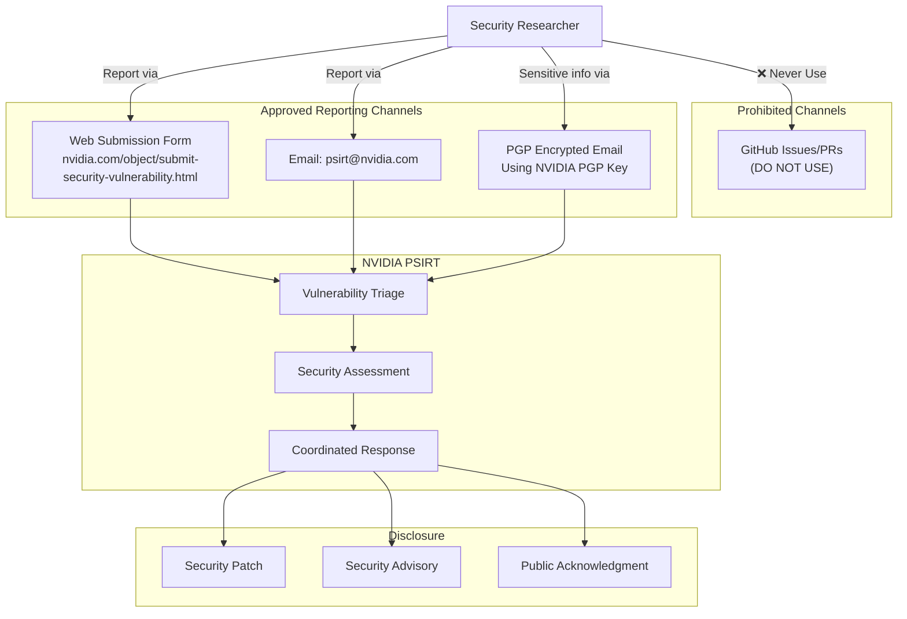
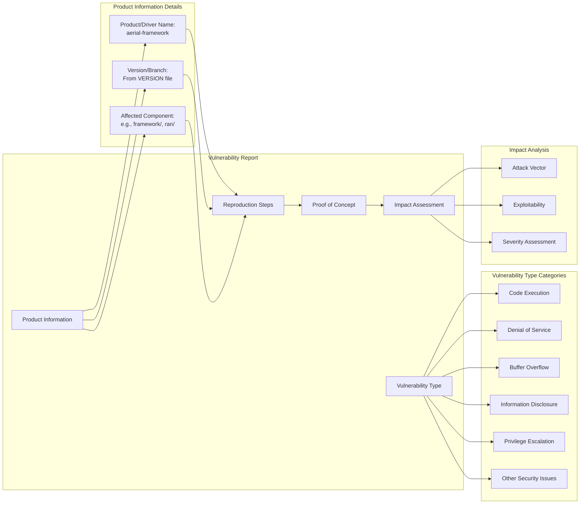
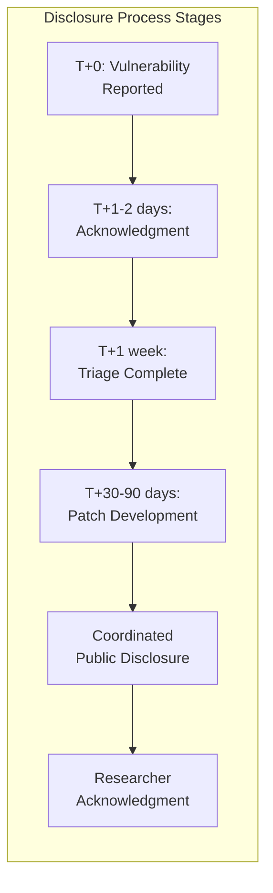
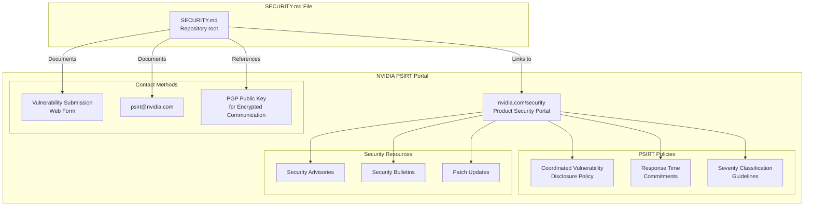
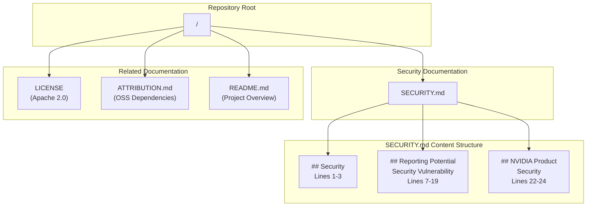

<!-- source: DeepWiki mcp.deepwiki.com · repo NVIDIA/aerial-framework · page 9.3 Security Policy · fetched 2026-10-26 -->

# Security Policy

Relevant source files

The following files were used as context for generating this wiki page:

- [SECURITY.md](SECURITY.md)

## Purpose and Scope

This document outlines the security vulnerability reporting procedures and responsible disclosure policies for the NVIDIA Aerial Framework. It provides technical details on reporting channels, required information formats, and integration with NVIDIA's Product Security Incident Response Team (PSIRT).

For information about licensing and legal compliance, see [License and Attribution](#9.1). For contribution guidelines, see [Contributing Guidelines](#9.2).

**Sources:** [SECURITY.md:1-24]()

---

## Security Vulnerability Reporting

### Reporting Channels

The NVIDIA Aerial Framework follows NVIDIA's standard security reporting procedures. **Security vulnerabilities must not be reported through GitHub Issues or Pull Requests**. Instead, use the following official channels:

| Channel | Details | Purpose |
|---------|---------|---------|
| **Web Form** | [Security Vulnerability Submission Form](https://www.nvidia.com/object/submit-security-vulnerability.html) | Primary reporting interface |
| **Email** | psirt@nvidia.com | Direct contact with NVIDIA PSIRT |
| **PGP Encrypted Email** | Using [NVIDIA PGP Key](https://www.nvidia.com/en-us/security/pgp-key) | Secure communication for sensitive disclosures |

**Sources:** [SECURITY.md:5-12]()

### Security Reporting Process Flow

**Sources:** [SECURITY.md:5-20]()

---

## Required Vulnerability Information

When submitting a security vulnerability report, the following information must be provided to facilitate effective triage and remediation:

### Vulnerability Report Structure

**Sources:** [SECURITY.md:13-18]()

### Information Requirements Table

| Field | Description | Example for Aerial Framework |
|-------|-------------|------------------------------|
| **Product Name** | Specific product/driver name | `nvidia-aerial-framework` |
| **Version/Branch** | Version number or Git branch | `0.1.0` (from [VERSION:1]()) or commit SHA |
| **Vulnerability Type** | Category of security issue | Code execution, DoS, buffer overflow, etc. |
| **Reproduction Steps** | Detailed instructions to reproduce | Build commands, input data, configuration |
| **Proof-of-Concept** | Working exploit code or test case | Code snippet, script, or binary |
| **Potential Impact** | Attack scenario and consequences | Data corruption, system compromise, DoS |

**Sources:** [SECURITY.md:13-18]()

---

## Coordinated Vulnerability Disclosure Policy

### Disclosure Timeline

NVIDIA follows a coordinated vulnerability disclosure process to allow time for patch development and deployment before public disclosure:

**Sources:** [SECURITY.md:20]()

### Bug Bounty and Recognition

**Current Status:** NVIDIA does not currently operate a bug bounty program for monetary rewards.

**Recognition Program:** Security researchers who report vulnerabilities under the coordinated disclosure policy receive public acknowledgment when the issue is addressed. This recognition is published through:

- Security advisories on nvidia.com/security
- CVE credits (if applicable)
- PSIRT acknowledgments page

**Sources:** [SECURITY.md:20]()

---

## NVIDIA PSIRT Integration

### PSIRT Resources and Policies

**Sources:** [SECURITY.md:1-24]()

### PSIRT Contact Information

| Resource | URL/Contact | Purpose |
|----------|-------------|---------|
| **PSIRT Policies** | [nvidia.com/security/psirt-policies](https://www.nvidia.com/en-us/security/psirt-policies) | Comprehensive policy documentation |
| **Security Portal** | [nvidia.com/security](https://www.nvidia.com/en-us/security) | Main security information hub |
| **Submission Form** | [nvidia.com/object/submit-security-vulnerability.html](https://www.nvidia.com/object/submit-security-vulnerability.html) | Primary vulnerability reporting interface |
| **PSIRT Email** | psirt@nvidia.com | Direct email contact |
| **PGP Key** | [nvidia.com/security/pgp-key](https://www.nvidia.com/en-us/security/pgp-key) | Public key for encrypted communications |

**Sources:** [SECURITY.md:10-23]()

---

## Security Policy File Structure

The security policy is documented in the repository root as a standalone Markdown file:

**Sources:** [SECURITY.md:1-24]()

### File Metadata

- **Location:** [SECURITY.md:1-24]()
- **Format:** GitHub-flavored Markdown
- **Version Control:** Tracked in Git repository root
- **Visibility:** Public (open-source repository)
- **Maintenance:** Managed by NVIDIA PSIRT team

**Sources:** [SECURITY.md:1-24]()

---

## Secure Communication Guidelines

### PGP Encryption for Sensitive Disclosures

For vulnerabilities involving sensitive information (e.g., zero-day exploits, critical infrastructure impacts), use PGP-encrypted email communication:

**Process:**
1. Download NVIDIA's PGP public key from [nvidia.com/security/pgp-key](https://www.nvidia.com/en-us/security/pgp-key)
2. Encrypt vulnerability details using the public key
3. Send encrypted message to psirt@nvidia.com
4. Include unencrypted contact information for response

**Benefits:**
- Confidentiality of exploit details during disclosure
- Protection against eavesdropping on email transmission
- Secure communication channel for coordinated response

**Sources:** [SECURITY.md:12]()

---

## Best Practices for Security Reporting

### Do's and Don'ts

| ✅ Do | ❌ Don't |
|-------|----------|
| Use official NVIDIA reporting channels | Report vulnerabilities through GitHub Issues |
| Provide detailed reproduction steps | Publicly disclose before coordinated release |
| Include proof-of-concept code | Exploit vulnerabilities for personal gain |
| Allow time for patch development (30-90 days) | Share vulnerability details on social media |
| Encrypt sensitive communications with PGP | Assume lack of response means vulnerability rejected |
| Follow coordinated disclosure timeline | Provide incomplete or vague information |

**Sources:** [SECURITY.md:5-20]()

### Vulnerability Severity Assessment

When reporting, help prioritize response by assessing:

- **Attack Complexity:** How difficult is exploitation?
- **Privileges Required:** Does attacker need authentication?
- **User Interaction:** Is victim action required?
- **Scope:** Does vulnerability affect other components?
- **Confidentiality Impact:** Can attacker access protected data?
- **Integrity Impact:** Can attacker modify data or code?
- **Availability Impact:** Can attacker cause denial of service?

These align with CVSS (Common Vulnerability Scoring System) metrics used by NVIDIA PSIRT for classification.

**Sources:** [SECURITY.md:15-18]()

---

## Related Security Resources

For additional information related to security and project policies:

- **License Compliance:** See [License and Attribution](#9.1) for Apache 2.0 license terms and open-source dependency attribution
- **Code Quality:** See [C++ Static Analysis](#6.2) for clang-tidy security checks and [Python Code Quality](#6.3) for security linters
- **Contribution Process:** See [Contributing Guidelines](#9.2) for general contribution procedures
- **CUDA Security:** See [CUDA and GPU Configuration](#4.4) for GPU-specific compilation settings that may affect security

**Sources:** [SECURITY.md:1-24]()