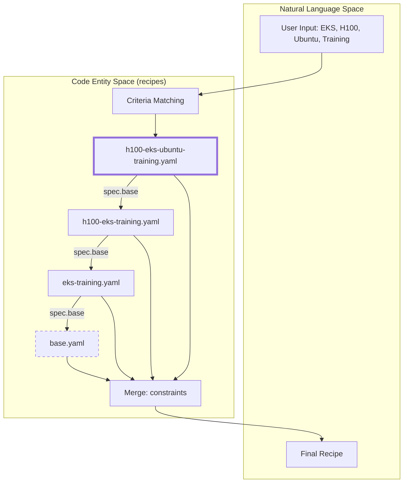
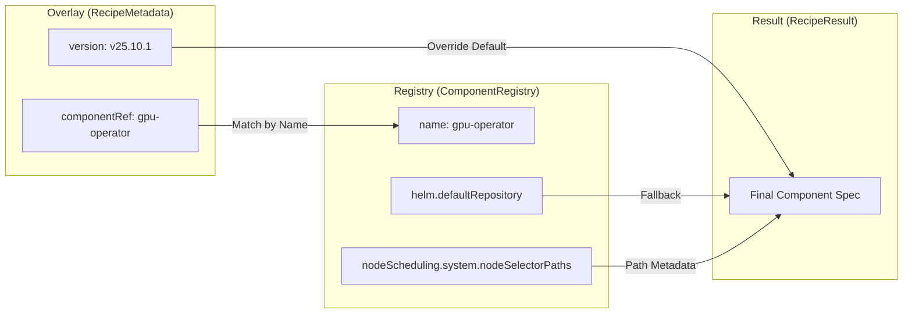

<!-- source: DeepWiki mcp.deepwiki.com · repo NVIDIA/aicr · page 3.2 Overlay System and Recipe Resolution · fetched 2026-10-26 -->

# Overlay System and Recipe Resolution

Relevant source files

The following files were used as context for generating this wiki page:

- [examples/recipes/eks-gb200-ubuntu-training-with-validation.yaml](examples/recipes/eks-gb200-ubuntu-training-with-validation.yaml)
- [examples/recipes/eks-training.yaml](examples/recipes/eks-training.yaml)
- [examples/recipes/kind.yaml](examples/recipes/kind.yaml)
- [recipes/components/kai-scheduler/manifests/disable-runtime-class-injection.yaml](recipes/components/kai-scheduler/manifests/disable-runtime-class-injection.yaml)
- [recipes/overlays/base.yaml](recipes/overlays/base.yaml)
- [recipes/overlays/h100-eks-ubuntu-training.yaml](recipes/overlays/h100-eks-ubuntu-training.yaml)
- [recipes/overlays/monitoring-hpa.yaml](recipes/overlays/monitoring-hpa.yaml)
- [recipes/registry.yaml](recipes/registry.yaml)
- [recipes/validators/README.md](recipes/validators/README.md)
- [recipes/validators/catalog.yaml](recipes/validators/catalog.yaml)
- [tests/chainsaw/ai-conformance/cluster/assert-skyhook.yaml](tests/chainsaw/ai-conformance/cluster/assert-skyhook.yaml)
- [tests/chainsaw/cli/cuj1-training/mock-snapshot.yaml](tests/chainsaw/cli/cuj1-training/mock-snapshot.yaml)
- [validators/conformance/inference_gateway_check.go](validators/conformance/inference_gateway_check.go)
- [validators/conformance/robust_controller_check.go](validators/conformance/robust_controller_check.go)
- [validators/conformance/robust_controller_check_test.go](validators/conformance/robust_controller_check_test.go)
- [validators/deployment/main.go](validators/deployment/main.go)

The Recipe Engine resolves a set of cluster **Criteria** (Service, Accelerator, Intent, OS) into a finalized `RecipeResult`. This process uses an inheritance-based overlay system where specific configurations (leaf nodes) override or augment general configurations (base nodes).

## Resolution Algorithm: Leaf to Base

The resolution process follows a "chain of responsibility" pattern. When the engine identifies the most specific overlay matching the input criteria, it traverses the `spec.base` pointers until it reaches the root `base` overlay.

### Chain Traversal and Merging
1.  **Selection**: The engine identifies the "Leaf" overlay that exactly matches the `Criteria` provided in the Snapshot or CLI flags [recipes/overlays/h100-eks-ubuntu-training.yaml:25-29]().
2.  **Ancestry**: It follows the `spec.base` field to find the parent [recipes/overlays/h100-eks-ubuntu-training.yaml:23-23]().
3.  **Aggregation**: It collects all `RecipeMetadata` objects in the chain, from the root `base` [recipes/overlays/base.yaml:18-18]() to the leaf.
4.  **Deep Merge**: It applies merging rules to combine `constraints`, `componentRefs`, and `validation` phases.

### Specificity Scoring
The engine uses asymmetric matching to find the best overlay. An overlay matches if its criteria are a subset of the target criteria. If multiple overlays match, the one with the highest number of defined criteria fields is selected as the leaf.

**Natural Language to Code Mapping: Resolution Flow**

Sources: [recipes/overlays/h100-eks-ubuntu-training.yaml:23-29](), [recipes/overlays/base.yaml:15-20](), [examples/recipes/eks-training.yaml:15-27]()

## Deep-Merge Rules

The resolution engine does not perform a simple overwrite; it applies specific logic based on the data type:

### 1. Constraints (Additive & Overriding)
Constraints are identified by their `name` (e.g., `K8s.server.version`).
*   If a name is unique in the chain, it is added to the result.
*   If a name conflicts, the value from the more specific (leaf-ward) overlay overrides the base [examples/recipes/eks-gb200-ubuntu-training-with-validation.yaml:36-53]().

### 2. ComponentRefs (Merging)
Components are merged based on their `name`. This allows a base overlay to define a component's source and version, while a specific overlay adds `manifestFiles` or `overrides` [recipes/overlays/base.yaml:34-40]().

| Field | Merge Strategy |
| :--- | :--- |
| `version` / `source` | Overwrite (Leaf wins) |
| `valuesFile` | Overwrite (Leaf wins) |
| `manifestFiles` | Append (Unique list) |
| `dependencyRefs` | Append (Unique list) |
| `overrides` | Deep Merge (Map merge) |

### 3. Validation Phases
The `validation` block is merged per-phase (`deployment`, `performance`, `conformance`). Within each phase, `checks` are appended, and phase-specific `constraints` follow the constraint overriding rule [recipes/overlays/h100-eks-ubuntu-training.yaml:45-73]().

Sources: [recipes/overlays/base.yaml:23-95](), [examples/recipes/eks-gb200-ubuntu-training-with-validation.yaml:80-148](), [recipes/overlays/h100-eks-ubuntu-training.yaml:33-42]()

## Component Registry Integration

While overlays define *which* components to use and *what* versions/overrides to apply, the `ComponentRegistry` defines *how* the Bundler should interact with them.

During resolution, the engine cross-references the `componentRefs` in the overlay with the `ComponentRegistry` [recipes/registry.yaml:41-42]() to determine:
1.  **Default Values**: If an overlay omits a `namespace` or `repository`, the registry provides the default [recipes/registry.yaml:48-51]().
2.  **Node Scheduling**: The registry provides the JSON paths within the Helm values where `nodeSelector` and `tolerations` should be injected [recipes/registry.yaml:52-74]().
3.  **Health Checks**: The registry links to the `assertFile` used by the validator to verify the component's health [recipes/registry.yaml:46-47]().

**Data Flow: Overlay to Registry Mapping**

Sources: [recipes/registry.yaml:15-36](), [recipes/registry.yaml:41-74](), [recipes/overlays/base.yaml:34-44]()

## Resolution Output: RecipeResult

The final output of the resolution process is a `RecipeResult`. This object contains the flattened configuration used by the Bundler and Validator.

| Section | Description |
| :--- | :--- |
| `appliedOverlays` | A list of all overlays used in the resolution chain, in order from base to leaf [examples/recipes/eks-training.yaml:19-22](). |
| `constraints` | The final set of readiness constraints to be checked against the cluster snapshot [examples/recipes/kind.yaml:24-26](). |
| `componentRefs` | The complete list of components, including resolved versions, sources, and merged overrides [examples/recipes/kind.yaml:27-55](). |
| `deploymentOrder` | A calculated list of component names sorted by their `dependencyRefs` to ensure correct installation order [examples/recipes/kind.yaml:57-62](). |

Sources: [examples/recipes/kind.yaml:15-62](), [examples/recipes/eks-training.yaml:15-70](), [examples/recipes/eks-gb200-ubuntu-training-with-validation.yaml:18-156]()

---

