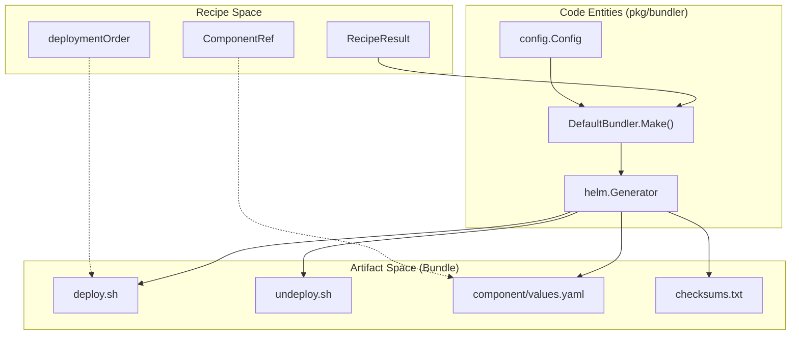

<!-- source: DeepWiki mcp.deepwiki.com · repo NVIDIA/aicr · page 5 Bundler · fetched 2026-10-26 -->

# Bundler

Relevant source files

The following files were used as context for generating this wiki page:

- [demos/README.md](demos/README.md)
- [demos/cuj2.md](demos/cuj2.md)
- [demos/examples/CUJ2-Test-Report.md](demos/examples/CUJ2-Test-Report.md)
- [docs/user/cli-reference.md](docs/user/cli-reference.md)
- [install](install)
- [pkg/bundler/bundler.go](pkg/bundler/bundler.go)
- [pkg/bundler/bundler_test.go](pkg/bundler/bundler_test.go)
- [pkg/bundler/config/config.go](pkg/bundler/config/config.go)
- [pkg/bundler/config/config_test.go](pkg/bundler/config/config_test.go)
- [pkg/bundler/deployer/helm/helm.go](pkg/bundler/deployer/helm/helm.go)
- [pkg/bundler/deployer/helm/helm_test.go](pkg/bundler/deployer/helm/helm_test.go)
- [pkg/bundler/deployer/helm/templates/deploy.sh.tmpl](pkg/bundler/deployer/helm/templates/deploy.sh.tmpl)
- [pkg/bundler/deployer/helm/templates/undeploy.sh.tmpl](pkg/bundler/deployer/helm/templates/undeploy.sh.tmpl)
- [pkg/cli/bundle.go](pkg/cli/bundle.go)
- [pkg/recipe/components.go](pkg/recipe/components.go)
- [pkg/recipe/components_test.go](pkg/recipe/components_test.go)
- [recipes/components/cert-manager/values.yaml](recipes/components/cert-manager/values.yaml)
- [recipes/overlays/eks.yaml](recipes/overlays/eks.yaml)

The **Bundler** is the final stage of the AICR pipeline. It transforms a `RecipeResult` (the output of the Recipe Engine) into a deployment-ready artifact bundle tailored for a specific Kubernetes cluster. The bundler handles the injection of cluster-specific configuration, such as node selectors and tolerations, and ensures the resulting manifests are signed and attested for security.

### Core Responsibilities
*   **Artifact Generation**: Translates high-level component references into concrete Helm values, Kustomize overlays, or ArgoCD Application manifests [pkg/bundler/bundler.go:148-167]().
*   **Node Scheduling Injection**: Automatically applies `nodeSelector` and `tolerations` across all components based on defined scheduling tiers (System vs. Accelerated) [pkg/bundler/bundler.go:70-78]().
*   **Dependency Orchestration**: Generates ordered deployment and undeployment scripts (`deploy.sh`, `undeploy.sh`) that respect the `deploymentOrder` defined in the recipe [pkg/bundler/deployer/helm/helm.go:155-171]().
*   **Supply Chain Security**: Generates file checksums and provides cryptographic attestation for the bundle content [pkg/bundler/bundler.go:60-61]().

---

## Bundler Lifecycle

The `DefaultBundler` orchestrates the transformation process. It is initialized with a `Config` object containing user overrides (from `--set` flags) and scheduling requirements.

### Process Flow
1.  **Input Validation**: Ensures the `RecipeResult` is valid and contains at least one component [pkg/bundler/bundler.go:180-189]().
2.  **Component Filtering**: Removes components disabled via CLI overrides [pkg/bundler/bundler.go:196-200]().
3.  **Value Resolution**: Merges default component values, recipe-level overrides, and CLI `--set` overrides [pkg/bundler/deployer/helm/helm_test.go:42-51]().
4.  **Scheduling Injection**: Injects node affinity settings into the resolved values based on the `ComponentRegistry` paths [pkg/recipe/components_test.go:181-211]().
5.  **Deployer Execution**: Hands off the resolved data to either the `Helm` or `ArgoCD` generator [pkg/bundler/bundler.go:148-150]().

### From Recipe to Bundle Entities
The following diagram illustrates how the `DefaultBundler` maps recipe concepts to code entities and generated files.

**Sources:** [pkg/bundler/bundler.go:148-167](), [pkg/bundler/deployer/helm/helm.go:114-209](), [pkg/bundler/config/config.go]()

---

## Deployer Types

AICR supports two primary deployment methodologies, selected via the `--deployer` flag [pkg/cli/bundle.go:104-113]().

### Helm Deployer
The default deployer generates a "per-component" bundle. Each component gets its own directory containing a `values.yaml` and a `README.md`. A root-level `deploy.sh` script automates the installation using standard `helm install` commands [pkg/bundler/deployer/helm/helm.go:42-45]().

*   **Retry Logic**: The generated `deploy.sh` includes exponential backoff for failed operations [pkg/bundler/deployer/helm/templates/deploy.sh.tmpl:54-78]().
*   **CRD Handling**: Special logic to ignore "no matches for kind" errors during the initial pass, re-applying manifests after CRDs are registered [pkg/bundler/deployer/helm/templates/deploy.sh.tmpl:102-127]().
*   **Reverse Teardown**: `undeploy.sh` removes components in the reverse order of installation to avoid dependency orphans [pkg/bundler/deployer/helm/templates/undeploy.sh.tmpl:139-155]().

For details, see [Helm Deployer](#5.1).

### ArgoCD Deployer
Generates an **App-of-Apps** pattern. It creates a parent ArgoCD `Application` that points to individual child `Application` manifests for each component [pkg/bundler/bundler.go:161-165]().

*   **Sync Waves**: Uses the recipe's `deploymentOrder` to assign `argocd.argoproj.io/sync-wave` annotations, ensuring the GitOps controller respects component dependencies.
*   **Multi-Source Support**: Handles both Helm and Kustomize components within the same Application framework.

For details, see [ArgoCD Deployer](#5.2).

---

## Configuration and Scheduling

The Bundler relies on the `ComponentRegistry` to know where to inject configuration within a component's values tree.

| Feature | Description | Code Reference |
| :--- | :--- | :--- |
| **Value Overrides** | CLI `--set` flags (e.g., `gpuoperator:driver.enabled=false`) | [pkg/cli/bundle.go:141-145]() |
| **System Tier** | Scheduling for control-plane/management components (e.g., cert-manager) | [pkg/recipe/components_test.go:207-211]() |
| **Accelerated Tier** | Scheduling for GPU-dependent components (e.g., GPU Operator) | [pkg/recipe/components_test.go:199-204]() |
| **Workload Gate** | Injection of taints/tolerations to prevent non-runtime workloads from landing on optimized nodes | [pkg/cli/bundle.go:167-173]() |

### Node Scheduling Injection Logic
The Bundler maps high-level flags like `--accelerated-node-selector` to specific YAML paths defined in `recipes/registry.yaml` [pkg/recipe/components_test.go:181-211](). For example, a selector for the `gpu-operator` might be injected at `operator.nodeSelector`.

For details, see [Node Scheduling Injection](#5.3).

---

## Security and Attestation

To ensure the integrity of the generated bundle, the Bundler performs two security tasks:
1.  **Checksum Generation**: A `checksums.txt` file is created containing SHA256 hashes of every file in the bundle [pkg/bundler/deployer/helm/helm.go:180-191]().
2.  **SLSA Attestation**: If the `--attest` flag is used, the Bundler generates a Sigstore attestation. This binds the bundle to the OIDC identity of the builder and provides a verifiable record of the build process [pkg/bundler/bundler.go:120-137]().

For details, see [Bundle Attestation and Supply Chain Security](#5.4).

---
**Sources:**
*   `pkg/bundler/bundler.go` (Main logic)
*   `pkg/bundler/deployer/helm/helm.go` (Helm generation)
*   `pkg/bundler/deployer/helm/templates/deploy.sh.tmpl` (Automation script)
*   `pkg/cli/bundle.go` (CLI interface)
*   `pkg/recipe/components_test.go` (Registry paths)

---

