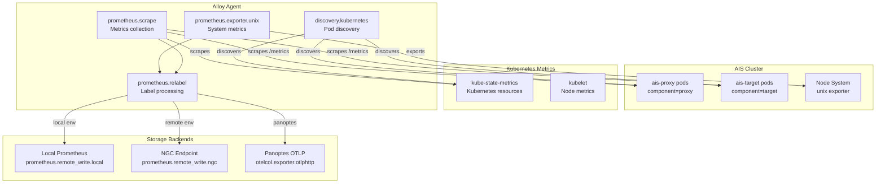
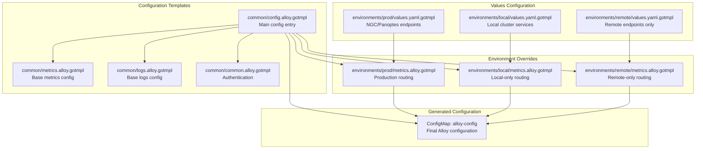
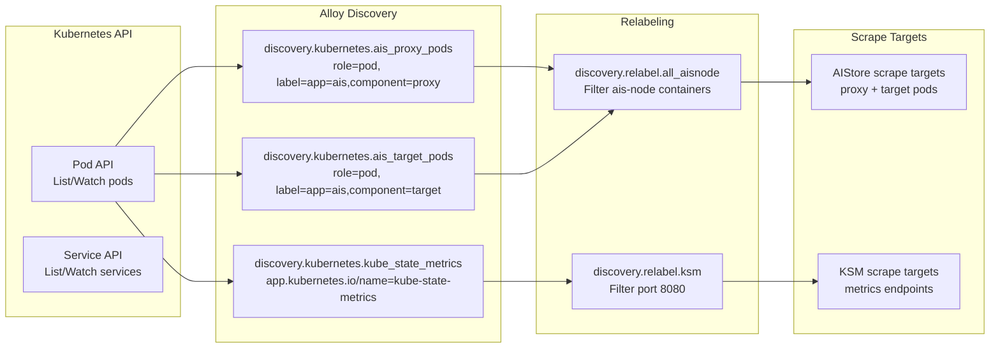

<!-- source: DeepWiki mcp.deepwiki.com · repo NVIDIA/ais-k8s · page 5.1 Metrics Collection · fetched 2026-10-26 -->

# Metrics Collection

<details>
<summary>Relevant source files</summary>

The following files were used as context for generating this wiki page:

- [monitoring/alloy/README.md](monitoring/alloy/README.md)
- [monitoring/alloy/config-chart/common/common.alloy.gotmpl](monitoring/alloy/config-chart/common/common.alloy.gotmpl)
- [monitoring/alloy/config-chart/common/config.alloy.gotmpl](monitoring/alloy/config-chart/common/config.alloy.gotmpl)
- [monitoring/alloy/config-chart/common/logs.alloy.gotmpl](monitoring/alloy/config-chart/common/logs.alloy.gotmpl)
- [monitoring/alloy/config-chart/common/metrics.alloy.gotmpl](monitoring/alloy/config-chart/common/metrics.alloy.gotmpl)
- [monitoring/alloy/config-chart/environments/local/metrics.alloy.gotmpl](monitoring/alloy/config-chart/environments/local/metrics.alloy.gotmpl)
- [monitoring/alloy/config-chart/environments/prod/logs.alloy.gotmpl](monitoring/alloy/config-chart/environments/prod/logs.alloy.gotmpl)
- [monitoring/alloy/config-chart/environments/prod/metrics.alloy.gotmpl](monitoring/alloy/config-chart/environments/prod/metrics.alloy.gotmpl)
- [monitoring/alloy/config-chart/environments/remote/metrics.alloy.gotmpl](monitoring/alloy/config-chart/environments/remote/metrics.alloy.gotmpl)
- [monitoring/alloy/environments/local/values.yaml.gotmpl](monitoring/alloy/environments/local/values.yaml.gotmpl)
- [monitoring/alloy/environments/prod/values.yaml.gotmpl](monitoring/alloy/environments/prod/values.yaml.gotmpl)
- [monitoring/alloy/environments/remote/values.yaml.gotmpl](monitoring/alloy/environments/remote/values.yaml.gotmpl)
- [monitoring/kube-prom/values/prometheus.yaml.gotmpl](monitoring/kube-prom/values/prometheus.yaml.gotmpl)
- [monitoring/vault/README.md](monitoring/vault/README.md)
- [monitoring/vault/update_secret.sh](monitoring/vault/update_secret.sh)

</details>


This document covers the metrics collection system for AIStore Kubernetes deployments, including Prometheus integration, Alloy telemetry collection, and remote monitoring endpoints. The system collects metrics from AIStore components, Kubernetes infrastructure, and system resources using Grafana Alloy as the primary telemetry agent.

For information about dashboards and visualization of collected metrics, see [Dashboards and Visualization](#5.2). For alerting configuration based on these metrics, see [Alerting Configuration](#5.3).

## Architecture Overview

The metrics collection system uses Grafana Alloy as the central telemetry collector that discovers AIStore pods, scrapes metrics, and forwards them to both local and remote storage backends.

**Metrics Collection Architecture**



Sources: [monitoring/alloy/config-chart/common/metrics.alloy.gotmpl:78-182]()

## Alloy Configuration Components

Alloy uses a modular configuration system with environment-specific overrides. The configuration is built from multiple template files that define different aspects of metrics collection.

**Alloy Configuration Structure**



Sources: [monitoring/alloy/config-chart/common/config.alloy.gotmpl:1-5](), [monitoring/alloy/config-chart/environments/prod/values.yaml.gotmpl:1-16](), [monitoring/alloy/config-chart/environments/local/values.yaml.gotmpl:1-5]()

## Service Discovery and Scraping

Alloy automatically discovers AIStore pods and other Kubernetes resources using label selectors and scrapes metrics from their endpoints.

### AIStore Pod Discovery

The system discovers AIStore proxy and target pods using Kubernetes service discovery with specific label selectors:

| Component | Discovery Config | Labels | Scrape Path |
|-----------|------------------|---------|-------------|
| Proxy Pods | `discovery.kubernetes.ais_proxy_pods` | `app=ais,component=proxy` | `/metrics` |
| Target Pods | `discovery.kubernetes.ais_target_pods` | `app=ais,component=target` | `/metrics` |
| System Metrics | `prometheus.exporter.unix.system` | N/A (local exporter) | Auto-generated |
| Kube State | `discovery.kubernetes.kube_state_metrics` | `app.kubernetes.io/name=kube-state-metrics` | Default |

**Service Discovery Flow**



Sources: [monitoring/alloy/config-chart/common/metrics.alloy.gotmpl:78-120](), [monitoring/alloy/config-chart/common/metrics.alloy.gotmpl:140-156]()

### Metrics Scraping Configuration

The `prometheus.scrape` components collect metrics from discovered targets with specific configurations:

```yaml
# AIStore metrics scraping
prometheus.scrape "aistore" {
  targets = discovery.relabel.all_aisnode.output
  job_name = "aistore"
  scrape_interval = "30s"
  metrics_path = "/metrics"
}

# System metrics from unix exporter
prometheus.scrape "system" {
  targets = prometheus.exporter.unix.system.targets
}

# Kubernetes state metrics
prometheus.scrape "kube_state_metrics" {
  targets = discovery.relabel.ksm.output
  scrape_interval = "10s"
}
```

Sources: [monitoring/alloy/config-chart/common/metrics.alloy.gotmpl:158-170](), [monitoring/alloy/config-chart/common/metrics.alloy.gotmpl:135-138](), [monitoring/alloy/config-chart/environments/prod/metrics.alloy.gotmpl:14-18]()

## Metrics Processing and Routing

Alloy processes collected metrics through a series of relabeling stages before forwarding them to storage backends. The routing depends on the deployment environment.

### Label Processing

The system applies several relabeling rules to normalize and enrich metrics:

| Relabeling Rule | Purpose | Configuration |
|-----------------|---------|---------------|
| Component Label | Add component type (proxy/target) | `source_labels: [__meta_kubernetes_pod_label_component]` |
| Pod Name | Add pod identifier | `source_labels: [__meta_kubernetes_pod_name]` |
| Transaction ID | Aggregate high-cardinality labels | `source_labels: [xid], replacement: "aggregated"` |
| Job Label | Add job name for node exporter | `target_label: job, replacement: "node-exporter"` |

### Environment-Specific Routing

The metrics routing varies by deployment environment:

**Production Environment** (`environments/prod/`): Forwards to both local and remote endpoints
- `prometheus.relabel.all_metrics.receiver` routes to local and remote
- Supports NGC and Panoptes remote write endpoints

**Local Environment** (`environments/local/`): Forwards only to local cluster services
- `prometheus.relabel.local_metrics.receiver` routes to local Prometheus
- Local gateway: `http://prometheus-kube-prometheus-prometheus.monitoring.svc.cluster.local:9090/api/v1/write`

**Remote Environment** (`environments/remote/`): Forwards only to remote endpoints
- `prometheus.relabel.remote_metrics.receiver` routes to NGC/Panoptes
- No local storage configured

Sources: [monitoring/alloy/config-chart/common/metrics.alloy.gotmpl:172-182](), [monitoring/alloy/config-chart/environments/prod/metrics.alloy.gotmpl:1-18](), [monitoring/alloy/config-chart/environments/local/metrics.alloy.gotmpl:1-18]()

## Remote Write Endpoints

The system supports multiple remote write endpoints for metrics forwarding, configured through environment variables.

### NGC Endpoint Configuration

```yaml
prometheus.remote_write "ngc" {
  endpoint {
    url = "{{ .Values.mimir.ngc_endpoint }}"
    remote_timeout = "15s"
  }
  external_labels = {
    cluster = "{{ .Values.remote.label }}",
    tenant = "anonymous",
  }
}
```

### Panoptes OTLP Endpoint

For Panoptes integration, metrics are converted to OTLP format:

```yaml
otelcol.receiver.prometheus "panoptes_receiver_import" {
  output {
    metrics = [otelcol.processor.attributes.panoptes_insert_label.input]
  }
}

otelcol.exporter.otlphttp "panoptes_metrics_export" {
  client {
    auth = otelcol.auth.oauth2.azure_oidc.handler
    endpoint = "{{ .Values.mimir.panoptes_endpoint }}"
  }
}
```

### Environment Variables

Remote endpoints are configured through environment variables:

| Variable | Purpose | Used In |
|----------|---------|---------|
| `MIMIR_ENDPOINT_NGC` | NGC Mimir endpoint URL | Production, Remote |
| `MIMIR_ENDPOINT_PANOPTES` | Panoptes OTLP endpoint URL | Production, Remote |
| `CLUSTER_LABEL` | Cluster identifier for remote labels | Production, Remote |
| `REMOTE_AUTH_SECRET` | Kubernetes secret name for auth | Production, Remote |
| `REMOTE_AUTH_SCOPE` | OAuth2 scope for authentication | Production, Remote |

Sources: [monitoring/alloy/config-chart/common/metrics.alloy.gotmpl:6-32](), [monitoring/alloy/environments/prod/values.yaml.gotmpl:9-16](), [monitoring/alloy/environments/remote/values.yaml.gotmpl:6-13]()

## Authentication Configuration

Remote write endpoints require OAuth2 authentication configured through Kubernetes secrets and Vault integration.

### OAuth2 Setup

The authentication flow uses Azure OIDC for Panoptes endpoints:

```yaml
otelcol.auth.oauth2 "azure_oidc" {
  client_id = convert.nonsensitive(remote.kubernetes.secret.azure_oidc.data.azure_app_client_id)
  client_secret = remote.kubernetes.secret.azure_oidc.data.azure_app_client_secret
  scopes = ["{{ .Values.remote.scope}}"]
  token_url = convert.nonsensitive(remote.kubernetes.secret.azure_oidc.data.azure_token_url)
}
```

### Secret Management

Authentication credentials are managed through:

1. **Vault Integration**: Secrets stored in HashiCorp Vault
2. **Kubernetes Secrets**: Vault secrets projected into cluster
3. **Alloy Secret Reference**: Configuration references the secret

The `update_secret.sh` script synchronizes Vault secrets to Kubernetes:

```bash
vault kv get -format json -field data $VAULT_ALLOY_SECRET | jq -r 'to_entries[] | "--from-literal=\(.key)=\(.value)"' | \
  xargs kubectl create secret generic -n monitoring $LOCAL_ALLOY_SECRET
```

Sources: [monitoring/alloy/config-chart/common/common.alloy.gotmpl:8-13](), [monitoring/vault/update_secret.sh:5-6](), [monitoring/vault/README.md:1-6]()

## System Metrics Collection

Alloy collects system-level metrics using the built-in Unix exporter with specific device filtering to focus on relevant storage and network interfaces.

### Unix Exporter Configuration

The `prometheus.exporter.unix` component is configured to collect metrics from:

**Disk Metrics**: Only NVME and SCSI devices
- `device_include = "^(nvme\\d+|sd[a-z]+)"`

**Network Metrics**: Excludes virtual interfaces
- `device_exclude = "^(veth|lo|flannel|cni).*"`

**Filesystem Metrics**: Excludes system mounts
- `mount_points_exclude = "^/(dev|var|proc|run|sys|tmp)($|)"`

This configuration ensures that only relevant storage devices (NVME SSDs and SCSI disks) and physical network interfaces are monitored, reducing metric cardinality while focusing on hardware that impacts AIStore performance.

Sources: [monitoring/alloy/config-chart/common/metrics.alloy.gotmpl:122-133]()

---

