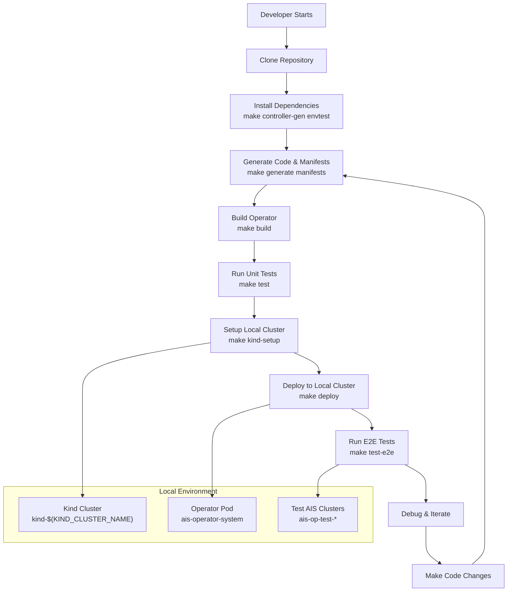
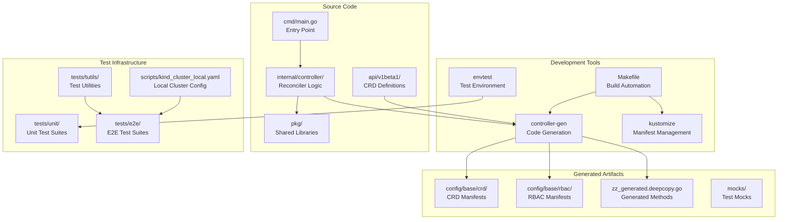
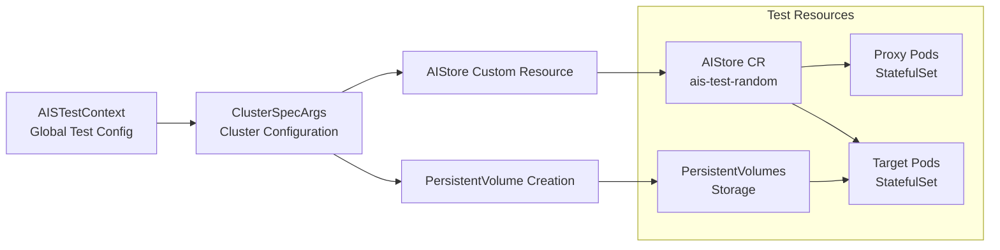
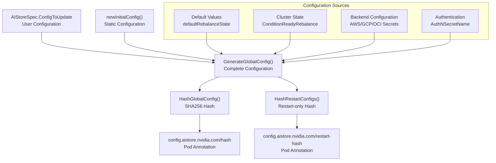

<!-- source: DeepWiki mcp.deepwiki.com · repo NVIDIA/ais-k8s · page 6.3 Local Development Setup · fetched 2026-10-26 -->

# Local Development Setup

<details>
<summary>Relevant source files</summary>

The following files were used as context for generating this wiki page:

- [.gitlab-ci.yml](.gitlab-ci.yml)
- [operator/Makefile](operator/Makefile)
- [operator/go.mod](operator/go.mod)
- [operator/go.sum](operator/go.sum)
- [operator/pkg/resources/cmn/config.go](operator/pkg/resources/cmn/config.go)
- [operator/scripts/test.sh](operator/scripts/test.sh)
- [operator/tests/README.md](operator/tests/README.md)
- [operator/tests/tutils/ais_cluster.go](operator/tests/tutils/ais_cluster.go)

</details>


This page covers setting up a local development environment for the AIStore Kubernetes operator, including prerequisites, building, testing, and debugging the operator locally. For information about the testing framework and test utilities, see [Testing Framework](#6.1). For details about the automated CI/CD processes, see [CI/CD Pipeline](#6.2).

## Prerequisites

### Required Tools

The development environment requires several tools to be installed on your local machine:

| Tool | Purpose | Installation |
|------|---------|-------------|
| Go 1.24+ | Building and running the operator | [golang.org](https://golang.org/dl) |
| Docker or Podman | Building container images | [docker.com](https://docs.docker.com/get-docker) |
| kubectl | Kubernetes cluster interaction | [kubernetes.io](https://kubernetes.io/docs/tasks/tools) |
| make | Build automation | Usually pre-installed on Linux/macOS |

### Development Dependencies

The operator's `Makefile` automatically downloads and manages additional development tools in the `bin/` directory:

- **controller-gen**: Generates Kubernetes manifests and code
- **envtest**: Provides test Kubernetes API server
- **kind**: Creates local Kubernetes clusters
- **kustomize**: Kubernetes configuration management
- **ginkgo**: BDD testing framework
- **golangci-lint**: Go code linting

Sources: [operator/Makefile:239-310]()

## Local Development Workflow



Sources: [operator/Makefile:96-117](), [operator/Makefile:149-158]()

## Setting Up the Development Environment

### 1. Clone and Initialize

```bash
git clone https://github.com/NVIDIA/ais-k8s.git
cd ais-k8s/operator
```

### 2. Install Development Dependencies

The `Makefile` provides targets for installing required tools:

```bash
# Install all development dependencies
make controller-gen envtest kind golangci-lint
```

This downloads tools to the local `bin/` directory as defined by the `LOCALBIN` variable.

### 3. Generate Code and Manifests

Before building, generate required code and Kubernetes manifests:

```bash
# Generate DeepCopy methods and other boilerplate
make generate

# Generate CRDs, RBAC, and webhook configurations  
make manifests
```

Sources: [operator/Makefile:79-86]()

### 4. Verify Code Quality

Run code formatting, linting, and validation:

```bash
# Format Go code
make fmt

# Run static analysis
make vet

# Run comprehensive linting
make lint

# Check formatting without changes
make fmt-check
```

Sources: [operator/Makefile:88-148]()

## Building the Operator

### Local Binary Build

Build the operator manager binary for local development:

```bash
make build
```

This creates `bin/manager` which can be run directly against a Kubernetes cluster.

### Container Image Build

Build the operator container image:

```bash
# Build with default image name
IMG=my-registry/ais-operator:dev make docker-build

# Push to registry
IMG=my-registry/ais-operator:dev make docker-push
```

Sources: [operator/Makefile:151-168]()

## Local Testing Setup

### Create Local Kubernetes Cluster

Use Kind to create a local test cluster:

```bash
# Create cluster with default configuration
make kind-setup

# Verify cluster is running
kubectl cluster-info --context kind-ais-operator-test
```

The cluster configuration is defined in `scripts/kind_cluster_local.yaml` for local development and `tests/ci/kind_cluster_ci.yaml` for CI environments.

### Bootstrap Test Environment

Set up required test dependencies:

```bash
# Install local-path-provisioner and cloud-provider-kind
make test-e2e-bootstrap
```

This installs:
- **local-path-provisioner**: Provides dynamic PV provisioning
- **cloud-provider-kind**: Enables LoadBalancer services in Kind

Sources: [operator/Makefile:101-131]()

### Run Tests

Execute different types of tests:

```bash
# Unit tests only
make test

# E2E tests (requires running cluster)
make test-e2e

# E2E tests inside cluster
make test-e2e-in-cluster

# Manual tests only
TEST_E2E_MODE=manual make test-e2e
```

## Development Components Architecture



Sources: [operator/Makefile:79-86](), [operator/go.mod:1-20](), [operator/tests/tutils/ais_cluster.go:1-25]()

## Test Environment Configuration

### Environment Variables

Customize the test environment using these variables:

| Variable | Purpose | Default |
|----------|---------|---------|
| `AIS_TEST_NODE_IMAGE` | AIS node container image | `aistorage/aisnode:v3.29` |
| `AIS_TEST_INIT_IMAGE` | AIS init container image | `aistorage/ais-init:v3.29` |
| `TEST_STORAGECLASS` | Storage class for test volumes | `ais-operator-test-storage` |
| `TEST_EPHEMERAL_CLUSTER` | Indicates ephemeral cluster testing | `false` |
| `KIND_CLUSTER_NAME` | Name of the Kind cluster | `ais-operator-test` |

### Test Cluster Configuration

The test framework creates AIS clusters using the `ClusterSpecArgs` structure:



Sources: [operator/tests/tutils/ais_cluster.go:34-56](), [operator/tests/tutils/ais_cluster.go:79-88]()

## Running the Operator Locally

### Direct Execution

Run the operator manager directly against a cluster:

```bash
# Run against the current kubectl context
make run

# Run with specific configuration
KUBECONFIG=/path/to/kubeconfig make run
```

### Deploy to Local Cluster

Deploy the operator to your Kind cluster:

```bash
# Install CRDs first
make install

# Deploy operator
IMG=my-registry/ais-operator:dev make deploy

# Verify deployment
kubectl get pods -n ais-operator-system
```

Sources: [operator/Makefile:215-230]()

## Development Debugging

### Operator Logs

Monitor operator logs during development:

```bash
# Follow operator logs
kubectl logs -f deployment/ais-operator-controller-manager -n ais-operator-system

# Get operator events
kubectl get events -n ais-operator-system --sort-by='.lastTimestamp'
```

### Test Debugging

Debug test failures:

```bash
# Run tests with verbose output
make test-e2e

# Run specific test suites
ginkgo -v tests/e2e/cluster/

# Check test cluster logs after failure
kubectl logs -l app=ais-proxy -n ais-op-test-<cluster-name>
```

### Configuration Debugging

The operator generates configuration hashes for tracking changes:



Sources: [operator/pkg/resources/cmn/config.go:24-38](), [operator/pkg/resources/cmn/config.go:98-118]()

## Cleanup

Clean up the development environment:

```bash
# Remove test dependencies
make test-e2e-teardown

# Delete Kind cluster
make kind-teardown

# Uninstall operator from cluster
make undeploy

# Remove CRDs
make uninstall
```

Sources: [operator/Makefile:116-131](), [operator/Makefile:219-230]()

---

