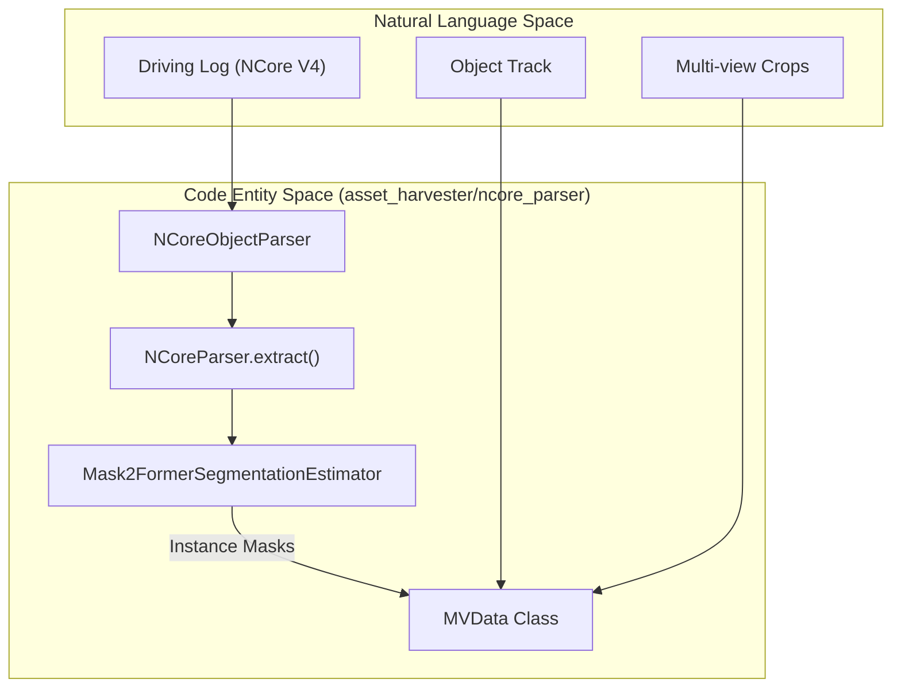
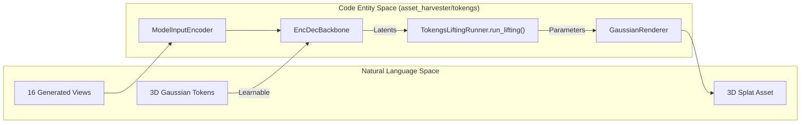

<!-- source: DeepWiki mcp.deepwiki.com · repo NVIDIA/asset-harvester · page 7 Glossary · fetched 2026-10-26 -->

# Glossary

Relevant source files

The following files were used as context for generating this wiki page:

- [README.md](README.md)
- [asset_harvester/camera_estimator/models.py](asset_harvester/camera_estimator/models.py)
- [asset_harvester/multiview_diffusion/pipelines/sparseviewdit_pipeline.py](asset_harvester/multiview_diffusion/pipelines/sparseviewdit_pipeline.py)
- [asset_harvester/ncore_parser/parser.py](asset_harvester/ncore_parser/parser.py)
- [asset_harvester/patches/cradio_compat.py](asset_harvester/patches/cradio_compat.py)
- [asset_harvester/tokengs/lifting_inference.py](asset_harvester/tokengs/lifting_inference.py)
- [asset_harvester/tokengs/models/tokengs.py](asset_harvester/tokengs/models/tokengs.py)

This page provides definitions for codebase-specific terminology, abbreviations, and architectural components within the Asset Harvester system. It serves as a technical reference for onboarding engineers to map domain concepts to specific implementation details in the code.

## Core System Terms

| Term | Definition | Key Code Pointers |
| :--- | :--- | :--- |
| **NCore V4** | The input data format representing autonomous driving logs, containing multi-sensor data and ground-truth cuboids. | [asset_harvester/ncore_parser/parser.py:74-77]() |
| **MVData** | A data container used by the parser to store multi-view images, masks, camera poses, and bounding box information for a specific object track. | [asset_harvester/ncore_parser/mvdata.py:1-30]() |
| **SparseViewDiT** | The multiview diffusion model based on a Transformer (DiT) architecture that generates 16 consistent views from 1-3 input images. | [asset_harvester/multiview_diffusion/models/sparseviewdit.py:1-50]() |
| **TokenGS** | The feed-forward 3D Gaussian reconstructor that "lifts" generated 2D views into a 3D Gaussian Splatting asset. | [asset_harvester/tokengs/models/tokengs.py:161-200]() |
| **AHCEstimator** | Asset Harvester Camera Estimator; used to predict camera intrinsics and extrinsics for "In-the-Wild" (OOD) images. | [asset_harvester/camera_estimator/models.py:105-118]() |
| **C-RADIO** | A vision-language foundation model used as the feature backbone for both the diffusion conditioning and camera estimation. | [asset_harvester/patches/cradio_compat.py:16-38]() |

Sources: [asset_harvester/ncore_parser/parser.py:74-77](), [asset_harvester/camera_estimator/models.py:105-118](), [asset_harvester/patches/cradio_compat.py:16-38]()

## Pipeline Concepts and Data Flow

### Natural Language to Code Entity Mapping: Data Ingestion
The following diagram illustrates how raw driving data is transformed into structured `MVData` objects via the `NCoreParser`.

**NCore Ingestion Flow**

Sources: [asset_harvester/ncore_parser/parser.py:74-125](), [asset_harvester/ncore_parser/ncore_object_parser.py:1-50]()

### Natural Language to Code Entity Mapping: 3D Reconstruction
This diagram maps the conceptual "Lifting" process to the internal `TokenGS` architecture.

**3D Lifting Flow**

Sources: [asset_harvester/tokengs/models/tokengs.py:63-150](), [asset_harvester/tokengs/lifting_inference.py:1-40]()

## Technical Abbreviations & Definitions

### 1. Camera & Geometry
*   **c2w (Camera-to-World):** A 4x4 transformation matrix mapping coordinates from the camera coordinate system to the world coordinate system. In TokenGS, these are often converted between OpenGL and COLMAP conventions.
    *   *Implementation:* [asset_harvester/tokengs/lifting_inference.py:63-87]()
*   **Plucker Coordinates:** A 6-dimensional representation of rays (direction and moment) used to provide geometric conditioning to the Transformer models.
    *   *Implementation:* [asset_harvester/tokengs/models/tokengs.py:68-68]()
*   **LWH (Length, Width, Height):** The dimensions of an object's bounding box. Used for normalization and scaling during the lifting process.
    *   *Implementation:* [asset_harvester/camera_estimator/models.py:25-25]()

### 2. Model Components
*   **TTT (Test-Time Training):** An optimization step where the model's parameters or the predicted Gaussian parameters are refined on a specific sample to improve reconstruction fidelity.
    *   *Implementation:* `TokengsLiftingRunner.run_lifting` with `ttt_supervision_mode`.
*   **CFG (Classifier-Free Guidance):** A technique used in the `SparseViewDiTPipeline` to balance sample quality and conditioning adherence by interpolating between conditional and unconditional model outputs.
    *   *Implementation:* [asset_harvester/multiview_diffusion/pipelines/sparseviewdit_pipeline.py:129-147]()
*   **Activation Head:** The final layer of the TokenGS decoder that maps transformer features to physical Gaussian parameters (opacity, scale, rotation, color).
    *   *Implementation:* [asset_harvester/tokengs/models/activations.py:1-50]()

### 3. Infrastructure & Utilities
*   **C-RADIO Patching:** A set of compatibility fixes required to run the `nvidia/C-RADIO` model with `transformers >= 4.48`. It involves on-disk and in-memory monkey-patching of the `ViTPatchGenerator`.
    *   *Implementation:* [asset_harvester/patches/cradio_compat.py:46-80]()
*   **Image Guard:** A safety moderation layer using Llama Guard to filter out-of-distribution (OOD) inputs that may contain inappropriate content.
    *   *Reference:* `asset_harvester/utils/image_guard.py`.

Sources: [asset_harvester/tokengs/lifting_inference.py:63-87](), [asset_harvester/camera_estimator/models.py:25-25](), [asset_harvester/multiview_diffusion/pipelines/sparseviewdit_pipeline.py:129-147](), [asset_harvester/patches/cradio_compat.py:46-80]()