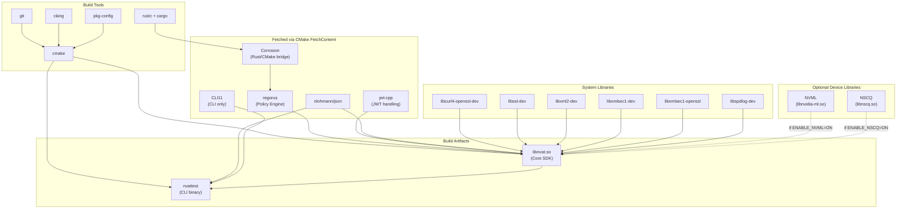
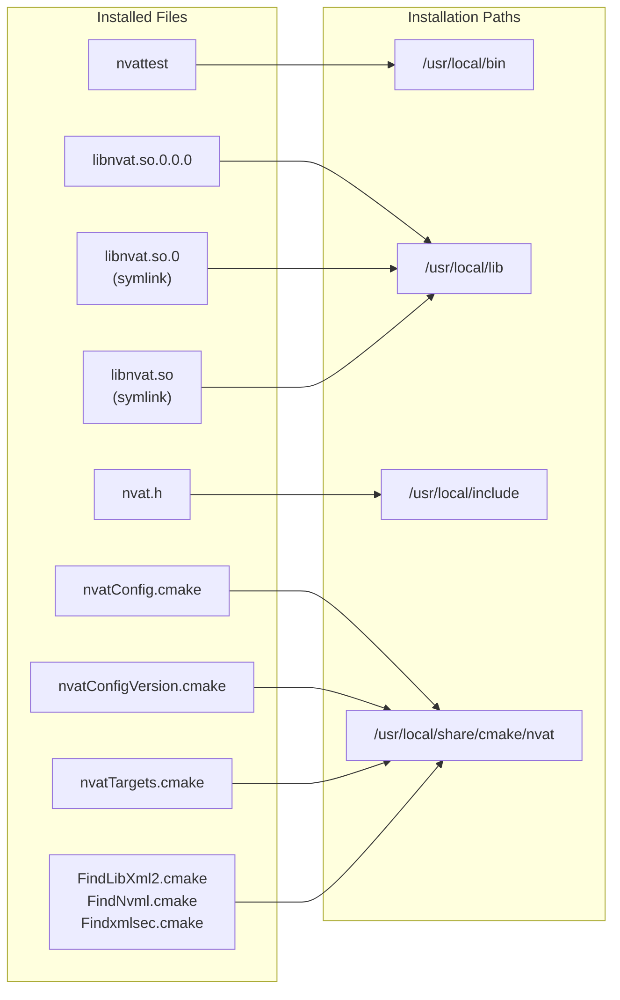

<!-- source: DeepWiki mcp.deepwiki.com · repo NVIDIA/attestation-sdk · page 2.1 Installation Guide · fetched 2026-10-26 -->

# Installation Guide

<details>
<summary>Relevant source files</summary>

The following files were used as context for generating this wiki page:

- [README.md](README.md)
- [nv-attestation-cli/CMakeLists.txt](nv-attestation-cli/CMakeLists.txt)
- [nv-attestation-sdk-cpp/CMakeLists.txt](nv-attestation-sdk-cpp/CMakeLists.txt)

</details>


## Purpose and Scope

This guide provides detailed instructions for installing the NVIDIA Attestation SDK and `nvattest` CLI tool from source. It covers all prerequisites, dependencies, build options, and installation steps required to deploy the attestation system on a target machine.

For information about using the CLI after installation, see [CLI Command Structure](#4.1). For details about the build system architecture, see [Build System Reference](#8.3).

---

## System Requirements

The NVIDIA Attestation SDK requires the following system configuration:

| Requirement | Description |
|------------|-------------|
| **Operating System** | Ubuntu 22.04 or 24.04 (other Linux distributions may work but are untested) |
| **Hardware** | NVIDIA GPU connected to a Confidential Virtual Machine (CVM) for GPU attestation, or NVIDIA Switch for switch attestation |
| **Architecture** | x86_64 (primary), ARM64 (may require additional configuration) |
| **CMake Version** | 3.11 or higher |
| **C++ Standard** | C++14 or higher |
| **Rust Toolchain** | Stable Rust compiler (required for regorus policy engine) |

**Note**: The SDK is designed for confidential computing environments. For deployment guides covering Intel TDX and AMD SNP platforms, refer to the [NVIDIA Trusted Computing Solutions](https://docs.nvidia.com/nvtrust) documentation.

Sources: [README.md:39-47](), [nv-attestation-sdk-cpp/CMakeLists.txt:1-7]()

---

## Dependency Architecture

The following diagram illustrates the complete dependency tree for the NVIDIA Attestation SDK and CLI:



Sources: [README.md:53-59](), [nv-attestation-sdk-cpp/CMakeLists.txt:25-101](), [nv-attestation-cli/CMakeLists.txt:18-25]()

---

## Prerequisites Installation

### Step 1: Install NVIDIA Management Library (NVML)

NVML is required for GPU attestation functionality. It is provided as part of the NVIDIA GPU driver.

```shell
# Follow the official NVIDIA driver installation guide for Ubuntu
# See: https://docs.nvidia.com/datacenter/tesla/driver-installation-guide/index.html#ubuntu-installation-common
```

After installation, verify that `libnvidia-ml.so` is available:

```shell
ldconfig -p | grep libnvidia-ml
```

**Note**: NVML is optional if you only plan to attest switch devices or use pre-collected evidence files. In that case, build with `-DENABLE_NVML=OFF`.

Sources: [README.md:49](), [nv-attestation-sdk-cpp/CMakeLists.txt:91-95]()

### Step 2: Install Rust Compiler

The Rust toolchain is required to build the `regorus-ffi` policy engine that is integrated into the SDK.

```shell
# Install Rust using rustup (recommended method)
curl --proto '=https' --tlsv1.2 -sSf https://sh.rustup.rs | sh

# Follow the on-screen instructions, then reload your shell
source "$HOME/.cargo/env"

# Verify installation
rustc --version
cargo --version
```

Sources: [README.md:51](), [nv-attestation-sdk-cpp/CMakeLists.txt:25-54]()

### Step 3: Install System Build Tools and Libraries

Install all required system packages using `apt`:

```shell
sudo apt update && \
sudo apt install -y \
    cmake \
    git \
    pkg-config \
    clang \
    libcurl4-openssl-dev \
    libssl-dev \
    libxml2-dev \
    libxmlsec1-dev \
    libxmlsec1-openssl \
    libspdlog-dev
```

**Package Descriptions**:

| Package | Purpose | Used By |
|---------|---------|---------|
| `cmake` | Build system generator | Build orchestration |
| `git` | Version control | Repository cloning |
| `pkg-config` | Library metadata tool | Dependency resolution |
| `clang` | C++ compiler | Source compilation |
| `libcurl4-openssl-dev` | HTTP client library | RIM/OCSP/NRAS service communication |
| `libssl-dev` | OpenSSL development headers | Cryptographic operations, certificate validation |
| `libxml2-dev` | XML parsing library | Certificate chain processing |
| `libxmlsec1-dev` | XML security library | XML digital signature verification |
| `libxmlsec1-openssl` | XML security with OpenSSL backend | Cryptographic operations in XML processing |
| `libspdlog-dev` | Fast logging library | SDK and CLI logging |

Sources: [README.md:53-59](), [nv-attestation-sdk-cpp/CMakeLists.txt:85-89]()

---

## Building from Source

### Clone the Repository

```shell
git clone https://github.com/NVIDIA/attestation-sdk.git
cd attestation-sdk
```

Sources: [README.md:63-64]()

### CMake Build Process Flow

```mermaid
flowchart TD
    START["User invokes CMake"]
    
    subgraph "Configuration Phase"
        PARSE_OPTIONS["Parse CMake options<br/>ENABLE_NVML, ENABLE_NSCQ,<br/>BUILD_TESTING, etc."]
        FETCH_DEPS["FetchContent downloads<br/>Corrosion, regorus,<br/>jwt-cpp, json, CLI11"]
        FIND_SYS["Find system packages<br/>CURL, OpenSSL, LibXml2,<br/>xmlsec, spdlog"]
        FIND_OPTIONAL["Find optional packages<br/>Nvml, Nscq (if enabled)"]
        GEN_HEADERS["Generate configured headers<br/>nvat.h, version_config.h"]
    end
    
    subgraph "Build Phase"
        BUILD_REGORUS["Build regorus-ffi<br/>(Rust static library)"]
        BUILD_SDK["Build libnvat.so<br/>(Core SDK library)"]
        BUILD_CLI["Build nvattest<br/>(CLI executable)"]
        BUILD_TESTS["Build test suites<br/>(if BUILD_TESTING=ON)"]
    end
    
    subgraph "Install Phase"
        INSTALL_LIB["Install libnvat.so to<br/>/usr/local/lib"]
        INSTALL_HEADER["Install nvat.h to<br/>/usr/local/include"]
        INSTALL_CLI["Install nvattest to<br/>/usr/local/bin"]
        INSTALL_CMAKE["Install CMake config files<br/>to /usr/local/share/cmake/nvat"]
        LDCONFIG["Run ldconfig to update<br/>linker cache"]
    end
    
    START --> PARSE_OPTIONS
    PARSE_OPTIONS --> FETCH_DEPS
    FETCH_DEPS --> FIND_SYS
    FIND_SYS --> FIND_OPTIONAL
    FIND_OPTIONAL --> GEN_HEADERS
    
    GEN_HEADERS --> BUILD_REGORUS
    BUILD_REGORUS --> BUILD_SDK
    BUILD_SDK --> BUILD_CLI
    BUILD_CLI --> BUILD_TESTS
    
    BUILD_TESTS --> INSTALL_LIB
    INSTALL_LIB --> INSTALL_HEADER
    INSTALL_HEADER --> INSTALL_CLI
    INSTALL_CLI --> INSTALL_CMAKE
    INSTALL_CMAKE --> LDCONFIG
```



Sources: [nv-attestation-cli/CMakeLists.txt:1-70](), [nv-attestation-sdk-cpp/CMakeLists.txt:1-273]()

### Build the nvattest CLI (Recommended)

This is the typical installation path that builds both the SDK library and the CLI tool:

```shell
cd attestation-sdk/nv-attestation-cli
cmake -S . -B build -DCMAKE_BUILD_TYPE=Release -DENABLE_NVML=ON
cmake --build build
sudo cmake --install build
sudo ldconfig
```

**Explanation of Commands**:
- `cmake -S . -B build`: Configure the build in the `build/` directory
- `-DCMAKE_BUILD_TYPE=Release`: Build optimized binaries (alternatives: `Debug`, `RelWithDebInfo`)
- `-DENABLE_NVML=ON`: Enable GPU attestation support via NVML
- `cmake --build build`: Compile all targets
- `cmake --install build`: Install binaries and libraries to system paths
- `ldconfig`: Update the dynamic linker cache to recognize the new shared library

Sources: [README.md:62-69](), [nv-attestation-cli/CMakeLists.txt:1-70]()

### Build Only the SDK Library

If you only need the C++ SDK library (e.g., for integration into another project):

```shell
cd attestation-sdk/nv-attestation-sdk-cpp
cmake -S . -B build -DCMAKE_BUILD_TYPE=Release -DENABLE_NVML=ON
cmake --build build
sudo cmake --install build
sudo ldconfig
```

This will install:
- `libnvat.so` (or `libnvat.a` if `BUILD_SHARED_LIBS=OFF`) to `/usr/local/lib/`
- `nvat.h` header to `/usr/local/include/`
- CMake package config files to `/usr/local/share/cmake/nvat/`

Sources: [nv-attestation-sdk-cpp/CMakeLists.txt:218-273]()

---

## CMake Build Options Reference

The following table documents all CMake options available during configuration:

### Core SDK Options (`nv-attestation-sdk-cpp`)

| Option | Type | Default | Description |
|--------|------|---------|-------------|
| `CMAKE_BUILD_TYPE` | STRING | - | Build type: `Release`, `Debug`, `RelWithDebInfo`, `MinSizeRel` |
| `BUILD_SHARED_LIBS` | BOOL | `ON` | Build shared library (`.so`) instead of static (`.a`) |
| `BUILD_EXAMPLES` | BOOL | `OFF` | Build example programs in `examples/` directory |
| `BUILD_TESTING` | BOOL | `OFF` | Build unit tests and integration tests |
| `ENABLE_NVML` | BOOL | `OFF` | Enable NVIDIA GPU attestation via NVML |
| `ENABLE_NSCQ` | BOOL | `OFF` | Enable NVIDIA Switch attestation via NSCQ |
| `SANITIZER` | STRING | `OFF` | Enable sanitizer: `thread`, `address`, `undefined`, `leak`, or `OFF` |
| `CMAKE_COMPILE_WARNING_AS_ERROR` | BOOL | `ON` | Treat compiler warnings as errors |
| `CMAKE_CXX_STANDARD` | STRING | `14` | C++ standard version (minimum 14 required) |

Sources: [nv-attestation-sdk-cpp/CMakeLists.txt:4-17]()

### CLI Options (`nv-attestation-cli`)

| Option | Type | Default | Description |
|--------|------|---------|-------------|
| `BUILD_TESTING` | BOOL | `OFF` | Build CLI test suite |

**Note**: When building the CLI, all SDK options are also available since the CLI builds the SDK as a subdirectory via [nv-attestation-cli/CMakeLists.txt:44-47]().

Sources: [nv-attestation-cli/CMakeLists.txt:4]()

### Example: Building with Multiple Options

```shell
# Build with NVML, NSCQ, tests, and debug symbols
cmake -S . -B build \
    -DCMAKE_BUILD_TYPE=RelWithDebInfo \
    -DENABLE_NVML=ON \
    -DENABLE_NSCQ=ON \
    -DBUILD_TESTING=ON

# Build with address sanitizer for debugging memory issues
cmake -S . -B build \
    -DCMAKE_BUILD_TYPE=Debug \
    -DSANITIZER=address \
    -DENABLE_NVML=ON
```

Sources: [nv-attestation-sdk-cpp/CMakeLists.txt:112-176]()

---

## Installation Paths

After running `cmake --install build`, the following files are installed:



**Notes**:
- The shared library versioning follows [nv-attestation-sdk-cpp/CMakeLists.txt:154-158]()
- `libnvat.so.0` is the soversion link, `libnvat.so` is the development link
- CMake package files enable downstream projects to use `find_package(nvat)` in their CMakeLists.txt

Sources: [nv-attestation-cli/CMakeLists.txt:68](), [nv-attestation-sdk-cpp/CMakeLists.txt:218-270]()

---

## Verifying Installation

After installation, verify that the components are correctly installed and accessible:

### Verify CLI Installation

```shell
# Check that nvattest is in PATH
which nvattest

# Display version information
nvattest version

# Display help to verify functionality
nvattest --help
```

Expected output from `nvattest version` should show version information and build configuration.

### Verify SDK Library Installation

```shell
# Check that the library is registered with ldconfig
ldconfig -p | grep libnvat

# Check header file installation
ls -l /usr/local/include/nvat.h

# Check CMake package files
ls -l /usr/local/share/cmake/nvat/
```

### Run a Test Attestation

If you have a GPU available and built with `ENABLE_NVML=ON`, test the installation:

```shell
nvattest attest --device gpu --verifier local
```

If successful, this will output a JSON structure with attestation results. For detailed information about the attestation process, see [Device Attestation Flow](#5.1).

Sources: [README.md:72-83]()

---

## Troubleshooting Common Issues

### Issue: `libnvat.so.0: cannot open shared object file`

**Cause**: The linker cache is not updated after installation.

**Solution**:
```shell
sudo ldconfig
```

If the issue persists, verify that `/usr/local/lib` is in your linker configuration:
```shell
# Check if /usr/local/lib is in ld.so.conf
cat /etc/ld.so.conf.d/* | grep /usr/local/lib

# If not present, add it
echo "/usr/local/lib" | sudo tee /etc/ld.so.conf.d/local.conf
sudo ldconfig
```

### Issue: `NVML not found` during CMake configuration

**Cause**: NVML is not installed or not in the default search paths.

**Solution**:
```shell
# Verify NVIDIA driver is installed
nvidia-smi

# If driver is installed but NVML not found, specify the path manually
cmake -S . -B build -DENABLE_NVML=ON -DNvml_LIBRARY=/path/to/libnvidia-ml.so
```

The NVML search is performed by [nv-attestation-sdk-cpp/cmake/FindNvml.cmake]().

### Issue: Rust/Cargo not found during build

**Cause**: Rust toolchain not installed or not in PATH.

**Solution**:
```shell
# Install Rust
curl --proto '=https' --tlsv1.2 -sSf https://sh.rustup.rs | sh

# Reload environment
source "$HOME/.cargo/env"

# Verify
which cargo
```

The Rust compiler is required to build `regorus-ffi` via the Corrosion build system integration at [nv-attestation-sdk-cpp/CMakeLists.txt:41-54]().

### Issue: CMake version too old

**Cause**: System CMake version is below 3.11.

**Solution**:
```shell
# Check current version
cmake --version

# Install newer CMake from Kitware's repository or snap
sudo snap install cmake --classic
```

Sources: [nv-attestation-sdk-cpp/CMakeLists.txt:1]()

---

## Alternative Installation Methods

### Using Custom Installation Prefix

To install to a non-standard location (e.g., user home directory):

```shell
cmake -S . -B build \
    -DCMAKE_BUILD_TYPE=Release \
    -DENABLE_NVML=ON \
    -DCMAKE_INSTALL_PREFIX=$HOME/.local

cmake --build build
cmake --install build
```

Update your environment:
```shell
export PATH=$HOME/.local/bin:$PATH
export LD_LIBRARY_PATH=$HOME/.local/lib:$LD_LIBRARY_PATH
```

### Static Library Build

To build a static library instead of shared:

```shell
cmake -S . -B build \
    -DCMAKE_BUILD_TYPE=Release \
    -DENABLE_NVML=ON \
    -DBUILD_SHARED_LIBS=OFF

cmake --build build
```

This produces `libnvat.a` instead of `libnvat.so`. Useful for embedding the SDK in other applications without shared library dependencies.

Sources: [nv-attestation-sdk-cpp/CMakeLists.txt:12]()

---

## Next Steps

After successful installation:

1. **Learn basic usage**: See [Quick Start Tutorial](#2.2) for a walkthrough of attesting your first device
2. **Explore CLI options**: See [Attest Command Reference](#4.2) for detailed parameter documentation
3. **Understand configuration**: See [Configuration Files](#4.3) to learn about `config.toml` for persistent settings
4. **Develop with the SDK**: See [Development Guide](#6) if you plan to integrate the C++ SDK into your application

Sources: [README.md:86-88]()

---

