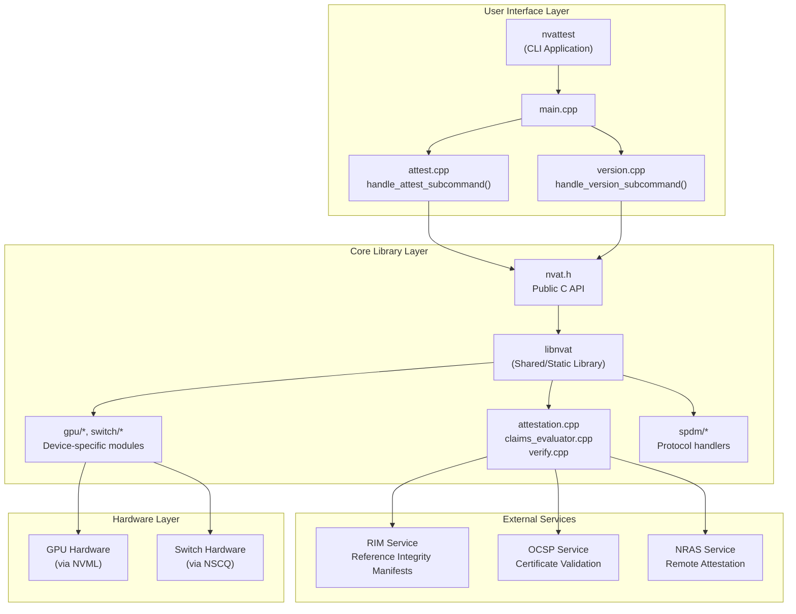
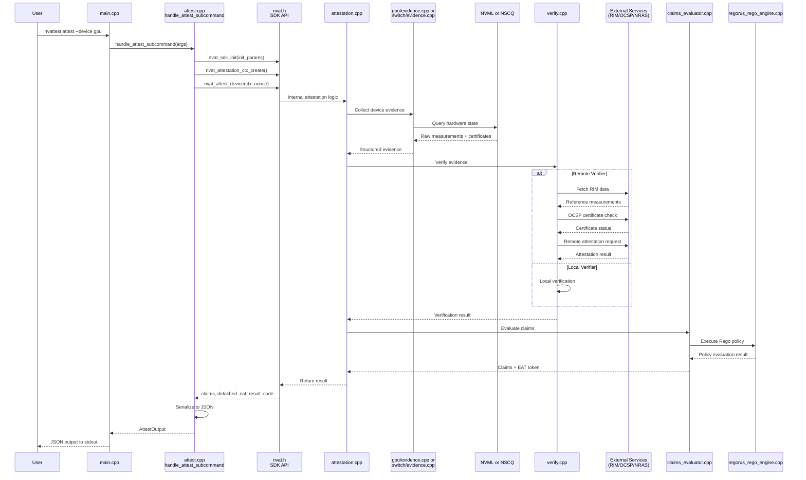
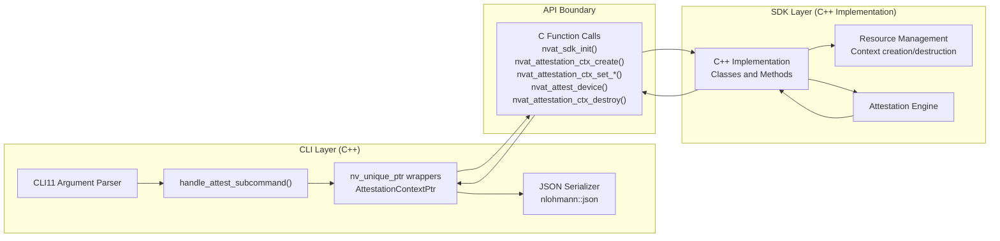
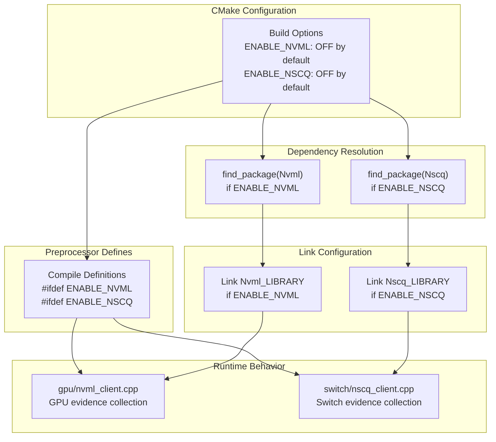
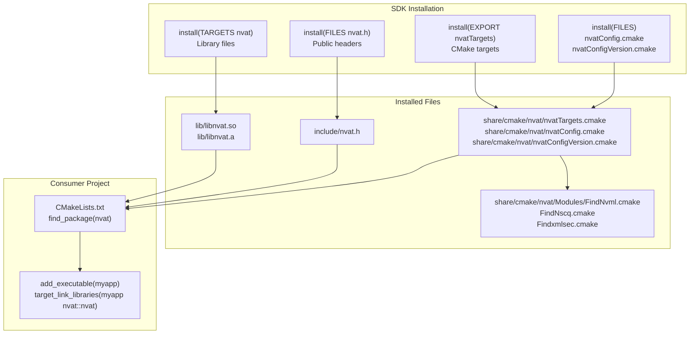

<!-- source: DeepWiki mcp.deepwiki.com · repo NVIDIA/attestation-sdk · page 3 Architecture · fetched 2026-10-26 -->

# Architecture

<details>
<summary>Relevant source files</summary>

The following files were used as context for generating this wiki page:

- [nv-attestation-cli/CMakeLists.txt](nv-attestation-cli/CMakeLists.txt)
- [nv-attestation-sdk-cpp/CMakeLists.txt](nv-attestation-sdk-cpp/CMakeLists.txt)
- [nv-attestation-sdk-cpp/cmake/Config.cmake.in](nv-attestation-sdk-cpp/cmake/Config.cmake.in)

</details>


This document provides a comprehensive overview of the NVIDIA Attestation SDK architecture, covering the relationship between the core C++ SDK library (`nv-attestation-sdk-cpp`) and the command-line interface (`nv-attestation-cli`), the build system structure, and the overall system design patterns. For detailed information about specific components, see [Core SDK](#3.2) and [CLI Tool](#3.3). For information about external library dependencies, see [External Dependencies](#3.4).

---

## Two-Tier Architecture

The NVIDIA Attestation SDK follows a two-tier architecture pattern where the CLI tool serves as a thin wrapper around a reusable C++ library.



**Key Architectural Principles:**

| Principle | Implementation |
|-----------|---------------|
| **Separation of Concerns** | Core attestation logic in `libnvat`, user interface in `nvattest` CLI |
| **Reusability** | C++ library can be integrated into other applications beyond the CLI |
| **Modularity** | Device-specific code isolated in separate modules (`gpu/`, `switch/`) |
| **Extensibility** | New device types can be added without modifying core attestation engine |
| **Optional Dependencies** | Hardware support (NVML, NSCQ) enabled via compile-time flags |

**Sources:** [nv-attestation-cli/CMakeLists.txt:1-70](), [nv-attestation-sdk-cpp/CMakeLists.txt:1-273]()

---

## Build System Architecture

The build system uses CMake with a hierarchical structure where the CLI builds the SDK as a subdirectory, ensuring consistent compilation.

```mermaid
graph TB
    subgraph "CLI Build (nv-attestation-cli/CMakeLists.txt)"
        CLI_CMAKE["CMakeLists.txt<br/>project(nvattest)"]
        CLI_FETCH["FetchContent<br/>CLI11, nlohmann/json"]
        CLI_TARGET["add_executable(nvattest)"]
        CLI_LINK["target_link_libraries"]
    end
    
    subgraph "SDK Build (nv-attestation-sdk-cpp/CMakeLists.txt)"
        SDK_CMAKE["CMakeLists.txt<br/>project(nv-attestation)"]
        SDK_FETCH["FetchContent<br/>Corrosion, regorus, jwt-cpp, json"]
        SDK_TARGET["add_library(nvat)"]
        SDK_LINK["target_link_libraries"]
        SDK_OPTIONS["Build Options<br/>ENABLE_NVML<br/>ENABLE_NSCQ<br/>SANITIZER"]
    end
    
    subgraph "External Dependencies"
        SYSTEM_DEPS["System Libraries<br/>CURL, OpenSSL<br/>LibXml2, xmlsec<br/>spdlog"]
        FETCHED_DEPS["Fetched Libraries<br/>regorus-ffi<br/>jwt-cpp<br/>nlohmann/json<br/>CLI11"]
        OPT_DEPS["Optional Dependencies<br/>NVML (if ENABLE_NVML)<br/>NSCQ (if ENABLE_NSCQ)"]
    end
    
    CLI_CMAKE --> CLI_FETCH
    CLI_FETCH --> CLI_TARGET
    CLI_CMAKE --> SDK_CMAKE
    CLI_TARGET --> CLI_LINK
    
    SDK_CMAKE --> SDK_OPTIONS
    SDK_CMAKE --> SDK_FETCH
    SDK_FETCH --> SDK_TARGET
    SDK_TARGET --> SDK_LINK
    
    CLI_LINK --> SDK_TARGET
    CLI_LINK --> FETCHED_DEPS
    SDK_LINK --> SYSTEM_DEPS
    SDK_LINK --> FETCHED_DEPS
    SDK_OPTIONS --> OPT_DEPS
    SDK_LINK --> OPT_DEPS
```



**Build Configuration:**

| Component | Configuration File | Key Options |
|-----------|-------------------|-------------|
| CLI | [nv-attestation-cli/CMakeLists.txt:1-70]() | `BUILD_TESTING` |
| SDK | [nv-attestation-sdk-cpp/CMakeLists.txt:1-273]() | `ENABLE_NVML`, `ENABLE_NSCQ`, `SANITIZER`, `BUILD_SHARED_LIBS`, `BUILD_EXAMPLES`, `BUILD_TESTING` |

**Dependency Management Pattern:**

The SDK uses `FetchContent` to automatically download and build dependencies during configuration time. The CLI includes the SDK as a subdirectory using `add_subdirectory()` at [nv-attestation-cli/CMakeLists.txt:44-47]():

```
add_subdirectory(
    "${CMAKE_CURRENT_SOURCE_DIR}/../nv-attestation-sdk-cpp"  # Source directory
    "${CMAKE_CURRENT_BINARY_DIR}/nv-attestation-sdk-build"   # Binary directory
)
```

This creates a namespaced alias `nvat::nvat` at [nv-attestation-cli/CMakeLists.txt:50]() that the CLI links against.

**Sources:** [nv-attestation-cli/CMakeLists.txt:1-70](), [nv-attestation-sdk-cpp/CMakeLists.txt:1-273]()

---

## SDK Module Organization

The core SDK library consists of multiple functional modules organized by responsibility.

```mermaid
graph TB
    subgraph "Public API (include/nvat.h)"
        API["Public C API<br/>nvat_sdk_init()<br/>nvat_attestation_ctx_create()<br/>nvat_attest_device()"]
    end
    
    subgraph "Core Attestation (src)"
        NVAT_CPP["nvat.cpp<br/>SDK lifecycle functions"]
        ATTEST["attestation.cpp<br/>Attestation orchestration"]
        VERIFY["verify.cpp<br/>Verification logic"]
        CLAIMS["claims.cpp<br/>Claims data structures"]
        CLAIMS_EVAL["claims_evaluator.cpp<br/>Policy evaluation"]
        RIM["rim.cpp<br/>RIM store management"]
    end
    
    subgraph "GPU Support (src/gpu)"
        GPU_EVIDENCE["evidence.cpp<br/>GPU evidence collection"]
        GPU_CLAIMS["claims.cpp<br/>GPU claims generation"]
        GPU_VERIFY["verify.cpp<br/>GPU-specific verification"]
        GPU_NVML["nvml_client.cpp<br/>NVML interface wrapper"]
        GPU_OPAQUE["spdm/gpu_opaque_data_parser.cpp"]
    end
    
    subgraph "Switch Support (src/switch)"
        SW_EVIDENCE["evidence.cpp<br/>Switch evidence collection"]
        SW_CLAIMS["claims.cpp<br/>Switch claims generation"]
        SW_VERIFY["verify.cpp<br/>Switch-specific verification"]
        SW_NSCQ["nscq_client.cpp<br/>NSCQ interface wrapper"]
        SW_OPAQUE["spdm/switch_opaque_data_parser.cpp"]
    end
    
    subgraph "SPDM Protocol (src/spdm)"
        SPDM_RECORDS["spdm_measurement_records.cpp"]
        SPDM_OPAQUE["spdm_opaque_data_parser.cpp"]
        SPDM_REQ["spdm_req.cpp"]
        SPDM_RESP["spdm_resp.cpp"]
    end
    
    subgraph "Policy Engine (src/rego_engine)"
        REGO["regorus_rego_engine.cpp<br/>Rego policy evaluation"]
    end
    
    subgraph "Utilities (src)"
        LOG["log.cpp<br/>Logging framework"]
        ERROR["error.cpp<br/>Error handling"]
        HTTP["nv_http.cpp<br/>HTTP client"]
        JWT["nv_jwt.cpp<br/>JWT handling"]
        X509["nv_x509.cpp<br/>Certificate handling"]
        UTILS["utils.cpp<br/>General utilities"]
    end
    
    API --> NVAT_CPP
    NVAT_CPP --> ATTEST
    ATTEST --> VERIFY
    ATTEST --> CLAIMS_EVAL
    VERIFY --> RIM
    CLAIMS_EVAL --> REGO
    
    ATTEST --> GPU_EVIDENCE
    ATTEST --> SW_EVIDENCE
    
    GPU_EVIDENCE --> GPU_NVML
    GPU_EVIDENCE --> SPDM_RECORDS
    GPU_VERIFY --> GPU_OPAQUE
    
    SW_EVIDENCE --> SW_NSCQ
    SW_EVIDENCE --> SPDM_RECORDS
    SW_VERIFY --> SW_OPAQUE
    
    GPU_OPAQUE --> SPDM_OPAQUE
    SW_OPAQUE --> SPDM_OPAQUE
    
    VERIFY --> HTTP
    VERIFY --> X509
    CLAIMS_EVAL --> JWT
    VERIFY --> LOG
```



**Module Responsibilities:**

| Module | Source Location | Responsibility |
|--------|----------------|----------------|
| **Public API** | `include/nvat.h.in` → `include/nvat.h` | C API surface for SDK consumers |
| **Core Attestation** | `src/attestation.cpp`, `src/verify.cpp`, `src/claims_evaluator.cpp` | Orchestrate attestation workflow, verification, policy evaluation |
| **GPU Support** | `src/gpu/*.cpp` | GPU-specific evidence collection via NVML |
| **Switch Support** | `src/switch/*.cpp` | Switch-specific evidence collection via NSCQ |
| **SPDM Protocol** | `src/spdm/*.cpp` | Parse and validate SPDM measurement records |
| **Policy Engine** | `src/rego_engine/regorus_rego_engine.cpp` | Execute Rego policies for claim validation |
| **Utilities** | `src/nv_http.cpp`, `src/nv_jwt.cpp`, `src/nv_x509.cpp` | HTTP communication, JWT/X.509 handling |

The complete source file list is defined in [nv-attestation-sdk-cpp/CMakeLists.txt:123-152]() as part of the `add_library(nvat ...)` declaration.

**Sources:** [nv-attestation-sdk-cpp/CMakeLists.txt:123-152]()

---

## Attestation Data Flow

The following diagram illustrates how attestation requests flow through the system from user input to attestation results.



**Key Data Structures:**

| Structure | Purpose | Source Location |
|-----------|---------|-----------------|
| `nvat_init_params` | SDK initialization parameters | Defined in public API |
| `nvat_attestation_ctx` | Attestation context holding configuration | Opaque type in public API |
| `AttestArgs` | CLI-parsed attestation arguments | [nv-attestation-cli/src/attest.cpp]() |
| `AttestOutput` | Structured attestation result | [nv-attestation-cli/src/attest.cpp]() |
| Evidence JSON | Serialized hardware measurements | Device-specific format |
| Claims JSON | Verified attestation claims | Defined by SDK |
| Detached EAT | Entity Attestation Token | JWT format |

**Sources:** [nv-attestation-cli/src/main.cpp](), [nv-attestation-cli/src/attest.cpp](), [nv-attestation-sdk-cpp/src/attestation.cpp](), [nv-attestation-sdk-cpp/src/verify.cpp](), [nv-attestation-sdk-cpp/src/claims_evaluator.cpp]()

---

## CLI-SDK Integration Pattern

The CLI integrates with the SDK through a C API boundary, using RAII wrappers for resource management.



**Integration Pattern Details:**

1. **Argument Parsing**: The CLI uses CLI11 library to parse command-line arguments into structured data
2. **SDK Initialization**: Calls `nvat_sdk_init()` with logging configuration
3. **Context Management**: Creates attestation context using `nvat_attestation_ctx_create()`, wraps in RAII smart pointer
4. **Configuration**: Sets context parameters via multiple `nvat_attestation_ctx_set_*()` functions
5. **Execution**: Invokes `nvat_attest_device()` to perform attestation
6. **Result Handling**: Extracts claims and EAT token from context, serializes to JSON
7. **Cleanup**: RAII wrapper automatically calls `nvat_attestation_ctx_destroy()`

**Configuration Flow:**

The CLI reads configuration from two sources with precedence:
1. **Configuration file** (`config.toml`) - default settings
2. **Command-line arguments** - override config file

Configuration is applied to the SDK context through setter functions. This pattern allows the CLI to remain a thin wrapper while providing rich configuration options.

**Sources:** [nv-attestation-cli/src/attest.cpp](), [nv-attestation-cli/CMakeLists.txt:52-57]()

---

## Compile-Time Feature Selection

The SDK uses CMake options to enable/disable hardware support, allowing compilation without optional dependencies.



**Feature Configuration:**

The CMake build at [nv-attestation-sdk-cpp/CMakeLists.txt:15-16]() defines:
```
option(ENABLE_NVML "Enable NVML support for GPU attestation" OFF)
option(ENABLE_NSCQ "Enable NSCQ support for SWITCH Attestation" OFF)
```

When enabled, these options:
1. Add preprocessor definitions (`add_compile_definitions`) at [nv-attestation-sdk-cpp/CMakeLists.txt:91-101]()
2. Find the respective packages (`find_package`)
3. Link against the libraries conditionally at [nv-attestation-sdk-cpp/CMakeLists.txt:198-213]()
4. Include headers in the public interface at [nv-attestation-sdk-cpp/CMakeLists.txt:160-170]()

This allows the SDK to be built for environments without GPU or Switch hardware, with evidence provided from files instead of live hardware queries.

**Sources:** [nv-attestation-sdk-cpp/CMakeLists.txt:15-16](), [nv-attestation-sdk-cpp/CMakeLists.txt:91-101](), [nv-attestation-sdk-cpp/CMakeLists.txt:198-213]()

---

## Configuration Distribution

The SDK uses CMake package configuration to allow consumers to find and link against the library.



**Package Configuration:**

The SDK generates `nvatConfig.cmake` from [nv-attestation-sdk-cpp/cmake/Config.cmake.in:1-22]() which:
1. Adds custom Find modules to the search path
2. Finds required dependencies (CURL, LibXml2, OpenSSL, spdlog, xmlsec)
3. Conditionally finds optional dependencies based on enabled features
4. Includes `nvatTargets.cmake` which defines the `nvat::nvat` imported target

Consumer projects can then use:
```cmake
find_package(nvat REQUIRED)
target_link_libraries(myapp PRIVATE nvat::nvat)
```

This automatically handles all transitive dependencies and include directories.

**Sources:** [nv-attestation-sdk-cpp/CMakeLists.txt:218-270](), [nv-attestation-sdk-cpp/cmake/Config.cmake.in:1-22]()

---

