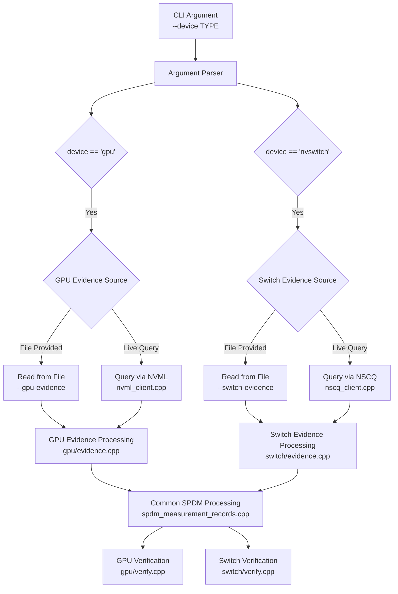
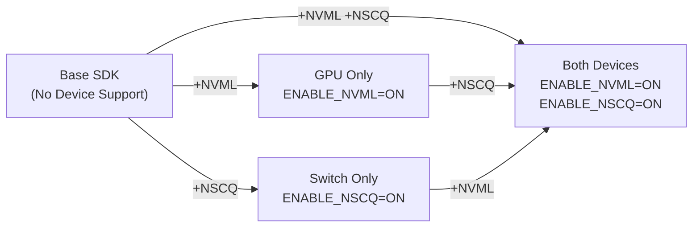

<!-- source: DeepWiki mcp.deepwiki.com · repo NVIDIA/attestation-sdk · page 5.5 Device Support · fetched 2026-10-26 -->

# Device Support

<details>
<summary>Relevant source files</summary>

The following files were used as context for generating this wiki page:

- [README.md](README.md)
- [nv-attestation-cli/tests/cli_tests.cpp](nv-attestation-cli/tests/cli_tests.cpp)
- [nv-attestation-sdk-cpp/CMakeLists.txt](nv-attestation-sdk-cpp/CMakeLists.txt)

</details>


This document describes the hardware devices supported by the NVIDIA Attestation SDK, including hardware requirements, library dependencies, build-time configuration, and architecture-specific implementation details. The SDK currently supports two device types: NVIDIA GPUs and NVIDIA Switches, each with dedicated evidence collection mechanisms and verification logic.

For information about the attestation workflow and how evidence is collected from these devices, see [Device Attestation Flow](#5.1). For details on evidence structure specific to each device type, see [Evidence Format and Structure](#5.2).

---

## Supported Device Types

The SDK supports attestation for two types of NVIDIA hardware devices, each requiring different runtime libraries and build configurations:

| Device Type | CLI Identifier | Evidence Library | Build Option | Source Modules |
|-------------|---------------|------------------|--------------|----------------|
| NVIDIA GPU | `gpu` | NVML (NVIDIA Management Library) | `ENABLE_NVML` | `src/gpu/` |
| NVIDIA Switch | `nvswitch` | NSCQ (NVIDIA Switch Client Query) | `ENABLE_NSCQ` | `src/switch/` |

Both device types share common infrastructure for SPDM protocol processing and attestation verification, but have device-specific code paths for evidence collection, claims generation, and verification logic.

**Sources:** [nv-attestation-cli/tests/cli_tests.cpp:86-316](), [nv-attestation-sdk-cpp/CMakeLists.txt:15-16](), [nv-attestation-sdk-cpp/CMakeLists.txt:91-101]()

---

## Architecture Overview

The following diagram illustrates the device support architecture, showing how device-specific modules integrate with common SDK components:

```mermaid
graph TB
    subgraph "Device-Specific Modules"
        GPU_MOD["GPU Module<br/>(src/gpu)"]
        SWITCH_MOD["Switch Module<br/>(src/switch)"]
    end
    
    subgraph "Evidence Collection"
        NVML["NVML Client<br/>(gpu/nvml_client.cpp)"]
        NSCQ["NSCQ Client<br/>(switch/nscq_client.cpp)"]
    end
    
    subgraph "Device-Specific Processing"
        GPU_EV["GPU Evidence<br/>(gpu/evidence.cpp)"]
        GPU_CLAIMS["GPU Claims<br/>(gpu/claims.cpp)"]
        GPU_VERIFY["GPU Verify<br/>(gpu/verify.cpp)"]
        GPU_OPAQUE["GPU Opaque Parser<br/>(gpu/spdm/gpu_opaque_data_parser.cpp)"]
        
        SWITCH_EV["Switch Evidence<br/>(switch/evidence.cpp)"]
        SWITCH_CLAIMS["Switch Claims<br/>(switch/claims.cpp)"]
        SWITCH_VERIFY["Switch Verify<br/>(switch/verify.cpp)"]
        SWITCH_OPAQUE["Switch Opaque Parser<br/>(switch/spdm/switch_opaque_data_parser.cpp)"]
    end
    
    subgraph "Common SPDM Layer"
        SPDM_RECORDS["SPDM Measurement Records<br/>(spdm/spdm_measurement_records.cpp)"]
        SPDM_REQ["SPDM Request<br/>(spdm/spdm_req.cpp)"]
        SPDM_RESP["SPDM Response<br/>(spdm/spdm_resp.cpp)"]
        SPDM_OPAQUE["SPDM Opaque Data Parser<br/>(spdm/spdm_opaque_data_parser.cpp)"]
    end
    
    subgraph "Common Verification"
        VERIFY["Verification Engine<br/>(verify.cpp)"]
        CLAIMS_EVAL["Claims Evaluator<br/>(claims_evaluator.cpp)"]
    end
    
    GPU_MOD --> NVML
    GPU_MOD --> GPU_EV
    GPU_MOD --> GPU_CLAIMS
    GPU_MOD --> GPU_VERIFY
    GPU_MOD --> GPU_OPAQUE
    
    SWITCH_MOD --> NSCQ
    SWITCH_MOD --> SWITCH_EV
    SWITCH_MOD --> SWITCH_CLAIMS
    SWITCH_MOD --> SWITCH_VERIFY
    SWITCH_MOD --> SWITCH_OPAQUE
    
    GPU_EV --> SPDM_RECORDS
    SWITCH_EV --> SPDM_RECORDS
    
    GPU_OPAQUE --> SPDM_OPAQUE
    SWITCH_OPAQUE --> SPDM_OPAQUE
    
    GPU_VERIFY --> VERIFY
    SWITCH_VERIFY --> VERIFY
    
    GPU_CLAIMS --> CLAIMS_EVAL
    SWITCH_CLAIMS --> CLAIMS_EVAL
```



**Sources:** [nv-attestation-sdk-cpp/CMakeLists.txt:123-152]()

---

## GPU Support

### Hardware Requirements

GPU attestation requires:
- A supported NVIDIA GPU with attestation capabilities (e.g., Hopper architecture GPUs)
- The GPU must be connected to a Confidential Virtual Machine (CVM) running on Intel TDX or AMD SNP platforms
- Operating system: Ubuntu 22.04 or 24.04

**Sources:** [README.md:40-47]()

### NVML Library Dependency

GPU evidence collection depends on the NVIDIA Management Library (NVML), which provides APIs for querying GPU hardware and retrieving attestation evidence. NVML must be installed on the system before building the SDK with GPU support.

Installation steps for NVML are documented in the [Driver Installation Guide](https://docs.nvidia.com/datacenter/tesla/driver-installation-guide/index.html#ubuntu-installation-common).

**Sources:** [README.md:49]()

### Build Configuration

GPU support is controlled by the `ENABLE_NVML` CMake option, which is disabled by default. To build with GPU support:

```shell
cmake -S . -B build -DENABLE_NVML=ON
```

When enabled, the build system:
1. Locates the NVML library using the `FindNvml.cmake` module
2. Adds the `ENABLE_NVML` preprocessor definition
3. Links the `nvat` library against NVML
4. Includes NVML headers in the public interface

**Sources:** [nv-attestation-sdk-cpp/CMakeLists.txt:91-95](), [README.md:65]()

### GPU Module Components

The GPU module consists of the following source files:

| File | Purpose |
|------|---------|
| `src/gpu/nvml_client.cpp` | NVML API wrapper for querying GPU hardware and collecting evidence |
| `src/gpu/evidence.cpp` | GPU evidence collection and serialization |
| `src/gpu/claims.cpp` | GPU-specific claims generation |
| `src/gpu/verify.cpp` | GPU attestation verification logic |
| `src/gpu/spdm/gpu_opaque_data_parser.cpp` | GPU-specific SPDM opaque data parsing |

**Sources:** [nv-attestation-sdk-cpp/CMakeLists.txt:129-135]()

### Evidence Collection Modes

GPU evidence can be collected in two modes:

#### Live Collection
When no evidence file is provided, the SDK queries live GPU hardware via NVML:

```shell
nvattest attest --device gpu --verifier local
```

This mode requires:
- NVML library installed and accessible
- GPU hardware connected and accessible
- Appropriate permissions to query GPU

#### File-Based Collection
For testing or offline scenarios, pre-serialized GPU evidence can be provided:

```shell
nvattest attest --device gpu --verifier local --gpu-evidence hopper_evidence.json
```

Test evidence files are located at `common-test-data/serialized_test_evidence/hopper_evidence.json`.

**Sources:** [nv-attestation-cli/tests/cli_tests.cpp:86-114](), [nv-attestation-cli/tests/cli_tests.cpp:92-96]()

---

## Switch Support

### Hardware Requirements

Switch attestation requires:
- A supported NVIDIA Switch device (e.g., LS10 switches)
- Network connectivity to the switch management interface
- Operating system: Ubuntu 22.04 or 24.04

### NSCQ Library Dependency

Switch evidence collection depends on the NVIDIA Switch Client Query (NSCQ) library, which provides APIs for querying switch hardware and retrieving attestation evidence. NSCQ must be installed on the system before building the SDK with switch support.

**Sources:** [nv-attestation-sdk-cpp/CMakeLists.txt:97-101]()

### Build Configuration

Switch support is controlled by the `ENABLE_NSCQ` CMake option, which is disabled by default. To build with switch support:

```shell
cmake -S . -B build -DENABLE_NSCQ=ON
```

When enabled, the build system:
1. Locates the NSCQ library using the `FindNscq.cmake` module
2. Adds the `ENABLE_NSCQ` preprocessor definition
3. Links the `nvat` library against NSCQ
4. Includes NSCQ headers in the public interface

**Sources:** [nv-attestation-sdk-cpp/CMakeLists.txt:97-101]()

### Switch Module Components

The switch module consists of the following source files:

| File | Purpose |
|------|---------|
| `src/switch/nscq_client.cpp` | NSCQ API wrapper for querying switch hardware and collecting evidence |
| `src/switch/evidence.cpp` | Switch evidence collection and serialization |
| `src/switch/claims.cpp` | Switch-specific claims generation |
| `src/switch/verify.cpp` | Switch attestation verification logic |
| `src/switch/spdm/switch_opaque_data_parser.cpp` | Switch-specific SPDM opaque data parsing |

**Sources:** [nv-attestation-sdk-cpp/CMakeLists.txt:143-148]()

### Evidence Collection Modes

Switch evidence can be collected in two modes:

#### Live Collection
When no evidence file is provided, the SDK queries live switch hardware via NSCQ:

```shell
nvattest attest --device nvswitch --verifier local
```

This mode requires:
- NSCQ library installed and accessible
- Switch hardware accessible via network
- Appropriate credentials and permissions

#### File-Based Collection
For testing or offline scenarios, pre-serialized switch evidence can be provided:

```shell
nvattest attest --device nvswitch --verifier local --switch-evidence switch_evidence_ls10.json
```

Test evidence files are located at `common-test-data/serialized_test_evidence/switch_evidence_ls10.json`.

**Sources:** [nv-attestation-cli/tests/cli_tests.cpp:147-174](), [nv-attestation-cli/tests/cli_tests.cpp:153-158]()

---

## Device Selection Flow

The following diagram shows how device type selection flows through the CLI to the appropriate SDK module:



**Sources:** [nv-attestation-cli/tests/cli_tests.cpp:86-316]()

---

## Common SPDM Layer

Both GPU and switch attestation utilize the Security Protocol and Data Model (SPDM) for secure measurement and attestation. The common SPDM layer provides device-agnostic processing of SPDM protocol messages:

### SPDM Components

| Component | File | Purpose |
|-----------|------|---------|
| Measurement Records | `src/spdm/spdm_measurement_records.cpp` | Parse and validate SPDM measurement blocks |
| Request Messages | `src/spdm/spdm_req.cpp` | Process SPDM request messages |
| Response Messages | `src/spdm/spdm_resp.cpp` | Process SPDM response messages |
| Opaque Data Parser | `src/spdm/spdm_opaque_data_parser.cpp` | Base parser for SPDM opaque data fields |

Both device types extend the base SPDM opaque data parser with device-specific implementations:
- GPU: `src/gpu/spdm/gpu_opaque_data_parser.cpp`
- Switch: `src/switch/spdm/switch_opaque_data_parser.cpp`

**Sources:** [nv-attestation-sdk-cpp/CMakeLists.txt:133-137](), [nv-attestation-sdk-cpp/CMakeLists.txt:148]()

---

## Device-Specific vs Common Components

The following table clarifies the boundary between device-specific and common components:

| Component | GPU-Specific | Switch-Specific | Common |
|-----------|--------------|-----------------|--------|
| Evidence Collection API | NVML | NSCQ | - |
| Evidence Structure | GPU fields | Switch fields | Certificates, nonce, measurements |
| SPDM Opaque Data | GPU parser | Switch parser | Base parser |
| Claims Generation | `gpu/claims.cpp` | `switch/claims.cpp` | `claims_evaluator.cpp` |
| Verification Logic | `gpu/verify.cpp` | `switch/verify.cpp` | `verify.cpp` |
| Policy Files | `relying_party_policy.rego` | `switch_relying_party_policy.rego` | Policy engine |
| SPDM Processing | - | - | `spdm_measurement_records.cpp` |
| Certificate Validation | - | - | `nv_x509.cpp` |
| RIM Fetching | - | - | `rim.cpp` |

**Sources:** [nv-attestation-sdk-cpp/CMakeLists.txt:123-152]()

---

## Testing with Device Types

The test infrastructure supports testing both device types in isolation or combination:

### Test Environment Variables

| Variable | Values | Purpose |
|----------|--------|---------|
| `TEST_MODE` | `unit`, `integration` | Unit tests use pre-serialized evidence; integration tests query live hardware |
| `TEST_DEVICES` | `gpu`, `nvswitch` | Comma-separated list of devices to test in integration mode |

### Test Organization

Test cases follow a naming pattern that indicates the device type and mode:

```cpp
TEST_F(CliTest, GPULocalCommand)      // GPU with local verifier
TEST_F(CliTest, GPURemoteCommand)     // GPU with remote verifier
TEST_F(CliTest, SwitchLocalCommand)   // Switch with local verifier
TEST_F(CliTest, SwitchRemoteCommand)  // Switch with remote verifier
```

Each test conditionally skips based on environment configuration:

```cpp
if (g_cli_env->test_mode == "integration" && !g_cli_env->test_device_gpu) {
    GTEST_SKIP() << "Skipping GPU Integration tests";
}
```

**Sources:** [nv-attestation-cli/tests/cli_tests.cpp:86-89](), [nv-attestation-cli/tests/cli_tests.cpp:147-149]()

### Test Evidence Files

Pre-serialized evidence files enable unit testing without hardware:

| File | Device Type | Architecture |
|------|-------------|--------------|
| `hopper_evidence.json` | GPU | Hopper |
| `switch_evidence_ls10.json` | Switch | LS10 |

**Sources:** [nv-attestation-cli/tests/cli_tests.cpp:92](), [nv-attestation-cli/tests/cli_tests.cpp:153]()

---

## Build-Time Device Support Matrix

The SDK can be built with various combinations of device support:



When neither `ENABLE_NVML` nor `ENABLE_NSCQ` is enabled, the SDK can still:
- Process pre-serialized evidence files
- Perform verification against RIM data
- Evaluate policies
- Generate claims

However, live evidence collection from hardware will not be available.

**Sources:** [nv-attestation-sdk-cpp/CMakeLists.txt:15-16](), [nv-attestation-sdk-cpp/CMakeLists.txt:91-101]()

---

## Device Support in CMake Targets

The device-specific libraries are conditionally linked based on build options:

```cmake
target_link_libraries(nvat
  PUBLIC
    $<$<BOOL:${ENABLE_NVML}>:${Nvml_LIBRARY}>
    $<$<BOOL:${ENABLE_NSCQ}>:${Nscq_LIBRARY}>
    # ... other dependencies
)
```

Similarly, include directories are conditionally added:

```cmake
target_include_directories(nvat 
  PUBLIC
    $<$<BOOL:${ENABLE_NVML}>:${Nvml_INCLUDE_DIR}>
    $<$<BOOL:${ENABLE_NSCQ}>:${Nscq_INCLUDE_DIR}>
    # ... other include paths
)
```

This ensures that applications linking against `nvat` automatically receive the necessary dependencies if device support was enabled during the SDK build.

**Sources:** [nv-attestation-sdk-cpp/CMakeLists.txt:198-213](), [nv-attestation-sdk-cpp/CMakeLists.txt:160-170]()

---

