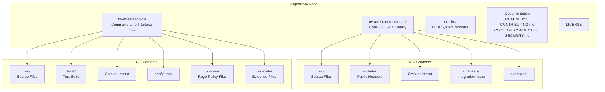
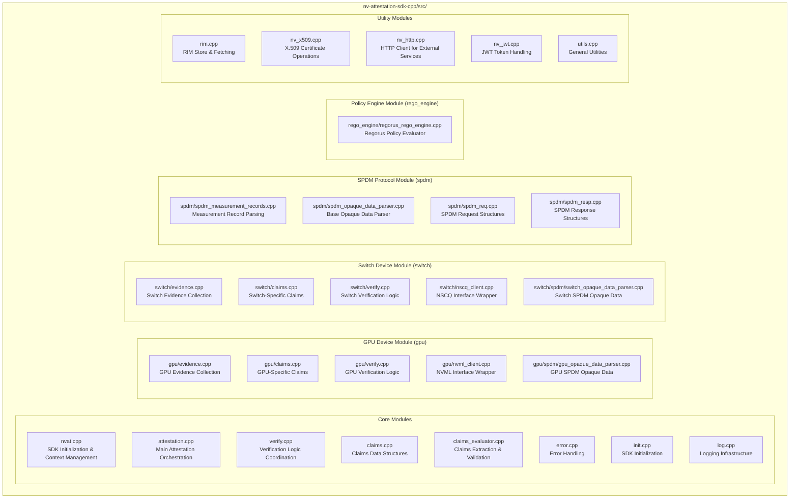
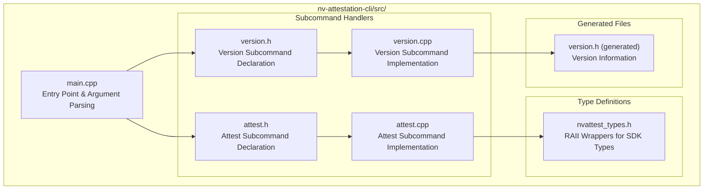
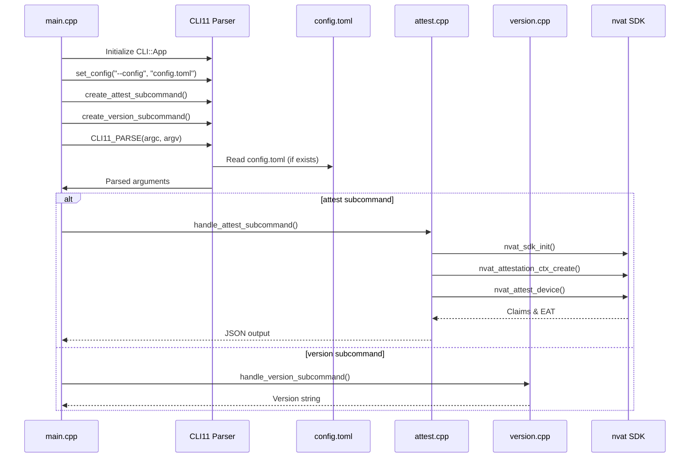
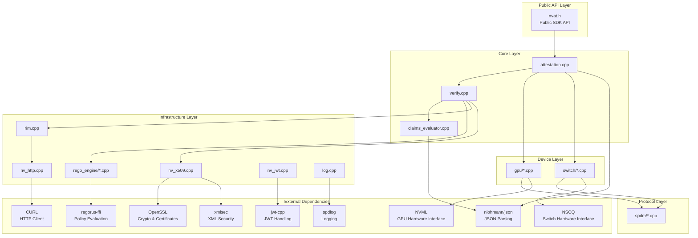
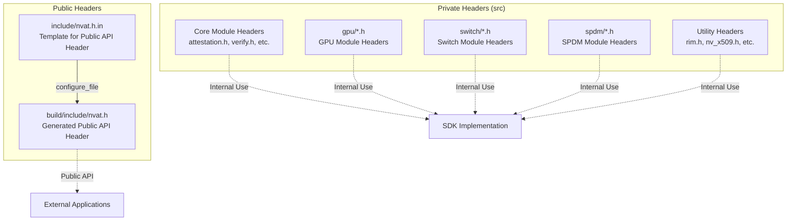
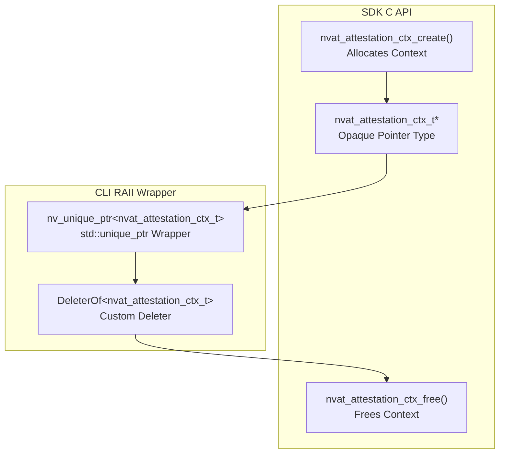

<!-- source: DeepWiki mcp.deepwiki.com · repo NVIDIA/attestation-sdk · page 6.2 Code Organization · fetched 2026-10-26 -->

# Code Organization

<details>
<summary>Relevant source files</summary>

The following files were used as context for generating this wiki page:

- [nv-attestation-cli/src/main.cpp](nv-attestation-cli/src/main.cpp)
- [nv-attestation-cli/src/nvattest_types.h](nv-attestation-cli/src/nvattest_types.h)
- [nv-attestation-sdk-cpp/CMakeLists.txt](nv-attestation-sdk-cpp/CMakeLists.txt)

</details>


## Purpose and Scope

This page documents the repository structure and source code organization of the NVIDIA Attestation SDK. It explains how the codebase is divided into modules, the directory layout, the responsibilities of each module, and the boundaries between them. This information is essential for developers who want to understand the codebase structure before making modifications.

For information about the build system and compilation options, see [Building from Source](#6.1). For information about the test suite structure, see [Testing Infrastructure](#6.3). For coding standards and quality requirements, see [Code Quality Standards](#6.4).

---

## Repository Structure

The repository consists of two primary components: the core C++ SDK library and the command-line interface tool. The following diagram shows the top-level directory organization:



The repository is organized into two main directories:

| Directory | Purpose |
|-----------|---------|
| `nv-attestation-sdk-cpp/` | Core C++ SDK library providing attestation functionality |
| `nv-attestation-cli/` | Command-line interface tool built on top of the SDK |
| `cmake/` | CMake modules for finding dependencies (FindNvml.cmake, Findxmlsec.cmake, etc.) |

**Sources:** Repository structure inferred from [nv-attestation-sdk-cpp/CMakeLists.txt:1-273](), [nv-attestation-cli/src/main.cpp:1-58]()

---

## SDK Module Organization

The SDK source code is organized into functional modules within the `nv-attestation-sdk-cpp/src/` directory. The following diagram shows the complete module structure and the source files belonging to each module:



### Core Modules

The core modules provide the foundational functionality of the SDK:

| Source File | Responsibility |
|-------------|---------------|
| `nvat.cpp` | SDK initialization, context creation and management, public API implementation |
| `attestation.cpp` | Orchestrates the attestation workflow, coordinates device-specific modules and verification |
| `verify.cpp` | Verification logic coordination, calls device-specific verification and policy evaluation |
| `claims.cpp` | Claims data structures and collection management |
| `claims_evaluator.cpp` | Extracts and validates claims from evidence and verification results |
| `error.cpp` | Error code handling and error message formatting |
| `init.cpp` | SDK initialization routines, dependency initialization |
| `log.cpp` | Logging infrastructure configuration and macros |

**Sources:** [nv-attestation-sdk-cpp/CMakeLists.txt:123-152]()

### Device-Specific Modules

Device-specific modules are organized in subdirectories for GPU and Switch devices:

#### GPU Module (`src/gpu/`)

| Source File | Responsibility |
|-------------|---------------|
| `gpu/evidence.cpp` | Collects evidence from GPU devices via NVML or from evidence files |
| `gpu/claims.cpp` | Defines GPU-specific claims structure and generation |
| `gpu/verify.cpp` | GPU-specific verification logic, measurement validation |
| `gpu/nvml_client.cpp` | Wrapper for NVML library calls, abstracts hardware interface |
| `gpu/spdm/gpu_opaque_data_parser.cpp` | Parses GPU-specific SPDM opaque data structures |

#### Switch Module (`src/switch/`)

| Source File | Responsibility |
|-------------|---------------|
| `switch/evidence.cpp` | Collects evidence from Switch devices via NSCQ or from evidence files |
| `switch/claims.cpp` | Defines Switch-specific claims structure and generation |
| `switch/verify.cpp` | Switch-specific verification logic, measurement validation |
| `switch/nscq_client.cpp` | Wrapper for NSCQ library calls, abstracts hardware interface |
| `switch/spdm/switch_opaque_data_parser.cpp` | Parses Switch-specific SPDM opaque data structures |

**Sources:** [nv-attestation-sdk-cpp/CMakeLists.txt:129-146]()

### Protocol Modules

#### SPDM Module (`src/spdm/`)

The SPDM module handles the Security Protocol and Data Model protocol used by both GPU and Switch devices:

| Source File | Responsibility |
|-------------|---------------|
| `spdm/spdm_measurement_records.cpp` | Parses SPDM measurement records from devices |
| `spdm/spdm_opaque_data_parser.cpp` | Base parser for SPDM opaque data, extended by device-specific parsers |
| `spdm/spdm_req.cpp` | SPDM request message structures |
| `spdm/spdm_resp.cpp` | SPDM response message structures |

**Sources:** [nv-attestation-sdk-cpp/CMakeLists.txt:133-137]()

### Policy Engine Module

The policy engine module provides Rego policy evaluation:

| Source File | Responsibility |
|-------------|---------------|
| `rego_engine/regorus_rego_engine.cpp` | Integrates Regorus library for Rego policy evaluation |

**Sources:** [nv-attestation-sdk-cpp/CMakeLists.txt:141]()

### Utility Modules

Utility modules provide common functionality used across the SDK:

| Source File | Responsibility |
|-------------|---------------|
| `rim.cpp` | RIM store management, fetches reference integrity measurements from remote services |
| `nv_x509.cpp` | X.509 certificate operations, parsing, validation, and OCSP verification |
| `nv_http.cpp` | HTTP client for communicating with external services (RIM, OCSP, NRAS) |
| `nv_jwt.cpp` | JWT token generation, parsing, and validation |
| `utils.cpp` | General utility functions used throughout the SDK |

**Sources:** [nv-attestation-sdk-cpp/CMakeLists.txt:142-151]()

---

## CLI Module Organization

The CLI tool is structured as a thin wrapper around the SDK library. The source code is located in `nv-attestation-cli/src/`:



### CLI Source Files

| Source File | Responsibility |
|-------------|---------------|
| `main.cpp` | CLI entry point, initializes CLI11 parser, defines global options, dispatches to subcommands |
| `attest.h` / `attest.cpp` | Implements the `attest` subcommand, configures SDK context, calls attestation functions |
| `version.h` / `version.cpp` | Implements the `version` subcommand, displays version information |
| `nvattest_types.h` | Defines `nv_unique_ptr` template and custom deleters for SDK types to enable RAII |

The CLI uses the CLI11 library for command-line parsing and supports configuration via TOML files. The main entry point is structured as follows:



**Sources:** [nv-attestation-cli/src/main.cpp:29-58](), [nv-attestation-cli/src/nvattest_types.h:1-76]()

---

## Module Boundaries and Dependencies

The following diagram illustrates the dependency relationships between SDK modules and external libraries:



### Module Dependency Rules

The SDK follows these dependency rules to maintain clean module boundaries:

1. **Core modules** (`attestation.cpp`, `verify.cpp`) orchestrate the attestation workflow but do not implement device-specific logic
2. **Device modules** (`gpu/`, `switch/`) are independent of each other and only depend on the SPDM protocol module
3. **Protocol modules** (`spdm/`) provide shared functionality for device modules but have no dependencies on device modules
4. **Infrastructure modules** provide services to all other modules but do not depend on core or device modules
5. **External dependencies** are accessed through wrapper modules to isolate third-party APIs

**Sources:** [nv-attestation-sdk-cpp/CMakeLists.txt:198-213]()

---

## Header Organization

The SDK distinguishes between public and private headers to maintain a stable API:



### Public API

The SDK exposes a single public header file:

| Header File | Purpose |
|-------------|---------|
| `include/nvat.h.in` | Template for the public API header, contains version placeholders |
| `build/include/nvat.h` | Generated public API header installed with the SDK |

The public header defines:
- All SDK types (`nvat_attestation_ctx_t`, `nvat_claims_collection_t`, etc.)
- All public functions (`nvat_sdk_init()`, `nvat_attest_device()`, etc.)
- Result codes and error enumerations
- Version macros

**Sources:** [nv-attestation-sdk-cpp/CMakeLists.txt:121](), [nv-attestation-sdk-cpp/CMakeLists.txt:232-235]()

### Private Headers

Private headers are located in the `src/` directory alongside their corresponding source files. These headers are not installed and are only used during SDK compilation. Module-specific functionality is kept private to prevent external dependencies on implementation details.

**Sources:** [nv-attestation-sdk-cpp/CMakeLists.txt:160-170]()

---

## Resource Management Patterns

The SDK uses RAII wrappers to manage SDK resources. The CLI demonstrates this pattern in `nvattest_types.h`:



The CLI defines custom deleters for all SDK types:

| SDK Type | Custom Deleter | Free Function |
|----------|---------------|---------------|
| `nvat_attestation_ctx_t` | `DeleterOf<nvat_attestation_ctx_t>` | `nvat_attestation_ctx_free()` |
| `nvat_relying_party_policy_t` | `DeleterOf<nvat_relying_party_policy_t>` | `nvat_relying_party_policy_free()` |
| `nvat_sdk_opts_t` | `DeleterOf<nvat_sdk_opts_t>` | `nvat_sdk_opts_free()` |
| `nvat_claims_collection_t` | `DeleterOf<nvat_claims_collection_t>` | `nvat_claims_collection_free()` |
| `nvat_rim_store_t` | `DeleterOf<nvat_rim_store_t>` | `nvat_rim_store_free()` |
| `nvat_ocsp_client_t` | `DeleterOf<nvat_ocsp_client_t>` | `nvat_ocsp_client_free()` |

The `nv_unique_ptr` template combines `std::unique_ptr` with these custom deleters to provide automatic resource cleanup:

```cpp
template<class T> using nv_unique_ptr = std::unique_ptr<T, DeleterOf<T>>;
```

This pattern ensures that SDK resources are always properly freed, even in the presence of exceptions or early returns. For more information on coding patterns, see [Resource Management Patterns](#6.5).

**Sources:** [nv-attestation-cli/src/nvattest_types.h:23-76]()

---

## Build System Integration

The CMake build system coordinates the compilation of all modules and manages dependencies. Key build files include:

| Build File | Purpose |
|------------|---------|
| `nv-attestation-sdk-cpp/CMakeLists.txt` | Main SDK build configuration, defines `nvat` library target |
| `nv-attestation-cli/CMakeLists.txt` | CLI build configuration, defines `nvattest` executable target |
| `cmake/*.cmake` | CMake modules for finding external dependencies |

The SDK is built as a single library target (`nvat`) that includes all modules. The build system uses CMake's target-based dependency management to link external libraries correctly. Optional features like NVML and NSCQ support are controlled via CMake options:

```cmake
option(ENABLE_NVML "Enable NVML support for GPU attestation" OFF)
option(ENABLE_NSCQ "Enable NSCQ support for SWITCH Attestation" OFF)
```

When enabled, these options add conditional compilation definitions and link the appropriate libraries. For complete build system documentation, see [Building from Source](#6.1).

**Sources:** [nv-attestation-sdk-cpp/CMakeLists.txt:1-273]()

---

