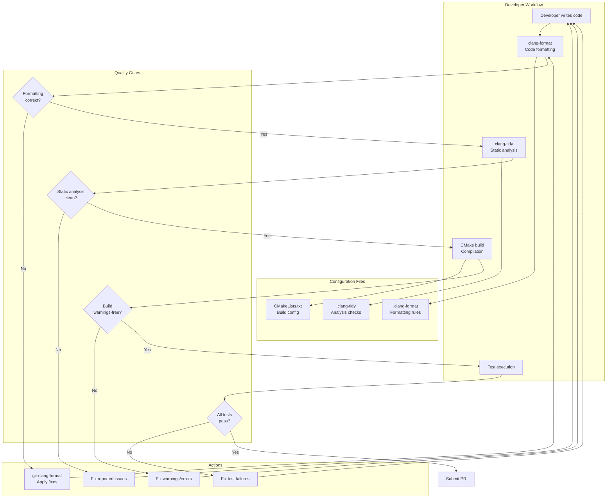
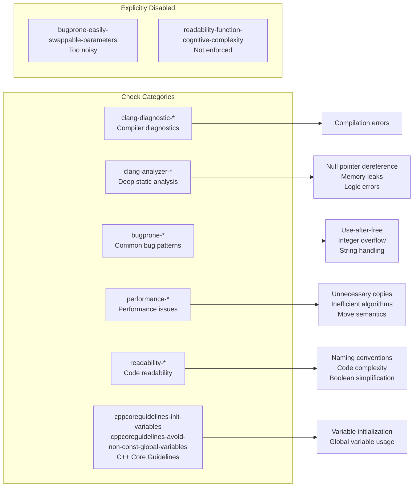
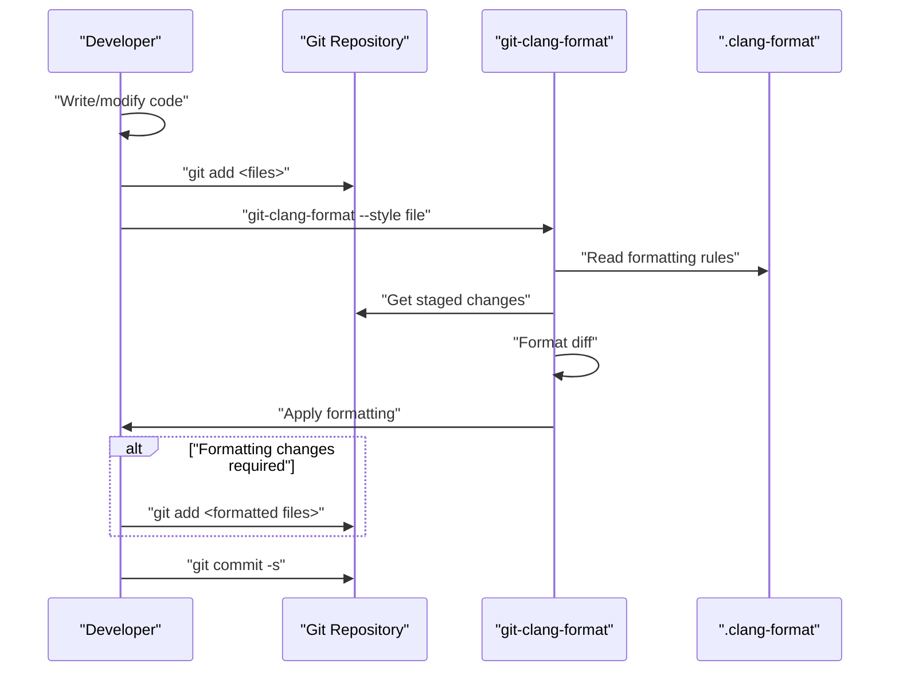
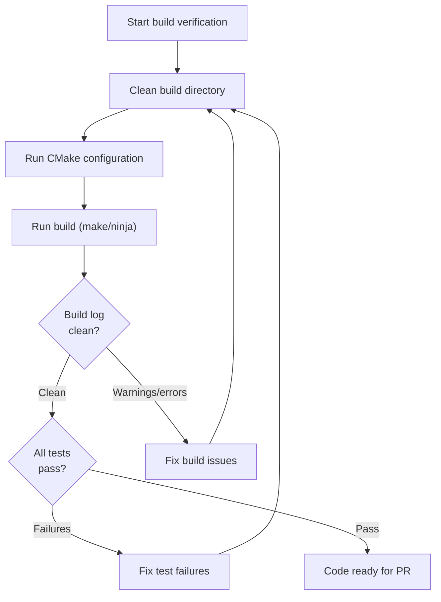

<!-- source: DeepWiki mcp.deepwiki.com · repo NVIDIA/attestation-sdk · page 6.4 Code Quality Standards · fetched 2026-10-26 -->

# Code Quality Standards

<details>
<summary>Relevant source files</summary>

The following files were used as context for generating this wiki page:

- [CONTRIBUTING.md](CONTRIBUTING.md)
- [nv-attestation-sdk-cpp/.clang-tidy](nv-attestation-sdk-cpp/.clang-tidy)

</details>


## Purpose and Scope

This document describes the code quality enforcement mechanisms used in the NVIDIA Attestation SDK, including static analysis tools, code formatting standards, and quality requirements for contributions. These standards apply to both the C++ SDK ([nv-attestation-sdk-cpp]()) and the CLI tool ([nv-attestation-cli]()).

For information about the overall contribution workflow and pull request process, see [Contribution Workflow](#7.1). For details about the testing infrastructure that validates code quality, see [Testing Infrastructure](#6.3).

**Sources:** [CONTRIBUTING.md:1-140](), [nv-attestation-sdk-cpp/.clang-tidy:1-408]()

---

## Quality Enforcement Architecture

The SDK enforces code quality through a multi-layered approach combining static analysis, automated formatting, and build-time validation.



**Sources:** [CONTRIBUTING.md:10-74](), [nv-attestation-sdk-cpp/.clang-tidy:1-7]()

---

## Static Analysis with clang-tidy

### Configuration Overview

The SDK uses `clang-tidy` for comprehensive static analysis of C++ code. The configuration is defined in [nv-attestation-sdk-cpp/.clang-tidy]() and enforces a strict "warnings as errors" policy.

**Key Configuration Parameters:**

| Parameter | Value | Purpose |
|-----------|-------|---------|
| `WarningsAsErrors` | `*` | All warnings are treated as build errors |
| `HeaderFilterRegex` | `^(src\|include)/.*\.(h\|hpp\|cpp)$` | Only analyze SDK source files, not dependencies |
| `FormatStyle` | `none` | Formatting is handled separately by clang-format |
| `AnalyzeTemporaryDtors` | `false` | Disabled for performance |

**Sources:** [nv-attestation-sdk-cpp/.clang-tidy:3-6]()

### Enabled Check Categories

The SDK enables multiple categories of checks to catch bugs, performance issues, and readability problems:



**Sources:** [nv-attestation-sdk-cpp/.clang-tidy:2]()

### Specific Check Categories Detail

#### bugprone-* Checks

The `bugprone-*` category detects common programming errors. Key enabled checks include:

- **bugprone-unused-return-value**: Ensures return values from important functions are not ignored
- **bugprone-narrowing-conversions**: Detects potentially lossy type conversions
- **bugprone-reserved-identifier**: Prevents use of reserved identifiers (leading underscores, etc.)
- **bugprone-suspicious-string-compare**: Detects incorrect string comparison patterns
- **bugprone-dangling-handle**: Detects dangling references to temporary objects

One check is explicitly disabled:
- **bugprone-easily-swappable-parameters**: Disabled because it generates too many false positives for legitimate API designs

**Sources:** [nv-attestation-sdk-cpp/.clang-tidy:2,12-18]()

#### performance-* Checks

Performance checks identify inefficient code patterns:

- **performance-unnecessary-copy-initialization**: Detects expensive object copies that can be avoided
- **performance-move-const-arg**: Warns about moving const objects (which has no effect)
- **performance-inefficient-vector-operation**: Identifies suboptimal vector usage patterns
- **performance-for-range-copy**: Detects range-based for loops that copy elements unnecessarily

**Sources:** [nv-attestation-sdk-cpp/.clang-tidy:2]()

#### readability-* Checks

Readability checks enforce code clarity:

- **readability-identifier-naming**: Enforces naming conventions (configured per-file basis)
- **readability-simplify-boolean-expr**: Simplifies complex boolean expressions
- **readability-redundant-string-init**: Detects unnecessary string initializations
- **readability-magic-numbers**: Identifies hard-coded numeric literals that should be named constants
- **readability-else-after-return**: Flags unnecessary else branches after return statements

One check is explicitly disabled:
- **readability-function-cognitive-complexity**: Not enforced to allow necessary complexity in some functions

**Sources:** [nv-attestation-sdk-cpp/.clang-tidy:2]()

#### cppcoreguidelines-* Checks

Selected C++ Core Guidelines checks are enabled:

- **cppcoreguidelines-init-variables**: Ensures all variables are initialized
- **cppcoreguidelines-avoid-non-const-global-variables**: Discourages mutable global state

**Sources:** [nv-attestation-sdk-cpp/.clang-tidy:2]()

### Check Configuration Options

Many checks have configurable thresholds and behaviors defined in the `CheckOptions` section. Examples:

| Check | Option | Value | Purpose |
|-------|--------|-------|---------|
| `readability-function-size` | `StatementThreshold` | `800` | Maximum statements per function |
| `readability-identifier-length` | `MinimumVariableNameLength` | `2` | Minimum variable name length (exceptions for `i`, `j`, etc.) |
| `bugprone-string-constructor` | `LargeLengthThreshold` | `8388608` | Maximum string allocation size (8MB) |
| `readability-magic-numbers` | `IgnoredIntegerValues` | `1;2;3;4;` | Common constants that don't need naming |
| `readability-identifier-naming` | `GetConfigPerFile` | `true` | Allow per-file naming conventions |

**Sources:** [nv-attestation-sdk-cpp/.clang-tidy:7-407]()

---

## Code Formatting with clang-format

### Formatting Requirements

All source code must be formatted using `clang-format` with the configuration file provided in the repository. The formatting rules enforce consistency in:

- Class, function/method, and variable/field naming
- Comment style
- Indentation
- Line length

**Sources:** [CONTRIBUTING.md:16-21]()

### Usage Patterns

#### Format Git Changes

For incremental formatting of only the files you've modified:

```bash
# Format staged changes
git-clang-format --style file

# Format changes relative to a specific commit
git-clang-format --style file <commit-id>
```

This is the recommended approach during development as it only formats your changes, minimizing merge conflicts.

**Sources:** [CONTRIBUTING.md:22-26]()

#### Format Individual Files

For formatting specific source files:

```bash
# -style=file: Use .clang-format config
# -i: In-place modification
# -fallback-style=none: Fail if .clang-format is missing
clang-format -style=file -i -fallback-style=none <file(s)>
```

**Sources:** [CONTRIBUTING.md:28-33]()

#### Format Entire Codebase

For maintainers performing large-scale reformatting:

```bash
find samples plugin -iname *.h -o -iname *.c -o -iname *.cpp -o -iname *.hpp \
  | xargs clang-format -style=file -i -fallback-style=none
```

This should only be used by project maintainers as it reformats the entire codebase.

**Sources:** [CONTRIBUTING.md:35-39]()

### Integration with Development Workflow



**Sources:** [CONTRIBUTING.md:22-33]()

---

## Build Quality Requirements

### Clean Build Policy

All code contributions must produce clean builds with no warnings or errors. This requirement is enforced at multiple levels:

**Build-Time Enforcement:**

1. **Compiler Warnings:** All compiler warnings are treated as errors
2. **Static Analysis:** clang-tidy warnings are treated as errors (`WarningsAsErrors: '*'`)
3. **Build Log:** The build log must be completely clean

**Sources:** [CONTRIBUTING.md:54](), [nv-attestation-sdk-cpp/.clang-tidy:3]()

### Warning Categories

The SDK compilation treats the following as build-breaking errors:

- **Compiler diagnostics:** All warnings from the compiler (`-Wall`, `-Wextra`, etc.)
- **Static analysis warnings:** All clang-tidy check violations
- **Linker warnings:** Undefined symbols, conflicting definitions, etc.

### Verification Process

Before submitting code:



**Sources:** [CONTRIBUTING.md:54-56]()

---

## Testing Requirements

### Test Execution Requirements

All code changes must pass the complete test suite before submission:

```bash
# All sample_* tests must pass
ctest
```

This includes:
- Unit tests (direct function invocation)
- Integration tests (full CLI execution)
- Device-specific tests (GPU, Switch) when applicable

For details on the testing infrastructure, see [Testing Infrastructure](#6.3).

**Sources:** [CONTRIBUTING.md:56]()

### Test Coverage Expectations

New functionality must include accompanying tests:

- **New components** (e.g., plugins): Must provide a test sample to verify functionality
- **Bug fixes**: Should include a test that would have caught the bug
- **Feature additions**: Must include tests for the new feature paths

**Sources:** [CONTRIBUTING.md:62-64]()

---

## Code Review Standards

### Pull Request Guidelines

Code contributions must adhere to specific quality standards during code review:

**Complexity Management:**

- Avoid introducing unnecessary complexity into existing code
- Preserve maintainability and readability
- Keep PRs concise and focused on a single concern
- Split complex changes into multiple PRs with clear dependencies

**Code Cleanliness:**

- No commented-out code should be committed
- All changes must be intentional and justified
- Remove debugging code before submission

**Sources:** [CONTRIBUTING.md:41-46]()

### Commit Quality

Commits must follow specific format and content standards:

**Commit Message Format:**

```
#<Issue Number> - <Commit Title>

<Commit Body>
```

**Commit Title Rules:**
- Use imperative mood ("Add feature" not "Added feature")
- Follow [these rules](https://chris.beams.io/posts/git-commit)
- Reference the corresponding issue number

**Commit Signing:**
- All commits must be signed off with `git commit -s`
- This certifies the contribution is your original work or you have rights to submit it

**Sources:** [CONTRIBUTING.md:47-72]()

### Code Organization

When adding or disabling functionality:

**CMake-Based Approach (Preferred):**
- Add a CMake option with a default value matching existing behavior
- Selectively include/exclude entire files from compilation by modifying `CMakeLists.txt`

**Preprocessor Approach (For Minor Changes):**
- Use `#if` guards for minor changes to existing files
- Avoid wrapping entire files in `#if` guards

**Sources:** [CONTRIBUTING.md:66-70]()

---

## Coding Guidelines Reference

### External Documentation

The SDK maintains detailed coding guidelines in a separate document:

**Location:** `CODING-GUIDELINES.md`

All source code contributions must strictly adhere to these guidelines. They cover:
- Naming conventions
- Code structure patterns
- Documentation requirements
- C++ feature usage policies

**Sources:** [CONTRIBUTING.md:12]()

### Consistency with Existing Code

When extending or fixing existing functionality:

- Follow existing conventions in the relevant file
- Match the style of the submodule and module
- Maintain consistency with project-wide patterns
- When in doubt, match the surrounding code

**Sources:** [CONTRIBUTING.md:14]()

---

## Quality Gate Summary

The following table summarizes all quality gates that must pass before code is accepted:

| Quality Gate | Tool/Process | Configuration | Failure Action |
|--------------|--------------|---------------|----------------|
| Code Formatting | `clang-format` | `.clang-format` | Run `git-clang-format` |
| Static Analysis | `clang-tidy` | `.clang-tidy` | Fix reported issues |
| Compilation | CMake + Compiler | `CMakeLists.txt` | Fix warnings/errors |
| Test Suite | CTest | Test files in `tests/` | Fix failing tests |
| Code Review | Manual review | `CONTRIBUTING.md` | Address reviewer comments |
| Commit Signing | Git DCO | N/A | Re-commit with `-s` flag |

All gates must pass before a pull request can be merged.

**Sources:** [CONTRIBUTING.md:1-140](), [nv-attestation-sdk-cpp/.clang-tidy:1-408]()

---

