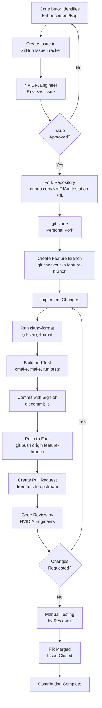
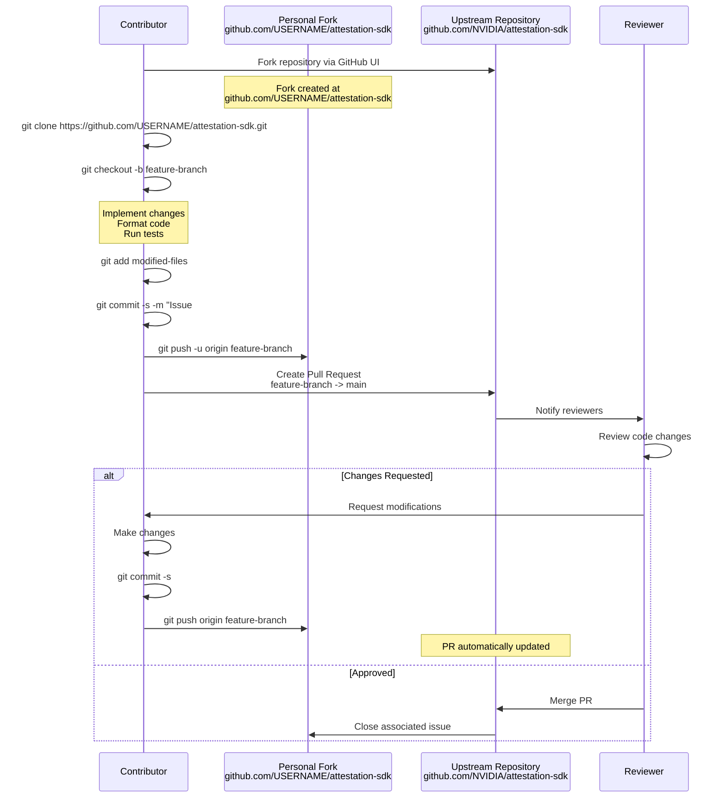
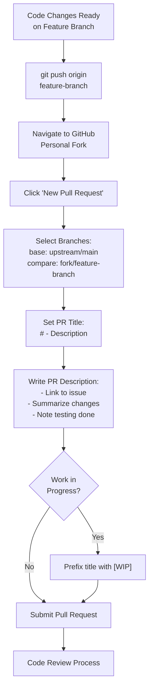
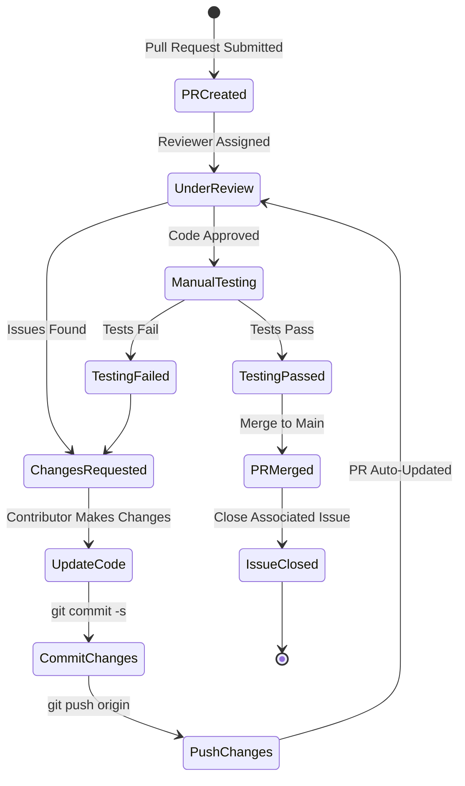
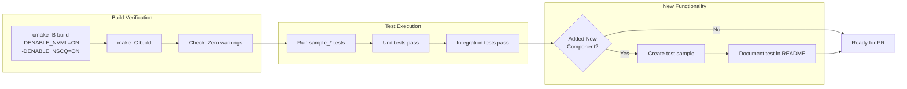
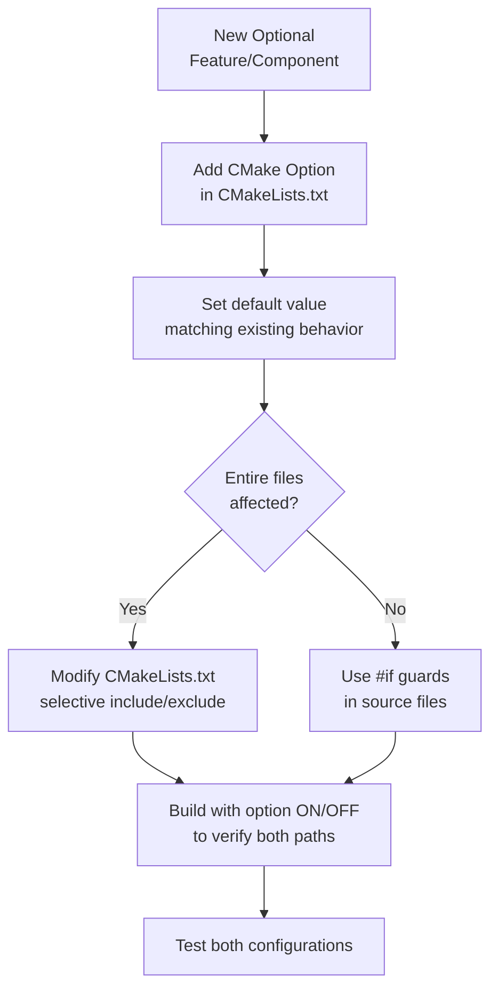

<!-- source: DeepWiki mcp.deepwiki.com · repo NVIDIA/attestation-sdk · page 7.1 Contribution Workflow · fetched 2026-10-26 -->

# Contribution Workflow

<details>
<summary>Relevant source files</summary>

The following files were used as context for generating this wiki page:

- [CONTRIBUTING.md](CONTRIBUTING.md)

</details>


## Purpose and Scope

This document provides a comprehensive guide for external contributors to submit code changes to the NVIDIA Attestation SDK repository. It covers the end-to-end workflow from issue creation through code review and merge, including requirements for code formatting, commit signing, and testing.

For general development practices including build system configuration and testing infrastructure, see [Development Guide](#6). For community standards and behavioral expectations, see [Code of Conduct](#7.2). For reporting security vulnerabilities, see [Security Policy](#7.3).

## Contribution Overview

All contributions to the NVIDIA Attestation SDK follow a structured workflow that ensures code quality, proper review, and legal compliance. The process requires creating an issue before submitting code, adhering to strict coding standards, and signing all commits.



**Sources:** [CONTRIBUTING.md:1-140]()

## Issue Tracking Requirements

All code contributions must begin with an issue request in the GitHub issue tracker. This requirement ensures that proposed changes are reviewed and approved by NVIDIA engineers before development effort is expended.

| Requirement | Description |
|-------------|-------------|
| **Issue Creation** | Create an issue describing the enhancement, bugfix, or change |
| **Issue Review** | NVIDIA engineers must review and approve the issue |
| **Approval Required** | Code review cannot proceed without issue approval |
| **Issue Reference** | PRs must reference the corresponding issue number |

The issue should clearly describe:
- The problem being addressed or feature being added
- The proposed approach or solution
- Any architectural or design considerations
- Expected impact on existing functionality

**Sources:** [CONTRIBUTING.md:4-7]()

## Fork and Clone Workflow

The repository uses a fork-based contribution model where contributors work on personal forks and submit pull requests to the upstream repository.

### Fork-Based Development Process



### Initial Repository Setup

```bash
# Step 1: Fork repository via GitHub UI
# Navigate to https://github.com/NVIDIA/attestation-sdk
# Click "Fork" button

# Step 2: Clone your fork
git clone https://github.com/YOUR_USERNAME/attestation-sdk.git
cd attestation-sdk

# Step 3: Add upstream remote (optional, for syncing)
git remote add upstream https://github.com/NVIDIA/attestation-sdk.git

# Step 4: Create feature branch
git checkout -b feature-issue-123
```

**Sources:** [CONTRIBUTING.md:77-88]()

## Coding Standards and Formatting

All source code contributions must strictly adhere to the NVIDIA Attestation SDK Coding Guidelines, which are defined in `CODING-GUIDELINES.md`. Additionally, code must follow existing conventions in the relevant modules.

### Code Formatting with clang-format

The repository uses `clang-format` with a provided `.clang-format` configuration file to enforce consistent code style across the codebase.

#### Formatting Rules Applied

The `.clang-format` configuration enforces rules for:
- Class, function/method, and variable/field naming conventions
- Comment style and placement
- Indentation levels and spacing
- Line length limits
- Brace placement and alignment

#### Format Git Changes

Format only the files changed in your commits:

```bash
# Format staged changes
git-clang-format --style file

# Format changes since a specific commit
git-clang-format --style file <commit-id>
```

#### Format Individual Files

```bash
# -style=file: Use rules from .clang-format
# -i: In-place modification
# -fallback-style=none: Fail if no config found
clang-format -style=file -i -fallback-style=none src/file.cpp
```

#### Format Multiple Files

```bash
# Format specific files
clang-format -style=file -i -fallback-style=none \
  nv-attestation-sdk-cpp/src/attestation.cpp \
  nv-attestation-sdk-cpp/src/verify.cpp
```

**Sources:** [CONTRIBUTING.md:10-39]()

### Code Quality Guidelines

```mermaid
flowchart LR
    subgraph "Pre-Commit Checks"
        FORMAT["Run clang-format<br/>on modified files"]
        BUILD["Build with CMake<br/>Check for warnings"]
        TIDY["clang-tidy checks<br/>(if configured)"]
    end
    
    subgraph "Code Review Criteria"
        STYLE["Follows existing<br/>code conventions"]
        SIMPLE["Minimizes unnecessary<br/>complexity"]
        CONCISE["Focused PR scope<br/>Single concern"]
        CLEAN["No commented-out<br/>code"]
        DOCS["Includes documentation<br/>for new components"]
        TESTS["Includes tests<br/>for new features"]
    end
    
    FORMAT --> BUILD
    BUILD --> TIDY
    TIDY --> STYLE
    STYLE --> SIMPLE
    SIMPLE --> CONCISE
    CONCISE --> CLEAN
    CLEAN --> DOCS
    DOCS --> TESTS
```



### Best Practices

| Practice | Description |
|----------|-------------|
| **Follow Existing Patterns** | Match conventions in the relevant file, submodule, and module |
| **Minimize Complexity** | Preserve maintainability and readability of existing code |
| **Concise Pull Requests** | Each PR should address a single concern when possible |
| **Clean Build Log** | Eliminate all warnings and errors before submission |
| **No Dead Code** | Remove commented-out code before committing |
| **Component Documentation** | All OSS components must include README files |
| **Test Coverage** | All OSS components must have accompanying tests |

**Sources:** [CONTRIBUTING.md:10-65]()

## Commit Guidelines

Commits must follow specific formatting and signing requirements to maintain project quality and legal compliance.

### Commit Message Format

```
#<Issue Number> - <Commit Title>

<Commit Body>
```

#### Commit Title Rules

Follow imperative mood and [these conventions](https://chris.beams.io/posts/git-commit):
- Use imperative mood ("Add feature" not "Added feature")
- Capitalize the first letter
- No period at the end
- Keep under 50 characters when possible
- Reference the issue number with `#<number>` prefix

#### Example Commits

```bash
# Good commit
git commit -s -m "#45 - Add support for remote attestation verification

Implements remote verification mode that connects to NRAS service.
Includes error handling for network failures and certificate validation."

# Another good commit
git commit -s -m "#67 - Fix memory leak in claims_evaluator

Free allocated memory in error paths of evaluate_claims function."
```

**Sources:** [CONTRIBUTING.md:47-52]()

## Pull Request Workflow

Once code changes are ready for review, create a pull request from your fork to the upstream repository.

### Creating a Pull Request



### Pull Request Best Practices

| Element | Guideline |
|---------|-----------|
| **Branch Selection** | Exercise caution selecting source and target branches |
| **Title** | Reference issue number and provide clear description |
| **Description** | Link to issue, summarize changes, note testing performed |
| **WIP Marking** | Prefix title with `[WIP]` if still under development |
| **Scope** | Keep PRs focused on single concern when possible |
| **Dependencies** | Document dependencies on other PRs in description |

**Sources:** [CONTRIBUTING.md:76-97]()

## Code Review Process

After PR creation, NVIDIA engineers review the code changes. The repository currently uses manual testing processes as no CI/CD automation is in place.

### Review Workflow



### Review Requirements

| Requirement | Description |
|-------------|-------------|
| **Reviewer Assignment** | At least one NVIDIA engineer assigned to review |
| **Code Quality Check** | Verify adherence to coding guidelines and formatting |
| **Build Verification** | Ensure clean build with no warnings or errors |
| **Manual Testing** | Comprehensive manual testing by developer and/or reviewer |
| **Test Pass Criteria** | All existing tests must pass (referenced as `sample_*` tests) |
| **Issue Closure** | PR accepted and issue closed only after adequate testing |

**Sources:** [CONTRIBUTING.md:93-96]()

## Testing Requirements

All code contributions must pass existing tests and include new tests for new functionality.

### Pre-Submission Testing Checklist



### Testing Guidelines

| Category | Requirement |
|----------|-------------|
| **Existing Tests** | All `sample_*` tests must pass before submission |
| **New Components** | Must include accompanying test to verify functionality |
| **Test Documentation** | Tests must be documented in README files |
| **Build Verification** | Build log must be clean (no warnings or errors) |

For detailed information on the testing infrastructure, test modes, and test execution, see [Testing Infrastructure](#6.3).

**Sources:** [CONTRIBUTING.md:54-64]()

## Commit Signing (DCO)

All commits must include a Developer Certificate of Origin (DCO) sign-off, which certifies that you have the right to submit the code under the project's license.

### Signing Commits

```bash
# Sign-off on commit with -s or --signoff flag
git commit -s -m "#123 - Add feature"

# This appends to commit message:
# Signed-off-by: Your Name <your@email.com>
```

### Git Configuration

Ensure your git configuration includes your name and email:

```bash
# Set global identity
git config --global user.name "Your Name"
git config --global user.email "your@email.com"

# Verify configuration
git config user.name
git config user.email
```

### DCO Certification

By signing off, you certify:

> **(a)** The contribution was created in whole or in part by me and I have the right to submit it under the open source license indicated in the file; or
>
> **(b)** The contribution is based upon previous work that, to the best of my knowledge, is covered under an appropriate open source license and I have the right under that license to submit that work with modifications; or
>
> **(c)** The contribution was provided directly to me by some other person who certified (a), (b) or (c) and I have not modified it.
>
> **(d)** I understand and agree that this project and the contribution are public and that a record of the contribution is maintained indefinitely.

### Important Notes

- **Required for All Commits**: Every commit in your PR must be signed off
- **Unsigned Commits Rejected**: PRs containing unsigned commits will not be accepted
- **Legal Protection**: Sign-off provides legal clarity about contribution rights
- **No License Conflicts**: Ensure your contribution does not introduce license or patent conflicts

**Sources:** [CONTRIBUTING.md:99-140]()

## Feature Flags and Configuration

When adding or disabling functionality, follow the CMake-based feature flag pattern used throughout the repository.

### Adding New Optional Features



### Guidelines for Feature Flags

| Scenario | Approach | Example |
|----------|----------|---------|
| **Entire Files** | Modify `CMakeLists.txt` to conditionally include/exclude files | `ENABLE_NVML`, `ENABLE_NSCQ` |
| **Minor Changes** | Use `#if` preprocessor guards in source files | Feature-specific code blocks |
| **Default Behavior** | Option default should match existing behavior | Avoid breaking changes |

Examples from the codebase:
- `ENABLE_NVML`: Controls GPU support via NVML library
- `ENABLE_NSCQ`: Controls Switch support via NSCQ library
- `SANITIZER`: Controls build with AddressSanitizer

For complete build options reference, see [Build System Reference](#8.3).

**Sources:** [CONTRIBUTING.md:66-69]()

## Complete Contribution Checklist

Before submitting your pull request, verify all requirements are met:

### Pre-PR Checklist

- [ ] Issue created and approved by NVIDIA engineers
- [ ] Fork created from `github.com/NVIDIA/attestation-sdk`
- [ ] Feature branch created from latest main/target branch
- [ ] Code follows existing conventions in relevant modules
- [ ] Code formatted with `clang-format --style file`
- [ ] Build completes with zero warnings or errors
- [ ] All existing `sample_*` tests pass
- [ ] New functionality includes accompanying tests
- [ ] New components include README documentation
- [ ] All commits use imperative mood and reference issue number
- [ ] All commits signed off with `git commit -s`
- [ ] No commented-out or dead code included
- [ ] PR description links to issue and describes changes
- [ ] PR title prefixed with `[WIP]` if still in progress
- [ ] Branch selection verified (source and target)

### Post-PR Checklist

- [ ] Respond to reviewer feedback in timely manner
- [ ] Make requested changes on same branch
- [ ] Sign off on all additional commits
- [ ] Run tests after making changes
- [ ] Update PR description if scope changes

**Sources:** [CONTRIBUTING.md:1-140]()

---

