# Page: Overview

# Overview

<details>
<summary>Relevant source files</summary>

The following files were used as context for generating this wiki page:

- [.gitignore](.gitignore)
- [LICENSE](LICENSE)
- [README.md](README.md)

</details>


This document provides an introduction to the NVIDIA Attestation SDK repository, explaining its purpose in trusted computing and confidential computing contexts, and describing the high-level structure of the codebase. For detailed installation instructions, see [Installation Guide](#2.1). For architectural details of specific components, see [Architecture](#3).

## Purpose and Scope

The NVIDIA Attestation SDK (NVAT) is an open-source C++ software development kit that provides resources for implementing and validating Trusted Computing Solutions on NVIDIA hardware. The SDK focuses on attestation, a critical security mechanism for ensuring the integrity and authenticity of hardware and software in confidential computing environments.

The repository contains two primary deliverables:
- **nv-attestation-sdk-cpp**: A C++ core library (`nvat`) with a C API for integration into applications
- **nv-attestation-cli**: A command-line tool (`nvattest`) that wraps the SDK for standalone attestation operations

This project is the successor to the guest tools in the [nvTrust](https://github.com/NVIDIA/nvtrust) repository, rewritten in C++ to support broader deployment scenarios and use cases.

**Sources**: [README.md:1-31]()

## What is Attestation?

Attestation is a process by which a device (attester) presents cryptographic evidence of its hardware and software state to a verifying party (verifier). The verifier validates this evidence against known reference measurements to determine whether the device is in a trusted state. In confidential computing environments, attestation ensures that:

- Hardware components are genuine NVIDIA products
- Firmware and software have not been tampered with
- The system configuration matches expected security policies
- Sensitive workloads are running in a secure, isolated environment

The NVIDIA Attestation SDK implements the attestation workflow for NVIDIA GPUs and NVSwitch devices, collecting hardware evidence, verifying it against reference integrity measurements (RIMs), and generating attestation claims that applications can use to make trust decisions.

**Sources**: [README.md:9-11](), [README.md:90-105]()

## Repository Structure

The repository is organized into two main directories with supporting infrastructure:

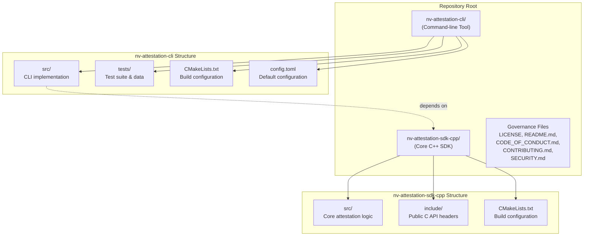

**Directory Structure**:

| Directory | Purpose |
|-----------|---------|
| `nv-attestation-sdk-cpp/` | Core C++ SDK library with attestation implementation |
| `nv-attestation-sdk-cpp/include/` | Public C API headers (`attestation.h`, `types.h`, etc.) |
| `nv-attestation-sdk-cpp/src/` | Core implementation (attestation, verification, device support) |
| `nv-attestation-cli/` | Command-line tool implementation |
| `nv-attestation-cli/src/` | CLI entry point, subcommand handlers, configuration |
| `nv-attestation-cli/tests/` | Test suite with unit and integration tests |
| `nv-attestation-cli/tests/data/` | Test evidence files and Rego policies |

**Sources**: [README.md:1-13](), Diagram 1 from system architecture

## Core SDK Architecture

The `nv-attestation-sdk-cpp` library is built around modular components that handle different aspects of the attestation workflow:

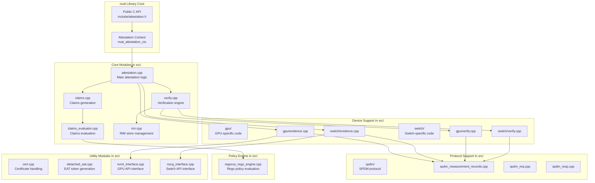

The SDK exposes a C API through header files in `nv-attestation-sdk-cpp/include/`. The main entry point is `nvat_attestation_ctx`, which encapsulates the attestation configuration and state. Core modules handle attestation orchestration, verification against reference measurements, and claims generation. Device-specific modules (`gpu/` and `switch/`) implement evidence collection and verification logic for different hardware types.

**Sources**: [nv-attestation-sdk-cpp/include/](), Diagram 2 from system architecture

## CLI Tool Architecture

The `nvattest` command-line tool is implemented in `nv-attestation-cli/src/` and provides a user-friendly interface to the SDK:

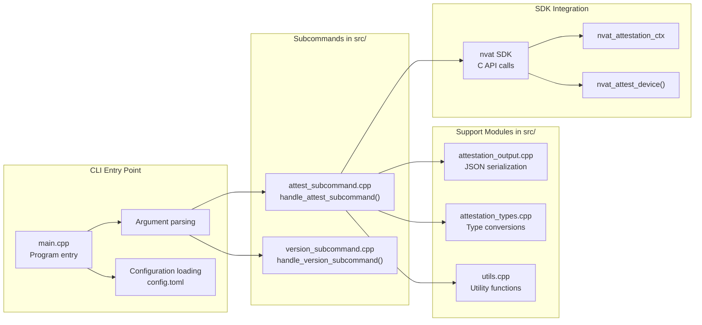

The CLI entry point in `main.cpp` parses command-line arguments and dispatches to subcommand handlers. The `handle_attest_subcommand()` function in `attest_subcommand.cpp` configures the SDK context based on user parameters and invokes `nvat_attest_device()`. Results are serialized to JSON format by `attestation_output.cpp` for consumption by other tools or scripts.

**Sources**: [nv-attestation-cli/src/](), Diagram 3 from system architecture

## Attestation Workflow

The end-to-end attestation workflow involves evidence collection, verification, policy evaluation, and claims generation:

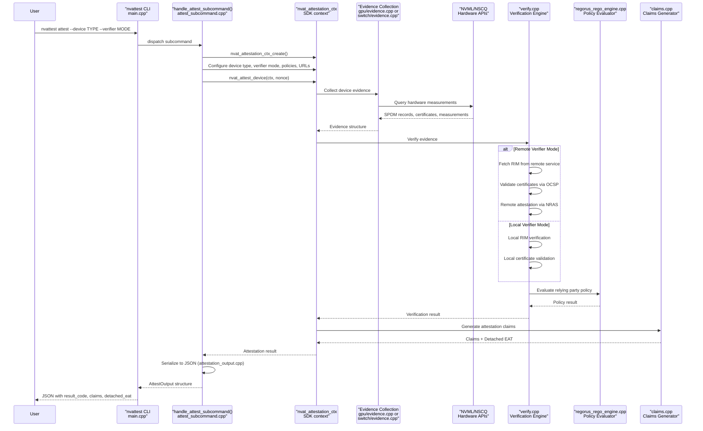

The workflow begins with CLI argument parsing and SDK context creation. Evidence collection queries hardware via NVML (for GPUs) or NSCQ (for switches), obtaining SPDM measurement records and certificate chains. The verification engine validates this evidence against reference measurements, either locally or by communicating with remote NVIDIA services. The Rego policy engine evaluates user-defined policies to determine if the device meets security requirements. Finally, the claims generator produces structured claims and a detached EAT (Entity Attestation Token) that applications can consume.

**Sources**: Diagram 3 and Diagram 4 from system architecture

## Supported Devices

The SDK supports attestation for two device types, each with dedicated code modules:

```mermaid
graph TB
    subgraph "Device Type: GPU"
        GPU_FLAG["--device gpu"]
        GPU_EV_SRC["Evidence Source"]
        GPU_FILE["--gpu-evidence FILE<br/>(Test/offline mode)"]
        GPU_LIVE["NVML API<br/>(Live hardware)"]
        GPU_CODE["gpu/evidence.cpp<br/>gpu/verify.cpp"]
        GPU_POL["relying_party_policy.rego<br/>device-type == 'gpu'"]
    end
    
    subgraph "Device Type: NVSwitch"
        SW_FLAG["--device nvswitch"]
        SW_EV_SRC["Evidence Source"]
        SW_FILE["--switch-evidence FILE<br/>(Test/offline mode)"]
        SW_LIVE["NSCQ API<br/>(Live hardware)"]
        SW_CODE["switch/evidence.cpp<br/>switch/verify.cpp"]
        SW_POL["switch_relying_party_policy.rego<br/>device-type == 'nvswitch'"]
    end
    
    GPU_FLAG --> GPU_EV_SRC
    GPU_EV_SRC --> GPU_FILE
    GPU_EV_SRC --> GPU_LIVE
    GPU_FILE --> GPU_CODE
    GPU_LIVE --> GPU_CODE
    GPU_CODE --> GPU_POL
    
    SW_FLAG --> SW_EV_SRC
    SW_EV_SRC --> SW_FILE
    SW_EV_SRC --> SW_LIVE
    SW_FILE --> SW_CODE
    SW_LIVE --> SW_CODE
    SW_CODE --> SW_POL
```

**GPU Attestation**:
- Implementation: `nv-attestation-sdk-cpp/src/gpu/evidence.cpp` and `nv-attestation-sdk-cpp/src/gpu/verify.cpp`
- Hardware Interface: NVIDIA Management Library (NVML) via `nvml_interface.cpp`
- Command-line flag: `--device gpu`
- Test data: `nv-attestation-cli/tests/data/hopper_evidence.json`
- Default policy: `nv-attestation-cli/tests/data/relying_party_policy.rego`

**NVSwitch Attestation**:
- Implementation: `nv-attestation-sdk-cpp/src/switch/evidence.cpp` and `nv-attestation-sdk-cpp/src/switch/verify.cpp`
- Hardware Interface: NVIDIA Switch Configuration and Query (NSCQ) library via `nscq_interface.cpp`
- Command-line flag: `--device nvswitch`
- Test data: `nv-attestation-cli/tests/data/switch_evidence_ls10.json`
- Default policy: `nv-attestation-cli/tests/data/switch_relying_party_policy.rego`

Both device types share common SPDM protocol handling implemented in `nv-attestation-sdk-cpp/src/spdm/`. Evidence can be collected from live hardware or loaded from pre-collected evidence files for testing and offline scenarios.

**Sources**: Diagram 6 from system architecture, [README.md:40-41]()

## Verification Modes

The SDK supports two verification modes, configurable via the `--verifier` flag:

**Local Verification** (`--verifier local`):
- Performs all verification operations on the local system
- Requires pre-configured RIM (Reference Integrity Measurement) data
- Certificate validation performed locally
- Suitable for environments without network access or when using custom RIM sources
- Implementation: Logic in `verify.cpp` with local RIM store from `rim.cpp`

**Remote Verification** (`--verifier remote`):
- Communicates with NVIDIA remote attestation services
- Fetches RIM data from remote RIM service
- Validates certificates via OCSP (Online Certificate Status Protocol)
- Optionally communicates with NRAS (NVIDIA Remote Attestation Service)
- Requires network access to NVIDIA services
- Implementation: Same `verify.cpp` logic with network calls via CURL

Service URLs for remote verification can be configured via command-line flags:
- `--rim-service-url`: RIM service endpoint
- `--ocsp-url`: OCSP responder endpoint  
- `--nras-url`: NRAS service endpoint

For details on verification implementation, see [Verification Modes](#5.4).

**Sources**: Diagram 4 from system architecture, [README.md:72-77]()

## Confidential Computing Context

The NVIDIA Attestation SDK is designed for confidential computing environments where data and code must be protected from unauthorized access and modification during processing. Key use cases include:

**AI/ML Workload Protection**:
- Protecting training data containing personally identifiable information (PII)
- Securing AI models as valuable intellectual property
- Ensuring inference workloads run on trusted hardware

**GPU-Accelerated Confidential VMs**:
- Intel TDX (Trust Domain Extensions) environments with NVIDIA GPUs
- AMD SEV-SNP (Secure Encrypted Virtualization) environments with NVIDIA GPUs
- Attestation of GPU hardware and firmware within the trusted execution environment

**Multi-Tenant Cloud Environments**:
- Verifying hardware integrity before processing sensitive workloads
- Providing cryptographic proof of security posture to data owners
- Enabling secure collaboration on shared infrastructure

The SDK integrates with CPU-based confidential computing technologies (TDX, SEV-SNP) to provide end-to-end attestation of the entire confidential computing stack, from CPU to GPU. For deployment guides and detailed confidential computing documentation, see the [NVIDIA Confidential Computing documentation](https://docs.nvidia.com/confidential-computing/index.html).

**Sources**: [README.md:90-105]()

## Project Status

The NVIDIA Attestation SDK is currently in **Alpha** status. Key implications:

- **API Stability**: The C API and CLI interface may change before stabilization. Breaking changes will be minimized but may still occur.
- **ABI Compatibility**: Binary compatibility is not guaranteed between alpha releases.
- **Installation**: Currently requires building from source. No pre-built packages are available.
- **Production Use**: Not recommended for production deployments until the project reaches stable status.
- **Migration Path**: This project replaces the Python-based guest tools in [nvTrust](https://github.com/NVIDIA/nvtrust). Users of nvTrust should plan to migrate to this SDK as it stabilizes.

The project aims to support a broader range of environments and use cases compared to nvTrust, with improved performance and reduced dependencies through the C++ implementation.

**Sources**: [README.md:22-31]()

## License and Support

The repository is licensed under the Apache License 2.0. See [LICENSE]() for full terms. The project downloads and installs third-party open source dependencies during build. Review the license terms of these dependencies before use.

**Getting Help**:
- Report issues: [GitHub Issues](https://github.com/NVIDIA/attestation-sdk/issues)
- Email support: attestation-support@nvidia.com
- Documentation: 
  - [CLI Documentation](https://docs.nvidia.com/attestation/nv-attestation-cli/latest/introduction.html)
  - [SDK Documentation](https://docs.nvidia.com/attestation/nv-attestation-sdk-c/latest/introduction.html)
  - [Attestation Suite Overview](https://docs.nvidia.com/attestation/overview-attestation-suite/latest/introduction.html)

**Sources**: [README.md:107-118](), [LICENSE:1-202]()

## Next Steps

To get started with the NVIDIA Attestation SDK:

1. **Installation**: Follow the [Installation Guide](#2.1) to build the SDK and CLI from source
2. **Quick Start**: Try the [Quick Start Tutorial](#2.2) to perform your first attestation
3. **CLI Usage**: Explore the [CLI Command Structure](#4.1) and [Attest Command Reference](#4.2)
4. **Understanding Attestation**: Read about [Device Attestation Flow](#5.1) and [Evidence Format](#5.2)
5. **Development**: Review the [Development Guide](#6) if you plan to contribute or extend the SDK

For comprehensive architectural details, see [Architecture](#3). For information on testing the SDK, see [Testing Infrastructure](#6.3).

**Sources**: [README.md:33-88]()

---

# Page: Getting Started

# Getting Started

<details>
<summary>Relevant source files</summary>

The following files were used as context for generating this wiki page:

- [README.md](README.md)
- [nv-attestation-cli/CMakeLists.txt](nv-attestation-cli/CMakeLists.txt)

</details>


This document provides an overview of how to set up and use the NVIDIA Attestation SDK for the first time. It covers prerequisites, a high-level installation overview, and basic usage of the `nvattest` CLI tool. For detailed installation instructions, see [Installation Guide](#2.1). For a step-by-step tutorial with examples, see [Quick Start Tutorial](#2.2). For complete CLI command reference, see [Using the CLI](#4).

## Overview

The NVIDIA Attestation SDK consists of two main components:

1. **nvat SDK** - The core C++ library (`libnvat.so`) that provides attestation functionality
2. **nvattest CLI** - A command-line tool that wraps the SDK for easy device attestation

The typical getting started flow involves installing dependencies, building both components from source, and running your first attestation.

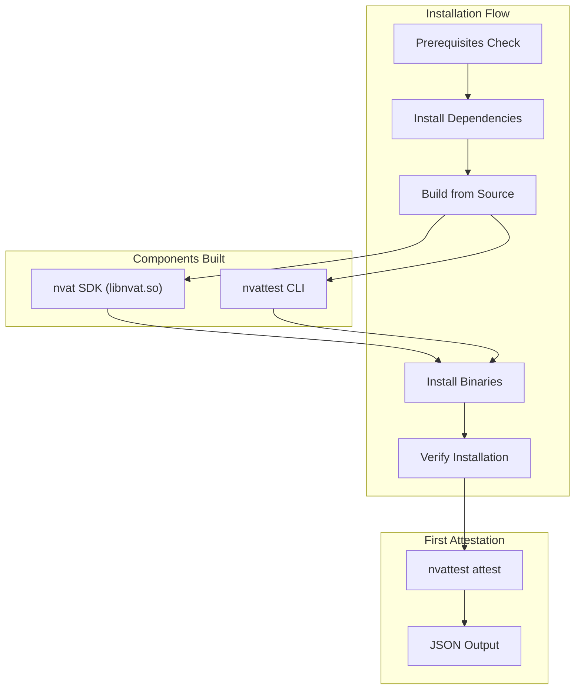

**Diagram: Getting Started Workflow**

Sources: [README.md:33-88]()

## Prerequisites

### Hardware Requirements

- **NVIDIA GPU** - A supported NVIDIA GPU connected to a confidential virtual machine (CVM)
- **CVM Platform** - Intel TDX or AMD SNP confidential computing environment

The attestation SDK is designed for confidential computing environments where GPU attestation is required. For deployment guides on setting up CVMs with NVIDIA GPUs, refer to the NVIDIA Trusted Computing Solutions documentation.

### Software Requirements

| Component | Requirement | Purpose |
|-----------|-------------|---------|
| **Operating System** | Ubuntu 22.04 or 24.04 | Primary supported platform |
| **NVML** | NVIDIA Management Library | GPU evidence collection (for GPU attestation) |
| **Rust Compiler** | Latest stable via rustup | Required for building regorus-ffi dependency |
| **CMake** | Version 3.11+ | Build system |
| **C++ Compiler** | clang or gcc | Compiling C++ source |
| **System Libraries** | libcurl, libssl, libxml2, libxmlsec1, libspdlog | Core dependencies |

Sources: [README.md:39-59]()

## Installation Overview

The installation process builds the SDK and CLI from source. The build system uses CMake and supports optional features through build flags.

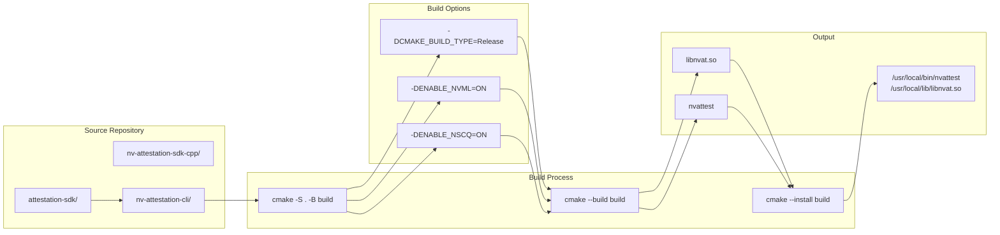

**Diagram: Build and Installation Process**

The build process is controlled by [nv-attestation-cli/CMakeLists.txt:1-70](), which configures the CLI and includes the SDK as a subdirectory at [nv-attestation-cli/CMakeLists.txt:44-47](). The SDK CMakeLists.txt handles the core library build with optional device support.

### Key Build Options

| CMake Option | Default | Description |
|--------------|---------|-------------|
| `ENABLE_NVML` | OFF | Enable GPU attestation support via NVML |
| `ENABLE_NSCQ` | OFF | Enable NVSwitch attestation support via NSCQ |
| `CMAKE_BUILD_TYPE` | Debug | Build configuration (Release/Debug) |
| `BUILD_TESTING` | OFF | Build test suite |

For GPU attestation, you must specify `-DENABLE_NVML=ON` during the CMake configuration step.

Sources: [nv-attestation-cli/CMakeLists.txt:1-70](), [README.md:61-69]()

## Basic Installation Steps

The minimal installation for GPU attestation involves these steps:

```bash
# 1. Install NVML (from NVIDIA Driver)
# See NVIDIA Driver Installation Guide

# 2. Install Rust
curl --proto '=https' --tlsv1.2 -sSf https://sh.rustup.rs | sh

# 3. Install build dependencies
apt update && apt install cmake git pkg-config clang \
    libcurl4-openssl-dev libssl-dev libxml2-dev \
    libxmlsec1-dev libxmlsec1-openssl libspdlog-dev

# 4. Build and install
git clone https://github.com/NVIDIA/attestation-sdk.git
cd attestation-sdk/nv-attestation-cli
cmake -S . -B build -DCMAKE_BUILD_TYPE=Release -DENABLE_NVML=ON
cmake --build build
cmake --install build
sudo ldconfig
```

The `ldconfig` command updates the dynamic linker cache so the installed `libnvat.so` can be found by the `nvattest` binary.

For complete installation instructions including troubleshooting, see [Installation Guide](#2.1).

Sources: [README.md:46-69]()

## First Attestation

Once installed, verify the installation by running a basic attestation:

```bash
nvattest attest --device gpu --verifier local
```

This command:
- Targets GPU devices (`--device gpu`)
- Performs local verification (`--verifier local`)
- Returns JSON output with attestation results

```mermaid
sequenceDiagram
    participant User
    participant nvattest["nvattest CLI<br/>(main.cpp)"]
    participant handle_attest["handle_attest_subcommand<br/>(attest.cpp)"]
    participant nvat_sdk["nvat SDK<br/>(libnvat.so)"]
    participant NVML["NVML<br/>(GPU Driver)"]
    
    User->>nvattest: "nvattest attest --device gpu --verifier local"
    nvattest->>handle_attest: "Parse arguments"
    handle_attest->>nvat_sdk: "nvat_sdk_init()"
    handle_attest->>nvat_sdk: "nvat_attestation_ctx_create()"
    handle_attest->>nvat_sdk: "nvat_set_device(ctx, NVAT_DEVICE_GPU)"
    handle_attest->>nvat_sdk: "nvat_set_verifier(ctx, NVAT_VERIFIER_LOCAL)"
    handle_attest->>nvat_sdk: "nvat_attest_device(ctx, nonce)"
    nvat_sdk->>NVML: "Collect GPU evidence"
    NVML-->>nvat_sdk: "Evidence data"
    nvat_sdk->>nvat_sdk: "Local verification"
    nvat_sdk->>nvat_sdk: "Generate claims"
    nvat_sdk-->>handle_attest: "Claims + Detached EAT"
    handle_attest->>handle_attest: "Serialize to JSON"
    handle_attest-->>User: "JSON output with result_code"
```

**Diagram: Basic Attestation Command Flow**

The CLI entry point is [nv-attestation-cli/src/main.cpp](), which dispatches to `handle_attest_subcommand()` in [nv-attestation-cli/src/attest.cpp](). This function initializes the SDK, configures the attestation context, and calls `nvat_attest_device()` from the SDK's C API.

Sources: [README.md:72-83](), [nv-attestation-cli/src/main.cpp](), [nv-attestation-cli/src/attest.cpp]()

### Output Structure

The attestation output is JSON with this structure:

```json
{
  "result_code": "NVAT_RC_OK",
  "result_message": "Attestation successful",
  "claims": { /* ... */ },
  "detached_eat": "base64-encoded-token"
}
```

The `result_code` field indicates success (`NVAT_RC_OK`) or failure. For complete output format documentation, see [Output Format](#4.4).

### Common Options

The `attest` subcommand supports many options. View all options with:

```bash
nvattest attest --help
```

Common options include:

| Option | Description | Example |
|--------|-------------|---------|
| `--device` | Device type (gpu, nvswitch) | `--device gpu` |
| `--verifier` | Verification mode (local, remote) | `--verifier local` |
| `--gpu-evidence` | Use evidence from file (testing) | `--gpu-evidence file.json` |
| `--policy` | Custom Rego policy file | `--policy policy.rego` |
| `--nonce` | Attestation nonce | `--nonce abc123` |

For complete command reference, see [Attest Command Reference](#4.2).

Sources: [README.md:79-83]()

## Configuration Files

The CLI supports configuration via TOML files. A default configuration file is provided at [nv-attestation-cli/config.toml](). Command-line arguments override configuration file settings.

Example configuration:

```toml
device = "gpu"
verifier = "local"
```

For complete configuration documentation, see [Configuration Files](#4.3).

Sources: [nv-attestation-cli/CMakeLists.txt:35-37]()

## Component Relationship

Understanding how the components relate helps in troubleshooting and advanced usage:

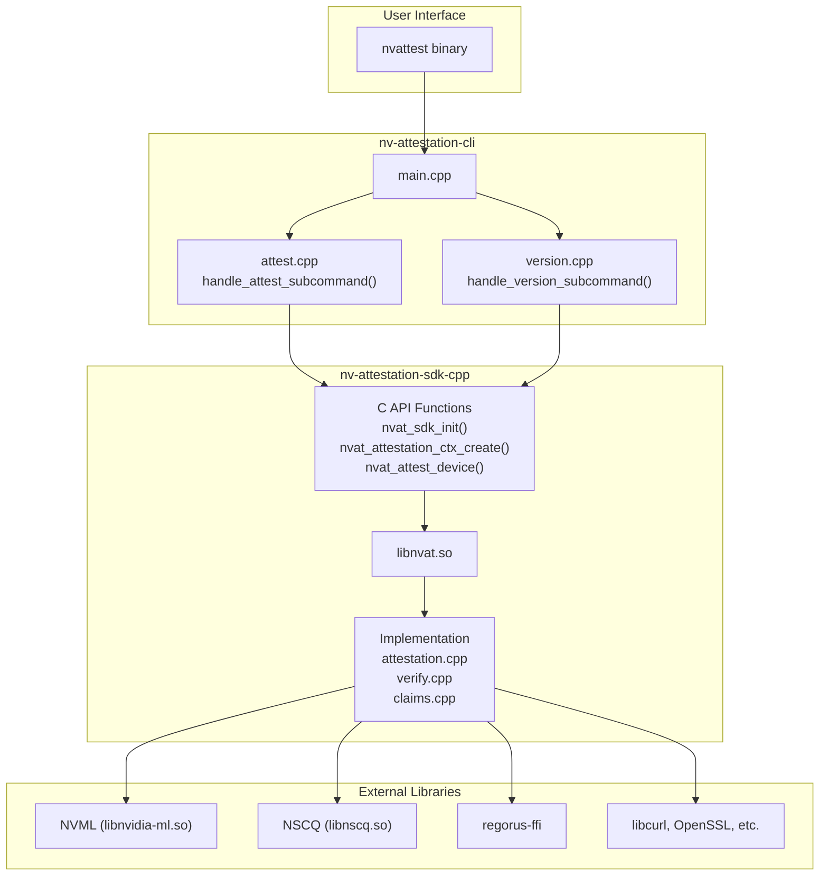

**Diagram: Component Dependencies**

The `nvattest` binary links against `libnvat.so` as configured in [nv-attestation-cli/CMakeLists.txt:52-57](). The SDK library depends on optional device libraries (NVML for GPU, NSCQ for Switch) based on build configuration.

Sources: [nv-attestation-cli/CMakeLists.txt:27-57]()

## Verification

After installation, verify that both components are properly installed:

```bash
# Check nvattest is in PATH
which nvattest
# Output: /usr/local/bin/nvattest

# Check libnvat.so is found
ldd $(which nvattest) | grep nvat
# Output: libnvat.so => /usr/local/lib/libnvat.so

# Check version
nvattest version
# Output: version information JSON
```

The `version` subcommand verifies that the CLI can load the SDK library and reports version information as defined in [nv-attestation-cli/src/version_config.h.in]().

Sources: [nv-attestation-cli/src/version.cpp]()

## Next Steps

After completing the basic setup:

1. **Run a complete tutorial** - See [Quick Start Tutorial](#2.2) for a step-by-step walkthrough with detailed explanations
2. **Explore CLI options** - See [Using the CLI](#4) for complete command documentation
3. **Understand attestation concepts** - See [Attestation Concepts](#5) to learn about evidence, claims, and policies
4. **Learn verification modes** - See [Verification Modes](#5.4) to understand local vs. remote attestation
5. **Review device support** - See [Device Support](#5.5) for GPU and Switch attestation details
6. **Build from source** - See [Building from Source](#6.1) for advanced build options and customization

## Troubleshooting

Common issues during setup:

| Issue | Solution |
|-------|----------|
| `NVML library not found` | Ensure NVIDIA driver is installed and NVML is available. Check `/usr/lib/x86_64-linux-gnu/libnvidia-ml.so` exists |
| `Rust not found during build` | Install Rust via rustup: `curl --proto '=https' --tlsv1.2 -sSf https://sh.rustup.rs \| sh` |
| `nvattest: command not found` | Run `sudo ldconfig` and ensure `/usr/local/bin` is in PATH |
| `libnvat.so not found` | Run `sudo ldconfig` to update library cache |
| Build fails with CMake errors | Ensure all dependencies are installed: `apt install cmake git pkg-config clang libcurl4-openssl-dev libssl-dev libxml2-dev libxmlsec1-dev libxmlsec1-openssl libspdlog-dev` |

For detailed troubleshooting and advanced build options, see [Installation Guide](#2.1).

Sources: [README.md:46-69]()

---

# Page: Installation Guide

# Installation Guide

<details>
<summary>Relevant source files</summary>

The following files were used as context for generating this wiki page:

- [README.md](README.md)
- [nv-attestation-cli/CMakeLists.txt](nv-attestation-cli/CMakeLists.txt)
- [nv-attestation-sdk-cpp/CMakeLists.txt](nv-attestation-sdk-cpp/CMakeLists.txt)

</details>


## Purpose and Scope

This guide provides detailed instructions for installing the NVIDIA Attestation SDK and `nvattest` CLI tool from source. It covers all prerequisites, dependencies, build options, and installation steps required to deploy the attestation system on a target machine.

For information about using the CLI after installation, see [CLI Command Structure](#4.1). For details about the build system architecture, see [Build System Reference](#8.3).

---

## System Requirements

The NVIDIA Attestation SDK requires the following system configuration:

| Requirement | Description |
|------------|-------------|
| **Operating System** | Ubuntu 22.04 or 24.04 (other Linux distributions may work but are untested) |
| **Hardware** | NVIDIA GPU connected to a Confidential Virtual Machine (CVM) for GPU attestation, or NVIDIA Switch for switch attestation |
| **Architecture** | x86_64 (primary), ARM64 (may require additional configuration) |
| **CMake Version** | 3.11 or higher |
| **C++ Standard** | C++14 or higher |
| **Rust Toolchain** | Stable Rust compiler (required for regorus policy engine) |

**Note**: The SDK is designed for confidential computing environments. For deployment guides covering Intel TDX and AMD SNP platforms, refer to the [NVIDIA Trusted Computing Solutions](https://docs.nvidia.com/nvtrust) documentation.

Sources: [README.md:39-47](), [nv-attestation-sdk-cpp/CMakeLists.txt:1-7]()

---

## Dependency Architecture

The following diagram illustrates the complete dependency tree for the NVIDIA Attestation SDK and CLI:

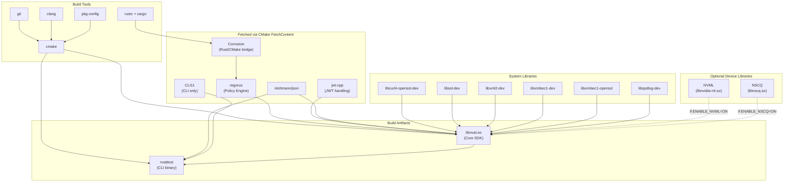

Sources: [README.md:53-59](), [nv-attestation-sdk-cpp/CMakeLists.txt:25-101](), [nv-attestation-cli/CMakeLists.txt:18-25]()

---

## Prerequisites Installation

### Step 1: Install NVIDIA Management Library (NVML)

NVML is required for GPU attestation functionality. It is provided as part of the NVIDIA GPU driver.

```shell
# Follow the official NVIDIA driver installation guide for Ubuntu
# See: https://docs.nvidia.com/datacenter/tesla/driver-installation-guide/index.html#ubuntu-installation-common
```

After installation, verify that `libnvidia-ml.so` is available:

```shell
ldconfig -p | grep libnvidia-ml
```

**Note**: NVML is optional if you only plan to attest switch devices or use pre-collected evidence files. In that case, build with `-DENABLE_NVML=OFF`.

Sources: [README.md:49](), [nv-attestation-sdk-cpp/CMakeLists.txt:91-95]()

### Step 2: Install Rust Compiler

The Rust toolchain is required to build the `regorus-ffi` policy engine that is integrated into the SDK.

```shell
# Install Rust using rustup (recommended method)
curl --proto '=https' --tlsv1.2 -sSf https://sh.rustup.rs | sh

# Follow the on-screen instructions, then reload your shell
source "$HOME/.cargo/env"

# Verify installation
rustc --version
cargo --version
```

Sources: [README.md:51](), [nv-attestation-sdk-cpp/CMakeLists.txt:25-54]()

### Step 3: Install System Build Tools and Libraries

Install all required system packages using `apt`:

```shell
sudo apt update && \
sudo apt install -y \
    cmake \
    git \
    pkg-config \
    clang \
    libcurl4-openssl-dev \
    libssl-dev \
    libxml2-dev \
    libxmlsec1-dev \
    libxmlsec1-openssl \
    libspdlog-dev
```

**Package Descriptions**:

| Package | Purpose | Used By |
|---------|---------|---------|
| `cmake` | Build system generator | Build orchestration |
| `git` | Version control | Repository cloning |
| `pkg-config` | Library metadata tool | Dependency resolution |
| `clang` | C++ compiler | Source compilation |
| `libcurl4-openssl-dev` | HTTP client library | RIM/OCSP/NRAS service communication |
| `libssl-dev` | OpenSSL development headers | Cryptographic operations, certificate validation |
| `libxml2-dev` | XML parsing library | Certificate chain processing |
| `libxmlsec1-dev` | XML security library | XML digital signature verification |
| `libxmlsec1-openssl` | XML security with OpenSSL backend | Cryptographic operations in XML processing |
| `libspdlog-dev` | Fast logging library | SDK and CLI logging |

Sources: [README.md:53-59](), [nv-attestation-sdk-cpp/CMakeLists.txt:85-89]()

---

## Building from Source

### Clone the Repository

```shell
git clone https://github.com/NVIDIA/attestation-sdk.git
cd attestation-sdk
```

Sources: [README.md:63-64]()

### CMake Build Process Flow

```mermaid
flowchart TD
    START["User invokes CMake"]
    
    subgraph "Configuration Phase"
        PARSE_OPTIONS["Parse CMake options<br/>ENABLE_NVML, ENABLE_NSCQ,<br/>BUILD_TESTING, etc."]
        FETCH_DEPS["FetchContent downloads<br/>Corrosion, regorus,<br/>jwt-cpp, json, CLI11"]
        FIND_SYS["Find system packages<br/>CURL, OpenSSL, LibXml2,<br/>xmlsec, spdlog"]
        FIND_OPTIONAL["Find optional packages<br/>Nvml, Nscq (if enabled)"]
        GEN_HEADERS["Generate configured headers<br/>nvat.h, version_config.h"]
    end
    
    subgraph "Build Phase"
        BUILD_REGORUS["Build regorus-ffi<br/>(Rust static library)"]
        BUILD_SDK["Build libnvat.so<br/>(Core SDK library)"]
        BUILD_CLI["Build nvattest<br/>(CLI executable)"]
        BUILD_TESTS["Build test suites<br/>(if BUILD_TESTING=ON)"]
    end
    
    subgraph "Install Phase"
        INSTALL_LIB["Install libnvat.so to<br/>/usr/local/lib"]
        INSTALL_HEADER["Install nvat.h to<br/>/usr/local/include"]
        INSTALL_CLI["Install nvattest to<br/>/usr/local/bin"]
        INSTALL_CMAKE["Install CMake config files<br/>to /usr/local/share/cmake/nvat"]
        LDCONFIG["Run ldconfig to update<br/>linker cache"]
    end
    
    START --> PARSE_OPTIONS
    PARSE_OPTIONS --> FETCH_DEPS
    FETCH_DEPS --> FIND_SYS
    FIND_SYS --> FIND_OPTIONAL
    FIND_OPTIONAL --> GEN_HEADERS
    
    GEN_HEADERS --> BUILD_REGORUS
    BUILD_REGORUS --> BUILD_SDK
    BUILD_SDK --> BUILD_CLI
    BUILD_CLI --> BUILD_TESTS
    
    BUILD_TESTS --> INSTALL_LIB
    INSTALL_LIB --> INSTALL_HEADER
    INSTALL_HEADER --> INSTALL_CLI
    INSTALL_CLI --> INSTALL_CMAKE
    INSTALL_CMAKE --> LDCONFIG
```

Sources: [nv-attestation-cli/CMakeLists.txt:1-70](), [nv-attestation-sdk-cpp/CMakeLists.txt:1-273]()

### Build the nvattest CLI (Recommended)

This is the typical installation path that builds both the SDK library and the CLI tool:

```shell
cd attestation-sdk/nv-attestation-cli
cmake -S . -B build -DCMAKE_BUILD_TYPE=Release -DENABLE_NVML=ON
cmake --build build
sudo cmake --install build
sudo ldconfig
```

**Explanation of Commands**:
- `cmake -S . -B build`: Configure the build in the `build/` directory
- `-DCMAKE_BUILD_TYPE=Release`: Build optimized binaries (alternatives: `Debug`, `RelWithDebInfo`)
- `-DENABLE_NVML=ON`: Enable GPU attestation support via NVML
- `cmake --build build`: Compile all targets
- `cmake --install build`: Install binaries and libraries to system paths
- `ldconfig`: Update the dynamic linker cache to recognize the new shared library

Sources: [README.md:62-69](), [nv-attestation-cli/CMakeLists.txt:1-70]()

### Build Only the SDK Library

If you only need the C++ SDK library (e.g., for integration into another project):

```shell
cd attestation-sdk/nv-attestation-sdk-cpp
cmake -S . -B build -DCMAKE_BUILD_TYPE=Release -DENABLE_NVML=ON
cmake --build build
sudo cmake --install build
sudo ldconfig
```

This will install:
- `libnvat.so` (or `libnvat.a` if `BUILD_SHARED_LIBS=OFF`) to `/usr/local/lib/`
- `nvat.h` header to `/usr/local/include/`
- CMake package config files to `/usr/local/share/cmake/nvat/`

Sources: [nv-attestation-sdk-cpp/CMakeLists.txt:218-273]()

---

## CMake Build Options Reference

The following table documents all CMake options available during configuration:

### Core SDK Options (`nv-attestation-sdk-cpp`)

| Option | Type | Default | Description |
|--------|------|---------|-------------|
| `CMAKE_BUILD_TYPE` | STRING | - | Build type: `Release`, `Debug`, `RelWithDebInfo`, `MinSizeRel` |
| `BUILD_SHARED_LIBS` | BOOL | `ON` | Build shared library (`.so`) instead of static (`.a`) |
| `BUILD_EXAMPLES` | BOOL | `OFF` | Build example programs in `examples/` directory |
| `BUILD_TESTING` | BOOL | `OFF` | Build unit tests and integration tests |
| `ENABLE_NVML` | BOOL | `OFF` | Enable NVIDIA GPU attestation via NVML |
| `ENABLE_NSCQ` | BOOL | `OFF` | Enable NVIDIA Switch attestation via NSCQ |
| `SANITIZER` | STRING | `OFF` | Enable sanitizer: `thread`, `address`, `undefined`, `leak`, or `OFF` |
| `CMAKE_COMPILE_WARNING_AS_ERROR` | BOOL | `ON` | Treat compiler warnings as errors |
| `CMAKE_CXX_STANDARD` | STRING | `14` | C++ standard version (minimum 14 required) |

Sources: [nv-attestation-sdk-cpp/CMakeLists.txt:4-17]()

### CLI Options (`nv-attestation-cli`)

| Option | Type | Default | Description |
|--------|------|---------|-------------|
| `BUILD_TESTING` | BOOL | `OFF` | Build CLI test suite |

**Note**: When building the CLI, all SDK options are also available since the CLI builds the SDK as a subdirectory via [nv-attestation-cli/CMakeLists.txt:44-47]().

Sources: [nv-attestation-cli/CMakeLists.txt:4]()

### Example: Building with Multiple Options

```shell
# Build with NVML, NSCQ, tests, and debug symbols
cmake -S . -B build \
    -DCMAKE_BUILD_TYPE=RelWithDebInfo \
    -DENABLE_NVML=ON \
    -DENABLE_NSCQ=ON \
    -DBUILD_TESTING=ON

# Build with address sanitizer for debugging memory issues
cmake -S . -B build \
    -DCMAKE_BUILD_TYPE=Debug \
    -DSANITIZER=address \
    -DENABLE_NVML=ON
```

Sources: [nv-attestation-sdk-cpp/CMakeLists.txt:112-176]()

---

## Installation Paths

After running `cmake --install build`, the following files are installed:

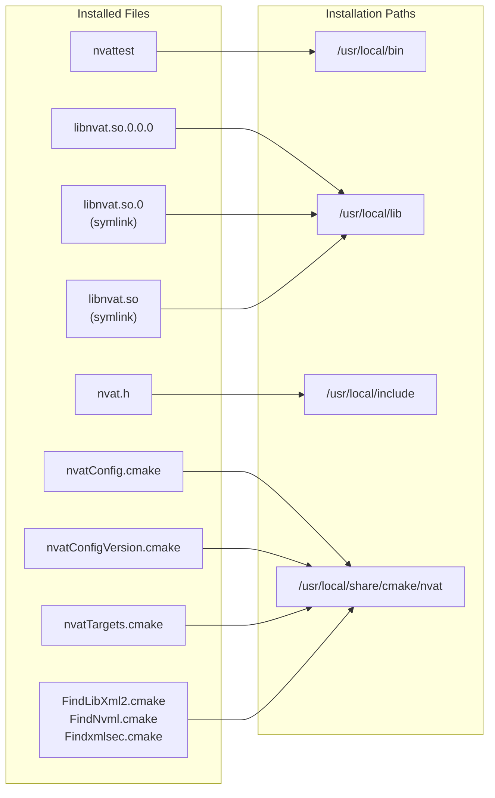

**Notes**:
- The shared library versioning follows [nv-attestation-sdk-cpp/CMakeLists.txt:154-158]()
- `libnvat.so.0` is the soversion link, `libnvat.so` is the development link
- CMake package files enable downstream projects to use `find_package(nvat)` in their CMakeLists.txt

Sources: [nv-attestation-cli/CMakeLists.txt:68](), [nv-attestation-sdk-cpp/CMakeLists.txt:218-270]()

---

## Verifying Installation

After installation, verify that the components are correctly installed and accessible:

### Verify CLI Installation

```shell
# Check that nvattest is in PATH
which nvattest

# Display version information
nvattest version

# Display help to verify functionality
nvattest --help
```

Expected output from `nvattest version` should show version information and build configuration.

### Verify SDK Library Installation

```shell
# Check that the library is registered with ldconfig
ldconfig -p | grep libnvat

# Check header file installation
ls -l /usr/local/include/nvat.h

# Check CMake package files
ls -l /usr/local/share/cmake/nvat/
```

### Run a Test Attestation

If you have a GPU available and built with `ENABLE_NVML=ON`, test the installation:

```shell
nvattest attest --device gpu --verifier local
```

If successful, this will output a JSON structure with attestation results. For detailed information about the attestation process, see [Device Attestation Flow](#5.1).

Sources: [README.md:72-83]()

---

## Troubleshooting Common Issues

### Issue: `libnvat.so.0: cannot open shared object file`

**Cause**: The linker cache is not updated after installation.

**Solution**:
```shell
sudo ldconfig
```

If the issue persists, verify that `/usr/local/lib` is in your linker configuration:
```shell
# Check if /usr/local/lib is in ld.so.conf
cat /etc/ld.so.conf.d/* | grep /usr/local/lib

# If not present, add it
echo "/usr/local/lib" | sudo tee /etc/ld.so.conf.d/local.conf
sudo ldconfig
```

### Issue: `NVML not found` during CMake configuration

**Cause**: NVML is not installed or not in the default search paths.

**Solution**:
```shell
# Verify NVIDIA driver is installed
nvidia-smi

# If driver is installed but NVML not found, specify the path manually
cmake -S . -B build -DENABLE_NVML=ON -DNvml_LIBRARY=/path/to/libnvidia-ml.so
```

The NVML search is performed by [nv-attestation-sdk-cpp/cmake/FindNvml.cmake]().

### Issue: Rust/Cargo not found during build

**Cause**: Rust toolchain not installed or not in PATH.

**Solution**:
```shell
# Install Rust
curl --proto '=https' --tlsv1.2 -sSf https://sh.rustup.rs | sh

# Reload environment
source "$HOME/.cargo/env"

# Verify
which cargo
```

The Rust compiler is required to build `regorus-ffi` via the Corrosion build system integration at [nv-attestation-sdk-cpp/CMakeLists.txt:41-54]().

### Issue: CMake version too old

**Cause**: System CMake version is below 3.11.

**Solution**:
```shell
# Check current version
cmake --version

# Install newer CMake from Kitware's repository or snap
sudo snap install cmake --classic
```

Sources: [nv-attestation-sdk-cpp/CMakeLists.txt:1]()

---

## Alternative Installation Methods

### Using Custom Installation Prefix

To install to a non-standard location (e.g., user home directory):

```shell
cmake -S . -B build \
    -DCMAKE_BUILD_TYPE=Release \
    -DENABLE_NVML=ON \
    -DCMAKE_INSTALL_PREFIX=$HOME/.local

cmake --build build
cmake --install build
```

Update your environment:
```shell
export PATH=$HOME/.local/bin:$PATH
export LD_LIBRARY_PATH=$HOME/.local/lib:$LD_LIBRARY_PATH
```

### Static Library Build

To build a static library instead of shared:

```shell
cmake -S . -B build \
    -DCMAKE_BUILD_TYPE=Release \
    -DENABLE_NVML=ON \
    -DBUILD_SHARED_LIBS=OFF

cmake --build build
```

This produces `libnvat.a` instead of `libnvat.so`. Useful for embedding the SDK in other applications without shared library dependencies.

Sources: [nv-attestation-sdk-cpp/CMakeLists.txt:12]()

---

## Next Steps

After successful installation:

1. **Learn basic usage**: See [Quick Start Tutorial](#2.2) for a walkthrough of attesting your first device
2. **Explore CLI options**: See [Attest Command Reference](#4.2) for detailed parameter documentation
3. **Understand configuration**: See [Configuration Files](#4.3) to learn about `config.toml` for persistent settings
4. **Develop with the SDK**: See [Development Guide](#6) if you plan to integrate the C++ SDK into your application

Sources: [README.md:86-88]()

---

# Page: Quick Start Tutorial

# Quick Start Tutorial

<details>
<summary>Relevant source files</summary>

The following files were used as context for generating this wiki page:

- [README.md](README.md)
- [nv-attestation-cli/config.toml](nv-attestation-cli/config.toml)
- [nv-attestation-cli/src/attest.cpp](nv-attestation-cli/src/attest.cpp)

</details>


This tutorial provides hands-on examples for using the `nvattest` CLI tool to perform attestation on NVIDIA GPUs and NVSwitch devices. It demonstrates basic attestation workflows, output interpretation, and common configuration options.

For installation instructions, see [Installation Guide](#2.1). For detailed command reference, see [Attest Command Reference](#4.2). For comprehensive attestation concepts, see [Attestation Concepts](#5).

---

## Prerequisites

Before beginning this tutorial, ensure you have:

1. Installed the `nvattest` CLI tool and `nvat` shared library (see [Installation Guide](#2.1))
2. Access to an NVIDIA GPU in a confidential virtual machine (CVM) OR NVML/NSCQ libraries installed for testing
3. Alternatively, test evidence files for offline testing without hardware

**Hardware Requirements:**
- For GPU attestation: NVIDIA GPU with confidential computing support (e.g., H100, H200 Hopper GPUs)
- For Switch attestation: NVIDIA NVSwitch with SPDM support
- Ubuntu 22.04 or 24.04 operating system

Sources: [README.md:39-47]()

---

## Basic GPU Attestation

The simplest attestation command uses local verification with a connected GPU:

```bash
nvattest attest --device gpu --verifier local
```

This command performs the following operations:

1. Initializes the SDK via `nvat_sdk_init()`
2. Creates an attestation context via `nvat_attestation_ctx_create()`
3. Configures device type to `NVAT_DEVICE_GPU`
4. Configures verifier type to `NVAT_VERIFY_LOCAL`
5. Calls `nvat_attest_device()` to collect evidence from the GPU using NVML
6. Verifies the evidence locally against reference measurements
7. Generates claims and a detached Entity Attestation Token (EAT)
8. Outputs results as JSON

### Command Execution Flow

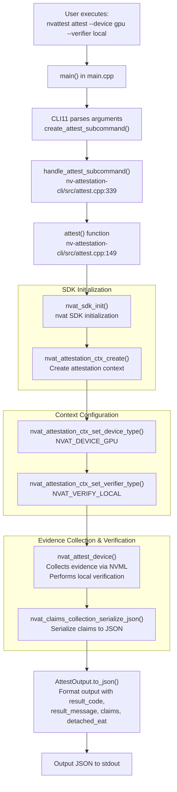

Sources: [nv-attestation-cli/src/attest.cpp:149-336](), [nv-attestation-cli/src/attest.cpp:339-358](), [README.md:72-77]()

### Example Output Structure

The command outputs JSON with the following structure:

```json
{
  "result_code": 0,
  "result_message": "NVAT_RC_OK",
  "claims": {
    "devices": [...],
    "overall_result": true
  },
  "detached_eat": {
    "protected": "...",
    "payload": "...",
    "signature": "..."
  }
}
```

| Field | Description |
|-------|-------------|
| `result_code` | Integer result code (0 = success, see [Error Codes and Handling](#8.2)) |
| `result_message` | Human-readable result string via `nvat_rc_to_string()` |
| `claims` | JSON object containing attestation claims from `nvat_claims_collection_serialize_json()` |
| `detached_eat` | JSON object containing the Entity Attestation Token |

The `result_code` maps to SDK return codes:
- `NVAT_RC_OK` (0): Attestation succeeded
- `NVAT_RC_RP_POLICY_MISMATCH`: Policy evaluation failed
- `NVAT_RC_OVERALL_RESULT_FALSE`: Verification failed

Sources: [nv-attestation-cli/src/attest.cpp:36-68](), [nv-attestation-cli/src/attest.cpp:311-334]()

---

## Basic Switch Attestation

To attest an NVIDIA NVSwitch device, change the `--device` parameter:

```bash
nvattest attest --device nvswitch --verifier local
```

This configures the attestation context with `NVAT_DEVICE_NVSWITCH` instead of `NVAT_DEVICE_GPU`. The SDK uses NSCQ (NVIDIA Switch Configuration and Query) library instead of NVML to collect evidence.

### Device Type Configuration

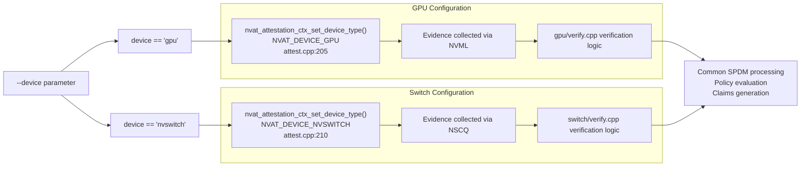

Sources: [nv-attestation-cli/src/attest.cpp:204-214](), [nv-attestation-cli/src/attest.cpp:86-88]()

---

## Using Test Evidence Files

For testing without hardware or in environments without NVML/NSCQ libraries, use pre-serialized evidence files:

### GPU Evidence File Example

```bash
nvattest attest --device gpu --verifier local \
  --gpu-evidence tests/data/hopper_evidence.json
```

This calls `nvat_attestation_ctx_set_gpu_evidence_source_json_file()` with the provided file path instead of querying live hardware.

### Switch Evidence File Example

```bash
nvattest attest --device nvswitch --verifier local \
  --switch-evidence tests/data/switch_evidence_ls10.json
```

This calls `nvat_attestation_ctx_set_switch_evidence_source_json_file()` with the provided file path.

### Evidence Source Configuration Flow

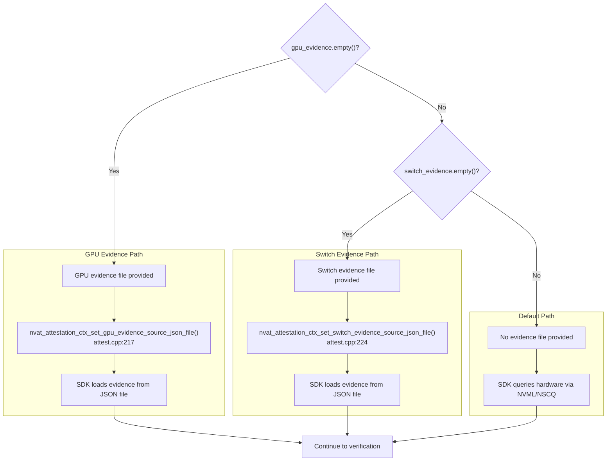

Sources: [nv-attestation-cli/src/attest.cpp:216-228](), [nv-attestation-cli/src/attest.cpp:95-96]()

**Available Test Evidence Files:**
- `tests/data/hopper_evidence.json` - H100 GPU evidence
- `tests/data/switch_evidence_ls10.json` - LS10 NVSwitch evidence

These files are used by the test infrastructure and provide valid evidence samples for offline testing.

Sources: [README.md:95-96]()

---

## Remote Verification

To use NVIDIA's remote attestation services instead of local verification:

```bash
nvattest attest --device gpu --verifier remote
```

This configures `NVAT_VERIFY_REMOTE` and communicates with external services:

| Service | Default URL | Purpose | Configuration |
|---------|-------------|---------|---------------|
| RIM Service | `https://rim.attestation.nvidia.com` | Reference Integrity Measurements | `--rim-url` |
| OCSP Responder | `https://ocsp.ndis.nvidia.com` | Certificate status validation | `--ocsp-url` |
| NRAS | `https://nras.attestation.nvidia.com` | Remote attestation service | `--nras-url` |

### Custom Service URLs

```bash
nvattest attest --device gpu --verifier remote \
  --rim-url https://custom-rim.example.com \
  --ocsp-url https://custom-ocsp.example.com \
  --nras-url https://custom-nras.example.com
```

### Service Configuration Implementation

The CLI configures these services through SDK calls:

1. **RIM Store**: Creates `nvat_rim_store_t` via `nvat_rim_store_create_remote()` and sets it with `nvat_attestation_ctx_set_default_rim_store()`
2. **OCSP Client**: Creates `nvat_ocsp_client_t` via `nvat_ocsp_client_create_default()` and sets it with `nvat_attestation_ctx_set_default_ocsp_client()`
3. **NRAS**: Sets `NVAT_NRAS_BASE_URL` environment variable

Sources: [nv-attestation-cli/src/attest.cpp:230-265](), [nv-attestation-cli/src/attest.cpp:99-101]()

---

## Custom Relying Party Policies

To enforce custom verification policies using Rego:

```bash
nvattest attest --device gpu --verifier local \
  --relying-party-policy tests/data/relying_party_policy.rego
```

### Policy Application Process

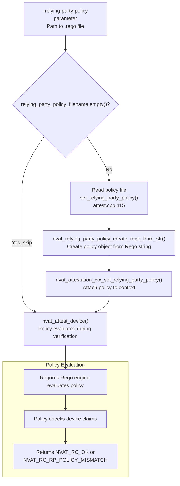

Sources: [nv-attestation-cli/src/attest.cpp:115-146](), [nv-attestation-cli/src/attest.cpp:267-270](), [nv-attestation-cli/src/attest.cpp:97]()

**Available Test Policies:**
- `tests/data/relying_party_policy.rego` - GPU verification policy
- `tests/data/switch_relying_party_policy.rego` - Switch verification policy

For detailed policy structure and writing custom policies, see [Relying Party Policies](#5.3).

Sources: [README.md:97]()

---

## Using Custom Nonces

To provide a specific nonce for attestation freshness:

```bash
nvattest attest --device gpu --verifier local \
  --nonce 0123456789abcdef0123456789abcdef
```

The nonce must be provided in hexadecimal format. If not provided, the SDK generates one automatically.

Implementation details:
- The CLI converts the hex string to `nvat_nonce_t` via `nvat_nonce_from_hex()`
- The nonce is passed to `nvat_attest_device()` as the second parameter
- The nonce is included in the evidence to ensure freshness

Sources: [nv-attestation-cli/src/attest.cpp:84-85](), [nv-attestation-cli/src/attest.cpp:290-295]()

---

## Configuration File Usage

Instead of passing command-line arguments, use a configuration file:

**config.toml:**
```toml
[attest]
device = "gpu"
verifier = "local"
gpu-evidence = ""
switch-evidence = ""
relying-party-policy = ""
```

Run with the configuration file:

```bash
nvattest --config-file config.toml attest
```

Command-line arguments override configuration file settings. For details, see [Configuration Files](#4.3).

Sources: [nv-attestation-cli/config.toml:1-13]()

---

## Logging and Debugging

Enable detailed logging to troubleshoot issues:

```bash
nvattest attest --device gpu --verifier local --log-level debug
```

Available log levels: `trace`, `debug`, `info`, `warn`, `error`, `off`

The CLI creates an `nvat_logger_t` via `nvat_logger_spdlog_create()` with the specified level and passes it to the SDK through `nvat_sdk_opts_set_logger()`.

Sources: [nv-attestation-cli/src/attest.cpp:102-104](), [nv-attestation-cli/src/attest.cpp:172-189]()

---

## Common Usage Patterns

### Pattern 1: Development Testing with Evidence Files

```bash
# Test GPU attestation without hardware
nvattest attest --device gpu --verifier local \
  --gpu-evidence tests/data/hopper_evidence.json \
  --log-level info
```

### Pattern 2: Production GPU Attestation

```bash
# Live GPU attestation with remote verification
nvattest attest --device gpu --verifier remote \
  --nonce $(openssl rand -hex 16)
```

### Pattern 3: Policy-Enforced Attestation

```bash
# Attest with custom policy requirements
nvattest attest --device gpu --verifier local \
  --relying-party-policy custom_policy.rego \
  --log-level warn
```

### Pattern 4: Switch Infrastructure Validation

```bash
# Attest NVSwitch with remote verification
nvattest attest --device nvswitch --verifier remote \
  --rim-url https://rim.attestation.nvidia.com \
  --ocsp-url https://ocsp.ndis.nvidia.com
```

---

## Interpreting Results

### Success Case

```json
{
  "result_code": 0,
  "result_message": "NVAT_RC_OK",
  "claims": {
    "devices": [...],
    "overall_result": true
  },
  "detached_eat": {...}
}
```

The attestation succeeded. All claims can be trusted.

### Policy Mismatch Case

```json
{
  "result_code": -4,
  "result_message": "NVAT_RC_RP_POLICY_MISMATCH",
  "claims": {...},
  "detached_eat": {...}
}
```

The verification succeeded but the relying party policy requirements were not met. Review the claims to identify which policy checks failed.

### Verification Failure Case

```json
{
  "result_code": -11,
  "result_message": "NVAT_RC_OVERALL_RESULT_FALSE",
  "claims": {...},
  "detached_eat": {...}
}
```

The attestation evidence failed verification. The device state does not match reference measurements.

The CLI returns the `result_code` as its exit code, allowing shell scripts to check attestation status with `$?`.

Sources: [nv-attestation-cli/src/attest.cpp:296-299](), [nv-attestation-cli/src/attest.cpp:351-356]()

---

## Next Steps

After completing this tutorial:

- Explore all available CLI options: `nvattest attest --help`
- Learn about evidence structure in [Evidence Format and Structure](#5.2)
- Understand verification modes in [Verification Modes](#5.4)
- Review the C API for programmatic usage at [SDK introduction](https://docs.nvidia.com/attestation/nv-attestation-sdk-c/latest/introduction.html)
- Study claim interpretation in [Output Format](#4.4)
- Write custom policies using [Relying Party Policies](#5.3)

Sources: [README.md:79-88]()

---

# Page: Architecture

# Architecture

<details>
<summary>Relevant source files</summary>

The following files were used as context for generating this wiki page:

- [nv-attestation-cli/CMakeLists.txt](nv-attestation-cli/CMakeLists.txt)
- [nv-attestation-sdk-cpp/CMakeLists.txt](nv-attestation-sdk-cpp/CMakeLists.txt)
- [nv-attestation-sdk-cpp/cmake/Config.cmake.in](nv-attestation-sdk-cpp/cmake/Config.cmake.in)

</details>


This document provides a comprehensive overview of the NVIDIA Attestation SDK architecture, covering the relationship between the core C++ SDK library (`nv-attestation-sdk-cpp`) and the command-line interface (`nv-attestation-cli`), the build system structure, and the overall system design patterns. For detailed information about specific components, see [Core SDK](#3.2) and [CLI Tool](#3.3). For information about external library dependencies, see [External Dependencies](#3.4).

---

## Two-Tier Architecture

The NVIDIA Attestation SDK follows a two-tier architecture pattern where the CLI tool serves as a thin wrapper around a reusable C++ library.

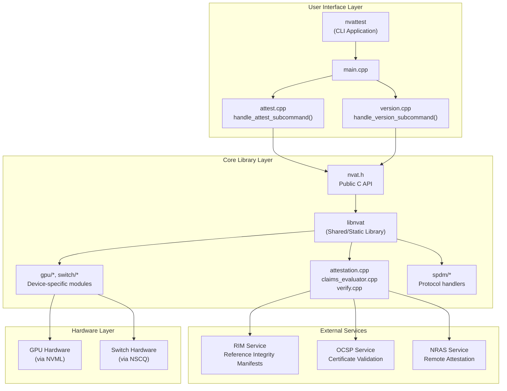

**Key Architectural Principles:**

| Principle | Implementation |
|-----------|---------------|
| **Separation of Concerns** | Core attestation logic in `libnvat`, user interface in `nvattest` CLI |
| **Reusability** | C++ library can be integrated into other applications beyond the CLI |
| **Modularity** | Device-specific code isolated in separate modules (`gpu/`, `switch/`) |
| **Extensibility** | New device types can be added without modifying core attestation engine |
| **Optional Dependencies** | Hardware support (NVML, NSCQ) enabled via compile-time flags |

**Sources:** [nv-attestation-cli/CMakeLists.txt:1-70](), [nv-attestation-sdk-cpp/CMakeLists.txt:1-273]()

---

## Build System Architecture

The build system uses CMake with a hierarchical structure where the CLI builds the SDK as a subdirectory, ensuring consistent compilation.

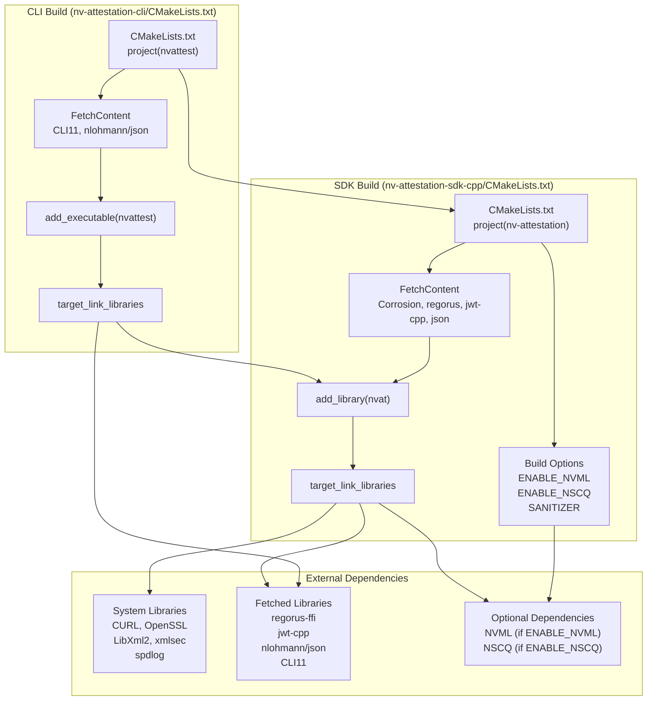

**Build Configuration:**

| Component | Configuration File | Key Options |
|-----------|-------------------|-------------|
| CLI | [nv-attestation-cli/CMakeLists.txt:1-70]() | `BUILD_TESTING` |
| SDK | [nv-attestation-sdk-cpp/CMakeLists.txt:1-273]() | `ENABLE_NVML`, `ENABLE_NSCQ`, `SANITIZER`, `BUILD_SHARED_LIBS`, `BUILD_EXAMPLES`, `BUILD_TESTING` |

**Dependency Management Pattern:**

The SDK uses `FetchContent` to automatically download and build dependencies during configuration time. The CLI includes the SDK as a subdirectory using `add_subdirectory()` at [nv-attestation-cli/CMakeLists.txt:44-47]():

```
add_subdirectory(
    "${CMAKE_CURRENT_SOURCE_DIR}/../nv-attestation-sdk-cpp"  # Source directory
    "${CMAKE_CURRENT_BINARY_DIR}/nv-attestation-sdk-build"   # Binary directory
)
```

This creates a namespaced alias `nvat::nvat` at [nv-attestation-cli/CMakeLists.txt:50]() that the CLI links against.

**Sources:** [nv-attestation-cli/CMakeLists.txt:1-70](), [nv-attestation-sdk-cpp/CMakeLists.txt:1-273]()

---

## SDK Module Organization

The core SDK library consists of multiple functional modules organized by responsibility.

```mermaid
graph TB
    subgraph "Public API (include/nvat.h)"
        API["Public C API<br/>nvat_sdk_init()<br/>nvat_attestation_ctx_create()<br/>nvat_attest_device()"]
    end
    
    subgraph "Core Attestation (src)"
        NVAT_CPP["nvat.cpp<br/>SDK lifecycle functions"]
        ATTEST["attestation.cpp<br/>Attestation orchestration"]
        VERIFY["verify.cpp<br/>Verification logic"]
        CLAIMS["claims.cpp<br/>Claims data structures"]
        CLAIMS_EVAL["claims_evaluator.cpp<br/>Policy evaluation"]
        RIM["rim.cpp<br/>RIM store management"]
    end
    
    subgraph "GPU Support (src/gpu)"
        GPU_EVIDENCE["evidence.cpp<br/>GPU evidence collection"]
        GPU_CLAIMS["claims.cpp<br/>GPU claims generation"]
        GPU_VERIFY["verify.cpp<br/>GPU-specific verification"]
        GPU_NVML["nvml_client.cpp<br/>NVML interface wrapper"]
        GPU_OPAQUE["spdm/gpu_opaque_data_parser.cpp"]
    end
    
    subgraph "Switch Support (src/switch)"
        SW_EVIDENCE["evidence.cpp<br/>Switch evidence collection"]
        SW_CLAIMS["claims.cpp<br/>Switch claims generation"]
        SW_VERIFY["verify.cpp<br/>Switch-specific verification"]
        SW_NSCQ["nscq_client.cpp<br/>NSCQ interface wrapper"]
        SW_OPAQUE["spdm/switch_opaque_data_parser.cpp"]
    end
    
    subgraph "SPDM Protocol (src/spdm)"
        SPDM_RECORDS["spdm_measurement_records.cpp"]
        SPDM_OPAQUE["spdm_opaque_data_parser.cpp"]
        SPDM_REQ["spdm_req.cpp"]
        SPDM_RESP["spdm_resp.cpp"]
    end
    
    subgraph "Policy Engine (src/rego_engine)"
        REGO["regorus_rego_engine.cpp<br/>Rego policy evaluation"]
    end
    
    subgraph "Utilities (src)"
        LOG["log.cpp<br/>Logging framework"]
        ERROR["error.cpp<br/>Error handling"]
        HTTP["nv_http.cpp<br/>HTTP client"]
        JWT["nv_jwt.cpp<br/>JWT handling"]
        X509["nv_x509.cpp<br/>Certificate handling"]
        UTILS["utils.cpp<br/>General utilities"]
    end
    
    API --> NVAT_CPP
    NVAT_CPP --> ATTEST
    ATTEST --> VERIFY
    ATTEST --> CLAIMS_EVAL
    VERIFY --> RIM
    CLAIMS_EVAL --> REGO
    
    ATTEST --> GPU_EVIDENCE
    ATTEST --> SW_EVIDENCE
    
    GPU_EVIDENCE --> GPU_NVML
    GPU_EVIDENCE --> SPDM_RECORDS
    GPU_VERIFY --> GPU_OPAQUE
    
    SW_EVIDENCE --> SW_NSCQ
    SW_EVIDENCE --> SPDM_RECORDS
    SW_VERIFY --> SW_OPAQUE
    
    GPU_OPAQUE --> SPDM_OPAQUE
    SW_OPAQUE --> SPDM_OPAQUE
    
    VERIFY --> HTTP
    VERIFY --> X509
    CLAIMS_EVAL --> JWT
    VERIFY --> LOG
```

**Module Responsibilities:**

| Module | Source Location | Responsibility |
|--------|----------------|----------------|
| **Public API** | `include/nvat.h.in` → `include/nvat.h` | C API surface for SDK consumers |
| **Core Attestation** | `src/attestation.cpp`, `src/verify.cpp`, `src/claims_evaluator.cpp` | Orchestrate attestation workflow, verification, policy evaluation |
| **GPU Support** | `src/gpu/*.cpp` | GPU-specific evidence collection via NVML |
| **Switch Support** | `src/switch/*.cpp` | Switch-specific evidence collection via NSCQ |
| **SPDM Protocol** | `src/spdm/*.cpp` | Parse and validate SPDM measurement records |
| **Policy Engine** | `src/rego_engine/regorus_rego_engine.cpp` | Execute Rego policies for claim validation |
| **Utilities** | `src/nv_http.cpp`, `src/nv_jwt.cpp`, `src/nv_x509.cpp` | HTTP communication, JWT/X.509 handling |

The complete source file list is defined in [nv-attestation-sdk-cpp/CMakeLists.txt:123-152]() as part of the `add_library(nvat ...)` declaration.

**Sources:** [nv-attestation-sdk-cpp/CMakeLists.txt:123-152]()

---

## Attestation Data Flow

The following diagram illustrates how attestation requests flow through the system from user input to attestation results.

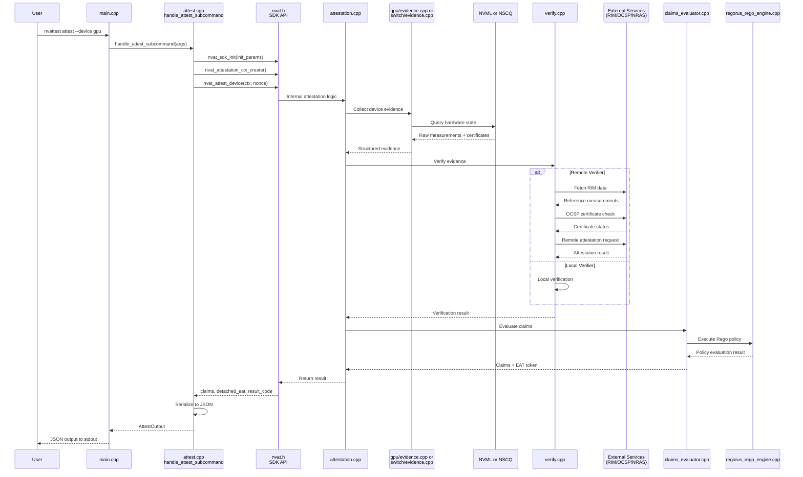

**Key Data Structures:**

| Structure | Purpose | Source Location |
|-----------|---------|-----------------|
| `nvat_init_params` | SDK initialization parameters | Defined in public API |
| `nvat_attestation_ctx` | Attestation context holding configuration | Opaque type in public API |
| `AttestArgs` | CLI-parsed attestation arguments | [nv-attestation-cli/src/attest.cpp]() |
| `AttestOutput` | Structured attestation result | [nv-attestation-cli/src/attest.cpp]() |
| Evidence JSON | Serialized hardware measurements | Device-specific format |
| Claims JSON | Verified attestation claims | Defined by SDK |
| Detached EAT | Entity Attestation Token | JWT format |

**Sources:** [nv-attestation-cli/src/main.cpp](), [nv-attestation-cli/src/attest.cpp](), [nv-attestation-sdk-cpp/src/attestation.cpp](), [nv-attestation-sdk-cpp/src/verify.cpp](), [nv-attestation-sdk-cpp/src/claims_evaluator.cpp]()

---

## CLI-SDK Integration Pattern

The CLI integrates with the SDK through a C API boundary, using RAII wrappers for resource management.

```mermaid
graph LR
    subgraph "CLI Layer (C++)"
        PARSE["CLI11 Argument Parser"]
        HANDLER["handle_attest_subcommand()"]
        WRAPPERS["nv_unique_ptr wrappers<br/>AttestationContextPtr"]
        SERIALIZER["JSON Serializer<br/>nlohmann::json"]
    end
    
    subgraph "API Boundary"
        C_API["C Function Calls<br/>nvat_sdk_init()<br/>nvat_attestation_ctx_create()<br/>nvat_attestation_ctx_set_*()<br/>nvat_attest_device()<br/>nvat_attestation_ctx_destroy()"]
    end
    
    subgraph "SDK Layer (C++ Implementation)"
        IMPL["C++ Implementation<br/>Classes and Methods"]
        LIFECYCLE["Resource Management<br/>Context creation/destruction"]
        ENGINE["Attestation Engine"]
    end
    
    PARSE --> HANDLER
    HANDLER --> WRAPPERS
    WRAPPERS --> C_API
    C_API --> IMPL
    IMPL --> LIFECYCLE
    IMPL --> ENGINE
    ENGINE --> IMPL
    IMPL --> C_API
    C_API --> WRAPPERS
    WRAPPERS --> SERIALIZER
```

**Integration Pattern Details:**

1. **Argument Parsing**: The CLI uses CLI11 library to parse command-line arguments into structured data
2. **SDK Initialization**: Calls `nvat_sdk_init()` with logging configuration
3. **Context Management**: Creates attestation context using `nvat_attestation_ctx_create()`, wraps in RAII smart pointer
4. **Configuration**: Sets context parameters via multiple `nvat_attestation_ctx_set_*()` functions
5. **Execution**: Invokes `nvat_attest_device()` to perform attestation
6. **Result Handling**: Extracts claims and EAT token from context, serializes to JSON
7. **Cleanup**: RAII wrapper automatically calls `nvat_attestation_ctx_destroy()`

**Configuration Flow:**

The CLI reads configuration from two sources with precedence:
1. **Configuration file** (`config.toml`) - default settings
2. **Command-line arguments** - override config file

Configuration is applied to the SDK context through setter functions. This pattern allows the CLI to remain a thin wrapper while providing rich configuration options.

**Sources:** [nv-attestation-cli/src/attest.cpp](), [nv-attestation-cli/CMakeLists.txt:52-57]()

---

## Compile-Time Feature Selection

The SDK uses CMake options to enable/disable hardware support, allowing compilation without optional dependencies.

```mermaid
graph TB
    subgraph "CMake Configuration"
        OPTIONS["Build Options<br/>ENABLE_NVML: OFF by default<br/>ENABLE_NSCQ: OFF by default"]
    end
    
    subgraph "Preprocessor Defines"
        DEFINES["Compile Definitions<br/>#ifdef ENABLE_NVML<br/>#ifdef ENABLE_NSCQ"]
    end
    
    subgraph "Dependency Resolution"
        FIND_NVML["find_package(Nvml)<br/>if ENABLE_NVML"]
        FIND_NSCQ["find_package(Nscq)<br/>if ENABLE_NSCQ"]
    end
    
    subgraph "Link Configuration"
        LINK_NVML["Link Nvml_LIBRARY<br/>if ENABLE_NVML"]
        LINK_NSCQ["Link Nscq_LIBRARY<br/>if ENABLE_NSCQ"]
    end
    
    subgraph "Runtime Behavior"
        GPU_CODE["gpu/nvml_client.cpp<br/>GPU evidence collection"]
        SWITCH_CODE["switch/nscq_client.cpp<br/>Switch evidence collection"]
    end
    
    OPTIONS --> DEFINES
    OPTIONS --> FIND_NVML
    OPTIONS --> FIND_NSCQ
    
    FIND_NVML --> LINK_NVML
    FIND_NSCQ --> LINK_NSCQ
    
    DEFINES --> GPU_CODE
    DEFINES --> SWITCH_CODE
    
    LINK_NVML --> GPU_CODE
    LINK_NSCQ --> SWITCH_CODE
```

**Feature Configuration:**

The CMake build at [nv-attestation-sdk-cpp/CMakeLists.txt:15-16]() defines:
```
option(ENABLE_NVML "Enable NVML support for GPU attestation" OFF)
option(ENABLE_NSCQ "Enable NSCQ support for SWITCH Attestation" OFF)
```

When enabled, these options:
1. Add preprocessor definitions (`add_compile_definitions`) at [nv-attestation-sdk-cpp/CMakeLists.txt:91-101]()
2. Find the respective packages (`find_package`)
3. Link against the libraries conditionally at [nv-attestation-sdk-cpp/CMakeLists.txt:198-213]()
4. Include headers in the public interface at [nv-attestation-sdk-cpp/CMakeLists.txt:160-170]()

This allows the SDK to be built for environments without GPU or Switch hardware, with evidence provided from files instead of live hardware queries.

**Sources:** [nv-attestation-sdk-cpp/CMakeLists.txt:15-16](), [nv-attestation-sdk-cpp/CMakeLists.txt:91-101](), [nv-attestation-sdk-cpp/CMakeLists.txt:198-213]()

---

## Configuration Distribution

The SDK uses CMake package configuration to allow consumers to find and link against the library.

```mermaid
graph TB
    subgraph "SDK Installation"
        INSTALL_LIB["install(TARGETS nvat)<br/>Library files"]
        INSTALL_HEADERS["install(FILES nvat.h)<br/>Public headers"]
        INSTALL_CMAKE["install(EXPORT nvatTargets)<br/>CMake targets"]
        INSTALL_CONFIG["install(FILES)<br/>nvatConfig.cmake<br/>nvatConfigVersion.cmake"]
    end
    
    subgraph "Installed Files"
        LIB_FILES["lib/libnvat.so<br/>lib/libnvat.a"]
        HEADER_FILES["include/nvat.h"]
        CMAKE_FILES["share/cmake/nvat/nvatTargets.cmake<br/>share/cmake/nvat/nvatConfig.cmake<br/>share/cmake/nvat/nvatConfigVersion.cmake"]
        FIND_MODULES["share/cmake/nvat/Modules/FindNvml.cmake<br/>FindNscq.cmake<br/>Findxmlsec.cmake"]
    end
    
    subgraph "Consumer Project"
        CONSUMER_CMAKE["CMakeLists.txt<br/>find_package(nvat)"]
        CONSUMER_TARGET["add_executable(myapp)<br/>target_link_libraries(myapp nvat::nvat)"]
    end
    
    INSTALL_LIB --> LIB_FILES
    INSTALL_HEADERS --> HEADER_FILES
    INSTALL_CMAKE --> CMAKE_FILES
    INSTALL_CONFIG --> CMAKE_FILES
    
    CMAKE_FILES --> FIND_MODULES
    
    LIB_FILES --> CONSUMER_CMAKE
    HEADER_FILES --> CONSUMER_CMAKE
    CMAKE_FILES --> CONSUMER_CMAKE
    
    CONSUMER_CMAKE --> CONSUMER_TARGET
```

**Package Configuration:**

The SDK generates `nvatConfig.cmake` from [nv-attestation-sdk-cpp/cmake/Config.cmake.in:1-22]() which:
1. Adds custom Find modules to the search path
2. Finds required dependencies (CURL, LibXml2, OpenSSL, spdlog, xmlsec)
3. Conditionally finds optional dependencies based on enabled features
4. Includes `nvatTargets.cmake` which defines the `nvat::nvat` imported target

Consumer projects can then use:
```cmake
find_package(nvat REQUIRED)
target_link_libraries(myapp PRIVATE nvat::nvat)
```

This automatically handles all transitive dependencies and include directories.

**Sources:** [nv-attestation-sdk-cpp/CMakeLists.txt:218-270](), [nv-attestation-sdk-cpp/cmake/Config.cmake.in:1-22]()

---

# Page: System Overview

# System Overview

<details>
<summary>Relevant source files</summary>

The following files were used as context for generating this wiki page:

- [nv-attestation-cli/CMakeLists.txt](nv-attestation-cli/CMakeLists.txt)
- [nv-attestation-cli/src/main.cpp](nv-attestation-cli/src/main.cpp)
- [nv-attestation-sdk-cpp/CMakeLists.txt](nv-attestation-sdk-cpp/CMakeLists.txt)

</details>


## Purpose and Scope

This document provides a high-level architectural overview of the NVIDIA Attestation SDK repository, focusing on the relationship between the two primary components: the `nvat` C++ SDK library (`nv-attestation-sdk-cpp`) and the `nvattest` command-line tool (`nv-attestation-cli`). It describes the structural organization, build system integration, and runtime interaction patterns between these components.

For detailed information about specific components:
- For in-depth SDK architecture and internal modules, see [Core SDK (nv-attestation-sdk-cpp)](#3.2)
- For CLI tool implementation details, see [CLI Tool (nv-attestation-cli)](#3.3)
- For external library dependencies, see [External Dependencies](#3.4)

---

## Repository Structure

The repository contains two primary directories that form the core of the attestation system:

| Directory | Component | Build Artifact | Purpose |
|-----------|-----------|----------------|---------|
| `nv-attestation-sdk-cpp/` | Core SDK Library | `libnvat.so` (or `.a`) | C++ library providing attestation functionality for GPU and Switch devices |
| `nv-attestation-cli/` | CLI Tool | `nvattest` executable | Command-line interface wrapping the SDK for end-user interaction |

**Sources:** [nv-attestation-sdk-cpp/CMakeLists.txt:1-273](), [nv-attestation-cli/CMakeLists.txt:1-70]()

---

## Component Architecture

The system follows a layered architecture where the CLI acts as a thin wrapper around the SDK library:

```mermaid
graph TB
    subgraph "nv-attestation-cli Repository"
        MAIN["main.cpp<br/>CLI Entry Point"]
        ATTEST_CMD["attest.cpp<br/>handle_attest_subcommand()"]
        VERSION_CMD["version.cpp<br/>handle_version_subcommand()"]
        CLI11["CLI11 Library<br/>Command Parsing"]
        CONFIG["config.toml<br/>Configuration File"]
    end
    
    subgraph "nv-attestation-sdk-cpp Repository"
        NVAT_INIT["nvat.cpp<br/>nvat_sdk_init()"]
        NVAT_ATTEST["attestation.cpp<br/>nvat_attest_device()"]
        
        subgraph "Device Modules"
            GPU["gpu/evidence.cpp<br/>gpu/verify.cpp"]
            SWITCH["switch/evidence.cpp<br/>switch/verify.cpp"]
        end
        
        subgraph "Core Modules"
            CLAIMS["claims.cpp<br/>claims_evaluator.cpp"]
            VERIFY["verify.cpp"]
            SPDM["spdm/*.cpp<br/>Protocol Handling"]
        end
        
        subgraph "Supporting Modules"
            RIM["rim.cpp<br/>RIM Store"]
            REGO["rego_engine/regorus_rego_engine.cpp"]
            HTTP["nv_http.cpp"]
            JWT["nv_jwt.cpp"]
        end
    end
    
    subgraph "Hardware & External Services"
        NVML_LIB["NVML Library"]
        NSCQ_LIB["NSCQ Library"]
        REMOTE["Remote Services<br/>RIM/OCSP/NRAS"]
    end
    
    MAIN --> CLI11
    MAIN --> ATTEST_CMD
    MAIN --> VERSION_CMD
    CONFIG --> ATTEST_CMD
    
    ATTEST_CMD --> NVAT_INIT
    ATTEST_CMD --> NVAT_ATTEST
    
    NVAT_ATTEST --> GPU
    NVAT_ATTEST --> SWITCH
    NVAT_ATTEST --> VERIFY
    
    GPU --> SPDM
    SWITCH --> SPDM
    
    VERIFY --> CLAIMS
    VERIFY --> RIM
    VERIFY --> REGO
    
    HTTP --> REMOTE
    RIM --> HTTP
    
    GPU -.->|"Optional"| NVML_LIB
    SWITCH -.->|"Optional"| NSCQ_LIB
```

**Key Architectural Principles:**

1. **Separation of Concerns**: The CLI handles user interaction and argument parsing, while the SDK implements all attestation logic
2. **Modular Design**: Device-specific code (GPU/Switch) is isolated in separate modules
3. **Optional Dependencies**: Hardware libraries (NVML, NSCQ) are conditionally compiled based on build flags
4. **Protocol Abstraction**: SPDM protocol handling is shared between device types

**Sources:** [nv-attestation-cli/src/main.cpp:1-58](), [nv-attestation-sdk-cpp/CMakeLists.txt:123-152]()

---

## Build System Integration

The CLI and SDK are tightly integrated through the CMake build system:

```mermaid
graph TB
    subgraph "CLI Build Process"
        CLI_CMAKE["nv-attestation-cli/CMakeLists.txt"]
        CLI_SUBDIRECTORY["add_subdirectory()<br/>Line 44-47"]
        CLI_TARGET["nvattest executable<br/>Line 27-31"]
        CLI_LINK["target_link_libraries()<br/>nvat::nvat<br/>Line 52-57"]
    end
    
    subgraph "SDK Build Process"
        SDK_CMAKE["nv-attestation-sdk-cpp/CMakeLists.txt"]
        SDK_TARGET["nvat library<br/>Line 123-152"]
        SDK_DEPS["External Dependencies<br/>regorus, jwt-cpp, CURL, etc."]
        SDK_OPTIONAL["Optional Dependencies<br/>NVML (ENABLE_NVML)<br/>NSCQ (ENABLE_NSCQ)"]
    end
    
    subgraph "Build Artifacts"
        NVAT_LIB["libnvat.so / libnvat.a"]
        NVATTEST_BIN["nvattest binary"]
    end
    
    CLI_CMAKE --> CLI_SUBDIRECTORY
    CLI_SUBDIRECTORY --> SDK_CMAKE
    SDK_CMAKE --> SDK_TARGET
    SDK_TARGET --> SDK_DEPS
    SDK_TARGET --> SDK_OPTIONAL
    
    SDK_TARGET --> NVAT_LIB
    
    CLI_CMAKE --> CLI_TARGET
    CLI_TARGET --> CLI_LINK
    CLI_LINK --> NVAT_LIB
    CLI_TARGET --> NVATTEST_BIN
    
    NVATTEST_BIN -.->|"Runtime Dependency"| NVAT_LIB
```

**Build Configuration:**

The CLI's CMakeLists.txt directly includes the SDK as a subdirectory:

```cmake
add_subdirectory(
    "${CMAKE_CURRENT_SOURCE_DIR}/../nv-attestation-sdk-cpp"  # Source directory
    "${CMAKE_CURRENT_BINARY_DIR}/nv-attestation-sdk-build"   # Binary directory
)
```

This creates a **monolithic build** where:
- The SDK is built first as a dependency
- An alias `nvat::nvat` is created for the SDK target [nv-attestation-cli/CMakeLists.txt:50]()
- The CLI links against this alias [nv-attestation-cli/CMakeLists.txt:52-57]()

**Build Options:**

| Option | Component | Purpose | Default |
|--------|-----------|---------|---------|
| `ENABLE_NVML` | SDK | Enable GPU attestation via NVML | OFF |
| `ENABLE_NSCQ` | SDK | Enable Switch attestation via NSCQ | OFF |
| `BUILD_SHARED_LIBS` | SDK | Build shared library instead of static | ON |
| `BUILD_TESTING` | Both | Enable test suite compilation | OFF |
| `SANITIZER` | SDK | Enable sanitizer (address/thread/undefined) | OFF |

**Sources:** [nv-attestation-cli/CMakeLists.txt:44-57](), [nv-attestation-sdk-cpp/CMakeLists.txt:12-17]()

---

## Runtime Interaction Model

The following diagram illustrates the runtime flow from CLI invocation to SDK execution:

```mermaid
sequenceDiagram
    participant User
    participant main_cpp as "main.cpp"
    participant CLI11 as "CLI11 Parser"
    participant attest_cpp as "attest.cpp<br/>handle_attest_subcommand()"
    participant nvat_init as "nvat.cpp<br/>nvat_sdk_init()"
    participant attestation as "attestation.cpp<br/>nvat_attest_device()"
    participant device as "Device Module<br/>gpu/switch"
    participant hardware as "Hardware<br/>NVML/NSCQ"
    
    User->>main_cpp: ./nvattest attest --device gpu
    main_cpp->>CLI11: Parse arguments + config.toml
    CLI11-->>main_cpp: Parsed options
    
    main_cpp->>attest_cpp: handle_attest_subcommand(nonce, device, verifier, ...)
    
    attest_cpp->>nvat_init: nvat_sdk_init(NVAT_VERSION_MAJOR, NVAT_VERSION_MINOR)
    nvat_init-->>attest_cpp: Initialize SDK state
    
    attest_cpp->>attestation: nvat_attestation_ctx_create()
    attestation-->>attest_cpp: nvat_attestation_ctx*
    
    attest_cpp->>attestation: Configure context<br/>(device type, verifier, policies, URLs)
    
    attest_cpp->>attestation: nvat_attest_device(ctx, nonce)
    
    attestation->>device: Collect evidence
    device->>hardware: Query measurements
    hardware-->>device: Evidence data
    device-->>attestation: Evidence + certificates
    
    attestation->>attestation: Verify evidence<br/>Evaluate policy<br/>Generate claims
    attestation-->>attest_cpp: nvat_claims*, detached_eat
    
    attest_cpp->>attest_cpp: Serialize to JSON
    attest_cpp-->>main_cpp: Return AttestOutput
    main_cpp-->>User: JSON output to stdout
```

**Key Function Entry Points:**

| Function | File | Responsibility |
|----------|------|----------------|
| `main()` | [nv-attestation-cli/src/main.cpp:29]() | CLI entry point, sets up subcommands |
| `handle_attest_subcommand()` | [nv-attestation-cli/src/attest.cpp]() | Processes attest command, calls SDK |
| `nvat_sdk_init()` | [nv-attestation-sdk-cpp/src/nvat.cpp]() | Initializes SDK global state |
| `nvat_attestation_ctx_create()` | [nv-attestation-sdk-cpp/src/attestation.cpp]() | Creates attestation context |
| `nvat_attest_device()` | [nv-attestation-sdk-cpp/src/attestation.cpp]() | Main attestation orchestration |

**Sources:** [nv-attestation-cli/src/main.cpp:29-58](), [nv-attestation-cli/CMakeLists.txt:27-31]()

---

## Core SDK Module Organization

The SDK is organized into functional modules, each with specific responsibilities:

```mermaid
graph LR
    subgraph "Public API Layer"
        NVAT_H["nvat.h<br/>Public API Header"]
    end
    
    subgraph "Orchestration Layer"
        NVAT_CPP["nvat.cpp<br/>SDK Initialization"]
        ATTESTATION["attestation.cpp<br/>Attestation Context<br/>Main Orchestration"]
    end
    
    subgraph "Device Support Layer"
        GPU_MODULE["GPU Module<br/>gpu/evidence.cpp<br/>gpu/verify.cpp<br/>gpu/claims.cpp<br/>gpu/nvml_client.cpp"]
        SWITCH_MODULE["Switch Module<br/>switch/evidence.cpp<br/>switch/verify.cpp<br/>switch/claims.cpp<br/>switch/nscq_client.cpp"]
    end
    
    subgraph "Protocol Layer"
        SPDM_RECORDS["spdm_measurement_records.cpp"]
        SPDM_OPAQUE["spdm_opaque_data_parser.cpp"]
        SPDM_REQ["spdm_req.cpp"]
        SPDM_RESP["spdm_resp.cpp"]
        GPU_OPAQUE["gpu/spdm/gpu_opaque_data_parser.cpp"]
        SWITCH_OPAQUE["switch/spdm/switch_opaque_data_parser.cpp"]
    end
    
    subgraph "Verification Layer"
        VERIFY["verify.cpp<br/>Certificate Verification"]
        CLAIMS_EVAL["claims_evaluator.cpp<br/>Policy Evaluation"]
        REGO["rego_engine/regorus_rego_engine.cpp<br/>Rego Policy Engine"]
    end
    
    subgraph "Support Layer"
        RIM["rim.cpp<br/>RIM Store Management"]
        HTTP["nv_http.cpp<br/>HTTP Client"]
        JWT["nv_jwt.cpp<br/>EAT Token Handling"]
        X509["nv_x509.cpp<br/>Certificate Processing"]
        UTILS["utils.cpp<br/>Utilities"]
        LOG["log.cpp<br/>Logging"]
    end
    
    NVAT_H --> NVAT_CPP
    NVAT_H --> ATTESTATION
    
    ATTESTATION --> GPU_MODULE
    ATTESTATION --> SWITCH_MODULE
    
    GPU_MODULE --> SPDM_RECORDS
    GPU_MODULE --> GPU_OPAQUE
    SWITCH_MODULE --> SPDM_RECORDS
    SWITCH_MODULE --> SWITCH_OPAQUE
    
    GPU_OPAQUE --> SPDM_OPAQUE
    SWITCH_OPAQUE --> SPDM_OPAQUE
    SPDM_RECORDS --> SPDM_REQ
    SPDM_RECORDS --> SPDM_RESP
    
    ATTESTATION --> VERIFY
    ATTESTATION --> CLAIMS_EVAL
    CLAIMS_EVAL --> REGO
    
    VERIFY --> X509
    VERIFY --> HTTP
    RIM --> HTTP
    ATTESTATION --> RIM
    ATTESTATION --> JWT
```

**Module Responsibilities:**

| Layer | Modules | Purpose |
|-------|---------|---------|
| **Public API** | `nvat.h` | Defines public C interface for SDK consumers |
| **Orchestration** | `nvat.cpp`, `attestation.cpp` | SDK initialization, attestation workflow coordination |
| **Device Support** | `gpu/`, `switch/` | Device-specific evidence collection and verification |
| **Protocol** | `spdm/` | SPDM protocol parsing and measurement record handling |
| **Verification** | `verify.cpp`, `claims_evaluator.cpp`, `rego_engine/` | Certificate validation, policy evaluation |
| **Support** | `rim.cpp`, `nv_http.cpp`, `nv_jwt.cpp`, `nv_x509.cpp` | Utility functionality for HTTP, JWT, X.509, RIM operations |

**Sources:** [nv-attestation-sdk-cpp/CMakeLists.txt:123-152]()

---

## Key Code Entry Points and Mappings

The following table maps high-level concepts to specific code entities:

| Concept | Code Entity | File Location |
|---------|-------------|---------------|
| CLI executable | `nvattest` | Built from [nv-attestation-cli/CMakeLists.txt:27]() |
| SDK library | `nvat` | Built from [nv-attestation-sdk-cpp/CMakeLists.txt:123]() |
| CLI entry point | `main()` | [nv-attestation-cli/src/main.cpp:29]() |
| Attest command handler | `handle_attest_subcommand()` | [nv-attestation-cli/src/attest.cpp]() |
| SDK initialization | `nvat_sdk_init()` | [nv-attestation-sdk-cpp/src/nvat.cpp]() |
| Context creation | `nvat_attestation_ctx_create()` | [nv-attestation-sdk-cpp/src/attestation.cpp]() |
| Main attestation flow | `nvat_attest_device()` | [nv-attestation-sdk-cpp/src/attestation.cpp]() |
| GPU evidence collection | `nvat_gpu_evidence_collect()` | [nv-attestation-sdk-cpp/src/gpu/evidence.cpp]() |
| Switch evidence collection | `nvat_switch_evidence_collect()` | [nv-attestation-sdk-cpp/src/switch/evidence.cpp]() |
| SPDM measurement parsing | `parse_spdm_measurement_block()` | [nv-attestation-sdk-cpp/src/spdm/spdm_measurement_records.cpp]() |
| Certificate verification | `verify_certificate_chain()` | [nv-attestation-sdk-cpp/src/verify.cpp]() |
| Policy evaluation | `evaluate_claims()` | [nv-attestation-sdk-cpp/src/claims_evaluator.cpp]() |
| Rego engine integration | `RegorusRegoEngine` class | [nv-attestation-sdk-cpp/src/rego_engine/regorus_rego_engine.cpp]() |

**Sources:** [nv-attestation-cli/CMakeLists.txt:1-70](), [nv-attestation-sdk-cpp/CMakeLists.txt:1-273]()

---

## Summary

The NVIDIA Attestation SDK follows a clean separation between user interface (CLI) and core functionality (SDK library). The CLI is a lightweight wrapper that parses user input and delegates all attestation operations to the SDK. The SDK itself is modular, with clear separation between device-specific code, protocol handling, and verification logic. This architecture enables:

1. **Reusability**: The SDK can be used directly by other applications without the CLI
2. **Maintainability**: Device support can be added/modified without affecting core logic
3. **Testability**: Components can be tested independently
4. **Flexibility**: Build-time options control which hardware interfaces are included

For implementation details of individual components, refer to [Core SDK (nv-attestation-sdk-cpp)](#3.2) and [CLI Tool (nv-attestation-cli)](#3.3).

---

# Page: Core SDK (nv-attestation-sdk-cpp)

# Core SDK (nv-attestation-sdk-cpp)

<details>
<summary>Relevant source files</summary>

The following files were used as context for generating this wiki page:

- [nv-attestation-sdk-cpp/.clang-tidy](nv-attestation-sdk-cpp/.clang-tidy)
- [nv-attestation-sdk-cpp/CMakeLists.txt](nv-attestation-sdk-cpp/CMakeLists.txt)
- [nv-attestation-sdk-cpp/cmake/Config.cmake.in](nv-attestation-sdk-cpp/cmake/Config.cmake.in)

</details>


## Purpose and Scope

The Core SDK (`nv-attestation-sdk-cpp`) is the foundational C++ library that provides attestation functionality for NVIDIA hardware. This page documents the internal structure, components, and architecture of the `nvat` library, which implements evidence collection, verification, claims processing, and policy evaluation for GPU and Switch devices.

For information about using the library through the command-line interface, see [CLI Tool](#3.3). For external dependencies, see [External Dependencies](#3.4). For attestation concepts and workflows, see [Attestation Concepts](#5).

---

## Library Overview

The SDK is built as a shared or static library named `nvat` with SOVERSION 0. The library implements a modular architecture where core attestation functionality is separated from device-specific implementations, protocol handlers, and infrastructure services.

```mermaid
graph TD
    subgraph "nvat Library Structure"
        NVAT["nvat Library<br/>(libnvat.so / libnvat.a)"]
        
        subgraph "Core Layer"
            ATTEST["attestation.cpp"]
            VERIFY["verify.cpp"]
            CLAIMS["claims.cpp"]
            CLAIMS_EVAL["claims_evaluator.cpp"]
            RIM["rim.cpp"]
        end
        
        subgraph "Device Layer"
            GPU_MOD["GPU Module<br/>gpu/"]
            SWITCH_MOD["Switch Module<br/>switch/"]
        end
        
        subgraph "Protocol Layer"
            SPDM_MOD["SPDM Module<br/>spdm/"]
        end
        
        subgraph "Infrastructure Layer"
            REGO["regorus_rego_engine.cpp"]
            X509["nv_x509.cpp"]
            JWT["nv_jwt.cpp"]
            HTTP["nv_http.cpp"]
            LOG["log.cpp"]
            INIT["init.cpp / nvat.cpp"]
            ERROR["error.cpp"]
            UTILS["utils.cpp"]
        end
    end
    
    NVAT --> ATTEST
    NVAT --> VERIFY
    NVAT --> CLAIMS
    NVAT --> CLAIMS_EVAL
    NVAT --> RIM
    
    NVAT --> GPU_MOD
    NVAT --> SWITCH_MOD
    
    NVAT --> SPDM_MOD
    
    NVAT --> REGO
    NVAT --> X509
    NVAT --> JWT
    NVAT --> HTTP
    NVAT --> LOG
    NVAT --> INIT
    NVAT --> ERROR
    NVAT --> UTILS
    
    ATTEST --> REGO
    VERIFY --> X509
    VERIFY --> HTTP
    GPU_MOD --> SPDM_MOD
    SWITCH_MOD --> SPDM_MOD
```

**Sources:** [nv-attestation-sdk-cpp/CMakeLists.txt:123-152]()

### Build Configuration

The library supports several build-time configuration options controlled through CMake:

| Option | Default | Description |
|--------|---------|-------------|
| `BUILD_SHARED_LIBS` | ON | Build as shared library instead of static |
| `ENABLE_NVML` | OFF | Enable NVML support for GPU attestation |
| `ENABLE_NSCQ` | OFF | Enable NSCQ support for Switch attestation |
| `BUILD_EXAMPLES` | OFF | Build example executables |
| `BUILD_TESTING` | OFF | Build unit and integration tests |
| `SANITIZER` | OFF | Enable sanitizer (thread, address, undefined, leak) |
| `CMAKE_COMPILE_WARNING_AS_ERROR` | ON | Treat warnings as errors |
| `CMAKE_CXX_STANDARD` | 14 | C++ standard version |

**Sources:** [nv-attestation-sdk-cpp/CMakeLists.txt:5-17]()

---

## Module Organization

The SDK source files are organized hierarchically by functional responsibility:

```mermaid
graph LR
    subgraph "src/"
        CORE["Core Files<br/>attestation.cpp<br/>claims.cpp<br/>claims_evaluator.cpp<br/>verify.cpp<br/>rim.cpp<br/>nvat.cpp<br/>init.cpp<br/>error.cpp"]
        
        subgraph "gpu/"
            GPU_FILES["evidence.cpp<br/>claims.cpp<br/>verify.cpp<br/>nvml_client.cpp"]
            GPU_SPDM["spdm/<br/>gpu_opaque_data_parser.cpp"]
        end
        
        subgraph "switch/"
            SWITCH_FILES["evidence.cpp<br/>claims.cpp<br/>verify.cpp<br/>nscq_client.cpp"]
            SWITCH_SPDM["spdm/<br/>switch_opaque_data_parser.cpp"]
        end
        
        subgraph "spdm/"
            SPDM_FILES["spdm_measurement_records.cpp<br/>spdm_opaque_data_parser.cpp<br/>spdm_req.cpp<br/>spdm_resp.cpp"]
        end
        
        subgraph "rego_engine/"
            REGO_FILES["regorus_rego_engine.cpp"]
        end
        
        INFRA["Infrastructure<br/>nv_x509.cpp<br/>nv_jwt.cpp<br/>nv_http.cpp<br/>log.cpp<br/>utils.cpp"]
    end
```

**Sources:** [nv-attestation-sdk-cpp/CMakeLists.txt:123-152]()

---

## Core Components

### Attestation Engine

The attestation engine coordinates the overall attestation workflow, from evidence collection through verification to claims generation.

**Key Files:**
- `attestation.cpp` - Main attestation orchestration
- `verify.cpp` - Verification logic and external service integration

The attestation engine interacts with device modules to collect evidence, communicates with external services (RIM, OCSP, NRAS) for verification in remote mode, and coordinates policy evaluation.

```mermaid
sequenceDiagram
    participant Client
    participant attestation.cpp
    participant Device["Device Module<br/>(gpu/switch)"]
    participant verify.cpp
    participant HTTP["nv_http.cpp"]
    participant Policy["regorus_rego_engine.cpp"]
    participant claims.cpp
    
    Client->>attestation.cpp: nvat_attest_device()
    attestation.cpp->>Device: Collect evidence
    Device-->>attestation.cpp: Evidence data
    attestation.cpp->>verify.cpp: Verify evidence
    
    alt Remote Verification
        verify.cpp->>HTTP: Fetch RIM data
        HTTP-->>verify.cpp: Reference measurements
        verify.cpp->>HTTP: Verify certificates (OCSP)
        HTTP-->>verify.cpp: Certificate status
    else Local Verification
        verify.cpp->>verify.cpp: Local validation
    end
    
    verify.cpp->>Policy: Evaluate relying party policy
    Policy-->>verify.cpp: Policy result
    verify.cpp-->>attestation.cpp: Verification result
    attestation.cpp->>claims.cpp: Generate claims
    claims.cpp-->>attestation.cpp: Claims + EAT
    attestation.cpp-->>Client: Attestation result
```

**Sources:** [nv-attestation-sdk-cpp/CMakeLists.txt:125-126](), [nv-attestation-sdk-cpp/CMakeLists.txt:147]()

---

### Claims Processing

The claims subsystem generates structured attestation claims and Entity Attestation Tokens (EAT).

**Key Files:**
- `claims.cpp` - Claims data structures and serialization
- `claims_evaluator.cpp` - Claims evaluation logic

Claims are generated from verified evidence and include:
- Device identity information
- Measurement values and their verification status
- Policy evaluation results
- Timestamps and nonces

**Sources:** [nv-attestation-sdk-cpp/CMakeLists.txt:126-127]()

---

### RIM Store

The RIM (Reference Integrity Measurements) store manages golden measurements used for verification.

**Key File:** `rim.cpp`

The RIM store:
- Fetches reference measurements from NVIDIA RIM services
- Caches RIM data for offline verification
- Provides measurement comparison functionality
- Handles RIM versioning and device-specific measurements

**Sources:** [nv-attestation-sdk-cpp/CMakeLists.txt:142]()

---

### Policy Engine

The policy engine evaluates Rego policies to enforce relying party requirements.

**Key File:** `rego_engine/regorus_rego_engine.cpp`

The policy engine wraps the `regorus-ffi` library and provides:
- Policy loading and compilation
- Input data marshaling
- Policy evaluation execution
- Result extraction and error handling

```mermaid
graph TD
    PE["regorus_rego_engine.cpp"]
    REGORUS["regorus-ffi<br/>(Rust Library)"]
    POLICY["Rego Policy File<br/>(.rego)"]
    INPUT["Input Data<br/>(JSON)"]
    OUTPUT["Policy Result<br/>(allow/deny)"]
    
    POLICY --> PE
    INPUT --> PE
    PE --> REGORUS
    REGORUS --> OUTPUT
```

**Sources:** [nv-attestation-sdk-cpp/CMakeLists.txt:141](), [nv-attestation-sdk-cpp/CMakeLists.txt:25-54]()

---

## Device Support Modules

### GPU Support

The GPU module implements attestation for NVIDIA GPUs using the NVML (NVIDIA Management Library) API.

**Module Structure:**

| File | Purpose |
|------|---------|
| `gpu/evidence.cpp` | Evidence collection and serialization |
| `gpu/claims.cpp` | GPU-specific claims generation |
| `gpu/verify.cpp` | GPU evidence verification logic |
| `gpu/nvml_client.cpp` | NVML API wrapper and interface |
| `gpu/spdm/gpu_opaque_data_parser.cpp` | GPU-specific SPDM opaque data parsing |

```mermaid
graph TD
    GPU_MOD["GPU Module"]
    
    EVIDENCE["gpu/evidence.cpp<br/>Evidence Collection"]
    CLAIMS["gpu/claims.cpp<br/>Claims Generation"]
    VERIFY["gpu/verify.cpp<br/>Verification"]
    NVML["gpu/nvml_client.cpp<br/>NVML Interface"]
    OPAQUE["gpu/spdm/gpu_opaque_data_parser.cpp<br/>Opaque Data Parser"]
    
    GPU_MOD --> EVIDENCE
    GPU_MOD --> CLAIMS
    GPU_MOD --> VERIFY
    
    EVIDENCE --> NVML
    EVIDENCE --> OPAQUE
    VERIFY --> OPAQUE
    CLAIMS --> VERIFY
    
    NVML --> NVML_LIB["NVML Library<br/>(libnvidia-ml.so)"]
```

The GPU module is conditionally compiled when `ENABLE_NVML` is set. It collects:
- GPU device information and identifiers
- SPDM measurement records
- Certificate chains
- GPU-specific opaque data (e.g., VBIOS measurements)

**Sources:** [nv-attestation-sdk-cpp/CMakeLists.txt:129-132](), [nv-attestation-sdk-cpp/CMakeLists.txt:135](), [nv-attestation-sdk-cpp/CMakeLists.txt:91-95]()

---

### Switch Support

The Switch module implements attestation for NVIDIA switches using the NSCQ (NVIDIA Switch Configuration and Query) library.

**Module Structure:**

| File | Purpose |
|------|---------|
| `switch/evidence.cpp` | Switch evidence collection |
| `switch/claims.cpp` | Switch-specific claims generation |
| `switch/verify.cpp` | Switch evidence verification |
| `switch/nscq_client.cpp` | NSCQ API wrapper |
| `switch/spdm/switch_opaque_data_parser.cpp` | Switch-specific SPDM opaque data parsing |

```mermaid
graph TD
    SWITCH_MOD["Switch Module"]
    
    EVIDENCE["switch/evidence.cpp<br/>Evidence Collection"]
    CLAIMS["switch/claims.cpp<br/>Claims Generation"]
    VERIFY["switch/verify.cpp<br/>Verification"]
    NSCQ["switch/nscq_client.cpp<br/>NSCQ Interface"]
    OPAQUE["switch/spdm/switch_opaque_data_parser.cpp<br/>Opaque Data Parser"]
    
    SWITCH_MOD --> EVIDENCE
    SWITCH_MOD --> CLAIMS
    SWITCH_MOD --> VERIFY
    
    EVIDENCE --> NSCQ
    EVIDENCE --> OPAQUE
    VERIFY --> OPAQUE
    CLAIMS --> VERIFY
    
    NSCQ --> NSCQ_LIB["NSCQ Library<br/>(libnscq.so)"]
```

The Switch module is conditionally compiled when `ENABLE_NSCQ` is set. It handles switch-specific attestation requirements and opaque data formats.

**Sources:** [nv-attestation-sdk-cpp/CMakeLists.txt:143-146](), [nv-attestation-sdk-cpp/CMakeLists.txt:148](), [nv-attestation-sdk-cpp/CMakeLists.txt:97-101]()

---

## Protocol Support

### SPDM Protocol

The SPDM (Security Protocol and Data Model) module implements protocol-level operations common to both GPU and Switch attestation.

**Module Structure:**

| File | Purpose |
|------|---------|
| `spdm/spdm_measurement_records.cpp` | Parse SPDM measurement records |
| `spdm/spdm_opaque_data_parser.cpp` | Base opaque data parsing |
| `spdm/spdm_req.cpp` | SPDM request structures |
| `spdm/spdm_resp.cpp` | SPDM response structures |

```mermaid
graph TD
    SPDM_BASE["spdm/spdm_opaque_data_parser.cpp<br/>Base Parser"]
    SPDM_MEAS["spdm/spdm_measurement_records.cpp<br/>Measurement Parser"]
    SPDM_REQ["spdm/spdm_req.cpp<br/>Request Structures"]
    SPDM_RESP["spdm/spdm_resp.cpp<br/>Response Structures"]
    
    GPU_PARSER["gpu/spdm/gpu_opaque_data_parser.cpp"]
    SWITCH_PARSER["switch/spdm/switch_opaque_data_parser.cpp"]
    
    SPDM_BASE --> GPU_PARSER
    SPDM_BASE --> SWITCH_PARSER
    
    SPDM_MEAS --> GPU_PARSER
    SPDM_MEAS --> SWITCH_PARSER
    
    SPDM_REQ --> GPU_PARSER
    SPDM_REQ --> SWITCH_PARSER
    
    SPDM_RESP --> GPU_PARSER
    SPDM_RESP --> SWITCH_PARSER
```

The SPDM module provides:
- Binary protocol parsing for SPDM data structures
- Measurement record extraction and validation
- Opaque data field interpretation
- Device-agnostic protocol handling that can be specialized per device type

**Sources:** [nv-attestation-sdk-cpp/CMakeLists.txt:133-137](), [nv-attestation-sdk-cpp/CMakeLists.txt:135](), [nv-attestation-sdk-cpp/CMakeLists.txt:148]()

---

## Infrastructure Components

### X.509 Certificate Handling

**Key File:** `nv_x509.cpp`

Provides X.509 certificate operations including:
- Certificate parsing and validation
- Certificate chain verification
- OCSP (Online Certificate Status Protocol) support for revocation checking
- X.509 extension extraction
- Integration with OpenSSL and xmlsec libraries

**Sources:** [nv-attestation-sdk-cpp/CMakeLists.txt:140]()

---

### JWT Token Processing

**Key File:** `nv_jwt.cpp`

Implements JWT (JSON Web Token) operations for Entity Attestation Tokens:
- JWT token generation and signing
- Token verification and validation
- Claims encoding and decoding
- Integration with `jwt-cpp` library

**Sources:** [nv-attestation-sdk-cpp/CMakeLists.txt:150]()

---

### HTTP Client

**Key File:** `nv_http.cpp`

Provides HTTP/HTTPS client functionality for external service communication:
- RESTful API calls to RIM services
- OCSP responder communication
- NRAS (NVIDIA Remote Attestation Service) integration
- TLS/SSL certificate verification
- Error handling and retry logic
- Built on libcurl

**Sources:** [nv-attestation-sdk-cpp/CMakeLists.txt:149]()

---

### Logging Infrastructure

**Key File:** `log.cpp`

Implements structured logging using spdlog:
- Configurable log levels
- Formatted log output
- File path truncation for cleaner logs
- Thread-safe logging operations

The build system configures `__FILE__` macro to be relative to the source directory for cleaner log messages.

**Sources:** [nv-attestation-sdk-cpp/CMakeLists.txt:139](), [nv-attestation-sdk-cpp/CMakeLists.txt:116-119]()

---

### Initialization and Lifecycle

**Key Files:**
- `init.cpp` - Library initialization and global state setup
- `nvat.cpp` - Main library entry points and context management

These files implement:
- Library initialization (`nvat_sdk_init()`)
- Context creation and destruction
- Resource allocation and cleanup
- Global state management

**Sources:** [nv-attestation-sdk-cpp/CMakeLists.txt:124](), [nv-attestation-sdk-cpp/CMakeLists.txt:138]()

---

### Error Handling

**Key File:** `error.cpp`

Defines error codes and error handling mechanisms:
- Result codes enumeration (e.g., `NVAT_RC_OK`, `NVAT_RC_RP_POLICY_MISMATCH`)
- Error message formatting
- Error context propagation
- Mapping internal errors to public API error codes

For a complete list of error codes, see [Error Codes and Handling](#8.2).

**Sources:** [nv-attestation-sdk-cpp/CMakeLists.txt:128]()

---

### Utilities

**Key File:** `utils.cpp`

Common utility functions including:
- String manipulation
- Data encoding/decoding (Base64, hex)
- File I/O helpers
- JSON manipulation utilities
- Time and date formatting

**Sources:** [nv-attestation-sdk-cpp/CMakeLists.txt:151]()

---

## Dependency Architecture

The library has a layered dependency structure:

```mermaid
graph TB
    subgraph "nvat Library"
        CORE["Core Components"]
        DEVICE["Device Modules"]
        PROTOCOL["Protocol Handlers"]
        INFRA["Infrastructure"]
    end
    
    subgraph "External Dependencies - Always Required"
        REGORUS["regorus-ffi<br/>(Rust)"]
        JWT_CPP["jwt-cpp"]
        JSON["nlohmann/json"]
        CURL["libcurl"]
        SSL["OpenSSL"]
        XML["LibXml2"]
        XMLSEC["xmlsec"]
        SPDLOG["spdlog"]
    end
    
    subgraph "External Dependencies - Optional"
        NVML["NVML<br/>(GPU)"]
        NSCQ["NSCQ<br/>(Switch)"]
    end
    
    CORE --> REGORUS
    CORE --> JWT_CPP
    CORE --> JSON
    CORE --> CURL
    CORE --> SSL
    CORE --> XML
    CORE --> XMLSEC
    CORE --> SPDLOG
    
    DEVICE --> NVML
    DEVICE --> NSCQ
    
    PROTOCOL --> DEVICE
    INFRA --> CORE
    DEVICE --> PROTOCOL
```

### Required Dependencies

All dependencies are linked as follows:

| Dependency | Link Type | Usage |
|------------|-----------|-------|
| `regorus-ffi` | PRIVATE | Policy evaluation engine |
| `jwt-cpp` | PRIVATE | JWT token operations |
| `nlohmann/json` | PRIVATE | JSON parsing and generation |
| `CURL::libcurl` | PUBLIC | HTTP client |
| `OpenSSL::SSL` | PUBLIC | TLS/SSL operations |
| `OpenSSL::Crypto` | PUBLIC | Cryptographic operations |
| `LibXml2::LibXml2` | PUBLIC | XML parsing |
| `xmlsec::xmlsec` | PUBLIC | XML security operations |
| `xmlsec::xmlsec-openssl` | PUBLIC | XML security with OpenSSL backend |
| `spdlog::spdlog` | PUBLIC | Logging framework |

**Sources:** [nv-attestation-sdk-cpp/CMakeLists.txt:198-213]()

### Optional Dependencies

| Dependency | CMake Option | Usage |
|------------|--------------|-------|
| NVML | `ENABLE_NVML` | GPU evidence collection via NVIDIA Management Library |
| NSCQ | `ENABLE_NSCQ` | Switch evidence collection via NVIDIA Switch Configuration and Query |

When enabled, these dependencies are linked as PUBLIC to allow client code to use the same headers.

**Sources:** [nv-attestation-sdk-cpp/CMakeLists.txt:91-101](), [nv-attestation-sdk-cpp/CMakeLists.txt:200-201]()

---

## Build System Details

### Compiler Flags

The library enforces strict compilation standards:

```cmake
# Warning flags (applied to all builds)
-Wall -Wextra -Wpedantic -pedantic
-Werror  # Warnings as errors

# Suppressed warnings (temporary during development)
-Wno-unused -Wno-unused-parameter
```

**Sources:** [nv-attestation-sdk-cpp/CMakeLists.txt:103-109]()

### Debug and Sanitizer Builds

When `CMAKE_BUILD_TYPE=Debug` or a sanitizer is enabled:

```cmake
-g3                    # Maximum debug information
-O0                    # No optimization
-fno-omit-frame-pointer # Preserve frame pointers for stack traces
-fsanitize=${SANITIZER}  # Enable sanitizer
-fno-sanitize-recover=all # Fail fast on sanitizer errors
```

**Sources:** [nv-attestation-sdk-cpp/CMakeLists.txt:112-114](), [nv-attestation-sdk-cpp/CMakeLists.txt:172-176]()

### Static Analysis

The library uses `clang-tidy` for static analysis with comprehensive checks enabled:

**Enabled Check Categories:**
- `clang-diagnostic-*` - All compiler diagnostics
- `clang-analyzer-*` - Static analyzer checks
- `bugprone-*` - Bug-prone code patterns
- `performance-*` - Performance issues
- `readability-*` - Code readability issues
- `cppcoreguidelines-init-variables` - Variable initialization
- `cppcoreguidelines-avoid-non-const-global-variables` - Global variable usage

All warnings from enabled checks are treated as errors.

**Sources:** [nv-attestation-sdk-cpp/.clang-tidy:1-6]()

### Installation

The library installs the following components:

| Component | Type | Install Path |
|-----------|------|--------------|
| `libnvat.so` / `libnvat.a` | Library | `${CMAKE_INSTALL_LIBDIR}` |
| `nvat.h` | Header | `${CMAKE_INSTALL_INCLUDEDIR}` |
| `nvatTargets.cmake` | CMake Config | `${CMAKE_INSTALL_DATADIR}/cmake/nvat` |
| Find modules | CMake Modules | `${CMAKE_INSTALL_DATADIR}/cmake/nvat/Modules` |
| `nvatConfig.cmake` | Package Config | `${CMAKE_INSTALL_DATADIR}/cmake/nvat` |

**Sources:** [nv-attestation-sdk-cpp/CMakeLists.txt:218-270]()

---

## Header File Generation

The main public header `nvat.h` is generated from a template at build time:

```cmake
configure_file("include/nvat.h.in" "include/nvat.h")
```

This allows version information and build-time configuration to be embedded in the header.

**Sources:** [nv-attestation-sdk-cpp/CMakeLists.txt:121]()

---

## CMake Package Configuration

The SDK provides a CMake package configuration that automatically finds all required dependencies:

```cmake
find_dependency(CURL REQUIRED)
find_dependency(LibXml2 REQUIRED)
find_dependency(OpenSSL REQUIRED)
find_dependency(spdlog REQUIRED)
find_dependency(xmlsec REQUIRED)

# Optional dependencies based on build configuration
if (@ENABLE_NVML@)
  find_dependency(Nvml)
endif()

if (@ENABLE_NSCQ@)
  find_dependency(Nscq)
endif()
```

This allows downstream projects to use the library with a simple `find_package(nvat)` call.

**Sources:** [nv-attestation-sdk-cpp/cmake/Config.cmake.in:1-22]()

---

# Page: CLI Tool (nv-attestation-cli)

# CLI Tool (nv-attestation-cli)

<details>
<summary>Relevant source files</summary>

The following files were used as context for generating this wiki page:

- [nv-attestation-cli/src/attest.h](nv-attestation-cli/src/attest.h)
- [nv-attestation-cli/src/main.cpp](nv-attestation-cli/src/main.cpp)
- [nv-attestation-cli/src/nvattest_types.h](nv-attestation-cli/src/nvattest_types.h)
- [nv-attestation-cli/src/version.h](nv-attestation-cli/src/version.h)

</details>


## Purpose and Scope

This document describes the architecture and implementation of the `nv-attestation-cli` tool, a command-line interface that provides user-facing access to the NVIDIA attestation capabilities. The CLI is a lightweight wrapper around the core SDK ([3.2](#3.2)) that handles command-line parsing, configuration management, and output formatting.

For information about using the CLI tool, see [Using the CLI](#4). For details about the underlying attestation functionality, see [Core SDK](#3.2). For information about building the CLI from source, see [Building from Source](#6.1).

---

## CLI Architecture Overview

The CLI tool is structured as a layered application with clear separation between command-line interface concerns and attestation logic.

```mermaid
graph TB
    subgraph "CLI Application (nv-attestation-cli)"
        MAIN["main()<br/>nv-attestation-cli/src/main.cpp"]
        CLI11["CLI11 Parser<br/>Command-line Parsing"]
        CONFIG["Config File Support<br/>config.toml"]
        
        subgraph "Subcommand Handlers"
            VERSION_CMD["create_version_subcommand()<br/>version.h"]
            ATTEST_CMD["create_attest_subcommand()<br/>attest.h"]
            VERSION_HANDLER["handle_version_subcommand()"]
            ATTEST_HANDLER["handle_attest_subcommand()"]
        end
        
        subgraph "Integration Layer"
            ATTEST_OUTPUT["AttestOutput<br/>attest.h:33-42"]
            UNIQUE_PTR["nv_unique_ptr<br/>nvattest_types.h:75"]
            DELETERS["DeleterOf Templates<br/>nvattest_types.h:25-73"]
        end
    end
    
    subgraph "Core SDK (nv-attestation-sdk-cpp)"
        SDK_INIT["nvat_sdk_init()"]
        SDK_CTX["nvat_attestation_ctx_t"]
        SDK_ATTEST["nvat_attest_device()"]
        SDK_TYPES["SDK Resource Types"]
    end
    
    MAIN --> CLI11
    CLI11 --> CONFIG
    CLI11 --> VERSION_CMD
    CLI11 --> ATTEST_CMD
    
    VERSION_CMD --> VERSION_HANDLER
    ATTEST_CMD --> ATTEST_HANDLER
    
    ATTEST_HANDLER --> ATTEST_OUTPUT
    ATTEST_HANDLER --> UNIQUE_PTR
    
    UNIQUE_PTR --> DELETERS
    DELETERS --> SDK_TYPES
    
    ATTEST_HANDLER --> SDK_INIT
    ATTEST_HANDLER --> SDK_CTX
    ATTEST_HANDLER --> SDK_ATTEST
    
    ATTEST_OUTPUT --> VERSION_HANDLER
```

**Sources:** [nv-attestation-cli/src/main.cpp:1-58](), [nv-attestation-cli/src/attest.h:1-101](), [nv-attestation-cli/src/version.h:1-40](), [nv-attestation-cli/src/nvattest_types.h:1-76]()

The CLI architecture consists of three distinct layers:

| Layer | Components | Purpose |
|-------|-----------|---------|
| **Command-Line Interface** | `main()`, CLI11 parser, config file support | Parse user input, load configuration, dispatch to subcommands |
| **Subcommand Handlers** | `create_*_subcommand()`, `handle_*_subcommand()` functions | Implement business logic for each command |
| **Integration Layer** | `AttestOutput`, `nv_unique_ptr`, `DeleterOf` templates | Bridge between CLI and SDK, manage resources |

---

## Entry Point and Command Dispatch

The CLI application entry point follows a straightforward dispatch pattern.

```mermaid
flowchart TD
    START["main(argc, argv)<br/>main.cpp:29"]
    LOGGER["Configure spdlog<br/>main.cpp:30-33"]
    CLI_APP["Create CLI::App<br/>main.cpp:35"]
    CONFIG_FILE["Set config file support<br/>main.cpp:36<br/>--config config.toml"]
    
    VARS["Declare option variables<br/>main.cpp:39-40<br/>nonce, device, verifier, etc."]
    
    CREATE_VER["create_version_subcommand(app)<br/>main.cpp:42"]
    CREATE_ATT["create_attest_subcommand(app, ...)<br/>main.cpp:43"]
    
    PARSE["CLI11_PARSE(app, argc, argv)<br/>main.cpp:45"]
    
    DISPATCH{"Which subcommand?<br/>main.cpp:48-52"}
    
    VERSION["handle_version_subcommand()<br/>main.cpp:49"]
    ATTEST["handle_attest_subcommand(...)<br/>main.cpp:51"]
    HELP["Display help message<br/>main.cpp:54"]
    
    EXIT["return exit_code"]
    
    START --> LOGGER
    LOGGER --> CLI_APP
    CLI_APP --> CONFIG_FILE
    CONFIG_FILE --> VARS
    VARS --> CREATE_VER
    CREATE_VER --> CREATE_ATT
    CREATE_ATT --> PARSE
    PARSE --> DISPATCH
    
    DISPATCH -->|"version_subcommand->parsed()"| VERSION
    DISPATCH -->|"attest_subcommand->parsed()"| ATTEST
    DISPATCH -->|"No subcommand"| HELP
    
    VERSION --> EXIT
    ATTEST --> EXIT
    HELP --> EXIT
```

**Sources:** [nv-attestation-cli/src/main.cpp:29-58]()

The entry point implementation at [nv-attestation-cli/src/main.cpp:29-58]() follows these steps:

1. **Logger Configuration** ([main.cpp:30-33]()): Initializes spdlog with stdout output and simple formatting pattern
2. **CLI Application Setup** ([main.cpp:35]()): Creates the root `CLI::App` with descriptive help text
3. **Config File Support** ([main.cpp:36]()): Enables TOML configuration file parsing via `--config` option
4. **Option Variables** ([main.cpp:39-40]()): Declares string variables to receive parsed command-line arguments
5. **Subcommand Creation** ([main.cpp:42-43]()): Registers `version` and `attest` subcommands
6. **Parsing** ([main.cpp:45]()): Invokes CLI11 parser which populates option variables
7. **Dispatch** ([main.cpp:48-52]()): Checks which subcommand was parsed and invokes corresponding handler

---

## Subcommand System

### Attest Subcommand

The `attest` subcommand is the primary interface for device attestation operations.

```mermaid
graph LR
    subgraph "Attest Subcommand Interface"
        CREATE["create_attest_subcommand()<br/>attest.h:59-71"]
        HANDLE["handle_attest_subcommand()<br/>attest.h:87-98"]
        OUTPUT["AttestOutput<br/>attest.h:33-42"]
    end
    
    subgraph "Parameters (attest.h:59-71)"
        NONCE["--nonce"]
        DEVICE["--device<br/>gpu|nvswitch"]
        VERIFIER["--verifier<br/>local|remote"]
        GPU_EV["--gpu-evidence"]
        SW_EV["--switch-evidence"]
        POLICY["--relying-party-policy"]
        RIM["--rim-url"]
        OCSP["--ocsp-url"]
        NRAS["--nras-url"]
        LOG["--log-level"]
    end
    
    subgraph "SDK Operations"
        INIT["nvat_sdk_init()"]
        CTX_CREATE["nvat_attestation_ctx_create()"]
        CTX_CONFIG["Configure context"]
        ATTEST_DEV["nvat_attest_device()"]
    end
    
    CREATE --> NONCE
    CREATE --> DEVICE
    CREATE --> VERIFIER
    CREATE --> GPU_EV
    CREATE --> SW_EV
    CREATE --> POLICY
    CREATE --> RIM
    CREATE --> OCSP
    CREATE --> NRAS
    CREATE --> LOG
    
    HANDLE --> INIT
    INIT --> CTX_CREATE
    CTX_CREATE --> CTX_CONFIG
    CTX_CONFIG --> ATTEST_DEV
    ATTEST_DEV --> OUTPUT
```

**Sources:** [nv-attestation-cli/src/attest.h:28-98]()

The attest subcommand interface consists of two primary functions defined in [attest.h:59-98]():

**Function: `create_attest_subcommand()`** ([attest.h:59-71]())

Registers the `attest` subcommand with CLI11 and binds command-line parameters:

| Parameter | Type | Purpose |
|-----------|------|---------|
| `nonce` | `std::string&` | Cryptographic nonce for attestation freshness |
| `device` | `std::string&` | Device type selector ("gpu" or "nvswitch") |
| `verifier` | `std::string&` | Verification mode ("local" or "remote") |
| `gpu_evidence` | `std::string&` | Path to pre-collected GPU evidence file |
| `switch_evidence` | `std::string&` | Path to pre-collected switch evidence file |
| `relying_party_policy` | `std::string&` | Path to Rego policy file |
| `rim_url` | `std::string&` | RIM service URL for remote verification |
| `ocsp_url` | `std::string&` | OCSP service URL for certificate validation |
| `nras_url` | `std::string&` | NRAS service URL for remote attestation |
| `log_level` | `std::string&` | Logging verbosity control |

**Function: `handle_attest_subcommand()`** ([attest.h:87-98]())

Executes attestation workflow using the parsed parameters:
1. Initializes the SDK via `nvat_sdk_init()`
2. Creates attestation context with `nvat_attestation_ctx_create()`
3. Configures context with device type, verifier mode, and service URLs
4. Invokes `nvat_attest_device()` to perform attestation
5. Returns exit code (0 = success, 1 = failure, 2 = policy mismatch)

### Version Subcommand

The `version` subcommand provides version information about the CLI and SDK.

**Sources:** [nv-attestation-cli/src/version.h:23-38]()

The version subcommand interface at [version.h:23-38]() consists of:

- **`create_version_subcommand()`** ([version.h:30]()): Registers the subcommand with CLI11
- **`handle_version_subcommand()`** ([version.h:37]()): Outputs version information and returns exit code 0

For detailed information about version output format and versioning system, see [Version Information](#8.1).

---

## AttestOutput Class

The `AttestOutput` class encapsulates attestation results and provides JSON serialization.

```mermaid
classDiagram
    class AttestOutput {
        +int result_code
        +std::string claims
        +std::string detached_eat
        
        +AttestOutput(int result_code)
        +AttestOutput(int result_code, string claims, string detached_eat)
        +nlohmann::json to_json()
    }
    
    class SDK_Output {
        <<SDK Types>>
        nvat_claims_collection_t
        detached_eat string
        nvat_return_code_t
    }
    
    class CLI_Output {
        <<JSON>>
        result_code field
        claims field
        detached_eat field
        result_message field
    }
    
    SDK_Output --> AttestOutput : "converted by<br/>handle_attest_subcommand()"
    AttestOutput --> CLI_Output : "to_json()"
```

**Sources:** [nv-attestation-cli/src/attest.h:28-42]()

The `AttestOutput` class defined at [attest.h:33-42]() serves as a bridge between SDK data structures and CLI output format:

**Member Variables:**
- `result_code` (int): Attestation result code from SDK (see [Error Codes](#8.2))
- `claims` (std::string): Serialized claims collection in JSON format
- `detached_eat` (std::string): Detached Entity Attestation Token

**Constructors:**
- Single-argument constructor ([attest.h:39]()): For error cases with only result code
- Three-argument constructor ([attest.h:40]()): For successful attestations with claims and token

**Method:**
- `to_json()` ([attest.h:41]()): Serializes to `nlohmann::json` object for output

The class provides a clean abstraction that allows the subcommand handler to work with strongly-typed C++ objects while ultimately producing JSON output for CLI users. For details about the output JSON structure, see [Output Format](#4.4).

---

## SDK Integration and Resource Management

The CLI implements RAII-based resource management to ensure proper cleanup of SDK resources.

```mermaid
graph TB
    subgraph "Resource Management System (nvattest_types.h)"
        TEMPLATE["nv_unique_ptr&lt;T&gt;<br/>Template Alias<br/>nvattest_types.h:75"]
        
        subgraph "DeleterOf Specializations"
            DEL_CTX["DeleterOf&lt;nvat_attestation_ctx_t&gt;<br/>nvattest_types.h:27-33"]
            DEL_POLICY["DeleterOf&lt;nvat_relying_party_policy_t&gt;<br/>nvattest_types.h:35-41"]
            DEL_OPTS["DeleterOf&lt;nvat_sdk_opts_t&gt;<br/>nvattest_types.h:43-49"]
            DEL_CLAIMS["DeleterOf&lt;nvat_claims_collection_t&gt;<br/>nvattest_types.h:51-57"]
            DEL_RIM["DeleterOf&lt;nvat_rim_store_t&gt;<br/>nvattest_types.h:59-65"]
            DEL_OCSP["DeleterOf&lt;nvat_ocsp_client_t&gt;<br/>nvattest_types.h:67-73"]
        end
    end
    
    subgraph "SDK Resource Types"
        CTX["nvat_attestation_ctx_t"]
        POLICY["nvat_relying_party_policy_t"]
        OPTS["nvat_sdk_opts_t"]
        CLAIMS["nvat_claims_collection_t"]
        RIM["nvat_rim_store_t"]
        OCSP["nvat_ocsp_client_t"]
    end
    
    subgraph "SDK Cleanup Functions"
        FREE_CTX["nvat_attestation_ctx_free()"]
        FREE_POLICY["nvat_relying_party_policy_free()"]
        FREE_OPTS["nvat_sdk_opts_free()"]
        FREE_CLAIMS["nvat_claims_collection_free()"]
        FREE_RIM["nvat_rim_store_free()"]
        FREE_OCSP["nvat_ocsp_client_free()"]
    end
    
    TEMPLATE --> DEL_CTX
    TEMPLATE --> DEL_POLICY
    TEMPLATE --> DEL_OPTS
    TEMPLATE --> DEL_CLAIMS
    TEMPLATE --> DEL_RIM
    TEMPLATE --> DEL_OCSP
    
    DEL_CTX --> FREE_CTX
    DEL_POLICY --> FREE_POLICY
    DEL_OPTS --> FREE_OPTS
    DEL_CLAIMS --> FREE_CLAIMS
    DEL_RIM --> FREE_RIM
    DEL_OCSP --> FREE_OCSP
    
    FREE_CTX --> CTX
    FREE_POLICY --> POLICY
    FREE_OPTS --> OPTS
    FREE_CLAIMS --> CLAIMS
    FREE_RIM --> RIM
    FREE_OCSP --> OCSP
```

**Sources:** [nv-attestation-cli/src/nvattest_types.h:1-76]()

The resource management system in [nvattest_types.h:1-76]() provides automatic cleanup of SDK resources through C++ RAII patterns:

### DeleterOf Template Pattern

The `DeleterOf` template ([nvattest_types.h:25]()) defines custom deleters for SDK types. Each specialization implements the function call operator that invokes the appropriate SDK cleanup function:

**Template Structure:**
```
DeleterOf<T>::operator()(T* ptr) {
    if (ptr) {
        // Call SDK-specific free function
    }
}
```

### nv_unique_ptr Alias

The `nv_unique_ptr<T>` template alias ([nvattest_types.h:75]()) combines `std::unique_ptr` with `DeleterOf<T>`:

```
template<class T> using nv_unique_ptr = std::unique_ptr<T, DeleterOf<T>>;
```

This allows CLI code to use SDK resources with automatic cleanup:

```cpp
nv_unique_ptr<nvat_attestation_ctx_t> ctx(nvat_attestation_ctx_create(...));
// Automatic cleanup via DeleterOf when ctx goes out of scope
```

### Supported SDK Resource Types

| SDK Type | Cleanup Function | DeleterOf Line Reference |
|----------|-----------------|-------------------------|
| `nvat_attestation_ctx_t` | `nvat_attestation_ctx_free()` | [nvattest_types.h:27-33]() |
| `nvat_relying_party_policy_t` | `nvat_relying_party_policy_free()` | [nvattest_types.h:35-41]() |
| `nvat_sdk_opts_t` | `nvat_sdk_opts_free()` | [nvattest_types.h:43-49]() |
| `nvat_claims_collection_t` | `nvat_claims_collection_free()` | [nvattest_types.h:51-57]() |
| `nvat_rim_store_t` | `nvat_rim_store_free()` | [nvattest_types.h:59-65]() |
| `nvat_ocsp_client_t` | `nvat_ocsp_client_free()` | [nvattest_types.h:67-73]() |

This pattern ensures that SDK resources are properly released even when exceptions are thrown or early returns occur in the CLI code. For more information about resource management patterns in the codebase, see [Resource Management Patterns](#6.5).

---

## Configuration File Support

The CLI supports loading options from a TOML configuration file, enabling users to avoid repeatedly specifying common parameters on the command line.

**Configuration File Setup:**

The configuration file support is enabled at [main.cpp:36]():
```cpp
app.set_config("--config", "config.toml", "Read options from a TOML configuration file");
```

This provides:
- `--config` command-line option to specify configuration file path
- Default filename of `config.toml` if no path specified
- CLI11 automatic parsing of TOML format

**Configuration Hierarchy:**

The CLI11 library processes configuration in this order:
1. Values from configuration file (if specified) are loaded first
2. Command-line arguments override configuration file values
3. Default values are used if neither config file nor CLI args provide a value

This allows users to maintain a base configuration file while selectively overriding specific options on the command line.

For detailed information about configuration file format and available options, see [Configuration Files](#4.3).

**Sources:** [nv-attestation-cli/src/main.cpp:36]()

---

## Code Organization

The CLI tool source code is organized into focused modules with clear responsibilities:

| File | Purpose | Key Components |
|------|---------|---------------|
| [main.cpp](nv-attestation-cli/src/main.cpp) | Application entry point | `main()`, logger setup, CLI11 application, subcommand dispatch |
| [attest.h](nv-attestation-cli/src/attest.h) | Attest subcommand interface | `create_attest_subcommand()`, `handle_attest_subcommand()`, `AttestOutput` class |
| [version.h](nv-attestation-cli/src/version.h) | Version subcommand interface | `create_version_subcommand()`, `handle_version_subcommand()` |
| [nvattest_types.h](nv-attestation-cli/src/nvattest_types.h) | SDK resource management | `nv_unique_ptr`, `DeleterOf` template specializations |

### Design Principles

The CLI implementation follows several design principles:

1. **Thin Wrapper**: The CLI contains minimal business logic; attestation logic resides in the SDK
2. **RAII Resource Management**: SDK resources are wrapped in `nv_unique_ptr` for automatic cleanup
3. **Separation of Concerns**: Command-line parsing (CLI11) is separate from attestation logic (SDK)
4. **Type Safety**: Strong typing via C++ classes (`AttestOutput`) rather than raw strings
5. **Testability**: Subcommand handlers are separate functions that can be unit tested independently of `main()`

For information about building the CLI from source and understanding the CMake configuration, see [Building from Source](#6.1).

**Sources:** [nv-attestation-cli/src/main.cpp:1-58](), [nv-attestation-cli/src/attest.h:1-101](), [nv-attestation-cli/src/version.h:1-40](), [nv-attestation-cli/src/nvattest_types.h:1-76]()

---

# Page: External Dependencies

# External Dependencies

<details>
<summary>Relevant source files</summary>

The following files were used as context for generating this wiki page:

- [nv-attestation-sdk-cpp/CMakeLists.txt](nv-attestation-sdk-cpp/CMakeLists.txt)
- [nv-attestation-sdk-cpp/cmake/Config.cmake.in](nv-attestation-sdk-cpp/cmake/Config.cmake.in)

</details>


This page documents all external libraries and dependencies required by the NVIDIA Attestation SDK. It covers both required dependencies that must be present for the SDK to build and function, and optional dependencies that enable specific features. For information about building the SDK and configuring these dependencies, see [Building from Source](#6.1). For details on device-specific requirements, see [Device Support](#5.5).

## Overview

The attestation SDK relies on several categories of external dependencies:

- **Build System Dependencies**: Tools and libraries required to build the SDK
- **Required Runtime Dependencies**: Libraries that must be present for core SDK functionality
- **Optional Feature Dependencies**: Libraries that enable specific device support (GPU/Switch)

All dependencies are managed through CMake's dependency resolution system, either via `FetchContent` for source-level dependencies or `find_package()` for system-installed libraries.

## Dependency Architecture

```mermaid
graph TD
    subgraph "nv-attestation SDK"
        NVAT["nvat library"]
        
        subgraph "Core Components"
            ATT["attestation.cpp<br/>verify.cpp"]
            CLAIMS["claims.cpp<br/>claims_evaluator.cpp"]
            RIM["rim.cpp"]
            CRYPTO["nv_x509.cpp<br/>nv_jwt.cpp"]
            HTTP["nv_http.cpp"]
            LOG["log.cpp"]
        end
        
        subgraph "Device Modules"
            GPU["gpu/evidence.cpp<br/>gpu/verify.cpp<br/>gpu/nvml_client.cpp"]
            SWITCH["switch/evidence.cpp<br/>switch/verify.cpp<br/>switch/nscq_client.cpp"]
        end
        
        subgraph "Protocol Support"
            SPDM["spdm_*.cpp"]
        end
        
        subgraph "Policy Engine"
            REGO["regorus_rego_engine.cpp"]
        end
    end
    
    subgraph "Required Dependencies"
        REGORUS_FFI["regorus-ffi<br/>[Rust/C FFI]"]
        JWT_CPP["jwt-cpp<br/>[C++ Header-only]"]
        NLOHMANN["nlohmann/json<br/>[C++ Header-only]"]
        CURL["CURL<br/>[HTTP Client]"]
        OPENSSL["OpenSSL<br/>[Crypto/SSL]"]
        LIBXML2["LibXml2<br/>[XML Parser]"]
        XMLSEC["xmlsec<br/>[XML Security]"]
        SPDLOG["spdlog<br/>[Logging]"]
    end
    
    subgraph "Optional Dependencies"
        NVML["NVML<br/>[GPU Management]"]
        NSCQ["NSCQ<br/>[Switch Query]"]
    end
    
    subgraph "Build-Time Dependencies"
        CORROSION["Corrosion<br/>[Rust Integration]"]
    end
    
    REGO --> REGORUS_FFI
    CRYPTO --> JWT_CPP
    CRYPTO --> OPENSSL
    CRYPTO --> XMLSEC
    HTTP --> CURL
    LOG --> SPDLOG
    CRYPTO --> LIBXML2
    XMLSEC --> LIBXML2
    
    ATT --> NLOHMANN
    CLAIMS --> NLOHMANN
    RIM --> NLOHMANN
    HTTP --> NLOHMANN
    
    GPU -.->|"ENABLE_NVML"| NVML
    SWITCH -.->|"ENABLE_NSCQ"| NSCQ
    
    REGORUS_FFI --> CORROSION
    
    NVAT --> ATT
    NVAT --> CLAIMS
    NVAT --> RIM
    NVAT --> CRYPTO
    NVAT --> HTTP
    NVAT --> LOG
    NVAT --> GPU
    NVAT --> SWITCH
    NVAT --> SPDM
    NVAT --> REGO
```

**Sources:** [nv-attestation-sdk-cpp/CMakeLists.txt:1-273]()

## Required Dependencies

### Build System Dependencies

#### Corrosion

**Purpose:** Integrates Rust code compilation into CMake build system

**Version:** Specific commit `6be991bb34c348dfb8344be22f3606288ea5c7fd`

**Usage:** Enables building the `regorus-ffi` Rust crate as part of the C++ build process

**Configuration:**
```
FetchContent_Declare(
    Corrosion
    GIT_REPOSITORY https://github.com/corrosion-rs/corrosion.git
    GIT_TAG 6be991bb34c348dfb8344be22f3606288ea5c7fd
)
```

Corrosion is used exclusively to compile the Regorus policy engine from Rust source. The specific commit is chosen to include a fix for issue #590.

**Sources:** [nv-attestation-sdk-cpp/CMakeLists.txt:25-32]()

### Fetched Dependencies

These dependencies are automatically downloaded and built from source using CMake's `FetchContent` mechanism.

#### regorus-ffi

**Purpose:** Rego policy evaluation engine for attestation policy verification

**Type:** Rust library with C FFI bindings

**Version:** `regorus-v0.4.0`

**Repository:** https://github.com/microsoft/regorus

**Build Configuration:**
- Built in Release mode regardless of SDK build type
- Compiled as static library (`staticlib`)
- Enables `regorus/semver` feature
- Only the `regorus-ffi` crate is built from the workspace

**Usage in SDK:**
- Powers the policy evaluation engine in [nv-attestation-sdk-cpp/src/rego_engine/regorus_rego_engine.cpp]()
- Evaluates Rego policies to determine if device attestation meets relying party requirements
- Header files generated during build at `${regorus_SOURCE_DIR}/bindings/ffi`

**Link Relationship:** `PRIVATE` - linked only to `nvat` library, not exposed to consumers

**Sources:** [nv-attestation-sdk-cpp/CMakeLists.txt:34-54]()

#### jwt-cpp

**Purpose:** JWT (JSON Web Token) creation and parsing

**Type:** C++ header-only library

**Version:** v0.7.1

**Repository:** https://github.com/Thalhammer/jwt-cpp

**Build Configuration:**
- `JWT_DISABLE_PICOJSON=ON` - Disables picojson support (uses nlohmann/json instead)
- `JWT_BUILD_EXAMPLES=OFF` - Skips example programs
- Handled with custom `FetchContent_Populate()` to prevent header installation
- Wrapped in custom `own-jwt-cpp` interface target to control installation

**Special Handling:**
The SDK uses a custom wrapper to prevent jwt-cpp headers from being installed with the SDK:
```
FetchContent_Populate(jwt-cpp)
add_library(own-jwt-cpp INTERFACE)
target_include_directories(own-jwt-cpp
    INTERFACE ${jwt-cpp_SOURCE_DIR}/include)
target_compile_options(own-jwt-cpp INTERFACE -Wno-c++17-extensions)
```

**Usage in SDK:**
- Used in [nv-attestation-sdk-cpp/src/nv_jwt.cpp]() for JWT token handling
- Supports creating and parsing Entity Attestation Tokens (EAT)

**Link Relationship:** `PRIVATE` - linked only to `nvat` library

**Sources:** [nv-attestation-sdk-cpp/CMakeLists.txt:56-80]()

#### nlohmann/json

**Purpose:** JSON parsing and serialization

**Type:** C++ header-only library

**Version:** v3.12.0

**Distribution:** Pre-built header archive from GitHub releases

**Build Configuration:**
```
FetchContent_Declare(json 
    URL https://github.com/nlohmann/json/releases/download/v3.12.0/json.tar.xz 
    EXCLUDE_FROM_ALL)
```

**Usage in SDK:**
- Pervasive use throughout the codebase for JSON processing
- Used in attestation processing, claims generation, evidence parsing
- Primary source files: [nv-attestation-sdk-cpp/src/attestation.cpp](), [nv-attestation-sdk-cpp/src/claims.cpp](), [nv-attestation-sdk-cpp/src/rim.cpp](), [nv-attestation-sdk-cpp/src/nv_http.cpp]()

**Link Relationship:** `PRIVATE` - linked only to `nvat` library

**Sources:** [nv-attestation-sdk-cpp/CMakeLists.txt:81-82]()

### System Dependencies

These dependencies must be installed on the system before building the SDK. CMake locates them using `find_package()`.

#### CURL

**Purpose:** HTTP/HTTPS client for network operations

**Required:** Yes

**Usage in SDK:**
- Fetches Reference Integrity Manifests (RIMs) from remote services
- Communicates with OCSP responders for certificate validation
- Interacts with NVIDIA Remote Attestation Service (NRAS)
- Implementation in [nv-attestation-sdk-cpp/src/nv_http.cpp]()

**Link Relationship:** `PUBLIC` - exposed to SDK consumers via `CURL::libcurl` target

**Sources:** [nv-attestation-sdk-cpp/CMakeLists.txt:85](), [nv-attestation-sdk-cpp/CMakeLists.txt:207](), [nv-attestation-sdk-cpp/cmake/Config.cmake.in:7]()

#### OpenSSL

**Purpose:** Cryptographic operations and SSL/TLS support

**Required:** Yes

**Components Used:**
- `OpenSSL::SSL` - SSL/TLS protocol implementation
- `OpenSSL::Crypto` - Cryptographic primitives

**Usage in SDK:**
- X.509 certificate parsing and validation in [nv-attestation-sdk-cpp/src/nv_x509.cpp]()
- Certificate chain verification
- Cryptographic operations for attestation
- SSL/TLS for secure communications (via CURL)

**Link Relationship:** `PUBLIC` - both `OpenSSL::SSL` and `OpenSSL::Crypto` exposed to consumers

**Sources:** [nv-attestation-sdk-cpp/CMakeLists.txt:87](), [nv-attestation-sdk-cpp/CMakeLists.txt:205-206](), [nv-attestation-sdk-cpp/cmake/Config.cmake.in:9]()

#### LibXml2

**Purpose:** XML parsing

**Required:** Yes

**Usage in SDK:**
- Parses XML responses from OCSP services
- Required by xmlsec for XML signature verification
- Used in certificate validation workflows

**Link Relationship:** `PUBLIC` - exposed to SDK consumers via `LibXml2::LibXml2` target

**Sources:** [nv-attestation-sdk-cpp/CMakeLists.txt:86](), [nv-attestation-sdk-cpp/CMakeLists.txt:208](), [nv-attestation-sdk-cpp/cmake/Config.cmake.in:8]()

#### xmlsec

**Purpose:** XML security and digital signatures

**Required:** Yes

**Components Used:**
- `xmlsec::xmlsec` - Core XML security library
- `xmlsec::xmlsec-openssl` - OpenSSL crypto backend for xmlsec

**Usage in SDK:**
- Verifies XML digital signatures in attestation responses
- OCSP response validation
- Certificate-related XML processing in [nv-attestation-sdk-cpp/src/nv_x509.cpp]()

**Link Relationship:** `PUBLIC` - both components exposed to consumers

**Custom Find Module:** [nv-attestation-sdk-cpp/cmake/Findxmlsec.cmake]() provides the CMake integration

**Sources:** [nv-attestation-sdk-cpp/CMakeLists.txt:89](), [nv-attestation-sdk-cpp/CMakeLists.txt:203-204](), [nv-attestation-sdk-cpp/cmake/Config.cmake.in:11]()

#### spdlog

**Purpose:** Fast C++ logging library

**Required:** Yes

**Usage in SDK:**
- All logging throughout the SDK
- Primary logging interface in [nv-attestation-sdk-cpp/src/log.cpp]()
- Provides structured, leveled logging (trace, debug, info, warn, error)

**Link Relationship:** `PUBLIC` - exposed via `spdlog::spdlog` target

**Sources:** [nv-attestation-sdk-cpp/CMakeLists.txt:88](), [nv-attestation-sdk-cpp/CMakeLists.txt:202](), [nv-attestation-sdk-cpp/cmake/Config.cmake.in:10]()

## Optional Dependencies

Optional dependencies are enabled via CMake options and provide support for specific hardware types.

### Conditional Compilation Table

| Dependency | CMake Option | Define | Purpose |
|------------|-------------|--------|---------|
| NVML | `ENABLE_NVML=ON` | `ENABLE_NVML` | GPU device attestation |
| NSCQ | `ENABLE_NSCQ=ON` | `ENABLE_NSCQ` | Switch device attestation |

**Sources:** [nv-attestation-sdk-cpp/CMakeLists.txt:15-16](), [nv-attestation-sdk-cpp/CMakeLists.txt:91-101]()

### NVML (NVIDIA Management Library)

**Purpose:** Query and manage NVIDIA GPU devices

**Type:** Optional hardware-specific dependency

**Enabled By:** CMake option `ENABLE_NVML=ON`

**When Enabled:**
- Defines `ENABLE_NVML` preprocessor macro
- Adds NVML include directories and library to build
- Enables live GPU attestation (as opposed to file-based evidence)

**Usage in SDK:**
- [nv-attestation-sdk-cpp/src/gpu/nvml_client.cpp]() - NVML API wrapper
- [nv-attestation-sdk-cpp/src/gpu/evidence.cpp]() - GPU evidence collection using NVML

**Configuration:**
```cmake
if(ENABLE_NVML)
  message("-- Building with NVML support")
  find_package(Nvml REQUIRED)
  add_compile_definitions(ENABLE_NVML)
endif()
```

**Link Relationship:** `PUBLIC` - conditionally linked via `$<$<BOOL:${ENABLE_NVML}>:${Nvml_LIBRARY}>`

**Custom Find Module:** [nv-attestation-sdk-cpp/cmake/FindNvml.cmake]()

**Sources:** [nv-attestation-sdk-cpp/CMakeLists.txt:91-95](), [nv-attestation-sdk-cpp/CMakeLists.txt:162](), [nv-attestation-sdk-cpp/CMakeLists.txt:200](), [nv-attestation-sdk-cpp/cmake/Config.cmake.in:13-15]()

### NSCQ (NVIDIA Switch Configuration and Query)

**Purpose:** Query and manage NVIDIA NVSwitch devices

**Type:** Optional hardware-specific dependency

**Enabled By:** CMake option `ENABLE_NSCQ=ON`

**When Enabled:**
- Defines `ENABLE_NSCQ` preprocessor macro
- Adds NSCQ include directories and library to build
- Enables live switch attestation (as opposed to file-based evidence)

**Usage in SDK:**
- [nv-attestation-sdk-cpp/src/switch/nscq_client.cpp]() - NSCQ API wrapper
- [nv-attestation-sdk-cpp/src/switch/evidence.cpp]() - Switch evidence collection using NSCQ

**Configuration:**
```cmake
if(ENABLE_NSCQ)
  message("-- Building with NSCQ support")
  find_package(Nscq REQUIRED)
  add_compile_definitions(ENABLE_NSCQ)
endif()
```

**Link Relationship:** `PUBLIC` - conditionally linked via `$<$<BOOL:${ENABLE_NSCQ}>:${Nscq_LIBRARY}>`

**Custom Find Module:** [nv-attestation-sdk-cpp/cmake/FindNscq.cmake]() (not shown but referenced)

**Sources:** [nv-attestation-sdk-cpp/CMakeLists.txt:97-101](), [nv-attestation-sdk-cpp/CMakeLists.txt:163](), [nv-attestation-sdk-cpp/CMakeLists.txt:201](), [nv-attestation-sdk-cpp/cmake/Config.cmake.in:17-19]()

## Dependency Linkage Strategy

The SDK uses different linkage types for different dependencies based on API exposure requirements:

```mermaid
graph LR
    subgraph "SDK Consumer Application"
        APP["Application Code"]
    end
    
    subgraph "nvat Library PUBLIC Interface"
        NVAT_API["nvat.h<br/>Public API"]
    end
    
    subgraph "PUBLIC Dependencies"
        PUB_NVML["NVML"]
        PUB_NSCQ["NSCQ"]
        PUB_SPDLOG["spdlog"]
        PUB_XMLSEC["xmlsec"]
        PUB_SSL["OpenSSL"]
        PUB_CURL["CURL"]
        PUB_XML2["LibXml2"]
    end
    
    subgraph "PRIVATE Dependencies"
        PRIV_JWT["jwt-cpp"]
        PRIV_JSON["nlohmann/json"]
        PRIV_REGORUS["regorus-ffi"]
    end
    
    APP --> NVAT_API
    NVAT_API --> PUB_NVML
    NVAT_API --> PUB_NSCQ
    NVAT_API --> PUB_SPDLOG
    NVAT_API --> PUB_XMLSEC
    NVAT_API --> PUB_SSL
    NVAT_API --> PUB_CURL
    NVAT_API --> PUB_XML2
    
    NVAT_API -.->|"hidden"| PRIV_JWT
    NVAT_API -.->|"hidden"| PRIV_JSON
    NVAT_API -.->|"hidden"| PRIV_REGORUS
```

### PUBLIC Linkage

Dependencies linked as `PUBLIC` are exposed to consumers of the SDK:

| Dependency | Reason for PUBLIC Linkage |
|------------|--------------------------|
| NVML | Optional feature - consumers may need to link against it |
| NSCQ | Optional feature - consumers may need to link against it |
| spdlog | Logging interface used in public API |
| xmlsec (both components) | May be needed for certificate handling |
| OpenSSL (SSL & Crypto) | May be needed for SSL/crypto operations |
| CURL | May be needed for HTTP operations |
| LibXml2 | Dependency of xmlsec, transitive exposure |

**Configuration:** [nv-attestation-sdk-cpp/CMakeLists.txt:198-208](), [nv-attestation-sdk-cpp/cmake/Config.cmake.in:1-21]()

### PRIVATE Linkage

Dependencies linked as `PRIVATE` are implementation details hidden from consumers:

| Dependency | Reason for PRIVATE Linkage |
|------------|---------------------------|
| jwt-cpp | Internal JWT token handling, not exposed in public API |
| nlohmann/json | Internal JSON processing, not exposed in public API |
| regorus-ffi | Internal policy engine, not exposed in public API |

**Configuration:** [nv-attestation-sdk-cpp/CMakeLists.txt:209-213]()

**Sources:** [nv-attestation-sdk-cpp/CMakeLists.txt:198-213]()

## Dependency Version Requirements

### Build System Requirements

The SDK requires CMake 3.11 or later for `FetchContent` support:

```cmake
cmake_minimum_required(VERSION 3.11)
```

C++ standard is set to C++14:

```cmake
set(CMAKE_CXX_STANDARD 14 CACHE STRING 
  "The C++ standard whose features are requested to build this target.")
```

**Sources:** [nv-attestation-sdk-cpp/CMakeLists.txt:1-7]()

### Pinned Versions

| Dependency | Version/Tag | Pinning Strategy |
|------------|-------------|------------------|
| Corrosion | Commit `6be991bb` | Specific commit for bug fix |
| regorus | `regorus-v0.4.0` | Semantic version tag |
| jwt-cpp | `v0.7.1` | Semantic version tag |
| nlohmann/json | `v3.12.0` | Semantic version tag |

System dependencies (CURL, OpenSSL, LibXml2, spdlog, xmlsec, NVML, NSCQ) use whatever version is installed on the system, located via CMake's `find_package()`.

**Sources:** [nv-attestation-sdk-cpp/CMakeLists.txt:25-82]()

## Consumer Requirements

Applications that link against the SDK must ensure the same dependencies are available, as specified in the generated CMake config file:

```cmake
# From nvatConfig.cmake (generated at install time)
find_dependency(CURL REQUIRED)
find_dependency(LibXml2 REQUIRED)
find_dependency(OpenSSL REQUIRED)
find_dependency(spdlog REQUIRED)
find_dependency(xmlsec REQUIRED)

if (@ENABLE_NVML@)
  find_dependency(Nvml)
endif()

if (@ENABLE_NSCQ@)
  find_dependency(Nscq)
endif()
```

The config file automatically handles finding `PUBLIC` dependencies but not `PRIVATE` ones (jwt-cpp, nlohmann/json, regorus-ffi), as those are statically linked into the SDK library.

**Sources:** [nv-attestation-sdk-cpp/cmake/Config.cmake.in:1-21]()

## Build Dependency Installation

Custom CMake Find modules are installed with the SDK to help consumers locate dependencies:

- [nv-attestation-sdk-cpp/cmake/FindLibXml2.cmake]() - Locates LibXml2
- [nv-attestation-sdk-cpp/cmake/FindNvml.cmake]() - Locates NVML
- [nv-attestation-sdk-cpp/cmake/Findxmlsec.cmake]() - Locates xmlsec

These are installed to `${CMAKE_INSTALL_DATADIR}/cmake/nvat/Modules/` for use by downstream projects.

**Sources:** [nv-attestation-sdk-cpp/CMakeLists.txt:244-250]()

---

# Page: Using the CLI

# Using the CLI

<details>
<summary>Relevant source files</summary>

The following files were used as context for generating this wiki page:

- [nv-attestation-cli/config.toml](nv-attestation-cli/config.toml)
- [nv-attestation-cli/src/attest.cpp](nv-attestation-cli/src/attest.cpp)
- [nv-attestation-cli/src/main.cpp](nv-attestation-cli/src/main.cpp)

</details>


## Purpose and Scope

This document provides a comprehensive guide to the `nvattest` command-line interface tool. The CLI wraps the NVIDIA Attestation SDK (nv-attestation-sdk-cpp) to provide device attestation functionality through a simple command-line interface. This page covers the overall CLI structure, invocation patterns, and configuration mechanisms.

For detailed information about specific topics, see:
- Command structure and available subcommands: [CLI Command Structure](#4.1)
- Complete attest subcommand documentation: [Attest Command Reference](#4.2)
- Configuration file format and options: [Configuration Files](#4.3)
- JSON output structure and result codes: [Output Format](#4.4)
- Core attestation concepts: [Attestation Concepts](#5)

## CLI Overview

The `nvattest` tool is a C++ application that provides a command-line interface for device attestation operations. It supports attestation of NVIDIA GPUs and switches through two primary subcommands:
- `attest` - Performs device attestation and returns structured results
- `version` - Displays version information

The CLI is built using the CLI11 library and integrates directly with the nvat SDK through C API bindings defined in `nvat.h`.

Sources: [nv-attestation-cli/src/main.cpp:29-58]()

## CLI Application Structure

The following diagram shows how the CLI application is structured and how command-line arguments flow through the system to SDK calls:

```mermaid
graph TD
    User["User invokes nvattest"]
    Main["main()<br/>main.cpp:29"]
    CLIApp["CLI::App<br/>'NVIDIA attestation CLI'<br/>main.cpp:35"]
    Config["Config File Parser<br/>--config flag<br/>config.toml"]
    
    subgraph "Subcommand Registration"
        CreateVersion["create_version_subcommand()<br/>version.cpp"]
        CreateAttest["create_attest_subcommand()<br/>attest.cpp:70"]
        VersionSub["version_subcommand<br/>CLI::App*"]
        AttestSub["attest_subcommand<br/>CLI::App*"]
    end
    
    subgraph "Argument Parsing"
        Parse["CLI11_PARSE(app, argc, argv)<br/>main.cpp:45"]
        Options["Parsed Options<br/>nonce, device, verifier, etc."]
    end
    
    subgraph "Subcommand Dispatch"
        CheckVersion["version_subcommand->parsed()?<br/>main.cpp:48"]
        CheckAttest["attest_subcommand->parsed()?<br/>main.cpp:50"]
        HandleVersion["handle_version_subcommand()"]
        HandleAttest["handle_attest_subcommand()<br/>attest.cpp:339"]
    end
    
    subgraph "SDK Integration"
        AttestFunc["attest()<br/>attest.cpp:149"]
        SDKInit["nvat_sdk_init()<br/>attest.cpp:193"]
        CtxCreate["nvat_attestation_ctx_create()<br/>attest.cpp:200"]
        DeviceAttest["nvat_attest_device()<br/>attest.cpp:296"]
        Output["AttestOutput::to_json()<br/>attest.cpp:36"]
    end
    
    User --> Main
    Main --> CLIApp
    CLIApp --> Config
    CLIApp --> CreateVersion
    CLIApp --> CreateAttest
    CreateVersion --> VersionSub
    CreateAttest --> AttestSub
    
    CLIApp --> Parse
    Config --> Parse
    Parse --> Options
    
    Options --> CheckVersion
    Options --> CheckAttest
    
    CheckVersion -->|true| HandleVersion
    CheckAttest -->|true| HandleAttest
    
    HandleAttest --> AttestFunc
    AttestFunc --> SDKInit
    AttestFunc --> CtxCreate
    AttestFunc --> DeviceAttest
    AttestFunc --> Output
    
    Output --> User
```

**CLI Application Flow from Entry Point to SDK**

The application initializes a `CLI::App` instance with configuration file support, registers subcommands through factory functions (`create_version_subcommand`, `create_attest_subcommand`), parses arguments using `CLI11_PARSE`, dispatches to the appropriate handler function, and returns JSON-formatted results.

Sources: [nv-attestation-cli/src/main.cpp:29-58](), [nv-attestation-cli/src/attest.cpp:70-106](), [nv-attestation-cli/src/attest.cpp:339-357]()

## Command Invocation

The basic invocation pattern for `nvattest` follows standard CLI conventions:

```
nvattest [global-options] <subcommand> [subcommand-options]
```

### Global Options

The CLI supports one global option that applies across all subcommands:

| Option | Description | Default |
|--------|-------------|---------|
| `--config <file>` | Path to TOML configuration file | `config.toml` |

Sources: [nv-attestation-cli/src/main.cpp:36]()

### Subcommands

| Subcommand | Purpose | Handler Function |
|------------|---------|------------------|
| `attest` | Run device attestation | `handle_attest_subcommand()` |
| `version` | Display version information | `handle_version_subcommand()` |

When invoked without a subcommand, the CLI displays help information.

Sources: [nv-attestation-cli/src/main.cpp:42-55]()

## Configuration Precedence

The CLI uses a layered configuration system where options can be specified in multiple locations. The precedence order (highest to lowest) is:

1. **Command-line arguments** - Explicitly provided via flags
2. **Configuration file** - Values from `config.toml` or custom config file
3. **Default values** - Built-in defaults from subcommand definitions

The following diagram illustrates how configuration values are resolved:

```mermaid
flowchart TD
    Start["Configuration Resolution<br/>for attest subcommand"]
    
    subgraph "Configuration Sources"
        CLI["Command-line Arguments<br/>--device, --verifier, etc."]
        TOML["config.toml [attest] section<br/>device = 'gpu'<br/>verifier = 'local'"]
        Defaults["Default Values<br/>create_attest_subcommand()<br/>->default_val()"]
    end
    
    subgraph "Resolution Process"
        Check1{"CLI arg<br/>provided?"}
        Check2{"TOML value<br/>exists?"}
        UseCLI["Use CLI value"]
        UseTOML["Use TOML value"]
        UseDefault["Use default value"]
    end
    
    subgraph "Parameter Variables"
        DeviceVar["device: std::string"]
        VerifierVar["verifier: std::string"]
        EvidenceVar["gpu_evidence: std::string"]
        PolicyVar["relying_party_policy: std::string"]
        OtherVars["nonce, rim_url, ocsp_url,<br/>nras_url, log_level"]
    end
    
    Start --> CLI
    Start --> TOML
    Start --> Defaults
    
    CLI --> Check1
    TOML --> Check1
    Defaults --> Check1
    
    Check1 -->|Yes| UseCLI
    Check1 -->|No| Check2
    Check2 -->|Yes| UseTOML
    Check2 -->|No| UseDefault
    
    UseCLI --> DeviceVar
    UseTOML --> DeviceVar
    UseDefault --> DeviceVar
    
    DeviceVar --> VerifierVar
    VerifierVar --> EvidenceVar
    EvidenceVar --> PolicyVar
    PolicyVar --> OtherVars
```

**Configuration Value Resolution Process**

The CLI11 library handles configuration precedence automatically. When `CLI11_PARSE` is invoked, it first reads the configuration file (if specified), then processes command-line arguments which override config file values.

Sources: [nv-attestation-cli/src/main.cpp:36-45](), [nv-attestation-cli/src/attest.cpp:70-106](), [nv-attestation-cli/config.toml:1-13]()

## Basic Usage Examples

### Attest a GPU (Local Verification)

```bash
nvattest attest --device gpu --verifier local
```

This invokes `handle_attest_subcommand()` which creates an attestation context, sets device type to `NVAT_DEVICE_GPU`, configures local verification, and calls `nvat_attest_device()`.

### Attest a GPU with Custom Policy

```bash
nvattest attest --device gpu --verifier local \
  --relying-party-policy /path/to/policy.rego
```

The policy file is loaded in `set_relying_party_policy()` at [attest.cpp:115-146]() and applied via `nvat_attestation_ctx_set_relying_party_policy()`.

### Attest Using Pre-Collected Evidence

```bash
nvattest attest --device gpu --verifier local \
  --gpu-evidence /path/to/evidence.json
```

This uses file-based evidence instead of querying hardware. The evidence source is configured via `nvat_attestation_ctx_set_gpu_evidence_source_json_file()` at [attest.cpp:217-221]().

### Remote Verification with Custom Endpoints

```bash
nvattest attest --device nvswitch --verifier remote \
  --rim-url https://custom-rim.example.com \
  --ocsp-url https://custom-ocsp.example.com \
  --nras-url https://custom-nras.example.com
```

Service URLs are configured through SDK functions `nvat_rim_store_create_remote()`, `nvat_ocsp_client_create_default()`, and environment variable `NVAT_NRAS_BASE_URL` at [attest.cpp:231-265]().

### Using Configuration File

```bash
nvattest --config /path/to/custom-config.toml attest
```

The configuration file follows TOML format with sections corresponding to subcommands. See [Configuration Files](#4.3) for format details.

Sources: [nv-attestation-cli/src/attest.cpp:149-357]()

## SDK Integration Pattern

The CLI's integration with the SDK follows a consistent pattern for all operations:

```mermaid
sequenceDiagram
    participant CLI as handle_attest_subcommand
    participant Attest as attest()
    participant SDK as NVAT SDK Functions
    participant Wrappers as nv_unique_ptr Wrappers
    
    CLI->>Attest: Call with parsed arguments
    
    Note over Attest: Create SDK options
    Attest->>SDK: nvat_sdk_opts_create(&raw_opts)
    Attest->>Wrappers: opts.reset(&raw_opts)
    
    Note over Attest: Configure logger
    Attest->>SDK: nvat_logger_spdlog_create(&logger, level)
    Attest->>SDK: nvat_sdk_opts_set_logger(*opts, logger)
    
    Note over Attest: Initialize SDK
    Attest->>SDK: nvat_sdk_init(*opts)
    
    Note over Attest: Create attestation context
    Attest->>SDK: nvat_attestation_ctx_create(&raw_ctx)
    Attest->>Wrappers: ctx.reset(&raw_ctx)
    
    Note over Attest: Configure context
    Attest->>SDK: nvat_attestation_ctx_set_device_type(*ctx, type)
    Attest->>SDK: nvat_attestation_ctx_set_verifier_type(*ctx, type)
    Attest->>SDK: nvat_attestation_ctx_set_*_evidence_source_*()
    Attest->>SDK: nvat_attestation_ctx_set_relying_party_policy()
    
    Note over Attest: Perform attestation
    Attest->>SDK: nvat_attest_device(*ctx, nonce, &eat, &claims)
    SDK-->>Attest: nvat_rc_t result code
    
    Note over Attest: Serialize results
    Attest->>SDK: nvat_claims_collection_serialize_json(*claims, &json)
    Attest->>SDK: nvat_str_get_data(claims, &data)
    Attest->>SDK: nvat_str_get_data(detached_eat, &data)
    
    Attest-->>CLI: AttestOutput(result_code, claims, eat)
    
    CLI->>SDK: nvat_sdk_shutdown()
    CLI->>CLI: AttestOutput::to_json()
    CLI-->>CLI: Print JSON to stdout
    CLI-->>CLI: Return result_code
```

**SDK Function Call Pattern**

The `attest()` function demonstrates the standard pattern for SDK integration: create options, initialize SDK, create context, configure context parameters, execute operation, retrieve results, and shutdown. The `nv_unique_ptr` wrapper (defined in SDK headers) provides RAII-based resource management for SDK objects.

Sources: [nv-attestation-cli/src/attest.cpp:149-357]()

## Return Codes and Error Handling

The CLI returns exit codes that correspond to `nvat_rc_t` values from the SDK. The primary result codes are:

| Exit Code | Name | Meaning |
|-----------|------|---------|
| 0 | `NVAT_RC_OK` | Attestation succeeded |
| Non-zero | Various error codes | Attestation failed or error occurred |

When errors occur during attestation, the `attest()` function returns an `AttestOutput` object containing the error code. This is converted to JSON and printed to stdout before the application exits with the error code.

The function handles three special cases that still produce output:
- `NVAT_RC_OK` - Success
- `NVAT_RC_RP_POLICY_MISMATCH` - Policy evaluation failed
- `NVAT_RC_OVERALL_RESULT_FALSE` - Overall attestation result is false

These cases return claims and EAT data even though attestation did not fully succeed. All other error codes return immediately without claims or EAT data.

Sources: [nv-attestation-cli/src/attest.cpp:30-68](), [nv-attestation-cli/src/attest.cpp:296-334](), [nv-attestation-cli/src/attest.cpp:339-357]()

## Logging and Diagnostics

The CLI supports configurable logging through the `--log-level` option. Log levels map to `nvat_log_level_t` values:

| CLI Value | SDK Constant | Description |
|-----------|--------------|-------------|
| `trace` | `NVAT_LOG_LEVEL_TRACE` | Most verbose |
| `debug` | `NVAT_LOG_LEVEL_DEBUG` | Debug information |
| `info` | `NVAT_LOG_LEVEL_INFO` | Informational messages |
| `warn` | `NVAT_LOG_LEVEL_WARN` | Warnings (default) |
| `error` | `NVAT_LOG_LEVEL_ERROR` | Errors only |
| `off` | `NVAT_LOG_LEVEL_OFF` | No logging |

The logger is created via `nvat_logger_spdlog_create()` and attached to the SDK options before initialization. This enables diagnostic output from both CLI and SDK operations.

Sources: [nv-attestation-cli/src/attest.cpp:172-189](), [nv-attestation-cli/src/attest.cpp:102-104](), [nv-attestation-cli/src/main.cpp:30-33]()

## Configuration File Format

The CLI supports TOML configuration files for persistent option storage. The configuration file is organized into sections corresponding to subcommands:

```toml
# Global section for application-wide settings
[default]

# Version subcommand configuration
[version]

# Attest subcommand configuration  
[attest]
device = "gpu"
verifier = "local"
gpu-evidence = ""
switch-evidence = ""
relying-party-policy = ""
```

Each option in the `[attest]` section corresponds to a command-line flag. When both are present, command-line arguments take precedence.

Sources: [nv-attestation-cli/config.toml:1-13]()

## Next Steps

For more detailed information about using the CLI, see:
- [CLI Command Structure](#4.1) - Detailed command structure and argument parsing
- [Attest Command Reference](#4.2) - Complete reference for all attest options
- [Configuration Files](#4.3) - Full configuration file format specification
- [Output Format](#4.4) - Understanding JSON output structure and result codes

---

# Page: CLI Command Structure

# CLI Command Structure

<details>
<summary>Relevant source files</summary>

The following files were used as context for generating this wiki page:

- [nv-attestation-cli/config.toml](nv-attestation-cli/config.toml)
- [nv-attestation-cli/src/main.cpp](nv-attestation-cli/src/main.cpp)
- [nv-attestation-cli/src/version.cpp](nv-attestation-cli/src/version.cpp)

</details>


## Purpose and Scope

This document describes the overall structure of the `nvattest` command-line interface, including its subcommand architecture, configuration file support, and program flow. For detailed documentation of the `attest` subcommand parameters, see [Attest Command Reference](#4.2). For configuration file format and options, see [Configuration Files](#4.3). For version information handling, see [Version Information](#8.1).

## Overview

The `nvattest` CLI is built on the CLI11 library and provides a subcommand-based interface for NVIDIA device attestation. The tool supports two modes of configuration: command-line arguments and TOML configuration files, with command-line arguments taking precedence over file-based configuration.

```mermaid
graph TD
    USER["User invokes nvattest"]
    MAIN["main()"]
    CLI11["CLI::App initialization"]
    CONFIG["Config file parsing<br/>(--config, default config.toml)"]
    SUBCOMMANDS["Subcommand registration"]
    PARSE["CLI11_PARSE()"]
    DISPATCH["Subcommand dispatch logic"]
    
    VERSION["version subcommand"]
    ATTEST["attest subcommand"]
    HELP["Default help display"]
    
    VERSION_HANDLER["handle_version_subcommand()"]
    ATTEST_HANDLER["handle_attest_subcommand()"]
    
    USER --> MAIN
    MAIN --> CLI11
    CLI11 --> CONFIG
    CONFIG --> SUBCOMMANDS
    SUBCOMMANDS --> PARSE
    PARSE --> DISPATCH
    
    DISPATCH --> VERSION
    DISPATCH --> ATTEST
    DISPATCH --> HELP
    
    VERSION --> VERSION_HANDLER
    ATTEST --> ATTEST_HANDLER
```

**Sources:** [nv-attestation-cli/src/main.cpp:29-58]()

## Command Line Structure

### Basic Invocation

The `nvattest` command follows this general structure:

```
nvattest [--config FILE] <subcommand> [subcommand-options]
```

Where:
- `--config FILE` is an optional global option to specify a configuration file (defaults to `config.toml`)
- `<subcommand>` is either `version` or `attest`
- `[subcommand-options]` are options specific to the chosen subcommand

### CLI11 Application Setup

The main entry point initializes a `CLI::App` object with a description and configuration file support:

```mermaid
graph LR
    APP["CLI::App app"]
    DESC["Application description<br/>'NVIDIA attestation CLI for<br/>collecting evidence...'"]
    CONFIGOPT["app.set_config()<br/>--config option<br/>default: config.toml"]
    
    APP --> DESC
    APP --> CONFIGOPT
```

**Sources:** [nv-attestation-cli/src/main.cpp:35-36]()

The application description clearly states its purpose: "NVIDIA attestation CLI for collecting evidence and verifying device integrity in confidential computing environments".

## Subcommand Architecture

### Subcommand Registration

The CLI implements two subcommands, each with its own creation function that registers the subcommand with the parent `CLI::App`:

| Subcommand | Creation Function | Handler Function | Purpose |
|------------|------------------|------------------|---------|
| `version` | `create_version_subcommand()` | `handle_version_subcommand()` | Display version information |
| `attest` | `create_attest_subcommand()` | `handle_attest_subcommand()` | Perform device attestation |

```mermaid
graph TB
    subgraph "Subcommand Creation"
        CREATE_VERSION["create_version_subcommand(app)"]
        CREATE_ATTEST["create_attest_subcommand(app, ...)"]
        
        VERSION_SUB["CLI::App* version_subcommand"]
        ATTEST_SUB["CLI::App* attest_subcommand"]
        
        CREATE_VERSION --> VERSION_SUB
        CREATE_ATTEST --> ATTEST_SUB
    end
    
    subgraph "CLI11 Parsing"
        PARSE["CLI11_PARSE(app, argc, argv)"]
    end
    
    subgraph "Dispatch Logic"
        CHECK_VERSION["version_subcommand->parsed()"]
        CHECK_ATTEST["attest_subcommand->parsed()"]
        DEFAULT["Display help"]
        
        HANDLE_VERSION["handle_version_subcommand()"]
        HANDLE_ATTEST["handle_attest_subcommand(...)"]
    end
    
    VERSION_SUB --> PARSE
    ATTEST_SUB --> PARSE
    
    PARSE --> CHECK_VERSION
    CHECK_VERSION -->|"true"| HANDLE_VERSION
    CHECK_VERSION -->|"false"| CHECK_ATTEST
    CHECK_ATTEST -->|"true"| HANDLE_ATTEST
    CHECK_ATTEST -->|"false"| DEFAULT
```

**Sources:** [nv-attestation-cli/src/main.cpp:42-55]()

### Version Subcommand

The `version` subcommand is the simplest, requiring no additional parameters:

```mermaid
graph LR
    APP["CLI::App& app"]
    CREATE["create_version_subcommand(app)"]
    SUBCMD["app.add_subcommand()<br/>name: 'version'<br/>description: 'Display version information'"]
    RETURN["return CLI::App*"]
    
    APP --> CREATE
    CREATE --> SUBCMD
    SUBCMD --> RETURN
```

**Sources:** [nv-attestation-cli/src/version.cpp:24-26]()

The handler simply outputs version information using the configured logger:

```cpp
handle_version_subcommand() -> SPDLOG_INFO("nvattest {version} ({system}/{processor})")
```

### Attest Subcommand

The `attest` subcommand is more complex, accepting multiple parameters that configure the attestation process. The creation function accepts string references that will be populated by CLI11 during parsing:

**Parameters passed to `create_attest_subcommand()`:**
- `nonce` - Cryptographic nonce for attestation freshness
- `device` - Device type (gpu/nvswitch)
- `verifier` - Verification mode (local/remote)
- `gpu_evidence` - Path to GPU evidence file
- `switch_evidence` - Path to switch evidence file
- `relying_party_policy` - Path to custom policy file
- `rim_url` - Reference Integrity Manifest service URL
- `ocsp_url` - OCSP service URL
- `nras_url` - NRAS service URL
- `log_level` - Logging verbosity

These parameters are then forwarded to the handler during dispatch.

**Sources:** [nv-attestation-cli/src/main.cpp:39-51]()

## Configuration File Support

### Configuration Priority

The CLI supports configuration through TOML files via CLI11's built-in configuration support. Configuration values can be specified in multiple ways, with the following priority (highest to lowest):

1. **Command-line arguments** - Direct flags override everything
2. **Specified configuration file** - `--config custom.toml`
3. **Default configuration file** - `config.toml` in the current directory

```mermaid
graph TD
    CMDLINE["Command-line arguments<br/>(highest priority)"]
    CUSTOMCONFIG["--config specified file"]
    DEFAULTCONFIG["config.toml<br/>(default)"]
    FINAL["Final parameter values"]
    
    CMDLINE --> FINAL
    CUSTOMCONFIG --> FINAL
    DEFAULTCONFIG --> FINAL
    
    CMDLINE -.->|"overrides"| CUSTOMCONFIG
    CUSTOMCONFIG -.->|"overrides"| DEFAULTCONFIG
```

**Sources:** [nv-attestation-cli/src/main.cpp:36]()

### Configuration File Structure

The configuration file uses TOML format with sections corresponding to subcommands:

```mermaid
graph TB
    CONFIGFILE["config.toml"]
    
    subgraph "Sections"
        DEFAULT["[default]<br/>Global options and constants"]
        VERSION["[version]<br/>Version subcommand options"]
        ATTEST["[attest]<br/>Attest subcommand options"]
    end
    
    CONFIGFILE --> DEFAULT
    CONFIGFILE --> VERSION
    CONFIGFILE --> ATTEST
    
    subgraph "Attest Options"
        DEVICE["device = 'gpu'"]
        VERIFIER["verifier = 'local'"]
        GPU_EV["gpu-evidence = ''"]
        SWITCH_EV["switch-evidence = ''"]
        POLICY["relying-party-policy = ''"]
    end
    
    ATTEST --> DEVICE
    ATTEST --> VERIFIER
    ATTEST --> GPU_EV
    ATTEST --> SWITCH_EV
    ATTEST --> POLICY
```

**Sources:** [nv-attestation-cli/config.toml:1-13]()

The default `config.toml` includes comments explaining the structure:
- The `[default]` section holds global options applicable to all subcommands
- Each subcommand has its own section (e.g., `[version]`, `[attest]`)
- Options in subcommand sections map directly to command-line flags

## Program Flow

### Main Function Execution

The `main()` function follows a structured initialization and dispatch pattern:

```mermaid
sequenceDiagram
    participant Main as main()
    participant Logger as spdlog
    participant CLI11 as CLI::App
    participant Creators as Subcommand Creators
    participant Handlers as Subcommand Handlers
    
    Main->>Logger: Configure stdout logger
    Logger-->>Main: Set default logger and pattern
    
    Main->>CLI11: Create CLI::App with description
    Main->>CLI11: set_config("--config", "config.toml")
    
    Main->>Creators: create_version_subcommand(app)
    Creators-->>Main: version_subcommand*
    
    Main->>Creators: create_attest_subcommand(app, params...)
    Creators-->>Main: attest_subcommand*
    
    Main->>CLI11: CLI11_PARSE(app, argc, argv)
    CLI11-->>Main: Parse complete
    
    alt version_subcommand->parsed()
        Main->>Handlers: handle_version_subcommand()
        Handlers-->>Main: return code
    else attest_subcommand->parsed()
        Main->>Handlers: handle_attest_subcommand(params...)
        Handlers-->>Main: return code
    else No subcommand
        Main->>Main: Display help
        Main-->>Main: return 0
    end
```

**Sources:** [nv-attestation-cli/src/main.cpp:29-58]()

### Logging Configuration

Before any CLI processing, the main function configures logging using spdlog:

1. Creates a stdout logger named "console"
2. Sets it as the default logger
3. Configures the pattern to `"%v"` (value only, no metadata)

This ensures that all output from the CLI uses consistent formatting.

**Sources:** [nv-attestation-cli/src/main.cpp:30-33]()

### Dispatch Mechanism

The dispatch logic uses CLI11's `parsed()` method to determine which subcommand was invoked:

```cpp
if (version_subcommand->parsed()) {
    return handle_version_subcommand();
} else if (attest_subcommand->parsed()) {
    return handle_attest_subcommand(nonce, device, verifier, ...);
} else {
    // Display help if no subcommand provided
    std::cout << app.help() << std::endl;
}
```

This pattern allows for:
- Clear separation between subcommand logic
- Easy addition of new subcommands
- Default help display when no subcommand is specified

**Sources:** [nv-attestation-cli/src/main.cpp:48-55]()

## Extension Points

The current architecture is designed for extensibility. To add a new subcommand:

1. Create a `create_<subcommand>_subcommand()` function that registers the subcommand with `CLI::App`
2. Implement a `handle_<subcommand>_subcommand()` function with the command logic
3. Add the creation call in `main()`
4. Add the dispatch check in the if-else chain
5. Add a corresponding section in `config.toml` for default values

**Sources:** [nv-attestation-cli/src/main.cpp:42-55](), [nv-attestation-cli/config.toml:1-13]()

---

# Page: Attest Command Reference

# Attest Command Reference

<details>
<summary>Relevant source files</summary>

The following files were used as context for generating this wiki page:

- [nv-attestation-cli/config.toml](nv-attestation-cli/config.toml)
- [nv-attestation-cli/src/attest.cpp](nv-attestation-cli/src/attest.cpp)
- [nv-attestation-cli/src/attest.h](nv-attestation-cli/src/attest.h)

</details>


## Purpose and Scope

This page provides comprehensive reference documentation for the `attest` subcommand of the `nvattest` CLI tool. The `attest` command performs device attestation by collecting hardware evidence, verifying it against reference measurements, and evaluating relying party policies to produce attestation claims.

For information about the overall CLI structure and global options, see [CLI Command Structure](#4.1). For details on how to configure the CLI using `config.toml`, see [Configuration Files](#4.3). For documentation of the JSON output format, see [Output Format](#4.4). To understand the underlying attestation workflow, see [Device Attestation Flow](#5.1).

**Sources:** [nv-attestation-cli/src/attest.h:44-71](), [nv-attestation-cli/src/attest.cpp:70-106]()

---

## Command Syntax

```bash
nvattest attest [OPTIONS]
```

The `attest` subcommand performs device attestation and outputs results as JSON to stdout. All parameters are optional and have default values that can be overridden via command-line arguments or the configuration file.

**Sources:** [nv-attestation-cli/src/attest.cpp:83]()

---

## Parameters Reference

The following table lists all parameters supported by the `attest` subcommand:

| Parameter | Type | Valid Values | Default | Description |
|-----------|------|--------------|---------|-------------|
| `--nonce` | String (hex) | Valid hex string | Auto-generated | Nonce for the attestation in hexadecimal format. If not provided, a nonce is generated automatically. |
| `--device` | String | `gpu`, `nvswitch` | `gpu` | Device type to attest. Controls which device-specific evidence collection and verification logic is used. |
| `--verifier` | String | `local`, `remote` | `local` | Verifier type. Local performs verification using the SDK's built-in verifier. Remote uses NVIDIA Remote Attestation Service (NRAS). |
| `--gpu-evidence` | File path | Valid file path | Empty | Path to a JSON file containing pre-collected GPU evidence. When specified, NVML is not called. Used primarily for testing. |
| `--switch-evidence` | File path | Valid file path | Empty | Path to a JSON file containing pre-collected Switch evidence. When specified, NSCQ is not called. Used primarily for testing. |
| `--relying-party-policy` | File path | Valid file path | Empty | Path to a Rego policy file that defines the relying party's requirements. If not specified, no custom policy is applied. |
| `--rim-url` | URL | Valid URL | `https://rim.attestation.nvidia.com` | Base URL for the NVIDIA Reference Integrity Manifest (RIM) service used to fetch reference measurements. |
| `--ocsp-url` | URL | Valid URL | `https://ocsp.ndis.nvidia.com` | Base URL for the OCSP (Online Certificate Status Protocol) responder used to verify certificate revocation status. |
| `--nras-url` | URL | Valid URL | `https://nras.attestation.nvidia.com` | Base URL for the NVIDIA Remote Attestation Service (NRAS) used when `--verifier remote` is specified. |
| `--log-level` | String | `trace`, `debug`, `info`, `warn`, `error`, `off` | `warn` | Logging verbosity level for diagnostic output. |

**Sources:** [nv-attestation-cli/src/attest.cpp:84-104](), [nv-attestation-cli/config.toml:8-13]()

---

## Configuration Precedence

Parameter values are resolved using the following precedence order (highest to lowest):

```mermaid
graph TD
    CLI["Command-line Arguments<br/>(--device, --verifier, etc.)"]
    CONFIG["config.toml [attest] Section"]
    DEFAULTS["Built-in Defaults"]
    
    CLI -->|"Overrides"| CONFIG
    CONFIG -->|"Overrides"| DEFAULTS
    DEFAULTS -->|"Used if not specified"| FINAL["Final Parameter Value"]
    CLI -->|"Used if specified"| FINAL
    CONFIG -->|"Used if not in CLI"| FINAL
```

**Configuration Cascade Behavior:**

1. **Command-line arguments** take precedence over all other sources
2. **config.toml values** are used if the parameter is not specified on the command line
3. **Default values** are used if the parameter is not specified in either location

For example, if `config.toml` contains `verifier = "remote"` but the user runs `nvattest attest --verifier local`, the local verifier will be used.

**Sources:** [nv-attestation-cli/src/attest.cpp:70-106](), [nv-attestation-cli/config.toml:8-13]()

---

## Parameter to SDK Mapping

The following diagram shows how `attest` command parameters are mapped to SDK API calls:

```mermaid
graph LR
    subgraph "CLI Parameters"
        DEVICE["--device"]
        VERIFIER["--verifier"]
        GPU_EV["--gpu-evidence"]
        SW_EV["--switch-evidence"]
        POLICY["--relying-party-policy"]
        RIM["--rim-url"]
        OCSP["--ocsp-url"]
        NRAS["--nras-url"]
        LOG["--log-level"]
        NONCE["--nonce"]
    end
    
    subgraph "SDK Context Configuration"
        SET_DEV["nvat_attestation_ctx_set_device_type()"]
        SET_VER["nvat_attestation_ctx_set_verifier_type()"]
        SET_GPU_SRC["nvat_attestation_ctx_set_gpu_evidence_source_json_file()"]
        SET_SW_SRC["nvat_attestation_ctx_set_switch_evidence_source_json_file()"]
        SET_POL["nvat_attestation_ctx_set_relying_party_policy()"]
        SET_RIM["nvat_attestation_ctx_set_default_rim_store()"]
        SET_OCSP["nvat_attestation_ctx_set_default_ocsp_client()"]
        SET_LOG["nvat_logger_spdlog_create()"]
    end
    
    subgraph "Attestation Execution"
        ATTEST["nvat_attest_device()"]
    end
    
    DEVICE -->|"NVAT_DEVICE_GPU or<br/>NVAT_DEVICE_NVSWITCH"| SET_DEV
    VERIFIER -->|"NVAT_VERIFY_LOCAL or<br/>NVAT_VERIFY_REMOTE"| SET_VER
    GPU_EV --> SET_GPU_SRC
    SW_EV --> SET_SW_SRC
    POLICY --> SET_POL
    RIM -->|"nvat_rim_store_create_remote()"| SET_RIM
    OCSP -->|"nvat_ocsp_client_create_default()"| SET_OCSP
    NRAS -->|"setenv('NVAT_NRAS_BASE_URL')"| ATTEST
    LOG -->|"NVAT_LOG_LEVEL_*"| SET_LOG
    NONCE -->|"nvat_nonce_from_hex()"| ATTEST
    
    SET_DEV --> ATTEST
    SET_VER --> ATTEST
    SET_GPU_SRC --> ATTEST
    SET_SW_SRC --> ATTEST
    SET_POL --> ATTEST
    SET_RIM --> ATTEST
    SET_OCSP --> ATTEST
    SET_LOG --> ATTEST
```

**Sources:** [nv-attestation-cli/src/attest.cpp:149-336]()

---

## Execution Flow

The `handle_attest_subcommand()` function orchestrates the attestation process by configuring the SDK context and invoking the attestation API:

```mermaid
sequenceDiagram
    participant CLI as "handle_attest_subcommand()"
    participant ATTEST as "attest()"
    participant SDK_INIT as "SDK Initialization"
    participant CTX as "Attestation Context"
    participant SDK_API as "nvat_attest_device()"
    participant OUTPUT as "AttestOutput"
    
    CLI->>ATTEST: "Call attest() with parameters"
    
    ATTEST->>SDK_INIT: "nvat_sdk_opts_create()"
    SDK_INIT-->>ATTEST: "SDK options object"
    
    ATTEST->>SDK_INIT: "nvat_logger_spdlog_create(log_level)"
    SDK_INIT-->>ATTEST: "Logger instance"
    
    ATTEST->>SDK_INIT: "nvat_sdk_init(opts)"
    SDK_INIT-->>ATTEST: "SDK initialized"
    
    ATTEST->>CTX: "nvat_attestation_ctx_create()"
    CTX-->>ATTEST: "Context object"
    
    ATTEST->>CTX: "Set device type (GPU/Switch)"
    ATTEST->>CTX: "Set evidence source (file or live)"
    ATTEST->>CTX: "Configure RIM/OCSP/NRAS URLs"
    ATTEST->>CTX: "Load relying party policy"
    ATTEST->>CTX: "Set verifier type (local/remote)"
    
    ATTEST->>SDK_API: "nvat_attest_device(ctx, nonce, &eat, &claims)"
    SDK_API-->>ATTEST: "Result code + claims + EAT"
    
    ATTEST->>OUTPUT: "Serialize claims and EAT to JSON"
    OUTPUT-->>ATTEST: "AttestOutput object"
    
    ATTEST-->>CLI: "Return AttestOutput"
    CLI->>CLI: "nvat_sdk_shutdown()"
    CLI->>CLI: "Print JSON to stdout"
```

**Sources:** [nv-attestation-cli/src/attest.cpp:149-336](), [nv-attestation-cli/src/attest.cpp:339-358]()

---

## Implementation Details

### Core Functions

The attest subcommand implementation consists of three main functions:

1. **`create_attest_subcommand()`** [nv-attestation-cli/src/attest.cpp:70-106]()
   - Creates the CLI11 subcommand object
   - Defines all command-line options with validators and default values
   - Registers the subcommand with the main CLI application

2. **`attest()`** [nv-attestation-cli/src/attest.cpp:149-336]()
   - Core attestation logic that interfaces with the SDK
   - Creates and configures the attestation context
   - Invokes `nvat_attest_device()` and handles results
   - Returns an `AttestOutput` object containing the attestation results

3. **`handle_attest_subcommand()`** [nv-attestation-cli/src/attest.cpp:339-358]()
   - Entry point called when the attest subcommand is invoked
   - Calls `attest()` with parsed parameters
   - Shuts down the SDK
   - Serializes output to JSON and prints to stdout

### Relying Party Policy Loading

The `set_relying_party_policy()` helper function [nv-attestation-cli/src/attest.cpp:115-146]() handles loading custom policies:

```mermaid
graph TD
    START["set_relying_party_policy()"]
    CHECK{"Policy file<br/>specified?"}
    OPEN["Open policy file"]
    READ["Read file contents"]
    CREATE["nvat_relying_party_policy_create_rego_from_str()"]
    SET["nvat_attestation_ctx_set_relying_party_policy()"]
    SUCCESS["Return NVAT_RC_OK"]
    
    START --> CHECK
    CHECK -->|"Empty string"| SUCCESS
    CHECK -->|"File path"| OPEN
    OPEN --> READ
    READ --> CREATE
    CREATE --> SET
    SET --> SUCCESS
```

**Sources:** [nv-attestation-cli/src/attest.cpp:115-146]()

---

## Usage Examples

### Basic GPU Attestation (Local Verification)

```bash
nvattest attest --device gpu --verifier local
```

This performs attestation on the local GPU using the built-in local verifier. Evidence is collected via NVML.

### Switch Attestation (Remote Verification)

```bash
nvattest attest --device nvswitch --verifier remote
```

This performs attestation on an NVSwitch device using NVIDIA's remote attestation service. Evidence is collected via NSCQ.

### Using Pre-Collected Evidence

```bash
nvattest attest --device gpu --gpu-evidence /path/to/hopper_evidence.json --verifier local
```

This attests using evidence from a JSON file instead of querying hardware. Useful for testing and offline scenarios.

### Custom Relying Party Policy

```bash
nvattest attest --device gpu --verifier local --relying-party-policy /path/to/policy.rego
```

This applies a custom Rego policy to the attestation claims. The policy defines acceptance criteria for the attestation.

### Custom Service URLs

```bash
nvattest attest \
  --device gpu \
  --verifier remote \
  --rim-url https://custom-rim.example.com \
  --ocsp-url https://custom-ocsp.example.com \
  --nras-url https://custom-nras.example.com
```

This overrides the default service URLs with custom endpoints. Useful for enterprise deployments or testing environments.

### With Custom Nonce

```bash
nvattest attest --nonce 0123456789abcdef --device gpu --verifier local
```

This provides a specific nonce (in hexadecimal format) instead of using an auto-generated one. The nonce is included in the attestation evidence.

### Debug Logging

```bash
nvattest attest --device gpu --verifier local --log-level debug
```

This enables detailed debug logging to help troubleshoot attestation issues.

**Sources:** [nv-attestation-cli/src/attest.cpp:70-106]()

---

## Device-Specific Evidence Sources

The following diagram illustrates how the `--device`, `--gpu-evidence`, and `--switch-evidence` parameters control evidence collection:

```mermaid
graph TD
    START["attest() function"]
    DEV_TYPE{"--device parameter"}
    
    subgraph "GPU Path"
        GPU_PARAM{"--gpu-evidence<br/>specified?"}
        GPU_FILE["nvat_attestation_ctx_set_gpu_evidence_source_json_file()"]
        GPU_LIVE["Evidence collected via NVML<br/>(default behavior)"]
    end
    
    subgraph "Switch Path"
        SW_PARAM{"--switch-evidence<br/>specified?"}
        SW_FILE["nvat_attestation_ctx_set_switch_evidence_source_json_file()"]
        SW_LIVE["Evidence collected via NSCQ<br/>(default behavior)"]
    end
    
    ATTEST["nvat_attest_device()"]
    
    START --> DEV_TYPE
    
    DEV_TYPE -->|"'gpu'"| GPU_PARAM
    DEV_TYPE -->|"'nvswitch'"| SW_PARAM
    
    GPU_PARAM -->|"File path"| GPU_FILE
    GPU_PARAM -->|"Empty"| GPU_LIVE
    
    SW_PARAM -->|"File path"| SW_FILE
    SW_PARAM -->|"Empty"| SW_LIVE
    
    GPU_FILE --> ATTEST
    GPU_LIVE --> ATTEST
    SW_FILE --> ATTEST
    SW_LIVE --> ATTEST
```

**Sources:** [nv-attestation-cli/src/attest.cpp:204-228]()

---

## Return Codes

The `attest` command returns an integer exit code indicating the attestation result:

| Return Code | Symbolic Name | Meaning |
|-------------|---------------|---------|
| 0 | `NVAT_RC_OK` | Attestation succeeded. Device is trusted and policy matched. |
| 2 | `NVAT_RC_RP_POLICY_MISMATCH` | Attestation completed but relying party policy did not match. Claims are still generated. |
| 3 | `NVAT_RC_OVERALL_RESULT_FALSE` | Attestation completed but verification failed. Claims indicate failure reason. |
| Other | Various error codes | An error occurred during attestation. See `result_message` in JSON output for details. |

The full list of error codes and their meanings is documented in [Error Codes and Handling](#8.2).

**Exit Behavior:**

The command always outputs a JSON structure to stdout (see [Output Format](#4.4)) and returns the result code as the process exit code. Even when attestation fails, the JSON structure is produced with `result_code` and `result_message` fields populated. When `result_code` is 0, 2, or 3, the `claims` and `detached_eat` fields contain the attestation data.

**Sources:** [nv-attestation-cli/src/attest.cpp:296-299](), [nv-attestation-cli/src/attest.cpp:36-68](), [nv-attestation-cli/src/attest.cpp:339-358]()

---

## Service URL Configuration

The RIM, OCSP, and NRAS service URLs can be configured to point to custom endpoints:

```mermaid
graph LR
    subgraph "URL Parameters"
        RIM_PARAM["--rim-url"]
        OCSP_PARAM["--ocsp-url"]
        NRAS_PARAM["--nras-url"]
    end
    
    subgraph "SDK Objects Created"
        RIM_STORE["nvat_rim_store_t<br/>(via nvat_rim_store_create_remote)"]
        OCSP_CLIENT["nvat_ocsp_client_t<br/>(via nvat_ocsp_client_create_default)"]
        NRAS_ENV["Environment variable:<br/>NVAT_NRAS_BASE_URL"]
    end
    
    subgraph "Context Configuration"
        RIM_SET["nvat_attestation_ctx_set_default_rim_store()"]
        OCSP_SET["nvat_attestation_ctx_set_default_ocsp_client()"]
    end
    
    RIM_PARAM -->|"Create remote RIM store"| RIM_STORE
    RIM_STORE --> RIM_SET
    
    OCSP_PARAM -->|"Create OCSP client"| OCSP_CLIENT
    OCSP_CLIENT --> OCSP_SET
    
    NRAS_PARAM -->|"setenv()"| NRAS_ENV
```

**Implementation Details:**

- **RIM URL** [nv-attestation-cli/src/attest.cpp:231-244](): Creates a remote RIM store using `nvat_rim_store_create_remote()` and configures it on the context.
- **OCSP URL** [nv-attestation-cli/src/attest.cpp:246-259](): Creates an OCSP client using `nvat_ocsp_client_create_default()` and configures it on the context.
- **NRAS URL** [nv-attestation-cli/src/attest.cpp:261-265](): Sets the `NVAT_NRAS_BASE_URL` environment variable which is used internally by remote verifiers.

**Sources:** [nv-attestation-cli/src/attest.cpp:231-265]()

---

## AttestOutput Structure

The `AttestOutput` class [nv-attestation-cli/src/attest.h:33-42]() encapsulates attestation results:

```mermaid
classDiagram
    class AttestOutput {
        +int result_code
        +string claims
        +string detached_eat
        +AttestOutput(int result_code)
        +AttestOutput(int result_code, string claims, string detached_eat)
        +nlohmann::json to_json()
    }
    
    class JSON_Output {
        result_code: int
        result_message: string
        claims: JSON object
        detached_eat: JSON object
    }
    
    AttestOutput --> JSON_Output : "to_json() serializes to"
```

**Serialization Logic** [nv-attestation-cli/src/attest.cpp:36-68]():

1. Creates a base JSON object with `result_code` and `result_message`
2. If `result_code` is 0, 2, or 3, parses `claims` and `detached_eat` strings as JSON
3. On parse error, logs the error and uses empty JSON objects
4. Returns the complete JSON structure

**Sources:** [nv-attestation-cli/src/attest.h:33-42](), [nv-attestation-cli/src/attest.cpp:30-68]()

---

# Page: Configuration Files

# Configuration Files

<details>
<summary>Relevant source files</summary>

The following files were used as context for generating this wiki page:

- [nv-attestation-cli/config.toml](nv-attestation-cli/config.toml)
- [nv-attestation-cli/src/main.cpp](nv-attestation-cli/src/main.cpp)

</details>


## Purpose and Scope

This document describes the `config.toml` configuration file format used by the `nvattest` CLI tool. Configuration files provide a convenient way to specify default values for command-line options without requiring them to be passed on every invocation.

For information about the command-line arguments themselves, see [Attest Command Reference](#4.2). For details about output interpretation, see [Output Format](#4.4).

## Configuration File Overview

The `nvattest` CLI tool supports TOML-formatted configuration files to specify default values for command-line options. When a configuration file is present, its values serve as defaults that can be overridden by explicit command-line arguments.

**Default Configuration File**: The CLI automatically looks for a file named `config.toml` in the current working directory. Users can specify an alternative configuration file using the `--config` flag.

**Sources**: [nv-attestation-cli/src/main.cpp:36](), [nv-attestation-cli/config.toml:1-13]()

## Configuration Loading Mechanism

```mermaid
flowchart TD
    Start["CLI Invocation:<br/>nvattest attest ..."]
    ConfigFlag{"--config flag<br/>specified?"}
    DefaultPath["Load config.toml<br/>from current directory"]
    CustomPath["Load specified<br/>config file"]
    ParseTOML["CLI11 Parser:<br/>app.set_config()"]
    ApplyDefaults["Apply values from<br/>config file sections"]
    ParseArgs["Parse command-line<br/>arguments"]
    Override["CLI arguments override<br/>config file values"]
    Dispatch["Dispatch to subcommand<br/>handler function"]
    
    Start --> ConfigFlag
    ConfigFlag -->|No| DefaultPath
    ConfigFlag -->|Yes| CustomPath
    DefaultPath --> ParseTOML
    CustomPath --> ParseTOML
    ParseTOML --> ApplyDefaults
    ApplyDefaults --> ParseArgs
    ParseArgs --> Override
    Override --> Dispatch
```

**Diagram**: Configuration Loading Process

The configuration loading process follows these steps:

1. **Configuration File Discovery**: The CLI11 framework checks for a configuration file. If `--config` is not specified, it defaults to `config.toml` in the current directory.

2. **TOML Parsing**: The `CLI::App::set_config()` method registers the configuration file with the CLI11 parser [nv-attestation-cli/src/main.cpp:36]().

3. **Default Application**: Configuration values are applied as defaults for their corresponding command-line options.

4. **Argument Parsing**: Command-line arguments are parsed and override any values loaded from the configuration file.

5. **Subcommand Dispatch**: The final merged configuration is passed to the appropriate subcommand handler (e.g., `handle_attest_subcommand()`).

**Sources**: [nv-attestation-cli/src/main.cpp:29-58]()

## Configuration File Structure

The configuration file uses TOML syntax and is organized into sections that correspond to CLI subcommands. Each section contains key-value pairs for the options available to that subcommand.

```mermaid
flowchart LR
    ConfigFile["config.toml"]
    DefaultSection["[default] section<br/>(global options)"]
    VersionSection["[version] section"]
    AttestSection["[attest] section"]
    
    subgraph AttestOptions["Attest Options"]
        Device["device = 'gpu'"]
        Verifier["verifier = 'local'"]
        GpuEvidence["gpu-evidence = ''"]
        SwitchEvidence["switch-evidence = ''"]
        RelyingParty["relying-party-policy = ''"]
    end
    
    ConfigFile --> DefaultSection
    ConfigFile --> VersionSection
    ConfigFile --> AttestSection
    AttestSection --> AttestOptions
```

**Diagram**: Configuration File Structure

### Section Mapping

| Configuration Section | CLI Subcommand | Purpose |
|----------------------|----------------|---------|
| `[default]` | All subcommands | Global options and application-wide constants |
| `[version]` | `nvattest version` | Options for version information display |
| `[attest]` | `nvattest attest` | Options for device attestation operations |

**Sources**: [nv-attestation-cli/config.toml:1-13]()

## Configuration Options Reference

### Default Section

The `[default]` section is intended for global options that apply across all subcommands. While the current implementation does not define specific options in this section, it serves as a placeholder for future application-wide configuration values.

```toml
[default]
# Global options and constants would be defined here
```

**Sources**: [nv-attestation-cli/config.toml:1-3]()

### Version Section

The `[version]` section corresponds to the `nvattest version` subcommand. Currently, this section has no configurable options, as the version subcommand accepts no parameters.

```toml
[version]
# No configurable options
```

**Sources**: [nv-attestation-cli/config.toml:5-6]()

### Attest Section

The `[attest]` section contains configuration options for the attestation subcommand. These options control device selection, verification mode, evidence sources, and policy enforcement.

```toml
[attest]
device = "gpu"
verifier = "local"
gpu-evidence = ""
switch-evidence = ""
relying-party-policy = ""
```

**Sources**: [nv-attestation-cli/config.toml:8-13]()

#### Attest Configuration Options

| Option | Type | Default Value | Description |
|--------|------|---------------|-------------|
| `device` | string | `"gpu"` | Device type to attest. Valid values: `"gpu"`, `"nvswitch"` |
| `verifier` | string | `"local"` | Verification mode. Valid values: `"local"`, `"remote"` |
| `gpu-evidence` | string | `""` (empty) | Path to a JSON file containing pre-collected GPU evidence. When empty, evidence is collected from live hardware using NVML |
| `switch-evidence` | string | `""` (empty) | Path to a JSON file containing pre-collected NVSwitch evidence. When empty, evidence is collected from live hardware using NSCQ |
| `relying-party-policy` | string | `""` (empty) | Path to a custom Rego policy file for attestation verification. When empty, a default policy is used |

Additional options that can be specified in the configuration file (though not present in the default `config.toml`):

| Option | Type | Default | Description |
|--------|------|---------|-------------|
| `nonce` | string | Auto-generated | Custom nonce value for attestation freshness |
| `rim-url` | string | NVIDIA default | URL for Reference Integrity Manifest service (remote verifier only) |
| `ocsp-url` | string | NVIDIA default | URL for OCSP certificate status service (remote verifier only) |
| `nras-url` | string | NVIDIA default | URL for NVIDIA Remote Attestation Service (remote verifier only) |
| `log-level` | string | `"info"` | Logging verbosity level |

**Sources**: [nv-attestation-cli/src/main.cpp:39-43](), [nv-attestation-cli/config.toml:8-13]()

## Configuration and CLI Argument Mapping

```mermaid
flowchart TD
    subgraph ConfigFile["config.toml [attest] section"]
        CfgDevice["device = 'gpu'"]
        CfgVerifier["verifier = 'local'"]
        CfgGpuEvidence["gpu-evidence = ''"]
        CfgSwitchEvidence["switch-evidence = ''"]
        CfgPolicy["relying-party-policy = ''"]
    end
    
    subgraph Variables["C++ Variables in main.cpp"]
        VarDevice["std::string device"]
        VarVerifier["std::string verifier"]
        VarGpuEvidence["std::string gpu_evidence"]
        VarSwitchEvidence["std::string switch_evidence"]
        VarPolicy["std::string relying_party_policy"]
    end
    
    subgraph CLIArgs["Command-Line Arguments"]
        ArgDevice["--device"]
        ArgVerifier["--verifier"]
        ArgGpuEvidence["--gpu-evidence"]
        ArgSwitchEvidence["--switch-evidence"]
        ArgPolicy["--relying-party-policy"]
    end
    
    subgraph Handler["handle_attest_subcommand()"]
        FnParams["Function parameters:<br/>device, verifier,<br/>gpu_evidence, etc."]
    end
    
    CfgDevice -.->|"default value"| VarDevice
    CfgVerifier -.->|"default value"| VarVerifier
    CfgGpuEvidence -.->|"default value"| VarGpuEvidence
    CfgSwitchEvidence -.->|"default value"| VarSwitchEvidence
    CfgPolicy -.->|"default value"| VarPolicy
    
    ArgDevice ==>|"overrides"| VarDevice
    ArgVerifier ==>|"overrides"| VarVerifier
    ArgGpuEvidence ==>|"overrides"| VarGpuEvidence
    ArgSwitchEvidence ==>|"overrides"| VarSwitchEvidence
    ArgPolicy ==>|"overrides"| VarPolicy
    
    VarDevice --> FnParams
    VarVerifier --> FnParams
    VarGpuEvidence --> FnParams
    VarSwitchEvidence --> FnParams
    VarPolicy --> FnParams
```

**Diagram**: Configuration Value Flow from Config File to Handler Function

The diagram illustrates the precedence mechanism:
- Dotted lines represent default values loaded from the configuration file
- Solid arrows represent command-line argument overrides
- Configuration file values are used only when corresponding CLI arguments are not provided

**Sources**: [nv-attestation-cli/src/main.cpp:39-51]()

## Precedence and Override Behavior

The CLI11 framework implements a clear precedence order for configuration values:

1. **Command-line arguments** (highest precedence): Values explicitly provided via command-line flags always take precedence.

2. **Configuration file values** (middle precedence): Values specified in the TOML configuration file are used when no command-line argument is provided.

3. **Built-in defaults** (lowest precedence): If neither command-line arguments nor configuration file values are provided, the built-in defaults are used.

### Practical Example

Given this configuration file:

```toml
[attest]
device = "nvswitch"
verifier = "remote"
```

Different invocations produce different effective configurations:

| Command | Effective `device` | Effective `verifier` |
|---------|-------------------|---------------------|
| `nvattest attest` | `"nvswitch"` (from config) | `"remote"` (from config) |
| `nvattest attest --device gpu` | `"gpu"` (CLI override) | `"remote"` (from config) |
| `nvattest attest --verifier local` | `"nvswitch"` (from config) | `"local"` (CLI override) |
| `nvattest attest --device gpu --verifier local` | `"gpu"` (CLI override) | `"local"` (CLI override) |

**Sources**: [nv-attestation-cli/src/main.cpp:36-51]()

## Configuration File Examples

### Example 1: Basic GPU Attestation with Local Verification

This configuration sets up default behavior for local GPU attestation:

```toml
[attest]
device = "gpu"
verifier = "local"
gpu-evidence = ""
relying-party-policy = ""
```

**Usage**: `nvattest attest` will use these defaults, collecting evidence from local GPU hardware and performing local verification.

### Example 2: NVSwitch with Pre-collected Evidence

This configuration is useful for testing or offline verification scenarios:

```toml
[attest]
device = "nvswitch"
verifier = "local"
switch-evidence = "/path/to/switch_evidence.json"
relying-party-policy = "/path/to/switch_policy.rego"
```

**Usage**: `nvattest attest` will load evidence from the specified file rather than querying hardware.

### Example 3: Remote Verification with Custom Services

This configuration specifies custom service endpoints for remote attestation:

```toml
[attest]
device = "gpu"
verifier = "remote"
rim-url = "https://custom-rim-service.example.com"
ocsp-url = "https://custom-ocsp-service.example.com"
nras-url = "https://custom-nras-service.example.com"
```

**Usage**: `nvattest attest` will use remote verification mode with the specified service URLs.

### Example 4: Development/Testing Configuration

This configuration is optimized for development and testing workflows:

```toml
[attest]
device = "gpu"
verifier = "local"
gpu-evidence = "tests/data/hopper_evidence.json"
relying-party-policy = "tests/data/relying_party_policy.rego"
log-level = "debug"
```

**Usage**: Enables quick testing without hardware access and provides verbose logging for debugging.

**Sources**: [nv-attestation-cli/config.toml:1-13]()

## Configuration File Location Strategies

### Default Location Strategy

The CLI automatically looks for `config.toml` in the current working directory when invoked. This approach works well for:

- Project-specific configurations
- Containerized environments where the working directory is controlled
- Development environments with consistent directory structures

### Explicit Configuration Path

Users can specify a configuration file at any location using the `--config` flag:

```bash
nvattest --config /etc/nvattest/config.toml attest
nvattest --config ~/.config/nvattest.toml attest
```

This approach is useful for:

- System-wide configurations in standard directories like `/etc/`
- User-specific configurations in home directories
- CI/CD pipelines with configuration files in known locations

**Sources**: [nv-attestation-cli/src/main.cpp:36]()

## Integration with CLI11 Framework

The configuration file support is implemented using the CLI11 library's built-in configuration file functionality. The key integration point is:

```cpp
app.set_config("--config", "config.toml", "Read options from a TOML configuration file");
```

This single method call:

1. Registers a `--config` command-line option
2. Sets `config.toml` as the default configuration file name
3. Configures CLI11 to parse TOML format
4. Establishes the precedence mechanism (CLI args override config file)

The CLI11 framework handles all parsing, validation, and merge logic automatically. The application code simply declares variables and binds them to command-line options; CLI11 populates these variables from either the configuration file or command-line arguments as appropriate.

**Sources**: [nv-attestation-cli/src/main.cpp:36]()

## Troubleshooting Configuration Issues

### Configuration File Not Found

If the default `config.toml` is not present in the current directory, the CLI proceeds with built-in defaults. This is not an error condition.

To verify which configuration file is being used:
- Use an explicit `--config` path
- Check the current working directory with `pwd`

### Invalid TOML Syntax

If the configuration file contains syntax errors, CLI11 will report a parsing error. Common issues:

- Missing quotes around string values
- Incorrect section headers (must be `[section_name]`)
- Invalid key names (must match CLI option names)

### Option Name Mismatches

Configuration file keys must exactly match the long-form command-line option names (without the `--` prefix). For example:

- Correct: `relying-party-policy = "policy.rego"`
- Incorrect: `relying_party_policy = "policy.rego"` (underscores instead of hyphens)

### Values Not Taking Effect

If configuration values appear to be ignored, verify:

1. The option is specified in the correct section (e.g., `[attest]` for attestation options)
2. Command-line arguments are not overriding the configuration values
3. The configuration file is being loaded (check with `--config` if using non-default location)

**Sources**: [nv-attestation-cli/src/main.cpp:36-51](), [nv-attestation-cli/config.toml:1-13]()

---

# Page: Output Format

# Output Format

<details>
<summary>Relevant source files</summary>

The following files were used as context for generating this wiki page:

- [nv-attestation-cli/src/attest.cpp](nv-attestation-cli/src/attest.cpp)
- [nv-attestation-cli/tests/cli_tests.cpp](nv-attestation-cli/tests/cli_tests.cpp)

</details>


This page documents the JSON output structure produced by the `nvattest attest` command. The CLI tool serializes attestation results into a standardized JSON format that includes a result code, human-readable message, verification claims, and a detached Entity Attestation Token (EAT).

For information about the `attest` command and its parameters, see [Attest Command Reference](#4.2). For details on interpreting error codes, see [Error Codes and Handling](#8.2). For information about the claims structure itself, see [Evidence Format and Structure](#5.2).

## JSON Output Structure

The `nvattest attest` command always produces a JSON object written to standard output with four top-level fields:

| Field | Type | Description |
|-------|------|-------------|
| `result_code` | integer | Numeric status code indicating attestation outcome (see [Error Codes and Handling](#8.2)) |
| `result_message` | string | Human-readable description of the result code |
| `claims` | object | JSON object containing verified attestation claims (populated on success or policy mismatch) |
| `detached_eat` | object | JSON object containing the detached Entity Attestation Token (populated on success or policy mismatch) |

The output is pretty-printed with 4-space indentation for readability. The JSON is written to standard output regardless of success or failure, and the process exit code matches the `result_code` value.

**Sources:** [nv-attestation-cli/src/attest.cpp:36-68](), [nv-attestation-cli/src/attest.cpp:354-356]()

## AttestOutput Class and Serialization Flow

```mermaid
graph TD
    subgraph "Attestation Execution"
        ATTEST["nvattest::attest()"]
        SDK["nvat_attest_device()"]
        RC["nvat_rc_t result_code"]
        CLAIMS_RAW["nvat_claims_collection_t"]
        EAT_RAW["nvat_str_t detached_eat"]
    end
    
    subgraph "Output Generation"
        OUTPUT["AttestOutput object"]
        SERIALIZE_CLAIMS["nvat_claims_collection_serialize_json()"]
        SERIALIZE_EAT["nvat_str_get_data()"]
        TO_JSON["AttestOutput::to_json()"]
    end
    
    subgraph "JSON Structure"
        JSON["nlohmann::json"]
        RC_FIELD["result_code: int"]
        MSG_FIELD["result_message: string"]
        CLAIMS_FIELD["claims: object"]
        EAT_FIELD["detached_eat: object"]
    end
    
    subgraph "Output"
        STDOUT["std::cout"]
        FORMATTED["Pretty-printed JSON\n4-space indent"]
    end
    
    ATTEST --> SDK
    SDK --> RC
    SDK --> CLAIMS_RAW
    SDK --> EAT_RAW
    
    RC --> OUTPUT
    CLAIMS_RAW --> SERIALIZE_CLAIMS
    EAT_RAW --> SERIALIZE_EAT
    
    SERIALIZE_CLAIMS --> OUTPUT
    SERIALIZE_EAT --> OUTPUT
    
    OUTPUT --> TO_JSON
    TO_JSON --> JSON
    
    JSON --> RC_FIELD
    JSON --> MSG_FIELD
    JSON --> CLAIMS_FIELD
    JSON --> EAT_FIELD
    
    JSON --> STDOUT
    STDOUT --> FORMATTED
```

**Diagram: JSON Output Generation Pipeline**

The `AttestOutput` class encapsulates the attestation result and provides serialization to JSON format through its `to_json()` method. The class is instantiated with the result code from the SDK and optionally populated with claims and detached EAT data.

**Sources:** [nv-attestation-cli/src/attest.cpp:30-34](), [nv-attestation-cli/src/attest.cpp:149-336](), [nv-attestation-cli/src/attest.cpp:339-357]()

## Result Code Handling

```mermaid
graph LR
    subgraph "SDK Return Codes"
        OK["NVAT_RC_OK (0)"]
        POLICY_MM["NVAT_RC_RP_POLICY_MISMATCH"]
        OVERALL_FALSE["NVAT_RC_OVERALL_RESULT_FALSE"]
        ERROR["Other Error Codes"]
    end
    
    subgraph "Output Behavior"
        FULL["Full Output<br/>Claims + EAT populated"]
        EMPTY["Minimal Output<br/>Claims + EAT empty objects"]
    end
    
    OK --> FULL
    POLICY_MM --> FULL
    OVERALL_FALSE --> FULL
    ERROR --> EMPTY
```

**Diagram: Output Population Logic Based on Result Code**

The `claims` and `detached_eat` fields are conditionally populated based on the result code:

- **Populated as JSON objects**: When `result_code` is `NVAT_RC_OK`, `NVAT_RC_RP_POLICY_MISMATCH`, or `NVAT_RC_OVERALL_RESULT_FALSE`. In these cases, the SDK successfully collected evidence and performed verification, even if the final policy evaluation failed.

- **Empty JSON objects**: For all other error codes, indicating that attestation could not complete successfully enough to generate claims or EAT data.

The `result_message` field is always populated by calling `nvat_rc_to_string()` to convert the numeric result code to a human-readable string.

**Sources:** [nv-attestation-cli/src/attest.cpp:39-60](), [nv-attestation-cli/src/attest.cpp:63-67]()

## Example Output Scenarios

### Successful Attestation

```json
{
    "result_code": 0,
    "result_message": "Success",
    "claims": {
        "device-type": "gpu",
        "gpu-arch": "hopper",
        "certificate-chain-validated": true,
        "measurements-validated": true,
        "overall-attestation-result": true
    },
    "detached_eat": {
        "iat": 1234567890,
        "nonce": "931d8dd0add203ac3d8b4fbde75e115278eefcdceac5b87671a748f32364dfcb",
        "submods": {
            "gpu": {
                "hwmodel": "NVIDIA H100",
                "fwids": [...]
            }
        }
    }
}
```

### Policy Mismatch

When the relying party policy evaluation fails, the output includes full claims and EAT data with a non-zero result code:

```json
{
    "result_code": 8,
    "result_message": "Relying party policy mismatch",
    "claims": {
        "device-type": "gpu",
        "certificate-chain-validated": true,
        "measurements-validated": true,
        "overall-attestation-result": true,
        "relying-party-policy-result": false
    },
    "detached_eat": {
        "iat": 1234567890,
        "nonce": "931d8dd0add203ac3d8b4fbde75e115278eefcdceac5b87671a748f32364dfcb",
        "submods": {...}
    }
}
```

### Error Cases

For errors that prevent attestation from completing, claims and EAT are returned as empty objects:

```json
{
    "result_code": 2,
    "result_message": "Bad argument",
    "claims": {},
    "detached_eat": {}
}
```

**Sources:** [nv-attestation-cli/src/attest.cpp:296-334](), [nv-attestation-cli/tests/cli_tests.cpp:109-113]()

## Error Handling During Serialization

```mermaid
flowchart TD
    START["AttestOutput::to_json()"]
    CHECK_RC{"result_code in\n{OK, POLICY_MISMATCH,\nOVERALL_FALSE}?"}
    PARSE_CLAIMS["Parse claims string<br/>as JSON"]
    PARSE_EAT["Parse detached_eat string<br/>as JSON"]
    CATCH_CLAIMS{"Parse Error?"}
    CATCH_EAT{"Parse Error?"}
    LOG_CLAIMS["Log error via SPDLOG_ERROR"]
    LOG_EAT["Log error via SPDLOG_ERROR"]
    EMPTY_CLAIMS["Set claims = {}"]
    EMPTY_EAT["Set detached_eat = {}"]
    BUILD_OUTPUT["Build final JSON<br/>with 4 fields"]
    RETURN["Return JSON"]
    
    START --> CHECK_RC
    CHECK_RC -->|Yes| PARSE_CLAIMS
    CHECK_RC -->|No| EMPTY_CLAIMS
    PARSE_CLAIMS --> CATCH_CLAIMS
    CATCH_CLAIMS -->|Error| LOG_CLAIMS
    CATCH_CLAIMS -->|OK| PARSE_EAT
    LOG_CLAIMS --> EMPTY_CLAIMS
    EMPTY_CLAIMS --> PARSE_EAT
    
    PARSE_EAT --> CATCH_EAT
    CATCH_EAT -->|Error| LOG_EAT
    CATCH_EAT -->|OK| BUILD_OUTPUT
    LOG_EAT --> EMPTY_EAT
    EMPTY_EAT --> BUILD_OUTPUT
    
    BUILD_OUTPUT --> RETURN
```

**Diagram: JSON Serialization Error Handling**

The `AttestOutput::to_json()` method implements robust error handling when parsing claims and detached EAT strings into JSON objects. If either string fails to parse (due to malformed JSON or exceptions), the method:

1. Logs the error using `SPDLOG_ERROR` with details about the parsing failure
2. Sets the corresponding field to an empty JSON object (`{}`)
3. Continues processing to ensure a valid JSON output is always produced

This ensures that the CLI always produces valid JSON output even if internal data serialization encounters issues.

**Sources:** [nv-attestation-cli/src/attest.cpp:40-58]()

## Integration with Command Handler

```mermaid
sequenceDiagram
    participant CLI as main()
    participant Handler as handle_attest_subcommand()
    participant Attest as attest()
    participant SDK as nvat SDK
    participant Output as AttestOutput
    participant Stdout as std::cout
    
    CLI->>Handler: Call with parsed args
    Handler->>Attest: attest(nonce, device, verifier, ...)
    Attest->>SDK: nvat_attest_device()
    SDK-->>Attest: result_code, claims, detached_eat
    Attest->>Output: Create AttestOutput(code, claims, eat)
    Attest-->>Handler: Return AttestOutput
    Handler->>SDK: nvat_sdk_shutdown()
    Handler->>Output: to_json()
    Output-->>Handler: nlohmann::json
    Handler->>Stdout: json.dump(4)
    Handler-->>CLI: Return result_code as exit code
```

**Diagram: Output Generation in Command Handler Flow**

The `handle_attest_subcommand()` function orchestrates the entire attestation workflow and output generation:

1. Calls the `attest()` function with parsed command-line arguments
2. Receives an `AttestOutput` object containing the result
3. Shuts down the SDK using `nvat_sdk_shutdown()`
4. Converts the output to JSON using `to_json()`
5. Pretty-prints the JSON to standard output with `json.dump(4)`
6. Returns the result code as the process exit code

**Sources:** [nv-attestation-cli/src/attest.cpp:339-357]()

## Parsing Output in Scripts

The JSON output can be easily parsed using standard JSON tools. All test cases validate the output structure by:

1. Extracting the JSON object from standard output
2. Parsing it with `nlohmann::json::parse()`
3. Checking for the presence of `result_code`
4. Validating the result code value

Example test validation pattern:

```cpp
// From test code demonstrating output validation
std::string json_str;
extract_json_object(output, json_str);
nlohmann::json response = nlohmann::json::parse(json_str);
ASSERT_TRUE(response.contains("result_code"));
EXPECT_EQ(response["result_code"].get<int>(), 0);
```

Shell scripts can use `jq` or similar tools:

```bash
# Extract result code
result_code=$(nvattest attest --device gpu | jq -r '.result_code')

# Extract claims
claims=$(nvattest attest --device gpu | jq '.claims')

# Check for success
if [ "$result_code" -eq 0 ]; then
    echo "Attestation successful"
fi
```

**Sources:** [nv-attestation-cli/tests/cli_tests.cpp:108-113](), [nv-attestation-cli/tests/cli_tests.cpp:139-144]()

## Output Field Details

### result_code

The `result_code` is an integer representing the attestation outcome. Common values include:

- `0` (`NVAT_RC_OK`): Attestation completed successfully
- `8` (`NVAT_RC_RP_POLICY_MISMATCH`): Policy evaluation failed
- `2` (`NVAT_RC_BAD_ARGUMENT`): Invalid input parameters
- Other codes: See [Error Codes and Handling](#8.2) for a complete list

The result code is also returned as the process exit code, allowing shell scripts to check attestation status using standard mechanisms (`$?` in bash).

**Sources:** [nv-attestation-cli/src/attest.cpp:63]()

### result_message

The `result_message` is a human-readable string description of the result code, obtained by calling `nvat_rc_to_string()`. This provides a standardized textual representation of the error or success condition.

**Sources:** [nv-attestation-cli/src/attest.cpp:64]()

### claims

The `claims` field is a JSON object containing the verification results and device information. When populated, it includes:

- Device identification (type, architecture, model)
- Certificate validation results
- Measurement verification results
- Policy evaluation results
- Overall attestation result

The structure of this object depends on the device type (GPU vs. Switch) and verification mode (local vs. remote). For complete details on the claims structure, see [Evidence Format and Structure](#5.2).

**Sources:** [nv-attestation-cli/src/attest.cpp:41-48](), [nv-attestation-cli/src/attest.cpp:65]()

### detached_eat

The `detached_eat` field contains the detached Entity Attestation Token in JSON format. This token includes:

- Issued-at timestamp (`iat`)
- Nonce value used for freshness
- Sub-modules section with device-specific measurements
- Hardware model information
- Firmware identifiers

The EAT format follows industry standards for attestation tokens and can be used for offline verification or forwarding to third-party verifiers.

**Sources:** [nv-attestation-cli/src/attest.cpp:50-58](), [nv-attestation-cli/src/attest.cpp:66]()

---

# Page: Attestation Concepts

# Attestation Concepts

<details>
<summary>Relevant source files</summary>

The following files were used as context for generating this wiki page:

- [README.md](README.md)
- [common-test-data/serialized_test_evidence/hopper_evidence.json](common-test-data/serialized_test_evidence/hopper_evidence.json)
- [nv-attestation-cli/src/attest.cpp](nv-attestation-cli/src/attest.cpp)

</details>


## Purpose and Scope

This page introduces the fundamental attestation concepts implemented in the NVIDIA Attestation SDK. It covers the core components involved in attestation—evidence collection, claims generation, policy evaluation, and verification—and explains how these concepts are realized in the codebase.

For detailed information about specific aspects of attestation:
- For the complete attestation workflow and step-by-step process, see [Device Attestation Flow](#5.1)
- For detailed evidence structure and serialization formats, see [Evidence Format and Structure](#5.2)
- For policy authoring and evaluation, see [Relying Party Policies](#5.3)
- For choosing between local and remote verification, see [Verification Modes](#5.4)
- For hardware-specific considerations, see [Device Support](#5.5)

For architectural information about the SDK implementation, see [Core SDK](#3.2).

---

## What is Attestation?

**Attestation** is the process of verifying that a device or computing environment is in a trusted state. In the context of NVIDIA's Confidential Computing solutions, attestation provides cryptographic proof that:

1. **Hardware identity** - The device is a genuine NVIDIA product
2. **Firmware integrity** - The firmware and software running on the device match expected reference measurements
3. **Configuration state** - The device is configured according to security policies

The NVIDIA Attestation SDK implements a complete attestation system that collects evidence from NVIDIA GPUs and NVSwitch devices, verifies this evidence against reference measurements, evaluates security policies, and produces structured attestation results.

**Sources:** [README.md:1-20]()

---

## Core Attestation Components

The attestation system consists of four primary components that work together to establish trust:

```mermaid
graph TB
    subgraph "Attestation Components"
        EVIDENCE["Evidence<br/>(SPDM measurements,<br/>certificates, metadata)"]
        CLAIMS["Claims<br/>(nvat_claims_collection_t)"]
        POLICY["Relying Party Policy<br/>(nvat_relying_party_policy_t)"]
        VERIFIER["Verifier<br/>(NVAT_VERIFY_LOCAL or<br/>NVAT_VERIFY_REMOTE)"]
    end
    
    subgraph "SDK Entry Point"
        ATTEST["nvat_attest_device()"]
    end
    
    subgraph "Configuration"
        CTX["nvat_attestation_ctx_t<br/>(Attestation Context)"]
    end
    
    subgraph "External Services"
        RIM["RIM Store<br/>(nvat_rim_store_t)<br/>Reference measurements"]
        OCSP["OCSP Client<br/>(nvat_ocsp_client_t)<br/>Certificate validation"]
        NRAS["NRAS<br/>(Remote attestation service)"]
    end
    
    CTX -->|"configures"| ATTEST
    EVIDENCE -->|"input"| ATTEST
    POLICY -->|"configured in"| CTX
    VERIFIER -->|"configured in"| CTX
    
    ATTEST -->|"produces"| CLAIMS
    ATTEST -->|"uses (if remote)"| RIM
    ATTEST -->|"uses (if remote)"| OCSP
    ATTEST -->|"uses (if remote)"| NRAS
```

**Sources:** [nv-attestation-cli/src/attest.cpp:196-334]()

### Evidence

**Evidence** is the raw cryptographic and measurement data collected from a device. It consists of:

- **SPDM measurement records** - Secure measurements of firmware and configuration
- **Certificate chains** - X.509 certificates establishing device identity
- **Opaque data** - Architecture-specific binary data
- **Metadata** - Driver version, VBIOS version, architecture type, nonce

Evidence can be collected from two sources:
1. **Live collection** - Queried directly from hardware via NVML (GPU) or NSCQ (Switch)
2. **Pre-serialized files** - Loaded from JSON files for testing or offline verification

The SDK represents evidence internally and processes it through device-specific verification logic in [nv-attestation-sdk-cpp/src/gpu/verify.cpp]() and [nv-attestation-sdk-cpp/src/switch/verify.cpp]().

**Sources:** [common-test-data/serialized_test_evidence/hopper_evidence.json:1](), [nv-attestation-cli/src/attest.cpp:216-228]()

### Claims

**Claims** are structured attestation results produced after verification. They represent verified facts about the device state. The SDK generates claims in the form of an `nvat_claims_collection_t` object, which contains:

- **Device identity claims** - UUID, architecture, firmware versions
- **Verification results** - Pass/fail status for measurements, certificates, policies
- **Measurement claims** - Individual SPDM measurement results
- **Overall attestation result** - Combined pass/fail determination

Claims are serialized to JSON for output and can be further wrapped in Entity Attestation Tokens (EAT) for standardized attestation reporting.

**Sources:** [nv-attestation-cli/src/attest.cpp:286-318]()

### Relying Party Policy

A **Relying Party Policy** defines the security requirements that the relying party (the entity trusting the attestation result) requires. Policies are written in **Rego** (the policy language from Open Policy Agent) and evaluate claims to determine if they meet requirements.

The SDK uses `nvat_relying_party_policy_t` objects created from Rego strings:

```cpp
nvat_relying_party_policy_create_rego_from_str(&rp_raw, rego_str.c_str());
```

Policies can check:
- Device type and architecture
- Specific firmware versions
- Certificate validity
- Individual measurement values
- Any combination of claims

**Sources:** [nv-attestation-cli/src/attest.cpp:115-146]()

### Verifier

The **Verifier** performs the cryptographic and logical verification of evidence. The SDK supports two verifier types configured via `NVAT_VERIFY_LOCAL` or `NVAT_VERIFY_REMOTE`:

| Verifier Type | Description | When to Use |
|---------------|-------------|-------------|
| `NVAT_VERIFY_LOCAL` | Performs all verification locally within the SDK | Environments with pre-cached RIM data, air-gapped systems, or when minimizing external dependencies |
| `NVAT_VERIFY_REMOTE` | Delegates verification to NVIDIA Remote Attestation Service (NRAS) | Production environments with internet access, when trusting NVIDIA's verification service |

Local verification requires configuring RIM stores and OCSP clients. Remote verification delegates to NRAS but still performs local policy evaluation.

**Sources:** [nv-attestation-cli/src/attest.cpp:272-284]()

---

## Attestation Context Configuration

The `nvat_attestation_ctx_t` object is the primary configuration interface for attestation operations. It encapsulates all parameters needed to perform attestation:

```mermaid
graph LR
    subgraph "Configuration Functions"
        F1["nvat_attestation_ctx_create()"]
        F2["nvat_attestation_ctx_set_device_type()"]
        F3["nvat_attestation_ctx_set_verifier_type()"]
        F4["nvat_attestation_ctx_set_relying_party_policy()"]
        F5["nvat_attestation_ctx_set_default_rim_store()"]
        F6["nvat_attestation_ctx_set_default_ocsp_client()"]
        F7["nvat_attestation_ctx_set_gpu_evidence_source_json_file()"]
        F8["nvat_attestation_ctx_set_switch_evidence_source_json_file()"]
    end
    
    subgraph "Context Object"
        CTX["nvat_attestation_ctx_t"]
    end
    
    subgraph "Attestation Execution"
        ATTEST["nvat_attest_device(ctx, nonce, eat, claims)"]
    end
    
    F1 -->|"creates"| CTX
    F2 -->|"NVAT_DEVICE_GPU or<br/>NVAT_DEVICE_NVSWITCH"| CTX
    F3 -->|"NVAT_VERIFY_LOCAL or<br/>NVAT_VERIFY_REMOTE"| CTX
    F4 -->|"nvat_relying_party_policy_t"| CTX
    F5 -->|"nvat_rim_store_t"| CTX
    F6 -->|"nvat_ocsp_client_t"| CTX
    F7 -->|"file path"| CTX
    F8 -->|"file path"| CTX
    
    CTX --> ATTEST
```

**Configuration Steps:**

1. **Create context** - Initialize with `nvat_attestation_ctx_create()`
2. **Set device type** - Specify GPU or NVSwitch target
3. **Configure evidence source** - Live collection (default) or file-based
4. **Set verifier type** - Local or remote verification
5. **Configure services** - RIM store, OCSP client for local verification
6. **Set policy** - Relying party policy for evaluation
7. **Execute attestation** - Call `nvat_attest_device()`

**Sources:** [nv-attestation-cli/src/attest.cpp:198-284]()

---

## Attestation Execution Flow

The complete attestation flow from invocation to result output:

```mermaid
sequenceDiagram
    participant CLI as "nvattest CLI"
    participant CTX as "nvat_attestation_ctx_t"
    participant SDK as "nvat_attest_device()"
    participant DEV as "Device<br/>(NVML/NSCQ)"
    participant VER as "Verifier"
    participant POL as "Policy Engine"
    
    CLI->>CTX: nvat_attestation_ctx_create()
    CLI->>CTX: Set configuration<br/>(device, verifier, policy, services)
    CLI->>SDK: nvat_attest_device(ctx, nonce, &eat, &claims)
    
    SDK->>DEV: Collect evidence
    DEV-->>SDK: Evidence (certificates,<br/>measurements, metadata)
    
    SDK->>VER: Verify evidence
    Note over VER: - Check certificates<br/>- Validate measurements<br/>- Compare against RIMs
    VER-->>SDK: Verification results
    
    SDK->>POL: Evaluate policy
    Note over POL: Run Rego policy<br/>against claims
    POL-->>SDK: Policy result
    
    SDK-->>CLI: nvat_claims_collection_t<br/>+ detached EAT
    CLI->>CLI: nvat_claims_collection_serialize_json()
    CLI->>CLI: Output JSON
```

**Key Function Calls:**

- **[nv-attestation-cli/src/attest.cpp:296]()** - `nvat_attest_device(ctx, nonce_ptr, &detached_eat, &raw_claims)`
- **[nv-attestation-cli/src/attest.cpp:315]()** - `nvat_claims_collection_serialize_json(claims, &serialized_claims)`

**Sources:** [nv-attestation-cli/src/attest.cpp:149-334]()

---

## Device Types and Architectures

The SDK supports attestation for two device types, each with architecture-specific handling:

| Device Type | Enum Constant | Evidence Collection | Architecture Support |
|-------------|---------------|---------------------|---------------------|
| GPU | `NVAT_DEVICE_GPU` | NVML library | HOPPER, future architectures |
| NVSwitch | `NVAT_DEVICE_NVSWITCH` | NSCQ library | LS10, future switches |

**Architecture-Specific Fields:**

The evidence structure includes an `arch` field that identifies the hardware architecture (e.g., `"HOPPER"` for H100 GPUs). Architecture-specific verification logic processes opaque data fields that contain measurement records in SPDM format.

**Example from evidence:**
```json
{
  "arch": "HOPPER",
  "driver_version": "550.90.07",
  "vbios_version": "96.00.9F.00.01"
}
```

**Sources:** [common-test-data/serialized_test_evidence/hopper_evidence.json:1](), [nv-attestation-cli/src/attest.cpp:204-214]()

---

## Result Codes and Output

Attestation operations return one of several result codes indicating the outcome:

| Result Code | Constant | Meaning |
|-------------|----------|---------|
| Success | `NVAT_RC_OK` | Attestation passed all checks |
| Policy mismatch | `NVAT_RC_RP_POLICY_MISMATCH` | Policy evaluation failed |
| Overall failure | `NVAT_RC_OVERALL_RESULT_FALSE` | Verification failed |
| Bad argument | `NVAT_RC_BAD_ARGUMENT` | Invalid input parameters |
| Internal error | `NVAT_RC_INTERNAL_ERROR` | SDK internal error |

**Output Structure:**

The CLI produces JSON output with the following structure:

```json
{
  "result_code": 0,
  "result_message": "Success",
  "claims": { /* claims object */ },
  "detached_eat": { /* EAT token */ }
}
```

Even when attestation fails (policy mismatch or overall result false), claims and EAT are still populated so that the relying party can inspect what failed.

**Sources:** [nv-attestation-cli/src/attest.cpp:36-68](), [nv-attestation-cli/src/attest.cpp:296-309]()

---

## SDK Initialization and Lifecycle

Before performing attestation, the SDK must be initialized. The lifecycle management follows this pattern:

```mermaid
graph TB
    subgraph "Initialization Phase"
        OPTS["nvat_sdk_opts_create()"]
        LOGGER["nvat_logger_spdlog_create()"]
        SET_LOGGER["nvat_sdk_opts_set_logger()"]
        INIT["nvat_sdk_init(opts)"]
    end
    
    subgraph "Attestation Phase"
        CTX_CREATE["nvat_attestation_ctx_create()"]
        CONFIG["Configure context<br/>(device, verifier, policy, etc.)"]
        ATTEST["nvat_attest_device()"]
    end
    
    subgraph "Cleanup Phase"
        SHUTDOWN["nvat_sdk_shutdown()"]
    end
    
    OPTS --> SET_LOGGER
    LOGGER --> SET_LOGGER
    SET_LOGGER --> INIT
    INIT --> CTX_CREATE
    CTX_CREATE --> CONFIG
    CONFIG --> ATTEST
    ATTEST --> SHUTDOWN
```

**Logger Configuration:**

The SDK uses spdlog for logging and supports configurable log levels:

```cpp
nvat_log_level_t levels = {
    NVAT_LOG_LEVEL_TRACE,
    NVAT_LOG_LEVEL_DEBUG,
    NVAT_LOG_LEVEL_INFO,
    NVAT_LOG_LEVEL_WARN,
    NVAT_LOG_LEVEL_ERROR,
    NVAT_LOG_LEVEL_OFF
};
```

**Sources:** [nv-attestation-cli/src/attest.cpp:164-196](), [nv-attestation-cli/src/attest.cpp:352]()

---

## Resource Management

The SDK uses C APIs with explicit resource management. The CLI wraps SDK handles in `nv_unique_ptr` smart pointers for automatic cleanup:

```cpp
nv_unique_ptr<nvat_attestation_ctx_t> ctx;
nvat_attestation_ctx_t raw_ctx = nullptr;
nvat_attestation_ctx_create(&raw_ctx);
ctx.reset(&raw_ctx);  // Automatic cleanup on scope exit
```

**Key SDK Types Requiring Management:**

- `nvat_sdk_opts_t` - SDK initialization options
- `nvat_attestation_ctx_t` - Attestation context
- `nvat_claims_collection_t` - Claims output
- `nvat_relying_party_policy_t` - Policy object
- `nvat_rim_store_t` - RIM store handle
- `nvat_ocsp_client_t` - OCSP client handle
- `nvat_str_t` - String data from SDK

For details on resource management patterns, see [Resource Management Patterns](#6.5).

**Sources:** [nv-attestation-cli/src/attest.cpp:164-170](), [nv-attestation-cli/src/attest.cpp:198-202]()

---

## Nonce Handling

A **nonce** (number used once) is a cryptographic value that ensures attestation freshness and prevents replay attacks. The SDK supports:

1. **Auto-generated nonce** - SDK generates a random nonce if not provided
2. **User-provided nonce** - Pass hex-encoded nonce via `nvat_nonce_from_hex()`

```cpp
nvat_nonce_t nonce_ptr = nullptr;
if (!nonce.empty()) {
    nvat_nonce_from_hex(&nonce_ptr, nonce.c_str());
}
nvat_attest_device(ctx, nonce_ptr, &eat, &claims);
```

The nonce is included in the evidence and bound cryptographically to the attestation result, allowing the relying party to verify that the attestation is fresh and not replayed from a previous session.

**Sources:** [nv-attestation-cli/src/attest.cpp:289-295]()

---

## Service Endpoints Configuration

For local verification, the SDK requires access to external services:

| Service | Type | Purpose | Default URL |
|---------|------|---------|-------------|
| RIM Service | `nvat_rim_store_t` | Reference Integrity Manifests | `https://rim.attestation.nvidia.com` |
| OCSP Responder | `nvat_ocsp_client_t` | Certificate revocation status | `https://ocsp.ndis.nvidia.com` |
| NRAS | Environment variable | Remote attestation service | `https://nras.attestation.nvidia.com` |

**Configuration Example:**

```cpp
// RIM Store
nvat_rim_store_create_remote(&rim_store_raw, rim_base_url, nullptr);
nvat_attestation_ctx_set_default_rim_store(ctx, rim_store);

// OCSP Client
nvat_ocsp_client_create_default(&ocsp_client_raw, ocsp_base_url, nullptr);
nvat_attestation_ctx_set_default_ocsp_client(ctx, ocsp_client);

// NRAS (for remote verifier)
setenv("NVAT_NRAS_BASE_URL", nras_base_url, 1);
```

**Sources:** [nv-attestation-cli/src/attest.cpp:231-265]()

---

## Summary

The NVIDIA Attestation SDK implements a comprehensive attestation system built around four core concepts:

1. **Evidence** - Cryptographic measurements and certificates from devices
2. **Verification** - Validation of evidence against reference measurements and policies
3. **Claims** - Structured results representing verified facts
4. **Policies** - Rego-based security requirements evaluation

These components are orchestrated through the `nvat_attestation_ctx_t` configuration object and executed via `nvat_attest_device()`, producing JSON-serialized claims and EAT tokens that relying parties can use to establish trust in device state.

For implementation details on each concept, refer to the child pages listed at the beginning of this document.

---

# Page: Device Attestation Flow

# Device Attestation Flow

<details>
<summary>Relevant source files</summary>

The following files were used as context for generating this wiki page:

- [README.md](README.md)
- [nv-attestation-cli/src/attest.cpp](nv-attestation-cli/src/attest.cpp)
- [nv-attestation-cli/tests/cli_tests.cpp](nv-attestation-cli/tests/cli_tests.cpp)

</details>


## Purpose

This document explains the end-to-end attestation workflow from evidence collection to claims generation for both GPU and Switch devices. It details the sequence of SDK operations, context configuration, and result processing that occur when attestation is performed. For detailed information about evidence structure, see [Evidence Format and Structure](#5.2). For policy evaluation specifics, see [Relying Party Policies](#5.3). For verification mode comparison, see [Verification Modes](#5.4).

## Overview

Device attestation is the process of verifying the integrity and trustworthiness of NVIDIA hardware devices (GPUs or Switches). The attestation flow consists of five phases:

1. **Initialization**: SDK initialization and attestation context creation
2. **Configuration**: Setting device type, evidence sources, verification mode, and external service endpoints
3. **Evidence Collection**: Gathering measurements and certificates from hardware (or loading from file)
4. **Verification**: Validating evidence against reference measurements and policies
5. **Result Generation**: Producing claims and Entity Attestation Tokens (EAT)

## Attestation Phases

### Phase 1: Initialization

The attestation process begins by initializing the SDK and creating an attestation context. The context is a stateful object that holds all configuration for a single attestation operation.

```mermaid
sequenceDiagram
    participant CLI as "nvattest CLI"
    participant attest as "attest()"
    participant SDK as "nvat SDK"
    
    CLI->>attest: "handle_attest_subcommand()"
    attest->>SDK: "nvat_sdk_opts_create()"
    SDK-->>attest: "nvat_sdk_opts_t"
    attest->>SDK: "nvat_logger_spdlog_create()"
    SDK-->>attest: "nvat_logger_t"
    attest->>SDK: "nvat_sdk_opts_set_logger()"
    attest->>SDK: "nvat_sdk_init()"
    attest->>SDK: "nvat_attestation_ctx_create()"
    SDK-->>attest: "nvat_attestation_ctx_t"
```

**Sources**: [nv-attestation-cli/src/attest.cpp:164-202]()

The SDK initialization configures logging and internal state. The attestation context (`nvat_attestation_ctx_t`) is created empty and will be populated with configuration in the next phase.

### Phase 2: Configuration

The attestation context must be configured with device type, evidence source, verifier type, and external service endpoints before attestation can proceed.

```mermaid
graph TB
    CTX["nvat_attestation_ctx_t<br/>(Attestation Context)"]
    
    subgraph "Device Configuration"
        DEV_TYPE["nvat_attestation_ctx_set_device_type()<br/>NVAT_DEVICE_GPU | NVAT_DEVICE_NVSWITCH"]
        EV_SRC["Evidence Source Configuration"]
        GPU_EV["nvat_attestation_ctx_set_gpu_evidence_source_json_file()"]
        SW_EV["nvat_attestation_ctx_set_switch_evidence_source_json_file()"]
        EV_SRC --> GPU_EV
        EV_SRC --> SW_EV
    end
    
    subgraph "Verifier Configuration"
        VER_TYPE["nvat_attestation_ctx_set_verifier_type()<br/>NVAT_VERIFY_LOCAL | NVAT_VERIFY_REMOTE"]
    end
    
    subgraph "External Services"
        RIM["nvat_rim_store_create_remote()<br/>nvat_attestation_ctx_set_default_rim_store()"]
        OCSP["nvat_ocsp_client_create_default()<br/>nvat_attestation_ctx_set_default_ocsp_client()"]
        NRAS["NVAT_NRAS_BASE_URL<br/>(environment variable)"]
    end
    
    subgraph "Policy Configuration"
        POL["nvat_relying_party_policy_create_rego_from_str()<br/>nvat_attestation_ctx_set_relying_party_policy()"]
    end
    
    CTX --> DEV_TYPE
    CTX --> EV_SRC
    CTX --> VER_TYPE
    CTX --> RIM
    CTX --> OCSP
    CTX --> NRAS
    CTX --> POL
```

**Sources**: [nv-attestation-cli/src/attest.cpp:204-284]()

| Configuration Type | SDK Function | CLI Argument | Default |
|-------------------|--------------|--------------|---------|
| Device Type | `nvat_attestation_ctx_set_device_type()` | `--device` | `gpu` |
| GPU Evidence Source | `nvat_attestation_ctx_set_gpu_evidence_source_json_file()` | `--gpu-evidence` | Live via NVML |
| Switch Evidence Source | `nvat_attestation_ctx_set_switch_evidence_source_json_file()` | `--switch-evidence` | Live via NSCQ |
| Verifier Type | `nvat_attestation_ctx_set_verifier_type()` | `--verifier` | `local` |
| RIM Store | `nvat_attestation_ctx_set_default_rim_store()` | `--rim-url` | `https://rim.attestation.nvidia.com` |
| OCSP Client | `nvat_attestation_ctx_set_default_ocsp_client()` | `--ocsp-url` | `https://ocsp.ndis.nvidia.com` |
| NRAS URL | Environment: `NVAT_NRAS_BASE_URL` | `--nras-url` | `https://nras.attestation.nvidia.com` |
| Relying Party Policy | `nvat_attestation_ctx_set_relying_party_policy()` | `--relying-party-policy` | None (optional) |

**Sources**: [nv-attestation-cli/src/attest.cpp:70-106]()

#### Policy Configuration Detail

When a relying party policy file is provided, it is read and converted to a Rego policy object:

```mermaid
sequenceDiagram
    participant attest as "attest()"
    participant helper as "set_relying_party_policy()"
    participant SDK as "nvat SDK"
    
    attest->>helper: "set_relying_party_policy(ctx, filename)"
    helper->>helper: "Read file contents"
    helper->>SDK: "nvat_relying_party_policy_create_rego_from_str()"
    SDK-->>helper: "nvat_relying_party_policy_t"
    helper->>SDK: "nvat_attestation_ctx_set_relying_party_policy()"
    SDK-->>helper: "NVAT_RC_OK"
    helper-->>attest: "NVAT_RC_OK"
```

**Sources**: [nv-attestation-cli/src/attest.cpp:115-146]()

### Phase 3: Evidence Collection

Once the context is configured, the attestation process begins with `nvat_attest_device()`. This function orchestrates evidence collection from the device.

```mermaid
graph LR
    ATTEST["nvat_attest_device(ctx, nonce)"]
    
    subgraph "Evidence Source Selection"
        SRC{Evidence Source?}
        FILE["File Path Configured"]
        LIVE["Live Hardware"]
    end
    
    subgraph "GPU Path"
        GPU_FILE["Load from JSON File"]
        GPU_NVML["Query via NVML"]
        GPU_EV["GPU Evidence Data"]
    end
    
    subgraph "Switch Path"
        SW_FILE["Load from JSON File"]
        SW_NSCQ["Query via NSCQ"]
        SW_EV["Switch Evidence Data"]
    end
    
    ATTEST --> SRC
    SRC -->|File| FILE
    SRC -->|Live| LIVE
    
    FILE -->|GPU| GPU_FILE
    FILE -->|Switch| SW_FILE
    LIVE -->|GPU| GPU_NVML
    LIVE -->|Switch| SW_NSCQ
    
    GPU_FILE --> GPU_EV
    GPU_NVML --> GPU_EV
    SW_FILE --> SW_EV
    SW_NSCQ --> SW_EV
```

**Sources**: [nv-attestation-cli/src/attest.cpp:286-299]()

The evidence collection mechanism depends on the configuration:
- If `--gpu-evidence` was provided, GPU evidence is loaded from the JSON file
- If `--switch-evidence` was provided, Switch evidence is loaded from the JSON file  
- Otherwise, evidence is collected live from hardware using NVML (GPU) or NSCQ (Switch)

### Phase 4: Verification

After evidence collection, the SDK performs verification. The verification path differs based on the verifier type (local or remote).

```mermaid
graph TB
    EVIDENCE["Evidence Data<br/>(Measurements + Certificates)"]
    VER_TYPE{Verifier Type}
    
    subgraph "Local Verification"
        LOCAL_CERT["Certificate Chain Validation"]
        LOCAL_RIM["RIM Fetching & Comparison"]
        LOCAL_OCSP["OCSP Certificate Status"]
        LOCAL_POLICY["Rego Policy Evaluation"]
        LOCAL_CLAIMS["Claims Generation"]
        
        LOCAL_CERT --> LOCAL_RIM
        LOCAL_RIM --> LOCAL_OCSP
        LOCAL_OCSP --> LOCAL_POLICY
        LOCAL_POLICY --> LOCAL_CLAIMS
    end
    
    subgraph "Remote Verification"
        REMOTE_BUNDLE["Bundle Evidence + Nonce"]
        REMOTE_NRAS["Send to NRAS"]
        REMOTE_VERIFY["Remote Verification"]
        REMOTE_POLICY["Local Rego Policy Evaluation"]
        REMOTE_CLAIMS["Claims Generation"]
        
        REMOTE_BUNDLE --> REMOTE_NRAS
        REMOTE_NRAS --> REMOTE_VERIFY
        REMOTE_VERIFY --> REMOTE_POLICY
        REMOTE_POLICY --> REMOTE_CLAIMS
    end
    
    EVIDENCE --> VER_TYPE
    VER_TYPE -->|NVAT_VERIFY_LOCAL| LOCAL_CERT
    VER_TYPE -->|NVAT_VERIFY_REMOTE| REMOTE_BUNDLE
    
    LOCAL_CLAIMS --> RESULT["Verification Result"]
    REMOTE_CLAIMS --> RESULT
```

**Sources**: [nv-attestation-cli/src/attest.cpp:272-284]()

The verification process uses external services:
- **RIM Store** (`nvat_rim_store_t`): Provides reference integrity measurements to compare against device measurements
- **OCSP Client** (`nvat_ocsp_client_t`): Validates certificate revocation status
- **NRAS** (Remote Attestation Service): Performs verification remotely when `NVAT_VERIFY_REMOTE` is configured

### Phase 5: Result Generation

The final phase produces two outputs: a claims collection and a detached EAT (Entity Attestation Token).

```mermaid
sequenceDiagram
    participant attest as "attest()"
    participant SDK as "nvat SDK"
    participant Output as "AttestOutput"
    
    attest->>SDK: "nvat_attest_device(ctx, nonce, &detached_eat, &claims)"
    SDK-->>attest: "result_code<br/>nvat_claims_collection_t<br/>nvat_str_t (EAT)"
    
    attest->>SDK: "nvat_claims_collection_serialize_json()"
    SDK-->>attest: "serialized claims JSON"
    
    attest->>SDK: "nvat_str_get_data(claims)"
    SDK-->>attest: "claims string"
    
    attest->>SDK: "nvat_str_get_data(detached_eat)"
    SDK-->>attest: "EAT string"
    
    attest->>Output: "AttestOutput(result_code, claims, eat)"
    Output-->>attest: "AttestOutput object"
    
    attest->>Output: "to_json()"
    Output-->>attest: "JSON output"
```

**Sources**: [nv-attestation-cli/src/attest.cpp:286-334]()

The `nvat_attest_device()` function returns three values:
- **Result Code** (`nvat_rc_t`): Indicates success or failure type
  - `NVAT_RC_OK`: Attestation succeeded
  - `NVAT_RC_RP_POLICY_MISMATCH`: Policy evaluation failed
  - `NVAT_RC_OVERALL_RESULT_FALSE`: Verification failed
  - Other error codes indicate processing failures
- **Claims Collection** (`nvat_claims_collection_t`): Structured claims from attestation
- **Detached EAT** (`nvat_str_t`): Entity Attestation Token in JSON format

## Complete Attestation Flow

The following diagram shows the complete end-to-end flow with all phases:

```mermaid
flowchart TD
    START["nvattest attest"]
    
    subgraph "Phase 1: Initialization"
        INIT_SDK["nvat_sdk_init()"]
        CREATE_CTX["nvat_attestation_ctx_create()"]
    end
    
    subgraph "Phase 2: Configuration"
        SET_DEV["nvat_attestation_ctx_set_device_type()"]
        SET_EV["Set Evidence Source"]
        SET_VER["nvat_attestation_ctx_set_verifier_type()"]
        SET_RIM["nvat_attestation_ctx_set_default_rim_store()"]
        SET_OCSP["nvat_attestation_ctx_set_default_ocsp_client()"]
        SET_POL["nvat_attestation_ctx_set_relying_party_policy()"]
    end
    
    subgraph "Phase 3-5: Execution"
        ATTEST["nvat_attest_device()"]
        
        subgraph "Internal Processing"
            COLLECT["Evidence Collection<br/>(NVML/NSCQ or File)"]
            VERIFY["Verification<br/>(Local or Remote)"]
            POLICY["Policy Evaluation"]
            CLAIMS["Claims Generation"]
        end
    end
    
    subgraph "Output"
        SERIALIZE["nvat_claims_collection_serialize_json()"]
        FORMAT["AttestOutput::to_json()"]
        PRINT["Output JSON to stdout"]
    end
    
    START --> INIT_SDK
    INIT_SDK --> CREATE_CTX
    CREATE_CTX --> SET_DEV
    SET_DEV --> SET_EV
    SET_EV --> SET_VER
    SET_VER --> SET_RIM
    SET_RIM --> SET_OCSP
    SET_OCSP --> SET_POL
    SET_POL --> ATTEST
    
    ATTEST --> COLLECT
    COLLECT --> VERIFY
    VERIFY --> POLICY
    POLICY --> CLAIMS
    
    CLAIMS --> SERIALIZE
    SERIALIZE --> FORMAT
    FORMAT --> PRINT
```

**Sources**: [nv-attestation-cli/src/attest.cpp:149-336]()

## Device-Specific Paths

The attestation flow branches based on device type. The device type is set via `nvat_attestation_ctx_set_device_type()` with one of:
- `NVAT_DEVICE_GPU`: GPU attestation via NVML
- `NVAT_DEVICE_NVSWITCH`: Switch attestation via NSCQ

```mermaid
graph TB
    START["Attestation Start"]
    DEV_TYPE{Device Type}
    
    subgraph "GPU Attestation Path"
        GPU_CTX["Device Type: NVAT_DEVICE_GPU"]
        GPU_SRC{Evidence Source}
        GPU_FILE_SRC["nvat_attestation_ctx_set_gpu_evidence_source_json_file()"]
        GPU_LIVE_SRC["Live: NVML API"]
        GPU_EV["GPU Evidence<br/>(arch=Hopper/Ada/etc)"]
        GPU_VERIFY["GPU-specific Verification"]
        GPU_POLICY["GPU Policy<br/>(device-type == 'gpu')"]
    end
    
    subgraph "Switch Attestation Path"
        SW_CTX["Device Type: NVAT_DEVICE_NVSWITCH"]
        SW_SRC{Evidence Source}
        SW_FILE_SRC["nvat_attestation_ctx_set_switch_evidence_source_json_file()"]
        SW_LIVE_SRC["Live: NSCQ API"]
        SW_EV["Switch Evidence<br/>(arch=LS10/etc)"]
        SW_VERIFY["Switch-specific Verification"]
        SW_POLICY["Switch Policy<br/>(device-type == 'nvswitch')"]
    end
    
    COMMON["Common Processing:<br/>SPDM Protocol<br/>Certificate Validation"]
    RESULT["Claims + Detached EAT"]
    
    START --> DEV_TYPE
    DEV_TYPE -->|"--device gpu"| GPU_CTX
    DEV_TYPE -->|"--device nvswitch"| SW_CTX
    
    GPU_CTX --> GPU_SRC
    GPU_SRC -->|File| GPU_FILE_SRC
    GPU_SRC -->|Live| GPU_LIVE_SRC
    GPU_FILE_SRC --> GPU_EV
    GPU_LIVE_SRC --> GPU_EV
    GPU_EV --> COMMON
    COMMON --> GPU_VERIFY
    GPU_VERIFY --> GPU_POLICY
    
    SW_CTX --> SW_SRC
    SW_SRC -->|File| SW_FILE_SRC
    SW_SRC -->|Live| SW_LIVE_SRC
    SW_FILE_SRC --> SW_EV
    SW_LIVE_SRC --> SW_EV
    SW_EV --> COMMON
    COMMON --> SW_VERIFY
    SW_VERIFY --> SW_POLICY
    
    GPU_POLICY --> RESULT
    SW_POLICY --> RESULT
```

**Sources**: [nv-attestation-cli/src/attest.cpp:204-228]()

## Result Codes and Error Handling

The attestation flow can produce three success-like result codes that still generate valid output:

| Result Code | Value | Meaning | Claims Generated | EAT Generated |
|-------------|-------|---------|------------------|---------------|
| `NVAT_RC_OK` | 0 | Full success | Yes | Yes |
| `NVAT_RC_RP_POLICY_MISMATCH` | Non-zero | Policy evaluation failed but data valid | Yes | Yes |
| `NVAT_RC_OVERALL_RESULT_FALSE` | Non-zero | Verification failed but data valid | Yes | Yes |

Other error codes indicate processing failures and do not generate claims or EAT data.

**Sources**: [nv-attestation-cli/src/attest.cpp:36-68](), [nv-attestation-cli/src/attest.cpp:296-299]()

The `AttestOutput` class handles result formatting:

```mermaid
classDiagram
    class AttestOutput {
        +int result_code
        +string claims
        +string detached_eat
        +AttestOutput(result_code)
        +AttestOutput(result_code, claims, eat)
        +nlohmann::json to_json()
    }
    
    class JSON_Output {
        +int result_code
        +string result_message
        +json claims
        +json detached_eat
    }
    
    AttestOutput --> JSON_Output : "to_json()"
```

**Sources**: [nv-attestation-cli/src/attest.cpp:30-68]()

The `to_json()` method produces structured output with:
- `result_code`: Numeric result code
- `result_message`: Human-readable message via `nvat_rc_to_string()`
- `claims`: Parsed JSON object (or empty object on error)
- `detached_eat`: Parsed JSON object (or empty object on error)

## Nonce Handling

A nonce (number used once) ensures freshness of the attestation. The nonce can be provided by the caller or auto-generated.

```mermaid
sequenceDiagram
    participant Caller
    participant attest as "attest()"
    participant SDK as "nvat SDK"
    
    alt Nonce Provided
        Caller->>attest: "nonce = '0x931d8dd0...'"
        attest->>SDK: "nvat_nonce_from_hex(nonce_str)"
        SDK-->>attest: "nvat_nonce_t"
    else No Nonce
        Caller->>attest: "nonce = '' (empty)"
        attest->>attest: "nonce_ptr = nullptr"
    end
    
    attest->>SDK: "nvat_attest_device(ctx, nonce_ptr, ...)"
    SDK->>SDK: "Generate nonce if nullptr"
    SDK-->>attest: "Claims with embedded nonce"
```

**Sources**: [nv-attestation-cli/src/attest.cpp:289-296]()

When no nonce is provided (`nonce_ptr = nullptr`), the SDK generates a random nonce internally. The nonce is included in the generated claims and EAT.

## Testing the Attestation Flow

The attestation flow is tested in both unit and integration modes:

```mermaid
graph TB
    subgraph "Unit Tests"
        UNIT["Test Mode: unit"]
        FILE["Use evidence files"]
        HOPPER["hopper_evidence.json"]
        SWITCH["switch_evidence_ls10.json"]
        DIRECT["Call handle_attest_subcommand()"]
        
        UNIT --> FILE
        FILE --> HOPPER
        FILE --> SWITCH
        UNIT --> DIRECT
    end
    
    subgraph "Integration Tests"
        INTEG["Test Mode: integration"]
        LIVE["Use live hardware"]
        GPU_HW["TEST_DEVICES=gpu"]
        SW_HW["TEST_DEVICES=nvswitch"]
        CLI["Execute nvattest binary"]
        
        INTEG --> LIVE
        LIVE --> GPU_HW
        LIVE --> SW_HW
        INTEG --> CLI
    end
    
    VERIFY["Verify JSON output:<br/>result_code == 0<br/>claims present<br/>detached_eat present"]
    
    DIRECT --> VERIFY
    CLI --> VERIFY
```

**Sources**: [nv-attestation-cli/tests/cli_tests.cpp:86-316]()

Test cases exercise all combinations:
- Device types: `gpu`, `nvswitch`
- Verifier types: `local`, `remote`
- Policy configurations: with policy, without policy

Example test configurations:

| Test | Device | Verifier | Evidence Source | Policy | Lines |
|------|--------|----------|-----------------|--------|-------|
| GPULocalCommand | `gpu` | `local` | File (unit) / Live (integ) | Yes | [86-114]() |
| GPURemoteCommand | `gpu` | `remote` | File (unit) / Live (integ) | Yes | [116-145]() |
| SwitchLocalCommand | `nvswitch` | `local` | File (unit) / Live (integ) | Yes | [147-174]() |
| SwitchRemoteCommand | `nvswitch` | `remote` | File (unit) / Live (integ) | Yes | [176-204]() |

**Sources**: [nv-attestation-cli/tests/cli_tests.cpp:1-316]()

---

# Page: Evidence Format and Structure

# Evidence Format and Structure

<details>
<summary>Relevant source files</summary>

The following files were used as context for generating this wiki page:

- [common-test-data/serialized_test_evidence/hopper_evidence.json](common-test-data/serialized_test_evidence/hopper_evidence.json)
- [common-test-data/serialized_test_evidence/switch_evidence_ls10.json](common-test-data/serialized_test_evidence/switch_evidence_ls10.json)

</details>


## Purpose and Scope

This document describes the structure and format of attestation evidence used by the NVIDIA Attestation SDK. Evidence is the raw data collected from NVIDIA devices (GPUs and NVSwitches) that contains cryptographic measurements, certificates, and device metadata necessary for attestation verification. This page focuses on the serialized JSON format and the structure of the embedded binary data.

For information about how evidence is collected from devices, see [Device Support](#5.5). For information about how evidence is verified, see [Verification Modes](#5.4). For the complete attestation workflow, see [Device Attestation Flow](#5.1).

## Evidence Container Format

Evidence is serialized as a JSON array containing one or more evidence objects. Each object represents attestation data from a single device at a specific point in time.

### Top-Level Structure

```mermaid
graph TB
    JSON["JSON Array"]
    OBJ["Evidence Object"]
    ARCH["arch (string)"]
    CERT["certificate (base64)"]
    EVIDENCE["evidence (base64)"]
    NONCE["nonce (hex string)"]
    VERSION["version (string)"]
    SPECIFIC["Architecture-Specific Fields"]
    
    JSON --> OBJ
    OBJ --> ARCH
    OBJ --> CERT
    OBJ --> EVIDENCE
    OBJ --> NONCE
    OBJ --> VERSION
    OBJ --> SPECIFIC
```

**Sources:** [common-test-data/serialized_test_evidence/hopper_evidence.json:1](), [common-test-data/serialized_test_evidence/switch_evidence_ls10.json:1]()

### Common Fields

All evidence objects contain these required fields:

| Field Name | Type | Description |
|------------|------|-------------|
| `arch` | string | Device architecture identifier (e.g., "HOPPER", "LS10") |
| `certificate` | string | Base64-encoded X.509 certificate chain for device attestation |
| `evidence` | string | Base64-encoded SPDM measurement records and opaque data |
| `nonce` | string | Hex-encoded challenge nonce used in attestation request |
| `version` | string | Evidence format version (currently "1.0") |

**Sources:** [common-test-data/serialized_test_evidence/hopper_evidence.json:1](), [common-test-data/serialized_test_evidence/switch_evidence_ls10.json:1]()

## Architecture-Specific Fields

Different device types include additional metadata fields specific to their architecture.

### GPU Evidence Fields (HOPPER)

```mermaid
graph LR
    GPU["GPU Evidence Object"]
    DRIVER["driver_version"]
    VBIOS["vbios_version"]
    
    GPU --> DRIVER
    GPU --> VBIOS
    
    DRIVER -.-> |"e.g., '550.90.07'"| D_VAL["Driver Version String"]
    VBIOS -.-> |"e.g., '96.00.9F.00.01'"| V_VAL["VBIOS Version String"]
```

GPU evidence includes:

| Field Name | Type | Example | Description |
|------------|------|---------|-------------|
| `driver_version` | string | "550.90.07" | NVIDIA GPU driver version installed on the system |
| `vbios_version` | string | "96.00.9F.00.01" | Video BIOS firmware version |

**Sources:** [common-test-data/serialized_test_evidence/hopper_evidence.json:1]()

### Switch Evidence Fields (LS10)

Switch evidence (LS10 architecture) does not include additional architecture-specific fields beyond the common fields. All necessary metadata is embedded in the evidence blob and certificate chain.

**Sources:** [common-test-data/serialized_test_evidence/switch_evidence_ls10.json:1]()

## Certificate Chain Structure

The `certificate` field contains a base64-encoded PEM certificate chain establishing device identity.

```mermaid
graph TB
    CERT_FIELD["certificate field<br/>(base64)"]
    PEM_CHAIN["PEM-encoded<br/>Certificate Chain"]
    LEAF["Leaf Certificate<br/>(Device Identity)"]
    INTER1["Intermediate CA<br/>(Product Broker)"]
    INTER2["Intermediate CA<br/>(Provisioner ICA)"]
    ROOT["Root CA<br/>(Device Identity CA)"]
    
    CERT_FIELD --> |"decode base64"| PEM_CHAIN
    PEM_CHAIN --> LEAF
    PEM_CHAIN --> INTER1
    PEM_CHAIN --> INTER2
    PEM_CHAIN --> ROOT
    
    LEAF -.-> |"Subject CN"| DEVICE_ID["Device-specific identifier"]
    LEAF -.-> |"Contains"| PUB_KEY["Device public key (ECDSA)"]
```

### Certificate Chain Hierarchy

The certificate chain follows this structure (from leaf to root):

1. **Leaf Certificate**: Device-specific certificate containing:
   - Device serial number in Subject DN
   - ECDSA public key (P-384 curve)
   - Subject Alternative Name with device type identifier
   - Extended Key Usage for attestation

2. **Broker Certificate**: Product-specific intermediate CA (e.g., "GH100 A01 GSP BROKER" or "LS_10 A01 FSP BROKER")

3. **Provisioner Certificate**: Architecture-specific intermediate CA (e.g., "NVIDIA GH100 Provisioner ICA 1" or "NVIDIA LS_10 Provisioner ICA 1")

4. **Identity Certificate**: NVIDIA device identity issuer (e.g., "NVIDIA GH100 Identity")

5. **Root Certificate**: NVIDIA Device Identity CA

**Sources:** [common-test-data/serialized_test_evidence/hopper_evidence.json:1](), [common-test-data/serialized_test_evidence/switch_evidence_ls10.json:1]()

## Evidence Blob Structure

The `evidence` field contains base64-encoded binary data following the SPDM (Security Protocol and Data Model) measurement records format.

```mermaid
graph TB
    EVIDENCE_FIELD["evidence field<br/>(base64)"]
    BINARY["Binary Blob"]
    HEADER["SPDM Header"]
    MEASUREMENTS["Measurement Records"]
    OPAQUE["Opaque Data"]
    
    EVIDENCE_FIELD --> |"decode base64"| BINARY
    BINARY --> HEADER
    BINARY --> MEASUREMENTS
    BINARY --> OPAQUE
    
    HEADER -.-> MAGIC["Magic bytes: 0x11 0xe0 0x01 0xff"]
    HEADER -.-> VERSION["SPDM version"]
    
    MEASUREMENTS --> MR1["Measurement Record 0x00"]
    MEASUREMENTS --> MR2["Measurement Record 0x01"]
    MEASUREMENTS --> MR3["Measurement Record 0x02"]
    MEASUREMENTS --> MRMORE["..."]
    
    OPAQUE --> DEVICE_INFO["Device Information"]
    OPAQUE --> FW_VERSIONS["Firmware Versions"]
    OPAQUE --> METADATA["Additional Metadata"]
```

### SPDM Measurement Record Format

Each measurement record has this structure:

| Offset | Size | Field | Description |
|--------|------|-------|-------------|
| 0 | 1 | Index | Measurement index (0x00-0xFF) |
| 1 | 1 | MeasurementSpecification | Always 0x01 (DMTF) |
| 2 | 2 | MeasurementSize | Size of measurement value |
| 4-7 | 4 | Reserved | Must be 0x00 |
| 8-11 | 4 | MeasurementType | Type of measurement |
| 12+ | Variable | MeasurementValue | Hash or raw measurement data |

### Measurement Indices

The SDK processes specific measurement indices:

**GPU Measurements (HOPPER):**
- Indices 0x00-0x2F: Firmware component measurements
- Opaque data section: Driver version, VBIOS version, device metadata

**Switch Measurements (LS10):**
- Indices 0x00-0x1F: Firmware component measurements  
- Opaque data section: Firmware version, device configuration

**Sources:** [common-test-data/serialized_test_evidence/hopper_evidence.json:1](), [common-test-data/serialized_test_evidence/switch_evidence_ls10.json:1]()

## Opaque Data Section

The opaque data section at the end of the evidence blob contains device-specific metadata not covered by SPDM measurements.

```mermaid
graph LR
    OPAQUE["Opaque Data Section"]
    TLV["TLV Encoded Fields"]
    
    subgraph "GPU Opaque Data"
        GPU_DRIVER["Driver Version<br/>tag: 0x03"]
        GPU_VBIOS["VBIOS Version<br/>tag: 0x04"]
        GPU_UUID["Device UUID<br/>tag: 0x0C"]
    end
    
    subgraph "Switch Opaque Data"
        SW_FW["Firmware Version<br/>tag: 0x0E"]
        SW_CHIP["Chip Revision<br/>tag: 0x0C"]
    end
    
    OPAQUE --> TLV
    TLV --> GPU_DRIVER
    TLV --> GPU_VBIOS
    TLV --> GPU_UUID
    TLV --> SW_FW
    TLV --> SW_CHIP
```

### TLV Format

The opaque data uses a Type-Length-Value (TLV) encoding:

| Offset | Size | Field | Description |
|--------|------|-------|-------------|
| 0 | 2 | Tag | Field identifier |
| 2 | 2 | Length | Value length in bytes |
| 4 | Variable | Value | Field data |

**Sources:** [common-test-data/serialized_test_evidence/hopper_evidence.json:1](), [common-test-data/serialized_test_evidence/switch_evidence_ls10.json:1]()

## Nonce Field

The `nonce` field contains a hex-encoded 32-byte random value used as a challenge in the attestation protocol.

```mermaid
graph LR
    NONCE_FIELD["nonce field<br/>(hex string)"]
    BYTES["32 bytes"]
    PURPOSE["Challenge Freshness"]
    
    NONCE_FIELD --> |"hex decode"| BYTES
    BYTES --> PURPOSE
    
    PURPOSE -.-> REPLAY["Prevents replay attacks"]
    PURPOSE -.-> FRESH["Ensures fresh measurements"]
```

The nonce must be:
- Generated cryptographically randomly by the verifier
- 32 bytes (256 bits) in length
- Included in the SPDM measurement request
- Verified to match in the attestation response

The same nonce value is used across all evidence objects in a multi-device attestation.

**Example:** `931d8dd0add203ac3d8b4fbde75e115278eefcdceac5b87671a748f32364dfcb`

**Sources:** [common-test-data/serialized_test_evidence/hopper_evidence.json:1](), [common-test-data/serialized_test_evidence/switch_evidence_ls10.json:1]()

## Evidence Collection Sources

Evidence is collected from different sources depending on the execution mode:

```mermaid
graph TB
    CLI["nvattest attest command"]
    
    subgraph "Live Collection"
        LIVE_GPU["--device gpu<br/>(no --gpu-evidence)"]
        LIVE_SW["--device nvswitch<br/>(no --switch-evidence)"]
        NVML["NVML Library"]
        NSCQ["NSCQ Library"]
    end
    
    subgraph "File-Based Collection"
        FILE_GPU["--gpu-evidence file.json"]
        FILE_SW["--switch-evidence file.json"]
        JSON_FILE["JSON Evidence File"]
    end
    
    CLI --> LIVE_GPU
    CLI --> LIVE_SW
    CLI --> FILE_GPU
    CLI --> FILE_SW
    
    LIVE_GPU --> NVML
    LIVE_SW --> NSCQ
    
    FILE_GPU --> JSON_FILE
    FILE_SW --> JSON_FILE
    
    NVML -.-> |"produces"| EVIDENCE_OBJ["Evidence Object"]
    NSCQ -.-> |"produces"| EVIDENCE_OBJ
    JSON_FILE -.-> |"contains"| EVIDENCE_OBJ
```

**Live Collection:**
- Evidence is retrieved directly from hardware via NVML (GPU) or NSCQ (Switch)
- Requires appropriate hardware present and accessible
- Used in production attestation scenarios

**File-Based Collection:**
- Evidence is loaded from pre-serialized JSON files
- Used for testing, offline verification, and remote attestation
- Evidence files must match the format documented in this page

**Sources:** [common-test-data/serialized_test_evidence/hopper_evidence.json:1](), [common-test-data/serialized_test_evidence/switch_evidence_ls10.json:1]()

## Code Entity Mapping

The following code entities handle evidence format and parsing:

```mermaid
graph TB
    subgraph "Evidence Collection"
        GPU_EVIDENCE["gpu/evidence.cpp"]
        SWITCH_EVIDENCE["switch/evidence.cpp"]
    end
    
    subgraph "SPDM Protocol"
        SPDM_RECORDS["spdm_measurement_records"]
        SPDM_REQ["spdm_req"]
        SPDM_RESP["spdm_resp"]
    end
    
    subgraph "Verification"
        GPU_VERIFY["gpu/verify.cpp"]
        SWITCH_VERIFY["switch/verify.cpp"]
        VERIFY_CORE["verify.cpp"]
    end
    
    GPU_EVIDENCE --> SPDM_RECORDS
    SWITCH_EVIDENCE --> SPDM_RECORDS
    
    SPDM_RECORDS --> GPU_VERIFY
    SPDM_RECORDS --> SWITCH_VERIFY
    
    GPU_VERIFY --> VERIFY_CORE
    SWITCH_VERIFY --> VERIFY_CORE
    
    SPDM_REQ -.-> |"generates nonce"| SPDM_RECORDS
    SPDM_RESP -.-> |"parses measurements"| SPDM_RECORDS
```

**Key Code Locations:**

- Evidence collection: Device-specific evidence modules gather measurements and certificates
- SPDM handling: Protocol-level code parses measurement records and validates format
- Verification: Verifier modules process evidence blobs and extract claims

**Sources:** Based on repository structure from high-level architecture diagrams

## Version Evolution

The `version` field indicates the evidence format version. Currently, all evidence uses version "1.0".

Future versions may:
- Add new measurement indices
- Extend opaque data with additional fields
- Support new device architectures
- Modify encoding schemes

Verifiers must check the version field and reject evidence with unsupported versions to maintain security guarantees.

**Sources:** [common-test-data/serialized_test_evidence/hopper_evidence.json:1](), [common-test-data/serialized_test_evidence/switch_evidence_ls10.json:1]()

---

# Page: Relying Party Policies

# Relying Party Policies

<details>
<summary>Relevant source files</summary>

The following files were used as context for generating this wiki page:

- [common-test-data/relying_party_policy.rego](common-test-data/relying_party_policy.rego)
- [common-test-data/switch_relying_party_policy.rego](common-test-data/switch_relying_party_policy.rego)

</details>


## Purpose and Scope

This document explains relying party policies in the NVIDIA Attestation SDK, which are written in the Rego policy language and evaluated during attestation to enforce security requirements. Relying party policies determine whether collected evidence and generated claims meet the security posture required by the verifier.

For information about the overall attestation workflow, see [Device Attestation Flow](#5.1). For details on the verification modes and external services, see [Verification Modes](#5.4).

---

## What are Relying Party Policies?

Relying party policies are security rules that define the acceptance criteria for attestation results. A relying party (the entity trusting the attestation) specifies policies that must be satisfied before accepting a device's attestation as valid. These policies are evaluated against the claims generated during the attestation process.

Key characteristics:
- Written in Rego (a declarative policy language)
- Evaluated by the `regorus` policy engine embedded in the SDK
- Input: structured claims in JSON format
- Output: boolean decision (`nv_match`)
- Can be customized per device type and security requirements

Sources: [common-test-data/relying_party_policy.rego:1-11](), [common-test-data/switch_relying_party_policy.rego:1-11]()

---

## Policy Language: Rego

The SDK uses Rego, a purpose-built declarative policy language from the Open Policy Agent (OPA) project. Rego policies express rules as logical queries over structured data.

### Why Rego?

- **Declarative**: Express "what" should be true, not "how" to check it
- **Composable**: Build complex policies from simple rules
- **Portable**: Standard language used across many attestation systems
- **Safe**: No side effects, deterministic evaluation

### Rego Engine Integration

The SDK integrates the `regorus-ffi` library through the `regorus_rego_engine.cpp` module, which provides the policy evaluation engine.

```mermaid
graph TD
    subgraph "Attestation SDK"
        VerifyEngine["verify.cpp<br/>Verification Engine"]
        RegoEngine["regorus_rego_engine.cpp<br/>Rego Engine Wrapper"]
        ClaimsEval["claims_evaluator.cpp<br/>Claims Evaluator"]
    end
    
    subgraph "External Library"
        RegorusFfi["regorus-ffi<br/>Rego Runtime"]
    end
    
    subgraph "Policy Files"
        GPUPolicy["relying_party_policy.rego<br/>GPU Policy"]
        SwitchPolicy["switch_relying_party_policy.rego<br/>Switch Policy"]
    end
    
    subgraph "Data Flow"
        Claims["Claims JSON<br/>(Input)"]
        Decision["nv_match boolean<br/>(Output)"]
    end
    
    VerifyEngine --> ClaimsEval
    ClaimsEval --> RegoEngine
    RegoEngine --> RegorusFfi
    
    GPUPolicy --> RegoEngine
    SwitchPolicy --> RegoEngine
    Claims --> RegoEngine
    RegoEngine --> Decision
```

Sources: [common-test-data/relying_party_policy.rego:1-11](), [common-test-data/switch_relying_party_policy.rego:1-11]()

---

## Policy Structure and Convention

All relying party policies in the SDK follow a standard structure with the `nv_match` convention.

### Standard Policy Template

```rego
package policy
import future.keywords.every

default nv_match := false
nv_match {
  # Policy rules here
}
```

### Key Components

| Component | Purpose | Example |
|-----------|---------|---------|
| `package policy` | Namespace declaration | All policies use the `policy` package |
| `import future.keywords.every` | Enables universal quantification | Required for iterating over all claims |
| `default nv_match := false` | Default deny | Policy fails unless explicitly matched |
| `nv_match { ... }` | Policy rule | Succeeds when all conditions are true |

### The `nv_match` Convention

The SDK expects policies to define a rule named `nv_match` that returns a boolean:
- `true`: Claims satisfy the policy (attestation accepted)
- `false`: Claims do not satisfy the policy (attestation rejected)

The default value is `false`, implementing a "deny by default" security posture. The policy must explicitly grant acceptance by satisfying all rules within the `nv_match` block.

Sources: [common-test-data/relying_party_policy.rego:1-11](), [common-test-data/switch_relying_party_policy.rego:1-11]()

---

## Input Format

Policies evaluate against the claims generated during attestation. The input is a JSON array of claim objects, where each claim represents a verified measurement or property.

### Input Structure

```mermaid
graph LR
    subgraph "Policy Input"
        Input["input<br/>(array)"]
        Claim1["Claim Object 1"]
        Claim2["Claim Object 2"]
        ClaimN["Claim Object N"]
    end
    
    subgraph "Claim Object Fields"
        DeviceType["x-nvidia-device-type<br/>(string)"]
        Secboot["secboot<br/>(boolean)"]
        Dbgstat["dbgstat<br/>(string)"]
        OtherFields["Other claim fields<br/>(various types)"]
    end
    
    Input --> Claim1
    Input --> Claim2
    Input --> ClaimN
    
    Claim1 --> DeviceType
    Claim1 --> Secboot
    Claim1 --> Dbgstat
    Claim1 --> OtherFields
```

### Common Claim Fields

| Field | Type | Description | Example Values |
|-------|------|-------------|----------------|
| `x-nvidia-device-type` | string | Device type identifier | `"gpu"`, `"nvswitch"` |
| `secboot` | boolean | Secure boot status | `true`, `false` |
| `dbgstat` | string | Debug status | `"disabled"`, `"enabled"` |

Additional device-specific fields may be present depending on the evidence collected. For details on claim structure, see [Device Attestation Flow](#5.1).

Sources: [common-test-data/relying_party_policy.rego:5-10](), [common-test-data/switch_relying_party_policy.rego:5-10]()

---

## Policy Evaluation Workflow

Policy evaluation occurs after claims are generated from verified evidence. The workflow integrates with the attestation verification process.

### Evaluation Flow Diagram

```mermaid
sequenceDiagram
    participant Verify as verify.cpp<br/>Verification Engine
    participant ClaimsGen as Claims Generator
    participant ClaimsEval as claims_evaluator.cpp<br/>Claims Evaluator
    participant RegoEngine as regorus_rego_engine.cpp<br/>Rego Engine
    participant Regorus as regorus-ffi<br/>Rego Runtime
    
    Verify->>ClaimsGen: Generate claims from evidence
    ClaimsGen-->>Verify: Claims JSON array
    
    Verify->>ClaimsEval: Evaluate claims against policy
    ClaimsEval->>RegoEngine: Load policy file
    RegoEngine->>Regorus: Parse Rego policy
    Regorus-->>RegoEngine: Parsed policy
    
    ClaimsEval->>RegoEngine: Evaluate policy with claims input
    RegoEngine->>Regorus: Execute policy query
    Regorus->>Regorus: Evaluate rules
    Regorus-->>RegoEngine: nv_match result (boolean)
    RegoEngine-->>ClaimsEval: Policy decision
    
    alt nv_match == true
        ClaimsEval-->>Verify: Policy satisfied
        Verify->>Verify: Set result_code = NVAT_RC_OK
    else nv_match == false
        ClaimsEval-->>Verify: Policy failed
        Verify->>Verify: Set result_code = NVAT_RC_RP_POLICY_MISMATCH
    end
```

### Result Codes

| Result Code | Value | Meaning |
|-------------|-------|---------|
| `NVAT_RC_OK` | 0 | Policy evaluation succeeded, all claims satisfied |
| `NVAT_RC_RP_POLICY_MISMATCH` | Non-zero | Policy evaluation failed, claims do not meet requirements |

For a complete list of error codes, see [Error Codes and Handling](#8.2).

Sources: [common-test-data/relying_party_policy.rego:1-11](), [common-test-data/switch_relying_party_policy.rego:1-11]()

---

## Device-Specific Policies

The SDK provides different policies for different device types, reflecting their unique security characteristics.

### GPU Policy

The GPU policy enforces security requirements for NVIDIA GPU devices using NVML for evidence collection.

**Policy File**: [common-test-data/relying_party_policy.rego:1-11]()

```rego
package policy
import future.keywords.every

default nv_match := false
nv_match {
  every result in input {
    result["x-nvidia-device-type"] == "gpu"
    result.secboot
    result.dbgstat == "disabled"
  }
}
```

**Requirements**:
- All claims must have `x-nvidia-device-type` equal to `"gpu"`
- Secure boot must be enabled (`secboot == true`)
- Debug status must be `"disabled"`

### Switch Policy

The switch policy enforces security requirements for NVIDIA NVSwitch devices using NSCQ for evidence collection.

**Policy File**: [common-test-data/switch_relying_party_policy.rego:1-11]()

```rego
package policy
import future.keywords.every

default nv_match := false
nv_match {
  every result in input {
    result["x-nvidia-device-type"] == "nvswitch"
    result.secboot
    result.dbgstat == "disabled"
  }
}
```

**Requirements**:
- All claims must have `x-nvidia-device-type` equal to `"nvswitch"`
- Secure boot must be enabled (`secboot == true`)
- Debug status must be `"disabled"`

### Policy Selection

```mermaid
graph TD
    AttestReq["Attestation Request<br/>--device TYPE"]
    
    DeviceType{Device Type}
    
    GPUEvidence["GPU Evidence Collection<br/>(NVML)"]
    SwitchEvidence["Switch Evidence Collection<br/>(NSCQ)"]
    
    GPUVerify["GPU Verification<br/>gpu/verify.cpp"]
    SwitchVerify["Switch Verification<br/>switch/verify.cpp"]
    
    GPUClaims["GPU Claims Generation"]
    SwitchClaims["Switch Claims Generation"]
    
    PolicyEval["claims_evaluator.cpp<br/>Policy Evaluation"]
    
    GPUPolicyFile["relying_party_policy.rego<br/>--policy-file"]
    SwitchPolicyFile["switch_relying_party_policy.rego<br/>--policy-file"]
    
    AttestReq --> DeviceType
    
    DeviceType -->|"gpu"| GPUEvidence
    DeviceType -->|"nvswitch"| SwitchEvidence
    
    GPUEvidence --> GPUVerify
    SwitchEvidence --> SwitchVerify
    
    GPUVerify --> GPUClaims
    SwitchVerify --> SwitchClaims
    
    GPUClaims --> PolicyEval
    SwitchClaims --> PolicyEval
    
    GPUPolicyFile --> PolicyEval
    SwitchPolicyFile --> PolicyEval
```

The policy file is specified via the `--policy-file` CLI argument or the `policy_file` configuration option. If not specified, the SDK uses a default policy appropriate for the device type.

Sources: [common-test-data/relying_party_policy.rego:1-11](), [common-test-data/switch_relying_party_policy.rego:1-11]()

---

## Writing Custom Policies

Custom policies allow relying parties to enforce specific security requirements beyond the default policies.

### Policy Writing Guidelines

#### 1. Use the Standard Structure

Always follow the standard policy template with the `nv_match` convention:

```rego
package policy
import future.keywords.every

default nv_match := false
nv_match {
  # Your custom rules here
}
```

#### 2. Universal Quantification

Use `every` to require all claims in the input array to satisfy conditions:

```rego
nv_match {
  every result in input {
    # All claims must satisfy these conditions
    result.secboot
    result.dbgstat == "disabled"
  }
}
```

#### 3. Conditional Logic

Use Rego's logical operators for complex conditions:

```rego
nv_match {
  every result in input {
    # Device type check
    result["x-nvidia-device-type"] == "gpu"
    
    # Secure boot must be enabled
    result.secboot
    
    # Debug must be disabled OR system is in production mode
    result.dbgstat == "disabled"
    result.production_mode
  }
}
```

#### 4. Testing Policies

Test policies using the provided test evidence files:
- [common-test-data/hopper_evidence.json]() for GPU testing
- [common-test-data/switch_evidence_ls10.json]() for Switch testing

For details on test data, see [Test Data Reference](#8.4).

### Example Custom Policy Scenarios

| Scenario | Policy Rule Example |
|----------|---------------------|
| Require specific device type | `result["x-nvidia-device-type"] == "gpu"` |
| Enforce secure boot | `result.secboot == true` |
| Require disabled debug | `result.dbgstat == "disabled"` |
| Check firmware version | `result.firmware_version >= "1.2.3"` |
| Validate multiple conditions | Use multiple statements in `every` block |

### Policy Debugging

When a policy fails, the SDK returns `NVAT_RC_RP_POLICY_MISMATCH`. To debug:

1. Examine the claims output in the JSON result
2. Verify each claim field matches policy expectations
3. Check for typos in field names (case-sensitive)
4. Ensure the `nv_match` rule is properly structured
5. Test with known-good evidence files

Sources: [common-test-data/relying_party_policy.rego:1-11](), [common-test-data/switch_relying_party_policy.rego:1-11]()

---

## Common Policy Checks

Standard policies typically enforce these security properties:

### Device Type Verification

```rego
result["x-nvidia-device-type"] == "gpu"
```

Ensures all claims originate from the expected device type. This prevents accepting attestation from unauthorized device classes.

**Device Type Values**:
- `"gpu"`: NVIDIA GPU devices (via NVML)
- `"nvswitch"`: NVIDIA NVSwitch devices (via NSCQ)

### Secure Boot Status

```rego
result.secboot
```

Verifies that secure boot is enabled on the device. Secure boot ensures only signed, trusted firmware can execute during boot.

**Values**:
- `true`: Secure boot is enabled (required for production)
- `false`: Secure boot is disabled (development only)

### Debug Status

```rego
result.dbgstat == "disabled"
```

Checks that debug interfaces are disabled. Enabled debug interfaces can compromise device security by allowing unauthorized access to internal state.

**Values**:
- `"disabled"`: Debug interfaces are disabled (production requirement)
- `"enabled"`: Debug interfaces are enabled (development/debugging only)

### Policy Check Combinations

```mermaid
graph TD
    subgraph "Standard Policy Checks"
        PolicyStart["Policy Evaluation Start"]
        
        DeviceCheck{"`x-nvidia-device-type`<br/>matches expected?"}
        SecbootCheck{"`secboot == true`?"}
        DbgstatCheck{"`dbgstat == 'disabled'`?"}
        
        PolicyPass["nv_match = true<br/>Policy Satisfied"]
        PolicyFail["nv_match = false<br/>Policy Failed"]
    end
    
    PolicyStart --> DeviceCheck
    DeviceCheck -->|Yes| SecbootCheck
    DeviceCheck -->|No| PolicyFail
    
    SecbootCheck -->|Yes| DbgstatCheck
    SecbootCheck -->|No| PolicyFail
    
    DbgstatCheck -->|Yes| PolicyPass
    DbgstatCheck -->|No| PolicyFail
```

All three checks typically must pass for a claim to satisfy the standard policy. The `every` keyword ensures these checks apply to all claims in the input array.

Sources: [common-test-data/relying_party_policy.rego:6-10](), [common-test-data/switch_relying_party_policy.rego:6-10]()

---

## Policy Integration with SDK and CLI

### CLI Integration

Policies are specified via the `--policy-file` command-line argument:

```bash
nvattest attest --device gpu --verifier local \
  --policy-file /path/to/custom_policy.rego
```

If `--policy-file` is not specified, the SDK uses a default policy for the device type.

### Configuration File Integration

Policies can also be specified in the `config.toml` configuration file:

```toml
[attest]
policy_file = "/path/to/custom_policy.rego"
```

For details on configuration files, see [Configuration Files](#4.3).

### SDK API Integration

```mermaid
graph LR
    subgraph "CLI Layer"
        AttestCmd["handle_attest_subcommand"]
        Config["Configuration<br/>(args + config.toml)"]
    end
    
    subgraph "SDK Initialization"
        CtxCreate["nvat_attestation_ctx_create"]
        SetPolicy["nvat_attestation_ctx_set_policy"]
    end
    
    subgraph "SDK Verification"
        AttestDevice["nvat_attest_device"]
        VerifyEngine["verify.cpp"]
        ClaimsEval["claims_evaluator.cpp"]
        RegoEngine["regorus_rego_engine.cpp"]
    end
    
    AttestCmd --> Config
    Config --> CtxCreate
    Config --> SetPolicy
    
    CtxCreate --> AttestDevice
    SetPolicy --> AttestDevice
    
    AttestDevice --> VerifyEngine
    VerifyEngine --> ClaimsEval
    ClaimsEval --> RegoEngine
```

### Policy File Loading

The SDK loads the policy file during attestation context initialization. The policy is then cached and used for all subsequent evaluations within that context.

**Error Handling**:
- Invalid policy file path: Returns error during context setup
- Malformed Rego syntax: Returns error during policy parsing
- Missing `nv_match` rule: Policy evaluation always fails

Sources: [common-test-data/relying_party_policy.rego:1-11](), [common-test-data/switch_relying_party_policy.rego:1-11]()

---

## Summary

Relying party policies are Rego-based rules that determine attestation acceptance criteria. Key points:

| Aspect | Details |
|--------|---------|
| **Language** | Rego (declarative policy language) |
| **Convention** | `nv_match` boolean rule in `policy` package |
| **Input** | JSON array of claims from attestation |
| **Output** | Boolean decision (`true` = accept, `false` = reject) |
| **Default Behavior** | Deny by default (`nv_match := false`) |
| **Device Support** | Separate policies for GPU and NVSwitch |
| **Standard Checks** | Device type, secure boot, debug status |
| **Customization** | Write custom Rego policies for specific requirements |
| **Integration** | Specified via `--policy-file` CLI arg or config.toml |

For the complete attestation workflow including policy evaluation, see [Device Attestation Flow](#5.1). For information on configuring the CLI, see [Attest Command Reference](#4.2).

Sources: [common-test-data/relying_party_policy.rego:1-11](), [common-test-data/switch_relying_party_policy.rego:1-11]()

---

# Page: Verification Modes

# Verification Modes

<details>
<summary>Relevant source files</summary>

The following files were used as context for generating this wiki page:

- [nv-attestation-cli/src/attest.cpp](nv-attestation-cli/src/attest.cpp)
- [nv-attestation-cli/tests/cli_tests.cpp](nv-attestation-cli/tests/cli_tests.cpp)

</details>


## Purpose and Scope

This document explains the two verification modes supported by the NVIDIA Attestation SDK: local and remote verification. It covers how each mode processes attestation evidence, what external dependencies they require, and when to use each approach. For information about the overall attestation workflow, see [Device Attestation Flow](#5.1). For details on writing and evaluating policies during verification, see [Relying Party Policies](#5.3).

## Overview

The attestation SDK supports two distinct verification modes that determine where and how attestation evidence is validated:

| Verification Mode | Description | External Services Required | Use Case |
|-------------------|-------------|---------------------------|-----------|
| **Local** | Performs all verification operations locally using cached reference data and local policy evaluation | None (optional RIM/OCSP for reference data) | Offline environments, development/testing, when external service dependencies must be minimized |
| **Remote** | Delegates verification to NVIDIA's Remote Attestation Service (NRAS) while also performing local policy checks | RIM, OCSP, NRAS | Production environments requiring authoritative validation from NVIDIA infrastructure |

The verification mode is specified via the `--verifier` CLI option or the `nvat_attestation_ctx_set_verifier_type()` SDK function.

**Sources:** [nv-attestation-cli/src/attest.cpp:91-93](), [nv-attestation-cli/src/attest.cpp:272-284]()

## Verification Mode Selection

The following diagram shows how the verification mode is selected and applied during attestation:

```mermaid
flowchart TD
    Start["attest command invoked"]
    ParseArgs["Parse --verifier argument"]
    CreateCtx["nvat_attestation_ctx_create()"]
    
    CheckMode{"verifier value?"}
    SetLocal["nvat_attestation_ctx_set_verifier_type()<br/>NVAT_VERIFY_LOCAL"]
    SetRemote["nvat_attestation_ctx_set_verifier_type()<br/>NVAT_VERIFY_REMOTE"]
    
    ConfigServices["Configure service URLs<br/>--rim-url, --ocsp-url, --nras-url"]
    SetEnv["Set NVAT_NRAS_BASE_URL<br/>environment variable"]
    
    Attest["nvat_attest_device()"]
    LocalPath["Local verification flow"]
    RemotePath["Remote verification flow"]
    
    Start --> ParseArgs
    ParseArgs --> CreateCtx
    CreateCtx --> CheckMode
    
    CheckMode -->|"local"| SetLocal
    CheckMode -->|"remote"| SetRemote
    
    SetLocal --> ConfigServices
    SetRemote --> ConfigServices
    ConfigServices --> SetEnv
    
    SetEnv --> Attest
    Attest --> LocalPath
    Attest --> RemotePath
    
    style SetLocal fill:#e8e8e8
    style SetRemote fill:#e8e8e8
```

**Sources:** [nv-attestation-cli/src/attest.cpp:149-335](), [nv-attestation-cli/src/attest.cpp:272-284](), [nv-attestation-cli/src/attest.cpp:261-265]()

## Local Verification Mode

### Description

Local verification performs all attestation validation operations on the client system without requiring network connectivity to NVIDIA services. The SDK validates evidence by:

1. Verifying certificate chains locally
2. Comparing measurements against Reference Integrity Manifests (RIMs) stored locally or fetched once
3. Evaluating device claims against the relying party Rego policy using the local `regorus` engine
4. Generating attestation claims and EAT tokens based on local validation results

### Architecture

```mermaid
flowchart LR
    subgraph "Local Environment"
        Evidence["Device Evidence<br/>(measurements, certs)"]
        Verifier["Local Verifier"]
        RIMStore["nvat_rim_store_t<br/>(cached RIM data)"]
        CertValidator["Certificate Validator<br/>(local chain validation)"]
        PolicyEngine["regorus_rego_engine<br/>(Rego evaluation)"]
        RPPolicy["Relying Party Policy<br/>(.rego file)"]
        ClaimsGen["Claims Generator"]
    end
    
    subgraph "Optional External Services"
        RIMSvc["RIM Service<br/>(one-time fetch)"]
        OCSPSvc["OCSP Service<br/>(cert status check)"]
    end
    
    Evidence --> Verifier
    RIMSvc -.->|"optional fetch"| RIMStore
    OCSPSvc -.->|"optional check"| CertValidator
    
    Verifier --> RIMStore
    Verifier --> CertValidator
    Verifier --> PolicyEngine
    RPPolicy --> PolicyEngine
    Verifier --> ClaimsGen
    
    ClaimsGen --> Output["Claims + EAT Token"]
```

**Sources:** [nv-attestation-cli/src/attest.cpp:272-276](), [nv-attestation-cli/src/attest.cpp:231-244](), [nv-attestation-cli/src/attest.cpp:115-146]()

### Configuration

Local verification is enabled by setting the verifier type to `local`:

**CLI:**
```bash
nvattest attest --device gpu --verifier local \
  --relying-party-policy policy.rego \
  --rim-url https://rim.attestation.nvidia.com \
  --ocsp-url https://ocsp.ndis.nvidia.com
```

**SDK:**
```cpp
nvat_attestation_ctx_set_verifier_type(ctx, NVAT_VERIFY_LOCAL);
```

Service URLs (`--rim-url`, `--ocsp-url`) are optional for local mode but recommended to fetch reference data when available. Once fetched, RIM data is cached for offline use.

**Sources:** [nv-attestation-cli/src/attest.cpp:272-276](), [nv-attestation-cli/src/attest.cpp:231-259](), [nv-attestation-cli/tests/cli_tests.cpp:86-114]()

### Test Examples

The test suite demonstrates local verification for both device types:

**GPU Local Verification:**
```bash
nvattest attest --device gpu --verifier local \
  --gpu-evidence hopper_evidence.json \
  --relying-party-policy relying_party_policy.rego
```

**Switch Local Verification:**
```bash
nvattest attest --device nvswitch --verifier local \
  --switch-evidence switch_evidence_ls10.json \
  --rim-url https://rim.attestation-stg.nvidia.com \
  --ocsp-url https://ocsp.ndis-stg.nvidia.com \
  --relying-party-policy switch_relying_party_policy.rego
```

**Sources:** [nv-attestation-cli/tests/cli_tests.cpp:86-114](), [nv-attestation-cli/tests/cli_tests.cpp:147-174](), [nv-attestation-cli/tests/cli_tests.cpp:206-218](), [nv-attestation-cli/tests/cli_tests.cpp:262-274]()

## Remote Verification Mode

### Description

Remote verification delegates the primary attestation validation to NVIDIA's Remote Attestation Service (NRAS). This mode provides authoritative validation by:

1. Sending evidence to NRAS for verification against NVIDIA's reference database
2. Receiving verification results from NRAS
3. Still performing local Rego policy evaluation on the returned claims
4. Combining remote and local validation results

Remote mode requires network connectivity to NVIDIA attestation infrastructure and is the recommended mode for production workloads requiring official NVIDIA attestation.

### Architecture

```mermaid
flowchart TD
    subgraph "Local Environment"
        Evidence["Device Evidence"]
        RemoteVerifier["Remote Verifier"]
        LocalPolicy["Local Policy Engine<br/>(regorus)"]
        RPPolicy["Relying Party Policy"]
        ClaimsGen["Claims Generator"]
    end
    
    subgraph "NVIDIA Services"
        NRAS["NRAS Service<br/>(nras.attestation.nvidia.com)"]
        RIM["RIM Service<br/>(rim.attestation.nvidia.com)"]
        OCSP["OCSP Service<br/>(ocsp.ndis.nvidia.com)"]
    end
    
    Evidence --> RemoteVerifier
    RemoteVerifier -->|"Submit evidence"| NRAS
    NRAS <-->|"Fetch RIMs"| RIM
    NRAS <-->|"Verify certs"| OCSP
    NRAS -->|"Verification result"| RemoteVerifier
    
    RemoteVerifier --> LocalPolicy
    RPPolicy --> LocalPolicy
    LocalPolicy --> ClaimsGen
    ClaimsGen --> Output["Claims + EAT Token"]
```

**Sources:** [nv-attestation-cli/src/attest.cpp:277-284](), [nv-attestation-cli/src/attest.cpp:99-101](), [nv-attestation-cli/src/attest.cpp:261-265]()

### Configuration

Remote verification is enabled by setting the verifier type to `remote`:

**CLI:**
```bash
nvattest attest --device gpu --verifier remote \
  --relying-party-policy policy.rego \
  --rim-url https://rim.attestation.nvidia.com \
  --ocsp-url https://ocsp.ndis.nvidia.com \
  --nras-url https://nras.attestation.nvidia.com
```

**SDK:**
```cpp
nvat_attestation_ctx_set_verifier_type(ctx, NVAT_VERIFY_REMOTE);
```

The NRAS URL is configured via the `NVAT_NRAS_BASE_URL` environment variable, which is automatically set by the CLI when the `--nras-url` option is provided.

**Sources:** [nv-attestation-cli/src/attest.cpp:277-284](), [nv-attestation-cli/src/attest.cpp:261-265](), [nv-attestation-cli/tests/cli_tests.cpp:116-145]()

### Test Examples

The test suite demonstrates remote verification for both device types:

**GPU Remote Verification:**
```bash
nvattest attest --device gpu --verifier remote \
  --gpu-evidence hopper_evidence.json \
  --nras-url https://nras.attestation-stg.nvidia.com \
  --relying-party-policy relying_party_policy.rego
```

**Switch Remote Verification:**
```bash
nvattest attest --device nvswitch --verifier remote \
  --switch-evidence switch_evidence_ls10.json \
  --rim-url https://rim.attestation-stg.nvidia.com \
  --ocsp-url https://ocsp.ndis-stg.nvidia.com \
  --nras-url https://nras.attestation-stg.nvidia.com \
  --relying-party-policy switch_relying_party_policy.rego
```

**Sources:** [nv-attestation-cli/tests/cli_tests.cpp:116-145](), [nv-attestation-cli/tests/cli_tests.cpp:176-204](), [nv-attestation-cli/tests/cli_tests.cpp:234-246](), [nv-attestation-cli/tests/cli_tests.cpp:290-302]()

## External Services

Both verification modes can interact with three external NVIDIA services:

### RIM Service (Reference Integrity Manifest)

- **Purpose:** Provides reference measurements (golden values) for device firmware and hardware configurations
- **Default URL:** `https://rim.attestation.nvidia.com`
- **Usage:** The SDK fetches RIM data to compare against device measurements
- **Configuration:** Set via `--rim-url` CLI option or `nvat_rim_store_create_remote()`
- **Modes:** Used by both local and remote verification

### OCSP Service (Online Certificate Status Protocol)

- **Purpose:** Validates certificate revocation status in real-time
- **Default URL:** `https://ocsp.ndis.nvidia.com`
- **Usage:** Checks that device certificates have not been revoked
- **Configuration:** Set via `--ocsp-url` CLI option or `nvat_ocsp_client_create_default()`
- **Modes:** Used by both local and remote verification

### NRAS Service (NVIDIA Remote Attestation Service)

- **Purpose:** Performs authoritative remote attestation on behalf of the client
- **Default URL:** `https://nras.attestation.nvidia.com`
- **Usage:** Validates complete attestation evidence against NVIDIA's reference database
- **Configuration:** Set via `--nras-url` CLI option or `NVAT_NRAS_BASE_URL` environment variable
- **Modes:** Used only by remote verification

**Sources:** [nv-attestation-cli/src/attest.cpp:99-101](), [nv-attestation-cli/src/attest.cpp:231-265]()

### Service URL Configuration in Code

The following code snippet shows how service URLs are configured in the attestation context:

```cpp
// RIM Service configuration (lines 231-244)
nvat_rim_store_t rim_store_raw = nullptr;
nvat_rim_store_create_remote(&rim_store_raw, rim_base.c_str(), nullptr);
nvat_attestation_ctx_set_default_rim_store(ctx, rim_store_raw);

// OCSP Service configuration (lines 246-259)
nvat_ocsp_client_t ocsp_client_raw = nullptr;
nvat_ocsp_client_create_default(&ocsp_client_raw, ocsp_base.c_str(), nullptr);
nvat_attestation_ctx_set_default_ocsp_client(ctx, ocsp_client_raw);

// NRAS Service configuration (lines 261-265)
setenv("NVAT_NRAS_BASE_URL", nras_base.c_str(), 1);
```

**Sources:** [nv-attestation-cli/src/attest.cpp:231-265]()

## Mode Comparison

The following table summarizes the key differences between verification modes:

| Aspect | Local Verification | Remote Verification |
|--------|-------------------|---------------------|
| **Network Dependency** | Optional (for RIM/OCSP fetch only) | Required (for NRAS communication) |
| **Validation Authority** | Local system | NVIDIA infrastructure |
| **RIM Data** | Cached locally, periodic updates | Fetched by NRAS, always current |
| **Certificate Validation** | Local chain validation (optional OCSP) | NRAS validates via OCSP |
| **Policy Evaluation** | Local Rego engine | NRAS validation + local Rego engine |
| **Performance** | Faster (no network round-trip) | Slower (network latency) |
| **Use Case** | Testing, offline environments, edge deployments | Production, compliance-required validation |
| **Trust Model** | Trust local RIM cache and policy | Trust NVIDIA attestation service |

**Sources:** [nv-attestation-cli/src/attest.cpp:272-284](), [nv-attestation-cli/tests/cli_tests.cpp:86-316]()

## Verification Mode Decision Flow

The following diagram illustrates the decision-making process for selecting a verification mode:

```mermaid
flowchart TD
    Start["Select Verification Mode"]
    
    Q1{"Network connectivity<br/>required?"}
    Q2{"Need official NVIDIA<br/>validation?"}
    Q3{"Offline operation<br/>required?"}
    Q4{"Compliance<br/>requirements?"}
    
    Local["Use Local Mode<br/>NVAT_VERIFY_LOCAL"]
    Remote["Use Remote Mode<br/>NVAT_VERIFY_REMOTE"]
    
    Start --> Q1
    Q1 -->|"No"| Q3
    Q1 -->|"Yes"| Q2
    
    Q2 -->|"Yes"| Q4
    Q2 -->|"No"| Local
    
    Q3 -->|"Yes"| Local
    Q3 -->|"No"| Q2
    
    Q4 -->|"Yes"| Remote
    Q4 -->|"No"| Local
    
    style Local fill:#e8e8e8
    style Remote fill:#e8e8e8
```

**Sources:** Based on analysis of [nv-attestation-cli/src/attest.cpp:272-284]() and test patterns in [nv-attestation-cli/tests/cli_tests.cpp]()

## Error Handling

Both verification modes return standard result codes via `nvat_attest_device()`. Common result codes include:

- `NVAT_RC_OK` (0): Attestation succeeded
- `NVAT_RC_RP_POLICY_MISMATCH`: Device passed verification but failed relying party policy
- `NVAT_RC_OVERALL_RESULT_FALSE`: Verification failed
- `NVAT_RC_BAD_ARGUMENT`: Invalid configuration parameters
- `NVAT_RC_INTERNAL_ERROR`: Internal SDK error

When verification completes (successfully or not), the SDK still returns claims and EAT tokens for codes `NVAT_RC_OK`, `NVAT_RC_RP_POLICY_MISMATCH`, and `NVAT_RC_OVERALL_RESULT_FALSE`.

**Sources:** [nv-attestation-cli/src/attest.cpp:296-299](), [nv-attestation-cli/src/attest.cpp:39]()

---

# Page: Device Support

# Device Support

<details>
<summary>Relevant source files</summary>

The following files were used as context for generating this wiki page:

- [README.md](README.md)
- [nv-attestation-cli/tests/cli_tests.cpp](nv-attestation-cli/tests/cli_tests.cpp)
- [nv-attestation-sdk-cpp/CMakeLists.txt](nv-attestation-sdk-cpp/CMakeLists.txt)

</details>


This document describes the hardware devices supported by the NVIDIA Attestation SDK, including hardware requirements, library dependencies, build-time configuration, and architecture-specific implementation details. The SDK currently supports two device types: NVIDIA GPUs and NVIDIA Switches, each with dedicated evidence collection mechanisms and verification logic.

For information about the attestation workflow and how evidence is collected from these devices, see [Device Attestation Flow](#5.1). For details on evidence structure specific to each device type, see [Evidence Format and Structure](#5.2).

---

## Supported Device Types

The SDK supports attestation for two types of NVIDIA hardware devices, each requiring different runtime libraries and build configurations:

| Device Type | CLI Identifier | Evidence Library | Build Option | Source Modules |
|-------------|---------------|------------------|--------------|----------------|
| NVIDIA GPU | `gpu` | NVML (NVIDIA Management Library) | `ENABLE_NVML` | `src/gpu/` |
| NVIDIA Switch | `nvswitch` | NSCQ (NVIDIA Switch Client Query) | `ENABLE_NSCQ` | `src/switch/` |

Both device types share common infrastructure for SPDM protocol processing and attestation verification, but have device-specific code paths for evidence collection, claims generation, and verification logic.

**Sources:** [nv-attestation-cli/tests/cli_tests.cpp:86-316](), [nv-attestation-sdk-cpp/CMakeLists.txt:15-16](), [nv-attestation-sdk-cpp/CMakeLists.txt:91-101]()

---

## Architecture Overview

The following diagram illustrates the device support architecture, showing how device-specific modules integrate with common SDK components:

```mermaid
graph TB
    subgraph "Device-Specific Modules"
        GPU_MOD["GPU Module<br/>(src/gpu)"]
        SWITCH_MOD["Switch Module<br/>(src/switch)"]
    end
    
    subgraph "Evidence Collection"
        NVML["NVML Client<br/>(gpu/nvml_client.cpp)"]
        NSCQ["NSCQ Client<br/>(switch/nscq_client.cpp)"]
    end
    
    subgraph "Device-Specific Processing"
        GPU_EV["GPU Evidence<br/>(gpu/evidence.cpp)"]
        GPU_CLAIMS["GPU Claims<br/>(gpu/claims.cpp)"]
        GPU_VERIFY["GPU Verify<br/>(gpu/verify.cpp)"]
        GPU_OPAQUE["GPU Opaque Parser<br/>(gpu/spdm/gpu_opaque_data_parser.cpp)"]
        
        SWITCH_EV["Switch Evidence<br/>(switch/evidence.cpp)"]
        SWITCH_CLAIMS["Switch Claims<br/>(switch/claims.cpp)"]
        SWITCH_VERIFY["Switch Verify<br/>(switch/verify.cpp)"]
        SWITCH_OPAQUE["Switch Opaque Parser<br/>(switch/spdm/switch_opaque_data_parser.cpp)"]
    end
    
    subgraph "Common SPDM Layer"
        SPDM_RECORDS["SPDM Measurement Records<br/>(spdm/spdm_measurement_records.cpp)"]
        SPDM_REQ["SPDM Request<br/>(spdm/spdm_req.cpp)"]
        SPDM_RESP["SPDM Response<br/>(spdm/spdm_resp.cpp)"]
        SPDM_OPAQUE["SPDM Opaque Data Parser<br/>(spdm/spdm_opaque_data_parser.cpp)"]
    end
    
    subgraph "Common Verification"
        VERIFY["Verification Engine<br/>(verify.cpp)"]
        CLAIMS_EVAL["Claims Evaluator<br/>(claims_evaluator.cpp)"]
    end
    
    GPU_MOD --> NVML
    GPU_MOD --> GPU_EV
    GPU_MOD --> GPU_CLAIMS
    GPU_MOD --> GPU_VERIFY
    GPU_MOD --> GPU_OPAQUE
    
    SWITCH_MOD --> NSCQ
    SWITCH_MOD --> SWITCH_EV
    SWITCH_MOD --> SWITCH_CLAIMS
    SWITCH_MOD --> SWITCH_VERIFY
    SWITCH_MOD --> SWITCH_OPAQUE
    
    GPU_EV --> SPDM_RECORDS
    SWITCH_EV --> SPDM_RECORDS
    
    GPU_OPAQUE --> SPDM_OPAQUE
    SWITCH_OPAQUE --> SPDM_OPAQUE
    
    GPU_VERIFY --> VERIFY
    SWITCH_VERIFY --> VERIFY
    
    GPU_CLAIMS --> CLAIMS_EVAL
    SWITCH_CLAIMS --> CLAIMS_EVAL
```

**Sources:** [nv-attestation-sdk-cpp/CMakeLists.txt:123-152]()

---

## GPU Support

### Hardware Requirements

GPU attestation requires:
- A supported NVIDIA GPU with attestation capabilities (e.g., Hopper architecture GPUs)
- The GPU must be connected to a Confidential Virtual Machine (CVM) running on Intel TDX or AMD SNP platforms
- Operating system: Ubuntu 22.04 or 24.04

**Sources:** [README.md:40-47]()

### NVML Library Dependency

GPU evidence collection depends on the NVIDIA Management Library (NVML), which provides APIs for querying GPU hardware and retrieving attestation evidence. NVML must be installed on the system before building the SDK with GPU support.

Installation steps for NVML are documented in the [Driver Installation Guide](https://docs.nvidia.com/datacenter/tesla/driver-installation-guide/index.html#ubuntu-installation-common).

**Sources:** [README.md:49]()

### Build Configuration

GPU support is controlled by the `ENABLE_NVML` CMake option, which is disabled by default. To build with GPU support:

```shell
cmake -S . -B build -DENABLE_NVML=ON
```

When enabled, the build system:
1. Locates the NVML library using the `FindNvml.cmake` module
2. Adds the `ENABLE_NVML` preprocessor definition
3. Links the `nvat` library against NVML
4. Includes NVML headers in the public interface

**Sources:** [nv-attestation-sdk-cpp/CMakeLists.txt:91-95](), [README.md:65]()

### GPU Module Components

The GPU module consists of the following source files:

| File | Purpose |
|------|---------|
| `src/gpu/nvml_client.cpp` | NVML API wrapper for querying GPU hardware and collecting evidence |
| `src/gpu/evidence.cpp` | GPU evidence collection and serialization |
| `src/gpu/claims.cpp` | GPU-specific claims generation |
| `src/gpu/verify.cpp` | GPU attestation verification logic |
| `src/gpu/spdm/gpu_opaque_data_parser.cpp` | GPU-specific SPDM opaque data parsing |

**Sources:** [nv-attestation-sdk-cpp/CMakeLists.txt:129-135]()

### Evidence Collection Modes

GPU evidence can be collected in two modes:

#### Live Collection
When no evidence file is provided, the SDK queries live GPU hardware via NVML:

```shell
nvattest attest --device gpu --verifier local
```

This mode requires:
- NVML library installed and accessible
- GPU hardware connected and accessible
- Appropriate permissions to query GPU

#### File-Based Collection
For testing or offline scenarios, pre-serialized GPU evidence can be provided:

```shell
nvattest attest --device gpu --verifier local --gpu-evidence hopper_evidence.json
```

Test evidence files are located at `common-test-data/serialized_test_evidence/hopper_evidence.json`.

**Sources:** [nv-attestation-cli/tests/cli_tests.cpp:86-114](), [nv-attestation-cli/tests/cli_tests.cpp:92-96]()

---

## Switch Support

### Hardware Requirements

Switch attestation requires:
- A supported NVIDIA Switch device (e.g., LS10 switches)
- Network connectivity to the switch management interface
- Operating system: Ubuntu 22.04 or 24.04

### NSCQ Library Dependency

Switch evidence collection depends on the NVIDIA Switch Client Query (NSCQ) library, which provides APIs for querying switch hardware and retrieving attestation evidence. NSCQ must be installed on the system before building the SDK with switch support.

**Sources:** [nv-attestation-sdk-cpp/CMakeLists.txt:97-101]()

### Build Configuration

Switch support is controlled by the `ENABLE_NSCQ` CMake option, which is disabled by default. To build with switch support:

```shell
cmake -S . -B build -DENABLE_NSCQ=ON
```

When enabled, the build system:
1. Locates the NSCQ library using the `FindNscq.cmake` module
2. Adds the `ENABLE_NSCQ` preprocessor definition
3. Links the `nvat` library against NSCQ
4. Includes NSCQ headers in the public interface

**Sources:** [nv-attestation-sdk-cpp/CMakeLists.txt:97-101]()

### Switch Module Components

The switch module consists of the following source files:

| File | Purpose |
|------|---------|
| `src/switch/nscq_client.cpp` | NSCQ API wrapper for querying switch hardware and collecting evidence |
| `src/switch/evidence.cpp` | Switch evidence collection and serialization |
| `src/switch/claims.cpp` | Switch-specific claims generation |
| `src/switch/verify.cpp` | Switch attestation verification logic |
| `src/switch/spdm/switch_opaque_data_parser.cpp` | Switch-specific SPDM opaque data parsing |

**Sources:** [nv-attestation-sdk-cpp/CMakeLists.txt:143-148]()

### Evidence Collection Modes

Switch evidence can be collected in two modes:

#### Live Collection
When no evidence file is provided, the SDK queries live switch hardware via NSCQ:

```shell
nvattest attest --device nvswitch --verifier local
```

This mode requires:
- NSCQ library installed and accessible
- Switch hardware accessible via network
- Appropriate credentials and permissions

#### File-Based Collection
For testing or offline scenarios, pre-serialized switch evidence can be provided:

```shell
nvattest attest --device nvswitch --verifier local --switch-evidence switch_evidence_ls10.json
```

Test evidence files are located at `common-test-data/serialized_test_evidence/switch_evidence_ls10.json`.

**Sources:** [nv-attestation-cli/tests/cli_tests.cpp:147-174](), [nv-attestation-cli/tests/cli_tests.cpp:153-158]()

---

## Device Selection Flow

The following diagram shows how device type selection flows through the CLI to the appropriate SDK module:

```mermaid
flowchart TD
    CLI["CLI Argument<br/>--device TYPE"]
    
    PARSE["Argument Parser"]
    
    GPU_CHECK{"device == 'gpu'"}
    SWITCH_CHECK{"device == 'nvswitch'"}
    
    GPU_EV_SOURCE{"GPU Evidence Source"}
    SWITCH_EV_SOURCE{"Switch Evidence Source"}
    
    GPU_FILE["Read from File<br/>--gpu-evidence"]
    GPU_NVML["Query via NVML<br/>nvml_client.cpp"]
    
    SWITCH_FILE["Read from File<br/>--switch-evidence"]
    SWITCH_NSCQ["Query via NSCQ<br/>nscq_client.cpp"]
    
    GPU_PROCESS["GPU Evidence Processing<br/>gpu/evidence.cpp"]
    SWITCH_PROCESS["Switch Evidence Processing<br/>switch/evidence.cpp"]
    
    SPDM["Common SPDM Processing<br/>spdm_measurement_records.cpp"]
    
    GPU_VERIFY["GPU Verification<br/>gpu/verify.cpp"]
    SWITCH_VERIFY["Switch Verification<br/>switch/verify.cpp"]
    
    CLI --> PARSE
    PARSE --> GPU_CHECK
    PARSE --> SWITCH_CHECK
    
    GPU_CHECK -->|"Yes"| GPU_EV_SOURCE
    SWITCH_CHECK -->|"Yes"| SWITCH_EV_SOURCE
    
    GPU_EV_SOURCE -->|"File Provided"| GPU_FILE
    GPU_EV_SOURCE -->|"Live Query"| GPU_NVML
    
    SWITCH_EV_SOURCE -->|"File Provided"| SWITCH_FILE
    SWITCH_EV_SOURCE -->|"Live Query"| SWITCH_NSCQ
    
    GPU_FILE --> GPU_PROCESS
    GPU_NVML --> GPU_PROCESS
    
    SWITCH_FILE --> SWITCH_PROCESS
    SWITCH_NSCQ --> SWITCH_PROCESS
    
    GPU_PROCESS --> SPDM
    SWITCH_PROCESS --> SPDM
    
    SPDM --> GPU_VERIFY
    SPDM --> SWITCH_VERIFY
```

**Sources:** [nv-attestation-cli/tests/cli_tests.cpp:86-316]()

---

## Common SPDM Layer

Both GPU and switch attestation utilize the Security Protocol and Data Model (SPDM) for secure measurement and attestation. The common SPDM layer provides device-agnostic processing of SPDM protocol messages:

### SPDM Components

| Component | File | Purpose |
|-----------|------|---------|
| Measurement Records | `src/spdm/spdm_measurement_records.cpp` | Parse and validate SPDM measurement blocks |
| Request Messages | `src/spdm/spdm_req.cpp` | Process SPDM request messages |
| Response Messages | `src/spdm/spdm_resp.cpp` | Process SPDM response messages |
| Opaque Data Parser | `src/spdm/spdm_opaque_data_parser.cpp` | Base parser for SPDM opaque data fields |

Both device types extend the base SPDM opaque data parser with device-specific implementations:
- GPU: `src/gpu/spdm/gpu_opaque_data_parser.cpp`
- Switch: `src/switch/spdm/switch_opaque_data_parser.cpp`

**Sources:** [nv-attestation-sdk-cpp/CMakeLists.txt:133-137](), [nv-attestation-sdk-cpp/CMakeLists.txt:148]()

---

## Device-Specific vs Common Components

The following table clarifies the boundary between device-specific and common components:

| Component | GPU-Specific | Switch-Specific | Common |
|-----------|--------------|-----------------|--------|
| Evidence Collection API | NVML | NSCQ | - |
| Evidence Structure | GPU fields | Switch fields | Certificates, nonce, measurements |
| SPDM Opaque Data | GPU parser | Switch parser | Base parser |
| Claims Generation | `gpu/claims.cpp` | `switch/claims.cpp` | `claims_evaluator.cpp` |
| Verification Logic | `gpu/verify.cpp` | `switch/verify.cpp` | `verify.cpp` |
| Policy Files | `relying_party_policy.rego` | `switch_relying_party_policy.rego` | Policy engine |
| SPDM Processing | - | - | `spdm_measurement_records.cpp` |
| Certificate Validation | - | - | `nv_x509.cpp` |
| RIM Fetching | - | - | `rim.cpp` |

**Sources:** [nv-attestation-sdk-cpp/CMakeLists.txt:123-152]()

---

## Testing with Device Types

The test infrastructure supports testing both device types in isolation or combination:

### Test Environment Variables

| Variable | Values | Purpose |
|----------|--------|---------|
| `TEST_MODE` | `unit`, `integration` | Unit tests use pre-serialized evidence; integration tests query live hardware |
| `TEST_DEVICES` | `gpu`, `nvswitch` | Comma-separated list of devices to test in integration mode |

### Test Organization

Test cases follow a naming pattern that indicates the device type and mode:

```cpp
TEST_F(CliTest, GPULocalCommand)      // GPU with local verifier
TEST_F(CliTest, GPURemoteCommand)     // GPU with remote verifier
TEST_F(CliTest, SwitchLocalCommand)   // Switch with local verifier
TEST_F(CliTest, SwitchRemoteCommand)  // Switch with remote verifier
```

Each test conditionally skips based on environment configuration:

```cpp
if (g_cli_env->test_mode == "integration" && !g_cli_env->test_device_gpu) {
    GTEST_SKIP() << "Skipping GPU Integration tests";
}
```

**Sources:** [nv-attestation-cli/tests/cli_tests.cpp:86-89](), [nv-attestation-cli/tests/cli_tests.cpp:147-149]()

### Test Evidence Files

Pre-serialized evidence files enable unit testing without hardware:

| File | Device Type | Architecture |
|------|-------------|--------------|
| `hopper_evidence.json` | GPU | Hopper |
| `switch_evidence_ls10.json` | Switch | LS10 |

**Sources:** [nv-attestation-cli/tests/cli_tests.cpp:92](), [nv-attestation-cli/tests/cli_tests.cpp:153]()

---

## Build-Time Device Support Matrix

The SDK can be built with various combinations of device support:

```mermaid
graph LR
    BASE["Base SDK<br/>(No Device Support)"]
    
    GPU_ONLY["GPU Only<br/>ENABLE_NVML=ON"]
    SWITCH_ONLY["Switch Only<br/>ENABLE_NSCQ=ON"]
    BOTH["Both Devices<br/>ENABLE_NVML=ON<br/>ENABLE_NSCQ=ON"]
    
    BASE -->|"+NVML"| GPU_ONLY
    BASE -->|"+NSCQ"| SWITCH_ONLY
    BASE -->|"+NVML +NSCQ"| BOTH
    
    GPU_ONLY -->|"+NSCQ"| BOTH
    SWITCH_ONLY -->|"+NVML"| BOTH
```

When neither `ENABLE_NVML` nor `ENABLE_NSCQ` is enabled, the SDK can still:
- Process pre-serialized evidence files
- Perform verification against RIM data
- Evaluate policies
- Generate claims

However, live evidence collection from hardware will not be available.

**Sources:** [nv-attestation-sdk-cpp/CMakeLists.txt:15-16](), [nv-attestation-sdk-cpp/CMakeLists.txt:91-101]()

---

## Device Support in CMake Targets

The device-specific libraries are conditionally linked based on build options:

```cmake
target_link_libraries(nvat
  PUBLIC
    $<$<BOOL:${ENABLE_NVML}>:${Nvml_LIBRARY}>
    $<$<BOOL:${ENABLE_NSCQ}>:${Nscq_LIBRARY}>
    # ... other dependencies
)
```

Similarly, include directories are conditionally added:

```cmake
target_include_directories(nvat 
  PUBLIC
    $<$<BOOL:${ENABLE_NVML}>:${Nvml_INCLUDE_DIR}>
    $<$<BOOL:${ENABLE_NSCQ}>:${Nscq_INCLUDE_DIR}>
    # ... other include paths
)
```

This ensures that applications linking against `nvat` automatically receive the necessary dependencies if device support was enabled during the SDK build.

**Sources:** [nv-attestation-sdk-cpp/CMakeLists.txt:198-213](), [nv-attestation-sdk-cpp/CMakeLists.txt:160-170]()

---

# Page: Development Guide

# Development Guide

<details>
<summary>Relevant source files</summary>

The following files were used as context for generating this wiki page:

- [CONTRIBUTING.md](CONTRIBUTING.md)
- [nv-attestation-cli/CMakeLists.txt](nv-attestation-cli/CMakeLists.txt)
- [nv-attestation-sdk-cpp/CMakeLists.txt](nv-attestation-sdk-cpp/CMakeLists.txt)

</details>


This guide provides essential information for developers working on the NVIDIA Attestation SDK codebase. It covers the build system, development environment setup, code quality standards, testing infrastructure, and contribution workflows. This page serves as an overview; more detailed information on specific topics can be found in the child pages.

**Scope**: This guide focuses on SDK and CLI development workflows. For information about:
- Building and installing as an end user, see [Installation Guide](#2.1)
- Using the SDK in your own applications, see [Architecture](#3)
- SDK API reference, see [Reference](#8)
- Contribution requirements and PR process, see [Contributing](#7)

---

## Development Environment Components

The development environment consists of multiple interconnected systems that support building, testing, and maintaining code quality:

```mermaid
graph TB
    subgraph "Developer Workstation"
        SOURCE["Source Code<br/>C++ SDK + CLI"]
        CMAKE["CMake Build System<br/>CMakeLists.txt"]
        TOOLS["Development Tools"]
    end
    
    subgraph "Build Tools"
        COMPILER["C++ Compiler<br/>C++14 Standard"]
        RUST["Rust Toolchain<br/>For regorus-ffi"]
        DEPS["System Dependencies<br/>CURL, OpenSSL, LibXml2,<br/>spdlog, xmlsec"]
    end
    
    subgraph "Code Quality Tools"
        FORMAT["clang-format<br/>.clang-format config"]
        TIDY["clang-tidy<br/>.clang-tidy config"]
        WARNINGS["Compiler Warnings<br/>-Wall -Wextra -Wpedantic"]
    end
    
    subgraph "Testing Framework"
        GTEST["Google Test<br/>Unit & Integration Tests"]
        TEST_DATA["Test Data<br/>Evidence Files + Policies"]
        ENV_VARS["Environment Variables<br/>TEST_MODE, TEST_DEVICES"]
    end
    
    subgraph "Optional Hardware Support"
        NVML["NVML Library<br/>GPU Attestation"]
        NSCQ["NSCQ Library<br/>Switch Attestation"]
    end
    
    SOURCE --> CMAKE
    CMAKE --> COMPILER
    CMAKE --> RUST
    CMAKE --> DEPS
    CMAKE --> NVML
    CMAKE --> NSCQ
    
    SOURCE --> FORMAT
    SOURCE --> TIDY
    COMPILER --> WARNINGS
    
    CMAKE --> GTEST
    GTEST --> TEST_DATA
    GTEST --> ENV_VARS
    
    NVML -.->|"Optional<br/>ENABLE_NVML=ON"| CMAKE
    NSCQ -.->|"Optional<br/>ENABLE_NSCQ=ON"| CMAKE
```

**Sources**: [nv-attestation-sdk-cpp/CMakeLists.txt:1-273](), [nv-attestation-cli/CMakeLists.txt:1-70](), [CONTRIBUTING.md:10-74]()

---

## Build System Architecture

The project uses CMake with a two-tier structure: the core SDK library (`nvat`) and the CLI tool (`nvattest`) that depends on it.

### Build Configuration Options

| Option | Type | Default | Purpose |
|--------|------|---------|---------|
| `BUILD_SHARED_LIBS` | Boolean | `ON` | Build shared libraries instead of static |
| `BUILD_TESTING` | Boolean | `OFF` | Enable test compilation |
| `BUILD_EXAMPLES` | Boolean | `OFF` | Build example executables |
| `ENABLE_NVML` | Boolean | `OFF` | Enable GPU attestation via NVML |
| `ENABLE_NSCQ` | Boolean | `OFF` | Enable switch attestation via NSCQ |
| `SANITIZER` | String | `OFF` | Enable sanitizer (`thread`, `address`, `undefined`, `leak`) |
| `CMAKE_BUILD_TYPE` | String | - | Build type (`Debug`, `Release`, etc.) |
| `CMAKE_COMPILE_WARNING_AS_ERROR` | Boolean | `ON` | Treat compiler warnings as errors |

**Sources**: [nv-attestation-sdk-cpp/CMakeLists.txt:12-17](), [nv-attestation-cli/CMakeLists.txt:4]()

### CMake Target Dependencies

```mermaid
graph TD
    subgraph "CLI Build (nv-attestation-cli)"
        CLI_TARGET["nvattest executable<br/>src/main.cpp<br/>src/version.cpp<br/>src/attest.cpp"]
    end
    
    subgraph "SDK Build (nv-attestation-sdk-cpp)"
        SDK_TARGET["nvat library<br/>src/nvat.cpp<br/>src/attestation.cpp<br/>src/verify.cpp<br/>+ 20+ source files"]
        
        SDK_SOURCES["Core Sources<br/>claims, RIM, SPDM,<br/>GPU/Switch modules"]
        
        SDK_HEADERS["Public Headers<br/>include/nvat.h.in<br/>→ include/nvat.h"]
    end
    
    subgraph "Rust Dependencies"
        REGORUS_FFI["regorus_ffi<br/>Static Library<br/>bindings/ffi/Cargo.toml"]
    end
    
    subgraph "Fetched Dependencies"
        CLI11["CLI11<br/>Command-line parsing"]
        JWT_CPP["jwt-cpp<br/>JWT token handling"]
        JSON["nlohmann/json<br/>JSON parsing"]
    end
    
    subgraph "System Dependencies"
        SPDLOG["spdlog<br/>Logging"]
        OPENSSL["OpenSSL<br/>Crypto + SSL"]
        CURL["CURL<br/>HTTP client"]
        LIBXML2["LibXml2<br/>XML parsing"]
        XMLSEC["xmlsec<br/>XML signatures"]
    end
    
    subgraph "Optional Dependencies"
        NVML_LIB["NVML<br/>GPU management"]
        NSCQ_LIB["NSCQ<br/>Switch query"]
    end
    
    CLI_TARGET --> SDK_TARGET
    CLI_TARGET --> CLI11
    CLI_TARGET --> JSON
    CLI_TARGET --> SPDLOG
    
    SDK_TARGET --> SDK_SOURCES
    SDK_TARGET --> SDK_HEADERS
    SDK_TARGET --> REGORUS_FFI
    SDK_TARGET --> JWT_CPP
    SDK_TARGET --> JSON
    SDK_TARGET --> SPDLOG
    SDK_TARGET --> OPENSSL
    SDK_TARGET --> CURL
    SDK_TARGET --> LIBXML2
    SDK_TARGET --> XMLSEC
    
    SDK_TARGET -.->|"ENABLE_NVML=ON"| NVML_LIB
    SDK_TARGET -.->|"ENABLE_NSCQ=ON"| NSCQ_LIB
    
    REGORUS_FFI -.->|"Generates header<br/>before build"| SDK_TARGET
```

**Sources**: [nv-attestation-sdk-cpp/CMakeLists.txt:123-216](), [nv-attestation-cli/CMakeLists.txt:27-57]()

### Build Directory Structure

After a typical build, the directory structure looks like:

```
build/
├── nv-attestation-sdk-build/          # SDK library build artifacts
│   ├── include/nvat.h                  # Generated public header
│   ├── libnvat.so                      # Shared library (or .a if static)
│   ├── unit-tests/                     # SDK unit tests
│   └── integration-tests/              # SDK integration tests
├── nvattest                            # CLI executable
├── config.toml                         # Copied config file
├── version_config.h                    # Generated version header
└── tests/                              # CLI tests
    └── cli_tests
```

The CLI build includes the SDK as a subdirectory via `add_subdirectory()` at [nv-attestation-cli/CMakeLists.txt:44-47](). This creates an alias target `nvat::nvat` for linking.

**Sources**: [nv-attestation-cli/CMakeLists.txt:44-50](), [nv-attestation-sdk-cpp/CMakeLists.txt:123-158]()

---

## Code Quality Standards

The project enforces strict code quality through multiple mechanisms working together:

### Compiler Warnings

The build system enables comprehensive warnings treated as errors:

```mermaid
graph LR
    SOURCE["Source Files"]
    
    subgraph "Compiler Flags"
        STANDARD["-std=c++14"]
        WARNINGS["-Wall -Wextra<br/>-Wpedantic"]
        ERROR["-Werror<br/>Warnings → Errors"]
        UNUSED["-Wno-unused<br/>-Wno-unused-parameter"]
        FILE_PREFIX["-ffile-prefix-map<br/>Relative paths in logs"]
    end
    
    subgraph "Conditional Flags"
        DEBUG["-g3 -O0<br/>-fno-omit-frame-pointer"]
        SANITIZER_FLAGS["-fsanitize=TYPE<br/>-fno-sanitize-recover=all"]
    end
    
    SOURCE --> STANDARD
    SOURCE --> WARNINGS
    SOURCE --> ERROR
    SOURCE --> UNUSED
    SOURCE --> FILE_PREFIX
    
    DEBUG -.->|"Debug build or<br/>Sanitizer enabled"| SOURCE
    SANITIZER_FLAGS -.->|"SANITIZER option"| SOURCE
```

**Sources**: [nv-attestation-sdk-cpp/CMakeLists.txt:4-119](), [nv-attestation-cli/CMakeLists.txt:7-11]()

### Code Formatting with clang-format

Code formatting is enforced through `clang-format` with a project-specific `.clang-format` configuration file. Developers must format code before committing:

| Command | Purpose |
|---------|---------|
| `git-clang-format --style file [commit]` | Format git changes (staged if no commit specified) |
| `clang-format -style=file -i <files>` | Format individual files in-place |

**Key formatting rules enforced**:
- Class, function, method, variable, and field naming conventions
- Comment style consistency
- Indentation rules
- Line length limits

**Sources**: [CONTRIBUTING.md:16-33]()

### Build-Time Validation

The CMake configuration enforces quality at build time:

```mermaid
flowchart TD
    START["Build Initiated<br/>cmake --build build"]
    
    CHECK_STD["Check C++ Standard<br/>CMAKE_CXX_STANDARD = 14"]
    CHECK_WARN["Compile with Warnings<br/>-Wall -Wextra -Wpedantic"]
    
    ERROR_CHECK{"Warnings Found?"}
    
    FAIL_BUILD["Build Fails<br/>CMAKE_COMPILE_WARNING_AS_ERROR=ON"]
    
    SANITIZER_CHECK{"Sanitizer Enabled?"}
    SANITIZER_RUN["Run with Sanitizer<br/>-fsanitize=TYPE"]
    
    SUCCESS["Build Succeeds<br/>Artifacts Generated"]
    
    START --> CHECK_STD
    CHECK_STD --> CHECK_WARN
    CHECK_WARN --> ERROR_CHECK
    
    ERROR_CHECK -->|"Yes"| FAIL_BUILD
    ERROR_CHECK -->|"No"| SANITIZER_CHECK
    
    SANITIZER_CHECK -->|"Yes"| SANITIZER_RUN
    SANITIZER_CHECK -->|"No"| SUCCESS
    
    SANITIZER_RUN --> SUCCESS
```

**Sources**: [nv-attestation-sdk-cpp/CMakeLists.txt:8-10](), [nv-attestation-sdk-cpp/CMakeLists.txt:103-114](), [nv-attestation-cli/CMakeLists.txt:8]()

---

## Development Workflow

The typical development cycle follows this pattern:

```mermaid
sequenceDiagram
    participant Dev as Developer
    participant Repo as Local Repository
    participant Build as Build System
    participant Tests as Test Suite
    participant Format as Code Formatter
    participant Fork as GitHub Fork
    participant Upstream as Upstream Repo
    
    Dev->>Repo: Create issue-based branch
    
    loop Development Cycle
        Dev->>Repo: Implement changes
        Dev->>Build: cmake --build build
        
        alt Build Fails
            Build-->>Dev: Compilation errors
            Dev->>Dev: Fix errors
        else Build Succeeds
            Build-->>Dev: Artifacts ready
            Dev->>Tests: Run tests
            
            alt Tests Fail
                Tests-->>Dev: Test failures
                Dev->>Dev: Fix issues
            else Tests Pass
                Tests-->>Dev: All tests pass
            end
        end
    end
    
    Dev->>Format: git-clang-format --style file
    Format-->>Dev: Code formatted
    
    Dev->>Repo: git commit -s -m "message"
    Note over Dev,Repo: Sign-off required (DCO)
    
    Dev->>Fork: git push origin branch
    Fork->>Upstream: Create Pull Request
    
    Upstream-->>Dev: Code review feedback
    
    alt Changes Requested
        Dev->>Repo: Address feedback
        Dev->>Fork: git push origin branch
    else Approved
        Upstream->>Upstream: Merge PR
    end
```

**Sources**: [CONTRIBUTING.md:76-140]()

### Commit Requirements

All commits must:
1. **Reference an issue**: Format as `#<Issue Number> - <Commit Title>`
2. **Be signed off**: Use `git commit -s` to add Developer Certificate of Origin
3. **Follow formatting**: Code must be formatted with `clang-format`
4. **Build cleanly**: No warnings or errors
5. **Pass tests**: All existing tests must continue passing

**Sources**: [CONTRIBUTING.md:47-52](), [CONTRIBUTING.md:99-113]()

---

## Testing Strategy Overview

The project includes multiple test levels with configurable execution modes:

### Test Infrastructure Components

| Component | Location | Purpose |
|-----------|----------|---------|
| SDK Unit Tests | `nv-attestation-sdk-cpp/unit-tests/` | Test individual SDK components |
| SDK Integration Tests | `nv-attestation-sdk-cpp/integration-tests/` | Test SDK end-to-end flows |
| CLI Tests | `nv-attestation-cli/tests/` | Test CLI application and subcommands |
| Test Evidence | `nv-attestation-cli/tests/data/` | Pre-recorded GPU and switch evidence |
| Test Policies | `nv-attestation-cli/tests/policies/` | Rego policies for testing |

### Test Environment Configuration

Tests can be configured via environment variables:

```mermaid
graph TD
    subgraph "Test Configuration"
        ENV["Environment Variables"]
        TEST_MODE["TEST_MODE<br/>unit or integration"]
        TEST_DEVICES["TEST_DEVICES<br/>Device indices to test"]
    end
    
    subgraph "Test Execution Modes"
        UNIT["Unit Mode<br/>Direct function calls<br/>Fast, no hardware"]
        INTEG["Integration Mode<br/>Full CLI execution<br/>Can use real hardware"]
    end
    
    subgraph "Test Data Sources"
        FILES["Pre-recorded Evidence<br/>hopper_evidence.json<br/>switch_evidence_ls10.json"]
        HARDWARE["Live Hardware<br/>Via NVML/NSCQ"]
    end
    
    ENV --> TEST_MODE
    ENV --> TEST_DEVICES
    
    TEST_MODE -->|"unit"| UNIT
    TEST_MODE -->|"integration"| INTEG
    
    UNIT --> FILES
    INTEG --> FILES
    INTEG --> HARDWARE
    
    TEST_DEVICES -.->|"Specifies indices"| HARDWARE
```

For detailed information on the testing infrastructure, see [Testing Infrastructure](#6.3).

**Sources**: Based on system diagrams provided and test architecture patterns

---

## Development Tools Reference

### Essential Commands

```bash
# Initial setup
cmake -B build -S . -DBUILD_TESTING=ON -DENABLE_NVML=ON

# Build
cmake --build build

# Run tests
cd build && ctest

# Format code
git-clang-format --style file

# Format specific files
clang-format -style=file -i -fallback-style=none src/attestation.cpp

# Build with sanitizer
cmake -B build -S . -DSANITIZER=address
cmake --build build

# Clean build
rm -rf build
cmake -B build -S .
```

**Sources**: [CONTRIBUTING.md:22-39]()

### CMake Configuration Examples

```bash
# Development build with all features
cmake -B build -S nv-attestation-cli \
  -DCMAKE_BUILD_TYPE=Debug \
  -DBUILD_TESTING=ON \
  -DENABLE_NVML=ON \
  -DENABLE_NSCQ=ON

# Release build for production
cmake -B build -S nv-attestation-cli \
  -DCMAKE_BUILD_TYPE=Release \
  -DBUILD_SHARED_LIBS=ON \
  -DENABLE_NVML=ON

# Testing with sanitizer
cmake -B build -S nv-attestation-sdk-cpp \
  -DBUILD_TESTING=ON \
  -DSANITIZER=thread \
  -DENABLE_NVML=OFF
```

**Sources**: [nv-attestation-sdk-cpp/CMakeLists.txt:12-17]()

---

## Module Organization

The codebase is organized into well-defined modules with clear boundaries:

```mermaid
graph TB
    subgraph "nv-attestation-sdk-cpp/src/"
        CORE["Core Module<br/>nvat.cpp<br/>attestation.cpp<br/>verify.cpp<br/>claims.cpp<br/>claims_evaluator.cpp"]
        
        GPU_MOD["GPU Module<br/>gpu/evidence.cpp<br/>gpu/claims.cpp<br/>gpu/verify.cpp<br/>gpu/nvml_client.cpp"]
        
        SWITCH_MOD["Switch Module<br/>switch/evidence.cpp<br/>switch/claims.cpp<br/>switch/verify.cpp<br/>switch/nscq_client.cpp"]
        
        SPDM_MOD["SPDM Module<br/>spdm/spdm_measurement_records.cpp<br/>spdm/spdm_req.cpp<br/>spdm/spdm_resp.cpp<br/>spdm/spdm_opaque_data_parser.cpp"]
        
        GPU_SPDM["GPU SPDM<br/>gpu/spdm/gpu_opaque_data_parser.cpp"]
        
        SWITCH_SPDM["Switch SPDM<br/>switch/spdm/switch_opaque_data_parser.cpp"]
        
        UTIL["Utilities<br/>init.cpp, log.cpp<br/>nv_x509.cpp, nv_http.cpp<br/>nv_jwt.cpp, rim.cpp<br/>utils.cpp, error.cpp"]
        
        REGO["Policy Engine<br/>rego_engine/regorus_rego_engine.cpp"]
    end
    
    subgraph "nv-attestation-cli/src/"
        CLI_MAIN["CLI Entry<br/>main.cpp"]
        CLI_VER["Version Handler<br/>version.cpp"]
        CLI_ATT["Attest Handler<br/>attest.cpp"]
    end
    
    CORE --> GPU_MOD
    CORE --> SWITCH_MOD
    CORE --> REGO
    CORE --> UTIL
    
    GPU_MOD --> SPDM_MOD
    GPU_MOD --> GPU_SPDM
    
    SWITCH_MOD --> SPDM_MOD
    SWITCH_MOD --> SWITCH_SPDM
    
    CORE --> CLI_ATT
    CLI_MAIN --> CLI_VER
    CLI_MAIN --> CLI_ATT
```

For detailed code organization information, see [Code Organization](#6.2).

**Sources**: [nv-attestation-sdk-cpp/CMakeLists.txt:123-152](), [nv-attestation-cli/CMakeLists.txt:27-31]()

---

## Next Steps

For more detailed information on specific development topics:

- **[Building from Source](#6.1)**: Detailed build instructions, dependency installation, and build options
- **[Code Organization](#6.2)**: Source file structure, module boundaries, and architectural patterns  
- **[Testing Infrastructure](#6.3)**: Test framework details, test modes, and how to run tests
- **[Code Quality Standards](#6.4)**: clang-tidy configuration, code review criteria, and quality gates
- **[Resource Management Patterns](#6.5)**: C++ patterns used in the SDK for safe resource handling

For contribution guidelines and community standards:

- **[Contributing](#7)**: Complete contribution workflow and requirements
- **[Code of Conduct](#7.2)**: Community behavioral expectations
- **[Security Policy](#7.3)**: How to report security vulnerabilities

---

# Page: Building from Source

# Building from Source

<details>
<summary>Relevant source files</summary>

The following files were used as context for generating this wiki page:

- [nv-attestation-cli/CMakeLists.txt](nv-attestation-cli/CMakeLists.txt)
- [nv-attestation-sdk-cpp/CMakeLists.txt](nv-attestation-sdk-cpp/CMakeLists.txt)
- [nv-attestation-sdk-cpp/cmake/Config.cmake.in](nv-attestation-sdk-cpp/cmake/Config.cmake.in)

</details>


This document provides comprehensive instructions for building the NVIDIA Attestation SDK and CLI tool from source using CMake. It covers the build system architecture, configuration options, dependency management, and installation procedures. For information on running tests after building, see [Testing Infrastructure](#6.3). For details on code organization and module structure, see [Code Organization](#6.2).

## Purpose and Scope

This page explains how to configure and build both the `nv-attestation-sdk-cpp` library and the `nvattest` CLI tool. It documents all CMake build options, dependency resolution mechanisms, build targets, and installation procedures. The build system uses CMake 3.11+ and FetchContent for dependency management, with special handling for Rust-based components through Corrosion.

## Build System Architecture

The repository contains two CMake projects: the core SDK library (`nv-attestation-sdk-cpp`) and the CLI tool (`nv-attestation-cli`). The CLI build includes the SDK as a subdirectory, creating a unified build process.

### Component Dependencies

```mermaid
graph TB
    subgraph "nvattest CLI Binary"
        CLI["nvattest executable<br/>(src/main.cpp, src/attest.cpp, src/version.cpp)"]
    end
    
    subgraph "nv-attestation-sdk-cpp Library"
        NVAT["nvat library<br/>(shared or static)"]
        SDK_SOURCES["SDK Source Files<br/>attestation.cpp, verify.cpp<br/>gpu/*.cpp, switch/*.cpp<br/>spdm/*.cpp"]
    end
    
    subgraph "External Dependencies (FetchContent)"
        CLI11["CLI11<br/>v2.3.2<br/>Command-line parsing"]
        JSON_CLI["nlohmann/json<br/>v3.12.0<br/>JSON serialization"]
        CORROSION["Corrosion<br/>Rust-CMake bridge"]
        REGORUS["regorus<br/>v0.4.0<br/>Rego policy engine"]
        JWT_CPP["jwt-cpp<br/>v0.7.1<br/>JWT token handling"]
        JSON_SDK["nlohmann/json<br/>v3.12.0<br/>JSON parsing"]
    end
    
    subgraph "System Dependencies (find_package)"
        SPDLOG["spdlog<br/>Logging framework"]
        CURL["CURL<br/>HTTP client"]
        LIBXML2["LibXml2<br/>XML parsing"]
        OPENSSL["OpenSSL<br/>Cryptography & SSL"]
        XMLSEC["xmlsec<br/>XML security"]
    end
    
    subgraph "Optional Dependencies"
        NVML["NVML<br/>GPU management<br/>(ENABLE_NVML)"]
        NSCQ["NSCQ<br/>Switch query<br/>(ENABLE_NSCQ)"]
    end
    
    CLI --> NVAT
    CLI --> CLI11
    CLI --> JSON_CLI
    CLI --> SPDLOG
    
    NVAT --> SDK_SOURCES
    NVAT --> CORROSION
    NVAT --> REGORUS
    NVAT --> JWT_CPP
    NVAT --> JSON_SDK
    NVAT --> SPDLOG
    NVAT --> CURL
    NVAT --> LIBXML2
    NVAT --> OPENSSL
    NVAT --> XMLSEC
    NVAT --> NVML
    NVAT --> NSCQ
    
    REGORUS --> CORROSION
```

**Sources:** [nv-attestation-cli/CMakeLists.txt:1-70](), [nv-attestation-sdk-cpp/CMakeLists.txt:1-273]()

### Build Process Flow

```mermaid
flowchart TD
    START["cmake -S . -B build<br/>[options]"]
    
    subgraph "Configuration Phase"
        PARSE_OPTIONS["Parse CMake Options<br/>ENABLE_NVML, ENABLE_NSCQ<br/>BUILD_TESTING, SANITIZER"]
        FETCH["FetchContent Download<br/>CLI11, json, jwt-cpp<br/>Corrosion, regorus"]
        FIND_DEPS["find_package()<br/>spdlog, CURL, LibXml2<br/>OpenSSL, xmlsec"]
        OPTIONAL["Conditional find_package()<br/>Nvml (if ENABLE_NVML)<br/>Nscq (if ENABLE_NSCQ)"]
        CORROSION_IMPORT["corrosion_import_crate()<br/>regorus-ffi<br/>(Rust -> static lib)"]
        CONFIG_HEADERS["configure_file()<br/>nvat.h.in -> nvat.h<br/>version_config.h.in"]
    end
    
    subgraph "Target Definition"
        SDK_TARGET["add_library(nvat)<br/>123 source files"]
        CLI_TARGET["add_executable(nvattest)<br/>main.cpp, attest.cpp, version.cpp"]
        SDK_SUBDIRECTORY["add_subdirectory(nv-attestation-sdk-cpp)"]
        LINK_SDK["target_link_libraries(nvat)<br/>PUBLIC/PRIVATE dependencies"]
        LINK_CLI["target_link_libraries(nvattest)<br/>nvat::nvat + CLI dependencies"]
    end
    
    subgraph "Build Phase"
        BUILD["cmake --build build"]
        COMPILE_SDK["Compile SDK sources"]
        BUILD_RUST["Build regorus_ffi<br/>(Cargo build)"]
        LINK_SDK_LIB["Link nvat library<br/>(shared/static)"]
        COMPILE_CLI["Compile CLI sources"]
        LINK_CLI_BIN["Link nvattest executable"]
    end
    
    subgraph "Installation Phase"
        INSTALL["cmake --install build"]
        INSTALL_LIB["Install nvat library<br/>to CMAKE_INSTALL_LIBDIR"]
        INSTALL_HEADER["Install nvat.h<br/>to CMAKE_INSTALL_INCLUDEDIR"]
        INSTALL_CMAKE["Install CMake configs<br/>nvatTargets.cmake, nvatConfig.cmake"]
        INSTALL_CLI["Install nvattest<br/>to CMAKE_INSTALL_BINDIR"]
    end
    
    START --> PARSE_OPTIONS
    PARSE_OPTIONS --> FETCH
    FETCH --> FIND_DEPS
    FIND_DEPS --> OPTIONAL
    OPTIONAL --> CORROSION_IMPORT
    CORROSION_IMPORT --> CONFIG_HEADERS
    CONFIG_HEADERS --> SDK_TARGET
    SDK_TARGET --> LINK_SDK
    LINK_SDK --> CLI_TARGET
    CLI_TARGET --> SDK_SUBDIRECTORY
    SDK_SUBDIRECTORY --> LINK_CLI
    
    LINK_CLI --> BUILD
    BUILD --> BUILD_RUST
    BUILD_RUST --> COMPILE_SDK
    COMPILE_SDK --> LINK_SDK_LIB
    LINK_SDK_LIB --> COMPILE_CLI
    COMPILE_CLI --> LINK_CLI_BIN
    
    LINK_CLI_BIN --> INSTALL
    INSTALL --> INSTALL_LIB
    INSTALL --> INSTALL_HEADER
    INSTALL --> INSTALL_CMAKE
    INSTALL --> INSTALL_CLI
```

**Sources:** [nv-attestation-cli/CMakeLists.txt:1-70](), [nv-attestation-sdk-cpp/CMakeLists.txt:1-273]()

## Prerequisites

Before building, ensure the following system dependencies are installed:

| Dependency | Purpose | Required By |
|------------|---------|-------------|
| CMake 3.11+ | Build system generator | SDK, CLI |
| C++14 compiler | C++ compilation (GCC/Clang) | SDK, CLI |
| Rust toolchain | Building regorus-ffi | SDK |
| spdlog | Logging framework | SDK, CLI |
| CURL | HTTP client library | SDK |
| LibXml2 | XML parsing | SDK |
| OpenSSL | Cryptography and SSL/TLS | SDK |
| xmlsec | XML security operations | SDK |
| NVML (optional) | GPU management library | SDK (with ENABLE_NVML) |
| NSCQ (optional) | Switch query library | SDK (with ENABLE_NSCQ) |

**Sources:** [nv-attestation-sdk-cpp/CMakeLists.txt:85-101]()

## Building the SDK

### Basic Build

To build the SDK with default options (shared library, no device support):

```bash
cd nv-attestation-sdk-cpp
cmake -S . -B build
cmake --build build
```

This produces `libnvat.so` (or `libnvat.dylib` on macOS, `nvat.dll` on Windows) in the `build/` directory.

**Sources:** [nv-attestation-sdk-cpp/CMakeLists.txt:1-7]()

### SDK Build Options

The SDK provides several CMake options to control the build configuration:

#### CMAKE_CXX_STANDARD
**Type:** STRING  
**Default:** `14`  
**Description:** C++ standard version. Must be 14 or higher.

**Usage:**
```bash
cmake -S . -B build -DCMAKE_CXX_STANDARD=17
```

**Sources:** [nv-attestation-sdk-cpp/CMakeLists.txt:4-7]()

#### BUILD_SHARED_LIBS
**Type:** BOOL  
**Default:** `ON`  
**Description:** Build shared libraries instead of static libraries.

**Usage:**
```bash
# Build static library
cmake -S . -B build -DBUILD_SHARED_LIBS=OFF
```

**Sources:** [nv-attestation-sdk-cpp/CMakeLists.txt:12]()

#### ENABLE_NVML
**Type:** BOOL  
**Default:** `OFF`  
**Description:** Enable NVML support for GPU attestation. When enabled, adds GPU evidence collection capability via NVIDIA Management Library.

**Effect:**
- Adds `ENABLE_NVML` preprocessor definition [nv-attestation-sdk-cpp/CMakeLists.txt:94]()
- Links against `${Nvml_LIBRARY}` [nv-attestation-sdk-cpp/CMakeLists.txt:200]()
- Includes `${Nvml_INCLUDE_DIR}` [nv-attestation-sdk-cpp/CMakeLists.txt:162]()

**Usage:**
```bash
cmake -S . -B build -DENABLE_NVML=ON
```

**Sources:** [nv-attestation-sdk-cpp/CMakeLists.txt:15](), [nv-attestation-sdk-cpp/CMakeLists.txt:91-95]()

#### ENABLE_NSCQ
**Type:** BOOL  
**Default:** `OFF`  
**Description:** Enable NSCQ support for NVSwitch attestation. When enabled, adds switch evidence collection capability via NSCQ library.

**Effect:**
- Adds `ENABLE_NSCQ` preprocessor definition [nv-attestation-sdk-cpp/CMakeLists.txt:100]()
- Links against `${Nscq_LIBRARY}` [nv-attestation-sdk-cpp/CMakeLists.txt:201]()
- Includes `${Nscq_INCLUDE_DIR}` [nv-attestation-sdk-cpp/CMakeLists.txt:163]()

**Usage:**
```bash
cmake -S . -B build -DENABLE_NSCQ=ON
```

**Sources:** [nv-attestation-sdk-cpp/CMakeLists.txt:16](), [nv-attestation-sdk-cpp/CMakeLists.txt:97-101]()

#### BUILD_TESTING
**Type:** BOOL  
**Default:** `OFF`  
**Description:** Build unit tests and integration tests. Enables test targets in `unit-tests/` and `integration-tests/` subdirectories.

**Usage:**
```bash
cmake -S . -B build -DBUILD_TESTING=ON
cmake --build build
ctest --test-dir build
```

**Sources:** [nv-attestation-sdk-cpp/CMakeLists.txt:14](), [nv-attestation-sdk-cpp/CMakeLists.txt:183-188]()

#### BUILD_EXAMPLES
**Type:** BOOL  
**Default:** `OFF`  
**Description:** Build example executables in the `examples/` folder.

**Usage:**
```bash
cmake -S . -B build -DBUILD_EXAMPLES=ON
```

**Sources:** [nv-attestation-sdk-cpp/CMakeLists.txt:13](), [nv-attestation-sdk-cpp/CMakeLists.txt:178-181]()

#### SANITIZER
**Type:** STRING  
**Default:** `OFF`  
**Options:** `thread`, `address`, `undefined`, `leak`, `OFF`  
**Description:** Enable compiler sanitizers for debugging memory issues, data races, and undefined behavior.

**Effect:**
- Adds `-fsanitize=${SANITIZER}` compile and link options [nv-attestation-sdk-cpp/CMakeLists.txt:174-175]()
- Forces debug symbols with `-g3 -O0 -fno-omit-frame-pointer` [nv-attestation-sdk-cpp/CMakeLists.txt:113]()

**Usage:**
```bash
# Address sanitizer for memory errors
cmake -S . -B build -DSANITIZER=address

# Thread sanitizer for race conditions
cmake -S . -B build -DSANITIZER=thread
```

**Sources:** [nv-attestation-sdk-cpp/CMakeLists.txt:17](), [nv-attestation-sdk-cpp/CMakeLists.txt:112-114](), [nv-attestation-sdk-cpp/CMakeLists.txt:172-176]()

#### CMAKE_COMPILE_WARNING_AS_ERROR
**Type:** BOOL  
**Default:** `ON`  
**Description:** Treat compiler warnings as errors.

**Effect:**
- Sets `-Werror` flag on CMake < 3.24 [nv-attestation-sdk-cpp/CMakeLists.txt:104-106]()
- Uses `CMAKE_COMPILE_WARNING_AS_ERROR` property on CMake >= 3.24

**Usage:**
```bash
cmake -S . -B build -DCMAKE_COMPILE_WARNING_AS_ERROR=OFF
```

**Sources:** [nv-attestation-sdk-cpp/CMakeLists.txt:8-10](), [nv-attestation-sdk-cpp/CMakeLists.txt:104-106]()

### SDK Build Configuration Matrix

Common build configurations:

| Configuration | Options | Use Case |
|--------------|---------|----------|
| Development (GPU) | `-DENABLE_NVML=ON -DBUILD_TESTING=ON -DCMAKE_BUILD_TYPE=Debug` | GPU development with tests |
| Development (Switch) | `-DENABLE_NSCQ=ON -DBUILD_TESTING=ON -DCMAKE_BUILD_TYPE=Debug` | Switch development with tests |
| Production (GPU) | `-DENABLE_NVML=ON -DCMAKE_BUILD_TYPE=Release` | Production GPU deployment |
| Production (Both) | `-DENABLE_NVML=ON -DENABLE_NSCQ=ON -DCMAKE_BUILD_TYPE=Release` | Full device support |
| Static Library | `-DBUILD_SHARED_LIBS=OFF -DCMAKE_BUILD_TYPE=Release` | Static linking distribution |
| Memory Debugging | `-DSANITIZER=address -DCMAKE_BUILD_TYPE=Debug` | Memory leak detection |

**Sources:** [nv-attestation-sdk-cpp/CMakeLists.txt:12-17]()

## Building the CLI

The CLI tool (`nvattest`) includes the SDK as a subdirectory, providing a unified build process.

### Basic CLI Build

```bash
cd nv-attestation-cli
cmake -S . -B build
cmake --build build
```

This produces the `nvattest` executable in the `build/` directory. The SDK is automatically built as part of this process using [nv-attestation-cli/CMakeLists.txt:44-47]().

**Sources:** [nv-attestation-cli/CMakeLists.txt:1-70]()

### CLI Build Options

#### BUILD_TESTING
**Type:** BOOL  
**Default:** `OFF`  
**Description:** Build CLI tests. When enabled, builds the test suite in `tests/` subdirectory.

**Usage:**
```bash
cmake -S . -B build -DBUILD_TESTING=ON
cmake --build build
ctest --test-dir build
```

**Sources:** [nv-attestation-cli/CMakeLists.txt:4](), [nv-attestation-cli/CMakeLists.txt:62-66]()

### Passing SDK Options Through CLI Build

SDK build options can be passed through the CLI build:

```bash
# Build CLI with GPU support
cmake -S . -B build -DENABLE_NVML=ON

# Build CLI with both GPU and Switch support
cmake -S . -B build -DENABLE_NVML=ON -DENABLE_NSCQ=ON

# Build CLI with tests and GPU support
cmake -S . -B build -DBUILD_TESTING=ON -DENABLE_NVML=ON
```

**Sources:** [nv-attestation-cli/CMakeLists.txt:44-47]()

## Dependency Management

### FetchContent Dependencies

The build system uses CMake's FetchContent module to automatically download and build several dependencies:

#### SDK FetchContent Dependencies

```mermaid
graph LR
    subgraph "Corrosion"
        CORROSION_DECL["FetchContent_Declare(Corrosion)<br/>GIT_TAG: 6be991bb34c348dfb"]
        CORROSION_MAKE["FetchContent_MakeAvailable(Corrosion)"]
    end
    
    subgraph "regorus"
        REGORUS_DECL["FetchContent_Declare(regorus)<br/>GIT_TAG: regorus-v0.4.0"]
        REGORUS_MAKE["FetchContent_MakeAvailable(regorus)"]
        REGORUS_IMPORT["corrosion_import_crate()<br/>MANIFEST_PATH: bindings/ffi/Cargo.toml<br/>PROFILE: release<br/>CRATES: regorus-ffi<br/>FEATURES: regorus/semver<br/>CRATE_TYPES: staticlib"]
    end
    
    subgraph "jwt-cpp"
        JWT_DECL["FetchContent_Declare(jwt-cpp)<br/>GIT_TAG: v0.7.1"]
        JWT_POP["FetchContent_Populate(jwt-cpp)"]
        JWT_LIB["add_library(own-jwt-cpp INTERFACE)<br/>target_include_directories<br/>target_compile_options"]
    end
    
    subgraph "nlohmann/json"
        JSON_DECL["FetchContent_Declare(json)<br/>URL: v3.12.0 tar.xz"]
        JSON_MAKE["FetchContent_MakeAvailable(json)"]
    end
    
    CORROSION_DECL --> CORROSION_MAKE
    REGORUS_DECL --> REGORUS_MAKE
    REGORUS_MAKE --> REGORUS_IMPORT
    JWT_DECL --> JWT_POP
    JWT_POP --> JWT_LIB
    JSON_DECL --> JSON_MAKE
```

**Sources:** [nv-attestation-sdk-cpp/CMakeLists.txt:25-83]()

**Key Details:**

1. **Corrosion** [nv-attestation-sdk-cpp/CMakeLists.txt:25-32](): Enables building Rust crates as part of the CMake build.

2. **regorus** [nv-attestation-sdk-cpp/CMakeLists.txt:34-54](): Rego policy engine built as a static library from Rust source. Always built in Release mode for performance.

3. **jwt-cpp** [nv-attestation-sdk-cpp/CMakeLists.txt:56-79](): Uses custom FetchContent_Populate to prevent header installation. Creates interface library `own-jwt-cpp` with special handling for C++17 extension warnings.

4. **nlohmann/json** [nv-attestation-sdk-cpp/CMakeLists.txt:81-82](): JSON parsing library with `EXCLUDE_FROM_ALL` to prevent installation.

#### CLI FetchContent Dependencies

```mermaid
graph LR
    subgraph "CLI11"
        CLI11_DECL["FetchContent_Declare(CLI11)<br/>GIT_TAG: v2.3.2"]
    end
    
    subgraph "nlohmann/json"
        JSON_CLI_DECL["FetchContent_Declare(json)<br/>URL: v3.12.0 tar.xz"]
    end
    
    MAKE["FetchContent_MakeAvailable(CLI11 json)"]
    
    CLI11_DECL --> MAKE
    JSON_CLI_DECL --> MAKE
```

**Sources:** [nv-attestation-cli/CMakeLists.txt:17-25]()

### System Dependencies

The following dependencies must be installed on the system and are located using `find_package()`:

| Package | CMake Variable | Purpose |
|---------|---------------|---------|
| spdlog | `spdlog::spdlog` | Logging framework (SDK and CLI) |
| CURL | `CURL::libcurl` | HTTP client for RIM/OCSP/NRAS services |
| LibXml2 | `LibXml2::LibXml2` | XML parsing for certificate chains |
| OpenSSL | `OpenSSL::SSL`, `OpenSSL::Crypto` | Cryptography and SSL/TLS |
| xmlsec | `xmlsec::xmlsec`, `xmlsec::xmlsec-openssl` | XML signature verification |

**Sources:** [nv-attestation-sdk-cpp/CMakeLists.txt:85-89]()

### Optional Device Dependencies

These dependencies are conditionally required based on build options:

| Package | Enabled By | CMake Module | Purpose |
|---------|-----------|--------------|---------|
| Nvml | `ENABLE_NVML=ON` | `cmake/FindNvml.cmake` | GPU evidence collection |
| Nscq | `ENABLE_NSCQ=ON` | `cmake/FindNscq.cmake` | Switch evidence collection |

**Sources:** [nv-attestation-sdk-cpp/CMakeLists.txt:91-101](), [nv-attestation-sdk-cpp/cmake/Config.cmake.in:13-19]()

### Dependency Linking

#### SDK Library Linking

```mermaid
graph TD
    NVAT["nvat library"]
    
    subgraph "PUBLIC Dependencies"
        NVML_PUB["Nvml_LIBRARY<br/>(if ENABLE_NVML)"]
        NSCQ_PUB["Nscq_LIBRARY<br/>(if ENABLE_NSCQ)"]
        SPDLOG_PUB["spdlog::spdlog"]
        XMLSEC_PUB["xmlsec::xmlsec<br/>xmlsec::xmlsec-openssl"]
        SSL_PUB["OpenSSL::SSL<br/>OpenSSL::Crypto"]
        CURL_PUB["CURL::libcurl"]
        LIBXML2_PUB["LibXml2::LibXml2"]
    end
    
    subgraph "PRIVATE Dependencies"
        JWT_PRIV["own-jwt-cpp"]
        JSON_PRIV["nlohmann_json::nlohmann_json"]
        REGORUS_PRIV["regorus_ffi"]
    end
    
    NVAT --> NVML_PUB
    NVAT --> NSCQ_PUB
    NVAT --> SPDLOG_PUB
    NVAT --> XMLSEC_PUB
    NVAT --> SSL_PUB
    NVAT --> CURL_PUB
    NVAT --> LIBXML2_PUB
    NVAT --> JWT_PRIV
    NVAT --> JSON_PRIV
    NVAT --> REGORUS_PRIV
```

**Rationale:** PUBLIC dependencies are part of the SDK's API and must be available to downstream consumers. PRIVATE dependencies are internal implementation details.

**Sources:** [nv-attestation-sdk-cpp/CMakeLists.txt:198-213]()

#### CLI Executable Linking

All CLI dependencies are PRIVATE since executables don't expose an API:

| Target | Dependencies |
|--------|--------------|
| `nvattest` | `nvat::nvat`, `nlohmann_json::nlohmann_json`, `CLI11::CLI11`, `spdlog::spdlog` |

**Sources:** [nv-attestation-cli/CMakeLists.txt:52-57]()

## Build Targets

### SDK Targets

```mermaid
graph TD
    subgraph "Library Targets"
        NVAT["nvat<br/>(shared/static library)"]
        NVAT_ALIAS["nvat::nvat<br/>(namespaced alias)"]
    end
    
    subgraph "Build Dependencies"
        REGORUS_FFI["regorus_ffi<br/>(Rust static library)"]
    end
    
    subgraph "Optional Targets"
        EXAMPLES["examples/*<br/>(if BUILD_EXAMPLES)"]
        UNIT_TESTS["unit-tests/*<br/>(if BUILD_TESTING)"]
        INTEG_TESTS["integration-tests/*<br/>(if BUILD_TESTING)"]
    end
    
    NVAT --> NVAT_ALIAS
    REGORUS_FFI -.->|"add_dependencies(nvat regorus_ffi)"| NVAT
    BUILD_EXAMPLES{{"BUILD_EXAMPLES=ON"}} --> EXAMPLES
    BUILD_TESTING{{"BUILD_TESTING=ON"}} --> UNIT_TESTS
    BUILD_TESTING --> INTEG_TESTS
    
    EXAMPLES -.-> NVAT
    UNIT_TESTS -.-> NVAT
    INTEG_TESTS -.-> NVAT
```

**Sources:** [nv-attestation-sdk-cpp/CMakeLists.txt:123-152](), [nv-attestation-sdk-cpp/CMakeLists.txt:178-188](), [nv-attestation-sdk-cpp/CMakeLists.txt:216]()

**Build Commands:**

```bash
# Build main library only
cmake --build build --target nvat

# Build specific test
cmake --build build --target unit_test_name

# Build all
cmake --build build
```

### CLI Targets

| Target | Description | Source Files |
|--------|-------------|--------------|
| `nvattest` | Main CLI executable | `src/main.cpp`, `src/version.cpp`, `src/attest.cpp` |
| CLI tests | Test suite (if `BUILD_TESTING=ON`) | `tests/cli_tests.cpp` |

**Sources:** [nv-attestation-cli/CMakeLists.txt:27-31](), [nv-attestation-cli/CMakeLists.txt:62-66]()

## Generated Files

### Configuration-Time Generation

The build system generates several files during CMake configuration:

#### SDK Generated Files

| Generated File | Template | Purpose | Variables |
|---------------|----------|---------|-----------|
| `build/include/nvat.h` | `include/nvat.h.in` | Public API header with version | `PROJECT_VERSION` |
| `build/nvatConfig.cmake` | `cmake/Config.cmake.in` | CMake package config | `ENABLE_NVML`, `ENABLE_NSCQ` |
| `build/nvatConfigVersion.cmake` | (auto-generated) | Version compatibility check | `PROJECT_VERSION` |

**Sources:** [nv-attestation-sdk-cpp/CMakeLists.txt:121](), [nv-attestation-sdk-cpp/CMakeLists.txt:253-263]()

#### CLI Generated Files

| Generated File | Template | Purpose |
|---------------|----------|---------|
| `build/version_config.h` | `src/version_config.h.in` | Version constants for CLI |
| `build/config.toml` | `config.toml` | Default configuration file (copied) |

**Sources:** [nv-attestation-cli/CMakeLists.txt:35-41]()

### Build-Time Generation

During the build phase, Corrosion generates additional files:

1. **regorus_ffi.h**: FFI header for Rust regorus library [nv-attestation-sdk-cpp/CMakeLists.txt:216]()
2. **libregorus_ffi.a**: Compiled Rust static library

## Installation

### SDK Installation

The SDK installs the following components:

```mermaid
graph TD
    INSTALL["cmake --install build<br/>[--prefix /custom/path]"]
    
    subgraph "Installed Components"
        LIB["Library<br/>CMAKE_INSTALL_LIBDIR/libnvat.so<br/>(or .dylib, .dll, .a)"]
        HEADER["Public Header<br/>CMAKE_INSTALL_INCLUDEDIR/nvat.h"]
        CMAKE_FILES["CMake Package Files<br/>CMAKE_INSTALL_DATADIR/cmake/nvat/<br/>- nvatTargets.cmake<br/>- nvatConfig.cmake<br/>- nvatConfigVersion.cmake"]
        CMAKE_MODULES["CMake Find Modules<br/>CMAKE_INSTALL_DATADIR/cmake/nvat/Modules/<br/>- FindLibXml2.cmake<br/>- FindNvml.cmake<br/>- Findxmlsec.cmake"]
    end
    
    INSTALL --> LIB
    INSTALL --> HEADER
    INSTALL --> CMAKE_FILES
    INSTALL --> CMAKE_MODULES
```

**Installation Command:**

```bash
# Install to default prefix (/usr/local on Unix)
sudo cmake --install build

# Install to custom prefix
cmake --install build --prefix /opt/nvidia
```

**Sources:** [nv-attestation-sdk-cpp/CMakeLists.txt:218-270]()

#### Installation Locations

| Component | Default Path (Unix) | CMake Variable |
|-----------|---------------------|----------------|
| Library | `/usr/local/lib/libnvat.so` | `CMAKE_INSTALL_LIBDIR` |
| Header | `/usr/local/include/nvat.h` | `CMAKE_INSTALL_INCLUDEDIR` |
| CMake configs | `/usr/local/share/cmake/nvat/` | `CMAKE_INSTALL_DATADIR/cmake/nvat` |
| Find modules | `/usr/local/share/cmake/nvat/Modules/` | `CMAKE_INSTALL_DATADIR/cmake/nvat/Modules` |

**Sources:** [nv-attestation-sdk-cpp/CMakeLists.txt:218-250]()

### CLI Installation

The CLI tool installs only the executable:

```bash
# Install to default prefix
sudo cmake --install build

# Install to custom prefix
cmake --install build --prefix /opt/nvidia
```

**Installed Path:** `${CMAKE_INSTALL_BINDIR}/nvattest` (typically `/usr/local/bin/nvattest`)

**Sources:** [nv-attestation-cli/CMakeLists.txt:68]()

### Using Installed SDK

After installation, downstream projects can use the SDK via `find_package()`:

```cmake
find_package(nvat REQUIRED)

add_executable(my_app main.cpp)
target_link_libraries(my_app PRIVATE nvat::nvat)
```

The installed `nvatConfig.cmake` automatically handles transitive dependencies and conditional features (NVML/NSCQ).

**Sources:** [nv-attestation-sdk-cpp/cmake/Config.cmake.in:1-22]()

## Compiler Flags and Standards

### C++ Standard

Both projects require C++14 minimum:

| Project | Setting | Source |
|---------|---------|--------|
| SDK | `set(CMAKE_CXX_STANDARD 14 CACHE STRING ...)` | [nv-attestation-sdk-cpp/CMakeLists.txt:4-7]() |
| CLI | `set(CMAKE_CXX_STANDARD 14)` | [nv-attestation-cli/CMakeLists.txt:7]() |

### Warning Flags

Common warning flags applied to both projects:

```cmake
add_compile_options(-Wall -Wextra -Wpedantic -pedantic)
```

Temporarily disabled during development:
```cmake
add_compile_options(-Wno-unused -Wno-unused-parameter)
```

**Sources:** [nv-attestation-sdk-cpp/CMakeLists.txt:103-109]()

### Debug Flags

Debug symbols and optimization are controlled by build type and sanitizer selection:

| Condition | Flags | Reason |
|-----------|-------|--------|
| `CMAKE_BUILD_TYPE=Debug` | `-g3 -O0 -fno-omit-frame-pointer` | Full debug info |
| `SANITIZER!=OFF` | `-g3 -O0 -fno-omit-frame-pointer` | Sanitizer needs symbols |
| Always (Debug mode) | `-g -O0` (CLI only) | CLI debug builds |

**Sources:** [nv-attestation-sdk-cpp/CMakeLists.txt:111-114](), [nv-attestation-cli/CMakeLists.txt:10-11]()

### File Path Mapping

For cleaner log messages, the SDK remaps `__FILE__` macros:

```cmake
add_compile_options(-ffile-prefix-map=${CMAKE_SOURCE_DIR}/src/=)
```

This makes log messages show relative paths like `attestation.cpp` instead of full paths.

**Sources:** [nv-attestation-sdk-cpp/CMakeLists.txt:116-119]()

## Build System Details

### Library Versioning

The SDK library uses semantic versioning:

| Property | Value | Source |
|----------|-------|--------|
| Project Version | `0.0.0` | [nv-attestation-sdk-cpp/CMakeLists.txt:2]() |
| SOVERSION | `0` | [nv-attestation-sdk-cpp/CMakeLists.txt:154]() |

The SOVERSION determines library compatibility. Binary compatibility is maintained within the same SOVERSION.

**Sources:** [nv-attestation-sdk-cpp/CMakeLists.txt:154-158]()

### CMake Module Path

Custom CMake find modules are located in `nv-attestation-sdk-cpp/cmake/`:

```cmake
list(APPEND CMAKE_MODULE_PATH "${CMAKE_CURRENT_SOURCE_DIR}/cmake")
```

This allows using custom `Find*.cmake` files for dependencies like Nvml, Nscq, and xmlsec.

**Sources:** [nv-attestation-sdk-cpp/CMakeLists.txt:23]()

### CTest Integration

Both projects integrate with CTest for testing:

```cmake
include(CTest)
```

This enables running tests with:
```bash
ctest --test-dir build --output-on-failure
```

**Sources:** [nv-attestation-sdk-cpp/CMakeLists.txt:19](), [nv-attestation-cli/CMakeLists.txt:13]()

### CPack Integration

Both projects include CPack for package generation:

```cmake
include(CPack)
```

This enables creating distribution packages:
```bash
cmake --build build
cpack --config build/CPackConfig.cmake
```

**Sources:** [nv-attestation-sdk-cpp/CMakeLists.txt:272](), [nv-attestation-cli/CMakeLists.txt:70]()

## Troubleshooting

### Common Build Issues

| Problem | Cause | Solution |
|---------|-------|----------|
| `find_package(spdlog)` fails | spdlog not installed | Install via package manager: `apt install libspdlog-dev` |
| `find_package(Nvml)` fails | NVML library not found | Install CUDA toolkit or disable: `-DENABLE_NVML=OFF` |
| regorus_ffi build fails | Rust toolchain missing | Install Rust: `curl --proto '=https' --tlsv1.2 -sSf https://sh.rustup.rs \| sh` |
| jwt-cpp warnings | C++17 features in C++14 mode | Expected; suppressed by `-Wno-c++17-extensions` |
| Link errors with xmlsec | xmlsec1-openssl variant missing | Install: `apt install libxmlsec1-openssl-dev` |

### Clean Build

To perform a clean build:

```bash
# Remove build directory
rm -rf build

# Reconfigure and rebuild
cmake -S . -B build [options]
cmake --build build
```

### Verbose Build

To see full compiler commands:

```bash
cmake --build build --verbose
```

Or use:
```bash
cmake -S . -B build -DCMAKE_VERBOSE_MAKEFILE=ON
cmake --build build
```

**Sources:** All CMakeLists.txt files referenced above.

---

# Page: Code Organization

# Code Organization

<details>
<summary>Relevant source files</summary>

The following files were used as context for generating this wiki page:

- [nv-attestation-cli/src/main.cpp](nv-attestation-cli/src/main.cpp)
- [nv-attestation-cli/src/nvattest_types.h](nv-attestation-cli/src/nvattest_types.h)
- [nv-attestation-sdk-cpp/CMakeLists.txt](nv-attestation-sdk-cpp/CMakeLists.txt)

</details>


## Purpose and Scope

This page documents the repository structure and source code organization of the NVIDIA Attestation SDK. It explains how the codebase is divided into modules, the directory layout, the responsibilities of each module, and the boundaries between them. This information is essential for developers who want to understand the codebase structure before making modifications.

For information about the build system and compilation options, see [Building from Source](#6.1). For information about the test suite structure, see [Testing Infrastructure](#6.3). For coding standards and quality requirements, see [Code Quality Standards](#6.4).

---

## Repository Structure

The repository consists of two primary components: the core C++ SDK library and the command-line interface tool. The following diagram shows the top-level directory organization:

```mermaid
graph TB
    subgraph "Repository Root"
        SDK["nv-attestation-sdk-cpp/<br/>Core C++ SDK Library"]
        CLI["nv-attestation-cli/<br/>Command-Line Interface Tool"]
        CMAKE["cmake/<br/>Build System Modules"]
        DOCS["Documentation<br/>README.md, CONTRIBUTING.md<br/>CODE_OF_CONDUCT.md, SECURITY.md"]
        LICENSE["LICENSE"]
    end
    
    subgraph "SDK Contents"
        SDK_SRC["src/<br/>Source Files"]
        SDK_INC["include/<br/>Public Headers"]
        SDK_CMAKE["CMakeLists.txt"]
        SDK_TESTS["unit-tests/<br/>integration-tests/"]
        SDK_EXAMPLES["examples/"]
    end
    
    subgraph "CLI Contents"
        CLI_SRC["src/<br/>Source Files"]
        CLI_TESTS["tests/<br/>Test Suite"]
        CLI_CMAKE["CMakeLists.txt"]
        CLI_CONFIG["config.toml"]
        CLI_POLICIES["policies/<br/>Rego Policy Files"]
        CLI_DATA["test-data/<br/>Evidence Files"]
    end
    
    SDK --> SDK_SRC
    SDK --> SDK_INC
    SDK --> SDK_CMAKE
    SDK --> SDK_TESTS
    SDK --> SDK_EXAMPLES
    
    CLI --> CLI_SRC
    CLI --> CLI_TESTS
    CLI --> CLI_CMAKE
    CLI --> CLI_CONFIG
    CLI --> CLI_POLICIES
    CLI --> CLI_DATA
```

The repository is organized into two main directories:

| Directory | Purpose |
|-----------|---------|
| `nv-attestation-sdk-cpp/` | Core C++ SDK library providing attestation functionality |
| `nv-attestation-cli/` | Command-line interface tool built on top of the SDK |
| `cmake/` | CMake modules for finding dependencies (FindNvml.cmake, Findxmlsec.cmake, etc.) |

**Sources:** Repository structure inferred from [nv-attestation-sdk-cpp/CMakeLists.txt:1-273](), [nv-attestation-cli/src/main.cpp:1-58]()

---

## SDK Module Organization

The SDK source code is organized into functional modules within the `nv-attestation-sdk-cpp/src/` directory. The following diagram shows the complete module structure and the source files belonging to each module:

```mermaid
graph TB
    subgraph "nv-attestation-sdk-cpp/src/"
        subgraph "Core Modules"
            NVAT["nvat.cpp<br/>SDK Initialization & Context Management"]
            ATTESTATION["attestation.cpp<br/>Main Attestation Orchestration"]
            VERIFY["verify.cpp<br/>Verification Logic Coordination"]
            CLAIMS["claims.cpp<br/>Claims Data Structures"]
            CLAIMS_EVAL["claims_evaluator.cpp<br/>Claims Extraction & Validation"]
            ERROR["error.cpp<br/>Error Handling"]
            INIT["init.cpp<br/>SDK Initialization"]
            LOG["log.cpp<br/>Logging Infrastructure"]
        end
        
        subgraph "GPU Device Module (gpu)"
            GPU_EVIDENCE["gpu/evidence.cpp<br/>GPU Evidence Collection"]
            GPU_CLAIMS["gpu/claims.cpp<br/>GPU-Specific Claims"]
            GPU_VERIFY["gpu/verify.cpp<br/>GPU Verification Logic"]
            GPU_NVML["gpu/nvml_client.cpp<br/>NVML Interface Wrapper"]
            GPU_OPAQUE["gpu/spdm/gpu_opaque_data_parser.cpp<br/>GPU SPDM Opaque Data"]
        end
        
        subgraph "Switch Device Module (switch)"
            SW_EVIDENCE["switch/evidence.cpp<br/>Switch Evidence Collection"]
            SW_CLAIMS["switch/claims.cpp<br/>Switch-Specific Claims"]
            SW_VERIFY["switch/verify.cpp<br/>Switch Verification Logic"]
            SW_NSCQ["switch/nscq_client.cpp<br/>NSCQ Interface Wrapper"]
            SW_OPAQUE["switch/spdm/switch_opaque_data_parser.cpp<br/>Switch SPDM Opaque Data"]
        end
        
        subgraph "SPDM Protocol Module (spdm)"
            SPDM_RECORDS["spdm/spdm_measurement_records.cpp<br/>Measurement Record Parsing"]
            SPDM_OPAQUE["spdm/spdm_opaque_data_parser.cpp<br/>Base Opaque Data Parser"]
            SPDM_REQ["spdm/spdm_req.cpp<br/>SPDM Request Structures"]
            SPDM_RESP["spdm/spdm_resp.cpp<br/>SPDM Response Structures"]
        end
        
        subgraph "Policy Engine Module (rego_engine)"
            REGO["rego_engine/regorus_rego_engine.cpp<br/>Regorus Policy Evaluator"]
        end
        
        subgraph "Utility Modules"
            RIM["rim.cpp<br/>RIM Store & Fetching"]
            X509["nv_x509.cpp<br/>X.509 Certificate Operations"]
            HTTP["nv_http.cpp<br/>HTTP Client for External Services"]
            JWT["nv_jwt.cpp<br/>JWT Token Handling"]
            UTILS["utils.cpp<br/>General Utilities"]
        end
    end
```

### Core Modules

The core modules provide the foundational functionality of the SDK:

| Source File | Responsibility |
|-------------|---------------|
| `nvat.cpp` | SDK initialization, context creation and management, public API implementation |
| `attestation.cpp` | Orchestrates the attestation workflow, coordinates device-specific modules and verification |
| `verify.cpp` | Verification logic coordination, calls device-specific verification and policy evaluation |
| `claims.cpp` | Claims data structures and collection management |
| `claims_evaluator.cpp` | Extracts and validates claims from evidence and verification results |
| `error.cpp` | Error code handling and error message formatting |
| `init.cpp` | SDK initialization routines, dependency initialization |
| `log.cpp` | Logging infrastructure configuration and macros |

**Sources:** [nv-attestation-sdk-cpp/CMakeLists.txt:123-152]()

### Device-Specific Modules

Device-specific modules are organized in subdirectories for GPU and Switch devices:

#### GPU Module (`src/gpu/`)

| Source File | Responsibility |
|-------------|---------------|
| `gpu/evidence.cpp` | Collects evidence from GPU devices via NVML or from evidence files |
| `gpu/claims.cpp` | Defines GPU-specific claims structure and generation |
| `gpu/verify.cpp` | GPU-specific verification logic, measurement validation |
| `gpu/nvml_client.cpp` | Wrapper for NVML library calls, abstracts hardware interface |
| `gpu/spdm/gpu_opaque_data_parser.cpp` | Parses GPU-specific SPDM opaque data structures |

#### Switch Module (`src/switch/`)

| Source File | Responsibility |
|-------------|---------------|
| `switch/evidence.cpp` | Collects evidence from Switch devices via NSCQ or from evidence files |
| `switch/claims.cpp` | Defines Switch-specific claims structure and generation |
| `switch/verify.cpp` | Switch-specific verification logic, measurement validation |
| `switch/nscq_client.cpp` | Wrapper for NSCQ library calls, abstracts hardware interface |
| `switch/spdm/switch_opaque_data_parser.cpp` | Parses Switch-specific SPDM opaque data structures |

**Sources:** [nv-attestation-sdk-cpp/CMakeLists.txt:129-146]()

### Protocol Modules

#### SPDM Module (`src/spdm/`)

The SPDM module handles the Security Protocol and Data Model protocol used by both GPU and Switch devices:

| Source File | Responsibility |
|-------------|---------------|
| `spdm/spdm_measurement_records.cpp` | Parses SPDM measurement records from devices |
| `spdm/spdm_opaque_data_parser.cpp` | Base parser for SPDM opaque data, extended by device-specific parsers |
| `spdm/spdm_req.cpp` | SPDM request message structures |
| `spdm/spdm_resp.cpp` | SPDM response message structures |

**Sources:** [nv-attestation-sdk-cpp/CMakeLists.txt:133-137]()

### Policy Engine Module

The policy engine module provides Rego policy evaluation:

| Source File | Responsibility |
|-------------|---------------|
| `rego_engine/regorus_rego_engine.cpp` | Integrates Regorus library for Rego policy evaluation |

**Sources:** [nv-attestation-sdk-cpp/CMakeLists.txt:141]()

### Utility Modules

Utility modules provide common functionality used across the SDK:

| Source File | Responsibility |
|-------------|---------------|
| `rim.cpp` | RIM store management, fetches reference integrity measurements from remote services |
| `nv_x509.cpp` | X.509 certificate operations, parsing, validation, and OCSP verification |
| `nv_http.cpp` | HTTP client for communicating with external services (RIM, OCSP, NRAS) |
| `nv_jwt.cpp` | JWT token generation, parsing, and validation |
| `utils.cpp` | General utility functions used throughout the SDK |

**Sources:** [nv-attestation-sdk-cpp/CMakeLists.txt:142-151]()

---

## CLI Module Organization

The CLI tool is structured as a thin wrapper around the SDK library. The source code is located in `nv-attestation-cli/src/`:

```mermaid
graph TB
    subgraph "nv-attestation-cli/src/"
        MAIN["main.cpp<br/>Entry Point & Argument Parsing"]
        
        subgraph "Subcommand Handlers"
            ATTEST_H["attest.h<br/>Attest Subcommand Declaration"]
            ATTEST_CPP["attest.cpp<br/>Attest Subcommand Implementation"]
            VERSION_H["version.h<br/>Version Subcommand Declaration"]
            VERSION_CPP["version.cpp<br/>Version Subcommand Implementation"]
        end
        
        subgraph "Type Definitions"
            TYPES["nvattest_types.h<br/>RAII Wrappers for SDK Types"]
        end
        
        subgraph "Generated Files"
            VERSION_GEN["version.h (generated)<br/>Version Information"]
        end
    end
    
    MAIN --> ATTEST_H
    MAIN --> VERSION_H
    ATTEST_H --> ATTEST_CPP
    VERSION_H --> VERSION_CPP
    ATTEST_CPP --> TYPES
    VERSION_CPP --> VERSION_GEN
```

### CLI Source Files

| Source File | Responsibility |
|-------------|---------------|
| `main.cpp` | CLI entry point, initializes CLI11 parser, defines global options, dispatches to subcommands |
| `attest.h` / `attest.cpp` | Implements the `attest` subcommand, configures SDK context, calls attestation functions |
| `version.h` / `version.cpp` | Implements the `version` subcommand, displays version information |
| `nvattest_types.h` | Defines `nv_unique_ptr` template and custom deleters for SDK types to enable RAII |

The CLI uses the CLI11 library for command-line parsing and supports configuration via TOML files. The main entry point is structured as follows:

```mermaid
sequenceDiagram
    participant Main as main.cpp
    participant CLI11 as CLI11 Parser
    participant Config as config.toml
    participant AttestCmd as attest.cpp
    participant VersionCmd as version.cpp
    participant SDK as nvat SDK
    
    Main->>CLI11: Initialize CLI::App
    Main->>CLI11: set_config("--config", "config.toml")
    Main->>CLI11: create_attest_subcommand()
    Main->>CLI11: create_version_subcommand()
    Main->>CLI11: CLI11_PARSE(argc, argv)
    
    CLI11->>Config: Read config.toml (if exists)
    CLI11->>Main: Parsed arguments
    
    alt attest subcommand
        Main->>AttestCmd: handle_attest_subcommand()
        AttestCmd->>SDK: nvat_sdk_init()
        AttestCmd->>SDK: nvat_attestation_ctx_create()
        AttestCmd->>SDK: nvat_attest_device()
        SDK-->>AttestCmd: Claims & EAT
        AttestCmd-->>Main: JSON output
    else version subcommand
        Main->>VersionCmd: handle_version_subcommand()
        VersionCmd-->>Main: Version string
    end
```

**Sources:** [nv-attestation-cli/src/main.cpp:29-58](), [nv-attestation-cli/src/nvattest_types.h:1-76]()

---

## Module Boundaries and Dependencies

The following diagram illustrates the dependency relationships between SDK modules and external libraries:

```mermaid
graph TB
    subgraph "Public API Layer"
        NVAT_H["nvat.h<br/>Public SDK API"]
    end
    
    subgraph "Core Layer"
        ATTESTATION["attestation.cpp"]
        VERIFY["verify.cpp"]
        CLAIMS_EVAL["claims_evaluator.cpp"]
    end
    
    subgraph "Device Layer"
        GPU_MOD["gpu/*.cpp"]
        SWITCH_MOD["switch/*.cpp"]
    end
    
    subgraph "Protocol Layer"
        SPDM_MOD["spdm/*.cpp"]
    end
    
    subgraph "Infrastructure Layer"
        REGO_MOD["rego_engine/*.cpp"]
        RIM_MOD["rim.cpp"]
        X509_MOD["nv_x509.cpp"]
        HTTP_MOD["nv_http.cpp"]
        JWT_MOD["nv_jwt.cpp"]
        LOG_MOD["log.cpp"]
    end
    
    subgraph "External Dependencies"
        REGORUS["regorus-ffi<br/>Policy Evaluation"]
        JWT_LIB["jwt-cpp<br/>JWT Handling"]
        JSON_LIB["nlohmann/json<br/>JSON Parsing"]
        CURL["CURL<br/>HTTP Client"]
        OPENSSL["OpenSSL<br/>Crypto & Certificates"]
        XMLSEC["xmlsec<br/>XML Security"]
        SPDLOG["spdlog<br/>Logging"]
        NVML["NVML<br/>GPU Hardware Interface"]
        NSCQ["NSCQ<br/>Switch Hardware Interface"]
    end
    
    NVAT_H --> ATTESTATION
    ATTESTATION --> VERIFY
    ATTESTATION --> GPU_MOD
    ATTESTATION --> SWITCH_MOD
    
    GPU_MOD --> SPDM_MOD
    SWITCH_MOD --> SPDM_MOD
    
    VERIFY --> CLAIMS_EVAL
    VERIFY --> REGO_MOD
    VERIFY --> RIM_MOD
    VERIFY --> X509_MOD
    
    GPU_MOD --> NVML
    SWITCH_MOD --> NSCQ
    
    REGO_MOD --> REGORUS
    RIM_MOD --> HTTP_MOD
    X509_MOD --> OPENSSL
    X509_MOD --> XMLSEC
    HTTP_MOD --> CURL
    JWT_MOD --> JWT_LIB
    
    ATTESTATION --> JSON_LIB
    CLAIMS_EVAL --> JSON_LIB
    LOG_MOD --> SPDLOG
```

### Module Dependency Rules

The SDK follows these dependency rules to maintain clean module boundaries:

1. **Core modules** (`attestation.cpp`, `verify.cpp`) orchestrate the attestation workflow but do not implement device-specific logic
2. **Device modules** (`gpu/`, `switch/`) are independent of each other and only depend on the SPDM protocol module
3. **Protocol modules** (`spdm/`) provide shared functionality for device modules but have no dependencies on device modules
4. **Infrastructure modules** provide services to all other modules but do not depend on core or device modules
5. **External dependencies** are accessed through wrapper modules to isolate third-party APIs

**Sources:** [nv-attestation-sdk-cpp/CMakeLists.txt:198-213]()

---

## Header Organization

The SDK distinguishes between public and private headers to maintain a stable API:

```mermaid
graph TB
    subgraph "Public Headers"
        NVAT_H_IN["include/nvat.h.in<br/>Template for Public API Header"]
        NVAT_H["build/include/nvat.h<br/>Generated Public API Header"]
    end
    
    subgraph "Private Headers (src)"
        CORE_H["Core Module Headers<br/>attestation.h, verify.h, etc."]
        GPU_H["gpu/*.h<br/>GPU Module Headers"]
        SWITCH_H["switch/*.h<br/>Switch Module Headers"]
        SPDM_H["spdm/*.h<br/>SPDM Module Headers"]
        UTIL_H["Utility Headers<br/>rim.h, nv_x509.h, etc."]
    end
    
    NVAT_H_IN -->|configure_file| NVAT_H
    
    NVAT_H -.->|Public API| External["External Applications"]
    CORE_H -.->|Internal Use| SDK["SDK Implementation"]
    GPU_H -.->|Internal Use| SDK
    SWITCH_H -.->|Internal Use| SDK
    SPDM_H -.->|Internal Use| SDK
    UTIL_H -.->|Internal Use| SDK
```

### Public API

The SDK exposes a single public header file:

| Header File | Purpose |
|-------------|---------|
| `include/nvat.h.in` | Template for the public API header, contains version placeholders |
| `build/include/nvat.h` | Generated public API header installed with the SDK |

The public header defines:
- All SDK types (`nvat_attestation_ctx_t`, `nvat_claims_collection_t`, etc.)
- All public functions (`nvat_sdk_init()`, `nvat_attest_device()`, etc.)
- Result codes and error enumerations
- Version macros

**Sources:** [nv-attestation-sdk-cpp/CMakeLists.txt:121](), [nv-attestation-sdk-cpp/CMakeLists.txt:232-235]()

### Private Headers

Private headers are located in the `src/` directory alongside their corresponding source files. These headers are not installed and are only used during SDK compilation. Module-specific functionality is kept private to prevent external dependencies on implementation details.

**Sources:** [nv-attestation-sdk-cpp/CMakeLists.txt:160-170]()

---

## Resource Management Patterns

The SDK uses RAII wrappers to manage SDK resources. The CLI demonstrates this pattern in `nvattest_types.h`:

```mermaid
graph TB
    subgraph "SDK C API"
        CTX["nvat_attestation_ctx_t*<br/>Opaque Pointer Type"]
        CREATE["nvat_attestation_ctx_create()<br/>Allocates Context"]
        FREE["nvat_attestation_ctx_free()<br/>Frees Context"]
    end
    
    subgraph "CLI RAII Wrapper"
        DELETER["DeleterOf&lt;nvat_attestation_ctx_t&gt;<br/>Custom Deleter"]
        UNIQUE["nv_unique_ptr&lt;nvat_attestation_ctx_t&gt;<br/>std::unique_ptr Wrapper"]
    end
    
    CREATE --> CTX
    CTX --> UNIQUE
    UNIQUE --> DELETER
    DELETER --> FREE
```

The CLI defines custom deleters for all SDK types:

| SDK Type | Custom Deleter | Free Function |
|----------|---------------|---------------|
| `nvat_attestation_ctx_t` | `DeleterOf<nvat_attestation_ctx_t>` | `nvat_attestation_ctx_free()` |
| `nvat_relying_party_policy_t` | `DeleterOf<nvat_relying_party_policy_t>` | `nvat_relying_party_policy_free()` |
| `nvat_sdk_opts_t` | `DeleterOf<nvat_sdk_opts_t>` | `nvat_sdk_opts_free()` |
| `nvat_claims_collection_t` | `DeleterOf<nvat_claims_collection_t>` | `nvat_claims_collection_free()` |
| `nvat_rim_store_t` | `DeleterOf<nvat_rim_store_t>` | `nvat_rim_store_free()` |
| `nvat_ocsp_client_t` | `DeleterOf<nvat_ocsp_client_t>` | `nvat_ocsp_client_free()` |

The `nv_unique_ptr` template combines `std::unique_ptr` with these custom deleters to provide automatic resource cleanup:

```cpp
template<class T> using nv_unique_ptr = std::unique_ptr<T, DeleterOf<T>>;
```

This pattern ensures that SDK resources are always properly freed, even in the presence of exceptions or early returns. For more information on coding patterns, see [Resource Management Patterns](#6.5).

**Sources:** [nv-attestation-cli/src/nvattest_types.h:23-76]()

---

## Build System Integration

The CMake build system coordinates the compilation of all modules and manages dependencies. Key build files include:

| Build File | Purpose |
|------------|---------|
| `nv-attestation-sdk-cpp/CMakeLists.txt` | Main SDK build configuration, defines `nvat` library target |
| `nv-attestation-cli/CMakeLists.txt` | CLI build configuration, defines `nvattest` executable target |
| `cmake/*.cmake` | CMake modules for finding external dependencies |

The SDK is built as a single library target (`nvat`) that includes all modules. The build system uses CMake's target-based dependency management to link external libraries correctly. Optional features like NVML and NSCQ support are controlled via CMake options:

```cmake
option(ENABLE_NVML "Enable NVML support for GPU attestation" OFF)
option(ENABLE_NSCQ "Enable NSCQ support for SWITCH Attestation" OFF)
```

When enabled, these options add conditional compilation definitions and link the appropriate libraries. For complete build system documentation, see [Building from Source](#6.1).

**Sources:** [nv-attestation-sdk-cpp/CMakeLists.txt:1-273]()

---

# Page: Testing Infrastructure

# Testing Infrastructure

<details>
<summary>Relevant source files</summary>

The following files were used as context for generating this wiki page:

- [nv-attestation-cli/tests/CMakeLists.txt](nv-attestation-cli/tests/CMakeLists.txt)
- [nv-attestation-cli/tests/cli_tests.cpp](nv-attestation-cli/tests/cli_tests.cpp)
- [nv-attestation-cli/tests/environment.h](nv-attestation-cli/tests/environment.h)
- [nv-attestation-cli/tests/main.cpp](nv-attestation-cli/tests/main.cpp)

</details>


## Purpose and Scope

This document describes the testing infrastructure for the NVIDIA Attestation SDK CLI tool. It covers the Google Test-based test framework, environment configuration, test execution modes (unit and integration), test data organization, and how to run and extend the test suite. For information about the CLI tool itself, see [CLI Tool Architecture](#3.3). For details on test data formats, see [Test Data Reference](#8.4).

## Testing Framework Overview

The testing infrastructure is built on Google Test (GTest) and provides comprehensive coverage of the `nvattest` CLI tool. The test suite is located in the `nv-attestation-cli/tests/` directory and validates both direct function calls (unit tests) and full CLI execution (integration tests).

### Test Suite Components

The test suite consists of three primary source files that work together to provide a flexible testing framework:

| File | Purpose | Key Components |
|------|---------|----------------|
| [nv-attestation-cli/tests/main.cpp]() | Test runner entry point | `main()`, global environment setup |
| [nv-attestation-cli/tests/environment.h]() | Environment configuration | `Environment` class, `get_env_or_default()` |
| [nv-attestation-cli/tests/cli_tests.cpp]() | Test cases | `CliTest` fixture, test functions |
| [nv-attestation-cli/tests/CMakeLists.txt]() | Build configuration | Target definition, dependencies |

Sources: [nv-attestation-cli/tests/main.cpp:1-27](), [nv-attestation-cli/tests/environment.h:1-76](), [nv-attestation-cli/tests/cli_tests.cpp:1-317](), [nv-attestation-cli/tests/CMakeLists.txt:1-45]()

## Test Environment Configuration

```mermaid
flowchart TD
    main["main() function<br/>nv-attestation-cli/tests/main.cpp"]
    InitGoogleTest["::testing::InitGoogleTest()"]
    AddGlobalTestEnvironment["::testing::AddGlobalTestEnvironment(new Environment)"]
    g_cli_env["g_cli_env<br/>Global Environment*"]
    
    main --> InitGoogleTest
    main --> AddGlobalTestEnvironment
    AddGlobalTestEnvironment --> g_cli_env
    
    Environment["Environment class<br/>environment.h"]
    SetUp["SetUp() override"]
    test_mode["test_mode<br/>(unit|integration)"]
    test_device_gpu["test_device_gpu<br/>(bool)"]
    test_device_switch["test_device_switch<br/>(bool)"]
    
    Environment --> SetUp
    SetUp --> test_mode
    SetUp --> test_device_gpu
    SetUp --> test_device_switch
    
    TEST_MODE["TEST_MODE env var<br/>default: 'unit'"]
    TEST_DEVICES["TEST_DEVICES env var<br/>comma-separated<br/>(gpu,nvswitch)"]
    get_env_or_default["get_env_or_default()"]
    
    TEST_MODE --> get_env_or_default
    TEST_DEVICES --> get_env_or_default
    get_env_or_default --> SetUp
    
    g_cli_env --> Environment
```

The test environment is configured through the `Environment` class, which inherits from `::testing::Environment`. During setup, it reads environment variables to determine test behavior:

### Environment Variables

| Variable | Values | Default | Purpose |
|----------|--------|---------|---------|
| `TEST_MODE` | `"unit"`, `"integration"` | `"unit"` | Controls test execution mode |
| `TEST_DEVICES` | `"gpu"`, `"nvswitch"`, or comma-separated | `""` | Specifies devices for integration tests |

The `Environment::SetUp()` method processes these variables and populates the following fields:

- `test_mode`: String indicating `"unit"` or `"integration"` mode
- `test_device_gpu`: Boolean flag for GPU device testing
- `test_device_switch`: Boolean flag for Switch device testing

The global pointer `g_cli_env` provides access to this configuration throughout the test suite.

Sources: [nv-attestation-cli/tests/environment.h:36-73](), [nv-attestation-cli/tests/main.cpp:21-26]()

## Test Execution Modes

The test infrastructure supports two distinct execution modes, each serving different testing purposes:

### Unit Test Mode

In unit test mode (`TEST_MODE=unit`), tests directly invoke the `nvattest::handle_attest_subcommand()` function with pre-serialized evidence files. This mode:

- Does not require physical GPU or Switch hardware
- Uses test evidence from `common-test-data/serialized_test_evidence/`
- Provides fast, repeatable tests suitable for CI/CD pipelines
- Validates core attestation logic in isolation

### Integration Test Mode

In integration test mode (`TEST_MODE=integration`), tests execute the full `nvattest` CLI binary as a subprocess. This mode:

- Requires physical hardware specified in `TEST_DEVICES`
- Collects live evidence via NVML (GPU) or NSCQ (Switch)
- Validates end-to-end functionality including hardware interaction
- Requires external services (RIM, OCSP, NRAS) for remote verification

```mermaid
flowchart LR
    subgraph "Unit Test Mode"
        unit_test["Test Function<br/>(CliTest)"]
        handle_attest["handle_attest_subcommand()"]
        evidence_file["hopper_evidence.json<br/>switch_evidence_ls10.json"]
        nvat_sdk["nvat SDK"]
        
        unit_test -->|"Direct call"| handle_attest
        evidence_file -->|"--gpu-evidence"| handle_attest
        handle_attest --> nvat_sdk
    end
    
    subgraph "Integration Test Mode"
        integ_test["Test Function<br/>(CliTest)"]
        exec_and_capture["exec_and_capture_output()"]
        nvattest_bin["nvattest binary<br/>(subprocess)"]
        hardware["Physical GPU/Switch"]
        nvml_nscq["NVML/NSCQ"]
        
        integ_test -->|"popen()"| exec_and_capture
        exec_and_capture --> nvattest_bin
        nvattest_bin --> nvml_nscq
        nvml_nscq --> hardware
    end
```

Sources: [nv-attestation-cli/tests/cli_tests.cpp:86-114](), [nv-attestation-cli/tests/cli_tests.cpp:206-218](), [nv-attestation-cli/tests/cli_tests.cpp:43-61]()

## Test Data Organization

The test suite relies on pre-serialized evidence files and Rego policy files located in the `common-test-data/` directory:

### Test Evidence Files

| File Path | Device Type | Purpose |
|-----------|-------------|---------|
| `common-test-data/serialized_test_evidence/hopper_evidence.json` | GPU (Hopper) | GPU attestation test evidence |
| `common-test-data/serialized_test_evidence/switch_evidence_ls10.json` | NVSwitch (LS10) | Switch attestation test evidence |

### Test Policy Files

| File Path | Device Type | Purpose |
|-----------|-------------|---------|
| `common-test-data/relying_party_policy.rego` | GPU | GPU attestation policy |
| `common-test-data/switch_relying_party_policy.rego` | NVSwitch | Switch attestation policy |

All tests use a consistent nonce value: `0x931d8dd0add203ac3d8b4fbde75e115278eefcdceac5b87671a748f32364dfcb`

Sources: [nv-attestation-cli/tests/cli_tests.cpp:92-93](), [nv-attestation-cli/tests/cli_tests.cpp:153-154](), [nv-attestation-cli/tests/cli_tests.cpp:209-211]()

## Test Case Structure

```mermaid
flowchart TD
    CliTest["CliTest fixture<br/>: ::testing::Test"]
    
    subgraph "Integration Tests"
        GPULocalCommand["GPULocalCommand<br/>TEST_F"]
        GPURemoteCommand["GPURemoteCommand<br/>TEST_F"]
        SwitchLocalCommand["SwitchLocalCommand<br/>TEST_F"]
        SwitchRemoteCommand["SwitchRemoteCommand<br/>TEST_F"]
        
        exec_and_capture["exec_and_capture_output()<br/>popen() + WIFEXITED()"]
        extract_json["extract_json_object()<br/>brace matching"]
        
        GPULocalCommand --> exec_and_capture
        GPURemoteCommand --> exec_and_capture
        SwitchLocalCommand --> exec_and_capture
        SwitchRemoteCommand --> exec_and_capture
        
        exec_and_capture --> extract_json
    end
    
    subgraph "Unit Tests"
        GPULocalWithPolicy["GPULocalWithPolicy<br/>TEST_F"]
        GPULocalNoPolicy["GPULocalNoPolicy<br/>TEST_F"]
        GPURemoteWithPolicy["GPURemoteWithPolicy<br/>TEST_F"]
        GPURemoteNoPolicy["GPURemoteNoPolicy<br/>TEST_F"]
        SwitchLocalWithPolicy["SwitchLocalWithPolicy<br/>TEST_F"]
        SwitchLocalNoPolicy["SwitchLocalNoPolicy<br/>TEST_F"]
        SwitchRemoteWithPolicy["SwitchRemoteWithPolicy<br/>TEST_F"]
        SwitchRemoteNoPolicy["SwitchRemoteNoPolicy<br/>TEST_F"]
        
        handle_attest["handle_attest_subcommand()<br/>nvattest::"]
        
        GPULocalWithPolicy --> handle_attest
        GPULocalNoPolicy --> handle_attest
        GPURemoteWithPolicy --> handle_attest
        GPURemoteNoPolicy --> handle_attest
        SwitchLocalWithPolicy --> handle_attest
        SwitchLocalNoPolicy --> handle_attest
        SwitchRemoteWithPolicy --> handle_attest
        SwitchRemoteNoPolicy --> handle_attest
    end
    
    CliTest --> GPULocalCommand
    CliTest --> GPULocalWithPolicy
```

### Test Case Matrix

The test suite provides comprehensive coverage across multiple dimensions:

| Test Name | Device | Verifier | Policy | Mode | Line Range |
|-----------|--------|----------|--------|------|------------|
| `GPULocalCommand` | GPU | local | Yes | Both | [86-114]() |
| `GPURemoteCommand` | GPU | remote | Yes | Both | [116-145]() |
| `SwitchLocalCommand` | Switch | local | Yes | Both | [147-174]() |
| `SwitchRemoteCommand` | Switch | remote | Yes | Both | [176-204]() |
| `GPULocalWithPolicy` | GPU | local | Yes | Unit | [206-218]() |
| `GPULocalNoPolicy` | GPU | local | No | Unit | [220-232]() |
| `GPURemoteWithPolicy` | GPU | remote | Yes | Unit | [234-246]() |
| `GPURemoteNoPolicy` | GPU | remote | No | Unit | [248-260]() |
| `SwitchLocalWithPolicy` | Switch | local | Yes | Unit | [262-274]() |
| `SwitchLocalNoPolicy` | Switch | local | No | Unit | [276-288]() |
| `SwitchRemoteWithPolicy` | Switch | remote | Yes | Unit | [290-302]() |
| `SwitchRemoteNoPolicy` | Switch | remote | No | Unit | [304-316]() |

Sources: [nv-attestation-cli/tests/cli_tests.cpp:86-316]()

## Test Execution Flow

### Integration Test Execution

```mermaid
sequenceDiagram
    participant Test as "Test Function<br/>(GPULocalCommand)"
    participant GTEST_SKIP as "GTEST_SKIP()<br/>conditional"
    participant exec as "exec_and_capture_output()"
    participant popen as "popen()<br/>subprocess"
    participant nvattest as "nvattest binary"
    participant extract as "extract_json_object()"
    participant json_parse as "nlohmann::json::parse()"
    participant assert as "ASSERT_EQ/EXPECT_EQ"
    
    Test->>GTEST_SKIP: Check test_mode & test_device_*
    alt Skip conditions met
        GTEST_SKIP-->>Test: Skip test
    else Run test
        Test->>exec: Build command string
        exec->>popen: Execute "nvattest attest ..."
        popen->>nvattest: Run with arguments
        nvattest-->>popen: JSON output + logs
        popen-->>exec: Combined stdout/stderr
        exec->>exec: WIFEXITED(status)
        exec-->>Test: output string, exit_code
        Test->>extract: Find JSON object
        extract-->>Test: json_str
        Test->>json_parse: Parse JSON string
        json_parse-->>Test: response object
        Test->>assert: Check result_code == 0
    end
```

Integration tests follow this pattern:

1. **Skip Check**: Tests inspect `g_cli_env->test_mode` and device flags to determine if they should run
2. **Command Construction**: Build full CLI command with appropriate arguments based on test mode
3. **Subprocess Execution**: Use `exec_and_capture_output()` to run the `nvattest` binary via `popen()`
4. **Output Parsing**: Extract JSON from combined stdout/stderr using brace-matching in `extract_json_object()`
5. **Validation**: Parse JSON and assert on `result_code` field

Sources: [nv-attestation-cli/tests/cli_tests.cpp:86-114](), [nv-attestation-cli/tests/cli_tests.cpp:43-84]()

### Unit Test Execution

```mermaid
sequenceDiagram
    participant Test as "Test Function<br/>(GPULocalWithPolicy)"
    participant handle as "handle_attest_subcommand()"
    participant nvat_sdk as "nvat SDK"
    participant assert as "ASSERT_EQ"
    
    Test->>Test: Prepare parameters<br/>(devices, verifier, files, URLs)
    Test->>handle: Call directly with parameters
    handle->>nvat_sdk: nvat_sdk_init()<br/>nvat_attestation_ctx_create()<br/>nvat_attest_device()
    nvat_sdk-->>handle: Return code (nvat_result_t)
    handle-->>Test: Return code (int)
    Test->>assert: ASSERT_EQ(result, NVAT_RC_OK)
```

Unit tests follow a simpler pattern:

1. **Parameter Preparation**: Initialize all parameters as local variables (nonce, devices, verifier mode, file paths, URLs)
2. **Direct Function Call**: Invoke `nvattest::handle_attest_subcommand()` directly with parameters
3. **Result Validation**: Assert the return code equals `NVAT_RC_OK` (0)

Sources: [nv-attestation-cli/tests/cli_tests.cpp:206-218]()

## Test Helper Functions

### exec_and_capture_output()

```cpp
std::string exec_and_capture_output(const std::string& command, int& exit_code)
```

Executes a shell command as a subprocess and captures combined stdout/stderr output. Uses `popen()` to create a pipe, reads output in 4KB chunks, and extracts the exit code via `WIFEXITED()` and `WEXITSTATUS()` macros.

Sources: [nv-attestation-cli/tests/cli_tests.cpp:43-61]()

### extract_json_object()

```cpp
bool extract_json_object(const std::string& input, std::string& json_out)
```

Extracts the last valid JSON object from a string by scanning backwards from the end and matching braces. This handles cases where the CLI outputs log messages before the JSON result. Returns `true` if a balanced JSON object is found.

Sources: [nv-attestation-cli/tests/cli_tests.cpp:63-84]()

## Build Configuration

The test executable is configured in [nv-attestation-cli/tests/CMakeLists.txt]():

### Target Definition

```cmake
add_executable(nv-attestation-cli-tests
    main.cpp
    cli_tests.cpp
    environment.h
    ${nvattest_SOURCE_DIR}/attest.cpp
)
```

The test executable includes `attest.cpp` directly to enable unit testing of `handle_attest_subcommand()` without going through the full CLI.

Sources: [nv-attestation-cli/tests/CMakeLists.txt:8-13]()

### Dependencies

| Library | Purpose |
|---------|---------|
| `GTest::gtest` | Test framework core |
| `GTest::gmock` | Mocking support |
| `nlohmann_json::nlohmann_json` | JSON parsing in tests |
| `spdlog::spdlog` | Logging (inherited from attest.cpp) |
| `CLI11::CLI11` | CLI parsing (inherited from attest.cpp) |
| `nvat::nvat` or `nvat` | Attestation SDK library |

Sources: [nv-attestation-cli/tests/CMakeLists.txt:27-42]()

### Sanitizer Support

The build system supports optional sanitizers for detecting memory and threading issues:

```cmake
option(SANITIZER "Select a sanitizer" OFF)

if (SANITIZER)
    target_compile_options(nv-attestation-cli-tests PRIVATE -fsanitize=${SANITIZER} -fno-sanitize-recover=all)
    target_link_options(nv-attestation-cli-tests PRIVATE -fsanitize=${SANITIZER} -fno-sanitize-recover=all)
endif()
```

Enable with: `cmake -DSANITIZER=address` or `cmake -DSANITIZER=thread`

Sources: [nv-attestation-cli/tests/CMakeLists.txt:6-22]()

### Test Discovery

Google Test's CMake integration automatically discovers test cases:

```cmake
include(GoogleTest)
gtest_discover_tests(nv-attestation-cli-tests PROPERTIES LABELS "cli")
```

This allows running tests via CTest with filtering by label: `ctest -L cli`

Sources: [nv-attestation-cli/tests/CMakeLists.txt:44-45]()

## Running Tests

### Unit Tests (Default)

Run all unit tests without requiring hardware:

```bash
# Build tests
cd build
cmake ..
make nv-attestation-cli-tests

# Run with ctest
ctest -L cli

# Or run directly
./nv-attestation-cli/tests/nv-attestation-cli-tests
```

### Integration Tests with GPU

Run integration tests with a physical GPU:

```bash
export TEST_MODE=integration
export TEST_DEVICES=gpu
ctest -L cli
```

### Integration Tests with Switch

Run integration tests with a physical NVSwitch:

```bash
export TEST_MODE=integration
export TEST_DEVICES=nvswitch
ctest -L cli
```

### Integration Tests with Both Devices

```bash
export TEST_MODE=integration
export TEST_DEVICES=gpu,nvswitch
ctest -L cli
```

### Running Specific Tests

Use Google Test filtering:

```bash
# Run only GPU tests
./nv-attestation-cli/tests/nv-attestation-cli-tests --gtest_filter="CliTest.GPU*"

# Run only local verifier tests
./nv-attestation-cli/tests/nv-attestation-cli-tests --gtest_filter="*Local*"

# Run with verbose output
./nv-attestation-cli/tests/nv-attestation-cli-tests --gtest_filter="*" --gtest_print_time=1
```

Sources: [nv-attestation-cli/tests/environment.h:44-68](), [nv-attestation-cli/tests/cli_tests.cpp:86-89]()

---

# Page: Code Quality Standards

# Code Quality Standards

<details>
<summary>Relevant source files</summary>

The following files were used as context for generating this wiki page:

- [CONTRIBUTING.md](CONTRIBUTING.md)
- [nv-attestation-sdk-cpp/.clang-tidy](nv-attestation-sdk-cpp/.clang-tidy)

</details>


## Purpose and Scope

This document describes the code quality enforcement mechanisms used in the NVIDIA Attestation SDK, including static analysis tools, code formatting standards, and quality requirements for contributions. These standards apply to both the C++ SDK ([nv-attestation-sdk-cpp]()) and the CLI tool ([nv-attestation-cli]()).

For information about the overall contribution workflow and pull request process, see [Contribution Workflow](#7.1). For details about the testing infrastructure that validates code quality, see [Testing Infrastructure](#6.3).

**Sources:** [CONTRIBUTING.md:1-140](), [nv-attestation-sdk-cpp/.clang-tidy:1-408]()

---

## Quality Enforcement Architecture

The SDK enforces code quality through a multi-layered approach combining static analysis, automated formatting, and build-time validation.

```mermaid
flowchart TB
    subgraph "Developer Workflow"
        DEV["Developer writes code"]
        FORMAT["clang-format<br/>Code formatting"]
        TIDY["clang-tidy<br/>Static analysis"]
        BUILD["CMake build<br/>Compilation"]
        TEST["Test execution"]
    end
    
    subgraph "Configuration Files"
        CLANG_FMT[".clang-format<br/>Formatting rules"]
        CLANG_TIDY[".clang-tidy<br/>Analysis checks"]
        CMAKE["CMakeLists.txt<br/>Build config"]
    end
    
    subgraph "Quality Gates"
        FMT_PASS{"Formatting<br/>correct?"}
        TIDY_PASS{"Static analysis<br/>clean?"}
        BUILD_PASS{"Build<br/>warnings-free?"}
        TEST_PASS{"All tests<br/>pass?"}
    end
    
    subgraph "Actions"
        FMT_FIX["git-clang-format<br/>Apply fixes"]
        TIDY_FIX["Fix reported issues"]
        BUILD_FIX["Fix warnings/errors"]
        TEST_FIX["Fix test failures"]
    end
    
    DEV --> FORMAT
    FORMAT --> CLANG_FMT
    FORMAT --> FMT_PASS
    
    FMT_PASS -->|No| FMT_FIX
    FMT_FIX --> FORMAT
    FMT_PASS -->|Yes| TIDY
    
    TIDY --> CLANG_TIDY
    TIDY --> TIDY_PASS
    
    TIDY_PASS -->|No| TIDY_FIX
    TIDY_FIX --> DEV
    TIDY_PASS -->|Yes| BUILD
    
    BUILD --> CMAKE
    BUILD --> BUILD_PASS
    
    BUILD_PASS -->|No| BUILD_FIX
    BUILD_FIX --> DEV
    BUILD_PASS -->|Yes| TEST
    
    TEST --> TEST_PASS
    TEST_PASS -->|No| TEST_FIX
    TEST_FIX --> DEV
    TEST_PASS -->|Yes| PR["Submit PR"]
```

**Sources:** [CONTRIBUTING.md:10-74](), [nv-attestation-sdk-cpp/.clang-tidy:1-7]()

---

## Static Analysis with clang-tidy

### Configuration Overview

The SDK uses `clang-tidy` for comprehensive static analysis of C++ code. The configuration is defined in [nv-attestation-sdk-cpp/.clang-tidy]() and enforces a strict "warnings as errors" policy.

**Key Configuration Parameters:**

| Parameter | Value | Purpose |
|-----------|-------|---------|
| `WarningsAsErrors` | `*` | All warnings are treated as build errors |
| `HeaderFilterRegex` | `^(src\|include)/.*\.(h\|hpp\|cpp)$` | Only analyze SDK source files, not dependencies |
| `FormatStyle` | `none` | Formatting is handled separately by clang-format |
| `AnalyzeTemporaryDtors` | `false` | Disabled for performance |

**Sources:** [nv-attestation-sdk-cpp/.clang-tidy:3-6]()

### Enabled Check Categories

The SDK enables multiple categories of checks to catch bugs, performance issues, and readability problems:

```mermaid
flowchart LR
    subgraph "Check Categories"
        DIAG["clang-diagnostic-*<br/>Compiler diagnostics"]
        ANALYZER["clang-analyzer-*<br/>Deep static analysis"]
        BUGPRONE["bugprone-*<br/>Common bug patterns"]
        PERF["performance-*<br/>Performance issues"]
        READ["readability-*<br/>Code readability"]
        CPP_CORE["cppcoreguidelines-init-variables<br/>cppcoreguidelines-avoid-non-const-global-variables<br/>C++ Core Guidelines"]
    end
    
    subgraph "Explicitly Disabled"
        DISABLED1["bugprone-easily-swappable-parameters<br/>Too noisy"]
        DISABLED2["readability-function-cognitive-complexity<br/>Not enforced"]
    end
    
    DIAG --> ERRORS["Compilation errors"]
    ANALYZER --> BUGS["Null pointer dereference<br/>Memory leaks<br/>Logic errors"]
    BUGPRONE --> PATTERNS["Use-after-free<br/>Integer overflow<br/>String handling"]
    PERF --> OPTS["Unnecessary copies<br/>Inefficient algorithms<br/>Move semantics"]
    READ --> STYLE["Naming conventions<br/>Code complexity<br/>Boolean simplification"]
    CPP_CORE --> SAFETY["Variable initialization<br/>Global variable usage"]
```

**Sources:** [nv-attestation-sdk-cpp/.clang-tidy:2]()

### Specific Check Categories Detail

#### bugprone-* Checks

The `bugprone-*` category detects common programming errors. Key enabled checks include:

- **bugprone-unused-return-value**: Ensures return values from important functions are not ignored
- **bugprone-narrowing-conversions**: Detects potentially lossy type conversions
- **bugprone-reserved-identifier**: Prevents use of reserved identifiers (leading underscores, etc.)
- **bugprone-suspicious-string-compare**: Detects incorrect string comparison patterns
- **bugprone-dangling-handle**: Detects dangling references to temporary objects

One check is explicitly disabled:
- **bugprone-easily-swappable-parameters**: Disabled because it generates too many false positives for legitimate API designs

**Sources:** [nv-attestation-sdk-cpp/.clang-tidy:2,12-18]()

#### performance-* Checks

Performance checks identify inefficient code patterns:

- **performance-unnecessary-copy-initialization**: Detects expensive object copies that can be avoided
- **performance-move-const-arg**: Warns about moving const objects (which has no effect)
- **performance-inefficient-vector-operation**: Identifies suboptimal vector usage patterns
- **performance-for-range-copy**: Detects range-based for loops that copy elements unnecessarily

**Sources:** [nv-attestation-sdk-cpp/.clang-tidy:2]()

#### readability-* Checks

Readability checks enforce code clarity:

- **readability-identifier-naming**: Enforces naming conventions (configured per-file basis)
- **readability-simplify-boolean-expr**: Simplifies complex boolean expressions
- **readability-redundant-string-init**: Detects unnecessary string initializations
- **readability-magic-numbers**: Identifies hard-coded numeric literals that should be named constants
- **readability-else-after-return**: Flags unnecessary else branches after return statements

One check is explicitly disabled:
- **readability-function-cognitive-complexity**: Not enforced to allow necessary complexity in some functions

**Sources:** [nv-attestation-sdk-cpp/.clang-tidy:2]()

#### cppcoreguidelines-* Checks

Selected C++ Core Guidelines checks are enabled:

- **cppcoreguidelines-init-variables**: Ensures all variables are initialized
- **cppcoreguidelines-avoid-non-const-global-variables**: Discourages mutable global state

**Sources:** [nv-attestation-sdk-cpp/.clang-tidy:2]()

### Check Configuration Options

Many checks have configurable thresholds and behaviors defined in the `CheckOptions` section. Examples:

| Check | Option | Value | Purpose |
|-------|--------|-------|---------|
| `readability-function-size` | `StatementThreshold` | `800` | Maximum statements per function |
| `readability-identifier-length` | `MinimumVariableNameLength` | `2` | Minimum variable name length (exceptions for `i`, `j`, etc.) |
| `bugprone-string-constructor` | `LargeLengthThreshold` | `8388608` | Maximum string allocation size (8MB) |
| `readability-magic-numbers` | `IgnoredIntegerValues` | `1;2;3;4;` | Common constants that don't need naming |
| `readability-identifier-naming` | `GetConfigPerFile` | `true` | Allow per-file naming conventions |

**Sources:** [nv-attestation-sdk-cpp/.clang-tidy:7-407]()

---

## Code Formatting with clang-format

### Formatting Requirements

All source code must be formatted using `clang-format` with the configuration file provided in the repository. The formatting rules enforce consistency in:

- Class, function/method, and variable/field naming
- Comment style
- Indentation
- Line length

**Sources:** [CONTRIBUTING.md:16-21]()

### Usage Patterns

#### Format Git Changes

For incremental formatting of only the files you've modified:

```bash
# Format staged changes
git-clang-format --style file

# Format changes relative to a specific commit
git-clang-format --style file <commit-id>
```

This is the recommended approach during development as it only formats your changes, minimizing merge conflicts.

**Sources:** [CONTRIBUTING.md:22-26]()

#### Format Individual Files

For formatting specific source files:

```bash
# -style=file: Use .clang-format config
# -i: In-place modification
# -fallback-style=none: Fail if .clang-format is missing
clang-format -style=file -i -fallback-style=none <file(s)>
```

**Sources:** [CONTRIBUTING.md:28-33]()

#### Format Entire Codebase

For maintainers performing large-scale reformatting:

```bash
find samples plugin -iname *.h -o -iname *.c -o -iname *.cpp -o -iname *.hpp \
  | xargs clang-format -style=file -i -fallback-style=none
```

This should only be used by project maintainers as it reformats the entire codebase.

**Sources:** [CONTRIBUTING.md:35-39]()

### Integration with Development Workflow

```mermaid
sequenceDiagram
    participant Dev as "Developer"
    participant Git as "Git Repository"
    participant ClangFmt as "git-clang-format"
    participant Config as ".clang-format"
    
    Dev->>Dev: "Write/modify code"
    Dev->>Git: "git add <files>"
    Dev->>ClangFmt: "git-clang-format --style file"
    ClangFmt->>Config: "Read formatting rules"
    ClangFmt->>Git: "Get staged changes"
    ClangFmt->>ClangFmt: "Format diff"
    ClangFmt->>Dev: "Apply formatting"
    
    alt "Formatting changes required"
        Dev->>Git: "git add <formatted files>"
    end
    
    Dev->>Git: "git commit -s"
```

**Sources:** [CONTRIBUTING.md:22-33]()

---

## Build Quality Requirements

### Clean Build Policy

All code contributions must produce clean builds with no warnings or errors. This requirement is enforced at multiple levels:

**Build-Time Enforcement:**

1. **Compiler Warnings:** All compiler warnings are treated as errors
2. **Static Analysis:** clang-tidy warnings are treated as errors (`WarningsAsErrors: '*'`)
3. **Build Log:** The build log must be completely clean

**Sources:** [CONTRIBUTING.md:54](), [nv-attestation-sdk-cpp/.clang-tidy:3]()

### Warning Categories

The SDK compilation treats the following as build-breaking errors:

- **Compiler diagnostics:** All warnings from the compiler (`-Wall`, `-Wextra`, etc.)
- **Static analysis warnings:** All clang-tidy check violations
- **Linker warnings:** Undefined symbols, conflicting definitions, etc.

### Verification Process

Before submitting code:

```mermaid
flowchart TD
    START["Start build verification"]
    CLEAN["Clean build directory"]
    CMAKE["Run CMake configuration"]
    BUILD["Run build (make/ninja)"]
    CHECK_LOG{"Build log<br/>clean?"}
    CHECK_TESTS{"All tests<br/>pass?"}
    READY["Code ready for PR"]
    FIX_BUILD["Fix build issues"]
    FIX_TESTS["Fix test failures"]
    
    START --> CLEAN
    CLEAN --> CMAKE
    CMAKE --> BUILD
    BUILD --> CHECK_LOG
    CHECK_LOG -->|"Warnings/errors"| FIX_BUILD
    FIX_BUILD --> CLEAN
    CHECK_LOG -->|"Clean"| CHECK_TESTS
    CHECK_TESTS -->|"Failures"| FIX_TESTS
    FIX_TESTS --> CLEAN
    CHECK_TESTS -->|"Pass"| READY
```

**Sources:** [CONTRIBUTING.md:54-56]()

---

## Testing Requirements

### Test Execution Requirements

All code changes must pass the complete test suite before submission:

```bash
# All sample_* tests must pass
ctest
```

This includes:
- Unit tests (direct function invocation)
- Integration tests (full CLI execution)
- Device-specific tests (GPU, Switch) when applicable

For details on the testing infrastructure, see [Testing Infrastructure](#6.3).

**Sources:** [CONTRIBUTING.md:56]()

### Test Coverage Expectations

New functionality must include accompanying tests:

- **New components** (e.g., plugins): Must provide a test sample to verify functionality
- **Bug fixes**: Should include a test that would have caught the bug
- **Feature additions**: Must include tests for the new feature paths

**Sources:** [CONTRIBUTING.md:62-64]()

---

## Code Review Standards

### Pull Request Guidelines

Code contributions must adhere to specific quality standards during code review:

**Complexity Management:**

- Avoid introducing unnecessary complexity into existing code
- Preserve maintainability and readability
- Keep PRs concise and focused on a single concern
- Split complex changes into multiple PRs with clear dependencies

**Code Cleanliness:**

- No commented-out code should be committed
- All changes must be intentional and justified
- Remove debugging code before submission

**Sources:** [CONTRIBUTING.md:41-46]()

### Commit Quality

Commits must follow specific format and content standards:

**Commit Message Format:**

```
#<Issue Number> - <Commit Title>

<Commit Body>
```

**Commit Title Rules:**
- Use imperative mood ("Add feature" not "Added feature")
- Follow [these rules](https://chris.beams.io/posts/git-commit)
- Reference the corresponding issue number

**Commit Signing:**
- All commits must be signed off with `git commit -s`
- This certifies the contribution is your original work or you have rights to submit it

**Sources:** [CONTRIBUTING.md:47-72]()

### Code Organization

When adding or disabling functionality:

**CMake-Based Approach (Preferred):**
- Add a CMake option with a default value matching existing behavior
- Selectively include/exclude entire files from compilation by modifying `CMakeLists.txt`

**Preprocessor Approach (For Minor Changes):**
- Use `#if` guards for minor changes to existing files
- Avoid wrapping entire files in `#if` guards

**Sources:** [CONTRIBUTING.md:66-70]()

---

## Coding Guidelines Reference

### External Documentation

The SDK maintains detailed coding guidelines in a separate document:

**Location:** `CODING-GUIDELINES.md`

All source code contributions must strictly adhere to these guidelines. They cover:
- Naming conventions
- Code structure patterns
- Documentation requirements
- C++ feature usage policies

**Sources:** [CONTRIBUTING.md:12]()

### Consistency with Existing Code

When extending or fixing existing functionality:

- Follow existing conventions in the relevant file
- Match the style of the submodule and module
- Maintain consistency with project-wide patterns
- When in doubt, match the surrounding code

**Sources:** [CONTRIBUTING.md:14]()

---

## Quality Gate Summary

The following table summarizes all quality gates that must pass before code is accepted:

| Quality Gate | Tool/Process | Configuration | Failure Action |
|--------------|--------------|---------------|----------------|
| Code Formatting | `clang-format` | `.clang-format` | Run `git-clang-format` |
| Static Analysis | `clang-tidy` | `.clang-tidy` | Fix reported issues |
| Compilation | CMake + Compiler | `CMakeLists.txt` | Fix warnings/errors |
| Test Suite | CTest | Test files in `tests/` | Fix failing tests |
| Code Review | Manual review | `CONTRIBUTING.md` | Address reviewer comments |
| Commit Signing | Git DCO | N/A | Re-commit with `-s` flag |

All gates must pass before a pull request can be merged.

**Sources:** [CONTRIBUTING.md:1-140](), [nv-attestation-sdk-cpp/.clang-tidy:1-408]()

---

# Page: Resource Management Patterns

# Resource Management Patterns

<details>
<summary>Relevant source files</summary>

The following files were used as context for generating this wiki page:

- [nv-attestation-cli/src/attest.cpp](nv-attestation-cli/src/attest.cpp)
- [nv-attestation-cli/src/nvattest_types.h](nv-attestation-cli/src/nvattest_types.h)

</details>


This document describes the C++ resource management patterns used in the NVIDIA Attestation CLI to safely manage SDK resources. The SDK provides a C API with opaque pointer types that require explicit memory management. The CLI wraps these in RAII-compliant smart pointers to ensure automatic cleanup and exception safety.

For information about the SDK's C API structure, see [Core SDK (nv-attestation-sdk-cpp)](#3.2). For build system configuration, see [Building from Source](#6.1).

## Overview

The attestation SDK exposes a C API with opaque pointer types (e.g., `nvat_attestation_ctx_t`, `nvat_claims_collection_t`) that are dynamically allocated and must be explicitly freed. The CLI implements a C++ wrapper layer using custom deleters and `std::unique_ptr` to provide automatic resource management through RAII (Resource Acquisition Is Initialization).

```mermaid
graph TB
    subgraph "C API Layer"
        CREATE["nvat_*_create()<br/>Returns raw pointer"]
        FREE["nvat_*_free()<br/>Deallocates resource"]
        OPAQUE["Opaque Pointer Types<br/>nvat_attestation_ctx_t<br/>nvat_claims_collection_t<br/>nvat_sdk_opts_t<br/>etc."]
    end
    
    subgraph "C++ Wrapper Layer"
        DELETER["DeleterOf&lt;T&gt; Template<br/>Custom deleter functor"]
        UNIQUE["nv_unique_ptr&lt;T&gt;<br/>std::unique_ptr alias"]
        RAII["RAII Pattern<br/>Automatic cleanup<br/>Exception safety"]
    end
    
    subgraph "Application Code"
        USAGE["Usage in attest.cpp<br/>nv_unique_ptr&lt;nvat_attestation_ctx_t&gt; ctx<br/>ctx.reset(&raw_ptr)"]
    end
    
    CREATE --> OPAQUE
    OPAQUE --> FREE
    
    OPAQUE --> DELETER
    DELETER --> UNIQUE
    UNIQUE --> RAII
    
    RAII --> USAGE
    DELETER -.->|"Calls on destruction"| FREE
    
    style OPAQUE fill:#f9f9f9
    style UNIQUE fill:#f9f9f9
    style RAII fill:#f9f9f9
```

Sources: [nv-attestation-cli/src/nvattest_types.h:1-76](), [nv-attestation-cli/src/attest.cpp:1-359]()

## SDK Opaque Pointer Types

The SDK defines opaque pointer types that represent various attestation resources. These types are incomplete types in the public API, with their actual structure hidden in the SDK implementation. This enforces encapsulation and ABI stability.

### Managed SDK Types

The following table lists all SDK types managed by the CLI's resource management system:

| SDK Type | Purpose | Create Function | Free Function |
|----------|---------|-----------------|---------------|
| `nvat_attestation_ctx_t` | Main attestation context | `nvat_attestation_ctx_create()` | `nvat_attestation_ctx_free()` |
| `nvat_relying_party_policy_t` | Rego policy object | `nvat_relying_party_policy_create_rego_from_str()` | `nvat_relying_party_policy_free()` |
| `nvat_sdk_opts_t` | SDK initialization options | `nvat_sdk_opts_create()` | `nvat_sdk_opts_free()` |
| `nvat_claims_collection_t` | Attestation result claims | `nvat_attest_device()` (output) | `nvat_claims_collection_free()` |
| `nvat_rim_store_t` | RIM service client | `nvat_rim_store_create_remote()` | `nvat_rim_store_free()` |
| `nvat_ocsp_client_t` | OCSP verification client | `nvat_ocsp_client_create_default()` | `nvat_ocsp_client_free()` |

Each type follows the same pattern:
1. Created via a `nvat_*_create*()` function that returns a raw pointer
2. Freed via a corresponding `nvat_*_free()` function that accepts a pointer-to-pointer
3. Operations performed via `nvat_*_*()` functions that accept the pointer

Sources: [nv-attestation-cli/src/nvattest_types.h:27-73](), [nv-attestation-cli/src/attest.cpp:164-296]()

## The nv_unique_ptr Template

The CLI defines a custom smart pointer alias `nv_unique_ptr<T>` that wraps `std::unique_ptr` with a custom deleter. This provides automatic memory management for SDK resources while maintaining move semantics and preventing accidental copying.

```mermaid
graph LR
    subgraph "Template Definition"
        ALIAS["template&lt;class T&gt;<br/>using nv_unique_ptr =<br/>std::unique_ptr&lt;T, DeleterOf&lt;T&gt;&gt;"]
    end
    
    subgraph "Components"
        PTR["std::unique_ptr&lt;T, Deleter&gt;<br/>Standard smart pointer"]
        DELETER["DeleterOf&lt;T&gt;<br/>Custom deleter<br/>template specialization"]
    end
    
    subgraph "Behavior"
        MOVE["Move-only semantics<br/>No copying"]
        AUTO["Automatic cleanup<br/>on scope exit"]
        EXCEPTION["Exception-safe<br/>cleanup guaranteed"]
    end
    
    ALIAS --> PTR
    ALIAS --> DELETER
    PTR --> MOVE
    PTR --> AUTO
    DELETER --> AUTO
    AUTO --> EXCEPTION
    
    style ALIAS fill:#f9f9f9
    style PTR fill:#f9f9f9
    style DELETER fill:#f9f9f9
```

The template definition is concise:

```cpp
template<class T> using nv_unique_ptr = std::unique_ptr<T, DeleterOf<T>>;
```

This allows usage such as:
- `nv_unique_ptr<nvat_attestation_ctx_t> ctx;`
- `nv_unique_ptr<nvat_claims_collection_t> claims;`

Sources: [nv-attestation-cli/src/nvattest_types.h:75]()

## Custom Deleters

The `DeleterOf<T>` template provides specialized deleters for each SDK type. Each specialization implements the function call operator to invoke the appropriate SDK free function.

### Deleter Implementation Pattern

Each deleter follows this structure:

```cpp
template<> struct DeleterOf<nvat_TYPE_t> {
    void operator()(nvat_TYPE_t* ptr) const {
        if (ptr) {
            nvat_TYPE_free(ptr);
        }
    }
};
```

The deleter:
1. Accepts a pointer-to-pointer to the SDK type
2. Checks for null to handle uninitialized pointers
3. Calls the corresponding SDK free function
4. Is `const` to allow usage with const smart pointers

### Complete Deleter Specializations

```mermaid
classDiagram
    class DeleterOf~T~ {
        <<template>>
        +operator()(T* ptr) const void
    }
    
    class DeleterOf_attestation_ctx {
        +operator()(nvat_attestation_ctx_t* ptr) const
    }
    
    class DeleterOf_relying_party_policy {
        +operator()(nvat_relying_party_policy_t* ptr) const
    }
    
    class DeleterOf_sdk_opts {
        +operator()(nvat_sdk_opts_t* ptr) const
    }
    
    class DeleterOf_claims_collection {
        +operator()(nvat_claims_collection_t* ptr) const
    }
    
    class DeleterOf_rim_store {
        +operator()(nvat_rim_store_t* ptr) const
    }
    
    class DeleterOf_ocsp_client {
        +operator()(nvat_ocsp_client_t* ptr) const
    }
    
    DeleterOf~T~ <|-- DeleterOf_attestation_ctx : specializes
    DeleterOf~T~ <|-- DeleterOf_relying_party_policy : specializes
    DeleterOf~T~ <|-- DeleterOf_sdk_opts : specializes
    DeleterOf~T~ <|-- DeleterOf_claims_collection : specializes
    DeleterOf~T~ <|-- DeleterOf_rim_store : specializes
    DeleterOf~T~ <|-- DeleterOf_ocsp_client : specializes
```

Sources: [nv-attestation-cli/src/nvattest_types.h:25-73]()

## Resource Lifecycle Pattern

The typical lifecycle of an SDK resource managed by `nv_unique_ptr` follows a consistent pattern throughout the codebase.

### Standard Resource Acquisition Pattern

```mermaid
sequenceDiagram
    participant App as "Application Code"
    participant Smart as "nv_unique_ptr&lt;T&gt;"
    participant Raw as "Raw Pointer"
    participant SDK as "SDK C API"
    
    App->>Smart: Declare nv_unique_ptr&lt;T&gt; wrapper
    Note over Smart: Initialized to nullptr
    
    App->>Raw: Declare T raw_ptr = nullptr
    
    App->>SDK: nvat_T_create(&raw_ptr)
    SDK-->>Raw: raw_ptr now points to resource
    
    alt Success
        App->>App: Check err == NVAT_RC_OK
        App->>Smart: wrapper.reset(&raw_ptr)
        Note over Smart: Takes ownership<br/>raw_ptr remains valid
        
        App->>App: Use resource via wrapper.get()
        
        Note over Smart: Scope exit
        Smart->>SDK: DeleterOf&lt;T&gt;::operator()<br/>calls nvat_T_free(&raw_ptr)
        SDK-->>Smart: Resource freed
    else Error
        App->>App: return AttestOutput(err)
        Note over Raw: raw_ptr still nullptr<br/>No cleanup needed
    end
```

This pattern is consistently applied throughout [nv-attestation-cli/src/attest.cpp:164-335]().

### Example: Attestation Context Lifecycle

The following excerpt demonstrates the complete lifecycle of an attestation context:

1. **Declaration** [nv-attestation-cli/src/attest.cpp:198-199]()
   ```cpp
   nv_unique_ptr<nvat_attestation_ctx_t> ctx;
   nvat_attestation_ctx_t raw_ctx = nullptr;
   ```

2. **Creation** [nv-attestation-cli/src/attest.cpp:200-202]()
   ```cpp
   err = nvat_attestation_ctx_create(&raw_ctx);
   if (err != NVAT_RC_OK) return AttestOutput(err);
   ctx.reset(&raw_ctx);
   ```

3. **Configuration** [nv-attestation-cli/src/attest.cpp:204-284]()
   ```cpp
   err = nvat_attestation_ctx_set_device_type(*(ctx.get()), NVAT_DEVICE_GPU);
   err = nvat_attestation_ctx_set_verifier_type(*(ctx.get()), NVAT_VERIFY_LOCAL);
   // ... additional configuration
   ```

4. **Usage** [nv-attestation-cli/src/attest.cpp:296]()
   ```cpp
   err = nvat_attest_device(*(ctx.get()), nonce_ptr, &detached_eat, &raw_claims);
   ```

5. **Automatic Cleanup** - Occurs when function returns or exits scope
   ```cpp
   // No explicit cleanup code needed
   // DeleterOf<nvat_attestation_ctx_t> automatically called
   ```

Sources: [nv-attestation-cli/src/attest.cpp:198-335]()

## Usage Patterns in attest.cpp

The `attest()` function demonstrates comprehensive usage of the resource management system, managing multiple SDK resources simultaneously.

### Multi-Resource Management

```mermaid
graph TB
    subgraph "Function: attest()"
        ENTRY["Function Entry"]
        
        subgraph "SDK Options Resource"
            OPTS_DECL["nv_unique_ptr&lt;nvat_sdk_opts_t&gt; opts"]
            OPTS_CREATE["nvat_sdk_opts_create(&raw_opts)"]
            OPTS_RESET["opts.reset(&raw_opts)"]
            OPTS_USE["nvat_sdk_init(*(opts.get()))"]
        end
        
        subgraph "Attestation Context Resource"
            CTX_DECL["nv_unique_ptr&lt;nvat_attestation_ctx_t&gt; ctx"]
            CTX_CREATE["nvat_attestation_ctx_create(&raw_ctx)"]
            CTX_RESET["ctx.reset(&raw_ctx)"]
            CTX_CONFIG["nvat_attestation_ctx_set_*"]
            CTX_USE["nvat_attest_device(*(ctx.get()), ...)"]
        end
        
        subgraph "Optional Resources"
            RIM_DECL["nv_unique_ptr&lt;nvat_rim_store_t&gt; rim_store"]
            OCSP_DECL["nv_unique_ptr&lt;nvat_ocsp_client_t&gt; ocsp_client"]
            POLICY_DECL["nv_unique_ptr&lt;nvat_relying_party_policy_t&gt; rp_policy"]
        end
        
        subgraph "Output Resources"
            CLAIMS_DECL["nv_unique_ptr&lt;nvat_claims_collection_t&gt; claims"]
            CLAIMS_RESET["claims.reset(&raw_claims)"]
            CLAIMS_USE["nvat_claims_collection_serialize_json"]
        end
        
        EXIT["Function Exit<br/>All resources auto-freed"]
    end
    
    ENTRY --> OPTS_DECL
    OPTS_DECL --> OPTS_CREATE
    OPTS_CREATE --> OPTS_RESET
    OPTS_RESET --> OPTS_USE
    
    OPTS_USE --> CTX_DECL
    CTX_DECL --> CTX_CREATE
    CTX_CREATE --> CTX_RESET
    CTX_RESET --> CTX_CONFIG
    CTX_CONFIG --> CTX_USE
    
    CTX_CONFIG -.->|"if configured"| RIM_DECL
    CTX_CONFIG -.->|"if configured"| OCSP_DECL
    CTX_CONFIG -.->|"if configured"| POLICY_DECL
    
    CTX_USE --> CLAIMS_DECL
    CLAIMS_DECL --> CLAIMS_RESET
    CLAIMS_RESET --> CLAIMS_USE
    
    CLAIMS_USE --> EXIT
    
    style ENTRY fill:#f9f9f9
    style EXIT fill:#f9f9f9
```

### Resource Acquisition Points

The following table maps each resource to its acquisition point in the code:

| Resource | Declaration | Creation | Reset | Usage |
|----------|------------|----------|-------|-------|
| `opts` | [Line 164]() | [Line 166]() | [Line 170]() | [Line 193]() |
| `ctx` | [Line 198]() | [Line 200]() | [Line 202]() | [Line 205-296]() |
| `rim_store` | [Line 233]() | [Line 235]() | [Line 239]() | [Line 240]() |
| `ocsp_client` | [Line 248]() | [Line 250]() | [Line 254]() | [Line 255]() |
| `rp_policy` | [Line 132]() | [Line 134]() | [Line 138]() | [Line 140]() |
| `claims` | [Line 286]() | [Line 296]() (output) | [Line 314]() | [Line 315]() |

Sources: [nv-attestation-cli/src/attest.cpp:149-335]()

### Exception Safety and Error Handling

The resource management system provides exception safety through RAII. Early returns on error automatically clean up all previously acquired resources:

```mermaid
graph TD
    START["Function Start"]
    RES1["Acquire Resource 1"]
    CHECK1{"Error?"}
    RES2["Acquire Resource 2"]
    CHECK2{"Error?"}
    RES3["Acquire Resource 3"]
    CHECK3{"Error?"}
    WORK["Perform Work"]
    RETURN["Normal Return"]
    
    ERROR1["Early Return<br/>No cleanup needed"]
    ERROR2["Early Return<br/>Resource 1 auto-freed"]
    ERROR3["Early Return<br/>Resources 1,2 auto-freed"]
    NORMAL_EXIT["All resources auto-freed"]
    
    START --> RES1
    RES1 --> CHECK1
    CHECK1 -->|"err != OK"| ERROR1
    CHECK1 -->|"OK"| RES2
    RES2 --> CHECK2
    CHECK2 -->|"err != OK"| ERROR2
    CHECK2 -->|"OK"| RES3
    RES3 --> CHECK3
    CHECK3 -->|"err != OK"| ERROR3
    CHECK3 -->|"OK"| WORK
    WORK --> RETURN
    RETURN --> NORMAL_EXIT
    
    style ERROR1 fill:#f9f9f9
    style ERROR2 fill:#f9f9f9
    style ERROR3 fill:#f9f9f9
    style NORMAL_EXIT fill:#f9f9f9
```

Example from code [nv-attestation-cli/src/attest.cpp:200-228]():
```cpp
err = nvat_attestation_ctx_create(&raw_ctx);
if (err != NVAT_RC_OK) return AttestOutput(err);  // opts auto-freed
ctx.reset(&raw_ctx);

// ... configuration ...

if (!switch_evidence.empty()) {
    err = nvat_attestation_ctx_set_switch_evidence_source_json_file(*(ctx.get()), switch_evidence.c_str());
    if (err != NVAT_RC_OK) {
        return AttestOutput(err);  // Both opts and ctx auto-freed
    }
}
```

Sources: [nv-attestation-cli/src/attest.cpp:149-335]()

## Pointer Dereferencing Pattern

To use SDK resources with API functions, the code employs a consistent dereferencing pattern using `*(wrapper.get())`. This is necessary because:

1. The smart pointer holds a `pointer-to-pointer` (`nvat_TYPE_t*`)
2. SDK functions expect a `pointer` (`nvat_TYPE_t`)
3. The `get()` method returns the stored pointer-to-pointer
4. Dereferencing with `*` yields the underlying pointer value

### Dereferencing Examples

| Operation | Code Pattern | Location |
|-----------|--------------|----------|
| Get raw pointer value | `*(ctx.get())` | Throughout |
| Pass to SDK function | `nvat_attestation_ctx_set_device_type(*(ctx.get()), ...)` | [Line 205]() |
| Pass to SDK function | `nvat_sdk_init(*(opts.get()))` | [Line 193]() |
| Pass to SDK function | `nvat_attest_device(*(ctx.get()), ...)` | [Line 296]() |

The pattern `*(wrapper.get())` appears consistently throughout [nv-attestation-cli/src/attest.cpp:164-335]() whenever SDK resources are passed to API functions.

Sources: [nv-attestation-cli/src/attest.cpp:193-315]()

## Best Practices

The resource management implementation in the CLI demonstrates several best practices:

### 1. Consistent Create-Reset Pattern

Always follow the three-step pattern:
1. Declare the smart pointer: `nv_unique_ptr<nvat_TYPE_t> wrapper;`
2. Declare the raw pointer: `nvat_TYPE_t raw_ptr = nullptr;`
3. Create and reset: `nvat_TYPE_create(&raw_ptr); wrapper.reset(&raw_ptr);`

This pattern is visible throughout [nv-attestation-cli/src/attest.cpp:164-335]().

### 2. Early Error Returns

Check error codes immediately after each operation and return early on failure. The RAII system ensures all previously acquired resources are cleaned up automatically:

```cpp
err = nvat_sdk_opts_create(&raw_opts);
if (err != NVAT_RC_OK) {
    return AttestOutput(err);  // Safe: no resources acquired yet
}
opts.reset(&raw_opts);

err = nvat_attestation_ctx_create(&raw_ctx);
if (err != NVAT_RC_OK) {
    return AttestOutput(err);  // Safe: opts automatically freed
}
ctx.reset(&raw_ctx);
```

### 3. No Explicit Cleanup Code

Never call free functions manually. Let the smart pointer destructor handle cleanup. The codebase contains no explicit calls to `nvat_*_free()` functions outside of the deleter implementations.

### 4. Move Semantics for Transfer

Use move semantics when transferring ownership (not currently used in the CLI but supported by the design):

```cpp
nv_unique_ptr<nvat_attestation_ctx_t> create_context() {
    nv_unique_ptr<nvat_attestation_ctx_t> ctx;
    nvat_attestation_ctx_t raw_ctx = nullptr;
    nvat_attestation_ctx_create(&raw_ctx);
    ctx.reset(&raw_ctx);
    return ctx;  // Automatic move
}
```

### 5. Scope-Based Resource Lifetimes

Keep resource lifetimes as short as possible by declaring them in the narrowest scope. While the `attest()` function manages resources at function scope, helper functions like `set_relying_party_policy()` [nv-attestation-cli/src/attest.cpp:115-146]() demonstrate scoped resource management where the policy object is only needed temporarily.

Sources: [nv-attestation-cli/src/nvattest_types.h:1-76](), [nv-attestation-cli/src/attest.cpp:1-359]()

## Summary

The resource management system in the NVIDIA Attestation CLI provides:

- **Automatic cleanup**: RAII ensures resources are freed when smart pointers go out of scope
- **Exception safety**: Early returns and exceptions automatically clean up acquired resources
- **Type safety**: Custom deleters ensure the correct free function is called for each type
- **Consistent patterns**: The create-reset-use pattern is applied uniformly throughout the codebase
- **Zero overhead**: Smart pointers add no runtime overhead compared to manual management
- **Memory leak prevention**: All SDK resources are guaranteed to be freed exactly once

This system successfully bridges the gap between the C-style SDK API and modern C++ resource management, providing robust and maintainable code without sacrificing performance or safety.

Sources: [nv-attestation-cli/src/nvattest_types.h:1-76](), [nv-attestation-cli/src/attest.cpp:1-359]()

---

# Page: Contributing

# Contributing

<details>
<summary>Relevant source files</summary>

The following files were used as context for generating this wiki page:

- [CODE_OF_CONDUCT.md](CODE_OF_CONDUCT.md)
- [CONTRIBUTING.md](CONTRIBUTING.md)
- [SECURITY.md](SECURITY.md)

</details>


**Purpose and Scope**: This page provides an overview of how to contribute to the NVIDIA Attestation SDK project, including community standards, contribution workflows, and quality requirements. For detailed step-by-step contribution procedures, see [Contribution Workflow](#7.1). For community behavioral expectations, see [Code of Conduct](#7.2). For reporting security issues, see [Security Policy](#7.3).

## Overview

The NVIDIA Attestation SDK welcomes community contributions to enhance device attestation capabilities, fix bugs, improve documentation, and extend hardware support. All contributions must follow established guidelines to maintain code quality, security, and project consistency.

The project follows a fork-and-pull-request model hosted on GitHub. All contributions require issue tracking, code review by NVIDIA engineers, adherence to coding standards, commit signing via Developer Certificate of Origin (DCO), and successful test execution before acceptance.

**Sources**: [CONTRIBUTING.md:1-140]()

## Contribution Prerequisites

Before contributing code, developers must ensure they have:

| Requirement | Description | Reference |
|-------------|-------------|-----------|
| **GitHub Account** | Required to fork repository and submit pull requests | [CONTRIBUTING.md:79-81]() |
| **DCO Understanding** | All commits must be signed-off certifying contribution rights | [CONTRIBUTING.md:99-140]() |
| **Build Environment** | Functional build environment with all dependencies installed | See [Installation Guide](#2.1) |
| **Code Formatting Tools** | `clang-format` and `git-clang-format` for code style compliance | [CONTRIBUTING.md:16-33]() |
| **Testing Capability** | Ability to run test suite to verify changes | [CONTRIBUTING.md:56]() |

Contributors should review the existing codebase structure (see [Code Organization](#6.2)) and understand the testing infrastructure (see [Testing Infrastructure](#6.3)) before starting development work.

**Sources**: [CONTRIBUTING.md:1-140]()

## Contribution Types and Requirements

```mermaid
graph TD
    subgraph "Contribution Types"
        BUG["Bug Fix"]
        FEAT["New Feature/Enhancement"]
        DOC["Documentation"]
        TEST["Test Addition"]
    end
    
    subgraph "Required Steps"
        ISSUE["Create GitHub Issue"]
        APPROVE["Get Issue Approved"]
        FORK["Fork Repository"]
        DEVELOP["Develop Changes"]
        FORMAT["Apply clang-format"]
        SIGN["Sign Commits with -s"]
        TESTRUN["Run Test Suite"]
        PR["Submit Pull Request"]
        REVIEW["Code Review by NVIDIA"]
        MERGE["Merge to Main"]
    end
    
    BUG --> ISSUE
    FEAT --> ISSUE
    DOC --> ISSUE
    TEST --> ISSUE
    
    ISSUE --> APPROVE
    APPROVE --> FORK
    FORK --> DEVELOP
    DEVELOP --> FORMAT
    FORMAT --> SIGN
    SIGN --> TESTRUN
    TESTRUN --> PR
    PR --> REVIEW
    REVIEW --> MERGE
```

**Diagram**: Contribution workflow showing required steps from issue creation to merge

All code contributions follow a mandatory path: issue creation, approval, development with formatting, commit signing, testing, pull request submission, and review. The issue approval step ([CONTRIBUTING.md:6-7]()) ensures alignment with project goals before development begins.

**Sources**: [CONTRIBUTING.md:4-97]()

## Code Quality Enforcement

The project enforces strict code quality standards through automated tooling and manual review processes.

```mermaid
graph LR
    subgraph "Developer Actions"
        CODE["Write Code"]
        FMT["Run clang-format"]
        COMMIT["Commit with -s"]
    end
    
    subgraph "Quality Checks"
        FMTCHECK["Format Compliance<br/>.clang-format"]
        TIDY["Static Analysis<br/>.clang-tidy"]
        BUILD["Clean Build<br/>CMakeLists.txt"]
        TESTS["Test Execution<br/>tests/cli_tests.cpp"]
    end
    
    subgraph "Review Gates"
        MANUAL["Manual Code Review"]
        ACCEPT["Acceptance"]
    end
    
    CODE --> FMT
    FMT --> COMMIT
    
    COMMIT --> FMTCHECK
    COMMIT --> TIDY
    COMMIT --> BUILD
    COMMIT --> TESTS
    
    FMTCHECK --> MANUAL
    TIDY --> MANUAL
    BUILD --> MANUAL
    TESTS --> MANUAL
    
    MANUAL --> ACCEPT
```

**Diagram**: Code quality enforcement pipeline from development to acceptance

### Code Formatting Standards

All source code must adhere to formatting rules defined in `.clang-format` at the repository root. Developers must run `clang-format` before committing changes:

```bash
# Format git staged changes
git-clang-format --style file

# Format specific files
clang-format -style=file -i -fallback-style=none path/to/file.cpp
```

The formatting rules enforce consistent conventions for class naming, function/method naming, variable naming, comment style, indentation, and line length ([CONTRIBUTING.md:16-21]()).

**Sources**: [CONTRIBUTING.md:16-33]()

### Static Analysis Requirements

The build system integrates `clang-tidy` for static code analysis. Configuration is specified in `.clang-tidy`, which enables checks for code correctness, performance, readability, and modern C++ best practices. For details on enabled checks and patterns, see [Code Quality Standards](#6.4).

**Sources**: [CONTRIBUTING.md:11-12](), see also [Code Quality Standards](#6.4)

### Build Cleanliness

All contributions must produce clean builds with zero warnings or errors ([CONTRIBUTING.md:54]()):

```bash
# Build must complete successfully
cmake -B build -S .
cmake --build build

# Build log must be clean
# No warnings, no errors
```

**Sources**: [CONTRIBUTING.md:54]()

## Testing Requirements

Every contribution must pass existing tests, and new functionality requires accompanying test coverage.

| Contribution Type | Testing Requirement | Location |
|-------------------|-------------------|----------|
| **Bug Fix** | Existing tests must pass | `nv-attestation-cli/tests/cli_tests.cpp` |
| **New Feature** | New tests required for feature validation | `nv-attestation-cli/tests/` |
| **New Component** | Test sample required to verify functionality | `nv-attestation-cli/tests/` |
| **Code Refactoring** | All existing tests must pass unchanged | `nv-attestation-cli/tests/cli_tests.cpp` |

Developers must execute the test suite before submitting pull requests ([CONTRIBUTING.md:56]()):

```bash
# Run test suite
cd build
ctest --output-on-failure
```

For new OSS components (plugins, samples), accompanying tests are mandatory to demonstrate and verify the functionality ([CONTRIBUTING.md:62-64]()).

**Sources**: [CONTRIBUTING.md:56](), [CONTRIBUTING.md:62-64]()

## Commit Requirements

### Developer Certificate of Origin (DCO)

All commits require sign-off using the `-s` flag to certify that the contributor has the right to submit the code under the project's license. This implements the Developer Certificate of Origin version 1.1:

```bash
# Sign commits
git commit -s -m "Fix attestation verification for GPU devices"

# Produces commit message with:
# Signed-off-by: Your Name <your@email.com>
```

Contributions without proper sign-off will not be accepted ([CONTRIBUTING.md:103]()).

**Sources**: [CONTRIBUTING.md:99-140]()

### Commit Message Format

Commit messages must follow imperative mood and reference the corresponding GitHub issue number:

```
#<Issue Number> - <Commit Title>

<Commit Body>
```

Example:
```
#42 - Add support for nvswitch attestation verification

Implement verification logic for nvswitch devices using NSCQ
library. Adds new device type handling in attestation context
and corresponding test coverage.

Signed-off-by: Developer Name <dev@example.com>
```

**Sources**: [CONTRIBUTING.md:47-52]()

## Pull Request Workflow

```mermaid
sequenceDiagram
    participant Dev as "Developer"
    participant Fork as "Forked Repository"
    participant PR as "Pull Request"
    participant Review as "NVIDIA Engineer"
    participant Main as "Main Repository"
    
    Dev->>Main: 1. Create GitHub Issue
    Review->>Dev: 2. Issue Approved
    Dev->>Main: 3. Fork Repository
    Dev->>Fork: 4. Clone Fork Locally
    Dev->>Fork: 5. Commit Changes (-s flag)
    Dev->>Fork: 6. Push to Fork Branch
    Dev->>PR: 7. Create Pull Request
    Note over PR: Mark as [WIP] during development
    Review->>PR: 8. Assign Engineer for Review
    Review->>Dev: 9. Request Changes (if needed)
    Dev->>Fork: 10. Push Additional Commits
    Review->>PR: 11. Approve Pull Request
    Review->>Main: 12. Merge to Main Branch
    Review->>PR: 13. Close Issue
```

**Diagram**: Pull request workflow from fork to merge

The workflow follows these steps:

1. **Issue Creation**: Developer creates GitHub issue describing bug, feature, or change ([CONTRIBUTING.md:6-7]())
2. **Fork Repository**: After approval, fork the upstream repository ([CONTRIBUTING.md:79]())
3. **Local Development**: Clone fork and develop changes on feature branch ([CONTRIBUTING.md:81-88]())
4. **Stage Changes**: Apply formatting, sign commits, run tests
5. **Pull Request**: Create PR from fork branch to upstream branch ([CONTRIBUTING.md:90-92]())
6. **Work-in-Progress**: Mark PRs as `[WIP]` during active development ([CONTRIBUTING.md:94]())
7. **Code Review**: At least one NVIDIA engineer reviews the code ([CONTRIBUTING.md:93]())
8. **Manual Testing**: Developer and/or reviewer perform manual testing ([CONTRIBUTING.md:96]())
9. **Acceptance**: PR merged after successful review and testing ([CONTRIBUTING.md:96]())

**Sources**: [CONTRIBUTING.md:76-97]()

## Community Standards

The project maintains community standards through three governance documents:

| Document | Purpose | Contact |
|----------|---------|---------|
| **CODE_OF_CONDUCT.md** | Defines behavioral expectations and harassment-free participation | GitHub_Conduct@nvidia.com |
| **CONTRIBUTING.md** | Specifies technical contribution requirements and workflows | GitHub issues |
| **SECURITY.md** | Provides security vulnerability reporting procedures | psirt@nvidia.com |

All community participants must adhere to the Contributor Covenant Code of Conduct, which prohibits harassment, discrimination, and unprofessional behavior. Violations are reported to GitHub_Conduct@nvidia.com ([CODE_OF_CONDUCT.md:66]()).

For detailed behavioral expectations, see [Code of Conduct](#7.2). For security vulnerability reporting, see [Security Policy](#7.3).

**Sources**: [CODE_OF_CONDUCT.md:1-85](), [SECURITY.md:1-15](), [CONTRIBUTING.md:1-140]()

## Coding Guidelines Highlights

Key coding guidelines that contributors must follow:

### Style Consistency
- Follow existing conventions in files, submodules, and modules when adding code ([CONTRIBUTING.md:14]())
- Adhere to class, function, variable naming conventions enforced by `.clang-format`
- Maintain consistent comment style and indentation

### Code Complexity
- Avoid introducing unnecessary complexity ([CONTRIBUTING.md:41]())
- Preserve maintainability and readability
- Keep PRs concise and focused on single concerns ([CONTRIBUTING.md:43-45]())
- Avoid committing commented-out code ([CONTRIBUTING.md:44]())

### Feature Additions
When adding or disabling functionality ([CONTRIBUTING.md:66-69]()):
- Add CMake option with default value matching existing behavior
- Selectively include/exclude files in `CMakeLists.txt` rather than using `#if` guards around entire file bodies
- Use `#if` guards for minor changes within existing files

### Documentation Requirements
All OSS components must include ([CONTRIBUTING.md:58-60]()):
- README files describing functionality, dependencies, and known issues
- Reference existing `README.md` files in samples and plugins for format guidance

**Sources**: [CONTRIBUTING.md:10-74]()

## CMake Build System Integration

Contributions affecting the build system must maintain compatibility with the existing CMake structure:

```
nv-attestation-sdk/
├── CMakeLists.txt                    # Root CMake configuration
├── nv-attestation-sdk-cpp/
│   └── CMakeLists.txt                # SDK library build
└── nv-attestation-cli/
    └── CMakeLists.txt                # CLI tool build
```

When adding build options, follow the existing pattern of enabling/disabling features:

```cmake
# Example pattern from build system
option(ENABLE_NVML "Enable NVML support for GPU attestation" ON)
option(ENABLE_NSCQ "Enable NSCQ support for Switch attestation" OFF)
```

For detailed build system documentation, see [Build System Reference](#8.3).

**Sources**: [CONTRIBUTING.md:66-69]()

## Contribution Checklist

Before submitting a pull request, verify:

- [ ] GitHub issue created and approved
- [ ] Code follows conventions in [CODING-GUIDELINES.md]()
- [ ] `clang-format` applied to all modified files
- [ ] Build completes cleanly with no warnings or errors
- [ ] All existing tests pass
- [ ] New tests added for new functionality
- [ ] Commits signed with `-s` flag (DCO)
- [ ] Commit messages reference issue number
- [ ] README/documentation updated if adding new component
- [ ] PR description clearly explains changes

**Sources**: [CONTRIBUTING.md:1-140]()

## Related Documentation

For additional information on contributing to the project:

- **[Contribution Workflow](#7.1)**: Detailed step-by-step guide for code contributions
- **[Code of Conduct](#7.2)**: Community behavioral standards and enforcement
- **[Security Policy](#7.3)**: Reporting security vulnerabilities responsibly
- **[Code Quality Standards](#6.4)**: Detailed clang-tidy configuration and requirements
- **[Testing Infrastructure](#6.3)**: Test framework, environment setup, and test execution

**Sources**: [CONTRIBUTING.md:1-140](), [CODE_OF_CONDUCT.md:1-85](), [SECURITY.md:1-15]()

---

# Page: Contribution Workflow

# Contribution Workflow

<details>
<summary>Relevant source files</summary>

The following files were used as context for generating this wiki page:

- [CONTRIBUTING.md](CONTRIBUTING.md)

</details>


## Purpose and Scope

This document provides a comprehensive guide for external contributors to submit code changes to the NVIDIA Attestation SDK repository. It covers the end-to-end workflow from issue creation through code review and merge, including requirements for code formatting, commit signing, and testing.

For general development practices including build system configuration and testing infrastructure, see [Development Guide](#6). For community standards and behavioral expectations, see [Code of Conduct](#7.2). For reporting security vulnerabilities, see [Security Policy](#7.3).

## Contribution Overview

All contributions to the NVIDIA Attestation SDK follow a structured workflow that ensures code quality, proper review, and legal compliance. The process requires creating an issue before submitting code, adhering to strict coding standards, and signing all commits.

```mermaid
flowchart TD
    START["Contributor Identifies<br/>Enhancement/Bug"]
    ISSUE["Create Issue in<br/>GitHub Issue Tracker"]
    REVIEW_ISSUE["NVIDIA Engineer<br/>Reviews Issue"]
    APPROVED{"Issue<br/>Approved?"}
    FORK["Fork Repository<br/>github.com/NVIDIA/attestation-sdk"]
    CLONE["git clone<br/>Personal Fork"]
    BRANCH["Create Feature Branch<br/>git checkout -b feature-branch"]
    CODE["Implement Changes"]
    FORMAT["Run clang-format<br/>git-clang-format"]
    BUILD["Build and Test<br/>cmake, make, run tests"]
    COMMIT["Commit with Sign-off<br/>git commit -s"]
    PUSH["Push to Fork<br/>git push origin feature-branch"]
    PR["Create Pull Request<br/>from fork to upstream"]
    REVIEW_PR["Code Review by<br/>NVIDIA Engineers"]
    CHANGES{"Changes<br/>Requested?"}
    TEST["Manual Testing<br/>by Reviewer"]
    MERGE["PR Merged<br/>Issue Closed"]
    END["Contribution Complete"]
    
    START --> ISSUE
    ISSUE --> REVIEW_ISSUE
    REVIEW_ISSUE --> APPROVED
    APPROVED -->|No| START
    APPROVED -->|Yes| FORK
    FORK --> CLONE
    CLONE --> BRANCH
    BRANCH --> CODE
    CODE --> FORMAT
    FORMAT --> BUILD
    BUILD --> COMMIT
    COMMIT --> PUSH
    PUSH --> PR
    PR --> REVIEW_PR
    REVIEW_PR --> CHANGES
    CHANGES -->|Yes| CODE
    CHANGES -->|No| TEST
    TEST --> MERGE
    MERGE --> END
```

**Sources:** [CONTRIBUTING.md:1-140]()

## Issue Tracking Requirements

All code contributions must begin with an issue request in the GitHub issue tracker. This requirement ensures that proposed changes are reviewed and approved by NVIDIA engineers before development effort is expended.

| Requirement | Description |
|-------------|-------------|
| **Issue Creation** | Create an issue describing the enhancement, bugfix, or change |
| **Issue Review** | NVIDIA engineers must review and approve the issue |
| **Approval Required** | Code review cannot proceed without issue approval |
| **Issue Reference** | PRs must reference the corresponding issue number |

The issue should clearly describe:
- The problem being addressed or feature being added
- The proposed approach or solution
- Any architectural or design considerations
- Expected impact on existing functionality

**Sources:** [CONTRIBUTING.md:4-7]()

## Fork and Clone Workflow

The repository uses a fork-based contribution model where contributors work on personal forks and submit pull requests to the upstream repository.

### Fork-Based Development Process

```mermaid
sequenceDiagram
    participant C as Contributor
    participant F as Personal Fork<br/>github.com/USERNAME/attestation-sdk
    participant U as Upstream Repository<br/>github.com/NVIDIA/attestation-sdk
    participant R as Reviewer
    
    C->>U: Fork repository via GitHub UI
    Note over F: Fork created at<br/>github.com/USERNAME/attestation-sdk
    
    C->>C: git clone https://github.com/USERNAME/attestation-sdk.git
    C->>C: git checkout -b feature-branch
    
    Note over C: Implement changes<br/>Format code<br/>Run tests
    
    C->>C: git add modified-files
    C->>C: git commit -s -m "Issue #123 - Description"
    C->>F: git push -u origin feature-branch
    
    C->>U: Create Pull Request<br/>feature-branch -> main
    
    U->>R: Notify reviewers
    R->>R: Review code changes
    
    alt Changes Requested
        R->>C: Request modifications
        C->>C: Make changes
        C->>C: git commit -s
        C->>F: git push origin feature-branch
        Note over U: PR automatically updated
    else Approved
        R->>U: Merge PR
        U->>F: Close associated issue
    end
```

### Initial Repository Setup

```bash
# Step 1: Fork repository via GitHub UI
# Navigate to https://github.com/NVIDIA/attestation-sdk
# Click "Fork" button

# Step 2: Clone your fork
git clone https://github.com/YOUR_USERNAME/attestation-sdk.git
cd attestation-sdk

# Step 3: Add upstream remote (optional, for syncing)
git remote add upstream https://github.com/NVIDIA/attestation-sdk.git

# Step 4: Create feature branch
git checkout -b feature-issue-123
```

**Sources:** [CONTRIBUTING.md:77-88]()

## Coding Standards and Formatting

All source code contributions must strictly adhere to the NVIDIA Attestation SDK Coding Guidelines, which are defined in `CODING-GUIDELINES.md`. Additionally, code must follow existing conventions in the relevant modules.

### Code Formatting with clang-format

The repository uses `clang-format` with a provided `.clang-format` configuration file to enforce consistent code style across the codebase.

#### Formatting Rules Applied

The `.clang-format` configuration enforces rules for:
- Class, function/method, and variable/field naming conventions
- Comment style and placement
- Indentation levels and spacing
- Line length limits
- Brace placement and alignment

#### Format Git Changes

Format only the files changed in your commits:

```bash
# Format staged changes
git-clang-format --style file

# Format changes since a specific commit
git-clang-format --style file <commit-id>
```

#### Format Individual Files

```bash
# -style=file: Use rules from .clang-format
# -i: In-place modification
# -fallback-style=none: Fail if no config found
clang-format -style=file -i -fallback-style=none src/file.cpp
```

#### Format Multiple Files

```bash
# Format specific files
clang-format -style=file -i -fallback-style=none \
  nv-attestation-sdk-cpp/src/attestation.cpp \
  nv-attestation-sdk-cpp/src/verify.cpp
```

**Sources:** [CONTRIBUTING.md:10-39]()

### Code Quality Guidelines

```mermaid
flowchart LR
    subgraph "Pre-Commit Checks"
        FORMAT["Run clang-format<br/>on modified files"]
        BUILD["Build with CMake<br/>Check for warnings"]
        TIDY["clang-tidy checks<br/>(if configured)"]
    end
    
    subgraph "Code Review Criteria"
        STYLE["Follows existing<br/>code conventions"]
        SIMPLE["Minimizes unnecessary<br/>complexity"]
        CONCISE["Focused PR scope<br/>Single concern"]
        CLEAN["No commented-out<br/>code"]
        DOCS["Includes documentation<br/>for new components"]
        TESTS["Includes tests<br/>for new features"]
    end
    
    FORMAT --> BUILD
    BUILD --> TIDY
    TIDY --> STYLE
    STYLE --> SIMPLE
    SIMPLE --> CONCISE
    CONCISE --> CLEAN
    CLEAN --> DOCS
    DOCS --> TESTS
```

### Best Practices

| Practice | Description |
|----------|-------------|
| **Follow Existing Patterns** | Match conventions in the relevant file, submodule, and module |
| **Minimize Complexity** | Preserve maintainability and readability of existing code |
| **Concise Pull Requests** | Each PR should address a single concern when possible |
| **Clean Build Log** | Eliminate all warnings and errors before submission |
| **No Dead Code** | Remove commented-out code before committing |
| **Component Documentation** | All OSS components must include README files |
| **Test Coverage** | All OSS components must have accompanying tests |

**Sources:** [CONTRIBUTING.md:10-65]()

## Commit Guidelines

Commits must follow specific formatting and signing requirements to maintain project quality and legal compliance.

### Commit Message Format

```
#<Issue Number> - <Commit Title>

<Commit Body>
```

#### Commit Title Rules

Follow imperative mood and [these conventions](https://chris.beams.io/posts/git-commit):
- Use imperative mood ("Add feature" not "Added feature")
- Capitalize the first letter
- No period at the end
- Keep under 50 characters when possible
- Reference the issue number with `#<number>` prefix

#### Example Commits

```bash
# Good commit
git commit -s -m "#45 - Add support for remote attestation verification

Implements remote verification mode that connects to NRAS service.
Includes error handling for network failures and certificate validation."

# Another good commit
git commit -s -m "#67 - Fix memory leak in claims_evaluator

Free allocated memory in error paths of evaluate_claims function."
```

**Sources:** [CONTRIBUTING.md:47-52]()

## Pull Request Workflow

Once code changes are ready for review, create a pull request from your fork to the upstream repository.

### Creating a Pull Request

```mermaid
flowchart TD
    READY["Code Changes Ready<br/>on Feature Branch"]
    PUSH["git push origin<br/>feature-branch"]
    GH["Navigate to GitHub<br/>Personal Fork"]
    CREATE["Click 'New Pull Request'"]
    SELECT["Select Branches:<br/>base: upstream/main<br/>compare: fork/feature-branch"]
    TITLE["Set PR Title:<br/>#<issue> - Description"]
    DESC["Write PR Description:<br/>- Link to issue<br/>- Summarize changes<br/>- Note testing done"]
    WIP{"Work in<br/>Progress?"}
    PREFIX["Prefix title with [WIP]"]
    SUBMIT["Submit Pull Request"]
    REVIEW["Code Review Process"]
    
    READY --> PUSH
    PUSH --> GH
    GH --> CREATE
    CREATE --> SELECT
    SELECT --> TITLE
    TITLE --> DESC
    DESC --> WIP
    WIP -->|Yes| PREFIX
    WIP -->|No| SUBMIT
    PREFIX --> SUBMIT
    SUBMIT --> REVIEW
```

### Pull Request Best Practices

| Element | Guideline |
|---------|-----------|
| **Branch Selection** | Exercise caution selecting source and target branches |
| **Title** | Reference issue number and provide clear description |
| **Description** | Link to issue, summarize changes, note testing performed |
| **WIP Marking** | Prefix title with `[WIP]` if still under development |
| **Scope** | Keep PRs focused on single concern when possible |
| **Dependencies** | Document dependencies on other PRs in description |

**Sources:** [CONTRIBUTING.md:76-97]()

## Code Review Process

After PR creation, NVIDIA engineers review the code changes. The repository currently uses manual testing processes as no CI/CD automation is in place.

### Review Workflow

```mermaid
stateDiagram-v2
    [*] --> PRCreated: Pull Request Submitted
    PRCreated --> UnderReview: Reviewer Assigned
    
    UnderReview --> ChangesRequested: Issues Found
    UnderReview --> ManualTesting: Code Approved
    
    ChangesRequested --> UpdateCode: Contributor Makes Changes
    UpdateCode --> CommitChanges: git commit -s
    CommitChanges --> PushChanges: git push origin
    PushChanges --> UnderReview: PR Auto-Updated
    
    ManualTesting --> TestingFailed: Tests Fail
    ManualTesting --> TestingPassed: Tests Pass
    
    TestingFailed --> ChangesRequested
    TestingPassed --> PRMerged: Merge to Main
    PRMerged --> IssueClosed: Close Associated Issue
    IssueClosed --> [*]
```

### Review Requirements

| Requirement | Description |
|-------------|-------------|
| **Reviewer Assignment** | At least one NVIDIA engineer assigned to review |
| **Code Quality Check** | Verify adherence to coding guidelines and formatting |
| **Build Verification** | Ensure clean build with no warnings or errors |
| **Manual Testing** | Comprehensive manual testing by developer and/or reviewer |
| **Test Pass Criteria** | All existing tests must pass (referenced as `sample_*` tests) |
| **Issue Closure** | PR accepted and issue closed only after adequate testing |

**Sources:** [CONTRIBUTING.md:93-96]()

## Testing Requirements

All code contributions must pass existing tests and include new tests for new functionality.

### Pre-Submission Testing Checklist

```mermaid
flowchart LR
    subgraph "Build Verification"
        CMAKE["cmake -B build<br/>-DENABLE_NVML=ON<br/>-DENABLE_NSCQ=ON"]
        COMPILE["make -C build"]
        WARNINGS["Check: Zero warnings"]
    end
    
    subgraph "Test Execution"
        TESTS["Run sample_* tests"]
        UNIT["Unit tests pass"]
        INTEG["Integration tests pass"]
    end
    
    subgraph "New Functionality"
        NEW{"Added New<br/>Component?"}
        NEWTEST["Create test sample"]
        TESTDOC["Document test in README"]
    end
    
    CMAKE --> COMPILE
    COMPILE --> WARNINGS
    WARNINGS --> TESTS
    TESTS --> UNIT
    UNIT --> INTEG
    INTEG --> NEW
    NEW -->|Yes| NEWTEST
    NEW -->|No| DONE["Ready for PR"]
    NEWTEST --> TESTDOC
    TESTDOC --> DONE
```

### Testing Guidelines

| Category | Requirement |
|----------|-------------|
| **Existing Tests** | All `sample_*` tests must pass before submission |
| **New Components** | Must include accompanying test to verify functionality |
| **Test Documentation** | Tests must be documented in README files |
| **Build Verification** | Build log must be clean (no warnings or errors) |

For detailed information on the testing infrastructure, test modes, and test execution, see [Testing Infrastructure](#6.3).

**Sources:** [CONTRIBUTING.md:54-64]()

## Commit Signing (DCO)

All commits must include a Developer Certificate of Origin (DCO) sign-off, which certifies that you have the right to submit the code under the project's license.

### Signing Commits

```bash
# Sign-off on commit with -s or --signoff flag
git commit -s -m "#123 - Add feature"

# This appends to commit message:
# Signed-off-by: Your Name <your@email.com>
```

### Git Configuration

Ensure your git configuration includes your name and email:

```bash
# Set global identity
git config --global user.name "Your Name"
git config --global user.email "your@email.com"

# Verify configuration
git config user.name
git config user.email
```

### DCO Certification

By signing off, you certify:

> **(a)** The contribution was created in whole or in part by me and I have the right to submit it under the open source license indicated in the file; or
>
> **(b)** The contribution is based upon previous work that, to the best of my knowledge, is covered under an appropriate open source license and I have the right under that license to submit that work with modifications; or
>
> **(c)** The contribution was provided directly to me by some other person who certified (a), (b) or (c) and I have not modified it.
>
> **(d)** I understand and agree that this project and the contribution are public and that a record of the contribution is maintained indefinitely.

### Important Notes

- **Required for All Commits**: Every commit in your PR must be signed off
- **Unsigned Commits Rejected**: PRs containing unsigned commits will not be accepted
- **Legal Protection**: Sign-off provides legal clarity about contribution rights
- **No License Conflicts**: Ensure your contribution does not introduce license or patent conflicts

**Sources:** [CONTRIBUTING.md:99-140]()

## Feature Flags and Configuration

When adding or disabling functionality, follow the CMake-based feature flag pattern used throughout the repository.

### Adding New Optional Features

```mermaid
flowchart TD
    FEATURE["New Optional<br/>Feature/Component"]
    CMAKE_OPT["Add CMake Option<br/>in CMakeLists.txt"]
    DEFAULT["Set default value<br/>matching existing behavior"]
    
    FILE_LEVEL{"Entire files<br/>affected?"}
    SELECTIVE["Modify CMakeLists.txt<br/>selective include/exclude"]
    GUARDS["Use #if guards<br/>in source files"]
    
    BUILD["Build with option ON/OFF<br/>to verify both paths"]
    TEST["Test both configurations"]
    
    FEATURE --> CMAKE_OPT
    CMAKE_OPT --> DEFAULT
    DEFAULT --> FILE_LEVEL
    FILE_LEVEL -->|Yes| SELECTIVE
    FILE_LEVEL -->|No| GUARDS
    SELECTIVE --> BUILD
    GUARDS --> BUILD
    BUILD --> TEST
```

### Guidelines for Feature Flags

| Scenario | Approach | Example |
|----------|----------|---------|
| **Entire Files** | Modify `CMakeLists.txt` to conditionally include/exclude files | `ENABLE_NVML`, `ENABLE_NSCQ` |
| **Minor Changes** | Use `#if` preprocessor guards in source files | Feature-specific code blocks |
| **Default Behavior** | Option default should match existing behavior | Avoid breaking changes |

Examples from the codebase:
- `ENABLE_NVML`: Controls GPU support via NVML library
- `ENABLE_NSCQ`: Controls Switch support via NSCQ library
- `SANITIZER`: Controls build with AddressSanitizer

For complete build options reference, see [Build System Reference](#8.3).

**Sources:** [CONTRIBUTING.md:66-69]()

## Complete Contribution Checklist

Before submitting your pull request, verify all requirements are met:

### Pre-PR Checklist

- [ ] Issue created and approved by NVIDIA engineers
- [ ] Fork created from `github.com/NVIDIA/attestation-sdk`
- [ ] Feature branch created from latest main/target branch
- [ ] Code follows existing conventions in relevant modules
- [ ] Code formatted with `clang-format --style file`
- [ ] Build completes with zero warnings or errors
- [ ] All existing `sample_*` tests pass
- [ ] New functionality includes accompanying tests
- [ ] New components include README documentation
- [ ] All commits use imperative mood and reference issue number
- [ ] All commits signed off with `git commit -s`
- [ ] No commented-out or dead code included
- [ ] PR description links to issue and describes changes
- [ ] PR title prefixed with `[WIP]` if still in progress
- [ ] Branch selection verified (source and target)

### Post-PR Checklist

- [ ] Respond to reviewer feedback in timely manner
- [ ] Make requested changes on same branch
- [ ] Sign off on all additional commits
- [ ] Run tests after making changes
- [ ] Update PR description if scope changes

**Sources:** [CONTRIBUTING.md:1-140]()

---

# Page: Code of Conduct

# Code of Conduct

<details>
<summary>Relevant source files</summary>

The following files were used as context for generating this wiki page:

- [CODE_OF_CONDUCT.md](CODE_OF_CONDUCT.md)

</details>


## Purpose and Scope

This document defines the community standards and behavioral expectations for all participants in the NVIDIA Attestation SDK project. The Code of Conduct establishes guidelines for creating a welcoming, inclusive, and harassment-free environment for contributors, maintainers, and community members. This applies to all project spaces including the repository, issues, pull requests, and any communication channels where the project is represented.

For information about the technical contribution workflow, see [Contribution Workflow](#7.1). For security-related reporting procedures, see [Security Policy](#7.3).

**Sources:** [CODE_OF_CONDUCT.md:1-85]()

---

## Code of Conduct Framework

The NVIDIA Attestation SDK follows the **Contributor Covenant Code of Conduct version 1.4**, a widely-adopted community standard for open-source projects. This framework establishes baseline behavioral expectations and enforcement procedures to ensure productive and respectful collaboration.

The Code of Conduct document is located at [CODE_OF_CONDUCT.md]() in the repository root and is intended for three primary audiences:
- **Community members** participating in discussions
- **Developers** contributing code and documentation  
- **Project leads** responsible for enforcement

**Sources:** [CODE_OF_CONDUCT.md:1-10](), [CODE_OF_CONDUCT.md:76-84]()

---

## Community Standards

### The Pledge

All contributors and maintainers pledge to make participation in the NVIDIA Attestation SDK project a harassment-free experience for everyone, regardless of:

| Category | Protected Characteristics |
|----------|---------------------------|
| Physical | Age, body size, disability |
| Identity | Gender identity and expression, sexual identity and orientation |
| Background | Ethnicity, race, nationality, religion |
| Professional | Level of experience, education, socio-economic status |
| Appearance | Personal appearance |
| Expression | Sex characteristics |

This pledge applies universally to all interactions within project spaces and when representing the project publicly.

**Sources:** [CODE_OF_CONDUCT.md:11-18]()

### Positive Behaviors

The following behaviors contribute to creating a positive environment:

| Behavior | Description |
|----------|-------------|
| **Welcoming language** | Using inclusive terminology and avoiding exclusionary phrases |
| **Respect for diversity** | Acknowledging and respecting differing viewpoints and experiences |
| **Constructive feedback** | Accepting criticism gracefully and providing it respectfully |
| **Community focus** | Prioritizing what benefits the community over individual preferences |
| **Empathy** | Demonstrating understanding toward other community members |

**Sources:** [CODE_OF_CONDUCT.md:20-29]()

### Unacceptable Behaviors

The following behaviors are explicitly prohibited:

| Violation Type | Examples |
|----------------|----------|
| **Sexual misconduct** | Sexualized language or imagery, unwelcome sexual attention or advances |
| **Harassment** | Trolling, insulting/derogatory comments, personal or political attacks |
| **Privacy violations** | Publishing others' private information (physical or electronic addresses) without permission |
| **Inappropriate conduct** | Other behavior reasonably considered inappropriate in a professional setting |

Violations can occur in both public and private interactions within project spaces.

**Sources:** [CODE_OF_CONDUCT.md:31-40]()

---

## Roles and Responsibilities

### Participant Roles

```mermaid
graph TB
    subgraph ProjectEcosystem["Project Ecosystem"]
        Contributors["Contributors<br/>(Code, Issues, PRs)"]
        Maintainers["Project Maintainers<br/>(Code Review, Enforcement)"]
        Community["Community Members<br/>(Discussions, Feedback)"]
        Leadership["Project Leadership<br/>(Appeal Review)"]
    end
    
    subgraph Interactions["Project Interactions"]
        Issues["GitHub Issues"]
        PRs["Pull Requests"]
        Commits["Commits"]
        Comments["Code Comments"]
        Discussions["Community Discussions"]
    end
    
    subgraph Enforcement["Enforcement Actions"]
        Moderate["Remove/Edit Content"]
        Warn["Issue Warnings"]
        TempBan["Temporary Ban"]
        PermBan["Permanent Ban"]
    end
    
    Contributors --> Issues
    Contributors --> PRs
    Contributors --> Commits
    
    Community --> Issues
    Community --> Discussions
    
    Maintainers --> Comments
    Maintainers --> PRs
    
    Maintainers -.Enforces.-> Moderate
    Maintainers -.Enforces.-> Warn
    Maintainers -.Enforces.-> TempBan
    Maintainers -.Enforces.-> PermBan
    
    Leadership -.Reviews.-> Maintainers
```

**Sources:** [CODE_OF_CONDUCT.md:42-53](), [CODE_OF_CONDUCT.md:72-74]()

### Maintainer Responsibilities

Project maintainers bear specific responsibilities under the Code of Conduct:

| Responsibility | Description |
|----------------|-------------|
| **Clarify standards** | Define and communicate acceptable behavior standards |
| **Corrective action** | Take appropriate and fair action in response to violations |
| **Content moderation** | Remove, edit, or reject contributions not aligned with the Code of Conduct |
| **Contributor management** | Temporarily or permanently ban contributors for inappropriate behavior |
| **Confidentiality** | Maintain confidentiality regarding incident reporters |

Maintainers must exercise these responsibilities consistently and fairly. Maintainers who fail to enforce the Code of Conduct in good faith may face repercussions from project leadership.

**Sources:** [CODE_OF_CONDUCT.md:42-53](), [CODE_OF_CONDUCT.md:72-74]()

---

## Scope of Application

### Project Spaces

```mermaid
graph LR
    subgraph RepositorySpaces["Repository Spaces<br/>(CODE_OF_CONDUCT.md applies)"]
        Repo["github.com/NVIDIA/<br/>attestation-sdk"]
        IssueTracker["Issue Tracker"]
        PRSystem["Pull Request System"]
        CodeComments["Code Comments"]
        WikiEdits["Wiki Edits"]
    end
    
    subgraph PublicRepresentation["Public Representation<br/>(CODE_OF_CONDUCT.md applies)"]
        OfficialEmail["Official Project Email"]
        SocialMedia["Social Media Accounts"]
        Events["Online/Offline Events"]
        Forums["Community Forums"]
    end
    
    subgraph EnforcementChannel["Enforcement Channel"]
        ReportEmail["GitHub_Conduct@nvidia.com"]
    end
    
    RepositorySpaces -.Governed by.-> ReportEmail
    PublicRepresentation -.Governed by.-> ReportEmail
```

**Sources:** [CODE_OF_CONDUCT.md:54-61]()

The Code of Conduct applies in two primary contexts:

**1. Within Project Spaces:**
- The repository at `https://github.com/NVIDIA/attestation-sdk`
- Issue tracking and bug reports
- Pull requests and code reviews
- Commit comments and discussions
- Wiki edits and documentation contributions

**2. Public Representation:**
- When using official project email addresses
- When posting via official social media accounts
- When acting as an appointed representative at events (online or offline)
- Any context where an individual explicitly represents the project or its community

Project maintainers may further define and clarify what constitutes project representation in specific contexts.

**Sources:** [CODE_OF_CONDUCT.md:54-61]()

---

## Enforcement Process

### Reporting Violations

```mermaid
sequenceDiagram
    participant Reporter as Reporter<br/>(Community Member)
    participant Email as GitHub_Conduct@nvidia.com
    participant Team as Project Team
    participant Maintainer as Maintainers
    participant Leadership as Project Leadership
    
    Reporter->>Email: Report violation
    Email->>Team: Forward complaint
    
    rect rgb(240, 240, 240)
        Note over Team: Review & Investigation
        Team->>Team: Assess complaint
        Team->>Team: Investigate incident
        Team->>Team: Determine response
    end
    
    Team->>Maintainer: Recommend action
    
    alt Content Removal
        Maintainer->>Maintainer: Remove/edit comments, commits, etc.
    else Warning
        Maintainer->>Reporter: Issue warning to violator
    else Temporary Ban
        Maintainer->>Maintainer: Temporarily ban contributor
    else Permanent Ban
        Maintainer->>Maintainer: Permanently ban contributor
    end
    
    Maintainer->>Team: Report action taken
    Team->>Reporter: Provide response (confidential)
    
    opt Maintainer Non-Compliance
        Leadership->>Maintainer: Review enforcement
        Leadership->>Maintainer: Apply repercussions if needed
    end
```

**Sources:** [CODE_OF_CONDUCT.md:64-74]()

### Reporting Procedure

Instances of abusive, harassing, or otherwise unacceptable behavior should be reported by contacting:

**Enforcement Email:** `GitHub_Conduct@nvidia.com`

All complaints submitted to this address will be:
1. **Reviewed** by the project team
2. **Investigated** thoroughly
3. **Responded to** with action deemed necessary and appropriate to the circumstances

The project team is obligated to maintain **confidentiality** regarding the reporter of an incident.

**Sources:** [CODE_OF_CONDUCT.md:64-70]()

### Enforcement Actions

Project maintainers may take the following corrective actions:

| Action | Scope | Examples |
|--------|-------|----------|
| **Content Moderation** | Remove or edit contributions | Delete offensive comments in [GitHub issues](), edit inappropriate [commit messages](), reject [pull requests]() with violations |
| **Warning** | Notify violator | Formal warning about behavior, request for modification |
| **Temporary Ban** | Suspend participation | Temporary restriction from contributing, commenting, or interacting |
| **Permanent Ban** | Permanent exclusion | Indefinite ban from all project spaces and representation |

Specific enforcement policies may be posted separately as the project evolves.

**Sources:** [CODE_OF_CONDUCT.md:42-53](), [CODE_OF_CONDUCT.md:64-70]()

### Maintainer Accountability

Maintainers themselves are subject to the Code of Conduct. Maintainers who fail to follow or enforce the Code of Conduct in good faith may face temporary or permanent repercussions as determined by project leadership.

**Sources:** [CODE_OF_CONDUCT.md:72-74]()

---

## Document Management

### File Location and Format

The Code of Conduct is maintained as a standalone Markdown document:

**File:** [CODE_OF_CONDUCT.md:1-85]()  
**Format:** Markdown  
**Location:** Repository root

The document structure follows this organization:

```mermaid
graph TB
    CoC["CODE_OF_CONDUCT.md"]
    
    subgraph Sections
        Overview["## Overview<br/>(lines 3-10)"]
        Pledge["## Our Pledge<br/>(lines 11-18)"]
        Standards["## Our Standards<br/>(lines 20-40)"]
        Responsibilities["## Our Responsibilities<br/>(lines 42-52)"]
        Scope["## Scope<br/>(lines 54-61)"]
        Enforcement["## Enforcement<br/>(lines 64-74)"]
        Attribution["## Attribution<br/>(lines 76-84)"]
    end
    
    CoC --> Overview
    CoC --> Pledge
    CoC --> Standards
    CoC --> Responsibilities
    CoC --> Scope
    CoC --> Enforcement
    CoC --> Attribution
    
    Overview -.Audience.-> Community["Community"]
    Overview -.Audience.-> Developers["Developers"]
    Overview -.Audience.-> ProjectLeads["Project Leads"]
```

**Sources:** [CODE_OF_CONDUCT.md:1-85]()

### Attribution and License

The NVIDIA Attestation SDK Code of Conduct is adapted from the **Contributor Covenant version 1.4**, available at:
- Canonical URL: `https://www.contributor-covenant.org/version/1/4/code-of-conduct.html`
- Homepage: `https://www.contributor-covenant.org`
- FAQ: `https://www.contributor-covenant.org/faq`

The Contributor Covenant is a widely-adopted standard used by thousands of open-source projects to establish baseline community behavioral expectations.

**Sources:** [CODE_OF_CONDUCT.md:76-84]()

---

## Integration with Project Governance

The Code of Conduct is one component of the project's governance framework:

| Document | Purpose | Relationship to Code of Conduct |
|----------|---------|--------------------------------|
| [CODE_OF_CONDUCT.md]() | Community behavior standards | **This document** |
| `CONTRIBUTING.md` | Technical contribution guidelines | References Code of Conduct for behavioral expectations (see [Contribution Workflow](#7.1)) |
| `SECURITY.md` | Security vulnerability reporting | Separate enforcement channel for security issues (see [Security Policy](#7.3)) |
| `LICENSE` | Software licensing terms | Legal framework independent of behavioral standards |

Contributors should familiarize themselves with all governance documents to ensure full compliance with project requirements.

**Sources:** [CODE_OF_CONDUCT.md:3-10]()

---

# Page: Security Policy

# Security Policy

<details>
<summary>Relevant source files</summary>

The following files were used as context for generating this wiki page:

- [SECURITY.md](SECURITY.md)

</details>


## Purpose and Scope

This document describes the security vulnerability reporting policy for the NVIDIA Attestation SDK repository. It outlines the proper channels for reporting potential security issues and the information required when submitting security vulnerability reports. This policy applies to all components in the repository including the core SDK ([nv-attestation-sdk-cpp]()) and the CLI tool ([nv-attestation-cli]()).

For information about general contribution guidelines and code review processes, see [Contribution Workflow](#7.1). For community behavioral standards, see [Code of Conduct](#7.2).

**Sources:** [SECURITY.md:1-15]()

## Overview

NVIDIA maintains a dedicated security posture for all software products and services, including open source repositories. The attestation SDK handles sensitive security operations including cryptographic verification, certificate validation, and trusted computing measurements. Due to the security-critical nature of attestation operations, vulnerabilities in this codebase could have significant impact on confidential computing deployments.

The security policy is formally documented in the repository root to ensure visibility and accessibility to all users and contributors.

**Sources:** [SECURITY.md:1-5]()

## Reporting Security Vulnerabilities

### Critical Requirement: Do Not Use GitHub

Security vulnerabilities **must not** be reported through GitHub issues, pull requests, discussions, or any other public GitHub mechanism. Public disclosure of security vulnerabilities before they are addressed can expose users to exploitation and compromise the security of systems using the attestation SDK.

**Sources:** [SECURITY.md:5]()

### Official Reporting Channels

NVIDIA provides two official channels for security vulnerability reports:

| Channel | Details | Primary Use Case |
|---------|---------|------------------|
| **Web Form** | [NVIDIA Security Vulnerability Submission Form](https://www.nvidia.com/object/submit-security-vulnerability.html) | Preferred method for structured submissions |
| **Email** | `psirt@nvidia.com` | Direct communication with NVIDIA Product Security Incident Response Team |

**Sources:** [SECURITY.md:9-11]()

### Secure Communication with PGP Encryption

When submitting vulnerability reports via email, NVIDIA strongly encourages the use of PGP encryption to protect sensitive technical details during transmission. The [NVIDIA public PGP key](https://www.nvidia.com/en-us/security/pgp-key) is available for encrypting email communications to `psirt@nvidia.com`.

This encryption layer is particularly important when discussing:
- Proof-of-concept exploit code
- Specific memory addresses or offsets
- Cryptographic weaknesses in implementation
- Attestation bypass techniques

**Sources:** [SECURITY.md:12]()

### Required Information for Vulnerability Reports

When reporting a security vulnerability, include the following information to facilitate efficient triage and remediation:

```
Required Fields:
- Product/Driver name: "NVIDIA Attestation SDK" or specific component
- Version/branch: Git commit hash, release tag, or branch name
- Vulnerability description: Technical details of the issue
- Affected components: Specific files, functions, or modules
- Impact assessment: Potential security consequences
- Reproduction steps: How to trigger the vulnerability
```

For the attestation SDK specifically, helpful context includes:

- **Component identification**: Whether the issue affects the SDK ([nv-attestation-sdk-cpp/src]()) or CLI ([nv-attestation-cli/src]())
- **Device type**: If the vulnerability is specific to GPU attestation ([gpu/]() modules) or Switch attestation ([switch/]() modules)
- **Verification mode**: Whether the issue affects local verification, remote verification, or both
- **Attack scenario**: Whether this could be exploited by a malicious device, a compromised verifier, or a man-in-the-middle attacker

**Sources:** [SECURITY.md:13-14]()

## Security Reporting Workflow

The following diagram illustrates the proper workflow for reporting security vulnerabilities in the NVIDIA Attestation SDK:

```mermaid
flowchart TD
    DISCOVER["Security researcher or user<br/>discovers potential vulnerability"]
    VERIFY["Verify vulnerability affects<br/>attestation-sdk repository"]
    
    CHANNELS{"Select reporting channel"}
    
    WEB_FORM["Submit via web form:<br/>nvidia.com/submit-security-vulnerability"]
    
    EMAIL_DECISION{"Email to psirt@nvidia.com"}
    EMAIL_PLAIN["Send unencrypted email<br/>(for non-sensitive details)"]
    EMAIL_PGP["Encrypt with NVIDIA PGP key<br/>(for sensitive technical details)"]
    
    PREPARE["Prepare vulnerability report with:<br/>- Product: 'NVIDIA Attestation SDK'<br/>- Version/commit hash<br/>- Affected files/components<br/>- Reproduction steps<br/>- Impact assessment"]
    
    SUBMIT["Submit to NVIDIA PSIRT"]
    
    WRONG["❌ DO NOT report via:<br/>- GitHub Issues<br/>- GitHub Pull Requests<br/>- Public forums<br/>- Social media"]
    
    PSIRT["NVIDIA Product Security<br/>Incident Response Team<br/>(PSIRT)"]
    
    TRIAGE["Vulnerability triage<br/>and assessment"]
    REMEDIATION["Security patch<br/>development"]
    DISCLOSURE["Coordinated public<br/>disclosure"]
    
    DISCOVER --> VERIFY
    VERIFY --> PREPARE
    PREPARE --> CHANNELS
    
    CHANNELS -->|"Web"| WEB_FORM
    CHANNELS -->|"Email"| EMAIL_DECISION
    
    WEB_FORM --> SUBMIT
    
    EMAIL_DECISION -->|"Non-sensitive"| EMAIL_PLAIN
    EMAIL_DECISION -->|"Sensitive"| EMAIL_PGP
    
    EMAIL_PLAIN --> SUBMIT
    EMAIL_PGP --> SUBMIT
    
    SUBMIT --> PSIRT
    PSIRT --> TRIAGE
    TRIAGE --> REMEDIATION
    REMEDIATION --> DISCLOSURE
    
    VERIFY -.->|"Incorrect"| WRONG
    
    style WRONG fill:#fee
    style PSIRT fill:#efe
    style SUBMIT fill:#ffe
```

**Sources:** [SECURITY.md:1-15]()

## Component-Specific Security Considerations

When reporting vulnerabilities, understanding the security-sensitive components helps provide more actionable information:

```mermaid
graph TB
    subgraph "Security-Critical Components"
        subgraph "Cryptographic Operations"
            CERT_VERIFY["Certificate Verification<br/>attestation.cpp<br/>verify.cpp"]
            OCSP["OCSP Validation<br/>Certificate revocation checks"]
            JWT_OPS["JWT Token Handling<br/>jwt-cpp integration"]
        end
        
        subgraph "Evidence Processing"
            EVIDENCE["Evidence Collection<br/>gpu/evidence.cpp<br/>switch/evidence.cpp"]
            SPDM["SPDM Protocol Parsing<br/>spdm_measurement_records.cpp"]
            MEASUREMENTS["Measurement Validation<br/>Reference vs. actual values"]
        end
        
        subgraph "Policy Enforcement"
            REGO_ENGINE["Rego Policy Engine<br/>regorus_rego_engine.cpp"]
            POLICY_EVAL["Policy Evaluation<br/>claims_evaluator.cpp"]
            RIM_STORE["RIM Store Access<br/>rim.cpp"]
        end
        
        subgraph "External Communication"
            HTTP_CLIENT["HTTP/HTTPS Client<br/>CURL operations"]
            RIM_FETCH["RIM Service Interaction"]
            NRAS_API["NRAS Remote Attestation"]
        end
    end
    
    subgraph "Common Vulnerability Classes"
        AUTH_BYPASS["Authentication Bypass"]
        CRYPTO_WEAK["Cryptographic Weakness"]
        INJECTION["Injection Attacks"]
        DOS["Denial of Service"]
        INFO_LEAK["Information Disclosure"]
        BUFFER_OVERFLOW["Memory Corruption"]
    end
    
    CERT_VERIFY -.->|"May be affected by"| AUTH_BYPASS
    CERT_VERIFY -.->|"May be affected by"| CRYPTO_WEAK
    
    EVIDENCE -.->|"May be affected by"| INJECTION
    SPDM -.->|"May be affected by"| BUFFER_OVERFLOW
    
    REGO_ENGINE -.->|"May be affected by"| AUTH_BYPASS
    POLICY_EVAL -.->|"May be affected by"| DOS
    
    HTTP_CLIENT -.->|"May be affected by"| INFO_LEAK
    HTTP_CLIENT -.->|"May be affected by"| INJECTION
```

**Sources:** [nv-attestation-sdk-cpp/src/attestation.cpp](), [nv-attestation-sdk-cpp/src/verify.cpp](), [nv-attestation-sdk-cpp/src/gpu/evidence.cpp](), [nv-attestation-sdk-cpp/src/switch/evidence.cpp](), [nv-attestation-sdk-cpp/src/spdm_measurement_records.cpp](), [nv-attestation-sdk-cpp/src/regorus_rego_engine.cpp](), [nv-attestation-sdk-cpp/src/claims_evaluator.cpp](), [nv-attestation-sdk-cpp/src/rim.cpp]()

## Attack Surface Mapping

Understanding the attack surface helps security researchers identify areas where vulnerabilities may exist:

```mermaid
flowchart LR
    subgraph "External Inputs<br/>(Untrusted)"
        CLI_ARGS["CLI Arguments<br/>nvattest command line"]
        CONFIG_FILE["Configuration File<br/>config.toml"]
        EVIDENCE_FILE["Evidence Files<br/>--gpu-evidence<br/>--switch-evidence"]
        NETWORK["Network Data<br/>RIM/OCSP/NRAS responses"]
        HW_DEVICE["Hardware Device<br/>via NVML/NSCQ"]
    end
    
    subgraph "Parsing & Validation<br/>(Attack Surface)"
        ARG_PARSER["Argument Parsing<br/>parse_args()"]
        TOML_PARSER["TOML Parser<br/>config parsing"]
        JSON_PARSER["JSON Parser<br/>nlohmann/json"]
        CERT_PARSER["Certificate Parser<br/>OpenSSL + xmlsec"]
        SPDM_PARSER["SPDM Parser<br/>binary protocol"]
    end
    
    subgraph "Processing<br/>(Security-Critical)"
        CRYPTO_OPS["Cryptographic Validation"]
        POLICY_ENGINE["Policy Evaluation"]
        MEASUREMENT_CHECK["Measurement Verification"]
    end
    
    subgraph "Outputs<br/>(Trusted)"
        ATTESTATION_RESULT["Attestation Result<br/>Claims + EAT token"]
        EXIT_CODE["Exit Code<br/>Success/Failure"]
    end
    
    CLI_ARGS --> ARG_PARSER
    CONFIG_FILE --> TOML_PARSER
    EVIDENCE_FILE --> JSON_PARSER
    NETWORK --> JSON_PARSER
    NETWORK --> CERT_PARSER
    HW_DEVICE --> SPDM_PARSER
    
    ARG_PARSER --> CRYPTO_OPS
    TOML_PARSER --> CRYPTO_OPS
    JSON_PARSER --> MEASUREMENT_CHECK
    CERT_PARSER --> CRYPTO_OPS
    SPDM_PARSER --> MEASUREMENT_CHECK
    
    CRYPTO_OPS --> POLICY_ENGINE
    MEASUREMENT_CHECK --> POLICY_ENGINE
    
    POLICY_ENGINE --> ATTESTATION_RESULT
    POLICY_ENGINE --> EXIT_CODE
```

**Sources:** [nv-attestation-cli/src/main.cpp](), [nv-attestation-cli/src/attest.cpp](), [nv-attestation-sdk-cpp/src/attestation.cpp]()

## Security Review Checklist for Contributors

While all contributions go through code review (see [Contribution Workflow](#7.1)), contributors should perform self-review for common security issues before submitting:

| Security Category | Items to Check |
|------------------|----------------|
| **Input Validation** | • All external inputs validated<br/>• Buffer boundaries checked<br/>• Integer overflow prevention<br/>• Path traversal prevention |
| **Cryptography** | • No custom crypto implementations<br/>• Standard algorithms used correctly<br/>• Secure random number generation<br/>• Certificate validation not bypassed |
| **Memory Safety** | • No use-after-free<br/>• No double-free<br/>• Proper null pointer checks<br/>• RAII patterns for resource management |
| **Error Handling** | • No sensitive data in error messages<br/>• Proper cleanup on error paths<br/>• No information leaks in timing |
| **Dependencies** | • Known vulnerable versions avoided<br/>• Minimal attack surface<br/>• Proper dependency pinning |

Code quality tools help catch some security issues automatically. The repository uses `clang-tidy` with security-focused checks enabled. See [Code Quality Standards](#6.4) for configuration details.

**Sources:** [SECURITY.md:1-15](), [.clang-tidy]()

## Responsible Disclosure Timeline

While not explicitly documented in [SECURITY.md:1-15](), responsible disclosure typically follows this timeline:

1. **Initial Report**: Security researcher submits vulnerability to NVIDIA PSIRT
2. **Acknowledgment**: NVIDIA confirms receipt (typically within 5 business days)
3. **Investigation**: NVIDIA security team investigates and validates the issue
4. **Remediation**: Development team creates security patch
5. **Testing**: Patch undergoes security testing and validation
6. **Coordinated Disclosure**: Public disclosure after patch is available

During this process, NVIDIA requests that security researchers:
- Do not publicly disclose the vulnerability
- Do not exploit the vulnerability beyond proof-of-concept validation
- Provide reasonable time for NVIDIA to develop and release a patch

This coordinated approach protects users of the attestation SDK while ensuring researchers receive appropriate credit for their findings.

**Sources:** [SECURITY.md:1-15]()

## Contact Information Summary

| Purpose | Contact Method | Details |
|---------|---------------|---------|
| **Primary Security Reports** | Web Form | https://www.nvidia.com/object/submit-security-vulnerability.html |
| **Direct Email** | Email | psirt@nvidia.com |
| **Encrypted Email** | PGP | Use [NVIDIA PGP key](https://www.nvidia.com/en-us/security/pgp-key) |
| **General Contributions** | GitHub | See [Contribution Workflow](#7.1) for non-security issues |
| **Community Questions** | GitHub Discussions | For public, non-security related questions |

**Important**: Never use GitHub for security vulnerability reports. All security issues must be reported through the official channels listed above.

**Sources:** [SECURITY.md:9-12]()

---

# Page: Reference

# Reference

<details>
<summary>Relevant source files</summary>

The following files were used as context for generating this wiki page:

- [nv-attestation-cli/config.toml](nv-attestation-cli/config.toml)
- [nv-attestation-cli/src/attest.h](nv-attestation-cli/src/attest.h)
- [nv-attestation-cli/src/version.h](nv-attestation-cli/src/version.h)

</details>


This section provides comprehensive technical reference documentation for the NVIDIA Attestation SDK and CLI tool. It includes API structures, configuration schemas, key data types, and command interfaces. For detailed command usage patterns, see [Using the CLI](#4). For build configuration options, see [Build System Reference](#8.3). For error code listings, see [Error Codes and Handling](#8.2).

## API Structure Overview

The attestation system exposes two primary programming interfaces: the C SDK API provided by the `nvat` library, and the CLI command interface provided by the `nvattest` tool.

### SDK and CLI Interface Relationship

```mermaid
graph TB
    subgraph "CLI Layer (nvattest)"
        CLI_MAIN["main()<br/>nv-attestation-cli/src/main.cpp"]
        CLI_APP["CLI::App<br/>CLI11 Application"]
        ATTEST_CMD["create_attest_subcommand()<br/>attest.h"]
        VERSION_CMD["create_version_subcommand()<br/>version.h"]
        ATTEST_HANDLER["handle_attest_subcommand()<br/>attest.h:87-98"]
        VERSION_HANDLER["handle_version_subcommand()<br/>version.h:37"]
        ATTEST_OUTPUT["AttestOutput<br/>attest.h:33-42"]
    end
    
    subgraph "SDK Layer (libnvat.so)"
        SDK_INIT["nvat_sdk_init()"]
        CTX_CREATE["nvat_attestation_ctx_create()"]
        CTX_CONFIG["nvat_attestation_ctx_set_*()"]
        ATTEST_DEVICE["nvat_attest_device()"]
        CLAIMS_GET["nvat_attestation_ctx_get_claims()"]
        EAT_GET["nvat_attestation_ctx_get_detached_eat()"]
        SDK_CLEANUP["nvat_sdk_cleanup()"]
    end
    
    subgraph "Configuration"
        CONFIG_FILE["config.toml"]
        CLI_ARGS["Command Line Arguments"]
    end
    
    CLI_MAIN --> CLI_APP
    CLI_APP --> ATTEST_CMD
    CLI_APP --> VERSION_CMD
    
    ATTEST_CMD --> ATTEST_HANDLER
    VERSION_CMD --> VERSION_HANDLER
    
    CONFIG_FILE --> CLI_APP
    CLI_ARGS --> CLI_APP
    
    ATTEST_HANDLER --> SDK_INIT
    ATTEST_HANDLER --> CTX_CREATE
    ATTEST_HANDLER --> CTX_CONFIG
    ATTEST_HANDLER --> ATTEST_DEVICE
    ATTEST_HANDLER --> CLAIMS_GET
    ATTEST_HANDLER --> EAT_GET
    ATTEST_HANDLER --> SDK_CLEANUP
    
    ATTEST_HANDLER --> ATTEST_OUTPUT
```

**Sources:** [nv-attestation-cli/src/attest.h:1-101](), [nv-attestation-cli/src/version.h:1-40]()

## CLI Command Reference Structure

The CLI tool provides a structured command interface with two subcommands. Each subcommand has its own handler function and configuration options.

### CLI Subcommand API

| Subcommand | Handler Function | Purpose | Key Parameters |
|------------|-----------------|---------|----------------|
| `attest` | `handle_attest_subcommand()` | Perform device attestation | `device`, `verifier`, `nonce`, evidence paths, policy, service URLs |
| `version` | `handle_version_subcommand()` | Display version information | None |

**Sources:** [nv-attestation-cli/src/attest.h:59-71](), [nv-attestation-cli/src/version.h:30-37]()

### Attest Subcommand Parameters

```mermaid
graph LR
    subgraph "Attest Command Interface"
        HANDLER["handle_attest_subcommand()"]
        
        subgraph "Device Configuration"
            NONCE["nonce: string"]
            DEVICE["device: string<br/>gpu|nvswitch"]
        end
        
        subgraph "Verification Configuration"
            VERIFIER["verifier: string<br/>local|remote"]
            RP_POLICY["relying_party_policy: string"]
        end
        
        subgraph "Evidence Sources"
            GPU_EVIDENCE["gpu_evidence: string<br/>File path"]
            SWITCH_EVIDENCE["switch_evidence: string<br/>File path"]
        end
        
        subgraph "Service URLs"
            RIM_URL["rim_url: string"]
            OCSP_URL["ocsp_url: string"]
            NRAS_URL["nras_url: string"]
        end
        
        subgraph "Runtime Configuration"
            LOG_LEVEL["log_level: string"]
        end
    end
    
    DEVICE --> HANDLER
    NONCE --> HANDLER
    VERIFIER --> HANDLER
    GPU_EVIDENCE --> HANDLER
    SWITCH_EVIDENCE --> HANDLER
    RP_POLICY --> HANDLER
    RIM_URL --> HANDLER
    OCSP_URL --> HANDLER
    NRAS_URL --> HANDLER
    LOG_LEVEL --> HANDLER
```

**Sources:** [nv-attestation-cli/src/attest.h:87-98]()

### Parameter Reference Table

| Parameter | Type | CLI Flag | Config Key | Description |
|-----------|------|----------|------------|-------------|
| `nonce` | string | `--nonce` | N/A | Nonce value for attestation freshness |
| `device` | string | `--device` | `attest.device` | Device type: "gpu" or "nvswitch" |
| `verifier` | string | `--verifier` | `attest.verifier` | Verification mode: "local" or "remote" |
| `gpu_evidence` | string | `--gpu-evidence` | `attest.gpu-evidence` | Path to GPU evidence file |
| `switch_evidence` | string | `--switch-evidence` | `attest.switch-evidence` | Path to switch evidence file |
| `relying_party_policy` | string | `--relying-party-policy` | `attest.relying-party-policy` | Path to Rego policy file |
| `rim_url` | string | `--rim-url` | N/A | RIM service URL |
| `ocsp_url` | string | `--ocsp-url` | N/A | OCSP service URL |
| `nras_url` | string | `--nras-url` | N/A | NRAS service URL |
| `log_level` | string | `--log-level` | N/A | Log verbosity level |

**Sources:** [nv-attestation-cli/src/attest.h:48-98](), [nv-attestation-cli/config.toml:1-13]()

## Configuration File Schema

The CLI tool supports a TOML configuration file that provides default values for command parameters. Configuration file values can be overridden by command-line arguments.

### config.toml Structure

```toml
# Global options apply to all subcommands
[default]

# Version subcommand configuration
[version]

# Attest subcommand configuration
[attest]
device = "gpu"
verifier = "local"
gpu-evidence = ""
switch-evidence = ""
relying-party-policy = ""
```

**Sources:** [nv-attestation-cli/config.toml:1-13]()

### Configuration Sections

| Section | Purpose | Available Keys |
|---------|---------|----------------|
| `[default]` | Global options and constants | Application-wide configuration values |
| `[version]` | Version subcommand options | (No options currently defined) |
| `[attest]` | Attest subcommand defaults | `device`, `verifier`, `gpu-evidence`, `switch-evidence`, `relying-party-policy` |

**Sources:** [nv-attestation-cli/config.toml:1-13]()

## CLI Output Data Structures

The CLI produces structured JSON output for the `attest` subcommand. The output format is defined by the `AttestOutput` class.

### AttestOutput Class Structure

```mermaid
classDiagram
    class AttestOutput {
        +int result_code
        +string claims
        +string detached_eat
        +AttestOutput(int result_code)
        +AttestOutput(int result_code, string claims, string detached_eat)
        +nlohmann::json to_json()
    }
```

**Sources:** [nv-attestation-cli/src/attest.h:33-42]()

### AttestOutput Fields

| Field | Type | Description |
|-------|------|-------------|
| `result_code` | `int` | Numeric result code indicating success or failure type (see [Error Codes](#8.2)) |
| `claims` | `string` | JSON string containing attestation claims |
| `detached_eat` | `string` | JSON string containing the detached Entity Attestation Token |

**Sources:** [nv-attestation-cli/src/attest.h:33-42]()

### Output JSON Schema

The `to_json()` method serializes the `AttestOutput` object to JSON with the following structure:

```json
{
  "result_code": 0,
  "result_message": "Success",
  "claims": "{...}",
  "detached_eat": "{...}"
}
```

For detailed information on result codes and messages, see [Error Codes and Handling](#8.2). For the structure of claims and EAT tokens, see [Output Format](#4.4).

**Sources:** [nv-attestation-cli/src/attest.h:33-42]()

## SDK API Entry Points

The core SDK provides a C API for attestation operations. The CLI tool is built on top of this API.

### SDK Initialization and Context Management Flow

```mermaid
sequenceDiagram
    participant App as "Application"
    participant SDK as "nvat SDK"
    participant Ctx as "nvat_attestation_ctx"
    
    App->>SDK: nvat_sdk_init()
    activate SDK
    SDK-->>App: NVAT_RC_OK
    deactivate SDK
    
    App->>SDK: nvat_attestation_ctx_create()
    activate SDK
    SDK->>Ctx: create context
    SDK-->>App: nvat_attestation_ctx*
    deactivate SDK
    
    App->>Ctx: nvat_attestation_ctx_set_device_type()
    App->>Ctx: nvat_attestation_ctx_set_verifier_type()
    App->>Ctx: nvat_attestation_ctx_set_gpu_evidence_from_file()
    App->>Ctx: nvat_attestation_ctx_set_relying_party_policy_from_file()
    
    App->>SDK: nvat_attest_device(ctx, nonce)
    activate SDK
    SDK-->>App: NVAT_RC_*
    deactivate SDK
    
    App->>Ctx: nvat_attestation_ctx_get_claims()
    Ctx-->>App: claims JSON
    
    App->>Ctx: nvat_attestation_ctx_get_detached_eat()
    Ctx-->>App: EAT JSON
    
    App->>Ctx: nvat_attestation_ctx_destroy()
    
    App->>SDK: nvat_sdk_cleanup()
```

**Sources:** [nv-attestation-cli/src/attest.h:87-98]()

### Key SDK Functions

| Function | Purpose | Return Type |
|----------|---------|-------------|
| `nvat_sdk_init()` | Initialize the SDK library | Result code |
| `nvat_attestation_ctx_create()` | Create attestation context | Context pointer |
| `nvat_attestation_ctx_set_device_type()` | Configure device type | Result code |
| `nvat_attestation_ctx_set_verifier_type()` | Configure verifier mode | Result code |
| `nvat_attestation_ctx_set_gpu_evidence_from_file()` | Load GPU evidence from file | Result code |
| `nvat_attestation_ctx_set_switch_evidence_from_file()` | Load switch evidence from file | Result code |
| `nvat_attestation_ctx_set_relying_party_policy_from_file()` | Load Rego policy from file | Result code |
| `nvat_attest_device()` | Execute attestation | Result code |
| `nvat_attestation_ctx_get_claims()` | Retrieve claims JSON | Claims string |
| `nvat_attestation_ctx_get_detached_eat()` | Retrieve EAT JSON | EAT string |
| `nvat_attestation_ctx_destroy()` | Clean up context | void |
| `nvat_sdk_cleanup()` | Clean up SDK resources | void |

**Sources:** [nv-attestation-cli/src/attest.h:87-98]()

## Handler Return Codes

The CLI handler functions return integer exit codes that determine the process exit status.

### Handler Exit Code Mapping

| Exit Code | Meaning | When Returned |
|-----------|---------|---------------|
| 0 | Success | Attestation succeeded and policy matched |
| 1 | Failure | SDK error or attestation failure |
| 2 | Policy Mismatch | Attestation succeeded but policy evaluation failed |

**Sources:** [nv-attestation-cli/src/attest.h:85]()

### Exit Code to Result Code Relationship

```mermaid
graph TD
    HANDLER["handle_attest_subcommand()"]
    
    SDK_CALL["nvat_attest_device()"]
    RESULT_CODE["SDK result_code"]
    
    CHECK_OK{"result_code == NVAT_RC_OK"}
    CHECK_POLICY{"result_code == NVAT_RC_RP_POLICY_MISMATCH"}
    
    EXIT_0["return 0<br/>Success"]
    EXIT_1["return 1<br/>Failure"]
    EXIT_2["return 2<br/>Policy Mismatch"]
    
    HANDLER --> SDK_CALL
    SDK_CALL --> RESULT_CODE
    RESULT_CODE --> CHECK_OK
    
    CHECK_OK -->|Yes| EXIT_0
    CHECK_OK -->|No| CHECK_POLICY
    
    CHECK_POLICY -->|Yes| EXIT_2
    CHECK_POLICY -->|No| EXIT_1
```

**Sources:** [nv-attestation-cli/src/attest.h:85]()

## Device Type Constants

The SDK supports multiple device types through string identifiers.

### Supported Device Types

| Device Type String | Description | Evidence Source API |
|-------------------|-------------|---------------------|
| `"gpu"` | NVIDIA GPU | NVML (NVIDIA Management Library) |
| `"nvswitch"` | NVIDIA NVSwitch | NSCQ (NVSwitch Control Query) |

**Sources:** [nv-attestation-cli/src/attest.h:48,76](), [nv-attestation-cli/config.toml:9]()

## Verifier Type Constants

The attestation system supports two verification modes.

### Supported Verifier Types

| Verifier Type String | Description | External Services Required |
|---------------------|-------------|---------------------------|
| `"local"` | Local verification | None |
| `"remote"` | Remote verification with NVIDIA services | RIM service, OCSP service, NRAS service |

**Sources:** [nv-attestation-cli/src/attest.h:49,77](), [nv-attestation-cli/config.toml:10]()

## Evidence File Formats

Evidence can be provided from files instead of live hardware queries. This is useful for testing and offline verification scenarios.

### Evidence File Parameter Mapping

```mermaid
graph LR
    subgraph "Device Types"
        GPU["GPU Device"]
        SWITCH["NVSwitch Device"]
    end
    
    subgraph "Live Evidence"
        NVML["NVML API"]
        NSCQ["NSCQ API"]
    end
    
    subgraph "File Evidence"
        GPU_FILE["--gpu-evidence<br/>Path to JSON file"]
        SWITCH_FILE["--switch-evidence<br/>Path to JSON file"]
    end
    
    subgraph "SDK Configuration"
        GPU_CTX["nvat_attestation_ctx_set_gpu_evidence_from_file()"]
        SWITCH_CTX["nvat_attestation_ctx_set_switch_evidence_from_file()"]
    end
    
    GPU -->|Live| NVML
    GPU -->|File| GPU_FILE
    
    SWITCH -->|Live| NSCQ
    SWITCH -->|File| SWITCH_FILE
    
    GPU_FILE --> GPU_CTX
    SWITCH_FILE --> SWITCH_CTX
```

**Sources:** [nv-attestation-cli/src/attest.h:50-51,78-79](), [nv-attestation-cli/config.toml:11-12]()

## Policy File Configuration

Relying party policies are written in Rego and loaded from files.

### Policy File Parameter

| Parameter | CLI Flag | Config Key | SDK Function |
|-----------|----------|------------|--------------|
| `relying_party_policy` | `--relying-party-policy` | `attest.relying-party-policy` | `nvat_attestation_ctx_set_relying_party_policy_from_file()` |

The policy file must contain valid Rego policy that evaluates the `nv_match` decision. For policy structure details, see [Relying Party Policies](#5.3).

**Sources:** [nv-attestation-cli/src/attest.h:52,80](), [nv-attestation-cli/config.toml:13]()

## Service URL Configuration

When using remote verification mode, the SDK communicates with external NVIDIA services. These URLs can be configured via command-line arguments.

### Remote Service URLs

| Service | Parameter | CLI Flag | Purpose |
|---------|-----------|----------|---------|
| RIM Service | `rim_url` | `--rim-url` | Fetch Reference Integrity Manifests |
| OCSP Service | `ocsp_url` | `--ocsp-url` | Verify certificate revocation status |
| NRAS Service | `nras_url` | `--nras-url` | Remote attestation verification |

**Sources:** [nv-attestation-cli/src/attest.h:53-55,81-83]()

## Logging Configuration

The SDK supports configurable logging levels for debugging and troubleshooting.

### Log Level Parameter

| Parameter | CLI Flag | Values | Description |
|-----------|----------|--------|-------------|
| `log_level` | `--log-level` | String | Controls SDK logging verbosity |

**Sources:** [nv-attestation-cli/src/attest.h:56,84]()

## Version Subcommand Interface

The version subcommand provides version information for the CLI tool and SDK.

### Version Command Handler

```mermaid
graph LR
    USER["User invokes:<br/>nvattest version"]
    HANDLER["handle_version_subcommand()"]
    OUTPUT["Print version information"]
    EXIT["return 0"]
    
    USER --> HANDLER
    HANDLER --> OUTPUT
    OUTPUT --> EXIT
```

The version handler takes no parameters and always returns 0 (success). For details on version output format, see [Version Information](#8.1).

**Sources:** [nv-attestation-cli/src/version.h:30-37]()

---

# Page: Version Information

# Version Information

<details>
<summary>Relevant source files</summary>

The following files were used as context for generating this wiki page:

- [nv-attestation-cli/src/version.cpp](nv-attestation-cli/src/version.cpp)
- [nv-attestation-cli/src/version.h](nv-attestation-cli/src/version.h)
- [nv-attestation-cli/src/version_config.h.in](nv-attestation-cli/src/version_config.h.in)

</details>


## Purpose and Scope

This document describes the version information system in the NVIDIA Attestation SDK CLI tool. It covers the `version` subcommand implementation, build-time version configuration through CMake, and the version output format. For general CLI command structure and other subcommands, see [CLI Command Structure](#4.1).

The version system provides runtime visibility into the CLI tool's version number and build platform details. Version information is configured at build time through CMake template substitution and displayed via the `version` subcommand.

## Version Command Structure

The version subcommand is implemented through two primary functions in the `nvattest` namespace:

| Function | Purpose | Return Value |
|----------|---------|--------------|
| `create_version_subcommand()` | Registers the version subcommand with the CLI11 application | Pointer to CLI::App subcommand |
| `handle_version_subcommand()` | Executes version display logic | Exit code (0 for success) |

The subcommand is registered with a simple description: "Display version information" [nv-attestation-cli/src/version.cpp:25]().

### Command Invocation

Users invoke the version command using:

```bash
nvattest version
```

No arguments or options are accepted by this subcommand. When executed, `handle_version_subcommand()` logs the version information and returns successfully [nv-attestation-cli/src/version.cpp:28-31]().

**Sources:** [nv-attestation-cli/src/version.h:24-37](), [nv-attestation-cli/src/version.cpp:24-31]()

## Build-Time Version Configuration

Version information is configured at build time through a CMake template substitution system. The template file `version_config.h.in` defines three preprocessor macros that are populated during the CMake configuration phase.

### Version Macros

| Macro | Source CMake Variable | Description |
|-------|----------------------|-------------|
| `NVATTEST_VERSION_STRING` | `@PROJECT_VERSION@` | Semantic version string (e.g., "1.0.0") |
| `NVATTEST_SYSTEM_NAME` | `@CMAKE_SYSTEM_NAME@` | Operating system name (e.g., "Linux", "Windows") |
| `NVATTEST_SYSTEM_PROCESSOR` | `@CMAKE_SYSTEM_PROCESSOR@` | Target processor architecture (e.g., "x86_64", "aarch64") |

The template file [nv-attestation-cli/src/version_config.h.in:20-22]() uses CMake variable substitution syntax (`@VAR@`). During the CMake configuration phase, these variables are replaced with actual values, generating `version_config.h` in the build directory.

### CMake Configuration Flow

```mermaid
flowchart LR
    PROJECT["CMakeLists.txt<br/>project(nv-attestation-cli VERSION x.y.z)"]
    CMAKE_VARS["CMake Variables<br/>PROJECT_VERSION<br/>CMAKE_SYSTEM_NAME<br/>CMAKE_SYSTEM_PROCESSOR"]
    TEMPLATE["version_config.h.in<br/>@PROJECT_VERSION@<br/>@CMAKE_SYSTEM_NAME@<br/>@CMAKE_SYSTEM_PROCESSOR@"]
    GENERATED["version_config.h<br/>NVATTEST_VERSION_STRING<br/>NVATTEST_SYSTEM_NAME<br/>NVATTEST_SYSTEM_PROCESSOR"]
    COMPILE["version.cpp<br/>#include version_config.h"]
    
    PROJECT --> CMAKE_VARS
    CMAKE_VARS --> TEMPLATE
    TEMPLATE -->|"configure_file()"| GENERATED
    GENERATED --> COMPILE
```

**Sources:** [nv-attestation-cli/src/version_config.h.in:1-23]()

## Version Output Format

The version information is displayed to the user through the `spdlog` logging framework. The output follows this format:

```
nvattest <VERSION> (<SYSTEM>/<PROCESSOR>)
```

### Format Components

- **VERSION**: The semantic version string defined at build time (e.g., "1.0.0")
- **SYSTEM**: The operating system name (e.g., "Linux", "Darwin", "Windows")
- **PROCESSOR**: The target CPU architecture (e.g., "x86_64", "aarch64", "arm64")

### Example Output

Typical version output appears as:

```
[INFO] nvattest 1.0.0 (Linux/x86_64)
[INFO] nvattest 1.0.0 (Darwin/arm64)
[INFO] nvattest 1.0.0 (Windows/AMD64)
```

The log level prefix `[INFO]` is added by `spdlog`. The actual version message is formatted using a template string with positional arguments [nv-attestation-cli/src/version.cpp:29]():

```cpp
SPDLOG_INFO("nvattest {} ({}/{})", NVATTEST_VERSION_STRING, 
            NVATTEST_SYSTEM_NAME, NVATTEST_SYSTEM_PROCESSOR);
```

**Sources:** [nv-attestation-cli/src/version.cpp:28-31]()

## Version Information Data Flow

The following diagram illustrates the complete flow of version information from build configuration to runtime output:

```mermaid
flowchart TB
    subgraph "Build Time"
        CMAKE["CMake Configuration<br/>cmake -B build"]
        PROJECT_FILE["CMakeLists.txt<br/>project() command"]
        CMAKE_SYSTEM["CMake System Detection<br/>CMAKE_SYSTEM_NAME<br/>CMAKE_SYSTEM_PROCESSOR"]
        TEMPLATE["version_config.h.in"]
        CONFIGURE["configure_file()"]
        GENERATED["build/version_config.h<br/>NVATTEST_VERSION_STRING<br/>NVATTEST_SYSTEM_NAME<br/>NVATTEST_SYSTEM_PROCESSOR"]
    end
    
    subgraph "Compile Time"
        VERSION_CPP["version.cpp<br/>#include version_config.h"]
        COMPILE["C++ Compiler"]
        BINARY["nvattest executable"]
    end
    
    subgraph "Runtime"
        INVOKE["User: nvattest version"]
        MAIN["main.cpp<br/>CLI11 parser"]
        CREATE["create_version_subcommand()"]
        HANDLE["handle_version_subcommand()"]
        SPDLOG["spdlog::info()"]
        OUTPUT["Console Output<br/>nvattest X.Y.Z (System/Processor)"]
    end
    
    CMAKE --> PROJECT_FILE
    CMAKE --> CMAKE_SYSTEM
    PROJECT_FILE --> CONFIGURE
    CMAKE_SYSTEM --> CONFIGURE
    TEMPLATE --> CONFIGURE
    CONFIGURE --> GENERATED
    
    GENERATED --> VERSION_CPP
    VERSION_CPP --> COMPILE
    COMPILE --> BINARY
    
    INVOKE --> MAIN
    BINARY --> MAIN
    MAIN --> CREATE
    CREATE --> HANDLE
    HANDLE --> SPDLOG
    SPDLOG --> OUTPUT
```

**Sources:** [nv-attestation-cli/src/version_config.h.in:1-23](), [nv-attestation-cli/src/version.cpp:18-33](), [nv-attestation-cli/src/version.h:24-37]()

## Implementation Details

### Namespace and Dependencies

The version functionality is implemented within the `nvattest` namespace. Key dependencies include:

- **CLI11**: Used for command-line parsing and subcommand registration
- **spdlog**: Provides logging functionality for version output
- **version_config.h**: Generated header containing version macros

### Function Signatures

```cpp
namespace nvattest {
    CLI::App* create_version_subcommand(CLI::App& app);
    int handle_version_subcommand();
}
```

The `create_version_subcommand()` function takes a reference to the parent `CLI::App` object and returns a pointer to the created subcommand [nv-attestation-cli/src/version.h:30]().

The `handle_version_subcommand()` function takes no parameters and returns an integer exit code, always returning 0 for success [nv-attestation-cli/src/version.h:37]().

### Integration with Main CLI

```mermaid
flowchart LR
    MAIN["main.cpp<br/>CLI::App app"]
    VERSION_MODULE["version.h/version.cpp<br/>create_version_subcommand()"]
    ATTEST_MODULE["attest.h/attest.cpp<br/>create_attest_subcommand()"]
    PARSER["CLI11 Parser"]
    HANDLER_VERSION["handle_version_subcommand()"]
    HANDLER_ATTEST["handle_attest_subcommand()"]
    
    MAIN -->|"add subcommand"| VERSION_MODULE
    MAIN -->|"add subcommand"| ATTEST_MODULE
    VERSION_MODULE --> PARSER
    ATTEST_MODULE --> PARSER
    PARSER -->|"version invoked"| HANDLER_VERSION
    PARSER -->|"attest invoked"| HANDLER_ATTEST
```

The version subcommand is registered alongside other subcommands (such as `attest`) during CLI initialization. The CLI11 framework handles routing the user's command to the appropriate handler function.

**Sources:** [nv-attestation-cli/src/version.h:1-40](), [nv-attestation-cli/src/version.cpp:1-34]()

## Summary

The version information system provides a straightforward mechanism for users to determine the CLI tool's version and build platform. It leverages CMake's template configuration system to embed version details at build time, which are then accessed through preprocessor macros and displayed via a dedicated CLI subcommand. This approach ensures version information remains accurate and synchronized with the build configuration without requiring manual updates to source files.

---

# Page: Error Codes and Handling

# Error Codes and Handling

<details>
<summary>Relevant source files</summary>

The following files were used as context for generating this wiki page:

- [nv-attestation-cli/src/attest.cpp](nv-attestation-cli/src/attest.cpp)
- [nv-attestation-cli/tests/cli_tests.cpp](nv-attestation-cli/tests/cli_tests.cpp)

</details>


## Overview

This document provides comprehensive documentation of the error codes (result codes) used throughout the NVIDIA Attestation SDK and CLI, as well as the patterns for handling and propagating errors from the SDK to user-facing output. Understanding the error handling system is critical for both users interpreting CLI output and developers extending the SDK.

For information about the output format structure containing error information, see [CLI Output Format](#4.4). For details on how errors are used in specific attestation workflows, see [Device Attestation Flow](#5.1).

## Result Code Types

The SDK uses `nvat_rc_t` as the primary error type throughout the codebase. Result codes are returned by all SDK functions to indicate success or failure. The CLI wraps these result codes in structured JSON output.

### Core Result Codes

Based on the error handling patterns in the codebase, the following result codes are used:

| Result Code | Numeric Value | Description | Produces Claims |
|------------|---------------|-------------|-----------------|
| `NVAT_RC_OK` | 0 | Operation completed successfully | Yes |
| `NVAT_RC_RP_POLICY_MISMATCH` | Non-zero | Relying party policy evaluation failed | Yes |
| `NVAT_RC_OVERALL_RESULT_FALSE` | Non-zero | Attestation verification failed but completed | Yes |
| `NVAT_RC_BAD_ARGUMENT` | Non-zero | Invalid argument provided to SDK function | No |
| `NVAT_RC_INTERNAL_ERROR` | Non-zero | Internal SDK error occurred | No |

**Sources:**
- [nv-attestation-cli/src/attest.cpp:39]()
- [nv-attestation-cli/src/attest.cpp:125]()
- [nv-attestation-cli/src/attest.cpp:297-298]()
- [nv-attestation-cli/src/attest.cpp:303]()

### Result Code Characteristics

The result codes can be categorized into three classes:

1. **Success**: `NVAT_RC_OK` indicates complete success
2. **Partial Success**: `NVAT_RC_RP_POLICY_MISMATCH` and `NVAT_RC_OVERALL_RESULT_FALSE` indicate failures that still produce valid attestation claims and EAT tokens
3. **Complete Failure**: All other error codes indicate failures that prevent attestation completion

## Error Propagation Flow

```mermaid
flowchart TD
    SDK_FUNC["SDK Function Call<br/>(e.g., nvat_attest_device)"]
    RETURN_RC["Return nvat_rc_t"]
    CLI_CHECK{"CLI Error Check<br/>err != NVAT_RC_OK?"}
    SPECIAL_CHECK{"Special Case?<br/>RP_POLICY_MISMATCH or<br/>OVERALL_RESULT_FALSE?"}
    CONTINUE["Continue Processing<br/>Extract Claims & EAT"]
    EARLY_RETURN["Early Return<br/>AttestOutput(err)"]
    TO_JSON["AttestOutput::to_json()"]
    ADD_RESULT_CODE["Add result_code<br/>& result_message"]
    PARSE_CLAIMS{"Parse Claims<br/>& EAT?"}
    ADD_CLAIMS["Add Parsed<br/>claims & detached_eat"]
    EMPTY_CLAIMS["Add Empty<br/>claims & detached_eat"]
    OUTPUT["JSON Output to stdout"]
    EXIT_CODE["Exit Code = result_code"]
    
    SDK_FUNC --> RETURN_RC
    RETURN_RC --> CLI_CHECK
    CLI_CHECK -->|"No (OK)"| CONTINUE
    CLI_CHECK -->|"Yes"| SPECIAL_CHECK
    SPECIAL_CHECK -->|"Yes"| CONTINUE
    SPECIAL_CHECK -->|"No"| EARLY_RETURN
    CONTINUE --> TO_JSON
    EARLY_RETURN --> TO_JSON
    TO_JSON --> ADD_RESULT_CODE
    ADD_RESULT_CODE --> PARSE_CLAIMS
    PARSE_CLAIMS -->|"OK or Special"| ADD_CLAIMS
    PARSE_CLAIMS -->|"Error"| EMPTY_CLAIMS
    ADD_CLAIMS --> OUTPUT
    EMPTY_CLAIMS --> OUTPUT
    OUTPUT --> EXIT_CODE
```

**Diagram: Error Propagation from SDK to CLI Output**

The diagram above shows how errors flow from SDK function calls through the CLI to final output. Note the special handling branch for policy mismatch and overall result false cases.

**Sources:**
- [nv-attestation-cli/src/attest.cpp:161-334]()
- [nv-attestation-cli/src/attest.cpp:36-68]()

## Error Handling Patterns

### Pattern 1: Early Return on Error

The most common error handling pattern is immediate return upon detecting an error:

```cpp
nvat_rc_t err = nvat_sdk_function(...);
if (err != NVAT_RC_OK) {
    return AttestOutput(err);
}
```

This pattern is used throughout the `attest()` function for most SDK calls where errors are unrecoverable.

**Sources:**
- [nv-attestation-cli/src/attest.cpp:167-169]()
- [nv-attestation-cli/src/attest.cpp:186-188]()
- [nv-attestation-cli/src/attest.cpp:201-202]()

### Pattern 2: Conditional Error Checking

For operations that may produce partial results, the CLI uses conditional error checking:

```cpp
err = nvat_attest_device(*(ctx.get()), nonce_ptr, &detached_eat, &raw_claims);
if (err != NVAT_RC_OK && err != NVAT_RC_RP_POLICY_MISMATCH && err != NVAT_RC_OVERALL_RESULT_FALSE) {
    return AttestOutput(err);
}
```

This allows the attestation to continue processing claims even when policy evaluation fails.

**Sources:**
- [nv-attestation-cli/src/attest.cpp:296-299]()

### Pattern 3: Null Checks with Error Returns

After SDK calls that produce output parameters, the CLI validates that pointers are not null:

```cpp
if (raw_claims == nullptr) {
    SPDLOG_ERROR("Failed to get claims");
    return AttestOutput(NVAT_RC_INTERNAL_ERROR);
}

if (detached_eat == nullptr) {
    SPDLOG_ERROR("Failed to get detached EAT");
    return AttestOutput(NVAT_RC_INTERNAL_ERROR);
}
```

This defensive programming ensures that null pointers don't cause crashes downstream.

**Sources:**
- [nv-attestation-cli/src/attest.cpp:301-309]()

### Pattern 4: Resource Management with RAII

The CLI uses `nv_unique_ptr` wrappers to ensure automatic cleanup on error paths:

```cpp
nv_unique_ptr<nvat_attestation_ctx_t> ctx;
nvat_attestation_ctx_t raw_ctx = nullptr;
err = nvat_attestation_ctx_create(&raw_ctx);
if (err != NVAT_RC_OK) return AttestOutput(err);
ctx.reset(&raw_ctx);
```

This ensures SDK resources are properly freed even when errors occur.

**Sources:**
- [nv-attestation-cli/src/attest.cpp:198-202]()
- [nv-attestation-cli/src/attest.cpp:164-170]()

## Special Case Handling

```mermaid
stateDiagram-v2
    [*] --> AttestDevice
    AttestDevice --> CheckResult
    
    CheckResult --> Complete_Success: NVAT_RC_OK
    CheckResult --> Partial_Success: NVAT_RC_RP_POLICY_MISMATCH
    CheckResult --> Partial_Success: NVAT_RC_OVERALL_RESULT_FALSE
    CheckResult --> Complete_Failure: Other Error Codes
    
    Complete_Success --> ParseOutput
    Partial_Success --> ParseOutput
    Complete_Failure --> ReturnError
    
    ParseOutput --> NullCheck
    NullCheck --> SerializeClaims: Claims/EAT != NULL
    NullCheck --> ReturnInternalError: Claims/EAT == NULL
    
    SerializeClaims --> ToJSON
    ReturnError --> ToJSON
    ReturnInternalError --> ToJSON
    
    ToJSON --> [*]
```

**Diagram: State Machine for Error and Success Case Handling**

### Policy Mismatch (`NVAT_RC_RP_POLICY_MISMATCH`)

This result code indicates that the device attestation completed successfully, but the relying party policy evaluation determined the device does not meet the required criteria. Despite being a "failure" from a policy perspective, this case:

- Produces valid attestation claims
- Generates a detached EAT token
- Returns structured JSON output
- Uses a non-zero exit code

This allows the relying party to inspect the claims to understand why the policy failed.

**Sources:**
- [nv-attestation-cli/src/attest.cpp:39]()
- [nv-attestation-cli/src/attest.cpp:297]()

### Overall Result False (`NVAT_RC_OVERALL_RESULT_FALSE`)

This result code indicates that the attestation verification itself failed (e.g., measurements don't match reference values), but the process completed and produced diagnostic claims. Similar to policy mismatch, this case produces full output for debugging.

**Sources:**
- [nv-attestation-cli/src/attest.cpp:39]()
- [nv-attestation-cli/src/attest.cpp:297]()

### Bad Argument (`NVAT_RC_BAD_ARGUMENT`)

This error occurs when invalid parameters are provided, such as:

- Failure to open specified evidence files
- Invalid nonce format
- Malformed policy files

This error results in early termination without claims generation.

**Sources:**
- [nv-attestation-cli/src/attest.cpp:115-126]()
- [nv-attestation-cli/src/attest.cpp:283]()

## Output Format Structure

```mermaid
classDiagram
    class AttestOutput {
        +int result_code
        +string claims
        +string detached_eat
        +to_json() nlohmann::json
    }
    
    class JSONOutput {
        +int result_code
        +string result_message
        +object claims
        +object detached_eat
    }
    
    class nvat_rc_to_string {
        <<function>>
        +string convert(int result_code)
    }
    
    AttestOutput --> JSONOutput : generates
    nvat_rc_to_string --> JSONOutput : provides result_message
    
    note for AttestOutput "Internal representation\nused by CLI"
    note for JSONOutput "User-facing output\nprinted to stdout"
```

**Diagram: Error Information in Output Structures**

The `AttestOutput` class encapsulates error information and output data:

```cpp
AttestOutput::AttestOutput(const int result_code)
    : result_code(result_code), claims(""), detached_eat("") {}

AttestOutput::AttestOutput(const int result_code, const std::string& claims, const std::string& detached_eat)
    : result_code(result_code), claims(claims), detached_eat(detached_eat) {}
```

The `to_json()` method converts this to user-facing JSON:

```cpp
nlohmann::json attest_output = nlohmann::json::object();
attest_output["result_code"] = result_code;
attest_output["result_message"] = nvat_rc_to_string(result_code);
attest_output["claims"] = claims_json;
attest_output["detached_eat"] = detached_eat_json;
```

**Sources:**
- [nv-attestation-cli/src/attest.cpp:30-34]()
- [nv-attestation-cli/src/attest.cpp:62-67]()

## Exit Code Mapping

The CLI maps result codes directly to process exit codes:

```cpp
int handle_attest_subcommand(...) {
    AttestOutput attest_output = attest(...);
    nvat_sdk_shutdown();
    
    auto json = attest_output.to_json();
    std::cout << json.dump(4) << std::endl;
    return attest_output.result_code;  // Exit code = result_code
}
```

This means:
- Success (`NVAT_RC_OK` = 0) results in exit code 0
- All failures result in non-zero exit codes
- Shell scripts can use `$?` to check success/failure

**Sources:**
- [nv-attestation-cli/src/attest.cpp:339-357]()

## Error Handling in Tests

The test suite validates error handling by checking both exit codes and JSON result codes:

```cpp
int exit_code = 0;
std::string output = exec_and_capture_output(cmd, exit_code);
ASSERT_EQ(exit_code, 0) << "Command failed: " << cmd << "\nOutput:\n" << output;

nlohmann::json response;
ASSERT_NO_THROW(response = nlohmann::json::parse(json_str));
ASSERT_TRUE(response.contains("result_code"));
EXPECT_EQ(response["result_code"].get<int>(), 0);
```

Tests verify that:
1. Exit code matches expected result
2. JSON output contains `result_code` field
3. `result_code` matches expected value (typically 0 for success)

**Sources:**
- [nv-attestation-cli/tests/cli_tests.cpp:104-113]()
- [nv-attestation-cli/tests/cli_tests.cpp:217]()

## Result Message Generation

The SDK provides `nvat_rc_to_string()` function to convert result codes to human-readable messages. The CLI uses this in the JSON output:

```cpp
attest_output["result_message"] = nvat_rc_to_string(result_code);
```

This ensures consistent, localized error messages across the SDK and CLI.

**Sources:**
- [nv-attestation-cli/src/attest.cpp:64]()

## JSON Parsing Error Handling

The `to_json()` method includes defensive parsing for claims and detached EAT:

```cpp
if (result_code == NVAT_RC_OK || result_code == NVAT_RC_RP_POLICY_MISMATCH || result_code == NVAT_RC_OVERALL_RESULT_FALSE) {
    try {
        claims_json = nlohmann::json::parse(claims);
    } catch (const nlohmann::json::parse_error& e) {
        SPDLOG_ERROR("Failed to parse claims as JSON: {}. Claims: {}", e.what(), claims);
        claims_json = nlohmann::json::object();
    } catch (...) {
        SPDLOG_ERROR("Failed to parse claims as JSON. Claims: {}", claims);
        claims_json = nlohmann::json::object();
    }
    // Similar handling for detached_eat...
}
```

This ensures that JSON parsing errors during output generation don't crash the CLI. Instead, empty objects are returned with appropriate error logging.

**Sources:**
- [nv-attestation-cli/src/attest.cpp:39-60]()

## Summary Table

| Component | Error Representation | Propagation Method |
|-----------|---------------------|-------------------|
| SDK Functions | `nvat_rc_t` return value | Function return |
| CLI Internal | `AttestOutput` class | Object construction |
| CLI Output | JSON `result_code` field | JSON serialization |
| Process Exit | Integer exit code | `return` from `main` |
| Human Readable | JSON `result_message` field | `nvat_rc_to_string()` |

---

# Page: Build System Reference

# Build System Reference

<details>
<summary>Relevant source files</summary>

The following files were used as context for generating this wiki page:

- [nv-attestation-cli/CMakeLists.txt](nv-attestation-cli/CMakeLists.txt)
- [nv-attestation-cli/tests/CMakeLists.txt](nv-attestation-cli/tests/CMakeLists.txt)
- [nv-attestation-sdk-cpp/CMakeLists.txt](nv-attestation-sdk-cpp/CMakeLists.txt)

</details>


## Purpose and Scope

This document provides comprehensive technical reference for the CMake-based build system used across the NVIDIA Attestation SDK repository. It documents all CMake options, build targets, dependency management, compiler configurations, and installation procedures for both the core SDK library (`nvat`) and the CLI tool (`nvattest`).

For instructions on building from source, see [Building from Source](#6.1). For testing infrastructure details, see [Testing Infrastructure](#6.3).

---

## Build System Overview

The repository uses a hierarchical CMake build system with two primary projects:

```mermaid
graph TB
    subgraph "Repository Root"
        CLI_CMAKE["nv-attestation-cli/CMakeLists.txt<br/>Project: nvattest<br/>Version: 0.0.0"]
        SDK_CMAKE["nv-attestation-sdk-cpp/CMakeLists.txt<br/>Project: nv-attestation<br/>Version: 0.0.0"]
        TEST_CMAKE["nv-attestation-cli/tests/CMakeLists.txt<br/>Project: nv-attestation-cli-tests"]
    end
    
    subgraph "Build Products"
        NVAT_LIB["libnvat.so / libnvat.a<br/>Target: nvat"]
        NVATTEST_EXE["nvattest<br/>Target: nvattest"]
        TEST_EXE["nv-attestation-cli-tests<br/>Target: nv-attestation-cli-tests"]
    end
    
    subgraph "Installation Artifacts"
        LIB_INSTALL["${CMAKE_INSTALL_LIBDIR}/libnvat.so"]
        HEADER_INSTALL["${CMAKE_INSTALL_INCLUDEDIR}/nvat.h"]
        BIN_INSTALL["${CMAKE_INSTALL_BINDIR}/nvattest"]
        CMAKE_INSTALL["${CMAKE_INSTALL_DATADIR}/cmake/nvat/"]
    end
    
    CLI_CMAKE -->|"add_subdirectory"| SDK_CMAKE
    CLI_CMAKE -->|"if BUILD_TESTING"| TEST_CMAKE
    
    SDK_CMAKE -->|"add_library"| NVAT_LIB
    CLI_CMAKE -->|"add_executable"| NVATTEST_EXE
    TEST_CMAKE -->|"add_executable"| TEST_EXE
    
    NVAT_LIB -->|"install TARGETS"| LIB_INSTALL
    NVAT_LIB -->|"install FILES"| HEADER_INSTALL
    NVAT_LIB -->|"install EXPORT"| CMAKE_INSTALL
    NVATTEST_EXE -->|"install TARGETS"| BIN_INSTALL
    
    TEST_EXE -.->|"links against"| NVAT_LIB
    NVATTEST_EXE -->|"target_link_libraries"| NVAT_LIB
```

Sources: [nv-attestation-cli/CMakeLists.txt:2](), [nv-attestation-cli/CMakeLists.txt:44-47](), [nv-attestation-sdk-cpp/CMakeLists.txt:2](), [nv-attestation-cli/tests/CMakeLists.txt:2]()

---

## Core SDK Build Configuration

### CMake Project Definition

The core SDK is defined in [nv-attestation-sdk-cpp/CMakeLists.txt:1-2]():

| Property | Value |
|----------|-------|
| Minimum CMake Version | 3.11 |
| Project Name | `nv-attestation` |
| Project Version | 0.0.0 |
| C++ Standard | 14 (configurable via `CMAKE_CXX_STANDARD`) |
| Warning Treatment | Errors (`CMAKE_COMPILE_WARNING_AS_ERROR ON`) |

### Build Options

The SDK provides several CMake options to customize the build:

| Option | Type | Default | Description |
|--------|------|---------|-------------|
| `BUILD_SHARED_LIBS` | BOOL | ON | Build shared libraries instead of static libraries |
| `BUILD_EXAMPLES` | BOOL | OFF | Build executables in examples folder |
| `BUILD_TESTING` | BOOL | OFF | Build unit-tests and integration-tests |
| `ENABLE_NVML` | BOOL | OFF | Enable NVML support for GPU attestation |
| `ENABLE_NSCQ` | BOOL | OFF | Enable NSCQ support for Switch attestation |
| `SANITIZER` | STRING | OFF | Select sanitizer: thread, address, undefined, leak, or OFF |

Sources: [nv-attestation-sdk-cpp/CMakeLists.txt:12-17]()

### Dependency Management

The SDK uses both `FetchContent` for header-only/vendored dependencies and `find_package` for system dependencies:

```mermaid
graph LR
    subgraph "FetchContent Dependencies"
        CORROSION["Corrosion<br/>Git: corrosion-rs/corrosion<br/>Tag: 6be991bb"]
        REGORUS["regorus<br/>Git: microsoft/regorus<br/>Tag: regorus-v0.4.0"]
        JWT["jwt-cpp<br/>Git: Thalhammer/jwt-cpp<br/>Tag: v0.7.1"]
        JSON["nlohmann/json<br/>URL: v3.12.0/json.tar.xz"]
    end
    
    subgraph "System Dependencies (find_package)"
        CURL["CURL<br/>REQUIRED"]
        LIBXML2["LibXml2<br/>REQUIRED"]
        OPENSSL["OpenSSL<br/>REQUIRED"]
        SPDLOG["spdlog<br/>REQUIRED"]
        XMLSEC["xmlsec<br/>REQUIRED"]
    end
    
    subgraph "Optional Dependencies"
        NVML["Nvml<br/>if ENABLE_NVML"]
        NSCQ["Nscq<br/>if ENABLE_NSCQ"]
    end
    
    subgraph "nvat Library Target"
        NVAT["nvat"]
    end
    
    CORROSION -->|"imports"| REGORUS_FFI["regorus_ffi<br/>staticlib"]
    REGORUS --> REGORUS_FFI
    
    NVAT -->|"PRIVATE"| JWT
    NVAT -->|"PRIVATE"| JSON
    NVAT -->|"PRIVATE"| REGORUS_FFI
    NVAT -->|"PUBLIC"| CURL
    NVAT -->|"PUBLIC"| LIBXML2
    NVAT -->|"PUBLIC"| OPENSSL
    NVAT -->|"PUBLIC"| SPDLOG
    NVAT -->|"PUBLIC"| XMLSEC
    NVML -.->|"if enabled"| NVAT
    NSCQ -.->|"if enabled"| NVAT
```

Sources: [nv-attestation-sdk-cpp/CMakeLists.txt:25-89](), [nv-attestation-sdk-cpp/CMakeLists.txt:198-213]()

#### FetchContent Dependencies

**Corrosion** [nv-attestation-sdk-cpp/CMakeLists.txt:25-32](): Used to import Rust crates into the CMake build system.

**regorus** [nv-attestation-sdk-cpp/CMakeLists.txt:34-54](): Rego policy engine compiled as a static library (`regorus_ffi`) with `semver` feature enabled. Always built in Release mode.

**jwt-cpp** [nv-attestation-sdk-cpp/CMakeLists.txt:60-79](): JWT token handling library. Custom configuration disables picojson and examples. Wrapped in `own-jwt-cpp` interface target to prevent header installation.

**nlohmann/json** [nv-attestation-sdk-cpp/CMakeLists.txt:81-82](): JSON parsing library with `EXCLUDE_FROM_ALL` flag.

#### System Dependencies

All system dependencies are located via `find_package` [nv-attestation-sdk-cpp/CMakeLists.txt:85-89]():
- `CURL`: HTTP client operations
- `LibXml2`: XML parsing
- `OpenSSL`: Cryptography and SSL/TLS
- `spdlog`: Logging framework
- `xmlsec`: XML security (signatures, encryption)

#### Optional Device Support Libraries

**NVML (NVIDIA Management Library)** [nv-attestation-sdk-cpp/CMakeLists.txt:91-95]():
- Enabled via `-DENABLE_NVML=ON`
- Adds `ENABLE_NVML` preprocessor definition
- Uses custom `FindNvml.cmake` module

**NSCQ (NVSwitch Configuration and Query)** [nv-attestation-sdk-cpp/CMakeLists.txt:97-101]():
- Enabled via `-DENABLE_NSCQ=ON`
- Adds `ENABLE_NSCQ` preprocessor definition
- Uses custom `FindNscq.cmake` module (located at [nv-attestation-sdk-cpp/cmake/FindNscq.cmake]())

### Compiler Flags and Build Modes

#### Standard Compiler Flags

[nv-attestation-sdk-cpp/CMakeLists.txt:103-109]()

```cmake
add_compile_options(-Wall -Wextra -Wpedantic -pedantic)
add_compile_options(-Wno-unused -Wno-unused-parameter)
```

#### Debug and Sanitizer Configuration

When building in Debug mode or with sanitizers [nv-attestation-sdk-cpp/CMakeLists.txt:112-114]():

```cmake
add_compile_options(-g3 -O0 -fno-omit-frame-pointer)
```

Sanitizer support [nv-attestation-sdk-cpp/CMakeLists.txt:172-176]():

```cmake
# Usage: cmake -DSANITIZER=address ..
target_compile_options(nvat PRIVATE -fsanitize=${SANITIZER} -fno-sanitize-recover=all)
target_link_options(nvat PRIVATE -fsanitize=${SANITIZER} -fno-sanitize-recover=all)
```

Supported sanitizer values: `thread`, `address`, `undefined`, `leak`

#### Source Path Normalization

[nv-attestation-sdk-cpp/CMakeLists.txt:116-119]()

```cmake
# Makes __FILE__ relative to source directory for logging
add_compile_options(-ffile-prefix-map=${CMAKE_SOURCE_DIR}/src/=)
```

Sources: [nv-attestation-sdk-cpp/CMakeLists.txt:103-119](), [nv-attestation-sdk-cpp/CMakeLists.txt:172-176]()

### nvat Library Target

The core SDK library is defined as target `nvat` [nv-attestation-sdk-cpp/CMakeLists.txt:123-152]():

```mermaid
graph TD
    subgraph "nvat Target Sources"
        CORE["Core:<br/>nvat.cpp<br/>attestation.cpp<br/>claims.cpp<br/>claims_evaluator.cpp<br/>error.cpp<br/>init.cpp<br/>log.cpp<br/>verify.cpp"]
        
        GPU["GPU Support:<br/>gpu/evidence.cpp<br/>gpu/claims.cpp<br/>gpu/nvml_client.cpp<br/>gpu/verify.cpp<br/>gpu/spdm/gpu_opaque_data_parser.cpp"]
        
        SWITCH["Switch Support:<br/>switch/evidence.cpp<br/>switch/claims.cpp<br/>switch/nscq_client.cpp<br/>switch/verify.cpp<br/>switch/spdm/switch_opaque_data_parser.cpp"]
        
        SPDM["SPDM Protocol:<br/>spdm/spdm_measurement_records.cpp<br/>spdm/spdm_opaque_data_parser.cpp<br/>spdm/spdm_req.cpp<br/>spdm/spdm_resp.cpp"]
        
        UTIL["Utilities:<br/>nv_x509.cpp<br/>nv_http.cpp<br/>nv_jwt.cpp<br/>utils.cpp<br/>rim.cpp"]
        
        REGO["Policy Engine:<br/>rego_engine/regorus_rego_engine.cpp"]
    end
    
    NVAT_TARGET["add_library(nvat ...)"]
    
    CORE --> NVAT_TARGET
    GPU --> NVAT_TARGET
    SWITCH --> NVAT_TARGET
    SPDM --> NVAT_TARGET
    UTIL --> NVAT_TARGET
    REGO --> NVAT_TARGET
```

**Library Properties** [nv-attestation-sdk-cpp/CMakeLists.txt:154-158]():
- `VERSION`: 0.0.0
- `SOVERSION`: 0

**Include Directories** [nv-attestation-sdk-cpp/CMakeLists.txt:160-170]():

| Scope | Directories |
|-------|-------------|
| PUBLIC | `${CMAKE_CURRENT_BINARY_DIR}/include` (for generated nvat.h) |
| PUBLIC | `${Nvml_INCLUDE_DIR}` (if ENABLE_NVML) |
| PUBLIC | `${Nscq_INCLUDE_DIR}` (if ENABLE_NSCQ) |
| PRIVATE | `src` (source includes) |
| PRIVATE | `include` (private headers) |
| PRIVATE | `${regorus_SOURCE_DIR}/bindings/ffi` (regorus FFI headers) |

Sources: [nv-attestation-sdk-cpp/CMakeLists.txt:123-170]()

### Header Generation

The public header `nvat.h` is generated from a template [nv-attestation-sdk-cpp/CMakeLists.txt:121]():

```cmake
configure_file("include/nvat.h.in" "include/nvat.h")
```

This allows compile-time configuration (e.g., conditionally including NVML/NSCQ declarations based on build options).

Sources: [nv-attestation-sdk-cpp/CMakeLists.txt:121]()

---

## CLI Tool Build Configuration

### CMake Project Definition

The CLI tool is defined in [nv-attestation-cli/CMakeLists.txt:2]():

| Property | Value |
|----------|-------|
| Minimum CMake Version | 3.11 |
| Project Name | `nvattest` |
| Project Version | 0.0.0 |
| C++ Standard | 14 |

### Build Option

| Option | Type | Default | Description |
|--------|------|---------|-------------|
| `BUILD_TESTING` | BOOL | OFF | Build CLI tests |

Sources: [nv-attestation-cli/CMakeLists.txt:1-8]()

### CLI Dependencies

```mermaid
graph TD
    subgraph "FetchContent Dependencies"
        CLI11["CLI11<br/>Git: CLIUtils/CLI11<br/>Tag: v2.3.2"]
        JSON_CLI["nlohmann/json<br/>URL: v3.12.0/json.tar.xz"]
    end
    
    subgraph "System Dependencies"
        SPDLOG_CLI["spdlog<br/>find_package"]
    end
    
    subgraph "SDK Dependency"
        SDK_SUBDIR["nv-attestation-sdk-cpp<br/>via add_subdirectory"]
        NVAT_ALIAS["nvat::nvat<br/>alias target"]
    end
    
    subgraph "nvattest Executable"
        NVATTEST["nvattest"]
        SOURCES["main.cpp<br/>version.cpp<br/>attest.cpp"]
    end
    
    CLI11 --> NVATTEST
    JSON_CLI --> NVATTEST
    SPDLOG_CLI --> NVATTEST
    SDK_SUBDIR --> NVAT_ALIAS
    NVAT_ALIAS --> NVATTEST
    SOURCES --> NVATTEST
```

Sources: [nv-attestation-cli/CMakeLists.txt:18-60]()

#### SDK Integration

The CLI integrates the SDK as a subdirectory [nv-attestation-cli/CMakeLists.txt:44-50]():

```cmake
add_subdirectory(
    "${CMAKE_CURRENT_SOURCE_DIR}/../nv-attestation-sdk-cpp"  # Source directory
    "${CMAKE_CURRENT_BINARY_DIR}/nv-attestation-sdk-build"   # Binary directory
)

# Create namespaced alias for the nvat target
add_library(nvat::nvat ALIAS nvat)
```

This approach builds the SDK as part of the CLI build, creating an alias target `nvat::nvat` for consistent linkage.

### nvattest Executable Target

The CLI executable [nv-attestation-cli/CMakeLists.txt:27-57]():

```cmake
add_executable(nvattest
    src/main.cpp
    src/version.cpp
    src/attest.cpp
)

target_link_libraries(nvattest PRIVATE
    nvat::nvat
    nlohmann_json::nlohmann_json
    CLI11::CLI11
    spdlog::spdlog
)
```

### File Generation and Copying

**Version Header** [nv-attestation-cli/CMakeLists.txt:39-41]():

```cmake
configure_file(${CMAKE_CURRENT_SOURCE_DIR}/src/version_config.h.in
               ${CMAKE_CURRENT_BINARY_DIR}/version_config.h)
```

**Configuration File** [nv-attestation-cli/CMakeLists.txt:35-37]():

```cmake
configure_file(${CMAKE_CURRENT_SOURCE_DIR}/config.toml
               ${CMAKE_CURRENT_BINARY_DIR}/config.toml
               COPYONLY)
```

Sources: [nv-attestation-cli/CMakeLists.txt:27-60]()

---

## Test Build Configuration

### CLI Test Suite

The test suite is defined in [nv-attestation-cli/tests/CMakeLists.txt:2]():

| Property | Value |
|----------|-------|
| Minimum CMake Version | 3.11 |
| Project Name | `nv-attestation-cli-tests` |

### Test Options

| Option | Type | Default | Description |
|--------|------|---------|-------------|
| `SANITIZER` | STRING | OFF | Select sanitizer for test executable |

Sources: [nv-attestation-cli/tests/CMakeLists.txt:6]()

### Test Target Configuration

```mermaid
graph TD
    subgraph "Test Sources"
        MAIN["main.cpp"]
        CLI_TESTS["cli_tests.cpp"]
        ENV["environment.h"]
        ATTEST_SRC["../src/attest.cpp<br/>(from parent)"]
    end
    
    subgraph "Test Dependencies"
        GTEST["GTest::gtest<br/>GTest::gmock"]
        JSON_TEST["nlohmann_json::nlohmann_json"]
        SPDLOG_TEST["spdlog::spdlog"]
        CLI11_TEST["CLI11::CLI11"]
    end
    
    subgraph "SDK Linkage"
        STANDALONE{{"Standalone Build?"}}
        NVAT_FOUND["nvat::nvat<br/>find_package"]
        NVAT_DIRECT["nvat<br/>direct target"]
    end
    
    TEST_TARGET["nv-attestation-cli-tests"]
    
    MAIN --> TEST_TARGET
    CLI_TESTS --> TEST_TARGET
    ENV --> TEST_TARGET
    ATTEST_SRC --> TEST_TARGET
    
    GTEST --> TEST_TARGET
    JSON_TEST --> TEST_TARGET
    SPDLOG_TEST --> TEST_TARGET
    CLI11_TEST --> TEST_TARGET
    
    STANDALONE -->|"Yes"| NVAT_FOUND
    STANDALONE -->|"No"| NVAT_DIRECT
    NVAT_FOUND --> TEST_TARGET
    NVAT_DIRECT --> TEST_TARGET
```

Sources: [nv-attestation-cli/tests/CMakeLists.txt:8-42]()

The test executable includes `attest.cpp` from the parent directory [nv-attestation-cli/tests/CMakeLists.txt:12]() to enable unit testing of the `handle_attest_subcommand` function.

### Conditional SDK Linking

The test suite handles two build scenarios [nv-attestation-cli/tests/CMakeLists.txt:35-42]():

**Standalone Build** (CMake invoked directly in tests directory):
```cmake
find_package(nvat REQUIRED)
target_link_libraries(nv-attestation-cli-tests PRIVATE nvat::nvat)
```

**Subdirectory Build** (CMake invoked from parent):
```cmake
target_link_libraries(nv-attestation-cli-tests PRIVATE nvat)
```

### Test Sanitizer Configuration

When `SANITIZER` option is set [nv-attestation-cli/tests/CMakeLists.txt:19-22]():

```cmake
target_compile_options(nv-attestation-cli-tests PRIVATE 
    -fsanitize=${SANITIZER} -fno-sanitize-recover=all)
target_link_options(nv-attestation-cli-tests PRIVATE 
    -fsanitize=${SANITIZER} -fno-sanitize-recover=all)
```

### Test Discovery

Tests are discovered via GoogleTest integration [nv-attestation-cli/tests/CMakeLists.txt:44-45]():

```cmake
include(GoogleTest)
gtest_discover_tests(nv-attestation-cli-tests PROPERTIES LABELS "cli")
```

This enables CTest to discover and run individual test cases.

Sources: [nv-attestation-cli/tests/CMakeLists.txt:1-45]()

---

## Build Modes and Compiler Configurations

### Debug Build Configuration

Debug flags are added in two scenarios [nv-attestation-sdk-cpp/CMakeLists.txt:112-114]():
1. When `CMAKE_BUILD_TYPE` is `Debug`
2. When any `SANITIZER` is enabled

```cmake
add_compile_options(-g3 -O0 -fno-omit-frame-pointer)
```

For the CLI tool [nv-attestation-cli/CMakeLists.txt:11]():
```cmake
set(CMAKE_CXX_FLAGS_DEBUG "${CMAKE_CXX_FLAGS_DEBUG} -g -O0")
```

### Sanitizer Support

The SDK and tests support runtime sanitizers for detecting bugs:

| Sanitizer | Purpose | Usage |
|-----------|---------|-------|
| `address` | Memory errors (buffer overflows, use-after-free) | `-DSANITIZER=address` |
| `thread` | Data races and thread issues | `-DSANITIZER=thread` |
| `undefined` | Undefined behavior | `-DSANITIZER=undefined` |
| `leak` | Memory leaks | `-DSANITIZER=leak` |

Example:
```bash
cmake -DSANITIZER=address -DCMAKE_BUILD_TYPE=Debug ..
```

Sources: [nv-attestation-sdk-cpp/CMakeLists.txt:112-114](), [nv-attestation-sdk-cpp/CMakeLists.txt:172-176](), [nv-attestation-cli/tests/CMakeLists.txt:19-22]()

---

## Installation System

### SDK Installation

The `nvat` library is installed with multiple components [nv-attestation-sdk-cpp/CMakeLists.txt:218-242]():

```mermaid
graph LR
    subgraph "nvat Target"
        NVAT_LIB["nvat library"]
    end
    
    subgraph "Installation Destinations"
        LIB["${CMAKE_INSTALL_LIBDIR}/<br/>libnvat.so/libnvat.a<br/>Component: Runtime/Development"]
        HEADER["${CMAKE_INSTALL_INCLUDEDIR}/<br/>nvat.h<br/>Component: Development"]
        CMAKE_FILES["${CMAKE_INSTALL_DATADIR}/cmake/nvat/<br/>nvatTargets.cmake<br/>nvatConfig.cmake<br/>nvatConfigVersion.cmake<br/>Component: Development"]
        MODULES["${CMAKE_INSTALL_DATADIR}/cmake/nvat/Modules/<br/>FindLibXml2.cmake<br/>FindNvml.cmake<br/>Findxmlsec.cmake<br/>Component: Development"]
    end
    
    NVAT_LIB -->|"install TARGETS"| LIB
    NVAT_LIB -->|"install FILES"| HEADER
    NVAT_LIB -->|"install EXPORT"| CMAKE_FILES
    NVAT_LIB -.->|"install helper modules"| MODULES
```

#### Installation Components

**Runtime Component**:
- Shared library (`libnvat.so`)
- Required at runtime for applications using the SDK

**Development Component**:
- Static library archive (if `BUILD_SHARED_LIBS=OFF`)
- Header file (`nvat.h`)
- CMake configuration files
- CMake Find modules for dependencies

#### CMake Package Files

**nvatTargets.cmake** [nv-attestation-sdk-cpp/CMakeLists.txt:237-242]():
- Exports the `nvat::nvat` imported target
- Contains library locations and interface properties

**nvatConfig.cmake** [nv-attestation-sdk-cpp/CMakeLists.txt:252-257]():
- Generated from `cmake/Config.cmake.in`
- Enables `find_package(nvat)` to work
- Sets up the module path for custom Find modules

**nvatConfigVersion.cmake** [nv-attestation-sdk-cpp/CMakeLists.txt:259-263]():
- Provides version compatibility checking
- Uses `SameMajorVersion` compatibility mode

Sources: [nv-attestation-sdk-cpp/CMakeLists.txt:218-270]()

### CLI Installation

The `nvattest` executable is installed to the system binary directory [nv-attestation-cli/CMakeLists.txt:68]():

```cmake
install(TARGETS nvattest DESTINATION ${CMAKE_INSTALL_BINDIR})
```

Default location: `/usr/local/bin/nvattest` (or system-specific equivalent)

Sources: [nv-attestation-cli/CMakeLists.txt:68]()

### CPack Integration

Both projects include CPack for package generation [nv-attestation-sdk-cpp/CMakeLists.txt:272](), [nv-attestation-cli/CMakeLists.txt:70]():

```cmake
include(CPack)
```

This enables creation of distribution packages (DEB, RPM, TGZ, etc.) using `cpack` command.

---

## Build Customization Reference

### Common Build Patterns

#### Minimal SDK Build (Library Only)
```bash
cmake -DBUILD_SHARED_LIBS=ON \
      -DENABLE_NVML=OFF \
      -DENABLE_NSCQ=OFF \
      -DBUILD_TESTING=OFF \
      -DBUILD_EXAMPLES=OFF \
      ..
```

#### Full GPU Support Build
```bash
cmake -DBUILD_SHARED_LIBS=ON \
      -DENABLE_NVML=ON \
      -DBUILD_TESTING=ON \
      ..
```

#### Development Build with Sanitizers
```bash
cmake -DCMAKE_BUILD_TYPE=Debug \
      -DSANITIZER=address \
      -DBUILD_TESTING=ON \
      -DBUILD_EXAMPLES=ON \
      ..
```

#### Static Library Build for Distribution
```bash
cmake -DBUILD_SHARED_LIBS=OFF \
      -DENABLE_NVML=ON \
      -DENABLE_NSCQ=ON \
      -DCMAKE_BUILD_TYPE=Release \
      ..
```

### CMake Module Path

The SDK extends the module path to include custom Find modules [nv-attestation-sdk-cpp/CMakeLists.txt:23]():

```cmake
list(APPEND CMAKE_MODULE_PATH "${CMAKE_CURRENT_SOURCE_DIR}/cmake")
```

Custom Find modules:
- `cmake/FindLibXml2.cmake`
- `cmake/FindNvml.cmake`
- `cmake/Findxmlsec.cmake`
- `cmake/FindNscq.cmake` (implied, not listed in install)

### Build Targets Summary

| Target | Type | Project | Condition |
|--------|------|---------|-----------|
| `nvat` | Library | nv-attestation-sdk-cpp | Always |
| `nvat::nvat` | Alias | nv-attestation-cli | Subdirectory build |
| `regorus_ffi` | Static Library | regorus (external) | Always |
| `own-jwt-cpp` | Interface | jwt-cpp wrapper | Always |
| `nvattest` | Executable | nv-attestation-cli | Always |
| `nv-attestation-cli-tests` | Executable | nv-attestation-cli-tests | `BUILD_TESTING=ON` |

### Test Execution

After building with tests enabled:

```bash
# Run all tests
ctest

# Run only CLI tests
ctest -L cli

# Run tests with verbose output
ctest -V

# Run specific test
./nv-attestation-cli-tests --gtest_filter=CliTests.AttestGpuLocal
```

Sources: [nv-attestation-sdk-cpp/CMakeLists.txt:23](), [nv-attestation-cli/tests/CMakeLists.txt:44-45]()

---

## Build System Architecture Diagram

The following diagram shows the complete dependency and target relationships:

```mermaid
graph TB
    subgraph "External FetchContent"
        CLI11_EXT["CLI11<br/>v2.3.2"]
        JSON_EXT["nlohmann/json<br/>v3.12.0"]
        CORROSION_EXT["Corrosion<br/>Rust integration"]
        REGORUS_EXT["regorus<br/>v0.4.0"]
        JWT_EXT["jwt-cpp<br/>v0.7.1"]
    end
    
    subgraph "External System Libraries"
        GTEST_SYS["GTest<br/>find_package"]
        SPDLOG_SYS["spdlog<br/>find_package"]
        CURL_SYS["CURL<br/>find_package"]
        LIBXML2_SYS["LibXml2<br/>find_package"]
        OPENSSL_SYS["OpenSSL<br/>find_package"]
        XMLSEC_SYS["xmlsec<br/>find_package"]
        NVML_SYS["NVML<br/>find_package<br/>OPTIONAL"]
        NSCQ_SYS["NSCQ<br/>find_package<br/>OPTIONAL"]
    end
    
    subgraph "Intermediate Targets"
        REGORUS_FFI["regorus_ffi<br/>staticlib<br/>via Corrosion"]
        OWN_JWT["own-jwt-cpp<br/>INTERFACE target"]
    end
    
    subgraph "SDK: nv-attestation-sdk-cpp"
        NVAT_TARGET["nvat<br/>SHARED/STATIC library"]
    end
    
    subgraph "CLI: nv-attestation-cli"
        NVATTEST_TARGET["nvattest<br/>executable"]
    end
    
    subgraph "Tests: nv-attestation-cli/tests"
        TEST_TARGET["nv-attestation-cli-tests<br/>executable"]
    end
    
    CORROSION_EXT --> REGORUS_FFI
    REGORUS_EXT --> REGORUS_FFI
    JWT_EXT --> OWN_JWT
    
    REGORUS_FFI -->|"PRIVATE"| NVAT_TARGET
    OWN_JWT -->|"PRIVATE"| NVAT_TARGET
    JSON_EXT -->|"PRIVATE"| NVAT_TARGET
    SPDLOG_SYS -->|"PUBLIC"| NVAT_TARGET
    CURL_SYS -->|"PUBLIC"| NVAT_TARGET
    LIBXML2_SYS -->|"PUBLIC"| NVAT_TARGET
    OPENSSL_SYS -->|"PUBLIC"| NVAT_TARGET
    XMLSEC_SYS -->|"PUBLIC"| NVAT_TARGET
    NVML_SYS -.->|"PUBLIC if enabled"| NVAT_TARGET
    NSCQ_SYS -.->|"PUBLIC if enabled"| NVAT_TARGET
    
    NVAT_TARGET -->|"PRIVATE"| NVATTEST_TARGET
    CLI11_EXT -->|"PRIVATE"| NVATTEST_TARGET
    JSON_EXT -->|"PRIVATE"| NVATTEST_TARGET
    SPDLOG_SYS -->|"PRIVATE"| NVATTEST_TARGET
    
    NVAT_TARGET -->|"PRIVATE"| TEST_TARGET
    GTEST_SYS -->|"PRIVATE"| TEST_TARGET
    JSON_EXT -->|"PRIVATE"| TEST_TARGET
    SPDLOG_SYS -->|"PRIVATE"| TEST_TARGET
    CLI11_EXT -->|"PRIVATE"| TEST_TARGET
```

Sources: [nv-attestation-sdk-cpp/CMakeLists.txt:25-213](), [nv-attestation-cli/CMakeLists.txt:18-57](), [nv-attestation-cli/tests/CMakeLists.txt:4-42]()

---

# Page: Test Data Reference

# Test Data Reference

<details>
<summary>Relevant source files</summary>

The following files were used as context for generating this wiki page:

- [common-test-data/relying_party_policy.rego](common-test-data/relying_party_policy.rego)
- [common-test-data/serialized_test_evidence/hopper_evidence.json](common-test-data/serialized_test_evidence/hopper_evidence.json)
- [common-test-data/serialized_test_evidence/switch_evidence_ls10.json](common-test-data/serialized_test_evidence/switch_evidence_ls10.json)
- [common-test-data/switch_relying_party_policy.rego](common-test-data/switch_relying_party_policy.rego)

</details>


This document provides a comprehensive reference for the test data files and policies used in the attestation SDK testing infrastructure. These files enable offline testing without requiring physical hardware and serve as examples of evidence and policy structures.

For information about the testing infrastructure and how to run tests, see [Testing Infrastructure](#6.3). For details about evidence formats in production use, see [Evidence Format and Structure](#5.2). For policy evaluation concepts, see [Relying Party Policies](#5.3).

## Overview

The test data is organized in the `common-test-data` directory and consists of two primary categories:

1. **Serialized Test Evidence**: Pre-captured evidence from real GPU and Switch devices
2. **Test Policies**: Rego policies that define relying party validation requirements

These test data files allow the test suite to verify attestation functionality without requiring actual hardware, while also providing reference examples for evidence structure and policy authoring.

Sources: [common-test-data/serialized_test_evidence/hopper_evidence.json](), [common-test-data/serialized_test_evidence/switch_evidence_ls10.json](), [common-test-data/relying_party_policy.rego](), [common-test-data/switch_relying_party_policy.rego]()

## Directory Structure

```mermaid
graph TB
    ROOT["common-test-data/"]
    SERIAL["serialized_test_evidence/"]
    HOPPER["hopper_evidence.json"]
    SWITCH["switch_evidence_ls10.json"]
    GPU_POLICY["relying_party_policy.rego"]
    SWITCH_POLICY["switch_relying_party_policy.rego"]
    
    ROOT --> SERIAL
    ROOT --> GPU_POLICY
    ROOT --> SWITCH_POLICY
    SERIAL --> HOPPER
    SERIAL --> SWITCH
    
    HOPPER -.->|"Used with"| GPU_POLICY
    SWITCH -.->|"Used with"| SWITCH_POLICY
```

**Test Data Organization**

Sources: [common-test-data/serialized_test_evidence/hopper_evidence.json](), [common-test-data/serialized_test_evidence/switch_evidence_ls10.json](), [common-test-data/relying_party_policy.rego](), [common-test-data/switch_relying_party_policy.rego]()

| File Path | Type | Purpose |
|-----------|------|---------|
| `common-test-data/serialized_test_evidence/hopper_evidence.json` | Evidence | Pre-captured GPU attestation evidence from HOPPER architecture |
| `common-test-data/serialized_test_evidence/switch_evidence_ls10.json` | Evidence | Pre-captured Switch attestation evidence from LS10 architecture |
| `common-test-data/relying_party_policy.rego` | Policy | Rego policy for validating GPU attestation results |
| `common-test-data/switch_relying_party_policy.rego` | Policy | Rego policy for validating Switch attestation results |

## Test Evidence Files

Test evidence files are JSON-serialized representations of attestation evidence collected from real devices. These files follow the same structure as live evidence but are stored statically for testing purposes.

### Evidence File Structure

Both GPU and Switch evidence files contain a JSON array with a single evidence object. The structure is:

```mermaid
graph LR
    ARRAY["JSON Array"]
    OBJ["Evidence Object"]
    ARCH["arch: Architecture type"]
    CERT["certificate: Base64 cert chain"]
    EVID["evidence: Base64 SPDM data"]
    NONCE["nonce: Hex nonce value"]
    VER["version: Evidence version"]
    DEV_SPECIFIC["Device-specific fields"]
    
    ARRAY --> OBJ
    OBJ --> ARCH
    OBJ --> CERT
    OBJ --> EVID
    OBJ --> NONCE
    OBJ --> VER
    OBJ --> DEV_SPECIFIC
```

**Evidence Object Structure**

Sources: [common-test-data/serialized_test_evidence/hopper_evidence.json:1-1](), [common-test-data/serialized_test_evidence/switch_evidence_ls10.json:1-1]()

### Common Evidence Fields

All evidence objects contain these mandatory fields:

| Field | Type | Description | Example |
|-------|------|-------------|---------|
| `arch` | String | Device architecture identifier | `"HOPPER"`, `"LS10"` |
| `certificate` | String | Base64-encoded X.509 certificate chain | Certificate chain from device to root CA |
| `evidence` | String | Base64-encoded SPDM measurement records | Contains PCR-like measurements and opaque data |
| `nonce` | String | Hex-encoded nonce used during evidence collection | `"931d8dd0add203ac..."` (64 hex chars) |
| `version` | String | Evidence format version | `"1.0"` |

Sources: [common-test-data/serialized_test_evidence/hopper_evidence.json:1-1](), [common-test-data/serialized_test_evidence/switch_evidence_ls10.json:1-1]()

### GPU Evidence (hopper_evidence.json)

The GPU evidence file contains attestation data from a HOPPER architecture GPU.

**GPU-Specific Fields**

| Field | Type | Description | Value in Test Data |
|-------|------|-------------|-------------------|
| `arch` | String | GPU architecture | `"HOPPER"` |
| `driver_version` | String | NVIDIA GPU driver version | `"550.90.07"` |
| `vbios_version` | String | Video BIOS version | `"96.00.9F.00.01"` |

**Certificate Chain Structure**

The `certificate` field contains a Base64-encoded PEM certificate chain with 5 certificates:

1. GPU FM1 Certificate (leaf)
2. GH100 A01 GSP BROM Certificate
3. GH100 Provisioner ICA 1
4. GH100 Identity Certificate
5. NVIDIA Device Identity CA (root)

**Evidence Data Structure**

The `evidence` field contains Base64-encoded SPDM measurement records including:
- DMTFSPDMmeasurementRecordData structures
- NVIDIA opaque data elements
- GPU-specific measurements (PCR-equivalent values)
- Configuration and attestation data

Sources: [common-test-data/serialized_test_evidence/hopper_evidence.json:1-1]()

### Switch Evidence (switch_evidence_ls10.json)

The Switch evidence file contains attestation data from an LS10 architecture NVSwitch.

**Switch-Specific Fields**

| Field | Type | Description | Value in Test Data |
|-------|------|-------------|-------------------|
| `arch` | String | Switch architecture | `"LS10"` |

**Certificate Chain Structure**

The `certificate` field contains a Base64-encoded PEM certificate chain with 5 certificates:

1. LS_10 A01 FSP FM1 Certificate (leaf)
2. LS_10 A01 FSP BROM Certificate
3. LS_10 Provisioner ICA 1
4. GH100 Identity Certificate (shared with GPU)
5. NVIDIA Device Identity CA (root)

**Evidence Data Structure**

The `evidence` field contains Base64-encoded SPDM measurement records similar to GPU but with Switch-specific measurements and opaque data elements.

Sources: [common-test-data/serialized_test_evidence/switch_evidence_ls10.json:1-1]()

## Test Policy Files

Test policy files are written in Rego (the policy language used by Open Policy Agent) and define the validation rules that relying parties use to accept or reject attestation results.

### Rego Policy Structure

```mermaid
graph TB
    PACKAGE["package policy"]
    IMPORT["import future.keywords.every"]
    DEFAULT["default nv_match := false"]
    RULE["nv_match rule"]
    EVERY["every result in input"]
    CONDITIONS["Validation conditions"]
    
    PACKAGE --> IMPORT
    IMPORT --> DEFAULT
    DEFAULT --> RULE
    RULE --> EVERY
    EVERY --> CONDITIONS
    
    CONDITIONS --> DEV_TYPE["Device type check"]
    CONDITIONS --> SECBOOT["Secure boot check"]
    CONDITIONS --> DEBUG["Debug status check"]
```

**Common Rego Policy Pattern**

Sources: [common-test-data/relying_party_policy.rego:1-11](), [common-test-data/switch_relying_party_policy.rego:1-11]()

All test policies follow this structure:

| Component | Purpose |
|-----------|---------|
| `package policy` | Defines the policy namespace |
| `import future.keywords.every` | Enables the `every` keyword for iteration |
| `default nv_match := false` | Sets default result to false (deny by default) |
| `nv_match` rule | Main validation rule that returns true if all conditions pass |
| `every result in input` | Iterates over all claims in the input array |

### GPU Policy (relying_party_policy.rego)

The GPU policy validates attestation results for GPU devices.

```
package policy
import future.keywords.every

default nv_match := false
nv_match {
  every result in input {
    result["x-nvidia-device-type"] == "gpu"
    result.secboot
    result.dbgstat == "disabled"
  }
}
```

**GPU Policy Validation Rules**

| Rule | Field | Expected Value | Purpose |
|------|-------|---------------|---------|
| Device Type | `result["x-nvidia-device-type"]` | `"gpu"` | Ensures claim is from a GPU device |
| Secure Boot | `result.secboot` | `true` | Verifies secure boot is enabled |
| Debug Status | `result.dbgstat` | `"disabled"` | Ensures debug mode is disabled |

Sources: [common-test-data/relying_party_policy.rego:1-11]()

### Switch Policy (switch_relying_party_policy.rego)

The Switch policy validates attestation results for NVSwitch devices.

```
package policy
import future.keywords.every

default nv_match := false
nv_match {
  every result in input {
    result["x-nvidia-device-type"] == "nvswitch"
    result.secboot
    result.dbgstat == "disabled"
  }
}
```

**Switch Policy Validation Rules**

| Rule | Field | Expected Value | Purpose |
|------|-------|---------------|---------|
| Device Type | `result["x-nvidia-device-type"]` | `"nvswitch"` | Ensures claim is from a Switch device |
| Secure Boot | `result.secboot` | `true` | Verifies secure boot is enabled |
| Debug Status | `result.dbgstat` | `"disabled"` | Ensures debug mode is disabled |

Sources: [common-test-data/switch_relying_party_policy.rego:1-11]()

## Usage in Testing

The test data files are used together during testing to verify attestation workflows without requiring physical hardware.

```mermaid
sequenceDiagram
    participant TEST as "Test Suite"
    participant CLI as "nvattest CLI"
    participant SDK as "nvat SDK"
    participant EVID_FILE as "Evidence File<br/>(hopper_evidence.json)"
    participant POLICY_FILE as "Policy File<br/>(relying_party_policy.rego)"
    
    TEST->>CLI: "nvattest attest --device gpu --verifier local<br/>--gpu-evidence hopper_evidence.json<br/>--policy relying_party_policy.rego"
    CLI->>SDK: "nvat_attest_device()"
    SDK->>EVID_FILE: "Load test evidence"
    EVID_FILE-->>SDK: "Evidence JSON"
    SDK->>SDK: "Parse and verify evidence"
    SDK->>SDK: "Generate claims"
    SDK->>POLICY_FILE: "Evaluate claims against policy"
    POLICY_FILE-->>SDK: "nv_match result"
    SDK-->>CLI: "Claims + Result"
    CLI-->>TEST: "JSON output with result_code"
```

**Test Data Usage Flow**

Sources: [common-test-data/serialized_test_evidence/hopper_evidence.json](), [common-test-data/relying_party_policy.rego]()

### Command-Line Usage

When using the CLI with test data files:

**GPU Testing**
```bash
nvattest attest \
  --device gpu \
  --verifier local \
  --gpu-evidence common-test-data/serialized_test_evidence/hopper_evidence.json \
  --policy common-test-data/relying_party_policy.rego
```

**Switch Testing**
```bash
nvattest attest \
  --device nvswitch \
  --verifier local \
  --switch-evidence common-test-data/serialized_test_evidence/switch_evidence_ls10.json \
  --policy common-test-data/switch_relying_party_policy.rego
```

### Test Data Relationships

```mermaid
graph TB
    subgraph "GPU Testing"
        GPU_EVID["hopper_evidence.json"]
        GPU_POL["relying_party_policy.rego"]
        GPU_CLAIMS["Generated Claims"]
        GPU_RESULT["Policy Match Result"]
        
        GPU_EVID -->|"Parsed by SDK"| GPU_CLAIMS
        GPU_CLAIMS -->|"Evaluated against"| GPU_POL
        GPU_POL -->|"Produces"| GPU_RESULT
    end
    
    subgraph "Switch Testing"
        SW_EVID["switch_evidence_ls10.json"]
        SW_POL["switch_relying_party_policy.rego"]
        SW_CLAIMS["Generated Claims"]
        SW_RESULT["Policy Match Result"]
        
        SW_EVID -->|"Parsed by SDK"| SW_CLAIMS
        SW_CLAIMS -->|"Evaluated against"| SW_POL
        SW_POL -->|"Produces"| SW_RESULT
    end
    
    GPU_CLAIMS -->|"Contains"| DTYPE_GPU["x-nvidia-device-type: gpu"]
    GPU_CLAIMS -->|"Contains"| SB_GPU["secboot: true"]
    GPU_CLAIMS -->|"Contains"| DBG_GPU["dbgstat: disabled"]
    
    SW_CLAIMS -->|"Contains"| DTYPE_SW["x-nvidia-device-type: nvswitch"]
    SW_CLAIMS -->|"Contains"| SB_SW["secboot: true"]
    SW_CLAIMS -->|"Contains"| DBG_SW["dbgstat: disabled"]
```

**Test Data Usage Patterns**

Sources: [common-test-data/serialized_test_evidence/hopper_evidence.json](), [common-test-data/serialized_test_evidence/switch_evidence_ls10.json](), [common-test-data/relying_party_policy.rego](), [common-test-data/switch_relying_party_policy.rego]()

### Expected Claims from Test Data

When processing the test evidence files, the SDK generates claims that the policies evaluate:

**Claims Generated from hopper_evidence.json**

| Claim Field | Expected Value | Source |
|-------------|---------------|--------|
| `x-nvidia-device-type` | `"gpu"` | Derived from `arch: "HOPPER"` |
| `secboot` | `true` | Extracted from evidence measurements |
| `dbgstat` | `"disabled"` | Extracted from evidence measurements |
| `x-nvidia-driver-version` | `"550.90.07"` | From `driver_version` field |
| `x-nvidia-vbios-version` | `"96.00.9F.00.01"` | From `vbios_version` field |

**Claims Generated from switch_evidence_ls10.json**

| Claim Field | Expected Value | Source |
|-------------|---------------|--------|
| `x-nvidia-device-type` | `"nvswitch"` | Derived from `arch: "LS10"` |
| `secboot` | `true` | Extracted from evidence measurements |
| `dbgstat` | `"disabled"` | Extracted from evidence measurements |

Sources: [common-test-data/serialized_test_evidence/hopper_evidence.json:1-1](), [common-test-data/serialized_test_evidence/switch_evidence_ls10.json:1-1]()

## Nonce Usage

Both test evidence files use the same nonce value for consistency in testing:

```
Nonce: 931d8dd0add203ac3d8b4fbde75e115278eefcdceac5b87671a748f32364dfcb
```

This nonce is a 256-bit (32-byte) value encoded as a 64-character hexadecimal string. In production use, nonces should be freshly generated for each attestation to prevent replay attacks. The test data uses a fixed nonce for reproducibility.

Sources: [common-test-data/serialized_test_evidence/hopper_evidence.json:1-1](), [common-test-data/serialized_test_evidence/switch_evidence_ls10.json:1-1]()

## Certificate Chain Validation

Both evidence files contain complete certificate chains that are validated during testing:

```mermaid
graph TB
    ROOT["NVIDIA Device Identity CA<br/>(Root)"]
    IDENTITY["Device Identity Certificate"]
    PROVISIONER["Provisioner ICA 1"]
    BROM["BROM Certificate"]
    LEAF["Leaf Certificate<br/>(FM1/FSP)"]
    
    ROOT -->|"Signs"| IDENTITY
    IDENTITY -->|"Signs"| PROVISIONER
    PROVISIONER -->|"Signs"| BROM
    BROM -->|"Signs"| LEAF
    
    LEAF -.->|"GPU"| GPU_LEAF["GH100 A01 GSP FM1"]
    LEAF -.->|"Switch"| SW_LEAF["LS_10 A01 FSP FM1"]
```

**Certificate Chain Hierarchy**

The certificate chains in both test files follow NVIDIA's device certificate hierarchy, enabling validation of device identity and firmware authenticity.

Sources: [common-test-data/serialized_test_evidence/hopper_evidence.json:1-1](), [common-test-data/serialized_test_evidence/switch_evidence_ls10.json:1-1]()