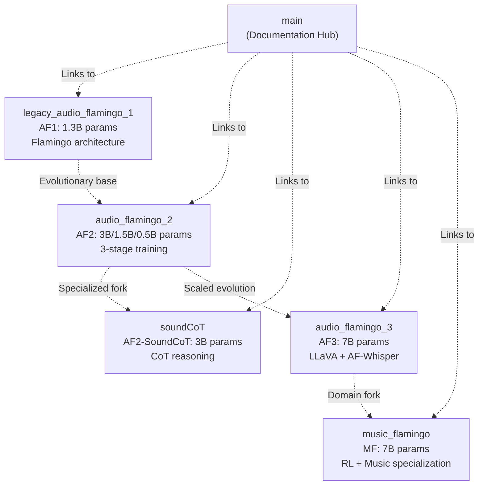
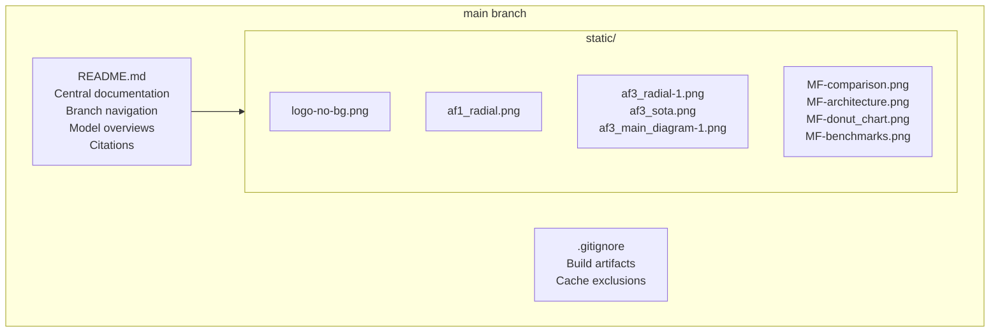
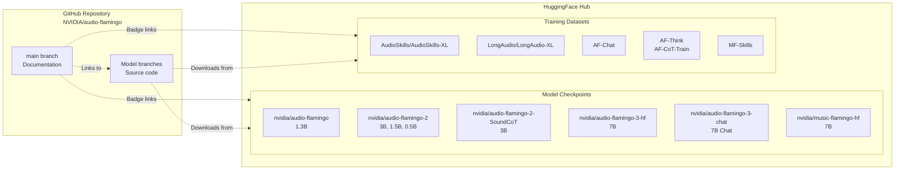

<!-- source: DeepWiki mcp.deepwiki.com · repo NVIDIA/audio-flamingo · page 1.2 Repository Structure · fetched 2026-10-26 -->

# Repository Structure

<details>
<summary>Relevant source files</summary>

The following files were used as context for generating this wiki page:

- [.gitignore](.gitignore)
- [README.md](README.md)

</details>


This document describes the physical organization of the NVIDIA/audio-flamingo GitHub repository, including its branch-based architecture, file organization, and relationship to external distribution channels. For information about accessing models and datasets, see [Accessing Models](#6.1). For details on specific model architectures and capabilities, see [Model Variants](#2).

## Overview

The audio-flamingo repository uses a **branch-based organization strategy** where each model variant maintains its complete codebase in an isolated branch. The main branch serves as a central hub containing documentation, visual assets, and links to all variant branches, but does not contain training or inference code itself.

This structure enables:
- Independent development and versioning of each model variant
- Complete isolation of dependencies and code for each model
- Centralized documentation and asset management
- Clear evolutionary relationships between model versions

Sources: [README.md:1-232]()

## Branch-Based Architecture

### Branch Organization

The repository contains five distinct model variant branches, each hosting complete training and inference code for its respective model:

| Branch Name | Model Variant | Parameters | Primary Purpose |
|------------|---------------|------------|-----------------|
| `legacy_audio_flamingo_1` | Audio Flamingo 1 | 1.3B | Original Flamingo-based model with few-shot learning |
| `audio_flamingo_2` | Audio Flamingo 2 | 3B, 1.5B, 0.5B | Improved CLAP encoder with 3-stage training |
| `soundCoT` | Audio Flamingo Sound-CoT | 3B | Chain-of-thought reasoning specialization |
| `audio_flamingo_3` | Audio Flamingo 3 | 7B | LLaVA-based architecture with unified encoder |
| `music_flamingo` | Music Flamingo | 7B | Music understanding specialization with RL training |

Each branch is self-contained and includes:
- Model architecture implementation
- Training scripts and configurations
- Inference code and utilities
- Branch-specific README documentation
- License files (`incl_licenses` directories)
- Dataset loading and preprocessing code

Sources: [README.md:220-232]()



**Repository Branch Structure**: Each model variant occupies an isolated branch with complete implementation code. The main branch serves as a documentation hub linking to all variants.

Sources: [README.md:220-232](), [README.md:14-18]()

### Branch Access Pattern

Users access specific model code by checking out the corresponding branch:

```
git checkout legacy_audio_flamingo_1  # Access AF1 code
git checkout audio_flamingo_2         # Access AF2 code
git checkout soundCoT                 # Access Sound-CoT code
git checkout audio_flamingo_3         # Access AF3 code
git checkout music_flamingo           # Access Music Flamingo code
```

The main branch provides navigation through badge links in the README that direct users to appropriate branches for different models.

Sources: [README.md:224-232]()

## Main Branch Contents

The main branch contains centralized documentation and assets but no model implementation code. Its structure consists of:

### Documentation Files

**README.md** [README.md:1-299]() - Central documentation file containing:
- Model series overview and descriptions
- Links to academic papers (arXiv, conference publications)
- Badge links to model-specific branches
- Badge links to HuggingFace model checkpoints and datasets
- Badge links to interactive demos (HuggingFace Spaces, NVIDIA research pages)
- License information and attribution requirements
- Citation BibTeX entries for all model variants

### Static Assets Directory

**static/** directory contains visual documentation assets:
- `logo-no-bg.png` - Audio Flamingo logo [README.md:4]()
- `af1_radial.png` - AF1 performance radar chart [README.md:210]()
- `af3_radial-1.png` - AF3 performance radar chart [README.md:116]()
- `af3_sota.png` - AF3 state-of-the-art comparison [README.md:120]()
- `af3_main_diagram-1.png` - AF3 architecture diagram [README.md:125]()
- `MF-comparison.png` - Music Flamingo comparison [README.md:52]()
- `MF-architecture.png` - Music Flamingo architecture [README.md:56]()
- `MF-donut_chart.png` - Music Flamingo capability distribution [README.md:60]()
- `MF-benchmarks.png` - Music Flamingo benchmark results [README.md:64]()

These assets are displayed in the main README to provide visual representations of model capabilities and architectures.

Sources: [README.md:4](), [README.md:52-217]()

### Configuration Files

**.gitignore** [.gitignore:1-4]() - Defines patterns for files excluded from version control:
- `__pycache__/` - Python bytecode cache directories
- `.DS_Store` - macOS metadata files
- `core.*` - Core dump files
- `.cache/` - General cache directories

This file is minimal, reflecting that most code artifacts reside in individual branches rather than the main branch.

Sources: [.gitignore:1-4]()



**Main Branch File Organization**: The main branch contains documentation (README.md), visual assets (static), and basic configuration (.gitignore).

Sources: [README.md:1-299](), [.gitignore:1-4]()

## Relationship to External Distribution

The GitHub repository serves as the **source code distribution channel**, while model weights and datasets are distributed separately through HuggingFace Hub. This separation maintains clean repository organization by keeping large binary files (model checkpoints) outside version control.



**Distribution Architecture**: GitHub hosts source code in branches; HuggingFace Hub hosts model checkpoints and training datasets. The main README provides badge links connecting users to both resources.

Sources: [README.md:30-36](), [README.md:78-103](), [README.md:137-145](), [README.md:165-167](), [README.md:199]()

### HuggingFace Model Repositories

Model checkpoints are distributed through separate HuggingFace repositories:

| HuggingFace Repository | Model Variant | Source Branch |
|------------------------|---------------|---------------|
| `nvidia/audio-flamingo` | AF1 (1.3B) | `legacy_audio_flamingo_1` |
| `nvidia/audio-flamingo-2` | AF2 (3B) | `audio_flamingo_2` |
| `nvidia/audio-flamingo-2-1.5B` | AF2 (1.5B) | `audio_flamingo_2` |
| `nvidia/audio-flamingo-2-0.5B` | AF2 (0.5B) | `audio_flamingo_2` |
| `nvidia/audio-flamingo-2-SoundCoT` | Sound-CoT (3B) | `soundCoT` |
| `nvidia/audio-flamingo-3-hf` | AF3 (7B) | `audio_flamingo_3` |
| `nvidia/audio-flamingo-3-chat` | AF3-Chat (7B) | `audio_flamingo_3` |
| `nvidia/music-flamingo-hf` | Music Flamingo (7B) | `music_flamingo` |

Sources: [README.md:30-36](), [README.md:78-88](), [README.md:137-139](), [README.md:165-167](), [README.md:199]()

### HuggingFace Dataset Repositories

Training datasets are distributed through separate HuggingFace dataset repositories:

| HuggingFace Dataset | Purpose | Used By |
|---------------------|---------|---------|
| `nvidia/AudioSkills` / `AudioSkills-XL` | Skill-specific audio understanding | AF2, AF3 |
| `nvidia/LongAudio` / `LongAudio-XL` | Long-form audio (5-10 minutes) | AF2, AF3 |
| `nvidia/AF-Chat` | Multi-turn dialogue data | AF3 |
| `nvidia/AF-Think` | Reasoning traces (1M) | Sound-CoT |
| `nvidia/MF-Skills` | Music-specific training data | Music Flamingo |

The datasets referenced in [README.md:91-102]() and [README.md:33-35]() are linked via badges but stored independently from the code repository.

Sources: [README.md:91-102](), [README.md:33-35](), [README.md:140-142]()

## Branch Isolation and Development

Each model variant branch operates independently with its own:

1. **Dependency Management**: Separate `requirements.txt` or environment specifications
2. **Training Scripts**: Variant-specific training pipelines
3. **Model Architecture**: Independent implementation of model components
4. **Licensing**: Branch-specific `incl_licenses` directories and README license sections
5. **Documentation**: Branch-specific README with model details

This isolation enables:
- Parallel development of different model variants
- Different dependency versions per branch (e.g., different PyTorch versions)
- Independent release cycles for each model
- Clear attribution and licensing per variant

Users working with a specific model clone the repository and checkout only the relevant branch, avoiding conflicts or confusion between different model implementations.

Sources: [README.md:220-232](), [README.md:235-240]()

## Navigation Pattern

The main branch README serves as the **entry point and navigation hub** for all model variants. It provides:

1. **Model Overview Sections**: Dedicated sections for each model (lines 20-217 in README.md)
2. **Branch Links**: GitHub badges linking to specific branches [README.md:224-232]()
3. **Checkpoint Links**: HuggingFace badges linking to model weights [README.md:30-36](), [README.md:78-88](), etc.
4. **Dataset Links**: HuggingFace badges linking to training data [README.md:91-102]()
5. **Demo Links**: Links to interactive demos on HuggingFace Spaces and NVIDIA research pages [README.md:39](), [README.md:85-87]()
6. **Paper Links**: arXiv badges linking to academic publications [README.md:23](), [README.md:72](), [README.md:131](), [README.md:157](), [README.md:195]()

This centralized navigation allows users to quickly locate the specific resources they need without navigating complex directory structures.

Sources: [README.md:20-232]()

## Summary

The audio-flamingo repository employs a **branch-based isolation strategy** where:

- **Main branch** contains only documentation, visual assets, and configuration files
- **Five model variant branches** contain complete, self-contained codebases for training and inference
- **GitHub** serves as the source code distribution channel
- **HuggingFace Hub** serves as the model checkpoint and dataset distribution channel
- **Badge links** in the main README connect users to branches, checkpoints, datasets, demos, and papers

This architecture enables independent development cycles, clear versioning, and simplified access to specific model implementations while maintaining centralized documentation and navigation.

Sources: [README.md:1-299](), [.gitignore:1-4]()

---

