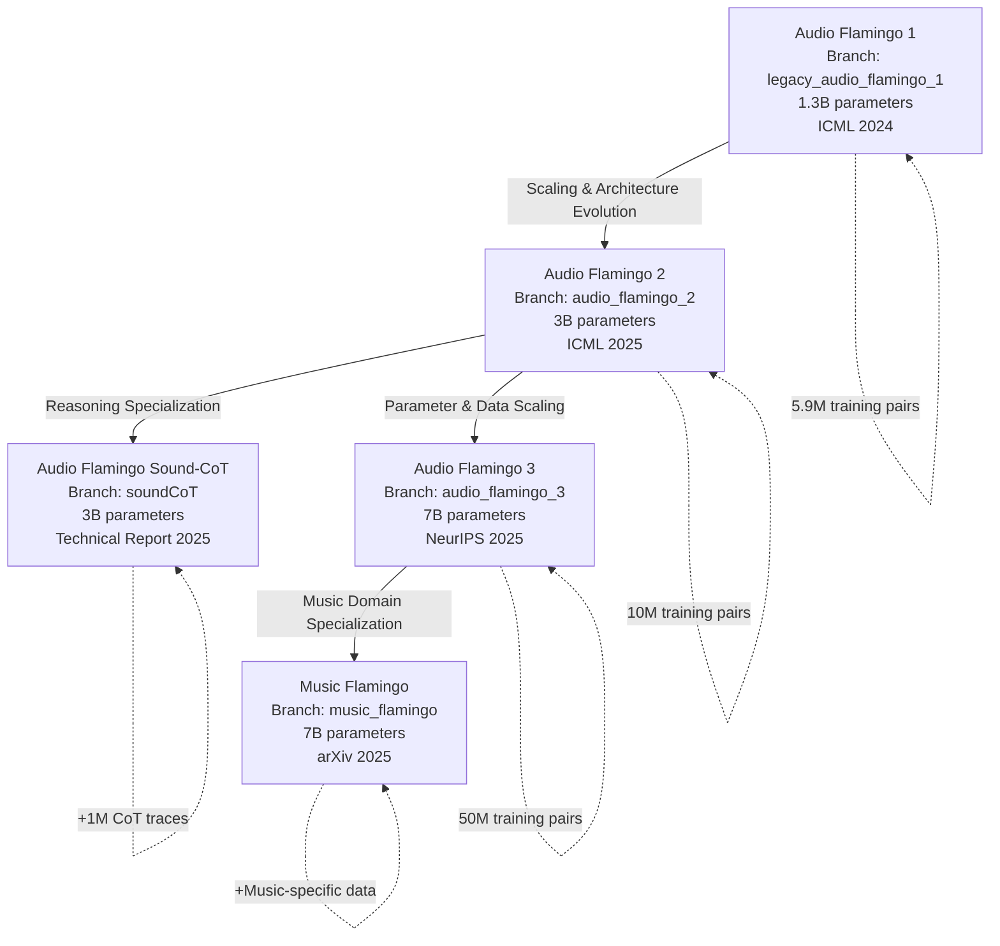
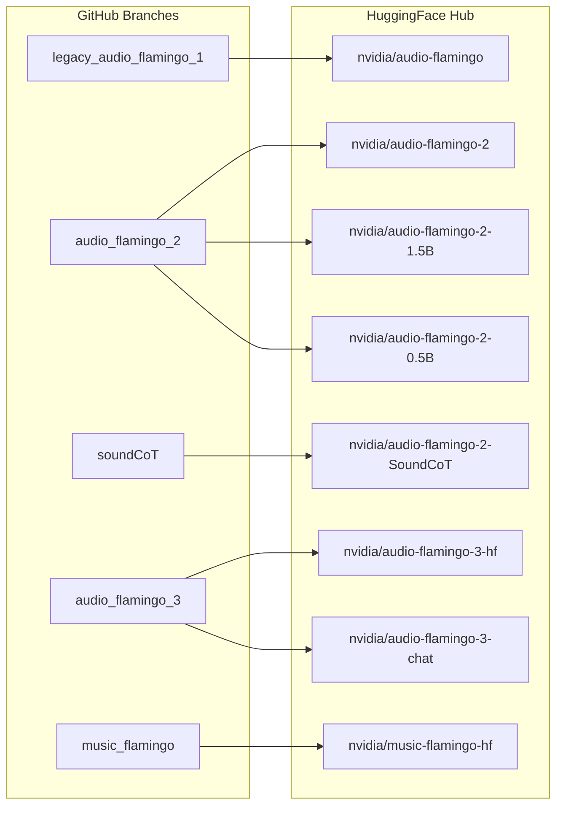
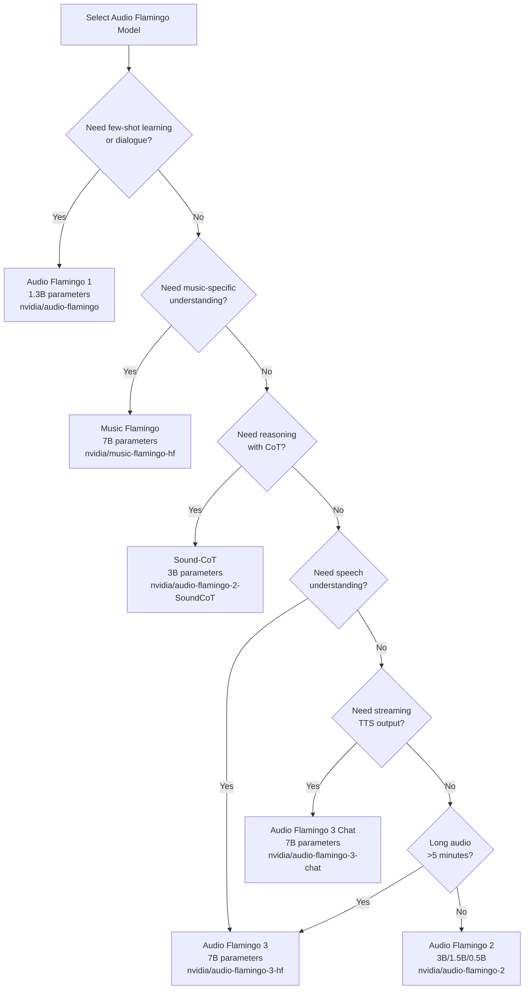
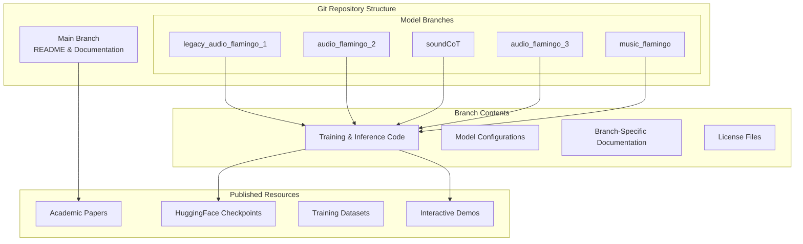
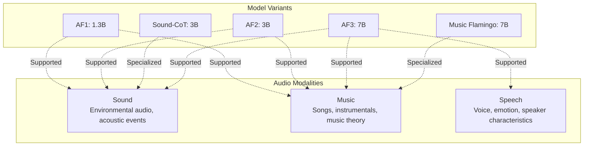
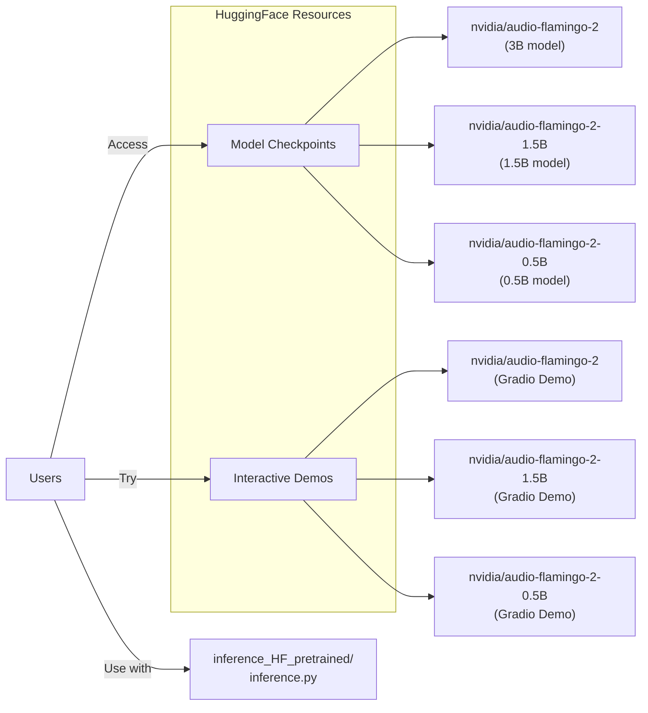

<!-- source: DeepWiki mcp.deepwiki.com · repo NVIDIA/audio-flamingo · page 2 Model Variants · fetched 2026-10-26 -->

# Model Variants

Relevant source files

The following files were used as context for generating this wiki page:

- [README.md](README.md)

This page provides a structured overview of the five distinct models in the Audio Flamingo series, their evolutionary relationships, technical characteristics, and guidance on when to use each variant. For detailed architectural information, see [Technical Architecture](#3). For training data and methodologies, see [Training Data and Strategies](#4).

## Series Overview

The Audio Flamingo series consists of five related but distinct Large Audio-Language Models (LALMs), each representing progressively advanced capabilities in audio understanding. The repository maintains separate branches for each variant, enabling independent development and specialized applications.

**Model Evolution and Relationships Diagram**

Sources: [README.md:14-19](), [README.md:192-217](), [README.md:153-188](), [README.md:128-151](), [README.md:69-127](), [README.md:20-66]()

## Model Comparison Matrix

The following table provides a comprehensive comparison of the five model variants across key dimensions:

| Model | Parameters | Architecture | Language Model | Audio Encoder | Training Data | Audio Length | Modalities | Key Capabilities |
|-------|------------|--------------|----------------|---------------|---------------|--------------|------------|------------------|
| **AF1** | 1.3B | Flamingo | OPT-IML 1.3B | Generic | 5.9M pairs | Standard | Sound, Music | Few-shot learning, Multi-turn dialogue |
| **AF2** | 3B | Flamingo | Qwen-2.5 3B | Improved CLAP | 10M pairs | Up to 5 min | Sound, Music | Expert reasoning, Long-audio, 3-stage training |
| **Sound-CoT** | 3B | Flamingo | Qwen-2.5 3B | Improved CLAP | 10M + 1M CoT | Up to 5 min | Sound | Chain-of-thought reasoning |
| **AF3** | 7B | LLaVA | Qwen-2.5 7B | AF-Whisper | 50M pairs | Up to 10 min | Sound, Music, Speech | Unified encoder, Streaming TTS, SOTA performance |
| **Music Flamingo** | 7B | LLaVA | Qwen-2.5 7B | AF-Whisper | AF3 + Music | Up to 10 min | Music (primary) | Deep music understanding, RL training, Theory-aware |

Sources: [README.md:192-217](), [README.md:153-188](), [README.md:128-151](), [README.md:69-127](), [README.md:20-66]()

**HuggingFace Model Checkpoints Mapping**

Sources: [README.md:199](), [README.md:165-167](), [README.md:137-138](), [README.md:79-84](), [README.md:30-31]()

## Parameter Scaling and Training Data Evolution

The series demonstrates progressive scaling in both model size and training data volume:

| Model | Parameters | Training Pairs | Data Scaling Factor | Architectural Generation |
|-------|------------|----------------|---------------------|-------------------------|
| AF1 | 1.3B | 5.9M | 1x (baseline) | Gen 1 (Flamingo) |
| AF2 | 3B | 10M | 1.7x | Gen 1 (Flamingo) |
| Sound-CoT | 3B | 10M + 1M CoT | 1.9x | Gen 1 (Flamingo) |
| AF3 | 7B | 50M | 8.5x | Gen 2 (LLaVA) |
| Music Flamingo | 7B | 50M + Music | 8.5x+ | Gen 2 (LLaVA) |

Sources: [README.md:204](), [README.md:172](), [README.md:150](), [README.md:107](), [README.md:42-47]()

## When to Use Each Variant

**Selection Guidance Diagram**

Sources: [README.md:192-217](), [README.md:153-188](), [README.md:128-151](), [README.md:69-127](), [README.md:20-66]()

### Use Case Recommendations

**Audio Flamingo 1** is recommended when:
- Few-shot learning capabilities are required (in-context learning)
- Multi-turn dialogue interaction is needed
- Working with established Flamingo architecture patterns
- Limited computational resources (1.3B parameters)

**Audio Flamingo 2** is recommended when:
- General audio understanding across sound and music is needed
- Long-audio processing up to 5 minutes is required
- Multiple model sizes are desired (3B, 1.5B, 0.5B variants available)
- Expert-level audio reasoning is required
- Balanced performance and efficiency are priorities

**Audio Flamingo Sound-CoT** is recommended when:
- Chain-of-thought reasoning on sound understanding tasks is critical
- Step-by-step reasoning traces are needed
- Evaluation on AF-Reasoning-Eval benchmark is planned
- Specialization in sound (not music or speech) is acceptable

**Audio Flamingo 3** is recommended when:
- Complete audio modality coverage is needed (sound, music, speech)
- Longest audio support is required (up to 10 minutes)
- State-of-the-art performance is critical
- Streaming TTS output is needed (AF3-Chat variant)
- Unified AF-Whisper encoder capabilities are desired

**Music Flamingo** is recommended when:
- Deep music understanding is the primary focus
- Theory-aware music captions are needed
- Analysis of harmony, structure, timbre, lyrics, and cultural context is required
- Chain-of-thought reasoning on music tasks is beneficial
- Specialized music benchmarks are being targeted

Sources: [README.md:192-217](), [README.md:153-188](), [README.md:128-151](), [README.md:69-127](), [README.md:20-66]()

## Model Access by Branch

Each model variant is maintained in a separate Git branch with independent code, training scripts, and documentation. The table below maps the development branches to their corresponding resources:

**Branch and Resource Mapping**

Sources: [README.md:220-233]()

| Model Variant | GitHub Branch | HuggingFace Checkpoints | Demo Page | Paper |
|---------------|---------------|-------------------------|-----------|-------|
| AF1 | `legacy_audio_flamingo_1` | `nvidia/audio-flamingo` | [audioflamingo.github.io](https://audioflamingo.github.io) | [arXiv:2402.01831](https://arxiv.org/abs/2402.01831) |
| AF2 | `audio_flamingo_2` | `nvidia/audio-flamingo-2` `nvidia/audio-flamingo-2-1.5B` `nvidia/audio-flamingo-2-0.5B` | [research.nvidia.com/AF2](https://research.nvidia.com/labs/adlr/AF2) | [arXiv:2503.03983](https://arxiv.org/abs/2503.03983) |
| Sound-CoT | `soundCoT` | `nvidia/audio-flamingo-2-SoundCoT` | N/A | [arXiv:2508.11818](https://arxiv.org/abs/2508.11818) |
| AF3 | `audio_flamingo_3` | `nvidia/audio-flamingo-3-hf` `nvidia/audio-flamingo-3-chat` | [research.nvidia.com/AF3](https://research.nvidia.com/labs/adlr/AF3) | [arXiv:2507.08128](https://arxiv.org/abs/2507.08128) |
| Music Flamingo | `music_flamingo` | `nvidia/music-flamingo-hf` | [research.nvidia.com/MF](https://research.nvidia.com/labs/adlr/MF) | [arXiv:2511.10289](https://arxiv.org/abs/2511.10289) |

Sources: [README.md:192-233]()

## Modality Coverage Across Variants

Different model variants support different combinations of audio modalities (sound, music, speech):

**Modality Support Matrix**

| Model | Sound | Music | Speech | Notes |
|-------|-------|-------|--------|-------|
| AF1 | ✓ | ✓ | ✗ | General sound and music understanding |
| AF2 | ✓ | ✓ | ✗ | Enhanced with AudioSkills and LongAudio |
| Sound-CoT | ✓ | ✗ | ✗ | Specialized for sound reasoning |
| AF3 | ✓ | ✓ | ✓ | Complete coverage with unified AF-Whisper |
| Music Flamingo | △ | ✓ | ✗ | Music-specialized with deep understanding |

△ = Limited support, ✓ = Full support, ✗ = Not supported

Sources: [README.md:107](), [README.md:172](), [README.md:148](), [README.md:42-47]()

## Model Access and Usage

The Audio Flamingo 2 models are hosted on HuggingFace with both model checkpoints and interactive demos available.

Sources: [README.md:20-29](), [README.md:63-73]()

## Licensing Information

The Audio Flamingo 2 models are provided for non-commercial research purposes only and are subject to multiple license agreements:

- NVIDIA OneWay Noncommercial License
- Qwen Research License (as models are based on Qwen2.5)
- Terms of Use for data generated by OpenAI
- Original licenses for each training dataset

For complete licensing details, see [License and Attribution](#1.3).

Sources: [README.md:78-84](), [modelcard.md:20-22]()

---

