# Page: Barney Overview

# Barney Overview

<details>
<summary>Relevant source files</summary>

The following files were used as context for generating this wiki page:

- [.gitmodules](.gitmodules)
- [CMakeLists.txt](CMakeLists.txt)
- [LICENSE](LICENSE)
- [README.md](README.md)

</details>


Barney is a high-performance rendering engine that implements the **Khronos ANARI Cross-Platform Rendering API** [README.md:19-21](). While primarily optimized for NVIDIA OptiX and CUDA-capable GPUs, it features a modular backend architecture supporting AMD GPUs (via HIP/HIPRT) and CPUs (via Embree) [README.md:108-127]().

Barney is specifically designed for **Scientific Visualization (Sci-Vis)**, supporting large-scale data types such as structured volumes, Block-Structured AMR, and unstructured meshes [README.md:63-72](). It scales from single-laptop GPUs to multi-GPU nodes and massive MPI-parallel HPC clusters [README.md:23-28]().

### High-Level System Architecture

Barney functions as a library with a public C API that applications (like `hayStack` or ParaView) link against [README.md:88-92](). Internally, it translates ANARI state into a specialized ray tracing core (`rtcore`) that abstracts the underlying hardware.

#### Component Interaction Diagram
The following diagram illustrates how the primary subsystems relate, from the public API down to the hardware-specific backends.

**Barney Subsystem Relationship**
```mermaid
graph TD
    subgraph "Public Interface"
        [ANARI_API] --> ["BarneyDevice (ANARI Layer)"]
        ["Native C API"] --> ["BNContext (barney.h)"]
    end

    subgraph "Core Engine"
        ["BarneyDevice (ANARI Layer)"] --> ["Context (Internal)"]
        ["BNContext (barney.h)"] --> ["Context (Internal)"]
        ["Context (Internal)"] --> ["Model / Group / Geometry"]
        ["Context (Internal)"] --> ["GlobalTrace (MPI/Local)"]
    end

    subgraph "Ray Tracing Core (rtcore)"
        ["Model / Group / Geometry"] --> ["rtcore::Backend"]
        ["rtcore::Backend"] --> ["OptiXBackend"]
        ["rtcore::Backend"] --> ["CudaBackend"]
        ["rtcore::Backend"] --> ["HiprtBackend"]
        ["rtcore::Backend"] --> ["EmbreeBackend"]
    end

    subgraph "Hardware/Libraries"
        ["OptiXBackend"] --> ["NVIDIA OptiX"]
        ["CudaBackend"] --> ["CUDA Runtime"]
        ["HiprtBackend"] --> ["AMD HIPRT"]
        ["EmbreeBackend"] --> ["Intel Embree"]
    end
```
**Sources:** [README.md:17-85](), [CMakeLists.txt:43-108](), [CMakeLists.txt:158-185]()

### Primary Use Cases

1.  **Scientific Visualization:** Efficiently rendering geometric primitives (spheres, cylinders, curves) and complex scalar fields found in scientific datasets [README.md:63-72]().
2.  **Path Tracing:** Supporting global illumination effects including HDRI environment maps, glossy reflections, volumetric scattering, and depth-of-field [README.md:74-84]().
3.  **Distributed Rendering:**
    *   **Data Replicated:** Every GPU renders the same scene to different image tiles to increase frame rates [README.md:49-52]().
    *   **Data Parallel:** Large models are partitioned across GPUs/nodes, allowing the rendering of datasets that exceed the memory of a single device [README.md:52-59]().

### Hardware Backends

Barney abstracts hardware through its `rtcore` layer, enabling execution across diverse platforms:

| Backend | Hardware Target | Key Dependencies |
| :--- | :--- | :--- |
| **OptiX** | NVIDIA RTX GPUs | OptiX SDK, OWL [CMakeLists.txt:133-147]() |
| **CUDA** | NVIDIA GPUs | CUDA Toolkit [CMakeLists.txt:85-99]() |
| **HIPRT** | AMD RDNA2+ GPUs | ROCm, HIPRT SDK [CMakeLists.txt:75-84]() |
| **Embree** | x86/ARM CPUs | Intel Embree [CMakeLists.txt:189-192]() |

### Code Entity Mapping

The following diagram bridges the high-level concepts to the specific C++ classes and files that implement them.

**Code Entity Mapping**
```mermaid
graph LR
    subgraph "Management Entities"
        [Context] -- "implements" --> ["Context (barney/Context.h)"]
        [MPI_Support] -- "managed by" --> ["MPIContext (barney/MPIContext.h)"]
    end

    subgraph "Scene Entities"
        [Geometry] -- "defined in" --> ["Geometry (barney/geometry/Geometry.h)"]
        [Volume] -- "defined in" --> ["Volume (barney/volume/Volume.h)"]
        [Model] -- "defined in" --> ["Model (barney/Model.h)"]
    end

    subgraph "Rendering Entities"
        [Ray_Gen] -- "kernel" --> ["renderLaunch (renderRays.cu)"]
        [Shading] -- "kernel" --> ["shadeRays (shadeRays.cu)"]
        [Acceleration] -- "via" --> ["OWL (submodules/owl)"]
    end
```
**Sources:** [CMakeLists.txt:144-147](), [README.md:108-117](), [.gitmodules:4-12]()

---

### Detailed Documentation Sections

For specific details on building, configuring, or the internal mechanics of Barney, refer to the following child pages:

*   **[Getting Started: Building and Configuration](#1.1)**
    Provides instructions for CMake setup, enabling MPI (`BARNEY_MPI`), and selecting hardware backends like OptiX or HIPRT [README.md:135-165]().
*   **[CI/CD and Testing Infrastructure](#1.2)**
    Details the automated testing workflows for Ubuntu and Windows environments [README.md:6-9]().

**Sources:** [README.md:135-165](), [CMakeLists.txt:21-27]()

---

# Page: Getting Started: Building and Configuration

# Getting Started: Building and Configuration

<details>
<summary>Relevant source files</summary>

The following files were used as context for generating this wiki page:

- [CMakeLists.txt](CMakeLists.txt)
- [barney/CMakeLists.txt](barney/CMakeLists.txt)
- [barney/MPIContext.cpp](barney/MPIContext.cpp)
- [barney/common/barney-common.h](barney/common/barney-common.h)
- [barney/common/barneyConfig.h.in](barney/common/barneyConfig.h.in)
- [rtcore/CMakeLists.txt](rtcore/CMakeLists.txt)

</details>


This page provides a technical guide for building Barney from source, covering the CMake configuration system, backend selection, and dependency management. Barney is designed as a modular rendering engine that abstracts hardware-specific ray tracing through a layer called `rtcore`.

## Build System Overview

Barney uses CMake (minimum version 3.24) as its primary build system [CMakeLists.txt:12](). It supports cross-platform builds on Linux and Windows, with specific optimizations for NVIDIA (OptiX/CUDA), AMD (HIP/HIPRT), and CPU (Embree) targets.

### Core Configuration Logic
The build process is centered around `barney_config`, an interface library that propagates necessary include directories, compile definitions, and flags to all subsystems [CMakeLists.txt:158-162]().

The following diagram illustrates the relationship between the configuration entities and the resulting backend libraries:

**Configuration to Backend Entity Map**
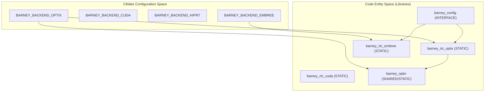
Sources: [CMakeLists.txt:158-175](), [rtcore/CMakeLists.txt:135-154](), [barney/CMakeLists.txt:223-239]()

---

## Hardware Backends and Options

Barney allows selecting one or more backends at configuration time. Note that while multiple backends can be compiled into the library, a single context usually instantiates one specific `rtcore` implementation.

### NVIDIA OptiX and CUDA
- **BARNEY_BACKEND_OPTIX**: Enables the NVIDIA OptiX hardware-accelerated backend. It requires the OptiX SDK [CMakeLists.txt:136-142]().
- **BARNEY_BACKEND_CUDA**: Enables a native CUDA software-tracing backend (used when OptiX is not desired but NVIDIA GPUs are present) [CMakeLists.txt:85-103]().
- **CUDA Architectures**: Controlled via `CMAKE_CUDA_ARCHITECTURES`. Defaults to `native` on Linux and `all-major` on Windows [CMakeLists.txt:89-96]().

### AMD HIP and HIPRT
- **USE_HIP**: When `ON`, Barney compiles CUDA sources using `hipcc` for AMD GPUs [CMakeLists.txt:50-60](). It defines `USE_HIP=1` and `BARNEY_HAVE_HIP=1` for the host code [CMakeLists.txt:167]().
- **BARNEY_BACKEND_HIPRT**: Enables AMD's HIPRT for hardware-accelerated BVH traversal on RDNA2+ architectures [CMakeLists.txt:80-84]().

### Intel Embree (CPU)
- **BARNEY_BACKEND_EMBREE**: Enables the CPU-based backend. Barney vendors a specific version of Embree as a submodule and builds it with a custom namespace `embree_for_barney` to avoid symbol collisions [rtcore/CMakeLists.txt:105-106]().
- **ISA Targets**: Automatically detects SSE4.2, AVX2, or NEON based on the host architecture [rtcore/CMakeLists.txt:68-96]().

Sources: [CMakeLists.txt:50-108](), [rtcore/CMakeLists.txt:68-106](), [barney/common/barney-common.h:10-16]()

---

## Submodule Dependencies

Barney relies on several key submodules for core functionality:

| Submodule | Purpose | Build Integration |
| :--- | :--- | :--- |
| **OWL** | OptiX 7 Wrapper Library; manages SBT and launches. | Required for NVIDIA backends [CMakeLists.txt:133-147](). |
| **cuBQL** | CUDA Block-based Query Library; used for BVH construction. | Linked into `barney_optix` [barney/CMakeLists.txt:238](). |
| **NanoVDB** | Sparse VDB volumes support. | Included via `3rdParty/nanovdb` [CMakeLists.txt:176](). |
| **Embree** | CPU Ray Tracing kernels. | Integrated in `rtcore/embree` [rtcore/CMakeLists.txt:135-147](). |

### Version Requirements
The build system enforces specific versions for submodules:
- **OWL**: Minimum version `1.2.9` [CMakeLists.txt:9, 145]().
- **cuBQL**: Minimum version `1.3.1` [CMakeLists.txt:10]().

Sources: [CMakeLists.txt:9-10](), [CMakeLists.txt:144-147](), [barney/CMakeLists.txt:238]()

---

## MPI Support

Enabling `BARNEY_MPI` (OFF by default) builds the distributed rendering components [CMakeLists.txt:21]().

### MPI Implementation Details
When `BARNEY_MPI` is enabled, the build system:
1. Compiles `MPI_SOURCES` including `MPIContext.cpp`, `DistFB.cu`, and global trace strategies like `RQSMPI.cu` and `TwoStage.cu` [barney/CMakeLists.txt:190-203]().
2. Links against `MPI::MPI_C` [barney/CMakeLists.txt:250]().
3. Creates backend-specific MPI libraries, such as `barney_mpi_optix` [barney/CMakeLists.txt:249-252]().

**MPI Context Data Flow**
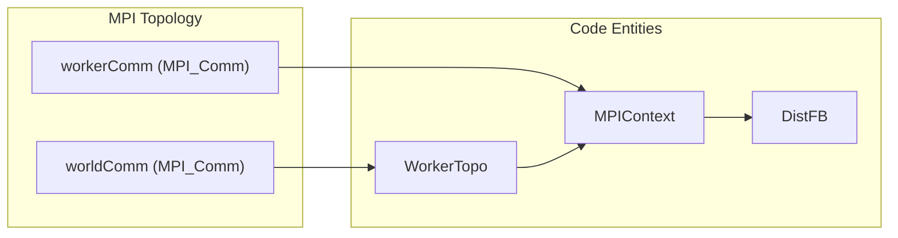
Sources: [barney/CMakeLists.txt:190-203](), [barney/MPIContext.cpp:83-90](), [barney/MPIContext.cpp:108-112]()

---

## Advanced Configuration Options

### OIDN Denoising
Barney supports the Intel Open Image Denoiser (OIDN).
- **BARNEY_OIDN_CPU**: Links OIDN for CPU-based denoising in the Embree backend [rtcore/CMakeLists.txt:155-157]().
- **BARNEY_DISABLE_DENOISING**: Disables all denoising logic [barney/common/barneyConfig.h.in:6]().

### Compilation Flags
- **Separable Compilation**: Enabled via `CMAKE_CUDA_SEPARABLE_COMPILATION` and `CUDA_RESOLVE_DEVICE_SYMBOLS` to allow cross-file device function calls (e.g., between `rtcore` and the shading kernels) [barney/CMakeLists.txt:31-33]().
- **Relaxed Constexpr**: Enabled via `--expt-relaxed-constexpr` for CUDA [barney/CMakeLists.txt:14, 243]().
- **Big Objects**: `/bigobj` is applied for MSVC to handle large generated object files from template instantiations [barney/CMakeLists.txt:5-12]().

### Installation Layout
The project follows standard GNU installation directories [CMakeLists.txt:36]().
- **RPATH**: On Linux, `INSTALL_RPATH` is set to `$ORIGIN` to ensure shared libraries can find their dependencies in the same directory [barney/CMakeLists.txt:47](). On macOS, it uses `@loader_path` [barney/CMakeLists.txt:45]().

Sources: [CMakeLists.txt:36](), [barney/CMakeLists.txt:5-12](), [barney/CMakeLists.txt:44-49](), [rtcore/CMakeLists.txt:155-157]()

---

# Page: CI/CD and Testing Infrastructure

# CI/CD and Testing Infrastructure

<details>
<summary>Relevant source files</summary>

The following files were used as context for generating this wiki page:

- [.github/action-scripts/install-cuda-windows.ps1](.github/action-scripts/install-cuda-windows.ps1)
- [.github/action-scripts/install_cuda_ubuntu.sh](.github/action-scripts/install_cuda_ubuntu.sh)
- [.github/workflows/MPI-Build.yml](.github/workflows/MPI-Build.yml)
- [.github/workflows/Ubuntu.yml](.github/workflows/Ubuntu.yml)
- [.github/workflows/Windows.yml](.github/workflows/Windows.yml)
- [barney/umesh/mc/UMeshMC.dev.cu](barney/umesh/mc/UMeshMC.dev.cu)
- [barney/volume/MCGrid.cuh](barney/volume/MCGrid.cuh)
- [barney/volume/StructuredData.h](barney/volume/StructuredData.h)
- [unitTests/isosurface-umesh.py](unitTests/isosurface-umesh.py)
- [unitTests/isosurface-umesh2.py](unitTests/isosurface-umesh2.py)
- [unitTests/omnicamera.py](unitTests/omnicamera.py)
- [unitTests/reference_unitTest_omnicamera.png](unitTests/reference_unitTest_omnicamera.png)

</details>


This page documents the Barney CI/CD pipelines, including the automated build matrix for Linux and Windows, the environment provisioning scripts for CUDA, and the Python-based testing framework used for validation.

## GitHub Actions Workflows

Barney utilizes GitHub Actions to ensure cross-platform compatibility and stability across different hardware backends. The infrastructure is divided into primary OS-specific workflows and specialized builds.

### Build Matrix and Configurations
The CI/CD pipeline tests a variety of configurations, including different compiler versions (GCC), CUDA toolkit versions, and Barney backends (OptiX, CUDA Software Tracer, and Embree).

| OS | Compilers | CUDA Versions | Tested Backends |
| :--- | :--- | :--- | :--- |
| **Ubuntu** | GCC 11, 13, 15 | None, 12.0.0, 13.0.2 | OptiX, CUDA, Embree |
| **Windows** | MSVC (VS 2022, 2026) | 12.6.2, 13.2.0 | OptiX, CUDA, Embree |

#### Ubuntu Workflow (`Ubuntu.yml`)
The Ubuntu workflow supports both x86_64 and ARM architectures. It automates the installation of the ANARI-SDK as a dependency before building Barney.
*   **ARM Support:** Includes builds for `ubuntu-26.04-arm` using GCC 15 and the Embree backend [.github/workflows/Ubuntu.yml:21-25]().
*   **Dependency Management:** Clones and installs the `KhronosGroup/ANARI-SDK` into a local install directory [.github/workflows/Ubuntu.yml:73-93]().
*   **Backend Selection:** Uses CMake flags such as `-DBARNEY_BACKEND_EMBREE=ON` or `-DBARNEY_BACKEND_CUDA=ON` to toggle hardware support [.github/workflows/Ubuntu.yml:25-40]().

#### Windows Workflow (`Windows.yml`)
The Windows workflow targets modern Visual Studio environments and handles CUDA integration through specialized PowerShell scripts.
*   **Generator:** Uses "Visual Studio 17 2022" and "Visual Studio 18 2026" [.github/workflows/Windows.yml:18-38]().
*   **Build Types:** Validates both `Release` and `Debug` configurations [.github/workflows/Windows.yml:22-34]().

#### MPI Workflow (`MPI-Build.yml`)
A dedicated workflow for Ubuntu validates Barney's distributed rendering capabilities by enabling the MPI wrapper layer.
*   **Flag:** Sets `-DBARNEY_MPI=ON` during the CMake configuration step [.github/workflows/MPI-Build.yml:95]().
*   **Packages:** Installs `libopenmpi-dev` to provide the necessary MPI headers and runtime [.github/workflows/MPI-Build.yml:64]().

Sources: [.github/workflows/Ubuntu.yml:13-46](), [.github/workflows/Windows.yml:10-42](), [.github/workflows/MPI-Build.yml:13-41]()

---

## Environment Provisioning

Barney requires specific versions of the CUDA Toolkit for its GPU backends. Since standard CI runners may not have the required versions, the repository includes provisioning scripts.

### CUDA Installation Scripts
The scripts handle repository pinning, keyring updates, and package selection based on the requested CUDA version.

*   **Ubuntu (`install_cuda_ubuntu.sh`):** 
    *   Determines the correct package names (e.g., `cuda-compiler` vs `cuda-nvcc`) based on version logic [.github/action-scripts/install_cuda_ubuntu.sh:94-110]().
    *   Configures `apt` repositories and installs a subset of required packages: `cuda-compiler`, `cuda-cudart-dev`, `cuda-nvtx`, `cuda-nvrtc-dev`, `libcurand-dev`, and `cuda-cccl` [.github/action-scripts/install_cuda_ubuntu.sh:11-18]().
*   **Windows (`install-cuda-windows.ps1`):** 
    *   Maintains a dictionary of known CUDA download URLs for network installation [.github/action-scripts/install-cuda-windows.ps1:18-60]().
    *   Enforces minimum CUDA versions for specific Visual Studio years (e.g., VS 2022 requires CUDA 11.6.0+) [.github/action-scripts/install-cuda-windows.ps1:63-68]().

### CI/CD Data Flow
The following diagram illustrates how the GitHub Actions environment is prepared and how the Barney build consumes these dependencies.

**CI/CD Provisioning Flow**
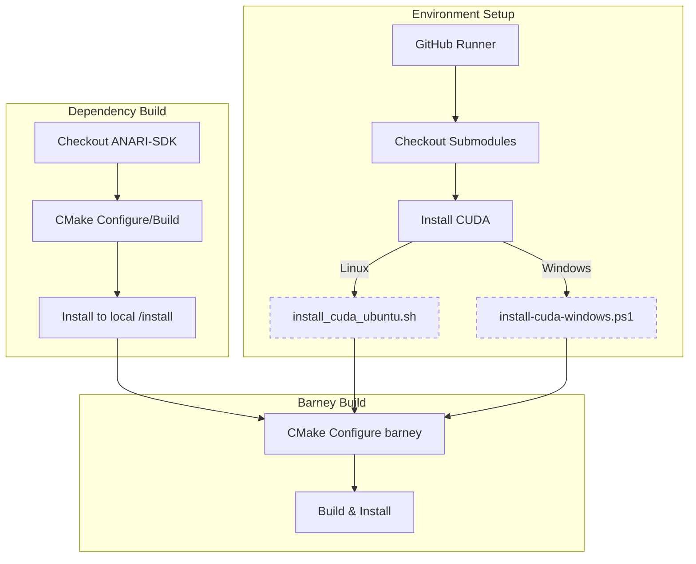
Sources: [.github/workflows/Ubuntu.yml:51-110](), [.github/action-scripts/install_cuda_ubuntu.sh:11-18](), [.github/action-scripts/install-cuda-windows.ps1:18-68]()

---

## Unit Testing Infrastructure

Barney uses Python-based unit tests via the `pynari` wrapper (a Python interface for ANARI) to validate rendering output.

### Python Testing Framework
Tests are located in the `unitTests/` directory and typically follow a pattern of scene construction, rendering, and image comparison.

*   **Scene Definition:** Tests use `pynari` to create ANARI objects like `newWorld`, `newGeometry`, and `newMaterial` [.unitTests/omnicamera.py:77-83]().
*   **Camera Models:** Specific tests validate different camera types, such as `omnidirectional` [.unitTests/omnicamera.py:86]() or `perspective` [.unitTests/isosurface-umesh.py:123]().
*   **Geometry & Volumes:** Tests cover complex types including `isosurface` and `unstructured` spatial fields [.unitTests/isosurface-umesh.py:66-72]().
*   **Validation:** The scripts render a frame, retrieve the `channel.color` buffer, and save it as a PNG/JPG for manual or automated comparison against reference images [.unitTests/omnicamera.py:108-119]().

### Test Entity Mapping
This diagram maps the Python test entities to the underlying Barney/ANARI concepts.

**Testing Entity Space**
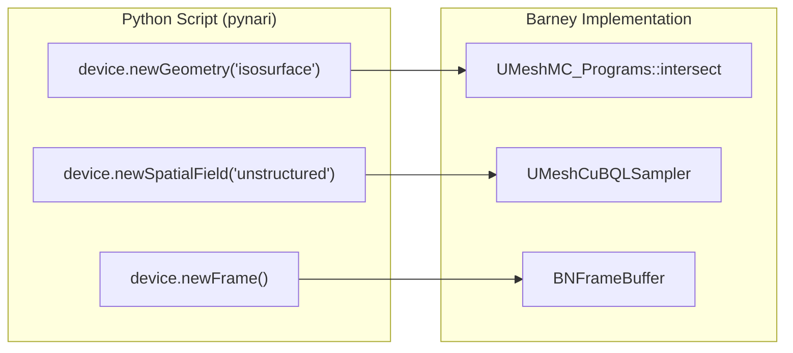

### Key Test Cases
*   **Omnidirectional Camera:** Tests 360-degree rendering by placing spheres around a central camera point [.unitTests/omnicamera.py:64-73]().
*   **Unstructured Mesh (UMesh):** Tests the macro-cell acceleration and intersection of unstructured grids (Tets, Hexes, Wedges, Pyramids) [.unitTests/isosurface-umesh.py:120-128]().
*   **Macro-Cell Validation:** Uses `MCVolumeAccel` and `MCIsoSurfaceAccel` templates to verify that the DDA traversal correctly identifies intersections in scalar fields [.barney/umesh/mc/UMeshMC.dev.cu:90-95]().

Sources: [.unitTests/omnicamera.py:86-119](), [.unitTests/isosurface-umesh.py:66-139](), [.barney/umesh/mc/UMeshMC.dev.cu:26-54]()

---

# Page: Architecture Overview

# Architecture Overview

<details>
<summary>Relevant source files</summary>

The following files were used as context for generating this wiki page:

- [barney/Context.h](barney/Context.h)
- [barney/GlobalModel.h](barney/GlobalModel.h)
- [barney/ModelSlot.cpp](barney/ModelSlot.cpp)
- [barney/ModelSlot.h](barney/ModelSlot.h)
- [barney/api/Context.h](barney/api/Context.h)
- [barney/api/barney.cu](barney/api/barney.cu)
- [barney/geometry/Triangles.cpp](barney/geometry/Triangles.cpp)
- [barney/geometry/Triangles.h](barney/geometry/Triangles.h)
- [barney/include/barney.h](barney/include/barney.h)
- [barney/umesh/common/UMeshField.cu](barney/umesh/common/UMeshField.cu)
- [barney/umesh/common/UMeshField.h](barney/umesh/common/UMeshField.h)
- [barney/umesh/os/AWT.dev.cu](barney/umesh/os/AWT.dev.cu)
- [barney/umesh/os/ObjectSpace-common.h](barney/umesh/os/ObjectSpace-common.h)
- [rtcore/cudaCommon/Device.cu](rtcore/cudaCommon/Device.cu)

</details>


Barney utilizes a layered architecture designed to abstract complex ray tracing hardware while providing a high-performance, distributed rendering engine for scientific visualization. The system is split between a host-side object model and a device-side execution core, supporting multi-GPU and multi-node (MPI) configurations.

### System Layer Diagram

The following diagram illustrates the relationship between the major architectural layers, from the public API down to the hardware-specific backends.

**Barney System Stack**
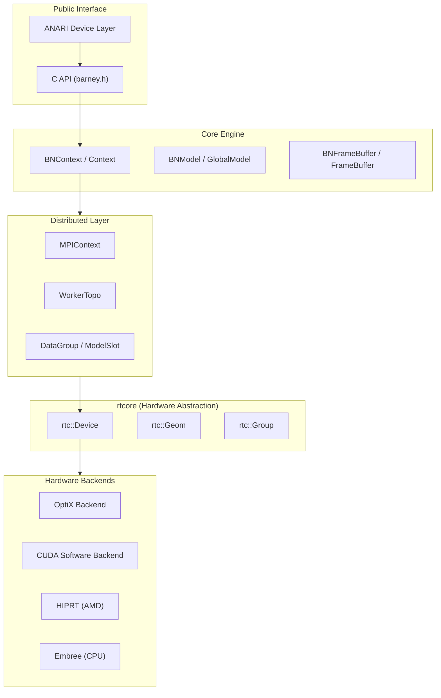
**Sources:** [barney/include/barney.h:58-75](), [barney/api/barney.cu:100-136](), [barney/Context.h:61-115]()

---

### 1. Public C API (`barney.h`)
The native interface for Barney is a C99-compatible API. It follows a "create-set-commit" pattern common in modern rendering APIs. Users interact with opaque handles such as `BNContext`, `BNModel`, and `BNRenderer`. 

- **Lifecycle:** Objects are created via factory functions (e.g., `bnCameraCreate`), parameters are set using type-specific setters (e.g., `bnSet3f`), and changes are realized via `bnCommit`.
- **Rendering:** The `bnRender` call triggers the distributed rendering pipeline across all configured GPUs and MPI ranks.

For details, see [Public C API (barney.h)](#2.1).

**Sources:** [barney/include/barney.h:235-250](), [barney/api/barney.cu:26-35]()

---

### 2. ANARI Device Layer
Barney provides a first-class implementation of the Khronos ANARI standard. This layer maps ANARI objects (Worlds, Instances, Geometries) directly to Barney's internal objects.

- **Tethering:** In multi-GPU or MPI environments, the ANARI layer uses a "tethering" mechanism to ensure that state changes on the application side are correctly broadcast to all worker nodes.
- **Interoperability:** It allows Barney to be used as a drop-in backend for any visualization tool supporting the ANARI API.

For details, see [ANARI Device Layer](#2.2).

**Sources:** [barney/include/barney.h:23-26](), [barney/api/barney.cu:7-10]()

---

### 3. Core Engine and Distributed Topology
The core of Barney is managed by the `Context` class, which handles the orchestration of GPUs and data distribution.

- **Multi-GPU/MPI Topology:** Barney organizes resources into `WorkerTopo`. Data is partitioned into "Data Groups," where each group holds a subset of the global model. 
- **Host/Device Split:** Host-side classes (e.g., `Triangles`) manage the scene graph and memory, while corresponding `DD` (Device Data) structs (e.g., `Triangles::DD`) are passed to GPU kernels for intersection and shading.

**Topology Mapping**
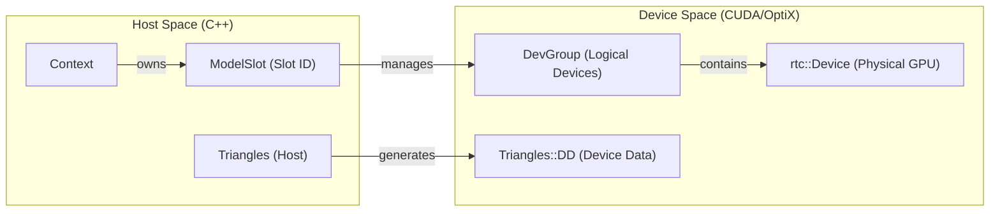
**Sources:** [barney/Context.h:36-46](), [barney/ModelSlot.h:22-30](), [barney/geometry/Triangles.h:28-34]()

For details, see [Context and Multi-GPU/MPI Topology](#2.3).

---

### 4. `rtcore` Abstraction Layer
The `rtcore` layer is a hardware abstraction layer (HAL) that allows Barney to run on NVIDIA GPUs (OptiX/CUDA), AMD GPUs (HIPRT), and CPUs (Embree).

- **Interfaces:** It provides `AppInterface`, `TraceInterface`, and `ComputeInterface` to standardize how rays are traced and kernels are launched across different backends.
- **Resource Management:** `rtc::Device` handles memory allocation (`allocMem`), stream management, and peer-to-peer access.

| Entity | Role | Code Reference |
| :--- | :--- | :--- |
| `rtc::Device` | Abstract GPU/CPU device | [rtcore/cudaCommon/Device.cu:32-41]() |
| `rtc::Geom` | Abstract geometry object | [barney/geometry/Triangles.cpp:56-60]() |
| `rtc::Buffer` | Device memory wrapper | [barney/geometry/Triangles.cpp:61-64]() |

For details, see [Ray Tracing Core (rtcore)](#3).

**Sources:** [rtcore/cudaCommon/Device.cu:64-74](), [barney/api/barney.cu:100-117]()

---

# Page: Public C API (barney.h)

# Public C API (barney.h)

<details>
<summary>Relevant source files</summary>

The following files were used as context for generating this wiki page:

- [barney/api/barney.cu](barney/api/barney.cu)
- [barney/include/barney.h](barney/include/barney.h)
- [barney/umesh/common/UMeshField.cu](barney/umesh/common/UMeshField.cu)
- [barney/umesh/common/UMeshField.h](barney/umesh/common/UMeshField.h)
- [barney/umesh/os/AWT.dev.cu](barney/umesh/os/AWT.dev.cu)
- [barney/umesh/os/ObjectSpace-common.h](barney/umesh/os/ObjectSpace-common.h)
- [doc/BarneyNative.md](doc/BarneyNative.md)
- [rtcore/cudaCommon/Device.cu](rtcore/cudaCommon/Device.cu)

</details>


The Barney Public C API is the primary native interface for the Barney rendering engine. It provides a handle-based, stateful API designed for high-performance scientific visualization and path tracing. It follows a **create-set-commit-render** lifecycle, allowing users to build complex scene hierarchies, manage distributed data across multiple GPUs (via MPI or local multi-GPU), and execute photorealistic rendering.

## API Lifecycle and Object Management

The API operates on opaque handles (e.g., `BNContext`, `BNModel`, `BNGeom`) representing underlying C++ objects. The typical workflow follows these stages:

1.  **Context Creation**: Initialize the engine for a specific hardware backend (OptiX, CUDA, HIPRT, or Embree) and define the GPU topology.
2.  **Object Creation**: Create scene entities such as geometries, volumes, materials, and lights.
3.  **Parameter Setting**: Use `bnSet*` functions to assign data arrays, scalars, or object references to entities.
4.  **Commit**: Call `bnCommit` to signal that an object's parameters are ready. This often triggers internal updates or BVH builds [barney/api/barney.cu:1986-1991]().
5.  **Render**: Execute the rendering pipeline into a `BNFrameBuffer`.

### Natural Language to Code Entity Mapping

The following diagram maps high-level rendering concepts to their specific Barney C API handles and internal C++ implementation classes.

**Concept to Entity Mapping**
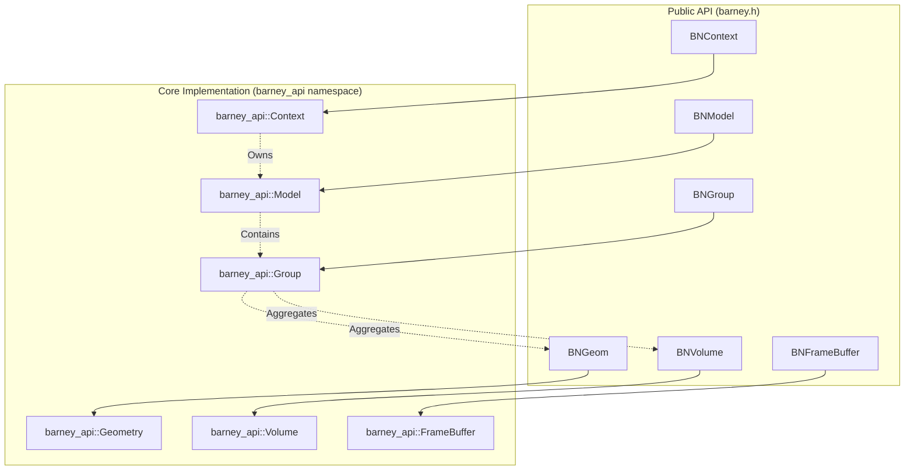
**Sources:** [barney/include/barney.h:58-75](), [barney/api/barney.cu:139-227]()

---

## Context and Topology

The `BNContext` is the root object for all Barney operations. It manages the hardware devices and the MPI communicator (if enabled).

### Context Creation
Barney supports multiple backends, selected at context creation. Depending on the build configuration, specific creators are used:
*   **Local Contexts**: `bnContextCreate` (defaults to available backend).
*   **MPI Contexts**: `bnMPIContextCreate` (requires `barney_mpi.h`).

Internally, these call backend-specific functions like `createContext_optix` or `createContext_cuda` [barney/api/barney.cu:103-117]().

### Hardware Info
Users can query the environment's topology using `bnGetHardwareInfo`, which returns a `BNHardwareInfo` struct containing the number of ranks, hosts, and GPUs available to the current process [barney/include/barney.h:223-231]().

**Sources:** [barney/api/barney.cu:98-137](), [barney/include/barney.h:240-250]()

---

## Scene Hierarchy and Data Flow

Barney uses a hierarchical scene graph to manage geometries and volumes. Data is typically passed as `BNData` objects, which wrap raw pointers or arrays.

### Key Scene Objects
| Object | Role | Key Functions |
| :--- | :--- | :--- |
| `BNModel` | The top-level container for a scene. | `bnModelCreate`, `bnBuild` |
| `BNGroup` | A collection of geometries and volumes. | `bnGroupCreate` |
| `BNGeom` | Geometric primitives (triangles, spheres, etc.). | `bnGeometryCreate` |
| `BNVolume` | Volumetric data (structured, unstructured, VDB). | `bnVolumeCreate` |

### Data Types (`BNDataType`)
Barney supports a wide range of data types for vertex attributes, scalar fields, and textures, including:
*   **Scalars**: `BN_FLOAT32`, `BN_INT32`, `BN_UINT8`.
*   **Vectors**: `BN_FLOAT32_VEC3`, `BN_INT32_VEC4`.
*   **Special**: `BN_UFIXED8_RGBA_SRGB` for color data [barney/include/barney.h:104-179]().

### Implementation Flow: Setting Data
When `bnSetData` or `bnSetObject` is called, the API performs a lookup from the opaque handle to the internal `barney_api::Object` and updates its parameter map [barney/api/barney.cu:163-169]().

**Object Parameterization Flow**
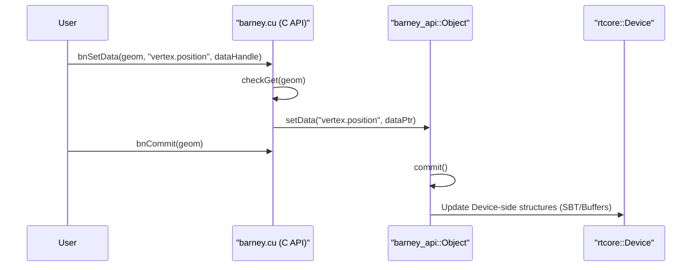
**Sources:** [barney/api/barney.cu:1834-1845](), [barney/api/barney.cu:1986-1991]()

---

## Volume Rendering Reference

Volumes in Barney are defined by a `BNScalarField` and a `BNVolume`. The scalar field defines the spatial data, while the volume object associates it with a `BNTransferFunction`.

### Supported Scalar Fields
*   **Structured**: Regular Cartesian grids.
*   **Unstructured (UMesh)**: Supports Tetrahedra, Hexahedra, Prisms, Pyramids, and Polyhedra [barney/include/barney.h:185-191]().
*   **NanoVDB**: Sparse VDB volumes [barney/include/barney.h:31]().

### Unstructured Mesh (UMesh) Detail
UMesh fields require several data arrays:
*   `vertex.position`: `BN_FLOAT3_VEC3` positions.
*   `vertex.data` or `cell.data`: Scalar values.
*   `index`: Indices into the vertex array.
*   `cell.index`: Offsets into the index array per cell.
*   `cell.type`: `BNUnstructuredElementType` per cell [barney/umesh/common/UMeshField.h:153-160]().

**Sources:** [barney/umesh/common/UMeshField.cu:204-236](), [barney/include/barney.h:185-191]()

---

## FrameBuffer and Rendering

The `BNFrameBuffer` manages the output of the rendering process. It supports multiple channels and optional post-processing like denoising.

### FrameBuffer Channels
Users can request specific channels during creation using bitwise flags:
*   `BN_FB_COLOR`: RGBA output.
*   `BN_FB_DEPTH`: Z-buffer.
*   `BN_FB_NORMAL`: World-space normals.
*   `BN_FB_OBJID` / `BN_FB_INSTID`: ID buffers for picking [barney/include/barney.h:95-102]().

### Rendering Parameters
The `BNRenderer` object controls the path tracing process:
*   `pixelSamples`: Samples per pixel per frame.
*   `ambientRadiance`: Global illumination base.
*   `background`: Texture or color for missed rays [doc/BarneyNative.md:14-29]().

### Execution
Rendering is triggered via `bnRender(renderer, model, camera, framebuffer)`. In MPI configurations, this call handles the distributed ray exchange and final image compositing across the `BNFrameBuffer` [barney/api/barney.cu:2140-2160]().

**Sources:** [barney/include/barney.h:95-102](), [barney/api/barney.cu:2140-2160](), [doc/BarneyNative.md:14-27]()

---

# Page: ANARI Device Layer

# ANARI Device Layer

<details>
<summary>Relevant source files</summary>

The following files were used as context for generating this wiki page:

- [anari/BarneyGlobalState.cpp](anari/BarneyGlobalState.cpp)
- [anari/BarneyGlobalState.h](anari/BarneyGlobalState.h)
- [anari/CMakeLists.txt](anari/CMakeLists.txt)
- [anari/Device.cpp](anari/Device.cpp)
- [anari/Device.h](anari/Device.h)
- [anari/Group.cpp](anari/Group.cpp)
- [anari/Group.h](anari/Group.h)
- [anari/Instance.cpp](anari/Instance.cpp)
- [anari/Instance.h](anari/Instance.h)
- [anari/Library.cpp](anari/Library.cpp)
- [anari/Library_entryPoint.h.in](anari/Library_entryPoint.h.in)
- [anari/Surface.cpp](anari/Surface.cpp)
- [anari/World.cpp](anari/World.cpp)
- [anari/World.h](anari/World.h)
- [anari/generated/anari_library_barney_mpi_queries.cpp](anari/generated/anari_library_barney_mpi_queries.cpp)
- [anari/generated/anari_library_barney_mpi_queries.h](anari/generated/anari_library_barney_mpi_queries.h)
- [anari/generated/anari_library_barney_queries.cpp](anari/generated/anari_library_barney_queries.cpp)
- [anari/generated/anari_library_barney_queries.h](anari/generated/anari_library_barney_queries.h)
- [doc/ANARI.md](doc/ANARI.md)

</details>


The ANARI Device Layer in Barney provides an implementation of the [Khronos ANARI standard](https://www.khronos.org/anari), allowing Barney to be used as a pluggable rendering backend for any ANARI-compatible application. It translates the ANARI scene graph and state machine into Barney's internal `BNContext` and native object hierarchy.

## Library and Device Entry Points

The ANARI implementation is built as a shared library (`anari_library_barney` or `anari_library_barney_mpi`) [anari/CMakeLists.txt:92-125](). The entry point is defined in `Library_entryPoint.h.in`, which exposes the `anari_library_barney` symbol required by the ANARI loader [anari/Library_entryPoint.h.in:1-14]().

### BarneyLibrary
The `BarneyLibrary` class manages the creation of device instances. It inherits from `anari::LibraryImpl` [anari/Library.cpp:41-48]().
- `newDevice(subtype)`: Creates a new `BarneyDevice` instance [anari/Library.cpp:57-60]().
- `getDeviceExtensions()`: Returns the list of supported ANARI extensions (e.g., `ANARI_KHR_GEOMETRY_TRIANGLE`) [anari/Library.cpp:62-65]().

### BarneyDevice
`BarneyDevice` is the primary interface between the ANARI API and Barney. It implements the factory methods for all ANARI object types [anari/Device.cpp:80-143]().
- **Object Creation**: Maps `newGeometry`, `newVolume`, `newMaterial`, etc., to internal Barney device classes [anari/Device.cpp:80-123]().
- **State Management**: Uses `BarneyGlobalState` to track cross-object state and synchronization [anari/Device.h:14-114]().

**Sources:** [anari/Library.cpp:41-65](), [anari/Device.cpp:80-143](), [anari/Device.h:14-114](), [anari/CMakeLists.txt:92-125]()

---

## BarneyGlobalState and Tethering

Barney uses a "Tethering" mechanism to support multi-GPU and MPI configurations where multiple ANARI devices might share a single underlying `BNContext`.

### Global State Entities
| Entity | Role |
| :--- | :--- |
| `BarneyGlobalState` | Stores device-wide timestamps for scene changes and the `slot` ID [anari/BarneyGlobalState.h:65-93](). |
| `Tether` | Manages the shared `BNContext` and coordinates deferred render calls across tethered devices [anari/BarneyGlobalState.h:43-63](). |
| `TetheredModel` | Ensures that ANARI `World` objects across different devices that represent the same data are mapped to the same `BNModel` [anari/BarneyGlobalState.h:32-39](). |

### Tethering Data Flow
When multiple devices are initialized (e.g., in a multi-GPU setup), they are added to a `Tether::devices` vector [anari/BarneyGlobalState.h:62](). This allows the implementation to synchronize commits and renders.

**Sources:** [anari/BarneyGlobalState.h:32-93](), [anari/BarneyGlobalState.cpp:12-61]()

---

## Device Initialization and Lifecycle

The initialization of a `BarneyDevice` involves setting up the execution backend (CUDA/MPI) and establishing the tethering.

### Initialization Sequence
1. **Instantiation**: `BarneyLibrary::newDevice` creates the object.
2. **Parameter Setting**: The application sets parameters like `cudaDevice` or `mpiComm`.
3. **Commit**: Upon the first `anariCommit(device)`, `initDevice()` is called [anari/Device.h:107-108]().
4. **Context Creation**: If no tether exists, `bnContextCreate` is called to initialize the core engine [anari/BarneyGlobalState.cpp:12-17]().

### Logic: ANARI to Barney Entity Mapping
The following diagram illustrates how ANARI API entities are mapped to internal Barney symbols.

**ANARI to Barney Mapping Diagram**
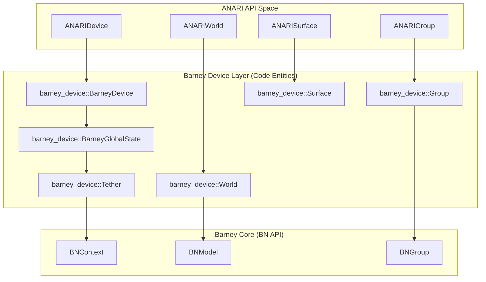
**Sources:** [anari/Device.cpp:139-204](), [anari/BarneyGlobalState.h:43-93](), [anari/World.cpp:139-143](), [anari/Group.cpp:37-140]()

---

## Scene Translation: World, Group, and Surface

Barney translates the ANARI hierarchy (`World` -> `Instance` -> `Group` -> `Surface`/`Volume`) into Barney's native objects.

### Group Translation
The `barney_device::Group::makeBarneyGroup` function [anari/Group.cpp:37-140]() is responsible for:
1. Iterating through `ANARISurface` objects and extracting `BNGeom` handles via `Surface::getBarneyGeom()` [anari/Group.cpp:66-70]().
2. Collecting `BNVolume` handles from `ANARIVolume` objects [anari/Group.cpp:88-89]().
3. Creating a `BNGroup` using `bnGroupCreate` [anari/Group.cpp:121-125]().
4. Calling `bnGroupBuild` to trigger BVH construction for that group [anari/Group.cpp:131]().

### World and Model Management
The `ANARIWorld` is mapped to a `BNModel`. Barney distinguishes between structural changes and transform updates:
- **Full Rebuild**: Triggered if geometries are added/removed. Calls `World::fullRebuild()` [anari/World.cpp:201-227]().
- **Transform Update**: Triggered if only instance matrices change. Calls `World::transformOnlyUpdate()` [anari/World.cpp:195]().

**Object Lifecycle Diagram**
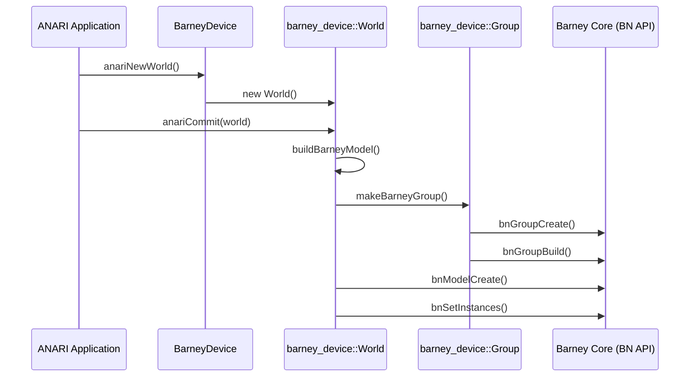
**Sources:** [anari/World.cpp:168-227](), [anari/Group.cpp:37-140](), [anari/Surface.cpp:59-71]()

---

## Capability Reporting and Queries

Barney uses the ANARI SDK's code generation features to report its capabilities.

1. **JSON Definitions**: The device's features, parameters, and types are defined in `barney_device.json` [anari/CMakeLists.txt:206]().
2. **Query Generation**: During build, if `BARNEY_AUTO_GENERATE_QUERIES` is ON, the `anari_generate_queries` CMake function produces C++ files that implement `query_object_types`, `query_object_info`, and `query_param_info` [anari/CMakeLists.txt:201-209]().
3. **Runtime Queries**: `BarneyDevice` implements `getObjectSubtypes` and `getParameterInfo` by calling these generated functions [anari/Device.cpp:146-173]().

**Sources:** [anari/CMakeLists.txt:17-18](), [anari/CMakeLists.txt:201-209](), [anari/Device.cpp:146-173]()

---

# Page: Context and Multi-GPU/MPI Topology

# Context and Multi-GPU/MPI Topology

<details>
<summary>Relevant source files</summary>

The following files were used as context for generating this wiki page:

- [barney/CMakeLists.txt](barney/CMakeLists.txt)
- [barney/Context.h](barney/Context.h)
- [barney/DeviceGroup.cpp](barney/DeviceGroup.cpp)
- [barney/DeviceGroup.h](barney/DeviceGroup.h)
- [barney/GlobalModel.h](barney/GlobalModel.h)
- [barney/LocalContext.cpp](barney/LocalContext.cpp)
- [barney/MPIContext.cpp](barney/MPIContext.cpp)
- [barney/ModelSlot.cpp](barney/ModelSlot.cpp)
- [barney/ModelSlot.h](barney/ModelSlot.h)
- [barney/WorkerTopo.cpp](barney/WorkerTopo.cpp)
- [barney/api/Context.h](barney/api/Context.h)
- [barney/geometry/IsoSurface.h](barney/geometry/IsoSurface.h)
- [barney/geometry/Triangles.cpp](barney/geometry/Triangles.cpp)
- [barney/geometry/Triangles.h](barney/geometry/Triangles.h)
- [barney/kernels/shadeRays.cu](barney/kernels/shadeRays.cu)
- [cmake/Findhiprt.cmake](cmake/Findhiprt.cmake)
- [rtcore/AppInterface.h](rtcore/AppInterface.h)
- [rtcore/CMakeLists.txt](rtcore/CMakeLists.txt)
- [rtcore/embree/AppInterface.h](rtcore/embree/AppInterface.h)

</details>


This page details the core infrastructure responsible for managing GPU resources, MPI communication, and the mapping of scene data across distributed compute nodes. Barney uses a hierarchical context system to abstract single-GPU, multi-GPU, and multi-node (MPI) rendering configurations.

## The Context Hierarchy

The `Context` class is the primary interface for managing Barney's execution state. It is specialized into two main implementations based on the execution environment:

1.  **`LocalContext`**: Used for single-node execution. It manages one or more GPUs on the local machine [barney/LocalContext.cpp:1-5]().
2.  **`MPIContext`**: Used for distributed execution across multiple nodes. It encapsulates MPI communicators and coordinates work across a cluster [barney/MPIContext.h:23-25]().

### Context and SlotContext
A `Context` manages one or more **Model Slots**. Each slot represents a partition of the global scene data (a "Data Group"). The `SlotContext` struct holds the state specific to a single data partition on a set of GPUs [barney/Context.h:36-46]().

| Entity | Description |
| :--- | :--- |
| `Context` | Global engine state, manages `WorkerTopo` and all `ModelSlot` objects [barney/Context.h:61-72](). |
| `SlotContext` | Contains references to the `SamplerRegistry`, `MaterialRegistry`, and the specific `DevGroup` assigned to a data partition [barney/Context.h:36-46](). |
| `LocalSlot` | A simple descriptor used during initialization to map a `dataRank` to a list of local `gpuIDs` [barney/api/Context.h:180-183](). |

### Context Class Relationship
The following diagram illustrates how the high-level `Context` interacts with device management and topology entities.

**Diagram: Context Entity Mapping**
```mermaid
graph TD
    subgraph "Public API Space"
        API_Ctx["barney_api::Context"]
    end

    subgraph "Core Engine Space (BARNEY_NS)"
        Ctx["BARNEY_NS::Context"]
        LCtx["BARNEY_NS::LocalContext"]
        MCtx["BARNEY_NS::MPIContext"]
        SCtx["BARNEY_NS::SlotContext"]
    end

    subgraph "Topology & Device Management"
        WT["WorkerTopo"]
        DG["DevGroup"]
        Dev["Device"]
    end

    API_Ctx <|-- Ctx
    Ctx <|-- LCtx
    Ctx <|-- MCtx
    
    Ctx *-- WT
    Ctx *-- SCtx
    SCtx o-- DG
    DG "1" *-- "n" Dev
```
Sources: [barney/Context.h:36-72](), [barney/DeviceGroup.h:99-110](), [barney/MPIContext.h:83-90]()

---

## Worker Topology and Node Discovery

The `WorkerTopo` class describes the global layout of the rendering cluster. It tracks every GPU across all MPI ranks and assigns them to specific data groups.

### Hostname Hashing and Local Rank Discovery
To correctly map MPI ranks to physical hardware, Barney uses hostname hashing to identify which ranks share the same physical node.
*   **`getHostNameHash()`**: Generates a hash of the local machine's hostname [barney/MPIContext.cpp:25]().
*   **`findLocalRank()`**: Uses `MPI_Allgather` on hostname hashes to determine the local index of an MPI rank relative to other ranks on the same host [barney/MPIContext.cpp:27-39](). This is critical for assigning specific `gpuID`s to ranks (e.g., Rank 0 gets GPU 0, Rank 1 gets GPU 1).

### MPI Communicator Splitting
In `MPIContext`, Barney distinguishes between two communicators:
1.  **`world`**: The global communicator containing all ranks [barney/MPIContext.h:105]().
2.  **`workers`**: A sub-communicator containing only ranks that participate in rendering (active workers) [barney/MPIContext.h:106]().

Sources: [barney/MPIContext.cpp:27-77](), [barney/WorkerTopo.h:10-20]()

---

## Device Groups and Logical Mapping

Barney abstracts physical GPUs into `Device` objects, which are further organized into `DevGroup` (Device Groups).

### The Device Class
The `Device` class wraps the `rtc::Device` (the hardware-specific backend like OptiX or CUDA) and manages device-local resources [barney/DeviceGroup.h:34-68]():
*   **`rayQueue`**: A `RayQueue` instance for managing wavefront rays on this specific GPU [barney/DeviceGroup.cpp:66]().
*   **`traceRays`**: The hardware-specific ray tracing kernel [barney/DeviceGroup.cpp:67-68]().
*   **`geomTypes`**: A registry for backend-specific geometry types (e.g., OptiX `OptixProgramGroup`) [barney/DeviceGroup.cpp:60]().

### Data Group Mapping
Data groups allow Barney to render scenes larger than the memory of a single GPU by distributing different parts of the model across different sets of GPUs.

| Mapping Level | Description |
| :--- | :--- |
| **Global Rank** | The unique ID of a GPU across the entire MPI world [barney/DeviceGroup.h:42](). |
| **Local Rank** | The ID of a GPU relative to the current MPI rank [barney/DeviceGroup.h:45](). |
| **Data Rank** | The ID of the scene partition (Model Slot) this GPU is responsible for [barney/WorkerTopo.h:17](). |

**Diagram: Data-to-GPU Flow**
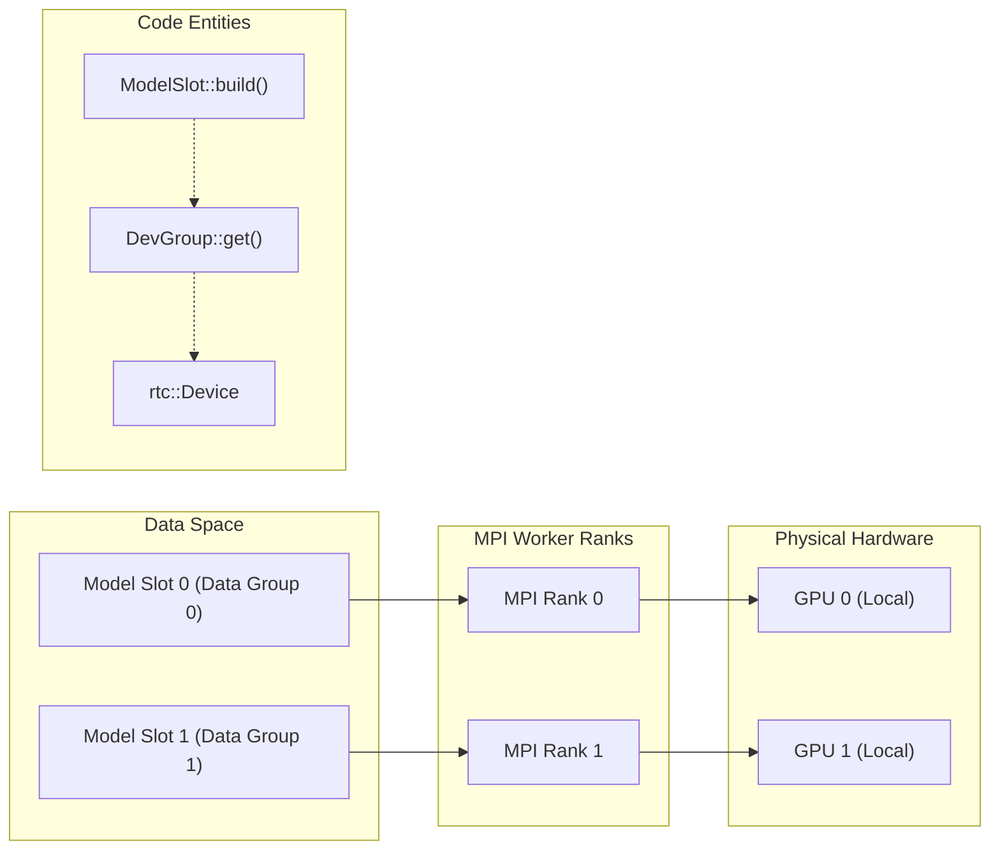
Sources: [barney/ModelSlot.cpp:22-33](), [barney/DeviceGroup.h:99-110](), [barney/WorkerTopo.h:10-20]()

---

## Ray Distribution and Global Convergence

In a distributed environment, rays may need to travel between different data groups to find intersections. This is managed by the `GlobalTraceImpl` abstraction.

### Global Ray Tracing Implementation
The `Context` delegates global ray traversal to specialized implementations [barney/Context.h:48]():
*   **`RQSMPI`**: Standard MPI-based ray queue synchronization [barney/MPIContext.cpp:103]().
*   **`TwoStage`**: An optimized inter-node exchange strategy [barney/MPIContext.cpp:98]().
*   **`All2all`**: Uses `MPI_Alltoall` for massive ray exchanges [barney/MPIContext.cpp:101]().

### Global Termination
To determine if a frame is finished, the context must check if any rays are still active anywhere in the cluster.
*   **`numRaysActiveLocally()`**: Counts active rays in the `RayQueue` of all local GPUs [barney/Context.h:194]().
*   **`numRaysActiveGlobally()`**: Performs an `MPI_Allreduce` (Sum) across the `workers` communicator to check the global ray count [barney/MPIContext.cpp:116-120]().

Sources: [barney/Context.h:149-161](), [barney/MPIContext.cpp:116-120](), [barney/globalTrace/RQSMPI.h:10-15]()

---

# Page: Ray Tracing Core (rtcore)

# Ray Tracing Core (rtcore)

<details>
<summary>Relevant source files</summary>

The following files were used as context for generating this wiki page:

- [barney/render/Ray.h](barney/render/Ray.h)
- [rtcore/ComputeInterface.h](rtcore/ComputeInterface.h)
- [rtcore/TraceInterface.h](rtcore/TraceInterface.h)
- [rtcore/cuda/ProgramInterface.h](rtcore/cuda/ProgramInterface.h)
- [rtcore/cuda/TraceInterface.h](rtcore/cuda/TraceInterface.h)
- [rtcore/cudaCommon/ComputeInterface.h](rtcore/cudaCommon/ComputeInterface.h)
- [rtcore/cudaCommon/cuda-common.h](rtcore/cudaCommon/cuda-common.h)
- [rtcore/cudaCommon/cuda-helper.h](rtcore/cudaCommon/cuda-helper.h)

</details>


The `rtcore` layer is Barney's hardware abstraction layer for ray tracing and device compute. Its primary purpose is to insulate the high-level rendering engine from the specifics of different hardware backends (NVIDIA OptiX, native CUDA, AMD HIPRT, or Intel Embree). It provides a unified set of interfaces for tracing rays, managing device memory, and launching compute kernels.

## Core Abstractions

The `rtcore` library defines several key interfaces that must be implemented by each backend. These interfaces allow the renderer to remain backend-agnostic while still achieving hardware-accelerated performance.

### TraceInterface
The `TraceInterface` is the primary mechanism through which device-side programs (such as intersection or any-hit shaders) interact with the ray tracing pipeline. It provides methods to query ray properties, report intersections, and trigger new ray traversals.

*   **State Access**: Provides access to `primID`, `geomID`, and `instID` during traversal [rtcore/cuda/ProgramInterface.h:57-67]().
*   **Ray Queries**: Allows querying world-space and object-space ray origins and directions [rtcore/cuda/ProgramInterface.h:75-85]().
*   **Intersection Reporting**: Used by custom geometry to report hits via `reportIntersection` [rtcore/cuda/ProgramInterface.h:28-29]().
*   **Recursive Tracing**: Supports `traceRay` for secondary ray effects within the backend [rtcore/cuda/ProgramInterface.h:106-111]().

### ComputeInterface
The `ComputeInterface` abstracts standard parallel compute operations. It provides a common way to access thread indices and perform atomic operations across different GPU and CPU architectures.

*   **Launch Indexing**: Provides `launchIndex()`, `getThreadIdx()`, and `getBlockDim()` abstractions [rtcore/cudaCommon/ComputeInterface.h:46-55]().
*   **Atomics**: Implements cross-platform atomics like `atomicAdd`, `fatomicMin`, and `fatomicMax` [rtcore/cudaCommon/ComputeInterface.h:56-59](), [rtcore/cudaCommon/ComputeInterface.h:117-143]().
*   **Texturing**: Wraps hardware-specific texture sampling for 1D, 2D, and 3D textures [rtcore/cudaCommon/ComputeInterface.h:28-39]().

### Bridge to Rendering Space
The following diagram illustrates how the `rtcore` abstractions bridge high-level rendering concepts to backend-specific implementations.

**Entity Mapping: rtcore Abstraction to Implementations**
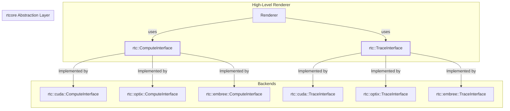
Sources: [rtcore/ComputeInterface.h:10-34](), [rtcore/TraceInterface.h:12-26]()

---

## Backend Implementations

Barney supports four distinct backends, each residing in its own subdirectory within `rtcore/`.

### [OptiX Backend](#3.1)
The OptiX backend utilizes NVIDIA's OptiX Ray Tracing Framework. It leverages hardware RT cores on RTX GPUs and manages the Shader Binding Table (SBT) and Pipeline State Objects (PSOs). It is the primary backend for high-performance rendering on NVIDIA hardware.
For details, see [OptiX Backend](#3.1).

### [CUDA Software Tracer Backend](#3.2)
This backend provides a native CUDA ray tracing implementation using **cuBQL** for BVH traversal and intersection [rtcore/cuda/TraceInterface.h:15-19](). It is used when OptiX is unavailable or for specific debugging scenarios. It implements a software-based SBT using function pointers [rtcore/cuda/ProgramInterface.h:175-181]().
For details, see [CUDA Software Tracer Backend](#3.2).

### [HIPRT Backend (AMD GPU)](#3.3)
The HIPRT backend targets AMD GPUs using the HIP language and HIPRT library. It utilizes a `cuda_to_hip.h` translation layer to allow Barney's CUDA-centric source code to compile for ROCm environments [rtcore/cudaCommon/cuda_to_hip.h:1-11]().
For details, see [HIPRT Backend (AMD GPU)](#3.3).

### [Embree CPU Backend](#3.4)
The Embree backend provides a CPU-based fallback using Intel's Embree library. It supports multiple ISA targets (SSE, AVX, NEON) and implements the `TraceInterface` by wrapping Embree's ray query API.
For details, see [Embree CPU Backend](#3.4).

---

## Program and Kernel Execution

`rtcore` uses macros to define and export kernels so they can be launched from the host regardless of the backend.

**Execution Flow: Host to Device**
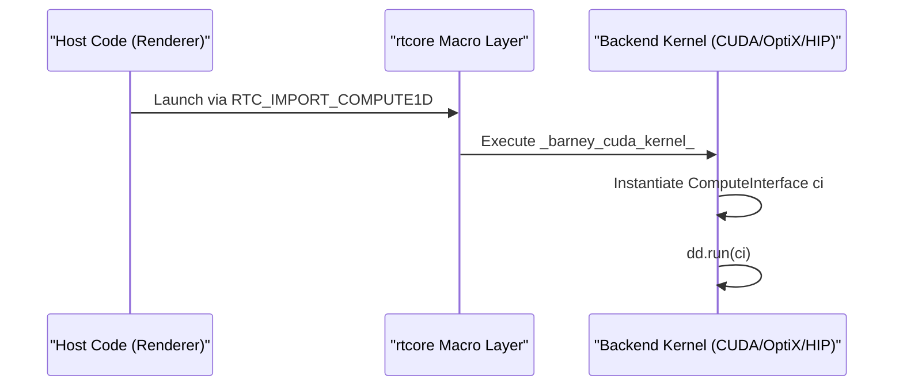
Sources: [rtcore/cudaCommon/ComputeInterface.h:181-196]()

### Key Data Structures
*   **`rtc::AccelHandle`**: An opaque handle to the top-level acceleration structure (BVH) [rtcore/cuda/ProgramInterface.h:106]().
*   **`rtc::Geom::SBTHeader`**: The base structure for all entries in the Shader Binding Table, containing function pointers for hit programs [rtcore/cuda/ProgramInterface.h:124]().
*   **`rtc::Instance`**: Defines an instance in the scene with object-to-world and world-to-object transforms [rtcore/cuda/ProgramInterface.h:15-18]().

| Structure | Role | Source |
| :--- | :--- | :--- |
| `ComputeInterface` | Provides `launchIndex`, `atomicAdd`, and texture samplers. | [rtcore/cudaCommon/ComputeInterface.h:42-61]() |
| `TraceInterface` | Provides `traceRay`, `reportIntersection`, and ray/geometry IDs. | [rtcore/cuda/ProgramInterface.h:20-138]() |
| `SBTHeader` | Stores pointers to `anyHit`, `closestHit`, and `intersect` programs. | [rtcore/cuda/ProgramInterface.h:175-181]() |

Sources: [rtcore/cuda/ProgramInterface.h:1-141](), [rtcore/cudaCommon/ComputeInterface.h:1-196](), [rtcore/cuda/TraceInterface.h:1-100]()

---

# Page: OptiX Backend

# OptiX Backend

<details>
<summary>Relevant source files</summary>

The following files were used as context for generating this wiki page:

- [barney/common/Data.h](barney/common/Data.h)
- [barney/render/OptixGlobals.h](barney/render/OptixGlobals.h)
- [rtcore/cuda/Group.h](rtcore/cuda/Group.h)
- [rtcore/embree/Group.cpp](rtcore/embree/Group.cpp)
- [rtcore/embree/Group.h](rtcore/embree/Group.h)
- [rtcore/optix/Buffer.cpp](rtcore/optix/Buffer.cpp)
- [rtcore/optix/Buffer.h](rtcore/optix/Buffer.h)
- [rtcore/optix/Denoiser.cpp](rtcore/optix/Denoiser.cpp)
- [rtcore/optix/Denoiser.h](rtcore/optix/Denoiser.h)
- [rtcore/optix/Device.cpp](rtcore/optix/Device.cpp)
- [rtcore/optix/Device.h](rtcore/optix/Device.h)
- [rtcore/optix/Group.cpp](rtcore/optix/Group.cpp)
- [rtcore/optix/Group.h](rtcore/optix/Group.h)

</details>


The OptiX backend provides the high-performance hardware-accelerated ray tracing implementation for Barney on NVIDIA GPUs. It leverages the **OWL (OptiX 7 Wrapper Library)** to manage the complexity of OptiX contexts, module compilation, and Shader Binding Table (SBT) construction.

## Architecture and Device Management

The OptiX backend is centered around the `rtc::optix::Device` class, which extends the common CUDA device abstraction. It initializes an `OWLContext` to manage OptiX resources for a specific physical GPU.

### Key Components

| Class | Description |
| :--- | :--- |
| `rtc::optix::Device` | Manages the `OWLContext` and serves as a factory for buffers, geometries, and groups. |
| `rtc::optix::Buffer` | A wrapper around `OWLBuffer` for managing device memory. |
| `rtc::optix::Group` | Encapsulates `OWLGroup` handles, representing acceleration structures (AS). |
| `rtc::optix::TraceKernel2D` | Manages OptiX ray generation programs and launch parameters. |

The following diagram illustrates the relationship between the OptiX backend entities and the underlying OWL/OptiX resources:

**OptiX Backend Entity Mapping**
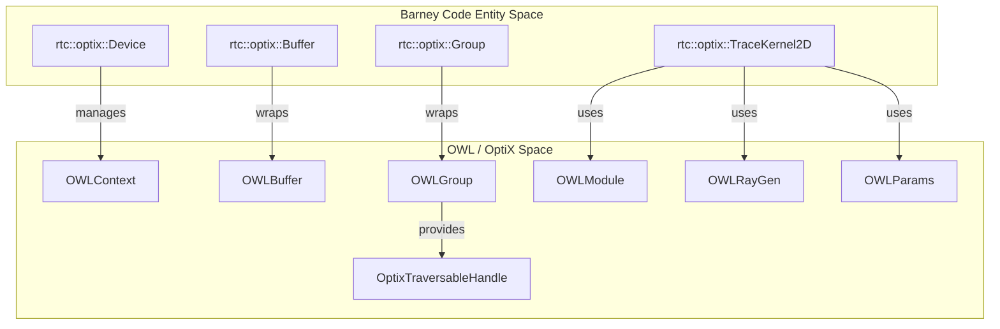
Sources: [rtcore/optix/Device.h:51-156](), [rtcore/optix/Buffer.h:14-32](), [rtcore/optix/Group.h:14-25](), [rtcore/optix/Device.h:37-49]()

## Acceleration Structures and Groups

Barney uses a hierarchical acceleration structure system managed via `rtc::optix::Group`. Groups can contain geometries (Triangles or User-defined) or instances of other groups.

*   **Triangles Group**: Created via `owlTrianglesGeomGroupCreate`, optimized for hardware triangle intersection [rtcore/optix/Device.cpp:162-172]().
*   **User Geometry Group**: Created via `owlUserGeomGroupCreate`, used for primitives like spheres or volume macro-cells [rtcore/optix/Device.cpp:174-184]().
*   **Instance Group**: Created via `owlInstanceGroupCreate`, allowing for transforms and instancing of existing groups [rtcore/optix/Device.cpp:186-206]().

The `rtc::AccelHandle` used by the renderer is a direct cast of the `OptixTraversableHandle` obtained from OWL [rtcore/optix/Group.cpp:16-21]().

Sources: [rtcore/optix/Group.cpp:8-41](), [rtcore/optix/Device.cpp:155-208]()

## PTX Embedding and Program Management

Device programs (kernels) are written in `.dev.cu` files and compiled to PTX. These PTX strings are embedded into the binary and linked at runtime.

### Kernel Launch Flow
The `TraceKernel2D` class handles the lifecycle of an OptiX launch:
1.  **Module Creation**: Creates an `OWLModule` from embedded PTX code [rtcore/optix/Device.cpp:125-125]().
2.  **RayGen Creation**: Initializes an `OWLRayGen` program [rtcore/optix/Device.cpp:126-128]().
3.  **Launch Parameters**: Uses `OWLParams` to manage constant data (like `OptixGlobals`) passed to the device [rtcore/optix/Device.cpp:131-136]().
4.  **Async Launch**: Launches the kernel using `owlAsyncLaunch2D` and tracks the associated CUDA stream [rtcore/optix/Device.cpp:141-152]().

The `OptixGlobals` struct acts as the primary Launch Parameter (LP) block, containing pointers to the ray queue, hit information, and the top-level acceleration structure handle [barney/render/OptixGlobals.h:24-59]().

Sources: [rtcore/optix/Device.cpp:115-152](), [barney/render/OptixGlobals.h:17-76]()

## OptiX Denoiser Integration

Barney integrates the `OptixDenoiser` for post-processing. The `Optix8Denoiser` class (requiring OptiX 8.0+) handles HDR denoising and optional 2x upscaling.

### Denoiser Data Flow
The denoiser operates on a set of layers, typically requiring Color (RGBA), Albedo, and Normal buffers.

**Denoiser Execution Pipeline**
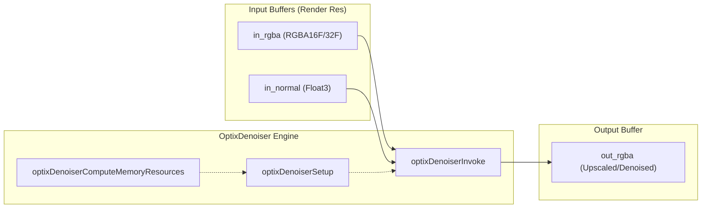

### Key Implementation Details:
*   **Memory Management**: The denoiser computes required scratch and state sizes via `optixDenoiserComputeMemoryResources` and allocates them on the device [rtcore/optix/Denoiser.cpp:132-153]().
*   **Upscaling**: Supports `OPTIX_DENOISER_MODEL_KIND_UPSCALE2X`, which doubles the output resolution [rtcore/optix/Denoiser.cpp:28-31]().
*   **Alpha Mode**: Explicitly set to `OPTIX_DENOISER_ALPHA_MODE_COPY` to avoid artifacts during MPI compositing [rtcore/optix/Denoiser.cpp:24-25]().

Sources: [rtcore/optix/Denoiser.cpp:16-45](), [rtcore/optix/Denoiser.cpp:113-196]()

## Buffer and SBT Management

The `rtc::optix::Buffer` class manages memory via `owlDeviceBufferCreate` [rtcore/optix/Buffer.cpp:11-17](). It supports asynchronous uploads via the device's CUDA stream [rtcore/optix/Buffer.h:34-39]().

The **Shader Binding Table (SBT)** is managed by OWL. When geometries or programs are modified, `Device::buildPipeline()` and `Device::buildSBT()` are called to synchronize the OptiX state before the next launch [rtcore/optix/Device.cpp:69-78]().

Sources: [rtcore/optix/Buffer.cpp:5-32](), [rtcore/optix/Device.cpp:69-93]()

---

# Page: CUDA Software Tracer Backend

# CUDA Software Tracer Backend

<details>
<summary>Relevant source files</summary>

The following files were used as context for generating this wiki page:

- [barney/geometry/Triangles.dev.cu](barney/geometry/Triangles.dev.cu)
- [barney/packedBSDF/NVisii.h](barney/packedBSDF/NVisii.h)
- [rtcore/cuda/Buffer.cpp](rtcore/cuda/Buffer.cpp)
- [rtcore/cuda/Buffer.h](rtcore/cuda/Buffer.h)
- [rtcore/cuda/Device.h](rtcore/cuda/Device.h)
- [rtcore/cuda/TraceKernel.h](rtcore/cuda/TraceKernel.h)
- [rtcore/cuda/cudaDevice.cu](rtcore/cuda/cudaDevice.cu)
- [rtcore/cuda/cudaGroup.cu](rtcore/cuda/cudaGroup.cu)
- [rtcore/cudaCommon/Device.h](rtcore/cudaCommon/Device.h)
- [rtcore/cudaCommon/cuda_to_hip.h](rtcore/cudaCommon/cuda_to_hip.h)

</details>


The CUDA Software Tracer Backend provides a native ray tracing implementation that operates directly on CUDA kernels without requiring NVIDIA OptiX. It serves as a high-performance alternative for hardware that does not support OptiX or for environments where a unified CUDA/HIP codebase is preferred. This backend utilizes the `cuBQL` library for BVH construction and traversal, and employs a function-pointer-based Shader Binding Table (SBT) to manage separable compilation of geometry intersection and shading programs.

## Architecture Overview

The backend is built upon a hierarchy of classes that mirror the `rtcore` abstraction layer. It extends `rtc::cuda_common::Device` to provide memory management and stream control, while implementing specific ray tracing logic through `rtc::cuda::Device`.

### Key Code Entities

| Entity | File | Description |
| :--- | :--- | :--- |
| `rtc::cuda::Device` | [rtcore/cuda/Device.h:36-70]() | Main interface for the CUDA backend, managing buffers, groups, and kernels. |
| `rtc::cuda::Buffer` | [rtcore/cuda/Buffer.h:14-25]() | Wrapper for device memory allocations (`cudaMalloc`). |
| `rtc::cuda::Group` | [rtcore/cuda/cudaGroup.cu:24-33]() | Base class for acceleration structures (BVHs). |
| `rtc::cuda::TraceKernel2D` | [rtcore/cuda/TraceKernel.h:16-28]() | Handles the launch of 2D ray tracing kernels. |
| `rtc::cuda_common::SetActiveGPU` | [rtcore/cudaCommon/Device.h:21-27]() | RAII utility for switching the active CUDA device context. |

### System Data Flow: Ray Tracing Execution
This diagram illustrates the relationship between the host-side device management and the device-side kernel execution.

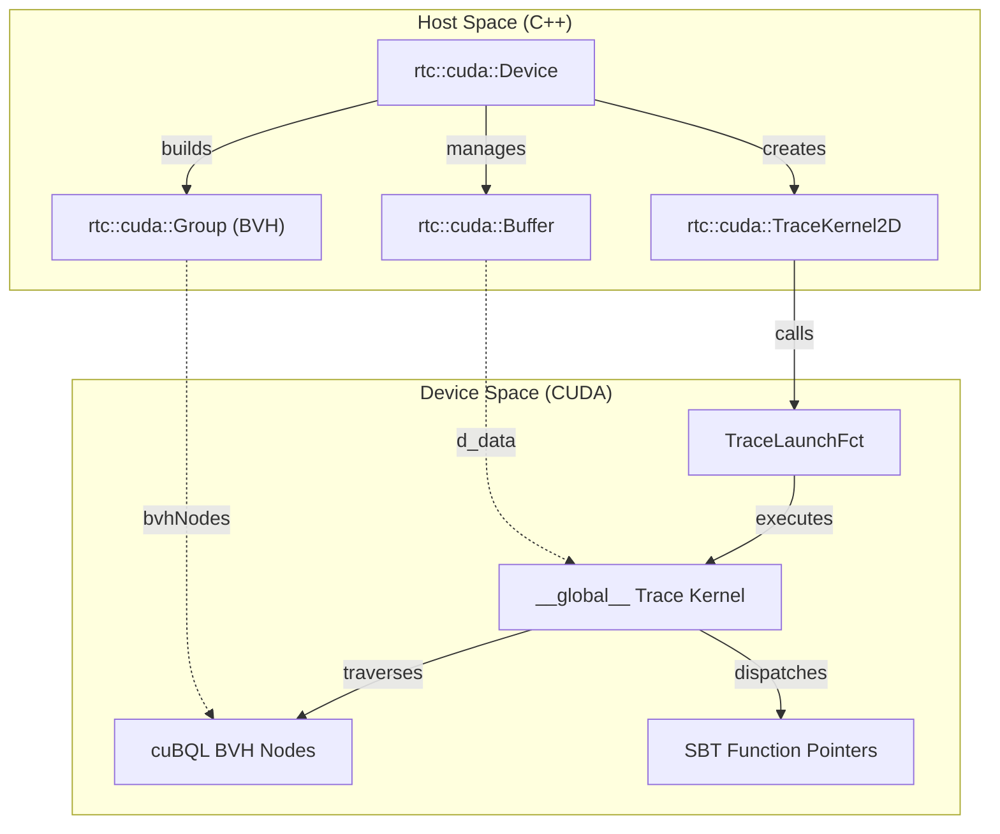
**Sources:** [rtcore/cuda/Device.h:36-70](), [rtcore/cuda/TraceKernel.h:14-28](), [rtcore/cuda/cudaGroup.cu:24-33]()

---

## Memory and Buffer Management

The backend uses `rtc::cuda::Buffer` to abstract `cudaMalloc` and `cudaMemcpy` operations. Buffers are bound to a specific `rtc::cuda::Device` and ensure that the correct GPU is active during allocation and transfer using the `SetActiveGPU` RAII helper [rtcore/cuda/Buffer.cpp:12-24]().

- **Allocation:** `Buffer::resize` frees existing memory and allocates a new block on the device [rtcore/cuda/Buffer.cpp:40-46]().
- **Data Transfer:** `Buffer::upload` performs synchronous or asynchronous copies from host to device memory [rtcore/cuda/Buffer.cpp:32-38]().

**Sources:** [rtcore/cuda/Buffer.h:14-25](), [rtcore/cuda/Buffer.cpp:12-46]()

---

## Acceleration Structures (Groups)

Groups in the CUDA backend represent BVHs built over either geometries or instances. The backend uses `cuBQL` (CUDA Bounding Quantized Hierarchy) for GPU-based BVH construction [rtcore/cuda/cudaGroup.cu:7-18]().

### Geometry Groups
`GeomGroup` and its specialized version `TrianglesGeomGroup` aggregate multiple geometry objects into a single BVH.
1. **Bounds Generation:** The kernel `createTriangleBounds` calculates axis-aligned bounding boxes (AABBs) for every triangle in the group [rtcore/cuda/cudaGroup.cu:91-112]().
2. **BVH Build:** `cuBQL::cuda::build` (or `cuBQL::cpuBuilder` if forced) generates the tree structure [rtcore/cuda/cudaGroup.cu:197-210]().

### Instance Groups
`InstanceGroup` allows for top-level acceleration structures that reference other `Group` objects with affine transformations.
- **Transform Management:** `InstanceGroup::setTransforms` updates the instance matrices [rtcore/cuda/cudaGroup.cu:139-142]().
- **Bounds Computation:** The `computeInstanceBounds` kernel transforms the child group's root bounds into world space [rtcore/cuda/cudaGroup.cu:125-137]().

**Sources:** [rtcore/cuda/cudaGroup.cu:57-137](), [rtcore/cuda/cudaGroup.cu:144-175]()

---

## Shader Binding Table (SBT) and Separable Compilation

Unlike the OptiX backend which uses the OptiX-native SBT, the CUDA software tracer implements a manual SBT using CUDA function pointers. This allows the renderer to dispatch to different intersection and shading programs (e.g., `TrianglesPrograms::anyHit`) based on the geometry type encountered during traversal.

### Geometry Programs
Geometry-specific logic is defined in `.dev.cu` files. For example, `Triangles.dev.cu` implements the `anyHit` logic, including:
- **Barycentric Interpolation:** Calculating vertex attributes (normals, texture coordinates) [barney/geometry/Triangles.dev.cu:32-37]().
- **Alpha Testing:** Evaluating material opacity and potentially ignoring intersections [barney/geometry/Triangles.dev.cu:121-134]().
- **Attribute Storage:** Writing hit data to the `HitAttributes` structure [barney/geometry/Triangles.dev.cu:88-115]().

**Sources:** [barney/geometry/Triangles.dev.cu:13-140](), [rtcore/cuda/TraceKernel.h:33-43]()

---

## AMD Compatibility: The `cuda_to_hip` Shim

A critical feature of the CUDA backend is its portability to AMD hardware via a compatibility shim. The header `rtcore/cudaCommon/cuda_to_hip.h` aliases standard CUDA runtime symbols to their HIP equivalents when compiled with `hipcc` [rtcore/cudaCommon/cuda_to_hip.h:16-102]().

| CUDA Symbol | HIP Alias |
| :--- | :--- |
| `cudaStream_t` | `hipStream_t` |
| `cudaMalloc` | `hipMalloc` |
| `cudaMemcpy` | `hipMemcpy` |
| `cudaTextureObject_t` | `hipTextureObject_t` |

This allows the same source code in `rtcore/cuda` and `rtcore/cudaCommon` to be utilized for both the CUDA Software Tracer and the HIP-based backends without code duplication.

**Sources:** [rtcore/cudaCommon/cuda_to_hip.h:28-102]()

---

## Trace Execution Model

Ray tracing is initiated via `rtc::cuda::TraceKernel2D::launch`. This function manages the launch parameters (LP) data and invokes a launch function [rtcore/cuda/TraceKernel.h:16-28]().

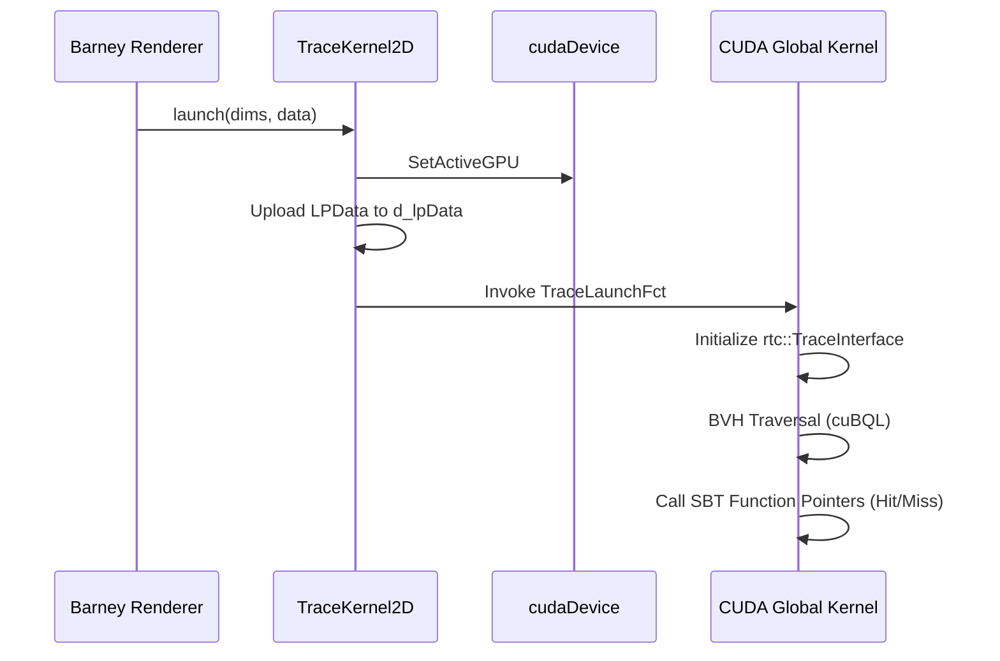

**Sources:** [rtcore/cuda/TraceKernel.h:16-28](), [rtcore/cuda/cudaDevice.cu:66-73]()

---

# Page: HIPRT Backend (AMD GPU)

# HIPRT Backend (AMD GPU)

<details>
<summary>Relevant source files</summary>

The following files were used as context for generating this wiki page:

- [rtcore/hiprt/AppInterface.h](rtcore/hiprt/AppInterface.h)
- [rtcore/hiprt/Buffer.cpp](rtcore/hiprt/Buffer.cpp)
- [rtcore/hiprt/Buffer.h](rtcore/hiprt/Buffer.h)
- [rtcore/hiprt/ComputeInterface.h](rtcore/hiprt/ComputeInterface.h)
- [rtcore/hiprt/Device.cpp](rtcore/hiprt/Device.cpp)
- [rtcore/hiprt/Device.h](rtcore/hiprt/Device.h)
- [rtcore/hiprt/Geom.cpp](rtcore/hiprt/Geom.cpp)
- [rtcore/hiprt/Geom.h](rtcore/hiprt/Geom.h)
- [rtcore/hiprt/GeomType.cpp](rtcore/hiprt/GeomType.cpp)
- [rtcore/hiprt/GeomType.h](rtcore/hiprt/GeomType.h)
- [rtcore/hiprt/Group.cpp](rtcore/hiprt/Group.cpp)
- [rtcore/hiprt/Group.h](rtcore/hiprt/Group.h)
- [rtcore/hiprt/ProgramInterface.h](rtcore/hiprt/ProgramInterface.h)
- [rtcore/hiprt/TraceInterface.h](rtcore/hiprt/TraceInterface.h)
- [rtcore/hiprt/TraceKernel.cpp](rtcore/hiprt/TraceKernel.cpp)
- [rtcore/hiprt/TraceKernel.h](rtcore/hiprt/TraceKernel.h)

</details>


The HIPRT backend provides hardware-accelerated ray tracing for Barney on AMD RDNA2+ GPUs. It implements the `rtc` (Ray Tracing Core) abstraction layer by wrapping the AMD HIPRT library. This backend is designed to be binary-compatible with the shading logic of the CUDA Software Tracer backend, allowing the same device-side intersection and shading programs to run on AMD hardware via a `cuda_to_hip` translation layer.

## Architecture and Device Management

The HIPRT backend is centered around the `rtc::hiprt::Device` class, which inherits from `rtc::cuda_common::Device`. It manages a `hiprtContext` that is bound to a specific HIP device and stream to ensure that BVH construction and ray traversal see the same device pointers allocated by Barney.

### System Hierarchy Diagram

The following diagram illustrates the relationship between the host-side management classes and the HIPRT API entities.

**HIPRT Backend Entity Mapping**
```mermaid
graph TD
    subgraph "Host Space (rtc::hiprt)"
        A["Device"] -- "manages" --> B["hiprtContext"]
        A -- "creates" --> C["Group"]
        C -- "subclass" --> D["GeomGroup (BLAS)"]
        C -- "subclass" --> E["InstanceGroup (TLAS)"]
        D -- "contains" --> F["Geom"]
    end

    subgraph "HIPRT API Space"
        B -- "owns" --> G["hiprtGeometry"]
        B -- "owns" --> H["hiprtScene"]
    end

    subgraph "Device Space (SBT)"
        D -- "uploads" --> I["DeviceRecord"]
        I -- "points to" --> J["SBT (Function Pointers)"]
        I -- "points to" --> K["Prim Remap Table"]
    end

    F -- "defines" --> J
```
Sources: [rtcore/hiprt/Device.h:47-74](), [rtcore/hiprt/Device.cpp:28-52](), [rtcore/hiprt/Group.h:18-47]()

## Acceleration Structure Management

Barney uses a two-level acceleration structure hierarchy. The HIPRT backend maps these to `hiprtGeometry` (Bottom-Level Acceleration Structure - BLAS) and `hiprtScene` (Top-Level Acceleration Structure - TLAS).

### GeomGroup (BLAS)
A `GeomGroup` aggregates multiple `Geom` objects of the same type (either Triangles or User Geoms). 
- **Triangles**: The backend concatenates all vertices and indices from constituent geometries into a single contiguous buffer before calling `hiprtBuildGeometry` [rtcore/hiprt/Group.cpp:151-164]().
- **User Geoms**: The backend invokes a `BoundsKernel` for each geometry to generate AABBs, which are then passed to HIPRT as a `hiprtAABBListPrimitive` [rtcore/hiprt/Group.cpp:9-13]().

### InstanceGroup (TLAS)
An `InstanceGroup` represents a `hiprtScene`. It takes a collection of `Group` pointers and their corresponding affine transformations. The backend manages `hiprtInstance` objects and builds the TLAS using `hiprtBuildScene` [rtcore/hiprt/Group.h:76-111]().

### Shader Binding Table (SBT) Compatibility
To maintain compatibility with the CUDA software backend, the HIPRT backend manually assembles an SBT-like structure. This structure contains function pointers for:
- `AHProg`: Any Hit program [rtcore/hiprt/GeomType.h:23]().
- `CHProg`: Closest Hit program [rtcore/hiprt/GeomType.h:24]().
- `IntersectProg`: Intersection program (for User Geoms) [rtcore/hiprt/GeomType.h:22]().

The `GeomGroup_buildSBTandPrims` function is responsible for packing these pointers along with per-geometry data into a device-side buffer [rtcore/hiprt/Group.cpp:59-115]().

Sources: [rtcore/hiprt/Group.h:36-70](), [rtcore/hiprt/Group.cpp:59-136](), [rtcore/hiprt/Geom.h:24-36]()

## Data Flow and Execution

The execution flow involves translating CUDA-style kernel launches into HIP-compatible launches and using the `TraceInterface` for ray traversal within kernels.

### Ray Traversal Flow
The following diagram shows how a ray moves from the rendering kernel through the HIPRT traversal engine and back into Barney's shading logic.

**Ray Traversal and Shading Dispatch**
```mermaid
sequenceDiagram
    participant K as TraceKernel (Device)
    participant H as HIPRT Traversal Engine
    participant I as IntersectProg (User)
    participant S as SBT / Shading Logic

    K->>H: hiprtTraverse(scene, ray)
    alt is User Geometry
        H->>I: Invoke custom intersection
        I-->>H: Report Hit (t, primID)
    end
    H-->>K: Hit Result (instID, geomPrimID)
    K->>S: Lookup InstanceRecord[instID]
    S->>S: Lookup PrimRemap[geomPrimID] -> (geomID, localPrimID)
    S->>S: Dispatch CHProg(SBT[geomID])
```
Sources: [rtcore/hiprt/Group.h:36-47](), [rtcore/hiprt/Group.cpp:7-13](), [rtcore/hiprt/TraceInterface.h:1-20]()

### Cuda-to-HIP Translation
The backend relies on a translation layer that allows `.cu` files to be compiled as HIP code.
- **Compute Interface**: The `__rtc_launch` macro handles setting the active GPU and launching kernels on the appropriate HIP stream [rtcore/hiprt/ComputeInterface.h:25-26]().
- **Texture Support**: CUDA texture objects and fetches (`tex1D`, `tex2D`, `tex3D`) are mapped to their HIP equivalents via `rtc::cuda_common` [rtcore/hiprt/ComputeInterface.h:15-17]().
- **Buffers**: The `rtc::hiprt::Buffer` class wraps `hipMalloc` and `hipMemcpy` (aliased as `Malloc` and `Memcpy` via the translation layer) [rtcore/hiprt/Buffer.cpp:21-23]().

## Key Classes and Functions

| Entity | Role | File Reference |
| :--- | :--- | :--- |
| `rtc::hiprt::Device` | Main entry point; manages `hiprtContext`. | [rtcore/hiprt/Device.h:47]() |
| `rtc::hiprt::Buffer` | Simple wrapper for device memory allocations. | [rtcore/hiprt/Buffer.h:17]() |
| `rtc::hiprt::Geom` | Host-side representation of geometry data and SBT records. | [rtcore/hiprt/Geom.h:17]() |
| `rtc::hiprt::GeomGroup` | Manages BLAS construction and per-primitive remapping. | [rtcore/hiprt/Group.h:36]() |
| `rtc::hiprt::InstanceGroup` | Manages TLAS construction and instance metadata. | [rtcore/hiprt/Group.h:76]() |
| `GeomGroup_buildSBTandPrims` | Utility to pack function pointers for device-side dispatch. | [rtcore/hiprt/Group.cpp:59]() |

## Implementation Details

### Buffer Management
The `Buffer` class provides a thin abstraction over HIP device memory. It includes support for resizing and asynchronous uploads. It is explicitly bound to the `rtc::cuda_common::Device` to prevent cross-backend type pollution [rtcore/hiprt/Buffer.h:14-28]().

### Denoiser Support
Currently, the HIPRT backend provides a no-op `Denoiser` stub. Hardware-accelerated denoising (e.g., via OIDN on ROCm) is noted as a deferred enhancement [rtcore/hiprt/Device.h:79-93]().

Sources: [rtcore/hiprt/Buffer.cpp:14-45](), [rtcore/hiprt/Device.h:79-93](), [rtcore/hiprt/AppInterface.h:1-31]()

---

# Page: Embree CPU Backend

# Embree CPU Backend

<details>
<summary>Relevant source files</summary>

The following files were used as context for generating this wiki page:

- [rtcore/cuda/Group.h](rtcore/cuda/Group.h)
- [rtcore/embree/Denoiser.h](rtcore/embree/Denoiser.h)
- [rtcore/embree/Group.cpp](rtcore/embree/Group.cpp)
- [rtcore/embree/Group.h](rtcore/embree/Group.h)
- [rtcore/optix/Device.cpp](rtcore/optix/Device.cpp)
- [rtcore/optix/Group.cpp](rtcore/optix/Group.cpp)
- [rtcore/optix/Group.h](rtcore/optix/Group.h)

</details>


The Embree CPU backend provides a high-performance ray tracing implementation for Barney on x86 and ARM architectures. It leverages Intel's Embree library to handle acceleration structure construction and ray traversal. This backend is encapsulated within the `rtc::embree` namespace and implements the core `rtcore` interfaces for devices, geometries, and groups.

## Architecture Overview

The Embree backend mirrors the structure of Barney's GPU backends but operates entirely in host memory using SIMD-optimized kernels. It supports various ISA targets including SSE4.2, AVX2, AVX-512, and NEON via Embree's internal abstraction.

### System Mapping: Code Entity Space

The following diagram illustrates how high-level Barney concepts map to specific Embree backend implementation classes.

**Embree Backend Entity Map**
```mermaid
graph TD
    subgraph "rtcore Interface"
        RTCDevice["rtc::Device"]
        RTCGroup["rtc::Group"]
        RTCGeom["rtc::Geom"]
    end

    subgraph "Embree Implementation (rtc::embree)"
        EDevice["embree::Device"]
        EGroup["embree::Group"]
        EGeom["embree::Geom"]
        ETriGroup["embree::TrianglesGroup"]
        EUserGroup["embree::UserGeomGroup"]
        EInstGroup["embree::InstanceGroup"]
    end

    subgraph "Intel Embree C API"
        RTCDevice_t["RTCDevice"]
        RTCScene_t["RTCScene"]
        RTCGeometry_t["RTCGeometry"]
    end

    RTCDevice --> EDevice
    RTCGroup --> EGroup
    RTCGeom --> EGeom

    EDevice -->|owns| RTCDevice_t
    EGroup -->|owns| RTCScene_t
    EGeom -->|references| RTCGeometry_t
    
    EGroup <|-- ETriGroup
    EGroup <|-- EUserGroup
    EGroup <|-- EInstGroup
```
Sources: [rtcore/embree/Device.h:10-30](), [rtcore/embree/Group.h:12-29](), [rtcore/embree/Group.h:47-79]()

---

## Device and Resource Management

The `embree::Device` class manages the lifetime of the underlying `RTCDevice` handle. Unlike GPU backends that manage VRAM, the Embree backend works with standard system memory.

- **Initialization**: Creates an `RTCDevice` which serves as the factory for all other Embree objects.
- **Denoising**: If `BARNEY_OIDN_CPU` is enabled, the device can create a `DenoiserOIDN` which utilizes Intel Open Image Denoise (OIDN) [rtcore/embree/Denoiser.h:34-49]().
- **Synchronization**: Since CPU execution is generally synchronous relative to the host, `Device::sync()` typically ensures all pending background tasks (like BVH builds) are completed.

Sources: [rtcore/embree/Denoiser.h:16-30](), [rtcore/embree/Denoiser.h:34-49]()

---

## Geometry and Group Hierarchy

The backend organizes scene data into `Group` objects, which correspond to `RTCScene` handles in Embree.

### Geometry Types
1. **Triangles**: Implemented via `TrianglesGroup`. It creates `RTC_GEOMETRY_TYPE_TRIANGLE` geometries and attaches shared buffers for indices and vertices [rtcore/embree/Group.cpp:136-168]().
2. **User Geometry**: Implemented via `UserGeomGroup`. It uses `RTC_GEOMETRY_TYPE_USER` and requires the definition of bounds and intersection callbacks [rtcore/embree/Group.cpp:91-118]().

### Acceleration Structure Building
The `buildAccel()` function is responsible for committing geometries to the `RTCScene`.

- For **Triangles**, vertex and index buffers are wrapped in `RTCBuffer` objects using `rtcNewSharedBuffer` to avoid data duplication [rtcore/embree/Group.cpp:142-158]().
- For **User Geometries**, the backend registers `virtualBoundsFunc` and `virtualIntersect` to handle custom intersection logic [rtcore/embree/Group.cpp:107-110]().

### Instancing
`InstanceGroup` manages a collection of other groups with associated affine transformations. It creates `RTC_GEOMETRY_TYPE_INSTANCE` geometries.
- It maintains both `xfms` (Object-to-World) and `inverseXfms` (World-to-Object) [rtcore/embree/Group.h:76-77]().
- The `inverseXfms` are computed during `buildAccel()` using `rcp(xfm)` [rtcore/embree/Group.cpp:198-200]().

Sources: [rtcore/embree/Group.h:47-79](), [rtcore/embree/Group.cpp:91-118](), [rtcore/embree/Group.cpp:127-170](), [rtcore/embree/Group.cpp:186-205]()

---

## Data Flow: Intersection Callbacks

For non-triangle primitives (User Geometry), the Embree backend bridges the Embree callback mechanism to Barney's `TraceInterface`.

**Intersection Callback Flow**
```mermaid
sequenceDiagram
    participant E as Embree RTCScene
    participant C as virtualIntersect
    participant TI as TraceInterface
    participant UG as UserGeomType

    E->>C: Invoke Callback(args)
    activate C
    C->>TI: Initialize context (instID, geomID, primID)
    C->>TI: Set objectToWorld/worldToObject Xfms
    C->>UG: intersect(ti)
    UG-->>TI: Update isec_t if hit found
    alt isec_t < INFINITY
        C->>UG: ah(ti) (Any-Hit/Filter)
        alt !ignoreThisHit
            C->>E: Accept hit (update rayHit->hit)
        end
    end
    deactivate C
```

### Implementation Details
- **`virtualBoundsFunc`**: Extracts the geometry data and calls the primitive-specific bounds function to populate the `RTCBounds` structure [rtcore/embree/Group.cpp:15-32]().
- **`virtualIntersect`**: 
    - Maps the `RTCIntersectFunctionNArguments` to a Barney `TraceInterface` [rtcore/embree/Group.cpp:43-50]().
    - Retrieves the instance transformations from the `InstanceGroup` using the `instID` provided by the Embree context [rtcore/embree/Group.cpp:51-54]().
    - Executes the user-defined intersection logic and optionally an "any-hit" filter [rtcore/embree/Group.cpp:60-78]().

Sources: [rtcore/embree/Group.cpp:15-32](), [rtcore/embree/Group.cpp:34-79]()

---

## CPU Denoising

The backend includes a stub/wrapper for OIDN (Open Image Denoise). 

- **DenoiserOIDN**: Manages an `OIDNDevice` and `OIDNFilter` [rtcore/embree/Denoiser.h:47-48]().
- **Data Buffers**: It tracks input RGBA, normals, and output RGBA buffers [rtcore/embree/Denoiser.h:22-24]().
- **Upscaling**: Supports an `upscaleMode` which allows rendering at a lower resolution and upscaling during the denoising pass [rtcore/embree/Denoiser.h:28-29]().

Sources: [rtcore/embree/Denoiser.h:16-50]()

---

# Page: Rendering Pipeline

# Rendering Pipeline

<details>
<summary>Relevant source files</summary>

The following files were used as context for generating this wiki page:

- [barney/Context.cpp](barney/Context.cpp)
- [barney/fb/LocalFB.cpp](barney/fb/LocalFB.cpp)
- [barney/kernels/generateRays.cu](barney/kernels/generateRays.cu)
- [barney/kernels/traceRays.cu](barney/kernels/traceRays.cu)
- [barney/kernels/traceRays.dev.cu](barney/kernels/traceRays.dev.cu)
- [barney/render/RayQueue.cpp](barney/render/RayQueue.cpp)
- [rtcore/cuda/ComputeInterface.h](rtcore/cuda/ComputeInterface.h)

</details>


The Barney rendering pipeline is a high-performance, wave-front path tracing architecture designed for distributed multi-GPU and MPI environments. It manages the lifecycle of rays from initial generation to final framebuffer accumulation through a series of specialized kernels and global distribution strategies.

### Pipeline Execution Flow

The top-level rendering loop is orchestrated by `Context::renderTiles` [barney/Context.cpp:142-185](). For each sample per pixel (controlled by `renderer->pathsPerPixel`), the pipeline executes the following sequence:

1.  **Ray Generation**: Primary rays are created based on the camera model and assigned to a wave-front queue.
2.  **Global Trace Loop**: A loop continues until all rays in the current wave-front have either escaped the scene or reached a termination criterion (e.g., maximum bounces).
    *   **Trace**: Rays are intersected against the scene geometry (BVH).
    *   **Shade**: Hit points are evaluated, materials are sampled, and new secondary rays are generated.
3.  **Accumulation**: Radiance results are written to the `FrameBuffer` and accumulated over time.

The following diagram illustrates the relationship between the host-side orchestration and the device-side data structures:

**Rendering Pipeline: Host Orchestration to Device Entities**
```mermaid
graph TD
    subgraph "Host Space (Context.cpp)"
        A["Context::renderTiles()"] --> B["generateRays()"]
        B --> C["traceRaysGlobally()"]
        C --> D["shadeRaysLocally()"]
        D --> E{Active Rays?}
        E -- "Yes" --> C
        E -- "No" --> F["FrameBuffer::accumID++"]
    end

    subgraph "Device Space (Ray Queues)"
        RQ["RayQueue"]
        RQ_READ["traceAndShadeReadQueue"]
        RQ_WRITE["receiveAndShadeWriteQueue"]
        
        B -.->|"Writes to"| RQ_WRITE
        C -.->|"Reads from"| RQ_READ
        D -.->|"Writes to"| RQ_WRITE
        
        SWAP["RayQueue::swapAfterShade()"]
        D -.-> SWAP
        SWAP -.->|"Ping-Pong"| RQ_READ
    end

    subgraph "Code Entities"
        B_K["generateRays.cu"]
        T_K["traceRays.cu"]
        S_K["shadeRays.cu"]
    end

    B --- B_K
    C --- T_K
    D --- S_K
```
**Sources:** [barney/Context.cpp:142-185](), [barney/render/RayQueue.cpp:71-97](), [barney/render/RayQueue.h:10-125]()

---

## 4.1 Ray Generation and Camera Models
The pipeline begins with `_generateRays`, a CUDA kernel that operates on image tiles [barney/kernels/generateRays.cu:44-67](). Each thread in a tile generates a primary ray based on the active `Camera::DD` configuration. Barney supports several camera models, including perspective (with depth-of-field), orthographic, and omnidirectional [barney/kernels/generateRays.cu:93-145]().

The `accumID` is used to drive progressive rendering, providing the seed for random jittering of pixel samples and lens positions to achieve anti-aliasing and motion blur [barney/kernels/generateRays.cu:84-91]().

For details, see [Ray Generation and Camera Models](#4.1).

**Sources:** [barney/kernels/generateRays.cu:44-145](), [barney/Camera.h:1-50]()

---

## 4.2 Global Trace Strategies
Because Barney is designed for large-scale data that may be distributed across multiple GPUs or MPI ranks, tracing is managed by the `GlobalTraceImpl` abstraction [barney/Context.cpp:191-197](). 

Depending on the configuration, Barney employs different strategies:
*   **Local**: Rays stay on the local GPU (single-GPU).
*   **MPI/All2All**: Rays are forwarded to the specific GPU/node that contains the part of the model they need to intersect.

This stage ensures that regardless of where the data lives, every ray in the `RayQueue` finds its intersection [barney/render/RayQueue.cpp:45-61]().

For details, see [Global Trace Strategies](#4.2).

**Sources:** [barney/Context.cpp:191-197](), [barney/render/RayQueue.cpp:45-61]()

---

## 4.3 Shading and Path Tracing
Once rays have been traced and hit points found, `shadeRaysLocally` is invoked [barney/Context.cpp:172](). The shading kernel evaluates the Material BSDFs, calculates direct lighting, and determines if a path should continue. 

Key aspects of this stage include:
*   **Ray/PathState**: Tracking the throughput and state of each path [barney/render/Ray.h:1-100]().
*   **Shadow Rays**: Secondary rays used for occlusion testing.
*   **Volume Scattering**: Handling interactions with volumetric data using Woodcock tracking or similar techniques.

For details, see [Shading and Path Tracing](#4.3).

**Sources:** [barney/Context.cpp:172](), [barney/render/Ray.h:1-100]()

---

## 4.4 Framebuffer Management
The `FrameBuffer` class hierarchy manages the storage and accumulation of rendered pixels. In distributed modes, `TiledFB` handles local tile storage, while `DistFB` manages the final compositing of tiles across MPI ranks [barney/fb/FrameBuffer.h:1-100]().

The pipeline supports multiple auxiliary channels (depth, normals, object IDs) and handles the final conversion from linear color space to sRGB for display [barney/fb/LocalFB.cpp:60-70]().

For details, see [Framebuffer Management](#4.4).

**Sources:** [barney/fb/LocalFB.cpp:60-70](), [barney/fb/FrameBuffer.h:1-100]()

---

### System Entity Mapping

The following diagram maps high-level pipeline stages to the specific classes and kernels that implement them.

**Pipeline Stage to Code Entity Mapping**
```mermaid
graph LR
    subgraph "Stage: Generate"
        GEN["_generateRays"] --> CAM["Camera::DD"]
    end

    subgraph "Stage: Trace"
        TRC["traceRaysLocally"] --> RT["rtc::TraceInterface"]
        RT --> OPTX["OptixGlobals"]
    end

    subgraph "Stage: Shade"
        SHD["shadeRaysLocally"] --> MAT["MaterialRegistry"]
        SHD --> SAMP["SamplerRegistry"]
    end

    subgraph "Stage: Finalize"
        FB["LocalFB::gatherColorChannel"] --> TILE["TiledFB"]
    end

    GEN -.->|"RayQueue"| TRC
    TRC -.->|"Hit Data"| SHD
    SHD -.->|"Radiance"| FB
```
**Sources:** [barney/kernels/generateRays.cu:44-67](), [barney/kernels/traceRays.cu:16-19](), [barney/fb/LocalFB.cpp:60-70](), [barney/render/OptixGlobals.h:1-50]()

---

# Page: Ray Generation and Camera Models

# Ray Generation and Camera Models

<details>
<summary>Relevant source files</summary>

The following files were used as context for generating this wiki page:

- [anari/Camera.cpp](anari/Camera.cpp)
- [anari/Camera.h](anari/Camera.h)
- [barney/Camera.cu](barney/Camera.cu)
- [barney/Camera.h](barney/Camera.h)
- [barney/kernels/generateRays.cu](barney/kernels/generateRays.cu)
- [barney/kernels/traceRays.cu](barney/kernels/traceRays.cu)

</details>


The ray generation stage is the entry point of the rendering pipeline, responsible for transforming 2D image coordinates into 3D rays based on the camera model. Barney uses a tiled rendering approach where primary rays are generated per-tile and injected into a ray queue for subsequent intersection and shading.

## Ray Generation Overview

Ray generation is implemented as a GPU kernel that processes a set of frame buffer tiles. Each CUDA block typically handles one tile, and each thread within the block generates one or more rays for a specific pixel.

### Tile-Based Generation
Rays are generated only for the tiles owned by the local device [barney/kernels/generateRays.cu:62-65](). The kernel `_generateRays` iterates through `TileDesc` structures to determine the screen-space offsets for each pixel [barney/kernels/generateRays.cu:72-78]().

### Data Flow: Host to Device
The following diagram illustrates how camera parameters flow from the ANARI API layer through the Barney core into the ray generation kernel.

**Camera Data Flow Diagram**
```mermaid
graph TD
    subgraph "ANARI Layer (Natural Language Space)"
        A["ANARI Perspective/Orthographic"] -- "commitParameters()" --> B["barney_device::Camera"]
    end

    subgraph "Barney Core (Code Entity Space)"
        B -- "bnSetVec/bnSet1f" --> C["BARNEY_NS::PerspectiveCamera"]
        C -- "commit()" --> D["Camera::DD (Device Data)"]
    end

    subgraph "Device Kernels"
        D -- "passed as arg" --> E["_generateRays kernel"]
        E -- "samples" --> F["Ray struct"]
    end
    
    style A stroke-dasharray: 5 5
    style F stroke-dasharray: 5 5
```
Sources: [anari/Camera.cpp:127-146](), [barney/Camera.cu:81-100](), [barney/kernels/generateRays.cu:44-47]()

## Camera Models and Device Data

Barney uses a unified device-side structure `Camera::DD` to represent different camera types without requiring virtual function calls on the GPU [barney/Camera.h:22-27]().

### Camera::DD Structure
The `Camera::DD` struct contains a `Type` enum and a union of configuration structs for each supported model [barney/Camera.h:32-62]():

| Camera Type | Key Parameters in `Camera::DD` | Description |
| :--- | :--- | :--- |
| `PERSPECTIVE` | `dir_00`, `dir_du`, `dir_dv`, `lens_00`, `apertureRadius`, `focusDistance` | Standard pinhole or Depth-of-Field camera. |
| `ORTHOGRAPHIC` | `org_00`, `org_du`, `org_dv`, `dir`, `height`, `aspect` | Parallel projection camera. |
| `OMNIDIRECTIONAL`| `toWorld` (affine3f) | Equirectangular (360-degree) projection. |

Sources: [barney/Camera.h:34-62]()

### Perspective and Depth of Field (DOF)
For perspective cameras, Barney calculates the ray direction by interpolating across the focal plane using `dir_du` and `dir_dv` [barney/kernels/generateRays.cu:96-99](). If `apertureRadius > 0.f`, the kernel implements a thin-lens model:
1.  A random point is sampled on a disk representing the lens [barney/kernels/generateRays.cu:113-120]().
2.  The ray origin is shifted to this lens point [barney/kernels/generateRays.cu:124]().
3.  The ray direction is recalculated to pass through the point on the focal plane at `focusDistance` [barney/kernels/generateRays.cu:107-125]().

### Omnidirectional (Equirectangular)
The omnidirectional camera maps the [0,1] normalized image coordinates to spherical coordinates ($\phi, \theta$) [barney/kernels/generateRays.cu:32-33](). These are converted to a unit vector in world space using the camera's `toWorld` transformation matrix [barney/kernels/generateRays.cu:143-144]().

## Progressive Rendering and Accumulation

Barney achieves progressive refinement through an `accumID` (accumulation ID).

*   **Jittering**: For `accumID > 0`, the kernel applies a random jitter to the pixel coordinates (anti-aliasing) and the lens sample (DOF) [barney/kernels/generateRays.cu:88-89]().
*   **Initial Sample**: For `accumID == 0`, the kernel samples the exact center of the pixel and the center of the lens to provide a clean, deterministic first frame [barney/kernels/generateRays.cu:88-89](), [barney/kernels/generateRays.cu:110-111]().
*   **Randomness**: The `Random` sampler is seeded using a combination of the pixel coordinates and the `accumID` to ensure unique samples per frame [barney/kernels/generateRays.cu:84-85]().

## Cutting Planes

The ray generation kernel also handles the global cutting plane. If a cutting plane is defined in the `Renderer::DD` struct [barney/kernels/generateRays.cu:172](), the generated ray is clipped:
*   If the camera is on the visible side, the ray's `tMax` is restricted where it exits the half-space [barney/kernels/generateRays.cu:180-183]().
*   If the camera is on the invisible side, the ray origin is advanced to the plane's intersection point so that interior geometry becomes visible [barney/kernels/generateRays.cu:188-190]().

**Ray Generation Logic Flow**
```mermaid
flowchart TD
    Start["_generateRays Kernel Launch"] --> TileIdx["Get TileID from BlockIdx"]
    TileIdx --> CalcPixel["Calculate Pixel (ix, iy)"]
    CalcPixel --> CheckCamType{"Camera Type?"}
    
    CheckCamType -- PERSPECTIVE --> DOF{"Aperture > 0?"}
    DOF -- YES --> SampleLens["Sample Lens Disk & Focus Plane"]
    DOF -- NO --> Pinhole["Standard Perspective Ray"]
    
    CheckCamType -- ORTHO --> OrthoRay["Parallel Ray Generation"]
    CheckCamType -- OMNI --> OmniRay["UV to Spherical Map"]
    
    SampleLens --> CutPlane["Apply Renderer::DD cutPlane"]
    Pinhole --> CutPlane
    OrthoRay --> CutPlane
    OmniRay --> CutPlane
    
    CutPlane --> Queue["Atomic Increment d_count & Write to rayQueue"]
```
Sources: [barney/kernels/generateRays.cu:71-192]()

## Implementation Details

### Ray and PathState Initialization
The kernel initializes the `Ray` and `PathState` structures for each pixel. This includes clearing hit information, setting `tMax` to infinity, and initializing the `rngSeed` for subsequent path tracing bounces [barney/kernels/generateRays.cu:80-86](), [barney/kernels/generateRays.cu:167-170]().

### Debugging Features
The kernel supports per-pixel debugging. If `enablePerRayDebug` is active, rays corresponding to the center of the screen are flagged with `_dbg` or `crosshair` bits, allowing shading kernels to print diagnostic information for specific pixels [barney/kernels/generateRays.cu:152-163]().

Sources: [barney/kernels/generateRays.cu:1-192](), [barney/Camera.cu:1-255](), [barney/Camera.h:1-75](), [anari/Camera.cpp:1-151]()

---

# Page: Global Trace Strategies

# Global Trace Strategies

<details>
<summary>Relevant source files</summary>

The following files were used as context for generating this wiki page:

- [barney/DeviceGroup.cpp](barney/DeviceGroup.cpp)
- [barney/DeviceGroup.h](barney/DeviceGroup.h)
- [barney/WorkerTopo.cpp](barney/WorkerTopo.cpp)
- [barney/geometry/IsoSurface.h](barney/geometry/IsoSurface.h)
- [barney/kernels/shadeRays.cu](barney/kernels/shadeRays.cu)
- [barney/render/RayQueue.cpp](barney/render/RayQueue.cpp)
- [barney/render/World.cpp](barney/render/World.cpp)
- [rtcore/embree/AppInterface.h](rtcore/embree/AppInterface.h)

</details>


Global trace strategies in Barney manage the distribution and execution of ray tracing across multiple GPUs and MPI ranks. This subsystem is encapsulated by the `GlobalTraceImpl` abstraction, which coordinates how rays are generated, forwarded to the appropriate data groups (islands), and shaded.

## GlobalTraceImpl Abstraction

The tracing process is decoupled from the specific rendering kernel to support different multi-GPU and MPI topologies. The system uses a "Ray Queue" mechanism where rays are stored in device memory buffers and processed in cycles.

### Key Components

| Component | Description |
| :--- | :--- |
| `Device` | Represents a single hardware device (GPU or CPU core) and holds its specific `RayQueue` and `traceRays` kernel. [barney/DeviceGroup.h:34-68]() |
| `RayQueue` | Manages dual buffers (`read` and `write`) for rays, path states, and hit IDs. It allows for asynchronous double-buffering during trace/shade cycles. [barney/render/RayQueue.h:10-125]() |
| `WorkerTopo` | Defines the mapping of global ranks to "islands" (data groups). Each island contains a subset of the global scene data. [barney/WorkerTopo.cpp:9-62]() |

### Ray Queue Data Flow
The `RayQueue` class maintains two primary `SingleQueue` instances: `traceAndShadeReadQueue` and `receiveAndShadeWriteQueue`. These are swapped at specific stages of the pipeline to facilitate data movement between generation, tracing, and shading.

**Diagram: Ray Queue Buffer Swapping**
```mermaid
graph TD
    subgraph "RayQueue Class"
        RQ_READ["traceAndShadeReadQueue"]
        RQ_WRITE["receiveAndShadeWriteQueue"]
    end

    GEN["Ray Generation"] -->|Writes to| RQ_WRITE
    RQ_WRITE -->|swapAfterGeneration| RQ_READ
    RQ_READ -->|Input to| TRACE["traceRays Kernel"]
    TRACE -->|Writes Hits to| RQ_WRITE
    RQ_WRITE -->|swapAfterCycle| RQ_READ
    RQ_READ -->|Input to| SHADE["shadeRays Kernel"]
    SHADE -->|Writes New Rays to| RQ_WRITE
    RQ_WRITE -->|swapAfterShade| RQ_READ
    
    style RQ_READ stroke-width:2px
    style RQ_WRITE stroke-width:2px
```
Sources: [barney/render/RayQueue.h:10-125](), [barney/DeviceGroup.h:61-62]()

---

## Implementation Strategies

Barney provides several implementations of the trace strategy depending on the execution environment (single-node vs. MPI) and the data distribution.

### 1. RQSLocal (Single-Node Local)
Used when all data fits on a single node or when no MPI-based ray exchange is required. It cycles through the ray queue locally, executing the `traceRays` and `shadeRays` kernels until all paths are terminated or reach the maximum depth.

### 2. RQSMPI (MPI-Based Forwarding)
Used in distributed-memory environments where different MPI ranks hold different parts of the scene (data-parallel).
*   **Ray Forwarding**: If a ray leaves the local data bounds or is generated for a remote island, it is serialized and sent via MPI to the rank owning that data.
*   **Queue Cycling**: The rank receives remote rays, adds them to its local `RayQueue`, traces them, and sends results back or forwards them to the next bounce destination.

### 3. TwoStage (Optimized Exchange)
An optimized strategy for high-performance clusters that separates intra-node (GPU-to-GPU via NVLink/PCIe) and inter-node (MPI) exchanges.
*   **Stage 1**: Rays are gathered locally on the node and sorted by destination rank.
*   **Stage 2**: A single large MPI exchange moves rays between nodes, minimizing the number of MPI messages.

### 4. All2all
A specialized strategy that utilizes `MPI_Alltoallv` for global ray redistribution. This is typically used when the workload is highly unbalanced or when every rank needs to communicate with every other rank in a single sync point.

---

## Execution Flow: Generation to Shading

The rendering pipeline follows a strict sequence of kernel launches and queue swaps coordinated by the selected strategy.

**Diagram: Global Trace Execution Logic**
```mermaid
sequenceDiagram
    participant D as Device
    participant RQ as RayQueue
    participant TK as traceRays (Kernel)
    participant SK as shadeRays (Kernel)

    Note over D, SK: Start Frame
    D->>RQ: resetWriteQueue()
    D->>D: generateRays (Kernel)
    D->>RQ: swapAfterGeneration()
    
    loop Path Bounces
        D->>TK: Launch traceRays(RQ_READ)
        TK-->>RQ: Write HitIDs to RQ_WRITE
        D->>RQ: swapAfterCycle()
        D->>SK: Launch shadeRays(RQ_READ)
        SK-->>RQ: Write NextRays to RQ_WRITE
        D->>RQ: swapAfterShade()
        D->>RQ: readNumActive()
        Note over D: Break if numActive == 0
    end
```
Sources: [barney/DeviceGroup.cpp:40-69](), [barney/kernels/shadeRays.cu:1-138](), [barney/render/RayQueue.cpp:45-97]()

---

## Data Distribution and Islands

Rays are distributed across "Islands" as defined by the `WorkerTopo`. An island is a group of GPUs that collectively hold a complete copy of a specific "Data Slot".

*   **Island Size**: The number of GPUs within one data group. [barney/WorkerTopo.cpp:124-125]()
*   **Data Parallelism**: If `islandSize > 1`, Barney operates in a mode where data is replicated or partitioned within the island, and rays are traced against the local `GlobalModel`. [barney/WorkerTopo.cpp:86-89]()
*   **Global Rank**: Every device has a `_globalRank` within the `WorkerTopo`, which is used to determine which rays it is responsible for tracing. [barney/DeviceGroup.cpp:63-66]()

### Topology Discovery
The `WorkerTopo` computes the topology by hashing hostnames and physical device IDs to detect which GPUs share a physical node and which are remote.

| Function | Role |
| :--- | :--- |
| `WorkerTopo::WorkerTopo` | Maps global ranks to `islandID` and `islandRank`. [barney/WorkerTopo.cpp:10-62]() |
| `WorkerTopo::find` | Locates a device ID based on worker index and local index. [barney/WorkerTopo.cpp:128-136]() |
| `Device::worldRank` | Returns the MPI rank associated with the device. [barney/DeviceGroup.cpp:98-99]() |

Sources: [barney/WorkerTopo.cpp:10-138](), [barney/DeviceGroup.h:34-68]()

---

# Page: Shading and Path Tracing

# Shading and Path Tracing

<details>
<summary>Relevant source files</summary>

The following files were used as context for generating this wiki page:

- [barney/DeviceGroup.cpp](barney/DeviceGroup.cpp)
- [barney/DeviceGroup.h](barney/DeviceGroup.h)
- [barney/WorkerTopo.cpp](barney/WorkerTopo.cpp)
- [barney/geometry/IsoSurface.h](barney/geometry/IsoSurface.h)
- [barney/kernels/shadeRays.cu](barney/kernels/shadeRays.cu)
- [barney/render/GeometryAttributes.h](barney/render/GeometryAttributes.h)
- [barney/render/HitAttributes.h](barney/render/HitAttributes.h)
- [barney/render/Ray.h](barney/render/Ray.h)
- [barney/render/Renderer.cpp](barney/render/Renderer.cpp)
- [barney/render/Renderer.h](barney/render/Renderer.h)
- [rtcore/cuda/ProgramInterface.h](rtcore/cuda/ProgramInterface.h)
- [rtcore/cuda/TraceInterface.h](rtcore/cuda/TraceInterface.h)
- [rtcore/embree/AppInterface.h](rtcore/embree/AppInterface.h)

</details>


The shading subsystem in Barney is responsible for evaluating material properties, computing direct and indirect lighting, and managing the path state of rays as they traverse the scene. This process is primarily implemented in CUDA kernels that operate on ray queues, utilizing a dispatch mechanism for different Bidirectional Scattering Distribution Functions (BSDFs).

## The Shading Kernel (`shadeRays.cu`)

The core of the shading logic resides in the `shadeRays` kernel. This kernel processes rays that have successfully intersected geometry or volumes, computes the resulting radiance, and generates secondary rays (shadow rays or bounce rays) to continue the path tracing process.

### Data Flow and Interaction
The shading kernel interacts with several key device-side data structures to perform its calculations:
- **`Ray`**: Contains the physical properties of the ray (origin, direction) and hit information (intersection point $P$, normal $N$, and BSDF data).
- **`PathState`**: Maintains path-specific metadata that is not transmitted across the network in distributed modes, such as throughput and bounce counts.
- **`Renderer::DD`**: Provides global renderer configuration like ambient radiance and background colors.
- **`World::DD`**: Contains pointers to light sources (quad, directional, and point lights).

| Component | Role | Source |
| :--- | :--- | :--- |
| `shadeRays` | Main CUDA kernel for evaluating hits and sampling lights. | [barney/kernels/shadeRays.cu:13-16]() |
| `sampleAreaLights` | Samples `QuadLight` sources using a reservoir-based approach. | [barney/kernels/shadeRays.cu:47-52]() |
| `sampleDirLights` | Samples infinite directional lights. | [barney/kernels/shadeRays.cu:141-147]() |
| `Renderer::DD` | Device-side constants (background, ambient radiance, max bounces). | [barney/render/Renderer.h:20-30]() |

Sources: [barney/kernels/shadeRays.cu:13-150](), [barney/render/Renderer.h:20-30]()

## Ray and PathState Structures

Barney distinguishes between the physical ray/hit data and the logical state of the path.

### Ray Struct
The `Ray` struct [barney/render/Ray.h:49-99]() is a unified structure used for both surface and volume hits. It uses a bitfield and a union to store BSDF information efficiently.
- **`hitBSDF`**: A union `PackedBSDF::Data` that holds parameters for different material types (Lambert, PBR, etc.).
- **`bsdfType`**: A 4-bit field indicating which BSDF to evaluate.
- **`isShadowRay`**: A flag used to skip material evaluation and perform simple visibility tests.

### PathState Struct
The `PathState` struct [barney/render/Ray.h:18-26]() tracks the progression of a Monte Carlo path:
- **`throughput`**: The accumulated color/energy of the path (stored as `vec3h` half-precision).
- **`misWeight`**: The Multiple Importance Sampling weight used for balancing light sampling and BSDF sampling.
- **`numDiffuseBounces` / `numVolumeBounces`**: Counters to enforce termination criteria.

Sources: [barney/render/Ray.h:18-99]()

## PackedBSDF Dispatch Mechanism

Barney uses a "Packed BSDF" approach to handle material diversity without virtual function overhead on the GPU. The `PackedBSDF` class [barney/render/Ray.h:102-105]() acts as a wrapper around the `bsdfType` and `hitBSDF` data stored in the `Ray`.

During shading, the `bsdfType` is used to switch between different evaluation and sampling routines (e.g., `Lambertian`, `NVisii` (PBR), `Glass`, or `Phase` for volumes).

### Volume Bounces and Multi-Scattering
If `BARNEY_USE_MULTI_SCATTERING` is enabled, the shading system supports multiple scattering events within volumes.
- **`setVolumeHit`**: Configures the `Ray` with a `Phase` BSDF [barney/render/Ray.h:118-128]().
- **`numVolumeBounces`**: Tracked in `PathState` and capped by `Renderer::DD::maxVolumeBounces` [barney/render/Renderer.h:27]().

Sources: [barney/render/Ray.h:51-65](), [barney/render/Renderer.h:26-30]()

## Direct Lighting and MIS

The shading kernel performs Direct Light Sampling (Next Event Estimation) by picking light sources from the `World::DD`.

### Shadow Rays
Shadow rays are generated using the `makeShadowRay` utility [barney/render/Ray.h:153-163](). They are initialized with `isShadowRay = true` and `bsdfType = PackedBSDF::NONE`. The `tMax` is set to the distance to the light source to check for occlusions.

### Multiple Importance Sampling (MIS)
Barney implements MIS to combine BSDF sampling and light sampling [barney/kernels/shadeRays.cu:22]().
1. **Light Sampling**: A light is sampled, and a shadow ray is traced. The `misWeight` is calculated based on the light's PDF and the BSDF's PDF.
2. **BSDF Sampling**: A secondary ray is generated by sampling the BSDF. If this ray hits a light source (or the environment map), the contribution is weighted using MIS.

Sources: [barney/kernels/shadeRays.cu:20-43](), [barney/render/Ray.h:153-163]()

## Shading Implementation Diagram

The following diagram illustrates how the `shadeRays` kernel coordinates between the various device data structures and the BSDF logic.

```mermaid
graph TD
    subgraph "RayQueue Processing"
        SR["shadeRays.cu (Kernel)"]
    end

    subgraph "Input Data (Device)"
        RD["Renderer::DD (bgColor, ambient)"]
        WD["World::DD (Lights)"]
        RY["Ray (P, N, bsdfType, hitBSDF)"]
        PS["PathState (throughput, bounces)"]
    end

    subgraph "Logic Flow"
        IS_SHADOW{"isShadowRay?"}
        SAMP_L["sampleAreaLights()"]
        EVAL_BSDF["PackedBSDF::eval()"]
        GEN_BOUNCE["makeShadowRay() / secondary Ray"]
    end

    SR --> RY
    SR --> PS
    RY --> IS_SHADOW
    
    IS_SHADOW -- "No" --> SAMP_L
    IS_SHADOW -- "No" --> EVAL_BSDF
    SAMP_L --> GEN_BOUNCE
    EVAL_BSDF --> GEN_BOUNCE
    
    RD --> SR
    WD --> SAMP_L
```
Sources: [barney/kernels/shadeRays.cu:13-150](), [barney/render/Ray.h:49-99](), [barney/render/Renderer.h:20-30]()

## Device Data Hierarchy

This diagram maps the high-level system components to the specific C++ structs used in the shading device code.

```mermaid
classDiagram
    class Renderer_DD {
        +vec4f bgColor
        +float ambientRadiance
        +int maxVolumeBounces
    }
    class World_DD {
        +QuadLight_DD* quadLights
        +int numQuadLights
        +DirLight_DD* dirLights
    }
    class Ray {
        +vec3f org
        +vec3f dir
        +float tMax
        +uint16_t bsdfType
        +PackedBSDF_Data hitBSDF
    }
    class PathState {
        +vec3h throughput
        +float misWeight
        +int numDiffuseBounces
    }

    Renderer_DD <.. shadeRays_cu : used by
    World_DD <.. shadeRays_cu : used by
    Ray <.. shadeRays_cu : processed by
    PathState <.. shadeRays_cu : updated by
```
Sources: [barney/render/Renderer.h:20-30](), [barney/render/Ray.h:18-99](), [barney/kernels/shadeRays.cu:7-12]()

---

# Page: Framebuffer Management

# Framebuffer Management

<details>
<summary>Relevant source files</summary>

The following files were used as context for generating this wiki page:

- [anari/Frame.h](anari/Frame.h)
- [anari/Geometry.cpp](anari/Geometry.cpp)
- [anari/Sampler.cpp](anari/Sampler.cpp)
- [anari/Sampler.h](anari/Sampler.h)
- [anari/SpatialField.cpp](anari/SpatialField.cpp)
- [anari/common.h](anari/common.h)
- [barney/Context.cpp](barney/Context.cpp)
- [barney/common/Data.cpp](barney/common/Data.cpp)
- [barney/fb/DistFB.cu](barney/fb/DistFB.cu)
- [barney/fb/FrameBuffer.cu](barney/fb/FrameBuffer.cu)
- [barney/fb/FrameBuffer.h](barney/fb/FrameBuffer.h)
- [barney/fb/LocalFB.cpp](barney/fb/LocalFB.cpp)
- [barney/fb/TiledFB.cu](barney/fb/TiledFB.cu)
- [barney/kernels/traceRays.dev.cu](barney/kernels/traceRays.dev.cu)
- [rtcore/cuda/ComputeInterface.h](rtcore/cuda/ComputeInterface.h)

</details>


The Barney framebuffer system manages the storage, accumulation, and finalization of rendered pixels across multiple GPUs and MPI ranks. It utilizes a hierarchical approach to handle distributed data: pixels are initially rendered into tiled accumulation buffers on individual GPUs, then linearized, potentially denoised or upscaled, and finally gathered into a contiguous format for application access.

## Framebuffer Hierarchy

Barney implements a three-tier hierarchy for framebuffer management, abstracting the complexities of multi-GPU and MPI-based rendering.

| Class | Role | Implementation Detail |
| :--- | :--- | :--- |
| `TiledFB` | **Per-GPU Storage** | Manages `AccumTile` and `AuxChannelTile` arrays on a single device. Handles local linearization. |
| `LocalFB` | **Single-Node Aggregator** | Coordinates multiple `TiledFB` instances on one node. Used for single-node multi-GPU setups. |
| `DistFB` | **Distributed Aggregator** | Extends `FrameBuffer` for MPI. Manages tile compression and gathering across the network to a root rank. |

### Data Flow and Code Entities

The following diagram illustrates the relationship between the ANARI layer, the Barney API, and the internal framebuffer classes.

**Diagram: Framebuffer Entity Relationships**
```mermaid
graph TD
    subgraph "ANARI Layer"
        A["barney_device::Frame"] -- "manages" --> B["BNFrameBuffer (Handle)"]
    end

    subgraph "Barney Core (barney/fb)"
        B -- "points to" --> C["BARNEY_NS::FrameBuffer"]
        C <|-- D["BARNEY_NS::LocalFB"]
        C <|-- E["BARNEY_NS::DistFB"]
        
        D -- "contains" --> F["BARNEY_NS::TiledFB"]
        E -- "contains" --> F
    end

    subgraph "Device Storage"
        F -- "manages" --> G["AccumTile (Color/Normal)"]
        F -- "manages" --> H["AuxChannelTile (Depth/ID)"]
    end
```
Sources: [barney/fb/FrameBuffer.h:14-18](), [barney/fb/TiledFB.h:171-180](), [anari/Frame.h:96-96](), [barney/fb/LocalFB.h:9-12](), [barney/fb/DistFB.h:117-118]()

---

## Tile Layout and Linearization

Rendering in Barney is tile-based to optimize GPU utilization and ray coherence. Each tile is typically 16x16 pixels (`tileSize` is defined as 16).

### Tiled Storage
- **`AccumTile`**: Stores `vec4f` accumulation data and `vec3f` normals for a single tile [barney/fb/TiledFB.h:25-36]().
- **`AuxChannelTile`**: Stores `uint32_t` or `float` data for auxiliary channels like Depth, Primitive ID, Instance ID, and Object ID [barney/fb/TiledFB.h:40-45]().

### Linearization Kernels
Linearization is the process of moving data from these tiles into a linear (row-major) array. This is handled by specialized CUDA/RTC kernels:

1.  **`linearizeColorAndNormalKernel`**: Takes `AccumTile` data, applies an accumulation scale (`1/accumID`), and writes to the output buffer. It supports `BN_FLOAT4`, `BN_UFIXED8_RGBA`, and `BN_UFIXED8_RGBA_SRGB` formats [barney/fb/TiledFB.cu:13-50]().
2.  **`linearizeAuxTilesKernel`**: Directly maps `AuxChannelTile` data to the linear output [barney/fb/TiledFB.cu:88-107]().

Sources: [barney/fb/TiledFB.cu:13-50](), [barney/fb/TiledFB.cu:88-107](), [barney/fb/TiledFB.h:25-45]()

---

## Auxiliary Channels

Barney supports several auxiliary channels for visualization and post-processing. These are managed as bitmask flags during the `BNFrameBuffer` resize operation [barney/fb/FrameBuffer.h:31-33]().

| Channel Flag | Data Type | Description |
| :--- | :--- | :--- |
| `BN_FB_DEPTH` | `float` | Z-buffer depth. |
| `BN_FB_PRIMID` | `uint32_t` | Primitive ID at the hit point. |
| `BN_FB_OBJID` | `uint32_t` | Object ID (user-defined). |
| `BN_FB_INSTID` | `uint32_t` | Instance ID for instanced geometry. |
| `BN_FB_NORMAL` | `vec3f` | Shading normals (used for denoising). |

Auxiliary channels are gathered via `gatherAuxChannel` and written to application memory using `writeAuxChannel` [barney/fb/LocalFB.cpp:82-89]().

Sources: [barney/fb/FrameBuffer.h:31-33](), [barney/common/Data.cpp:133-147](), [barney/fb/LocalFB.cpp:82-89]()

---

## Color Space and Post-Processing

The `FrameBuffer::finalizeFrame` method coordinates the final steps before the image is presented to the user.

### Color Space Conversion
Barney performs linear-to-sRGB conversion within the linearization kernels if requested. The `linear_to_srgb` function is applied to the `vec4f` accumulation result before quantizing to `ufixed8` [barney/fb/TiledFB.cu:42-43]().

### Denoising and Upscaling
Barney integrates with NVIDIA OptiX Denoiser and Open Image Denoise (OIDN).
- **Denoising**: If `enableDenoising` is true, the `rtc::Denoiser` is invoked on the gathered linear color and normal channels [barney/fb/FrameBuffer.cu:193-209]().
- **AI Upscaling**: Barney supports 2x nearest-neighbor upscaling. If `enableUpscaling` is active, the renderer works at half-resolution, and kernels like `upscale2xVec4fKernel` expand the result to the final display size [barney/fb/FrameBuffer.cu:171-183]().

Sources: [barney/fb/FrameBuffer.cu:185-225](), [barney/fb/TiledFB.cu:42-43](), [barney/fb/FrameBuffer.h:130-142]()

---

## Distributed Framebuffer (MPI)

In MPI configurations, `DistFB` handles the collection of tiles from worker nodes to the "owner" (root) rank.

### Tile Compression
To reduce network traffic, tiles are compressed before transmission.
- **`CompressTiles`**: A kernel that calculates a scale factor for each tile and packs color into `rgba8` [barney/fb/DistFB.cu:82-110]().
- **`UnpackTiles`**: A kernel on the owner rank that decompresses the tiles back into linear `float4` or `rgba8` [barney/fb/DistFB.cu:25-80]().

### MPI Gathering Logic
The `DistFB::gatherColorChannel` method manages asynchronous MPI communication:
1.  **Workers**: Launch `CompressTiles` on their local GPUs and use `MPI_Isend` to send `CompressedColorTile` data to the owner [barney/fb/DistFB.cu:169-197]().
2.  **Owner**: Prepares `MPI_Irecv` buffers for all expected tiles from all GPUs in the cluster. Once received, it launches `UnpackTiles` to assemble the final image [barney/fb/DistFB.cu:131-167]().

**Diagram: Distributed Gathering Process**
```mermaid
sequenceDiagram
    participant W as Worker Rank (GPU)
    participant O as Owner Rank (Root)
    
    W->>W: Render to AccumTile
    W->>W: Launch CompressTiles (Kernel)
    W->>O: MPI_Isend(CompressedColorTile)
    O->>O: MPI_Irecv(CompressedColorTile)
    O->>O: Launch UnpackTiles (Kernel)
    O->>O: Denoise / Linearize to Final Buffer
```
Sources: [barney/fb/DistFB.cu:122-197](), [barney/fb/DistFB.h:47-65]()

---

# Page: Scene Objects and Geometry

# Scene Objects and Geometry

<details>
<summary>Relevant source files</summary>

The following files were used as context for generating this wiki page:

- [barney/Group.cpp](barney/Group.cpp)
- [barney/amr/BlockStructuredCuBQLSampler.cu](barney/amr/BlockStructuredCuBQLSampler.cu)
- [barney/amr/BlockStructuredCuBQLSampler.h](barney/amr/BlockStructuredCuBQLSampler.h)
- [barney/amr/BlockStructuredField.cu](barney/amr/BlockStructuredField.cu)
- [barney/amr/BlockStructuredMC.dev.cu](barney/amr/BlockStructuredMC.dev.cu)
- [barney/common/CuBQL.h](barney/common/CuBQL.h)
- [barney/geometry/Geometry.cpp](barney/geometry/Geometry.cpp)
- [barney/geometry/Geometry.h](barney/geometry/Geometry.h)
- [barney/geometry/IsoSurface.cpp](barney/geometry/IsoSurface.cpp)
- [barney/umesh/mc/UMeshCuBQLSampler.cu](barney/umesh/mc/UMeshCuBQLSampler.cu)
- [barney/volume/MCAccelerator.h](barney/volume/MCAccelerator.h)

</details>


Barney organizes scene data through a hierarchical structure of geometries, volumes, and groups, culminating in a top-level model. The system is designed to handle large-scale data by distributing these objects across multiple GPUs and MPI ranks. This page provides a high-level overview of how these objects are defined, how they are aggregated, and how the underlying Ray Tracing Core (rtcore) acceleration structures (BVHs) are built.

### Object Hierarchy Overview

The scene hierarchy follows a "bottom-up" construction logic where primitive geometries and volumes are aggregated into groups, which are then referenced by a model.

1.  **Geometries and Volumes**: The base primitives (Triangles, Spheres, Scalar Fields, etc.).
2.  **Groups**: Containers that aggregate multiple geometries and volumes [barney/Group.cpp:19-29]().
3.  **Models**: The top-level scene container that manages the global acceleration structure.

### Scene Entity Relationship

The following diagram illustrates the relationship between the natural language concepts and the C++ classes within the Barney codebase.

```mermaid
graph TD
    subgraph "Natural Language Space"
        A["Scene Primitive"]
        B["Collection"]
        C["Scene Root"]
    end

    subgraph "Code Entity Space"
        A --- D["Geometry (BNGeometry)"]
        A --- E["Volume (BNVolume)"]
        D --- F["barney::Geometry"]
        E --- G["barney::Volume"]
        B --- H["barney::Group"]
        C --- I["barney::ModelSlot"]
    end

    F --> H
    G --> H
    H --> I
```
Sources: [barney/geometry/Geometry.h:31-45](), [barney/Group.cpp:19-29](), [barney/ModelSlot.h:1-20]()

---

## Geometry and Acceleration

Barney supports both hardware-native primitives (Triangles) and custom primitives (User Geometries) such as spheres, cylinders, and iso-surfaces [barney/geometry/Geometry.cpp:26-41]().

### Geometry Management
The `barney::Geometry` class acts as the base for all geometric primitives. It manages per-device data through the `PLD` (Per Logical Device) structure, ensuring that each GPU in a `DevGroup` has its own local handles to the underlying `rtc::Geom` objects [barney/geometry/Geometry.h:83-89]().

### BVH Construction
Acceleration structures are built lazily. When `bnBuild` is called, it triggers the `build()` method on groups and geometries. 
- **Triangles**: Use the backend's native BVH builder (e.g., OptiX/Embree) [barney/Group.cpp:121-126]().
- **User Geometries**: Require a `boundsProg` to define primitive boundaries and an `isProg` for intersection logic [barney/volume/MCAccelerator.h:65-75]().
- **Volumes**: Often use a "Macro-Cell" (MC) accelerator, which builds a grid-based BVH to skip empty space [barney/volume/MCAccelerator.h:25-32]().

For details on specific primitives and their intersection programs, see [Geometry Types](#5.1).

---

## Scene Hierarchy: Groups and Models

Groups are the primary mechanism for spatial organization and data distribution in Barney.

### BNGroup
A `barney::Group` aggregates `barney::Geometry` and `barney::Volume` objects [barney/Group.cpp:19-29](). Internally, it separates these into `triangleGeomGroup` and `userGeomGroup` to optimize how the Ray Tracing Core handles different primitive types [barney/Group.cpp:68-85]().

### BNModel and Instancing
The `ModelSlot` (representing a `BNModel`) serves as the root of the scene. It can contain instances of groups, allowing for memory-efficient repetition of geometry. In distributed modes, different parts of the model may reside on different data groups.

### System Data Flow

The following diagram shows how high-level geometry definitions are processed into device-side Ray Tracing Core (RTC) objects.

```mermaid
graph LR
    subgraph "Host Side (C++ Classes)"
        G["Geometry"]
        V["Volume"]
        GR["Group"]
    end

    subgraph "Device Side (rtcore)"
        RG["rtc::Geom"]
        RTG["rtc::Group"]
        RA["rtc::Accel"]
    end

    G -- "build()" --> RG
    V -- "createAccel()" --> RG
    RG -- "createUserGeomsGroup()" --> RTG
    RTG -- "buildAccel()" --> RA
    GR -- "aggregates" --> RTG
```
Sources: [barney/geometry/Geometry.cpp:71-84](), [barney/Group.cpp:88-127](), [barney/volume/MCAccelerator.h:183-200]()

For details on how transforms, instances, and MPI-based model distribution work, see [Scene Hierarchy: Groups, Models, and Instances](#5.2).

---

## Volume Acceleration Structures

Volumes in Barney are not just data grids; they are integrated into the scene as "User Geometries." 

- **Macro-Cell Grids**: Classes like `MCVolumeAccel` and `MCIsoSurfaceAccel` create a specialized BVH over a grid of min/max scalar values to accelerate ray marching [barney/volume/MCAccelerator.h:25-32]().
- **Spatial Samplers**: For unstructured or AMR (Adaptive Mesh Refinement) data, Barney uses `cuBQL` to build spatial index structures (Wide BVHs) that facilitate fast point-in-cell lookups [barney/amr/BlockStructuredCuBQLSampler.h:19-29]().

| Feature | Implementation Class | Primary Purpose |
| :--- | :--- | :--- |
| **Space Skipping** | `MCGrid` | Skip transparent regions in volumes [barney/volume/MCGrid.h]() |
| **Point Lookup** | `cuBQL::WideBVH` | Fast sampling in AMR/Unstructured data [barney/amr/BlockStructuredCuBQLSampler.h:21]() |
| **Intersection** | `DDA` | Digital Differential Analyzer for grid traversal [barney/volume/DDA.h]() |

Sources: [barney/volume/MCAccelerator.h:25-32](), [barney/amr/BlockStructuredCuBQLSampler.cu:37-84](), [barney/amr/BlockStructuredField.cu:80-119]()

---

# Page: Geometry Types

# Geometry Types

<details>
<summary>Relevant source files</summary>

The following files were used as context for generating this wiki page:

- [barney/amr/BlockStructuredCuBQLSampler.cu](barney/amr/BlockStructuredCuBQLSampler.cu)
- [barney/amr/BlockStructuredCuBQLSampler.h](barney/amr/BlockStructuredCuBQLSampler.h)
- [barney/amr/BlockStructuredField.cu](barney/amr/BlockStructuredField.cu)
- [barney/amr/BlockStructuredMC.dev.cu](barney/amr/BlockStructuredMC.dev.cu)
- [barney/common/CuBQL.h](barney/common/CuBQL.h)
- [barney/geometry/Capsules.dev.cu](barney/geometry/Capsules.dev.cu)
- [barney/geometry/Cones.dev.cu](barney/geometry/Cones.dev.cu)
- [barney/geometry/Cylinders.dev.cu](barney/geometry/Cylinders.dev.cu)
- [barney/geometry/Geometry.h](barney/geometry/Geometry.h)
- [barney/geometry/IsoSurface.cpp](barney/geometry/IsoSurface.cpp)
- [barney/geometry/Spheres.dev.cu](barney/geometry/Spheres.dev.cu)
- [barney/geometry/Triangles.dev.cu](barney/geometry/Triangles.dev.cu)
- [barney/packedBSDF/NVisii.h](barney/packedBSDF/NVisii.h)
- [barney/umesh/mc/UMeshCuBQLSampler.cu](barney/umesh/mc/UMeshCuBQLSampler.cu)
- [rtcore/cuda/Buffer.cpp](rtcore/cuda/Buffer.cpp)
- [rtcore/cuda/Buffer.h](rtcore/cuda/Buffer.h)
- [rtcore/cuda/TraceKernel.h](rtcore/cuda/TraceKernel.h)

</details>


Barney supports a variety of geometry primitives ranging from standard hardware-accelerated triangles to specialized user-defined shapes like capsules, cones, and isosurfaces. Geometries are defined in world space but processed in object space during intersection via the OptiX/rtcore transformation pipeline.

## Implementation Pattern: `.dev.cu` and Device Data

Barney follows a strict host/device split. Each geometry type (e.g., `Triangles`) has a host-side class that manages memory and a device-side struct (conventionally named `DD` for Device Data) that contains raw pointers and parameters accessible by CUDA kernels.

The core intersection and shading logic for each geometry type is implemented in a `.dev.cu` file. These files use the `RTC_DECLARE_GLOBALS` macro to access `OptixGlobals` and define a "Programs" struct containing static device functions for intersection, bounding box calculation, and hit shading.

### The Geometry::DD Struct
All geometry types inherit from the base `Geometry::DD` struct, which provides common functionality for attribute interpolation.

| Member | Type | Description |
| :--- | :--- | :--- |
| `attributes` | `GeometryAttributes::DD` | Pointers to vertex/primitive attributes (colors, texcoords, etc.) [barney/geometry/Geometry.h:42]() |
| `userID` | `int` | User-provided ID for AOV/Object ID buffers [barney/geometry/Geometry.h:43]() |
| `materialID` | `int` | Index into the global material array [barney/geometry/Geometry.h:44]() |

### Data Flow: Intersection to Shading
The following diagram illustrates how a ray interacts with a geometry primitive and how data flows from the intersection program to the final BSDF evaluation.

**Geometry Interaction Data Flow**
```mermaid
graph TD
    subgraph "rtcore / OptiX Pipeline"
        IS["intersect() / Triangle HW"] --> AH["anyHit()"]
        AH --> CH["closestHit()"]
    end

    subgraph "barney/geometry/*.dev.cu"
        IS_Logic["intersectRoundedCone / boxTest"] -- "reportIntersection" --> AH
        Attr_Eval["setHitAttributes()"] -- "Interpolated Data" --> BSDF_Gen["material.createBSDF()"]
    end

    subgraph "Code Entities"
        HitData["render::HitAttributes"]
        RayStruct["render::Ray"]
        DD["Geometry::DD"]
    end

    IS_Logic -.->|fills| HitData
    DD -->|interpolates| Attr_Eval
    Attr_Eval --> HitData
    HitData --> BSDF_Gen
    RayStruct -->|updated tMax| IS_Logic
```
Sources: [barney/geometry/Triangles.dev.cu:88-120](), [barney/geometry/Geometry.h:98-143]()

---

## Supported Geometry Types

### 1. Triangles
Triangles are the primary primitive, typically accelerated by hardware (RT Cores). Barney supports per-vertex normals and multiple sets of vertex attributes.

*   **Intersection:** Handled by the backend (OptiX/Embree).
*   **Attributes:** Supports `PER_VERTEX`, `PER_PRIM`, and `FACE_VARYING` interpolation [barney/geometry/Triangles.dev.cu:97-110]().
*   **Transparency:** Implemented in `anyHit` using a stochastic alpha test [barney/geometry/Triangles.dev.cu:125-134]().

### 2. Spheres
Spheres are implemented as OptiX User Geometry.
*   **Optimization:** Uses the "move-your-origin" trick to maintain numerical stability by shifting the ray origin closer to the sphere center before intersection [barney/geometry/Spheres.dev.cu:132-135]().
*   **Intersection:** Standard quadratic equation solver [barney/geometry/Spheres.dev.cu:141-160]().

### 3. Cylinders and Cones
Both types support varying radii at end-points and can be capped or uncapped.
*   **Cylinders:** Capped cylinders use a tube intersection clipped by two planar caps [barney/geometry/Cylinders.dev.cu:151-175]().
*   **Cones:** Implemented using a specialized cone intersector that handles the sloping surface and end-caps [barney/geometry/Cones.dev.cu:92-160]().

### 4. Capsules
Capsules (rounded cones) are defined by two endpoints and two radii.
*   **Implementation:** Uses a specialized `intersectRoundedCone` routine [barney/geometry/Capsules.dev.cu:19-98]().
*   **Robustness:** Like spheres, capsules utilize a `boxTest` and origin-shifting to prevent precision issues with long, thin primitives [barney/geometry/Capsules.dev.cu:176-195]().

### 5. IsoSurfaces
IsoSurfaces are implicit geometries generated from scalar fields (Volumes). They use a specialized intersection program that traverses the volume's acceleration structure (e.g., `MCVolumeAccel`) to find the exact surface where $S(x) = isoValue$.

---

## Registration and the SBT

Barney uses a registration macro system to link host-side classes with device-side programs. This ensures the correct function pointers are placed in the Shader Binding Table (SBT).

| Macro | Purpose |
| :--- | :--- |
| `RTC_EXPORT_TRIANGLES_GEOM` | Registers triangle-based geometry with standard hardware intersection [barney/geometry/Triangles.dev.cu:140](). |
| `RTC_EXPORT_USER_GEOM` | Registers custom intersection/bounds programs for primitives like Spheres or Capsules [barney/geometry/Spheres.dev.cu:206](). |
| `RTC_IMPORT_USER_GEOM` | Imports a geometry type defined in another translation unit, often used for volume-based geometries [barney/amr/BlockStructuredField.cu:16-19](). |

**SBT Layout and Geometry Mapping**
```mermaid
graph LR
    subgraph "Host Side (C++)"
        GeomObj["Geometry (Triangles/Spheres)"]
        GeomObj -->|builds| RTCGeom["rtc::Geom"]
    end

    subgraph "Device Side (SBT)"
        SBT["Shader Binding Table"]
        SBT_Entry["SBT Record"]
        ProgData["Geometry::DD (Data)"]
        ProgPtrs["Intersection/CH/AH (Code)"]
    end

    RTCGeom -->|registers| SBT_Entry
    SBT_Entry --> ProgData
    SBT_Entry --> ProgPtrs
    
    style ProgPtrs stroke-dasharray: 5 5
```
Sources: [barney/geometry/Geometry.h:83-89](), [barney/geometry/Triangles.dev.cu:13-32]()

## Attribute Interpolation Logic

The `Geometry::DD::setHitAttributes` function is a template that handles the mapping of ANARI-style attributes to hit data. It supports multiple scopes:

1.  **CONSTANT:** A single value for the entire geometry.
2.  **PER_PRIM:** One value per triangle/sphere/capsule.
3.  **PER_VERTEX:** Interpolated across the primitive using barycentrics or linear weights.
4.  **FACE_VARYING:** Specialized interpolation where attributes (like UVs) may be discontinuous at vertices.
5.  **INSTANCE:** Attributes inherited from the `BNInstance` (e.g., per-instance color).

Sources: [barney/geometry/Geometry.h:105-143]()

---

# Page: Scene Hierarchy: Groups, Models, and Instances

# Scene Hierarchy: Groups, Models, and Instances

<details>
<summary>Relevant source files</summary>

The following files were used as context for generating this wiki page:

- [anari/BarneyGlobalState.cpp](anari/BarneyGlobalState.cpp)
- [anari/Group.cpp](anari/Group.cpp)
- [anari/Group.h](anari/Group.h)
- [anari/World.cpp](anari/World.cpp)
- [barney/GlobalModel.h](barney/GlobalModel.h)
- [barney/Group.cpp](barney/Group.cpp)
- [barney/ModelSlot.cpp](barney/ModelSlot.cpp)
- [barney/ModelSlot.h](barney/ModelSlot.h)
- [barney/api/Context.h](barney/api/Context.h)

</details>


Barney organizes scene data into a hierarchical structure designed for both high-performance ray tracing and distributed data management. The hierarchy consists of three primary levels: **Geometries/Volumes**, **Groups**, and **Models**. This structure allows Barney to handle massive datasets by partitioning data across multiple GPUs or MPI ranks while supporting efficient instancing and transformation updates.

## Scene Organization Overview

The scene hierarchy follows a "bottom-up" construction where primitives are aggregated into groups, which are then instanced into models.

1.  **Primitives**: Individual `BNGeometry` (surfaces) and `BNVolume` (volumetric fields) objects.
2.  **BNGroup**: A container that aggregates multiple geometries and volumes into a single coordinate space. A group is the smallest unit of BVH (Bounding Volume Hierarchy) construction for geometry.
3.  **BNModel**: The top-level container. It contains one or more **Slots**, where each slot represents a local view of a potentially distributed world.
4.  **Instances**: Associations between a `BNGroup` and an `affine3f` transform within a `BNModel`.

### Data Hierarchy Mapping
The following diagram bridges the conceptual ANARI scene objects to the internal Barney API and the underlying `rtcore` (Ray Tracing Core) entities.

**Diagram: ANARI to Barney Scene Mapping**
```mermaid
graph TD
    subgraph "ANARI Layer (Host)"
        AWorld["anari::World"] --> AInst["anari::Instance"]
        AInst --> AGroup["anari::Group"]
        AGroup --> ASurf["anari::Surface"]
        AGroup --> AVol["anari::Volume"]
    end

    subgraph "Barney API (barney_api::Object)"
        BModel["barney_api::Model (GlobalModel)"]
        BGroup["barney_api::Group (Group)"]
        BGeom["barney_api::Geometry"]
        BVol["barney_api::Volume"]
    end

    subgraph "Ray Tracing Core (rtcore)"
        RInst["rtc::Group (Instance Group)"]
        RGeomG["rtc::Group (Geometry Group)"]
        RVolG["rtc::Group (Volume Group)"]
    end

    AWorld -- "buildBarneyModel()" --> BModel
    AInst -- "setInstances()" --> BModel
    AGroup -- "makeBarneyGroup()" --> BGroup
    BModel -- "ModelSlot::build()" --> RInst
    BGroup -- "Group::build()" --> RGeomG
    BGroup -- "Group::build()" --> RVolG
    RInst -- "contains" --> RGeomG
    RInst -- "contains" --> RVolG
```
**Sources:** [anari/World.cpp:139-143](), [anari/Group.cpp:121-132](), [barney/Group.cpp:88-127](), [barney/ModelSlot.cpp:183-210]()

---

## BNGroup: Geometry and Volume Aggregation

A `BNGroup` (implemented by `barney_api::Group` and `BARNEY_NS::Group`) is the primary unit of acceleration structure management. It maintains lists of geometries and volumes that are spatially grouped together.

### Implementation Details
*   **Per-Device Data (PLD)**: Because Barney supports multi-GPU contexts, `Group` maintains a `PLD` (Per Logical Device) structure containing the backend-specific `rtc::Group` handles for triangles, user geometries, and volumes [barney/Group.cpp:10-15](), [barney/Group.cpp:68-85]().
*   **Acceleration Construction**: Calling `bnGroupBuild` (which triggers `Group::build`) iterates through all attached geometries and volumes, calls their respective `build()` methods, and then creates backend-specific groups (e.g., `rtc::createUserGeomsGroup`) [barney/Group.cpp:88-127]().
*   **Lights**: Groups can also contain light sources. These are stored in a `lights` data member and are extracted during the model build phase to be transformed into world space [barney/Group.cpp:48-54](), [barney/ModelSlot.cpp:90-127]().

**Sources:** [barney/api/Context.h:141-145](), [barney/Group.cpp:19-29](), [barney/Group.cpp:88-127]()

---

## BNModel and ModelSlot

A `BNModel` (implemented as `GlobalModel`) represents the entire renderable scene. Internally, it is composed of multiple `ModelSlot` objects [barney/GlobalModel.h:36]().

### The Slot Mechanism
In a distributed environment (MPI), different ranks may hold different parts of the data. A `ModelSlot` represents the local data assigned to a specific rank/GPU combination.
*   **GlobalModel**: Acts as the API-facing handle that broadcasts commands to the appropriate slots [barney/GlobalModel.h:14-17]().
*   **ModelSlot**: Manages the `render::World` for a specific data slot and handles the flattening of instances into the final top-level acceleration structure (TLAS) [barney/ModelSlot.cpp:22-33]().

### Instancing and Transforms
Instancing is performed at the `ModelSlot` level. Users provide an array of `BNGroup` handles and corresponding `affine3f` transforms.
*   **Transform Updates**: `updateInstanceTransforms` allows for efficient modification of instance positions without rebuilding the entire BVH. It calls `refitAccel` on the underlying `rtc::Group` [barney/ModelSlot.cpp:158-181]().
*   **Attributes**: Instances can have per-instance attributes (e.g., `instID`, `attribute0-4`), which are stored in the `render::World` and passed to shading kernels [barney/ModelSlot.cpp:69-88]().

**Sources:** [barney/GlobalModel.h:38-55](), [barney/ModelSlot.h:21-49](), [barney/ModelSlot.cpp:45-67](), [barney/ModelSlot.cpp:158-181]()

---

## The Build Process: `bnBuild` and BVH Construction

The construction of the scene hierarchy is a multi-stage process triggered by `bnBuild` (or `bnGroupBuild`).

### Build Lifecycle
1.  **Group Build**: Geometries are processed, and their individual BVHs are built. The `rtc` backend (OptiX, HIPRT, etc.) creates `rtc::Group` objects for the underlying primitives [barney/Group.cpp:115-126]().
2.  **Model Build**: The `ModelSlot` flattens the instance list. Since a single `BNGroup` might contain multiple `rtc::Group` objects (e.g., one for triangles, one for user-defined volumes), the `ModelSlot` expands these into a flat list of `rtc` instances [barney/ModelSlot.cpp:129-156]().
3.  **TLAS Generation**: The backend creates the top-level acceleration structure using the flattened list of `rtc::Group` handles and their transforms [barney/ModelSlot.cpp:196-210]().

**Diagram: Hierarchy Data Flow and BVH Construction**
```mermaid
sequenceDiagram
    participant API as BNContext (API)
    participant GM as GlobalModel
    participant MS as ModelSlot
    participant G as Group
    participant RTC as rtcore (Backend)

    API->>G: bnGroupBuild(group)
    G->>RTC: createUserGeomsGroup()
    G->>RTC: createTrianglesGroup()
    RTC-->>G: rtc::Group handles

    API->>GM: bnBuild(model)
    GM->>MS: build()
    MS->>MS: updateWorldLightsFromInstances()
    MS->>MS: flattenInstancesForDevice()
    MS->>RTC: createInstanceGroup(rtcGroups, transforms)
    RTC-->>MS: TLAS AccelHandle
```
**Sources:** [barney/Group.cpp:88-127](), [barney/ModelSlot.cpp:183-210](), [barney/ModelSlot.cpp:129-156]()

---

## ANARI World Synchronization

The ANARI device layer maps `ANARIWorld` to a `BNModel`. It tracks changes using timestamps to determine if a "Full Rebuild" or a "Transform-Only Update" is required.

*   **Structural Change**: Triggered when the list of instances, surfaces, or volumes changes. This results in a call to `World::fullRebuild()`, which recreates the Barney groups and instances [anari/World.cpp:201-230]().
*   **Non-Structural Change**: Triggered when only transforms or instance attributes change. This results in `World::transformOnlyUpdate()`, which leverages `bnUpdateInstanceTransforms` for faster updates [anari/World.cpp:194-196]().
*   **Zero Instance**: ANARI allows surfaces/volumes to be attached directly to the `World`. Barney handles this by creating a hidden "Zero Group" and "Zero Instance" to wrap these objects [anari/World.cpp:19-27](), [anari/World.cpp:82-130]().

**Sources:** [anari/World.cpp:168-199](), [anari/World.cpp:19-27](), [anari/BarneyGlobalState.cpp:29-39]()

---

# Page: Volume Rendering

# Volume Rendering

<details>
<summary>Relevant source files</summary>

The following files were used as context for generating this wiki page:

- [.gitignore](.gitignore)
- [anari/SpatialField.h](anari/SpatialField.h)
- [anari/Surface.h](anari/Surface.h)
- [anari/Volume.cpp](anari/Volume.cpp)
- [anari/Volume.h](anari/Volume.h)
- [barney/geometry/Geometry.cpp](barney/geometry/Geometry.cpp)
- [barney/volume/MCAccelerator.h](barney/volume/MCAccelerator.h)
- [barney/volume/MCGrid.cu](barney/volume/MCGrid.cu)
- [barney/volume/MCGrid.h](barney/volume/MCGrid.h)
- [barney/volume/ScalarField.h](barney/volume/ScalarField.h)
- [barney/volume/ScalarFieldRegistry.h](barney/volume/ScalarFieldRegistry.h)
- [barney/volume/TransferFunction.cpp](barney/volume/TransferFunction.cpp)
- [barney/volume/TransferFunction.h](barney/volume/TransferFunction.h)
- [barney/volume/Volume.cpp](barney/volume/Volume.cpp)
- [barney/volume/Volume.h](barney/volume/Volume.h)

</details>


Barney provides a high-performance volume rendering pipeline designed for large-scale scientific visualization. The system supports a variety of scalar field representations, including structured grids, sparse VDB volumes, unstructured meshes, and Adaptive Mesh Refinement (AMR) data. The core rendering strategy utilizes **Woodcock Tracking** for unbiased volumetric sampling, accelerated by a **Macro-Cell (MC) grid** for efficient empty-space skipping and majorant calculation.

## System Architecture

The volume rendering pipeline is built around the interaction between `ScalarField`, `TransferFunction`, and `VolumeAccel`. A `Volume` object encapsulates a scalar field and its associated optical properties.

### Data Flow and Entity Mapping
The following diagram illustrates how high-level ANARI volume objects map to internal Barney classes and device-side data structures.

```mermaid
graph TD
    subgraph "Natural Language Space"
        A["ANARI Volume"] --> B["Barney Volume"]
        B --> C["Scalar Field"]
        B --> D["Transfer Function"]
        B --> E["Accelerator"]
    end

    subgraph "Code Entity Space"
        direction LR
        BNV["BNVolume (C-API)"] -- "manages" --> Vol["BARNEY_NS::Volume"]
        Vol -- "has a" --> SF["BARNEY_NS::ScalarField"]
        Vol -- "has a" --> TF["BARNEY_NS::TransferFunction"]
        Vol -- "uses" --> VA["BARNEY_NS::VolumeAccel"]
        
        VA -- "specialized as" --> MCVA["MCVolumeAccel&lt;SFSampler&gt;"]
        MCVA -- "contains" --> MG["MajorantsGrid"]
        MG -- "references" --> MCG["MCGrid"]
    end

    style BNV stroke-dasharray: 5 5
```
**Sources:** [barney/volume/Volume.h:61-171](), [anari/Volume.h:16-40](), [barney/volume/MCAccelerator.h:25-79]()

## Scalar Fields and Samplers

Barney abstracts different data layouts through the `ScalarField` class and its corresponding `SFSampler` templates. This allows the rendering kernels to remain agnostic of the underlying grid type (e.g., structured vs. unstructured) while performing spatial queries.

- **Structured and NanoVDB Volumes**: Handles regular 3D grids and sparse VDB structures. For details, see [Structured and NanoVDB Volumes](#6.1).
- **Unstructured Mesh (UMesh) Volumes**: Supports complex scientific grids like tetrahedra and polyhedra. For details, see [Unstructured Mesh (UMesh) Volumes](#6.2).
- **Block-Structured AMR Volumes**: Manages multi-resolution Adaptive Mesh Refinement data. For details, see [Block-Structured AMR Volumes](#6.3).

**Sources:** [anari/SpatialField.h:16-48](), [barney/volume/Volume.h:63-100]()

## Macro-Cell Acceleration

To avoid expensive sampling in empty or low-opacity regions, Barney uses a **Macro-Cell Grid** (`MCGrid`). This grid stores the min/max scalar ranges for spatial blocks.

1.  **MCGrid**: A passive grid of scalar ranges (`range1f`) covering the volume's spatial extent [barney/volume/MCGrid.h:35-79]().
2.  **MajorantsGrid**: An extension of the MCGrid that maps scalar ranges through the current `TransferFunction` to compute **majorants** (maximum possible extinction) [barney/volume/MCGrid.h:117-128]().
3.  **DDA Traversal**: The `MCVolumeAccel` uses a Digital Differential Analyzer (DDA) to step through active macro-cells during ray marching [barney/volume/MCAccelerator.h:13-32]().

```mermaid
sequenceDiagram
    participant V as Volume::build()
    participant TF as TransferFunction
    participant MG as MajorantsGrid
    participant VA as MCVolumeAccel
    
    V->>TF: getDD(device)
    V->>MG: computeMajorants(xf)
    MG->>MG: Map scalarRanges via TF::majorant()
    V->>VA: build(full_rebuild)
    VA->>VA: createGeom() (OptiX User Geometry)
```
**Sources:** [barney/volume/MCGrid.cu:119-173](), [barney/volume/MCAccelerator.h:165-208](), [barney/volume/TransferFunction.h:89-116]()

## Woodcock Tracking

Barney implements volumetric integration using **Woodcock Tracking** (also known as Delta Tracking). This method uses the majorants provided by the `MajorantsGrid` to determine probabilistic step sizes, allowing for unbiased sampling even in volumes with highly non-linear transfer functions.

The `Woodcock::sampleRange` function performs the following:
- Generates a step size `dt` based on the local majorant and a random number [barney/volume/Volume.h:201-203]().
- Samples the scalar field and maps it through the transfer function [barney/volume/Volume.h:208-209]().
- Performs a rejection test to decide if a "real" collision occurred [barney/volume/Volume.h:217-220]().

**Sources:** [barney/volume/Volume.h:188-223]()

## Transfer Functions and Opticals

The `TransferFunction` class maps scalar values to color and density.
- **1D Transfer Functions**: Maps scalars to RGBA values where 'A' represents density [barney/volume/TransferFunction.h:13-33]().
- **Principled Volume**: Supports physically-based parameters like anisotropy and scattering albedo for multi-scattering effects [barney/volume/Volume.h:157-161]().

For details on optical mapping and acceleration updates, see [Transfer Functions and Volume Acceleration](#6.4).

**Sources:** [anari/Volume.cpp:79-173](), [barney/volume/TransferFunction.cpp:40-55]()

## Child Pages
- [Structured and NanoVDB Volumes](#6.1)
- [Unstructured Mesh (UMesh) Volumes](#6.2)
- [Block-Structured AMR Volumes](#6.3)
- [Transfer Functions and Volume Acceleration](#6.4)

---

# Page: Structured and NanoVDB Volumes

# Structured and NanoVDB Volumes

<details>
<summary>Relevant source files</summary>

The following files were used as context for generating this wiki page:

- [barney/umesh/mc/UMeshCuBQLSampler.h](barney/umesh/mc/UMeshCuBQLSampler.h)
- [barney/umesh/mc/UMeshMC.dev.cu](barney/umesh/mc/UMeshMC.dev.cu)
- [barney/volume/MCGrid.cuh](barney/volume/MCGrid.cuh)
- [barney/volume/NanoVDB.cu](barney/volume/NanoVDB.cu)
- [barney/volume/NanoVDB.dev.cu](barney/volume/NanoVDB.dev.cu)
- [barney/volume/NanoVDB.h](barney/volume/NanoVDB.h)
- [barney/volume/ScalarField.cpp](barney/volume/ScalarField.cpp)
- [barney/volume/StructuredData.cu](barney/volume/StructuredData.cu)
- [barney/volume/StructuredData.h](barney/volume/StructuredData.h)
- [unitTests/isosurface-umesh.py](unitTests/isosurface-umesh.py)
- [unitTests/isosurface-umesh2.py](unitTests/isosurface-umesh2.py)
- [unitTests/omnicamera.py](unitTests/omnicamera.py)

</details>


This page covers the implementation and management of regular and sparse volume data in Barney. It details the `StructuredData` class for regular 3D grids and the `NanoVDBData` class for sparse VDB structures, including their respective sampling mechanisms, macro-cell generation, and hardware acceleration integration.

## Structured Volumes (StructuredData)

`StructuredData` represents a regular 3D grid of scalar values defined by dimensions, origin, and spacing [barney/volume/StructuredData.h:33-46](). It leverages 3D textures for hardware-accelerated trilinear interpolation during sampling [barney/volume/StructuredData.h:102-116]().

### Data Representation and Sampling
The volume is defined by its dimensions (`numScalars`), world-space origin (`gridOrigin`), and spacing (`gridSpacing`) [barney/volume/StructuredData.h:72-76](). Barney maintains two internal textures for each structured field: one with linear filtering for standard sampling and one with nearest-neighbor filtering for macro-cell generation [barney/volume/StructuredData.cu:162-169]().

The `StructuredDataSampler::DD::sample` function maps a world-space point `P` into cell-grid coordinates to perform a 3D texture lookup [barney/volume/StructuredData.h:105-114]().

### Macro-Cell Generation
To accelerate volume traversal, Barney generates a macro-cell grid (`MCGrid`). For structured data, this is done via the `StructuredData_computeMCs` kernel [barney/volume/StructuredData.cu:29-35]().
- **Aggregation**: By default, $8^3$ cells are aggregated into a single macro-cell (`cellsPerMC = 8`) [barney/volume/StructuredData.cu:25]().
- **Range Computation**: The kernel iterates through the scalars within the macro-cell's footprint, samples them using the nearest-neighbor texture, and computes the min/max scalar range [barney/volume/StructuredData.cu:44-57]().

Sources: [barney/volume/StructuredData.h:17-117](), [barney/volume/StructuredData.cu:10-182]()

---

## NanoVDB Volumes (NanoVDBData)

`NanoVDBData` implements support for sparse volumes using the NanoVDB format. It allows Barney to render large-scale sparse datasets with minimal memory overhead compared to dense grids [barney/volume/NanoVDB.h:34-45]().

### Supported Data Types
Barney utilizes a template-based sampler, `NanoVDBDataSampler<T>`, to support various bit-depths and compression formats provided by NanoVDB [barney/volume/NanoVDB.h:74-78]().

| BuildType | Suffix | EnumName | Description |
| :--- | :--- | :--- | :--- |
| `float` | `float` | `Float` | Standard 32-bit float |
| `nanovdb::Fp4` | `Fp4` | `Fp4` | 4-bit fixed point |
| `nanovdb::Fp8` | `Fp8` | `Fp8` | 8-bit fixed point |
| `nanovdb::Fp16` | `Fp16` | `Fp16` | 16-bit half precision |
| `nanovdb::FpN` | `FpN` | `FpN` | Variable bit-depth |

Sources: [barney/volume/NanoVDB.h:23-28](), [barney/volume/NanoVDB.cu:151-183]()

### NanoVDB Sampling Logic
The sampling process involves transforming world coordinates to index space and applying a half-voxel shift to align with cell-centered sampling [barney/volume/NanoVDB.h:103-113]().

1. **Coordinate Mapping**: World position `P` is converted to index position via `worldToIndexF` [barney/volume/NanoVDB.h:110]().
2. **Clamping**: The index position is clamped to the `indexBounds` to ensure correct boundary extrapolation [barney/volume/NanoVDB.h:117-122]().
3. **Accessor/Sampler**: A `nanovdb::math::SampleFromVoxels` sampler is used to evaluate the value at the calculated index [barney/volume/NanoVDB.h:124-127]().

Sources: [barney/volume/NanoVDB.h:98-128]()

---

## Macro-Cell Acceleration

Both volume types integrate with the `MCVolumeAccel` and `MCIsoSurfaceAccel` frameworks. These classes provide the OptiX/CUDA user geometry intersection programs required for space-skipping and isosurface rendering [barney/volume/NanoVDB.dev.cu:16-46]().

### NanoVDB Macro-Cell Build
The `NanoVDBData::buildMCs` function initializes an `MCGrid` and launches the `NanoVDBData_computeMCs` kernel [barney/volume/NanoVDB.cu:75-115]().
- **Dynamic Dispatch**: The build process switches based on the `gridType` to launch the correctly templated kernel for the specific bit-depth (e.g., `float`, `Fp16`) [barney/volume/NanoVDB.cu:99-111]().
- **Leaf Traversal**: The kernel iterates through the `nanovdb::CoordBBox` corresponding to each macro-cell and uses a `nanovdb::ReadAccessor` to find the scalar range [barney/volume/NanoVDB.cu:46-60]().

### Entity Relationship: Sampling and Acceleration
The following diagram illustrates how the host-side volume data structures relate to the device-side samplers and acceleration programs.

**Volume Entity Mapping**
```mermaid
graph TD
  subgraph "Host Space"
    A["NanoVDBData"] -- "owns" --> B["PODData (Grid Data)"]
    A -- "creates" --> C["NanoVDBDataSampler&lt;T&gt;"]
    C -- "passed to" --> D["MCVolumeAccel"]
  end

  subgraph "Device Space (OptiX/CUDA)"
    D -- "exports" --> E["NanoVDBMC_Suffix (User Geom)"]
    E -- "uses" --> F["MCAccel_NanoVDB_Programs&lt;T&gt;"]
    F -- "calls" --> G["NanoVDBDataSampler::DD::sample"]
    G -- "accesses" --> H["nanovdb::Grid"]
  end

  style A stroke-width:2px
  style E stroke-width:2px
```
Sources: [barney/volume/NanoVDB.h:34-96](), [barney/volume/NanoVDB.cu:151-166](), [barney/volume/NanoVDB.dev.cu:16-46]()

---

## OptiX User Geometry Exports

Barney uses macros to export specialized intersection and bounding box programs for every supported NanoVDB type. This ensures that the ray tracer can efficiently handle different data formats without runtime branching inside the hot intersection loop.

### Export Pattern
The `RTC_EXPORT_USER_GEOM` macro is used in `.dev.cu` files to register the intersection logic with the Ray Tracing Core (`rtcore`) [barney/volume/NanoVDB.dev.cu:81-92]().

**Data Flow: From Grid to Intersection**
```mermaid
graph LR
  subgraph "Input Data"
    Grid["nanovdb::Grid"]
  end

  subgraph "rtcore Registration"
    Prog["MCAccel_NanoVDB_Programs&lt;T&gt;"]
    Geom["RTC_EXPORT_USER_GEOM"]
  end

  subgraph "Intersection Loop"
    Ti["rtc::TraceInterface"]
    IS["MCVolumeAccel::isProg"]
    Sample["Sampler::DD::sample"]
  end

  Grid --> Sample
  Prog --> Geom
  Geom --> IS
  IS --> Sample
  Ti --> IS
```

| Program Type | Function in Code | Role |
| :--- | :--- | :--- |
| **Bounds** | `MCAccel_NanoVDB_Programs::bounds` | Returns the bounding box of the volume for BVH construction [barney/volume/NanoVDB.dev.cu:18-28](). |
| **Intersect** | `MCAccel_NanoVDB_Programs::intersect` | Performs DDA traversal through macro-cells and integrates along the ray [barney/volume/NanoVDB.dev.cu:30-37](). |

Sources: [barney/volume/NanoVDB.dev.cu:16-93](), [barney/volume/NanoVDB.cu:18-25]()

---

# Page: Unstructured Mesh (UMesh) Volumes

# Unstructured Mesh (UMesh) Volumes

<details>
<summary>Relevant source files</summary>

The following files were used as context for generating this wiki page:

- [barney/amr/BlockStructuredCuBQLSampler.cu](barney/amr/BlockStructuredCuBQLSampler.cu)
- [barney/amr/BlockStructuredCuBQLSampler.h](barney/amr/BlockStructuredCuBQLSampler.h)
- [barney/amr/BlockStructuredField.cu](barney/amr/BlockStructuredField.cu)
- [barney/amr/BlockStructuredMC.dev.cu](barney/amr/BlockStructuredMC.dev.cu)
- [barney/common/CuBQL.h](barney/common/CuBQL.h)
- [barney/geometry/Geometry.h](barney/geometry/Geometry.h)
- [barney/geometry/IsoSurface.cpp](barney/geometry/IsoSurface.cpp)
- [barney/include/barney.h](barney/include/barney.h)
- [barney/umesh/common/UMeshField.cu](barney/umesh/common/UMeshField.cu)
- [barney/umesh/common/UMeshField.h](barney/umesh/common/UMeshField.h)
- [barney/umesh/mc/UMeshCuBQLSampler.cu](barney/umesh/mc/UMeshCuBQLSampler.cu)
- [barney/umesh/os/AWT.cu](barney/umesh/os/AWT.cu)
- [barney/umesh/os/AWT.dev.cu](barney/umesh/os/AWT.dev.cu)
- [barney/umesh/os/AWT.h](barney/umesh/os/AWT.h)
- [barney/umesh/os/ObjectSpace-common.h](barney/umesh/os/ObjectSpace-common.h)

</details>


The Unstructured Mesh (UMesh) subsystem in Barney provides support for scientific visualization of non-rectilinear grids. It handles complex element types including tetrahedra, pyramids, prisms (wedges), hexahedra, and polyhedra. The system supports both cell-centered and vertex-centered scalar data and implements multiple acceleration strategies for efficient volume rendering and isosurface extraction.

## UMeshField Data Representation

`UMeshField` is the core class representing unstructured scalar fields. It manages the geometry (vertices and indices) and the associated scalar values.

### Supported Element Types
Barney supports element types based on VTK numbering and ANARI specifications:
- **Tetrahedron**: 4 vertices [barney/include/barney.h:186-186]()
- **Hexahedron**: 8 vertices [barney/include/barney.h:187-187]()
- **Prism/Wedge**: 6 vertices [barney/include/barney.h:188-188]()
- **Pyramid**: 5 vertices [barney/include/barney.h:189-189]()
- **Polyhedron**: Variable face-stream definition [barney/include/barney.h:190-190]()

### Data Layout and Access
The `UMeshField::DD` (Device Data) struct provides the device-side pointers and sampling functions:
- `vertices`: `vec3f` array of point positions [barney/umesh/common/UMeshField.h:104-104]().
- `scalars`: `float` array of data values (either per-vertex or per-cell) [barney/umesh/common/UMeshField.h:105-105]().
- `cellOffsets` and `indices`: Define the connectivity of the mesh [barney/umesh/common/UMeshField.h:106-107]().
- `cellTypes`: Array of `uint8_t` specifying the type for each cell [barney/umesh/common/UMeshField.h:108-108]().

### UMesh Entity Mapping
| Code Entity | Role |
| :--- | :--- |
| `UMeshField` | Host-side object managing mesh data and life-cycle [barney/umesh/common/UMeshField.h:31-31](). |
| `UMeshField::DD` | Device-side struct with sampling logic (`tetScalar`, `hexScalar`, etc.) [barney/umesh/common/UMeshField.h:50-114](). |
| `UMeshCuBQLSampler` | Spatial acceleration structure for point-in-element queries [barney/umesh/mc/UMeshCuBQLSampler.h:14-14](). |

**Sources:** [barney/include/barney.h:185-191](), [barney/umesh/common/UMeshField.h:31-114]()

---

## Spatial Acceleration and Sampling

To evaluate a scalar value at an arbitrary point $P$, Barney must first find which cell(s) contain $P$. This is handled by the `UMeshCuBQLSampler`.

### CuBQL BVH Construction
The sampler builds a BVH over the individual mesh elements using the `cuBQL` library. 
1. **Bounds Computation**: `computeElementBBs` generates bounding boxes for every cell in the mesh [barney/umesh/common/UMeshField.cu:124-162]().
2. **BVH Build**: Depending on the backend, it uses `cuBQL::gpuBuilder` or `cuBQL::cpu::spatialMedian` to construct a wide BVH [barney/umesh/mc/UMeshCuBQLSampler.cu:60-74]().
3. **Point Query**: During rendering, `cuBQL::fixedBoxQuery` is used to find candidate cells for a point $P$ [barney/amr/BlockStructuredCuBQLSampler.h:74-81]().

### Scalar Evaluation Logic
Once candidate cells are found, `UMeshField::DD` evaluates the interpolation functions:
- **Tetrahedra**: Linear interpolation using barycentric coordinates [barney/umesh/common/UMeshField.h:65-68]().
- **Polyhedra**: Uses a face-stream reader and triangle fans to determine containment via ray parity and calculates inverse-distance weights for vertex scalars [barney/umesh/common/UMeshField.h:94-102]().

**Sources:** [barney/umesh/mc/UMeshCuBQLSampler.cu:35-80](), [barney/umesh/common/UMeshField.cu:124-162](), [barney/umesh/common/UMeshField.h:168-175]()

---

## Macro-Cell Acceleration (MCVolumeAccel)

For volume rendering, Barney uses a Macro-Cell (MC) grid to perform space skipping and DDA traversal.

### Macro-Cell Rasterization
The function `umeshRasterCells` is a CUDA kernel that populates the `MCGrid` by "rasterizing" mesh elements into the macro-cell grid [barney/umesh/common/UMeshField.cu:118-121]().
- For **Tetrahedra**: A recursive `rasterTet` function splits the tetrahedron until it reaches a sub-pixel or sub-grid size, then updates the `MCGrid` min/max ranges [barney/umesh/common/UMeshField.cu:38-100]().
- For **Other Elements**: The axis-aligned bounding box (AABB) of the cell is used for rasterization [barney/umesh/common/UMeshField.cu:158-159]().

### System Data Flow: MC Acceleration
```mermaid
graph TD
    subgraph "Host Space"
        H_Mesh["UMeshField"] -- "buildMCs()" --> H_Grid["MCGrid"]
    end

    subgraph "Device Space (Rasterization)"
        K_Raster["umeshRasterCells (Kernel)"]
        K_Raster -- "Recursive Split" --> K_Tet["rasterTet"]
        K_Tet -- "Update Min/Max" --> D_Grid["MCGrid::DD"]
    end

    subgraph "Device Space (Traversal)"
        D_DDA["DDA Traversal"] -- "Query Ranges" --> D_Grid
        D_DDA -- "If Not Empty" --> D_Sampler["UMeshCuBQLSampler"]
        D_Sampler -- "Sample Scalar" --> D_XF["Transfer Function"]
    end

    H_Mesh -.-> K_Raster
    H_Grid -.-> D_Grid
```
**Sources:** [barney/umesh/common/UMeshField.cu:38-115](), [barney/umesh/common/UMeshField.cu:164-202]()

---

## Adaptive Wyvill Tree (AWT) Acceleration

The `AWTAccel` provides an alternative acceleration strategy, particularly useful for high-quality intersection of isosurfaces or optimized volume sampling in object space.

### Implementation Details
- **Cubic Approximation**: For tetrahedra, the AWT uses a `Cubic` struct to approximate the scalar function along a ray segment [barney/umesh/os/AWT.dev.cu:84-108]().
- **Clipping**: Ray segments are clipped against the four planes of a tetrahedron using the `clip` function [barney/umesh/os/AWT.dev.cu:110-131]().
- **Object-Space Sampling**: The `CubicSampler` evaluates the approximated cubic function and maps it through the transfer function [barney/umesh/os/AWT.dev.cu:218-237]().

### AWT Intersection Logic
```mermaid
graph LR
    subgraph "AWTPrograms::intersect"
        direction TB
        A["Ray Entry"] --> B["CubicFromTet"]
        B --> C["Clip Ray to 4 Planes"]
        C --> D["Sample & Map XF"]
        D --> E["Update Path Radiance"]
    end
```
**Sources:** [barney/umesh/os/AWT.dev.cu:26-78](), [barney/umesh/os/AWT.dev.cu:159-216]()

---

## Acceleration Strategy Comparison

| Feature | MCVolumeAccel | AWTAccel |
| :--- | :--- | :--- |
| **Primary Use** | Standard Volume Rendering | Optimized Isosurface / Object Space |
| **Traversal** | DDA on Uniform MC Grid [barney/amr/BlockStructuredMC.dev.cu:18-18]() | BVH-based Object Space [barney/umesh/os/ObjectSpace-common.h:22-22]() |
| **Sampler** | `UMeshCuBQLSampler` [barney/umesh/common/UMeshField.cu:9-9]() | `CubicSampler` [barney/umesh/os/AWT.dev.cu:218-218]() |
| **Element Logic** | Point-in-cell search | Ray-cell clipping [barney/umesh/os/AWT.dev.cu:110-110]() |

**Sources:** [barney/umesh/common/UMeshField.cu:19-24](), [barney/umesh/os/ObjectSpace-common.h:22-42](), [barney/amr/BlockStructuredMC.dev.cu:6-15]()

---

# Page: Block-Structured AMR Volumes

# Block-Structured AMR Volumes

<details>
<summary>Relevant source files</summary>

The following files were used as context for generating this wiki page:

- [barney/amr/BlockStructuredCuBQLSampler.cu](barney/amr/BlockStructuredCuBQLSampler.cu)
- [barney/amr/BlockStructuredCuBQLSampler.h](barney/amr/BlockStructuredCuBQLSampler.h)
- [barney/amr/BlockStructuredField.cu](barney/amr/BlockStructuredField.cu)
- [barney/amr/BlockStructuredMC.dev.cu](barney/amr/BlockStructuredMC.dev.cu)
- [barney/common/CuBQL.h](barney/common/CuBQL.h)
- [barney/geometry/Geometry.cpp](barney/geometry/Geometry.cpp)
- [barney/geometry/Geometry.h](barney/geometry/Geometry.h)
- [barney/geometry/IsoSurface.cpp](barney/geometry/IsoSurface.cpp)
- [barney/umesh/mc/UMeshCuBQLSampler.cu](barney/umesh/mc/UMeshCuBQLSampler.cu)
- [barney/volume/MCAccelerator.h](barney/volume/MCAccelerator.h)

</details>


Block-structured Adaptive Mesh Refinement (AMR) volumes in Barney are represented by the `BlockStructuredField` class. This data type handles hierarchical grids where data is organized into multiple blocks (or "bricks") across different refinement levels. Barney utilizes a spatial acceleration structure powered by `cuBQL` to perform efficient point-in-element queries and a macro-cell grid for space-skipping during volume traversal.

## Block-Structured Field Representation

A block-structured AMR field consists of a collection of blocks, where each block has a specific origin, dimensions, and refinement level. The `BlockStructuredField` manages these properties and provides the necessary device-side data for sampling.

### Data Layout and Block Structure
The implementation uses several arrays to define the AMR hierarchy:
- **Origins**: `vec3i` coordinates of the lower corner of each block [barney/amr/BlockStructuredField.h:58]().
- **Dimensions**: `vec3i` count of cells in each dimension for a block [barney/amr/BlockStructuredField.h:59]().
- **Levels**: Integer level index for each block, determining its resolution relative to the base level [barney/amr/BlockStructuredField.h:60]().
- **Refinement Ratios**: Factors defining how much a level is refined compared to its parent [barney/amr/BlockStructuredField.h:65]().

The `Block` struct is a helper used in device code to abstract these parameters and compute world-space bounds and cell-level scalar values [barney/amr/BlockStructuredField.h:17-48]().

### Device Data (DD)
The `BlockStructuredField::DD` structure provides the pointers required for device-side kernels to access the AMR data.

| Member | Type | Description |
| :--- | :--- | :--- |
| `perBlock.origins` | `const vec3i*` | Grid coordinates for each block origin. |
| `perBlock.dims` | `const vec3i*` | Number of cells (x,y,z) per block. |
| `perBlock.levels` | `const int*` | Level index per block. |
| `perLevel.refinements` | `const int*` | Refinement factors per level. |
| `scalars` | `const float*` | Flat array of scalar values for all blocks. |

**Sources:** [barney/amr/BlockStructuredField.h:54-76](), [barney/amr/BlockStructuredField.cu:134-153]()

## Spatial Queries with BlockStructuredCuBQLSampler

To evaluate a scalar value at a spatial point $P$, Barney must identify which blocks contain $P$. Because AMR blocks can overlap (with higher-level blocks taking precedence or being blended), Barney uses a `cuBQL` (CUDA Bounding Quantization Library) BVH to accelerate this search.

### The Sampler Lifecycle
1. **BVH Construction**: The `BlockStructuredCuBQLSampler::build` function computes the bounding boxes for all blocks using `computeElementBBs` [barney/amr/BlockStructuredField.cu:165-206]() and then invokes the `cuBQL::gpuBuilder` to construct a `WideBVH` [barney/amr/BlockStructuredCuBQLSampler.cu:37-84]().
2. **Point Query**: During sampling, `BlockStructuredCuBQLSampler::DD::sample` performs a `fixedBoxQuery` against the BVH using the point $P$ as a zero-sized box [barney/amr/BlockStructuredCuBQLSampler.h:69-81]().
3. **Basis Evaluation**: For every block found to contain $P$, the sampler calls `addBasisFunctions`, which accumulates weighted scalar values [barney/amr/BlockStructuredCuBQLSampler.h:52-66]().

### System Mapping: AMR Sampling
The following diagram illustrates the flow from a spatial sample request to the underlying AMR block data.

**AMR Sampler Data Flow**
```mermaid
graph TD
    subgraph "Host Space"
        BSF["BlockStructuredField"] -- "owns" --> BSS["BlockStructuredCuBQLSampler"]
        BSS -- "builds" --> BVH["cuBQL::WideBVH"]
    end

    subgraph "Device Space (DD)"
        BSS_DD["BlockStructuredCuBQLSampler::DD"]
        PTD["BlockStructuredSamplerPTD"]
        
        BSS_DD -- "sample(P)" --> FBQ["cuBQL::fixedBoxQuery"]
        FBQ -- "forEachPrim" --> PTD
        PTD -- "visitBrick" --> BSF_DD["BlockStructuredField::DD"]
        BSF_DD -- "getScalar" --> Result["Interpolated Scalar"]
    end

    BSF_DD -.-> BSF
    BSS_DD -.-> BSS
```
**Sources:** [barney/amr/BlockStructuredCuBQLSampler.h:19-50](), [barney/amr/BlockStructuredCuBQLSampler.cu:37-84]()

## Macro-Cell Acceleration

For volume rendering, Barney uses a `MCVolumeAccel` to perform space-skipping. This requires a macro-cell grid (`MCGrid`) that stores the min/max scalar ranges for regions of space.

### Rasterization
The macro-cell grid is populated by the `BSField_rasterGrids` kernel [barney/amr/BlockStructuredField.cu:31-57](). This kernel:
1. Iterates through every block in the AMR field.
2. For every cell in the block, it calculates the world-space bounds.
3. Calls `rasterBox` to update the `MCGrid` with the cell's scalar value [barney/amr/BlockStructuredField.cu:52]().

### Traversal Implementation
The AMR volume is integrated into the ray tracing pipeline via `BlockStructuredMC.dev.cu`. This file exports the user geometry programs required by the RT backend (e.g., OptiX) [barney/amr/BlockStructuredMC.dev.cu:57-60](). It uses the `DDA` (Digital Differential Analyzer) traversal logic to step through the macro-cells [barney/amr/BlockStructuredMC.dev.cu:18]().

**Entity Association: Volume Acceleration**
```mermaid
graph LR
    subgraph "Logic Entities"
        VOL["Volume"]
        ACCEL["MCVolumeAccel"]
        SAMP["BlockStructuredCuBQLSampler"]
    end

    subgraph "Code Implementation"
        MCH["MCAccelerator.h"]
        BSF_CU["BlockStructuredField.cu"]
        BS_DEV["BlockStructuredMC.dev.cu"]
    end

    VOL -- "uses" --> ACCEL
    ACCEL -- "contains" --> SAMP
    
    ACCEL -- "defined in" --> MCH
    SAMP -- "builds in" --> BSF_CU
    BS_DEV -- "exports" --> BS_MC["RTC_EXPORT_USER_GEOM"]
```
**Sources:** [barney/volume/MCAccelerator.h:25-79](), [barney/amr/BlockStructuredField.cu:80-119](), [barney/amr/BlockStructuredMC.dev.cu:17-61]()

## Key Functions and Classes

### `BlockStructuredField`
- **`buildMCs()`**: Computes the world bounds of the AMR hierarchy and launches the rasterization kernel to build the macro-cell grid [barney/amr/BlockStructuredField.cu:80-119]().
- **`computeElementBBs()`**: A parallel kernel that calculates the axis-aligned bounding box (AABB) for every block, which is required for BVH construction [barney/amr/BlockStructuredField.cu:212-215]().
- **`createAccel()`**: Factory method that instantiates the `BlockStructuredCuBQLSampler` and the associated `MCVolumeAccel` [barney/amr/BlockStructuredField.cu:155-163]().

### `BlockStructuredCuBQLSampler`
- **`build()`**: Orchestrates the allocation of temporary memory on the GPU and calls the `cuBQL` builder [barney/amr/BlockStructuredCuBQLSampler.cu:37-84]().
- **`DD::sample()`**: The device-side entry point for scalar sampling. It uses `cuBQL::fixedBoxQuery::forEachPrim` to find overlapping blocks and returns the weighted average of the scalar values [barney/amr/BlockStructuredCuBQLSampler.h:69-81]().

**Sources:** [barney/amr/BlockStructuredField.cu:1-220](), [barney/amr/BlockStructuredCuBQLSampler.cu:1-86](), [barney/amr/BlockStructuredCuBQLSampler.h:1-83]()

---

# Page: Transfer Functions and Volume Acceleration

# Transfer Functions and Volume Acceleration

<details>
<summary>Relevant source files</summary>

The following files were used as context for generating this wiki page:

- [barney/geometry/Geometry.cpp](barney/geometry/Geometry.cpp)
- [barney/volume/MCAccelerator.h](barney/volume/MCAccelerator.h)
- [barney/volume/MCGrid.cu](barney/volume/MCGrid.cu)
- [barney/volume/MCGrid.h](barney/volume/MCGrid.h)
- [barney/volume/PrincipledVolume.h](barney/volume/PrincipledVolume.h)
- [barney/volume/TransferFunction.cpp](barney/volume/TransferFunction.cpp)
- [barney/volume/TransferFunction.h](barney/volume/TransferFunction.h)
- [barney/volume/Volume.h](barney/volume/Volume.h)

</details>


This section describes the mechanisms Barney uses to map scalar fields to optical properties and the acceleration structures employed to efficiently skip empty space and perform Woodcock tracking.

## Transfer Functions

The `TransferFunction` class manages the mapping of scalar values to color and density. It supports a user-defined domain, a set of RGBA values for linear interpolation, and a global `baseDensity` multiplier [barney/volume/TransferFunction.h:12-56]().

### Optical Mapping
On the device, `TransferFunction::DD::map` performs the lookup. It transforms the input scalar $s$ into a normalized coordinate within the domain, clamps it, and performs a linear interpolation between the two nearest entries in the `values` buffer [barney/volume/TransferFunction.h:66-86](). The resulting `w` component represents a density value (extinction coefficient), not a standard alpha opacity [barney/volume/TransferFunction.h:13-20]().

### Principled Volume
Barney includes a `PrincipledVolumeParams` struct for Cycles-style volume shading. This allows for physically-based scattering, absorption, and emission (including blackbody radiation) evaluated directly from the scalar field [barney/volume/PrincipledVolume.h:12-27](). When enabled, the `Volume::DD::sampleAndMap` function combines the standard Transfer Function results with principled coefficients [barney/volume/Volume.h:65-80]().

## Macro-Cell Acceleration (MCGrid)

To accelerate volume rendering, Barney uses a grid of "macro-cells" (`MCGrid`). Each macro-cell represents a spatial region and stores the `range1f` (min/max) of all scalar values contained within that region [barney/volume/MCGrid.h:35-47]().

### Majorants
The `MajorantsGrid` extends the `MCGrid` by storing a "majorant" for each cell—the maximum possible extinction coefficient within that cell's scalar range [barney/volume/MCGrid.h:117-127](). This majorant is computed by mapping the cell's scalar range through the current `TransferFunction` using the `mapMCs` CUDA kernel [barney/volume/MCGrid.cu:94-116]().

### Data Flow: Scalar Range to Majorant
The following diagram illustrates how scalar data is processed into acceleration data.

**Volume Acceleration Data Flow**
```mermaid
graph TD
    subgraph "Host Space"
        SF["ScalarField"]
        XF["TransferFunction"]
        MCG["MCGrid (Host)"]
        MAJ["MajorantsGrid (Host)"]
    end

    subgraph "Device Space (CUDA Kernels)"
        K_CLEAR["clearMCs"]
        K_MAP["mapMCs"]
        BUF_RANGE["scalarRangesBuffer (range1f*)"]
        BUF_MAJ["majorantsBuffer (float*)"]
    end

    SF -- "provides MCs" --> MCG
    MCG -- "resize/clear" --> K_CLEAR
    K_CLEAR -- "resets" --> BUF_RANGE
    
    XF -- "getDD()" --> K_MAP
    BUF_RANGE -- "input ranges" --> K_MAP
    K_MAP -- "computes max(density)" --> BUF_MAJ
    
    MAJ -- "wraps" --> BUF_MAJ
```
Sources: [barney/volume/MCGrid.h:35-158](), [barney/volume/MCGrid.cu:63-116](), [barney/volume/Volume.h:165-171]()

## Volume Accelerators

Barney provides specialized accelerators for volumes and isosurfaces that utilize the `MCGrid` for space skipping.

### MCVolumeAccel
`MCVolumeAccel` is the primary accelerator for volume rendering. It creates a single-primitive user geometry in the underlying ray tracing engine (e.g., OptiX) that represents the entire volume bounds [barney/volume/MCAccelerator.h:25-79]().
- **Build Process**: During `build()`, it retrieves the macro-cells from the scalar field, computes majorants based on the current transfer function, and creates the device-side geometry [barney/volume/MCAccelerator.h:165-208]().
- **Traversal**: It uses a Digital Differential Analyzer (DDA) approach to step through the `MCGrid`.

### MCIsoSurfaceAccel
Similar to the volume accelerator, `MCIsoSurfaceAccel` uses the `MCGrid` to accelerate isosurface intersection [barney/volume/MCAccelerator.h:81-130](). It uses the min/max scalar ranges in each macro-cell to quickly discard cells that cannot contain the target isovalue.

### Woodcock Tracking
For heterogeneous volumes, Barney implements Woodcock tracking (null-collision sampling) in the `Woodcock` helper class [barney/volume/Volume.h:188-190](). It uses the majorant provided by the `MajorantsGrid` to determine step sizes and performs stochastic acceptance/rejection based on the actual sampled density at each step [barney/volume/Volume.h:199-222]().

## Implementation Mapping

The relationship between the high-level acceleration concepts and the C++ classes is shown below.

**Acceleration System Entity Map**
```mermaid
classDiagram
    class Volume {
        +ScalarField::SP sf
        +TransferFunction xf
        +VolumeAccel::SP accel
        +build(bool full_rebuild)
    }
    class VolumeAccel {
        <<interface>>
        +build()
        +rebuildMajorantsOnly()
    }
    class MCVolumeAccel~SFSampler~ {
        +MajorantsGrid::SP majorantsGrid
        +SFSampler sfSampler
        +boundsProg()
        +isProg()
    }
    class MCGrid {
        +vec3i dims
        +rtc::Buffer* scalarRangesBuffer
        +clearCells()
    }
    class MajorantsGrid {
        +rtc::Buffer* majorantsBuffer
        +computeMajorants(TransferFunction* xf)
    }
    class Woodcock {
        +sampleRange()
    }

    Volume *-- VolumeAccel
    VolumeAccel <|-- MCVolumeAccel
    MCVolumeAccel *-- MajorantsGrid
    MajorantsGrid o-- MCGrid
    MCVolumeAccel ..> Woodcock : "uses for sampling"
```
Sources: [barney/volume/Volume.h:61-171](), [barney/volume/MCAccelerator.h:25-79](), [barney/volume/MCGrid.h:35-158]()

### Key Functions and Classes
- **`MCGrid::DD`**: The device-side descriptor for macro-cell ranges, providing `cellID` and `cellBounds` calculations [barney/volume/MCGrid.h:40-79]().
- **`MajorantsGrid::computeMajorants`**: Triggers the CUDA kernel to update majorants whenever the transfer function changes without needing a full BVH rebuild [barney/volume/MCGrid.cu:119-145]().
- **`Volume::DD::sampleAndMap`**: The core device function that samples the scalar field and immediately applies the transfer function or principled volume mapping [barney/volume/Volume.h:65-80]().
- **`fastLog`**: A high-performance logarithmic approximation used within the Woodcock tracking loop to calculate step increments [barney/volume/Volume.h:174-184]().

Sources: [barney/volume/MCAccelerator.h:1-130](), [barney/volume/MCGrid.h:1-161](), [barney/volume/MCGrid.cu:1-253](), [barney/volume/Volume.h:1-238](), [barney/volume/TransferFunction.h:1-118](), [barney/volume/PrincipledVolume.h:1-161]()

---

# Page: Materials, Samplers, and Shading

# Materials, Samplers, and Shading

<details>
<summary>Relevant source files</summary>

The following files were used as context for generating this wiki page:

- [anari/Sampler.cpp](anari/Sampler.cpp)
- [anari/Sampler.h](anari/Sampler.h)
- [anari/common.h](anari/common.h)
- [barney/fb/TiledFB.cu](barney/fb/TiledFB.cu)
- [barney/material/AnariMatte.h](barney/material/AnariMatte.h)
- [barney/material/AnariPBR.h](barney/material/AnariPBR.h)
- [barney/material/Material.h](barney/material/Material.h)
- [barney/packedBSDF/Lambertian.h](barney/packedBSDF/Lambertian.h)
- [barney/packedBSDF/PackedBSDF.h](barney/packedBSDF/PackedBSDF.h)
- [barney/render/Sampler.cpp](barney/render/Sampler.cpp)
- [barney/render/Sampler.h](barney/render/Sampler.h)

</details>


This page provides a high-level overview of how Barney handles surface appearance, texture lookups, and light transport. The system is designed to map high-level ANARI material descriptions into efficient device-side representations while managing complex texture sampling and lighting configurations across distributed GPU memory.

## Shading Architecture Overview

Barney's shading system bridges the gap between the host-side scene graph and the device-side ray tracing kernels. It is built on three primary pillars:

1.  **Material System**: Translates ANARI material parameters (like `matte` or `PBR`) into a `PackedBSDF` union used during path tracing.
2.  **Texture Samplers**: Manages 1D, 2D, and 3D data lookups, coordinate transformations, and attribute mapping.
3.  **Light System**: Defines the illumination environment, including point, directional, and quad lights, as well as high-dynamic-range (HDRI) environment maps.

### From ANARI to Device Data (DD)

The system follows the "Host/Device Split" pattern common in Barney. Host-side objects (e.g., `HostMaterial`, `Sampler`) manage state and API interactions, while their `DD` (Device Data) counterparts are lightweight structs containing pointers or handles suitable for use in CUDA/OptiX kernels [barney/render/Sampler.h:46-78]().

### Shading Logic Flow

The following diagram illustrates how attributes from a ray hit are processed through samplers and materials to produce a BSDF for shading.

**Shading Data Flow**
```mermaid
graph TD
    subgraph "Hit Point Context"
        HA["HitAttributes (render::HitAttributes)"]
    end

    subgraph "Sampling Stage"
        S["Sampler::DD (render::Sampler::DD)"]
        AT["AttributeTransform"]
    end

    subgraph "Material Stage"
        PMP["PossiblyMappedParameter::DD"]
        MAT["HostMaterial::DD (e.g., AnariPBR::DD)"]
        BSDF["PackedBSDF"]
    end

    HA -->|Attribute Index| S
    S -->|eval| AT
    AT -->|Mapped Value| PMP
    PMP -->|eval| MAT
    MAT -->|createBSDF| BSDF
```
**Sources:** [barney/render/Sampler.h:61-62](), [barney/material/Material.h:28-41](), [barney/material/AnariPBR.h:14-32]()

---

## Material System

Barney implements a virtual material system where host-side materials (derived from `HostMaterial`) generate device-side representations. To maintain a stable Shader Binding Table (SBT), Barney uses a `PackedBSDF` union. This allows the geometry kernels to handle any material type without requiring specialized hit programs for every material variation.

Key components include:
*   **AnariMatte**: A simplified Lambertian diffuse material [barney/material/AnariMatte.h:16-47]().
*   **AnariPBR**: A Physically Based Rendering material supporting metallic-roughness workflows, transmission (glass), and emission [barney/material/AnariPBR.h:13-59]().
*   **PossiblyMappedParameter**: A utility that allows a material parameter (like `baseColor`) to be a constant value, a vertex attribute, or a texture sampler [barney/material/Material.h:19-55]().

For details, see [Material System](#7.1).

---

## Texture Samplers

Samplers in Barney handle the complexity of mapping geometry attributes (like UV coordinates) to data lookups. The system supports:
*   **Image Samplers**: 1D, 2D, and 3D textures with configurable wrap and filter modes [barney/render/Sampler.h:153-188]().
*   **Transform Samplers**: Apply affine transformations to input attributes before they are used by materials [barney/render/Sampler.h:118-125]().
*   **Primitive Samplers**: Map per-primitive data arrays to shading attributes [barney/render/Sampler.h:127-148]().

Samplers are managed by a `SamplerRegistry` which assigns unique IDs to samplers, allowing materials to reference them on the device via simple integer handles [barney/render/Sampler.h:109-110]().

For details, see [Texture Samplers](#7.2).

---

## Lights

The lighting system provides the radiance sources for the path tracer. Barney supports several light types that map directly to ANARI specifications:
*   **Directional & Point Lights**: Standard analytical light sources.
*   **Quad Lights**: Area lights for soft shadows and realistic reflections.
*   **Environment Maps**: Importance-sampled HDRI textures for global illumination [anari/Sampler.cpp:26-151]().

The shading kernel (typically `shadeRays.cu`) iterates through these lights, performing visibility tests and sampling according to the light's distribution.

For details, see [Lights](#7.3).

---

## Code Entity Map

The following table and diagram map the conceptual "Natural Language" components to their specific implementations in the codebase.

| Concept | Host-Side Class | Device-Side Struct (DD) | File Path |
| :--- | :--- | :--- | :--- |
| **Material** | `render::HostMaterial` | `render::DeviceMaterial` | [barney/material/Material.h]() |
| **BSDF** | N/A | `render::PackedBSDF` | [barney/packedBSDF/PackedBSDF.h]() |
| **Sampler** | `render::Sampler` | `render::Sampler::DD` | [barney/render/Sampler.h]() |
| **Parameter** | `PossiblyMappedParameter` | `PossiblyMappedParameter::DD` | [barney/material/Material.h]() |

**Material and Sampling Entity Relationship**
```mermaid
graph LR
    subgraph "ANARI Layer"
        AD["BarneyDevice"]
        AS["barney_device::Sampler"]
    end

    subgraph "Barney Core (Host)"
        HM["render::HostMaterial"]
        SR["render::SamplerRegistry"]
        TS["render::TextureSampler"]
    end

    subgraph "Rendering (Device)"
        DD_S["render::Sampler::DD"]
        DD_M["render::AnariPBR::DD"]
        PB["render::PackedBSDF"]
    end

    AD --> HM
    AS --> TS
    HM -->|materialID| DD_M
    TS -->|samplerID| SR
    SR -->|setDD| DD_S
    DD_M -->|eval| DD_S
    DD_M -->|createBSDF| PB
```
**Sources:** [barney/render/Sampler.cpp:101-105](), [barney/material/Material.h:88-97](), [barney/material/AnariPBR.h:14-23](), [anari/Sampler.h:14-36]()

---

# Page: Material System

# Material System

<details>
<summary>Relevant source files</summary>

The following files were used as context for generating this wiki page:

- [anari/Material.cpp](anari/Material.cpp)
- [anari/Material.h](anari/Material.h)
- [barney/light/EnvMap.h](barney/light/EnvMap.h)
- [barney/material/AnariMatte.cpp](barney/material/AnariMatte.cpp)
- [barney/material/AnariMatte.h](barney/material/AnariMatte.h)
- [barney/material/AnariPBR.h](barney/material/AnariPBR.h)
- [barney/material/Material.cpp](barney/material/Material.cpp)
- [barney/material/Material.h](barney/material/Material.h)
- [barney/packedBSDF/Lambertian.h](barney/packedBSDF/Lambertian.h)
- [barney/packedBSDF/PackedBSDF.h](barney/packedBSDF/PackedBSDF.h)
- [barney/packedBSDF/Phase.h](barney/packedBSDF/Phase.h)
- [barney/render/DG.h](barney/render/DG.h)

</details>


The Barney material system bridges high-level ANARI material definitions to high-performance device-side BSDF evaluations. It utilizes a "Host/Device" split where `HostMaterial` objects manage parameter state and the `MaterialRegistry` handles the distribution of `DeviceMaterial` data to GPU/CPU backends.

## System Architecture

The material system is organized into three layers:
1.  **ANARI Layer**: Implements the Khronos ANARI specification for `Matte` and `PhysicallyBased` materials.
2.  **Host Layer**: Manages parameter binding (constants, textures, or attributes) via `PossiblyMappedParameter`.
3.  **Device Layer**: Provides high-performance BSDF evaluation through the `PackedBSDF` union.

### Data Flow and Lifecycle
The lifecycle follows the standard Barney create-set-commit pattern. When `bnCommit` is called on a material, the `HostMaterial` generates a `DeviceMaterial` (a variant/union type) and registers it with the `MaterialRegistry`.

**Material Implementation Flow**
```mermaid
graph TD
    subgraph "ANARI API Space"
        A["barney_device::Matte"] -- "bnSetObject/bnCommit" --> B["barney_api::Material"]
    end

    subgraph "Barney Host Space"
        B --> C["render::AnariMatte"]
        C -- "getDD(device)" --> D["render::DeviceMaterial (Union)"]
        D -- "setMaterial(id, dd)" --> E["render::MaterialRegistry"]
    end

    subgraph "Device Space (RTC)"
        E -- "SBT/Buffer" --> F["render::DeviceMaterial::DD"]
        F -- "createBSDF()" --> G["render::PackedBSDF"]
        G -- "eval/scatter/pdf" --> H["Shading Kernel"]
    end
```
Sources: [anari/Material.cpp:98-112](), [barney/material/Material.cpp:101-108](), [barney/material/AnariMatte.h:50-76]()

## Host Material Management

### HostMaterial and MaterialRegistry
`HostMaterial` is the base class for all materials on the host. Every material is assigned a unique `materialID` upon construction by the `MaterialRegistry` [barney/material/Material.cpp:67-72](). This ID is used to index into device-side arrays during shading.

The `MaterialRegistry` manages the memory for material data across all devices in a `DevGroup` [barney/material/Material.h:88-96]().

### PossiblyMappedParameter
A core utility in Barney is `PossiblyMappedParameter`, which allows any material input (like `color` or `roughness`) to be driven by one of three sources:
1.  **VALUE**: A constant scalar or vector [barney/material/Material.h:23-26]().
2.  **ATTRIBUTE**: A per-vertex or per-primitive attribute (e.g., `color0`, `attribute1`) [barney/material/Material.h:60-65]().
3.  **SAMPLER**: A texture sampler (1D, 2D, or 3D) [barney/material/Material.h:54-58]().

On the device, the `PossiblyMappedParameter::DD::eval` function dispatches to the correct data source [barney/material/Material.h:100-116]().

Sources: [barney/material/Material.h:19-55](), [barney/material/Material.cpp:15-35]()

## Material Subtypes

### AnariMatte
Maps to the ANARI `matte` subtype. It is a simplified diffuse material [anari/Material.h:69-81]().
- **Parameters**: `color`, `opacity`.
- **Implementation**: On the device, it typically creates a `packedBSDF::Lambertian` [barney/material/AnariMatte.h:50-76]().

### AnariPBR
Maps to the ANARI `physicallyBased` subtype. It implements a complex PBR model [anari/Material.h:205-224]().
- **Parameters**: `baseColor`, `metallic`, `roughness`, `transmission`, `ior`, `opacity`, `emission`.
- **Logic**: If `transmission` is significant and `ior` is not 1.0, it dispatches to a `Glass` BSDF; otherwise, it uses the `NVisii` (Disney-style) BSDF [barney/material/AnariPBR.h:62-95]().

Sources: [barney/material/AnariMatte.h:16-26](), [barney/material/AnariPBR.h:13-32]()

## Device-Side BSDFs (PackedBSDF)

`PackedBSDF` is a union-based container that holds the actual scattering logic used in the path tracer. This design avoids virtual function calls on the GPU.

**BSDF Entity Mapping**
```mermaid
classDiagram
    class PackedBSDF {
        +Type type
        +union data
        +eval(dg, wi)
        +pdf(dg, wi)
        +scatter(scatterRes, dg, random)
    }
    class Lambertian {
        +float3 albedo
        +float alpha
    }
    class NVisii {
        +float3 baseColor
        +float metallic
        +float roughness
    }
    class Glass {
        +float ior
        +float3 attenuation
    }
    class Phase {
        +float3 albedo
        +float g
    }

    PackedBSDF *-- Lambertian
    PackedBSDF *-- NVisii
    PackedBSDF *-- Glass
    PackedBSDF *-- Phase
```
Sources: [barney/packedBSDF/PackedBSDF.h:20-38](), [barney/render/DG.h:65-83]()

### Supported BSDF Models

| BSDF Type | Code Entity | Description |
| :--- | :--- | :--- |
| **Lambertian** | `packedBSDF::Lambertian` | Ideal diffuse reflection using cosine-weighted hemisphere sampling [barney/packedBSDF/Lambertian.h:16-43](). |
| **NVisii** | `packedBSDF::NVisii` | A Disney-principled microfacet model supporting metallic/roughness workflows [barney/packedBSDF/NVisii.h](). |
| **Glass** | `packedBSDF::Glass` | Handles specular reflection and transmission with Fresnel equations [barney/packedBSDF/Glass.h](). |
| **Phase** | `packedBSDF::Phase` | Henyey-Greenstein or isotropic phase function for volumetric scattering [barney/packedBSDF/Phase.h:16-39](). |

### Evaluation Logic
The `PackedBSDF` methods (`eval`, `pdf`, `scatter`, `getOpacity`) act as switchboards that call the corresponding method on the active union member based on the `type` field [barney/packedBSDF/PackedBSDF.h:77-136]().

- **eval**: Returns the BSDF value and PDF for a given incoming direction `wi` [barney/packedBSDF/PackedBSDF.h:78-89]().
- **scatter**: Samples a new ray direction and calculates the throughput weight [barney/packedBSDF/PackedBSDF.h:122-136]().
- **getOpacity**: Used for shadow rays and alpha testing [barney/packedBSDF/PackedBSDF.h:106-119]().

Sources: [barney/packedBSDF/PackedBSDF.h:20-74](), [barney/packedBSDF/Lambertian.h:45-85](), [barney/packedBSDF/Phase.h:49-113]()

---

# Page: Texture Samplers

# Texture Samplers

<details>
<summary>Relevant source files</summary>

The following files were used as context for generating this wiki page:

- [anari/Sampler.cpp](anari/Sampler.cpp)
- [anari/Sampler.h](anari/Sampler.h)
- [anari/common.h](anari/common.h)
- [barney/common/Texture.cpp](barney/common/Texture.cpp)
- [barney/common/Texture.h](barney/common/Texture.h)
- [barney/fb/TiledFB.cu](barney/fb/TiledFB.cu)
- [barney/render/Sampler.cpp](barney/render/Sampler.cpp)
- [barney/render/Sampler.h](barney/render/Sampler.h)
- [rtcore/common/rtcore-common.h](rtcore/common/rtcore-common.h)

</details>


The Texture Sampler system in Barney provides a flexible mechanism for evaluating spatially-varying data during shading. It abstracts various data sources—such as 1D/2D/3D images, geometric attributes, or coordinate transformations—into a unified interface that can be sampled within device-side kernels.

## Sampler Hierarchy

Barney implements a sampler hierarchy that maps ANARI-level sampler objects to specialized internal classes. The base class `barney::render::Sampler` [barney/render/Sampler.h:34-116]() defines the interface for parameter commitment and device data generation.

### Image Samplers (1D, 2D, 3D)
`TextureSampler` [barney/render/Sampler.h:153-188]() handles samplers that operate on `rtc`-supported texture objects. It supports:
- **Image1D**: Typically used for transfer functions or lookup tables.
- **Image2D**: Standard surface texturing.
- **Image3D**: Volumetric or structured grid data.

These samplers wrap a `TextureData` object [barney/common/Texture.h:18-42](), which manages the actual texel storage across multiple GPUs.

### Transform Sampler
`TransformSampler` [barney/render/Sampler.h:118-125]() does not sample a texture but instead applies a coordinate transformation to an input attribute (e.g., transforming object-space positions to a different coordinate system before passing them to another sampler).

### Primitive Sampler
`PrimitiveSampler` [barney/render/Sampler.h:127-148]() allows sampling per-primitive data stored in an array. This is useful for mapping specific properties (like per-triangle IDs or colors) directly to shading inputs.

### Data Flow: ANARI to Barney
The following diagram illustrates how ANARI-layer sampler objects are translated into Barney's internal rendering entities.

**Diagram: Sampler Object Mapping**
```mermaid
graph TD
    subgraph "ANARI Layer (barney_device)"
        A["anari::Sampler"] --> B["barney_device::Sampler"]
        B --> B1["Image1D/2D/3D"]
        B --> B2["TransformSampler"]
        B --> B3["PrimitiveSampler"]
    end

    subgraph "Barney Core (BARNEY_NS::render)"
        B1 -- "bnSamplerCreate" --> C1["render::TextureSampler"]
        B2 -- "bnSamplerCreate" --> C2["render::TransformSampler"]
        B3 -- "bnSamplerCreate" --> C3["render::PrimitiveSampler"]
        
        C1 --> D1["rtc::TextureObject"]
        C3 --> D2["BNData (Array)"]
    end

    subgraph "Device Execution"
        D1 --> E["Sampler::DD::eval()"]
        D2 --> E
    end
```
Sources: [anari/Sampler.cpp:169-183](), [barney/render/Sampler.cpp:49-63](), [barney/render/Sampler.h:46-78]()

---

## Device-Side Evaluation (`Sampler::DD`)

The `Sampler::DD` (Device Data) struct [barney/render/Sampler.h:46-78]() is the bit-compatible representation of a sampler passed to the GPU. It contains all necessary information to evaluate the sampler without host intervention.

### The `eval` Function
The core logic resides in `Sampler::DD::eval` [barney/render/Sampler.h:202-230](). This function takes `HitAttributes` (the state at the ray-primitive intersection) and returns a `vec4f`.

1.  **Attribute Selection**: The sampler identifies which attribute to use as an input coordinate based on `inAttribute` (e.g., `ATTRIBUTE_0` for UVs, `WORLD_POSITION`, etc.) [barney/render/Sampler.h:76]().
2.  **Input Transform**: For texture samplers, an `inTransform` (4x4 matrix) is applied to the coordinate before sampling [barney/render/Sampler.h:65]().
3.  **Sampling**:
    - **Texture**: Uses `rtc::TextureObject` to perform filtered lookups [barney/render/Sampler.h:66]().
    - **Primitive**: Performs a direct array lookup using the primitive index [barney/render/Sampler.h:206-215]().
4.  **Output Transform**: Finally, an `outTransform` is applied to the sampled value before returning it to the shader [barney/render/Sampler.h:77]().

Sources: [barney/render/Sampler.h:46-78](), [barney/render/Sampler.h:202-230]()

---

## Attributes and Transformations

Barney uses a structured approach to mapping geometric data to sampler inputs.

### AttributeKind
Attributes are identified by the `AttributeKind` enum [barney/render/Sampler.cpp:14-33](). Supported types include:
- `ATTRIBUTE_0` through `ATTRIBUTE_3`: General purpose vertex attributes (e.g., UVs).
- `WORLD_POSITION` / `OBJECT_POSITION`: Spatial coordinates.
- `COLOR`: Per-vertex or per-primitive color.

### AttributeTransform
The `AttributeTransform` struct [barney/render/Sampler.h:24-32]() provides an optimized 4x4 matrix multiplication for `vec4f` values in device code. It is used for both coordinate remapping (`inTransform`) and value remapping (`outTransform`).

```cpp
// Logic for applying transform in device code
inline __rtc_device vec4f AttributeTransform::applyTo(const vec4f &in) const {
  vec4f out = offset;
  out = out + in.x * mat_x;
  out = out + in.y * mat_y;
  out = out + in.z * mat_z;
  out = out + in.w * mat_w;
  return out;
}
```
Sources: [barney/render/Sampler.h:191-200](), [barney/render/Sampler.cpp:14-33]()

---

## Sampler Registry

The `SamplerRegistry` manages the lifecycle and device-side memory for all samplers within a `SlotContext`.

- **Allocation**: When a `Sampler` is created, it allocates a unique `samplerID` from the registry [barney/render/Sampler.cpp:39]().
- **Update**: During `Sampler::commit()`, the sampler generates its `DD` struct and registers it with the device via `samplerRegistry->setDD(samplerID, dd, device)` [barney/render/Sampler.cpp:103]().
- **Deallocation**: When the sampler object is destroyed, it releases the ID back to the registry [barney/render/Sampler.cpp:46]().

Sources: [barney/render/Sampler.cpp:35-47](), [barney/render/Sampler.cpp:99-105]()

---

## ANARI Parameter Mapping

The ANARI device layer (`barney_device`) translates high-level ANARI parameters into Barney's internal `BNSampler` and `BNTextureData` objects.

| ANARI Parameter | Barney Equivalent | Description |
| :--- | :--- | :--- |
| `image` | `BNTextureData` | The raw pixel/texel data array [anari/Sampler.cpp:26-32](). |
| `inAttribute` | `inAttribute` | The geometry attribute used as coordinates [barney/render/Sampler.cpp:75-76](). |
| `wrapMode` | `BNTextureAddressMode` | Behavior at texture boundaries (Wrap, Clamp, Mirror, Border) [anari/common.h:43-54](). |
| `filter` | `BNTextureFilterMode` | Nearest vs. Linear interpolation [barney/common/Texture.cpp:35-40](). |
| `outTransform` | `outTransform` | Matrix applied to the sampled value [barney/render/Sampler.cpp:83-84](). |

### Texture Data Creation
Barney performs automatic format conversion if the input ANARI array type does not match a native GPU texture format. For example, `ANARI_FLOAT32_VEC3` data is converted to `BN_FLOAT32_VEC4` during `makeBarneyTextureData` to satisfy hardware alignment requirements [anari/Sampler.cpp:117-133]().

**Diagram: Texture Data Flow**
```mermaid
graph LR
    subgraph "Host (ANARI)"
        Array["helium::Array"] -- "makeBarneyTextureData" --> Conv["Format Conversion (if needed)"]
    end

    subgraph "Barney API"
        Conv -- "bnTextureData2DCreate" --> BN_TD["BNTextureData"]
    end

    subgraph "Backend (rtcore)"
        BN_TD -- "createTextureData" --> RTC_TD["rtc::TextureData"]
        RTC_TD -- "createTexture" --> RTC_T["rtc::Texture"]
    end

    subgraph "Device"
        RTC_T -- "getDD" --> TO["rtc::TextureObject"]
    end
```
Sources: [anari/Sampler.cpp:26-151](), [barney/common/Texture.cpp:115-134](), [barney/common/Texture.h:18-42]()

---

# Page: Lights

# Lights

<details>
<summary>Relevant source files</summary>

The following files were used as context for generating this wiki page:

- [anari/light/Light.cpp](anari/light/Light.cpp)
- [barney/light/EnvMap.h](barney/light/EnvMap.h)
- [barney/packedBSDF/Phase.h](barney/packedBSDF/Phase.h)
- [barney/render/DG.h](barney/render/DG.h)

</details>


The Barney light system provides a variety of light sources for physically-based rendering, ranging from basic analytical lights to complex image-based environment maps. Lights are managed through the ANARI device layer and translated into device-side data structures for use in the path tracing kernels.

## Light Hierarchy and Architecture

Barney implements lights using a host-side class hierarchy that maps to specialized device-side structures (`DD`). The `barney_device::Light` class serves as the base for all ANARI-compatible lights.

### Code Entity Mapping

The following diagram shows how ANARI light types are instantiated and mapped to Barney's internal representations.

**Light Instantiation and Mapping**
```mermaid
graph TD
    A["ANARI Public API"] -- "anariNewLight(..., subtype)" --> B["barney_device::Light::createInstance"]
    B -- "subtype='directional'" --> C["barney_device::Directional"]
    B -- "subtype='point'" --> D["barney_device::PointLight"]
    B -- "subtype='hdri'" --> E["barney_device::HDRILight"]
    B -- "subtype='quad'" --> F["barney_device::QuadLight"]
    
    C -- "getBarneyLight()" --> G["BNLight (Directional)"]
    D -- "getBarneyLight()" --> H["BNLight (Point)"]
    E -- "getBarneyLight()" --> I["BNLight (HDRI)"]
    
    G -- "Device Shading" --> J["Light::DD (Device Data)"]
    H -- "Device Shading" --> J
    I -- "Device Shading" --> J
```
Sources: [anari/light/Light.cpp:23-33](), [anari/light/Light.h:10-40]()

## Supported Light Types

### 1. Directional Light
Directional lights represent infinitely distant sources (like the sun) where all rays are parallel.
*   **Parameters**: `color` (float3), `direction` (float3).
*   **ANARI Subtype**: `"directional"`.

### 2. Point Light
Point lights emit light omnidirectionally from a single point in space.
*   **Parameters**: `color` (float3), `position` (float3).
*   **ANARI Subtype**: `"point"`.

### 3. Quad Light
Area lights defined by a quadrilateral plane. These support physically based falloff and are sampled proportional to their area.
*   **ANARI Subtype**: `"quad"`.

### 4. HDRI / Environment Map
The `EnvMapLight` (or `HDRILight` in the ANARI layer) uses a high-dynamic-range image to illuminate the scene. It supports Importance Sampling based on the luminance of the pixels in the texture.

**Environment Map Components**
*   **Texture**: A 2D HDR image (lat-long format).
*   **CDFs**: Cumulative Distribution Functions calculated for importance sampling. `cdf_y` represents the marginal distribution for rows, and `allCDFs_x` contains conditional distributions for columns within each row [barney/light/EnvMap.h:45-46]().
*   **Orientation**: Defined by `direction` and `up` vectors to orient the environment map in world space [barney/light/EnvMap.h:82-83]().

Sources: [anari/light/Light.cpp:25-30](), [barney/light/EnvMap.h:22-47]()

## Device-Side Sampling and Evaluation

For path tracing, lights must implement sampling functions that return a direction, radiance, and the Probability Density Function (PDF) for that sample.

### The Light::DD Interface
The device-side data (`DD`) for lights provides methods to evaluate the light at a given hit point.

| Function | Purpose |
| :--- | :--- |
| `sample(Random &r)` | Samples a direction towards the light and returns radiance and PDF [barney/light/EnvMap.h:31](). |
| `pdf(vec3f dir)` | Returns the probability of having sampled the given direction [barney/light/EnvMap.h:30](). |
| `worldToPixel` | (EnvMap only) Maps a world-space direction to texture coordinates [barney/light/EnvMap.h:166-180](). |
| `pixelToWorld` | (EnvMap only) Maps a texture pixel to a world-space direction [barney/light/EnvMap.h:183-196](). |

### Environment Map Importance Sampling
To efficiently sample high-frequency HDRIs, Barney pre-computes CDFs on the device using compute kernels:
1.  **`computeWeights_xy`**: Calculates luminance weights for each pixel [barney/light/EnvMap.h:71]().
2.  **`computeCDFs_doLine`**: Generates 1D CDFs for rows [barney/light/EnvMap.h:72]().
3.  **`normalize_cdf_y`**: Finalizes the marginal distribution [barney/light/EnvMap.h:73]().

During rendering, `sampleCDF` is used to perform a binary search over these distributions to pick a light direction proportional to its intensity [barney/light/EnvMap.h:111-134]().

Sources: [barney/light/EnvMap.h:28-47](), [barney/light/EnvMap.h:111-134](), [barney/light/EnvMap.h:166-180]()

## Volume Scattering (Phase Functions)

When lights interact with volumes (participating media), the scattering behavior is defined by a **Phase Function**. Barney supports the Henyey-Greenstein phase function for anisotropic scattering.

**Phase Function Logic**
```mermaid
graph LR
    subgraph "Phase Function (barney/packedBSDF/Phase.h)"
        P["Phase Struct"] --> HGP["hgPhase(cosTheta)"]
        P --> S["scatter(...)"]
        S --> SHG["sampleHGDirection(...)"]
    end
    SHG --> RES["ScatterResult (VOLUME)"]
```

*   **Henyey-Greenstein**: Controlled by the anisotropy parameter `g`. If `|g| < 1e-3`, it defaults to isotropic scattering ($1/4\pi$) [barney/packedBSDF/Phase.h:52-53]().
*   **Sampling**: `sampleHGDirection` uses two random variables to generate a new direction based on the phase function's distribution [barney/packedBSDF/Phase.h:75-99]().

Sources: [barney/packedBSDF/Phase.h:16-39](), [barney/packedBSDF/Phase.h:49-57](), [barney/packedBSDF/Phase.h:75-99]()

## Data Flow: Host to Device

1.  **Commit**: The ANARI `commitParameters` method captures host-side values (e.g., `color`, `direction`) [anari/light/Light.cpp:41-44]().
2.  **Finalize**: The light is marked as finalized, triggering a structural scene change in the `BarneyGlobalState` [anari/light/Light.cpp:35-39]().
3.  **Barney Sync**: `getBarneyLight()` ensures a `BNLight` object exists in the core Barney context and updates its parameters via `bnLightSet` calls [anari/light/Light.cpp:51-60]().
4.  **SBT Entry**: During the build phase, light data is packed into the Shader Binding Table (SBT) or constant buffers for the CUDA/OptiX kernels to access during `shadeRays`.

Sources: [anari/light/Light.cpp:35-60](), [anari/light/Light.h:42-50]()

---

# Page: ANARI Frame and Renderer

# ANARI Frame and Renderer

<details>
<summary>Relevant source files</summary>

The following files were used as context for generating this wiki page:

- [anari/Frame.cpp](anari/Frame.cpp)
- [anari/Geometry.cpp](anari/Geometry.cpp)
- [anari/Renderer.cpp](anari/Renderer.cpp)
- [anari/Renderer.h](anari/Renderer.h)
- [anari/SpatialField.cpp](anari/SpatialField.cpp)
- [anari/barney_device.json](anari/barney_device.json)
- [barney/fb/DistFB.cu](barney/fb/DistFB.cu)

</details>


This section covers the management of the rendering lifecycle and the configuration of the rendering engine within the ANARI device layer. The **Frame** object manages the output buffers, denoising, and synchronization, while the **Renderer** object defines the visual properties and sampling strategies for the path tracer.

## 8.1 Frame Management
The `barney_device::Frame` class implements the `helium::BaseFrame` interface and serves as the primary controller for the rendering process. It manages the lifecycle of `BNFrameBuffer` objects, handles channel mapping (color, depth, IDs, normals), and coordinates the execution of render calls across multi-slot configurations.

Key responsibilities include:
*   **Parameter Mapping**: Translating ANARI parameters like `channel.color` and `size` into Barney-specific formats [anari/Frame.cpp:64-83]().
*   **Lifecycle Coordination**: The `renderFrame` method handles the flush of the global commit buffer, resets accumulation if the scene has changed, and invokes `bnRender` [anari/Frame.cpp:162-230]().
*   **Channel Access**: Managing host and CUDA-based access to framebuffer data through `map` and `unmap` operations [anari/Frame.cpp:232-264]().
*   **Post-Processing**: Configuring denoising and upscaling parameters on the underlying Barney framebuffer [anari/Frame.cpp:123-133]().

For details, see [Frame Management](#8.1).

### Frame and FrameBuffer Relationship
The following diagram illustrates how the ANARI `Frame` interacts with the core Barney `BNFrameBuffer` and the underlying distributed framebuffer architecture.

**Frame System Data Flow**
```mermaid
graph TD
    subgraph "ANARI Layer"
        AF["barney_device::Frame"]
        AF -- "bnFrameBufferCreate" --> BNFB["BNFrameBuffer (Handle)"]
    end

    subgraph "Core Engine (barney/fb)"
        BNFB -- "points to" --> TFB["TiledFB"]
        TFB -- "specializes to" --> LFB["LocalFB"]
        TFB -- "specializes to" --> DFB["DistFB"]
    end

    subgraph "Channel Management"
        AF -- "map(ANARI_FB_COLOR)" --> DFB
        DFB -- "gatherAuxChannel" --> AT["AuxChannelTile"]
        DFB -- "unpackTiles" --> UC["UnpackTiles (Kernel)"]
    end
    
    AF -- "renderFrame()" --> BR["bnRender()"]
```
**Sources:** [anari/Frame.cpp:39-51](), [anari/Frame.cpp:162-230](), [barney/fb/DistFB.cu:117-160]().

---

## 8.2 Renderer Configuration
The `barney_device::Renderer` class defines how rays are traced and shaded. It acts as a bridge between ANARI renderer parameters and the `BNRenderer` core object. It supports features such as ambient radiance, background textures, and clipping planes.

Key configuration areas include:
*   **Sampling and Quality**: Parameters for `pixelSamples` (paths per pixel) and multi-scattering volume bounce limits [anari/Renderer.cpp:23-36]().
*   **Environmental Effects**: Handling of `ambientRadiance` and `background` colors or images [anari/Renderer.cpp:38-71]().
*   **Geometry Clipping**: Support for the `cutPlane` parameter, which allows for cross-sectional views of the scene [anari/Renderer.cpp:48-49]().
*   **Barney Capabilities**: The `barney_device.json` file defines the standard ANARI extensions supported, such as `khr_renderer_ambient_light` and `khr_renderer_background_image` [anari/barney_device.json:35-37]().

For details, see [Renderer Configuration](#8.2).

### Renderer Entity Mapping
This diagram bridges the ANARI parameter space to the internal Barney renderer state.

**Renderer Parameter Mapping**
```mermaid
graph LR
    subgraph "ANARI Parameters"
        P1["'pixelSamples'"]
        P2["'ambientRadiance'"]
        P3["'cutPlane'"]
        P4["'background' (Array2D)"]
    end

    subgraph "barney_device::Renderer"
        R["Renderer Object"]
        R -- "bnSet1i" --> BR["BNRenderer (Core)"]
        R -- "bnTexture2DCreate" --> BT["barneyBackgroundImage"]
    end

    P1 --> R
    P2 --> R
    P3 --> R
    P4 --> R

    BR -- "used in" --> SK["shadeRays.cu"]
```
**Sources:** [anari/Renderer.cpp:21-36](), [anari/Renderer.cpp:38-71](), [anari/Renderer.h:27-45]().

### Feature Summary Table

| Feature | ANARI Parameter | Code Entity | File Reference |
| :--- | :--- | :--- | :--- |
| **Denoising** | `denoise` | `m_denoise` | [anari/Renderer.cpp:26]() |
| **Upscaling** | `upscale` | `m_upscale` | [anari/Renderer.cpp:28]() |
| **Cut Plane** | `cutPlane` | `m_cutPlane` | [anari/Renderer.cpp:31]() |
| **Accumulation** | `khr_frame_accumulation` | `bnAccumReset` | [anari/Frame.cpp:173]() |
| **MPI Sync** | N/A | `Tether` | [anari/Frame.cpp:42]() |

**Sources:** [anari/Frame.cpp:170-175](), [anari/Renderer.cpp:21-36](), [anari/barney_device.json:30-35]().

---

# Page: Frame Management

# Frame Management

<details>
<summary>Relevant source files</summary>

The following files were used as context for generating this wiki page:

- [anari/Frame.cpp](anari/Frame.cpp)
- [anari/Frame.h](anari/Frame.h)
- [anari/Renderer.cpp](anari/Renderer.cpp)
- [anari/Renderer.h](anari/Renderer.h)
- [anari/barney_device.json](anari/barney_device.json)
- [barney/common/Data.cpp](barney/common/Data.cpp)
- [barney/fb/FrameBuffer.h](barney/fb/FrameBuffer.h)

</details>


The **Frame** object in Barney (implemented as `barney_device::Frame`) acts as the primary orchestration point for the rendering lifecycle. It manages the relationship between the camera, the world (scene), and the renderer, while handling the allocation and resizing of the underlying `BNFrameBuffer`.

## 1. Frame Lifecycle and Configuration

The `Frame` object follows the standard ANARI create-set-commit-finalize pattern. During initialization, it creates a `BNFrameBuffer` handle associated with the context if the current slot is the master (slot 0) [anari/Frame.cpp:39-43]().

### commitParameters
In `commitParameters`, the frame retrieves its core dependencies and output requirements from the ANARI application:
- **Objects**: `renderer`, `camera`, and `world` [anari/Frame.cpp:66-68]().
- **Channels**: Requested output buffers (color, depth, primitiveId, instanceId, objectId, and normal) [anari/Frame.cpp:69-80]().
- **Dimensions**: The requested pixel `size` [anari/Frame.cpp:81]().

### finalize (Framebuffer Resizing)
The `finalize()` method translates ANARI parameters into Barney-core configurations.
1. **Validation**: Ensures all required objects (renderer, camera, world) are present [anari/Frame.cpp:89-105]().
2. **Channel Bitmask**: Constructs a bitmask of `requiredChannels` based on the requested ANARI types [anari/Frame.cpp:111-121]().
3. **Core Sync**: Passes renderer settings like `denoise`, `fadeOutDenoiser`, and `upscale` to the `BNFrameBuffer` [anari/Frame.cpp:124-127]().
4. **Resize**: Calls `bnFrameBufferResize` to allocate/reallocate device memory. The `m_displaySize` is updated to reflect the actual dimensions returned by the core [anari/Frame.cpp:129-137]().

| ANARI Channel | Barney Channel Flag | Data Type (Example) |
| :--- | :--- | :--- |
| `channel.color` | `BN_FB_COLOR` | `BN_UFIXED8_RGBA_SRGB` |
| `channel.depth` | `BN_FB_DEPTH` | `BN_FLOAT` |
| `channel.primitiveId` | `BN_FB_PRIMID` | `BN_UINT32` |
| `channel.normal` | `BN_FB_NORMAL` | `BN_FLOAT3` |

**Sources:** [anari/Frame.cpp:64-144](), [barney/fb/FrameBuffer.h:31-33]()

---

## 2. Rendering Execution

The `renderFrame()` function is the entry point for generating an image. It coordinates multi-GPU tethering, accumulation resets, and the actual ray tracing call.

### The Render Loop Flow
1. **Commit Flush**: Flushes the `BarneyGlobalState` commit buffer to ensure all scene changes are applied [anari/Frame.cpp:167]().
2. **Accumulation Reset**: If a new commit has been finalized since the last frame, `bnAccumReset` is called to clear progressive refinement [anari/Frame.cpp:170-175]().
3. **Tether Coordination**: In multi-GPU/distributed environments, `renderFrame` must be called by all "tethers" (local devices) before the master rank triggers the actual render [anari/Frame.cpp:218-223]().
4. **Core Render**: The master slot calls `bnRender`, passing the camera, model, and renderer handles [anari/Frame.cpp:224-228]().

### Data Flow: ANARI to rtcore
The following diagram illustrates how the ANARI `Frame` object bridges high-level user parameters to the low-level `rtcore` execution.

**Title: Frame Rendering Orchestration**
```mermaid
graph TD
    subgraph "ANARI Space (anari/Frame.cpp)"
        A["Frame::renderFrame()"] --> B["state->commitBuffer.flush()"]
        B --> C{"Is New Commit?"}
        C -- "Yes" --> D["bnAccumReset(m_bnFrameBuffer)"]
        C -- "No" --> E["Check Tethering"]
        E --> F["bnRender(m_bnFrameBuffer, ...)"]
    end

    subgraph "Barney Core (barney/fb/FrameBuffer.h)"
        F --> G["FrameBuffer::finalizeFrame()"]
        G --> H["TiledFB Accumulation"]
    end

    subgraph "rtcore Backend"
        H --> I["TraceInterface::traceRays()"]
        I --> J["ComputeInterface::denoise()"]
    end
```
**Sources:** [anari/Frame.cpp:162-230](), [barney/fb/FrameBuffer.h:42-43]()

---

## 3. Buffer Mapping and Access

Barney provides access to rendered pixels through the `map()` and `unmap()` interface. This supports both host-side access and direct CUDA channel access for interoperability.

### Channel Mapping
When `map()` is called for a specific channel (e.g., `"color"`), the frame performs the following:
1. **Read/Gather**: Calls `bnFrameBufferRead`, which triggers the core to gather tiles from all GPUs/nodes into a linear staging buffer [anari/Frame.cpp:258-283]().
2. **Allocation**: If host-side buffers haven't been allocated for the channel, the `Frame` object allocates them to match the `m_displaySize` [anari/Frame.cpp:261-264]().
3. **Data Transfer**: The core `FrameBuffer::read` implementation handles reformatting (e.g., float4 to RGBA8) and copying to the provided pointer [barney/fb/FrameBuffer.h:66-68]().

### CUDA Interop
If the `nv_frame_buffers_cuda` extension is used, Barney can return CUDA device pointers directly, avoiding host-to-device transfers if the application is also running on the GPU [anari/barney_device.json:39]().

**Title: FrameBuffer Data Gathering**
```mermaid
graph LR
    subgraph "Device 0 (TiledFB)"
        T0["Tiles"]
    end
    subgraph "Device 1 (TiledFB)"
        T1["Tiles"]
    end
    
    T0 --> G["FrameBuffer::gatherColorChannel"]
    T1 --> G
    
    G --> L["linearColorChannel (float4)"]
    L --> D{"Denoise/Upscale?"}
    D -- "Yes" --> RTC["rtc::Denoiser"]
    RTC --> U["upscaledColorChannel"]
    U --> C["linear_toFixed8 Kernel"]
    D -- "No" --> C
    C --> APP["Application Pointer"]
```
**Sources:** [anari/Frame.cpp:241-300](), [barney/fb/FrameBuffer.h:48-68](), [barney/fb/FrameBuffer.h:141-151]()

---

## 4. Cleanup and Resource Management

The `Frame` object ensures that all internal staging buffers and core handles are released during destruction or reconfiguration.

- **`cleanup()`**: Frees the host-side channel buffers (`m_channelBuffers.color`, `depth`, etc.) allocated during `map()` [anari/Frame.cpp:333-345]().
- **Destructor**: Calls `wait()` to ensure the GPU is idle, performs `cleanup()`, and releases the `BNFrameBuffer` handle via `bnRelease` [anari/Frame.cpp:45-51]().
- **`freeResources()`**: Inside the core `FrameBuffer`, this method releases staging areas like `linearColorChannel`, `renderAuxChannel`, and `upscaledColorChannel` [barney/fb/FrameBuffer.h:37]().

**Sources:** [anari/Frame.cpp:45-51](), [anari/Frame.cpp:333-345](), [barney/fb/FrameBuffer.h:82-98]()

---

# Page: Renderer Configuration

# Renderer Configuration

<details>
<summary>Relevant source files</summary>

The following files were used as context for generating this wiki page:

- [anari/Frame.cpp](anari/Frame.cpp)
- [anari/Renderer.cpp](anari/Renderer.cpp)
- [anari/Renderer.h](anari/Renderer.h)
- [anari/barney_device.json](anari/barney_device.json)
- [barney/render/Renderer.cpp](barney/render/Renderer.cpp)
- [barney/render/Renderer.h](barney/render/Renderer.h)

</details>


The `Renderer` configuration system in Barney manages global rendering parameters, post-processing toggles, and environmental settings. It acts as the bridge between the ANARI API's `ANARI_RENDERER` object and the internal `barney::Renderer` engine state. This configuration governs behavior such as path tracing sample counts, denoising, upscaling, and global clipping planes.

## Renderer Lifecycle and Parameter Mapping

The `barney_device::Renderer` class handles the translation of ANARI parameters into Barney-specific API calls. This process occurs in two primary stages: `commitParameters` and `finalize`.

### Parameter Commit (`commitParameters`)
During `commitParameters`, the renderer fetches values from the ANARI state and stores them in local member variables.

| ANARI Parameter | Member Variable | Default | Description |
| :--- | :--- | :--- | :--- |
| `pixelSamples` | `m_pixelSamples` | 1 | Number of paths traced per pixel per frame. |
| `ambientRadiance` | `m_ambientRadiance` | 1.0f | Global ambient light intensity. |
| `denoise` | `m_denoise` | true | Enables/disables the denoiser. |
| `fadeOutDenoiser` | `m_fadeOutDenoiser` | true | Progressively reduces denoiser strength during accumulation. |
| `upscale` | `m_upscale` | false | Enables spatial upscaling. |
| `background` | `m_background` | (0,0,0,1) | Solid background color (float4). |
| `background` (Object) | `m_backgroundImage` | nullptr | 2D Array for background texture. |
| `cutPlane` | `m_cutPlane` | (0,0,0,0) | Plane equation $(nx, ny, nz, d)$ for clipping. |
| `maxVolumeBounces`| `m_maxVolumeBounces`| 8 | Maximum scattering events in volumes. |

Sources: [anari/Renderer.cpp:21-36](), [anari/Renderer.h:32-44]()

### Finalization (`finalize`)
In `finalize`, the local members are pushed to the underlying `BNRenderer` object using the Barney C API. If a background image is provided, a `BNTexture2D` is created and bound to the renderer.

- **Solid Color:** Set via `bnSetVec(barneyRenderer, "bgColor", ...)` [anari/Renderer.cpp:40]().
- **Texture:** If `m_backgroundImage` is set, a new `BNTexture2D` is created with `BN_TEXTURE_LINEAR` filtering and `BN_TEXTURE_CLAMP` addressing [anari/Renderer.cpp:51-62]().
- **Clipping Plane:** The `cutPlane` is passed as a 4-component float vector [anari/Renderer.cpp:48-49]().

## System Architecture: ANARI to Barney Core

The following diagram illustrates how configuration data flows from the ANARI property interface through the `barney_device` wrapper into the core rendering engine.

### Data Flow: Renderer Configuration
```mermaid
graph TD
    subgraph "ANARI Layer"
        A["ANARI_RENDERER Object"] -- "setParam" --> B["Renderer::commitParameters"]
    end

    subgraph "Device Wrapper (barney_device)"
        B -- "staged values" --> C["Renderer::finalize"]
        C -- "bnSet1i / bnSet4f" --> D["BNRenderer (C API Handle)"]
        C -- "bnTexture2DCreate" --> E["BNTexture2D (Background)"]
    end

    subgraph "Barney Core (BARNEY_NS)"
        D -- "Renderer::commit" --> F["barney::Renderer::DD (Device Data)"]
        E -- "getTextureObject" --> F
        F -- "Shade Kernel" --> G["shadeRays.cu"]
    end

    style A stroke-dasharray: 5 5
    style G stroke-dasharray: 5 5
```
Sources: [anari/Renderer.cpp:38-71](), [barney/render/Renderer.h:17-30](), [barney/render/Renderer.cpp:26-37]()

## Device Data Structure (`Renderer::DD`)

The `Renderer::DD` (Device Data) struct is the GPU-resident representation of the renderer configuration. It is populated by `Renderer::getDD` and passed to ray tracing kernels.

```cpp
struct DD {
  vec4f              bgColor;
  rtc::TextureObject bgTexture;
  float              ambientRadiance;
  int                pathsPerPixel;
  vec4f              cutPlane;
#if BARNEY_USE_MULTI_SCATTERING
  int                maxVolumeBounces;
  int                volumeMultiScatter;
#endif
};
```
Sources: [barney/render/Renderer.h:20-30](), [barney/render/Renderer.cpp:102-117]()

## Framebuffer Synchronization

The renderer configuration directly influences the `BNFrameBuffer` behavior, specifically regarding post-processing. During `Frame::finalize`, the renderer's toggles are applied to the framebuffer object before resizing.

1. **Denoising:** If `m_renderer->denoise()` is true, the `BNFrameBuffer` is configured to allocate and execute denoising passes [anari/Frame.cpp:124]().
2. **Upscaling:** The `upscale` parameter triggers the allocation of high-resolution buffers and the execution of upscaling kernels [anari/Frame.cpp:126]().
3. **Accumulation Reset:** If a renderer parameter changes (detected via `state->commitBuffer`), `bnAccumReset` is called to clear previous samples [anari/Frame.cpp:170-174]().

Sources: [anari/Frame.cpp:123-133](), [anari/Frame.cpp:169-175]()

## Capability Definition (`barney_device.json`)

The capabilities and default values of the renderer are defined in the ANARI device query file. This allows ANARI clients to discover supported features like `khr_renderer_background_image` and `nv_frame_buffers_cuda`.

### Mapping ANARI Features to Barney
| Feature Tag | Barney Implementation |
| :--- | :--- |
| `khr_renderer_ambient_light` | `m_ambientRadiance` parameter |
| `khr_renderer_background_image` | `bnTexture2DCreate` in `Renderer::finalize` |
| `khr_frame_accumulation` | `bnAccumReset` logic in `Frame::renderFrame` |
| `nv_frame_buffers_cuda` | Support for CUDA-interop framebuffer mapping |

Sources: [anari/barney_device.json:35-39](), [anari/barney_device.json:44-100]()

## Code Entity Relationship

The following diagram bridges the ANARI object model to the specific C++ classes and Barney API handles.

### Entity Mapping: Renderer Subsystem
```mermaid
classDiagram
    class "ANARI_RENDERER" {
        <<Interface>>
    }
    class "barney_device::Renderer" {
        +BNRenderer barneyRenderer
        +BNTexture2D barneyBackgroundImage
        +commitParameters()
        +finalize()
    }
    class "barney::Renderer" {
        +struct staged
        +struct DD
        +commit()
        +getDD(Device*)
    }
    class "BNRenderer" {
        <<C API Handle>>
    }

    "ANARI_RENDERER" <|-- "barney_device::Renderer" : implements
    "barney_device::Renderer" o-- "BNRenderer" : wraps
    "BNRenderer" ..> "barney::Renderer" : internal implementation
    "barney::Renderer" +-- "barney::Renderer::DD" : provides GPU data
```
Sources: [anari/Renderer.h:13-28](), [barney/render/Renderer.h:17-30]()

---

# Page: Common Utilities and Data Structures

# Common Utilities and Data Structures

<details>
<summary>Relevant source files</summary>

The following files were used as context for generating this wiki page:

- [anari/Frame.h](anari/Frame.h)
- [anari/Geometry.h](anari/Geometry.h)
- [barney/common/Data.cpp](barney/common/Data.cpp)
- [barney/common/barney-common.h](barney/common/barney-common.h)
- [barney/common/barneyConfig.h.in](barney/common/barneyConfig.h.in)
- [barney/common/half.h](barney/common/half.h)
- [barney/common/math.h](barney/common/math.h)
- [barney/fb/FrameBuffer.h](barney/fb/FrameBuffer.h)
- [barney/render/GeometryAttributes.cpp](barney/render/GeometryAttributes.cpp)

</details>


This section provides a technical reference for the shared utilities and data structures used across Barney. These components provide the foundation for math operations, random number generation, memory management, and hardware abstraction.

## Core Configuration and Hardware Abstraction

The Barney build configuration is primarily managed through `barneyConfig.h`, which is generated by CMake. It defines the availability of backends and specific features like NanoVDB or multi-scattering.

### System Configuration Flags
| Flag | Purpose |
| :--- | :--- |
| `BARNEY_HAVE_CUDA` | Enables CUDA-specific code paths [barney/common/barneyConfig.h.in:2](). |
| `BARNEY_OIDN_GPU/CPU` | Configures Intel Open Image Denoiser backend [barney/common/barneyConfig.h.in:3-4](). |
| `BARNEY_USE_MULTI_SCATTERING` | Enables advanced volume scattering kernels [barney/common/barneyConfig.h.in:8](). |
| `BARNEY_CUBQL_BVH_WIDTH` | Sets the branching factor for cuBQL-based BVHs [barney/common/barneyConfig.h.in:14](). |

The codebase uses a namespace alias `BARNEY_NS` which is dynamically assigned based on the selected rendering backend (OptiX, Embree, or CUDA) to avoid symbol collisions in multi-backend builds [barney/common/barney-common.h:33-53]().

**Sources:** [barney/common/barneyConfig.h.in:1-17](), [barney/common/barney-common.h:33-53]()

---

## Math Types and Utilities

Barney leverages `owl::common` for basic vector math but extends it with specialized ray tracing utilities and half-precision support.

### Math Constants and Functions
Standard constants like `ONE_PI` and `FOUR_PI` are defined alongside safe division and clamping functions [barney/common/math.h:13-27](). 
- **Saturate:** Clamps values to the `[0, 1]` range for colors and weights [barney/common/math.h:39-46]().
- **Color Conversion:** `linear_to_srgb` handles gamma correction for final display [barney/common/math.h:52-66]().
- **Quantization:** `make_rgba` packs `vec4f` colors into `uint32_t` for framebuffer storage [barney/common/math.h:101-116]().

### Half-Precision (FP16)
To reduce memory footprint, Barney provides `vec3h` and `vec2h` structures. These wrap hardware-specific types like `__half` (CUDA/HIP) or `float16_t` (CPU/Embree) [barney/common/half.h:11-18]().

**Sources:** [barney/common/math.h:1-137](), [barney/common/half.h:1-89]()

---

## Random Number Generation (RNG)

Barney implements a custom PCG-based (Permuted Congruential Generator) random number system designed for high-performance parallel execution.

### RNG Architecture
The system consists of two main entities:
1. `RNGSeed`: Manages a 64-bit state and provides the core hash/mixing functions [barney/common/barney-common.h:65-95]().
2. `Random2`: A wrapper that provides `[0, 1]` float distributions and initialization from 2D coordinates (e.g., pixel x/y) [barney/common/barney-common.h:97-111]().

### RNG Data Flow
The following diagram illustrates how seeds are initialized and consumed within the rendering kernels.

**Title: Random Number Generation Data Flow**
```mermaid
graph TD
    subgraph "Initialization"
        A["Pixel Coordinates (x, y)"] --> B["RNGSeed::seed(a, b)"]
        C["Accumulation ID"] --> D["RNGSeed::next(hash)"]
    end

    subgraph "State Management"
        B --> E["state (uint64_t)"]
        D --> E
    end

    subgraph "Sampling"
        E --> F["Random2::operator()"]
        F --> G["float [0.0, 1.0)"]
    end
```
**Sources:** [barney/common/barney-common.h:65-111]()

---

## Data and PODData Objects

Barney uses a structured data management system to handle the transfer of arrays (vertices, indices, etc.) between the host and multiple GPUs.

### Data Object Hierarchy
- `BaseData`: The abstract base class tracking the `BNDataType` and the `DeviceGroup` it belongs to [barney/common/Data.cpp:205-212]().
- `PODData`: Manages "Plain Old Data" buffers. It maintains a `perLogical` vector of `rtc::Buffer` objects, ensuring data is replicated across all GPUs in the context [barney/common/Data.cpp:223-231]().

### Supported Data Types
The `toRTC` function maps Barney types to the underlying `rtcore` types:
| Barney Type | RTC Type |
| :--- | :--- |
| `BN_FLOAT32_VEC3` | `rtc::FLOAT3` |
| `BN_INT32` | `rtc::INT` |
| `BN_UFIXED8_RGBA` | `rtc::UCHAR4` |

**Sources:** [barney/common/Data.cpp:12-69](), [barney/common/Data.cpp:205-231]()

---

## FrameBuffer Utilities

The `FrameBuffer` class is the primary sink for rendering results. It manages both the color channel and auxiliary channels (depth, IDs, normals) required for denoising and picking.

### Channel Management
Framebuffers support multiple formats and resolutions:
- **Tiling:** Data is rendered into `TiledFB` structures on the device and later linearized [barney/fb/FrameBuffer.h:71-74]().
- **Gathering:** The `gatherColorChannel` and `gatherAuxChannel` virtual functions handle the complexity of aggregating data from multiple GPUs or MPI ranks [barney/fb/FrameBuffer.h:48-60]().
- **Upscaling:** Supports OptiX AI upscaling where tiles render at half-resolution and are expanded during the finalization phase [barney/fb/FrameBuffer.h:142-143]().

### System Entity Mapping: FrameBuffer
This diagram maps the high-level ANARI frame concepts to the internal Barney data structures.

**Title: ANARI to Barney Frame Mapping**
```mermaid
graph LR
    subgraph "ANARI Space (barney_device)"
        A["barney_device::Frame"] -- "manages" --> B["m_bnFrameBuffer"]
        A -- "maps" --> C["m_channelBuffers"]
    end

    subgraph "Barney Core Space (BARNEY_NS)"
        B -- "points to" --> D["BARNEY_NS::FrameBuffer"]
        D -- "contains" --> E["perLogical (std::vector<PLD>)"]
        E -- "wraps" --> F["TiledFB"]
        D -- "staging" --> G["linearColorChannel"]
    end
```
**Sources:** [barney/fb/FrameBuffer.h:12-156](), [anari/Frame.h:17-100]()

---

## Geometry Attributes

The `GeometryAttributes` utility handles the mapping of various attribute scopes (constant, per-vertex, per-primitive, or face-varying) to the device-side data structures used during shading.

### Attribute Scopes
The `getDD` (Device Data) function translates host-side attribute bindings into a format the GPU kernels can consume [barney/render/GeometryAttributes.cpp:10-53]():
- **FACE_VARYING:** Unique values per vertex per face (e.g., UVs with seams) [barney/render/GeometryAttributes.cpp:18]().
- **PER_VERTEX:** Values interpolated across the primitive [barney/render/GeometryAttributes.cpp:24]().
- **PER_PRIM:** Constant value across an entire triangle/sphere [barney/render/GeometryAttributes.cpp:30]().
- **CONSTANT:** A single value for the entire geometry [barney/render/GeometryAttributes.cpp:38]().

**Sources:** [barney/render/GeometryAttributes.cpp:10-56](), [anari/Geometry.h:13-33]()

---

# Page: Glossary

# Glossary

<details>
<summary>Relevant source files</summary>

The following files were used as context for generating this wiki page:

- [CMakeLists.txt](CMakeLists.txt)
- [anari/CMakeLists.txt](anari/CMakeLists.txt)
- [anari/Device.cpp](anari/Device.cpp)
- [anari/Device.h](anari/Device.h)
- [anari/Library.cpp](anari/Library.cpp)
- [barney/CMakeLists.txt](barney/CMakeLists.txt)
- [barney/DeviceGroup.cpp](barney/DeviceGroup.cpp)
- [barney/DeviceGroup.h](barney/DeviceGroup.h)
- [barney/MPIContext.cpp](barney/MPIContext.cpp)
- [barney/WorkerTopo.cpp](barney/WorkerTopo.cpp)
- [barney/geometry/IsoSurface.h](barney/geometry/IsoSurface.h)
- [barney/include/barney.h](barney/include/barney.h)
- [barney/kernels/generateRays.cu](barney/kernels/generateRays.cu)
- [barney/kernels/shadeRays.cu](barney/kernels/shadeRays.cu)
- [barney/kernels/traceRays.cu](barney/kernels/traceRays.cu)
- [barney/material/AnariMatte.h](barney/material/AnariMatte.h)
- [barney/material/AnariPBR.h](barney/material/AnariPBR.h)
- [barney/material/Material.h](barney/material/Material.h)
- [barney/packedBSDF/Lambertian.h](barney/packedBSDF/Lambertian.h)
- [barney/packedBSDF/PackedBSDF.h](barney/packedBSDF/PackedBSDF.h)
- [barney/render/Sampler.cpp](barney/render/Sampler.cpp)
- [barney/render/Sampler.h](barney/render/Sampler.h)
- [barney/umesh/common/UMeshField.cu](barney/umesh/common/UMeshField.cu)
- [barney/umesh/common/UMeshField.h](barney/umesh/common/UMeshField.h)
- [barney/umesh/mc/UMeshCuBQLSampler.h](barney/umesh/mc/UMeshCuBQLSampler.h)
- [barney/umesh/os/AWT.dev.cu](barney/umesh/os/AWT.dev.cu)
- [barney/umesh/os/ObjectSpace-common.h](barney/umesh/os/ObjectSpace-common.h)
- [barney/volume/NanoVDB.cu](barney/volume/NanoVDB.cu)
- [barney/volume/NanoVDB.dev.cu](barney/volume/NanoVDB.dev.cu)
- [barney/volume/NanoVDB.h](barney/volume/NanoVDB.h)
- [barney/volume/ScalarField.cpp](barney/volume/ScalarField.cpp)
- [rtcore/CMakeLists.txt](rtcore/CMakeLists.txt)
- [rtcore/embree/AppInterface.h](rtcore/embree/AppInterface.h)

</details>


This page provides definitions and technical details for codebase-specific terms, abbreviations, and domain concepts used within Barney. It serves as a reference for onboarding engineers to understand the mapping between high-level rendering concepts and their specific implementations in the Barney source code.

## System Entities and Code Mapping

The following diagrams bridge high-level domain concepts to the specific C++ classes and files that implement them.

### Rendering Core Entities
This diagram maps rendering concepts to the core classes responsible for their execution.

```mermaid
graph TD
    subgraph "Natural Language Space"
        A["Ray Generation"]
        B["Ray Traversal"]
        C["Shading/BSDF"]
        D["Volume Sampling"]
    end

    subgraph "Code Entity Space"
        A --> E["_generateRays (generateRays.cu)"]
        B --> F["TraceInterface (rtcore/TraceInterface.h)"]
        C --> G["shadeRays (shadeRays.cu)"]
        C --> H["PackedBSDF (PackedBSDF.h)"]
        D --> I["ScalarFieldSampler (ScalarField.h)"]
        D --> J["NanoVDBDataSampler (NanoVDB.h)"]
    end
```
**Sources:** [barney/kernels/generateRays.cu:45-67](), [barney/kernels/shadeRays.cu:1-10](), [barney/volume/NanoVDB.h:74-80](), [barney/packedBSDF/PackedBSDF.h:1-10]().

### Scene Hierarchy Entities
This diagram maps scene description concepts to the Barney object model.

```mermaid
graph TD
    subgraph "Natural Language Space"
        S1["Geometric Primitive"]
        S2["Group of Objects"]
        S3["Distributed Model"]
        S4["Hardware Backend"]
    end

    subgraph "Code Entity Space"
        S1 --> C1["BNGeom (barney.h)"]
        S1 --> C2["Geometry (Geometry.h)"]
        S2 --> C3["BNGroup (barney.h)"]
        S2 --> C4["Group (Group.h)"]
        S3 --> C5["BNModel (barney.h)"]
        S3 --> C6["GlobalModel (GlobalModel.h)"]
        S4 --> C7["rtcore (rtcore/AppInterface.h)"]
    end
```
**Sources:** [barney/include/barney.h:58-75](), [barney/geometry/Geometry.h:1-10](), [barney/Group.h:1-10](), [barney/GlobalModel.h:1-10]().

---

## Technical Glossary

### ANARI
The **Analytic Rendering Interface** is a cross-vendor standard API for 3D visualization. Barney implements an ANARI device layer that translates ANARI objects (Worlds, Instances, Surfaces) into Barney's internal primitives.
*   **Implementation:** `BarneyDevice` in `anari/Device.cpp`.
*   **Key Class:** `BarneyDevice` [anari/Device.cpp:17-205]().

### BSDF (Bidirectional Scattering Distribution Function)
Barney uses a "Packed BSDF" approach where different material models (Lambertian, PBR, etc.) are unified into a single structure for efficient GPU execution.
*   **Key Struct:** `PackedBSDF` [barney/packedBSDF/PackedBSDF.h:1-10]().
*   **Specific Models:** `AnariMatte` [barney/material/AnariMatte.h:16-47](), `AnariPBR` [barney/material/AnariPBR.h:1-10]().

### DD (Device Data)
A common pattern in Barney where a "Host" class (running on CPU) has a nested `DD` struct. The `DD` struct contains only POD (Plain Old Data) and GPU-compatible pointers, allowing it to be passed to CUDA/OptiX kernels.
*   **Pattern Example:** `Sampler::DD` [barney/render/Sampler.h:46-78](), `NanoVDBData::DD` [barney/volume/NanoVDB.h:39-45]().

### MC (Macro-Cell)
A spatial acceleration structure used for volume rendering. Macro-cells store the min/max scalar ranges for a sub-region of a volume, allowing the renderer to skip empty space or regions that do not intersect the current transfer function's opacity.
*   **Implementation:** `MCGrid` [barney/volume/MCGrid.h:1-10]().
*   **Usage:** `NanoVDBData_computeMCs` [barney/volume/NanoVDB.cu:27-61]().

### ModelSlot
In Barney's multi-GPU/MPI architecture, a `ModelSlot` represents a specific "view" of the data assigned to a GPU. It manages the local portion of a `GlobalModel`.
*   **Key Class:** `ModelSlot` [barney/ModelSlot.h:1-10]().

### NanoVDB
A GPU-friendly version of the OpenVDB library for sparse volumetric data. Barney supports multiple bit-depths for NanoVDB grids.
*   **Supported Types:** `float`, `Fp4`, `Fp8`, `Fp16`, `FpN` [barney/volume/NanoVDB.h:23-28]().
*   **Sampler:** `NanoVDBDataSampler` [barney/volume/NanoVDB.h:74-96]().

### PLD (Per Logical Device)
A structure used to store hardware-specific handles (like OptiX textures or CUDA buffers) that differ for each physical GPU managed by a single host process.
*   **Implementation:** `TextureSampler::PLD` [barney/render/Sampler.h:175-179]().

### rtcore
The hardware abstraction layer that allows Barney to run on NVIDIA (OptiX/CUDA), AMD (HIP/HIPRT), and CPU (Embree). It defines interfaces for tracing rays and managing device memory.
*   **Interfaces:** `TraceInterface`, `ComputeInterface` [rtcore/ComputeInterface.h:1-15]().
*   **Backends:** `barney_rtc_optix` [rtcore/CMakeLists.txt:205-217](), `barney_rtc_embree` [rtcore/CMakeLists.txt:135-154]().

### SlotContext
A context object that provides access to all registries (Materials, Samplers) and device groups for a specific `ModelSlot`. It acts as the primary "factory" for creating objects within a slot.
*   **Key Struct:** `SlotContext` [barney/render/Sampler.h:19]().

### TiledFB (Tiled Framebuffer)
The internal representation of the image being rendered. Rendering is performed in tiles (e.g., 8x8 or 16x16 pixels) to improve GPU cache locality and load balancing.
*   **Implementation:** `TiledFB` [barney/fb/TiledFB.h:1-10]().
*   **Kernel:** `_generateRays` operates on `TileDesc` [barney/kernels/generateRays.cu:45-67]().

---

## Data Flow: Ray Generation to Shading

The following table describes the lifecycle of a ray within the Barney pipeline.

| Stage | Entity | File | Description |
| :--- | :--- | :--- | :--- |
| **Generation** | `_generateRays` | `generateRays.cu` | Computes ray origin and direction based on `Camera::DD` [barney/kernels/generateRays.cu:93-145](). |
| **Traversal** | `rtc::TraceInterface` | `rtcore/` | Intersects ray with scene BVH using the selected backend (OptiX, HIPRT, or Embree) [rtcore/CMakeLists.txt:51-220](). |
| **Hit Testing** | `.dev.cu` programs | `geometry/` | Geometry-specific intersection code (e.g., `Spheres.dev.cu`) [barney/CMakeLists.txt:205-216](). |
| **Shading** | `shadeRays` | `shadeRays.cu` | Evaluates materials and samples lights to compute pixel color [barney/kernels/shadeRays.cu:1-10](). |
| **Accumulation** | `FrameBuffer` | `fb/` | Blends the new sample into the `TiledFB` using `accumID` [barney/fb/FrameBuffer.h:1-10](). |

**Sources:** [barney/kernels/generateRays.cu:45-145](), [barney/CMakeLists.txt:205-216](), [rtcore/CMakeLists.txt:51-220]().