# Page: Overview

# Overview

<details>
<summary>Relevant source files</summary>

The following files were used as context for generating this wiki page:

- [README.md](README.md)
- [src/main.rs](src/main.rs)

</details>


Boro is an AI-assisted command-line interface designed for Linux kernel, QEMU, libvirt, and virt-manager patch review, backporting, building, and testing [README.md:1-10, src/main.rs:77-100, src/main.rs:168](). Operating directly inside the developer's local git tree, Boro targets the pre-submission workflow, handling local patch-stack iteration, downstream maintenance, and security-fix integration [README.md:5-10](). 

The system architecture coordinates multiple specialist stages, model backends, process execution utilities, and optional virtme-ng execution environments [README.md:61-158, src/main.rs:4-30]().

### High-Level Architecture

The following diagram illustrates the primary component structure of the Boro codebase, mapping user-facing CLI inputs to internal data structures defined in `src/main.rs`.

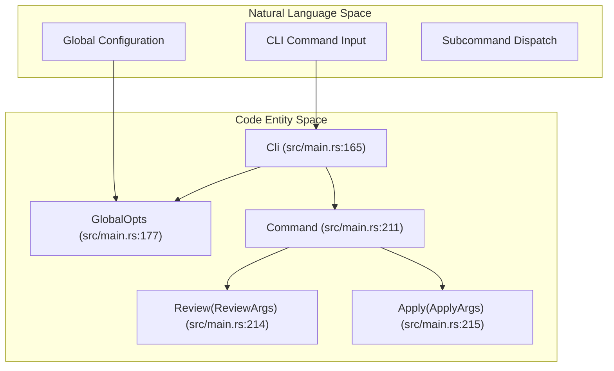
Sources: `src/main.rs:165-216`

### Execution Workflow

The execution pipeline routes requests through configuration layers, model inference handlers, and repository tools.

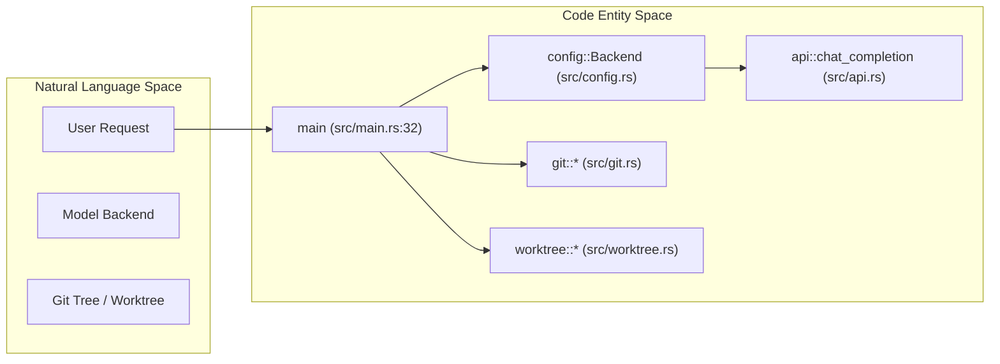
Sources: `src/main.rs:32-35`, `src/config.rs:1-10`, `src/api.rs:1-10`, `src/git.rs:1-10`

---

## 1.1. Getting Started and Configuration

Boro builds with Cargo and relies on a local Rust toolchain [README.md:20-24](). External dependencies such as `b4`, `vng` (virtme-ng), and `lei` (public-inbox) must be available on the system `PATH` depending on the targeted workflow [README.md:150-158](). 

Runtime behavior, model endpoints, and validation thresholds are configured via environment variables prefixed with `BORO_`:
- `BORO_URL`: Endpoint URL for OpenAI-compatible chat and completion APIs [README.md:29]()
- `BORO_KEY`: API authentication key [README.md:30]()
- `BORO_MODEL`: Default model identifier used for broad and specialist discovery passes [README.md:31, README.md:70-75]()
- `BORO_VALIDATION_MODEL`: Optional override model used for protected baseline analysis, validation stages, and final reporting [README.md:72-78]()

For installation steps, Cargo build instructions, full environment variable definitions, and external tool prerequisites, see [Getting Started and Configuration](#1.1).

Sources: `README.md:20-158`

---

## 1.2. CLI Commands Reference

The Boro CLI entry point is defined in `src/main.rs` using `clap` [src/main.rs:38, src/main.rs:165-174](). Global options control source directories, worker concurrency limits, transport backends, verbose logging, and JSON output formatting [src/main.rs:177-210]().

Subcommands include:
- `review`: Executes a multi-stage agentic review across a given commit range [src/main.rs:213-214]()
- `apply`: Automatically applies commits or message IDs, resolving diff3 conflicts using model assistance [src/main.rs:215]()
- `build`: Checks out commits in isolated worktrees, builds kernels using `vng -b`, and triages build output [README.md:95-96]()
- `test`: Builds and boots kernels under virtme-ng, executing AI-selected test plans and analyzing runtime outputs [README.md:97-101]()

For detailed descriptions of all subcommands, global options, and argument structures, see [CLI Commands Reference](#1.2).

Sources: `src/main.rs:165-216`, `README.md:90-111`

---

# Page: Getting Started and Configuration

# Getting Started and Configuration

<details>
<summary>Relevant source files</summary>

The following files were used as context for generating this wiki page:

- [Cargo.lock](Cargo.lock)
- [Cargo.toml](Cargo.toml)
- [README.md](README.md)
- [src/config.rs](src/config.rs)
- [src/prompts.rs](src/prompts.rs)
- [src/target/libvirt.rs](src/target/libvirt.rs)
- [src/target/virt_manager.rs](src/target/virt_manager.rs)

</details>


## Purpose and Scope

This page details the prerequisites, compilation process, external CLI dependencies, and environment variable configuration required to run and configure `boro`. Boro is designed as an AI-assisted CLI for local kernel, QEMU, libvirt, and virt-manager development workflows, operating directly inside a local git repository.

Sources: `README.md:1-16`, `src/config.rs:36-62`

---

## Installation and Cargo Build

Boro is built in Rust (edition 2021) and managed via Cargo. The package defines its dependencies—including `clap` with derive/env features, `tokio`, `reqwest`, `rust-embed` with `debug-embed`, and `tree-sitter`—in `[Cargo.toml:1-34]`.

To compile and install `boro` locally from a source checkout, run:

```bash
cargo install --force --path .
```

For development builds, standard `cargo build` or `cargo build --release` compiles the binary. The `rust-embed` dependency is configured with the `debug-embed` feature flag to ensure that prompt corpora are baked directly into debug binaries as well as release builds (`[Cargo.toml:26-30]()`), avoiding runtime path resolution failures if the source tree is relocated.

Sources: `README.md:18-24`, `Cargo.toml:1-34`

---

## External Dependencies

While Boro executes its core review pipelines entirely within its process, certain subcommands rely on external host tools. These utilities must be installed and available on the system `$PATH`:

*   **`b4`**: Required for fetching patch series posted to mailing lists (`--message-id`). Boro invokes `b4` to import posted series into temporary worktrees before applying and reviewing them (`[README.md:43-56]`, `[README.md:150-153]`).
*   **`virtme-ng` (`vng`)**: Required for the `build` and `test` subcommands. Boro leverages `vng -b` to compile individual commits in isolation and boots kernels under `virtme-ng` to execute AI-selected test plans (`[README.md:84-115]`, `[README.md:154-156]`).
*   **`lei` (from `public-inbox`)**: Optional dependency used for querying upstream lore archives during follow-up analysis and commit message historical context lookups (`[README.md:157-158]`).

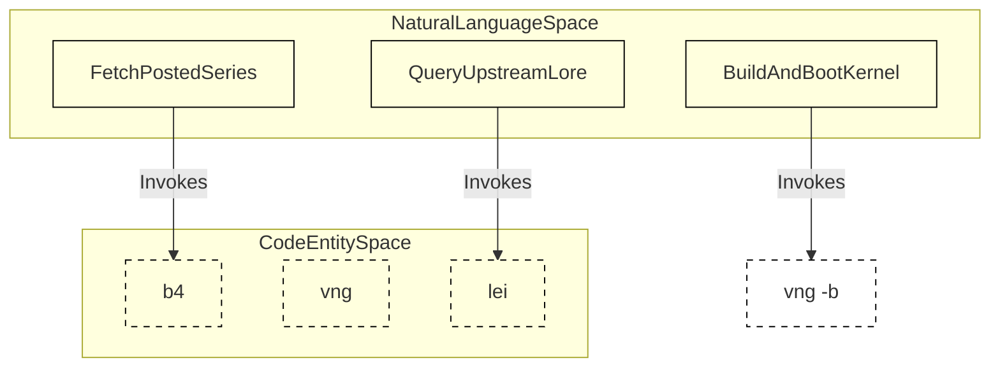
*Figure 1: Mapping external user intents to external binary dependencies.*

Sources: `README.md:43-58`, `README.md:150-158`

---

## Environment Configuration (`BORO_*`)

Boro communicates with OpenAI-compatible HTTP endpoints or subprocess CLI tools. Configuration is driven primarily through environment variables parsed into the `ResolvedModel` struct (`[src/config.rs:85-119]()`).

### Model and Validation Backend Separation
Boro separates the bulk-of-work model (`BORO_MODEL`) from the strong-validator model (`BORO_VALIDATION_MODEL`). 

*   **Main Model (`BORO_*`)**: Drives broad discovery, specialist passes, and routine inference.
*   **Validation Model (`BORO_VALIDATION_*`)**: Drives the initial complete-context fast review, validates new candidate findings, adjudicates patch conflicts, and renders final summaries.

### Supported Environment Variables

| Variable | Scope | Description |
| :--- | :--- | :--- |
| `BORO_URL` | Main | Base URL for the OpenAI-compatible chat/completions endpoint (automatically normalized to append `/v1` via `[src/config.rs:136-142]()`). |
| `BORO_KEY` | Main | API authentication key for the main model endpoint. |
| `BORO_MODEL` | Main | Model identifier string (e.g., local or hosted LLM name). |
| `BORO_VALIDATION_URL` | Validation | Optional override for the validation endpoint URL (falls back to `BORO_URL`). |
| `BORO_VALIDATION_KEY` | Validation | Optional override for the validation API key (falls back to `BORO_KEY`). |
| `BORO_VALIDATION_MODEL` | Validation | Optional override for the validation model identifier (falls back to `BORO_MODEL`). |
| `BORO_TEMPERATURE` | Main | Optional `f32` sampling temperature (`[src/config.rs:101-105]()`). |
| `BORO_VALIDATION_TEMPERATURE` | Validation | Optional `f32` sampling temperature for the validation model (`[src/config.rs:101-105]()`). |
| `BORO_NUM_CTX` | Main | Ollama context window override forwarded as top-level `options.num_ctx` (`[src/config.rs:106-114]()`). |
| `BORO_VALIDATION_NUM_CTX` | Validation | Context window override for the validation model (`[src/config.rs:106-114]()`). |
| `BORO_MAX_INPUT_TOKENS` | Main | Preflight budget truncation limit (`[src/config.rs:115-119]()`). Defaults to `32768` (`[src/config.rs:6]()`). |
| `BORO_VALIDATION_MAX_INPUT_TOKENS` | Validation | Preflight budget truncation limit for the validation model (`[src/config.rs:115-119]()`). |

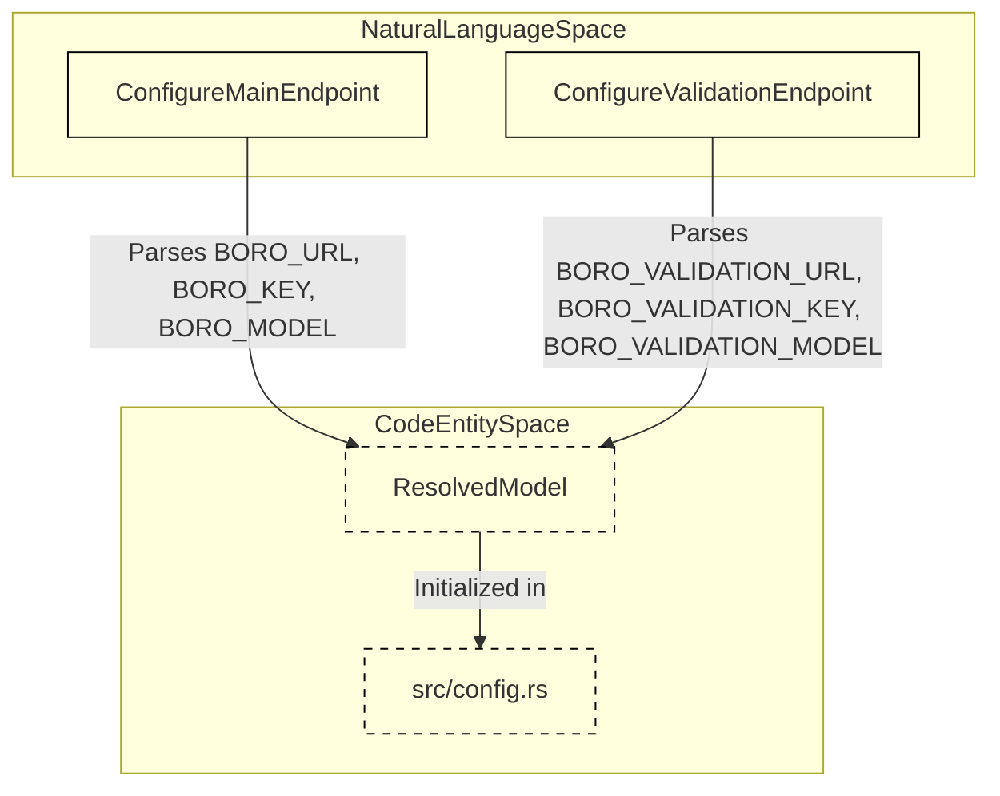
*Figure 2: Configuration data flow from environment variables to `ResolvedModel`.*

Sources: `README.md:26-32`, `src/config.rs:1-154`

---

# Page: CLI Commands Reference

# CLI Commands Reference

<details>
<summary>Relevant source files</summary>

The following files were used as context for generating this wiki page:

- [README.md](README.md)
- [src/main.rs](src/main.rs)

</details>


## Purpose and Scope

This page details the command-line interface (CLI) surface, global options, argument structs, and subcommand routers defined in `src/main.rs`. As the entry point for the `boro` binary, `src/main.rs` uses the `clap` derive parser (`Parser`, `Args`, `Subcommand`) to process user inputs, configure global execution parameters, and dispatch control flow to downstream modules such as review orchestration, patch application, kernel building, and boot testing.

Sources: `[src/main.rs:1-42]`, `[src/main.rs:165-216]()`

---

## Global Options (`GlobalOpts`)

The `GlobalOpts` struct defines flags and options that apply across all subcommands. These options control repository selection, concurrency limits, model transport backends, execution dryness, verbosity, output formatting, and prompt caching behaviors.

*   `--source` (`-s`): Specifies the Linux or target git tree path to operate on. Defaults to the current working directory (`[src/main.rs:178-180]()`).
*   `--max-workers` (`-j`): Sets the maximum concurrent commit workers. Default concurrency thresholds are set to `8` for review operations and `1` for build or test routines (`[src/main.rs:182-184]()`).
*   `--backend` (`-b`): Selects the model transport backend via [`BackendArg`](#backend-and-target-value-enums). Defaults to `openai` (`[src/main.rs:186-189]()`).
*   `--dry-run` (`-d`): Prints context sizes for reviews or planned actions for apply, build, and test operations without executing them (`[src/main.rs:191-193]()`).
*   `--verbose` (`-v`): Streams model responses to `stderr` during generation (`[src/main.rs:195-197]()`).
*   `--json`: Emits a single pretty-printed JSON object on `stdout` for machine consumption while suppressing human-readable reports (`[src/main.rs:199-202]()`).
*   `--no-prompt-caching`: Disables Anthropic-style `cache_control` markers on outgoing requests. Enabled by default (`[src/main.rs:204-209]()`).

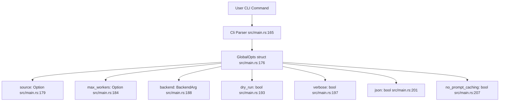

Sources: `[src/main.rs:176-209]()`

---

## Backend and Target Value Enums

To bridge user-facing CLI strings with internal configuration types, `src/main.rs` defines several `clap::ValueEnum` implementations:

### `BackendArg`
Maps CLI selections to `config::Backend` (`[src/main.rs:53-75]()`):
*   `openai`: OpenAI-compatible chat/completions endpoint (`BackendArg::Openai`).
*   `claude`: Shells out to the `claude` CLI (`BackendArg::Claude`).
*   `opencode`: Shells out to the `opencode` CLI (`BackendArg::Opencode`).
*   `codex`: Shells out to the `codex` CLI (`BackendArg::Codex`).

### `TargetArg`
Specifies the review target domain, mapping to `config::ReviewTarget` (`[src/main.rs:77-100]()`):
*   `kernel`: Linux kernel (default, `TargetArg::Kernel`).
*   `qemu`: QEMU (`TargetArg::Qemu`).
*   `libvirt`: libvirt (`TargetArg::Libvirt`).
*   `virt-manager`: virt-manager / virtinst (`TargetArg::VirtManager`).

### `ValidationMode`
Controls findings validation behavior and LKML narrative rendering (`[src/main.rs:102-123]()`):
*   `off`: Skips validation entirely, rendering raw findings and raw LKML (`ValidationMode::Off`).
*   `filter`: Validates findings and renders per-commit LKML narrative from survivors only (`ValidationMode::Filter`).
*   `findings`: Validates findings without rendering per-commit LKML prose (`ValidationMode::Findings`).

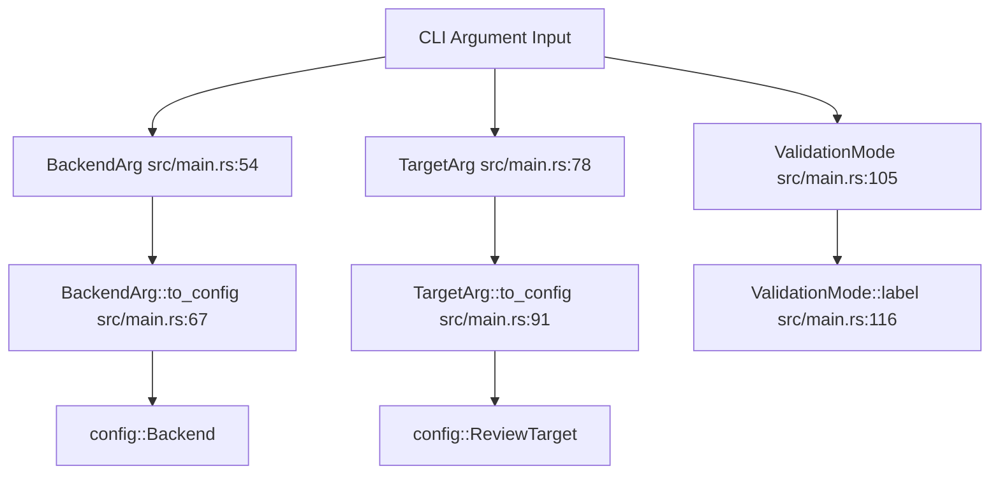

Sources: `[src/main.rs:53-123]()`

---

## Subcommand Routing and Argument Structs

The root `Cli` parser aggregates `GlobalOpts` and a `Command` subcommand enum (`[src/main.rs:165-216]()`). The primary subcommands include:

*   `Review`: Executes the multi-stage agentic code review pipeline over a given `COMMIT_RANGE` (`[src/main.rs:213]()`).
*   `Apply`: Applies commits from a `COMMIT_RANGE` or a `MESSAGE_ID`, handling automated conflict resolution (`[src/main.rs:215]()`).

Tool configuration helper functions like `fast_review_tool_config` inspect repository paths and `--no-tools` flags to configure `api::ToolLoopConfig` with `api::ToolVerification::SensitiveFindings` pre-requisites (`[src/main.rs:48-51]()`).

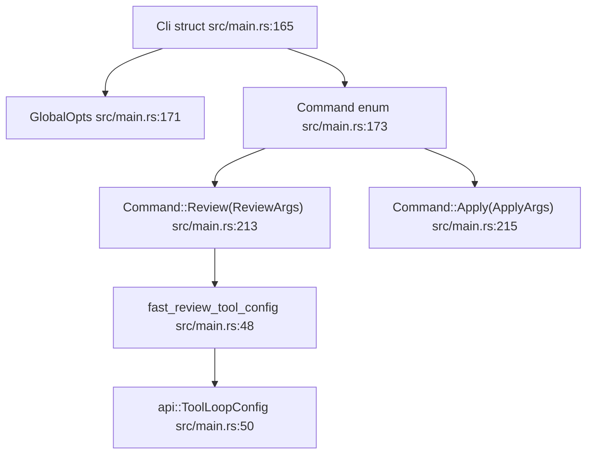

Sources: `[src/main.rs:32-51]`, `[src/main.rs:165-216]()`

---

# Page: Review Pipeline

# Review Pipeline

<details>
<summary>Relevant source files</summary>

The following files were used as context for generating this wiki page:

- [README.md](README.md)
- [src/main.rs](src/main.rs)

</details>


The review pipeline in `boro` is a multi-stage agentic workflow designed to provide AI-assisted code review for individual commits. It processes commits sequentially, leveraging a series of specialized stages to identify concerns, validate findings, and generate a comprehensive report. This page provides a high-level overview of the pipeline's structure and its key components, with detailed explanations available in linked child pages.

The core of the review process involves dispatching commit tasks to a pool of workers, each operating in an isolated worktree. This ensures that reviews are independent and do not interfere with each other. The pipeline is designed to be robust, with mechanisms for concurrency control, snapshotting, and detailed reporting of token usage and findings.

## Review Pipeline Overview

The `boro review` command [src/main.rs:214]() initiates a multi-stage agentic code review for each commit within a specified range. The pipeline is structured to progressively refine its understanding of a commit, starting with broad discovery and moving to specialized analysis and validation.

The overall flow can be visualized as follows:

```mermaid
graph TD
    subgraph "Commit Review Pipeline"
        A[Commit Range] --> B(Orchestration & Workers);
        B --> C{Worktree Isolation};
        C --> D[Context Assembly & Prefetch];
        D --> E[Specialist Stages (3-8)];
        E --> F[Findings Validation & Adjudication];
        F --> G[Upstream Follow-up (lore & Fixes:)];
        G --> H[Report Generation];
    end

    style A fill:#ace,stroke:#333,stroke-width:2px
    style B fill:#ace,stroke:#333,stroke-width:2px
    style C fill:#ace,stroke:#333,stroke-width:2px
    style D fill:#ace,stroke:#333,stroke-width:2px
    style E fill:#ace,stroke:#333,stroke-width:2px
    style F fill:#ace,stroke:#333,stroke-width:2px
    style G fill:#ace,stroke:#333,stroke-width:2px
    style H fill:#ace,stroke:#333,stroke-width:2px
```
Sources: [src/main.rs:214]()

## Orchestration and Commit Workers

The review process is managed by an orchestration layer that dispatches individual commit review tasks to a pool of workers. This allows for concurrent processing of multiple commits, improving overall efficiency. Each worker operates within an isolated Git worktree [src/worktree.rs](), preventing cross-contamination between commit reviews. Concurrency is controlled by a semaphore [src/main.rs:40](), and the system tracks snapshots and run totals for each commit.

For details, see [Orchestration and Commit Workers](#2.1).

Sources: [src/main.rs:40](), [src/worktree.rs]()

## Context Assembly and Prefetch

Before the specialized review stages begin, `boro` assembles a comprehensive context for each commit. This involves `build_reference_context` [src/prefetch.rs:100](), which narrows down the relevant subsystem in a "phase-0" step [src/prefetch.rs:100-101](). The `prefetch.rs` module [src/prefetch.rs]() is responsible for gathering necessary information, including validating file locations using `diff_index.rs` [src/diff_index.rs](). This stage also handles the identification and filtering of false-positive digests.

For details, see [Context Assembly and Prefetch](#2.4).

Sources: [src/prefetch.rs:100-101](), [src/prefetch.rs](), [src/diff_index.rs]()

## Specialist Stages and Concern Clustering

The core of the review pipeline involves a series of "specialist stages" (stages 3-8) [src/stages.rs](). These stages are designed to focus on specific types of concerns within the commit. Each stage has a defined instruction body that guides the AI model's analysis. A "fast review pass" [src/main.rs:48-51]() can be enabled for quicker initial assessments. To avoid redundant findings, `boro` employs trigram-based deduplication, implemented in `src/cluster.rs` [src/cluster.rs]().

For details, see [Specialist Stages and Concern Clustering](#2.2).

Sources: [src/stages.rs](), [src/main.rs:48-51](), [src/cluster.rs]()

## Findings Validation and Adjudication

After the specialist stages generate potential findings, a critical validation and adjudication process takes place. This involves comparing new findings against a baseline, and then applying a schema of `KEEP`/`TIGHTEN`/`DROP` to refine the results. `boro` supports different validation modes [src/main.rs:102-122]() and applies specific kernel linkage rules to ensure the accuracy and relevance of the findings.

For details, see [Findings Validation and Adjudication](#2.3).

Sources: [src/main.rs:102-122]()

## Upstream Follow-up (lore and Fixes:)

The pipeline also includes a stage for incorporating upstream context and follow-up information. This involves querying `lei` (from the `public-inbox` package) [README.md:157-158]() for relevant discussions and truncating/stripping mbox headers. Additionally, `boro` performs a lookup for `Fixes:` tags in the upstream master branch and renders this information, providing valuable historical context for the commit under review. The `lore` module [src/lore.rs]() handles the processing of this information.

For details, see [Upstream Follow-up (lore and Fixes:)](#2.5).

Sources: [README.md:157-158](), [src/lore.rs]()

---

# Page: Orchestration and Commit Workers

# Orchestration and Commit Workers

<details>
<summary>Relevant source files</summary>

The following files were used as context for generating this wiki page:

- [src/main.rs](src/main.rs)
- [src/process.rs](src/process.rs)
- [src/progress.rs](src/progress.rs)
- [src/verbose.rs](src/verbose.rs)
- [src/worktree.rs](src/worktree.rs)
- [tests/apply_range_cli.rs](tests/apply_range_cli.rs)

</details>


## Purpose and Scope

This page documents the concurrency, orchestration, worktree isolation, task dispatch, and progress reporting subsystems of `boro`. Specifically, it covers how `boro` executes parallel operations across commit ranges, controls concurrency limits via semaphore pools, isolates individual commit executions using ephemeral git worktrees with RAII-based cleanup, dispatches tasks, and tracks run totals and snapshots.

Sources: `src/main.rs:177-185` [src/main.rs:177-185](), `src/worktree.rs:1-21` [src/worktree.rs:1-21]()

---

## Concurrency Management and Semaphore Pool

Concurrency in `boro` is regulated by command-line arguments and asynchronous primitives from `tokio`. The global options struct `GlobalOpts` exposes the `-j` / `--max-workers` parameter, which determines the maximum number of concurrent commit workers [src/main.rs:177-185](). 

By default, review commands allocate up to 8 concurrent workers, while destructive or build/test commands serialize execution (`max_workers` = 1). Internally, orchestration uses `tokio::sync::Semaphore` to bound task entry and `tokio::task::JoinSet` to manage asynchronous worker lifecycle and collect results [src/main.rs:40-41]().

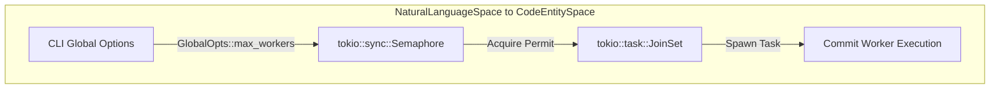
*Figure 1: Concurrency management flow linking CLI options to Tokio task primitives.*

Sources: `src/main.rs:40-41` [src/main.rs:40-41](), `src/main.rs:177-185` [src/main.rs:177-185]()

---

## Worktree Isolation and RAII Lifecycle

To prevent parallel review or build passes from conflicting with the user's active checkout, `boro` isolates each commit execution inside a dedicated git worktree. Managed by `src/worktree.rs`, worktrees ensure that each parallel worker operates on a working tree pinned precisely to its commit's SHA [src/worktree.rs:1-13]().

### Directory Layout
Worktrees are created under the main repository using the following deterministic path schema:
`.boro/worktrees/<command>/<run-id>/<sha>/`
- `<command>`: Identifies the subsystem (`review`, `build`, or `test`) [src/worktree.rs:7-10]().
- `<run-id>`: Combines the operating system process ID with a nanosecond epoch timestamp (`process_run_id()`), preventing collisions between concurrent `boro` instances [src/worktree.rs:40-49]().
- `<sha>`: The target git commit hash [src/worktree.rs:7-10]().

### Lifecycle and Cleanup
Worktree handles are wrapped in an RAII guard struct. When a task completes or aborts (such as via cancellation or a panic), the `Drop` implementation executes `git worktree remove --force` [src/worktree.rs:15-20](). 

Concurrency and locking across runs are coordinated via `RunLease`, which creates a `.boro-run.lock` file inside the run directory and acquires an advisory file lock (`file.try_lock()`) to support stale sweep routines [src/worktree.rs:104-135]().

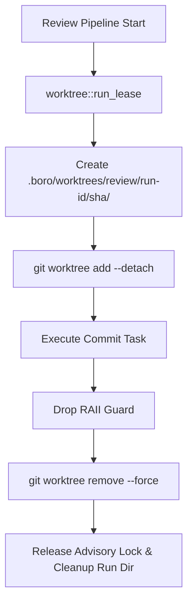
*Figure 2: Worktree lifecycle sequence from lease acquisition to RAII cleanup.*

Sources: `src/worktree.rs:1-184` [src/worktree.rs:1-184]()

---

## Commit Task Dispatch and Pipeline Execution

When reviewing a commit range (`COMMIT_RANGE`), `boro` resolves the list of commits, allocates worktree checkouts, and dispatches individual review tasks into the concurrency pool. 

Each commit review produces a structured result containing findings, validation contexts, and token usage metrics, captured in internal data structures like `CommitReviewResult` and `ValidationPayloadOwned` [src/main.rs:125-145]().

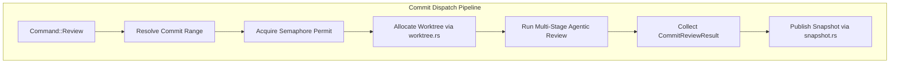
*Figure 3: Commit task dispatch and execution pipeline.*

Sources: `src/main.rs:125-145` [src/main.rs:125-145](), `src/main.rs:211-216` [src/main.rs:211-216]()

---

## Progress UI, Spinners, and Run Totals

Progress reporting is decoupled from standard output (`stdout`), which is strictly reserved for machine-readable JSON payloads when `--json` is specified [src/main.rs:199-202](). Human-readable progress, animated spinners, and status messages are rendered to standard error (`stderr`) via `src/progress.rs` [src/progress.rs:3-12]().

### `MultiPatchSpinner` and Worker UI
- **Terminal Detection:** Spinners automatically disable themselves when `stderr` is not a TTY (such as in CI pipelines or script piping) [src/progress.rs:67-72]().
- **Multi-Progress Rows:** `MultiPatchSpinner` allocates one progress row per active commit worker using `indicatif::MultiProgress`, allowing independent stages to update simultaneously [src/progress.rs:9-15]().
- **Footer Totals:** A run-wide footer bar aggregates prompt tokens, completion tokens, and prompt caching statistics across all concurrent workers [src/progress.rs:13-15](), [src/progress.rs:161-189]().

Sources: `src/progress.rs:1-189` [src/progress.rs:1-189]()

---

## Subprocess Execution and Signal Safety

Subprocess execution (such as invoking `git`, `b4`, or `vng`) is managed through wrapper utilities in `src/process.rs` [src/process.rs:1-55](). The core function `cancellable_output` spawns asynchronous child processes with piped I/O and configures `kill_on_drop(true)` [src/process.rs:11-19]().

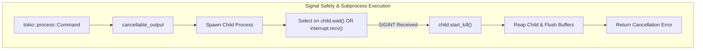
*Figure 4: Subprocess execution flow with cooperative SIGINT cancellation.*

Sources: `src/process.rs:1-55` [src/process.rs:1-55]()

---

# Page: Specialist Stages and Concern Clustering

# Specialist Stages and Concern Clustering

<details>
<summary>Relevant source files</summary>

The following files were used as context for generating this wiki page:

- [resources/stage-03-execution.md](resources/stage-03-execution.md)
- [resources/stage-07-hardware.md](resources/stage-07-hardware.md)
- [src/cluster.rs](src/cluster.rs)
- [src/stages.rs](src/stages.rs)

</details>


## Purpose and Scope
This page details the multi-stage specialist analysis pipeline and the post-processing clustering mechanism used by boro. It covers the instruction bodies for review stages 3 through 8 as managed by `src/stages.rs`, the deep-dive logic for validation provenance and configuration linkage audits, and the trigram- and token-based concern deduplication engine implemented in `src/cluster.rs`.

Sources: `[src/stages.rs:1-41](), [src/cluster.rs:1-65]()`

---

## Specialist Stages Architecture (`src/stages.rs`)

The boro review engine executes multiple focused specialist stages per commit. `src/stages.rs` acts as the registry for instruction bodies (Stages 3 through 8), providing metadata labels for progress UIs and usage tables.

- `short_description(stage: u8)`: Returns a human-readable label indicating the intent of the stage (e.g., "Execution flow verification", "Security") `[src/stages.rs:6-16]()`.
- `short_label(stage: u8)`: Returns a single lowercase word used in per-step usage reporting tables (`execution`, `resource`, `locking`, `security`, `hardware`, `comments`) `[src/stages.rs:18-29]()`.
- `instruction_body(stage: u8)`: Dynamically loads the embedded markdown prompt corpora (`resources/stage-03-execution.md` through `resources/stage-08-comment-accuracy.md`) via the `include_str!` macro `[src/stages.rs:31-41]`.

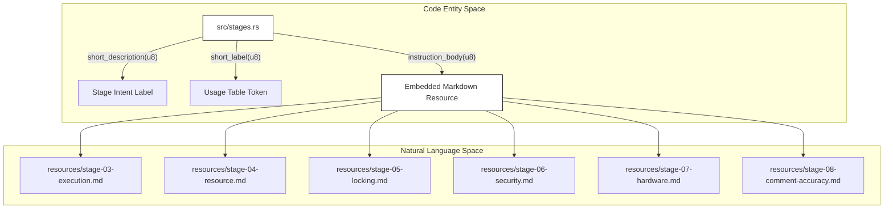
Sources: `[src/stages.rs:1-41]()`

---

## Deep Dive: Execution (Stage 3) and Portability (Stage 7)

Stages 3 and 7 enforce strict semantic checks with formal verification constraints defined in their respective markdown instruction files.

### Stage 3: Execution Flow Verification (`resources/stage-03-execution.md`)
Stage 3 traces control flow, branch conditions, error-handling paths (`goto cleanup;`), and null pointer dereferences. It enforces two strict sub-rules:
1. **Validation Provenance and Candidate Substitution**: A validation applies strictly to the object checked. If a helper replaces a candidate with an alias, sibling, parent, or first set bit, membership in the same set or domain does not transfer liveness, availability, or permissions. A concrete witness state must be constructible where the scanned object passes a stronger predicate while the substituted object satisfies only a weaker predicate `[resources/stage-03-execution.md:14-42]()`.
2. **Preprocessor Expansion**: Before emitting a concern, macro invocation chains must be expanded token by token, resolving formal parameters, stringification, and variadic arguments. Conclusions must be drawn from the final expanded token stream rather than unexpanded spelling `[resources/stage-03-execution.md:43-57]()`.

### Stage 7: Build, Configuration, and Hardware Portability (`resources/stage-07-hardware.md`)
Stage 7 splits output concerns into two mandatory machine-enforced categories via the `"category"` JSON key:
- `"category": "configuration-linkage"`: Used for Kconfig, Kbuild, declarations, definitions, exports, stubs, symbols, or callers `[resources/stage-07-hardware.md:11-14]()`.
- `"category": "hardware-architecture"`: Used strictly for hardware or architecture behavior concerns `[resources/stage-07-hardware.md:15-16]()`.

Configuration and linkage concerns require a structured `proof` object containing four mandatory string fields:
1. `failing_config`: A valid failing configuration state (e.g., `CONFIG_SCHED_SMT=n`) `[resources/stage-07-hardware.md:67-69]()`.
2. `caller_condition`: The exact preprocessor, Kconfig, or Kbuild condition guarding the caller `[resources/stage-07-hardware.md:70-72]()`.
3. `provider_condition`: The exact condition guarding the provider declaration or fallback stub `[resources/stage-07-hardware.md:72-73]()`.
4. `failure`: The concrete consequence, such as an unresolved symbol or undeclared identifier `[resources/stage-07-hardware.md:74-75]()`.

Sources: `[resources/stage-03-execution.md:1-57](), [resources/stage-07-hardware.md:1-114](), [src/stages.rs:43-105]()`

---

## Concern Clustering and Deduplication (`src/cluster.rs`)

To prevent the consolidator from seeing near-duplicate entries generated across multiple specialist stages, `src/cluster.rs` provides local clustering primitives (`cluster_concerns`) that deduplicate findings without requiring an additional model call `[src/cluster.rs:1-7]`.

### Data Flow and Normalization Logic
1. **Extraction and Filtering**: Each concern's `description` field is trimmed and normalized. Concerns with empty or missing descriptions are bypassed and passed through unchanged `[src/cluster.rs:20-39]()`.
2. **Signature Generation**: For each valid description, `cluster_concerns` computes:
   - A normalized character trigram bag-of-words vector (`trigrams`) `[src/cluster.rs:37,93-106]()`.
   - The first 10 normalized whitespace-separated tokens (`first_n_tokens`) `[src/cluster.rs:37,108-114]()`.
3. **Similarity Comparison (`similar`)**: Two concerns are marked as near-duplicates if either:
   - Their first 10 tokens match exactly (`a.1 == b.1`) `[src/cluster.rs:86-89]`.
   - Their trigram Jaccard similarity exceeds `0.6` (`jaccard(&a.0, &b.0) > 0.6`) `[src/cluster.rs:90]()`.
4. **Linkage Proof Preference**: When a near-duplicate is encountered, if the newly evaluated concern carries a complete configuration/linkage proof (`has_complete_linkage_proof`) while the previously retained concern does not, the engine replaces the retained entry with the new one, ensuring specialist evidence is not lost `[src/cluster.rs:51-56,67-84]()`.

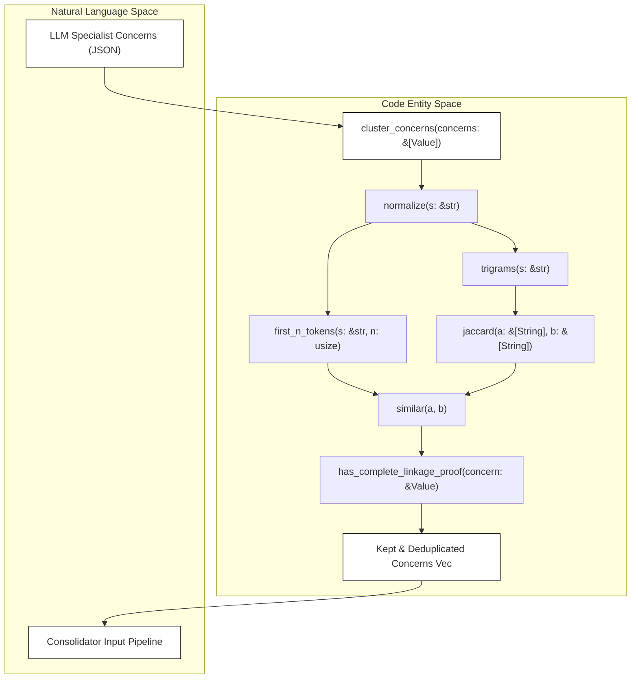
Sources: `[src/cluster.rs:9-147]()`

---

# Page: Findings Validation and Adjudication

# Findings Validation and Adjudication

<details>
<summary>Relevant source files</summary>

The following files were used as context for generating this wiki page:

- [resources/review-validation-findings-kernel.md](resources/review-validation-findings-kernel.md)
- [resources/review-validation-findings.md](resources/review-validation-findings.md)
- [src/main.rs](src/main.rs)

</details>


## Purpose and Scope

This page documents the **Findings Validation and Adjudication** subsystem in `boro` [src/main.rs:1-31](). The validation pipeline acts as a critical post-processing filter for agentic patch reviews. It takes raw candidate findings and protected one-shot baseline findings, subjects them to rigorous cross-referencing against repository tools, commit messages, and reference contexts, and applies a strict `KEEP` / `TIGHTEN` / `DROP` adjudication schema. 

The scope includes the configuration of validation modes, the structural payload preparation for validation models, the adjudication logic for pointer lifecycles and macro expansions, and kernel-specific linkage rules.

Sources: `[src/main.rs:1-31]()`, `[resources/review-validation-findings.md:1-10]()`

---

## Validation Modes and CLI Surface

The behavior of the validation pipeline is governed by the `ValidationMode` enumeration defined in `src/main.rs`. Users select the mode via CLI options, determining whether findings are validated and how survivor reports are rendered [src/main.rs:102-123]().

```
+---------------------------------------------------------------+
|                      ValidationMode                           |
+---------------------------------------------------------------+
| Off      -> Skip validation; render raw findings & raw LKML   |
| Filter   -> Validate findings; render LKML from survivors     |
| Findings -> Validate findings; suppress per-commit LKML prose |
+---------------------------------------------------------------+
```

The three supported validation modes are:
- `ValidationMode::Off`: Bypasses the validation stage entirely, forwarding raw findings and unvetted specialist outputs directly to reporting.
- `ValidationMode::Filter`: Executes the validation stage to filter out false positives, then renders per-commit LKML prose using only the surviving findings.
- `ValidationMode::Findings`: Executes the validation stage to clean and adjudicate findings, but suppresses the generation of per-commit LKML commentary prose.

The outcome of this phase for each commit is captured in `CommitReviewResult` [src/main.rs:125-133](), which stores adjudicated findings, baseline challenges, and validation context strings.

Sources: `[src/main.rs:102-133]()`

---

## Adjudication Schema: KEEP, TIGHTEN, and DROP

The adjudication schema is defined by the prompt instructions in `resources/review-validation-findings.md`. The validation model acts as a pure filter, making deterministic choices for every candidate and baseline finding without introducing novel findings.

```
+---------------------------------------------------------------------------------+
|                       Adjudication Decision Schema                              |
+---------------------------------------------------------------------------------+
|                                                                                 |
|  [Finding Input] ---> Evaluate Against Context & Diff ---> { KEEP, TIGHTEN, DROP } |
|                                                                                 |
|   * KEEP    -> Copy location and references byte-for-byte; preserve verbatim.   |
|   * TIGHTEN -> Remove hedging/restatements; lower or keep severity (no raises). |
|   * DROP    -> Discard false positives, fixed pre-patch code, or unproven claims. |
+---------------------------------------------------------------------------------+
```

### Adjudication Rules
1. **KEEP**: Emit the finding verbatim. The `location` object and `references` array must be copied byte-for-byte so maintainer tooling anchors comments precisely without shifting coordinates [resources/review-validation-findings.md:68-70]().
2. **TIGHTEN**: Retain the core issue but rewrite `problem` and `severity_explanation` to remove hedging ("might", "could potentially", "I think"), cut diff restatements, and eliminate closing summaries. Severity may be lowered if overstated, but **must never be raised** [resources/review-validation-findings.md:71-76]().
3. **DROP**: Discard findings proven false by the commit message, reference context, or diff. Common drop criteria include misread patches, ignored locks/serialization, out-of-reach error paths, or complaints about old/removed code that the reviewed diff successfully fixes [resources/review-validation-findings.md:77-88]().

### Baseline Findings and Pointer Lifecycle Rules
Baseline findings (`baseline_findings`) represent protected one-shot review outputs. Every baseline entry must be independently adjudicated and assigned an identity `fast-N` [resources/review-validation-findings.md:90-95](). 

For NULL-dereference, publication, initialization, teardown, and lifetime findings, validation enforces strict lifecycle completeness:
- Enumerate every actual entry path to the named reader, including inline wrappers and static-branch gates in unchanged files [resources/review-validation-findings.md:108-111]().
- Locate when each gate becomes true and false relative to pointer/table publication, enable failure, reader draining, and retirement [resources/review-validation-findings.md:112-114]().
- A local unguarded dereference is insufficient proof of reachability; a `KEEP` assessment must name the concrete caller crossing the unsafe lifecycle window, while a `DROP` assessment must name the gate or ordering making the path impossible [resources/review-validation-findings.md:119-122]().

Sources: `[resources/review-validation-findings.md:66-122]()`

---

## Bridge: Natural Language Space to Code Entity Space

The validation subsystem bridges natural-language review prompts with concrete code structures, executing tool loops and parsing strict JSON payloads. The following diagram maps the high-level validation concepts to their concrete Rust code representations and resource files.

```
+---------------------------------------------------------------------------+
|                           Natural Language Space                          |
|  "Prompt Corpora & Adjudication Rules"                                    |
+---------------------------------------------------------------------------+
       |                                           |
       v                                           v
  resources/review-validation-findings.md   resources/review-validation-findings-kernel.md
       |                                           |
       +--------------------+----------------------+
                            |
                            v  (Payload Assembly & Invocation)
+---------------------------------------------------------------------------+
|                            Code Entity Space                              |
+---------------------------------------------------------------------------+
|                                                                           |
|  * ValidationMode (Enum)                 [src/main.rs:105-123]()          |
|  * CommitReviewResult (Struct)           [src/main.rs:125-133]()          |
|  * ValidationPayloadOwned (Struct)       [src/main.rs:135-145]()          |
|  * ToolLoopConfig Verification           [src/main.rs:48-51]()            |
|                                                                           |
+---------------------------------------------------------------------------+
```

Sources: `[src/main.rs:48-145]`, `[resources/review-validation-findings.md:1-10]`, `[resources/review-validation-findings-kernel.md:1-7]`

---

## Kernel-Specific Linkage Rules

For Linux kernel targets, validation enforces domain-specific linkage rules when evaluating absence or export claims [resources/review-validation-findings-kernel.md:3-4]():
- **Kbuild/Makefile Ownership**: Check Kbuild and Makefile module membership when determining if a symbol is visible or missing.
- **Aggregator Includes**: Inspect aggregator `#include "*.c"` files to resolve linkage claims across translation units.
- **Export Boundaries**: `EXPORT_SYMBOL*()` is strictly required across loadable-module boundaries. It is *not* required between built-in objects (`obj-y`) or within a single textual translation unit [resources/review-validation-findings-kernel.md:5-6]().

Sources: `[resources/review-validation-findings-kernel.md:1-6]()`

---

# Page: Context Assembly and Prefetch

# Context Assembly and Prefetch

<details>
<summary>Relevant source files</summary>

The following files were used as context for generating this wiki page:

- [resources/false-positive-digest.md](resources/false-positive-digest.md)
- [src/config.rs](src/config.rs)
- [src/diff_index.rs](src/diff_index.rs)
- [src/prefetch.rs](src/prefetch.rs)
- [src/prompts.rs](src/prompts.rs)
- [src/target/libvirt.rs](src/target/libvirt.rs)
- [src/target/virt_manager.rs](src/target/virt_manager.rs)

</details>


This page details the context assembly, phase-0 subsystem narrowing, source code prefetching (`prefetch.rs`), unified diff indexing (`diff_index.rs`), and false-positive filtering mechanisms used during the boro review pipeline. These mechanisms ensure that model prompts remain within strict token budgets while providing precise code definitions, core instructions, and domain-specific guardrails.

---

## 1. Context Assembly and Phase-0 Narrowing

Before sending a patch or commit chunk to a review stage, boro builds a comprehensive reference context via `build_reference_context` in `src/prompts.rs` [src/prompts.rs:61-181](). This function aggregates global instructions, core target patterns, subsystem-specific markdown documentation, and optional upstream follow-up summaries.

### Implementation Details

The context assembly proceeds in a deterministic sequence:
1. **One-Shot Instructions**: Appends the target-specific instruction block retrieved via `target::one_shot_review(target)` [src/prompts.rs:73-75]().
2. **Local References**: Appends local prompt overrides if present using `target::local_reference(target)` [src/prompts.rs:77-82]().
3. **Core Files**: Iterates over core files defined by the target specification (`target::core_files(target)`), reading each embedded prompt file up to a fractional token budget (`max_total / 4`) [src/prompts.rs:84-101]().
4. **Subsystem Narrowing (Phase 0 vs. Path Match)**:
   - If Phase 0 produced a selected list of subsystem guides (`phase0_selected`), boro treats it as authoritative and normalizes the paths using `normalize_phase0_guide` [src/prompts.rs:103-106, 130-144](). Locking documentation (`locking.md`) is excluded from duplicate Phase 0 picks because it is already loaded via core files [src/prompts.rs:135]().
   - If Phase 0 is disabled, fails, or returns an empty set, boro falls back to static path matching via `pick_subsystem_files`, scanning changed file paths against the target's subsystem map [src/prompts.rs:15-27, 107-128]().
5. **Upstream Follow-Up**: Appends optional follow-up summaries if they fit within the remaining token budget (`max_total`) [src/prompts.rs:166-178]().

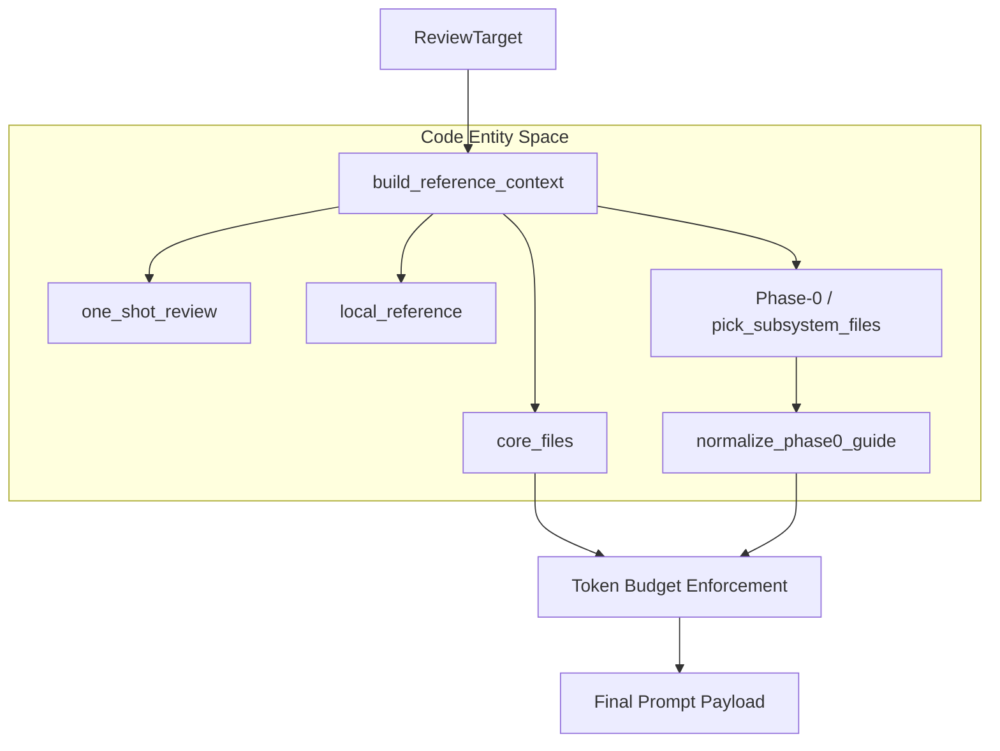
*Sources: [src/prompts.rs:15-181](), [src/config.rs:40-62]()*

---

## 2. Source Code Prefetching (`prefetch.rs`)

To give specialist review stages adequate code context beyond the immediate patch hunks, boro implements a prefetch pipeline in `src/prefetch.rs` [src/prefetch.rs:30-120](). 

### Diff Parsing and Range Extraction

`parse_diff_ranges` parses incoming unified diff strings, extracting modified line ranges in the new file (0-based indices matching tree-sitter points) [src/prefetch.rs:30-34](). Adjacent or overlapping hunks within 10 lines of each other are merged so that functions split across hunks are fetched in a single pass [src/prefetch.rs:64-81]().

### Prefetch Pipeline Workflow

`prefetch_context` coordinates the retrieval of definitions and referenced symbols from the worktree:
1. **Overlapping Definitions**: Reads modified source files from the worktree and locates top-level C definitions overlapping changed hunks [src/prefetch.rs:93-114]().
2. **Symbol Extraction**: Extracts defined names and referenced types/functions using tree-sitter AST queries [src/prefetch.rs:115-119]().
3. **Repo-Wide Search**: Builds a regex matching strategy for unresolved symbols and runs a parallel walker (`ignore::WalkBuilder`) across the worktree to locate candidate definitions in caller directories and include paths [src/prefetch.rs:139-176]().

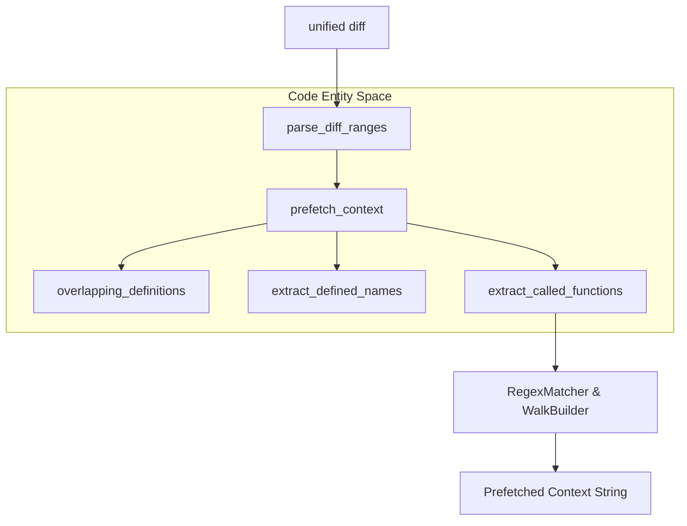
*Sources: [src/prefetch.rs:30-176]()*

---

## 3. Location Validation and Hunk Indexing (`diff_index.rs`)

Model-generated findings often reference file locations that may be misaligned or point to unrelated code. boro uses `DiffIndex` in `src/diff_index.rs` to validate all model-supplied line numbers against the actual patch text [src/diff_index.rs:3-14]().

### Hunk Indexing Semantics

`DiffIndex::from_unified_diff` processes unified diffs and indexes every hunk line [src/diff_index.rs:33-117]():
- **Additions**: Indexed under `Side::Right` using the new file line number [src/diff_index.rs:82-88]().
- **Deletions**: Indexed under `Side::Left` using the old file line number [src/diff_index.rs:89-95]().
- **Context Lines**: Indexed under **both** `Side::Right` (new line number) and `Side::Left` (old line number), matching viewer anchoring semantics [src/diff_index.rs:13-14, 96-108]().

### Validation Functions

- `contains(file, line, side)`: Returns `true` if the specified coordinate exists in the parsed diff index [src/diff_index.rs:119-121]().
- `range_contains_identifier(file, start, end, side, identifiers)`: Verifies whether at least one expected C identifier appears within the anchored line range, rejecting locations that are syntactically valid hunk coordinates but point at unrelated tokens [src/diff_index.rs:131-144]().

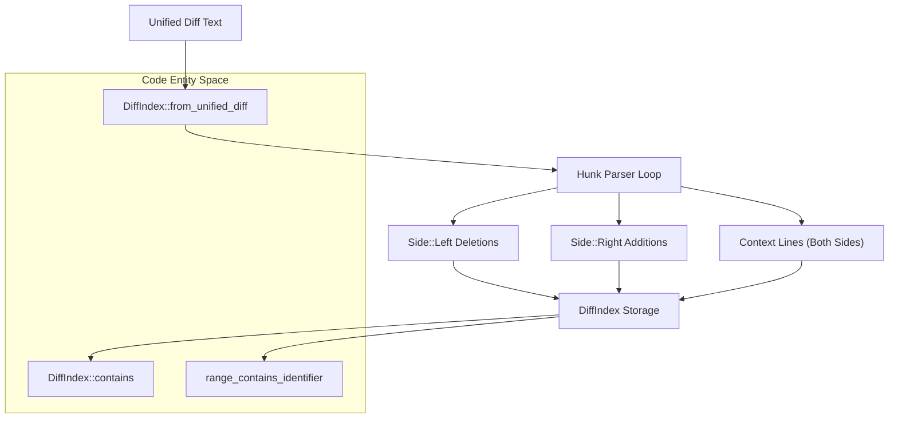
*Sources: [src/diff_index.rs:3-144]()*

---

## 4. False-Positive Digests and Guardrails

To suppress weak or speculative concerns before consolidation, boro injects target-specific false-positive digests (derived from `resources/false-positive-digest.md` and target variants) into specialist stage prompts [resources/false-positive-digest.md:1-129](), [src/target/virt_manager.rs:126-128](), [src/target/libvirt.rs:119-121]().

### Core Principle

> *If you cannot point to specific code in the diff that proves the issue, do not emit it.* [resources/false-positive-digest.md:12-13]()

### Key Guardrail Rules

1. **Defensive Programming Requests**: Bounds/NULL checks are dropped unless untrusted input reaches a dereference without validation [resources/false-positive-digest.md:17-25]().
2. **Locking Complaints**: Requires tracing 2–3 levels up the call chain to verify whether a documented caller (such as RCU-protected sections or `kn->active`) already holds the lock [resources/false-positive-digest.md:38-43]().
3. **Use-After-Free**: Only sequences matching `alloc → free → use` or `alloc → use → free → use` are valid findings [resources/false-positive-digest.md:45-50]().
4. **Fixed Old-Code Bugs**: Bugs present only in removed/old code that are fixed by the patch are classified as evidence of a fix, not review findings [resources/false-positive-digest.md:95-100]().
5. **Function-Like Macro Expansion**: Requires token-by-token expansion of macro bodies before reasoning about semantics or parameter matches [resources/false-positive-digest.md:111-118]().

---
*Sources: [resources/false-positive-digest.md:1-129](), [src/target/virt_manager.rs:126-128](), [src/target/libvirt.rs:119-121]()*

---

# Page: Upstream Follow-up (lore and Fixes:)

# Upstream Follow-up (lore and Fixes:)

<details>
<summary>Relevant source files</summary>

The following files were used as context for generating this wiki page:

- [resources/fast-review.md](resources/fast-review.md)
- [src/lore.rs](src/lore.rs)

</details>


The upstream follow-up subsystem in `boro` retrieves historical discussion, mailing list feedback (`lore`), and upstream repository `Fixes:` trailers related to patches under review. Implemented primarily in `src/lore.rs`, it executes stateless queries against public-inbox archives via `lei` and queries upstream Git repositories for backported or dependent fixes. This context flows into the agentic review pipeline to prevent duplicate reporting of known issues and to highlight unaddressed regressions or incomplete upstream fixes.

---

## 1. Lore Configuration and Environment Variables

The behavior of the follow-up retrieval engine is controlled by environment variables prefixed with `BORO_LORE_`, which are parsed into the `LoreConfig` configuration struct at runtime.

The `LoreConfig` struct defines four core operational parameters:
- `enabled`: Toggles whether lore queries are executed (default: `true`, overridden by `BORO_LORE_ENABLED`).
- `window`: The time window for public-inbox searches (default: `"1.year.ago.."`, overridden by `BORO_LORE_WINDOW`).
- `max_bytes`: The byte size ceiling for retrieved mboxes before truncation (default: `65536`, overridden by `BORO_LORE_MAX_BYTES`).
- `inbox_url`: The public-inbox endpoint URL (default: `"https://lore.kernel.org/all/"`, overridden by `BORO_LORE_INBOX_URL`).

```rust
pub struct LoreConfig {
    pub enabled: bool,
    pub window: String,
    pub max_bytes: usize,
    pub inbox_url: String,
}
```

These parameters are initialized via `LoreConfig::from_env()` which inspects the execution environment [src/lore.rs:60-88](). Boolean parsing handles standard negative representations (`"0"`, `"false"`, `"no"`, `""`), treating any other non-empty value as enabled.

Sources: `src/lore.rs:51-88`

---

## 2. Public-Inbox Queries via `lei`

`boro` performs a single deterministic, stateless `lei` query per commit without establishing persistent on-disk mirrors or invoking `lei add-external` [src/lore.rs:5-8](). 

The query searches for bare phrases matching the patch subject across the public-inbox index, capturing references such as `Fixes: <sha> ("<subject>")` tags in later patch bodies [src/lore.rs:6-8](). The resulting mbox output is processed into a `LoreMboxResult` container:

```rust
pub struct LoreMboxResult {
    pub mbox: String,
    pub hit_count: u32,
    pub query: String,
}
```

Retrieved mboxes undergo noisy header stripping and truncation to a maximum boundary governed by `LoreConfig::max_bytes` [src/lore.rs:42-43](). Truncation operates strictly on whole-message boundaries to prevent malformed email chunks from reaching prompt construction.

Sources: `src/lore.rs:3-13, 42-49`

---

## 3. Upstream Master `Fixes:` Traversal

Beyond mailing list discussions, `boro` queries upstream master repositories to identify whether subsequent commits have already introduced a `Fixes:` trailer targeting the commit under review [src/lore.rs:22-24]().

The default upstream repository URL is defined as `UPSTREAM_MASTER_BRANCH_URL`:
```rust
pub const UPSTREAM_MASTER_BRANCH_URL: &str =
    "git://git.kernel.org/pub/scm/linux/kernel/git/torvalds/linux.git";
```
This repository is fetched directly into transient `FETCH_HEAD` storage without modifying local remote configurations [src/lore.rs:22-28, 90-114]().

### Core Structs and Functions

- `MasterRepo`: Encapsulates the target repository path and an optional applied reference [src/lore.rs:29-33]().
- `MasterFix`: Represents an upstream commit that fixes the reviewed hash, containing its SHA, subject, and commit date [src/lore.rs:35-40]().
- `prepare_master_fetch()`: Executes `git fetch --no-tags` into `FETCH_HEAD` [src/lore.rs:92-114]().
- `find_master_fixes()`: Extracts the first 12 hex digits of the target SHA (following the kernel's canonical hash convention) and searches upstream commits using `git log --grep="Fixes: <prefix>"` [src/lore.rs:116-162]().
- `filter_unapplied_master_fixes()`: Cross-references discovered upstream fixes against the reviewed branch tip (`applied_ref`) to eliminate fixes already present in the local branch [src/lore.rs:164-193]().

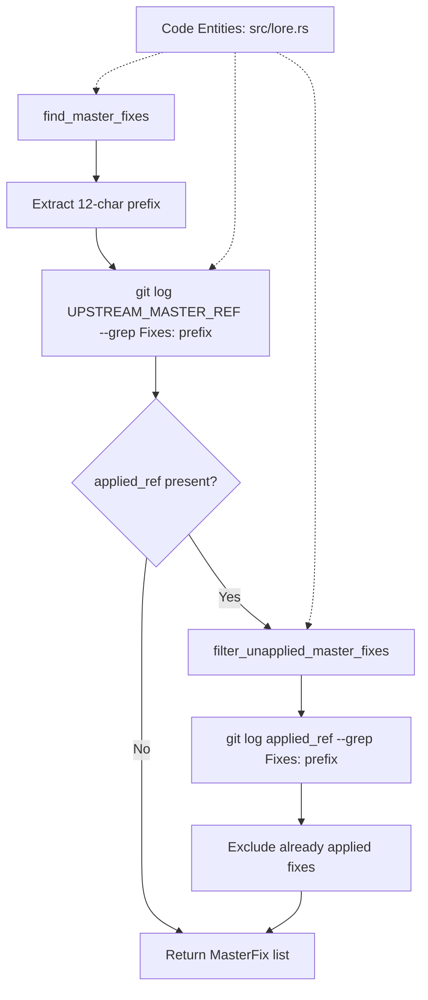
*Diagram: Upstream Fixes Discovery and Filtering Flow*

Sources: `src/lore.rs:22-193`

---

## 4. Integration with Prompt Corpora and Review Rules

The structured output derived from `LoreMboxResult` and `MasterFix` entries is formatted into a textual summary. This rendered summary flows directly into `prompts::build_reference_context` to inform all downstream review stages [src/lore.rs:10-13]().

According to the fast review prompt specifications, upstream follow-up comments must be treated as historical evidence rather than mandatory findings [resources/fast-review.md:59-60]():

```markdown
Treat upstream follow-up comments as historical evidence, not as findings that
must be repeated. Independently verify every upstream concern against the
reviewed commit's new/right-side code and the complete series. If the current
code conclusively addresses the concern, including a requested revision or
test, do not emit it as a finding. Preserve the lore URL only when the defect
remains, the fix is incomplete, or the patch introduces a distinct bug.
```

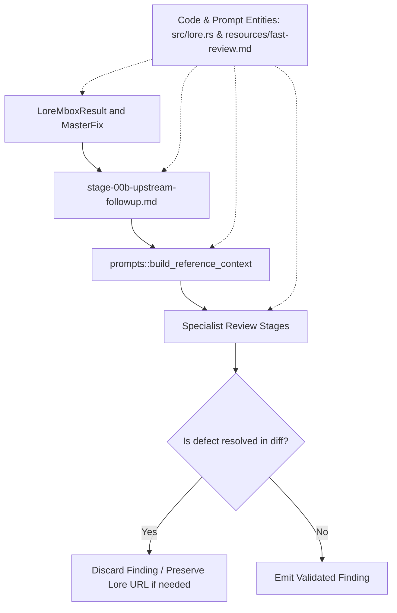
*Diagram: Integration of Lore and Fixes Context into the Review Pipeline*

Sources: `src/lore.rs:10-13`, `resources/fast-review.md:59-70`

---

# Page: Model Backends and Inference Layer

# Model Backends and Inference Layer

<details>
<summary>Relevant source files</summary>

The following files were used as context for generating this wiki page:

- [src/api.rs](src/api.rs)
- [src/config.rs](src/config.rs)
- [src/prompts.rs](src/prompts.rs)
- [src/target/libvirt.rs](src/target/libvirt.rs)
- [src/target/virt_manager.rs](src/target/virt_manager.rs)

</details>


The model backends and inference layer in `boro` manage all external interactions with Large Language Models, supporting both OpenAI-compatible HTTP endpoints and local subprocess CLI tools (`claude`, `opencode`, `codex`). This subsystem translates high-level review stages, system prompts, and repository tools into structured API requests, handles token budgeting and ephemeral caching, executes sandboxed repository tool loops, and parses strict JSON responses.

For detailed information, refer to the child pages:
- [chat_completion, Streaming and Retries](#3.1)
- [Token Budgets, Prompt Caching and Timeouts](#3.2)
- [Repository Tool Loop](#3.3)
- [Payload Builders and Response Parsers](#3.4)

---

## Backend Abstraction and Configuration

`boro` supports multiple model integration strategies encapsulated by the `Backend` enum [src/config.rs:8-34](). Configuration parameters such as API base URLs, API keys, model identifiers, sampling temperatures, context lengths, and prompt caching flags are unified under the `ResolvedModel` struct [src/config.rs:85-120]().

```mermaid
title "Backend Resolution Architecture"
graph TD
    Env["Environment Variables BORO_URL, BORO_KEY, BORO_MODEL"] --> Res["ResolvedModel src/config.rs:85-120"]
    Flag["CLI Flags --backend, --enable-prompt-cache"] --> Res
    Res -->|OpenAi| HttpBackend["OpenAI-Compatible HTTP Client src/api.rs"]
    Res -->|Claude| SubprocessClaude["claude CLI Subprocess src/claude_cli.rs"]
    Res -->|Opencode| SubprocessOpencode["opencode CLI Subprocess src/opencode.rs"]
    Res -->|Codex| SubprocessCodex["codex CLI Subprocess src/codex_cli.rs"]
```
*Sources: [src/config.rs:8-120](), [src/api.rs:16-20]()*

---

## Sub-Topic Overview and Child Links

### 3.1 chat_completion, Streaming and Retries
The core inference function orchestrates outbound HTTP posts, Server-Sent Events (SSE) streaming parse loops, automatic error recovery, and fallback mechanisms for non-2xx responses or malformed JSON payloads. For details, see [chat_completion, Streaming and Retries](#3.1).
*Sources: [src/api.rs:47-121]() *

### 3.2 Token Budgets, Prompt Caching and Timeouts
To prevent context window overflow and control costs, `boro` implements conservative input budget trimming, elided tool result management, Anthropic-style ephemeral `cache_control` markers, and stage-specific deadlines managed in `model_timeout.rs`. For details, see [Token Budgets, Prompt Caching and Timeouts](#3.2).
*Sources: [src/config.rs:97-118](), [src/api.rs:13-14]() *

### 3.3 Repository Tool Loop
Models are granted access to a sandboxed suite of repository exploration and modification tools (`grep_repo`, `read_files`, `read_symbol`, `git_*`, `rg`, `edit_file`). The inference layer manages multi-turn round-trips and enforces post-execution verification constraints via `ToolVerification`. For details, see [Repository Tool Loop](#3.3).
*Sources: [src/api.rs:130-154]() *

### 3.4 Payload Builders and Response Parsers
Each review stage constructs user payloads dynamically using reference contexts built by `build_reference_context` [src/prompts.rs:61-181](). Strict JSON parsers and validators enforce schemas for concerns, findings, and summaries. For details, see [Payload Builders and Response Parsers](#3.4).
*Sources: [src/api.rs:27-45](), [src/prompts.rs:61-181]() *

---

## Inference Execution Flow

The following diagram illustrates how review stages and tool invocations map to underlying execution routines within the inference codebase.

```mermaid
title "Inference Layer Execution Path"
graph TD
    Stage["Review Stage Execution"] --> BuildPayload["build_reference_context src/prompts.rs:61-181"]
    BuildPayload --> ChatComp["chat_completion src/api.rs"]
    ChatComp --> ToolCheck{"Tool Calls Requested?"}
    ToolCheck -->|Yes| ExecTool["tools::execute_tool src/api.rs"]
    ExecTool --> ChatComp
    ToolCheck -->|No| ParseResp["Strict JSON Parser src/api.rs"]
    ParseResp --> Findings["Validated Findings Array"]
```
*Sources: [src/api.rs:130-154](), [src/prompts.rs:61-181]() *

---

# Page: chat_completion, Streaming and Retries

# chat_completion, Streaming and Retries

<details>
<summary>Relevant source files</summary>

The following files were used as context for generating this wiki page:

- [src/api.rs](src/api.rs)

</details>


## Purpose and Scope

This page documents the inference and model interaction layer implemented in `src/api.rs`. It details request assembly, Server-Sent Events (SSE) streaming mechanics, parse-retry loops, token usage accounting, repository tool loop configurations, and HTTP error handling fallbacks utilized across review stages and command executions in `boro`.

---

## 1. Request Assembly and Token Accounting

The API layer manages the transmission of prompts and context to configured model backends (OpenAI-compatible endpoints or CLI subprocesses). Input and output token metrics are tracked through structured types that capture standard usage alongside provider-specific prompt caching statistics.

The base token usage data structure, `TokenUsage`, records prompt and completion counts along with Anthropic-style cache creation and read metrics [src/api.rs:47-60]():

```rust
#[derive(Clone, Copy, Default, Debug)]
pub struct TokenUsage {
    pub prompt: Option<u32>,
    pub completion: Option<u32>,
    pub cache_creation: Option<u32>,
    pub cache_read: Option<u32>,
}
```

Per-stage accounting aggregates these metrics alongside wall-clock duration and potential execution errors via `StageUsage` [src/api.rs:64-70]():

```rust
#[derive(Clone, Debug)]
pub struct StageUsage {
    pub step: &'static str,
    pub usage: TokenUsage,
    pub wall: Duration,
    pub error: Option<String>,
}
```

When multi-turn tool interactions or sequential round-trips occur within a single logical step, individual `TokenUsage` objects are summed using `sum_token_usage` [src/api.rs:104-121]():

```rust
pub fn sum_token_usage(usages: &[TokenUsage]) -> TokenUsage { ... }
```

### Request Assembly Architecture

```mermaid
graph TD
    subgraph "Natural Language Space: Request Assembly & Accounting"
        A["Request Payload Generation"] --> B["Token Consumption Tracking"]
        B --> C["Cache Metrics Collection"]
        C --> D["Multi-turn Round-trip Aggregation"]
    end

    subgraph "Code Entity Space: src/api.rs"
        E["TokenUsage"] --> F["add_opt_u32"]
        F --> G["sum_token_usage"]
        H["StageUsage"] --> G
    end

    A -.-> E
    B -.-> E
    C -.-> E
    D -.-> G
```

Sources: `[src/api.rs:47-121]()`

---

## 2. Tool Loop Configuration and Verification

To support agentic review tasks, `chat_completion` can execute multiple POST requests involving tool calls under a unified spinner context. This behavior is governed by `ToolLoopConfig` and strict runtime verification rules [src/api.rs:130-153]():

```rust
pub struct ToolLoopConfig<'a> {
    pub repo: &'a Path,
    pub max_tool_iterations: u32,
    pub allow_edit_file: bool,
    pub verification: ToolVerification,
}

#[derive(Debug, Clone, Copy, PartialEq, Eq)]
pub enum ToolVerification {
    Optional,
    Stage7Linkage,
    SensitiveFindings,
    BaselineFalsePositiveProof,
    Stage7LinkageAndBaselineFalsePositiveProof,
    ValidationFindingsAndBaselineAdjudications,
}
```

The `ToolLoopConfig` restricts file modifications to the resolved git root of the target repository and enforces that write-capable tools like `edit_file` remain disabled unless explicitly permitted by specific workflows (such as the post-apply review stage).

### Tool Loop Integration

```mermaid
graph TD
    subgraph "Natural Language Space: Tool Execution & Verification"
        I["Assistant Tool Call Request"] --> J["Repository Sandbox Check"]
        J --> K["Tool Execution or Rejection"]
        K --> L["Postcondition Verification Rule"]
    end

    subgraph "Code Entity Space: src/api.rs"
        M["ToolLoopConfig"] --> N["tools::execute_tool"]
        N --> O["ToolVerification"]
        O --> P["stage7_concern_category"]
    end

    I -.-> M
    J -.-> N
    K -.-> N
    L -.-> O
```

Sources: `[src/api.rs:130-161]()`

---

## 3. HTTP Error Fallbacks and Short Error Summarization

When backend API errors occur—such as non-2xx HTTP responses or 200 OK responses containing an OpenAI-style error body (`{"error": ...}`)—`boro` extracts and condenses the failure reason for progress reporting and human-readable stats tables.

The function `short_error_reason` inspects error causal chains to surface concise diagnostic summaries [src/api.rs:72-92]():

```rust
pub fn short_error_reason(e: &anyhow::Error) -> String {
    for cause in e.chain() {
        let s = cause.to_string();
        if s.contains("API error object:") {
            return s;
        }
        if s.contains("API error ") {
            return s.lines().next().unwrap_or(&s).to_string();
        }
    }
    e.to_string()
        .lines()
        .next()
        .unwrap_or("API error")
        .to_string()
}
```

This guarantees that downstream CLI reporting mechanisms receive clean, single-line summaries of rate limits, context overflows, or malformed payloads without multi-line stack trace pollution.

Sources: `[src/api.rs:72-92]()`

---

# Page: Token Budgets, Prompt Caching and Timeouts

# Token Budgets, Prompt Caching and Timeouts

<details>
<summary>Relevant source files</summary>

The following files were used as context for generating this wiki page:

- [src/api.rs](src/api.rs)
- [src/model_timeout.rs](src/model_timeout.rs)

</details>


The purpose of this page is to document the inference constraints, token tracking mechanics, prompt caching structures, and execution deadlines implemented across `boro`. Specifically, this covers input/output token accounting via `TokenUsage`, cache lifecycle management, tool iteration limits, and stage timeout guards defined in `src/model_timeout.rs` and `src/api.rs`.

---

## 1. Token Usage Accounting and Budgets

During inference calls, `boro` tracks token consumption to provide usage statistics, debug limits, and monitor prompt cache efficiency. The core data structures for token tracking are defined in `src/api.rs`.

The `TokenUsage` struct captures input tokens, completion tokens, and cache-specific sub-allocations reported by API providers (such as Anthropic-compatible or OpenAI-compatible backends):

```rust
#[derive(Clone, Copy, Default, Debug)]
pub struct TokenUsage {
    pub prompt: Option<u32>,
    pub completion: Option<u32>,
    pub cache_creation: Option<u32>,
    pub cache_read: Option<u32>,
}
```
*(Cited from `src/api.rs:47-60`)*

Stage-level accounting is aggregated via `StageUsage`, which associates each review or validation step with its wall time, cumulative token usage, and optional error summaries:

```rust
#[derive(Clone, Debug)]
pub struct StageUsage {
    pub step: &'static str,
    pub usage: TokenUsage,
    pub wall: Duration,
    pub error: Option<String>,
}
```
*(Cited from `src/api.rs:62-70`)*

When multiple chat or tool round-trips occur within a single logical execution step, `boro` sums the token counts using `sum_token_usage`:

```rust
pub fn sum_token_usage(usages: &[TokenUsage]) -> TokenUsage {
    let mut p = None;
    let mut c = None;
    let mut cw = None;
    let mut cr = None;
    for u in usages {
        p = add_opt_u32(p, u.prompt);
        c = add_opt_u32(c, u.completion);
        cw = add_opt_u32(cw, u.cache_creation);
        cr = add_opt_u32(cr, u.cache_read);
    }
    TokenUsage {
        prompt: p,
        completion: c,
        cache_creation: cw,
        cache_read: cr,
    }
}
```
*(Cited from `src/api.rs:104-121`)*

### Diagram: Token Usage and Accounting Flow

```mermaid
graph TD
    subcode["Natural Language Space: Token Aggregation"]
    subentity["Code Entity Space: src/api.rs"]

    subcode --> subentity

    A["API Chat / Tool Round-trips"] --> B["TokenUsage Struct"]
    B --> C["sum_token_usage Function"]
    C --> D["StageUsage Aggregation"]
    D --> E["Human / JSON Reporting UI"]

    style A fill:none,stroke:#000,stroke-width:1px
    style B fill:none,stroke:#000,stroke-width:1px
    style C fill:none,stroke:#000,stroke-width:1px
    style D fill:none,stroke:#000,stroke-width:1px
    style E fill:none,stroke:#000,stroke-width:1px
```
Sources: `src/api.rs:47-121`

---

## 2. Prompt Caching Semantics

To optimize context-heavy operations (such as multi-stage Linux kernel patch reviews carrying extensive subsystem headers and file diffs), `boro` leverages provider-side prompt caching mechanics. 

Within `TokenUsage`:
* `cache_creation` reflects the portion of the prompt written to the provider's prompt cache during the current request (`cache_creation_input_tokens`).
* `cache_read` tracks the portion of the prompt served directly from the cache (`cache_read_input_tokens`).

Because `prompt` represents the grand total of input tokens, `cache_read` and `cache_creation` are subsets rather than separate additive quantities. Ephemeral cache markers (`cache_control`) are injected at structural boundaries in system prompts to maximize hit rates across sequential specialist review stages.

Sources: `src/api.rs:47-60`

---

## 3. Tool Result Elision and Budgets

During interactive review loops, the model may execute repository tools (such as `grep_repo`, `read_files`, or `read_symbol`). To prevent context exhaustion from massive tool returns, `boro` enforces constraints via `ToolLoopConfig`:

```rust
pub struct ToolLoopConfig<'a> {
    pub repo: &'a Path,
    pub max_tool_iterations: u32,
    pub allow_edit_file: bool,
    pub verification: ToolVerification,
}
```
*(Cited from `src/api.rs:130-143`)*

* **`max_tool_iterations`**: Caps the number of assistant replies that execute repository tools. Beyond this threshold, tool executions are suspended, and synthetic tool replies are returned to force the model to conclude its reasoning.
* **`allow_edit_file`**: Gates write-capable tools. It defaults to `false` and is only enabled during post-apply review stages.

Sources: `src/api.rs:130-154`

---

## 4. Stage Deadlines and Subprocess Timeouts (`model_timeout.rs`)

Review stages and model interactions can occasionally hang due to network partitions or unresponsive backend subprocesses. `boro` enforces strict execution deadlines via `src/model_timeout.rs`.

### Default Review Timeouts
The default timeout for a review stage is 10 minutes, configurable via CLI flags (`boro review --timeout`) which update the global atomic store:

```rust
pub const REVIEW_STAGE_TIMEOUT: Duration = Duration::from_secs(10 * 60);

static REVIEW_STAGE_TIMEOUT_SECS: std::sync::atomic::AtomicU64 =
    std::sync::atomic::AtomicU64::new(REVIEW_STAGE_TIMEOUT.as_secs());

pub fn set_review_stage_timeout(timeout: Duration) {
    REVIEW_STAGE_TIMEOUT_SECS.store(timeout.as_secs(), Ordering::SeqCst);
}
```
*(Cited from `src/model_timeout.rs:14-24`)*

### Timeout Errors
When a model stage exceeds its allocated deadline, `ModelStageTimeout` produces a structured error:

```rust
#[derive(Debug, Clone)]
pub struct ModelStageTimeout {
    label: String,
    timeout: Duration,
}

impl ModelStageTimeout {
    pub fn summary(&self) -> String {
        format!(
            "model stage timed out after {}: {}",
            format_duration(self.timeout),
            self.label
        )
    }
}
```
*(Cited from `src/model_timeout.rs:30-50`)*

### Subprocess Watchdogs (`ChildTimeoutGuard`)
For CLI subprocess backends, `ChildTimeoutGuard` spawns a background monitoring thread that tracks child process lifetimes and issues SIGKILL if a stage overruns its deadline:

```rust
pub struct ChildTimeoutGuard {
    done_tx: Option<mpsc::Sender<()>>,
    timed_out: Arc<AtomicBool>,
    join: Option<thread::JoinHandle<()>>,
}
```
*(Cited from `src/model_timeout.rs:93-97`)*

The watchdog thread waits on an mpsc channel receiver with timeout:
```rust
let join = thread::spawn(move || {
    if done_rx.recv_timeout(timeout).is_ok() {
        return;
    }
    let Ok(mut child) = child.lock() else {
        return;
    };
    if matches!(child.try_wait(), Ok(Some(_))) {
        return;
    }
    timed_out_for_thread.store(true, Ordering::SeqCst);
    let _ = child.kill();
});
```
*(Cited from `src/model_timeout.rs:104-120`)*

### Diagram: Subprocess Timeout Enforcement

```mermaid
graph TD
    subcode["Natural Language Space: Watchdog Process Enforcement"]
    subentity["Code Entity Space: src/model_timeout.rs"]

    subcode --> subentity

    A["ChildTimeoutGuard::spawn"] --> B["Background Thread spawned"]
    B --> C["mpsc::channel recv_timeout"]
    C -- "Timeout Elapses" --> D["Lock Child Mutex"]
    D --> E["Check try_wait"]
    E -- "Still Running" --> F["Store atomic timed_out = true"]
    F --> G["Call child.kill()"]
    C -- "Finished Early" --> H["Exit Guard Cleanly"]

    style A fill:none,stroke:#000,stroke-width:1px
    style B fill:none,stroke:#000,stroke-width:1px
    style C fill:none,stroke:#000,stroke-width:1px
    style D fill:none,stroke:#000,stroke-width:1px
    style E fill:none,stroke:#000,stroke-width:1px
    style F fill:none,stroke:#000,stroke-width:1px
    style G fill:none,stroke:#000,stroke-width:1px
    style H fill:none,stroke:#000,stroke-width:1px
```
Sources: `src/model_timeout.rs:93-142`

---

# Page: Repository Tool Loop

# Repository Tool Loop

<details>
<summary>Relevant source files</summary>

The following files were used as context for generating this wiki page:

- [src/api.rs](src/api.rs)
- [src/apply.rs](src/apply.rs)
- [src/output.rs](src/output.rs)
- [src/tools.rs](src/tools.rs)

</details>


## Purpose and Scope

The Repository Tool Loop provides the infrastructure for model-driven interactive exploration and modification of the target source tree during review and apply pipelines. It defines the available tool schemas (`grep_repo`, `read_files`, `read_symbol`, `git_*`, `rg`, `edit_file`), enforces strict workspace sandboxing relative to the repository root, bounds execution output, and implements output-dependent verification postconditions (`ToolVerification`) to guarantee that models ground their findings in actual code investigations.

Sources: `src/api.rs:130-154()`, `src/tools.rs:1-13()`

---

## Tool Definitions and OpenAI Tool Schemas

The model interacts with the codebase via structured tool calls defined by `tools::openai_tools_json` in `src/tools.rs`. The schema includes both read-only analysis tools and a conditional write-capable tool (`edit_file`).

### Available Tools
- `grep_repo`: Executes `git grep` within the repository root to locate symbols, identifiers, or patterns efficiently without reading entire files `[src/tools.rs:36-54]()`.
- `read_files`: Reads specific file segments or structural key-holes (`raw` or `smart` modes) within tight line boundaries `[src/tools.rs:55-80]()`.
- `read_symbol`: Extracts specific symbols, struct definitions, or function bodies.
- `git_blame`, `git_diff`, `git_show`, `run_git`: Subcommand wrappers that execute read-only git operations scoped to the repository root `[src/tools.rs:81-128]()`.
- `edit_file`: The sole write-capable tool, permitted only when explicitly enabled via configuration `[src/api.rs:136-138]()`, used during post-apply review and backport remediation `[src/apply.rs:60-65]()`.

Sources: `src/api.rs:130-144()`, `src/tools.rs:35-128()`

---

## Sandboxing and Workspace Security

All tools operate strictly within a single designated directory: the git checkout root resolved from the `--source` / `-s` command-line argument `[src/tools.rs:6-10]()`. 

### Sandboxing Guarantees
- **Path Resolution**: Relative paths are evaluated against the repository root. Absolute paths and parent directory traversal (`..`) are rejected.
- **Output Bunting**: Tool execution output is clipped to a maximum buffer size (`MAX_TOOL_OUTPUT`, default 24,000 bytes) to prevent prompt window exhaustion `[src/tools.rs:20]()`.
- **Process Isolation**: Git and search subprocesses (`rg`, `git`) execute with their current working directory explicitly set to the repository root, ensuring no escape outside the checkout.

Sources: `src/tools.rs:1-23()`

---

## Tool Loop Configuration and Execution

The execution orchestrator uses `ToolLoopConfig` to manage tool round-trips during a model request cycle `[src/api.rs:130-144()()`.

```
+-------------------------------------------------------+
|                    ToolLoopConfig                     |
|  - repo: &Path                                        |
|  - max_tool_iterations: u32                           |
|  - allow_edit_file: bool                              |
|  - verification: ToolVerification                     |
+-------------------------------------------------------+
                           |
                           v
+-------------------------------------------------------+
|                    chat_completion                    |
|  - Sends prompt + tools json to model                 |
|  - Captures tool_calls request                        |
+-------------------------------------------------------+
                           |
                           v
+-------------------------------------------------------+
|                   tools::execute_tool                 |
|  - Validates paths against repo root                  |
|  - Executes git/grep/read commands                    |
|  - Truncates output to MAX_TOOL_OUTPUT                |
+-------------------------------------------------------+
```

### Configuration Parameters (`ToolLoopConfig`)
- `repo`: The resolved `&Path` of the git root `[src/api.rs:131-135]()`.
- `max_tool_iterations`: The upper bound on assistant tool-calling round-trips per stage. Exceeding this limit drops tool definitions from subsequent requests `[src/api.rs:135-139]()`.
- `allow_edit_file`: A boolean gate controlling whether `edit_file` is advertised and executable. Defaults to `false`; enabled only during post-apply review steps `[src/api.rs:136-139()()`, `[src/apply.rs:60-65]()`.
- `verification`: An instance of `ToolVerification` defining mandatory postconditions `[src/api.rs:139-144]()`.

Sources: `src/api.rs:130-144()`, `src/tools.rs:1-23()`

---

## Tool Verification Postconditions

To prevent hallucinated findings or unverified claims, `ToolVerification` enforces runtime postconditions before model outputs are accepted.

```
+---------------------------------------------------------------+
|                      ToolVerification                         |
|  - Optional                                                   |
|  - Stage7Linkage                                              |
|  - SensitiveFindings                                          |
|  - BaselineFalsePositiveProof                                 |
|  - Stage7LinkageAndBaselineFalsePositiveProof                 |
|  - ValidationFindingsAndBaselineAdjudications                 |
+---------------------------------------------------------------+
                           |
                           v
+---------------------------------------------------------------+
|                    Postcondition Check                        |
|  - Verifies at least one repository tool executed             |
|  - Validates symbol linkage against target tree               |
|  - Rejects ungrounded critical findings                       |
+---------------------------------------------------------------+
```

### Verification Modes (`ToolVerification`)
- `Optional`: No tool execution required prior to returning findings `[src/api.rs:146]()`.
- `Stage7Linkage`: Requires hardware or configuration linkage checks to be backed by repository tool queries `[src/api.rs:147-150]()`.
- `SensitiveFindings`: Enforces tool verification for high-severity or sensitive reports.
- `BaselineFalsePositiveProof`: Mandates that claims regarding false positives in baselines are backed by explicit code inspections.
- `Stage7LinkageAndBaselineFalsePositiveProof`: Combines linkage and false-positive verification rules `[src/api.rs:151-152]()`.
- `ValidationFindingsAndBaselineAdjudications`: Enforces rigorous tool confirmation during validation and adjudication phases `[src/api.rs:153-154]()`.

Sources: `src/api.rs:145-154()`

---

## Code-to-Natural-Language Bridge

The following diagram maps the natural language intent of a model requesting repository exploration to the concrete internal Rust types and execution functions in `src/tools.rs` and `src/api.rs`.

Diagram: "ToolLoopExecutionMapping"
```mermaid
graph TD
    A["Model Natural Language Intent"] -->|Calls Tool| B["openai_tools_json src/tools.rs"]
    B -->|Dispatches| C["tools::execute_tool src/tools.rs"]
    C -->|Validates Path| D["Path Sanitization & Root Check"]
    D -->|Executes Subprocess| E["Subcommand rg / git / grep"]
    E -->|Truncates Output| F["MAX_TOOL_OUTPUT Buffer src/tools.rs:20"]
    F -->|Returns Result| G["chat_completion Loop src/api.rs"]
    G -->|Enforces Rule| H["ToolVerification Postconditions src/api.rs:145"]
```
Sources: `src/api.rs:130-154()`, `src/tools.rs:20-128()`

Diagram: "WorkspaceSandboxArchitecture"
```mermaid
graph TD
    A["CLI Source Argument --source / -s"] -->|Resolves Root| B["ToolLoopConfig.repo src/api.rs:131"]
    B -->|Sets CWD| C["Subprocess Command Execution"]
    C -->|Checks Traversal| D["Reject Absolute Paths & .."]
    D -->|Safe Read/Write| E["Target Source Tree"]
```
Sources: `src/api.rs:130-135()`, `src/tools.rs:1-13()`

---

# Page: Payload Builders and Response Parsers

# Payload Builders and Response Parsers

<details>
<summary>Relevant source files</summary>

The following files were used as context for generating this wiki page:

- [src/api.rs](src/api.rs)

</details>


Per-stage user payload construction and strict JSON parsers/validators for concerns, findings and summaries within the `boro` AI-assisted review pipeline.

## 1. Strict JSON Response Schemas and Instructions

The model's output formatting is strictly controlled via system and user instructions defined in `src/api.rs`. The primary response contract is enforced through `USER_JSON_INSTRUCTION`, which mandates a pure JSON object response without markdown fences containing an array of findings.

```
+-------------------------------------------------------+
| USER_json_instruction (src/api.rs:27-45)              |
| - Return ONLY a JSON object                           |
| - Schema: findings[], problem, severity, references   |
+---------------------------+---------------------------+
                            |
                            v
+-------------------------------------------------------+
| Response Parser / Validator                           |
| - Strips/rejects markdown fences                      |
| - Validates required fields                           |
| - Parses "location" and "severity_explanation"        |
+-------------------------------------------------------+
```

*Diagram 1: Response Parsing and Validation Flow from `USER_JSON_INSTRUCTION` to parsed structures.*

Sources: `[src/api.rs:27-45]()`

The instruction strictly specifies that responses must exclude markdown fences and adhere to a JSON schema containing `findings` items with mandatory fields (`problem`, `severity`, `severity_explanation`) and optional fields (`location`, `references`) `[src/api.rs:27-45]()`. The `location` object maps strictly to diff coordinates including `file`, `line`, `line_end`, and `side` (`LEFT` or `RIGHT`) `[src/api.rs:36-40]()`.

Sources: `[src/api.rs:27-45]()`

---

## 2. Token Usage and Accounting Structures

To track model consumption per stage and aggregate statistics for reporting, `boro` defines dedicated accounting types in `src/api.rs`:

- `TokenUsage`: Represents prompt tokens, completion tokens, and caching metrics (`cache_creation` and `cache_read`) `[src/api.rs:47-60]`.
- `StageUsage`: Tracks the step name (`&'static str`), `TokenUsage`, wall-clock `Duration`, and optional error strings (`Option<String>`) `[src/api.rs:64-70]`.
- `sum_token_usage`: Aggregates usage vectors across multiple chat/tool round-trips within a single logical step `[src/api.rs:104-121]`.
- `short_error_reason`: Extracts concise single-line error summaries from API error chains or JSON error bodies `[src/api.rs:72-92]`.

```
+-------------------------------------------------------------+
| StageExecution                                              |
|  - Calls api::chat_completion()                             |
|  - Generates Vec<TokenUsage>                                |
+------------------------------+------------------------------+
                               |
                               v
+-------------------------------------------------------------+
| api::sum_token_usage() (src/api.rs:104-121)                 |
|  - Combines prompt, completion, cache_creation, cache_read  |
+------------------------------+------------------------------+
                               |
                               v
+-------------------------------------------------------------+
| StageUsage (src/api.rs:64-70)                               |
|  - Records step, aggregated usage, wall duration, error     |
+-------------------------------------------------------------+
```

*Diagram 2: Token Usage Aggregation Pipeline via `sum_token_usage` and `StageUsage`.*

Sources: `[src/api.rs:47-121]()`

---

## 3. Tool Loop Configuration and Verification Policies

Payload builders also configure how model tool loops operate via `ToolLoopConfig` and enforce runtime invariants using `ToolVerification`.

```
+--------------------------------------------------------+
| ToolLoopConfig (src/api.rs:125-144)                    |
| - repo: &Path                                          |
| - max_tool_iterations: u32                             |
| - allow_edit_file: bool                                |
| - verification: ToolVerification                       |
+---------------------------+---------------------------+
                            |
                            v
+--------------------------------------------------------+
| ToolVerification (src/api.rs:145-154)                  |
| - Optional                                             |
| - Stage7Linkage                                        |
| - SensitiveFindings                                    |
| - BaselineFalsePositiveProof                           |
| - Stage7LinkageAndBaselineFalsePositiveProof           |
| - ValidationFindingsAndBaselineAdjudications           |
+--------------------------------------------------------+
```

*Diagram 3: Tool Loop Configuration Parameters and Verification Enforcements.*

Sources: `[src/api.rs:125-154]()`

- `ToolLoopConfig` dictates the repository root path `repo`, iteration ceilings (`max_tool_iterations`), write permissions (`allow_edit_file`), and the active `verification` postcondition mode `[src/api.rs:125-143]`.
- `ToolVerification` defines specific validation gates (such as `Stage7Linkage` or `BaselineFalsePositiveProof`) required before findings are accepted from the model response `[src/api.rs:145-154]`.
- Specialized stage categorization helpers like `stage7_concern_category` inspect JSON values to route configuration linkage versus hardware architecture concerns `[src/api.rs:156-161]`.

Sources: `[src/api.rs:125-161]()`

---

# Page: Targets and Prompt Corpora

# Targets and Prompt Corpora

<details>
<summary>Relevant source files</summary>

The following files were used as context for generating this wiki page:

- [src/config.rs](src/config.rs)
- [src/prompts.rs](src/prompts.rs)
- [src/target.rs](src/target.rs)
- [src/target/kernel.rs](src/target/kernel.rs)
- [src/target/libvirt.rs](src/target/libvirt.rs)
- [src/target/qemu.rs](src/target/qemu.rs)
- [src/target/virt_manager.rs](src/target/virt_manager.rs)

</details>


The purpose of this section is to provide an overview of how `boro` abstracts different review domains through the `TargetSpec` trait and embeds target-specific markdown prompt corpora. Every review target (`Kernel`, `Qemu`, `Libvirt`, and `VirtManager`) bundles its own subsystem mappings, core prompt files, system prompts, and local reference material directly into the compiled binary via `rust_embed`.

For detailed coverage of trait contracts, subsystem maps, and stage overrides, refer to the child pages linked below:
- [TargetSpec Trait and Dispatch](#4.1) — Trait contract, dispatch functions, `rust_embed` corpora, and local prompt overrides.
- [Kernel and QEMU Targets](#4.2) — Kernel/QEMU subsystem maps, core files, and subsystem guides.
- [libvirt and virt-manager Targets](#4.3) — libvirt/virt-manager subsystem maps, stage overrides, and false-positive digests.

---

## 4.1 TargetSpec Trait and Dispatch

The `TargetSpec` trait defines the contract that all review targets must implement, standardizing how `boro` retrieves prompt files, subsystem maps, core files, and specialized system prompts [src/target.rs:13-53](). The central dispatch mechanism uses the `ReviewTarget` enum to route calls from generic pipeline code to the appropriate target implementation [src/target.rs:55-62]().

```mermaid
graph TD
    A["ReviewTarget::Kernel"] -->|spec| B["KernelTarget"]
    C["ReviewTarget::Qemu"] -->|spec| D["QemuTarget"]
    E["ReviewTarget::Libvirt"] -->|spec| F["LibvirtTarget"]
    G["ReviewTarget::VirtManager"] -->|spec| H["VirtManagerTarget"]
    
    B --> I["TargetSpec Trait Implementation"]
    D --> I
    F --> I
    H --> I
    
    I -->|prompt_file| J["rust_embed::EmbeddedFile"]
    I -->|subsystem_map| K["Subsystem Path Slices"]
    I -->|reviewer_system_prompt| L["Domain Personas"]

    style A fill:none,stroke:#000,stroke-width:2px
    style B fill:none,stroke:#000,stroke-width:2px
    style C fill:none,stroke:#000,stroke-width:2px
    style D fill:none,stroke:#000,stroke-width:2px
    style E fill:none,stroke:#000,stroke-width:2px
    style F fill:none,stroke:#000,stroke-width:2px
    style G fill:none,stroke:#000,stroke-width:2px
    style H fill:none,stroke:#000,stroke-width:2px
    style I fill:none,stroke:#000,stroke-width:2px
    style J fill:none,stroke:#000,stroke-width:2px
    style K fill:none,stroke:#000,stroke-width:2px
    style L fill:none,stroke:#000,stroke-width:2px
```
*Figure 4.1: Dispatch architecture bridging CLI target selection to concrete `TargetSpec` trait implementations.*

Sources: `[src/target.rs:13-62](), [src/config.rs:40-62]()`

For deep technical details on the trait contract, dispatch functions, `rust_embed` integration, and local prompt overrides, see [TargetSpec Trait and Dispatch](#4.1).

---

## 4.2 Kernel and QEMU Targets

The Linux kernel and QEMU targets represent complex C codebases with extensive subsystem categorization. `KernelTarget` uses a comprehensive subsystem map generated from upstream metadata [src/target/kernel.rs:22-102](), while `QemuTarget` manages virtual machine emulation subsystems such as `virtio`, `block`, `pci`, `migration`, and `accel/kvm` [src/target/qemu.rs:21-45]().

```mermaid
graph TD
    A["ReviewTarget::Kernel"] -->|kernel::SUBSYSTEM_MAP| B["networking-core.md"]
    A -->|kernel::SUBSYSTEM_MAP| C["mm-pagetable.md"]
    A -->|kernel::SUBSYSTEM_MAP| D["scheduler.md"]
    
    E["ReviewTarget::Qemu"] -->|qemu::SUBSYSTEM_MAP| F["virtio.md"]
    E -->|qemu::SUBSYSTEM_MAP| G["migration.md"]
    E -->|qemu::SUBSYSTEM_MAP| H["tcg.md"]

    style A fill:none,stroke:#000,stroke-width:2px
    style B fill:none,stroke:#000,stroke-width:2px
    style C fill:none,stroke:#000,stroke-width:2px
    style D fill:none,stroke:#000,stroke-width:2px
    style E fill:none,stroke:#000,stroke-width:2px
    style F fill:none,stroke:#000,stroke-width:2px
    style G fill:none,stroke:#000,stroke-width:2px
    style H fill:none,stroke:#000,stroke-width:2px
```
*Figure 4.2: Mapping file paths to target-specific subsystem markdown corpora for kernel and QEMU review workflows.*

Sources: `[src/target/kernel.rs:22-102](), [src/target/qemu.rs:21-45]()`

For detailed subsystem maps, core files, and guide references under `resources/prompts/kernel` and `qemu`, see [Kernel and QEMU Targets](#4.2).

---

## 4.3 libvirt and virt-manager Targets

User-space virtualization management components—`libvirt` (daemon and C library) and `virt-manager` / `virtinst` (Python/GTK GUI)—require specialized review rules. Unlike the kernel target, these targets override default specialist stage instructions and false-positive digests to account for Python concurrency, GTK thread safety, libvirt RPC protocols, and domain XML generation [src/target/libvirt.rs:115-134](), [src/target/virt_manager.rs:122-140]().

```mermaid
graph TD
    A["ReviewTarget::Libvirt"] -->|stage_instructions| B["stage-03-execution-libvirt.md"]
    A -->|false_positive_digest| C["false-positive-digest-libvirt.md"]
    
    D["ReviewTarget::VirtManager"] -->|stage_instructions| E["stage-03-execution-virt-manager.md"]
    D -->|false_positive_digest| F["false-positive-digest-virt-manager.md"]

    style A fill:none,stroke:#000,stroke-width:2px
    style B fill:none,stroke:#000,stroke-width:2px
    style C fill:none,stroke:#000,stroke-width:2px
    style D fill:none,stroke:#000,stroke-width:2px
    style E fill:none,stroke:#000,stroke-width:2px
    style F fill:none,stroke:#000,stroke-width:2px
```
*Figure 4.3: Target-specific stage instructions and false-positive digest overrides for libvirt and virt-manager.*

Sources: `[src/target/libvirt.rs:115-134](), [src/target/virt_manager.rs:122-140]()`

For full details on subsystem maps, stage overrides, and false-positive digests for libvirt and virt-manager, see [libvirt and virt-manager Targets](#4.3).

---

# Page: TargetSpec Trait and Dispatch

# TargetSpec Trait and Dispatch

<details>
<summary>Relevant source files</summary>

The following files were used as context for generating this wiki page:

- [src/target.rs](src/target.rs)
- [src/target/kernel.rs](src/target/kernel.rs)
- [src/target/qemu.rs](src/target/qemu.rs)

</details>


## Purpose and Scope

The `TargetSpec` trait and its associated dispatch functions [src/target.rs:13-147]() define the domain abstraction layer in `boro`. This abstraction decouples the multi-stage review pipeline, prompt assembly, and validation rules from specific target codebases (Linux kernel, QEMU, libvirt, and virt-manager). This page covers the trait contract, static dispatch mechanics, `rust_embed` prompt corpus integration, and local prompt overrides.

---

## 1. The `TargetSpec` Trait Contract

The `TargetSpec` trait requires implementors to be `Sync` and provide target-specific metadata, subsystem path maps, core reference files, and system prompt text [src/target.rs:13-24](). It also supplies default implementations for generic assets like fast review passes and false-positive digests [src/target.rs:25-37](), while allowing domain-specific overrides for specialist stage instructions and validation rules [src/target.rs:39-52]().

```rust
pub trait TargetSpec: Sync {
    fn prompt_file(&self, rel: &str) -> Option<EmbeddedFile>;
    fn subsystem_map(&self) -> &'static [(&'static str, &'static str)];
    fn core_files(&self) -> &'static [&'static str];
    fn local_reference(&self) -> String;
    fn prompts_source_verbose(&self) -> &'static str;
    fn reviewer_system_prompt(&self) -> &'static str;
    fn phase0_system_prompt(&self) -> &'static str;
    fn lkml_system_prompt(&self) -> &'static str;
    fn quick_summary_system_prompt(&self) -> &'static str;

    fn one_shot_review(&self) -> &'static str {
        include_str!("../resources/fast-review.md")
    }

    fn false_positive_digest(&self) -> &'static str {
        include_str!("../resources/false-positive-digest.md")
    }

    fn stage_instructions(&self, _stage: u8) -> Option<&'static str> {
        None
    }

    fn validation_findings_addendum(&self) -> Option<&'static str> {
        None
    }
}
```
*Sources: [src/target.rs:13-53]()*

---

## 2. Dispatch Functions and Target Resolution

Target dispatch is mediated by the `spec` function [src/target.rs:55-62](), which matches a `ReviewTarget` enum variant and returns a static reference to the corresponding trait object (`&'static dyn TargetSpec`). A series of thin wrapper functions forward calls from generic pipeline code to the active target implementation [src/target.rs:64-147]().

```mermaid
title "DispatchResolutionFlow"
graph TD
    A[ReviewTargetEnum] -->|spec| B[TargetSpecTraitObject]
    B -->|prompt_file| C[EmbeddedFileStorage]
    B -->|subsystem_map| D[SubsystemMappingTable]
    B -->|reviewer_system_prompt| E[DomainSystemPrompt]
    B -->|validation_findings_addendum| F[TargetSpecificAddendum]
```
*Sources: [src/target.rs:55-147]()*

The dispatch wrapper for findings validation [src/target.rs:141-147]() combines the domain-neutral base prompt (`crate::api::SYSTEM_REVIEW_VALIDATION_FINDINGS`) with any target-specific linkage or export rules supplied by `validation_findings_addendum()`:

```rust
pub fn review_validation_findings(target: ReviewTarget) -> String {
    let base = crate::api::SYSTEM_REVIEW_VALIDATION_FINDINGS;
    match spec(target).validation_findings_addendum() {
        Some(addendum) => format!("{}\n\n{}", base.trim_end(), addendum.trim()),
        None => base.to_string(),
    }
}
```
*Sources: [src/target.rs:141-147]()*

Sources: [src/target.rs:13-147]()

---

## 3. Embedded Corpora and `rust_embed` Integration

Each target compilation unit utilizes the `rust_embed` crate to bake markdown prompt files and subsystem documentation directly into the binary at build time [src/target/kernel.rs:8-15](), [src/target/qemu.rs:8-15]().

```mermaid
title "CorpusBridgeMapping"
graph LR
    NL[NaturalLanguageMarkdown] -->|rust_embed| CE[PromptCorpusStruct]
    CE -->|TargetSpec::prompt_file| TS[TargetSpecTrait]
    TS -->|render_local_prompts| LR[LocalPromptCorpus]
```
*Sources: [src/target.rs:81-102](), [src/target/kernel.rs:8-15](), [src/target/qemu.rs:8-15]()*

Local prompt overrides are managed via `render_local_prompts` [src/target.rs:81-102](), which iterates through `.local` corpus files, filters for `.md` extensions, sorts them lexicographically, validates UTF-8 formatting, and concatenates them into a unified reference string:

```rust
pub fn render_local_prompts<I, F>(paths: I, get: F) -> String
where
    I: IntoIterator,
    I::Item: AsRef<str>,
    F: Fn(&str) -> Option<EmbeddedFile>,
{
    let mut paths: Vec<String> = paths
        .into_iter()
        .map(|path| path.as_ref().to_owned())
        .filter(|path| path.ends_with(".md"))
        .collect();
    paths.sort();

    let mut reference = String::new();
    for path in paths {
        let file = get(&path).expect("embedded local prompt must exist");
        let text =
            std::str::from_utf8(file.data.as_ref()).expect("local prompt must be valid UTF-8");
        reference.push_str(&format!("# --- {path} ---\n\n{text}\n"));
    }
    reference
}
```
*Sources: [src/target.rs:81-102]()*

Sources: [src/target.rs:81-102](), [src/target/kernel.rs:8-15](), [src/target/qemu.rs:8-15]()*

---

## 4. Target Implementations & Natural Language to Code Entity Mapping

Specific targets such as `KernelTarget` [src/target/kernel.rs:16-18]() and `QemuTarget` [src/target/qemu.rs:16-18]() implement the `TargetSpec` trait by providing domain-specific subsystem path maps, core reference lists, and tailored system prompts.

```mermaid
title "DomainToCodeEntityMapping"
graph TD
    subgraph NaturalLanguageSpace
        L1["LinuxKernelMaintainer"]
        L2["QEMUEmulatorExpert"]
        L3["SubsystemGuidesMarkdown"]
    end
    subgraph CodeEntitySpace
        C1[KernelTarget]
        C2[QemuTarget]
        C3[TargetSpec]
        C4[SUBSYSTEM_MAP]
    end
    L1 --> C1
    L2 --> C2
    L3 --> C4
    C1 --> C3
    C2 --> C3
```
*Sources: [src/target/kernel.rs:22-132](), [src/target/qemu.rs:21-79]()*

### Kernel Target Configuration
`KernelTarget` binds its upstream prompt corpus to `resources/prompts/kernel/` and its local overrides to `resources/prompts/kernel.local/` [src/target/kernel.rs:8-14](). It maps paths like `mm/memory.c` to `mm-pagetable.md` and `net/` to `networking-core.md` [src/target/kernel.rs:22-102](), while configuring system prompts focused on kernel maintainership rules [src/target/kernel.rs:110-131]().

### QEMU Target Configuration
`QemuTarget` binds its corpus to `resources/prompts/qemu/` and local overrides to `resources/prompts/qemu.local/` [src/target/qemu.rs:8-14](). It maps emulation-specific paths like `hw/virtio/` to `virtio.md` and `accel/kvm/` to `kvm.md` [src/target/qemu.rs:21-45](), initializing system prompts that instruct the model to treat guest-controlled inputs as untrusted [src/target/qemu.rs:54-58]().

Sources: [src/target/kernel.rs:8-169](), [src/target/qemu.rs:8-115]()

---

# Page: Kernel and QEMU Targets

# Kernel and QEMU Targets

<details>
<summary>Relevant source files</summary>

The following files were used as context for generating this wiki page:

- [resources/prompts/kernel/subsystem/io_uring.md](resources/prompts/kernel/subsystem/io_uring.md)
- [resources/prompts/kernel/subsystem/subsystem.md](resources/prompts/kernel/subsystem/subsystem.md)
- [resources/prompts/qemu/severity.md](resources/prompts/qemu/severity.md)
- [resources/prompts/qemu/subsystem/kvm.md](resources/prompts/qemu/subsystem/kvm.md)
- [src/target.rs](src/target.rs)
- [src/target/kernel.rs](src/target/kernel.rs)
- [src/target/qemu.rs](src/target/qemu.rs)

</details>


## Purpose and Scope
This page details the implementation of the `TargetSpec` trait for the Linux Kernel and QEMU target domains in `boro`. It covers core configuration structures, embedded markdown prompt corpora, subsystem mapping tables, core reference files, and target-specific system prompt definitions located under `resources/prompts/kernel` and `resources/prompts/qemu`.

---

## TargetSpec Trait and Dispatch Architecture

The `TargetSpec` trait defines the abstraction layer separating domain-agnostic analysis logic from target-specific prompts, subsystem indexes, and validation rules. The trait is implemented by individual target structs and exposed through dispatch functions in `src/target.rs`.

```rust
pub trait TargetSpec: Sync {
    fn prompt_file(&self, rel: &str) -> Option<EmbeddedFile>;
    fn subsystem_map(&self) -> &'static [(&'static str, &'static str)];
    fn core_files(&self) -> &'static [&'static str];
    fn local_reference(&self) -> String;
    fn prompts_source_verbose(&self) -> &'static str;
    fn reviewer_system_prompt(&self) -> &'static str;
    fn phase0_system_prompt(&self) -> &'static str;
    fn lkml_system_prompt(&self) -> &'static str;
    fn quick_summary_system_prompt(&self) -> &'static str;
    fn one_shot_review(&self) -> &'static str { ... }
    fn false_positive_digest(&self) -> &'static str { ... }
    fn stage_instructions(&self, _stage: u8) -> Option<&'static str> { ... }
    fn validation_findings_addendum(&self) -> Option<&'static str> { ... }
}
```

The `spec` function dispatches a `ReviewTarget` enum variant to its corresponding target implementation (`KernelTarget`, `QemuTarget`, `LibvirtTarget`, or `VirtManagerTarget`).

```mermaid
title "Target Dispatch and Trait Resolution"
graph TD
    A["ReviewTarget::Kernel or ReviewTarget::Qemu"] --> B["target::spec(ReviewTarget)"]
    B --> C{ReviewTarget Match}
    C -->|"Kernel"| D["kernel::TARGET (KernelTarget)"]
    C -->|"Qemu"| E["qemu::TARGET (QemuTarget)"]
    C -->|"Libvirt"| F["libvirt::TARGET (LibvirtTarget)"]
    C -->|"VirtManager"| G["virt_manager::TARGET (VirtManagerTarget)"]
    D --> H["TargetSpec Methods"]
    E --> H
    F --> H
    G --> H
```
*Sources: [src/target.rs:13-62](), [src/target.rs:132-170]()*

---

## Linux Kernel Target Implementation

The Linux kernel target is defined in `src/target/kernel.rs`. It embeds two prompt corpora at compile time via `rust_embed`:
- `PromptCorpus`: Embedded files from `resources/prompts/kernel/` [src/target/kernel.rs:8-10]().
- `LocalPromptCorpus`: Embedded files from `resources/prompts/kernel.local/` [src/target/kernel.rs:12-14]().

### Subsystem Mapping and Core Files
The kernel subsystem map associates repository paths and prefix patterns (such as `net/`, `mm/memory.c`, and `kernel/sched/`) with specific markdown subsystem guides [src/target/kernel.rs:22-102](). Core files loaded for kernel reviews include architecture-neutral pattern definitions, callstack guides, and locking rules [src/target/kernel.rs:104-108]().

### System Prompts
`KernelTarget` provides specialized system prompts tailored for kernel maintainer workflows, phase-0 subsystem selection with an explicit inclusion bias rule, mailing list generation (`LKML_SYSTEM_PROMPT`), and concise summary formatting (`QUICK_SUMMARY_SYSTEM_PROMPT`) [src/target/kernel.rs:110-131]().

```mermaid
title "Kernel Subsystem Mapping to Code Entities"
graph TD
    SubsystemIndex["subsystem.md Index"] --> Map["SUBSYSTEM_MAP lookup"]
    Map -->|"net/"| NetGuide["networking-core.md"]
    Map -->|"mm/memory.c"| MMGuide["mm-pagetable.md"]
    Map -->|"kernel/sched/"| SchedGuide["scheduler.md"]
    Map -->|"io_uring/"| IOिंगGuide["io_uring.md"]
    
    NetGuide --> TargetSpec["TargetSpec::subsystem_map()"]
    MMGuide --> TargetSpec
    SchedGuide --> TargetSpec
    IOिंगGuide --> TargetSpec
```
*Sources: [src/target/kernel.rs:8-108](), [resources/prompts/kernel/subsystem/subsystem.md:1-84]()*

---

## QEMU Target Implementation

The QEMU target is defined in `src/target/qemu.rs`. Similar to the kernel target, it embeds its prompt corpus from `resources/prompts/qemu/` and local overrides from `resources/prompts/qemu.local/` [src/target/qemu.rs:8-14]().

### Subsystem Mapping and Security Posture
The QEMU subsystem map routes device models, accelerators, and system paths to domain guides [src/target/qemu.rs:21-45]():
- `hw/virtio/` -> `virtio.md`
- `accel/kvm/` -> `kvm.md`
- `hw/arm/smmu` -> `smmuv3.md`
- `migration/` -> `migration.md`

The system prompt explicitly mandates treating all guest-controlled input (device registers, DMA buffers, virtqueue descriptors, and migration streams) as untrusted [src/target/qemu.rs:54-58](). Severity assignments categorize host memory corruption and guest-to-host escape surfaces as `Critical` [resources/prompts/qemu/severity.md:6-15]().

```mermaid
title "QEMU Target Prompt and Subsystem Architecture"
graph TD
    QemuInput["QemuTarget Methods"] --> PromptGet["PromptCorpus::get(rel)"]
    PromptGet --> QemuFiles["resources/prompts/qemu/"]
    QemuFiles --> Virtio["virtio.md"]
    QemuFiles --> Kvm["kvm.md"]
    QemuFiles --> Migration["migration.md"]
    
    QemuInput --> SubsystemMap["SUBSYSTEM_MAP"]
    SubsystemMap -->|"hw/virtio/"| Virtio
    SubsystemMap -->|"accel/kvm/"| Kvm
    SubsystemMap -->|"migration/"| Migration
```
*Sources: [src/target/qemu.rs:8-45](), [src/target/qemu.rs:79-95]()*

---

## Subsystem Selection and Context Pipeline

During phase-0 analysis and context assembly, `boro` cross-references modified patch paths against the target's `SUBSYSTEM_MAP`. The model evaluates the patch against the `phase0_system_prompt` to select relevant markdown guides from the prompt corpus.

```mermaid
title "Phase-0 Context Selection Data Flow"
graph TD
    Patch["Git Commit / Patch File"] --> Phase0["phase0_system_prompt()"]
    Phase0 --> Model["LLM Inference"]
    Model --> JSON["Selected Prompts JSON {\"selected_prompts\": [...]}"]
    JSON --> TargetSpecLookup["TargetSpec::prompt_file(rel)"]
    TargetSpecLookup --> Embedded["EmbeddedFile (Markdown Guide)"]
    Embedded --> Context["Built Reference Context"]
```
*Sources: [src/target.rs:64-122](), [src/target/kernel.rs:113-118](), [src/target/qemu.rs:60-64]()*

---

# Page: libvirt and virt-manager Targets

# libvirt and virt-manager Targets

<details>
<summary>Relevant source files</summary>

The following files were used as context for generating this wiki page:

- [resources/one-shot-review-libvirt.md](resources/one-shot-review-libvirt.md)
- [resources/one-shot-review-virt-manager.md](resources/one-shot-review-virt-manager.md)
- [resources/prompts/libvirt/subsystem/subsystem.md](resources/prompts/libvirt/subsystem/subsystem.md)
- [resources/prompts/virt-manager/subsystem/subsystem.md](resources/prompts/virt-manager/subsystem/subsystem.md)
- [src/config.rs](src/config.rs)
- [src/prompts.rs](src/prompts.rs)
- [src/target/libvirt.rs](src/target/libvirt.rs)
- [src/target/virt_manager.rs](src/target/virt_manager.rs)

</details>


This page details the implementation, subsystem mapping, stage overrides, and false-positive handling for the `libvirt` and `virt-manager` review targets within `boro`. While `boro` originally targeted the Linux kernel, its `TargetSpec` abstraction enables support for userspace virtualization targets written in C (`libvirt`) and Python (`virt-manager` / `virtinst`), tailoring system prompts, subsystem heuristics, and stage instructions accordingly.

---

## 1. Target Specification and Tree Detection

The target review domain is determined by the `ReviewTarget` enum, which identifies whether a repository is evaluated as a Linux kernel, QEMU, libvirt, or virt-manager project [src/config.rs:40-52](). 

Automatic repository classification is performed by `detect_tree_kind`, which checks for unambiguous signature files within the repository root without guessing when ambiguous [src/config.rs:69-83](). For `libvirt`, it verifies the presence of `include/libvirt/libvirt.h`, `libvirt.spec.in`, and `src/libvirt.c` [src/config.rs:73-74](). For `virt-manager`, it validates the existence of `virtinst`, `virtManager`, and `virtinst/guest.py` [src/config.rs:75]().

```mermaid
graph TD
    A["detect_tree_kind(repo)"] --> B{"File Signatures Match?"}
    B -->|"include/libvirt/libvirt.h & src/libvirt.c"| C["ReviewTarget::Libvirt"]
    B -->|"virtinst/guest.py & virtManager"| D["ReviewTarget::VirtManager"]
    B -->|"Kbuild & mm & kernel/sched"| E["ReviewTarget::Kernel"]
    B -->|"qapi & qemu-options.hx"| F["ReviewTarget::Qemu"]
    B -->|"None / Ambiguous"| G["Default / Fallback"]

    classDef default fill:none,stroke:#333,stroke-width:2px;
```
*Sources: [src/config.rs:40-83]()*

---

## 2. Subsystem Mappings (`SUBSYSTEM_MAP`)

Both `LibvirtTarget` [src/target/libvirt.rs:21-44]() and `VirtManagerTarget` [src/target/virt_manager.rs:21-50]() define static subsystem mapping arrays (`SUBSYSTEM_MAP`) that associate source file path prefixes with specific markdown subsystem guides stored under `resources/prompts/libvirt/` and `resources/prompts/virt-manager/`.

During context assembly, `pick_subsystem_files` iterates over changed file paths, matches them against target-specific prefixes, and selects relevant subsystem markdown guides [src/prompts.rs:15-27]().

```mermaid
graph TD
    subgraph "Code Entity Space"
        P1["src/qemu/qemu_process.c"]
        P2["src/conf/domain_conf.c"]
        P3["virtinst/devices/disk.py"]
        P4["virtManager/details/console.py"]
    end

    subgraph "SUBSYSTEM_MAP Dispatch"
        M1["pick_subsystem_files(Libvirt)"]
        M2["pick_subsystem_files(VirtManager)"]
    end

    subgraph "Natural Language Space (Prompt Guides)"
        G1["subsystem/qemu-driver.md"]
        G2["subsystem/domain-conf.md"]
        G3["subsystem/devices.md"]
        G4["subsystem/console.md"]
    end

    P1 --> M1
    P2 --> M1
    P3 --> M2
    P4 --> M2

    M1 --> G1
    M1 --> G2
    M2 --> G3
    M2 --> G4

    classDef default fill:none,stroke:#333,stroke-width:2px;
```
*Sources: [src/prompts.rs:15-27](), [src/target/libvirt.rs:21-44](), [src/target/virt_manager.rs:21-50]()*

### Subsystem Mapping Summary Tables

| Target | Path Prefix | Subsystem Guide | Core Focus |
| :--- | :--- | :--- | :--- |
| **Libvirt** | `src/qemu/` | `qemu-driver.md` | QEMU driver lifecycle, process management, QMP communication |
| **Libvirt** | `src/conf/` | `domain-conf.md` | Domain, network, and storage XML configuration parsing and formatting |
| **Libvirt** | `src/rpc/`, `src/remote/` | `rpc.md` | XDR decoding, NetServer client dispatch, RPC protocol versioning |
| **Libvirt** | `src/security/` | `security.md` | SELinux, AppArmor, DAC security managers and isolation |
| **Virt-Manager** | `virtinst/devices/` | `devices.md` | Disk, interface, controller, and hostdev device model definitions |
| **Virt-Manager** | `virtinst/guest.py` | `guest.md` | Guest lifecycle, capabilities discovery, and installer logic |
| **Virt-Manager** | `virtManager/baseclass.py` | `threading.md` | `vmmGObject`, background async jobs, thread-safety, `idle_add` |
| **Virt-Manager** | `virtManager/details/` | `ui.md` | GTK widget interactions, dialog windows, connection state management |

*Sources: [src/target/libvirt.rs:21-44](), [src/target/virt_manager.rs:21-50]()*

---

## 3. Core Files and Stage Overrides

In addition to dynamic subsystem guide selection, every review target specifies a set of `CORE_FILES` that are always included in the reference context (subject to context size budgets) [src/prompts.rs:84-101](). For both `libvirt` and `virt-manager`, core files include:
* `technical-patterns.md` [src/target/libvirt.rs:47](), [src/target/virt_manager.rs:53]()
* `callstack.md` [src/target/libvirt.rs:48](), [src/target/virt_manager.rs:54]()
* `subsystem/locking.md` [src/target/libvirt.rs:49](), [src/target/virt_manager.rs:55]()
* `coding-style.md` [src/target/libvirt.rs:50](), [src/target/virt_manager.rs:56]()

### Specialist Stage Instruction Overrides

Stages 3 through 8 load specialist instruction files tailored to the target language and architecture. `LibvirtTarget` provides C-specific instructions focusing on `virObject` refcount balance, `virDomainObjBeginJob`, and `goto cleanup;` error handling [resources/one-shot-review-libvirt.md:1-69](), whereas `VirtManagerTarget` provides Python/GTK instructions targeting `None` safety, garbage collection, and main-thread UI confinement [resources/one-shot-review-virt-manager.md:1-58]().

```rust
// Example implementation pattern in TargetSpec trait for libvirt/virt-manager stage overrides
fn stage_instructions(&self, stage: u8) -> Option<&'static str> {
    Some(match stage {
        3 => include_str!("../../resources/stage-03-execution-libvirt.md"),
        4 => include_str!("../../resources/stage-04-resource-libvirt.md"),
        5 => include_str!("../../resources/stage-05-locking-libvirt.md"),
        6 => include_str!("../../resources/stage-06-security-libvirt.md"),
        7 => include_str!("../../resources/stage-07-portability-libvirt.md"),
        8 => include_str!("../../resources/stage-08-comment-accuracy-libvirt.md"),
        _ => return None,
    })
}
```
*Sources: [src/target/libvirt.rs:123-133](), [src/target/virt_manager.rs:130-140]()*

---

## 4. False-Positive Digests and Domain-Specific Verification

Both targets embed target-specific false-positive digests (`false_positive_digest`) via `TargetSpec` [src/target/libvirt.rs:119-121](), [src/target/virt_manager.rs:126-128](). These digests guide the validation and adjudication phases to prevent common spurious findings:

1. **Libvirt False-Positive Avoidance**:
   * Flagging internal GLib memory management patterns or standard `virObject` unref cascades as memory leaks.
   * Treating standard macro-based configuration guards (`WITH_QEMU`, `WITH_LIBXL`) as missing dependency inclusions when build configurations guarantee inclusion.
   * Misinterpreting XDR struct padding or bitfield alignments as buffer overflows.

2. **Virt-Manager False-Positive Avoidance**:
   * Reporting pure-Python circular references as unmanaged resource leaks (handled by CPython's garbage collector).
   * Flagging background thread workers that correctly marshal updates via `GLib.idle_add` as GTK thread-safety violations.
   * Raising `None` safety alerts on attributes guaranteed to be initialized by `XMLBuilder` base classes.

*Sources: [src/target/libvirt.rs:119-121](), [src/target/virt_manager.rs:126-128](), [src/prompts.rs:61-181]()*

---

# Page: Apply, Build and Test Workflows

# Apply, Build and Test Workflows

<details>
<summary>Relevant source files</summary>

The following files were used as context for generating this wiki page:

- [resources/test-picker.md](resources/test-picker.md)
- [resources/test-plan-picker.md](resources/test-plan-picker.md)
- [src/apply.rs](src/apply.rs)
- [src/git.rs](src/git.rs)
- [src/kconfig.rs](src/kconfig.rs)
- [src/output.rs](src/output.rs)
- [src/test_boot.rs](src/test_boot.rs)
- [src/tools.rs](src/tools.rs)

</details>


This page provides a high-level overview of `boro`'s non-review execution workflows: applying backports with automated conflict resolution, building kernels, and running automated boot and verification tests using `virtme-ng`. 

While the review pipeline analyzes code statically, these workflows handle active manipulation of the working tree, dependency configuration, compilation, and isolated virtual machine execution.

```mermaid
graph TD
    User["User Command"] -->|"boro apply"| ApplyModule["Apply Workflow\nsrc/apply.rs"]
    User -->|"boro test"| TestModule["Test Workflow\nsrc/test_boot.rs"]
    ApplyModule --> GitOps["Git Operations\nsrc/git.rs"]
    TestModule --> KConfig["KConfig Gen\nsrc/kconfig.rs"]
    TestModule --> VngRunner["virtme-ng Harness\nsrc/test_boot.rs"]
    
    subgraph CodeEntitySpace ["Code Entity Space"]
        ApplyModule
        TestModule
        GitOps
        KConfig
        VngRunner
    end
    
    Sources: src/apply.rs:20-95, src/test_boot.rs:146-203, src/git.rs:8-14, src/kconfig.rs:33-40
```

---

## 5.1. Patch Apply and Conflict Resolution

The `boro apply` command automates the cherry-picking of upstream patches into target trees where code drift often causes `git` diff3 conflicts. Instead of failing immediately or requiring manual intervention for every hunk, `boro` engages a suggest-and-validate loop powered by large language models to resolve conflicts idiomatically while preserving target-tree-specific adaptations.

Following a successful apply or auto-resolution, a mandatory post-apply review stage inspects the entire modified commit diff to detect "backport gaps"—references to types, macros, or fields introduced upstream in commits absent from the target tree.

For details, see [Patch Apply and Conflict Resolution](#5.1).

Sources: `src/apply.rs:20-95`

---

## 5.2. Build and Boot Testing with virtme-ng

The `boro test` command exercises patches inside an isolated virtual machine using `virtme-ng` (`vng`). Before compilation, `boro` analyzes the patch diff to generate a targeted Kconfig fragment (`src/kconfig.rs`), ensuring that gated subsystems affected by the patch are actually compiled into the test kernel.

An AI test picker (`resources/test-picker.md`) or test plan generator (`resources/test-plan-picker.md`) selects a high-signal test command or falls back safely to `dmesg` inspection. The runner enforces strict timeouts to prevent hangs during VM execution, capturing standard output and error streams for subsequent triage.

```mermaid
graph TD
    Patch["Commit Patch"] --> KGen["KConfig Generator\nsrc/kconfig.rs"]
    Patch --> Picker["Test Picker\nresources/test-picker.md"]
    KGen --> VngBuild["vng -b Build\nsrc/test_boot.rs"]
    Picker --> VngRun["vng -r VM Execution\nsrc/test_boot.rs"]
    VngBuild --> VngRun
    VngRun --> Triage["Model Triage & Findings\nsrc/test_boot.rs"]

    subgraph CodeEntitySpace ["Code Entity Space"]
        KGen
        VngBuild
        VngRun
        Triage
    end

    Sources: src/kconfig.rs:33-40, src/test_boot.rs:146-203, resources/test-picker.md:1-38
```

For details, see [Build and Boot Testing with virtme-ng](#5.2).

Sources: `src/test_boot.rs:146-203`, `resources/test-picker.md:1-38`, `src/kconfig.rs:33-40`

---

## 5.3. Git, Worktrees and Process Execution

All apply, build, and test workflows rely on a robust set of repository management and subprocess utilities. These helpers normalize commit ranges, query revision histories, and manage worktree isolation to guarantee that concurrent worker threads do not interfere with each other's working directories or git states.

Subprocess execution wrappers handle output capture, exit-status validation, and resource cleanups across tool invocations such as `git`, `vng`, and external diagnostic binaries.

For details, see [Git, Worktrees and Process Execution](#5.3).

Sources: `src/git.rs:8-14`

---

# Page: Patch Apply and Conflict Resolution

# Patch Apply and Conflict Resolution

<details>
<summary>Relevant source files</summary>

The following files were used as context for generating this wiki page:

- [src/apply.rs](src/apply.rs)
- [src/output.rs](src/output.rs)
- [src/tools.rs](src/tools.rs)

</details>


## Purpose and Scope

Section 5.1 of the `boro` wiki covers non-review apply commands, focusing on backporting code into target repositories via `git cherry-pick`, handling `diff3` merge conflicts, executing LLM-driven suggest-and-validate loops for conflict resolution, and performing rigorous post-apply audits (static checks and backport gap analysis). 

The primary implementation logic resides in `src/apply.rs` [src/apply.rs:1-95]() alongside the sandboxed tool infrastructure defined in `src/tools.rs` [src/tools.rs:1-128]().

---

## Cherry-Pick Execution and Conflict Detection

When `boro` applies an upstream commit via backport commands, it executes a standard git operation (`git cherry-pick`) inside the target tree [src/apply.rs:60-60](). If the commit applies cleanly, the tree advances. However, if code divergence causes a merge conflict, `boro` intercepts the `diff3`-style conflict hunks to parse out the common base, incoming patch changes (`PATCH`), and target tree local state (`CODE`) [src/apply.rs:20-39]().

```mermaid
graph TD
    subgraph "Git Process Space"
    A["git cherry-pick"] --> B{"Conflict Detected?"}
    B -- Yes --> C["Parse diff3 Conflict Hunks"]
    B -- No --> D["Clean Cherry-Pick Success"]
    end
    C --> E["Extract PATCH and CODE Context"]

    classDef default fill:none,stroke:none;
```
Sources: [src/apply.rs:20-39]()

---

## Suggest and Validate Loop for Conflicts

When a `diff3` conflict arises, `boro` invokes an iterative LLM loop governed by strict prompt instructions and JSON schema constraints. The resolution process splits into two distinct agent roles: the **Suggest** pass and the **Validate** pass.

### Suggestion Phase (`SYSTEM_APPLY_SUGGEST`)
The suggestion engine uses `SYSTEM_APPLY_SUGGEST` [src/apply.rs:20-39]() to ingest the incoming `PATCH` and local `CODE`. It must preserve target-tree-only adaptations, maintain precise indentation/coding styles (such as leading tabs `\t` escaping [src/apply.rs:30-31]()), respect vertical whitespace guidelines [src/apply.rs:33-36](), and omit conflict markers [src/apply.rs:37-37](). The output must conform strictly to JSON:

```json
{"resolved_code":"string","explanation":"string"}
```

If the model response fails JSON parsing, `RETRY_REMINDER_SUGGEST` [src/apply.rs:50-53]() is fed back into the model loop.

### Validation Phase (`SYSTEM_APPLY_VALIDATE`)
The proposed resolution is immediately evaluated by a separate maintainer validation prompt (`SYSTEM_APPLY_VALIDATE`) [src/apply.rs:41-48](). The validator inspects whether the resolved code correctly applies the patch intent without dropping vendor adaptations, inventing unrelated logic, or introducing style/indentation regressions [src/apply.rs:44-46](). It responds with a strict JSON structure:

```json
{"accepted":true|false,"reason":"string","concerns":["string"]}
```

If rejected, `RETRY_REMINDER_VALIDATE` [src/apply.rs:55-58]() prompts the model to correct its output format or reasoning.

```mermaid
graph TD
    subgraph "Conflict Resolution Workflow"
    F["Diff3 Conflict"] --> G["SYSTEM_APPLY_SUGGEST"]
    G --> H["JSON Output: resolved_code"]
    H --> I["SYSTEM_APPLY_VALIDATE"]
    I --> J{"Accepted?"}
    J -- False --> K["RETRY_REMINDER_VALIDATE"]
    K --> G
    J -- True --> L["Apply Resolution to Working Tree"]
    end

    classDef default fill:none,stroke:none;
```
Sources: [src/apply.rs:20-58]()

---

## Post-Apply Audit and Static Checks

Once a commit is successfully cherry-picked (either cleanly or via resolved conflict hunks), `boro` runs a mandatory post-apply audit using `SYSTEM_APPLY_POST_REVIEW` [src/apply.rs:60-61](). This audit guards against **Backport Gaps**—instances where an upstream patch references a struct field, function, type, macro, or enum value that exists upstream but has not yet been backported to the target tree [src/apply.rs:64-65]().

### Step 1: Mandatory Symbol-Resolution Check
The auditor scans every `+` line in the diff to ensure symbols exist in the target tree at `HEAD` [src/apply.rs:66-67]():
- **Field Access (`expr->FIELD` / `expr.FIELD`)**: Verifies the struct type and checks that the field exists in its definition file via `read_symbol` or `grep_repo` [src/apply.rs:68-68]().
- **Function Calls (`FUNC(...)`)**: Verifies function prototypes or definitions exist using `grep_repo` with `fixed_string=true` [src/apply.rs:69-69]().
- **Types, Macros, and Enums**: Confirms declarations, macros, and enum values exist in target headers/sources [src/apply.rs:70-71]().

If a backport gap is discovered, the model must either fix it via `edit_file` (e.g., removing unneeded instrumentation, adapting fields, or guarding with `#ifdef CONFIG_*` blocks) or return `needs_human` [src/apply.rs:73-78]().

### Step 2: Auto-Resolved Hunk Sanity Check
For hunks handled by conflict resolution, the auditor inspects adjacent callers to ensure the logic remains coherent and that target-tree-specific code (such as vendor adaptations or debug hooks) was not inadvertently dropped [src/apply.rs:82-82]().

### Finalization
Once the post-review concludes with a `"clean"` or `"amended"` verdict, the host validates `git status --porcelain`, stages tracked modifications, and executes `git commit --amend --no-edit` [src/apply.rs:90-90]().

```mermaid
graph TD
    subgraph "Post-Apply Audit Architecture"
    M["git cherry-pick HEAD"] --> N["SYSTEM_APPLY_POST_REVIEW"]
    N --> O["Step 1: Symbol-Resolution Check"]
    O --> P["Step 2: Auto-Resolved Hunk Sanity Check"]
    P --> Q{"Defect Found?"}
    Q -- Yes --> R["edit_file / Guard with CONFIG_*"]
    Q -- No --> S["Verdict: clean or amended"]
    R --> S
    S --> T["git commit --amend --no-edit"]
    end

    classDef default fill:none,stroke:none;
```
Sources: [src/apply.rs:60-94]()

---

## Sandboxed Tool Integration During Apply

During the post-apply review and conflict resolution loops, the agent utilizes a sandboxed set of read-only navigation tools alongside a single write-capable tool (`edit_file`) [src/apply.rs:60-62](). These tools are implemented in `src/tools.rs` and restricted to the repository root directory specified by `--source` / `-s` [src/tools.rs:6-13]().

| Tool Name | Role in Apply/Audit | Source Implementation |
| :--- | :--- | :--- |
| `grep_repo` | Locates symbols, identifiers, or struct definitions across the target tree. | `[src/tools.rs:41-53]()` |
| `read_files` | Fetches specific file segments or key-hole summaries (`smart` mode). | `[src/tools.rs:58-79]()` |
| `read_symbol` | Inspects exact struct or function boundaries within a file. | `[src/tools.rs:1-128]()` |
| `git_diff` / `git_show` | Inspects patch context and diff hunks. | `[src/tools.rs:100-128]()` |
| `edit_file` | Gated write tool used to fix backport gaps or syntax errors. | `[src/tools.rs:1-128]()` |

Sources: [src/apply.rs:60-62](), [src/tools.rs:35-128]()

---

# Page: Build and Boot Testing with virtme-ng

# Build and Boot Testing with virtme-ng

<details>
<summary>Relevant source files</summary>

The following files were used as context for generating this wiki page:

- [resources/test-picker.md](resources/test-picker.md)
- [resources/test-plan-picker.md](resources/test-plan-picker.md)
- [src/git.rs](src/git.rs)
- [src/kconfig.rs](src/kconfig.rs)
- [src/test_boot.rs](src/test_boot.rs)

</details>


## Purpose and Scope

The build and boot testing pipeline in `boro`—implemented primarily in `src/test_boot.rs` and supported by `src/kconfig.rs`—drives automated kernel compilation and execution inside lightweight `virtme-ng` (`vng`) virtual machines [src/test_boot.rs:4-10](). 

The module provides per-commit and commit-range drivers (`boro test` and `boro build`) that dynamically construct `Kconfig` fragments from patch diffs, execute builds via `vng -b`, query AI model prompt corpora to select appropriate test commands or comprehensive test plans, run those tests inside the VM with strict timeout caps, and triage the output for anomalies [src/test_boot.rs:4-10, src/kconfig.rs:4-13]().

---

## 1. Core Workflow and Orchestration (`commit_test_boot`)

The primary entry point for per-commit validation is `commit_test_boot`, which coordinates the sequential build, test-selection, execution, and review stages [src/test_boot.rs:146-158](). 

```
+-----------------------------------------------------------------+
|                        commit_test_boot                         |
+-----------------------------------------------------------------+
                                 |
                                 v
+-----------------------------------------------------------------+
|                   build_kconfig_stage (kconfig)                 |
+-----------------------------------------------------------------+
                                 |
                                 v
+-----------------------------------------------------------------+
|                      vng::run_build (vng -b)                    |
+-----------------------------------------------------------------+
                                 |
                      (Build Successful?)
                        /               \
                    [Yes]               [No]
                    /                     \
                   v                       v
+---------------------------+       +-----------------------------+
|    pick_test_plan /       |       |  Emit "Critical" build-fail |
|    test_picker            |       |  finding                    |
+---------------------------+       +-----------------------------+
                   |
                   v
+-----------------------------------------------------------------+
|                      vng::run_test (vng run)                    |
+-----------------------------------------------------------------+
                   |
                   v
+-----------------------------------------------------------------+
|                   parse_findings_or_fallback                    |
+-----------------------------------------------------------------+
```

### Execution Flow Details
1. **Dry-Run & Plan-Only Checks**: If `dry_run` is specified, `commit_test_boot` bypasses `vng` invocations and model calls [src/test_boot.rs:159-170](). If `plan_only` is set, it executes the test plan picker and returns early [src/test_boot.rs:171-203]().
2. **Kconfig Generation & Build**: It calls `build_kconfig_stage` to derive required kernel options from the patch diff, writing them to a temporary `.config` file passed to `vng -b` [src/test_boot.rs:25](). If the build fails, the runner intercepts the failure, skips VM execution, and reports a `Critical` build-failure finding [src/test_boot.rs:9-10]().
3. **Test Command Selection**: Once built, the model is queried via the test picker corpora to select a high-signal test command or fall back to `dmesg` [src/test_boot.rs:6-8, src/test_boot.rs:37]().
4. **VM Execution & Timeouts**: The selected command runs inside `vng` capped by `run_timeout` (default 5 minutes). If the kernel hangs or exceeds the timeout, `vng` is forcefully terminated, and partial logs are surfaced as a `Critical` finding rather than blocking the worker [src/test_boot.rs:141-145]().

Sources: `src/test_boot.rs:4-10`, `src/test_boot.rs:25`, `src/test_boot.rs:37`, `src/test_boot.rs:141-203`

---

## 2. Kconfig Fragment Generation and Security Whitelisting

Without dynamic configuration adjustments, `vng -b` builds with default settings that often omit symbols touched by a patch [src/kconfig.rs:4-9](). `src/kconfig.rs` prompts the model to analyze the diff and generate a custom `.config` fragment [src/kconfig.rs:4-9]().

### Line Whitelisting and Validation
To prevent model hallucinations or malicious payload injection from smuggling arbitrary configurations into the kernel tree, parsed `.config` lines undergo strict lexical validation [src/kconfig.rs:41-42]().

- **Model Fragment Validation (`line_is_kconfig_entry`)**: Accepts only standard boolean/tristate assignments (`=y`, `=m`, `=n`) or disabled states (`# CONFIG_FOO is not set`), ensuring option names consist strictly of alphanumeric characters and underscores [src/kconfig.rs:43-61]().
- **User Fragment Validation (`line_is_user_kconfig_entry`)**: A broader validator permitting explicit scalar and string values (e.g., `CONFIG_NR_CPUS=512` or `CONFIG_CMDLINE="..."`) specifically for CLI-driven overrides (`boro test --config`) [src/kconfig.rs:63-84]().
- **Kselftest Area Whitelisting (`validate_kselftest_area`)**: Sanitizes relative kselftest directory strings, blocking absolute paths and parent-directory traversal (`..`) [src/kconfig.rs:134-145]().

```
+-----------------------------------------------------------------+
|                       ParsedFragment                            |
+-----------------------------------------------------------------+
| config_lines: Vec<String>-------------------+                   |
| kselftest_areas: Vec<String>----------+     |                   |
+---------------------------------------|-----|-------------------+
                                        |     |
                                        v     v
+---------------------------------------+     +-------------------+
| validate_kselftest_area()             |     | line_is_kconfig_entry()
| - Rejects absolute paths & ".."       |     | - Whitelists =y/=m/=n |
| - Restricts to alphanumeric/slash     |     | - Guards option names |
+---------------------------------------+     +-------------------+
```

Sources: `src/kconfig.rs:4-9`, `src/kconfig.rs:41-84`, `src/kconfig.rs:134-145`

---

## 3. AI Test Plan Picker and Command Picker Prompts

The testing pipeline leverages embedded markdown prompt corpora to instruct models on picking tests or designing test plans (`resources/test-picker.md` and `resources/test-plan-picker.md`) [resources/test-picker.md:3-5, resources/test-plan-picker.md:3-5]().

### Test Command Picker Rules (`resources/test-picker.md`)
- **Prefer Matching Kselftests**: If a patch touches files under `tools/testing/selftests/<area>/`, the model emits a command invoking `make -C tools/testing/selftests run_tests` [resources/test-picker.md:17]().
- **Userspace Probes**: Prefers quick userspace validation via standard utilities (`cat /proc/...`, syscall probes) when touching syscalls or pseudo-filesystems [resources/test-picker.md:20]().
- **Forbidden Patterns (`dmesg | grep`)**: Pipelining `dmesg` through `grep` is strictly forbidden because an empty match yields a non-zero exit code that mimics a kernel crash. Instead, plain `dmesg` (or returning `null` to trigger fallback) is enforced [resources/test-picker.md:22]().

### Test Plan Picker (`resources/test-plan-picker.md`)
Used for `--plan` executions, designing comprehensive plans that are not constrained by minimal VM limitations [resources/test-plan-picker.md:7](). It accepts commit ranges, single patches, or Kconfig options, returning a structured JSON payload containing commands, scripts, hardware requirements, and expected results [resources/test-plan-picker.md:9-44]().

```
+-----------------------------------------------------------------+
|                        Test Target Input                        |
+-----------------------------------------------------------------+
| - Commit Patch / Changed Files                                  |
| - TEST_TARGET=COMMIT_RANGE                                      |
| - TEST_TARGET=CONFIG                                            |
+-----------------------------------------------------------------+
                                 |
                                 v
+-----------------------------------------------------------------+
|                 AI Prompt Corpus Interpretation                 |
|       (resources/test-picker.md / resources/test-plan-picker.md)|
+-----------------------------------------------------------------+
                                 |
         +-----------------------+-----------------------+
         |                                               |
         v                                               v
+-------------------------------+       +-------------------------------+
|       Specific Exerciser      |       |         Fallback Path         |
| - kselftest / userspace probe |       | - Return null -> use "dmesg"  |
+-------------------------------+       +-------------------------------+
```

Sources: `resources/test-picker.md:3-23`, `resources/test-plan-picker.md:3-44`

---

## 4. Subsystem Mapping: Natural Language to Code Entities

The bridge between natural language prompts, configuration generation, and `virtme-ng` execution involves several core code entities across the codebase.

```
+-----------------------------------------------------------------+
| Natural Language Space: Prompt Corpora                          |
| - resources/test-picker.md                                      |
| - resources/test-plan-picker.md                                 |
+-----------------------------------------------------------------+
                                 |
                                 v
+-----------------------------------------------------------------+
| Code Entity Space: Orchestrator & Parsers                       |
| - src/test_boot.rs::commit_test_boot()                          |
| - src/kconfig.rs::parse_lines()                                 |
| - src/kconfig.rs::validate_kselftest_area()                     |
+-----------------------------------------------------------------+
                                 |
                                 v
+-----------------------------------------------------------------+
| Execution Space: virtme-ng & Git Utilities                      |
| - src/vng (vng -b / vng run)                                    |
| - src/git.rs::normalize_commit_range_arg()                      |
+-----------------------------------------------------------------+
```

### Core Code Entity Reference Table

| Component Name | File Path & Line Range | Role in Build and Boot Testing |
| :--- | :--- | :--- |
| `TestTarget` | `[src/test_boot.rs:43-47]()` | Represents commit, commit range, or Kconfig test targets. |
| `commit_test_boot` | `[src/test_boot.rs:146-158]()` | Main per-commit driver coordinating build, test picking, and VM execution. |
| `line_is_kconfig_entry` | `[src/kconfig.rs:43-61]()` | Whitelist validator for model-generated Kconfig lines. |
| `validate_kselftest_area` | `[src/kconfig.rs:134-145]()` | Security guard preventing path traversal in kselftest paths. |
| `repo_root` | `[src/git.rs:24-35]()` | Resolves git repository boundaries for worktree and command execution. |

Sources: `src/test_boot.rs:43-47`, `src/test_boot.rs:146-158`, `src/kconfig.rs:43-61`, `src/kconfig.rs:134-145`, `src/git.rs:24-35`

---

# Page: Git, Worktrees and Process Execution

# Git, Worktrees and Process Execution

<details>
<summary>Relevant source files</summary>

The following files were used as context for generating this wiki page:

- [resources/test-picker.md](resources/test-picker.md)
- [resources/test-plan-picker.md](resources/test-plan-picker.md)
- [src/git.rs](src/git.rs)
- [src/kconfig.rs](src/kconfig.rs)
- [src/process.rs](src/process.rs)
- [src/test_boot.rs](src/test_boot.rs)
- [src/worktree.rs](src/worktree.rs)
- [tests/apply_range_cli.rs](tests/apply_range_cli.rs)

</details>


## Purpose and Scope
This section covers the core utilities responsible for interacting with Git repositories, isolating parallel operations via ephemeral worktrees, and safely executing asynchronous subprocesses with unified signal handling and cancellation. These mechanisms are implemented across three primary modules:
- `src/git.rs`: Wrappers for Git CLI queries, revision parsing, log extraction, and patch formatting [src/git.rs:1-196]().
- `src/worktree.rs`: RAII-managed per-commit git worktree isolation, layout structure under `.boro/worktrees`, process run-id namespacing, and orphan cleanup [src/worktree.rs:1-184]().
- `src/process.rs`: Asynchronous subprocess execution (`cancellable_output`) with shared `SIGINT` stream handling, child process reaping, and `kill_on_drop` enforcement [src/process.rs:1-55]().

---

## 1. Git Helpers (`src/git.rs`)

The `src/git.rs` module provides strongly typed Rust abstractions over Git commands, avoiding direct shell invocations scattered across pipeline logic.

### Key Functions and Data Structures
- **Range Normalization**: `normalize_commit_range_arg` checks whether a given range expression is explicit (contains `..`, starts with `^`, ends with `^!` or `^@`, or contains `^-`). If it is a single revision reference, it normalizes it to a parent-child range (`{range}^..{range}`) [src/git.rs:8-23]().
- **Repository Root Discovery**: `repo_root` executes `git rev-parse --show-toplevel` relative to a provided path to find the absolute root of the working repository [src/git.rs:24-35]().
- **Revision and Log Enumeration**: `rev_list` runs `git rev-list --reverse` to produce a chronological vector of commit SHAs for a given range [src/git.rs:37-54](). `rev_parse_commit` verifies and resolves symbolic revisions into full 40-character SHAs using `git rev-parse --verify <rev^{commit}>` [src/git.rs:56-70]().
- **Patch and Diff Extraction**: `show_patch_diff_only` retrieves only the unified diff (`git show --format= -p`) for specialist stages needing slim dynamic context [src/git.rs:73-87](). `show_patch` retrieves the medium-format commit message alongside the diff [src/git.rs:89-99]().
- **Commit Metadata Aggregation**: `commit_metadata` fetches the subject (`%s`), author name and email (`%an <%ae>`), ISO-8601 author date (`%aI`), and parent SHAs (`%P`) in a single `git log -1` execution, populating the `CommitMeta` struct [src/git.rs:119-162]().

```
Sources: [src/git.rs:1-196]()
```

---

## 2. Worktree Isolation (`src/worktree.rs`)

To prevent parallel commit workers from mutating or conflicting over the main checkout's working state, `src/worktree.rs` implements per-commit git worktrees. Each parallel review, build, or test runs against a detached checkout pinned to a specific commit SHA.

### Directory Layout and Namespace Isolation
Worktrees are stored under the main repository within a dedicated namespace:
```
<main_repo>/.boro/worktrees/<command>/<run-id>/<sha>/
```
- `<command>` corresponds to the active subcommand (`review`, `build`, or `test`) [src/worktree.rs:7-13]().
- `<run-id>` is generated using `process_run_id()`, combining the current process ID with a nanosecond timestamp (`{pid}-{timestamp}`) to prevent collisions between concurrent `boro` instances [src/worktree.rs:40-49]().

### Security and Symlink Hardening
To prevent path traversal attacks or accidental pollution of the host filesystem via crafted repositories, `ensure_no_symlink_components` verifies that every path component between the repository root and the worktree target is a genuine directory, refusing any symlinked paths [src/worktree.rs:59-78](). `validate_cleanup_dir` further enforces parent-child boundary checks prior to removing stale directories [src/worktree.rs:80-98]().

### RAII Lifecycle and Run Leases
Worktree cleanup is automated via RAII (Resource Acquisition Is Initialization). 
- A `RunLease` object manages the lifecycle of the `<run-id>` directory, acquiring an exclusive file lock (`.boro-run.lock`) using `File::try_lock` [src/worktree.rs:104-135]().
- When a `Worktree` handle or `RunLease` goes out of scope—including during Tokio task abortion induced by `Ctrl-C`—its `Drop` implementation executes cleanup routines such as `git worktree remove --force` and unlinks lock files [src/worktree.rs:15-20](), [src/worktree.rs:137-149]().

```mermaid
title "Worktree Isolation and RunLease Architecture"

graph TD
    A["MainRepo"] --> B["CommandDir (.boro/worktrees/review)"]
    B --> C["RunDir (<pid>-<timestamp>)"]
    C --> D["RunLease (FileLock: .boro-run.lock)"]
    C --> E["WorktreeDir (SHA-1)"]
    E --> F["GitWorktreeAdd (git worktree add --detach)"]
    
    style A fill:none,stroke:#000,stroke-width:1px
    style C fill:none,stroke:#000,stroke-width:1px
    style D fill:none,stroke:#000,stroke-width:1px
    style E fill:none,stroke:#000,stroke-width:1px
```
> Sources: [src/worktree.rs:7-20](), [src/worktree.rs:36-57](), [src/worktree.rs:104-149]()

---

## 3. Subprocess Execution and Cancellation (`src/process.rs`)

External tools (such as `vng`, `b4`, `lei`, and git binaries) are invoked asynchronously using utilities defined in `src/process.rs`.

### Cancellable Subprocess Execution
The primary utility function, `cancellable_output`, spawns a Tokio process with piped stdout and stderr while registering it for automatic termination on drop (`kill_on_drop(true)`) [src/process.rs:11-19]().

Data flow during execution:
1. Two concurrent background tasks consume stdout and stderr streams independently via `tokio::spawn` and `AsyncReadExt::read_to_end` [src/process.rs:23-32]().
2. A `tokio::select!` block races the child process termination (`child.wait()`) against receipt of a Unix `SIGINT` interrupt signal (`interrupt.recv()`) [src/process.rs:34-43]().
3. **Cancellation Handling**: If `SIGINT` is received, `child.start_kill()` is invoked immediately, ensuring the subprocess cannot continue mutating shared repository state while `boro` unwinds its execution guards [src/process.rs:7-10](), [src/process.rs:36-42]().
4. Upon successful completion or abortion, reader tasks are joined and an standard `std::process::Output` struct is returned [src/process.rs:44-54]().

```mermaid
title "Subprocess Execution and SIGINT Interception Flow"

graph TD
    Start["cancellable_output()"] --> Spawn["tokio::process::Command::spawn()"]
    Spawn --> SetupPipes["Configure Piped Stdout/Stderr"]
    SetupPipes --> SpawnTasks["Spawn Background Reader Tasks"]
    
    SpawnTasks --> Select{"tokio::select!"}
    
    Select -->|"Child Terminates"| Wait["child.wait()"]
    Select -->|"SIGINT Received"| Cancel["child.start_kill()"]
    
    Cancel --> WaitTerm["Await Child Termination & Reap"]
    Wait --> Collect["Join Reader Tasks"]
    WaitTerm --> ReturnErr["Return Cancellation Error"]
    Collect --> ReturnOut["Return std::process::Output"]

    style Start fill:none,stroke:#000,stroke-width:1px
    style Select fill:none,stroke:#000,stroke-width:1px
    style Cancel fill:none,stroke:#000,stroke-width:1px
    style ReturnOut fill:none,stroke:#000,stroke-width:1px
```
> Sources: [src/process.rs:11-55]()

---

# Page: Output, Progress and Developer Tooling

# Output, Progress and Developer Tooling

<details>
<summary>Relevant source files</summary>

The following files were used as context for generating this wiki page:

- [.github/scripts/check-commit-messages.sh](.github/scripts/check-commit-messages.sh)
- [.github/scripts/test-check-commit-messages.sh](.github/scripts/test-check-commit-messages.sh)
- [.github/workflows/ci.yml](.github/workflows/ci.yml)
- [CONTRIBUTING.md](CONTRIBUTING.md)
- [src/apply.rs](src/apply.rs)
- [src/output.rs](src/output.rs)
- [src/tools.rs](src/tools.rs)

</details>


## Purpose and Scope

This page provides a high-level overview of reporting mechanisms, user interface output routing, and developer tooling in `boro`. The system separates model-derived findings from run-wide execution statistics, streaming diagnostic counters and timing data to `stderr` while keeping structured review output on `stdout` for downstream agent consumption [src/output.rs:3-8](). Repository-level automation, continuous integration workflows, and commit validation scripts enforce project contribution standards.

For granular technical details, see the child pages:
- [Reporting and Progress UI](#6.1)
- [CI, Contributing and Scripts](#6.2)

---

## 6.1 Reporting and Progress UI

`boro` structures its output channels to decouple human-readable progress indicators and usage telemetry from machine-parseable analysis results. The `output` module uses custom macros like `pln!` to direct execution metrics and token accounting to `stderr`, protecting `stdout` streams from noise so that findings and LKML-style reports can be cleanly piped into other agents [src/output.rs:3-33]().

```mermaid
graph TD
    subgraph "Execution Output Routing"
        BoroMain["main() / Run Engine"] -->|Tokens, Wall Time, Stats| Stderr["std::stderr() (eprint_run_header)"]
        BoroMain -->|Findings, LKML Reports| Stdout["std::stdout() (print_report_human / print_report_json)"]
        Stdout -->|Pretty JSON Serializer| WriteJson["write_report_json() [src/output.rs:129-136]"]
    end
```
*Sources: [src/output.rs:3-142]()*.

JSON reporting formats are managed via `write_report_json` and `print_report_json`, ensuring stable serialization of underlying `serde_json::Value` objects while gracefully handling broken pipe signals [src/output.rs:129-142](). For detailed coverage of human-readable rendering, snapshot states, and interactive worker status lines, refer to [Reporting and Progress UI](#6.1).

*Sources: [src/output.rs:3-142]()*.

---

## 6.2 CI, Contributing and Scripts

Development workflows, pull requests, and commit verification are governed by automated continuous integration jobs defined in GitHub Actions [.github/workflows/ci.yml:1-73]() and companion shell scripts [.github/scripts/check-commit-messages.sh:1-73](). 

```mermaid
graph TD
    subgraph "CI Pipeline [.github/workflows/ci.yml]"
        PR["Pull Request Event"] --> DCO["dco job: Check Sign-Offs [.github/workflows/ci.yml:11-47]"]
        PR --> MsgCheck["dco job: check-commit-messages.sh [.github/scripts/check-commit-messages.sh:1-74]"]
        PR --> TestJob["test job: cargo fmt & test [.github/workflows/ci.yml:54-74]"]
    end
    subgraph "Validation Rules"
        MsgCheck -->|Subsystem Prefix & 72-Col Wrap| Contrib["CONTRIBUTING.md [CONTRIBUTING.md:1-21]"]
        DCO -->|Developer Certificate of Origin| SignOff["git commit -s [CONTRIBUTING.md:22-38]"]
    end
```
*Sources: [.github/workflows/ci.yml:1-73](), [.github/scripts/check-commit-messages.sh:1-73](), [CONTRIBUTING.md:1-38]*().

The CI pipeline enforces strict commit message formatting (requiring lowercase subsystem prefixes like `subsystem: Description` and prohibiting conventional-commit style subjects) alongside 72-column prose wrapping constraints [.github/scripts/check-commit-messages.sh:17-69](). These checks are unit-tested locally via `.github/scripts/test-check-commit-messages.sh` [.github/scripts/test-check-commit-messages.sh:1-106]() and documented under `CONTRIBUTING.md` [CONTRIBUTING.md:1-70](). For a complete overview of repository scripts and contribution rules, refer to [CI, Contributing and Scripts](#6.2).

*Sources: [.github/workflows/ci.yml:1-73](), [.github/scripts/check-commit-messages.sh:1-73](), [.github/scripts/test-check-commit-messages.sh:1-106](), [CONTRIBUTING.md:1-70]().*

---

# Page: Reporting and Progress UI

# Reporting and Progress UI

<details>
<summary>Relevant source files</summary>

The following files were used as context for generating this wiki page:

- [src/apply.rs](src/apply.rs)
- [src/output.rs](src/output.rs)
- [src/progress.rs](src/progress.rs)
- [src/tools.rs](src/tools.rs)
- [src/verbose.rs](src/verbose.rs)

</details>


## Purpose and Scope
This page details the implementation of output rendering, token and wall-time accounting, interactive progress bars, and verbose diagnostics in `boro`. The reporting architecture strictly segregates data streams: `stdout` is reserved exclusively for structured model output (such as JSON reports or clean, pipeable findings/LKML blocks), while `stderr` handles usage statistics, progress spinners, live streaming tokens, and diagnostic logs [src/output.rs:3-8](). 

---

## Human and JSON Report Rendering
The output formatting logic is implemented in `src/output.rs`. `boro` supports both human-readable terminal rendering via `print_report_human` and structured serialization via `write_report_json` / `print_report_json` [src/output.rs:101-142]().

### Stream Separation via Macros
To support writing the `Usage & stats` block to `stderr` while writing findings and LKML reports to `stdout`, `src/output.rs` defines a custom `pln!` macro that conditionally targets `eprintln!` or `println!` based on an boolean error flag [src/output.rs:15-33]. 

ANSI styling is handled using the `paint!` macro, wrapping `owo_colors` styling chains to bypass Higher-Rank Trait Bound (HRTB) lifetime inference constraints on closures [src/output.rs:35-50].

```rust
macro_rules! pln {
    ($err:expr, $($arg:tt)*) => {
        if $err {
            eprintln!($($arg)*)
        } else {
            println!($($arg)*)
        }
    };
}
```

### Report Sections
1. **Run Header (`eprint_run_header`)**: Emits range, main model, and optional validation/fast models to `stderr` prior to review execution [src/output.rs:69-99].
2. **Usage & Stats Block (`print_stats_block`)**: Renders run-wide token usage (prompt, completion, cache read/write) and wall-clock duration to `stderr` [src/output.rs:152-189].
3. **Quick Summary & Findings Blocks**: Iterates over commits, pulling validated findings (`validated_findings[]`) or raw analysis outputs depending on the active validation mode (`off`, `filter`, or `findings`) [src/output.rs:101-127].
4. **LKML Reports**: Renders maintainer-ready patch review summaries unless suppressed by strict findings-only modes [src/output.rs:124-126].

Sources: `[src/output.rs:3-189]()`

---

## Progress UI and Spinners (`src/progress.rs`)
Interactive progress and TTY status rendering are managed by `src/progress.rs` utilizing the `indicatif` crate [src/progress.rs:13-16]. 

### Spinners and Stream Guards
- **`SpinnerGuard`**: Wraps a single `ProgressBar` configured with a custom spinner template (`{spinner:.cyan} {msg} {elapsed:.dim}`) [src/progress.rs:21-79]. When `stderr` is not an interactive terminal (e.g., in CI or piped scripts), spinners automatically no-op [src/progress.rs:70-71].
- **`ProgressStreamGuard`**: Pauses or hides progress bars temporarily when raw model responses stream directly to `stderr` via verbose flags, preventing rendering corruption [src/progress.rs:23-64, 100-111].
- **`MultiPatchSpinner`**: Manages multi-commit concurrent runs using `MultiProgress`, allocating one row per commit while keeping a unified totals footer [src/progress.rs:9-12].

### Phase Tagging
Worker status changes are decorated using `phase_tag`, which applies conditional ANSI coloring based on the state string (e.g., cyan for `thinking`, green for `responding`, yellow for `tool` executions, and dim for initialization) [src/progress.rs:146-159].

Sources: `[src/progress.rs:3-159]()`

---

## Verbose Output and Streaming (`src/verbose.rs`)
Runtime display preferences are encapsulated within the `VerboseDest` struct [src/verbose.rs:5-15]. 

```rust
pub struct VerboseDest {
    pub stderr: bool,
    stream_model_responses: bool,
    line_prefix: String,
}
```

- **Model Streaming**: When `stream_model_responses` is enabled, tokens arrive chunk-by-chunk and stream directly to `stderr` [src/verbose.rs:11-12].
- **Diagnostic Logging**: The `line` method emits prefixed diagnostic lines (defaulting to `[boro]`) when `stderr` logging is active [src/verbose.rs:22-56].

Sources: `[src/verbose.rs:5-57]()`

---

## Architecture and Data Flow

### Diagram: Output Stream Routing
The following diagram maps high-level reporting concepts to their corresponding code entities in `src/output.rs`, `src/progress.rs`, and `src/verbose.rs`.

```mermaid
graph TD
    subgraph NaturalLanguageSpace["Natural Language Space"]
        ModelOutput["Raw Model / LLM Output"]
        TokenStats["Token & Wall-Time Accounting"]
        TTYProgress["TTY Spinner & Phase Indicator"]
        VerboseLogs["Diagnostic Verbose Logs"]
    end

    subgraph CodeEntitySpace["Code Entity Space"]
        PrintJson["src/output.rs:print_report_json"]
        PrintHuman["src/output.rs:print_report_human"]
        PlnMacro["src/output.rs:pln! (stderr/stdout switch)"]
        SpinnerGuard["src/progress.rs:SpinnerGuard"]
        VerboseDest["src/verbose.rs:VerboseDest"]
    end

    ModelOutput -->|Structured JSON| PrintJson
    ModelOutput -->|Human findings & LKML| PrintHuman
    TokenStats -->|Usage & Stats block| PlnMacro
    TTYProgress -->|indicatif ProgressBar| SpinnerGuard
    VerboseLogs -->|Per-line prefixing| VerboseDest
```
Sources: `[src/output.rs:101-142](), [src/progress.rs:66-79](), [src/verbose.rs:5-57]()`

### Diagram: Progress and Stream Guard Lifecycle
This diagram illustrates the control flow between active task execution, stream pausing, and terminal restoration during interactive reviews.

```mermaid
graph TD
    subgraph NaturalLanguageSpace["Natural Language Space"]
        TaskStart["Start Specialist Stage"]
        ModelStream["Stream Model Response Tokens"]
        TaskComplete["Stage Finished / Drop Guard"]
    end

    subgraph CodeEntitySpace["Code Entity Space"]
        NewSpinner["src/progress.rs:SpinnerGuard::new"]
        PauseStream["src/progress.rs:SpinnerGuard::pause_for_streaming"]
        DropGuard["src/progress.rs:Drop for SpinnerGuard"]
    end

    TaskStart -->|Initialize row| NewSpinner
    ModelStream -->|Hide spinner for raw stream| PauseStream
    TaskComplete -->|Clear and finish progress row| DropGuard
```
Sources: `[src/progress.rs:68-118]()`

---

# Page: CI, Contributing and Scripts

# CI, Contributing and Scripts

<details>
<summary>Relevant source files</summary>

The following files were used as context for generating this wiki page:

- [.github/scripts/check-commit-messages.sh](.github/scripts/check-commit-messages.sh)
- [.github/scripts/test-check-commit-messages.sh](.github/scripts/test-check-commit-messages.sh)
- [.github/workflows/ci.yml](.github/workflows/ci.yml)
- [CONTRIBUTING.md](CONTRIBUTING.md)
- [resources/prompts/kernel.local/ubuntu.md](resources/prompts/kernel.local/ubuntu.md)
- [resources/prompts/qemu.local/.gitkeep](resources/prompts/qemu.local/.gitkeep)

</details>


## Purpose and Scope

This leaf page details the Continuous Integration (CI) infrastructure, commit-message validation engines, Developer Certificate of Origin (DCO) enforcement policies, contribution guidelines, and local prompt customization frameworks for the `boro` codebase. It covers how GitHub Actions automates pull request verification, how shell-based validation scripts enforce strict conventional formatting and line-length constraints, and how local prompt extensions like Ubuntu kernel policy definitions integrate into the system.

---

## 1. GitHub Actions CI Pipeline

The continuous integration pipeline for `boro` is defined in `.github/workflows/ci.yml` [.github/workflows/ci.yml:1-73](). The pipeline triggers on every push and pull request [.github/workflows/ci.yml:3-5] with read-only content permissions [.github/workflows/ci.yml:7-8]. It divides execution into two primary parallel jobs: `dco` and `test` [.github/workflows/ci.yml:10-54].

### Job Breakdown
* **`dco`**: Runs exclusively on pull requests (`if: github.event_name == 'pull_request'`) on an `ubuntu-latest` runner [.github/workflows/ci.yml:11-15]. It checks out full history (`fetch-depth: 0`) [.github/workflows/ci.yml:16-20], validates that all commits in the range contain a valid `Signed-off-by` trailer [.github/workflows/ci.yml:22-46], and invokes the custom commit-message validation script [.github/workflows/ci.yml:48-52].
* **`test`**: Runs on an `ubuntu-latest` runner to check out the code [.github/workflows/ci.yml:54-59], installs the stable Rust toolchain with `rustfmt` [.github/workflows/ci.yml:61-64], verifies code formatting via `cargo +stable fmt --all -- --check` [.github/workflows/ci.yml:66-68], runs the test suite for the commit-message checker [.github/workflows/ci.yml:69-70], and executes the complete cargo workspace test suite using `cargo +stable test --all-targets --locked` [.github/workflows/ci.yml:72-73].

```mermaid
graph TD
    Trigger["Push / Pull Request"] --> JobDCO["Job: dco (Pull Requests Only)"]
    Trigger --> JobTest["Job: test (All Events)"]

    subgraph "dco"
        JobDCO --> CheckoutFull["actions/checkout@v4 (fetch-depth: 0)"]
        CheckoutFull --> DCOCheck["Verify Signed-off-by Trailers"]
        DCOCheck --> MsgCheck[".github/scripts/check-commit-messages.sh"]
    end

    subgraph "test"
        JobTest --> CheckoutShallow["actions/checkout@v4"]
        CheckoutShallow --> InstallRust["Install stable Rust & rustfmt"]
        InstallRust --> FormatCheck["cargo +stable fmt --all -- --check"]
        FormatCheck --> ScriptTest[".github/scripts/test-check-commit-messages.sh"]
        ScriptTest --> CargoTest["cargo +stable test --all-targets --locked"]
    end
```
Sources: [.github/workflows/ci.yml:1-73]()

---

## 2. Commit Message and DCO Validation Engine

Commit-message standards and line-wrapping conventions are programmatically enforced via `.github/scripts/check-commit-messages.sh` [.github/scripts/check-commit-messages.sh:1-74]. This script is accompanied by an extensive test harness located at `.github/scripts/test-check-commit-messages.sh` [.github/scripts/test-check-commit-messages.sh:1-107].

### Validation Rules and Regex Logic
The validation script iterates through all non-merge commits in a given range (`<base-commit>..<head-commit>`) [.github/scripts/check-commit-messages.sh:71] and performs the following checks:
1. **Conventional Commit Prohibition**: It checks if the subject matches conventional commit patterns (`fix(...)`, `feat(...)`, `feature(...)`), rejecting them in favor of the project's native subsystem prefix style [.github/scripts/check-commit-messages.sh:17,33-35].
2. **Subsystem Subject Format**: The subject must strictly conform to `^[a-z0-9][a-z0-9_./+-]*:[[:space:]][A-Z]`, ensuring a lowercase subsystem name followed by a colon, space, and a capitalized description [.github/scripts/check-commit-messages.sh:18,36-39].
3. **Line Length and Prose Wrapping**: Every line in the commit body and subject is verified to be at most 72 columns [.github/scripts/check-commit-messages.sh:46-48]. 
4. **Git Trailer Exemption**: Git trailers parsed via `git interpret-trailers --parse` are normalized and exempted from the 72-column restriction, as trailers like `Signed-off-by:` or `Fixes:` frequently exceed this limit [.github/scripts/check-commit-messages.sh:41-43,50-66].

```mermaid
graph TD
    NLSpace["Human Commit Message (Natural Language Space)"] --> ScriptCheck["check-commit-messages.sh"]
    
    subgraph "Code Entity Space & Validation Pipeline"
        ScriptCheck --> ExtractSubject["git show --format=%B commit"]
        ExtractSubject --> CheckConv["Regex: conventional_subject_re"]
        CheckConv -->|Matches| FailConv["Report Error: Use subsystem: Description"]
        CheckConv -->|No Match| CheckSub["Regex: subject_re"]
        CheckSub -->|Fails| FailSub["Report Error: Subject format invalid"]
        CheckSub -->|Passes| ParseTrailers["git interpret-trailers --parse"]
        ParseTrailers --> InspectLines["Iterate lines & check len <= 72"]
        InspectLines -->|Is Trailer| SkipLimit["Bypass length check"]
        InspectLines -->|Prose Line > 72| FailProse["Report Error: wrap prose at 72"]
    end
```
Sources: [.github/scripts/check-commit-messages.sh:1-73](), [.github/scripts/test-check-commit-messages.sh:1-106]()

---

## 3. Contributor Guidelines and DCO 1.1

Contributions to `boro` are governed by `CONTRIBUTING.md` [CONTRIBUTING.md:1-71]. The project requires all contributors to certify compliance with the Developer Certificate of Origin (DCO) Version 1.1 [CONTRIBUTING.md:3-4,39-70].

### Key Contribution Requirements
* **No Contributor License Agreement (CLA)**: Contributions are accepted directly under the DCO 1.1 via the `Signed-off-by` git trailer [CONTRIBUTING.md:3-4,22-26].
* **Commit Subject Structure**: Must begin with a lowercase subsystem name and a capitalized description (e.g., `subsystem: Short description`) [CONTRIBUTING.md:8-13]. Conventional commit prefixes (`fix(...)`, `feat(...)`, `feature(...)`) are explicitly forbidden [CONTRIBUTING.md:15-16].
* **Prose Wrapping**: Commit subjects and body prose must be wrapped at 72 columns [CONTRIBUTING.md:18-20].
* **Sign-off Automation**: Developers must use `git commit -s` to append the mandatory DCO signature line [CONTRIBUTING.md:27-37]:
  ```text
  Signed-off-by: Your Name <your.email@example.com>
  ```

Sources: [CONTRIBUTING.md:1-70]()

---

## 4. Local Prompt Extensions and Subsystem Policies

To support customized review instructions and organizational policies, `boro` loads markdown prompt corpora from `resources/prompts/` (e.g., kernel and qemu subsystem guides). Local extensions are placed under `.local` directories, such as `resources/prompts/kernel.local/` [resources/prompts/kernel.local/ubuntu.md:1-16].

### Ubuntu Kernel Annotations Policy Example
The file `resources/prompts/kernel.local/ubuntu.md` defines specialized review behavior when patches modify Debian/Ubuntu kernel configuration annotations (`debian.*/config/annotations`) [resources/prompts/kernel.local/ubuntu.md:1-6]:
* **Tracking Bug Requirement**: Added or modified `CONFIG_*` policy entries must include a corresponding note (e.g., `note<'LP: #2059316'>`) linking the tracking bug [resources/prompts/kernel.local/ubuntu.md:6-9].
* **Exemptions**: Mechanical updates resulting from repository-wide version bumps or global configuration refreshes do not require per-symbol annotations, provided the commit message clarifies the global rationale [resources/prompts/kernel.local/ubuntu.md:12-15].

Sources: [resources/prompts/kernel.local/ubuntu.md:1-15]()

---

# Page: Glossary

# Glossary

<details>
<summary>Relevant source files</summary>

The following files were used as context for generating this wiki page:

- [README.md](README.md)
- [resources/fast-review.md](resources/fast-review.md)
- [resources/review-validation-findings-kernel.md](resources/review-validation-findings-kernel.md)
- [resources/review-validation-findings.md](resources/review-validation-findings.md)
- [src/lore.rs](src/lore.rs)
- [src/main.rs](src/main.rs)

</details>


## Purpose and Scope

This page defines domain-specific terms, architectural abstractions, external tool integrations, and configuration modes used across the `boro` codebase. Each entry details its conceptual role, implementation context, and direct code pointers within the repository.

Sources: [`README.md:1-160`](), [`src/main.rs:1-216`](), [`src/lore.rs:1-114`]()

---

## Terminology Reference

### Baseline Finding
A preliminary review finding produced during the protected one-shot fast review pass (`resources/fast-review.md`) or ingestion from upstream analysis before specialist and multi-stage refinement. Baseline findings are collected into structured payload arrays and subjected to rigorous repository-tool-verified adjudication during the validation stage.
* **Implementation:** Defined in payload structures and validation instructions [resources/review-validation-findings.md:19-25](), handled in validation logic [src/main.rs:141]().

Sources: [`resources/review-validation-findings.md:1-35`](), [`src/main.rs:135-145`]()

### Specialist Stage
One of the discrete multi-stage agentic review passes (Stages 3 through 8) focused on specific code dimensions such as execution flow, locking invariants, memory safety, and security. Specialist stages run concurrently or sequentially depending on worker pool settings, feeding candidate concerns into cluster deduplication.
* **Implementation:** Orchestrated via stage definitions and worker routines [src/cluster.rs:1-50](), [src/main.rs:23]().

Sources: [`src/main.rs:1-30`](), [`src/cluster.rs:1-60`]()

### Phase 0
The initial subsystem narrowing and prefetch phase of commit analysis. Phase 0 inspects diff indices and repository metadata to identify relevant subsystem prompt files, reference context, and false-positive digests before executing full specialist review passes.
* **Implementation:** Managed via prefetch logic and diff indexing [src/prefetch.rs:1-50](), [src/main.rs:10](), [src/main.rs:18](), resulting in selected prompts stored in evaluation structs [src/main.rs:131]().

Sources: [`src/main.rs:10-18`](), [`src/main.rs:131-133`](), [`src/prefetch.rs:1-50`]()

### TargetSpec
The core abstraction trait defining target-specific behaviors, subsystem maps, prompt corpora, and validation rules for different software projects supported by `boro` (e.g., Linux Kernel, QEMU, libvirt, virt-manager).
* **Implementation:** Trait definitions and dispatch implementations in target modules [src/target.rs:1-50](), CLI target flags [src/main.rs:78-100]().

Sources: [`src/main.rs:78-100`](), [`src/target.rs:1-50`]()

### Lei
The local email interface tool from the `public-inbox` project (`lei q -I https://lore.kernel.org/all/`), utilized by `boro` to perform deterministic, stateless queries against mailing list archives for patch follow-up context and historical discussions.
* **Implementation:** Configured and executed via wrapper functions [src/lore.rs:1-88](), requiring external binary presence on `$PATH` [README.md:157-159]().

Sources: [`README.md:150-160`](), [`src/lore.rs:1-88`]()

### Vng (Virtme-ng)
An execution runner used for kernel build testing and fast virtualized boot testing (`vng -b`, `vng --run`). `boro` invokes `vng` inside ephemeral worktrees to compile code and boot target kernels under test modes.
* **Implementation:** Subprocess orchestration routines [src/vng.rs:1-50](), integration with build and test pipelines [src/main.rs:29](), [README.md:154-156]().

Sources: [`README.md:150-160`](), [`src/main.rs:25-29`](), [`src/vng.rs:1-50`]()

### B4
A patch series management tool (`b4`) used to fetch patch series posted to lore or mailing lists via message IDs, reconstructing exact series state in temporary worktrees before local review and application.
* **Implementation:** Invoked during `apply --message-id` workflows [README.md:43-55, 150-153]().

Sources: [`README.md:40-56`](), [`README.md:150-155`]()

### Validation Mode
A global runtime configuration parameter determining how findings are filtered, adjudicated, and rendered. Supports modes to skip validation (`off`), filter and render narrative prose from survivors (`filter`), or perform validation without narrative prose (`findings`).
* **Implementation:** Enumerated by [`ValidationMode`] CLI argument struct [src/main.rs:105-123]().

Sources: [`src/main.rs:105-123`]()

### Tool Loop
An interactive model execution capability where the agent invokes sandboxed repository exploration tools (such as grep, file reading, symbol resolution, and git operations) and verifies postconditions before finalizing findings.
* **Implementation:** Configured via `ToolLoopConfig` and execution helpers [src/main.rs:48-51](), [src/api.rs:1-50](), [src/tools.rs:1-50]().

Sources: [`src/main.rs:48-51`](), [`src/api.rs:1-50`](), [`src/tools.rs:1-50`]()

### Prompt Caching
An optimization feature utilizing Anthropic-style `cache_control` markers on outgoing HTTP model requests to cache static system prompts and reference context across multiple model turns. Can be disabled via CLI flags.
* **Implementation:** Controlled by CLI global options `--no-prompt-caching` [src/main.rs:204-209]() and handled within payload builders [src/api.rs:1-50]().

Sources: [`src/main.rs:204-209`](), [`src/api.rs:1-50`]()

---

## Architectural Mapping Diagrams

### Diagram: Natural Language Space to Code Entity Space: Review and Validation Pipeline
```mermaid
graph TD
    subgraph NaturalLanguageSpace ["Natural Language Concepts"]
        NL_Baseline["Baseline Finding"]
        NL_Validation["Validation Mode"]
        NL_Phase0["Phase 0 Prefetch"]
    end

    subgraph CodeEntitySpace ["Rust Code Entities"]
        CE_Payload["ValidationPayloadOwned src/main.rs:135"]
        CE_Mode["ValidationMode src/main.rs:106"]
        CE_Result["CommitReviewResult src/main.rs:125"]
        CE_Prefetch["prefetch::run src/prefetch.rs:1"]
    end

    NL_Baseline --> CE_Payload
    NL_Validation --> CE_Mode
    NL_Phase0 --> CE_Prefetch
    CE_Payload --> CE_Result
```
Sources: [`src/main.rs:106-145`](), [`src/prefetch.rs:1-30`]()

### Diagram: Natural Language Space to Code Entity Space: External Tooling Integration
```mermaid
graph TD
    subgraph NaturalLanguageSpace ["External Tools & Concepts"]
        NL_Lei["lei (Public-Inbox Query)"]
        NL_Vng["vng (Virtme-ng Runner)"]
        NL_Target["TargetSpec (Subsystem Target)"]
    end

    subgraph CodeEntitySpace ["Code Subsystems"]
        CE_Lore["lore.rs src/lore.rs:1"]
        CE_Vng["vng.rs src/vng.rs:1"]
        CE_Target["target.rs src/target.rs:1"]
    end

    NL_Lei --> CE_Lore
    NL_Vng --> CE_Vng
    NL_Target --> CE_Target
```
Sources: [`src/target.rs:1-30`](), [`src/lore.rs:1-50`](), [`src/vng.rs:1-50`]()