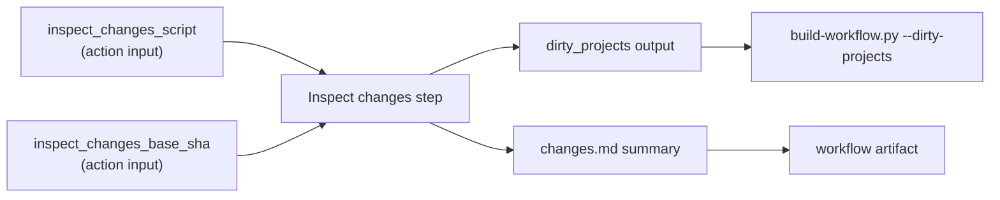
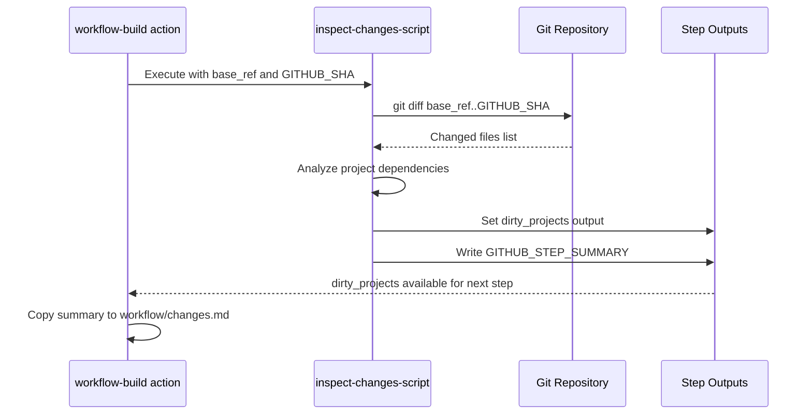
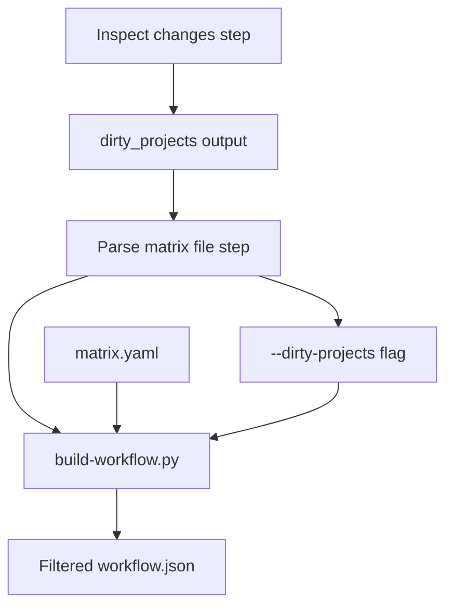
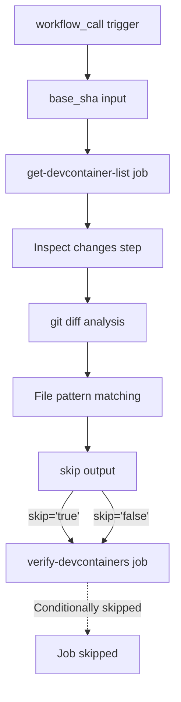
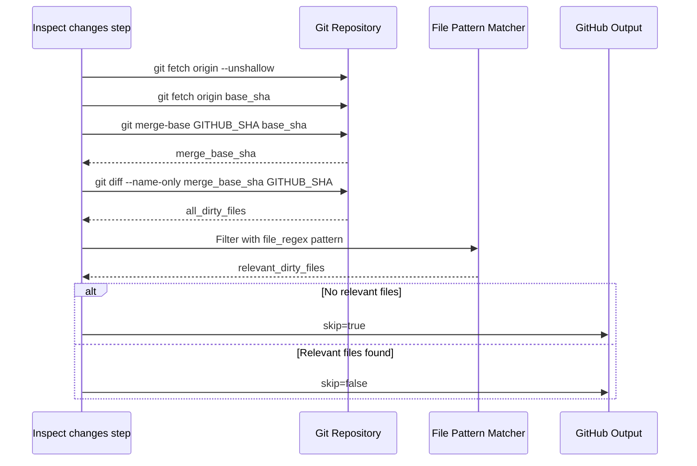
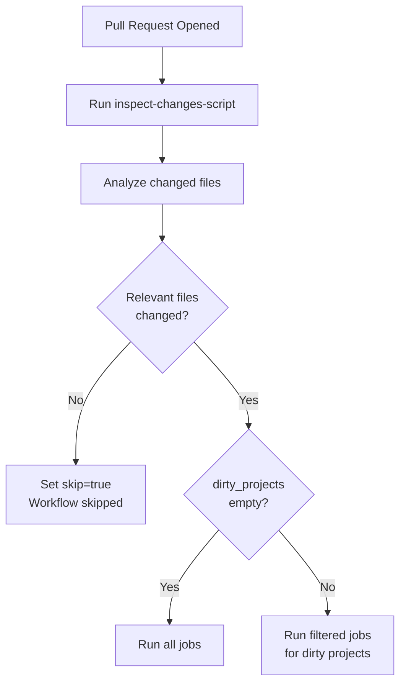

<!-- source: DeepWiki mcp.deepwiki.com · repo NVIDIA/cccl-gha · page 7.1 Change Detection · fetched 2026-10-26 -->

# Change Detection

<details>
<summary>Relevant source files</summary>

The following files were used as context for generating this wiki page:

- [.github/actions/workflow-build/action.yml](.github/actions/workflow-build/action.yml)
- [.github/workflows/verify-devcontainers.yml](.github/workflows/verify-devcontainers.yml)

</details>


This document explains the change detection mechanisms used to optimize CI/CD resource utilization by selectively executing jobs based on file modifications. The system performs git diff analysis to identify changed files and projects, enabling conditional workflow execution and job filtering.

For information about how detected changes influence job generation and filtering, see [Configuration Guide](#2) and [Exclusions and Filtering](#2.3). For details on the workflow generation pipeline that consumes change detection outputs, see [Workflow Generation](#3).

---

## Overview

The change detection system implements two primary optimization strategies:

1. **Job Filtering**: Limits job execution to only projects affected by code changes using the `dirty_projects` mechanism
2. **Workflow Skipping**: Conditionally skips entire workflow runs when no relevant files have been modified

These mechanisms reduce unnecessary compute costs and provide faster feedback during pull request validation by avoiding redundant builds and tests.

**Key Components**:

| Component | Purpose | Integration Point |
|-----------|---------|-------------------|
| `inspect-changes-script` | Analyzes git diffs to identify changed projects | `workflow-build` action input |
| `dirty_projects` output | List of affected projects passed to job generation | `build-workflow.py` filtering |
| Base SHA resolution | Determines comparison baseline for git diff | PR merge base or specified commit |
| File pattern matching | Identifies relevant file paths using regex | Devcontainer verification workflow |

Sources: [.github/actions/workflow-build/action.yml:12-19]()

---

## Inspect Changes Script Integration

The `workflow-build` action accepts an optional `inspect-changes-script` that performs git diff analysis between a base SHA and the current HEAD commit.

### Configuration



**Inspect Changes Step Configuration**

The workflow-build action conditionally executes the inspect-changes step when both required inputs are provided:

[.github/actions/workflow-build/action.yml:61-72]()

**Input Parameters**:

| Input | Description | Required | Default |
|-------|-------------|----------|---------|
| `inspect_changes_script` | Path to script that analyzes git diffs | No | `""` |
| `inspect_changes_base_sha` | Git SHA to use as comparison baseline | No | `""` |

The step only runs when both parameters are non-empty: `if: ${{ inputs.inspect_changes_script != '' && inputs.inspect_changes_base_sha != '' }}`

### Script Execution Flow



The script receives two arguments:
1. `base_ref` - The baseline commit SHA for comparison
2. `GITHUB_SHA` - The current HEAD commit SHA

The script must output a `dirty_projects` value through GitHub Actions output mechanism and generate a summary in `GITHUB_STEP_SUMMARY`.

Sources: [.github/actions/workflow-build/action.yml:61-72]()

---

## Dirty Projects Filtering

The `dirty_projects` output from the inspect-changes step flows into the `build-workflow.py` script to filter job generation.

### Integration with Workflow Generation



**Conditional Flag Construction**

The build-workflow step constructs command-line arguments based on whether change detection is enabled:

[.github/actions/workflow-build/action.yml:74-88]()

**Environment Variable Resolution**:

| Variable | Condition | Value |
|----------|-----------|-------|
| `dirty_projects_flag` | `inspect_changes_script != ''` | `--dirty-projects` |
| `dirty_projects_flag` | `inspect_changes_script == ''` | `""` (empty) |
| `dirty_projects` | `inspect_changes_script != ''` | Output from inspect-changes step |
| `dirty_projects` | `inspect_changes_script == ''` | `""` (empty) |

When both values are non-empty, the `build-workflow.py` script receives the `--dirty-projects` flag with the project list, triggering job filtering logic.

### Filtering Behavior

When `--dirty-projects` is provided to `build-workflow.py`, the script:

1. Parses the provided project list
2. Compares against job definitions in `matrix.yaml`
3. Excludes jobs for projects not in the dirty list
4. Preserves jobs for changed projects and their dependencies

This ensures that only affected components are built and tested, while maintaining dependency integrity.

Sources: [.github/actions/workflow-build/action.yml:74-88]()

---

## Devcontainer Verification Change Detection

The `verify-devcontainers` workflow implements an independent change detection system to conditionally skip devcontainer validation when irrelevant files are modified.

### Workflow Architecture



**Conditional Execution Logic**

The verify-devcontainers job matrix only runs when the skip output is not 'true':

[.github/workflows/verify-devcontainers.yml:96-104]()

Sources: [.github/workflows/verify-devcontainers.yml:1-25]()

### Git Diff Analysis

The inspect-changes step performs merge base resolution and file filtering:



**Implementation Details**:

[.github/workflows/verify-devcontainers.yml:50-86]()

**Key Operations**:

1. **Merge Base Resolution**: Determines the common ancestor commit between PR base and HEAD
2. **Full Diff**: Retrieves all modified files using `git diff --name-only`
3. **Pattern Filtering**: Applies regex to identify relevant files
4. **Skip Decision**: Sets output based on whether relevant files exist

Sources: [.github/workflows/verify-devcontainers.yml:50-86]()

---

## File Pattern Matching

The change detection system uses regular expressions to identify files that warrant workflow execution.

### Devcontainer Relevant Files

**Pattern Definition**:

[.github/workflows/verify-devcontainers.yml:72-73]()

```regex
^(.devcontainer|ci/matrix.yaml|.github/actions/workflow-build/build-workflow.py)
```

**Matched Paths**:

| Pattern Component | Matches | Purpose |
|------------------|---------|---------|
| `.devcontainer` | Any file under `.devcontainer/` directory | Devcontainer configurations and scripts |
| `ci/matrix.yaml` | The matrix configuration file | Job definitions that may affect devcontainers |
| `.github/actions/workflow-build/build-workflow.py` | Workflow generation script | Logic that processes matrix and generates jobs |

**Filtering Logic**:

[.github/workflows/verify-devcontainers.yml:67-78]()

The filtering uses a multi-stage process:

1. **Full Diff Listing**: Captures all changed files between merge base and HEAD
2. **Pattern Application**: `grep -E "${file_regex}"` filters the list
3. **Empty Check**: Tests if filtered list is empty to determine skip condition

The `|| true` suffix on the grep command prevents pipeline failure when no matches are found.

### Extensibility

Custom inspect-changes scripts can implement arbitrary file pattern matching logic tailored to specific project structures. Common patterns include:

- **Project-specific paths**: `^projects/specific_project/`
- **Build system files**: `(CMakeLists.txt|\.cmake)$`
- **Configuration files**: `(\.yaml|\.json|\.toml)$`
- **Documentation**: `(\.md|docs)` (typically excluded from build triggering)

Sources: [.github/workflows/verify-devcontainers.yml:65-86]()

---

## Benefits and Use Cases

### Resource Optimization

**Cost Reduction Scenarios**:

| Scenario | Without Change Detection | With Change Detection |
|----------|-------------------------|----------------------|
| Documentation-only PR | ~100 jobs execute | 0 jobs execute |
| Single project change | All projects build | Only affected project builds |
| Devcontainer-unrelated change | All devcontainers verify | Verification skipped |
| Configuration file update | All jobs run | Only relevant jobs run |

### Workflow Skip Conditions



**Common Skip Scenarios**:

- **Documentation Updates**: Changes only to `*.md` files outside of matrix configuration
- **CI Workflow Changes**: Modifications to workflows that don't affect matrix or devcontainers
- **GitHub Configuration**: Updates to issue templates, CODEOWNERS, or other repository settings
- **Non-Build Assets**: Changes to images, diagrams, or other non-executable files

### Fast Feedback

Change detection provides faster CI feedback by:

1. **Reducing Queue Time**: Fewer jobs means less competition for runner resources
2. **Faster Job Scheduling**: GitHub Actions can dispatch filtered jobs immediately
3. **Targeted Validation**: Developers see results for affected components without waiting for unrelated tests
4. **Incremental Development**: Enables rapid iteration on specific components

### Integration Pattern

**Typical Usage in Consumer Repository**:

```yaml
jobs:
  build-workflow:
    uses: ./.github/actions/workflow-build
    with:
      workflows: pull_request
      inspect_changes_script: ./ci/inspect_changes.sh
      inspect_changes_base_sha: ${{ github.event.pull_request.base.sha }}
      matrix_file: ci/matrix.yaml
```

The consumer repository provides:
- Custom `inspect_changes.sh` script with project-specific logic
- Base SHA from PR event context
- Matrix configuration with project definitions

Sources: [.github/actions/workflow-build/action.yml:12-19](), [.github/workflows/verify-devcontainers.yml:5-9]()

---

## Limitations and Considerations

### Dependency Tracking

The inspect-changes script must implement dependency resolution to avoid breaking transitive dependencies:

- **Library Changes**: If library A is modified, dependent projects B and C should also be marked dirty
- **Shared Headers**: Changes to common header files may affect multiple projects
- **Build System**: Modifications to CMake modules or build scripts may require full rebuild

### False Negatives

Change detection can produce false negatives (failing to detect necessary rebuilds) when:

- Dependencies are not properly tracked in the inspect-changes script
- Generated files are not considered in the analysis
- Cross-project integration points are not identified

### Merge Base Accuracy

The merge base calculation assumes:
- The base branch has been fetched: `git fetch origin --unshallow`
- The base SHA is available: `git fetch origin $BASE_SHA`
- The repository has sufficient history for merge-base resolution

Shallow clones may require `--unshallow` to access merge base commits.

Sources: [.github/workflows/verify-devcontainers.yml:56-59]()

---

## Summary

The change detection system provides intelligent workflow optimization through:

- **Git Diff Analysis**: Identifies modified files between base and HEAD commits
- **Project Filtering**: Limits job execution to affected components via `dirty_projects`
- **Workflow Skipping**: Conditionally bypasses entire workflows when irrelevant files change
- **Pattern Matching**: Uses regex to identify files warranting CI execution
- **Cost Optimization**: Reduces compute resource usage by avoiding unnecessary jobs

The system integrates with the workflow-build action through optional inputs and conditional step execution, enabling both full and filtered CI runs based on code change context.

Sources: [.github/actions/workflow-build/action.yml:12-88](), [.github/workflows/verify-devcontainers.yml:50-86]()

---

