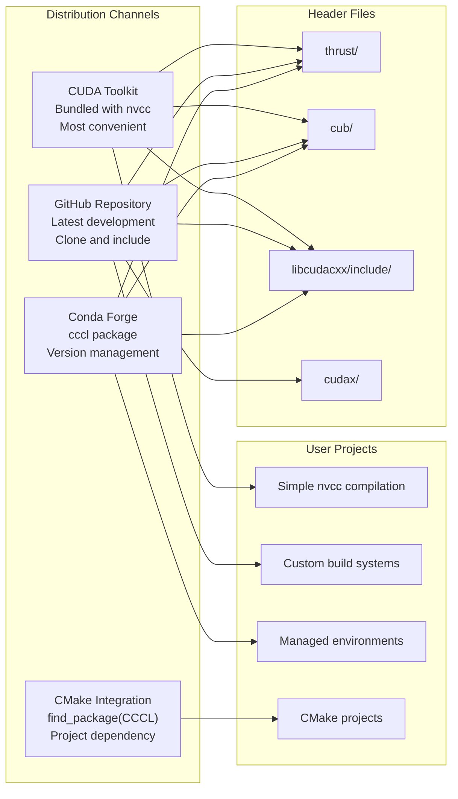
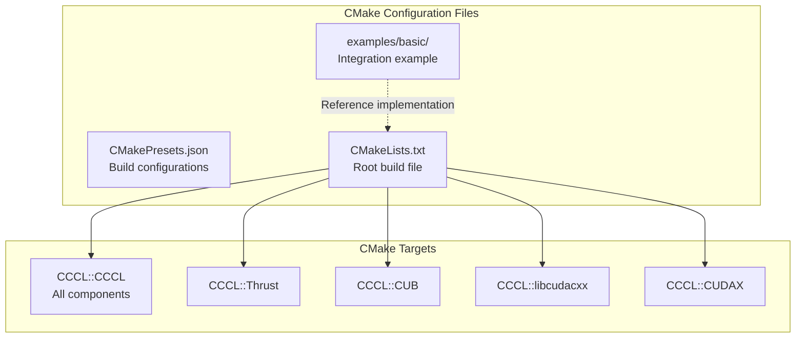
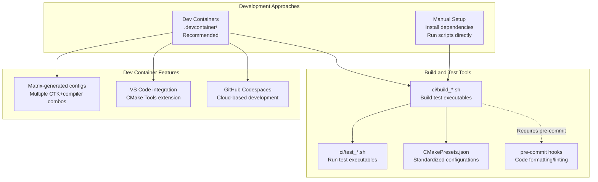
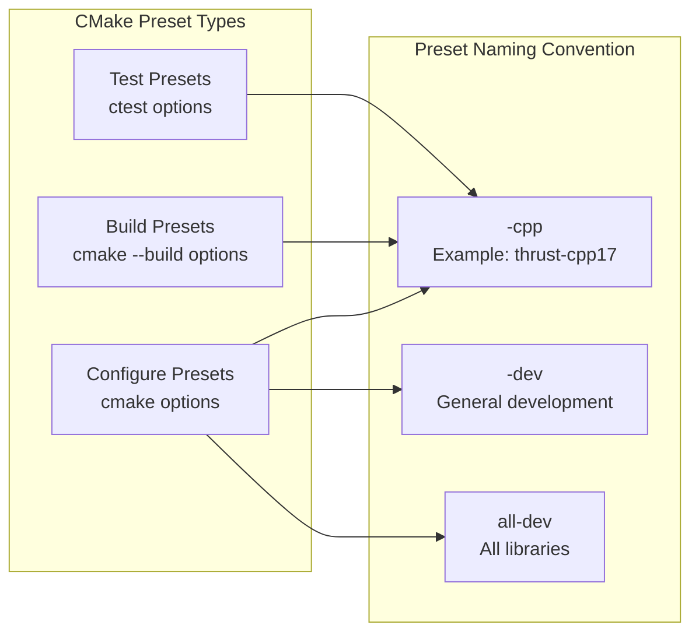
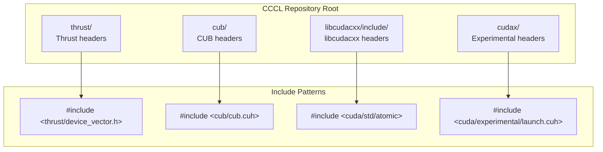

<!-- source: DeepWiki mcp.deepwiki.com · repo NVIDIA/cccl · page 1.2 Installation and Setup · fetched 2026-10-26 -->

# Installation and Setup

<details>
<summary>Relevant source files</summary>

The following files were used as context for generating this wiki page:

- [CONTRIBUTING.md](CONTRIBUTING.md)
- [README.md](README.md)

</details>


**Purpose and Scope:** This page describes the installation methods for using CCCL libraries in your projects and the setup procedures for development environments. For information about building and testing CCCL components, see [Testing Infrastructure](#3.3). For detailed build configuration options, see [CMake Build Configuration](#3.1).

CCCL is a header-only library collection, meaning there is no traditional compilation or linking step required. Installation consists solely of making the header files available to your compiler. The approach you choose depends on whether you are a library user or a contributor.

## Installation Methods for Library Users

CCCL provides four primary distribution channels, each suited to different use cases and workflows.

### Distribution Channel Overview



**Sources:** [README.md:108-215]()

### Method 1: CUDA Toolkit

The CUDA Toolkit includes CCCL headers automatically. When compiling with `nvcc`, the headers are already in the include path.

**Installation:** Download and install the [CUDA Toolkit](https://developer.nvidia.com/cuda-toolkit).

**Usage with nvcc:**
```cpp
// No additional configuration required
#include <thrust/device_vector.h>
#include <cub/cub.cuh>
#include <cuda/std/atomic>
```

**Usage with other compilers:** Add the CCCL include directory manually (typically `/usr/local/cuda/include` on Linux).

| Compiler | Example Include Flag |
|----------|---------------------|
| g++      | `-I/usr/local/cuda/include` |
| clang++  | `-I/usr/local/cuda/include` |
| MSVC     | `/I"C:\Program Files\NVIDIA GPU Computing Toolkit\CUDA\v12.x\include"` |

**Version Mapping:** The CCCL version is tied to the CTK version. See the table in [README.md:448-470]() for the mapping between CCCL versions and CTK versions.

**Sources:** [README.md:115-125]()

### Method 2: GitHub Repository

Clone the repository to use the latest development version or a version newer than what's included in your installed CUDA Toolkit.

**Installation:**
```bash
git clone https://github.com/NVIDIA/cccl.git
```

**Compilation:**
```bash
nvcc -Icccl/thrust -Icccl/libcudacxx/include -Icccl/cub main.cu -o main
```

**Important:** Use `-I` instead of `-isystem` to avoid collisions with CCCL headers implicitly included by `nvcc` from the CUDA Toolkit. All CCCL headers use `#pragma system_header` to ensure warnings are still silenced. See issue #527 for more information.

**Installation to system directories:** Use CMake to install headers to a standard location:

```bash
cd cccl
cmake . -DCMAKE_INSTALL_PREFIX=/usr/local
make install
```

Or use the convenience script [ci/install_cccl.sh]():
```bash
ci/install_cccl.sh /usr/local
```

**Advanced Installation with CMake Presets:**

CMake presets provide standardized configurations for different installation scenarios:

```bash
# Standard installation (stable libraries only)
cmake --preset install -DCMAKE_INSTALL_PREFIX=/usr/local
cmake --build --preset install --target install

# Include experimental libraries
cmake --preset install-unstable -DCMAKE_INSTALL_PREFIX=/usr/local
cmake --build --preset install-unstable --target install

# Experimental libraries only
cmake --preset install-unstable-only -DCMAKE_INSTALL_PREFIX=/usr/local
cmake --build --preset install-unstable-only --target install
```

| Preset | Includes Thrust/CUB/libcudacxx | Includes cudax |
|--------|-------------------------------|----------------|
| `install` | ✅ | ❌ |
| `install-unstable` | ✅ | ✅ |
| `install-unstable-only` | ❌ | ✅ |

**Sources:** [README.md:127-170]()

### Method 3: Conda

CCCL provides conda packages via the `conda-forge` channel for version management in conda environments.

**Installation:**
```bash
conda config --add channels conda-forge
conda install cccl
```

This installs to `$CONDA_PREFIX/include/` and `$CONDA_PREFIX/lib/cmake/`, making it discoverable by CMake via `find_package(CCCL)`.

**Version-specific Installation:** To use the same CCCL version that shipped with a specific CUDA Toolkit:

```bash
conda install cuda-cccl cuda-version=12.4
```

The `cuda-cccl` metapackage installs the CCCL version corresponding to the specified `cuda-version`.

**Upgrading from cuda-cccl to latest cccl:**
```bash
conda uninstall cuda-cccl
conda install -c conda-forge cccl
```

**Package Naming:** The `cuda-cccl_linux-64` packages are for internal CUDA Toolkit use. Install `cccl` or `cuda-cccl` instead for compatibility with conda compilers.

**Sources:** [README.md:172-204]()

### Method 4: CMake Integration

For CMake-based projects, CCCL provides `find_package` support and target-based integration.

**Directory Structure:**


**Basic Integration:**
```cmake
find_package(CCCL REQUIRED)
target_link_libraries(my_target PRIVATE CCCL::CCCL)
```

**Component-specific Integration:**
```cmake
find_package(CCCL REQUIRED COMPONENTS Thrust CUB libcudacxx)
target_link_libraries(my_target PRIVATE 
    CCCL::Thrust 
    CCCL::CUB 
    CCCL::libcudacxx
)
```

For a complete example using CMake Package Manager (CPM), see [examples/basic]().

**Sources:** [README.md:206-214]()

## Development Setup for Contributors

Contributors need additional tooling for building tests, running CI scripts locally, and maintaining code quality.

### Development Environment Options



**Sources:** [CONTRIBUTING.md:9-18](), [CONTRIBUTING.md:65-176]()

### Development Containers (Recommended)

CCCL uses Development Containers to provide consistent environments for both local development and CI. These containers include all necessary dependencies and toolchains.

**Setup Options:**

| Method | Requirements | Access |
|--------|-------------|---------|
| VS Code + Docker | VS Code, Docker Desktop | [.devcontainer/README.md]() |
| GitHub Codespaces | GitHub account | Click badge in [README.md:1]() |
| Command line | Docker or Podman | [.devcontainer/README.md]() |

**Container Features:**
- Pre-installed CUDA Toolkit and compilers
- Matrix-generated configurations for multiple toolchain combinations
- CMake Tools extension for VS Code
- Nsight Visual Studio Code Edition for debugging

**Quick Start:**
```bash
# Clone repository
git clone https://github.com/NVIDIA/cccl.git
cd cccl

# Open in VS Code (will prompt to reopen in container)
code .
```

**Sources:** [CONTRIBUTING.md:15-17](), [CONTRIBUTING.md:154-176]()

### Build Scripts

CCCL provides shell scripts in the `ci/` directory for building and testing each component. These scripts are used by both CI and local development.

**Build Script Syntax:**
```bash
ci/build_[thrust|cub|libcudacxx].sh -cxx <HOST_COMPILER> -std <CXX_STANDARD> -arch <GPU_ARCHS>
```

**Parameters:**

| Parameter | Description | Example Values |
|-----------|-------------|----------------|
| `-cxx` | Host compiler | `g++`, `clang++`, `cl.exe` |
| `-std` | C++ standard | `17`, `20` |
| `-arch` | GPU architectures (semicolon-separated) | `"70;85;90"` |

**Architecture Syntax** (same as CMake's `CUDA_ARCHITECTURES`):
- `70` - both PTX and SASS
- `70-real` - SASS only
- `70-virtual` - PTX only

**Example:**
```bash
# Build CUB tests for C++17 with g++ for multiple architectures
./ci/build_cub.sh -cxx g++ -std 17 -arch "70;75;80-virtual"
```

**Test Script Usage:**
```bash
# Test scripts automatically build if needed
./ci/test_cub.sh -cxx g++ -std 17 -arch "70;75;80-virtual"
```

**Note:** Building tests does not require a GPU, but running tests does.

**Sources:** [CONTRIBUTING.md:71-104]()

### CMake Presets

CMake Presets provide standardized configurations defined in [CMakePresets.json](). They enable consistent builds across different development environments.

**Preset Categories:**



**Listing Available Presets:**
```bash
cmake --list-presets              # Configure presets
cmake --build --list-presets      # Build presets
ctest --list-presets              # Test presets
```

**Using Presets (Command Line):**
```bash
# Configure
cmake --preset=thrust-cpp17

# Override options
cmake --preset=thrust-cpp20 "-DCMAKE_CUDA_ARCHITECTURES=89"

# Build
cmake --build --preset=thrust-cpp17

# Test
ctest --preset=thrust-cpp17
```

**Build Directory Structure:**
```
build/
├── <devcontainer_name>/    # Inserted on devcontainer builds
│   └── thrust-cpp17/
│       ├── CMakeCache.txt
│       └── ...
└── thrust-cpp20/
    └── ...
```

**Using Presets (VS Code):**

The CMake Tools extension provides GUI integration:

1. **Select Configure Preset:** Click "Select Configure Preset" in the CMake sidebar
2. **Select Build Target:** Expand "Build" node and choose target
3. **Build:** Click gear icon at bottom of VS Code window
4. **Run/Debug:** Select target from "Launch" or "Debug" dropdown

For device debugging, use the Nsight Visual Studio Code Edition extension instead of the built-in debugger.

**Sources:** [CONTRIBUTING.md:106-176]()

### Pre-commit Hooks

CCCL uses [pre-commit](https://pre-commit.com) to enforce consistent code formatting and linting across all contributors.

**Linters and Formatters:**
- **C++/CUDA:** `clang-format` (configuration in [.clang-format]())
- **Python:** Various linters defined in [.pre-commit-config.yaml]()
- **Other:** Shell scripts, YAML, JSON, etc.

**Installation:**
```bash
# Via conda
conda config --add channels conda-forge
conda install pre-commit

# Via pip
pip install pre-commit
```

**Running Pre-commit:**
```bash
# Run on staged files only
pre-commit run

# Run on all files
pre-commit run --all-files

# Install as git hook (automatic on commit)
pre-commit install

# Skip checks when committing
git commit --no-verify
# or
git commit -n
```

**CI Integration:**
- [pre-commit.ci](https://pre-commit.ci) runs on all pull requests
- Fails if formatting/linting issues are detected
- Comment `pre-commit.ci autofix` to automatically fix and commit changes

**Sources:** [CONTRIBUTING.md:190-243]()

## Header Organization and Include Paths

Understanding the header file organization helps when manually configuring include paths.

**Directory Structure:**


**Required Include Paths:**

| Library | Include Path | Header Pattern |
|---------|-------------|----------------|
| Thrust | `-Icccl/thrust` | `#include <thrust/...>` |
| CUB | `-Icccl/cub` | `#include <cub/...>` |
| libcudacxx | `-Icccl/libcudacxx/include` | `#include <cuda/std/...>` or `#include <cuda/...>` |
| cudax | `-Icccl/cudax` | `#include <cuda/experimental/...>` |

**Complete Example:**
```bash
nvcc -Icccl/thrust \
     -Icccl/cub \
     -Icccl/libcudacxx/include \
     -Icccl/cudax \
     main.cu -o main
```

**Sources:** [README.md:133-137]()

## Version Verification

After installation, verify the CCCL version using version headers.

**Version Macros:**

| Library | Header | Major | Minor | Patch | Concatenated |
|---------|--------|-------|-------|-------|--------------|
| CCCL (preferred) | `<cuda/version>` | `CCCL_MAJOR_VERSION` | `CCCL_MINOR_VERSION` | `CCCL_PATCH_VERSION` | `CCCL_VERSION` |
| libcudacxx | `<cuda/std/version>` | `_LIBCUDACXX_CUDA_API_VERSION_MAJOR` | `_LIBCUDACXX_CUDA_API_VERSION_MINOR` | `_LIBCUDACXX_CUDA_API_VERSION_PATCH` | `_LIBCUDACXX_CUDA_API_VERSION` |
| Thrust | `<thrust/version.h>` | `THRUST_MAJOR_VERSION` | `THRUST_MINOR_VERSION` | `THRUST_SUBMINOR_VERSION` | `THRUST_VERSION` |
| CUB | `<cub/version.h>` | `CUB_MAJOR_VERSION` | `CUB_MINOR_VERSION` | `CUB_SUBMINOR_VERSION` | `CUB_VERSION` |

**Example:**
```cpp
#include <cuda/version>
#include <iostream>

int main() {
    std::cout << "CCCL Version: " 
              << CCCL_MAJOR_VERSION << "."
              << CCCL_MINOR_VERSION << "."
              << CCCL_PATCH_VERSION << std::endl;
    return 0;
}
```

**Version Format:**
- **CCCL/libcudacxx:** `MMMmmmppp` (e.g., `002001000` = 2.1.0)
- **Thrust/CUB:** `MMMmmmpp` (e.g., `00201000` = 2.1.0)

**Sources:** [README.md:372-382]()

## Compatibility Considerations

CCCL has specific compatibility requirements that affect installation choices.

**CUDA Toolkit Compatibility:**

| CCCL Version | Supported CTK Versions |
|--------------|------------------------|
| 2.x | 11.1 - 11.8, 12.x (latest patch releases) |
| 3.x | 12.x, 13.x (latest patch releases) |

**Key Rules:**
- ✅ **Backward compatible:** Newer CCCL works with older supported CTK versions
- ❌ **Not forward compatible:** Older CCCL does not work with newer CTK versions
- ⚠️ **New features:** May not work on older CTK versions if they depend on new CTK features

**Upgrade Scenarios:**

| Current CTK | Included CCCL | Desired CCCL | Supported? | Notes |
|:-----------:|:-------------:|:------------:|:----------:|:------|
| CTK 12.4 | CCCL 2.3 | CCCL 2.8 | ✅ | Minor version upgrade, some new features may not work |
| CTK 12.4 | CCCL 2.3 | CCCL 3.0 | ✅ | Major version upgrade, possible API breaks |
| CTK 12.4 | CCCL 2.3 | CCCL 4.0 | ❌ | CCCL supports only two CTK major versions |
| CTK 13.0 | CCCL 3.0 | CCCL 2.8 | ❌ | CCCL is not forward compatible |

For more information on versioning and API/ABI stability, see [Versioning Policy](#6.1) and [API and ABI Stability](#6.2).

**Host Compiler Requirements:**
- **Linux:** GCC 7.x or newer
- **Windows:** MSVC versions supported by latest CUDA Toolkit
- See [Platform and Compiler Support](#6.3) for complete details

**Sources:** [README.md:227-286]()

## Next Steps

After installing CCCL:
- **Users:** See [Quick Start Examples](#1.3) for working code examples
- **Contributors:** See [Build Scripts and Presets](#3.2) and [Testing Infrastructure](#3.3) for development workflows
- **Build Integration:** See [CMake Build Configuration](#3.1) for advanced configuration options

**Sources:** [README.md:108-215](), [CONTRIBUTING.md:1-258]()

---

