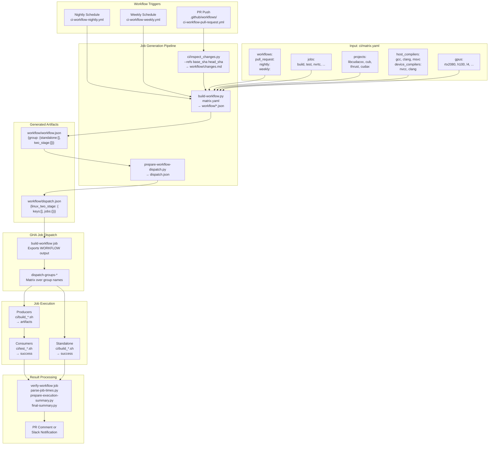
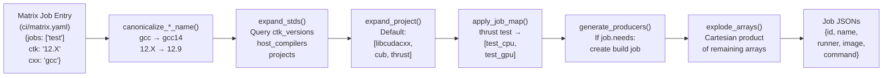
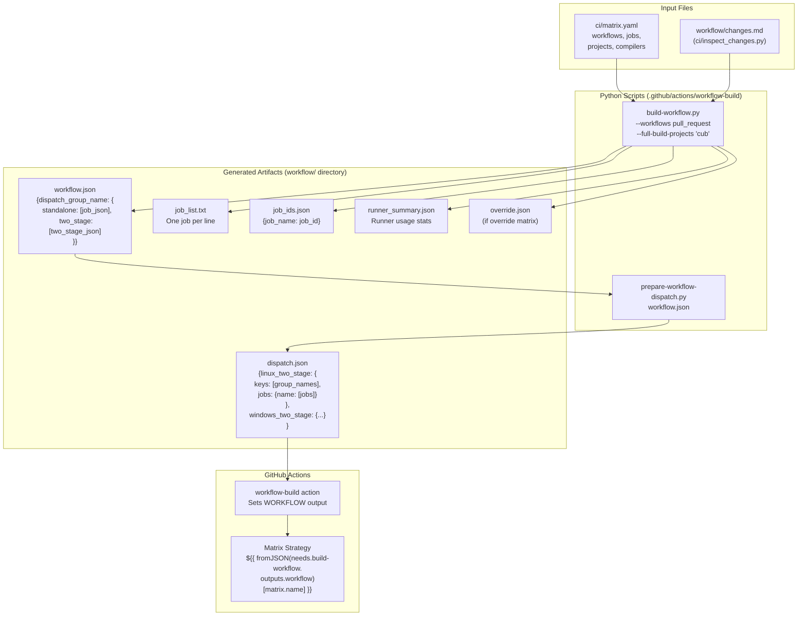
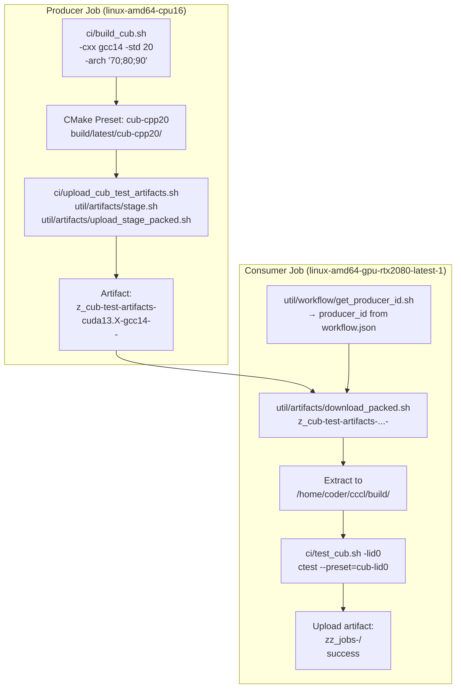
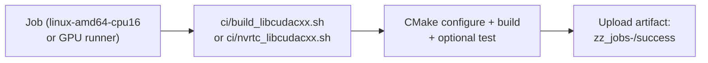
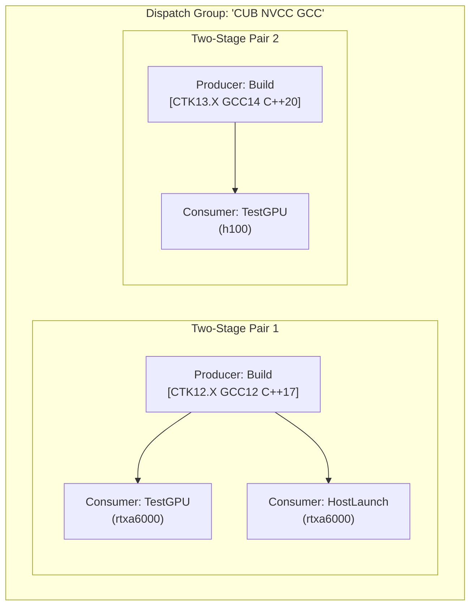
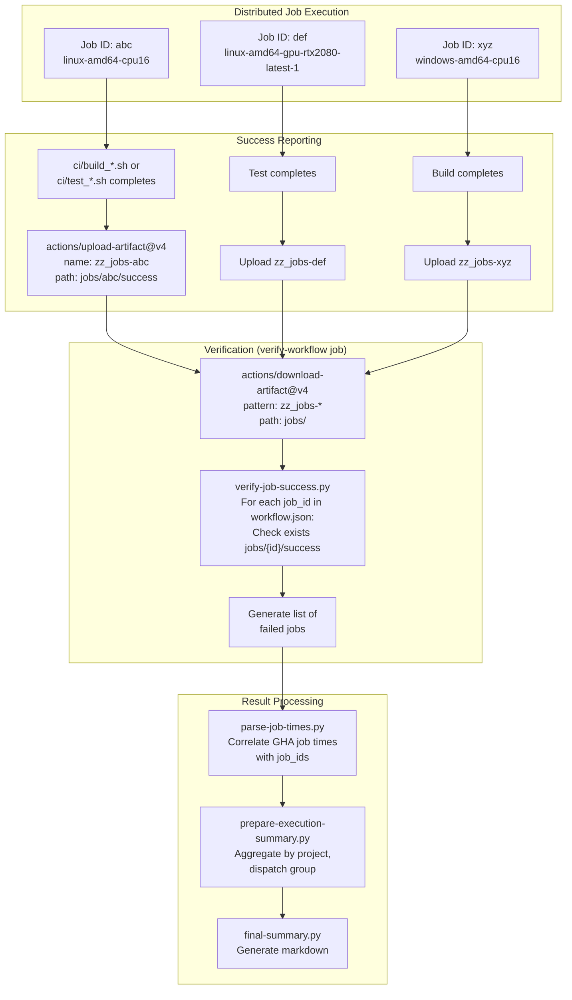
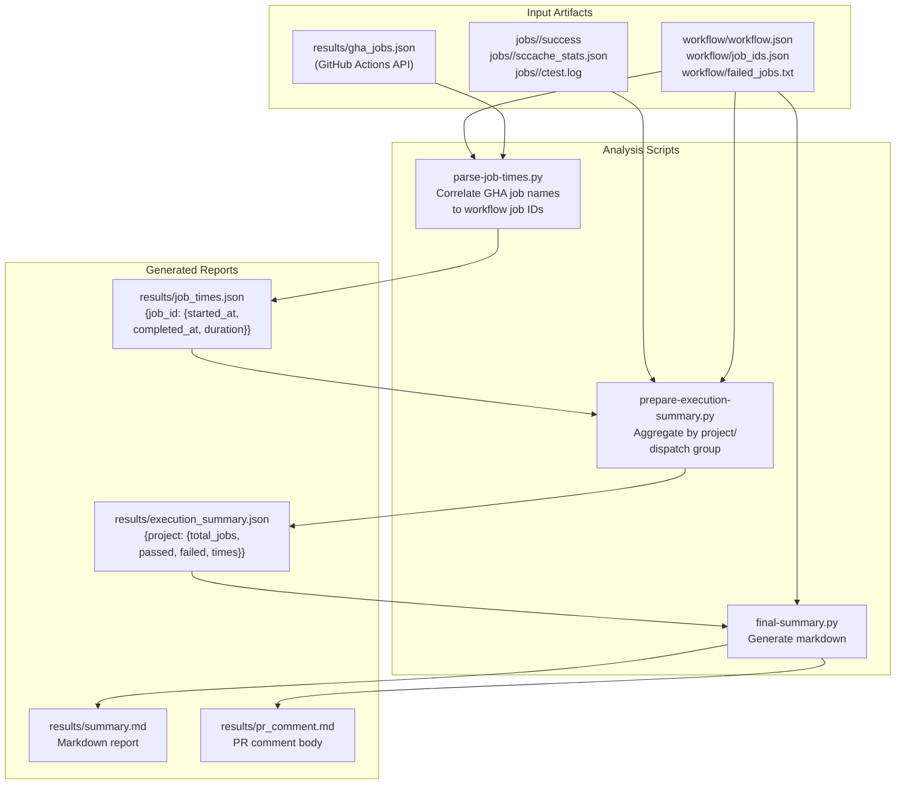
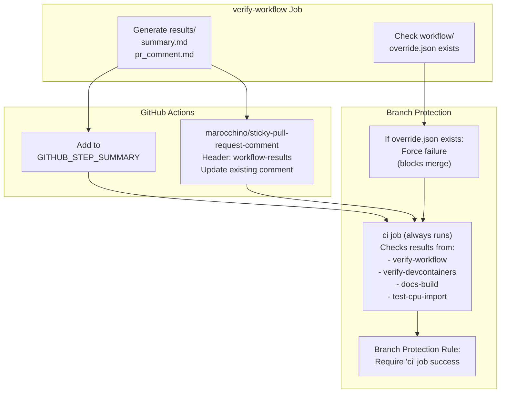

<!-- source: DeepWiki mcp.deepwiki.com · repo NVIDIA/cccl · page 4.1 Architecture Overview · fetched 2026-10-26 -->

# Architecture Overview

<details>
<summary>Relevant source files</summary>

The following files were used as context for generating this wiki page:

- [.devcontainer/cccl-entrypoint.sh](.devcontainer/cccl-entrypoint.sh)
- [.devcontainer/docker-entrypoint.sh](.devcontainer/docker-entrypoint.sh)
- [.devcontainer/launch.sh](.devcontainer/launch.sh)
- [.devcontainer/make_devcontainers.sh](.devcontainer/make_devcontainers.sh)
- [.github/actions/docs-build/action.yml](.github/actions/docs-build/action.yml)
- [.github/actions/workflow-build/action.yml](.github/actions/workflow-build/action.yml)
- [.github/actions/workflow-build/build-workflow.py](.github/actions/workflow-build/build-workflow.py)
- [.github/actions/workflow-build/prepare-workflow-dispatch.py](.github/actions/workflow-build/prepare-workflow-dispatch.py)
- [.github/actions/workflow-results/action.yml](.github/actions/workflow-results/action.yml)
- [.github/actions/workflow-results/final-summary.py](.github/actions/workflow-results/final-summary.py)
- [.github/actions/workflow-results/parse-job-times.py](.github/actions/workflow-results/parse-job-times.py)
- [.github/actions/workflow-results/prepare-execution-summary.py](.github/actions/workflow-results/prepare-execution-summary.py)
- [.github/actions/workflow-results/verify-job-success.py](.github/actions/workflow-results/verify-job-success.py)
- [.github/copilot-instructions.md](.github/copilot-instructions.md)
- [.github/problem-matchers/problem-matcher.json](.github/problem-matchers/problem-matcher.json)
- [.github/workflows/build-docs.yml](.github/workflows/build-docs.yml)
- [.github/workflows/build-matx.yml](.github/workflows/build-matx.yml)
- [.github/workflows/build-pytorch.yml](.github/workflows/build-pytorch.yml)
- [.github/workflows/build-rapids.yml](.github/workflows/build-rapids.yml)
- [.github/workflows/ci-workflow-nightly.yml](.github/workflows/ci-workflow-nightly.yml)
- [.github/workflows/ci-workflow-pull-request.yml](.github/workflows/ci-workflow-pull-request.yml)
- [.github/workflows/ci-workflow-weekly.yml](.github/workflows/ci-workflow-weekly.yml)
- [.github/workflows/git-bisect.yml](.github/workflows/git-bisect.yml)
- [.github/workflows/pr-preview-cleanup.yml](.github/workflows/pr-preview-cleanup.yml)
- [.github/workflows/verify-devcontainers.yml](.github/workflows/verify-devcontainers.yml)
- [AGENTS.md](AGENTS.md)
- [CMakeLists.txt](CMakeLists.txt)
- [CMakePresets.json](CMakePresets.json)
- [ci-overview.md](ci-overview.md)
- [ci/build_common.sh](ci/build_common.sh)
- [ci/build_cub.sh](ci/build_cub.sh)
- [ci/build_libcudacxx.sh](ci/build_libcudacxx.sh)
- [ci/build_thrust.sh](ci/build_thrust.sh)
- [ci/compute-sanitizer-suppressions.xml](ci/compute-sanitizer-suppressions.xml)
- [ci/matrix.yaml](ci/matrix.yaml)
- [ci/matx/build_matx.sh](ci/matx/build_matx.sh)
- [ci/ninja_summary.py](ci/ninja_summary.py)
- [ci/nvrtc_libcudacxx.sh](ci/nvrtc_libcudacxx.sh)
- [ci/pytorch/build_pytorch.sh](ci/pytorch/build_pytorch.sh)
- [ci/rapids/cuda13.0-conda/devcontainer.json](ci/rapids/cuda13.0-conda/devcontainer.json)
- [ci/rapids/post-create-command.sh](ci/rapids/post-create-command.sh)
- [ci/rapids/rapids-entrypoint.sh](ci/rapids/rapids-entrypoint.sh)
- [ci/run_cpu_bisect.sh](ci/run_cpu_bisect.sh)
- [ci/run_cpu_target.sh](ci/run_cpu_target.sh)
- [ci/run_gpu_bisect.sh](ci/run_gpu_bisect.sh)
- [ci/run_gpu_target.sh](ci/run_gpu_target.sh)
- [ci/test_cub.sh](ci/test_cub.sh)
- [ci/test_libcudacxx.sh](ci/test_libcudacxx.sh)
- [ci/test_thrust.sh](ci/test_thrust.sh)
- [ci/upload_cub_test_artifacts.sh](ci/upload_cub_test_artifacts.sh)
- [ci/util/build_and_test_targets.sh](ci/util/build_and_test_targets.sh)
- [ci/util/git_bisect.sh](ci/util/git_bisect.sh)
- [ci/windows/test_cub.ps1](ci/windows/test_cub.ps1)
- [docs/gen_docs.bash](docs/gen_docs.bash)
- [docs/index.rst](docs/index.rst)
- [libcudacxx/test/libcudacxx/std/utilities/memory/temporary.buffer/overaligned.pass.cpp](libcudacxx/test/libcudacxx/std/utilities/memory/temporary.buffer/overaligned.pass.cpp)
- [libcudacxx/test/libcudacxx/std/utilities/memory/temporary.buffer/temporary_buffer.pass.cpp](libcudacxx/test/libcudacxx/std/utilities/memory/temporary.buffer/temporary_buffer.pass.cpp)

</details>


## Purpose and Scope

This page explains the CI/CD architecture for CCCL, which validates the four core libraries (libcudacxx, CUB, Thrust, cudax) across hundreds of configurations spanning CUDA Toolkit versions, host compilers, C++ standards, and GPU architectures.

The system transforms a single YAML matrix definition into dynamically generated GitHub Actions workflows that orchestrate build and test jobs across multiple platforms. The architecture emphasizes:
- **Matrix-driven generation**: All jobs derive from `ci/matrix.yaml`
- **Change detection**: Only affected projects are tested in PRs
- **Producer-consumer model**: Separate build (CPU) and test (GPU) phases to optimize resource usage
- **Result aggregation**: Comprehensive reporting with execution times and cache statistics

Related pages provide implementation details:
- [Matrix Configuration (4.2)](#4.2): Tags, exclusions, and matrix expansion rules
- [Workflow Generation (4.3)](#4.3): How `build-workflow.py` generates dispatch groups
- [Change Detection (4.4)](#4.4): Project dependency tracking and job pruning

## Workflow Types

The CI system uses three primary workflow configurations defined in `ci/matrix.yaml`:

| Workflow | Trigger | Entry Point | Scope | Job Count (approx) |
|----------|---------|-------------|-------|-------------------|
| `pull_request` | PR push | `.github/workflows/ci-workflow-pull-request.yml` | Pruned by `ci/inspect_changes.py` | ~50-250 |
| `nightly` | Weekdays 3AM UTC | `.github/workflows/ci-workflow-nightly.yml` | Full matrix validation | ~800 |
| `weekly` | Weekly schedule | `.github/workflows/ci-workflow-weekly.yml` | Extended with sanitizers | ~1000 |

Additional workflows:
- `pull_request_lite`: Minimal matrix for upstream dependency changes
- `python-wheels`: Python package builds for PyPI/conda
- `devcontainers`: Validates devcontainer definitions match `ci/matrix.yaml`

Each workflow follows the same generation pipeline but draws from different sections of `ci/matrix.yaml` (e.g., `workflows.pull_request`, `workflows.nightly`).

**Sources:** [ci/matrix.yaml:1-298](), [.github/workflows/ci-workflow-pull-request.yml:1-422](), [.github/workflows/ci-workflow-nightly.yml:1-177]()

## High-Level Architecture

**CI Pipeline: Workflow Trigger to Result Feedback**



**Pipeline Stages:**

1. **Trigger:** GitHub Actions workflow starts from `.github/workflows/ci-workflow-*.yml`
2. **Change Detection (PRs only):** `ci/inspect_changes.py` determines dirty projects by analyzing file changes and dependency graph
3. **Matrix Parsing:** `build-workflow.py` reads `ci/matrix.yaml`, expands matrix jobs, canonicalizes tags, applies exclusions
4. **Dispatch Preparation:** `prepare-workflow-dispatch.py` reorganizes jobs by platform and execution model for GitHub Actions matrix dispatch
5. **Job Execution:** Producers run `ci/build_*.sh`, consumers run `ci/test_*.sh`, artifacts flow between stages
6. **Verification:** `verify-workflow` job downloads success artifacts, parses execution times, generates summaries
7. **Feedback:** Results posted to PR comments (with sticky updates) or Slack channels (for nightly/weekly)

**Sources:** [.github/workflows/ci-workflow-pull-request.yml:32-121](), [.github/actions/workflow-build/action.yml:68-98](), [.github/actions/workflow-build/build-workflow.py:1-100](), [ci/matrix.yaml:1-40]()

## Matrix-Driven Job Generation

### Matrix Definition Structure

The CI system is driven by `ci/matrix.yaml`, which defines workflows as collections of matrix jobs. Each matrix job specifies:

| Tag | Description | Example Values |
|-----|-------------|----------------|
| `jobs` | Job types to execute | `['build', 'test']` |
| `project` | CCCL library to test | `'libcudacxx'`, `'cub'`, `'thrust'`, `'cudax'` |
| `ctk` | CUDA Toolkit version | `'12.0'`, `'12.X'`, `'13.X'` |
| `cxx` | Host compiler | `'gcc12'`, `'clang19'`, `'msvc2022'` |
| `cudacxx` | Device compiler | `'nvcc'`, `'clang'` |
| `std` | C++ standard | `17`, `20`, `'all'`, `'minmax'` |
| `gpu` | GPU model for test runners | `'rtx2080'`, `'h100'`, `'l4'` |
| `sm` | Target CUDA architectures | `'70;80;90'`, `'gpu'`, `'all-major-cccl'` |
| `cpu` | CPU architecture | `'amd64'`, `'arm64'` |

Matrix jobs are expanded into individual build/test jobs by `build-workflow.py`, which resolves defaults, canonicalizes values, and applies exclusion rules.

### Matrix Expansion Process

**Matrix Job Expansion in build-workflow.py**



**Expansion Functions (from build-workflow.py):**

1. **`canonicalize_ctk_version()`** ([build-workflow.py:122-136]()): Resolves aliases like `'12.X'` → `'12.9'`, `'13.X'` → `'13.1'`
2. **`canonicalize_host_compiler_name()`** ([build-workflow.py:163-202]()): Resolves `'gcc'` → latest version (`'gcc14'`), handles version aliases
3. **`expand_std_tag()`** ([build-workflow.py:630-661]()): Expands `'all'` → all supported stds, `'minmax'` → [min, max], queries support matrices
4. **`expand_project_list()`** ([build-workflow.py:663-670]()): Applies default `['libcudacxx', 'cub', 'thrust']` if not specified
5. **`apply_project_job_map()`** ([build-workflow.py:672-694]()): Remaps job types per project (e.g., `thrust.test` → `['test_cpu', 'test_gpu']`)
6. **`generate_producer_jobs()`** ([build-workflow.py:696-775]()): Creates build jobs for consumer jobs that have dependencies
7. **`explode_arrays()`** ([build-workflow.py:777-793]()): Cartesian product expansion for any remaining array-valued tags

Each resulting job contains:
- `id`: Compact GUID for artifact naming
- `name`: Human-readable name with full configuration
- `runner`: Target runner type (`linux-amd64-cpu16`, `linux-amd64-gpu-rtx2080-latest-1`, etc.)
- `image`: Devcontainer image name
- `command`: Invocation of `ci/build_*.sh` or `ci/test_*.sh` with appropriate flags

**Sources:** [.github/actions/workflow-build/build-workflow.py:122-793](), [ci/matrix.yaml:336-553]()

## Workflow Generation Pipeline

### Component Interaction and Artifacts

**Workflow Generation Data Flow**



### Key Artifacts

The workflow generation pipeline produces several artifacts:

**`workflow/workflow.json`:** The primary output from `build-workflow.py`, organized by dispatch group name. Each group contains:
- `standalone`: Jobs that build and test in a single execution
- `two_stage`: Producer-consumer pairs for separate build/test phases

**`workflow/dispatch.json`:** Reorganized for GitHub Actions matrix dispatch, structured as:
```json
{
  "linux_two_stage": {
    "keys": ["Group1", "Group2"],
    "jobs": {
      "Group1": [{"id": "abc", "producers": [...], "consumers": [...]}]
    }
  },
  "windows_two_stage": {...},
  "linux_standalone": {...},
  "windows_standalone": {...}
}
```

This four-way split allows separate matrix strategies per platform and execution model.

**Sources:** [.github/actions/workflow-build/action.yml:79-185](), [.github/actions/workflow-build/prepare-workflow-dispatch.py:1-120]()

## Execution Models

The CI system uses two execution models, selected based on job requirements and platform:

### Two-Stage Execution

Used for test jobs requiring GPU runners. Separates build (CPU) from test (GPU) to minimize expensive GPU runner usage.

**Producer-Consumer Flow for CUB Project**



**Producer Job Details:**
- **Runner:** `linux-amd64-cpu16` (16-core CPU, no GPU)
- **Script:** `ci/build_<project>.sh` ([ci/build_cub.sh:1-45]())
- **Actions:**
  1. Run `configure_and_build_preset()` from `ci/build_common.sh`
  2. Execute CMake configure + build for specified preset
  3. Stage artifacts: `util/artifacts/stage.sh` copies test binaries to staging area
  4. Pack and upload: `util/artifacts/upload_stage_packed.sh` creates tar.gz and uploads
- **Artifact Naming:** `z_<project>-test-artifacts-<devcontainer_name>-<producer_id>-<tag>`
  - Prefix `z_` ensures sorting after result artifacts
  - `<tag>` distinguishes test subsets (e.g., `no_lid`, `lid_0` for CUB)

**Consumer Job Details:**
- **Runner:** `linux-amd64-gpu-<model>-latest-1` (GPU-enabled)
- **Script:** `ci/test_<project>.sh` ([ci/test_cub.sh:1-141]())
- **Actions:**
  1. Query producer ID: `util/workflow/get_producer_id.sh` reads `workflow/workflow.json`
  2. Download artifacts: `util/artifacts/download_packed.sh` retrieves and extracts build artifacts
  3. Run tests: Execute `test_preset()` which calls `ctest --preset=<preset>`
  4. Report success: Upload `zz_jobs-<consumer_id>/success` artifact

**Sources:** [ci/build_cub.sh:1-45](), [ci/test_cub.sh:1-141](), [ci/build_common.sh:286-408](), [ci/upload_cub_test_artifacts.sh:1-100]()

### Standalone Execution

Used for build-only jobs or when test artifacts are small/unnecessary. Single job performs all work without artifact passing.

**Standalone Job Flow**



**Common Standalone Job Types:**

| Job Type | Example Script | Purpose | Runner |
|----------|---------------|---------|--------|
| `build` | `ci/build_libcudacxx.sh` | Build-only verification | CPU |
| `install` | CMake install preset | Verify installation rules | CPU |
| `verify_codegen` | `ci/verify_codegen_libcudacxx.sh` | Validate generated code | CPU |
| `nvrtc` | `ci/nvrtc_libcudacxx.sh` | NVRTC compilation + tests | GPU |

**Characteristics:**
- No artifact staging or downloading
- Suitable for lightweight validation
- Used when build artifacts aren't needed by other jobs
- Both CPU and GPU standalone jobs possible (e.g., `nvrtc` requires GPU for testing)

**Sources:** [ci/build_libcudacxx.sh:1-15](), [ci/nvrtc_libcudacxx.sh:1-16](), [ci/build_common.sh:410-422]()

### Execution Model Selection

The dispatch preparation script ([.github/actions/workflow-build/prepare-workflow-dispatch.py:1-120]()) automatically selects the execution model based on:

1. **Job Dependencies:** Jobs with `needs` specified use two-stage execution
2. **Platform:** Windows and Linux jobs are dispatched separately
3. **Grouping:** Jobs with the same compiler/platform configuration are grouped together

## Job Orchestration

### Dispatch Group Structure

Jobs are organized into dispatch groups to provide meaningful organization in the GitHub Actions UI:



Group names follow the pattern: `{project_name} {device_compiler} {host_compiler}` (e.g., "Thrust NVCC GCC", "libcu++ ClangCUDA").

**Sources:** [.github/actions/workflow-build/build-workflow.py:410-424]()

### Job Naming Convention

Job names encode the complete configuration for easy identification in GitHub Actions UI and logs.

**Job Name Format (from `generate_dispatch_job_name()`):**

```
[CTK{cuda_version} {compiler}{version} C++{std}] {job_type}({cpu}, {gpu}): {options}
```

**Example Job Names:**

```
[CTK13.X GCC14 C++20] TestGPU(amd64, RTX2080): sm{90}
[CTK12.X Clang19 C++17] Build(amd64): -
[CTK13.0 MSVC2022 C++20] HostLaunch(amd64, RTXA6000): sm{gpu}
```

**Name Components (from build-workflow.py:426-459):**

1. **Configuration Tag:** `[CTK{ctk} {cxx} C++{std}]`
   - `ctk`: CUDA Toolkit version (`'12.0'`, `'13.X'`)
   - `cxx`: Host compiler with version (`'GCC14'`, `'Clang19'`, `'MSVC2022'`)
   - `std`: C++ standard (`17`, `20`)

2. **Job Type:** Human-readable name from `job_info['name']`
   - `'Build'`, `'TestGPU'`, `'HostLaunch'`, `'DeviceLaunch'`, `'GraphCapture'`, `'NVRTC'`, etc.

3. **Platform:** `({cpu}, {gpu})`
   - `cpu`: `'amd64'` or `'arm64'`
   - `gpu`: GPU model (`'RTX2080'`, `'H100'`, `'L4'`) or `'-'` for CPU-only jobs

4. **Options:** Additional flags
   - `sm{70;80;90}`: Target architectures
   - `RDC`: Relocatable device code enabled
   - `-`: No special options

**Sources:** [.github/actions/workflow-build/build-workflow.py:426-459]()

### Runner Selection

Runners are selected based on job requirements:

```python
def generate_dispatch_job_runner(matrix_job, job_type):
    runner_os = "windows" if is_windows(matrix_job) else "linux"
    cpu = matrix_job["cpu"]
    
    if not job_info["gpu"]:
        return f"{runner_os}-{cpu}-cpu16"
    
    gpu = get_gpu(matrix_job["gpu"])
    suffix = "-testing" if gpu["testing"] else ""
    return f"{runner_os}-{cpu}-gpu-{gpu['id']}-latest-1{suffix}"
```

**Runner Types:**
- CPU runners: `linux-amd64-cpu16`, `windows-amd64-cpu16`
- GPU runners: `linux-amd64-gpu-{model}-latest-1` where model is `rtx2080`, `h100`, `l4`, etc.
- Testing pool runners: Suffix with `-testing` for isolated testing

**Sources:** [.github/actions/workflow-build/build-workflow.py:462-474](), [ci/matrix.yaml:525-533]()

## Result Verification and Feedback

### Success Tracking

Each job reports completion status by uploading an artifact. The `verify-workflow` job aggregates these to determine overall success.

**Success Artifact Flow**



**Artifact Naming:**
- Success artifacts use prefix `zz_jobs-` to ensure they sort after test artifacts in artifact listings
- Each job uploads `zz_jobs-{job_id}/success` where `{job_id}` is the compact GUID assigned by `build-workflow.py`
- Missing artifacts indicate job failure or cancellation

**Verification Process (verify-job-success.py):**
1. Download all `zz_jobs-*` artifacts to `jobs/` directory
2. Read job list from `workflow/job_list.txt` (contains all expected job IDs)
3. For each job ID, check if `jobs/{id}/success` exists
4. Generate `workflow/failed_jobs.txt` listing missing jobs
5. Exit with error if any jobs failed

**Sources:** [.github/actions/workflow-results/verify-job-success.py:1-30](), [.github/actions/workflow-results/action.yml:30-54]()

### Results Processing Pipeline

The `verify-workflow` job performs multi-stage analysis to generate comprehensive execution reports.

**Result Processing Scripts (in .github/actions/workflow-results)**



**Processing Stages:**

1. **Job Time Correlation (parse-job-times.py:1-152)**
   - Fetches GitHub Actions job metadata via API
   - Maps GHA job names to workflow job IDs using `workflow/job_ids.json`
   - Extracts `started_at`, `completed_at`, `duration` for each job
   - Handles jobs with same name by matching step names (e.g., "Run Command")
   - Output: `results/job_times.json`

2. **Execution Summary (prepare-execution-summary.py:1-390)**
   - Reads success artifacts and job times
   - Parses sccache statistics from `jobs/{id}/sccache_stats.json`
   - Aggregates by project (libcudacxx, cub, thrust, cudax)
   - Aggregates by dispatch group
   - Calculates:
     - Pass/fail counts
     - Total/avg/median execution times
     - sccache hit rates (compile requests, cache hits, hit rate %)
     - Top 10 longest-running jobs
   - Output: `results/execution_summary.json`

3. **Markdown Generation (final-summary.py:1-48)**
   - Generates GitHub-flavored markdown reports
   - Includes collapsible sections for detailed results
   - Creates PR comment with summary + link to full report
   - Output: `results/summary.md`, `results/pr_comment.md`

**Sources:** [.github/actions/workflow-results/parse-job-times.py:1-152](), [.github/actions/workflow-results/prepare-execution-summary.py:1-390](), [.github/actions/workflow-results/final-summary.py:1-48]()

### Feedback Mechanisms

Results are delivered through different channels based on workflow type and configuration.

**Pull Request Feedback Flow**



**Feedback Channels:**

| Workflow Type | Mechanism | Configuration | Content |
|---------------|-----------|---------------|---------|
| `pull_request` | PR Comment | Sticky comment (header: `workflow-results`) | Summary + link to GHA run |
| `pull_request` | GitHub Step Summary | `GITHUB_STEP_SUMMARY` | Full execution details |
| `nightly` | Slack | `SLACK_CHANNEL_CI_LOG` | Start notification + results |
| `nightly` | Slack | `SLACK_CHANNEL_CI_ALERT` | Failure alerts only |
| `weekly` | Slack | Same as nightly | Same as nightly |

**PR Comment Features:**
- **Sticky Updates:** Uses `marocchino/sticky-pull-request-comment` action to update same comment
- **Header:** `workflow-results` to identify and replace previous comments
- **Content:** Project-level pass/fail summary, total execution time, top failed jobs, link to full report
- **Override Warning:** Red banner if `workflow/override.json` exists (blocks merge)

**Branch Protection Enforcement (ci job):**
- **Always Runs:** Uses `if: ${{ always() }}` to run even if dependencies fail
- **Aggregates:** Checks `needs.verify-workflow.result`, `needs.verify-devcontainers.result`, etc.
- **Override Detection:** Fails if `.branch_notes/` directory has uncommitted changes or override matrix is active
- **SIGPIPE Prevention:** Uses `|| :` and sets `set -euo pipefail` to avoid early exits
- **Required Status Check:** GitHub branch protection rule requires `ci` job to pass before merge

**Sources:** [.github/actions/workflow-results/action.yml:165-228](), [.github/workflows/ci-workflow-pull-request.yml:373-422](), [.github/actions/workflow-build/action.yml:54-66]()

## Configuration Files Reference

| File | Purpose |
|------|---------|
| `ci/matrix.yaml` | Master matrix definition with workflows, job types, projects, compilers, and GPU configurations |
| `.github/workflows/ci-workflow-pull-request.yml` | PR workflow orchestration with change detection |
| `.github/workflows/ci-workflow-nightly.yml` | Nightly comprehensive validation workflow |
| `.github/actions/workflow-build/build-workflow.py` | Matrix parser and workflow generator (main logic) |
| `.github/actions/workflow-build/prepare-workflow-dispatch.py` | Reorganizes workflow for GHA matrix dispatch |
| `ci/inspect_changes.sh` | Determines which projects need testing based on file changes |
| `ci/build_common.sh` | Common build functions and environment setup |
| `CMakePresets.json` | CMake preset definitions for all projects and C++ standards |

**Sources:** [ci/matrix.yaml:1-584](), [.github/workflows/ci-workflow-pull-request.yml:1-282](), [.github/actions/workflow-build/build-workflow.py:1-1200](), [ci/build_common.sh:1-395](), [CMakePresets.json:1-753]()

---

