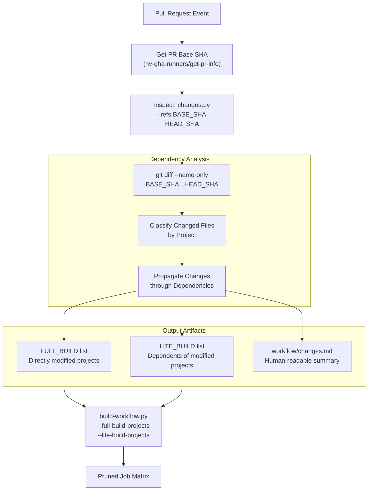
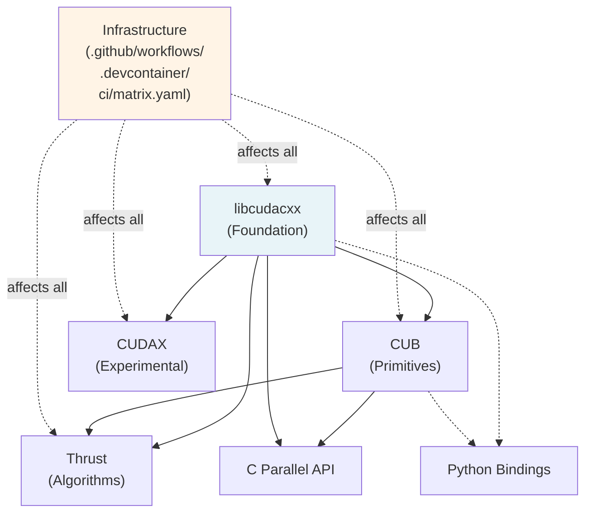
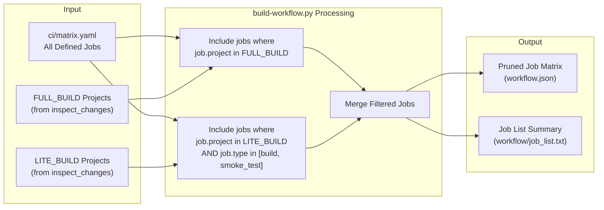
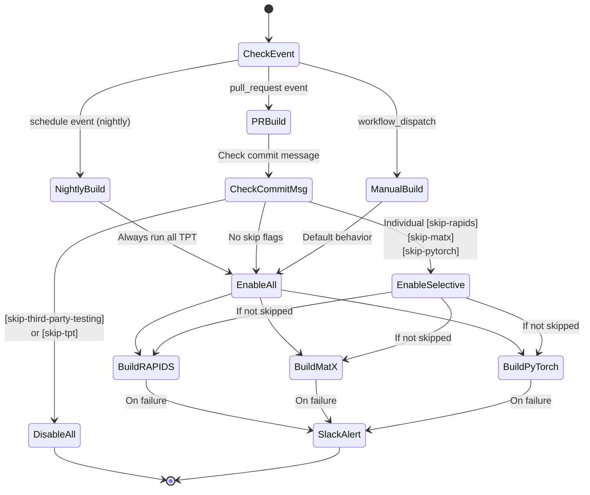
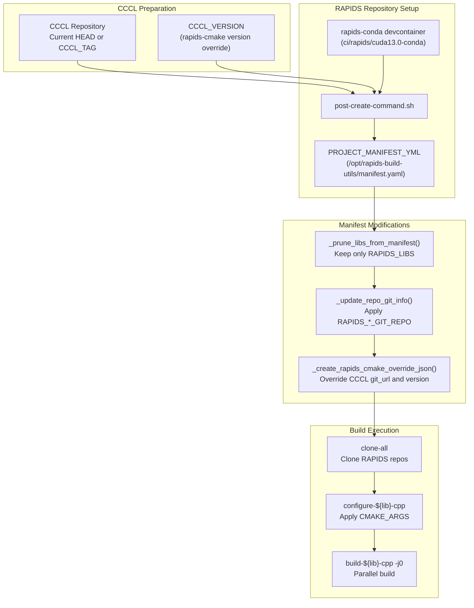
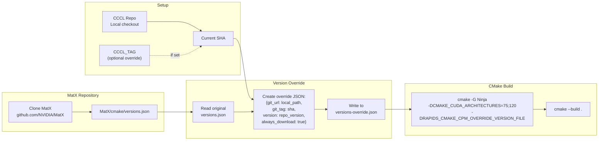
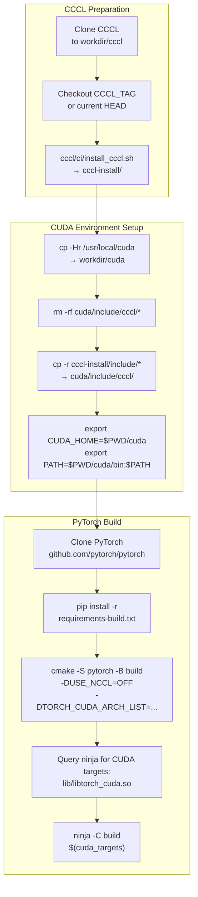
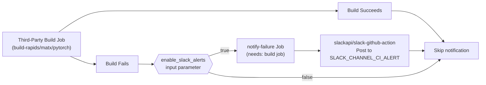
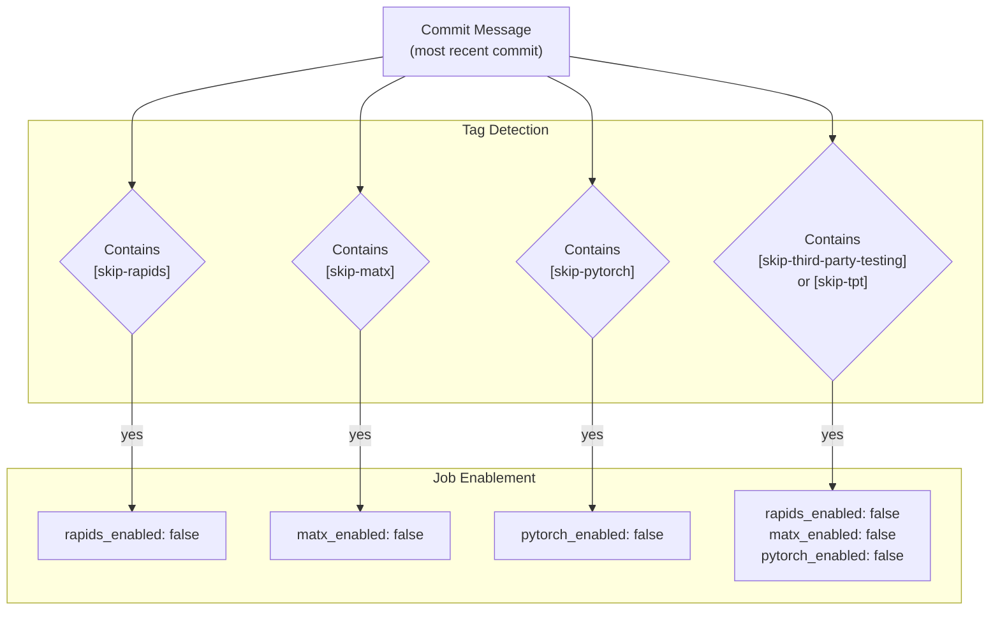

<!-- source: DeepWiki mcp.deepwiki.com · repo NVIDIA/cccl · page 4.4 Change Detection and Third-Party Testing · fetched 2026-10-26 -->

# Change Detection and Third-Party Testing

<details>
<summary>Relevant source files</summary>

The following files were used as context for generating this wiki page:

- [.devcontainer/cccl-entrypoint.sh](.devcontainer/cccl-entrypoint.sh)
- [.devcontainer/docker-entrypoint.sh](.devcontainer/docker-entrypoint.sh)
- [.devcontainer/launch.sh](.devcontainer/launch.sh)
- [.github/actions/docs-build/action.yml](.github/actions/docs-build/action.yml)
- [.github/actions/workflow-build/action.yml](.github/actions/workflow-build/action.yml)
- [.github/actions/workflow-build/build-workflow.py](.github/actions/workflow-build/build-workflow.py)
- [.github/actions/workflow-build/prepare-workflow-dispatch.py](.github/actions/workflow-build/prepare-workflow-dispatch.py)
- [.github/actions/workflow-results/action.yml](.github/actions/workflow-results/action.yml)
- [.github/actions/workflow-results/final-summary.py](.github/actions/workflow-results/final-summary.py)
- [.github/actions/workflow-results/parse-job-times.py](.github/actions/workflow-results/parse-job-times.py)
- [.github/actions/workflow-results/prepare-execution-summary.py](.github/actions/workflow-results/prepare-execution-summary.py)
- [.github/actions/workflow-results/verify-job-success.py](.github/actions/workflow-results/verify-job-success.py)
- [.github/copilot-instructions.md](.github/copilot-instructions.md)
- [.github/workflows/build-docs.yml](.github/workflows/build-docs.yml)
- [.github/workflows/build-matx.yml](.github/workflows/build-matx.yml)
- [.github/workflows/build-pytorch.yml](.github/workflows/build-pytorch.yml)
- [.github/workflows/build-rapids.yml](.github/workflows/build-rapids.yml)
- [.github/workflows/ci-workflow-nightly.yml](.github/workflows/ci-workflow-nightly.yml)
- [.github/workflows/ci-workflow-pull-request.yml](.github/workflows/ci-workflow-pull-request.yml)
- [.github/workflows/ci-workflow-weekly.yml](.github/workflows/ci-workflow-weekly.yml)
- [.github/workflows/git-bisect.yml](.github/workflows/git-bisect.yml)
- [.github/workflows/pr-preview-cleanup.yml](.github/workflows/pr-preview-cleanup.yml)
- [.github/workflows/verify-devcontainers.yml](.github/workflows/verify-devcontainers.yml)
- [AGENTS.md](AGENTS.md)
- [ci-overview.md](ci-overview.md)
- [ci/compute-sanitizer-suppressions.xml](ci/compute-sanitizer-suppressions.xml)
- [ci/matx/build_matx.sh](ci/matx/build_matx.sh)
- [ci/pytorch/build_pytorch.sh](ci/pytorch/build_pytorch.sh)
- [ci/rapids/cuda13.0-conda/devcontainer.json](ci/rapids/cuda13.0-conda/devcontainer.json)
- [ci/rapids/post-create-command.sh](ci/rapids/post-create-command.sh)
- [ci/rapids/rapids-entrypoint.sh](ci/rapids/rapids-entrypoint.sh)
- [ci/run_cpu_bisect.sh](ci/run_cpu_bisect.sh)
- [ci/run_cpu_target.sh](ci/run_cpu_target.sh)
- [ci/run_gpu_bisect.sh](ci/run_gpu_bisect.sh)
- [ci/run_gpu_target.sh](ci/run_gpu_target.sh)
- [ci/util/build_and_test_targets.sh](ci/util/build_and_test_targets.sh)
- [ci/util/git_bisect.sh](ci/util/git_bisect.sh)
- [docs/gen_docs.bash](docs/gen_docs.bash)
- [docs/index.rst](docs/index.rst)
- [libcudacxx/test/libcudacxx/std/utilities/memory/temporary.buffer/overaligned.pass.cpp](libcudacxx/test/libcudacxx/std/utilities/memory/temporary.buffer/overaligned.pass.cpp)
- [libcudacxx/test/libcudacxx/std/utilities/memory/temporary.buffer/temporary_buffer.pass.cpp](libcudacxx/test/libcudacxx/std/utilities/memory/temporary.buffer/temporary_buffer.pass.cpp)

</details>


## Purpose and Scope

This document describes CCCL's change detection system and third-party canary build infrastructure. Change detection selectively runs CI jobs based on which files were modified, reducing unnecessary resource consumption while maintaining test coverage. Third-party canary builds validate CCCL changes against downstream projects (RAPIDS, MatX, PyTorch) to detect breaking changes before they affect users.

For information about the overall CI architecture and workflow generation, see [Architecture Overview](#4.1). For details on matrix configuration that these systems modify, see [Matrix Configuration](#4.2).

---

## Change Detection System

### Overview

The change detection system analyzes git diffs between the PR base and head commits to determine which CCCL projects (libcudacxx, CUB, Thrust, CUDAX) were modified. It then prunes the CI job matrix to test only affected projects and their dependents, significantly reducing CI time for focused changes.

**Key Components:**
- `ci/inspect_changes.py` - Python script that analyzes git diffs and determines dirty projects
- [.github/actions/workflow-build/action.yml:68-77]() - Integration point in workflow builder
- [.github/workflows/ci-workflow-pull-request.yml:109-120]() - PR workflow invocation

### Change Detection Workflow



**Sources:** [.github/actions/workflow-build/action.yml:68-77](), [.github/workflows/ci-workflow-pull-request.yml:78-119]()

### Project Dependency Graph

The change detection system maintains a dependency graph where changes to lower-level projects trigger testing of dependent higher-level projects:



**Change Propagation Rules:**
- Changes to infrastructure files mark **all** projects as dirty
- Changes to libcudacxx mark libcudacxx, CUB, Thrust, CUDAX, and C Parallel as dirty
- Changes to CUB mark CUB, Thrust, and C Parallel as dirty
- Changes to Thrust mark only Thrust as dirty
- Changes to CUDAX mark only CUDAX as dirty

**Sources:** [.github/actions/workflow-build/action.yml:84-87](), [ci-overview.md:285-320]()

### File Path Classification

The `inspect_changes.py` script classifies changed files into project categories based on path patterns:

| Path Pattern | Project Classification | Impact |
|-------------|----------------------|--------|
| `libcudacxx/**` | libcudacxx | FULL_BUILD: libcudacxx<br/>LITE_BUILD: CUB, Thrust, CUDAX, C Parallel |
| `cub/**` | CUB | FULL_BUILD: CUB<br/>LITE_BUILD: Thrust, C Parallel |
| `thrust/**` | Thrust | FULL_BUILD: Thrust |
| `cudax/**` | CUDAX | FULL_BUILD: CUDAX |
| `c/parallel/**` | C Parallel | FULL_BUILD: C Parallel |
| `.github/workflows/**` | Infrastructure | FULL_BUILD: all projects |
| `.devcontainer/**` | Infrastructure | FULL_BUILD: all projects |
| `ci/matrix.yaml` | Infrastructure | FULL_BUILD: all projects |

**Full Build vs. Lite Build:**
- **FULL_BUILD**: Projects directly modified - run complete test suite
- **LITE_BUILD**: Dependent projects - run reduced smoke tests to verify compatibility

**Sources:** [.github/actions/workflow-build/action.yml:84-87](), [.github/workflows/ci-workflow-pull-request.yml:118]()

### Integration with Workflow Builder

The workflow builder (`build-workflow.py`) consumes change detection outputs to prune the job matrix:



**Sources:** [.github/actions/workflow-build/build-workflow.py:1-100](), [.github/actions/workflow-build/action.yml:79-98]()

### Bypass Mechanisms

**Override Matrix:**
When a non-empty `workflows.override` section exists in [ci/matrix.yaml](), the entire change detection system is bypassed, and only the override matrix runs. This is useful for:
- Testing specific compiler/CTK combinations during development
- Debugging CI infrastructure changes
- Validating fixes to nightly failures

The override matrix blocks PR merging until removed.

**Sources:** [ci-overview.md:43-63](), [.github/workflows/ci-workflow-pull-request.yml:111](), [AGENTS.md:285-295]()

---

## Third-Party Canary Builds

### Overview

CCCL runs canary builds of three major downstream projects to detect breaking changes early:
- **RAPIDS**: GPU-accelerated data science libraries (cuDF, cuGraph, cuML, etc.)
- **MatX**: Numerical computing library with Python-like syntax
- **PyTorch**: Deep learning framework

These builds run on every nightly CI run and optionally on pull requests.

### Third-Party Build Triggers



**Sources:** [.github/workflows/ci-workflow-pull-request.yml:52-65](), [.github/workflows/ci-workflow-nightly.yml:142-176](), [ci-overview.md:29-41]()

### RAPIDS Integration

RAPIDS uses `rapids-cmake` to manage CCCL as a dependency. The canary build overrides the CCCL version to test unreleased changes:

**Build Configuration:**



**Key Files:**
- [.github/workflows/build-rapids.yml:1-207]() - Workflow definition
- [ci/rapids/post-create-command.sh:1-146]() - Manifest modification logic
- [ci/rapids/rapids-entrypoint.sh:1-23]() - Container entry point

**CCCL Version Override Mechanism:**

The system creates a `rapids-cmake-override-versions.json` file that redirects rapids-cmake to use the local CCCL repository:

```json
{
  "packages": {
    "CCCL": {
      "git_url": "/home/coder/cccl",
      "git_tag": "<current_sha>",
      "version": "<CCCL_VERSION>",
      "always_download": true
    }
  }
}
```

This file is passed to CMake via `-DRAPIDS_CMAKE_CPM_DEFAULT_VERSION_FILE`.

**Sources:** [ci/rapids/post-create-command.sh:54-116](), [.github/workflows/build-rapids.yml:86-92]()

**RAPIDS Library Matrix:**

The workflow builds multiple RAPIDS library combinations in parallel:

| Matrix Entry | Libraries Built | Dependencies |
|-------------|----------------|--------------|
| 1 | rmm, kvikio, cudf, cudf_kafka | Core data processing |
| 2 | rmm, ucxx, raft, cuvs, cuml | Machine learning stack |
| 3 | rmm, ucxx, raft, cugraph | Graph analytics |

Each combination is built twice: once with `-DBUILD_TESTS=OFF`, then with `-DBUILD_TESTS=ON` to verify test compilation.

**Sources:** [.github/workflows/build-rapids.yml:66-68](), [.github/workflows/build-rapids.yml:151-163]()

### MatX Integration

MatX uses CMake's FetchContent/CPM to fetch CCCL. The canary build overrides this using a custom `versions.json` file:

**Build Process:**



**Key Implementation Details:**

[ci/matx/build_matx.sh:80-91]() generates the override file:
```bash
jq -r ".packages.CCCL *=
  {
    \"git_url\": \"${cccl_repo}\",
    \"git_tag\": \"${cccl_sha}\",
    \"version\": \"${cccl_version}\",
    \"always_download\": true
  }" \
  "${version_file}" > "${version_override_file}"
```

**Build Targets:**
- Tests: `-DMATX_BUILD_TESTS=ON`
- Examples: `-DMATX_BUILD_EXAMPLES=ON`
- Benchmarks: `-DMATX_BUILD_BENCHMARKS=ON`
- cuTENSOR integration: `-DMATX_EN_CUTENSOR=ON`

**GPU Architectures:** `75` (Turing), `120` (Blackwell)

**Sources:** [ci/matx/build_matx.sh:1-106](), [.github/workflows/build-matx.yml:1-125]()

### PyTorch Integration

PyTorch has a complex build system that directly includes CUDA Toolkit headers. The canary build creates a modified CUDA installation with custom CCCL headers:

**Build Strategy:**



**Critical Implementation Details:**

1. **CUDA Directory Cloning** [ci/pytorch/build_pytorch.sh:49-62]():
   - Cannot modify `/usr/local/cuda` directly (read-only in container)
   - Creates writable copy in `workdir/cuda`
   - Replaces CCCL headers while preserving rest of CUDA Toolkit

2. **Target Extraction Optimization** [ci/pytorch/build_pytorch.sh:106-124]():
   - Full `torch_cuda` target builds ~600+ unnecessary targets
   - Uses `ninja -t query` to extract only CUDA source files
   - Filters for `*.cu.o` targets in `torch_cuda.dir/`
   - Reduces build from ~600 targets to ~311 CUDA-specific targets

3. **CMake Verification** [ci/pytorch/build_pytorch.sh:90-97]():
   - Verifies `CUDA_TOOLKIT_ROOT_DIR` points to custom CUDA directory
   - Verifies `CUDA_NVCC_EXECUTABLE` uses custom nvcc
   - Fails early if PyTorch finds wrong CUDA installation

**Sources:** [ci/pytorch/build_pytorch.sh:1-127](), [.github/workflows/build-pytorch.yml:1-114]()

### Common Patterns Across TPT Builds

All three third-party builds share common infrastructure:

**Devcontainer Configuration:**
- CUDA version: 13.1 with extended libraries (`--cuda-ext`)
- Host compiler: gcc14
- AWS credentials for sccache distributed compilation
- Custom container environment variables

**Error Reporting:**



**Workflow Input Parameters:**

| Parameter | Type | Purpose | Example |
|-----------|------|---------|---------|
| `override_cccl_tag` | string | Override CCCL git ref to test | `"v2.8.0"` or `"feature-branch"` |
| `override_cccl_version` | string | Override rapids-cmake CCCL version | `"2.8.0"` |
| `enable_slack_alerts` | boolean | Enable Slack failure notifications | `true` (for nightly runs) |

**Sources:** [.github/workflows/build-rapids.yml:6-37](), [.github/workflows/build-matx.yml:4-37](), [.github/workflows/build-pytorch.yml:4-27]()

---

## CI Control Commands

### Commit Message Tags

Developers can control CI behavior by including special tags in commit messages:

**Third-Party Testing Controls:**



**Tag Reference:**

| Tag | Effect | Blocks Merge | Use Case |
|-----|--------|--------------|----------|
| `[skip-third-party-testing]`<br/>`[skip-tpt]` | Skip all TPT builds | Yes | Early iteration on PR |
| `[skip-rapids]` | Skip RAPIDS build only | Yes | Changes don't affect RAPIDS |
| `[skip-matx]` | Skip MatX build only | Yes | Changes don't affect MatX |
| `[skip-pytorch]` | Skip PyTorch build only | Yes | Changes don't affect PyTorch |
| `[skip-matrix]` | Skip all matrix jobs | Yes | Documentation-only changes |
| `[skip-vdc]` | Skip devcontainer verification | Yes | No devcontainer changes |
| `[skip-docs]` | Skip documentation build | Yes | No documentation changes |

**Implementation:** [.github/workflows/ci-workflow-pull-request.yml:52-66]()

**Important:** All skip tags prevent PR merging. They must be removed and a full CI run completed before merge.

**Sources:** [ci-overview.md:29-41](), [AGENTS.md:323-336](), [.github/workflows/ci-workflow-pull-request.yml:410-421]()

### Manual Override Testing

For manual testing of third-party builds with custom CCCL versions:

**Via GitHub UI:**
1. Navigate to Actions → Select workflow (e.g., "Build all RAPIDS repositories")
2. Click "Run workflow"
3. Set `override_cccl_tag` to git ref (branch, tag, or SHA)
4. Optionally set `override_cccl_version` for rapids-cmake version override
5. Set `enable_slack_alerts` to `true` for failure notifications

**Via GitHub CLI:**
```bash
gh workflow run build-rapids.yml \
  --ref main \
  -f override_cccl_tag="feature-branch" \
  -f override_cccl_version="2.9.0" \
  -f enable_slack_alerts=true
```

**Sources:** [.github/workflows/build-rapids.yml:3-20](), [.github/workflows/build-matx.yml:3-20]()

### Reproducing TPT Failures Locally

To reproduce a third-party build failure locally:

**For RAPIDS:**
```bash
# Set environment variables
export RAPIDS_LIBS="rmm kvikio cudf"
export CCCL_TAG="feature-branch"  # optional

# Launch RAPIDS devcontainer
.devcontainer/launch.sh -d --cuda 13.0 --host rapids-conda \
  -- ./ci/rapids/rapids-entrypoint.sh /bin/bash

# Inside container, build RAPIDS libraries
for lib in ${RAPIDS_LIBS}; do
  configure-${lib}-cpp && build-${lib}-cpp -j0
done
```

**For MatX:**
```bash
export CCCL_TAG="feature-branch"  # optional

.devcontainer/launch.sh -d --cuda 13.1 --host gcc14 --cuda-ext \
  -- ~/cccl/ci/matx/build_matx.sh
```

**For PyTorch:**
```bash
export CCCL_TAG="feature-branch"  # optional

.devcontainer/launch.sh -d --cuda 13.1 --host gcc14 --cuda-ext \
  -- ~/cccl/ci/pytorch/build_pytorch.sh
```

**Sources:** [.github/workflows/build-rapids.yml:114-187](), [ci-overview.md:73-98]()

---

## Summary

The change detection and third-party testing systems work together to maintain CCCL's quality while optimizing resource usage:

1. **Change Detection** reduces CI load by testing only affected projects based on file changes and dependency graphs
2. **Third-Party Canary Builds** provide early warning of breaking changes in downstream projects
3. **CI Control Commands** give developers fine-grained control over which tests run
4. **Version Override Mechanisms** allow flexible testing of unreleased CCCL changes

These systems are critical for maintaining CCCL's role as a foundational library while supporting rapid development.

**Sources:** [ci-overview.md:1-184](), [AGENTS.md:276-338](), [.github/workflows/ci-workflow-pull-request.yml:1-422]()

---

