# Page: Overview

# Overview

<details>
<summary>Relevant source files</summary>

The following files were used as context for generating this wiki page:

- [CONTRIBUTING.md](CONTRIBUTING.md)
- [README.md](README.md)

</details>


This page provides a high-level introduction to the CUDA Core Compute Libraries (CCCL) repository, its mission, architecture, and how the three core libraries work together. For detailed installation instructions, see [Installation and Setup](#1.2). For working code examples, see [Quick Start Examples](#1.3). For in-depth documentation of each library, see [Core Libraries](#2).

## What is CCCL

CCCL is a unified repository that consolidates three essential CUDA C++ libraries into a single development toolkit. The repository combines **Thrust**, **CUB**, and **libcudacxx** to provide a comprehensive set of building blocks for CUDA C++ developers. All components are header-only, requiring no separate compilation or linking steps.

The mission of CCCL is to make CUDA development more delightful by providing high-quality, high-performance, and easy-to-use C++ abstractions. These libraries fill the same role for CUDA C++ that the Standard C++ Library fills for Standard C++: providing general-purpose, speed-of-light tools that allow developers to focus on solving domain-specific problems.

**Sources:** [README.md:6-32]()

## Repository Structure

The CCCL repository is organized into distinct directories for each library component, along with supporting infrastructure:

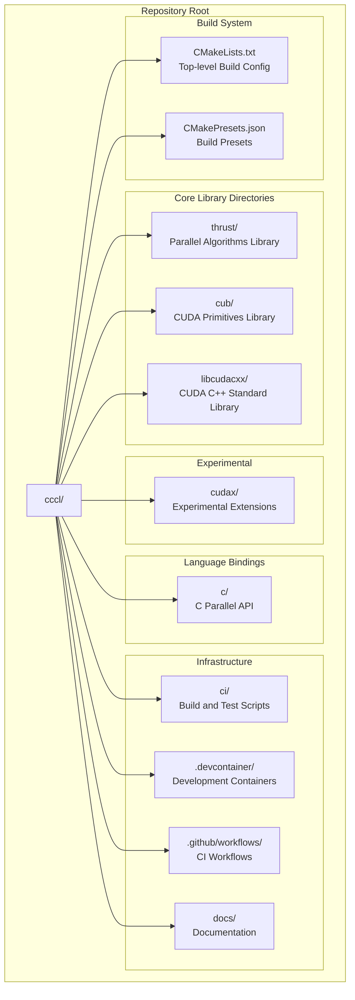

**Sources:** [README.md:10-14](), [README.md:476-478]()

## Library Abstraction Levels

The three core libraries operate at different abstraction levels, with clear dependency relationships. Higher-level libraries build upon lower-level ones to provide progressively easier-to-use interfaces:

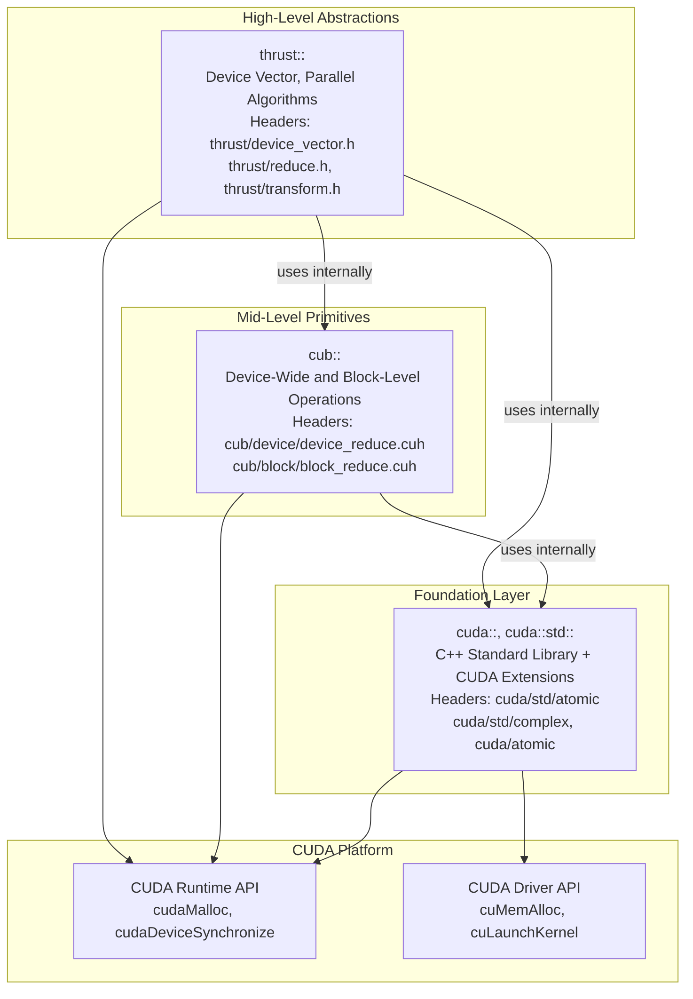

**Sources:** [README.md:22-32]()

### Thrust: High-Level Parallel Algorithms

**Thrust** provides a C++ parallel algorithms library inspired by the C++ Standard Library. It offers containers like `thrust::device_vector` and algorithms like `thrust::reduce`, `thrust::transform`, and `thrust::sort`. The high-level interface greatly enhances programmer productivity while enabling performance portability through configurable backends.

Key headers: `thrust/device_vector.h`, `thrust/execution_policy.h`, `thrust/reduce.h`

**Sources:** [README.md:25]()

### CUB: Low-Level CUDA Primitives

**CUB** is a CUDA-specific library designed for speed-of-light parallel algorithms. It provides:
- **Device-wide algorithms**: `cub::DeviceReduce`, `cub::DeviceScan`, `cub::DeviceRadixSort`
- **Block-level primitives**: `cub::BlockReduce`, `cub::BlockScan`, `cub::BlockLoad`

These primitives are building blocks for creating custom, high-performance kernels.

Key headers: `cub/device/device_reduce.cuh`, `cub/block/block_reduce.cuh`

For detailed documentation, see [CUB](#2.2).

**Sources:** [README.md:27]()

### libcudacxx: CUDA C++ Standard Library

**libcudacxx** provides an implementation of the C++ Standard Library that works in both host and device code. It includes:
- Standard library components: `cuda::std::atomic`, `cuda::std::complex`, `cuda::std::span`
- CUDA-specific abstractions: `cuda::atomic_ref`, synchronization primitives, cache control
- Extended floating-point types: `__nv_bfloat16`, `__nv_fp8_e4m3`

Key headers: `cuda/std/atomic`, `cuda/atomic`, `cuda/std/complex`

For detailed documentation, see [libcudacxx](#2.3).

**Sources:** [README.md:29]()

## Header-Only Design

All CCCL components are header-only libraries. There is no separate compilation or linking step required to use them. Users simply include the necessary headers and compile their code with `nvcc` or another CUDA-capable compiler.

This design provides several benefits:
- **No build artifacts**: No `.so`, `.dll`, or `.a` files to manage
- **Easy integration**: Include headers and compile
- **Inline optimization**: Compiler can optimize across library boundaries
- **Version flexibility**: Different projects can use different CCCL versions without conflicts

**Sources:** [README.md:112-113]()

## Example: Combining All Three Libraries

The following example from the repository demonstrates how Thrust, CUB, and libcudacxx work together. A custom kernel uses `cub::BlockReduce` to sum array elements within each block, then uses `cuda::atomic_ref` from libcudacxx to combine block results. The same operation is performed using Thrust's `reduce` algorithm for comparison.

[README.md:46-105]() shows this complete working example, which can be run interactively on Godbolt.

Key elements demonstrated:
- **libcudacxx**: `cuda::std::span`, `cuda::atomic_ref`, `cuda::memory_order_relaxed`
- **CUB**: `cub::BlockReduce<int, block_size>`
- **Thrust**: `thrust::device_vector`, `thrust::reduce`, `thrust::fill`

**Sources:** [README.md:34-105]()

## Distribution and Installation Options

CCCL is distributed through multiple channels to support different user workflows:

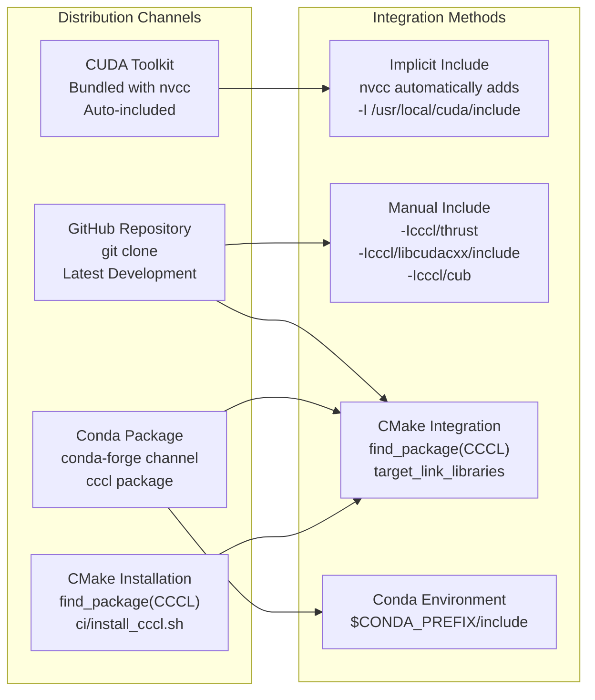

**Sources:** [README.md:110-214]()

### CUDA Toolkit (Simplest)

When compiling with `nvcc`, CCCL headers are automatically included from the CUDA Toolkit installation (typically `/usr/local/cuda/include`). No additional configuration is required.

**Sources:** [README.md:115-119]()

### GitHub (Latest Development)

Users can clone the repository and add include paths manually. This allows using newer CCCL versions with older CUDA Toolkits (backward compatible, but not forward compatible).

**Sources:** [README.md:128-140]()

### Conda (Versioned Releases)

CCCL packages are available via `conda-forge`. The `cuda-cccl` metapackage installs the CCCL version that shipped with a specific CUDA Toolkit version.

**Sources:** [README.md:172-204]()

### CMake Installation

The repository provides CMake-based installation with presets for different configurations. The `ci/install_cccl.sh` convenience script simplifies installation to a custom prefix.

**Sources:** [README.md:141-170](), [README.md:206-214]()

## Versioning and Compatibility

CCCL uses semantic versioning (`MAJOR.MINOR.PATCH`) with the following key properties:

| Property | Policy |
|----------|--------|
| **Backward Compatibility** | CCCL version `X.Y` works with CTK versions from the current and previous major series |
| **Forward Compatibility** | Never supported; older CCCL cannot work with newer CTK |
| **API Breaking Changes** | Only occur with major version increments, aligned with CTK major releases |
| **ABI Stability** | `thrust::` and `cub::` namespaces may break ABI anytime; `cuda::` uses inline namespace versioning |

Version macros are available in:
- `<cuda/version>`: `CCCL_MAJOR_VERSION`, `CCCL_MINOR_VERSION`, `CCCL_PATCH_VERSION`
- `<thrust/version.h>`: `THRUST_VERSION`, `THRUST_MAJOR_VERSION`
- `<cub/version.h>`: `CUB_VERSION`, `CUB_MAJOR_VERSION`
- `<cuda/std/version>`: `_LIBCUDACXX_CUDA_API_VERSION`

For complete versioning details, see [Versioning Policy](#6.1) and [API and ABI Stability](#6.2).

**Sources:** [README.md:229-261](), [README.md:319-441]()

## Supported Platforms

CCCL supports:

| Component | Support |
|-----------|---------|
| **CUDA Toolkits** | CCCL 3.x supports CTK 12.x and 13.x |
| **Host Compilers** | GCC (≥7.x), Clang, MSVC, NVHPC |
| **C++ Standards** | C++17, C++20 |
| **GPU Architectures** | All architectures supported by current CTK (e.g., ≥sm_75 for CTK 13.x) |
| **Operating Systems** | Linux, Windows (same as CUDA Toolkit) |

The definitive testing matrix is maintained in [ci/matrix.yaml:1-end](). For the complete platform support policy, see [Platform and Compiler Support](#6.3).

**Sources:** [README.md:220-317]()

## Development and Contribution

CCCL uses a modern development workflow with:
- **Development Containers**: Consistent environments mirroring CI configurations in [.devcontainer/]()
- **CMake Presets**: Pre-configured build settings in [CMakePresets.json:1-end]()
- **Build Scripts**: Convenience scripts in [ci/build_*.sh]() and [ci/test_*.sh]()
- **Matrix Testing**: Comprehensive testing across toolchains defined in [ci/matrix.yaml:1-end]()

For contributing, see the [Contributor Guide](CONTRIBUTING.md) and [Build System and Development](#3).

**Sources:** [README.md:216-218](), [CONTRIBUTING.md:1-276]()

## Navigation

- **Next Steps**: [What is CCCL](#1.1) provides a deeper explanation of CCCL's purpose and design philosophy
- **Getting Started**: [Installation and Setup](#1.2) covers all installation methods in detail
- **Examples**: [Quick Start Examples](#1.3) shows minimal working code for each library
- **Library Details**: [Core Libraries](#2) documents Thrust, CUB, libcudacxx, and CUDAX
- **Building and Testing**: [Build System and Development](#3) explains the build infrastructure
- **CI/CD**: [CI/CD Infrastructure](#4) details the continuous integration pipeline

**Sources:** [README.md:1-515]()

---

# Page: What is CCCL

# What is CCCL

<details>
<summary>Relevant source files</summary>

The following files were used as context for generating this wiki page:

- [CONTRIBUTING.md](CONTRIBUTING.md)
- [README.md](README.md)

</details>


**Purpose:** This page defines the CUDA Core Compute Libraries (CCCL) as a unified repository containing Thrust, CUB, and libcudacxx. It explains the role of each library, the header-only design philosophy, and how these components integrate to provide building blocks for CUDA C++ development.

**Scope:** This page covers the conceptual overview and structure of CCCL. For installation instructions, see [Installation and Setup](#1.2). For detailed documentation of individual libraries, see [Core Libraries](#2). For versioning policies, see [Versioning Policy](#6.1).

---

## Overview

CCCL (CUDA Core Compute Libraries) is a unified repository that consolidates three essential CUDA C++ libraries: Thrust, CUB, and libcudacxx. The mission is to provide CUDA C++ developers with building blocks that make it easier to write safe and efficient code.

Prior to unification, these libraries were developed independently in separate repositories but with overlapping goals. Bringing them together streamlines development and broadens the ability to leverage CUDA C++ capabilities. The repository also includes experimental features (CUDAX) and language bindings (C Parallel API).

**Sources:** [README.md:6-18](), [README.md:20-32]()

---

## Repository Structure

CCCL organizes its components in a flat directory structure at the repository root:

| Directory | Component | Description |
|-----------|-----------|-------------|
| `thrust/` | Thrust library | High-level parallel algorithms with STL-like interface |
| `cub/` | CUB library | Low-level CUDA primitives for device-wide and block-level operations |
| `libcudacxx/` | libcudacxx library | CUDA C++ Standard Library, host and device compatible |
| `cudax/` | CUDAX (experimental) | Experimental memory resources, execution policies, and Sequential Task Framework |
| `c/` | C Parallel API | JIT-compiled C language bindings wrapping CUB primitives |
| `ci/` | CI infrastructure | Build scripts, test scripts, matrix configuration |
| `.github/workflows/` | GitHub Actions | CI/CD workflow definitions |

**Diagram: CCCL Repository Component Layout**

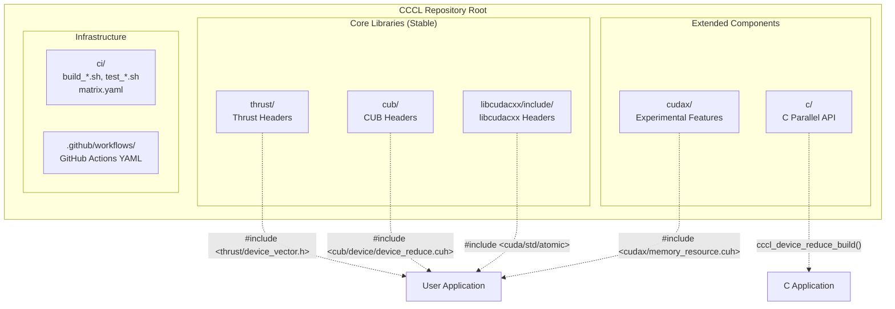

**Sources:** [README.md:10-14](), [CONTRIBUTING.md:76-104]()

---

## The Three Core Libraries

### Thrust: High-Level Parallel Algorithms

Thrust is a C++ parallel algorithms library inspired by the C++ Standard Library. It provides a high-level interface for common parallel patterns, greatly enhancing programmer productivity while maintaining performance portability.

**Key characteristics:**
- STL-like interface with algorithms such as `thrust::reduce`, `thrust::sort`, `thrust::transform`
- Container abstractions including `thrust::device_vector` and `thrust::host_vector`
- Configurable execution policies (`thrust::device`, `thrust::host`, etc.)
- Built on top of CUB and libcudacxx internally

**Example header:** `<thrust/device_vector.h>`, `<thrust/reduce.h>`, `<thrust/execution_policy.h>`

**Sources:** [README.md:25](), [README.md:46-106]()

### CUB: Low-Level CUDA Primitives

CUB provides speed-of-light parallel algorithms optimized for CUDA GPUs. It offers both device-wide algorithms for end-to-end operations and cooperative algorithms for use within custom CUDA kernels.

**Key characteristics:**
- Device-wide primitives: `cub::DeviceReduce`, `cub::DeviceScan`, `cub::DeviceRadixSort`, `cub::DeviceSelect`
- Block-level primitives: `cub::BlockReduce`, `cub::BlockScan`, `cub::BlockLoad`, `cub::BlockStore`
- Warp-level primitives for fine-grained parallelism
- Architecture-specific tuning and policy selection via `PolicyHub`
- Uses libcudacxx for type traits and utilities

**Example header:** `<cub/device/device_reduce.cuh>`, `<cub/block/block_reduce.cuh>`

**Sources:** [README.md:27](), [README.md:46-71]()

### libcudacxx: CUDA C++ Standard Library

libcudacxx is the CUDA C++ Standard Library providing an implementation of the C++ Standard Library that works identically in both host and device code. It serves as the foundation for both Thrust and CUB.

**Key characteristics:**
- Standard library components: `cuda::std::atomic`, `cuda::std::complex`, `cuda::std::span`, `cuda::std::optional`
- Extended floating-point types: `__half`, `__nv_bfloat16`, `__nv_fp8_e4m3`, `__nv_fp8_e5m2`
- Compiler abstraction layer: `__cccl/compiler.h`, `__cccl/dialect.h`, `__cccl/builtin.h`
- CUDA-specific features: `cuda::atomic_ref`, memory synchronization primitives, TMA descriptors
- Header location: `libcudacxx/include/cuda/std/` for standard library, `libcudacxx/include/cuda/` for CUDA extensions

**Example header:** `<cuda/std/atomic>`, `<cuda/atomic>`, `<cuda/std/complex>`

**Sources:** [README.md:29](), [README.md:46-71]()

---

## Library Dependency Relationships

The three core libraries have well-defined dependency relationships, with higher-level libraries building on lower-level ones.

**Diagram: Library Dependency Flow**

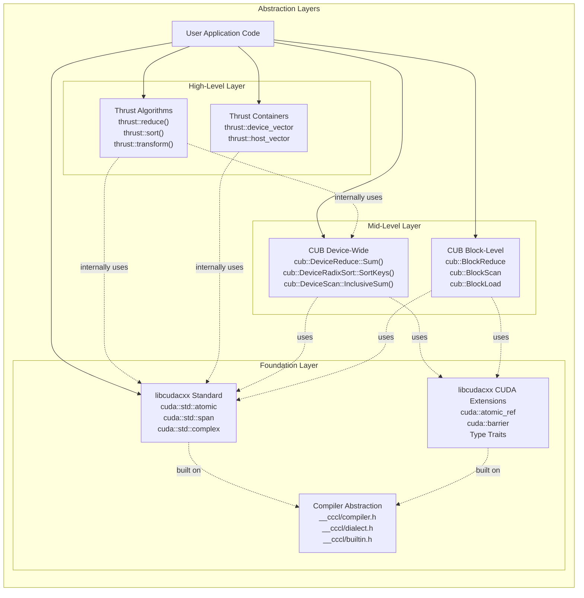

**Sources:** [README.md:22-32](), [README.md:46-71]()

---

## Additional Components

### CUDAX: Experimental Extensions

CUDAX contains experimental features that may eventually be promoted to stable components or influence the design of future CUDA features. It is located in the `cudax/` directory.

**Key features:**
- Memory resource abstractions (`cuda::mr::device_memory_resource`, `cuda::mr::pinned_memory_pool`)
- Execution policy components
- Sequential Task Framework (STF) for graph-based task execution with `cudax::stream_ctx` and `cudax::graph_ctx`

**Note:** CUDAX APIs are unstable and subject to breaking changes without major version increments.

**Sources:** [README.md:10-14]()

### C Parallel API: Language Bindings

The C Parallel API provides C language bindings for CUB device-wide primitives through JIT compilation. Located in the `c/` directory, it enables non-C++ languages to leverage CUB functionality.

**Key characteristics:**
- Functions like `cccl_device_reduce_build()`, `cccl_device_sort_build()` generate device code at runtime
- Uses NVRTC (NVIDIA Runtime Compilation) for JIT compilation
- Links via LTO-IR (Link Time Optimization - Intermediate Representation)
- Header: `c/parallel/include/cccl_c/device_reduce.h`

**Sources:** [README.md:10-14]()

---

## Header-Only Design Philosophy

All CCCL libraries are **header-only**, meaning there are no compiled binary artifacts to link against. Users simply `#include` the headers they need, and the compiler generates the necessary code during compilation.

**Implications of header-only design:**

| Aspect | Description |
|--------|-------------|
| **Integration** | No linking step required; simply add include paths |
| **Distribution** | Only header files need to be distributed |
| **Versioning** | No ABI compatibility concerns for `thrust::` and `cub::` namespaces (though `cuda::` namespace uses ABI versioning) |
| **Compilation** | Code is compiled with user's chosen compiler flags and optimizations |
| **Templates** | Extensive use of C++ templates enables compile-time specialization |

**Basic usage pattern:**

```cpp
// User code simply includes desired headers
#include <thrust/device_vector.h>
#include <cub/device/device_reduce.cuh>
#include <cuda/std/atomic>

// No linking required; everything is compiled together
```

**Installation methods (all provide header access):**
1. **CUDA Toolkit**: Headers automatically available when using `nvcc` (e.g., `/usr/local/cuda/include`)
2. **GitHub**: Clone repository and add include paths: `-Icccl/thrust -Icccl/libcudacxx/include -Icccl/cub`
3. **CMake**: Use `find_package(CCCL)` after installation via `cmake . && make install`
4. **Conda**: Install via `conda install cccl` from `conda-forge` channel

**Sources:** [README.md:112-214](), [CONTRIBUTING.md:66-68]()

---

## Unified Versioning

As of version 2.2.0, all CCCL components share a unified semantic version `MAJOR.MINOR.PATCH`. This simplifies dependency management and ensures consistency across the repository.

**Version query mechanisms:**

| Library | Header | Version Macros |
|---------|--------|----------------|
| CCCL (unified) | `<cuda/version>` | `CCCL_MAJOR_VERSION`, `CCCL_MINOR_VERSION`, `CCCL_PATCH_VERSION`, `CCCL_VERSION` |
| libcudacxx | `<cuda/std/version>` | `_LIBCUDACXX_CUDA_API_VERSION_MAJOR`, `_LIBCUDACXX_CUDA_API_VERSION` |
| Thrust | `<thrust/version.h>` | `THRUST_MAJOR_VERSION`, `THRUST_VERSION` |
| CUB | `<cub/version.h>` | `CUB_MAJOR_VERSION`, `CUB_VERSION` |

**Version format:**
- CCCL/libcudacxx: `MMMmmmppp` (e.g., `002005000` for version 2.5.0)
- Thrust/CUB: `MMMmmmpp` (e.g., `00200500` for version 2.5.0)

**Backward compatibility:**
- CCCL version `X.Y` is compatible with CUDA Toolkit major versions `N` and `N-1`
- CCCL version 3.x supports CTK 12.x and 13.x
- CCCL version 2.x supports CTK 11.1-11.8 and 12.x

**Note:** Only the latest CCCL version receives updates; bug fixes are not backported to older releases.

**Sources:** [README.md:319-386](), [README.md:227-263](), [README.md:452-473]()

---

## Relationship to CUDA Toolkit

CCCL is distributed both as part of the CUDA Toolkit and as a standalone repository. The CUDA Toolkit includes a specific version of CCCL, but users can upgrade CCCL independently.

**Distribution relationship:**

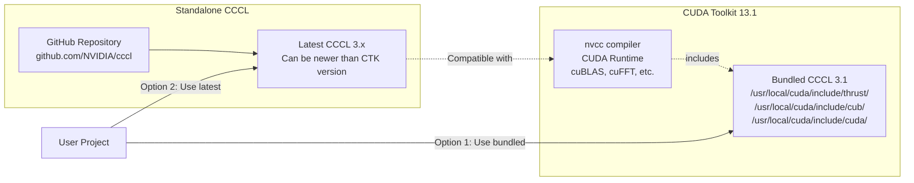

**Compatibility rules:**
- ✅ Newer CCCL + Older CUDA Toolkit (within supported major versions)
- ❌ Older CCCL + Newer CUDA Toolkit (forward incompatibility)

**Sources:** [README.md:115-131](), [README.md:227-263]()

---

## Example: Using All Three Libraries Together

The following example demonstrates how Thrust, CUB, and libcudacxx work together in a single application, showing their complementary roles:

```cpp
// From README.md:46-106
#include <thrust/device_vector.h>        // Thrust container
#include <thrust/execution_policy.h>     // Thrust execution policy
#include <cub/block/block_reduce.cuh>    // CUB block primitive
#include <cuda/atomic>                   // libcudacxx atomic
#include <cuda/std/span>                 // libcudacxx standard library

// Custom kernel using CUB block primitive and libcudacxx atomic
template <int block_size>
__global__ void reduce(cuda::std::span<int const> data, 
                       cuda::std::span<int> result) {
  using BlockReduce = cub::BlockReduce<int, block_size>;
  __shared__ typename BlockReduce::TempStorage temp_storage;
  
  int sum = /* ... */;
  sum = BlockReduce(temp_storage).Sum(sum);  // CUB
  
  if (threadIdx.x == 0) {
    cuda::atomic_ref<int, cuda::thread_scope_device> atomic_result(/*...*);
    atomic_result.fetch_add(sum, cuda::memory_order_relaxed);  // libcudacxx
  }
}

int main() {
  thrust::device_vector<int> data(1000);  // Thrust container
  thrust::fill(data.begin(), data.end(), 1);  // Thrust algorithm
  
  // Launch custom kernel using CUB + libcudacxx
  reduce<256><<</*...*/>>>(/*...*);
  
  // Use Thrust high-level algorithm for comparison
  int thrust_result = thrust::reduce(thrust::device, data.begin(), data.end(), 0);
}
```

**Library roles in this example:**
- **Thrust**: Provides `device_vector` for memory management and `reduce` algorithm for high-level operations
- **CUB**: Provides `BlockReduce` for efficient intra-block reduction in custom kernel
- **libcudacxx**: Provides `atomic_ref` for safe atomic operations and `span` for non-owning array views

**Sources:** [README.md:34-106]()

---

# Page: Installation and Setup

# Installation and Setup

<details>
<summary>Relevant source files</summary>

The following files were used as context for generating this wiki page:

- [CONTRIBUTING.md](CONTRIBUTING.md)
- [README.md](README.md)

</details>


**Purpose and Scope:** This page describes the installation methods for using CCCL libraries in your projects and the setup procedures for development environments. For information about building and testing CCCL components, see [Testing Infrastructure](#3.3). For detailed build configuration options, see [CMake Build Configuration](#3.1).

CCCL is a header-only library collection, meaning there is no traditional compilation or linking step required. Installation consists solely of making the header files available to your compiler. The approach you choose depends on whether you are a library user or a contributor.

## Installation Methods for Library Users

CCCL provides four primary distribution channels, each suited to different use cases and workflows.

### Distribution Channel Overview

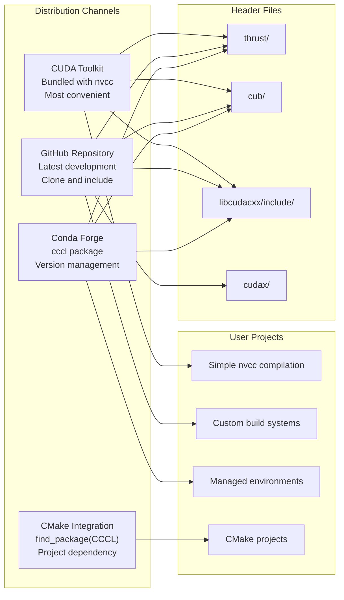

**Sources:** [README.md:108-215]()

### Method 1: CUDA Toolkit

The CUDA Toolkit includes CCCL headers automatically. When compiling with `nvcc`, the headers are already in the include path.

**Installation:** Download and install the [CUDA Toolkit](https://developer.nvidia.com/cuda-toolkit).

**Usage with nvcc:**
```cpp
// No additional configuration required
#include <thrust/device_vector.h>
#include <cub/cub.cuh>
#include <cuda/std/atomic>
```

**Usage with other compilers:** Add the CCCL include directory manually (typically `/usr/local/cuda/include` on Linux).

| Compiler | Example Include Flag |
|----------|---------------------|
| g++      | `-I/usr/local/cuda/include` |
| clang++  | `-I/usr/local/cuda/include` |
| MSVC     | `/I"C:\Program Files\NVIDIA GPU Computing Toolkit\CUDA\v12.x\include"` |

**Version Mapping:** The CCCL version is tied to the CTK version. See the table in [README.md:448-470]() for the mapping between CCCL versions and CTK versions.

**Sources:** [README.md:115-125]()

### Method 2: GitHub Repository

Clone the repository to use the latest development version or a version newer than what's included in your installed CUDA Toolkit.

**Installation:**
```bash
git clone https://github.com/NVIDIA/cccl.git
```

**Compilation:**
```bash
nvcc -Icccl/thrust -Icccl/libcudacxx/include -Icccl/cub main.cu -o main
```

**Important:** Use `-I` instead of `-isystem` to avoid collisions with CCCL headers implicitly included by `nvcc` from the CUDA Toolkit. All CCCL headers use `#pragma system_header` to ensure warnings are still silenced. See issue #527 for more information.

**Installation to system directories:** Use CMake to install headers to a standard location:

```bash
cd cccl
cmake . -DCMAKE_INSTALL_PREFIX=/usr/local
make install
```

Or use the convenience script [ci/install_cccl.sh]():
```bash
ci/install_cccl.sh /usr/local
```

**Advanced Installation with CMake Presets:**

CMake presets provide standardized configurations for different installation scenarios:

```bash
# Standard installation (stable libraries only)
cmake --preset install -DCMAKE_INSTALL_PREFIX=/usr/local
cmake --build --preset install --target install

# Include experimental libraries
cmake --preset install-unstable -DCMAKE_INSTALL_PREFIX=/usr/local
cmake --build --preset install-unstable --target install

# Experimental libraries only
cmake --preset install-unstable-only -DCMAKE_INSTALL_PREFIX=/usr/local
cmake --build --preset install-unstable-only --target install
```

| Preset | Includes Thrust/CUB/libcudacxx | Includes cudax |
|--------|-------------------------------|----------------|
| `install` | ✅ | ❌ |
| `install-unstable` | ✅ | ✅ |
| `install-unstable-only` | ❌ | ✅ |

**Sources:** [README.md:127-170]()

### Method 3: Conda

CCCL provides conda packages via the `conda-forge` channel for version management in conda environments.

**Installation:**
```bash
conda config --add channels conda-forge
conda install cccl
```

This installs to `$CONDA_PREFIX/include/` and `$CONDA_PREFIX/lib/cmake/`, making it discoverable by CMake via `find_package(CCCL)`.

**Version-specific Installation:** To use the same CCCL version that shipped with a specific CUDA Toolkit:

```bash
conda install cuda-cccl cuda-version=12.4
```

The `cuda-cccl` metapackage installs the CCCL version corresponding to the specified `cuda-version`.

**Upgrading from cuda-cccl to latest cccl:**
```bash
conda uninstall cuda-cccl
conda install -c conda-forge cccl
```

**Package Naming:** The `cuda-cccl_linux-64` packages are for internal CUDA Toolkit use. Install `cccl` or `cuda-cccl` instead for compatibility with conda compilers.

**Sources:** [README.md:172-204]()

### Method 4: CMake Integration

For CMake-based projects, CCCL provides `find_package` support and target-based integration.

**Directory Structure:**
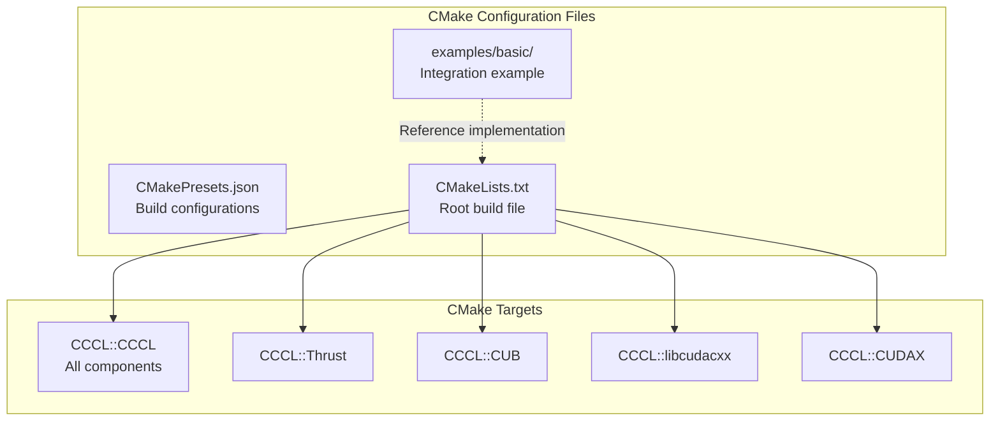

**Basic Integration:**
```cmake
find_package(CCCL REQUIRED)
target_link_libraries(my_target PRIVATE CCCL::CCCL)
```

**Component-specific Integration:**
```cmake
find_package(CCCL REQUIRED COMPONENTS Thrust CUB libcudacxx)
target_link_libraries(my_target PRIVATE 
    CCCL::Thrust 
    CCCL::CUB 
    CCCL::libcudacxx
)
```

For a complete example using CMake Package Manager (CPM), see [examples/basic]().

**Sources:** [README.md:206-214]()

## Development Setup for Contributors

Contributors need additional tooling for building tests, running CI scripts locally, and maintaining code quality.

### Development Environment Options

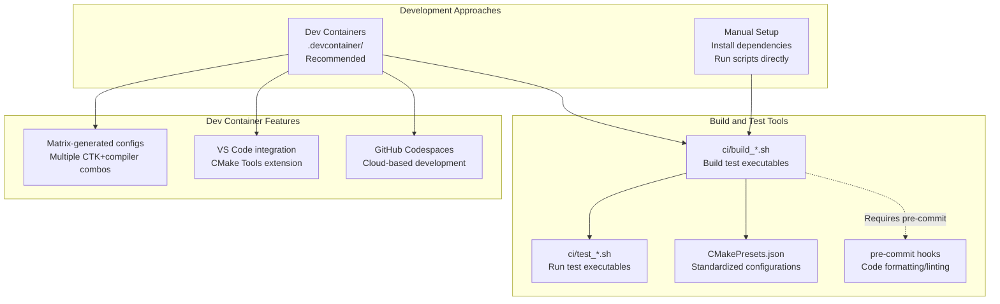

**Sources:** [CONTRIBUTING.md:9-18](), [CONTRIBUTING.md:65-176]()

### Development Containers (Recommended)

CCCL uses Development Containers to provide consistent environments for both local development and CI. These containers include all necessary dependencies and toolchains.

**Setup Options:**

| Method | Requirements | Access |
|--------|-------------|---------|
| VS Code + Docker | VS Code, Docker Desktop | [.devcontainer/README.md]() |
| GitHub Codespaces | GitHub account | Click badge in [README.md:1]() |
| Command line | Docker or Podman | [.devcontainer/README.md]() |

**Container Features:**
- Pre-installed CUDA Toolkit and compilers
- Matrix-generated configurations for multiple toolchain combinations
- CMake Tools extension for VS Code
- Nsight Visual Studio Code Edition for debugging

**Quick Start:**
```bash
# Clone repository
git clone https://github.com/NVIDIA/cccl.git
cd cccl

# Open in VS Code (will prompt to reopen in container)
code .
```

**Sources:** [CONTRIBUTING.md:15-17](), [CONTRIBUTING.md:154-176]()

### Build Scripts

CCCL provides shell scripts in the `ci/` directory for building and testing each component. These scripts are used by both CI and local development.

**Build Script Syntax:**
```bash
ci/build_[thrust|cub|libcudacxx].sh -cxx <HOST_COMPILER> -std <CXX_STANDARD> -arch <GPU_ARCHS>
```

**Parameters:**

| Parameter | Description | Example Values |
|-----------|-------------|----------------|
| `-cxx` | Host compiler | `g++`, `clang++`, `cl.exe` |
| `-std` | C++ standard | `17`, `20` |
| `-arch` | GPU architectures (semicolon-separated) | `"70;85;90"` |

**Architecture Syntax** (same as CMake's `CUDA_ARCHITECTURES`):
- `70` - both PTX and SASS
- `70-real` - SASS only
- `70-virtual` - PTX only

**Example:**
```bash
# Build CUB tests for C++17 with g++ for multiple architectures
./ci/build_cub.sh -cxx g++ -std 17 -arch "70;75;80-virtual"
```

**Test Script Usage:**
```bash
# Test scripts automatically build if needed
./ci/test_cub.sh -cxx g++ -std 17 -arch "70;75;80-virtual"
```

**Note:** Building tests does not require a GPU, but running tests does.

**Sources:** [CONTRIBUTING.md:71-104]()

### CMake Presets

CMake Presets provide standardized configurations defined in [CMakePresets.json](). They enable consistent builds across different development environments.

**Preset Categories:**

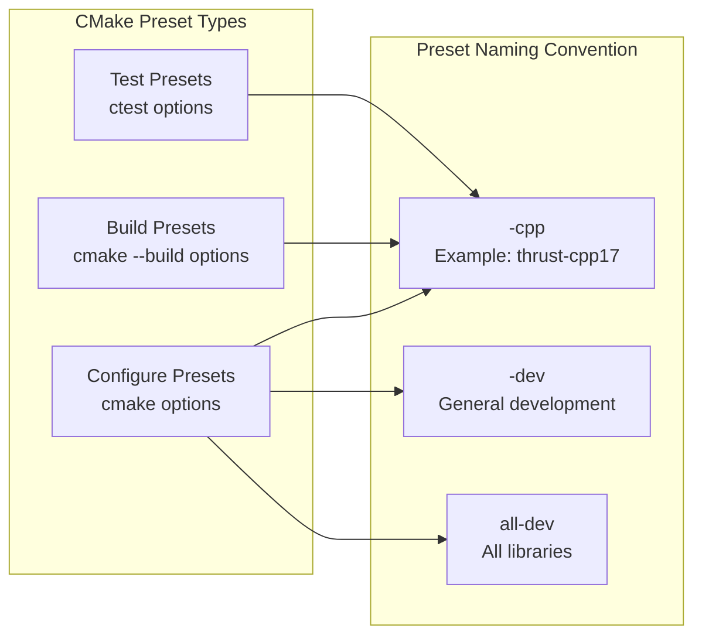

**Listing Available Presets:**
```bash
cmake --list-presets              # Configure presets
cmake --build --list-presets      # Build presets
ctest --list-presets              # Test presets
```

**Using Presets (Command Line):**
```bash
# Configure
cmake --preset=thrust-cpp17

# Override options
cmake --preset=thrust-cpp20 "-DCMAKE_CUDA_ARCHITECTURES=89"

# Build
cmake --build --preset=thrust-cpp17

# Test
ctest --preset=thrust-cpp17
```

**Build Directory Structure:**
```
build/
├── <devcontainer_name>/    # Inserted on devcontainer builds
│   └── thrust-cpp17/
│       ├── CMakeCache.txt
│       └── ...
└── thrust-cpp20/
    └── ...
```

**Using Presets (VS Code):**

The CMake Tools extension provides GUI integration:

1. **Select Configure Preset:** Click "Select Configure Preset" in the CMake sidebar
2. **Select Build Target:** Expand "Build" node and choose target
3. **Build:** Click gear icon at bottom of VS Code window
4. **Run/Debug:** Select target from "Launch" or "Debug" dropdown

For device debugging, use the Nsight Visual Studio Code Edition extension instead of the built-in debugger.

**Sources:** [CONTRIBUTING.md:106-176]()

### Pre-commit Hooks

CCCL uses [pre-commit](https://pre-commit.com) to enforce consistent code formatting and linting across all contributors.

**Linters and Formatters:**
- **C++/CUDA:** `clang-format` (configuration in [.clang-format]())
- **Python:** Various linters defined in [.pre-commit-config.yaml]()
- **Other:** Shell scripts, YAML, JSON, etc.

**Installation:**
```bash
# Via conda
conda config --add channels conda-forge
conda install pre-commit

# Via pip
pip install pre-commit
```

**Running Pre-commit:**
```bash
# Run on staged files only
pre-commit run

# Run on all files
pre-commit run --all-files

# Install as git hook (automatic on commit)
pre-commit install

# Skip checks when committing
git commit --no-verify
# or
git commit -n
```

**CI Integration:**
- [pre-commit.ci](https://pre-commit.ci) runs on all pull requests
- Fails if formatting/linting issues are detected
- Comment `pre-commit.ci autofix` to automatically fix and commit changes

**Sources:** [CONTRIBUTING.md:190-243]()

## Header Organization and Include Paths

Understanding the header file organization helps when manually configuring include paths.

**Directory Structure:**
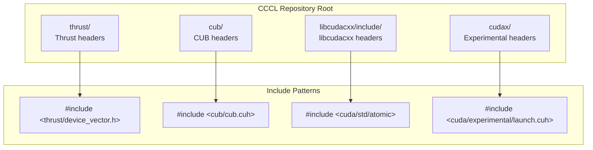

**Required Include Paths:**

| Library | Include Path | Header Pattern |
|---------|-------------|----------------|
| Thrust | `-Icccl/thrust` | `#include <thrust/...>` |
| CUB | `-Icccl/cub` | `#include <cub/...>` |
| libcudacxx | `-Icccl/libcudacxx/include` | `#include <cuda/std/...>` or `#include <cuda/...>` |
| cudax | `-Icccl/cudax` | `#include <cuda/experimental/...>` |

**Complete Example:**
```bash
nvcc -Icccl/thrust \
     -Icccl/cub \
     -Icccl/libcudacxx/include \
     -Icccl/cudax \
     main.cu -o main
```

**Sources:** [README.md:133-137]()

## Version Verification

After installation, verify the CCCL version using version headers.

**Version Macros:**

| Library | Header | Major | Minor | Patch | Concatenated |
|---------|--------|-------|-------|-------|--------------|
| CCCL (preferred) | `<cuda/version>` | `CCCL_MAJOR_VERSION` | `CCCL_MINOR_VERSION` | `CCCL_PATCH_VERSION` | `CCCL_VERSION` |
| libcudacxx | `<cuda/std/version>` | `_LIBCUDACXX_CUDA_API_VERSION_MAJOR` | `_LIBCUDACXX_CUDA_API_VERSION_MINOR` | `_LIBCUDACXX_CUDA_API_VERSION_PATCH` | `_LIBCUDACXX_CUDA_API_VERSION` |
| Thrust | `<thrust/version.h>` | `THRUST_MAJOR_VERSION` | `THRUST_MINOR_VERSION` | `THRUST_SUBMINOR_VERSION` | `THRUST_VERSION` |
| CUB | `<cub/version.h>` | `CUB_MAJOR_VERSION` | `CUB_MINOR_VERSION` | `CUB_SUBMINOR_VERSION` | `CUB_VERSION` |

**Example:**
```cpp
#include <cuda/version>
#include <iostream>

int main() {
    std::cout << "CCCL Version: " 
              << CCCL_MAJOR_VERSION << "."
              << CCCL_MINOR_VERSION << "."
              << CCCL_PATCH_VERSION << std::endl;
    return 0;
}
```

**Version Format:**
- **CCCL/libcudacxx:** `MMMmmmppp` (e.g., `002001000` = 2.1.0)
- **Thrust/CUB:** `MMMmmmpp` (e.g., `00201000` = 2.1.0)

**Sources:** [README.md:372-382]()

## Compatibility Considerations

CCCL has specific compatibility requirements that affect installation choices.

**CUDA Toolkit Compatibility:**

| CCCL Version | Supported CTK Versions |
|--------------|------------------------|
| 2.x | 11.1 - 11.8, 12.x (latest patch releases) |
| 3.x | 12.x, 13.x (latest patch releases) |

**Key Rules:**
- ✅ **Backward compatible:** Newer CCCL works with older supported CTK versions
- ❌ **Not forward compatible:** Older CCCL does not work with newer CTK versions
- ⚠️ **New features:** May not work on older CTK versions if they depend on new CTK features

**Upgrade Scenarios:**

| Current CTK | Included CCCL | Desired CCCL | Supported? | Notes |
|:-----------:|:-------------:|:------------:|:----------:|:------|
| CTK 12.4 | CCCL 2.3 | CCCL 2.8 | ✅ | Minor version upgrade, some new features may not work |
| CTK 12.4 | CCCL 2.3 | CCCL 3.0 | ✅ | Major version upgrade, possible API breaks |
| CTK 12.4 | CCCL 2.3 | CCCL 4.0 | ❌ | CCCL supports only two CTK major versions |
| CTK 13.0 | CCCL 3.0 | CCCL 2.8 | ❌ | CCCL is not forward compatible |

For more information on versioning and API/ABI stability, see [Versioning Policy](#6.1) and [API and ABI Stability](#6.2).

**Host Compiler Requirements:**
- **Linux:** GCC 7.x or newer
- **Windows:** MSVC versions supported by latest CUDA Toolkit
- See [Platform and Compiler Support](#6.3) for complete details

**Sources:** [README.md:227-286]()

## Next Steps

After installing CCCL:
- **Users:** See [Quick Start Examples](#1.3) for working code examples
- **Contributors:** See [Build Scripts and Presets](#3.2) and [Testing Infrastructure](#3.3) for development workflows
- **Build Integration:** See [CMake Build Configuration](#3.1) for advanced configuration options

**Sources:** [README.md:108-215](), [CONTRIBUTING.md:1-258]()

---

# Page: Quick Start Examples

# Quick Start Examples

<details>
<summary>Relevant source files</summary>

The following files were used as context for generating this wiki page:

- [CONTRIBUTING.md](CONTRIBUTING.md)
- [README.md](README.md)
- [cub/benchmarks/bench/reduce/base.cuh](cub/benchmarks/bench/reduce/base.cuh)
- [cub/benchmarks/bench/reduce/deterministic.cu](cub/benchmarks/bench/reduce/deterministic.cu)
- [cub/benchmarks/bench/reduce/nondeterministic.cu](cub/benchmarks/bench/reduce/nondeterministic.cu)
- [cub/benchmarks/bench/transform_reduce/sum.cu](cub/benchmarks/bench/transform_reduce/sum.cu)
- [cub/cub/detail/rfa.cuh](cub/cub/detail/rfa.cuh)
- [cub/cub/device/device_reduce.cuh](cub/cub/device/device_reduce.cuh)
- [cub/cub/device/dispatch/dispatch_reduce_deterministic.cuh](cub/cub/device/dispatch/dispatch_reduce_deterministic.cuh)
- [cub/cub/device/dispatch/dispatch_reduce_nondeterministic.cuh](cub/cub/device/dispatch/dispatch_reduce_nondeterministic.cuh)
- [cub/cub/device/dispatch/dispatch_streaming_reduce.cuh](cub/cub/device/dispatch/dispatch_streaming_reduce.cuh)
- [cub/cub/device/dispatch/kernels/kernel_reduce.cuh](cub/cub/device/dispatch/kernels/kernel_reduce.cuh)
- [cub/cub/device/dispatch/tuning/tuning_reduce.cuh](cub/cub/device/dispatch/tuning/tuning_reduce.cuh)
- [cub/cub/grid/grid_even_share.cuh](cub/cub/grid/grid_even_share.cuh)
- [cub/test/catch2_test_device_reduce_deterministic.cu](cub/test/catch2_test_device_reduce_deterministic.cu)
- [cub/test/catch2_test_device_reduce_env.cu](cub/test/catch2_test_device_reduce_env.cu)
- [cub/test/catch2_test_device_reduce_env_api.cu](cub/test/catch2_test_device_reduce_env_api.cu)
- [cub/test/catch2_test_device_reduce_nondeterministic.cu](cub/test/catch2_test_device_reduce_nondeterministic.cu)
- [cub/test/catch2_test_device_segmented_reduce_large_offsets.cu](cub/test/catch2_test_device_segmented_reduce_large_offsets.cu)
- [cub/test/catch2_test_grid_even_share.cu](cub/test/catch2_test_grid_even_share.cu)
- [cub/test/catch2_test_launch_helper.h](cub/test/catch2_test_launch_helper.h)
- [cub/test/test_device_reduce_env_fail.cu](cub/test/test_device_reduce_env_fail.cu)
- [cub/test/test_device_reduce_unsupported_env_fail.cu](cub/test/test_device_reduce_unsupported_env_fail.cu)
- [thrust/thrust/type_traits/unwrap_contiguous_iterator.h](thrust/thrust/type_traits/unwrap_contiguous_iterator.h)

</details>


## Purpose and Scope

This page provides practical examples demonstrating how to use CCCL's three core libraries—Thrust, CUB, and libcudacxx—both individually and together. These examples illustrate the typical workflow for writing CUDA C++ code with CCCL and show how the libraries complement each other at different abstraction levels.

For installation instructions, see [Installation and Setup](#1.2). For detailed documentation of each library's API, see [Core Libraries](#2).

## Overview

CCCL enables developers to write CUDA code at three complementary levels:

| Library | Abstraction Level | Use Case |
|---------|------------------|----------|
| **Thrust** | High-level algorithms | Device-wide operations, STL-like containers and algorithms |
| **CUB** | Block/warp primitives | Custom kernel building blocks for maximum performance |
| **libcudacxx** | Standard library + hardware | C++ standard library for device code, CUDA-specific hardware abstractions |

The example in [README.md:34-106]() demonstrates all three libraries working together in a single program, showing both custom kernel development (using CUB and libcudacxx) and high-level algorithm usage (using Thrust).

## Integrated Example: Parallel Reduction

The primary example demonstrates computing a reduction (sum) in two ways: first with a custom kernel using CUB and libcudacxx, then with Thrust's high-level `reduce` algorithm.

### Example Structure

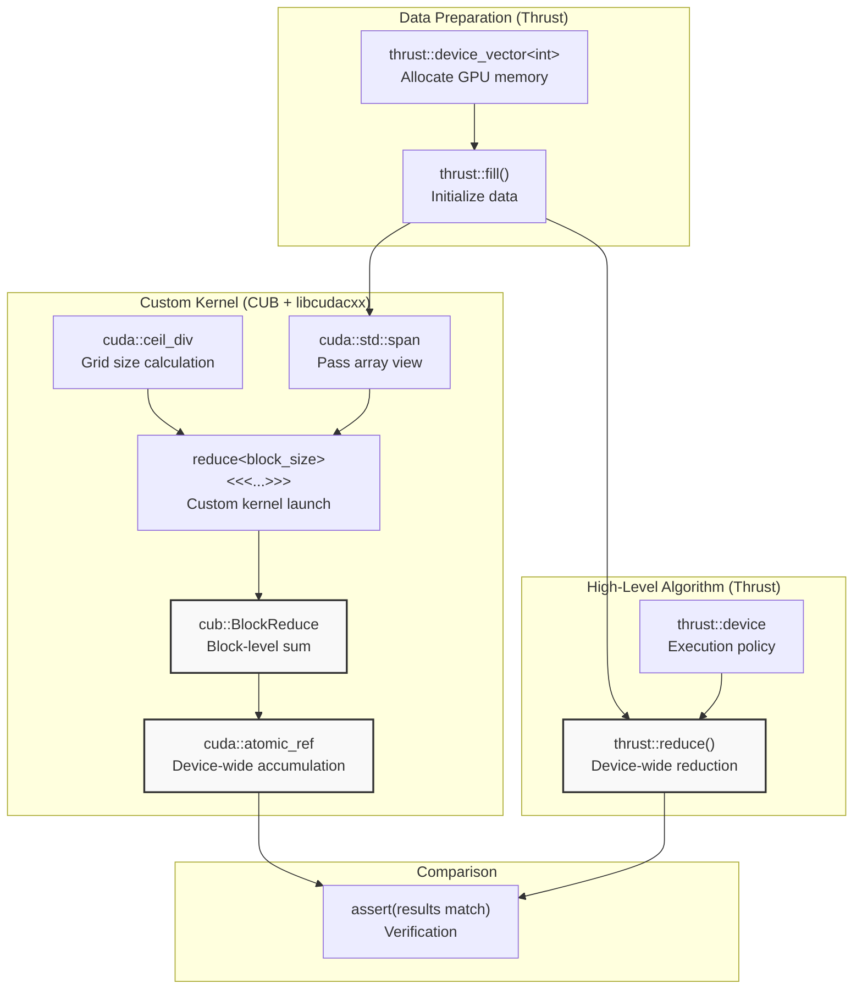

**Diagram: Library Component Usage in Reduction Example**

Sources: [README.md:34-106]()

### Code Components Breakdown

The example at [README.md:46-106]() uses the following CCCL components:

#### Thrust Components

| Symbol | Purpose | Line Reference |
|--------|---------|----------------|
| `thrust::device_vector<int>` | GPU-resident dynamic array | [README.md:77-78]() |
| `thrust::fill()` | Initialize all elements to a value | [README.md:78]() |
| `thrust::reduce()` | Device-wide sum reduction | [README.md:98]() |
| `thrust::device` | Execution policy for GPU execution | [README.md:98]() |
| `thrust::raw_pointer_cast()` | Extract raw pointer from device_vector | [README.md:86-87]() |

#### CUB Components

| Symbol | Purpose | Line Reference |
|--------|---------|----------------|
| `cub::BlockReduce<int, block_size>` | Block-level reduction primitive | [README.md:57]() |
| `BlockReduce::TempStorage` | Shared memory allocation type | [README.md:58]() |
| `BlockReduce(...).Sum()` | Compute sum across block threads | [README.md:65]() |

#### libcudacxx Components

| Symbol | Purpose | Line Reference |
|--------|---------|----------------|
| `cuda::std::span<T>` | Non-owning array view (device code) | [README.md:52, 56]() |
| `cuda::atomic_ref<T, Scope>` | Atomic operations on existing memory | [README.md:68]() |
| `cuda::thread_scope_device` | Atomic scope across entire device | [README.md:68]() |
| `cuda::memory_order_relaxed` | Memory ordering for atomics | [README.md:69]() |
| `cuda::ceil_div()` | Ceiling division utility | [README.md:85]() |

Sources: [README.md:46-106]()

### Custom Kernel Execution Flow

The custom kernel demonstrates how CUB and libcudacxx work together within a CUDA kernel:

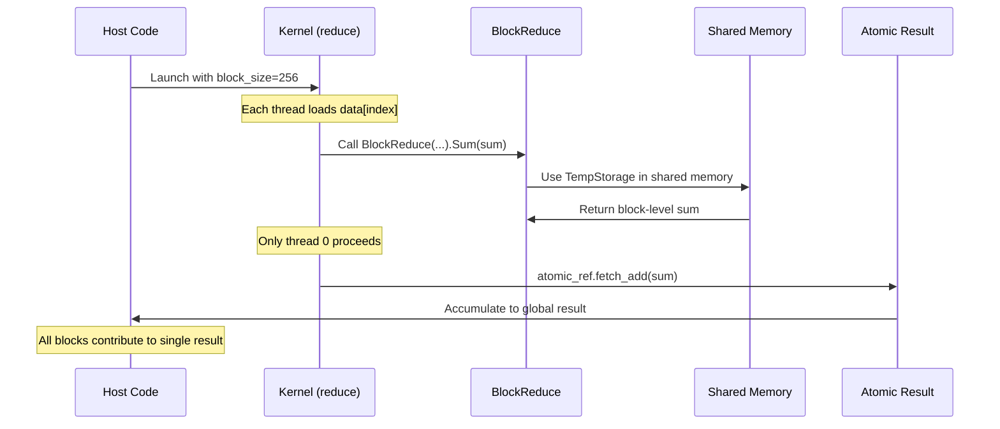

**Diagram: Custom Kernel Execution Sequence**

The kernel at [README.md:56-71]() performs these steps:
1. **Load**: Each thread loads one element from `cuda::std::span` input ([README.md:60-64]())
2. **Block Reduce**: All threads in block use `cub::BlockReduce` to compute partial sum ([README.md:65]())
3. **Atomic Accumulate**: Thread 0 adds block sum to global result using `cuda::atomic_ref` ([README.md:67-70]())

Sources: [README.md:56-71]()

### Compilation and Execution

To compile the example (assuming CCCL headers are in include path):

```bash
nvcc -Icccl/thrust -Icccl/libcudacxx/include -Icccl/cub example.cu -o example
./example
```

If using CCCL from the CUDA Toolkit, no include paths are needed:

```bash
nvcc example.cu -o example
./example
```

Expected output:
```
Custom kernel sum: 1000
Thrust reduce sum: 1000
```

The example is also available on [Godbolt](https://godbolt.org/z/aMx4j9f4T) for online experimentation (as linked in [README.md:44]()).

Sources: [README.md:134-137]()

## Library-Specific Usage Patterns

### Thrust: High-Level Algorithms

Thrust provides the simplest interface for parallel operations. The reduction using `thrust::reduce()` at [README.md:98]() requires just one line:

```cpp
int result = thrust::reduce(thrust::device, data.begin(), data.end(), 0);
```

Key aspects:
- **Execution policy**: `thrust::device` specifies GPU execution
- **Iterator interface**: Works with `begin()`/`end()` from containers
- **Initial value**: Fourth argument (0) is the reduction identity

### CUB: Block-Level Primitives

CUB components are used inside custom CUDA kernels. The pattern at [README.md:57-65]() shows typical usage:

1. **Define type alias**: `using BlockReduce = cub::BlockReduce<int, block_size>`
2. **Allocate shared memory**: `__shared__ typename BlockReduce::TempStorage temp_storage`
3. **Instantiate and use**: `BlockReduce(temp_storage).Sum(sum)`

This pattern applies to all CUB block primitives (`BlockScan`, `BlockLoad`, `BlockStore`, etc.).

### libcudacxx: Standard Library for Device Code

libcudacxx enables using C++ standard library features in device code:

- **Views**: `cuda::std::span` provides bounds-checked array access ([README.md:52]())
- **Atomics**: `cuda::atomic_ref` wraps existing memory for atomic operations ([README.md:68]())
- **Utilities**: Functions like `cuda::ceil_div` work in both host and device code ([README.md:85]())

Sources: [README.md:46-106]()

## Compilation Requirements

The example requires the following includes:

| Header | Provides | Line Reference |
|--------|----------|----------------|
| `<thrust/execution_policy.h>` | Execution policies (device, host) | [README.md:47]() |
| `<thrust/device_vector.h>` | GPU memory container | [README.md:48]() |
| `<cub/block/block_reduce.cuh>` | Block reduction primitive | [README.md:49]() |
| `<cuda/atomic>` | Atomic operations | [README.md:50]() |
| `<cuda/cmath>` | Math utilities (ceil_div) | [README.md:51]() |
| `<cuda/std/span>` | Array view type | [README.md:52]() |

Note: The `.cuh` extension indicates CUDA-specific headers (CUB), while standard-style headers (Thrust, libcudacxx) use typical C++ naming.

Sources: [README.md:47-53]()

## Next Steps

After understanding these examples:

- **For Thrust**: See [Thrust](#2.1) for comprehensive algorithm documentation
- **For CUB**: See [Device-Wide Operations](#2.2.1) and [Block-Level Primitives](#2.2.2)
- **For libcudacxx**: See [Standard Library Components](#2.3.1) and [Hardware Abstractions](#2.3.2)
- **Building tests**: See [Building and Testing](#3) for development workflow
- **CMake integration**: See [CMake Build Configuration](#3.1) for project integration

The example source code is fully functional and can be used as a starting template for CCCL projects. The live Godbolt link at [README.md:44]() allows immediate experimentation without local setup.

Sources: [README.md:1-106](), [CONTRIBUTING.md:1-259]()

---

# Page: Core Libraries

# Core Libraries

<details>
<summary>Relevant source files</summary>

The following files were used as context for generating this wiki page:

- [CONTRIBUTING.md](CONTRIBUTING.md)
- [README.md](README.md)

</details>


This document provides an overview of the four main libraries that comprise CCCL (CUDA Core Compute Libraries) and their architectural relationships. It covers the purpose, scope, and key components of Thrust, CUB, libcudacxx, and CUDAX, along with their integration patterns and code organization.

For detailed implementation internals and dispatch mechanisms, see [Architecture and Internals](#3). For build configuration and development setup, see [Development Guide](#4).

## Overview

CCCL unifies four complementary libraries that provide different levels of abstraction for CUDA C++ development:

| Library | Purpose | Abstraction Level | Target Use Cases |
|---------|---------|-------------------|------------------|
| **Thrust** | Parallel algorithms | High-level | Application development, performance portability |
| **CUB** | CUDA primitives | Low-level | Custom kernel development, speed-of-light performance |
| **libcudacxx** | Standard library | Foundation | Host/device compatibility, standard compliance |
| **CUDAX** | Experimental features | Cutting-edge | Task graphs, async execution, memory management |

## CCCL Architecture

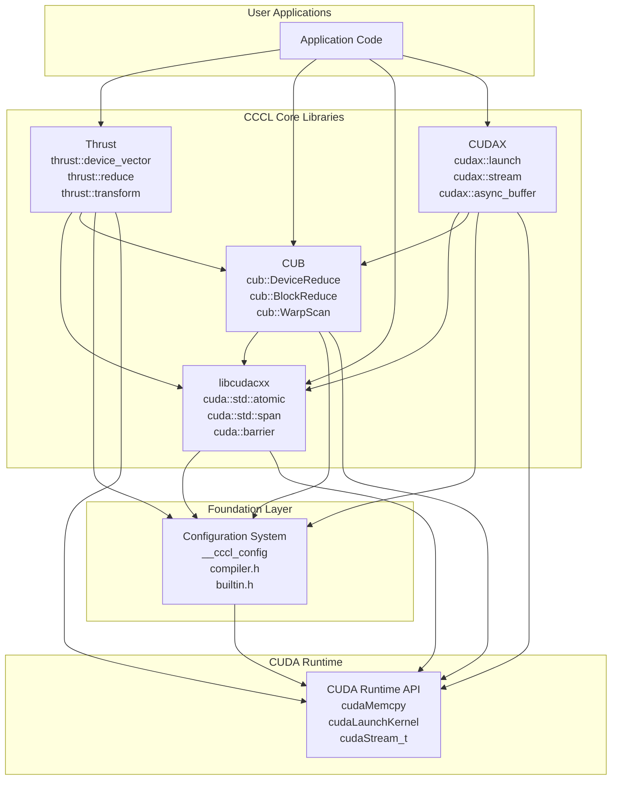

Sources: [README.md:10-31](), [README.md:46-106]()

## Library Components

### Thrust: High-Level Parallel Algorithms

Thrust provides STL-like parallel algorithms with performance portability across execution backends. It abstracts away the complexity of parallel programming while maintaining high performance.

**Key Components:**
- `thrust::device_vector` - GPU memory container
- `thrust::host_vector` - CPU memory container  
- Algorithm functions: `thrust::reduce`, `thrust::transform`, `thrust::sort`
- Execution policies: `thrust::device`, `thrust::host`, `thrust::seq`

**Example Integration Pattern:**
```cpp
#include <thrust/device_vector.h>
#include <thrust/reduce.h>

thrust::device_vector<int> data(N);
int result = thrust::reduce(thrust::device, data.begin(), data.end(), 0);
```

Sources: [README.md:25](), [README.md:76-78](), [README.md:97-98]()

### CUB: CUDA Block Primitives

CUB provides speed-optimized building blocks for custom CUDA kernel development, including device-wide algorithms and cooperative thread block primitives.

**Key Components:**
- Device algorithms: `cub::DeviceReduce`, `cub::DeviceRadixSort`, `cub::DeviceScan`
- Block primitives: `cub::BlockReduce`, `cub::BlockScan`, `cub::BlockLoad`
- Warp primitives: `cub::WarpReduce`, `cub::WarpScan`, `cub::WarpShuffle`

**Example Integration Pattern:**
```cpp
#include <cub/block/block_reduce.cuh>

using BlockReduce = cub::BlockReduce<int, block_size>;
__shared__ typename BlockReduce::TempStorage temp_storage;
int sum = BlockReduce(temp_storage).Sum(thread_data);
```

Sources: [README.md:27](), [README.md:55-70]()

### libcudacxx: CUDA Standard Library

libcudacxx extends the C++ Standard Library to work seamlessly in both host and device code, providing CUDA-specific synchronization primitives and mathematical functions.

**Key Components:**
- Standard containers: `cuda::std::span`, `cuda::std::array`, `cuda::std::optional`
- Atomic operations: `cuda::atomic_ref`, `cuda::atomic<T>`
- Synchronization: `cuda::barrier`, `cuda::binary_semaphore`
- Mathematical functions: `cuda::ceil_div`, precision-specific math for `__half` and `__nv_bfloat16`

**Example Integration Pattern:**
```cpp
#include <cuda/atomic>
#include <cuda/std/span>

cuda::atomic_ref<int, cuda::thread_scope_device> atomic_result(result[0]);
atomic_result.fetch_add(sum, cuda::memory_order_relaxed);
```

Sources: [README.md:29](), [README.md:67-69](), [README.md:85-86]()

### CUDAX: Experimental Features

CUDAX provides cutting-edge abstractions for advanced CUDA programming patterns, including task graph management, kernel launch abstractions, and stream-ordered memory management.

**Key Components:**
- Launch system: `cudax::launch`, kernel configuration management
- Streaming Task Framework: `cudax::stream_context`, dependency tracking
- Memory resources: `cudax::async_buffer`, `cudax::memory_resource`
- Device abstractions: `cudax::device`, `cudax::stream`, `cudax::event`

**Example Integration Pattern:**
```cpp
#include <cudax/launch.h>
#include <cudax/stream.h>

auto stream = cudax::stream::create();
cudax::launch(stream, kernel_config, kernel_func, args...);
```

Sources: [README.md:36]() (implied from experimental nature), architectural diagrams

## Library Integration Patterns

### Unified Example Usage

The following demonstrates how all four libraries work together in a typical CCCL application:

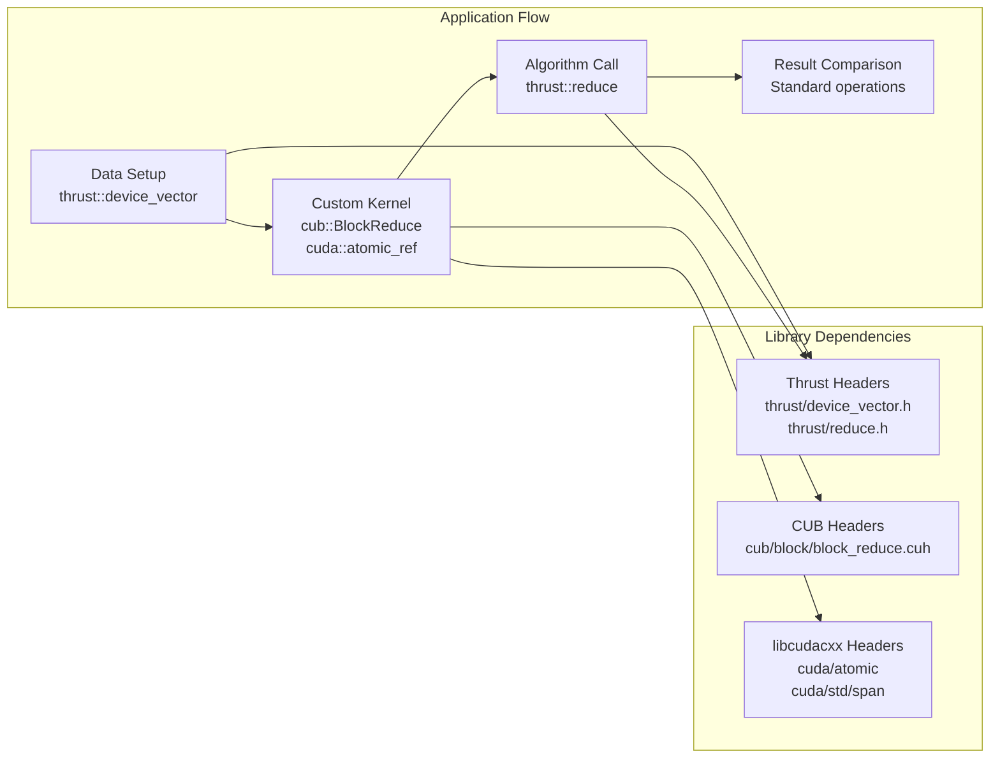

Sources: [README.md:36-106]()

### Header Organization

| Library | Include Pattern | Key Headers |
|---------|----------------|-------------|
| Thrust | `#include <thrust/...>` | `thrust/device_vector.h`, `thrust/reduce.h`, `thrust/transform.h` |
| CUB | `#include <cub/...>` | `cub/cub.cuh`, `cub/block/block_reduce.cuh`, `cub/device/device_reduce.cuh` |
| libcudacxx | `#include <cuda/...>` | `cuda/atomic`, `cuda/std/span`, `cuda/barrier` |
| CUDAX | `#include <cudax/...>` | `cudax/launch.h`, `cudax/stream.h`, `cudax/memory_resource.h` |

Sources: [README.md:121-125](), [README.md:134-137]()

---

# Page: Thrust

# Thrust

<details>
<summary>Relevant source files</summary>

The following files were used as context for generating this wiki page:

- [CONTRIBUTING.md](CONTRIBUTING.md)
- [README.md](README.md)
- [c/parallel/src/for.cu](c/parallel/src/for.cu)
- [c/parallel/src/merge_sort.cu](c/parallel/src/merge_sort.cu)
- [c/parallel/src/radix_sort.cu](c/parallel/src/radix_sort.cu)
- [c/parallel/src/reduce.cu](c/parallel/src/reduce.cu)
- [c/parallel/src/scan.cu](c/parallel/src/scan.cu)
- [c/parallel/src/segmented_reduce.cu](c/parallel/src/segmented_reduce.cu)
- [c/parallel/src/segmented_sort.cu](c/parallel/src/segmented_sort.cu)
- [c/parallel/src/three_way_partition.cu](c/parallel/src/three_way_partition.cu)
- [c/parallel/src/transform.cu](c/parallel/src/transform.cu)
- [c/parallel/src/unique_by_key.cu](c/parallel/src/unique_by_key.cu)
- [cub/benchmarks/bench/radix_sort/keys.cu](cub/benchmarks/bench/radix_sort/keys.cu)
- [cub/benchmarks/bench/radix_sort/pairs.cu](cub/benchmarks/bench/radix_sort/pairs.cu)
- [cub/benchmarks/bench/radix_sort/policy_selector.h](cub/benchmarks/bench/radix_sort/policy_selector.h)
- [cub/cub/detail/arch_dispatch.cuh](cub/cub/detail/arch_dispatch.cuh)
- [cub/cub/detail/launcher/cuda_driver.cuh](cub/cub/detail/launcher/cuda_driver.cuh)
- [cub/cub/detail/launcher/cuda_runtime.cuh](cub/cub/detail/launcher/cuda_runtime.cuh)
- [cub/cub/device/device_radix_sort.cuh](cub/cub/device/device_radix_sort.cuh)
- [cub/cub/device/device_segmented_reduce.cuh](cub/cub/device/device_segmented_reduce.cuh)
- [cub/cub/device/dispatch/dispatch_common.cuh](cub/cub/device/dispatch/dispatch_common.cuh)
- [cub/cub/device/dispatch/dispatch_fixed_size_segmented_reduce.cuh](cub/cub/device/dispatch/dispatch_fixed_size_segmented_reduce.cuh)
- [cub/cub/device/dispatch/dispatch_merge_sort.cuh](cub/cub/device/dispatch/dispatch_merge_sort.cuh)
- [cub/cub/device/dispatch/dispatch_radix_sort.cuh](cub/cub/device/dispatch/dispatch_radix_sort.cuh)
- [cub/cub/device/dispatch/dispatch_reduce.cuh](cub/cub/device/dispatch/dispatch_reduce.cuh)
- [cub/cub/device/dispatch/dispatch_segmented_radix_sort.cuh](cub/cub/device/dispatch/dispatch_segmented_radix_sort.cuh)
- [cub/cub/device/dispatch/dispatch_segmented_reduce.cuh](cub/cub/device/dispatch/dispatch_segmented_reduce.cuh)
- [cub/cub/device/dispatch/dispatch_segmented_sort.cuh](cub/cub/device/dispatch/dispatch_segmented_sort.cuh)
- [cub/cub/device/dispatch/kernels/kernel_radix_sort.cuh](cub/cub/device/dispatch/kernels/kernel_radix_sort.cuh)
- [cub/cub/device/dispatch/kernels/kernel_segmented_radix_sort.cuh](cub/cub/device/dispatch/kernels/kernel_segmented_radix_sort.cuh)
- [cub/cub/device/dispatch/kernels/kernel_segmented_reduce.cuh](cub/cub/device/dispatch/kernels/kernel_segmented_reduce.cuh)
- [cub/cub/device/dispatch/tuning/common.cuh](cub/cub/device/dispatch/tuning/common.cuh)
- [cub/cub/device/dispatch/tuning/tuning_radix_sort.cuh](cub/cub/device/dispatch/tuning/tuning_radix_sort.cuh)
- [cub/cub/util_device.cuh](cub/cub/util_device.cuh)
- [cub/test/catch2_test_arch_dispatch.cu](cub/test/catch2_test_arch_dispatch.cu)
- [cub/test/catch2_test_device_radix_sort_custom_policy_hub.cu](cub/test/catch2_test_device_radix_sort_custom_policy_hub.cu)

</details>


Thrust is CCCL's high-level C++ parallel algorithms library that provides an STL-like interface for GPU computing. It offers familiar algorithms (`thrust::reduce`, `thrust::transform`, `thrust::sort`) that work seamlessly with GPU data, building internally on [CUB](#2.2) device algorithms for performance and [libcudacxx](#2.3) for standard library functionality.

## Purpose and Design Philosophy

Thrust serves as the high-level algorithmic interface within CCCL, modeled after the C++ Standard Library. It provides:

- **STL-like API**: Familiar algorithm names (`reduce`, `transform`, `sort`, `scan`) that match C++ standard library conventions
- **Performance Portability**: Same code executes on GPUs (CUDA backend), multi-core CPUs (TBB, OpenMP), or sequential CPU
- **Transparent GPU Programming**: `thrust::device_vector` manages device memory automatically, hiding `cudaMalloc`/`cudaFree` complexity
- **Internal CUB Integration**: Device algorithms dispatch to optimized `cub::DeviceReduce`, `cub::DeviceTransform`, etc. for speed-of-light performance

The library inspired the parallel algorithms added to C++17, demonstrating its influence on the C++ standard itself.

Sources: [README.md:25-26](), [README.md:10-18]()

**Thrust Architecture: STL-Like Interface to CUB Primitives**

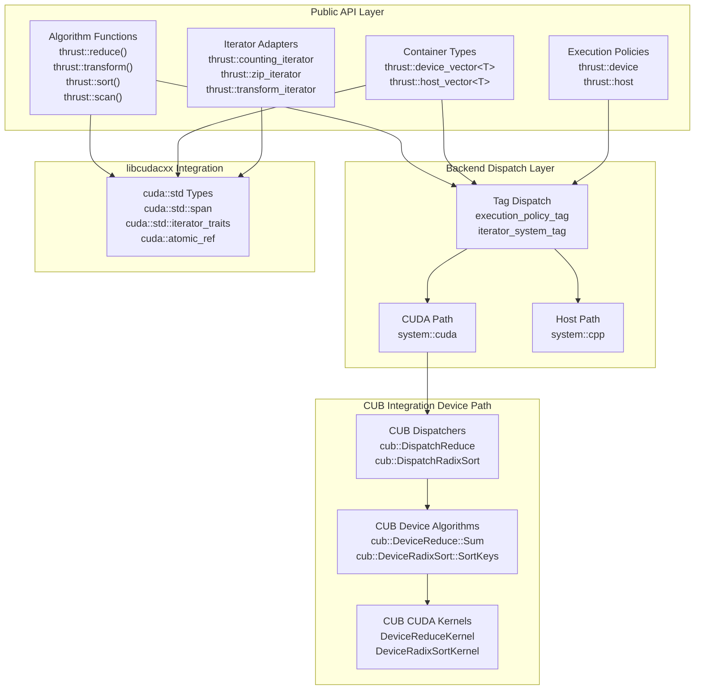

Sources: [README.md:36-44](), [README.md:47-71](), [cub/cub/device/dispatch/dispatch_reduce.cuh:147-186]()

## STL-Like Algorithm Interface

Thrust provides familiar algorithm names that mirror the C++ Standard Library, making GPU programming accessible to C++ developers. The example below demonstrates the similarity to standard C++:

```cpp
// Standard C++ on CPU
std::vector<int> data(1000, 1);
int cpu_result = std::reduce(data.begin(), data.end(), 0);

// Thrust on GPU - same algorithm names
thrust::device_vector<int> data(1000, 1);
int gpu_result = thrust::reduce(thrust::device, data.begin(), data.end(), 0);
```

**Core Algorithm Categories**

| Algorithm Category | Thrust Functions | CUB Backend |
|-------------------|------------------|-------------|
| Reductions | `thrust::reduce`, `thrust::transform_reduce` | `cub::DeviceReduce::Reduce`, `cub::DeviceReduce::Sum` |
| Transformations | `thrust::transform`, `thrust::for_each` | `cub::DeviceTransform` |
| Sorting | `thrust::sort`, `thrust::sort_by_key` | `cub::DeviceRadixSort::SortKeys`, `cub::DeviceRadixSort::SortPairs` |
| Scans | `thrust::inclusive_scan`, `thrust::exclusive_scan` | `cub::DeviceScan::InclusiveScan`, `cub::DeviceScan::ExclusiveSum` |
| Selections | `thrust::copy_if`, `thrust::unique` | `cub::DeviceSelect::If`, `cub::DeviceSelect::Unique` |

The following example from the repository demonstrates using Thrust, CUB, and libcudacxx together:

```cpp
// From README.md example
#include <thrust/device_vector.h>
#include <cub/block/block_reduce.cuh>
#include <cuda/atomic>

// Thrust manages device memory
thrust::device_vector<int> data(N);
thrust::fill(data.begin(), data.end(), 1);

// Thrust algorithm for comparison
int thrust_result = thrust::reduce(thrust::device, data.begin(), data.end(), 0);
```

Sources: [README.md:34-106](), [cub/cub/device/dispatch/dispatch_reduce.cuh:147-186]()

## Container System

Thrust's container system provides STL-like vectors that automatically manage GPU memory. `thrust::device_vector<T>` handles `cudaMalloc`, `cudaFree`, and host-device transfers transparently.

**Container Memory Management and Interoperability**

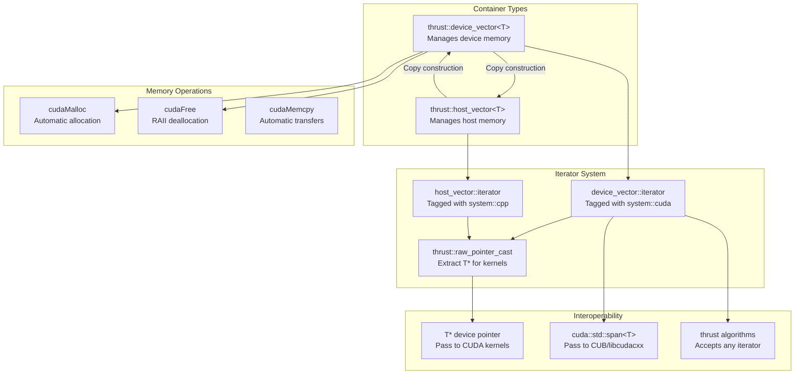

Example usage:

```cpp
// Automatic GPU memory management
thrust::device_vector<int> d_vec(1000);
thrust::fill(d_vec.begin(), d_vec.end(), 42);

// Automatic host-device transfer
thrust::host_vector<int> h_vec = d_vec;  // Copies from GPU to CPU

// Extract raw pointer for custom kernels
int* raw_ptr = thrust::raw_pointer_cast(d_vec.data());
my_cuda_kernel<<<grid, block>>>(raw_ptr, d_vec.size());
```

Sources: [README.md:77-87]()

## Internal Architecture: Building on CUB

Thrust's device algorithms internally dispatch to CUB for GPU execution. The dispatch mechanism uses iterator system tags to select the appropriate backend at compile time.

**Thrust-to-CUB Dispatch Mechanism**

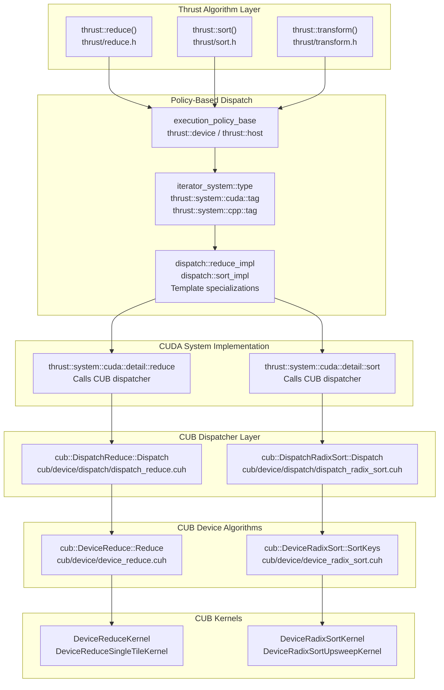

**Example: `thrust::reduce` to `cub::DeviceReduce` Call Chain**

1. User calls `thrust::reduce(thrust::device, data.begin(), data.end(), 0)`
2. Iterator system tag is `thrust::system::cuda::tag` (from `device_vector::iterator`)
3. Dispatches to `thrust::system::cuda::detail::reduce()` 
4. Creates `cub::DispatchReduce` with policy hub
5. Calls `cub::DispatchReduce::Dispatch()` which allocates temp storage
6. Launches `cub::DeviceReduceKernel` or `cub::DeviceReduceSingleTileKernel` depending on problem size

Sources: [cub/cub/device/dispatch/dispatch_reduce.cuh:147-255](), [cub/cub/device/dispatch/dispatch_reduce.cuh:490-534](), [README.md:36-44]()

## Execution Policy System

Thrust's execution policies provide fine-grained control over algorithm execution while maintaining portability. The policy system enables developers to explicitly specify execution preferences or rely on automatic backend selection based on data location and iterator types.

| Execution Policy | Backend | Use Case | Memory Access |
|-----------------|---------|----------|---------------|
| `thrust::device` | CUDA GPU | Device data processing | Device memory optimized |
| `thrust::host` | Sequential CPU | Host data processing | Host memory optimized |
| `thrust::par` | Parallel CPU | Multi-core processing | Host memory with threading |
| `thrust::seq` | Sequential CPU | Single-threaded processing | Host memory sequential |

**Policy-Based Execution Model**

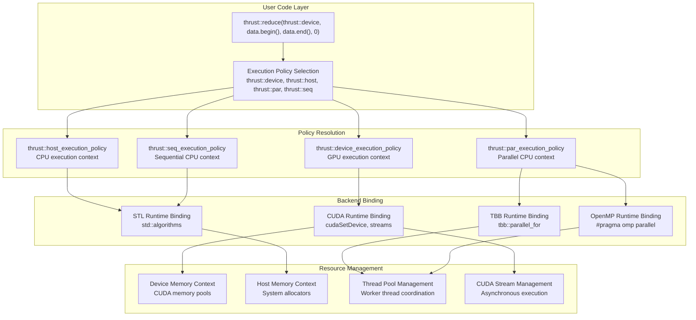

Sources: [README.md:98]()

## Integration with CCCL Components

Thrust builds on CUB and libcudacxx to deliver high-level algorithms with optimal performance:

**CCCL Component Usage in Thrust**

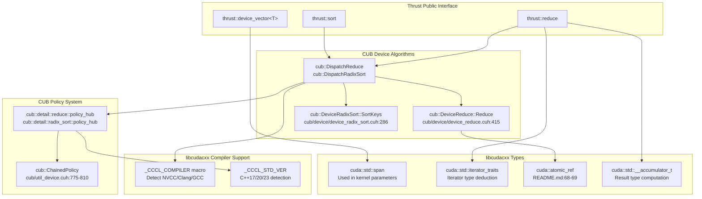

**Key Integration Points:**

| Component | Thrust Uses | File Reference |
|-----------|-------------|----------------|
| CUB Device Reduce | `thrust::reduce` → `cub::DeviceReduce::Reduce` | [cub/device/device_reduce.cuh:415-500]() |
| CUB Device Sort | `thrust::sort` → `cub::DeviceRadixSort::SortKeys` | [cub/device/device_radix_sort.cuh:286-350]() |
| CUB Policy System | Optimal kernel configuration per architecture | [cub/util_device.cuh:775-850]() |
| libcudacxx span | Pass ranges to kernels | [README.md:52]() |
| libcudacxx atomic | Block reductions in custom kernels | [README.md:68-69]() |
| libcudacxx type traits | Iterator and accumulator type deduction | [cub/device/dispatch/dispatch_reduce.cuh:172]() |

The example from [README.md:46-105]() demonstrates all three libraries working together: `thrust::device_vector` for memory, `cub::BlockReduce` for custom kernels, and `cuda::atomic_ref` for synchronization.

Sources: [README.md:36-106](), [cub/cub/device/dispatch/dispatch_reduce.cuh:147-186](), [cub/cub/util_device.cuh:775-810]()

## Performance and Optimization Patterns

Thrust is designed to deliver high performance through several optimization strategies including algorithm fusion, memory access pattern optimization, and backend-specific tuning. The library automatically selects optimal implementations based on data characteristics and execution context.

Common optimization patterns include:

- **Iterator Fusion**: Combining multiple operations into single kernel launches
- **Memory Coalescing**: Optimizing memory access patterns for GPU architectures  
- **Backend Selection**: Automatic selection of optimal execution backend
- **Algorithm Specialization**: Specialized implementations for common data types and operations

Sources: [README.md:25-32]()

---

# Page: CUB

# CUB

<details>
<summary>Relevant source files</summary>

The following files were used as context for generating this wiki page:

- [CONTRIBUTING.md](CONTRIBUTING.md)
- [README.md](README.md)
- [c/parallel/src/for.cu](c/parallel/src/for.cu)
- [c/parallel/src/merge_sort.cu](c/parallel/src/merge_sort.cu)
- [c/parallel/src/radix_sort.cu](c/parallel/src/radix_sort.cu)
- [c/parallel/src/reduce.cu](c/parallel/src/reduce.cu)
- [c/parallel/src/scan.cu](c/parallel/src/scan.cu)
- [c/parallel/src/segmented_reduce.cu](c/parallel/src/segmented_reduce.cu)
- [c/parallel/src/segmented_sort.cu](c/parallel/src/segmented_sort.cu)
- [c/parallel/src/three_way_partition.cu](c/parallel/src/three_way_partition.cu)
- [c/parallel/src/transform.cu](c/parallel/src/transform.cu)
- [c/parallel/src/unique_by_key.cu](c/parallel/src/unique_by_key.cu)
- [cub/benchmarks/bench/radix_sort/keys.cu](cub/benchmarks/bench/radix_sort/keys.cu)
- [cub/benchmarks/bench/radix_sort/pairs.cu](cub/benchmarks/bench/radix_sort/pairs.cu)
- [cub/benchmarks/bench/radix_sort/policy_selector.h](cub/benchmarks/bench/radix_sort/policy_selector.h)
- [cub/cub/detail/arch_dispatch.cuh](cub/cub/detail/arch_dispatch.cuh)
- [cub/cub/detail/launcher/cuda_driver.cuh](cub/cub/detail/launcher/cuda_driver.cuh)
- [cub/cub/detail/launcher/cuda_runtime.cuh](cub/cub/detail/launcher/cuda_runtime.cuh)
- [cub/cub/device/device_radix_sort.cuh](cub/cub/device/device_radix_sort.cuh)
- [cub/cub/device/device_segmented_reduce.cuh](cub/cub/device/device_segmented_reduce.cuh)
- [cub/cub/device/dispatch/dispatch_common.cuh](cub/cub/device/dispatch/dispatch_common.cuh)
- [cub/cub/device/dispatch/dispatch_fixed_size_segmented_reduce.cuh](cub/cub/device/dispatch/dispatch_fixed_size_segmented_reduce.cuh)
- [cub/cub/device/dispatch/dispatch_merge_sort.cuh](cub/cub/device/dispatch/dispatch_merge_sort.cuh)
- [cub/cub/device/dispatch/dispatch_radix_sort.cuh](cub/cub/device/dispatch/dispatch_radix_sort.cuh)
- [cub/cub/device/dispatch/dispatch_reduce.cuh](cub/cub/device/dispatch/dispatch_reduce.cuh)
- [cub/cub/device/dispatch/dispatch_segmented_radix_sort.cuh](cub/cub/device/dispatch/dispatch_segmented_radix_sort.cuh)
- [cub/cub/device/dispatch/dispatch_segmented_reduce.cuh](cub/cub/device/dispatch/dispatch_segmented_reduce.cuh)
- [cub/cub/device/dispatch/dispatch_segmented_sort.cuh](cub/cub/device/dispatch/dispatch_segmented_sort.cuh)
- [cub/cub/device/dispatch/kernels/kernel_radix_sort.cuh](cub/cub/device/dispatch/kernels/kernel_radix_sort.cuh)
- [cub/cub/device/dispatch/kernels/kernel_segmented_radix_sort.cuh](cub/cub/device/dispatch/kernels/kernel_segmented_radix_sort.cuh)
- [cub/cub/device/dispatch/kernels/kernel_segmented_reduce.cuh](cub/cub/device/dispatch/kernels/kernel_segmented_reduce.cuh)
- [cub/cub/device/dispatch/tuning/common.cuh](cub/cub/device/dispatch/tuning/common.cuh)
- [cub/cub/device/dispatch/tuning/tuning_radix_sort.cuh](cub/cub/device/dispatch/tuning/tuning_radix_sort.cuh)
- [cub/cub/util_device.cuh](cub/cub/util_device.cuh)
- [cub/test/catch2_test_arch_dispatch.cu](cub/test/catch2_test_arch_dispatch.cu)
- [cub/test/catch2_test_device_radix_sort_custom_policy_hub.cu](cub/test/catch2_test_device_radix_sort_custom_policy_hub.cu)

</details>


## Purpose and Scope

CUB (CUDA UnBound) is a low-level, CUDA-specific library providing highly optimized parallel primitives and device-wide algorithms for CUDA kernel developers. This document introduces CUB's architecture, design principles, and usage patterns.

For high-level parallel algorithms with STL-like interfaces, see [Thrust](#2.1). For detailed coverage of individual CUB algorithms, see [Device-Wide Operations](#2.2.1) and [Block-Level Primitives](#2.2.2). For the C language interface with JIT compilation, see [C Parallel API](#2.2.3).

**Sources**: [README.md:1-106](), [cub/cub/util_device.cuh:1-872]()

---

## Overview and Design Philosophy

CUB provides two categories of primitives:

1. **Device-wide algorithms** - Parallel operations that process data across entire GPU memory spaces, automatically handling work distribution, kernel launches, and temporary storage
2. **Block-level primitives** - Cooperative operations for use within custom CUDA kernels, enabling efficient thread block coordination

CUB is designed for **speed-of-light performance** across all GPU architectures through:
- Architecture-specific tuning policies selected at compile-time or runtime
- Header-only design for zero deployment overhead
- Template-based abstractions with zero-cost abstractions
- Direct integration with libcudacxx for standard library functionality

**Key Design Principles**:
- **Policy-based tuning**: Algorithm behavior configured through policy structures rather than magic constants
- **Dispatch architecture**: Three-layer design separating API, dispatch logic, and execution
- **Zero-copy abstractions**: Templates resolved at compile-time with no runtime overhead
- **libcudacxx foundation**: All CUB components build on libcudacxx types and utilities

**Sources**: [README.md:20-32](), [cub/cub/util_device.cuh:602-850]()

---

## CUB Library Structure

### Namespace and Component Organization

```mermaid
graph TB
    subgraph "cub Namespace"
        Device["Device-Wide APIs<br/>cub::Device*"]
        Block["Block-Level Primitives<br/>cub::Block*"]
        Warp["Warp-Level Primitives<br/>cub::Warp*"]
        Thread["Thread-Level Utilities<br/>cub::Thread*"]
        Util["Utilities<br/>cub::util_*, cub::Grid*"]
    end
    
    subgraph "detail Namespace"
        Dispatch["Dispatch Layer<br/>cub::detail::*::Dispatch*"]
        Agents["Agent Layer<br/>cub::detail::Agent*"]
        Tuning["Tuning Policies<br/>cub::detail::*::policy_*"]
        Kernels["Kernel Functions<br/>cub::detail::*::*Kernel"]
    end
    
    subgraph "Dependencies"
        LibCUDACXX["libcudacxx<br/>cuda::std::*, cuda::*"]
    end
    
    Device --> Dispatch
    Block --> Agents
    Dispatch --> Tuning
    Dispatch --> Kernels
    Kernels --> Agents
    
    Device -.->|uses| LibCUDACXX
    Block -.->|uses| LibCUDACXX
    Dispatch -.->|uses| LibCUDACXX
    Agents -.->|uses| LibCUDACXX
```

**CUB Namespace Hierarchy**:

| Namespace | Purpose | Example Components |
|-----------|---------|-------------------|
| `cub::` | Public API | `DeviceReduce`, `BlockScan`, `WarpReduce` |
| `cub::detail` | Internal implementation | Dispatch classes, policy selectors |
| `cub::detail::reduce` | Algorithm-specific details | `dispatch()`, `policy_selector` |
| `cub::detail::radix_sort` | Algorithm-specific details | `DeviceRadixSortKernelSource` |

**Sources**: [cub/cub/util_device.cuh:51-867](), [cub/cub/device/dispatch/dispatch_reduce.cuh:1-850](), [README.md:12-14]()

---

## Three-Layer Architecture

### Architecture Diagram

```mermaid
graph TB
    subgraph "Layer 1: Device API"
        DeviceReduce["cub::DeviceReduce"]
        DeviceSort["cub::DeviceRadixSort"]
        DeviceScan["cub::DeviceScan"]
        DeviceSelect["cub::DeviceSelect"]
        DeviceHistogram["cub::DeviceHistogram"]
    end
    
    subgraph "Layer 2: Dispatch Layer"
        DispatchReduce["DispatchReduce<br/>dispatch_reduce.cuh"]
        DispatchSort["DispatchRadixSort<br/>dispatch_radix_sort.cuh"]
        PolicySelector["policy_selector<br/>Selects tuning policy"]
        KernelConfig["KernelConfig<br/>block_threads, items_per_thread"]
    end
    
    subgraph "Layer 3: Agent & Kernel Layer"
        Kernels["Device Kernels<br/>DeviceReduceKernel<br/>DeviceRadixSortUpsweepKernel"]
        Agents["Agent Classes<br/>AgentReduce<br/>AgentRadixSortUpsweep"]
        BlockPrims["Block Primitives<br/>BlockReduce<br/>BlockScan<br/>BlockLoad"]
    end
    
    subgraph "Cross-Cutting"
        UtilDevice["util_device.cuh<br/>PtxVersion, SmVersion<br/>MaxSmOccupancy"]
        TempStorage["Temporary Storage<br/>alias_temporaries<br/>AliasTemporaries"]
    end
    
    DeviceReduce --> DispatchReduce
    DeviceSort --> DispatchSort
    
    DispatchReduce --> PolicySelector
    DispatchReduce --> KernelConfig
    DispatchReduce --> Kernels
    
    DispatchSort --> PolicySelector
    DispatchSort --> Kernels
    
    Kernels --> Agents
    Agents --> BlockPrims
    
    DispatchReduce -.->|queries| UtilDevice
    DispatchSort -.->|queries| UtilDevice
    DispatchReduce -.->|manages| TempStorage
```

### Layer Responsibilities

**Layer 1 - Device API** (`cub/cub/device/*.cuh`):
- Public-facing static methods (e.g., `DeviceReduce::Sum()`)
- Input validation and type deduction
- Manages `DoubleBuffer` for in-place operations
- Delegates to dispatch layer

**Layer 2 - Dispatch Layer** (`cub/cub/device/dispatch/*.cuh`):
- Policy selection based on architecture and data types
- Kernel configuration (grid size, block size, shared memory)
- Temporary storage allocation via `alias_temporaries()`
- Multi-pass algorithm orchestration
- Kernel launch coordination

**Layer 3 - Agent & Kernel Layer**:
- CUDA kernel entry points
- Agent classes implementing thread-block logic
- Direct use of block-level primitives
- Cooperative thread operations

**Sources**: [cub/cub/device/dispatch/dispatch_reduce.cuh:142-535](), [cub/cub/device/dispatch/dispatch_radix_sort.cuh:198-850](), [cub/cub/util_device.cuh:705-763]()

---

## Device Utility System

### Device Property Queries

CUB provides utilities for querying device properties and selecting optimal configurations:

```mermaid
graph LR
    subgraph "Device Query Functions"
        CurrentDevice["CurrentDevice()"]
        DeviceCount["DeviceCount()"]
        PtxVersion["PtxVersion()"]
        SmVersion["SmVersion()"]
    end
    
    subgraph "Kernel Configuration"
        MaxSmOccupancy["MaxSmOccupancy()"]
        KernelConfig["KernelConfig::Init()"]
    end
    
    subgraph "Policy Selection"
        ChainedPolicy["ChainedPolicy::Invoke()"]
        PolicySelector["policy_selector(arch_id)"]
    end
    
    subgraph "Caching Layer"
        PerDeviceCache["PerDeviceAttributeCache<br/>Thread-safe caching"]
    end
    
    PtxVersion --> PerDeviceCache
    SmVersion --> PerDeviceCache
    
    PerDeviceCache --> PolicySelector
    MaxSmOccupancy --> KernelConfig
    PolicySelector --> ChainedPolicy
```

**Key Utility Functions** ([cub/cub/util_device.cuh:67-600]()):

| Function | Purpose | Caching |
|----------|---------|---------|
| `CurrentDevice()` | Returns current CUDA device ID | No |
| `DeviceCount()` | Returns number of CUDA devices | Yes (static) |
| `PtxVersion(int& ptx_version)` | Queries PTX version for current device | Yes (per-device) |
| `SmVersion(int& sm_version, int device)` | Queries SM compute capability | Yes (per-device) |
| `MaxSmOccupancy(...)` | Computes max active blocks per SM | No |

**Caching Strategy**: `PerDeviceAttributeCache` uses atomic operations for thread-safe, lazy initialization of per-device attributes, avoiding repeated CUDA runtime queries.

**Sources**: [cub/cub/util_device.cuh:67-461](), [cub/cub/util_device.cuh:156-270]()

---

## Policy-Based Tuning System

### Policy Selection Flow

```mermaid
graph TB
    subgraph "Compile-Time"
        PolicyHub["policy_hub<AccumT, OffsetT>"]
        ChainedPolicy["ChainedPolicy<PtxVersion, PolicyT>"]
        ActivePolicy["ActivePolicy<br/>Selected at CUB_PTX_ARCH"]
    end
    
    subgraph "Runtime"
        DevicePtx["Device PTX Version<br/>PtxVersion(ptx_version)"]
        RuntimeDispatch["ChainedPolicy::Invoke(ptx_version, op)"]
        SelectedPolicy["Policy instantiated<br/>for device architecture"]
    end
    
    subgraph "Policy Components"
        AgentPolicy["Agent Policy<br/>BLOCK_THREADS<br/>ITEMS_PER_THREAD"]
        AlgoChoice["Algorithm Selection<br/>LOAD_MODIFIER<br/>RADIX_BITS"]
    end
    
    PolicyHub --> ChainedPolicy
    ChainedPolicy --> ActivePolicy
    
    DevicePtx --> RuntimeDispatch
    RuntimeDispatch --> SelectedPolicy
    
    SelectedPolicy --> AgentPolicy
    SelectedPolicy --> AlgoChoice
```

### Policy Structure Example

**Reduce Policy** ([cub/cub/device/dispatch/tuning/tuning_reduce.cuh]()):

```mermaid
graph LR
    subgraph "reduce_policy"
        ReducePol["reduce<br/>agent_reduce_policy"]
        SingleTile["single_tile<br/>agent_reduce_policy"]
        NonDet["reduce_nondet<br/>optional"]
    end
    
    subgraph "agent_reduce_policy"
        BlockThreads["block_threads: int"]
        ItemsPerThread["items_per_thread: int"]
        VectorLength["vector_load_length: int"]
        Algorithm["block_algorithm: enum"]
        LoadMod["load_modifier: enum"]
    end
    
    ReducePol --> BlockThreads
    SingleTile --> BlockThreads
```

**Key Policy Parameters**:

| Parameter | Purpose | Typical Values |
|-----------|---------|---------------|
| `block_threads` | Threads per block | 128, 256, 512 |
| `items_per_thread` | Items processed per thread | 4, 8, 16, 20 |
| `radix_bits` | Bits per digit (radix sort) | 4, 5, 6, 8 |
| `load_modifier` | Cache hint for loads | `LOAD_DEFAULT`, `LOAD_LDG`, `LOAD_CA` |
| `block_algorithm` | Scan/reduce algorithm | `BLOCK_REDUCE_RAKING`, `BLOCK_REDUCE_WARP_REDUCTIONS` |

**Sources**: [cub/cub/device/dispatch/tuning/tuning_radix_sort.cuh:1-800](), [cub/cub/util_device.cuh:692-704](), [cub/cub/device/dispatch/dispatch_reduce.cuh:46-140]()

---

## Dispatch Mechanism Details

### DispatchReduce Example

```mermaid
graph TB
    subgraph "Public API Call"
        UserCode["DeviceReduce::Sum(d_in, d_out, num_items)"]
    end
    
    subgraph "Dispatch::Dispatch Static Method"
        GetPtx["Get PTX version<br/>PtxVersion(ptx_version)"]
        CreateDispatch["Create DispatchReduce instance<br/>with problem parameters"]
        InvokeChain["ChainedPolicy::Invoke(ptx_version, dispatch)"]
    end
    
    subgraph "Dispatch::Invoke Template Method"
        CheckSize["Check if single-tile problem<br/>num_items <= BlockThreads * ItemsPerThread"]
        BranchSingle["InvokeSingleTile()"]
        BranchMulti["InvokePasses()"]
    end
    
    subgraph "Single-Tile Path"
        AllocTemp1["Return temp_storage_bytes=1"]
        LaunchSingle["Launch DeviceReduceSingleTileKernel<br/>grid=1, block=BlockThreads"]
    end
    
    subgraph "Multi-Pass Path"
        CalcGrid["Calculate grid size<br/>max_blocks = sm_count * occupancy"]
        AllocTemp2["Allocate d_block_reductions<br/>max_blocks * sizeof(AccumT)"]
        LaunchSweep["Launch DeviceReduceKernel<br/>grid=max_blocks"]
        LaunchReduce["Launch DeviceReduceSingleTileKernel<br/>on d_block_reductions"]
    end
    
    UserCode --> GetPtx
    GetPtx --> CreateDispatch
    CreateDispatch --> InvokeChain
    InvokeChain --> CheckSize
    
    CheckSize -->|small| BranchSingle
    CheckSize -->|large| BranchMulti
    
    BranchSingle --> AllocTemp1
    AllocTemp1 -->|d_temp_storage != null| LaunchSingle
    
    BranchMulti --> CalcGrid
    CalcGrid --> AllocTemp2
    AllocTemp2 -->|d_temp_storage != null| LaunchSweep
    LaunchSweep --> LaunchReduce
```

**Dispatch Responsibilities** ([cub/cub/device/dispatch/dispatch_reduce.cuh:185-535]()):

1. **Policy Selection**: Instantiate `DispatchReduce` with `PolicyHub` or `policy_selector`
2. **Temporary Storage**: Calculate and allocate via `alias_temporaries()`
3. **Algorithm Choice**: Select single-tile vs. multi-pass based on problem size
4. **Kernel Launch**: Configure and launch CUDA kernels with selected policy
5. **Error Handling**: Check for launch failures and synchronization errors

**Sources**: [cub/cub/device/dispatch/dispatch_reduce.cuh:142-535](), [cub/cub/device/dispatch/dispatch_reduce.cuh:596-729]()

---

## Kernel Configuration System

### KernelConfig Structure

The `KernelConfig` struct ([cub/cub/util_device.cuh:728-761]()) encapsulates kernel launch parameters:

```mermaid
graph LR
    subgraph "KernelConfig Fields"
        BlockThreads["block_threads"]
        ItemsPerThread["items_per_thread"]
        TileSize["tile_size<br/>block_threads * items_per_thread"]
        SmOccupancy["sm_occupancy<br/>blocks per SM"]
    end
    
    subgraph "Initialization"
        AgentPolicy["AgentPolicyT"]
        KernelPtr["KernelPtrT (function pointer)"]
        LauncherFactory["LauncherFactory<br/>MaxSmOccupancy()"]
    end
    
    AgentPolicy --> BlockThreads
    AgentPolicy --> ItemsPerThread
    BlockThreads --> TileSize
    ItemsPerThread --> TileSize
    
    KernelPtr --> LauncherFactory
    LauncherFactory --> SmOccupancy
```

**Usage Pattern**:

```cpp
// From dispatch_reduce.cuh
detail::KernelConfig reduce_config;
reduce_config.Init(reduce_kernel, active_policy.Reduce(), launcher_factory);

int reduce_device_occupancy = reduce_config.sm_occupancy * sm_count;
int max_blocks = reduce_device_occupancy * subscription_factor;
```

**Sources**: [cub/cub/util_device.cuh:705-763](), [cub/cub/device/dispatch/dispatch_reduce.cuh:330-360]()

---

## Temporary Storage Management

### Storage Aliasing System

```mermaid
graph TB
    subgraph "User Provides"
        TempPtr["void* d_temp_storage"]
        TempSize["size_t& temp_storage_bytes"]
    end
    
    subgraph "Algorithm Needs"
        Alloc1["Allocation 1<br/>size_t size1"]
        Alloc2["Allocation 2<br/>size_t size2"]
        Alloc3["Allocation 3<br/>size_t size3"]
    end
    
    subgraph "alias_temporaries Function"
        CalcOffsets["Calculate aligned offsets<br/>for each allocation"]
        TotalSize["Sum total required bytes"]
        SetPointers["Set pointers into d_temp_storage"]
    end
    
    subgraph "Two-Phase Pattern"
        Phase1["Phase 1: d_temp_storage == nullptr<br/>Return required size"]
        Phase2["Phase 2: d_temp_storage != nullptr<br/>Alias allocations & launch"]
    end
    
    TempPtr --> CalcOffsets
    TempSize --> TotalSize
    
    Alloc1 --> CalcOffsets
    Alloc2 --> CalcOffsets
    Alloc3 --> CalcOffsets
    
    CalcOffsets --> SetPointers
    TotalSize --> Phase1
    SetPointers --> Phase2
```

**Two-Phase Allocation Pattern**:

```cpp
// Phase 1: Query required storage
size_t temp_storage_bytes = 0;
DeviceReduce::Sum(nullptr, temp_storage_bytes, d_in, d_out, num_items);

// Allocate temporary storage
void* d_temp_storage;
cudaMalloc(&d_temp_storage, temp_storage_bytes);

// Phase 2: Execute with allocated storage
DeviceReduce::Sum(d_temp_storage, temp_storage_bytes, d_in, d_out, num_items);
```

**Sources**: [cub/cub/device/dispatch/dispatch_reduce.cuh:355-375](), [cub/cub/device/dispatch/dispatch_radix_sort.cuh:239-356]()

---

## Header Organization

### CUB File Structure

```mermaid
graph TB
    subgraph "Public API Headers"
        DeviceAPI["cub/device/<br/>device_*.cuh"]
        BlockAPI["cub/block/<br/>block_*.cuh"]
        WarpAPI["cub/warp/<br/>warp_*.cuh"]
    end
    
    subgraph "Implementation Headers"
        Dispatch["cub/device/dispatch/<br/>dispatch_*.cuh"]
        Kernels["cub/device/dispatch/kernels/<br/>kernel_*.cuh"]
        Agents["cub/agent/<br/>agent_*.cuh"]
    end
    
    subgraph "Tuning Headers"
        Tuning["cub/device/dispatch/tuning/<br/>tuning_*.cuh"]
        Common["cub/device/dispatch/tuning/<br/>common.cuh"]
    end
    
    subgraph "Utility Headers"
        UtilDevice["cub/util_device.cuh"]
        UtilType["cub/util_type.cuh"]
        UtilDebug["cub/util_debug.cuh"]
        GridShare["cub/grid/<br/>grid_even_share.cuh"]
    end
    
    DeviceAPI --> Dispatch
    Dispatch --> Kernels
    Dispatch --> Tuning
    Kernels --> Agents
    
    Dispatch -.->|uses| UtilDevice
    Dispatch -.->|uses| GridShare
    Agents -.->|uses| BlockAPI
    Tuning -.->|uses| Common
```

**Key Include Patterns**:

| Header Type | Example | Purpose |
|-------------|---------|---------|
| Device API | `<cub/device/device_reduce.cuh>` | User-facing algorithms |
| Block Primitives | `<cub/block/block_reduce.cuh>` | Cooperative operations |
| Dispatch | `<cub/device/dispatch/dispatch_reduce.cuh>` | Implementation details |
| Utilities | `<cub/util_device.cuh>` | Common utilities |
| Configuration | `<cub/config.cuh>` | Version & configuration macros |

**Sources**: [cub/cub/device/device_radix_sort.cuh:1-20](), [cub/cub/util_device.cuh:1-50](), [cub/cub/device/dispatch/dispatch_reduce.cuh:1-44]()

---

## Integration with libcudacxx

### CUB's libcudacxx Dependencies

```mermaid
graph LR
    subgraph "CUB Components"
        DeviceAlgos["Device Algorithms"]
        BlockPrims["Block Primitives"]
        Dispatch["Dispatch Layer"]
        Policies["Policy Structures"]
    end
    
    subgraph "libcudacxx Standard Library"
        StdTypes["cuda::std::*<br/>type_traits, iterator_traits"]
        Functional["cuda::std::plus<br/>identity, invoke_result_t"]
        Utility["cuda::std::span<br/>array, optional"]
        Arch["cuda::arch_id<br/>compute_capability"]
    end
    
    subgraph "libcudacxx CUDA Extensions"
        Atomic["cuda::atomic_ref"]
        MemOrder["cuda::memory_order_*"]
        CeilDiv["cuda::ceil_div"]
    end
    
    DeviceAlgos --> StdTypes
    DeviceAlgos --> Functional
    BlockPrims --> Atomic
    Dispatch --> Arch
    Policies --> Utility
    
    Dispatch -.->|uses| CeilDiv
    DeviceAlgos -.->|uses| MemOrder
```

**libcudacxx Integration Points** ([cub/cub/device/dispatch/dispatch_reduce.cuh:33-35]()):

- **Type Traits**: `::cuda::std::__accumulator_t`, `::cuda::std::invoke_result_t`, `::cuda::std::iter_value_t`
- **Functional**: `::cuda::std::plus`, `::cuda::std::identity`, `::cuda::std::maximum`, `::cuda::std::minimum`
- **Containers**: `::cuda::std::span`, `::cuda::std::array`, `::cuda::std::optional`
- **Architecture**: `::cuda::arch_id`, `::cuda::compute_capability`, `::cuda::to_arch_id()`
- **Math**: `::cuda::ceil_div()`, `::cuda::ceil_ilog2()`

**Sources**: [cub/cub/device/dispatch/dispatch_reduce.cuh:33-35](), [cub/cub/util_device.cuh:26-33](), [README.md:46-52]()

---

## Usage Patterns

### Basic Device Algorithm Usage

```cpp
// Example from README.md
#include <cub/device/device_reduce.cuh>
#include <thrust/device_vector.h>

thrust::device_vector<int> data(1000);
thrust::fill(data.begin(), data.end(), 1);

// Two-phase allocation pattern
void* d_temp_storage = nullptr;
size_t temp_storage_bytes = 0;

// Phase 1: Query temp storage size
cub::DeviceReduce::Sum(d_temp_storage, temp_storage_bytes, 
                       data.data().get(), result_ptr, 1000);

// Allocate temp storage
cudaMalloc(&d_temp_storage, temp_storage_bytes);

// Phase 2: Execute reduction
cub::DeviceReduce::Sum(d_temp_storage, temp_storage_bytes,
                       data.data().get(), result_ptr, 1000);
```

### Custom Kernel with Block Primitives

```cpp
// Example from README.md
#include <cub/block/block_reduce.cuh>

template <int block_size>
__global__ void reduce_kernel(const int* data, int* result, int n) {
    using BlockReduce = cub::BlockReduce<int, block_size>;
    __shared__ typename BlockReduce::TempStorage temp_storage;
    
    int thread_data = (threadIdx.x < n) ? data[threadIdx.x] : 0;
    int aggregate = BlockReduce(temp_storage).Sum(thread_data);
    
    if (threadIdx.x == 0) {
        atomicAdd(result, aggregate);
    }
}
```

**Sources**: [README.md:34-106](), [cub/cub/device/device_radix_sort.cuh:30-200]()

---

## Key Device-Wide Algorithms

### Algorithm Summary Table

| Algorithm | Header | Primary Classes | Key Features |
|-----------|--------|-----------------|--------------|
| Reduce | `device_reduce.cuh` | `DeviceReduce`, `DispatchReduce` | Sum, Min, Max, custom ops; single-tile & multi-pass |
| Scan | `device_scan.cuh` | `DeviceScan`, `DispatchScan` | Inclusive/Exclusive; prefix sum with look-back |
| Radix Sort | `device_radix_sort.cuh` | `DeviceRadixSort`, `DispatchRadixSort` | Keys/Pairs; onesweep & multi-pass algorithms |
| Merge Sort | `device_merge_sort.cuh` | `DeviceMergeSort`, `DispatchMergeSort` | Stable sort; custom comparators |
| Select | `device_select.cuh` | `DeviceSelect`, `DispatchSelect` | Partition, unique, flagged selection |
| Histogram | `device_histogram.cuh` | `DeviceHistogram` | Even/range binning; multi-channel |
| Transform | `device_transform.cuh` | `DeviceTransform` | Unary/binary element-wise operations |

**Algorithm Categories**:

1. **Reductions**: `DeviceReduce`, `DeviceSegmentedReduce`
2. **Scans**: `DeviceScan`, `DeviceSegmentedScan`
3. **Sorting**: `DeviceRadixSort`, `DeviceMergeSort`, `DeviceSegmentedSort`
4. **Selection**: `DeviceSelect`, `DevicePartition`, `DeviceUnique`
5. **Data Movement**: `DeviceCopy`, `DeviceMemcpy`
6. **Histograms**: `DeviceHistogram`

**Sources**: [cub/cub/device/device_reduce.cuh:1-600](), [cub/cub/device/device_radix_sort.cuh:1-200](), [cub/cub/device/device_segmented_reduce.cuh:1-100]()

---

## C Parallel API Integration

CUB provides a C language interface with JIT compilation capabilities. This is covered in detail in [C Parallel API and JIT Compilation](#2.2.3), but the integration points are:

```mermaid
graph TB
    subgraph "C API Layer"
        CReduce["cccl_device_reduce_build_ex()"]
        CSort["cccl_device_radix_sort_build_ex()"]
    end
    
    subgraph "JIT Compilation"
        NVRTC["NVRTC<br/>Runtime Compilation"]
        LTOIR["LTO-IR Linking<br/>nvrtc_link_result"]
    end
    
    subgraph "CUB Integration"
        KernelSource["DeviceReduceKernelSource<br/>PolicySelector"]
        DispatchFunc["detail::reduce::dispatch()"]
        CudaDriver["CudaDriverLauncherFactory"]
    end
    
    CReduce --> NVRTC
    NVRTC --> LTOIR
    LTOIR --> KernelSource
    KernelSource --> DispatchFunc
    DispatchFunc --> CudaDriver
```

**Key Files**:
- [c/parallel/src/reduce.cu:1-450]() - C API for reduce with JIT
- [c/parallel/src/radix_sort.cu:1-400]() - C API for radix sort
- [c/parallel/src/transform.cu:1-450]() - C API for transform

**Sources**: [c/parallel/src/reduce.cu:1-100](), [c/parallel/src/radix_sort.cu:1-50](), [cub/cub/detail/launcher/cuda_driver.cuh:1-100]()

---

## Performance Considerations

### Tuning Guidelines

**Policy Tuning Parameters**:

1. **Block Size** (`block_threads`): Balance occupancy vs. per-block resources
   - Larger blocks: Better occupancy, more shared memory pressure
   - Smaller blocks: Lower latency, less shared memory usage
   - Typical values: 128, 256, 512

2. **Items Per Thread** (`items_per_thread`): Amortize overhead across work
   - More items: Better instruction-level parallelism
   - Fewer items: Better load balance for irregular workloads
   - Typical values: 4-20 depending on register pressure

3. **Algorithm Selection**:
   - `BLOCK_REDUCE_RAKING`: Lower latency for small blocks
   - `BLOCK_REDUCE_WARP_REDUCTIONS`: Better for larger blocks
   - `LOAD_LDG`: Use read-only cache (Kepler+)
   - `LOAD_CA`: Cache at all levels

**Architecture-Specific Considerations** ([cub/cub/device/dispatch/tuning/tuning_radix_sort.cuh:200-800]()):

- **Volta+ (SM70+)**: Leverage independent thread scheduling
- **Ampere+ (SM80+)**: Use async copy instructions (`PREFETCH`, `ASYNC_COPY`)
- **Hopper+ (SM90+)**: TMA descriptors for bulk data movement

**Sources**: [cub/cub/device/dispatch/tuning/tuning_radix_sort.cuh:1-200](), [cub/cub/device/dispatch/tuning/tuning_reduce.cuh:1-300]()

---

## Version and Compatibility

### Version Macros

CUB version is synchronized with CCCL version:

| Macro | Description | Example |
|-------|-------------|---------|
| `CUB_MAJOR_VERSION` | Major version | 3 |
| `CUB_MINOR_VERSION` | Minor version | 1 |
| `CUB_SUBMINOR_VERSION` | Patch version | 0 |
| `CUB_VERSION` | Concatenated (MMMmmmpp) | 3010000 |

These are consistent with `CCCL_VERSION` macros as described in [README.md:376-386]().

### ABI Considerations

- **`cub::` namespace**: No ABI stability guarantees; may change between minor versions
- **`thrust::` dependency**: Thrust internally uses CUB; version compatibility required
- **PTX version sensitivity**: Kernels compiled with different architectures in `__CUDA_ARCH_LIST__` must match runtime PTX version

**Sources**: [README.md:380-410](), [cub/cub/util_device.cuh:795-810]()

---

# Page: Device-Wide Operations

# Device-Wide Operations

<details>
<summary>Relevant source files</summary>

The following files were used as context for generating this wiki page:

- [c/parallel/include/cccl/c/transform.h](c/parallel/include/cccl/c/transform.h)
- [c/parallel/src/for.cu](c/parallel/src/for.cu)
- [c/parallel/src/merge_sort.cu](c/parallel/src/merge_sort.cu)
- [c/parallel/src/radix_sort.cu](c/parallel/src/radix_sort.cu)
- [c/parallel/src/reduce.cu](c/parallel/src/reduce.cu)
- [c/parallel/src/scan.cu](c/parallel/src/scan.cu)
- [c/parallel/src/segmented_reduce.cu](c/parallel/src/segmented_reduce.cu)
- [c/parallel/src/segmented_sort.cu](c/parallel/src/segmented_sort.cu)
- [c/parallel/src/three_way_partition.cu](c/parallel/src/three_way_partition.cu)
- [c/parallel/src/transform.cu](c/parallel/src/transform.cu)
- [c/parallel/src/unique_by_key.cu](c/parallel/src/unique_by_key.cu)
- [cub/benchmarks/bench/radix_sort/keys.cu](cub/benchmarks/bench/radix_sort/keys.cu)
- [cub/benchmarks/bench/radix_sort/pairs.cu](cub/benchmarks/bench/radix_sort/pairs.cu)
- [cub/benchmarks/bench/radix_sort/policy_selector.h](cub/benchmarks/bench/radix_sort/policy_selector.h)
- [cub/benchmarks/bench/reduce/base.cuh](cub/benchmarks/bench/reduce/base.cuh)
- [cub/benchmarks/bench/reduce/deterministic.cu](cub/benchmarks/bench/reduce/deterministic.cu)
- [cub/benchmarks/bench/reduce/nondeterministic.cu](cub/benchmarks/bench/reduce/nondeterministic.cu)
- [cub/benchmarks/bench/transform/babelstream.cu](cub/benchmarks/bench/transform/babelstream.cu)
- [cub/benchmarks/bench/transform/common.h](cub/benchmarks/bench/transform/common.h)
- [cub/benchmarks/bench/transform/complex_cmp.cu](cub/benchmarks/bench/transform/complex_cmp.cu)
- [cub/benchmarks/bench/transform/fib.cu](cub/benchmarks/bench/transform/fib.cu)
- [cub/benchmarks/bench/transform/fill.cu](cub/benchmarks/bench/transform/fill.cu)
- [cub/benchmarks/bench/transform/grayscale.cu](cub/benchmarks/bench/transform/grayscale.cu)
- [cub/benchmarks/bench/transform/heavy.cu](cub/benchmarks/bench/transform/heavy.cu)
- [cub/benchmarks/bench/transform_reduce/sum.cu](cub/benchmarks/bench/transform_reduce/sum.cu)
- [cub/cub/agent/agent_radix_sort_downsweep.cuh](cub/cub/agent/agent_radix_sort_downsweep.cuh)
- [cub/cub/agent/agent_radix_sort_histogram.cuh](cub/cub/agent/agent_radix_sort_histogram.cuh)
- [cub/cub/agent/agent_radix_sort_onesweep.cuh](cub/cub/agent/agent_radix_sort_onesweep.cuh)
- [cub/cub/agent/agent_radix_sort_upsweep.cuh](cub/cub/agent/agent_radix_sort_upsweep.cuh)
- [cub/cub/agent/agent_reduce.cuh](cub/cub/agent/agent_reduce.cuh)
- [cub/cub/agent/agent_reduce_by_key.cuh](cub/cub/agent/agent_reduce_by_key.cuh)
- [cub/cub/agent/agent_rle.cuh](cub/cub/agent/agent_rle.cuh)
- [cub/cub/agent/agent_scan.cuh](cub/cub/agent/agent_scan.cuh)
- [cub/cub/agent/agent_scan_by_key.cuh](cub/cub/agent/agent_scan_by_key.cuh)
- [cub/cub/agent/agent_segmented_radix_sort.cuh](cub/cub/agent/agent_segmented_radix_sort.cuh)
- [cub/cub/agent/agent_select_if.cuh](cub/cub/agent/agent_select_if.cuh)
- [cub/cub/agent/agent_three_way_partition.cuh](cub/cub/agent/agent_three_way_partition.cuh)
- [cub/cub/agent/agent_unique_by_key.cuh](cub/cub/agent/agent_unique_by_key.cuh)
- [cub/cub/agent/single_pass_scan_operators.cuh](cub/cub/agent/single_pass_scan_operators.cuh)
- [cub/cub/detail/arch_dispatch.cuh](cub/cub/detail/arch_dispatch.cuh)
- [cub/cub/detail/launcher/cuda_driver.cuh](cub/cub/detail/launcher/cuda_driver.cuh)
- [cub/cub/detail/launcher/cuda_runtime.cuh](cub/cub/detail/launcher/cuda_runtime.cuh)
- [cub/cub/detail/rfa.cuh](cub/cub/detail/rfa.cuh)
- [cub/cub/device/device_adjacent_difference.cuh](cub/cub/device/device_adjacent_difference.cuh)
- [cub/cub/device/device_histogram.cuh](cub/cub/device/device_histogram.cuh)
- [cub/cub/device/device_partition.cuh](cub/cub/device/device_partition.cuh)
- [cub/cub/device/device_radix_sort.cuh](cub/cub/device/device_radix_sort.cuh)
- [cub/cub/device/device_reduce.cuh](cub/cub/device/device_reduce.cuh)
- [cub/cub/device/device_segmented_radix_sort.cuh](cub/cub/device/device_segmented_radix_sort.cuh)
- [cub/cub/device/device_segmented_reduce.cuh](cub/cub/device/device_segmented_reduce.cuh)
- [cub/cub/device/device_segmented_sort.cuh](cub/cub/device/device_segmented_sort.cuh)
- [cub/cub/device/device_select.cuh](cub/cub/device/device_select.cuh)
- [cub/cub/device/dispatch/dispatch_adjacent_difference.cuh](cub/cub/device/dispatch/dispatch_adjacent_difference.cuh)
- [cub/cub/device/dispatch/dispatch_common.cuh](cub/cub/device/dispatch/dispatch_common.cuh)
- [cub/cub/device/dispatch/dispatch_fixed_size_segmented_reduce.cuh](cub/cub/device/dispatch/dispatch_fixed_size_segmented_reduce.cuh)
- [cub/cub/device/dispatch/dispatch_histogram.cuh](cub/cub/device/dispatch/dispatch_histogram.cuh)
- [cub/cub/device/dispatch/dispatch_merge_sort.cuh](cub/cub/device/dispatch/dispatch_merge_sort.cuh)
- [cub/cub/device/dispatch/dispatch_radix_sort.cuh](cub/cub/device/dispatch/dispatch_radix_sort.cuh)
- [cub/cub/device/dispatch/dispatch_reduce.cuh](cub/cub/device/dispatch/dispatch_reduce.cuh)
- [cub/cub/device/dispatch/dispatch_reduce_by_key.cuh](cub/cub/device/dispatch/dispatch_reduce_by_key.cuh)
- [cub/cub/device/dispatch/dispatch_reduce_deterministic.cuh](cub/cub/device/dispatch/dispatch_reduce_deterministic.cuh)
- [cub/cub/device/dispatch/dispatch_reduce_nondeterministic.cuh](cub/cub/device/dispatch/dispatch_reduce_nondeterministic.cuh)
- [cub/cub/device/dispatch/dispatch_rle.cuh](cub/cub/device/dispatch/dispatch_rle.cuh)
- [cub/cub/device/dispatch/dispatch_scan.cuh](cub/cub/device/dispatch/dispatch_scan.cuh)
- [cub/cub/device/dispatch/dispatch_scan_by_key.cuh](cub/cub/device/dispatch/dispatch_scan_by_key.cuh)
- [cub/cub/device/dispatch/dispatch_segmented_radix_sort.cuh](cub/cub/device/dispatch/dispatch_segmented_radix_sort.cuh)
- [cub/cub/device/dispatch/dispatch_segmented_reduce.cuh](cub/cub/device/dispatch/dispatch_segmented_reduce.cuh)
- [cub/cub/device/dispatch/dispatch_segmented_sort.cuh](cub/cub/device/dispatch/dispatch_segmented_sort.cuh)
- [cub/cub/device/dispatch/dispatch_select_if.cuh](cub/cub/device/dispatch/dispatch_select_if.cuh)
- [cub/cub/device/dispatch/dispatch_streaming_reduce.cuh](cub/cub/device/dispatch/dispatch_streaming_reduce.cuh)
- [cub/cub/device/dispatch/dispatch_three_way_partition.cuh](cub/cub/device/dispatch/dispatch_three_way_partition.cuh)
- [cub/cub/device/dispatch/dispatch_transform.cuh](cub/cub/device/dispatch/dispatch_transform.cuh)
- [cub/cub/device/dispatch/dispatch_unique_by_key.cuh](cub/cub/device/dispatch/dispatch_unique_by_key.cuh)
- [cub/cub/device/dispatch/kernels/kernel_radix_sort.cuh](cub/cub/device/dispatch/kernels/kernel_radix_sort.cuh)
- [cub/cub/device/dispatch/kernels/kernel_reduce.cuh](cub/cub/device/dispatch/kernels/kernel_reduce.cuh)
- [cub/cub/device/dispatch/kernels/kernel_scan.cuh](cub/cub/device/dispatch/kernels/kernel_scan.cuh)
- [cub/cub/device/dispatch/kernels/kernel_segmented_radix_sort.cuh](cub/cub/device/dispatch/kernels/kernel_segmented_radix_sort.cuh)
- [cub/cub/device/dispatch/kernels/kernel_segmented_reduce.cuh](cub/cub/device/dispatch/kernels/kernel_segmented_reduce.cuh)
- [cub/cub/device/dispatch/kernels/kernel_transform.cuh](cub/cub/device/dispatch/kernels/kernel_transform.cuh)
- [cub/cub/device/dispatch/tuning/common.cuh](cub/cub/device/dispatch/tuning/common.cuh)
- [cub/cub/device/dispatch/tuning/tuning_adjacent_difference.cuh](cub/cub/device/dispatch/tuning/tuning_adjacent_difference.cuh)
- [cub/cub/device/dispatch/tuning/tuning_batch_memcpy.cuh](cub/cub/device/dispatch/tuning/tuning_batch_memcpy.cuh)
- [cub/cub/device/dispatch/tuning/tuning_for.cuh](cub/cub/device/dispatch/tuning/tuning_for.cuh)
- [cub/cub/device/dispatch/tuning/tuning_merge_sort.cuh](cub/cub/device/dispatch/tuning/tuning_merge_sort.cuh)
- [cub/cub/device/dispatch/tuning/tuning_radix_sort.cuh](cub/cub/device/dispatch/tuning/tuning_radix_sort.cuh)
- [cub/cub/device/dispatch/tuning/tuning_reduce.cuh](cub/cub/device/dispatch/tuning/tuning_reduce.cuh)
- [cub/cub/device/dispatch/tuning/tuning_run_length_encode.cuh](cub/cub/device/dispatch/tuning/tuning_run_length_encode.cuh)
- [cub/cub/device/dispatch/tuning/tuning_scan.cuh](cub/cub/device/dispatch/tuning/tuning_scan.cuh)
- [cub/cub/device/dispatch/tuning/tuning_scan_by_key.cuh](cub/cub/device/dispatch/tuning/tuning_scan_by_key.cuh)
- [cub/cub/device/dispatch/tuning/tuning_segmented_sort.cuh](cub/cub/device/dispatch/tuning/tuning_segmented_sort.cuh)
- [cub/cub/device/dispatch/tuning/tuning_select_if.cuh](cub/cub/device/dispatch/tuning/tuning_select_if.cuh)
- [cub/cub/device/dispatch/tuning/tuning_three_way_partition.cuh](cub/cub/device/dispatch/tuning/tuning_three_way_partition.cuh)
- [cub/cub/device/dispatch/tuning/tuning_transform.cuh](cub/cub/device/dispatch/tuning/tuning_transform.cuh)
- [cub/cub/device/dispatch/tuning/tuning_unique_by_key.cuh](cub/cub/device/dispatch/tuning/tuning_unique_by_key.cuh)
- [cub/cub/grid/grid_even_share.cuh](cub/cub/grid/grid_even_share.cuh)
- [cub/cub/util_device.cuh](cub/cub/util_device.cuh)
- [cub/test/catch2_test_arch_dispatch.cu](cub/test/catch2_test_arch_dispatch.cu)
- [cub/test/catch2_test_device_radix_sort_custom_policy_hub.cu](cub/test/catch2_test_device_radix_sort_custom_policy_hub.cu)
- [cub/test/catch2_test_device_reduce_deterministic.cu](cub/test/catch2_test_device_reduce_deterministic.cu)
- [cub/test/catch2_test_device_reduce_env.cu](cub/test/catch2_test_device_reduce_env.cu)
- [cub/test/catch2_test_device_reduce_env_api.cu](cub/test/catch2_test_device_reduce_env_api.cu)
- [cub/test/catch2_test_device_reduce_nondeterministic.cu](cub/test/catch2_test_device_reduce_nondeterministic.cu)
- [cub/test/catch2_test_device_segmented_reduce_large_offsets.cu](cub/test/catch2_test_device_segmented_reduce_large_offsets.cu)
- [cub/test/catch2_test_device_transform.cu](cub/test/catch2_test_device_transform.cu)
- [cub/test/catch2_test_grid_even_share.cu](cub/test/catch2_test_grid_even_share.cu)
- [cub/test/catch2_test_launch_helper.h](cub/test/catch2_test_launch_helper.h)
- [cub/test/test_device_reduce_env_fail.cu](cub/test/test_device_reduce_env_fail.cu)
- [cub/test/test_device_reduce_unsupported_env_fail.cu](cub/test/test_device_reduce_unsupported_env_fail.cu)
- [thrust/testing/cuda/unique.cu](thrust/testing/cuda/unique.cu)
- [thrust/thrust/type_traits/unwrap_contiguous_iterator.h](thrust/thrust/type_traits/unwrap_contiguous_iterator.h)

</details>


## Purpose and Scope

Device-Wide Operations are CUB's high-level algorithms that operate on entire sequences of data residing in device-accessible memory. These operations provide optimized implementations of common parallel primitives such as reductions, scans, selections, sorts, and transformations. This document covers the architecture, dispatch mechanisms, and implementation patterns shared across all device-wide operations.

For low-level building blocks to construct custom kernels, see [Block-Level Primitives](#2.2.2). For policy selection and tuning mechanisms, see [Dispatch and Policy System](#5.2).

**Sources:** [cub/cub/device/dispatch/dispatch_reduce.cuh:1-546](), [cub/cub/device/dispatch/dispatch_transform.cuh:1-569](), [cub/cub/device/dispatch/dispatch_scan.cuh:1-400]()

## Available Operations

CUB provides the following categories of device-wide operations:

| Operation Category | Primary API | Key Dispatch Classes | Description |
|-------------------|------------|---------------------|-------------|
| **Reduce** | `cub::DeviceReduce` | `DispatchReduce`, `detail::reduce::dispatch` | Compute aggregates (sum, min, max, custom operators) across sequences |
| **Transform** | `cub::DeviceTransform` | `detail::transform::dispatch` | Apply element-wise operations with vectorized/async memory access |
| **Scan** | `cub::DeviceScan` | `DispatchScan` | Compute prefix sums (inclusive/exclusive) with inter-block coordination |
| **Select** | `cub::DeviceSelect` | `DispatchSelectIf`, `DispatchUniqueByKey` | Filter elements based on predicates or uniqueness |
| **Histogram** | `cub::DeviceHistogram` | `DispatchHistogram`, `detail::histogram::dispatch_histogram` | Compute frequency distributions with privatized binning |
| **Sort** | `cub::DeviceRadixSort`, `cub::DeviceMergeSort` | `DispatchRadixSort`, `detail::merge_sort::dispatch_t` | Sort keys and key-value pairs using radix or merge algorithms |
| **Segmented Reduce** | `cub::DeviceSegmentedReduce` | `detail::segmented_reduce::dispatch`, `DispatchFixedSizeSegmentedReduce` | Reduce multiple independent segments in parallel |

**Sources:** [cub/cub/device/device_reduce.cuh:122-508](), [cub/cub/device/dispatch/dispatch_reduce.cuh:47-847](), [cub/cub/device/dispatch/dispatch_transform.cuh:58-594](), [cub/cub/device/dispatch/dispatch_scan.cuh:86-400](), [cub/cub/device/dispatch/dispatch_select_if.cuh:47-850](), [cub/cub/device/dispatch/dispatch_histogram.cuh:54-404](), [cub/cub/device/dispatch/dispatch_radix_sort.cuh:52-850](), [cub/cub/device/device_segmented_reduce.cuh:79-944]()

## Architectural Overview

### Dispatch Layer Pattern

All device-wide operations follow a common four-layer architectural pattern:

```mermaid
graph TB
    subgraph "Layer 1: User API"
        API["DeviceReduce::Sum()<br/>DeviceTransform::Transform()<br/>DeviceScan::ExclusiveSum()"]
    end
    
    subgraph "Layer 2: Dispatch Layer"
        DISPATCH["DispatchReduce<br/>dispatch_t (Transform)<br/>DispatchScan"]
        DISPATCH_METHODS["Dispatch()<br/>Invoke()<br/>InvokePasses()"]
    end
    
    subgraph "Layer 3: Policy Selection"
        POLICY_HUB["policy_hub<AccumT, OffsetT>"]
        CHAINED["ChainedPolicy<br/>PTX Version Matching"]
        TUNING["sm80_tuning<br/>sm90_tuning<br/>sm100_tuning"]
    end
    
    subgraph "Layer 4: Kernel Execution"
        KERNELS["DeviceReduceKernel<br/>transform_kernel_*<br/>DeviceScanKernel"]
        AGENTS["AgentReduce<br/>transform logic<br/>AgentScan"]
    end
    
    API --> DISPATCH
    DISPATCH --> DISPATCH_METHODS
    DISPATCH_METHODS --> POLICY_HUB
    POLICY_HUB --> CHAINED
    CHAINED --> TUNING
    TUNING --> KERNELS
    KERNELS --> AGENTS
    
    style API fill:#f9f9f9
    style DISPATCH fill:#e8e8e8
    style POLICY_HUB fill:#d8d8d8
    style KERNELS fill:#c8c8c8
```

**Dispatch Layer Pattern Overview**

The dispatch layer orchestrates the entire execution flow from user API to kernel launch.

**Sources:** [cub/cub/device/dispatch/dispatch_reduce.cuh:139-158](), [cub/cub/device/dispatch/dispatch_transform.cuh:158-191](), [cub/cub/util_device.cuh:726-795]()

### Common Dispatch Components

```mermaid
graph TB
    subgraph TempStorage["Temporary Storage Management"]
        TEMP_CALC["detail::alias_temporaries()<br/>Computes offsets and sizes"]
        VSMEM["vsmem_t helper<br/>Virtual memory allocation"]
    end
    
    subgraph DeviceQueries["Device Queries (util_device.cuh)"]
        PTX_VER["PtxVersion(int& ptx_version)<br/>Returns PTX arch * 10"]
        SM_VER["SmVersion(int& sm_version)<br/>Returns compute capability * 10"]
        SM_COUNT["MultiProcessorCount()<br/>Via launcher_factory"]
        PTX_ARCH_ID["detail::ptx_arch_id(cuda::arch_id&)<br/>Returns cuda::arch_id"]
    end
    
    subgraph KernelConfig["Kernel Configuration"]
        KERNEL_STRUCT["detail::KernelConfig struct<br/>block_threads, items_per_thread<br/>tile_size, sm_occupancy"]
        MAX_OCC["MaxSmOccupancy(kernel_ptr)<br/>cudaOccupancyMaxActiveBlocks"]
        GRID_CALC["ceil_div(num_items, tile_size)<br/>Grid dimension calculation"]
    end
    
    subgraph PolicySel["Policy Selection"]
        DISPATCH_ARCH["detail::dispatch_arch()<br/>Invokes policy_selector(arch_id)"]
        LEGACY_INVOKE["ChainedPolicy::Invoke()<br/>Legacy PTX version matching"]
    end
    
    TEMP_CALC --> VSMEM
    PTX_VER --> LEGACY_INVOKE
    PTX_ARCH_ID --> DISPATCH_ARCH
    SM_VER --> KERNEL_STRUCT
    SM_COUNT --> GRID_CALC
    MAX_OCC --> KERNEL_STRUCT
    DISPATCH_ARCH --> KERNEL_STRUCT
    LEGACY_INVOKE --> KERNEL_STRUCT
```

**Common Components Shared by All Dispatch Layers**

Every dispatch implementation uses these utilities for device queries, memory allocation, configuration, and policy selection.

**Sources:** [cub/cub/util_device.cuh:276-461](), [cub/cub/util_device.cuh:592-598](), [cub/cub/util_device.cuh:728-761](), [cub/cub/util_temporary_storage.cuh:1-200](), [cub/cub/device/dispatch/dispatch_common.cuh:1-100](), [cub/cub/device/dispatch/dispatch_reduce.cuh:334-353]()

## Device Reduce Architecture

### Reduce Dispatch Flow

The `DispatchReduce` class manages two execution strategies: single-tile for small problems and two-pass for large problems.

```mermaid
graph TB
    DISPATCH_ENTRY["DispatchReduce::Dispatch()"]
    PTX_CHECK["Query PTX Version<br/>PtxVersion()"]
    CREATE_DISPATCH["Create DispatchReduce<br/>Instance"]
    CHAINED_INVOKE["ChainedPolicy::Invoke()"]
    
    INVOKE_DECIDE{"num_items <= tile_size?"}
    SINGLE_TILE["InvokeSingleTile()<br/>DeviceReduceSingleTileKernel"]
    TWO_PASS["InvokePasses()"]
    
    PASS1["Pass 1: DeviceReduceKernel<br/>Block-level reductions<br/>Store to d_block_reductions"]
    PASS2["Pass 2: DeviceReduceSingleTileKernel<br/>Reduce block results<br/>Apply init value"]
    
    DISPATCH_ENTRY --> PTX_CHECK
    PTX_CHECK --> CREATE_DISPATCH
    CREATE_DISPATCH --> CHAINED_INVOKE
    CHAINED_INVOKE --> INVOKE_DECIDE
    INVOKE_DECIDE -->|Yes| SINGLE_TILE
    INVOKE_DECIDE -->|No| TWO_PASS
    TWO_PASS --> PASS1
    PASS1 --> PASS2
```

**DeviceReduce Execution Path**

The dispatch layer chooses between single-tile and two-pass strategies based on problem size.

**Sources:** [cub/cub/device/dispatch/dispatch_reduce.cuh:439-454](), [cub/cub/device/dispatch/dispatch_reduce.cuh:246-290](), [cub/cub/device/dispatch/dispatch_reduce.cuh:314-432]()

### Reduce Kernel Source Structure

```mermaid
graph TB
    KERNEL_SOURCE["detail::reduce::DeviceReduceKernelSource<br/>Template params: PolicySelector,<br/>InputIteratorT, OutputIteratorT,<br/>OffsetT, ReductionOpT, InitT, AccumT, TransformOpT"]
    
    SINGLE_TILE_K["CUB_DEFINE_KERNEL_GETTER(SingleTileKernel)<br/>DeviceReduceSingleTileKernel<PolicySelector, ...>"]
    REDUCTION_K["CUB_DEFINE_KERNEL_GETTER(ReductionKernel)<br/>DeviceReduceKernel<PolicySelector, ...>"]
    SECOND_K["CUB_DEFINE_KERNEL_GETTER(SingleTileSecondKernel)<br/>DeviceReduceSingleTileKernel<AccumT*, ...>"]
    
    ACCUM_SIZE["static constexpr size_t AccumSize()<br/>returns sizeof(AccumT)"]
    
    KERNEL_SOURCE --> SINGLE_TILE_K
    KERNEL_SOURCE --> REDUCTION_K
    KERNEL_SOURCE --> SECOND_K
    KERNEL_SOURCE --> ACCUM_SIZE
    
    SINGLE_TILE_K -.->|"Instantiates"| AGENT_REDUCE["AgentReduce<policy.Reduce(),<br/>InputIteratorT, AccumT*, OffsetT,<br/>ReductionOpT, AccumT>"]
    REDUCTION_K -.->|"Instantiates"| AGENT_REDUCE
```

**detail::reduce::DeviceReduceKernelSource Structure**

The kernel source abstraction uses `CUB_DEFINE_KERNEL_GETTER` macros to provide typed access to kernel function pointers. Each getter returns a `CUkernel` (for C API) or function pointer.

**Sources:** [cub/cub/device/dispatch/dispatch_reduce.cuh:57-90](), [cub/cub/device/dispatch/kernels/kernel_reduce.cuh:149-272](), [cub/cub/agent/agent_reduce.cuh:116-468](), [c/parallel/src/reduce.cu:141-169]()

### Two-Pass Reduction Strategy

The two-pass approach enables efficient reduction of arbitrarily large datasets:

| Component | Purpose | Storage Location |
|-----------|---------|------------------|
| **Pass 1 Kernel** | Each block reduces its tile to a single value | Temporary device memory array |
| **Block Reductions Array** | Holds one reduced value per block | `d_block_reductions` (size: `max_blocks * sizeof(AccumT)`) |
| **Pass 2 Kernel** | Single block reduces all block results | Final output `d_out` |
| **Initial Value** | Applied only in Pass 2 | Incorporated during final reduction |

**Sources:** [cub/cub/device/dispatch/dispatch_reduce.cuh:314-432](), [cub/cub/device/dispatch/kernels/reduce.cuh:111-272]()

## Device Transform Architecture

### Transform Algorithm Selection

The `detail::transform::dispatch()` implementation employs multiple specialized kernel variants selected at runtime:

```mermaid
graph TB
    DISPATCH_ENTRY["detail::transform::dispatch()<br/>Called with tuple of input iterators"]
    
    PTX_QUERY["launcher_factory.PtxArchId(arch_id)<br/>Query GPU architecture"]
    
    DISPATCH_ARCH["detail::dispatch_arch(policy_selector, arch_id)<br/>Invoke policy functor with arch_id"]
    
    POLICY_RESULT["policy_selector(arch_id)<br/>Returns transform_policy struct"]
    
    CHECK_ALG{"active_policy.algorithm?"}
    
    UBLKCP["Algorithm::ublkcp<br/>Selected on SM90+ (Hopper/Blackwell)<br/>Requires aligned base pointers"]
    MEMCPY_ASYNC["Algorithm::memcpy_async<br/>Selected on SM80+ (Ampere)<br/>Requires contiguous trivially relocatable types"]
    VECTORIZED["Algorithm::vectorized<br/>Selected when power-of-two sizes<br/>and alignment conditions met"]
    PREFETCH["Algorithm::prefetch<br/>Fallback for all other cases<br/>Software prefetch loops"]
    
    UBLKCP_INVOKE["invoke_async_algorithm()<br/>bulk_copy_alignment(arch_id)<br/>bulk_copy_dyn_smem_for_tile_size()"]
    ASYNC_INVOKE["invoke_async_algorithm()<br/>ldgsts_size_and_align = 16<br/>memcpy_async_dyn_smem_for_tile_size()"]
    VEC_INVOKE["invoke_prefetch_or_vectorized_algorithm()<br/>CanVectorize(vec_size, out, in...)<br/>Runtime alignment check"]
    PREF_INVOKE["invoke_prefetch_or_vectorized_algorithm()<br/>spread_out_items_per_thread()<br/>Optimize for occupancy"]
    
    TRANSFORM_KERNEL["transform_kernel<PolicySelector, Offset,<br/>Predicate, TransformOp,<br/>RandomAccessIteratorOut,<br/>RandomAccessIteratorsIn...>"]
    
    DISPATCH_ENTRY --> PTX_QUERY
    PTX_QUERY --> DISPATCH_ARCH
    DISPATCH_ARCH --> POLICY_RESULT
    POLICY_RESULT --> CHECK_ALG
    
    CHECK_ALG -->|"ublkcp"| UBLKCP
    CHECK_ALG -->|"memcpy_async"| MEMCPY_ASYNC
    CHECK_ALG -->|"vectorized"| VECTORIZED
    CHECK_ALG -->|"prefetch"| PREFETCH
    
    UBLKCP --> UBLKCP_INVOKE
    MEMCPY_ASYNC --> ASYNC_INVOKE
    VECTORIZED --> VEC_INVOKE
    PREFETCH --> PREF_INVOKE
    
    UBLKCP_INVOKE --> TRANSFORM_KERNEL
    ASYNC_INVOKE --> TRANSFORM_KERNEL
    VEC_INVOKE --> TRANSFORM_KERNEL
    PREF_INVOKE --> TRANSFORM_KERNEL
```

**detail::transform::dispatch() Algorithm Selection**

A single parameterized `transform_kernel` is used with different algorithm paths selected via runtime `if constexpr` branches based on the `active_policy.algorithm` enum.

**Sources:** [cub/cub/device/dispatch/dispatch_transform.cuh:547-593](), [cub/cub/device/dispatch/dispatch_transform.cuh:459-525](), [cub/cub/device/dispatch/tuning/tuning_transform.cuh:58-66](), [cub/cub/device/dispatch/tuning/tuning_transform.cuh:325-458](), [cub/cub/device/dispatch/kernels/kernel_transform.cuh:205-900]()

### Transform Algorithm Code Paths

The single `transform_kernel` template contains four algorithm code paths selected at runtime via `if constexpr`:

| Algorithm Path | Hardware Requirement | Memory Access Pattern | Key Implementation Details |
|---------------|---------------------|----------------------|---------------------------|
| **Algorithm::ublkcp** | SM90+ (Hopper/Blackwell) | `cp.async.bulk.global.shared::cta.bulk_group` | Alignment: 128B (Hopper) or 16B (Blackwell)<br/>Uses `cuda::device::barrier_arrive_tx()`<br/>Shared memory staging with padding |
| **Algorithm::memcpy_async** | SM80+ (Ampere) | `cp.async.cg.shared.global [addr]` | Alignment: 16B (`ldgsts_size_and_align`)<br/>Uses `cuda::pipeline` for async copies<br/>Shared memory with head/tail scalar copies |
| **Algorithm::vectorized** | Any architecture | Vectorized loads via `cub::ThreadLoad<LOAD_DEFAULT, VecT>` | Power-of-two type sizes required<br/>Runtime alignment check via `CanVectorize()`<br/>Direct register-to-register computation |
| **Algorithm::prefetch** | Any architecture | Scalar loads with manual prefetch | No alignment requirements<br/>Handles fancy iterators and arbitrary types<br/>Prefetch next tile while computing current |

**Sources:** [cub/cub/device/dispatch/kernels/kernel_transform.cuh:205-900](), [cub/cub/device/dispatch/tuning/tuning_transform.cuh:58-86](), [cub/cub/device/dispatch/dispatch_transform.cuh:290-322](), [cub/cub/device/dispatch/dispatch_transform.cuh:472-509]()

### Transform Configuration Flow

```mermaid
graph TB
    CONFIG_START["configure_async_kernel<NoInputs>()<br/>Template param: NoInputs = (sizeof...(Iterators) == 0)"]
    
    POLICY_GETTER["policy_getter() returns transform_policy<br/>Contains async_copy.min_items_per_thread,<br/>async_copy.max_items_per_thread,<br/>min_bytes_in_flight"]
    
    LOOP_START["Loop: items_per_thread from<br/>min_items_per_thread to max_items_per_thread"]
    
    TILE_SIZE["tile_size = block_threads * items_per_thread"]
    
    SMEM_CALC["dyn_smem_for_tile_size(tile_size, alignment)<br/>Returns required shared memory bytes"]
    
    OCCUPANCY["launcher_factory.MaxSmOccupancy()<br/>Returns max_occupancy for this tile_size"]
    
    CHECK_ZERO{"max_occupancy == 0?"}
    
    BIF_CALC["bytes_in_flight_SM =<br/>max_occupancy * tile_size * LoadedBytesPerIteration()"]
    
    CHECK_BIF{"bytes_in_flight_SM >= min_bytes_in_flight?"}
    
    CACHE["kernel_source.CacheAsyncConfiguration()<br/>Static cache on host, recompute on device"]
    
    SPREAD["spread_out_items_per_thread(num_items, policy,<br/>items_per_thread, sm_count, max_occupancy)<br/>Clamp to ensure full occupancy for small inputs"]
    
    GRID_DIM["grid_dim = ceil_div(num_items, final_tile_size)"]
    
    RETURN["Return tuple(launcher, kernel, items_per_thread)"]
    
    CONFIG_START --> POLICY_GETTER
    POLICY_GETTER --> LOOP_START
    LOOP_START --> TILE_SIZE
    TILE_SIZE --> SMEM_CALC
    SMEM_CALC --> OCCUPANCY
    OCCUPANCY --> CHECK_ZERO
    CHECK_ZERO -->|"Yes"| CACHE
    CHECK_ZERO -->|"No"| BIF_CALC
    BIF_CALC --> CHECK_BIF
    CHECK_BIF -->|"Yes"| CACHE
    CHECK_BIF -->|"No"| LOOP_START
    CACHE --> SPREAD
    SPREAD --> GRID_DIM
    GRID_DIM --> RETURN
```

**configure_async_kernel() Runtime Configuration**

The async copy algorithms (ublkcp and memcpy_async) iterate to find the optimal `items_per_thread` that saturates memory bandwidth while fitting in shared memory and registers.

**Sources:** [cub/cub/device/dispatch/dispatch_transform.cuh:192-278](), [cub/cub/device/dispatch/dispatch_transform.cuh:174-184](), [cub/cub/device/dispatch/tuning/tuning_transform.cuh:222-270]()

### Transform Memory Alignment Handling

The async copy kernels (`ublkcp` and `ldgsts`) require careful alignment management:

```mermaid
graph LR
    subgraph "Input Buffer"
        ORIG_PTR["Original Pointer"]
        ALIGNED_BASE["Aligned Base Pointer<br/>round_down_ptr()"]
        HEAD_PAD["Head Padding<br/>0-15 or 0-127 bytes"]
    end
    
    subgraph "Shared Memory"
        SMEM_BASE["Shared Memory Base<br/>16-byte aligned"]
        SMEM_HEAD["Head Padding Space"]
        SMEM_DATA["Actual Data"]
        SMEM_TAIL["Tail Padding Space"]
    end
    
    subgraph "Copy Operation"
        ALIGNED_COPY["Aligned Bulk Copy<br/>cp.async.bulk or cp.async.cg"]
        SCALAR_HEAD["Scalar Head Copy<br/>threadIdx.x < head_bytes"]
        SCALAR_TAIL["Scalar Tail Copy<br/>threadIdx.x < tail_bytes"]
    end
    
    ALIGNED_BASE --> HEAD_PAD
    HEAD_PAD --> ORIG_PTR
    
    SMEM_BASE --> SMEM_HEAD
    SMEM_HEAD --> SMEM_DATA
    SMEM_DATA --> SMEM_TAIL
    
    SCALAR_HEAD --> SMEM_HEAD
    ALIGNED_COPY --> SMEM_DATA
    SCALAR_TAIL --> SMEM_TAIL
```

**Transform Alignment Strategy**

Head and tail padding enable aligned bulk copies while preserving correctness.

**Sources:** [cub/cub/device/dispatch/kernels/transform.cuh:333-393](), [cub/cub/device/dispatch/kernels/transform.cuh:623-688](), [cub/cub/device/dispatch/kernels/transform.cuh:61-66]()

## Device Scan Architecture

### Scan Tile State Coordination

Scans require inter-block coordination through a tile state mechanism:

```mermaid
graph TB
    subgraph "Block 0"
        B0_LOAD["Load Tile 0"]
        B0_SCAN["BlockScan"]
        B0_WRITE["Write to TileState[0]<br/>INCLUSIVE flag"]
        B0_OUT["Output Tile 0"]
    end
    
    subgraph "Block 1"
        B1_LOAD["Load Tile 1"]
        B1_SCAN["BlockScan"]
        B1_WAIT["Wait for TileState[0]<br/>Spin on flag"]
        B1_COMBINE["Combine with prefix"]
        B1_WRITE["Write to TileState[1]"]
        B1_OUT["Output Tile 1"]
    end
    
    subgraph "Block 2"
        B2_LOAD["Load Tile 2"]
        B2_SCAN["BlockScan"]
        B2_WAIT["Wait for TileState[1]"]
        B2_COMBINE["Combine with prefix"]
        B2_OUT["Output Tile 2"]
    end
    
    subgraph "Device Memory"
        TILE_STATE["ScanTileState Array<br/>Tile descriptors + aggregates"]
    end
    
    B0_SCAN --> B0_WRITE
    B0_WRITE --> TILE_STATE
    B0_SCAN --> B0_OUT
    
    B1_SCAN --> B1_WAIT
    TILE_STATE --> B1_WAIT
    B1_WAIT --> B1_COMBINE
    B1_COMBINE --> B1_WRITE
    B1_WRITE --> TILE_STATE
    B1_COMBINE --> B1_OUT
    
    B2_SCAN --> B2_WAIT
    TILE_STATE --> B2_WAIT
    B2_WAIT --> B2_COMBINE
    B2_COMBINE --> B2_OUT
```

**Scan Lookback Pattern**

Blocks use the lookback pattern to incorporate prefix aggregates from earlier tiles.

**Sources:** [cub/cub/agent/agent_scan.cuh:200-450](), [cub/cub/agent/single_pass_scan_operators.cuh:1-300](), [cub/cub/device/dispatch/dispatch_scan.cuh:200-350]()

### Scan Kernel Invocation

```mermaid
graph TB
    DISPATCH_SCAN["DispatchScan::Dispatch()"]
    
    INIT_TILE_STATE["Initialize ScanTileState<br/>DeviceScanInitKernel"]
    
    CONFIG["Calculate grid dimensions<br/>tiles = ceil(num_items / tile_size)"]
    
    SCAN_KERNEL["Launch DeviceScanKernel<br/>grid_size blocks"]
    
    AGENT_WORK["Each block:<br/>AgentScan::ConsumeRange()"]
    
    LOOKBACK["LookbackPrefixCallbackOp<br/>Determine block prefix"]
    
    DISPATCH_SCAN --> INIT_TILE_STATE
    INIT_TILE_STATE --> CONFIG
    CONFIG --> SCAN_KERNEL
    SCAN_KERNEL --> AGENT_WORK
    AGENT_WORK --> LOOKBACK
```

**Scan Dispatch Flow**

The scan dispatch initializes tile state before launching the main scan kernel.

**Sources:** [cub/cub/device/dispatch/dispatch_scan.cuh:200-350](), [cub/cub/device/dispatch/kernels/scan.cuh:50-200](), [cub/cub/agent/agent_scan.cuh:200-600]()

## Device Select Architecture

### Select Dispatch Strategy

The `DispatchSelectIf` implementation handles conditional element selection with optional compaction:

```mermaid
graph TB
    SELECT_DISPATCH["DispatchSelectIf::Dispatch()"]
    
    INIT_KERNEL["SelectInitKernel<br/>Initialize selection state"]
    
    SELECT_KERNEL["SelectKernel<br/>Two-phase selection"]
    
    subgraph "Phase 1: Scan Flags"
        LOAD_ITEMS["Load input items"]
        EVAL_PRED["Evaluate SelectOpT predicate"]
        FLAG_SCAN["BlockScan on flags"]
        WRITE_STATE["Write to SelectionState"]
    end
    
    subgraph "Phase 2: Compact Output"
        WAIT_PREFIX["Wait for prefix from<br/>earlier blocks"]
        SCATTER["Scatter selected items<br/>to output"]
    end
    
    FINALIZE["Copy num_selected_out<br/>to user pointer"]
    
    SELECT_DISPATCH --> INIT_KERNEL
    INIT_KERNEL --> SELECT_KERNEL
    SELECT_KERNEL --> LOAD_ITEMS
    LOAD_ITEMS --> EVAL_PRED
    EVAL_PRED --> FLAG_SCAN
    FLAG_SCAN --> WRITE_STATE
    WRITE_STATE --> WAIT_PREFIX
    WAIT_PREFIX --> SCATTER
    SCATTER --> FINALIZE
```

**DeviceSelect Execution Path**

Select operations scan predicate flags and compact output in a two-phase process.

**Sources:** [cub/cub/device/dispatch/dispatch_select_if.cuh:300-600](), [cub/cub/agent/agent_select_if.cuh:100-500]()

### Select Agent Structure

The `AgentSelectIf` template coordinates block-level selection:

| Template Parameter | Purpose |
|-------------------|---------|
| `SelectIfPolicyT` | Tuning parameters (threads, items, load/store algorithms) |
| `InputIteratorT` | Source data iterator |
| `FlagsInputIteratorT` | Optional pre-computed flags |
| `SelectedOutputIteratorT` | Output for selected items |
| `SelectOpT` | Predicate functor |
| `OffsetT` | Index type |
| `KeepRejects` | Whether to also output rejected items |

**Sources:** [cub/cub/agent/agent_select_if.cuh:100-200](), [cub/cub/device/dispatch/dispatch_select_if.cuh:70-150]()

## Policy Selection and Tuning System

### New Tuning API (CCCL 3.0+)

Starting with CCCL 3.0, device-wide operations use a new policy selection architecture based on `policy_selector` functors:

```mermaid
graph TB
    POLICY_SEL["policy_selector_from_types<AccumT, OffsetT, OpT><br/>Stateless functor, passable to kernels"]
    
    OPERATOR["constexpr auto operator()(cuda::arch_id arch) const<br/>Returns policy struct for given architecture"]
    
    TYPE_CLASS["Type Classification:<br/>type_t (float32, float64, other)<br/>op_kind_t (plus, min, max, other)<br/>size_t (1, 2, 4, 8, 16 bytes)"]
    
    ARCH_SELECT["Architecture Selection:<br/>if (arch >= arch_id::sm_100)<br/>else if (arch >= arch_id::sm_90)<br/>else if (arch >= arch_id::sm_80)"]
    
    TUNING_PARAMS["Return policy struct:<br/>reduce_policy { .reduce, .single_tile, .reduce_nondeterministic }<br/>transform_policy { .algorithm, .prefetch, .vectorized, .async_copy }<br/>scan_policy { .block_threads, .items_per_thread, ... }"]
    
    DISPATCH_ARCH["detail::dispatch_arch(policy_selector, arch_id, functor)<br/>Calls functor with selected policy"]
    
    POLICY_SEL --> OPERATOR
    OPERATOR --> TYPE_CLASS
    TYPE_CLASS --> ARCH_SELECT
    ARCH_SELECT --> TUNING_PARAMS
    TUNING_PARAMS --> DISPATCH_ARCH
```

**policy_selector Functor Architecture**

The new API uses compile-time type classification and runtime architecture queries to select tuning parameters. Policy selectors are stateless and can be passed to device code.

**Sources:** [cub/cub/device/dispatch/tuning/tuning_reduce.cuh:125-505](), [cub/cub/device/dispatch/tuning/tuning_transform.cuh:325-459](), [cub/cub/device/dispatch/tuning/tuning_scan.cuh:117-850](), [cub/cub/detail/arch_dispatch.cuh:1-200]()

### Legacy ChainedPolicy Runtime Selection (Deprecated)

The legacy `ChainedPolicy` mechanism (pre-CCCL 3.0) enables runtime selection of compile-time policies:

```mermaid
graph TB
    DISPATCH["DispatchReduce::Dispatch() or similar"]
    
    PTX_QUERY["PtxVersion(ptx_version, device)<br/>Query PTX virtual architecture"]
    
    CHAINED_INVOKE["max_policy.Invoke(ptx_version, dispatch_functor)<br/>ChainedPolicy<PolicyPtxVersion, PolicyT, PrevPolicyT>"]
    
    ARCH_LIST["__CUDA_ARCH_LIST__ or NV_TARGET_SM_INTEGER_LIST<br/>Compile-time list: e.g., 800, 860, 890, 900"]
    
    RUNTIME_MATCH["runtime_arch_to_compiletime<ArchMult, CudaArches...>()<br/>Fold expression: device_ptx_version == CudaArches * ArchMult"]
    
    FIND_POLICY["find_and_invoke_policy<DevicePtxVersion>()<br/>Walks ChainedPolicy list recursively"]
    
    ACTIVE_SEL{"DevicePtxVersion < PolicyPtxVersion?"}
    
    PREV["Recurse to PrevPolicyT::find_and_invoke_policy()"]
    
    CURRENT["dispatch_functor.template Invoke<PolicyT>()<br/>Launch kernel with selected policy"]
    
    DISPATCH --> PTX_QUERY
    PTX_QUERY --> CHAINED_INVOKE
    CHAINED_INVOKE --> ARCH_LIST
    ARCH_LIST --> RUNTIME_MATCH
    RUNTIME_MATCH --> FIND_POLICY
    FIND_POLICY --> ACTIVE_SEL
    ACTIVE_SEL -->|"Yes"| PREV
    ACTIVE_SEL -->|"No"| CURRENT
```

**ChainedPolicy<PolicyPtxVersion, PolicyT, PrevPolicyT> Runtime Dispatch (Legacy)**

PTX version detected at runtime selects from compile-time instantiated policies. This mechanism is deprecated in favor of the new `policy_selector` API but still used internally by some dispatchers.

**Sources:** [cub/cub/util_device.cuh:774-850](), [cub/cub/device/dispatch/dispatch_reduce.cuh:490-534](), [cub/cub/device/dispatch/tuning/tuning_reduce.cuh:94-140]()

### Tuning Policy Parameters

Common tuning parameters across device-wide operations:

| Parameter | Purpose | Typical Range |
|-----------|---------|---------------|
| `BLOCK_THREADS` | Threads per block | 128-512 |
| `ITEMS_PER_THREAD` | Items processed per thread | 4-24 |
| `VECTOR_LOAD_LENGTH` | Vector load size | 1, 2, 4 |
| `BLOCK_ALGORITHM` | Block-level algorithm choice | `BLOCK_REDUCE_RAKING`, `BLOCK_REDUCE_WARP_REDUCTIONS` |
| `LOAD_MODIFIER` | Cache hint for loads | `LOAD_DEFAULT`, `LOAD_CS`, `LOAD_LDG` |
| `LOAD_ALGORITHM` | Block load strategy | `BLOCK_LOAD_DIRECT`, `BLOCK_LOAD_WARP_TRANSPOSE` |
| `STORE_ALGORITHM` | Block store strategy | `BLOCK_STORE_DIRECT`, `BLOCK_STORE_WARP_TRANSPOSE` |

**Sources:** [cub/cub/agent/agent_reduce.cuh:66-93](), [cub/cub/device/dispatch/tuning/tuning_scan.cuh:93-114](), [cub/cub/device/dispatch/tuning/tuning_transform.cuh:93-153]()

## Temporary Storage Management

### Storage Aliasing Pattern

Device-wide operations use a unified temporary storage pattern:

```mermaid
graph TB
    USER_QUERY["User calls with<br/>d_temp_storage = nullptr"]
    
    CALC_SIZE["Algorithm calculates<br/>required allocation sizes"]
    
    ALIAS_TEMPS["AliasTemporaries()<br/>Compute offsets"]
    
    WRITE_SIZE["Write total to<br/>temp_storage_bytes"]
    
    RETURN_SIZE["Return to user"]
    
    USER_ALLOC["User allocates memory"]
    
    REAL_CALL["User calls with<br/>d_temp_storage != nullptr"]
    
    ALIAS_REAL["AliasTemporaries()<br/>Set allocation pointers"]
    
    USE_ALLOCS["Algorithm uses<br/>allocated regions"]
    
    USER_QUERY --> CALC_SIZE
    CALC_SIZE --> ALIAS_TEMPS
    ALIAS_TEMPS --> WRITE_SIZE
    WRITE_SIZE --> RETURN_SIZE
    RETURN_SIZE --> USER_ALLOC
    USER_ALLOC --> REAL_CALL
    REAL_CALL --> ALIAS_REAL
    ALIAS_REAL --> USE_ALLOCS
```

**Two-Phase Temporary Storage Pattern**

All device-wide operations follow this pattern for memory management.

**Sources:** [cub/cub/device/dispatch/dispatch_reduce.cuh:346-358](), [cub/cub/device/dispatch/dispatch_scan.cuh:250-300](), [cub/cub/util_temporary_storage.cuh:1-200]()

### Example: Reduce Storage Allocation

For a two-pass reduction with `max_blocks = 1024` and `AccumT = int`:

```
allocations[0] = block_reductions    // 1024 * sizeof(int) = 4096 bytes
Total temp_storage_bytes = 4096
```

For a scan with 10,000 items and `tile_size = 2048`:

```
allocations[0] = tile_state          // 5 tiles * sizeof(ScanTileDescriptor<AccumT>)
Total temp_storage_bytes = 5 * sizeof(ScanTileDescriptor<int>)
```

**Sources:** [cub/cub/device/dispatch/dispatch_reduce.cuh:345-358](), [cub/cub/device/dispatch/dispatch_scan.cuh:250-300]()

## Kernel Launch Configuration

### Grid Dimension Calculation

Device-wide operations compute grid dimensions based on occupancy targets:

```mermaid
graph TB
    QUERY_SM["Query SM count<br/>MultiProcessorCount()"]
    
    QUERY_OCC["Query kernel occupancy<br/>MaxSmOccupancy()"]
    
    CALC_TILES["Calculate tiles needed:<br/>ceil(num_items / tile_size)"]
    
    CALC_DEVICE_OCC["device_occupancy =<br/>sm_count * sm_occupancy"]
    
    DETERMINE_BLOCKS{"Determine blocks"}
    
    OPTION_A["Limited by tiles:<br/>min(device_occupancy, tiles)"]
    
    OPTION_B["Subscription factor:<br/>device_occupancy * factor"]
    
    GRID_DIM["Set grid dimensions"]
    
    QUERY_SM --> QUERY_OCC
    QUERY_OCC --> CALC_TILES
    CALC_TILES --> CALC_DEVICE_OCC
    CALC_DEVICE_OCC --> DETERMINE_BLOCKS
    DETERMINE_BLOCKS --> OPTION_A
    DETERMINE_BLOCKS --> OPTION_B
    OPTION_A --> GRID_DIM
    OPTION_B --> GRID_DIM
```

**Grid Dimension Strategy**

Operations balance between available SMs and required tiles.

**Sources:** [cub/cub/device/dispatch/dispatch_reduce.cuh:322-343](), [cub/cub/device/dispatch/dispatch_histogram.cuh:150-192]()

### Kernel Configuration Structure

The `KernelConfig` structure encapsulates launch parameters:

| Field | Description | Initialized By |
|-------|-------------|----------------|
| `block_threads` | Threads per block | Policy `BlockThreads()` |
| `items_per_thread` | Items per thread | Policy `ItemsPerThread()` |
| `tile_size` | Items per tile | `block_threads * items_per_thread` |
| `sm_occupancy` | Blocks per SM | `MaxSmOccupancy()` query |

**Sources:** [cub/cub/util_device.cuh:694-713]()

## Agent-Based Execution Model

### Agent Abstraction

Agents provide block-level abstractions that encapsulate shared memory management and tile processing logic:

```mermaid
graph TB
    subgraph AgentReduce["AgentReduce<PolicyT, InputIteratorT, OutputIteratorT, OffsetT, ReductionOpT, AccumT>"]
        AR_STRUCT["struct TempStorage {<br/>BlockReduceT::TempStorage reduce;<br/>}"]
        AR_CONSUME["AccumT ConsumeRange(block_offset, block_end)<br/>Process multiple tiles per block"]
        AR_CONSUME_TILE["AccumT ConsumeTile(offset, valid_items)<br/>Single tile with BlockLoad + BlockReduce"]
    end
    
    subgraph AgentScan["AgentScan<PolicyT, InputIteratorT, OutputIteratorT, ScanOpT, InitValueT, OffsetT>"]
        AS_STRUCT["struct TempStorage {<br/>BlockLoadT::TempStorage load;<br/>BlockStoreT::TempStorage store;<br/>BlockScanT::TempStorage scan;<br/>}"]
        AS_CONSUME["void ConsumeRange(tile_idx, tile_state, scan_op)<br/>Process tiles with lookback prefix callback"]
        AS_CALLBACK["LookbackPrefixCallbackOp<br/>Queries TileState for block prefix"]
    end
    
    subgraph AgentSelectIf["AgentSelectIf<PolicyT, InputIteratorT, FlagsInputIteratorT, SelectedOutputIteratorT, SelectOpT, OffsetT, KeepRejects>"]
        ASI_STRUCT["struct TempStorage {<br/>BlockLoadT::TempStorage load_items;<br/>BlockLoadT::TempStorage load_flags;<br/>BlockScanT::TempStorage scan;<br/>BlockDiscontinuityT::TempStorage discontinuity;<br/>}"]
        ASI_CONSUME["void ConsumeRange(num_items, tile_state, select_op)<br/>Two-phase: scan flags then scatter"]
    end
    
    subgraph SharedMem["Shared Memory Allocation"]
        SMEM["__shared__ union {<br/>typename AgentT::TempStorage temp_storage;<br/>} smem;"]
    end
    
    AR_STRUCT -.->|"Allocates"| SMEM
    AS_STRUCT -.->|"Allocates"| SMEM
    ASI_STRUCT -.->|"Allocates"| SMEM
```

**Agent Template Structure**

Agents are templated on policy types and iterator types, providing a `TempStorage` nested struct for shared memory and methods for tile processing.

**Sources:** [cub/cub/agent/agent_reduce.cuh:116-468](), [cub/cub/agent/agent_scan.cuh:142-958](), [cub/cub/agent/agent_select_if.cuh:156-1134]()

### Agent-Kernel Relationship

Device-wide kernels instantiate and invoke agents per thread block:

```mermaid
graph TB
    KERNEL_ENTRY["__global__ void DeviceReduceKernel<PolicySelector, ...>()<br/>Grid-stride loop over tiles"]
    
    POLICY_QUERY["constexpr auto policy = policy_selector(arch_id)<br/>Query runtime policy (new API)"]
    
    SMEM_ALLOC["__shared__ union {<br/>typename AgentReduceT::TempStorage storage;<br/>} temp_storage;"]
    
    AGENT_TYPEDEF["using AgentReduceT = AgentReduce<br/>decltype(policy.reduce),<br/>InputIteratorT, AccumT*,<br/>OffsetT, ReductionOpT, AccumT>"]
    
    AGENT_CONSTRUCT["AgentReduceT agent(<br/>temp_storage.storage,<br/>d_in, reduction_op)"]
    
    BLOCK_OFFSET["OffsetT block_offset = blockIdx.x * tile_size"]
    
    CONSUME_RANGE["AccumT block_aggregate =<br/>agent.ConsumeRange(block_offset, block_end)"]
    
    WRITE_OUTPUT["if (threadIdx.x == 0)<br/>d_block_reductions[blockIdx.x] = block_aggregate"]
    
    KERNEL_ENTRY --> POLICY_QUERY
    POLICY_QUERY --> SMEM_ALLOC
    SMEM_ALLOC --> AGENT_TYPEDEF
    AGENT_TYPEDEF --> AGENT_CONSTRUCT
    AGENT_CONSTRUCT --> BLOCK_OFFSET
    BLOCK_OFFSET --> CONSUME_RANGE
    CONSUME_RANGE --> WRITE_OUTPUT
```

**Kernel-Agent Instantiation Pattern**

Kernels query the policy selector, instantiate the agent type with the selected policy, allocate shared memory, construct the agent instance, and invoke `ConsumeRange()`.

**Sources:** [cub/cub/device/dispatch/kernels/kernel_reduce.cuh:149-272](), [cub/cub/agent/agent_reduce.cuh:204-468](), [cub/cub/device/dispatch/dispatch_reduce.cuh:62-75]()

## Performance Optimization Strategies

### Memory Access Optimization

Device-wide operations optimize memory access through multiple techniques:

| Technique | Implementation | Benefit |
|-----------|---------------|---------|
| **Vectorized Loads** | `VECTOR_LOAD_LENGTH` in policy | Coalesced access, reduced instructions |
| **Warp-Transpose** | `BLOCK_LOAD_WARP_TRANSPOSE` | Improved coalescing for strided access |
| **Cache Hints** | `LOAD_LDG`, `LOAD_CS` modifiers | Better cache utilization |
| **Async Copy** | `cp.async.cg`, `cp.async.bulk` | Overlap compute and memory transfer |
| **Prefetch** | Software prefetch loops | Hide memory latency |

**Sources:** [cub/cub/device/dispatch/tuning/tuning_transform.cuh:219-330](), [cub/cub/device/dispatch/kernels/transform.cuh:69-95](), [cub/cub/block/block_load.cuh:1-500]()

### Occupancy and Tile Size Tuning

The relationship between tile size and occupancy affects performance:

```
tile_size = block_threads * items_per_thread
tiles_needed = ceil(num_items / tile_size)

Goal: Maximize (occupancy * tile_size) while fitting in resources
```

Larger tiles reduce kernel launch overhead but may decrease occupancy due to register or shared memory pressure.

**Sources:** [cub/cub/device/dispatch/tuning/tuning_reduce.cuh:1-300](), [cub/cub/device/dispatch/tuning/tuning_scan.cuh:1-600]()

### Algorithm-Specific Optimizations

**Reduce:** Two-pass strategy minimizes synchronization overhead for large inputs.

**Transform:** Multiple kernel variants maximize memory bandwidth for different data layouts.

**Scan:** Lookback pattern enables single-pass execution without global synchronization.

**Select:** Two-phase scan-then-scatter minimizes divergence and atomic operations.

**Sources:** [cub/cub/device/dispatch/dispatch_reduce.cuh:314-432](), [cub/cub/device/dispatch/dispatch_transform.cuh:497-526](), [cub/cub/agent/agent_scan.cuh:300-600](), [cub/cub/agent/agent_select_if.cuh:400-800]()

---

# Page: Block-Level Primitives

# Block-Level Primitives

<details>
<summary>Relevant source files</summary>

The following files were used as context for generating this wiki page:

- [c2h/include/c2h/bfloat16.cuh](c2h/include/c2h/bfloat16.cuh)
- [c2h/include/c2h/catch2_test_helper.h](c2h/include/c2h/catch2_test_helper.h)
- [c2h/include/c2h/half.cuh](c2h/include/c2h/half.cuh)
- [c2h/include/c2h/test_util_vec.h](c2h/include/c2h/test_util_vec.h)
- [ci/util/memmon.sh](ci/util/memmon.sh)
- [cub/cub/agent/agent_radix_sort_downsweep.cuh](cub/cub/agent/agent_radix_sort_downsweep.cuh)
- [cub/cub/agent/agent_radix_sort_histogram.cuh](cub/cub/agent/agent_radix_sort_histogram.cuh)
- [cub/cub/agent/agent_radix_sort_onesweep.cuh](cub/cub/agent/agent_radix_sort_onesweep.cuh)
- [cub/cub/agent/agent_radix_sort_upsweep.cuh](cub/cub/agent/agent_radix_sort_upsweep.cuh)
- [cub/cub/agent/agent_reduce.cuh](cub/cub/agent/agent_reduce.cuh)
- [cub/cub/agent/agent_reduce_by_key.cuh](cub/cub/agent/agent_reduce_by_key.cuh)
- [cub/cub/agent/agent_rle.cuh](cub/cub/agent/agent_rle.cuh)
- [cub/cub/agent/agent_scan.cuh](cub/cub/agent/agent_scan.cuh)
- [cub/cub/agent/agent_scan_by_key.cuh](cub/cub/agent/agent_scan_by_key.cuh)
- [cub/cub/agent/agent_segmented_radix_sort.cuh](cub/cub/agent/agent_segmented_radix_sort.cuh)
- [cub/cub/agent/agent_segmented_scan.cuh](cub/cub/agent/agent_segmented_scan.cuh)
- [cub/cub/agent/agent_select_if.cuh](cub/cub/agent/agent_select_if.cuh)
- [cub/cub/agent/agent_three_way_partition.cuh](cub/cub/agent/agent_three_way_partition.cuh)
- [cub/cub/agent/agent_unique_by_key.cuh](cub/cub/agent/agent_unique_by_key.cuh)
- [cub/cub/agent/single_pass_scan_operators.cuh](cub/cub/agent/single_pass_scan_operators.cuh)
- [cub/cub/detail/choose_offset.cuh](cub/cub/detail/choose_offset.cuh)
- [cub/cub/device/device_adjacent_difference.cuh](cub/cub/device/device_adjacent_difference.cuh)
- [cub/cub/device/device_histogram.cuh](cub/cub/device/device_histogram.cuh)
- [cub/cub/device/device_partition.cuh](cub/cub/device/device_partition.cuh)
- [cub/cub/device/device_segmented_radix_sort.cuh](cub/cub/device/device_segmented_radix_sort.cuh)
- [cub/cub/device/device_segmented_scan.cuh](cub/cub/device/device_segmented_scan.cuh)
- [cub/cub/device/device_segmented_sort.cuh](cub/cub/device/device_segmented_sort.cuh)
- [cub/cub/device/device_select.cuh](cub/cub/device/device_select.cuh)
- [cub/cub/device/dispatch/dispatch_adjacent_difference.cuh](cub/cub/device/dispatch/dispatch_adjacent_difference.cuh)
- [cub/cub/device/dispatch/dispatch_histogram.cuh](cub/cub/device/dispatch/dispatch_histogram.cuh)
- [cub/cub/device/dispatch/dispatch_reduce_by_key.cuh](cub/cub/device/dispatch/dispatch_reduce_by_key.cuh)
- [cub/cub/device/dispatch/dispatch_rle.cuh](cub/cub/device/dispatch/dispatch_rle.cuh)
- [cub/cub/device/dispatch/dispatch_scan.cuh](cub/cub/device/dispatch/dispatch_scan.cuh)
- [cub/cub/device/dispatch/dispatch_scan_by_key.cuh](cub/cub/device/dispatch/dispatch_scan_by_key.cuh)
- [cub/cub/device/dispatch/dispatch_segmented_scan.cuh](cub/cub/device/dispatch/dispatch_segmented_scan.cuh)
- [cub/cub/device/dispatch/dispatch_select_if.cuh](cub/cub/device/dispatch/dispatch_select_if.cuh)
- [cub/cub/device/dispatch/dispatch_three_way_partition.cuh](cub/cub/device/dispatch/dispatch_three_way_partition.cuh)
- [cub/cub/device/dispatch/dispatch_unique_by_key.cuh](cub/cub/device/dispatch/dispatch_unique_by_key.cuh)
- [cub/cub/device/dispatch/kernels/kernel_scan.cuh](cub/cub/device/dispatch/kernels/kernel_scan.cuh)
- [cub/cub/device/dispatch/kernels/kernel_segmented_scan.cuh](cub/cub/device/dispatch/kernels/kernel_segmented_scan.cuh)
- [cub/cub/device/dispatch/tuning/tuning_adjacent_difference.cuh](cub/cub/device/dispatch/tuning/tuning_adjacent_difference.cuh)
- [cub/cub/device/dispatch/tuning/tuning_batch_memcpy.cuh](cub/cub/device/dispatch/tuning/tuning_batch_memcpy.cuh)
- [cub/cub/device/dispatch/tuning/tuning_for.cuh](cub/cub/device/dispatch/tuning/tuning_for.cuh)
- [cub/cub/device/dispatch/tuning/tuning_merge_sort.cuh](cub/cub/device/dispatch/tuning/tuning_merge_sort.cuh)
- [cub/cub/device/dispatch/tuning/tuning_run_length_encode.cuh](cub/cub/device/dispatch/tuning/tuning_run_length_encode.cuh)
- [cub/cub/device/dispatch/tuning/tuning_scan.cuh](cub/cub/device/dispatch/tuning/tuning_scan.cuh)
- [cub/cub/device/dispatch/tuning/tuning_scan_by_key.cuh](cub/cub/device/dispatch/tuning/tuning_scan_by_key.cuh)
- [cub/cub/device/dispatch/tuning/tuning_segmented_scan.cuh](cub/cub/device/dispatch/tuning/tuning_segmented_scan.cuh)
- [cub/cub/device/dispatch/tuning/tuning_segmented_sort.cuh](cub/cub/device/dispatch/tuning/tuning_segmented_sort.cuh)
- [cub/cub/device/dispatch/tuning/tuning_select_if.cuh](cub/cub/device/dispatch/tuning/tuning_select_if.cuh)
- [cub/cub/device/dispatch/tuning/tuning_three_way_partition.cuh](cub/cub/device/dispatch/tuning/tuning_three_way_partition.cuh)
- [cub/cub/device/dispatch/tuning/tuning_unique_by_key.cuh](cub/cub/device/dispatch/tuning/tuning_unique_by_key.cuh)
- [cub/cub/util_math.cuh](cub/cub/util_math.cuh)
- [cub/cub/util_ptx.cuh](cub/cub/util_ptx.cuh)
- [cub/cub/util_type.cuh](cub/cub/util_type.cuh)
- [cub/test/CMakeLists.txt](cub/test/CMakeLists.txt)
- [cub/test/catch2_test_block_radix_sort.cuh](cub/test/catch2_test_block_radix_sort.cuh)
- [cub/test/catch2_test_device_reduce.cu](cub/test/catch2_test_device_reduce.cu)
- [cub/test/catch2_test_device_reduce.cuh](cub/test/catch2_test_device_reduce.cuh)
- [cub/test/catch2_test_device_reduce_by_key.cu](cub/test/catch2_test_device_reduce_by_key.cu)
- [cub/test/catch2_test_device_reduce_by_key_iterators.cu](cub/test/catch2_test_device_reduce_by_key_iterators.cu)
- [cub/test/catch2_test_device_reduce_fp_inf.cu](cub/test/catch2_test_device_reduce_fp_inf.cu)
- [cub/test/catch2_test_device_reduce_iterators.cu](cub/test/catch2_test_device_reduce_iterators.cu)
- [cub/test/catch2_test_device_scan.cu](cub/test/catch2_test_device_scan.cu)
- [cub/test/catch2_test_device_scan.cuh](cub/test/catch2_test_device_scan.cuh)
- [cub/test/catch2_test_device_scan_alignment.cu](cub/test/catch2_test_device_scan_alignment.cu)
- [cub/test/catch2_test_device_scan_by_key.cu](cub/test/catch2_test_device_scan_by_key.cu)
- [cub/test/catch2_test_device_scan_iterators.cu](cub/test/catch2_test_device_scan_iterators.cu)
- [cub/test/catch2_test_device_scan_large_offsets.cu](cub/test/catch2_test_device_scan_large_offsets.cu)
- [cub/test/catch2_test_device_segmented_reduce.cu](cub/test/catch2_test_device_segmented_reduce.cu)
- [cub/test/catch2_test_device_segmented_reduce_iterators.cu](cub/test/catch2_test_device_segmented_reduce_iterators.cu)
- [cub/test/catch2_test_device_segmented_reduce_iterators_64bit.cu](cub/test/catch2_test_device_segmented_reduce_iterators_64bit.cu)
- [cub/test/catch2_test_device_segmented_scan.cu](cub/test/catch2_test_device_segmented_scan.cu)
- [cub/test/catch2_test_device_segmented_scan_api.cu](cub/test/catch2_test_device_segmented_scan_api.cu)
- [cub/test/catch2_test_device_segmented_scan_noncommutative.cu](cub/test/catch2_test_device_segmented_scan_noncommutative.cu)
- [cub/test/catch2_test_iterator.cu](cub/test/catch2_test_iterator.cu)
- [cub/test/catch2_test_util_choose_offset.cu](cub/test/catch2_test_util_choose_offset.cu)
- [cub/test/catch2_test_util_math.cu](cub/test/catch2_test_util_math.cu)
- [cub/test/catch2_test_util_type.cu](cub/test/catch2_test_util_type.cu)
- [cub/test/test_util.h](cub/test/test_util.h)
- [thrust/testing/cuda/unique.cu](thrust/testing/cuda/unique.cu)
- [thrust/testing/unittest/system.h](thrust/testing/unittest/system.h)

</details>


## Purpose and Scope

Block-level primitives in CUB are cooperative CUDA thread block operations that enable efficient parallel computation within a single thread block. These primitives provide building blocks for implementing custom CUDA kernels and are internally used by CUB's device-wide algorithms through the Agent abstraction layer.

**Scope**: This document covers CUB's block-level primitives that operate within a single thread block using shared memory for thread cooperation. For device-wide operations that coordinate multiple thread blocks across an entire GPU, see [Device-Wide Operations](#2.2.1). For the Agent layer that composes these primitives into reusable thread block logic, see [Agent-Based Execution Model](#5.3).

The block-level primitives fall into three categories:
- **Data Movement**: `BlockLoad`, `BlockStore`, `BlockExchange` for efficient memory access patterns
- **Collective Reductions**: `BlockReduce` for parallel reduction within a block
- **Collective Scans**: `BlockScan` for parallel prefix sum operations
- **Specialized Operations**: `BlockDiscontinuity` for detecting value changes, and others

Sources: [cub/cub/agent/agent_reduce.cuh:1-430](), [cub/cub/agent/agent_scan.cuh:1-400](), [cub/cub/agent/agent_select_if.cuh:1-100]()

## Architecture Overview

```mermaid
graph TB
    subgraph "Device-Wide Layer"
        DeviceReduce["DeviceReduce::Reduce"]
        DeviceScan["DeviceScan::ExclusiveScan"]
        DeviceSelect["DeviceSelect::If"]
    end
    
    subgraph "Agent Layer"
        AgentReduce["AgentReduce<br/>(agent_reduce.cuh)"]
        AgentScan["AgentScan<br/>(agent_scan.cuh)"]
        AgentSelectIf["AgentSelectIf<br/>(agent_select_if.cuh)"]
    end
    
    subgraph "Block Primitive Layer"
        subgraph "Data Movement"
            BlockLoad["BlockLoad<br/>(block_load.cuh)"]
            BlockStore["BlockStore<br/>(block_store.cuh)"]
            BlockExchange["BlockExchange<br/>(block_exchange.cuh)"]
        end
        
        subgraph "Collective Operations"
            BlockReduce["BlockReduce<br/>(block_reduce.cuh)"]
            BlockScan["BlockScan<br/>(block_scan.cuh)"]
        end
        
        subgraph "Specialized"
            BlockDiscontinuity["BlockDiscontinuity<br/>(block_discontinuity.cuh)"]
        end
    end
    
    DeviceReduce --> AgentReduce
    DeviceScan --> AgentScan
    DeviceSelect --> AgentSelectIf
    
    AgentReduce --> BlockLoad
    AgentReduce --> BlockReduce
    AgentReduce --> BlockStore
    
    AgentScan --> BlockLoad
    AgentScan --> BlockScan
    AgentScan --> BlockStore
    
    AgentSelectIf --> BlockLoad
    AgentSelectIf --> BlockScan
    AgentSelectIf --> BlockStore
    AgentSelectIf --> BlockDiscontinuity
    AgentSelectIf --> BlockExchange
```

**CUB Block Primitive Architecture**: Block-level primitives provide cooperative operations within a thread block. Agents compose these primitives to implement device-wide algorithm logic, which is then dispatched by Device-level APIs.

Sources: [cub/cub/agent/agent_reduce.cuh:175-215](), [cub/cub/agent/agent_scan.cuh:119-180](), [cub/cub/agent/agent_select_if.cuh:203-261]()

## Block-Level Data Movement

### BlockLoad

`BlockLoad` provides collective data loading algorithms that efficiently transfer data from global or shared memory into thread-local storage across all threads in a block. Different algorithms optimize for different access patterns and hardware capabilities.

**Template Parameters:**
- `InputT`: The data type to load
- `BLOCK_THREADS`: Number of threads in the block
- `ITEMS_PER_THREAD`: Items to load per thread
- `ALGORITHM`: Loading algorithm (enum `BlockLoadAlgorithm`)
- `WARP_TIME_SLICING`: Optional warp time-slicing for large data types

**Algorithm Options** (`BlockLoadAlgorithm` enum):
- `BLOCK_LOAD_DIRECT`: Direct loads (no shared memory)
- `BLOCK_LOAD_STRIPED`: Striped arrangement across threads
- `BLOCK_LOAD_VECTORIZE`: Vectorized loads for aligned data
- `BLOCK_LOAD_TRANSPOSE`: Warp-striped with transpose via shared memory
- `BLOCK_LOAD_WARP_TRANSPOSE`: Optimized warp-level transpose
- `BLOCK_LOAD_WARP_TRANSPOSE_TIMESLICED`: For types larger than 128 bytes

**Usage Example** (from AgentReduce):
```cpp
// Wrapped input iterator with cache modifier
using WrappedInputIteratorT = 
    CacheModifiedInputIterator<AgentReducePolicy::LOAD_MODIFIER, InputT, OffsetT>;

// BlockLoad type using policy-specified algorithm
using BlockLoadT = BlockLoad<
    InputT,
    BLOCK_THREADS,
    ITEMS_PER_THREAD,
    AgentReducePolicy::LOAD_ALGORITHM>;

// Load data cooperatively
BlockLoadT(temp_storage.load).Load(d_in + block_offset, items);
```

Sources: [cub/cub/agent/agent_reduce.cuh:194-215](), [cub/cub/device/dispatch/tuning/tuning_scan.cuh:133-135](), [cub/cub/device/dispatch/tuning/tuning_select_if.cuh:82-83]()

### BlockStore

`BlockStore` provides collective data storing algorithms that efficiently transfer data from thread-local storage to global or shared memory across all threads in a block.

**Algorithm Options** (`BlockStoreAlgorithm` enum):
- `BLOCK_STORE_DIRECT`: Direct stores (no shared memory)
- `BLOCK_STORE_STRIPED`: Striped arrangement across threads
- `BLOCK_STORE_VECTORIZE`: Vectorized stores for aligned data
- `BLOCK_STORE_TRANSPOSE`: Warp-striped with transpose via shared memory
- `BLOCK_STORE_WARP_TRANSPOSE`: Optimized warp-level transpose
- `BLOCK_STORE_WARP_TRANSPOSE_TIMESLICED`: For types larger than 128 bytes

**Shared Memory Usage**: Transpose algorithms require `BLOCK_THREADS * ITEMS_PER_THREAD * sizeof(T)` bytes of shared memory for the temporary storage union.

Sources: [cub/cub/agent/agent_scan.cuh:155-180](), [cub/cub/device/dispatch/tuning/tuning_scan.cuh:134-135]()

### BlockExchange

`BlockExchange` rearranges data partitioned across threads within a block, supporting various transformation patterns including blocked-to-striped and striped-to-blocked conversions.

**Usage in AgentSelectIf** (two-phase scatter pattern):
When `ITEMS_PER_THREAD > 1`, selected items are scattered in two phases:
1. Compute scatter offsets via exclusive scan
2. Use `BlockExchange` to rearrange items before writing to output

Sources: [cub/cub/agent/agent_select_if.cuh:256-260](), [cub/cub/agent/agent_select_if.cuh:24]()

## Block-Level Collective Operations

### BlockReduce

`BlockReduce` performs parallel reduction (sum, max, min, custom operators) across all threads in a block, producing a single aggregate value.

```mermaid
graph LR
    subgraph "BlockReduce Algorithms"
        RAKING["BLOCK_REDUCE_RAKING<br/>Serial reduction by raking threads"]
        WARP_REDUCTIONS["BLOCK_REDUCE_WARP_REDUCTIONS<br/>Reduction via warp-reductions"]
    end
    
    subgraph "AgentReduceImpl Usage"
        PerThread["Per-Thread<br/>Reduction"]
        BlockAggregate["Block-Level<br/>Reduction"]
        FinalResult["Final Aggregate"]
    end
    
    PerThread --> BlockAggregate
    BlockAggregate --> FinalResult
    
    RAKING -.-> BlockAggregate
    WARP_REDUCTIONS -.-> BlockAggregate
```

**BlockReduce in AgentReduceImpl**

**Algorithm Options** (`BlockReduceAlgorithm` enum):
- `BLOCK_REDUCE_RAKING`: Uses raking threads for serial reduction (lower shared memory)
- `BLOCK_REDUCE_WARP_REDUCTIONS`: Leverages warp-level reductions (faster)

**Template Configuration:**
```cpp
// From agent_reduce.cuh
using BlockReduceT = BlockReduce<
    AccumT,
    BLOCK_THREADS,
    AgentReducePolicy::BLOCK_ALGORITHM>;
```

**Two-Level Reduction Pattern:**
1. **Per-Thread Reduction**: Each thread reduces its `ITEMS_PER_THREAD` items using the reduction operator
2. **Block-Level Reduction**: `BlockReduceT::Reduce()` aggregates per-thread results across all threads

Sources: [cub/cub/agent/agent_reduce.cuh:186-270](), [cub/cub/device/dispatch/tuning/tuning_scan.cuh:90]()

### BlockScan

`BlockScan` computes parallel prefix sums (inclusive or exclusive scan) across threads in a block, essential for stream compaction and many parallel algorithms.

**Algorithm Options** (`BlockScanAlgorithm` enum):
- `BLOCK_SCAN_RAKING`: Raking threads perform scan (lower shared memory)
- `BLOCK_SCAN_WARP_SCANS`: Warp-level scans (faster, more shared memory)

**Scan Variants:**
- **Exclusive Scan**: Output[i] = sum of all inputs before position i
- **Inclusive Scan**: Output[i] = sum of all inputs up to and including position i

**Usage in AgentScan** (from DeviceScan):
```cpp
// BlockScan type for computing prefix sums
using BlockScanT = BlockScan<
    AccumT,
    BLOCK_THREADS,
    AgentScanPolicy::SCAN_ALGORITHM>;

// Exclusive scan with running prefix from previous tiles
BlockScanT(temp_storage.scan)
    .ExclusiveScan(items, items, scan_op, block_aggregate);
```

**Tile State Coordination**: For multi-block scans, `BlockScan` works with `ScanTileState` to coordinate prefix values across tiles using the decoupled look-back pattern.

Sources: [cub/cub/agent/agent_scan.cuh:145-180](), [cub/cub/device/dispatch/dispatch_scan.cuh:253-257](), [cub/cub/device/dispatch/tuning/tuning_scan.cuh:453-459]()

### BlockDiscontinuity

`BlockDiscontinuity` flags discontinuities (differences) between adjacent items, used in unique/select operations and run-length encoding.

**Usage in AgentSelectIf** (for unique operations):
```cpp
// From agent_select_if.cuh - detecting unique elements
using BlockDiscontinuityT = BlockDiscontinuity<InputT, BLOCK_THREADS>;

// Flag heads (first occurrence of each value)
BlockDiscontinuityT(temp_storage.discontinuity)
    .FlagHeads(selection_flags, items, inequality_op, num_remaining);
```

The `guarded_inequality_op` wrapper ensures out-of-bounds items are flagged correctly to avoid incorrect selection counts.

Sources: [cub/cub/agent/agent_select_if.cuh:104-137](), [cub/cub/agent/agent_select_if.cuh:23]()

## Composition in Agent Implementations

Agents compose block-level primitives into reusable, stateful thread block abstractions that implement device-wide algorithm logic. Each agent manages shared memory allocation and orchestrates multiple block primitives.

### AgentReduce Structure

```mermaid
graph TB
    subgraph "AgentReduceImpl"
        TempStorage["TempStorage Union<br/>Shared Memory"]
        LoadStorage["BlockLoadT::TempStorage"]
        ReduceStorage["BlockReduceT::TempStorage"]
        
        ConsumeRange["ConsumeRange()<br/>Process tiles"]
        ConsumeTile["ConsumeTile()<br/>Process single tile"]
        
        TempStorage --> LoadStorage
        TempStorage --> ReduceStorage
        ConsumeRange --> ConsumeTile
    end
    
    subgraph "Execution Flow"
        LoadData["1. BlockLoad::Load()<br/>Load TILE_ITEMS"]
        PerThreadReduce["2. Per-thread serial reduction<br/>ITEMS_PER_THREAD → 1"]
        BlockAggregate["3. BlockReduce::Reduce()<br/>BLOCK_THREADS → 1"]
        
        LoadData --> PerThreadReduce
        PerThreadReduce --> BlockAggregate
    end
    
    ConsumeTile -.-> LoadData
```

**AgentReduceImpl Execution Pattern**: Each tile is processed by loading data cooperatively, performing per-thread reduction, then aggregating across the block.

**Shared Memory Management:**
The `TempStorage` union overlays storage for `BlockLoadT` and `BlockReduceT`, as they are used sequentially:
```cpp
union TempStorage {
    typename BlockLoadT::TempStorage load;
    typename BlockReduceT::TempStorage reduce;
};
```

Sources: [cub/cub/agent/agent_reduce.cuh:184-340]()

### AgentScan Structure

```mermaid
graph TB
    subgraph "AgentScan Components"
        TempStorage["TempStorage Union"]
        LoadStore["BlockLoad/BlockStore<br/>TempStorage"]
        ScanStorage["BlockScan::TempStorage"]
        TileState["ScanTileState<br/>Tile status interface"]
    end
    
    subgraph "Tile Processing"
        LoadTile["1. Load tile data<br/>BlockLoad"]
        ScanTile["2. Scan within tile<br/>BlockScan::ExclusiveScan"]
        LookBack["3. Look-back for prefix<br/>If not first tile"]
        WriteTile["4. Write results<br/>BlockStore"]
        UpdateState["5. Update tile status<br/>ScanTileState"]
    end
    
    LoadTile --> ScanTile
    ScanTile --> LookBack
    LookBack --> WriteTile
    WriteTile --> UpdateState
    
    TileState -.->|coordinates| LookBack
```

**AgentScan Tile Processing**: Implements single-pass scan with decoupled look-back for inter-tile prefix coordination.

**Key Differences from AgentReduce:**
- Uses `BlockScan` instead of `BlockReduce`
- Maintains running prefix across tiles via `ScanTileState`
- Supports both inclusive and exclusive scan variants
- Implements look-back mechanism for multi-block coordination

Sources: [cub/cub/agent/agent_scan.cuh:121-400](), [cub/cub/device/dispatch/dispatch_scan.cuh:244-358]()

### AgentSelectIf Structure

```mermaid
graph TB
    subgraph "AgentSelectIf Components"
        Multiple["Multiple Block Primitives"]
        Load["BlockLoad"]
        Scan["BlockScan"]
        Store["BlockStore"]
        Discontinuity["BlockDiscontinuity"]
        Exchange["BlockExchange"]
    end
    
    subgraph "Selection Modes"
        SelectOp["Functor-based:<br/>SelectOpT != NullType"]
        Flagged["Flag-based:<br/>FlagsInputIteratorT"]
        Unique["Discontinuity-based:<br/>Keep unique values"]
    end
    
    subgraph "Tile Processing Flow"
        LoadItems["Load tile items"]
        ComputeFlags["Compute selection flags"]
        PrefixSum["Exclusive scan of flags"]
        Scatter["Scatter selected items"]
        
        LoadItems --> ComputeFlags
        ComputeFlags --> PrefixSum
        PrefixSum --> Scatter
    end
    
    Load -.-> LoadItems
    Discontinuity -.-> ComputeFlags
    Scan -.-> PrefixSum
    Exchange -.-> Scatter
    Store -.-> Scatter
```

**AgentSelectIf Selection Pipeline**: Combines multiple block primitives to filter items based on predicates, flags, or uniqueness.

**Two-Phase Scatter** (when `ITEMS_PER_THREAD > 1`):
1. Compute per-thread scatter offsets via exclusive scan
2. Use `BlockExchange` to compact selected items
3. Cooperatively store compacted output

**Three Selection Variants:**
- **Functor Selection**: Apply `SelectOpT` predicate to each item
- **Flagged Selection**: Read boolean flags from `FlagsInputIteratorT`  
- **Unique Selection**: Use `BlockDiscontinuity` to detect value changes

Sources: [cub/cub/agent/agent_select_if.cuh:203-850](), [cub/cub/device/dispatch/dispatch_select_if.cuh:292-350]()

## Tuning Policies and Configuration

Block-level primitives are configured via policy classes that specify algorithm choices and tuning parameters. These policies cascade from device-level dispatch down to agents and block primitives.

### Policy Structure

```mermaid
graph TB
    subgraph "Policy Hierarchy"
        ChainedPolicy["ChainedPolicy<br/>PTX version selection"]
        AgentPolicy["Agent Policy<br/>e.g., AgentScanPolicy"]
        BlockConfig["Block Configuration<br/>BLOCK_THREADS, ITEMS_PER_THREAD"]
        AlgorithmChoice["Algorithm Selection<br/>LOAD/STORE/SCAN/REDUCE_ALGORITHM"]
    end
    
    ChainedPolicy --> AgentPolicy
    AgentPolicy --> BlockConfig
    AgentPolicy --> AlgorithmChoice
    
    subgraph "Example: AgentScanPolicy"
        ScanThreads["BLOCK_THREADS = 128"]
        ScanItems["ITEMS_PER_THREAD = 15"]
        LoadAlg["LOAD_ALGORITHM = BLOCK_LOAD_WARP_TRANSPOSE"]
        StoreAlg["STORE_ALGORITHM = BLOCK_STORE_WARP_TRANSPOSE"]
        ScanAlg["SCAN_ALGORITHM = BLOCK_SCAN_WARP_SCANS"]
    end
    
    AgentPolicy -.-> ScanThreads
    AgentPolicy -.-> ScanItems
    AgentPolicy -.-> LoadAlg
    AgentPolicy -.-> StoreAlg
    AgentPolicy -.-> ScanAlg
```

**Block Primitive Configuration Cascade**: Policies flow from device dispatch through agents to block primitives, enabling architecture-specific tuning.

### AgentScanPolicy Example

From [cub/cub/agent/agent_scan.cuh:72-92]():
```cpp
template <int NominalBlockThreads4B,
          int NominalItemsPerThread4B,
          typename ComputeT,
          BlockLoadAlgorithm LoadAlgorithm,
          CacheLoadModifier LoadModifier,
          BlockStoreAlgorithm StoreAlgorithm,
          BlockScanAlgorithm ScanAlgorithm,
          typename ScalingType = detail::MemBoundScaling<...>,
          typename DelayConstructorT = detail::default_delay_constructor_t<ComputeT>>
struct AgentScanPolicy : ScalingType
{
    static constexpr BlockLoadAlgorithm LOAD_ALGORITHM = LoadAlgorithm;
    static constexpr CacheLoadModifier LOAD_MODIFIER = LoadModifier;
    static constexpr BlockStoreAlgorithm STORE_ALGORITHM = StoreAlgorithm;
    static constexpr BlockScanAlgorithm SCAN_ALGORITHM = ScanAlgorithm;
};
```

### Architecture-Specific Tuning

CUB provides tuned configurations for different GPU architectures via specializations:

**SM80 Tuning for Scan** (from [cub/cub/device/dispatch/tuning/tuning_scan.cuh:144-151]()):
```cpp
template <type_t T>
struct sm80_tuning<T, primitive_op::yes, primitive_accum::yes, accum_size::_1>
{
    static constexpr int threads = 320;
    static constexpr int items = 14;
    using delay_constructor = fixed_delay_constructor_t<368, 725>;
    static constexpr BlockLoadAlgorithm load_algorithm = BLOCK_LOAD_WARP_TRANSPOSE;
    static constexpr BlockStoreAlgorithm store_algorithm = BLOCK_STORE_WARP_TRANSPOSE;
};
```

**SM90 Tuning for Scan** (from [cub/cub/device/dispatch/tuning/tuning_scan.cuh:241-244]()):
```cpp
template <class T> 
struct sm90_tuning<T, primitive_op::yes, primitive_accum::yes, accum_size::_1> 
    : sm90_tuning_vals<T, 192, 22, 168, 1140> {};
```

These tunings optimize for:
- Register pressure (threads × items per thread)
- Shared memory usage (algorithm choice)
- Memory bandwidth (load/store patterns)
- Occupancy (delay constructor parameters)

Sources: [cub/cub/device/dispatch/tuning/tuning_scan.cuh:140-256](), [cub/cub/device/dispatch/tuning/tuning_select_if.cuh:77-163]()

## Shared Memory Requirements

Block primitives use shared memory for thread cooperation. The total shared memory required is the maximum of overlapping primitive storage unions:

| Primitive | Shared Memory Formula | Notes |
|-----------|----------------------|-------|
| `BlockLoad` (Direct) | 0 bytes | No shared memory |
| `BlockLoad` (Transpose) | `BLOCK_THREADS × ITEMS_PER_THREAD × sizeof(T)` | Transpose buffer |
| `BlockStore` (Direct) | 0 bytes | No shared memory |
| `BlockStore` (Transpose) | `BLOCK_THREADS × ITEMS_PER_THREAD × sizeof(T)` | Transpose buffer |
| `BlockReduce` (Raking) | `~BLOCK_THREADS × sizeof(T)` | Raking storage |
| `BlockReduce` (Warp) | `warpSize × warps × sizeof(T)` | Per-warp partials |
| `BlockScan` (Raking) | `~BLOCK_THREADS × sizeof(T)` | Raking storage |
| `BlockScan` (Warp) | `warpSize × warps × sizeof(T)` | Per-warp partials |
| `BlockDiscontinuity` | `BLOCK_THREADS × sizeof(T)` | Head flags storage |
| `BlockExchange` | `BLOCK_THREADS × ITEMS_PER_THREAD × sizeof(T)` | Exchange buffer |

**TempStorage Union Pattern**: Agents overlay storage for sequentially-used primitives:
```cpp
union TempStorage {
    typename BlockLoadT::TempStorage load;
    typename BlockScanT::TempStorage scan;
    typename BlockStoreT::TempStorage store;
};
```

**Large Value Types**: Time-sliced algorithms (e.g., `BLOCK_LOAD_WARP_TRANSPOSE_TIMESLICED`) process data in smaller chunks to fit in shared memory when `sizeof(T) > 128`.

Sources: [cub/cub/agent/agent_scan.cuh:155-180](), [cub/cub/device/dispatch/tuning/tuning_scan.cuh:233-238](), [cub/cub/device/dispatch/tuning/tuning_scan.cuh:443-447]()

## Using Block Primitives in Custom Kernels

Block-level primitives can be used directly in custom CUDA kernels for fine-grained control:

**Basic Pattern:**
1. Define tuning policy or use defaults
2. Instantiate block primitive types
3. Allocate shared memory for `TempStorage`
4. Call primitive methods cooperatively across all threads

**Example Kernel Structure:**
```cpp
// Custom kernel using BlockReduce
template <typename T, typename ReductionOp>
__global__ void CustomReduceKernel(const T* input, T* output, int n, ReductionOp op)
{
    // Tuning parameters
    constexpr int BLOCK_THREADS = 256;
    constexpr int ITEMS_PER_THREAD = 4;
    
    // Block primitive types
    using BlockLoadT = BlockLoad<T, BLOCK_THREADS, ITEMS_PER_THREAD, 
                                  BLOCK_LOAD_WARP_TRANSPOSE>;
    using BlockReduceT = BlockReduce<T, BLOCK_THREADS, 
                                      BLOCK_REDUCE_WARP_REDUCTIONS>;
    
    // Allocate shared memory
    __shared__ union {
        typename BlockLoadT::TempStorage load;
        typename BlockReduceT::TempStorage reduce;
    } temp_storage;
    
    // Thread-local storage
    T items[ITEMS_PER_THREAD];
    
    // Cooperatively load data
    int block_offset = blockIdx.x * BLOCK_THREADS * ITEMS_PER_THREAD;
    BlockLoadT(temp_storage.load).Load(input + block_offset, items);
    __syncthreads();
    
    // Per-thread reduction
    T thread_partial = items[0];
    #pragma unroll
    for (int i = 1; i < ITEMS_PER_THREAD; ++i)
        thread_partial = op(thread_partial, items[i]);
    
    // Block-level reduction
    T block_aggregate = BlockReduceT(temp_storage.reduce).Reduce(thread_partial, op);
    
    // Thread 0 writes result
    if (threadIdx.x == 0)
        output[blockIdx.x] = block_aggregate;
}
```

**Key Considerations:**
- All threads in the block must participate in collective operations
- `__syncthreads()` required between reuse of shared memory storage
- Union-based `TempStorage` saves shared memory for sequentially-used primitives
- Tuning parameters should be chosen based on data type and operation characteristics

Sources: [cub/cub/agent/agent_reduce.cuh:184-340](), [cub/cub/agent/agent_scan.cuh:145-320]()

---

# Page: C Parallel API and JIT Compilation

# C Parallel API and JIT Compilation

<details>
<summary>Relevant source files</summary>

The following files were used as context for generating this wiki page:

- [c/parallel/src/for.cu](c/parallel/src/for.cu)
- [c/parallel/src/merge_sort.cu](c/parallel/src/merge_sort.cu)
- [c/parallel/src/radix_sort.cu](c/parallel/src/radix_sort.cu)
- [c/parallel/src/reduce.cu](c/parallel/src/reduce.cu)
- [c/parallel/src/scan.cu](c/parallel/src/scan.cu)
- [c/parallel/src/segmented_reduce.cu](c/parallel/src/segmented_reduce.cu)
- [c/parallel/src/segmented_sort.cu](c/parallel/src/segmented_sort.cu)
- [c/parallel/src/three_way_partition.cu](c/parallel/src/three_way_partition.cu)
- [c/parallel/src/transform.cu](c/parallel/src/transform.cu)
- [c/parallel/src/unique_by_key.cu](c/parallel/src/unique_by_key.cu)
- [cub/benchmarks/bench/radix_sort/keys.cu](cub/benchmarks/bench/radix_sort/keys.cu)
- [cub/benchmarks/bench/radix_sort/pairs.cu](cub/benchmarks/bench/radix_sort/pairs.cu)
- [cub/benchmarks/bench/radix_sort/policy_selector.h](cub/benchmarks/bench/radix_sort/policy_selector.h)
- [cub/cub/detail/arch_dispatch.cuh](cub/cub/detail/arch_dispatch.cuh)
- [cub/cub/detail/launcher/cuda_driver.cuh](cub/cub/detail/launcher/cuda_driver.cuh)
- [cub/cub/detail/launcher/cuda_runtime.cuh](cub/cub/detail/launcher/cuda_runtime.cuh)
- [cub/cub/device/device_radix_sort.cuh](cub/cub/device/device_radix_sort.cuh)
- [cub/cub/device/device_segmented_reduce.cuh](cub/cub/device/device_segmented_reduce.cuh)
- [cub/cub/device/dispatch/dispatch_common.cuh](cub/cub/device/dispatch/dispatch_common.cuh)
- [cub/cub/device/dispatch/dispatch_fixed_size_segmented_reduce.cuh](cub/cub/device/dispatch/dispatch_fixed_size_segmented_reduce.cuh)
- [cub/cub/device/dispatch/dispatch_merge_sort.cuh](cub/cub/device/dispatch/dispatch_merge_sort.cuh)
- [cub/cub/device/dispatch/dispatch_radix_sort.cuh](cub/cub/device/dispatch/dispatch_radix_sort.cuh)
- [cub/cub/device/dispatch/dispatch_reduce.cuh](cub/cub/device/dispatch/dispatch_reduce.cuh)
- [cub/cub/device/dispatch/dispatch_segmented_radix_sort.cuh](cub/cub/device/dispatch/dispatch_segmented_radix_sort.cuh)
- [cub/cub/device/dispatch/dispatch_segmented_reduce.cuh](cub/cub/device/dispatch/dispatch_segmented_reduce.cuh)
- [cub/cub/device/dispatch/dispatch_segmented_sort.cuh](cub/cub/device/dispatch/dispatch_segmented_sort.cuh)
- [cub/cub/device/dispatch/kernels/kernel_radix_sort.cuh](cub/cub/device/dispatch/kernels/kernel_radix_sort.cuh)
- [cub/cub/device/dispatch/kernels/kernel_segmented_radix_sort.cuh](cub/cub/device/dispatch/kernels/kernel_segmented_radix_sort.cuh)
- [cub/cub/device/dispatch/kernels/kernel_segmented_reduce.cuh](cub/cub/device/dispatch/kernels/kernel_segmented_reduce.cuh)
- [cub/cub/device/dispatch/tuning/common.cuh](cub/cub/device/dispatch/tuning/common.cuh)
- [cub/cub/device/dispatch/tuning/tuning_radix_sort.cuh](cub/cub/device/dispatch/tuning/tuning_radix_sort.cuh)
- [cub/cub/util_device.cuh](cub/cub/util_device.cuh)
- [cub/test/catch2_test_arch_dispatch.cu](cub/test/catch2_test_arch_dispatch.cu)
- [cub/test/catch2_test_device_radix_sort_custom_policy_hub.cu](cub/test/catch2_test_device_radix_sort_custom_policy_hub.cu)

</details>


## Purpose and Scope

This page documents the **C Parallel API** (also known as CCCL.C), a language-agnostic C interface to CUB's device-wide primitives that leverages **JIT (Just-In-Time) compilation** via NVRTC (NVIDIA Runtime Compiler) to generate specialized kernels at runtime. This system enables non-C++ languages (such as Python, Rust, or Julia) to access CUB's high-performance parallel algorithms without requiring compile-time template instantiation.

The C API wraps CUB primitives like reduce, scan, sort, and transform, compiling them dynamically based on user-specified iterator types, operations, and data types. This differs from the standard C++ template-based CUB API documented in [CUB](#2.2), which requires compile-time type information.

For information about CUB's internal dispatch mechanisms and policy systems, see [Dispatch and Policy System](#5.2). For details on NVRTC usage patterns, see [JIT Compilation and Code Generation](#5.5).

## Architecture Overview

The C Parallel API follows a two-phase architecture: a **build phase** that JIT-compiles specialized kernels, and an **execution phase** that launches those kernels using the CUDA Driver API.

```mermaid
graph TB
    User["User Application<br/>(C, Python, Rust, etc.)"]
    
    subgraph "Build Phase (JIT Compilation)"
        BuildAPI["cccl_device_*_build_ex()<br/>Functions"]
        CodeGen["Template Code<br/>Generation"]
        NVRTC["NVRTC Compiler"]
        LTO["LTO-IR Linking"]
        PolicySel["Policy Selector<br/>Runtime Tuning"]
    end
    
    subgraph "Build Result"
        BuildResult["cccl_device_*_build_result_t"]
        Kernels["CUkernel Handles"]
        Metadata["Metadata<br/>(accumulator size, policy, etc.)"]
    end
    
    subgraph "Execution Phase"
        ExecAPI["cccl_device_*()<br/>Functions"]
        Dispatch["CUB Dispatch Logic"]
        DriverAPI["CUDA Driver API<br/>cuLaunchKernel()"]
    end
    
    subgraph "CUB Internals"
        CUBKernels["CUB Device Kernels<br/>(DeviceReduceKernel, etc.)"]
        Agents["Agent Classes<br/>(AgentReduce, etc.)"]
    end
    
    User -->|"1. Build Request"| BuildAPI
    BuildAPI --> CodeGen
    CodeGen --> NVRTC
    NVRTC --> LTO
    LTO --> Kernels
    BuildAPI --> PolicySel
    PolicySel --> Metadata
    Kernels --> BuildResult
    Metadata --> BuildResult
    
    User -->|"2. Execute with Build Result"| ExecAPI
    BuildResult --> ExecAPI
    ExecAPI --> Dispatch
    Dispatch --> DriverAPI
    DriverAPI --> CUBKernels
    CUBKernels --> Agents
    
    style BuildAPI fill:#f9f,stroke:#333
    style ExecAPI fill:#9ff,stroke:#333
    style BuildResult fill:#ff9,stroke:#333
```

**Sources:** [c/parallel/src/reduce.cu:175-385](), [c/parallel/src/transform.cu:214-351]()

## Build Phase: JIT Compilation Pipeline

The build phase transforms user-specified types and operations into compiled CUDA kernels. This occurs in several stages:

### Code Generation

Each algorithm generates specialized C++ template code based on input parameters:

```mermaid
graph LR
    Input["User Inputs<br/>- Iterator types<br/>- Operation<br/>- Data types"]
    
    subgraph "Template Specialization"
        IterTraits["Iterator Traits<br/>input_iterator_traits<br/>output_iterator_traits"]
        OpTraits["Operation Traits<br/>binary_user_operation_traits"]
        TypeMapping["Type Mapping<br/>cccl_type_enum_to_name()"]
    end
    
    subgraph "Code Assembly"
        Header["JIT Template Headers"]
        IterSrc["Iterator Source<br/>get_specialization()"]
        OpSrc["Operation Source<br/>get_specialization()"]
        PolicyExpr["Policy Selector Expression"]
        FinalSrc["Final Source Code"]
    end
    
    Input --> IterTraits
    Input --> OpTraits
    Input --> TypeMapping
    
    IterTraits --> IterSrc
    OpTraits --> OpSrc
    TypeMapping --> PolicyExpr
    
    Header --> FinalSrc
    IterSrc --> FinalSrc
    OpSrc --> FinalSrc
    PolicyExpr --> FinalSrc
    
    FinalSrc -->|"Passed to NVRTC"| NVRTC["NVRTC Compilation"]
```

**Example from Device Reduce:**

The `cccl_device_reduce_build_ex` function generates code that includes:

| Component | Generated Code Element | Purpose |
|-----------|----------------------|---------|
| Storage Types | `struct __align__(n) storage_t { char data[size]; }` | Stores user-defined types |
| Iterators | Specializations of `input_iterator_traits`, `output_iterator_traits` | Type-erased iterator wrappers |
| Operations | Specializations of `binary_user_operation_traits` | Type-erased operation wrappers |
| Policy | `cub::detail::reduce::policy_selector_from_types<AccumT, OffsetT, OpT>` | Runtime tuning policy selection |

**Sources:** [c/parallel/src/reduce.cu:175-293](), [c/parallel/src/transform.cu:214-284]()

### NVRTC Compilation and LTO-IR Linking

The generated code is compiled using NVRTC with link-time optimization:

```mermaid
graph TB
    MainTU["Main Translation Unit<br/>(Generated Code)"]
    
    subgraph "Separate LTO-IRs"
        OpLTO["Operation LTO-IR<br/>(User Operation)"]
        IterLTO["Iterator LTO-IRs<br/>(Iterator Definitions)"]
    end
    
    subgraph "NVRTC Compilation"
        Compile["nvrtcCompileProgram()<br/>with -dlto, -rdc=true"]
        Extract["Extract Kernel Names<br/>nvrtcGetLoweredName()"]
    end
    
    subgraph "Linking Phase"
        LinkList["nvrtc_linkable_list"]
        Link["cuLinkAddData()<br/>LTO-IR Linking"]
        Finalize["cuLinkComplete()"]
    end
    
    subgraph "Result"
        Cubin["Compiled CUBIN"]
        Library["CUlibrary Handle"]
        KernelHandles["CUkernel Handles"]
    end
    
    MainTU --> Compile
    Compile --> Extract
    Extract --> LinkList
    
    OpLTO --> LinkList
    IterLTO --> LinkList
    
    LinkList --> Link
    Link --> Finalize
    Finalize --> Cubin
    
    Cubin --> Library
    Library --> KernelHandles
    
    style Compile fill:#f9f,stroke:#333
    style Link fill:#9ff,stroke:#333
    style Library fill:#ff9,stroke:#333
```

The linking architecture uses `nvrtc_linkable_list_appender` to collect all LTO-IR modules:

```mermaid
graph LR
    Appender["nvrtc_linkable_list_appender"]
    
    Appender -->|"append_operation()"| OpIR["Operation LTO-IR"]
    Appender -->|"add_iterator_definition()"| InputIter["Input Iterator LTO-IR"]
    Appender -->|"add_iterator_definition()"| OutputIter["Output Iterator LTO-IR"]
    
    OpIR --> LinkList["nvrtc_linkable_list"]
    InputIter --> LinkList
    OutputIter --> LinkList
    
    LinkList --> Linker["begin_linking_nvrtc_program()"]
```

**Sources:** [c/parallel/src/reduce.cu:330-375](), [c/parallel/src/radix_sort.cu:249-356]()

### Policy Selection and Runtime Tuning

Each algorithm selects optimal tuning parameters at build time based on data types and architecture:

```mermaid
graph TB
    Input["Input Types<br/>- Accumulator Type<br/>- Offset Type<br/>- Operation Kind"]
    
    subgraph "Type Classification"
        AccumClass["Accumulator Type<br/>float32, float64, other"]
        OpClass["Operation Kind<br/>plus, min, max, other"]
        OffsetSize["Offset Size<br/>4 or 8 bytes"]
    end
    
    subgraph "Policy Selector Construction"
        Selector["policy_selector<br/>{accum_type, op_kind, offset_size, accum_size}"]
    end
    
    subgraph "Architecture Query"
        ArchID["cuda::arch_id<br/>(from cc_major, cc_minor)"]
        Invoke["policy_selector(arch_id)"]
    end
    
    subgraph "Tuning Policy Result"
        Policy["Concrete Policy<br/>- block_threads<br/>- items_per_thread<br/>- algorithm variants"]
    end
    
    Input --> AccumClass
    Input --> OpClass
    Input --> OffsetSize
    
    AccumClass --> Selector
    OpClass --> Selector
    OffsetSize --> Selector
    
    Selector --> Invoke
    ArchID --> Invoke
    Invoke --> Policy
    
    Policy -->|"Embedded in Build Result"| BuildResult["build_result_t"]
```

For example, in Device Reduce, the policy selector considers:

| Input | Classification | Impact on Policy |
|-------|----------------|------------------|
| `CCCL_FLOAT32` | `type_t::float32` | Enables optimized float summation paths |
| `CCCL_FLOAT64` | `type_t::float64` | Adjusts register usage for double precision |
| `CCCL_PLUS` | `op_kind_t::plus` | May enable non-deterministic atomic optimizations |
| `CCCL_MINIMUM/MAXIMUM` | `op_kind_t::min/max` | Selects min/max-specific kernels |

**Sources:** [c/parallel/src/reduce.cu:223-254](), [c/parallel/src/segmented_reduce.cu:158-190]()

## Execution Phase: Kernel Dispatch

The execution phase uses the build result to launch specialized kernels via the CUDA Driver API:

```mermaid
graph TB
    BuildResult["cccl_device_*_build_result_t<br/>- CUkernel handles<br/>- Policy selector<br/>- Metadata"]
    
    subgraph "Execution Call"
        ExecFunc["cccl_device_*()<br/>(reduce, transform, etc.)"]
        Context["Context Management<br/>try_push_context()"]
    end
    
    subgraph "CUB Dispatch"
        DispatchFunc["cub::detail::*::dispatch()<br/>(templated dispatch logic)"]
        PolicySelect["Select Policy<br/>policy_selector(arch_id)"]
        ConfigCalc["Calculate Configuration<br/>- Grid size<br/>- Block size<br/>- Shared memory"]
    end
    
    subgraph "Kernel Launch"
        Factory["CudaDriverLauncherFactory"]
        Launcher["CudaDriverLauncher<br/>.doit()"]
        DriverAPI["cuLaunchKernel()"]
    end
    
    subgraph "Indirect Arguments"
        IndirectArg["indirect_arg_t<br/>Type-erased wrappers"]
        KernelArgs["Kernel Argument Array"]
    end
    
    BuildResult --> ExecFunc
    ExecFunc --> Context
    Context --> DispatchFunc
    
    BuildResult -->|"Provides policy"| PolicySelect
    PolicySelect --> ConfigCalc
    ConfigCalc --> Factory
    
    ExecFunc -->|"Wraps arguments"| IndirectArg
    IndirectArg --> KernelArgs
    
    Factory --> Launcher
    Launcher --> KernelArgs
    Launcher --> DriverAPI
    
    DriverAPI -->|"Executes"| CUDAKernel["CUDA Kernel<br/>(JIT-compiled)"]
    
    style ExecFunc fill:#9ff,stroke:#333
    style IndirectArg fill:#f9f,stroke:#333
    style DriverAPI fill:#ff9,stroke:#333
```

**Sources:** [c/parallel/src/reduce.cu:393-446](), [cub/cub/detail/launcher/cuda_driver.cuh:28-75]()

### Indirect Arguments and Type Erasure

The C API uses `indirect_arg_t` to pass type-erased arguments to kernels:

```mermaid
graph LR
    subgraph "C API Arguments"
        CIterator["cccl_iterator_t<br/>- type (pointer/custom)<br/>- state (void*)<br/>- value_type"]
        COperation["cccl_op_t<br/>- type (plus/custom)<br/>- name<br/>- ltoir"]
        CValue["cccl_value_t<br/>- type<br/>- state (void*)"]
    end
    
    subgraph "Wrapper Types"
        IndirectArg["indirect_arg_t<T><br/>- Holds void* or T*<br/>- Provides operator()"]
        IndirectIter["indirect_iterator_t<br/>- Holds cccl_iterator_t<br/>- Provides operator*"]
    end
    
    subgraph "Kernel Invocation"
        CUBDispatch["CUB Dispatch Function<br/>(expects iterator/op types)"]
        Kernel["JIT-Compiled Kernel<br/>(knows concrete types)"]
    end
    
    CIterator -->|"Wrapped in"| IndirectIter
    COperation -->|"Wrapped in"| IndirectArg
    CValue -->|"Wrapped in"| IndirectArg
    
    IndirectIter -->|"Passed to"| CUBDispatch
    IndirectArg -->|"Passed to"| CUBDispatch
    
    CUBDispatch -->|"Launches"| Kernel
    
    Kernel -->|"Dereferences at runtime"| IndirectIter
    Kernel -->|"Invokes at runtime"| IndirectArg
```

**Key mechanisms:**

| Wrapper Type | Purpose | Implementation |
|--------------|---------|----------------|
| `indirect_arg_t<T>` | Generic argument passing | Stores `void*` state, provides `operator()` to dereference as `T&` |
| `indirect_iterator_t` | Iterator abstraction | Wraps `cccl_iterator_t`, provides iterator interface via `operator*` |
| `op_wrapper` | Operation abstraction | JIT-compiled struct that implements binary/unary operation |

**Sources:** [c/parallel/src/reduce.cu:415-427](), [c/parallel/src/transform.cu:369-378]()

## Example: Device Reduce Build and Execution

### Build Phase Code Flow

```mermaid
sequenceDiagram
    participant User
    participant BuildFunc as cccl_device_reduce_build_ex
    participant CodeGen as Code Generator
    participant NVRTC as NVRTC Compiler
    participant Linker as LTO Linker
    
    User->>BuildFunc: input_it, output_it, op, init
    BuildFunc->>BuildFunc: get_accumulator_type(op, input_it, init)
    BuildFunc->>CodeGen: get_specialization<input_iterator_traits>()
    BuildFunc->>CodeGen: get_specialization<operation_traits>()
    BuildFunc->>BuildFunc: Construct policy_selector
    BuildFunc->>CodeGen: Generate final source code
    BuildFunc->>NVRTC: nvrtcCompileProgram(source, args)
    NVRTC-->>BuildFunc: LTO-IR for main TU
    BuildFunc->>Linker: Add operation LTO-IR
    BuildFunc->>Linker: Add iterator LTO-IRs
    Linker->>Linker: cuLinkAddData(all LTO-IRs)
    Linker->>Linker: cuLinkComplete()
    Linker-->>BuildFunc: Compiled CUBIN
    BuildFunc->>BuildFunc: cuLibraryLoadData()
    BuildFunc->>BuildFunc: cuLibraryGetKernel() x3
    BuildFunc-->>User: build_result_t with kernel handles
```

The generated kernel names follow this pattern:

| Kernel | Name Template | Purpose |
|--------|---------------|---------|
| Single Tile | `DeviceReduceSingleTileKernel<PolicySelector, InputIt, OutputIt, OffsetT, OpT, InitT, AccumT>` | Small problem sizes (one block) |
| Reduction | `DeviceReduceKernel<PolicySelector, InputIt, OffsetT, OpT, AccumT, TransformT>` | First pass of two-pass reduction |
| Second Tile | `DeviceReduceSingleTileKernel<PolicySelector, AccumT*, OutputIt, int, OpT, InitT, AccumT>` | Second pass reduction of block results |

**Sources:** [c/parallel/src/reduce.cu:52-139](), [c/parallel/src/reduce.cu:175-385]()

### Execution Phase Code Flow

```mermaid
sequenceDiagram
    participant User
    participant ExecFunc as cccl_device_reduce
    participant Dispatch as cub::detail::reduce::dispatch
    participant Factory as CudaDriverLauncherFactory
    participant Driver as CUDA Driver API
    
    User->>ExecFunc: build_result, d_in, d_out, num_items, op, init, stream
    ExecFunc->>ExecFunc: try_push_context()
    ExecFunc->>ExecFunc: Wrap arguments in indirect_arg_t
    ExecFunc->>Dispatch: dispatch(d_temp_storage, ..., indirect args)
    Dispatch->>Dispatch: policy_selector(arch_id) → active_policy
    Dispatch->>Dispatch: Check if small problem (single tile)
    alt Small Problem
        Dispatch->>Factory: Create launcher(1, block_threads, 0, stream)
        Factory->>Driver: cuLaunchKernel(single_tile_kernel, ...)
    else Large Problem
        Dispatch->>Dispatch: Calculate grid size, allocate temp storage
        Dispatch->>Factory: Create launcher(grid_size, block_threads, 0, stream)
        Factory->>Driver: cuLaunchKernel(reduction_kernel, ...)
        Dispatch->>Factory: Create launcher(1, block_threads, 0, stream)
        Factory->>Driver: cuLaunchKernel(single_tile_second_kernel, ...)
    end
    Driver-->>ExecFunc: cudaError_t
    ExecFunc->>ExecFunc: cuCtxPopCurrent()
    ExecFunc-->>User: CUresult
```

**Sources:** [c/parallel/src/reduce.cu:393-446](), [cub/cub/device/dispatch/dispatch_reduce.cuh:763-844]()

## Supported Algorithms

The C Parallel API provides JIT-compiled wrappers for the following CUB algorithms:

| Algorithm | Build Function | Execution Function | Key Features |
|-----------|----------------|-------------------|--------------|
| **Reduce** | `cccl_device_reduce_build_ex` | `cccl_device_reduce` | Deterministic and non-deterministic variants |
| **Transform** | `cccl_device_unary_transform_build_ex`<br/>`cccl_device_binary_transform_build_ex` | `cccl_device_unary_transform`<br/>`cccl_device_binary_transform` | Unary and binary operations, vectorization |
| **Scan** | `cccl_device_scan_build_ex` | `cccl_device_scan` | Inclusive/exclusive, with/without init |
| **Radix Sort** | `cccl_device_radix_sort_build_ex` | `cccl_device_radix_sort` | Keys-only and pairs, ascending/descending, custom decomposers |
| **Merge Sort** | `cccl_device_merge_sort_build_ex` | `cccl_device_merge_sort` | Keys-only and pairs, custom comparators |
| **Segmented Reduce** | `cccl_device_segmented_reduce_build_ex` | `cccl_device_segmented_reduce` | Fixed and variable segment sizes |
| **Segmented Sort** | `cccl_device_segmented_sort_build_ex` | `cccl_device_segmented_sort` | Keys-only and pairs, per-segment sorting |
| **Unique by Key** | `cccl_device_unique_by_key_build_ex` | `cccl_device_unique_by_key` | Key-value pair deduplication |
| **Three-Way Partition** | `cccl_device_three_way_partition_build_ex` | `cccl_device_three_way_partition` | Tri-state partitioning |
| **For** | `cccl_device_for_build_ex` | `cccl_device_for` | Parallel loop execution |

**Build Result Structures:**

All algorithms follow a similar build result pattern:

```mermaid
graph TB
    BuildResult["cccl_device_*_build_result_t"]
    
    BuildResult --> Library["CUlibrary library<br/>(CUBIN handle)"]
    BuildResult --> Kernels["CUkernel Handles<br/>(1-8 kernels depending on algorithm)"]
    BuildResult --> Metadata["Metadata"]
    
    Metadata --> Policy["void* runtime_policy<br/>(Policy selector instance)"]
    Metadata --> CUBIN["void* cubin<br/>(Raw CUBIN data)"]
    Metadata --> Size["size_t cubin_size"]
    Metadata --> CC["int cc<br/>(Compute capability)"]
    Metadata --> Algo["Algorithm-specific<br/>(e.g., accumulator_size)"]
```

**Sources:** [c/parallel/src/reduce.cu:1-557](), [c/parallel/src/transform.cu:1-530](), [c/parallel/src/radix_sort.cu:1-457]()

## Iterator and Operation Abstraction

The C API uses a trait-based system to generate code for user-defined iterators and operations:

### Iterator Traits

```mermaid
graph TB
    subgraph "Iterator Kinds"
        Pointer["CCCL_POINTER<br/>Raw pointer"]
        Custom["CCCL_ITERATOR<br/>Custom iterator"]
    end
    
    subgraph "Trait Specialization"
        InputTraits["input_iterator_traits<TagT>"]
        OutputTraits["output_iterator_traits<TagT>"]
    end
    
    subgraph "Generated Code"
        PointerCode["Type* pointer"]
        CustomCode["struct iterator_t {<br/>  storage_t state;<br/>  using value_type = storage_t;<br/>  value_type operator*() { ... }<br/>  iterator_t& operator++() { ... }<br/>}"]
    end
    
    Pointer --> InputTraits
    Custom --> InputTraits
    Pointer --> OutputTraits
    Custom --> OutputTraits
    
    InputTraits -->|"Pointer"| PointerCode
    InputTraits -->|"Custom"| CustomCode
    OutputTraits -->|"Pointer"| PointerCode
    OutputTraits -->|"Custom"| CustomCode
    
    PointerCode --> NVRTCSource["NVRTC Source Code"]
    CustomCode --> NVRTCSource
    CustomCode --> LTO["Custom Iterator LTO-IR<br/>(advance, dereference)"]
```

**Iterator State Management:**

| Iterator Component | Storage | Usage |
|-------------------|---------|-------|
| `cccl_iterator_t.type` | Enum (POINTER/ITERATOR) | Determines code generation path |
| `cccl_iterator_t.state` | `void*` | Points to actual iterator state |
| `cccl_iterator_t.value_type` | `cccl_type_info` | Describes element type and size |
| `cccl_iterator_t.advance_function` | LTO-IR | Implements `operator++` |
| `cccl_iterator_t.dereference_function` | LTO-IR | Implements `operator*` |

**Sources:** [c/parallel/src/reduce.cu:213-217](), [c/parallel/src/transform.cu:235-237]()

### Operation Traits

```mermaid
graph TB
    subgraph "Operation Kinds"
        Builtin["Built-in Operations<br/>CCCL_PLUS, CCCL_MINIMUM, etc."]
        Custom["CCCL_USER_*<br/>Custom operations"]
    end
    
    subgraph "Trait Specialization"
        UnaryTraits["unary_user_operation_traits<TagT>"]
        BinaryTraits["binary_user_operation_traits<TagT>"]
    end
    
    subgraph "Generated Code"
        BuiltinCode["Using cuda::std::plus<br/>Using cuda::minimum<br/>etc."]
        CustomCode["struct op_wrapper {<br/>  storage_t state;<br/>  auto operator()(...) { ... }<br/>}"]
    end
    
    Builtin --> BinaryTraits
    Custom --> UnaryTraits
    Custom --> BinaryTraits
    
    BinaryTraits -->|"Built-in"| BuiltinCode
    BinaryTraits -->|"Custom"| CustomCode
    UnaryTraits -->|"Custom"| CustomCode
    
    BuiltinCode --> NVRTCSource["NVRTC Source Code"]
    CustomCode --> NVRTCSource
    CustomCode --> LTO["Custom Operation LTO-IR<br/>(invoke function)"]
```

**Operation Specialization:**

For binary operations like reduce:

| Operation Type | Generated Name | Implementation |
|---------------|----------------|----------------|
| `CCCL_PLUS` | `::cuda::std::plus<>` | Standard library functor |
| `CCCL_MINIMUM` | `::cuda::minimum<>` | Standard library functor |
| `CCCL_MAXIMUM` | `::cuda::maximum<>` | Standard library functor |
| `CCCL_USER_BINARY_OP` | `op_wrapper` | Custom struct with `operator()(T, T)` linked from LTO-IR |

**Sources:** [c/parallel/src/reduce.cu:218-220](), [c/parallel/src/segmented_reduce.cu:151-152]()

## Policy Selection and Performance Tuning

The C API embeds the same tuning system used by CUB's C++ interface, enabling architecture-specific optimizations:

### Policy Selector Architecture

```mermaid
graph TB
    subgraph "Input Classification"
        DataType["Data Type<br/>float32/float64/other"]
        Operation["Operation Kind<br/>plus/min/max/other"]
        OffsetSize["Offset Size<br/>32-bit/64-bit"]
        DataSize["Data Element Size"]
    end
    
    subgraph "Policy Selector"
        Selector["policy_selector<br/>{type, op, offset_size, data_size}"]
        Invoke["operator()(arch_id)"]
    end
    
    subgraph "Architecture-Specific Policies"
        SM70["SM70 Policy<br/>- Optimized for Volta"]
        SM80["SM80 Policy<br/>- Optimized for Ampere"]
        SM90["SM90 Policy<br/>- Optimized for Hopper"]
    end
    
    subgraph "Tuning Parameters"
        BlockThreads["block_threads<br/>(128, 256, 512, etc.)"]
        ItemsPerThread["items_per_thread<br/>(7, 15, 23, etc.)"]
        Algorithm["Algorithm Variant<br/>(vectorized, async, prefetch)"]
        LoadModifier["Load Modifier<br/>(LDG, CA, etc.)"]
    end
    
    DataType --> Selector
    Operation --> Selector
    OffsetSize --> Selector
    DataSize --> Selector
    
    Selector --> Invoke
    
    Invoke -->|"SM 7.0"| SM70
    Invoke -->|"SM 8.0+"| SM80
    Invoke -->|"SM 9.0+"| SM90
    
    SM70 --> BlockThreads
    SM70 --> ItemsPerThread
    SM70 --> Algorithm
    SM70 --> LoadModifier
    
    SM80 --> BlockThreads
    SM80 --> ItemsPerThread
    SM80 --> Algorithm
    SM80 --> LoadModifier
    
    SM90 --> BlockThreads
    SM90 --> ItemsPerThread
    SM90 --> Algorithm
    SM90 --> LoadModifier
```

**Policy Selection Example (Reduce):**

The policy selector for reduce considers:

```mermaid
graph LR
    Input["Input Parameters"]
    
    Input --> Float32Plus["float32 + plus<br/>→ Optimized for FP32 sum"]
    Input --> Float64Plus["float64 + plus<br/>→ Adjusted for FP64"]
    Input --> IntMin["int32 + min<br/>→ Min-specific kernel"]
    Input --> OtherOp["other + other<br/>→ Generic kernel"]
    
    Float32Plus --> SM80F32["SM80: 256 threads<br/>15 items/thread<br/>vectorized load"]
    Float64Plus --> SM80F64["SM80: 256 threads<br/>7 items/thread<br/>normal load"]
    IntMin --> SM80Int["SM80: 512 threads<br/>23 items/thread<br/>LDG load"]
    OtherOp --> SM80Gen["SM80: 256 threads<br/>15 items/thread<br/>default"]
```

**Runtime Policy Storage:**

The build result stores the policy selector instance:

| Field | Type | Purpose |
|-------|------|---------|
| `build_result_t.runtime_policy` | `void*` | Pointer to `policy_selector` instance |
| Policy in dispatch | Type-safe cast | `*static_cast<policy_selector*>(build.runtime_policy)` |
| Policy evaluation | `operator()(arch_id)` | Returns concrete tuning parameters |

**Sources:** [c/parallel/src/reduce.cu:223-254](), [c/parallel/src/transform.cu:239-245](), [c/parallel/src/radix_sort.cu:229-235]()

## Build Configuration and Compiler Flags

The C API accepts optional build configuration to customize compilation:

```mermaid
graph TB
    Config["cccl_build_config"]
    
    Config --> Flags["flags: const char**"]
    Config --> NumFlags["num_flags: size_t"]
    
    Flags --> User1["Custom Compiler Flag 1"]
    Flags --> User2["Custom Compiler Flag 2"]
    Flags --> UserN["Custom Compiler Flag N"]
    
    subgraph "Default Flags (Always Added)"
        Arch["-arch=sm_XX"]
        Paths["-I paths for cub, thrust, libcudacxx, ctk"]
        RDC["-rdc=true"]
        DLTO["-dlto"]
        Std["-std=c++20"]
        CDP["-DCUB_DISABLE_CDP"]
    end
    
    User1 --> Merged["Merged Argument List"]
    User2 --> Merged
    UserN --> Merged
    Arch --> Merged
    Paths --> Merged
    RDC --> Merged
    DLTO --> Merged
    Std --> Merged
    CDP --> Merged
    
    Merged --> NVRTC["nvrtcCompileProgram()"]
```

**Standard Compilation Arguments:**

| Argument | Value | Purpose |
|----------|-------|---------|
| `-arch` | `sm_{cc_major}{cc_minor}` | Target GPU architecture |
| `-I` | CUB/Thrust/libcudacxx paths | Include directories |
| `-rdc=true` | Enabled | Relocatable device code for linking |
| `-dlto` | Enabled | Device link-time optimization |
| `-std=c++20` | C++20 | Required language standard |
| `-DCUB_DISABLE_CDP` | Defined | Disable CUDA Dynamic Parallelism |
| `-default-device` | Transform only | Default lambdas to `__device__` |

**Sources:** [c/parallel/src/reduce.cu:313-329](), [c/parallel/src/transform.cu:289-309]()

## Memory Management and Cleanup

### Build Result Lifecycle

```mermaid
stateDiagram-v2
    [*] --> Building: cccl_device_*_build_ex()
    Building --> Built: Success
    Built --> Executing: cccl_device_*() (multiple times)
    Executing --> Built: Kernel complete
    Built --> Cleanup: cccl_device_*_cleanup()
    Cleanup --> [*]: Resources freed
    
    note right of Building
        - Allocates CUBIN data
        - Creates CUlibrary
        - Gets CUkernel handles
        - Allocates policy selector
    end note
    
    note right of Cleanup
        - Frees CUBIN data
        - Unloads CUlibrary
        - Deletes policy selector
    end note
```

**Cleanup Operations:**

Each algorithm provides a cleanup function that frees allocated resources:

| Resource | Storage Location | Cleanup Method |
|----------|------------------|----------------|
| CUBIN data | `build_result.cubin` | `delete[]` or `unique_ptr` |
| CUlibrary | `build_result.library` | `cuLibraryUnload()` |
| Policy selector | `build_result.runtime_policy` | `delete` or `free()` |
| Algorithm cache | `build_result.cache` (transform) | `delete` |

**Sources:** [c/parallel/src/reduce.cu:503-525](), [c/parallel/src/transform.cu:477-490]()

---

# Page: libcudacxx

# libcudacxx

<details>
<summary>Relevant source files</summary>

The following files were used as context for generating this wiki page:

- [CONTRIBUTING.md](CONTRIBUTING.md)
- [README.md](README.md)
- [docs/libcudacxx/extended_api/type_traits/is_floating_point.rst](docs/libcudacxx/extended_api/type_traits/is_floating_point.rst)
- [lib/cmake/thrust/FindTBB.cmake](lib/cmake/thrust/FindTBB.cmake)
- [libcudacxx/include/cuda/__type_traits/is_floating_point.h](libcudacxx/include/cuda/__type_traits/is_floating_point.h)
- [libcudacxx/include/cuda/std/__atomic/functions/cuda_ptx_generated_helper.h](libcudacxx/include/cuda/std/__atomic/functions/cuda_ptx_generated_helper.h)
- [libcudacxx/include/cuda/std/__cccl/compiler.h](libcudacxx/include/cuda/std/__cccl/compiler.h)
- [libcudacxx/include/cuda/std/__cccl/cuda_toolkit.h](libcudacxx/include/cuda/std/__cccl/cuda_toolkit.h)
- [libcudacxx/include/cuda/std/__cccl/diagnostic.h](libcudacxx/include/cuda/std/__cccl/diagnostic.h)
- [libcudacxx/include/cuda/std/__cccl/dialect.h](libcudacxx/include/cuda/std/__cccl/dialect.h)
- [libcudacxx/include/cuda/std/__cccl/extended_data_types.h](libcudacxx/include/cuda/std/__cccl/extended_data_types.h)
- [libcudacxx/include/cuda/std/__cccl/system_header.h](libcudacxx/include/cuda/std/__cccl/system_header.h)
- [libcudacxx/include/cuda/std/__functional/bind_front.h](libcudacxx/include/cuda/std/__functional/bind_front.h)
- [libcudacxx/include/cuda/std/__functional/not_fn.h](libcudacxx/include/cuda/std/__functional/not_fn.h)
- [libcudacxx/include/cuda/std/__internal/atomic.h](libcudacxx/include/cuda/std/__internal/atomic.h)
- [libcudacxx/include/cuda/std/__internal/features.h](libcudacxx/include/cuda/std/__internal/features.h)
- [libcudacxx/include/cuda/std/__type_traits/is_extended_floating_point.h](libcudacxx/include/cuda/std/__type_traits/is_extended_floating_point.h)
- [libcudacxx/include/cuda/std/__type_traits/type_list.h](libcudacxx/include/cuda/std/__type_traits/type_list.h)
- [libcudacxx/include/cuda/std/__utility/declval.h](libcudacxx/include/cuda/std/__utility/declval.h)
- [libcudacxx/test/libcudacxx/cuda/iterators/transform_input_output_iterator/types.h](libcudacxx/test/libcudacxx/cuda/iterators/transform_input_output_iterator/types.h)
- [libcudacxx/test/libcudacxx/cuda/iterators/transform_output_iterator/types.h](libcudacxx/test/libcudacxx/cuda/iterators/transform_output_iterator/types.h)
- [libcudacxx/test/libcudacxx/cuda/test_platform.pass.cpp](libcudacxx/test/libcudacxx/cuda/test_platform.pass.cpp)
- [libcudacxx/test/libcudacxx/cuda/type_list.pass.cpp](libcudacxx/test/libcudacxx/cuda/type_list.pass.cpp)
- [libcudacxx/test/libcudacxx/libcxx/utilities/meta/meta.unary/meta.unary.cat/is_floating_point.pass.cpp](libcudacxx/test/libcudacxx/libcxx/utilities/meta/meta.unary/meta.unary.cat/is_floating_point.pass.cpp)
- [libcudacxx/test/libcudacxx/std/utilities/memory/ptr.align/align.pass.cpp](libcudacxx/test/libcudacxx/std/utilities/memory/ptr.align/align.pass.cpp)
- [libcudacxx/test/libcudacxx/std/utilities/meta/meta.unary/meta.unary.cat/is_floating_point.pass.cpp](libcudacxx/test/libcudacxx/std/utilities/meta/meta.unary/meta.unary.cat/is_floating_point.pass.cpp)
- [libcudacxx/test/support/test_macros.h](libcudacxx/test/support/test_macros.h)

</details>


libcudacxx is the CUDA C++ Standard Library—a header-only library that provides C++ standard library components that work identically on both host (CPU) and device (GPU). It serves as the foundational layer of CCCL, enabling type-safe, portable code across different compilers, CUDA toolkits, and GPU architectures.

**Key capabilities:**
- C++ standard library components in the `cuda::std::` namespace (atomics, type traits, algorithms, containers)
- CUDA-specific hardware abstractions (barriers, synchronization primitives, atomic operations)
- Cross-compiler platform abstraction layer
- Seamless host/device code compatibility

libcudacxx underpins both Thrust (high-level algorithms) and CUB (low-level primitives), providing the type system, atomics, and compiler abstraction they require.

**Sources:** [README.md:14](), [README.md:29]()

## Role in CCCL

libcudacxx as the Foundation Layer

```mermaid
graph TB
    Application["Application Code"]
    Thrust["Thrust<br/>thrust::reduce, thrust::sort"]
    CUB["CUB<br/>cub::DeviceReduce, cub::BlockScan"]
    libcudacxx["libcudacxx<br/>cuda::std::atomic, cuda::barrier<br/>cuda::std::span, cuda::std::complex"]
    Platform["Platform Layer<br/>_CCCL_COMPILER, _CCCL_HOST_DEVICE<br/>_CCCL_BUILTIN_*, _CCCL_DIAG_*"]
    
    Application --> Thrust
    Application --> CUB
    Application --> libcudacxx
    Thrust --> CUB
    Thrust --> libcudacxx
    CUB --> libcudacxx
    libcudacxx --> Platform
```

libcudacxx provides the foundation that Thrust and CUB build upon:
- **Type system**: `cuda::std::is_trivially_copyable`, `cuda::std::__type_list` for metaprogramming
- **Standard containers**: `cuda::std::array`, `cuda::std::span`, `cuda::std::tuple`
- **Synchronization**: `cuda::atomic`, `cuda::atomic_ref`, `cuda::barrier`
- **Platform abstraction**: Compiler detection, builtin wrappers, execution space annotations

**Sources:** [README.md:22-32](), [libcudacxx/include/cuda/std/__type_traits/type_list.h:1-100]()

## Architecture Overview

Header Organization and Dependencies

```mermaid
graph TB
    User["User Code"]
    
    StdHeaders["Standard Library Headers<br/>&lt;cuda/std/atomic&gt;<br/>&lt;cuda/std/span&gt;<br/>&lt;cuda/std/complex&gt;"]
    CudaHeaders["CUDA-Specific Headers<br/>&lt;cuda/atomic&gt;<br/>&lt;cuda/barrier&gt;<br/>&lt;cuda/ptx&gt;"]
    
    Config["Configuration<br/>&lt;cuda/__cccl_config&gt;"]
    
    StdLib["Standard Library Components<br/>cuda::std::is_trivially_copyable<br/>cuda::std::array<br/>cuda::std::optional"]
    Hardware["Hardware Abstractions<br/>cuda::atomic_ref<br/>cuda::barrier<br/>cuda::device::memory_order"]
    Platform["Platform Abstraction<br/>_CCCL_COMPILER()<br/>_CCCL_HOST_DEVICE<br/>_CCCL_BUILTIN_*"]
    
    User --> StdHeaders
    User --> CudaHeaders
    StdHeaders --> Config
    CudaHeaders --> Config
    StdHeaders --> StdLib
    CudaHeaders --> Hardware
    StdLib --> Platform
    Hardware --> Platform
    Config --> Platform
```

libcudacxx is organized into three major subsystems:

1. **Standard Library Components** ([2.3.1](#2.3.1)): C++ standard library types and utilities (`cuda::std::` namespace)
   - Type traits: `cuda::std::is_floating_point`, `cuda::std::is_trivially_copyable`
   - Containers: `cuda::std::array`, `cuda::std::span`, `cuda::std::tuple`
   - Utilities: `cuda::std::optional`, `cuda::std::variant`, `cuda::std::complex`

2. **Hardware Abstractions** ([2.3.2](#2.3.2)): CUDA-specific primitives (`cuda::` namespace)
   - Atomics: `cuda::atomic`, `cuda::atomic_ref`
   - Synchronization: `cuda::barrier`, `cuda::pipeline`
   - Memory utilities: `cuda::std::align`, address space detection

3. **Compiler and Platform Abstraction** ([2.3.3](#2.3.3)): Cross-compiler portability layer
   - Compiler detection: `_CCCL_COMPILER(NVCC)`, `_CCCL_COMPILER(CLANG, >=, 14)`
   - Builtin wrappers: `_CCCL_BUILTIN_POPCOUNT`, `_CCCL_BUILTIN_IS_CONSTANT_EVALUATED`
   - Execution space: `_CCCL_HOST_DEVICE`, `_CCCL_DEVICE`, `_CCCL_HOST`

**Sources:** [libcudacxx/include/cuda/__cccl_config:1-36](), [libcudacxx/include/cuda/std/__cccl/compiler.h:1-220](), [README.md:29]()

## Host/Device Compatibility

Dual-Execution Example

The following example demonstrates libcudacxx's core capability—providing standard library components that work identically on host and device:

```cpp
#include <cuda/std/span>
#include <cuda/std/complex>
#include <cuda/atomic>

// Same function works on CPU and GPU
_CCCL_HOST_DEVICE void process(cuda::std::span<int> data) {
    for (int& val : data) {
        val *= 2;  // cuda::std::span iteration works on both host and device
    }
}

// Complex numbers work on both host and device
_CCCL_HOST_DEVICE cuda::std::complex<float> compute(float x, float y) {
    return cuda::std::complex<float>(x, y) * cuda::std::complex<float>(2.0f, 1.0f);
}

// Atomics work across host and device
__global__ void kernel(int* counter) {
    cuda::atomic_ref<int, cuda::thread_scope_device> ref(*counter);
    ref.fetch_add(1, cuda::memory_order_relaxed);
}
```

Key features enabling compatibility:
- **Execution space annotations**: `_CCCL_HOST_DEVICE` marks functions for both compilation passes
- **Type-generic algorithms**: Container types like `cuda::std::span` work with both host and device memory
- **Automatic backend selection**: Atomics automatically select CUDA intrinsics on device, compiler builtins on host

**Sources:** [libcudacxx/include/cuda/std/__cccl/execution_space.h:1-50](), [README.md:46-105]()

## Versioning and Compatibility

libcudacxx follows CCCL's unified semantic versioning scheme:

| Component | Version Macro | Value Format | Example |
|-----------|---------------|--------------|---------|
| CCCL Unified | `CCCL_MAJOR_VERSION` | Integer | `2` |
| libcudacxx Major | `_LIBCUDACXX_CUDA_API_VERSION_MAJOR` | Integer | `2` |
| libcudacxx Minor | `_LIBCUDACXX_CUDA_API_VERSION_MINOR` | Integer | `3` |
| libcudacxx Patch | `_LIBCUDACXX_CUDA_API_VERSION_PATCH` | Integer | `0` |
| libcudacxx Full | `_LIBCUDACXX_CUDA_API_VERSION` | `MMMmmmppp` | `002003000` |
| Internal Version | `_LIBCUDACXX_VERSION` | Integer | `10000` |

**ABI Versioning**: Unlike `thrust::` and `cub::` namespaces (which may break ABI at any time), symbols in the `cuda::` namespace embed ABI version numbers in inline namespaces. This allows multiple ABI versions to coexist. For details, see [libcudacxx ABI Versioning](libcudacxx/docs/releases/versioning.md).

**Sources:** [README.md:372-383](), [README.md:399-405]()

## Integration and Usage

### Including libcudacxx

The simplest way to use libcudacxx is through the CUDA Toolkit:

```cpp
#include <cuda/std/atomic>     // cuda::std::atomic
#include <cuda/std/span>       // cuda::std::span
#include <cuda/atomic>         // cuda::atomic_ref
#include <cuda/barrier>        // cuda::barrier
```

All libcudacxx headers automatically include [cuda/__cccl_config]() which provides the platform abstraction layer.

### Execution Space Annotations

Use execution space macros from [execution_space.h]() to declare host/device functions:

```cpp
_CCCL_HOST_DEVICE int add(int a, int b) {
    return a + b;  // Works on both CPU and GPU
}

_CCCL_DEVICE void kernel_only() {
    // Device-only code
}

_CCCL_HOST void host_only() {
    // Host-only code
}
```

### Compiler Requirements

Minimum requirements as enforced by [libcudacxx/include/cuda/std/__internal/cpp_dialect.h:39-42]():

| Component | Requirement | Enforcement |
|-----------|-------------|-------------|
| C++ Standard | C++17 or newer | Compilation error if not met |
| GCC | Version 7.0+ | Deprecation warning [cub/cub/util_cpp_dialect.cuh:73-74]() |
| Clang | Version 7.0+ | Deprecation warning [cub/cub/util_cpp_dialect.cuh:75-76]() |
| MSVC | Version 19.20+ (VS 2019) | Deprecation warning [cub/cub/util_cpp_dialect.cuh:77-79]() |
| CUDA | Version 12.0+ | Compilation error [libcudacxx/include/cuda/std/__cccl/compiler.h:171-174]() |

To suppress deprecation warnings: Define `CCCL_IGNORE_DEPRECATED_COMPILER` or `CCCL_IGNORE_DEPRECATED_CPP_DIALECT` before including headers.

**Sources:** [libcudacxx/include/cuda/std/__internal/cpp_dialect.h:23-44](), [cub/cub/util_cpp_dialect.cuh:54-92](), [thrust/thrust/detail/config/cpp_dialect.h:43-78]()

### Build System Integration

When using GitHub or conda sources, specify include paths explicitly:

```bash
# CMake
target_include_directories(myapp PRIVATE
    /path/to/cccl/libcudacxx/include
    /path/to/cccl/thrust
    /path/to/cccl/cub
)

# Manual compilation
nvcc -I/path/to/cccl/libcudacxx/include \
     -I/path/to/cccl/thrust \
     -I/path/to/cccl/cub \
     main.cu -o main
```

**Important**: Use `-I` (not `-isystem`) to avoid conflicts with CTK-bundled CCCL headers. All CCCL headers use `#pragma system_header` to suppress warnings [README.md:136-139]().

For CMake Package Manager integration, see the [basic example](examples/basic).

**Sources:** [README.md:133-140](), [README.md:206-214]()

---

# Page: Standard Library Components

# Standard Library Components

<details>
<summary>Relevant source files</summary>

The following files were used as context for generating this wiki page:

- [docs/libcudacxx/extended_api/type_traits/is_floating_point.rst](docs/libcudacxx/extended_api/type_traits/is_floating_point.rst)
- [lib/cmake/thrust/FindTBB.cmake](lib/cmake/thrust/FindTBB.cmake)
- [libcudacxx/include/cuda/__type_traits/is_floating_point.h](libcudacxx/include/cuda/__type_traits/is_floating_point.h)
- [libcudacxx/include/cuda/std/__atomic/functions/cuda_ptx_generated_helper.h](libcudacxx/include/cuda/std/__atomic/functions/cuda_ptx_generated_helper.h)
- [libcudacxx/include/cuda/std/__cccl/builtin.h](libcudacxx/include/cuda/std/__cccl/builtin.h)
- [libcudacxx/include/cuda/std/__cccl/compiler.h](libcudacxx/include/cuda/std/__cccl/compiler.h)
- [libcudacxx/include/cuda/std/__cccl/cuda_toolkit.h](libcudacxx/include/cuda/std/__cccl/cuda_toolkit.h)
- [libcudacxx/include/cuda/std/__cccl/diagnostic.h](libcudacxx/include/cuda/std/__cccl/diagnostic.h)
- [libcudacxx/include/cuda/std/__cccl/dialect.h](libcudacxx/include/cuda/std/__cccl/dialect.h)
- [libcudacxx/include/cuda/std/__cccl/extended_data_types.h](libcudacxx/include/cuda/std/__cccl/extended_data_types.h)
- [libcudacxx/include/cuda/std/__cccl/system_header.h](libcudacxx/include/cuda/std/__cccl/system_header.h)
- [libcudacxx/include/cuda/std/__cmath/min_max.h](libcudacxx/include/cuda/std/__cmath/min_max.h)
- [libcudacxx/include/cuda/std/__cmath/nan.h](libcudacxx/include/cuda/std/__cmath/nan.h)
- [libcudacxx/include/cuda/std/__complex/complex.h](libcudacxx/include/cuda/std/__complex/complex.h)
- [libcudacxx/include/cuda/std/__complex/logarithms.h](libcudacxx/include/cuda/std/__complex/logarithms.h)
- [libcudacxx/include/cuda/std/__complex/nvbf16.h](libcudacxx/include/cuda/std/__complex/nvbf16.h)
- [libcudacxx/include/cuda/std/__complex/nvfp16.h](libcudacxx/include/cuda/std/__complex/nvfp16.h)
- [libcudacxx/include/cuda/std/__complex/vector_support.h](libcudacxx/include/cuda/std/__complex/vector_support.h)
- [libcudacxx/include/cuda/std/__cstdlib/abs.h](libcudacxx/include/cuda/std/__cstdlib/abs.h)
- [libcudacxx/include/cuda/std/__cstdlib/div.h](libcudacxx/include/cuda/std/__cstdlib/div.h)
- [libcudacxx/include/cuda/std/__functional/bind_front.h](libcudacxx/include/cuda/std/__functional/bind_front.h)
- [libcudacxx/include/cuda/std/__functional/not_fn.h](libcudacxx/include/cuda/std/__functional/not_fn.h)
- [libcudacxx/include/cuda/std/__internal/atomic.h](libcudacxx/include/cuda/std/__internal/atomic.h)
- [libcudacxx/include/cuda/std/__internal/features.h](libcudacxx/include/cuda/std/__internal/features.h)
- [libcudacxx/include/cuda/std/__type_traits/is_extended_floating_point.h](libcudacxx/include/cuda/std/__type_traits/is_extended_floating_point.h)
- [libcudacxx/include/cuda/std/__type_traits/is_trivially_copyable.h](libcudacxx/include/cuda/std/__type_traits/is_trivially_copyable.h)
- [libcudacxx/include/cuda/std/__type_traits/promote.h](libcudacxx/include/cuda/std/__type_traits/promote.h)
- [libcudacxx/include/cuda/std/__type_traits/type_list.h](libcudacxx/include/cuda/std/__type_traits/type_list.h)
- [libcudacxx/include/cuda/std/__utility/declval.h](libcudacxx/include/cuda/std/__utility/declval.h)
- [libcudacxx/include/cuda/std/cmath](libcudacxx/include/cuda/std/cmath)
- [libcudacxx/test/libcudacxx/cuda/iterators/transform_input_output_iterator/types.h](libcudacxx/test/libcudacxx/cuda/iterators/transform_input_output_iterator/types.h)
- [libcudacxx/test/libcudacxx/cuda/iterators/transform_output_iterator/types.h](libcudacxx/test/libcudacxx/cuda/iterators/transform_output_iterator/types.h)
- [libcudacxx/test/libcudacxx/cuda/test_platform.pass.cpp](libcudacxx/test/libcudacxx/cuda/test_platform.pass.cpp)
- [libcudacxx/test/libcudacxx/cuda/type_list.pass.cpp](libcudacxx/test/libcudacxx/cuda/type_list.pass.cpp)
- [libcudacxx/test/libcudacxx/libcxx/utilities/meta/meta.unary/meta.unary.cat/is_floating_point.pass.cpp](libcudacxx/test/libcudacxx/libcxx/utilities/meta/meta.unary/meta.unary.cat/is_floating_point.pass.cpp)
- [libcudacxx/test/libcudacxx/std/language.support/cstdlib/abs.pass.cpp](libcudacxx/test/libcudacxx/std/language.support/cstdlib/abs.pass.cpp)
- [libcudacxx/test/libcudacxx/std/language.support/cstdlib/div.pass.cpp](libcudacxx/test/libcudacxx/std/language.support/cstdlib/div.pass.cpp)
- [libcudacxx/test/libcudacxx/std/numerics/c.math/comparison.h](libcudacxx/test/libcudacxx/std/numerics/c.math/comparison.h)
- [libcudacxx/test/libcudacxx/std/numerics/c.math/error_functions.pass.cpp](libcudacxx/test/libcudacxx/std/numerics/c.math/error_functions.pass.cpp)
- [libcudacxx/test/libcudacxx/std/numerics/c.math/fp_abs.pass.cpp](libcudacxx/test/libcudacxx/std/numerics/c.math/fp_abs.pass.cpp)
- [libcudacxx/test/libcudacxx/std/numerics/c.math/fp_min_max.pass.cpp](libcudacxx/test/libcudacxx/std/numerics/c.math/fp_min_max.pass.cpp)
- [libcudacxx/test/libcudacxx/std/numerics/c.math/fp_traits.pass.cpp](libcudacxx/test/libcudacxx/std/numerics/c.math/fp_traits.pass.cpp)
- [libcudacxx/test/libcudacxx/std/utilities/memory/ptr.align/align.pass.cpp](libcudacxx/test/libcudacxx/std/utilities/memory/ptr.align/align.pass.cpp)
- [libcudacxx/test/libcudacxx/std/utilities/meta/meta.unary/meta.unary.cat/is_floating_point.pass.cpp](libcudacxx/test/libcudacxx/std/utilities/meta/meta.unary/meta.unary.cat/is_floating_point.pass.cpp)
- [libcudacxx/test/support/test_macros.h](libcudacxx/test/support/test_macros.h)

</details>


## Purpose and Scope

This page documents libcudacxx's implementation of C++ standard library components that work identically on both host and device. These components include type traits, complex numbers, mathematical functions, and atomic operations, all with first-class support for NVIDIA's extended floating-point types (`__half`, `__nv_bfloat16`, `__nv_fp8_*`, `__float128`). 

For compiler and platform abstraction mechanisms that enable these components, see [Compiler and Platform Abstraction](#2.3.3). For hardware-specific abstractions like CUDA Driver API wrappers, see [Hardware Abstractions](#2.3.2).

**Sources:** [libcudacxx/include/cuda/std/__cccl/builtin.h:1-494](), [libcudacxx/include/cuda/std/__cccl/extended_data_types.h:1-140]()

---

## Type Traits System

### Core Type Traits

libcudacxx provides standard C++ type traits like `is_floating_point`, `is_trivially_copyable`, `is_constructible`, etc., implemented using compiler builtins where available. The `_CCCL_BUILTIN_*` macro system in `builtin.h` abstracts compiler-specific builtin availability.

```mermaid
graph TB
    subgraph "Type Trait Query"
        User["User Code:<br/>is_floating_point_v&lt;T&gt;"]
        
        StdTrait["cuda::std::is_floating_point&lt;T&gt;<br/>[type_traits/is_floating_point.h:32-36]"]
        ExtTrait["cuda::is_floating_point&lt;T&gt;<br/>[__type_traits/is_floating_point.h:35-37]"]
        ExtendedCheck["__is_extended_floating_point_v&lt;T&gt;<br/>[is_extended_floating_point.h:28-73]"]
    end
    
    subgraph "Builtin Detection"
        BuiltinCheck["_CCCL_BUILTIN_IS_FLOATING_POINT<br/>[builtin.h:318-320]"]
        CompilerCheck["_CCCL_HAS_BUILTIN(__is_floating_point)"]
    end
    
    subgraph "Extended Type Support"
        HalfCheck["Specialization for __half"]
        BF16Check["Specialization for __nv_bfloat16"]
        FP8Check["Specializations for __nv_fp8_*"]
        F128Check["Specialization for __float128"]
    end
    
    User --> StdTrait
    User --> ExtTrait
    ExtTrait --> StdTrait
    ExtTrait --> ExtendedCheck
    StdTrait --> BuiltinCheck
    BuiltinCheck --> CompilerCheck
    ExtendedCheck --> HalfCheck
    ExtendedCheck --> BF16Check
    ExtendedCheck --> FP8Check
    ExtendedCheck --> F128Check
```

**Key traits include:**

| Trait | Builtin Macro | Files |
|-------|---------------|-------|
| `is_floating_point` | `_CCCL_BUILTIN_IS_FLOATING_POINT` | [builtin.h:318-320]() |
| `is_trivially_copyable` | `_CCCL_BUILTIN_IS_TRIVIALLY_COPYABLE` | [is_trivially_copyable.h:27-36]() |
| `is_constructible` | `_CCCL_BUILTIN_IS_CONSTRUCTIBLE` | [builtin.h:288-290]() |
| `is_assignable` | `_CCCL_BUILTIN_IS_ASSIGNABLE` | [builtin.h:280-282]() |

**Sources:** [libcudacxx/include/cuda/std/__cccl/builtin.h:44-494](), [libcudacxx/include/cuda/std/__type_traits/is_trivially_copyable.h:1-43](), [libcudacxx/include/cuda/__type_traits/is_floating_point.h:1-48](), [libcudacxx/include/cuda/std/__type_traits/is_extended_floating_point.h:1-80]()

### Extended Floating-Point Type Support

libcudacxx extends `is_floating_point` to recognize NVIDIA-specific floating-point types through the `__is_extended_floating_point_v` trait. This enables generic algorithms to work seamlessly with extended types.

```mermaid
graph LR
    subgraph "Type Categories"
        Standard["Standard FP Types<br/>float, double, long double"]
        Extended["Extended FP Types<br/>__half, __nv_bfloat16<br/>__nv_fp8_e4m3, __nv_fp8_e5m2<br/>__float128"]
    end
    
    subgraph "Detection Macros"
        NVFP16["_CCCL_HAS_NVFP16()<br/>[extended_data_types.h:48-52]"]
        NVBF16["_CCCL_HAS_NVBF16()<br/>[extended_data_types.h:54-59]"]
        NVFP8["_CCCL_HAS_NVFP8()<br/>[extended_data_types.h:61-77]"]
        F128["_CCCL_HAS_FLOAT128()<br/>[extended_data_types.h:111-125]"]
    end
    
    subgraph "Trait System"
        IsExtended["__is_extended_floating_point_v&lt;T&gt;<br/>[is_extended_floating_point.h:28]"]
        IsFloat["is_floating_point_v&lt;T&gt;"]
    end
    
    Standard --> IsFloat
    Extended --> NVFP16
    Extended --> NVBF16
    Extended --> NVFP8
    Extended --> F128
    
    NVFP16 --> IsExtended
    NVBF16 --> IsExtended
    NVFP8 --> IsExtended
    F128 --> IsExtended
    
    IsExtended --> IsFloat
```

**Extended type availability depends on:**

| Type | Required Header | Architecture | Macro |
|------|----------------|--------------|-------|
| `__half` | `cuda_fp16.h` | SM_53+ (device) | `_CCCL_HAS_NVFP16()` |
| `__nv_bfloat16` | `cuda_bf16.h` | SM_80+ (device) | `_CCCL_HAS_NVBF16()` |
| `__nv_fp8_e4m3`, `__nv_fp8_e5m2` | `cuda_fp8.h` | SM_89+ (device) | `_CCCL_HAS_NVFP8()` |
| `__float128` | Compiler support | SM_100+ (device) | `_CCCL_HAS_FLOAT128()` |

**Sources:** [libcudacxx/include/cuda/std/__cccl/extended_data_types.h:32-140](), [libcudacxx/include/cuda/std/__type_traits/is_extended_floating_point.h:25-80](), [libcudacxx/include/cuda/__type_traits/is_floating_point.h:32-46]()

### Type Promotion and Conversion

The `__promote` system implements C++ type promotion rules with extended type support. The `__numeric_type` trait determines the promoted type for mixed arithmetic operations.

```mermaid
graph TB
    subgraph "Type Promotion Rules"
        Input["Mixed-Type Expression:<br/>__half + float"]
        
        Promote["__promote&lt;__half, float&gt;<br/>[promote.h:153-157]"]
        NumericType1["__numeric_type&lt;__half&gt;<br/>[promote.h:31-56]"]
        NumericType2["__numeric_type&lt;float&gt;"]
        
        TestFunc["__test(__half) → float<br/>[promote.h:35-38]"]
        Result["Promoted Type: float"]
    end
    
    subgraph "Extended Type Handling"
        MixedCheck["__is_mixed_extended_floating_point<br/>[promote.h:65-106]"]
        Disallow["Disallow __half + __nv_bfloat16<br/>Different bit representations"]
    end
    
    Input --> Promote
    Promote --> NumericType1
    Promote --> NumericType2
    NumericType1 --> TestFunc
    NumericType2 --> TestFunc
    TestFunc --> Result
    
    Promote --> MixedCheck
    MixedCheck --> Disallow
```

**Promotion rules for extended types:**
- `__half` → `float`
- `__nv_bfloat16` → `float`
- `__half` + `__nv_bfloat16` → compilation error (mixed extended types disallowed)
- `__half` + `float` → `float`

**Sources:** [libcudacxx/include/cuda/std/__type_traits/promote.h:1-164]()

### Metaprogramming: Type Lists

The `__type_list` system provides compile-time type manipulation for metaprogramming, similar to `std::tuple` but operating purely at compile time.

```mermaid
graph TB
    subgraph "Type List Core"
        TL["__type_list&lt;Ts...&gt;<br/>[type_list.h:302-312]"]
        Size["__size member<br/>sizeof...(Ts)"]
        Call["__call template<br/>Apply meta-callable"]
    end
    
    subgraph "Meta-Callable Protocol"
        Callable["Meta-Callable Fn<br/>template&lt;class...&gt; __call alias"]
        Quote["__type_quote&lt;Template&gt;<br/>[type_list.h:94-99]"]
        Compose["__type_compose&lt;Fn1, Fn2&gt;<br/>[type_list.h:169-174]"]
        BindFront["__type_bind_front&lt;Fn, Ts...&gt;<br/>[type_list.h:184-186]"]
    end
    
    subgraph "Operations"
        At["__type_at&lt;I, List&gt;<br/>[type_list.h:581-586]"]
        Concat["__type_concat&lt;Lists...&gt;<br/>[type_list.h:784-785]"]
        Find["__type_find_if&lt;Fn, List&gt;<br/>[type_list.h:796-818]"]
        Index["__type_index&lt;Ip, Ts...&gt;<br/>[type_list.h:451-568]"]
    end
    
    TL --> Size
    TL --> Call
    Call --> Callable
    Callable --> Quote
    Callable --> Compose
    Callable --> BindFront
    
    TL --> At
    TL --> Concat
    TL --> Find
    At --> Index
```

**Key metaprogramming utilities:**

| Utility | Purpose | Implementation |
|---------|---------|----------------|
| `__type_list<Ts...>` | Type container | [type_list.h:302-312]() |
| `__type_at<I, List>` | Extract type at index | [type_list.h:581-586]() |
| `__type_index<I, Ts...>` | Index into parameter pack | Uses `__type_pack_element` or fallback [type_list.h:451-568]() |
| `__type_concat<Lists...>` | Concatenate type lists | [type_list.h:784-785]() |
| `__type_quote<Template>` | Turn template into meta-callable | [type_list.h:94-99]() |

**Sources:** [libcudacxx/include/cuda/std/__type_traits/type_list.h:1-1800](), [libcudacxx/test/libcudacxx/cuda/type_list.pass.cpp:1-1000]()

---

## Complex Numbers

### Standard Complex Implementation

libcudacxx provides `cuda::std::complex<T>` with dual-compatibility for host and device code. The implementation uses vectorized operations when available for extended floating-point types.

```mermaid
graph TB
    subgraph "Complex Class Hierarchy"
        BaseComplex["complex&lt;T&gt;<br/>[complex.h:65-208]"]
        ComplexFloat["complex&lt;float&gt;"]
        ComplexDouble["complex&lt;double&gt;"]
        ComplexHalf["complex&lt;__half&gt;<br/>[nvfp16.h:88-236]"]
        ComplexBF16["complex&lt;__nv_bfloat16&gt;<br/>[nvbf16.h:88-236]"]
    end
    
    subgraph "Storage Strategy"
        ScalarStorage["Scalar Storage<br/>_Tp __re_, __im_<br/>[complex.h:67-68]"]
        VectorStorage["Vector Storage<br/>__half2 __repr_<br/>[nvfp16.h:90]"]
        Alignment["Custom Alignment<br/>__complex_alignment_v&lt;T&gt;<br/>[vector_support.h:38]"]
    end
    
    subgraph "Operations"
        Addition["operator+=<br/>Vectorized for __half/__bfloat16<br/>[nvfp16.h:220-224]"]
        Multiplication["operator*<br/>C99 Annex G semantics<br/>[complex.h:272-382]"]
        Division["operator/<br/>Scaled division<br/>[complex.h:401-497]"]
    end
    
    BaseComplex --> ComplexFloat
    BaseComplex --> ComplexDouble
    BaseComplex --> ComplexHalf
    BaseComplex --> ComplexBF16
    
    ComplexFloat --> ScalarStorage
    ComplexHalf --> VectorStorage
    ComplexBF16 --> VectorStorage
    VectorStorage --> Alignment
    
    ComplexHalf --> Addition
    ComplexHalf --> Multiplication
    ComplexHalf --> Division
```

**Complex number features:**
- **Storage:** Scalar representation for standard types, vectorized (`__half2`, `__nv_bfloat162`) for extended types
- **Alignment:** Custom alignment via `__complex_alignment_v<T>` [vector_support.h:38]()
- **Conversions:** Non-narrowing conversions between compatible types
- **Operations:** Full arithmetic with C99 Annex G semantics for special values (NaN, infinity)

**Sources:** [libcudacxx/include/cuda/std/__complex/complex.h:1-800](), [libcudacxx/include/cuda/std/__complex/nvfp16.h:1-323](), [libcudacxx/include/cuda/std/__complex/nvbf16.h:1-324](), [libcudacxx/include/cuda/std/__complex/vector_support.h:1-131]()

### Extended Type Specializations

The `complex<__half>` and `complex<__nv_bfloat16>` specializations use vectorized storage and operations for optimal performance on NVIDIA GPUs.

```mermaid
graph LR
    subgraph "Vectorized Complex Operations"
        Add["operator+=(complex&<br/>[nvfp16.h:220-224]"]
        Sub["operator-=(complex&<br/>[nvfp16.h:226-230]"]
        Eq["operator==(complex&<br/>[nvfp16.h:232-235]"]
    end
    
    subgraph "Vector Intrinsics"
        HAdd2["__hadd2(__half2, __half2)<br/>Single instruction"]
        HSub2["__hsub2(__half2, __half2)<br/>Single instruction"]
        HBeq2["__hbeq2(__half2, __half2)<br/>Equality check"]
    end
    
    subgraph "Helper Functions"
        CalcPartials["__complex_calculate_partials<br/>[vector_support.h:86-105]"]
        VectorMul["Vector multiplication<br/>__first * __second"]
        PiecewiseMul["__complex_piecewise_mul<br/>[vector_support.h:109-124]"]
    end
    
    Add --> HAdd2
    Sub --> HSub2
    Eq --> HBeq2
    
    CalcPartials --> VectorMul
    PiecewiseMul --> VectorMul
```

**Vectorized operation examples:**

```cpp
// Addition uses __hadd2 for vectorized operations
complex<__half>& operator+=(complex& __lhs, const complex& __rhs) {
  __lhs.__repr_ = ::__hadd2(__lhs.__repr_, __rhs.__repr_);
  return __lhs;
}
```
[nvfp16.h:220-224]()

```cpp
// Multiplication helpers use vector types for efficiency
__abcd_results<_Tp> __complex_calculate_partials(_Tp __a, _Tp __b, _Tp __c, _Tp __d) {
  using _Vec = __type_to_vector_t<_Tp>;  // __half2 for __half
  _Vec __first{__a, __b};
  _Vec __second{__c, __d};
  _Vec __ac_bd = __first * __second;  // Vectorized multiply
  // ...
}
```
[vector_support.h:86-105]()

**Conversion rules:**
- `complex<__half>` → `complex<float>`: Uses `__half2float` [nvfp16.h:241-243]()
- `complex<__nv_bfloat16>` → `complex<float>`: Uses `__bfloat162float` [nvbf16.h:241-243]()
- Non-narrowing conversions are implicit, narrowing conversions require `explicit` [complex.h:84-96]()

**Sources:** [libcudacxx/include/cuda/std/__complex/nvfp16.h:88-236](), [libcudacxx/include/cuda/std/__complex/nvbf16.h:88-236](), [libcudacxx/include/cuda/std/__complex/vector_support.h:70-125]()

---

## Mathematical Functions

### Extended Type Support in cmath

libcudacxx extends standard `<cmath>` functions to work with NVIDIA extended floating-point types. The implementation strategy uses compiler builtins when available, with fallback implementations for constexpr and special cases.

```mermaid
graph TB
    subgraph "Function Resolution"
        UserCall["cuda::std::fmax(__half, __half)"]
        
        Template["Template overload<br/>fmax(_Tp, _Tp)<br/>[min_max.h:72-139]"]
        ExtCheck["__is_extended_arithmetic_v&lt;_Tp&gt;"]
    end
    
    subgraph "Implementation Strategy"
        RuntimeCheck["_CCCL_IF_NOT_CONSTEVAL_DEFAULT<br/>[dialect.h:156-178]"]
        
        HardwareImpl["Hardware Intrinsic<br/>__hmax(__half, __half)<br/>[min_max.h:78-83]"]
        BuiltinImpl["Compiler Builtin<br/>__builtin_fmax(float, float)<br/>[min_max.h:114-122]"]
        SoftwareImpl["Software Fallback<br/>isnan checks + comparison<br/>[min_max.h:126-138]"]
    end
    
    subgraph "Extended Type Paths"
        HalfPath["__half path<br/>CTK >= 12.2: __hmax<br/>else: __half2float + fmax"]
        BF16Path["__nv_bfloat16 path<br/>SM_80+: __hmax<br/>else: __bfloat162float + fmax"]
        F128Path["__float128 path<br/>SM_100+: __nv_fp128_fmax"]
    end
    
    UserCall --> Template
    Template --> ExtCheck
    ExtCheck --> RuntimeCheck
    
    RuntimeCheck --> HardwareImpl
    RuntimeCheck --> BuiltinImpl
    RuntimeCheck --> SoftwareImpl
    
    HardwareImpl --> HalfPath
    HardwareImpl --> BF16Path
    HardwareImpl --> F128Path
```

**Math function categories:**

| Category | Functions | Extended Type Support |
|----------|-----------|---------------------|
| Min/Max | `fmin`, `fmax`, `fminf`, `fmaxf`, `fminl`, `fmaxl` | [min_max.h:42-286]() |
| Absolute Value | `fabs`, `fabsf`, `fabsl`, `abs` | Hardware intrinsics for `__half`, `__nv_bfloat16` |
| Trigonometry | `sin`, `cos`, `tan`, `asin`, `acos`, `atan` | Promotion to `float`/`double` |
| Exponential | `exp`, `log`, `pow`, `sqrt` | Hardware intrinsics + software fallback |
| Complex | `abs`, `arg`, `norm`, `conj`, `polar` | [logarithms.h:1-300]() |

**Sources:** [libcudacxx/include/cuda/std/__cmath/min_max.h:1-287](), [libcudacxx/include/cuda/std/__complex/logarithms.h:1-300]()

### Implementation Details: fmin/fmax

The `fmin` and `fmax` functions demonstrate libcudacxx's multi-tier implementation strategy:

```mermaid
graph TB
    subgraph "fmax Implementation Tiers"
        T1["Tier 1: Hardware Intrinsic<br/>NV_IF_TARGET + __hmax"]
        T2["Tier 2: Compiler Builtin<br/>__builtin_fmaxf/fmax/fmaxl"]
        T3["Tier 3: Software<br/>isnan + comparison"]
        T4["Tier 4: Constexpr<br/>Pure comparison logic"]
    end
    
    subgraph "Decision Logic"
        IsConsteval["if consteval<br/>[dialect.h:153-178]"]
        HasBuiltin["_CCCL_USE_BUILTIN_FMAX()<br/>[min_max.h:65-68]"]
        IsExtended["is_same_v&lt;_Tp, __half&gt;"]
        HasCTK["_CCCL_CTK_AT_LEAST(12, 2)"]
        IsDevice["NV_IS_DEVICE"]
    end
    
    IsConsteval -->|false| IsExtended
    IsExtended -->|true| HasCTK
    HasCTK -->|true| T1
    HasCTK -->|false| IsDevice
    IsDevice -->|true| T1
    IsDevice -->|false| T3
    
    IsExtended -->|false| HasBuiltin
    HasBuiltin -->|true| T2
    HasBuiltin -->|false| T3
    
    IsConsteval -->|true| T4
```

**fmax for `__half` [min_max.h:74-139]():**

1. **Constexpr path:** Pure comparison without hardware operations
2. **CTK ≥ 12.2 path:** `::__hmax(__x, __y)` works on host and device
3. **Device + CTK < 12.2:** `::__hmax(__x, __y)` device intrinsic
4. **Host + CTK < 12.2:** `::cuda::std::fmax(::__half2float(__x), ::__half2float(__y))` with conversion

**Builtin detection [builtin.h:44-68]():**

```cpp
#if _CCCL_CHECK_BUILTIN(builtin_fmax) || _CCCL_COMPILER(GCC)
#  define _CCCL_USE_BUILTIN_FMAX() 1
#else
#  define _CCCL_USE_BUILTIN_FMAX() 0
#endif
```

**Sources:** [libcudacxx/include/cuda/std/__cmath/min_max.h:42-286](), [libcudacxx/include/cuda/std/__cccl/builtin.h:44-68](), [libcudacxx/include/cuda/std/__cccl/dialect.h:152-178]()

---

## Atomic Operations

libcudacxx provides `cuda::std::atomic<T>` and `cuda::atomic<T>` with support for extended floating-point types. Atomic operations use PTX instructions when available, with software fallbacks for unsupported types.

**Key atomic types:**
- `cuda::std::atomic<T>`: Standard C++ atomics, device and host
- `cuda::atomic<T>`: CUDA-specific atomics with memory scopes
- Memory scopes: `memory_scope_system`, `memory_scope_device`, `memory_scope_block`, `memory_scope_thread`

**Extended type support:**
- `atomic<__half>`: Available on SM_70+ [CTK 12.2+]
- `atomic<__nv_bfloat16>`: Available on SM_80+ [CTK 12.2+]
- Atomic operations: `load`, `store`, `exchange`, `compare_exchange`, arithmetic operations

For detailed atomic operation documentation, refer to the atomic operations section of the libcudacxx documentation.

**Sources:** [libcudacxx/include/cuda/std/__internal/atomic.h:1-100](), [libcudacxx/include/cuda/std/__atomic/functions/cuda_ptx_generated_helper.h:1-200]()

---

## Summary

libcudacxx's standard library components provide:

1. **Type Traits:** Compiler builtin-backed traits with extended FP type awareness
2. **Type Lists:** Compile-time metaprogramming infrastructure for generic algorithms
3. **Complex Numbers:** Vectorized implementations for extended types with C99 semantics
4. **Math Functions:** Multi-tier implementation strategy (hardware intrinsic → builtin → software → constexpr)
5. **Extended Types:** First-class support for `__half`, `__nv_bfloat16`, `__nv_fp8_*`, `__float128`
6. **Atomics:** PTX-backed atomic operations with memory scope control

The design philosophy prioritizes:
- **Zero-cost abstraction:** Use hardware intrinsics and compiler builtins when available
- **Constexpr support:** Fallback implementations that work at compile time
- **Cross-compiler compatibility:** Systematic detection and abstraction via `_CCCL_*` macros
- **Dual host/device compatibility:** Identical APIs that work on CPU and GPU

**Sources:** [libcudacxx/include/cuda/std/__cccl/builtin.h:1-494](), [libcudacxx/include/cuda/std/__cccl/extended_data_types.h:1-140](), [libcudacxx/include/cuda/std/__complex/complex.h:1-800](), [libcudacxx/include/cuda/std/__cmath/min_max.h:1-287](), [libcudacxx/include/cuda/std/__type_traits/type_list.h:1-1800]()

---

# Page: Hardware Abstractions

# Hardware Abstractions

<details>
<summary>Relevant source files</summary>

The following files were used as context for generating this wiki page:

- [docs/cccl/development/macro.rst](docs/cccl/development/macro.rst)
- [docs/libcudacxx/extended_api/exceptions.rst](docs/libcudacxx/extended_api/exceptions.rst)
- [docs/libcudacxx/extended_api/memory.rst](docs/libcudacxx/extended_api/memory.rst)
- [docs/libcudacxx/extended_api/memory/is_pointer_accessible.rst](docs/libcudacxx/extended_api/memory/is_pointer_accessible.rst)
- [docs/libcudacxx/extended_api/memory/ranges_overlap.rst](docs/libcudacxx/extended_api/memory/ranges_overlap.rst)
- [docs/libcudacxx/extended_api/tma/make_tma_descriptor.rst](docs/libcudacxx/extended_api/tma/make_tma_descriptor.rst)
- [docs/libcudacxx/ptx/instructions/bmsk.rst](docs/libcudacxx/ptx/instructions/bmsk.rst)
- [docs/libcudacxx/ptx/instructions/prmt.rst](docs/libcudacxx/ptx/instructions/prmt.rst)
- [docs/libcudacxx/ptx/instructions/shl.rst](docs/libcudacxx/ptx/instructions/shl.rst)
- [docs/libcudacxx/ptx/instructions/shr.rst](docs/libcudacxx/ptx/instructions/shr.rst)
- [libcudacxx/codegen/add_ptx_instruction.py](libcudacxx/codegen/add_ptx_instruction.py)
- [libcudacxx/codegen/cccl_paths.py](libcudacxx/codegen/cccl_paths.py)
- [libcudacxx/codegen/generate_prologue_epilogue.py](libcudacxx/codegen/generate_prologue_epilogue.py)
- [libcudacxx/include/cuda/__driver/driver_api.h](libcudacxx/include/cuda/__driver/driver_api.h)
- [libcudacxx/include/cuda/__memory/is_pointer_accessible.h](libcudacxx/include/cuda/__memory/is_pointer_accessible.h)
- [libcudacxx/include/cuda/__memory/ranges_overlap.h](libcudacxx/include/cuda/__memory/ranges_overlap.h)
- [libcudacxx/include/cuda/__ptx/instructions/bmsk.h](libcudacxx/include/cuda/__ptx/instructions/bmsk.h)
- [libcudacxx/include/cuda/__runtime/api_wrapper.h](libcudacxx/include/cuda/__runtime/api_wrapper.h)
- [libcudacxx/include/cuda/__tma/make_tma_descriptor.h](libcudacxx/include/cuda/__tma/make_tma_descriptor.h)
- [libcudacxx/include/cuda/memory](libcudacxx/include/cuda/memory)
- [libcudacxx/include/cuda/std/__cccl/attributes.h](libcudacxx/include/cuda/std/__cccl/attributes.h)
- [libcudacxx/include/cuda/std/__cccl/epilogue.h](libcudacxx/include/cuda/std/__cccl/epilogue.h)
- [libcudacxx/include/cuda/std/__cccl/exceptions.h](libcudacxx/include/cuda/std/__cccl/exceptions.h)
- [libcudacxx/include/cuda/std/__cccl/prologue.h](libcudacxx/include/cuda/std/__cccl/prologue.h)
- [libcudacxx/include/cuda/std/__exception/cuda_error.h](libcudacxx/include/cuda/std/__exception/cuda_error.h)
- [libcudacxx/include/cuda/std/__exception/exception_macros.h](libcudacxx/include/cuda/std/__exception/exception_macros.h)
- [libcudacxx/include/cuda/std/__exception/msg_storage.h](libcudacxx/include/cuda/std/__exception/msg_storage.h)
- [libcudacxx/include/cuda/std/__memory/align.h](libcudacxx/include/cuda/std/__memory/align.h)
- [libcudacxx/test/libcudacxx/cuda/ccclrt/algorithm/common.cuh](libcudacxx/test/libcudacxx/cuda/ccclrt/algorithm/common.cuh)
- [libcudacxx/test/libcudacxx/cuda/memory/is_pointer_accessible.pass.cpp](libcudacxx/test/libcudacxx/cuda/memory/is_pointer_accessible.pass.cpp)
- [libcudacxx/test/libcudacxx/cuda/memory/ranges_overlap.pass.cpp](libcudacxx/test/libcudacxx/cuda/memory/ranges_overlap.pass.cpp)
- [libcudacxx/test/libcudacxx/cuda/tma/make_tma_descriptor.pass.cpp](libcudacxx/test/libcudacxx/cuda/tma/make_tma_descriptor.pass.cpp)
- [libcudacxx/test/libcudacxx/libcxx/exceptions/try_catch.pass.cpp](libcudacxx/test/libcudacxx/libcxx/exceptions/try_catch.pass.cpp)
- [libcudacxx/test/libcudacxx/libcxx/exceptions/try_catch_no_exceptions_device.runfail.cpp](libcudacxx/test/libcudacxx/libcxx/exceptions/try_catch_no_exceptions_device.runfail.cpp)
- [libcudacxx/test/libcudacxx/libcxx/exceptions/try_catch_no_exceptions_host.runfail.cpp](libcudacxx/test/libcudacxx/libcxx/exceptions/try_catch_no_exceptions_host.runfail.cpp)
- [libcudacxx/test/libcudacxx/libcxx/macros/lifetime_bound.compile.fail.cpp](libcudacxx/test/libcudacxx/libcxx/macros/lifetime_bound.compile.fail.cpp)
- [libcudacxx/test/libcudacxx/libcxx/macros/lifetime_bound.compile.pass.cpp](libcudacxx/test/libcudacxx/libcxx/macros/lifetime_bound.compile.pass.cpp)

</details>


This page documents libcudacxx's CUDA-specific hardware abstractions that enable efficient use of GPU features across different compilers, architectures, and platforms. These abstractions provide portable access to atomic operations, synchronization primitives, memory operations, and PTX-level instructions.

For standard C++ library components available in libcudacxx, see [Standard Library Components](#2.3.1). For information about CUB's low-level device primitives, see [CUB](#2.2). For compiler detection and platform abstraction implementation details, see [Platform Abstraction Layer](#5.1).

## Overview

libcudacxx provides hardware abstractions through three layers:

1. **User-Facing APIs**: High-level types like `cuda::atomic_ref`, `cuda::barrier`, memory fences
2. **Platform Abstraction**: Compiler-agnostic macros that detect and adapt to different toolchains
3. **Hardware Intrinsics**: Direct access to PTX instructions and architecture-specific features

These abstractions enable code to work across NVCC, Clang-CUDA, NVHPC, and host-only compilers while maintaining performance.

```mermaid
graph TB
    subgraph "User Code"
        USER["Application using cuda::atomic_ref"]
    end
    
    subgraph "High-Level Hardware Abstractions"
        ATOMIC["cuda::atomic<br/>cuda::atomic_ref<br/>cuda::thread_scope_*"]
        BARRIER["cuda::barrier<br/>cuda::latch<br/>cuda::counting_semaphore"]
        MEMOPS["cuda::memory_order_*<br/>cuda::atomic_thread_fence<br/>cuda::atomic_signal_fence"]
    end
    
    subgraph "Platform Abstraction Layer"
        BUILTIN["_CCCL_BUILTIN_* macros<br/>Compiler builtin detection<br/>Fallback implementations"]
        ATTRS["_CCCL_* attributes<br/>Execution space markers<br/>Optimization hints"]
        COMPILER["_CCCL_COMPILER detection<br/>_CCCL_CUDA_COMPILER detection<br/>Version comparison"]
    end
    
    subgraph "Compiler-Specific Implementations"
        NVCC["NVCC intrinsics<br/>__atomic_*<br/>PTX assembly"]
        CLANG["Clang-CUDA builtins<br/>__builtin_*<br/>LLVM intrinsics"]
        HOST["Host atomics<br/>std::atomic<br/>GCC/MSVC intrinsics"]
    end
    
    USER --> ATOMIC
    USER --> BARRIER
    USER --> MEMOPS
    
    ATOMIC --> BUILTIN
    BARRIER --> BUILTIN
    MEMOPS --> BUILTIN
    
    ATOMIC --> ATTRS
    BARRIER --> ATTRS
    
    BUILTIN --> COMPILER
    ATTRS --> COMPILER
    
    COMPILER --> NVCC
    COMPILER --> CLANG
    COMPILER --> HOST
```

Sources: [README.md:1-106](), [libcudacxx/include/cuda/__cccl_config:1-37]()

## Atomic Operations

libcudacxx provides `cuda::atomic` and `cuda::atomic_ref` as hardware-abstracted atomic types that work in both host and device code. These types use the `_LIBCUDACXX_HAS_CUDA_ATOMIC_IMPL` configuration to dispatch to appropriate implementations.

### Core Atomic Types

| Type | Description | Header |
|------|-------------|--------|
| `cuda::atomic<T>` | Atomic object with storage | `<cuda/atomic>` |
| `cuda::atomic_ref<T, Scope>` | Reference to existing storage | `<cuda/atomic>` |
| `cuda::thread_scope_system` | System-wide atomics | `<cuda/std/atomic>` |
| `cuda::thread_scope_device` | Device-wide atomics | `<cuda/std/atomic>` |
| `cuda::thread_scope_block` | Block-wide atomics | `<cuda/std/atomic>` |
| `cuda::thread_scope_thread` | Thread-local (no sync) | `<cuda/std/atomic>` |

### Memory Orders

```mermaid
graph LR
    subgraph "Memory Order Hierarchy"
        RELAXED["cuda::memory_order_relaxed<br/>No synchronization"]
        ACQUIRE["cuda::memory_order_acquire<br/>Acquire semantics"]
        RELEASE["cuda::memory_order_release<br/>Release semantics"]
        ACQ_REL["cuda::memory_order_acq_rel<br/>Acquire + Release"]
        SEQ_CST["cuda::memory_order_seq_cst<br/>Sequential consistency"]
    end
    
    RELAXED --> ACQUIRE
    RELAXED --> RELEASE
    ACQUIRE --> ACQ_REL
    RELEASE --> ACQ_REL
    ACQ_REL --> SEQ_CST
```

### Implementation Dispatch

```mermaid
graph TB
    API["cuda::atomic_ref::fetch_add"]
    
    subgraph "Compilation Context Detection"
        CUDA_COMP["_CCCL_HAS_CUDA_COMPILER()<br/>_CCCL_DEVICE_COMPILATION()"]
    end
    
    subgraph "Implementation Selection"
        CUDA_IMPL["_LIBCUDACXX_HAS_CUDA_ATOMIC_IMPL<br/>CUDA atomic dispatch layer"]
        HOST_IMPL["_LIBCUDACXX_HAS_GCC_ATOMIC_IMP<br/>or _LIBCUDACXX_HAS_MSVC_ATOMIC_IMPL"]
    end
    
    subgraph "Low-Level Operations"
        PTX["PTX instructions<br/>atom.add, atom.cas<br/>fence.sc.sys"]
        GCC["__atomic_fetch_add<br/>__atomic_compare_exchange"]
        MSVC["_InterlockedExchangeAdd<br/>_InterlockedCompareExchange"]
    end
    
    API --> CUDA_COMP
    
    CUDA_COMP -->|"Device code"| CUDA_IMPL
    CUDA_COMP -->|"Host code"| HOST_IMPL
    
    CUDA_IMPL --> PTX
    HOST_IMPL --> GCC
    HOST_IMPL --> MSVC
```

Sources: [libcudacxx/include/cuda/std/detail/libcxx/include/__config:58-144](), [README.md:46-106]()

## Compiler Builtin Abstractions

The `_CCCL_BUILTIN_*` macro family provides portable access to compiler intrinsics. These are implemented in [libcudacxx/include/cuda/std/__cccl/builtin.h:1-677]() and form the foundation for hardware abstractions.

### Builtin Detection Strategy

```mermaid
graph TB
    subgraph "Detection Methods"
        HAS_BUILTIN["__has_builtin(__builtin_name)<br/>Clang, modern GCC"]
        HAS_FEATURE["__has_feature(feature_name)<br/>Clang features"]
        IS_IDENTIFIER["__is_identifier(__name)<br/>Returns 0 if reserved"]
    end
    
    subgraph "Combined Check"
        CHECK["_CCCL_CHECK_BUILTIN(name)<br/>Tries all three methods"]
    end
    
    subgraph "Result"
        MACRO["_CCCL_BUILTIN_NAME(...)<br/>Defined if available"]
        FALLBACK["Undefined if unavailable<br/>Code uses #ifdef"]
    end
    
    HAS_BUILTIN --> CHECK
    HAS_FEATURE --> CHECK
    IS_IDENTIFIER --> CHECK
    
    CHECK -->|"Available"| MACRO
    CHECK -->|"Not available"| FALLBACK
```

### Key Builtin Categories

**Type Operations**:
- `_CCCL_BUILTIN_ADDRESSOF`: Portable `__builtin_addressof` [libcudacxx/include/cuda/std/__cccl/builtin.h:93-97]()
- `_CCCL_BUILTIN_BIT_CAST`: Type punning via `__builtin_bit_cast` [libcudacxx/include/cuda/std/__cccl/builtin.h:113-116]()
- `_CCCL_BUILTIN_IS_CONSTANT_EVALUATED`: Constexpr context detection [libcudacxx/include/cuda/std/__cccl/builtin.h:252-254]()

**Bit Manipulation**:
- `_CCCL_BUILTIN_POPCOUNT`/`_CCCL_BUILTIN_POPCOUNTLL`: Population count [libcudacxx/include/cuda/std/__cccl/builtin.h:118-122]()
- `_CCCL_BUILTIN_CLZ`/`_CCCL_BUILTIN_CLZLL`: Count leading zeros [libcudacxx/include/cuda/std/__cccl/builtin.h:133-136]()
- `_CCCL_BUILTIN_CTZ`/`_CCCL_BUILTIN_CTZLL`: Count trailing zeros [libcudacxx/include/cuda/std/__cccl/builtin.h:147-150]()
- `_CCCL_BUILTIN_BSWAP16`/`32`/`64`: Byte swap [libcudacxx/include/cuda/std/__cccl/builtin.h:161-171]()

**Optimization Hints**:
- `_CCCL_BUILTIN_ASSUME`: Optimization assumptions [libcudacxx/include/cuda/std/__cccl/builtin.h:99-107]()
- `_CCCL_BUILTIN_EXPECT`: Branch prediction [libcudacxx/include/cuda/std/__cccl/builtin.h:211-213]()
- `_CCCL_BUILTIN_PREFETCH`: Memory prefetch [libcudacxx/include/cuda/std/__cccl/builtin.h:354-358]()

**Compiler Workarounds**:

```mermaid
graph TB
    subgraph "Example: POPCOUNT Abstraction"
        CHECK_PC["_CCCL_CHECK_BUILTIN(builtin_popcount)<br/>or _CCCL_COMPILER(GCC, <, 10)"]
        
        DEFINE_PC["#define _CCCL_BUILTIN_POPCOUNT(...)<br/>__builtin_popcount(__VA_ARGS__)"]
        
        DISABLE_NVCC["#if _CCCL_CUDA_COMPILER(NVCC)<br/>#undef _CCCL_BUILTIN_POPCOUNTG<br/>#endif"]
    end
    
    CHECK_PC -->|"Available"| DEFINE_PC
    DEFINE_PC --> DISABLE_NVCC
```

The NVCC workaround demonstrates how [libcudacxx/include/cuda/std/__cccl/builtin.h:128-131]() disables `_CCCL_BUILTIN_POPCOUNTG` for NVCC because that compiler cannot handle the generic version.

Sources: [libcudacxx/include/cuda/std/__cccl/builtin.h:1-677]()

## Attribute Abstractions

The `_CCCL_*` attribute macros provide portable function and type annotations that work across compilers. These enable optimization hints, debug control, and semantic guarantees.

### Attribute Categories

| Category | Macro | Purpose |
|----------|-------|---------|
| **Optimization** | `_CCCL_PURE` | Function has no side effects [libcudacxx/include/cuda/std/__cccl/attributes.h:114-123]() |
| | `_CCCL_CONST` | Function is purely mathematical [libcudacxx/include/cuda/std/__cccl/attributes.h:88-93]() |
| | `_CCCL_ASSUME(expr)` | Optimization assumption [libcudacxx/include/cuda/std/__cccl/attributes.h:77-85]() |
| **Debug Control** | `_CCCL_NODEBUG` | Suppress debug info [libcudacxx/include/cuda/std/__cccl/attributes.h:55-59]() |
| | `_CCCL_ARTIFICIAL` | Don't step into in debugger [libcudacxx/include/cuda/std/__cccl/attributes.h:64-68]() |
| **Safety** | `_CCCL_NO_SANITIZE(type)` | Disable sanitizer [libcudacxx/include/cuda/std/__cccl/attributes.h:135-139]() |
| | `_CCCL_NO_CFI` | Disable CFI checks [libcudacxx/include/cuda/std/__cccl/attributes.h:126-131]() |
| **ABI** | `_CCCL_NO_UNIQUE_ADDRESS` | Enable empty base optimization [libcudacxx/include/cuda/std/__cccl/attributes.h:158-180]() |

### Multi-Tier Fallback Example: _CCCL_ASSUME

```mermaid
graph TB
    ASSUME_API["_CCCL_ASSUME(condition)"]
    
    subgraph "Tier 1: NVCC Device Code"
        NVCC_CHECK["_CCCL_CUDA_COMPILER(NVCC)<br/>&& _CCCL_DEVICE_COMPILATION()"]
        NVCC_IMPL["__builtin_assume(condition)"]
    end
    
    subgraph "Tier 2: C++23 Standard"
        CPP23_CHECK["_CCCL_HAS_CPP_ATTRIBUTE(assume)"]
        CPP23_IMPL["[[assume(condition)]]"]
    end
    
    subgraph "Tier 3: Builtin Fallback"
        BUILTIN_CHECK["_CCCL_BUILTIN_ASSUME defined"]
        BUILTIN_IMPL["_CCCL_BUILTIN_ASSUME(condition)"]
    end
    
    ASSUME_API --> NVCC_CHECK
    NVCC_CHECK -->|"Yes"| NVCC_IMPL
    NVCC_CHECK -->|"No"| CPP23_CHECK
    
    CPP23_CHECK -->|"Yes"| CPP23_IMPL
    CPP23_CHECK -->|"No"| BUILTIN_CHECK
    
    BUILTIN_CHECK -->|"Yes"| BUILTIN_IMPL
    BUILTIN_CHECK -->|"No"| EMPTY["Empty macro"]
```

This shows the implementation at [libcudacxx/include/cuda/std/__cccl/attributes.h:77-85]() which tries three approaches before falling back to a no-op.

### Attribute Detection Methods

| Method | Macro | Compilers |
|--------|-------|-----------|
| `__has_attribute` | `_CCCL_HAS_ATTRIBUTE(__x)` | Clang, GCC 5+ |
| `__has_cpp_attribute` | `_CCCL_HAS_CPP_ATTRIBUTE(__x)` | All modern |
| `__has_declspec_attribute` | `_CCCL_HAS_DECLSPEC_ATTRIBUTE(__x)` | MSVC, Clang |

Source: [libcudacxx/include/cuda/std/__cccl/attributes.h:30-46]()

### Known Issues and Workarounds

**MSVC `[[no_unique_address]]` Issue**:
```mermaid
graph LR
    CHECK["_CCCL_COMPILER(MSVC)<br/>or _CCCL_HAS_CPP_ATTRIBUTE(no_unique_address) < 201803L"]
    DISABLE["#define _CCCL_HAS_ATTRIBUTE_NO_UNIQUE_ADDRESS() 0<br/>#define _CCCL_NO_UNIQUE_ADDRESS"]
    REASON["MSVC implementation causes<br/>silent runtime corruption<br/>when passing to kernels"]
    
    CHECK --> DISABLE
    DISABLE -.-> REASON
```

**Clang C++17 NVCC Issue**:
The attribute is also disabled when using Clang as host compiler with NVCC in C++17 mode to avoid data corruption from nested `[[no_unique_address]]` objects passed to kernels (nvbug 5265027).

Sources: [libcudacxx/include/cuda/std/__cccl/attributes.h:158-180]()

## Compiler and Platform Detection

libcudacxx's hardware abstractions depend on accurate compiler and platform detection. This system is implemented in [libcudacxx/include/cuda/std/__cccl/compiler.h:1-218]().

### Compiler Detection Architecture

```mermaid
graph TB
    subgraph "Version Comparison Infrastructure"
        VERSION_MACRO["_CCCL_VERSION_COMPARE(_PREFIX, ...)"]
        MAKE_VER["_CCCL_*_MAKE_VERSION(_MAJOR, _MINOR)"]
        VERSION_SEL["_CCCL_VERSION_SELECT(...)<br/>Chooses 1-arg, 3-arg, or 4-arg form"]
    end
    
    subgraph "Host Compiler Detection"
        NVHPC["_CCCL_COMPILER_NVHPC()<br/>(__NVCOMPILER_MAJOR__, __NVCOMPILER_MINOR__)"]
        CLANG["_CCCL_COMPILER_CLANG()<br/>(__clang_major__, __clang_minor__)"]
        GCC["_CCCL_COMPILER_GCC()<br/>(__GNUC__, __GNUC_MINOR__)"]
        MSVC["_CCCL_COMPILER_MSVC()<br/>(_MSC_VER / 100, _MSC_VER % 100)"]
        NVRTC["_CCCL_COMPILER_NVRTC()<br/>(__CUDACC_VER_MAJOR__, __CUDACC_VER_MINOR__)"]
    end
    
    subgraph "CUDA Compiler Detection"
        NVCC["_CCCL_CUDA_COMPILER_NVCC()<br/>__NVCC__ defined"]
        NVHPC_CUDA["_CCCL_CUDA_COMPILER_NVHPC()<br/>_NVHPC_CUDA defined"]
        CLANG_CUDA["_CCCL_CUDA_COMPILER_CLANG()<br/>__CUDA__ && Clang"]
        NVRTC_CUDA["_CCCL_CUDA_COMPILER_NVRTC()<br/>__CUDACC_RTC__ defined"]
    end
    
    VERSION_MACRO --> MAKE_VER
    VERSION_MACRO --> VERSION_SEL
    
    NVHPC --> VERSION_MACRO
    CLANG --> VERSION_MACRO
    GCC --> VERSION_MACRO
    MSVC --> VERSION_MACRO
```

### Compilation Context Macros

| Macro | Meaning | True When |
|-------|---------|-----------|
| `_CCCL_HAS_CUDA_COMPILER()` | CUDA compiler available | Any CUDA compiler detected |
| `_CCCL_CUDA_COMPILATION()` | Compiling CUDA code | `__CUDACC__` or NVHPC CUDA |
| `_CCCL_HOST_COMPILATION()` | Compiling host code | `!__CUDA_ARCH__` (or always for NVHPC) |
| `_CCCL_DEVICE_COMPILATION()` | Compiling device code | `__CUDA_ARCH__` defined |
| `_CCCL_CUDACC_BELOW(12, 7)` | CUDA version check | During CUDA compilation only |
| `_CCCL_CUDACC_AT_LEAST(12, 7)` | CUDA version check | During CUDA compilation only |

**Special Case: NVHPC**:
When compiling with `nvc++`, both `_CCCL_HOST_COMPILATION()` and `_CCCL_DEVICE_COMPILATION()` return true because NVHPC compiles host and device code simultaneously, unlike NVCC's two-pass model.

Sources: [libcudacxx/include/cuda/std/__cccl/compiler.h:56-174]()

### Usage Example

```cpp
#if _CCCL_COMPILER(MSVC, >=, 19, 29)
#  define USE_MSVC_INTRINSIC
#elif _CCCL_CUDA_COMPILER(NVCC) && _CCCL_DEVICE_COMPILATION()
#  define USE_PTX_ASSEMBLY
#elif _CCCL_HAS_CUDA_COMPILER()
#  define USE_CUDA_BUILTIN
#endif
```

This pattern appears throughout libcudacxx to select appropriate implementations.

## Diagnostic Control

Hardware abstractions must suppress warnings across different compilers. The diagnostic system is implemented in [libcudacxx/include/cuda/std/__cccl/diagnostic.h:1-132]().

### Per-Compiler Warning Suppression

```mermaid
graph TB
    subgraph "Warning Suppression API"
        PUSH["_CCCL_DIAG_PUSH<br/>Save warning state"]
        POP["_CCCL_DIAG_POP<br/>Restore warning state"]
        
        SUPP_CLANG["_CCCL_DIAG_SUPPRESS_CLANG('-Wwarning')"]
        SUPP_GCC["_CCCL_DIAG_SUPPRESS_GCC('-Wwarning')"]
        SUPP_NVHPC["_CCCL_DIAG_SUPPRESS_NVHPC(code)"]
        SUPP_MSVC["_CCCL_DIAG_SUPPRESS_MSVC(code)"]
    end
    
    subgraph "NVCC/NVRTC Warnings"
        NV_PUSH["_CCCL_NV_DIAG_PUSH()"]
        NV_POP["_CCCL_NV_DIAG_POP()"]
        SUPP_NVCC["_CCCL_DIAG_SUPPRESS_NVCC(code)"]
    end
    
    subgraph "Convenience Macros"
        DEPR_PUSH["_CCCL_SUPPRESS_DEPRECATED_PUSH"]
        DEPR_POP["_CCCL_SUPPRESS_DEPRECATED_POP"]
    end
    
    PUSH --> SUPP_CLANG
    PUSH --> SUPP_GCC
    PUSH --> SUPP_NVHPC
    PUSH --> SUPP_MSVC
    
    PUSH --> POP
    
    NV_PUSH --> SUPP_NVCC
    NV_PUSH --> NV_POP
    
    DEPR_PUSH --> PUSH
    DEPR_PUSH --> NV_PUSH
```

### Compiler-Specific Implementation

| Compiler | Push | Pop | Suppress |
|----------|------|-----|----------|
| Clang | `#pragma clang diagnostic push` | `#pragma clang diagnostic pop` | `#pragma clang diagnostic ignored "-Wname"` |
| GCC | `#pragma GCC diagnostic push` | `#pragma GCC diagnostic pop` | `#pragma GCC diagnostic ignored "-Wname"` |
| NVHPC | `#pragma diagnostic push` | `#pragma diagnostic pop` | `#pragma diag_suppress code` |
| MSVC | `#pragma warning(push)` | `#pragma warning(pop)` | `#pragma warning(disable: code)` |
| NVCC | `#pragma nv_diagnostic push` | `#pragma nv_diagnostic pop` | `#pragma nv_diag_suppress code` |

Source: [libcudacxx/include/cuda/std/__cccl/diagnostic.h:26-86]()

### Common Warning Pattern

```cpp
_CCCL_SUPPRESS_DEPRECATED_PUSH
// Code using deprecated features
cuda::atomic<int> old_atomic;
_CCCL_SUPPRESS_DEPRECATED_POP
```

This expands to push/suppress/pop for all active compilers at [libcudacxx/include/cuda/std/__cccl/diagnostic.h:88-122]().

## Configuration and Integration

All hardware abstractions are integrated through the main configuration header.

### Integration Hierarchy

```mermaid
graph TB
    USER["User code includes<br/><cuda/atomic><br/><cuda/barrier>"]
    
    CCCL_CONFIG["<cuda/__cccl_config><br/>Central configuration hub"]
    
    ARCH["<cuda/std/__cccl/architecture.h><br/>Architecture detection"]
    COMPILER["<cuda/std/__cccl/compiler.h><br/>Compiler detection"]
    BUILTIN["<cuda/std/__cccl/builtin.h><br/>Builtin abstractions"]
    ATTRS["<cuda/std/__cccl/attributes.h><br/>Attribute abstractions"]
    DIAG["<cuda/std/__cccl/diagnostic.h><br/>Warning control"]
    EXEC["<cuda/std/__cccl/execution_space.h><br/>__host__ __device__ macros"]
    
    LIBCUDACXX_CONFIG["<cuda/std/detail/libcxx/include/__config><br/>libcudacxx configuration"]
    
    USER --> CCCL_CONFIG
    
    CCCL_CONFIG --> ARCH
    CCCL_CONFIG --> COMPILER
    CCCL_CONFIG --> BUILTIN
    CCCL_CONFIG --> ATTRS
    CCCL_CONFIG --> DIAG
    CCCL_CONFIG --> EXEC
    
    LIBCUDACXX_CONFIG --> CCCL_CONFIG
    
    BUILTIN --> COMPILER
    ATTRS --> COMPILER
    DIAG --> COMPILER
```

Sources: [libcudacxx/include/cuda/__cccl_config:1-37](), [libcudacxx/include/cuda/std/detail/libcxx/include/__config:1-208]()

### Atomic Implementation Selection

The atomic implementation is configured at [libcudacxx/include/cuda/std/detail/libcxx/include/__config:109-144]():

```mermaid
graph TB
    START["Determine atomic implementation"]
    
    CHECK_CLANG["_CCCL_COMPILER(CLANG)"]
    CHECK_GCC["_CCCL_COMPILER(GCC)"]
    CHECK_NVHPC["_CCCL_COMPILER(NVHPC)"]
    CHECK_MSVC["_CCCL_COMPILER(MSVC)"]
    
    GCC_IMPL["#define _LIBCUDACXX_HAS_GCC_ATOMIC_IMP"]
    MSVC_IMPL["#define _LIBCUDACXX_HAS_MSVC_ATOMIC_IMPL"]
    
    CHECK_CUDA["_CCCL_HAS_CUDA_COMPILER()<br/>or _CCCL_COMPILER(NVHPC)"]
    CUDA_IMPL["#define _LIBCUDACXX_HAS_CUDA_ATOMIC_IMPL<br/>CUDA atomics supersede host atomics"]
    
    START --> CHECK_CLANG
    CHECK_CLANG -->|"Yes"| GCC_IMPL
    CHECK_CLANG -->|"No"| CHECK_GCC
    CHECK_GCC -->|"Yes"| GCC_IMPL
    CHECK_GCC -->|"No"| CHECK_NVHPC
    CHECK_NVHPC -->|"Yes"| GCC_IMPL
    CHECK_NVHPC -->|"No"| CHECK_MSVC
    CHECK_MSVC -->|"Yes"| MSVC_IMPL
    
    GCC_IMPL --> CHECK_CUDA
    MSVC_IMPL --> CHECK_CUDA
    
    CHECK_CUDA -->|"Yes"| CUDA_IMPL
```

**Key Insight**: `_LIBCUDACXX_HAS_CUDA_ATOMIC_IMPL` supersedes host atomic implementations to insert the host/device dispatch layer, enabling the same atomic types to work in both host and device code.

Sources: [libcudacxx/include/cuda/std/detail/libcxx/include/__config:109-144]()

## Hardware Feature Macros

libcudacxx provides macros to detect hardware feature availability, primarily for extended data types.

### Extended Data Type Support

| Feature Macro | Description | Underlying Check |
|---------------|-------------|------------------|
| `_CCCL_HAS_INT128()` | 128-bit integers | `__int128` and `__uint128_t` |
| `_CCCL_HAS_NVFP8()` | 8-bit float types | `__nv_fp8_e5m2`, `__nv_fp8_e4m3`, `__nv_fp8_e8m0` |
| `_CCCL_HAS_NVFP16()` | 16-bit float types | `__half`, `__half2` |
| `_CCCL_HAS_NVBF16()` | 16-bit bfloat types | `__nv_bfloat16`, `__nv_bfloat162` |
| `_CCCL_HAS_FLOAT128()` | 128-bit float | `__float128` |

These can be disabled via:
- `CCCL_DISABLE_INT128_SUPPORT`
- `CCCL_DISABLE_NVFP8_SUPPORT`
- `CCCL_DISABLE_NVFP16_SUPPORT`
- `CCCL_DISABLE_NVBF16_SUPPORT`
- `CCCL_DISABLE_FLOAT128_SUPPORT`

### Type Trait Builtins

Many type traits use compiler builtins for efficiency. Examples from [libcudacxx/include/cuda/std/__cccl/builtin.h:387-586]():

```mermaid
graph LR
    subgraph "High-Level API"
        IS_ARRAY["cuda::std::is_array<T>"]
        IS_CONST["cuda::std::is_constructible<T, Args...>"]
        REMOVE_CV["cuda::std::remove_cv_t<T>"]
    end
    
    subgraph "Builtin Macros"
        BUILTIN_IS_ARRAY["_CCCL_BUILTIN_IS_ARRAY(T)<br/>__is_array(T)"]
        BUILTIN_IS_CONST["_CCCL_BUILTIN_IS_CONSTRUCTIBLE(T, Args...)<br/>__is_constructible(T, Args...)"]
        BUILTIN_REMOVE_CV["_CCCL_BUILTIN_REMOVE_CV(T)<br/>__remove_cv(T)"]
    end
    
    IS_ARRAY --> BUILTIN_IS_ARRAY
    IS_CONST --> BUILTIN_IS_CONST
    REMOVE_CV --> BUILTIN_REMOVE_CV
```

**Workarounds**: Some builtins are disabled for specific compilers:
- `_CCCL_BUILTIN_IS_ARRAY`: Disabled for Clang < 19 due to incorrect results for `T[0]` [libcudacxx/include/cuda/std/__cccl/builtin.h:391-394]()
- `_CCCL_BUILTIN_IS_FUNDAMENTAL`: Disabled for Clang < 10 [libcudacxx/include/cuda/std/__cccl/builtin.h:429-432]()
- `_CCCL_BUILTIN_REMOVE_CVREF`: Disabled for NVRTC < 12.4 [libcudacxx/include/cuda/std/__cccl/builtin.h:558-560]()

Sources: [libcudacxx/include/cuda/std/__cccl/builtin.h:387-592]()

## Summary

libcudacxx's hardware abstractions provide a comprehensive platform abstraction layer that enables CUDA features to work portably across compilers and architectures:

1. **Compiler Detection**: `_CCCL_COMPILER` and `_CCCL_CUDA_COMPILER` macros identify toolchains
2. **Builtin Abstraction**: `_CCCL_BUILTIN_*` macros provide portable intrinsic access
3. **Attribute Abstraction**: `_CCCL_*` attributes enable optimization and debug control
4. **Diagnostic Control**: Per-compiler warning suppression maintains clean builds
5. **Implementation Dispatch**: Multi-tier selection of optimal implementations
6. **Hardware Features**: Atomic operations, synchronization, and memory operations

This infrastructure allows user-facing types like `cuda::atomic_ref` to work efficiently in both host and device code while maintaining a single, clean API surface.

Sources: [libcudacxx/include/cuda/__cccl_config:1-37](), [libcudacxx/include/cuda/std/__cccl/builtin.h:1-677](), [libcudacxx/include/cuda/std/__cccl/attributes.h:1-207](), [libcudacxx/include/cuda/std/__cccl/compiler.h:1-218](), [libcudacxx/include/cuda/std/__cccl/diagnostic.h:1-132](), [libcudacxx/include/cuda/std/detail/libcxx/include/__config:1-208]()

---

# Page: Compiler and Platform Abstraction

# Compiler and Platform Abstraction

<details>
<summary>Relevant source files</summary>

The following files were used as context for generating this wiki page:

- [docs/libcudacxx/extended_api/type_traits/is_floating_point.rst](docs/libcudacxx/extended_api/type_traits/is_floating_point.rst)
- [lib/cmake/thrust/FindTBB.cmake](lib/cmake/thrust/FindTBB.cmake)
- [libcudacxx/include/cuda/__type_traits/is_floating_point.h](libcudacxx/include/cuda/__type_traits/is_floating_point.h)
- [libcudacxx/include/cuda/std/__atomic/functions/cuda_ptx_generated_helper.h](libcudacxx/include/cuda/std/__atomic/functions/cuda_ptx_generated_helper.h)
- [libcudacxx/include/cuda/std/__cccl/builtin.h](libcudacxx/include/cuda/std/__cccl/builtin.h)
- [libcudacxx/include/cuda/std/__cccl/compiler.h](libcudacxx/include/cuda/std/__cccl/compiler.h)
- [libcudacxx/include/cuda/std/__cccl/cuda_toolkit.h](libcudacxx/include/cuda/std/__cccl/cuda_toolkit.h)
- [libcudacxx/include/cuda/std/__cccl/diagnostic.h](libcudacxx/include/cuda/std/__cccl/diagnostic.h)
- [libcudacxx/include/cuda/std/__cccl/dialect.h](libcudacxx/include/cuda/std/__cccl/dialect.h)
- [libcudacxx/include/cuda/std/__cccl/extended_data_types.h](libcudacxx/include/cuda/std/__cccl/extended_data_types.h)
- [libcudacxx/include/cuda/std/__cccl/system_header.h](libcudacxx/include/cuda/std/__cccl/system_header.h)
- [libcudacxx/include/cuda/std/__cmath/min_max.h](libcudacxx/include/cuda/std/__cmath/min_max.h)
- [libcudacxx/include/cuda/std/__cmath/nan.h](libcudacxx/include/cuda/std/__cmath/nan.h)
- [libcudacxx/include/cuda/std/__complex/complex.h](libcudacxx/include/cuda/std/__complex/complex.h)
- [libcudacxx/include/cuda/std/__complex/logarithms.h](libcudacxx/include/cuda/std/__complex/logarithms.h)
- [libcudacxx/include/cuda/std/__complex/nvbf16.h](libcudacxx/include/cuda/std/__complex/nvbf16.h)
- [libcudacxx/include/cuda/std/__complex/nvfp16.h](libcudacxx/include/cuda/std/__complex/nvfp16.h)
- [libcudacxx/include/cuda/std/__complex/vector_support.h](libcudacxx/include/cuda/std/__complex/vector_support.h)
- [libcudacxx/include/cuda/std/__cstdlib/abs.h](libcudacxx/include/cuda/std/__cstdlib/abs.h)
- [libcudacxx/include/cuda/std/__cstdlib/div.h](libcudacxx/include/cuda/std/__cstdlib/div.h)
- [libcudacxx/include/cuda/std/__functional/bind_front.h](libcudacxx/include/cuda/std/__functional/bind_front.h)
- [libcudacxx/include/cuda/std/__functional/not_fn.h](libcudacxx/include/cuda/std/__functional/not_fn.h)
- [libcudacxx/include/cuda/std/__internal/atomic.h](libcudacxx/include/cuda/std/__internal/atomic.h)
- [libcudacxx/include/cuda/std/__internal/features.h](libcudacxx/include/cuda/std/__internal/features.h)
- [libcudacxx/include/cuda/std/__type_traits/is_extended_floating_point.h](libcudacxx/include/cuda/std/__type_traits/is_extended_floating_point.h)
- [libcudacxx/include/cuda/std/__type_traits/is_trivially_copyable.h](libcudacxx/include/cuda/std/__type_traits/is_trivially_copyable.h)
- [libcudacxx/include/cuda/std/__type_traits/promote.h](libcudacxx/include/cuda/std/__type_traits/promote.h)
- [libcudacxx/include/cuda/std/__type_traits/type_list.h](libcudacxx/include/cuda/std/__type_traits/type_list.h)
- [libcudacxx/include/cuda/std/__utility/declval.h](libcudacxx/include/cuda/std/__utility/declval.h)
- [libcudacxx/include/cuda/std/cmath](libcudacxx/include/cuda/std/cmath)
- [libcudacxx/test/libcudacxx/cuda/iterators/transform_input_output_iterator/types.h](libcudacxx/test/libcudacxx/cuda/iterators/transform_input_output_iterator/types.h)
- [libcudacxx/test/libcudacxx/cuda/iterators/transform_output_iterator/types.h](libcudacxx/test/libcudacxx/cuda/iterators/transform_output_iterator/types.h)
- [libcudacxx/test/libcudacxx/cuda/test_platform.pass.cpp](libcudacxx/test/libcudacxx/cuda/test_platform.pass.cpp)
- [libcudacxx/test/libcudacxx/cuda/type_list.pass.cpp](libcudacxx/test/libcudacxx/cuda/type_list.pass.cpp)
- [libcudacxx/test/libcudacxx/libcxx/utilities/meta/meta.unary/meta.unary.cat/is_floating_point.pass.cpp](libcudacxx/test/libcudacxx/libcxx/utilities/meta/meta.unary/meta.unary.cat/is_floating_point.pass.cpp)
- [libcudacxx/test/libcudacxx/std/language.support/cstdlib/abs.pass.cpp](libcudacxx/test/libcudacxx/std/language.support/cstdlib/abs.pass.cpp)
- [libcudacxx/test/libcudacxx/std/language.support/cstdlib/div.pass.cpp](libcudacxx/test/libcudacxx/std/language.support/cstdlib/div.pass.cpp)
- [libcudacxx/test/libcudacxx/std/numerics/c.math/comparison.h](libcudacxx/test/libcudacxx/std/numerics/c.math/comparison.h)
- [libcudacxx/test/libcudacxx/std/numerics/c.math/error_functions.pass.cpp](libcudacxx/test/libcudacxx/std/numerics/c.math/error_functions.pass.cpp)
- [libcudacxx/test/libcudacxx/std/numerics/c.math/fp_abs.pass.cpp](libcudacxx/test/libcudacxx/std/numerics/c.math/fp_abs.pass.cpp)
- [libcudacxx/test/libcudacxx/std/numerics/c.math/fp_min_max.pass.cpp](libcudacxx/test/libcudacxx/std/numerics/c.math/fp_min_max.pass.cpp)
- [libcudacxx/test/libcudacxx/std/numerics/c.math/fp_traits.pass.cpp](libcudacxx/test/libcudacxx/std/numerics/c.math/fp_traits.pass.cpp)
- [libcudacxx/test/libcudacxx/std/utilities/memory/ptr.align/align.pass.cpp](libcudacxx/test/libcudacxx/std/utilities/memory/ptr.align/align.pass.cpp)
- [libcudacxx/test/libcudacxx/std/utilities/meta/meta.unary/meta.unary.cat/is_floating_point.pass.cpp](libcudacxx/test/libcudacxx/std/utilities/meta/meta.unary/meta.unary.cat/is_floating_point.pass.cpp)
- [libcudacxx/test/support/test_macros.h](libcudacxx/test/support/test_macros.h)

</details>


## Purpose and Scope

The `__cccl/` abstraction layer provides a unified interface for compiler detection, feature detection, and platform-specific workarounds across the diverse ecosystem of CUDA and C++ compilers. This system enables libcudacxx to function as a portable standard library by abstracting away compiler differences through systematic macro-based detection and conditional compilation.

This page covers the compiler and dialect detection mechanisms, builtin wrapping, and diagnostic control. For higher-level type system abstractions, see [Standard Library Components](#2.3.1). For hardware-specific abstractions, see [Hardware Abstractions](#2.3.2).

## Architecture Overview

The compiler abstraction system consists of four primary layers:

```mermaid
graph TB
    subgraph "User Code"
        UserCode["Application Code"]
    end
    
    subgraph "Abstraction Macros"
        CompilerMacros["_CCCL_COMPILER(NVCC, >=, 12, 0)<br/>_CCCL_STD_VER<br/>_CCCL_BUILTIN_ADDRESSOF"]
    end
    
    subgraph "Detection Layer"
        CompilerH["compiler.h<br/>Compiler Version Detection"]
        DialectH["dialect.h<br/>C++ Standard Detection"]
        BuiltinH["builtin.h<br/>Builtin Detection"]
        DiagnosticH["diagnostic.h<br/>Warning Suppression"]
    end
    
    subgraph "Platform Layer"
        NVCC["NVCC<br/>__NVCC__<br/>__CUDACC_VER_*"]
        Clang["Clang<br/>__clang__<br/>__clang_major__"]
        GCC["GCC<br/>__GNUC__<br/>__GNUC_MINOR__"]
        MSVC["MSVC<br/>_MSC_VER"]
        NVRTC["NVRTC<br/>__CUDACC_RTC__"]
    end
    
    UserCode --> CompilerMacros
    CompilerMacros --> CompilerH
    CompilerMacros --> DialectH
    CompilerMacros --> BuiltinH
    CompilerMacros --> DiagnosticH
    
    CompilerH --> NVCC
    CompilerH --> Clang
    CompilerH --> GCC
    CompilerH --> MSVC
    CompilerH --> NVRTC
    
    DialectH --> NVCC
    DialectH --> Clang
    DialectH --> GCC
    DialectH --> MSVC
    
    BuiltinH --> NVCC
    BuiltinH --> Clang
    BuiltinH --> GCC
    BuiltinH --> MSVC
```

**Sources:** [libcudacxx/include/cuda/std/__cccl/compiler.h:1-219](), [libcudacxx/include/cuda/std/__cccl/dialect.h:1-197](), [libcudacxx/include/cuda/std/__cccl/builtin.h:1-494]()

## Compiler Detection System

### Version Comparison Infrastructure

The `_CCCL_VERSION_COMPARE` macro system provides a flexible framework for compiler version queries. The implementation uses preprocessor metaprogramming to support multiple comparison signatures:

```mermaid
graph LR
    subgraph "Version Comparison API"
        OneArg["_CCCL_COMPILER(GCC)<br/>Check if GCC is active"]
        ThreeArg["_CCCL_COMPILER(GCC, >=, 9)<br/>Check major version"]
        FourArg["_CCCL_COMPILER(GCC, >=, 9, 3)<br/>Check major.minor"]
    end
    
    subgraph "Internal Machinery"
        SelectCount["_CCCL_VERSION_SELECT<br/>Count arguments"]
        Compare1["_CCCL_VERSION_COMPARE_1<br/>Non-zero check"]
        Compare3["_CCCL_VERSION_COMPARE_3<br/>Major version"]
        Compare4["_CCCL_VERSION_COMPARE_4<br/>Major.minor version"]
    end
    
    subgraph "Version Storage"
        MakeVersion["_CCCL_COMPILER_MAKE_VERSION<br/>(MAJOR * 100 + MINOR)"]
        VersionPair["_CCCL_COMPILER_GCC()<br/>(9, 3)"]
        Invalid["_CCCL_VERSION_INVALID()<br/>(-1, -1)"]
    end
    
    OneArg --> SelectCount
    ThreeArg --> SelectCount
    FourArg --> SelectCount
    
    SelectCount --> Compare1
    SelectCount --> Compare3
    SelectCount --> Compare4
    
    Compare1 --> VersionPair
    Compare3 --> VersionPair
    Compare4 --> MakeVersion
    
    VersionPair -.->|if not set| Invalid
```

**Sources:** [libcudacxx/include/cuda/std/__cccl/compiler.h:16-52]()

### Host Compiler Detection

The system detects the host compiler through predefined macros and provides normalized version information:

| Compiler | Detection Macro | Version Macro | Version Format |
|----------|----------------|---------------|----------------|
| NVHPC | `__NVCOMPILER` | `_CCCL_COMPILER_NVHPC()` | `(__NVCOMPILER_MAJOR__, __NVCOMPILER_MINOR__)` |
| Clang | `__clang__` | `_CCCL_COMPILER_CLANG()` | `(__clang_major__, __clang_minor__)` |
| GCC | `__GNUC__` | `_CCCL_COMPILER_GCC()` | `(__GNUC__, __GNUC_MINOR__)` |
| MSVC | `_MSC_VER` | `_CCCL_COMPILER_MSVC()` | `(_MSC_VER / 100, _MSC_VER % 100)` |
| NVRTC | `__CUDACC_RTC__` | `_CCCL_COMPILER_NVRTC()` | `(__CUDACC_VER_MAJOR__, __CUDACC_VER_MINOR__)` |

**Sources:** [libcudacxx/include/cuda/std/__cccl/compiler.h:54-106]()

MSVC versions are further categorized into release generations:

```mermaid
graph TB
    MSCVer["_MSC_VER<br/>Raw version number"]
    
    MSVC["_CCCL_COMPILER_MSVC()<br/>Normalized version"]
    
    MSVC2019["_CCCL_COMPILER_MSVC2019()<br/>19.20 - 19.29"]
    MSVC2022["_CCCL_COMPILER_MSVC2022()<br/>19.30 - 19.49"]
    MSVC2026["_CCCL_COMPILER_MSVC2026()<br/>19.50+"]
    
    MSCVer --> MSVC
    MSVC --> MSVC2019
    MSVC --> MSVC2022
    MSVC --> MSVC2026
```

**Sources:** [libcudacxx/include/cuda/std/__cccl/compiler.h:81-102]()

### CUDA Compiler Detection

The system distinguishes between CUDA compilation contexts and identifies the CUDA compiler:

```mermaid
graph TB
    subgraph "Compilation Context"
        CUDAComp["_CCCL_CUDA_COMPILATION()<br/>Compiling .cu file"]
        HostComp["_CCCL_HOST_COMPILATION()<br/>!defined(__CUDA_ARCH__)"]
        DeviceComp["_CCCL_DEVICE_COMPILATION()<br/>defined(__CUDA_ARCH__)"]
    end
    
    subgraph "CUDA Compiler Type"
        NVCC["_CCCL_CUDA_COMPILER_NVCC()<br/>__NVCC__"]
        NVHPC["_CCCL_CUDA_COMPILER_NVHPC()<br/>_NVHPC_CUDA"]
        ClangCUDA["_CCCL_CUDA_COMPILER_CLANG()<br/>__CUDA__ && clang"]
        NVRTCCC["_CCCL_CUDA_COMPILER_NVRTC()<br/>__CUDACC_RTC__"]
    end
    
    subgraph "CUDA Toolkit Version"
        CUDACC["_CCCL_CUDACC()<br/>(__CUDACC_VER_MAJOR__, __CUDACC_VER_MINOR__)"]
        CUDAVersion["CUDA_VERSION / 1000<br/>For clang-cuda"]
    end
    
    CUDAComp --> NVCC
    CUDAComp --> NVHPC
    CUDAComp --> ClangCUDA
    CUDAComp --> NVRTCCC
    
    NVCC --> CUDACC
    NVHPC --> CUDACC
    ClangCUDA --> CUDAVersion
    NVRTCCC --> CUDACC
    
    CUDAComp --> HostComp
    CUDAComp --> DeviceComp
```

**Sources:** [libcudacxx/include/cuda/std/__cccl/compiler.h:108-172]()

## C++ Dialect Detection

### Standard Version Detection

The `_CCCL_STD_VER` macro normalizes C++ standard detection across compilers that use different mechanisms:

```mermaid
graph TB
    subgraph "MSVC Detection"
        MSVC_LANG["_MSVC_LANG<br/>MSVC-specific macro"]
        MSVCVer["201103L → 2011<br/>201402L → 2014<br/>201703L → 2017<br/>202002L → 2020<br/>else → 2023"]
    end
    
    subgraph "Standard Compilers"
        CPlusPlus["__cplusplus<br/>Standard macro"]
        StdVer["199711L → 2003<br/>201103L → 2011<br/>201402L → 2014<br/>201703L → 2017<br/>202002L → 2020<br/>202302L → 2023<br/>else → 2024"]
    end
    
    subgraph "Result"
        CCCLStdVer["_CCCL_STD_VER<br/>Unified version"]
    end
    
    MSVC_LANG --> MSVCVer
    CPlusPlus --> StdVer
    MSVCVer --> CCCLStdVer
    StdVer --> CCCLStdVer
```

**Sources:** [libcudacxx/include/cuda/std/__cccl/dialect.h:28-59]()

### Conditional Language Features

Based on `_CCCL_STD_VER`, the system defines macros for conditionally enabling C++ features:

| Macro | Condition | Usage |
|-------|-----------|-------|
| `_CCCL_CONSTEXPR_CXX20` | `_CCCL_STD_VER >= 2020` | C++20 constexpr extensions |
| `_CCCL_CONSTEXPR_CXX23` | `_CCCL_STD_VER >= 2023` | C++23 constexpr extensions |
| `_CCCL_HAS_CONCEPTS()` | `_CCCL_STD_VER > 2017 && __cpp_concepts >= 201907L` | Concepts support |
| `_CCCL_NO_THREE_WAY_COMPARISON` | `_CCCL_STD_VER <= 2017` | Spaceship operator |
| `_CCCL_HAS_PACK_INDEXING()` | `defined(__cpp_pack_indexing)` | C++26 pack indexing |

**Sources:** [libcudacxx/include/cuda/std/__cccl/dialect.h:61-99]()

### Runtime Constant Evaluation Detection

The system provides a unified interface for detecting constant evaluation context:

```mermaid
graph TB
    subgraph "C++23+ Native Support"
        IfConsteval["if consteval<br/>__cpp_if_consteval >= 202106L"]
    end
    
    subgraph "C++20 Backport"
        CXX20Support["GCC >= 12<br/>Clang (any)<br/>NVHPC with libstdc++ >= 12"]
        CXX20NVCC["NVCC >= 13.0<br/>Host code only<br/>NVCC >= 13.1 device"]
    end
    
    subgraph "Builtin Fallback"
        BuiltinCE["_CCCL_BUILTIN_IS_CONSTANT_EVALUATED"]
        Wrapper["if (_CCCL_BUILTIN_IS_CONSTANT_EVALUATED())"]
    end
    
    subgraph "No Support"
        CompileTime["if constexpr (false/true)"]
    end
    
    subgraph "Unified Interface"
        IfConstevalMacro["_CCCL_IF_CONSTEVAL"]
        IfNotConsteval["_CCCL_IF_NOT_CONSTEVAL"]
    end
    
    IfConsteval --> IfConstevalMacro
    CXX20Support --> CXX20NVCC
    CXX20NVCC --> IfConstevalMacro
    BuiltinCE --> Wrapper
    Wrapper --> IfConstevalMacro
    CompileTime --> IfConstevalMacro
    
    IfConstevalMacro --> IfNotConsteval
```

**Sources:** [libcudacxx/include/cuda/std/__cccl/dialect.h:136-178]()

## Builtin Detection and Wrapping

### Detection Strategy

The builtin detection system handles compilers with varying levels of `__has_builtin` support through a multi-layered strategy:

```mermaid
graph TB
    subgraph "Modern Compilers"
        HasBuiltin["__has_builtin(__builtin_name)<br/>Direct detection"]
        Define["#define _CCCL_HAS_BUILTIN(__x) __has_builtin(__x)"]
    end
    
    subgraph "Legacy Compilers"
        HasFeature["__has_feature(feature)<br/>Clang < 10"]
        IsIdentifier["__is_identifier(__x)<br/>Returns 0 for reserved"]
        CheckBuiltin["_CCCL_CHECK_BUILTIN<br/>Combined check"]
    end
    
    subgraph "Manual Detection"
        GCCVersion["GCC version checks<br/>e.g., _CCCL_COMPILER(GCC, >=, 7)"]
        MSVCVersion["MSVC version checks<br/>e.g., _CCCL_COMPILER(MSVC)"]
    end
    
    subgraph "Result Macros"
        Wrapper["_CCCL_BUILTIN_ADDRESSOF(...)<br/>__builtin_addressof(__VA_ARGS__)"]
        Undefined["#undef _CCCL_BUILTIN_*<br/>For broken implementations"]
    end
    
    HasBuiltin --> Define
    HasFeature --> CheckBuiltin
    IsIdentifier --> CheckBuiltin
    
    CheckBuiltin --> Wrapper
    GCCVersion --> Wrapper
    MSVCVersion --> Wrapper
    
    Wrapper -.->|if broken| Undefined
```

**Sources:** [libcudacxx/include/cuda/std/__cccl/builtin.h:29-67]()

### Builtin Categories

The system wraps compiler builtins in several categories:

**Type Traits Builtins:**

```mermaid
graph LR
    subgraph "Builtin Type Traits"
        AddressOf["_CCCL_BUILTIN_ADDRESSOF<br/>__builtin_addressof"]
        IsArray["_CCCL_BUILTIN_IS_ARRAY<br/>__is_array"]
        IsConstructible["_CCCL_BUILTIN_IS_CONSTRUCTIBLE<br/>__is_constructible"]
        IsAssignable["_CCCL_BUILTIN_IS_ASSIGNABLE<br/>__is_assignable"]
    end
    
    subgraph "Type Transformations"
        RemoveCV["_CCCL_BUILTIN_REMOVE_CV<br/>__remove_cv"]
        RemoveRef["_CCCL_BUILTIN_REMOVE_REFERENCE_T<br/>__remove_reference"]
        Decay["_CCCL_BUILTIN_DECAY<br/>__decay"]
    end
    
    subgraph "Pack Utilities"
        TypePackElement["_CCCL_BUILTIN_TYPE_PACK_ELEMENT<br/>__type_pack_element"]
        IntegerPack["_CCCL_BUILTIN_INTEGER_PACK<br/>__integer_pack"]
    end
```

**Sources:** [libcudacxx/include/cuda/std/__cccl/builtin.h:70-475]()

**Math and Utility Builtins:**

| Builtin Macro | Compiler Support | Workarounds |
|---------------|------------------|-------------|
| `_CCCL_BUILTIN_ASSUME` | Clang, NVHPC, GCC ≥ 13 | MSVC uses `__assume` |
| `_CCCL_BUILTIN_EXPECT` | Most compilers | Manual fallback possible |
| `_CCCL_BUILTIN_CONSTANT_P` | GCC, Clang | Not available on MSVC |
| `_CCCL_BUILTIN_MEMCMP` | GCC, MSVC ≥ 19.28 | Disabled for NVCC/Clang CUDA |
| `_CCCL_BUILTIN_HUGE_VALF` | Most compilers | Special handling for float128 |

**Sources:** [libcudacxx/include/cuda/std/__cccl/builtin.h:99-134]()

### Compiler-Specific Workarounds

The system includes explicit workarounds for known compiler bugs:

```mermaid
graph TB
    subgraph "Detection"
        DetectBuiltin["Builtin detected<br/>via __has_builtin"]
    end
    
    subgraph "Validation"
        TestUsage["Test actual behavior"]
        KnownBug["Check against known bugs"]
    end
    
    subgraph "Workarounds"
        UndefMacro["#undef _CCCL_BUILTIN_*"]
        AlternativeImpl["Use fallback implementation"]
        VersionGuard["#if _CCCL_COMPILER(*, <, version)"]
    end
    
    DetectBuiltin --> TestUsage
    TestUsage --> KnownBug
    KnownBug --> UndefMacro
    KnownBug --> AlternativeImpl
    KnownBug --> VersionGuard
    
    note1["Examples:<br/>- NVCC __remove_cvref < 12.4<br/>- Clang __is_array < 19<br/>- NVCC __is_function (all versions)"]
    
    KnownBug -.-> note1
```

**Example workarounds:**
- [libcudacxx/include/cuda/std/__cccl/builtin.h:442-444]() - NVRTC `__remove_cvref` disabled below 12.4
- [libcudacxx/include/cuda/std/__cccl/builtin.h:275-278]() - Clang `__is_array` disabled below version 19
- [libcudacxx/include/cuda/std/__cccl/builtin.h:304-307]() - NVCC `__is_function` always disabled

**Sources:** [libcudacxx/include/cuda/std/__cccl/builtin.h:70-494]()

## Diagnostic Control

### Warning Suppression System

The diagnostic system provides unified macros for suppressing warnings across different compilers:

```mermaid
graph TB
    subgraph "Public Interface"
        DiagPush["_CCCL_DIAG_PUSH<br/>Push diagnostic state"]
        DiagPop["_CCCL_DIAG_POP<br/>Pop diagnostic state"]
        SuppressClang["_CCCL_DIAG_SUPPRESS_CLANG(warning)"]
        SuppressGCC["_CCCL_DIAG_SUPPRESS_GCC(warning)"]
        SuppressNVHPC["_CCCL_DIAG_SUPPRESS_NVHPC(warning)"]
        SuppressMSVC["_CCCL_DIAG_SUPPRESS_MSVC(warning)"]
    end
    
    subgraph "Clang Implementation"
        ClangPush["#pragma clang diagnostic push"]
        ClangPop["#pragma clang diagnostic pop"]
        ClangSuppress["#pragma clang diagnostic ignored warning"]
    end
    
    subgraph "GCC Implementation"
        GCCPush["#pragma GCC diagnostic push"]
        GCCPop["#pragma GCC diagnostic pop"]
        GCCSuppress["#pragma GCC diagnostic ignored warning"]
    end
    
    subgraph "MSVC Implementation"
        MSVCPush["#pragma warning(push)"]
        MSVCPop["#pragma warning(pop)"]
        MSVCSuppress["#pragma warning(disable : warning)"]
    end
    
    DiagPush --> ClangPush
    DiagPush --> GCCPush
    DiagPush --> MSVCPush
    
    DiagPop --> ClangPop
    DiagPop --> GCCPop
    DiagPop --> MSVCPop
    
    SuppressClang --> ClangSuppress
    SuppressGCC --> GCCSuppress
    SuppressMSVC --> MSVCSuppress
```

**Sources:** [libcudacxx/include/cuda/std/__cccl/diagnostic.h:26-61]()

### NVCC-Specific Diagnostics

CUDA compilers require separate diagnostic control:

| Macro | NVCC ≥ 11.3 | NVCC < 11.3 | Purpose |
|-------|-------------|-------------|---------|
| `_CCCL_NV_DIAG_PUSH()` | `#pragma nv_diagnostic push` | `#pragma diagnostic push` | Save state |
| `_CCCL_NV_DIAG_POP()` | `#pragma nv_diagnostic pop` | `#pragma diagnostic pop` | Restore state |
| `_CCCL_DIAG_SUPPRESS_NVCC(n)` | `#pragma nv_diag_suppress n` | `#pragma diag_suppress n` | Suppress warning |
| `_CCCL_BEGIN_NV_DIAG_SUPPRESS(...)` | Push + suppress all | Push + suppress all | Convenience macro |
| `_CCCL_END_NV_DIAG_SUPPRESS()` | Pop | Pop | Convenience macro |

**Sources:** [libcudacxx/include/cuda/std/__cccl/diagnostic.h:64-86]()

### Convenience Macros

Common warning suppression patterns are wrapped in high-level macros:

```mermaid
graph TB
    subgraph "Deprecation Warnings"
        DeprecatedPush["_CCCL_SUPPRESS_DEPRECATED_PUSH"]
        DeprecatedPop["_CCCL_SUPPRESS_DEPRECATED_POP"]
    end
    
    subgraph "Clang Deprecation"
        ClangDep1["-Wdeprecated"]
        ClangDep2["-Wdeprecated-declarations"]
        ClangNV["NVCC 1444, 20199"]
    end
    
    subgraph "GCC Deprecation"
        GCCDep1["-Wdeprecated"]
        GCCDep2["-Wdeprecated-declarations"]
        GCCNV["NVCC 1444, 20199"]
    end
    
    subgraph "MSVC Deprecation"
        MSVCDep["C4996"]
        MSVCNV["NVCC 1444"]
    end
    
    DeprecatedPush --> ClangDep1
    DeprecatedPush --> ClangDep2
    DeprecatedPush --> ClangNV
    
    DeprecatedPush --> GCCDep1
    DeprecatedPush --> GCCDep2
    DeprecatedPush --> GCCNV
    
    DeprecatedPush --> MSVCDep
    DeprecatedPush --> MSVCNV
```

**Sources:** [libcudacxx/include/cuda/std/__cccl/diagnostic.h:88-122]()

## Extended Data Type Detection

### Floating Point Type Detection

The system detects availability of NVIDIA extended floating-point types:

```mermaid
graph TB
    subgraph "Type Detection Conditions"
        HasInclude["__has_include(<cuda_fpN.h>)"]
        HasCTK["_CCCL_HAS_CTK()<br/>CUDA Toolkit available"]
        CTKVersion["_CCCL_CTK_AT_LEAST(major, minor)"]
        NoDisable["!defined(CCCL_DISABLE_*_SUPPORT)"]
    end
    
    subgraph "FP16 Types"
        NVFP16["_CCCL_HAS_NVFP16()<br/>__half, __half2"]
        FP16Header["<cuda_fp16.h>"]
    end
    
    subgraph "BF16 Types"
        NVBF16["_CCCL_HAS_NVBF16()<br/>__nv_bfloat16, __nv_bfloat162"]
        BF16Header["<cuda_bf16.h>"]
        RequiresFP16["Requires _CCCL_HAS_NVFP16()"]
    end
    
    subgraph "FP8 Types"
        NVFP8["_CCCL_HAS_NVFP8()<br/>__nv_fp8_e5m2, __nv_fp8_e4m3"]
        FP8Header["<cuda_fp8.h>"]
        RequiresBoth["Requires FP16 and BF16"]
    end
    
    subgraph "Lower Precision"
        NVFP6["_CCCL_HAS_NVFP6()<br/>__nv_fp6_e3m2, __nv_fp6_e2m3"]
        NVFP4["_CCCL_HAS_NVFP4()<br/>__nv_fp4_e2m1"]
        RequiresFP8["Requires FP8"]
        NoNVHPC["!_CCCL_CUDA_COMPILER(NVHPC)"]
    end
    
    HasInclude --> FP16Header
    HasCTK --> FP16Header
    NoDisable --> FP16Header
    FP16Header --> NVFP16
    
    NVFP16 --> RequiresFP16
    RequiresFP16 --> BF16Header
    BF16Header --> NVBF16
    
    NVFP16 --> RequiresBoth
    NVBF16 --> RequiresBoth
    RequiresBoth --> FP8Header
    FP8Header --> NVFP8
    
    NVFP8 --> RequiresFP8
    RequiresFP8 --> NoNVHPC
    NoNVHPC --> NVFP6
    NVFP6 --> NVFP4
```

**Sources:** [libcudacxx/include/cuda/std/__cccl/extended_data_types.h:32-98]()

### Integer and Float128 Detection

Additional extended types are detected based on platform and compiler support:

| Type Macro | Requirements | Additional Notes |
|------------|--------------|------------------|
| `_CCCL_HAS_INT128()` | Linux && (`__SIZEOF_INT128__` \|\| NVRTC) | Disabled on non-Linux |
| `_CCCL_HAS_FLOAT128()` | Linux && !ARM64 && int128 support | Host: most compilers; Device: SM_100+ only |
| | | NVCC/NVRTC ≥ 12.8 required for device |
| | | GCC requires extended literals or disable |

**Sources:** [libcudacxx/include/cuda/std/__cccl/extended_data_types.h:40-137]()

The float128 device support requires specific conditions:

```mermaid
graph TB
    subgraph "Host Support"
        HostCompiler["__SIZEOF_FLOAT128__<br/>or __FLOAT128__"]
        HostOS["Linux && !ARM64"]
        HostInt128["_CCCL_HAS_INT128()"]
    end
    
    subgraph "Device Support"
        DeviceCompiler["NVCC or NVRTC >= 12.8"]
        DeviceArch["_CCCL_PTX_ARCH() >= 1000"]
    end
    
    subgraph "Result"
        Float128Host["_CCCL_HAS_FLOAT128() on host"]
        Float128Device["_CCCL_HAS_FLOAT128() on device"]
    end
    
    HostCompiler --> Float128Host
    HostOS --> Float128Host
    HostInt128 --> Float128Host
    
    DeviceCompiler --> Float128Device
    DeviceArch --> Float128Device
```

**Sources:** [libcudacxx/include/cuda/std/__cccl/extended_data_types.h:107-137]()

## Usage Patterns

### Conditional Compilation Example

The abstraction macros enable portable conditional compilation:

```cpp
// From libcudacxx/include/cuda/std/__cccl/dialect.h

#if _CCCL_STD_VER >= 2020
#  define _CCCL_CONSTEXPR_CXX20 constexpr
#else
#  define _CCCL_CONSTEXPR_CXX20
#endif

// From libcudacxx/include/cuda/std/__utility/declval.h

#if !_CCCL_CUDA_COMPILER(NVCC, <, 12, 4) && !_CCCL_COMPILER(MSVC, <, 19, 39)
template <class _Tp, class = void>
extern __declfn_t<void> declval;  // Fast implementation
#else
template <class _Tp>
_CCCL_API inline _Tp&& __declval(int);  // Fallback
#endif
```

**Sources:** [libcudacxx/include/cuda/std/__cccl/dialect.h:65-69](), [libcudacxx/include/cuda/std/__utility/declval.h:48-69]()

### Builtin Detection Pattern

```cpp
// From libcudacxx/include/cuda/std/__cccl/builtin.h

#if _CCCL_CHECK_BUILTIN(builtin_addressof) || _CCCL_COMPILER(GCC, >=, 7) \
  || _CCCL_COMPILER(MSVC) || _CCCL_COMPILER(NVHPC) || _CCCL_COMPILER(NVRTC, >=, 12, 3)
#  define _CCCL_BUILTIN_ADDRESSOF(...) __builtin_addressof(__VA_ARGS__)
#endif

// Usage in type_traits
#ifdef _CCCL_BUILTIN_ADDRESSOF
  return _CCCL_BUILTIN_ADDRESSOF(__x);
#else
  return fallback_implementation(__x);
#endif
```

**Sources:** [libcudacxx/include/cuda/std/__cccl/builtin.h:93-97]()

### Diagnostic Suppression Pattern

```cpp
// From libcudacxx/include/cuda/std/__functional/not_fn.h

_CCCL_SUPPRESS_DEPRECATED_PUSH
template <class _Fn>
class _CCCL_TYPE_VISIBILITY_DEFAULT __not_fn_t
{
  // Implementation using potentially deprecated features
};
_CCCL_SUPPRESS_DEPRECATED_POP
```

**Sources:** [libcudacxx/include/cuda/std/__functional/not_fn.h:1-100]()

## Integration with Type System

The compiler abstraction layer directly enables advanced type trait optimizations:

```mermaid
graph TB
    subgraph "Builtin Detection"
        CheckBuiltin["_CCCL_CHECK_BUILTIN(is_constructible)"]
    end
    
    subgraph "Type Trait Implementation"
        UseBuiltin["#ifdef _CCCL_BUILTIN_IS_CONSTRUCTIBLE<br/>use __is_constructible"]
        Fallback["#else<br/>use template metaprogramming"]
    end
    
    subgraph "Extended Types"
        ExtendedFP["_CCCL_HAS_NVFP16()<br/>_CCCL_HAS_NVBF16()"]
        Specializations["template<> is_floating_point<__half>"]
    end
    
    CheckBuiltin --> UseBuiltin
    CheckBuiltin --> Fallback
    ExtendedFP --> Specializations
```

**Sources:** [libcudacxx/include/cuda/std/__type_traits/is_constructible.h](), [libcudacxx/include/cuda/std/__type_traits/is_extended_floating_point.h:1-79]()

---

# Page: CUDAX

# CUDAX

<details>
<summary>Relevant source files</summary>

The following files were used as context for generating this wiki page:

- [CONTRIBUTING.md](CONTRIBUTING.md)
- [README.md](README.md)
- [cudax/include/cuda/experimental/execution.cuh](cudax/include/cuda/experimental/execution.cuh)
- [cudax/include/cuda/experimental/memory_resource.cuh](cudax/include/cuda/experimental/memory_resource.cuh)
- [cudax/test/CMakeLists.txt](cudax/test/CMakeLists.txt)

</details>


**Purpose**: This page introduces CUDAX, CCCL's experimental library containing cutting-edge features that may eventually be integrated into the stable components. CUDAX provides memory resource abstractions, execution policies, the Sequential Task Framework (STF), and other experimental utilities.

**Scope**: This document covers the overall architecture, core components, and design philosophy of CUDAX. For detailed documentation of specific subsystems, see:
- [Memory Resources and Execution](#2.4.1) - Memory resource abstractions and execution policy components
- [Sequential Task Framework (STF)](#2.4.2) - Task-based programming model with automatic dependency management

CUDAX is explicitly **experimental**. APIs may change without deprecation warnings, and features may be removed or substantially redesigned based on user feedback and evolving requirements.

## Overview and Design Philosophy

CUDAX serves as an incubation space for experimental CUDA C++ features before they stabilize and potentially migrate to libcudacxx, CUB, or Thrust. It builds exclusively on libcudacxx (see [libcudacxx](#2.3)) and does not depend on CUB or Thrust, maintaining a clean separation from the stable library layers.

The library is organized into several functional domains:
- **Memory Resources**: Polymorphic memory allocation abstractions compatible with C++17 `<memory_resource>`
- **Execution Framework**: Sender/receiver-based asynchronous execution model
- **Sequential Task Framework (STF)**: High-level task graph programming with automatic dependency tracking
- **Device Utilities**: Stream and graph wrappers, kernel launch helpers, green context management
- **Containers**: Experimental container types like `uninitialized_buffer`
- **Algorithms**: Basic device algorithms (fill, copy)
- **cuFile Integration**: CUDA Direct Storage wrappers

**Sources**: [README.md:1-33](), [cudax/include/cuda/experimental/memory_resource.cuh:1-26](), [cudax/include/cuda/experimental/execution.cuh:1-53]()

## CUDAX Architecture

```mermaid
graph TB
    subgraph "CUDAX Components"
        MemRes["Memory Resources<br/>cuda::experimental::mr"]
        ExecPol["Execution Framework<br/>cuda::experimental::exec"]
        STF["Sequential Task Framework<br/>cuda::experimental::stf"]
        DevUtils["Device Utilities"]
        Containers["Containers"]
        Algos["Algorithms"]
        CuFile["cuFile Integration"]
    end
    
    subgraph "Memory Resource Types"
        DevPool["device_memory_pool"]
        ManagedPool["managed_memory_pool"]
        PinnedPool["pinned_memory_pool"]
        AnyRes["any_resource"]
        SharedRes["shared_resource"]
    end
    
    subgraph "Execution Components"
        Schedulers["Schedulers<br/>stream_context<br/>task_scheduler<br/>trampoline_scheduler"]
        Senders["Senders<br/>just, bulk, then<br/>when_all, let_value"]
        Policies["Execution Policies<br/>policy"]
        SyncOps["Synchronization<br/>sync_wait<br/>start_detached"]
    end
    
    subgraph "Device Utilities"
        Stream["stream"]
        Graph["graph"]
        Launch["launch"]
        GreenCtx["green_context"]
        Kernel["kernel"]
    end
    
    subgraph "Foundation"
        libcudacxx["libcudacxx<br/>cuda::std::*<br/>cuda::atomic<br/>cuda::barrier"]
    end
    
    MemRes --> DevPool & ManagedPool & PinnedPool & AnyRes & SharedRes
    ExecPol --> Schedulers & Senders & Policies & SyncOps
    STF -.->|uses| ExecPol
    STF -.->|uses| MemRes
    DevUtils --> Stream & Graph & Launch & GreenCtx & Kernel
    
    MemRes -.->|uses| libcudacxx
    ExecPol -.->|uses| libcudacxx
    STF -.->|uses| libcudacxx
    DevUtils -.->|uses| libcudacxx
    Containers -.->|uses| libcudacxx
    Algos -.->|uses| libcudacxx
    CuFile -.->|uses| libcudacxx
```

**Title**: CUDAX Component Architecture and Dependencies

This diagram shows CUDAX's modular organization. All components build on libcudacxx without depending on CUB or Thrust. The STF sits at the highest abstraction level, consuming both memory resources and the execution framework.

**Sources**: [cudax/test/CMakeLists.txt:1-145](), [cudax/include/cuda/experimental/memory_resource.cuh:1-26](), [cudax/include/cuda/experimental/execution.cuh:1-53]()

## Memory Resources System

CUDAX provides a comprehensive memory resource abstraction layer that follows the C++17 `std::pmr` model. These resources enable polymorphic, customizable memory allocation strategies.

### Memory Resource Types

| Resource Type | Header | Purpose |
|--------------|--------|---------|
| `device_memory_pool` | `cuda/__memory_pool/device_memory_pool.h` | Device memory pooling |
| `managed_memory_pool` | `cuda/__memory_pool/managed_memory_pool.h` | Unified memory pooling |
| `pinned_memory_pool` | `cuda/__memory_pool/pinned_memory_pool.h` | Host pinned memory pooling |
| `any_resource` | `cuda/__memory_resource/any_resource.h` | Type-erased memory resource |
| `shared_resource` | `cuda/__memory_resource/shared_resource.h` | Reference-counted resource wrapper |
| `synchronous_resource_adapter` | `cuda/__memory_resource/synchronous_resource_adapter.h` | Adapts async resources to sync interface |

Memory resources implement a common interface defined in [cuda/__memory_resource/resource.h](). Properties can be queried and specified through [cuda/__memory_resource/properties.h]().

Legacy compatibility is maintained through [cuda/__memory_resource/legacy_managed_memory_resource.h]() and [cuda/__memory_resource/legacy_pinned_memory_resource.h]().

For detailed documentation, see [Memory Resources and Execution](#2.4.1).

**Sources**: [cudax/include/cuda/experimental/memory_resource.cuh:14-23]()

## Execution Framework

CUDAX's execution framework provides a sender/receiver-based model for composing asynchronous CUDA operations. This design is inspired by C++ Standard Library proposals for asynchronous execution (P2300).

```mermaid
graph LR
    subgraph "Schedulers"
        StreamCtx["stream_context<br/>Manages CUDA stream<br/>lifetime & scheduling"]
        TaskSched["task_scheduler<br/>Work-stealing task<br/>scheduler"]
        TrampolineSched["trampoline_scheduler<br/>Delegates to another<br/>scheduler"]
        InlineSched["inline_scheduler<br/>Executes inline"]
    end
    
    subgraph "Senders"
        Just["just<br/>Immediate value sender"]
        JustFrom["just_from<br/>Lazy value sender"]
        Bulk["bulk<br/>Parallel work"]
        Then["then<br/>Sequential composition"]
        LetValue["let_value<br/>Value-dependent chain"]
        WhenAll["when_all<br/>Parallel composition"]
        Sequence["sequence<br/>Sequential composition"]
    end
    
    subgraph "Execution Control"
        On["on<br/>Execute on scheduler"]
        StartsOn["starts_on<br/>Start on scheduler"]
        ContinuesOn["continues_on<br/>Continue on scheduler"]
        Conditional["conditional<br/>Branch based on value"]
        Visit["visit<br/>Variant visitation"]
    end
    
    subgraph "Synchronization"
        SyncWait["sync_wait<br/>Synchronous wait"]
        StartDetached["start_detached<br/>Fire and forget"]
    end
    
    StreamCtx --> On & StartsOn & ContinuesOn
    TaskSched --> On & StartsOn & ContinuesOn
    
    Just --> Then
    Then --> WhenAll
    WhenAll --> SyncWait
    
    Bulk --> Then
    LetValue --> Then
```

**Title**: CUDAX Execution Framework Components

### Core Execution Concepts

The framework is built on three fundamental concepts:
1. **Schedulers**: Objects that create execution contexts (e.g., `stream_context`, `task_scheduler`)
2. **Senders**: Objects representing asynchronous work that produce values (e.g., `just`, `bulk`, `then`)
3. **Receivers**: Objects that consume values produced by senders

### Key Execution Components

| Component | File | Description |
|-----------|------|-------------|
| `stream_context` | `__execution/stream_context.cuh` | CUDA stream-based scheduler |
| `task_scheduler` | `__execution/task_scheduler.cuh` | Work-stealing task scheduler |
| `inline_scheduler` | `__execution/inline_scheduler.cuh` | Inline execution scheduler |
| `just` | `__execution/just.cuh` | Create sender with immediate values |
| `bulk` | `__execution/bulk.cuh` | Parallel bulk execution |
| `then` | `__execution/then.cuh` | Sequential composition |
| `when_all` | `__execution/when_all.cuh` | Join multiple senders |
| `sync_wait` | `__execution/sync_wait.cuh` | Synchronously wait for completion |

Completion signatures describe what values, errors, or stopped signals a sender can produce, defined in [cuda/experimental/__execution/completion_signatures.cuh]().

For comprehensive documentation, see [Memory Resources and Execution](#2.4.1).

**Sources**: [cudax/include/cuda/experimental/execution.cuh:15-50](), [cudax/test/CMakeLists.txt:39-61]()

## Sequential Task Framework (STF)

The Sequential Task Framework provides a high-level programming model where developers describe tasks and their data dependencies, and the runtime automatically manages scheduling, data movement, and synchronization.

### STF Programming Model

```mermaid
graph TB
    subgraph "User API"
        LogicalData["Logical Data<br/>Abstract data representation<br/>Independent of location"]
        Task["Task<br/>Computation with<br/>access patterns"]
        Context["Context<br/>stream_ctx<br/>graph_ctx"]
    end
    
    subgraph "STF Runtime"
        DepTrack["Dependency Tracker<br/>Analyzes data access<br/>patterns"]
        Scheduler["Task Scheduler<br/>Orders task execution<br/>respecting dependencies"]
        DataMgmt["Data Manager<br/>Handles data movement<br/>and allocation"]
    end
    
    subgraph "Execution Backends"
        StreamBackend["stream_ctx<br/>CUDA stream execution<br/>Dynamic scheduling"]
        GraphBackend["graph_ctx<br/>CUDA graph execution<br/>Static optimization"]
    end
    
    LogicalData --> Task
    Task --> Context
    
    Context --> DepTrack
    DepTrack --> Scheduler
    Scheduler --> DataMgmt
    
    DataMgmt --> StreamBackend
    DataMgmt --> GraphBackend
    
    StreamBackend -.->|records to| GraphBackend
```

**Title**: Sequential Task Framework Architecture

### Key STF Concepts

1. **Logical Data**: Abstract representation of data that can be instantiated in multiple memory spaces
2. **Tasks**: Computational units with declared access patterns (read, write, read-write)
3. **Automatic Dependency Analysis**: Runtime determines execution order by analyzing data access patterns
4. **Context Abstraction**: Backend-agnostic execution through `stream_ctx` or `graph_ctx`

The STF testing infrastructure is located in [cudax/test/stf/]() (as indicated by [cudax/test/CMakeLists.txt:141-144]()), though STF tests are conditionally compiled when `cudax_ENABLE_CUDASTF` is set and the compiler is not MSVC.

For complete STF documentation, see [Sequential Task Framework (STF)](#2.4.2).

**Sources**: [cudax/test/CMakeLists.txt:141-144](), [README.md:22-23]()

## Device Utilities

CUDAX provides several utility abstractions that wrap CUDA runtime features with modern C++ interfaces.

### Stream Management

The `stream` component provides RAII wrappers for CUDA streams, ensuring proper cleanup and lifetime management.

**Test Location**: [cudax/test/stream/stream_smoke.cu]()

### Graph Management

The `graph` component wraps CUDA graphs, providing a type-safe interface for graph creation and execution.

**Test Location**: [cudax/test/graph/graph_smoke.cu]()

### Launch Utilities

The `launch` component provides simplified kernel launch interfaces with improved type safety.

**Test Location**: [cudax/test/launch/launch_smoke.cu]()

### Green Context

Green context support enables lightweight execution contexts for improved scheduling flexibility.

**Test Location**: [cudax/test/green_context/green_ctx_smoke.cu]()

### Kernel and Library References

CUDAX provides `kernel` and `library` reference types that enable type-safe kernel and shared library management.

**Test Locations**: [cudax/test/kernel/kernel_ref.cu](), [cudax/test/library/library_ref.cu](), [cudax/test/library/library.cu]()

**Sources**: [cudax/test/CMakeLists.txt:35-106]()

## Containers and Algorithms

### Containers

CUDAX provides experimental container types designed for GPU programming:

| Container | Test Location | Purpose |
|-----------|---------------|---------|
| `uninitialized_buffer` | [cudax/test/containers/uninitialized_buffer.cu]() | Buffer with explicit initialization control |

### Algorithms

Basic device algorithms are provided with a modern C++ interface:

| Algorithm | Test Location | Description |
|-----------|---------------|-------------|
| `fill` | [cudax/test/algorithm/fill.cu]() | Fill device memory with a value |
| `copy` | [cudax/test/algorithm/copy.cu]() | Copy between device memory regions |

### cuCollections Integration

CUDAX includes integration with cuCollections (cuco), providing GPU-accelerated data structures:

- **Hashers**: Custom hash functions for GPU data structures ([cudax/test/cuco/utility/test_hashers.cu]())
- **HyperLogLog**: Approximate distinct counting ([cudax/test/cuco/hyperloglog/test_hyperloglog.cu]())

**Sources**: [cudax/test/CMakeLists.txt:76-111]()

## cuFile Integration

When `cudax_ENABLE_CUFILE` is enabled, CUDAX provides wrappers for CUDA Direct Storage (GDS) functionality:

| Component | Test Location | Purpose |
|-----------|---------------|---------|
| `driver_attributes` | [cudax/test/cufile/driver_attributes.cu]() | Query cuFile driver properties |
| `driver_register` | [cudax/test/cufile/driver_register.cu]() | Register/unregister buffers with cuFile driver |
| `cufile` | [cudax/test/cufile/cufile.cu]() | File I/O operations |
| `cufile_ref` | [cudax/test/cufile/cufile_ref.cu]() | Reference-counted file handles |
| `open_mode` | [cudax/test/cufile/open_mode.cu]() | File open mode abstractions |

All cuFile tests link against `CUDA::cuFile`.

**Sources**: [cudax/test/CMakeLists.txt:113-138]()

## Utility Features

CUDAX includes various utility functions for common CUDA programming patterns:

- **Device Management**: `ensure_current_device` utility ensures operations execute on the correct GPU ([cudax/test/utility/ensure_current_device.cu]())

**Sources**: [cudax/test/CMakeLists.txt:76-78]()

## Integration with CCCL

```mermaid
graph TB
    subgraph "User Code"
        App["Application"]
    end
    
    subgraph "CUDAX - Experimental Layer"
        CUDAX["cuda::experimental::*"]
        STF["STF"]
        MemRes["Memory Resources"]
        Exec["Execution"]
    end
    
    subgraph "Stable Libraries"
        Thrust["Thrust<br/>thrust::*"]
        CUB["CUB<br/>cub::*"]
        libcudacxx["libcudacxx<br/>cuda::std::*<br/>cuda::*"]
    end
    
    App --> CUDAX
    App --> Thrust
    App --> CUB
    App --> libcudacxx
    
    CUDAX -.->|depends on| libcudacxx
    Thrust -.->|depends on| CUB
    Thrust -.->|depends on| libcudacxx
    CUB -.->|depends on| libcudacxx
    
    CUDAX -.->|may graduate to| Thrust
    CUDAX -.->|may graduate to| libcudacxx
```

**Title**: CUDAX Integration within CCCL

CUDAX occupies a unique position in CCCL:

1. **Dependency Isolation**: CUDAX depends only on libcudacxx, not on CUB or Thrust
2. **Experimental Status**: APIs can change without following CCCL's normal deprecation policy
3. **Graduation Path**: Successful features may be promoted to stable libraries
4. **Header-Only**: Like all CCCL components, CUDAX is header-only

To use CUDAX, include the appropriate header:
```cpp
#include <cuda/experimental/memory_resource.cuh>  // Memory resources
#include <cuda/experimental/execution.cuh>         // Execution framework
#include <cuda/experimental/stf.cuh>               // Sequential Task Framework
```

**Sources**: [README.md:10-33](), [cudax/include/cuda/experimental/memory_resource.cuh:1-26](), [cudax/include/cuda/experimental/execution.cuh:1-53]()

## Building and Testing CUDAX

CUDAX tests are built conditionally based on CMake options:

- Standard CUDAX features are always available when building the test suite
- STF tests require `cudax_ENABLE_CUDASTF` and are excluded on MSVC ([cudax/test/CMakeLists.txt:141-144]())
- cuFile tests require `cudax_ENABLE_CUFILE` ([cudax/test/CMakeLists.txt:113]())

To build and test CUDAX:
```bash
# Configure with CUDAX enabled
cmake --preset cudax-cpp20

# Build all CUDAX tests
cmake --build --preset cudax-cpp20

# Run CUDAX tests
ctest --preset cudax-cpp20
```

All CUDAX test targets follow the naming convention `cudax.test.<component>` (e.g., `cudax.test.execution`, `cudax.test.stf`).

**Sources**: [cudax/test/CMakeLists.txt:1-145](), [CONTRIBUTING.md:106-151]()

## Stability and Versioning

**Important**: CUDAX is explicitly experimental. Unlike the stable CCCL components (Thrust, CUB, libcudacxx), CUDAX:

- **Does not follow semantic versioning guarantees** for its API
- **May introduce breaking changes** in any release
- **May remove features** without deprecation warnings
- **May substantially redesign** APIs based on feedback

Users of CUDAX should:
1. Pin to specific CCCL versions if stability is required
2. Monitor release notes for breaking changes
3. Provide feedback to shape future stable APIs
4. Be prepared to update code when upgrading CCCL versions

Features in CUDAX are candidates for eventual stabilization and may graduate to libcudacxx, CUB, or Thrust once they mature.

**Sources**: [README.md:1-33]()

---

# Page: Memory Resources and Execution

# Memory Resources and Execution

<details>
<summary>Relevant source files</summary>

The following files were used as context for generating this wiki page:

- [cudax/include/cuda/experimental/execution.cuh](cudax/include/cuda/experimental/execution.cuh)
- [cudax/include/cuda/experimental/memory_resource.cuh](cudax/include/cuda/experimental/memory_resource.cuh)
- [cudax/test/CMakeLists.txt](cudax/test/CMakeLists.txt)

</details>


## Purpose and Scope

This document describes the CUDAX memory resource abstractions and execution policy components. It covers the memory resource types provided by CUDAX (device, pinned, and managed memory pools), the resource adapter patterns, and the execution policy framework that integrates with the sender/receiver execution model.

For information about the Sequential Task Framework and its memory management, see [Sequential Task Framework (STF)](#2.4.2). For details on the execution model and sender/receiver patterns, see the execution subsystem documentation.

## System Overview

The CUDAX memory resource and execution system provides abstractions for managing GPU memory and coordinating asynchronous execution. The core components are organized into two subsystems:

**CUDAX Memory Resources and Execution Architecture**

```mermaid
graph TB
    subgraph "Memory Resource Layer"
        MR_BASE["resource<br/>Base memory resource concept"]
        
        subgraph "Concrete Resources"
            DEV_POOL["device_memory_pool<br/>Device memory pooling"]
            PIN_POOL["pinned_memory_pool<br/>Host pinned memory pooling"]
            MAN_POOL["managed_memory_pool<br/>Unified memory pooling"]
        end
        
        subgraph "Legacy Resources"
            LEG_PIN["legacy_pinned_memory_resource<br/>cudaMallocHost/cudaFreeHost"]
            LEG_MAN["legacy_managed_memory_resource<br/>cudaMallocManaged/cudaFree"]
        end
        
        subgraph "Resource Adapters"
            ANY_RES["any_resource<br/>Type-erased wrapper"]
            SHARED_RES["shared_resource<br/>Reference-counted wrapper"]
            SYNC_ADAPT["synchronous_resource_adapter<br/>Stream-independent wrapper"]
        end
    end
    
    subgraph "Execution Layer"
        EXEC_BASE["execution namespace<br/>Sender/Receiver model"]
        
        subgraph "Execution Components"
            POLICY["policy<br/>Execution policy queries"]
            SCHED["Schedulers<br/>stream_context, inline_scheduler"]
            SENDER["Senders<br/>just, then, when_all, bulk"]
        end
        
        subgraph "Context Types"
            STREAM_CTX["stream_context<br/>Stream-based execution"]
            THREAD_CTX["thread_context<br/>Thread-based execution"]
            RUN_LOOP["run_loop<br/>Event loop execution"]
        end
    end
    
    MR_BASE --> DEV_POOL
    MR_BASE --> PIN_POOL
    MR_BASE --> MAN_POOL
    MR_BASE --> LEG_PIN
    MR_BASE --> LEG_MAN
    
    DEV_POOL --> ANY_RES
    PIN_POOL --> ANY_RES
    ANY_RES --> SHARED_RES
    MR_BASE --> SYNC_ADAPT
    
    EXEC_BASE --> POLICY
    EXEC_BASE --> SCHED
    EXEC_BASE --> SENDER
    
    SCHED --> STREAM_CTX
    SCHED --> THREAD_CTX
    SCHED --> RUN_LOOP
```

**Sources:** [cudax/include/cuda/experimental/memory_resource.cuh:1-26](), [cudax/include/cuda/experimental/execution.cuh:1-53]()

## Memory Resource Abstractions

CUDAX provides memory resource abstractions following the C++ `std::pmr::memory_resource` pattern, adapted for CUDA's memory model. These resources provide polymorphic memory allocation with different backing stores and properties.

### Memory Resource Concept

The base `resource` concept defines the interface that all memory resources must satisfy:

| Member Function | Description |
|-----------------|-------------|
| `allocate(size, alignment)` | Allocates memory with specified size and alignment |
| `deallocate(ptr, size, alignment)` | Deallocates previously allocated memory |
| `is_equal(other)` | Checks if two resources allocate from the same pool |

**Memory Resource Type Hierarchy**

```mermaid
graph TB
    MR_CONCEPT["resource concept<br/>allocate/deallocate/is_equal"]
    
    subgraph "Pooled Resources"
        DEV_POOL["device_memory_pool<br/>cudaMemPoolCreate"]
        PIN_POOL["pinned_memory_pool<br/>Pinned host memory pool"]
        MAN_POOL["managed_memory_pool<br/>Unified memory pool"]
    end
    
    subgraph "Legacy Resources"
        LEG_PIN["legacy_pinned_memory_resource<br/>Direct cudaMallocHost"]
        LEG_MAN["legacy_managed_memory_resource<br/>Direct cudaMallocManaged"]
    end
    
    subgraph "Adapters"
        SYNC_ADAPT["synchronous_resource_adapter<br/>Removes stream dependency"]
        ANY_RES["any_resource<br/>Type erasure"]
        SHARED_RES["shared_resource<br/>Reference counting"]
    end
    
    MR_CONCEPT --> DEV_POOL
    MR_CONCEPT --> PIN_POOL
    MR_CONCEPT --> MAN_POOL
    MR_CONCEPT --> LEG_PIN
    MR_CONCEPT --> LEG_MAN
    
    DEV_POOL --> SYNC_ADAPT
    PIN_POOL --> SYNC_ADAPT
    
    MR_CONCEPT --> ANY_RES
    ANY_RES --> SHARED_RES
```

**Sources:** [cudax/include/cuda/experimental/memory_resource.cuh:14-24]()

### Memory Pools

#### device_memory_pool

The `device_memory_pool` type provides pooled device memory allocation using CUDA memory pools:

| Feature | Description |
|---------|-------------|
| **Backend** | Uses `cudaMemPool_t` for efficient reuse |
| **Stream-ordered** | Allocations respect stream ordering |
| **Properties** | Supports device-accessible memory property |
| **IPC Support** | Can share memory across processes |

**Usage Pattern:**

```cpp
#include <cuda/experimental/memory_resource.cuh>

// Create pool for device 0
cuda::device_memory_pool pool{cuda::device_ref{0}};

// Allocate from pool
void* ptr = pool.allocate(1024, 16);

// Deallocate back to pool
pool.deallocate(ptr, 1024, 16);
```

**Sources:** [cudax/include/cuda/experimental/memory_resource.cuh:14]()

#### pinned_memory_pool

The `pinned_memory_pool` type provides pooled pinned (page-locked) host memory:

| Feature | Description |
|---------|-------------|
| **Backend** | Uses CUDA pinned memory allocation |
| **Accessibility** | Host-accessible, device-readable |
| **DMA Transfer** | Optimized for cudaMemcpy operations |
| **Portability** | Can be accessed by all CUDA devices |

Pinned memory enables faster host-to-device transfers and can be used for zero-copy access from the device.

**Sources:** [cudax/include/cuda/experimental/memory_resource.cuh:16]()

#### managed_memory_pool

The `managed_memory_pool` type provides pooled unified memory allocation:

| Feature | Description |
|---------|-------------|
| **Backend** | Uses CUDA managed memory |
| **Accessibility** | Accessible from both host and device |
| **Migration** | Automatic page migration between host and device |
| **Coherence** | Automatically synchronized across processors |

Managed memory simplifies memory management at the cost of potential migration overhead.

**Sources:** [cudax/include/cuda/experimental/memory_resource.cuh:15]()

### Legacy Memory Resources

For compatibility with existing code, CUDAX provides legacy resource wrappers:

#### legacy_pinned_memory_resource

Wraps direct `cudaMallocHost` and `cudaFreeHost` calls without pooling:

```cpp
cuda::legacy_pinned_memory_resource legacy_pinned;
void* ptr = legacy_pinned.allocate(1024);
legacy_pinned.deallocate(ptr, 1024);
```

**Sources:** [cudax/include/cuda/experimental/memory_resource.cuh:19]()

#### legacy_managed_memory_resource

Wraps direct `cudaMallocManaged` and `cudaFree` calls without pooling:

```cpp
cuda::legacy_managed_memory_resource legacy_managed;
void* ptr = legacy_managed.allocate(1024);
legacy_managed.deallocate(ptr, 1024);
```

**Sources:** [cudax/include/cuda/experimental/memory_resource.cuh:18]()

### Memory Resource Properties

The `properties` header defines memory resource properties that describe capabilities and constraints:

| Property | Description |
|----------|-------------|
| **device_accessible** | Memory can be accessed by device code |
| **host_accessible** | Memory can be accessed by host code |
| **stream_ordered** | Allocations respect stream ordering |
| **pool_backed** | Memory comes from a reusable pool |

These properties enable compile-time and runtime querying of memory resource capabilities.

**Sources:** [cudax/include/cuda/experimental/memory_resource.cuh:20]()

### Resource Adapters

#### any_resource

The `any_resource` type provides type erasure for memory resources:

**Type Erasure for Memory Resources**

```mermaid
graph LR
    CONCRETE1["device_memory_pool"]
    CONCRETE2["pinned_memory_pool"]
    CONCRETE3["managed_memory_pool"]
    
    ANY["any_resource<br/>Type-erased interface"]
    
    USAGE["User code<br/>works with any_resource"]
    
    CONCRETE1 --> ANY
    CONCRETE2 --> ANY
    CONCRETE3 --> ANY
    
    ANY --> USAGE
```

This enables storing different resource types in containers and passing them through type-erased interfaces.

**Sources:** [cudax/include/cuda/experimental/memory_resource.cuh:17]()

#### shared_resource

The `shared_resource` type adds reference counting to memory resources:

| Feature | Description |
|---------|-------------|
| **Reference Counting** | Automatic lifetime management |
| **Copyable** | Can be copied, incrementing refcount |
| **Shared Ownership** | Multiple owners can hold the resource |
| **Thread-Safe** | Reference count updates are atomic |

**Usage Pattern:**

```cpp
// Create shared resource
cuda::shared_resource<cuda::device_memory_pool> shared_pool{
    cuda::device_ref{0}
};

// Copy shares ownership
auto shared_copy = shared_pool;

// Last owner destroys the pool
```

**Sources:** [cudax/include/cuda/experimental/memory_resource.cuh:22]()

#### synchronous_resource_adapter

The `synchronous_resource_adapter` removes stream-ordering requirements from stream-ordered resources:

```mermaid
graph LR
    STREAM_RES["Stream-ordered resource<br/>device_memory_pool"]
    
    ADAPT["synchronous_resource_adapter<br/>Adds synchronization"]
    
    SYNC_RES["Stream-independent resource<br/>Synchronizes before deallocation"]
    
    STREAM_RES --> ADAPT
    ADAPT --> SYNC_RES
```

This adapter automatically synchronizes before deallocating memory, making the resource safe to use without explicit stream management.

**Sources:** [cudax/include/cuda/experimental/memory_resource.cuh:23]()

## Execution Policy Framework

The execution policy framework provides abstractions for controlling how operations execute, integrating with the sender/receiver execution model defined in the C++ standard proposal P2300.

### Execution Concepts

CUDAX execution is built on several fundamental concepts:

**Execution Model Concepts**

```mermaid
graph TB
    subgraph "Core Concepts"
        SENDER["sender<br/>Represents asynchronous work"]
        RECEIVER["receiver<br/>Handles completion signals"]
        SCHEDULER["scheduler<br/>Creates execution contexts"]
        OP_STATE["operation_state<br/>Manages sender lifetime"]
    end
    
    subgraph "Completion Signals"
        SET_VALUE["set_value<br/>Success completion"]
        SET_ERROR["set_error<br/>Error completion"]
        SET_STOPPED["set_stopped<br/>Cancellation"]
    end
    
    subgraph "Sender Algorithms"
        JUST["just(values...)<br/>Create immediate sender"]
        THEN["then(sender, fn)<br/>Transform values"]
        BULK["bulk(sender, shape, fn)<br/>Parallel execution"]
        WHEN_ALL["when_all(senders...)<br/>Join multiple senders"]
    end
    
    SCHEDULER --> SENDER
    SENDER --> OP_STATE
    OP_STATE --> RECEIVER
    
    RECEIVER --> SET_VALUE
    RECEIVER --> SET_ERROR
    RECEIVER --> SET_STOPPED
    
    SENDER --> JUST
    SENDER --> THEN
    SENDER --> BULK
    SENDER --> WHEN_ALL
```

**Sources:** [cudax/include/cuda/experimental/execution.cuh:15-50]()

### Execution Schedulers

Schedulers provide the entry point for creating asynchronous work:

#### stream_context

The `stream_context` type provides a scheduler that executes work on a CUDA stream:

| Member | Description |
|--------|-------------|
| `get_scheduler()` | Returns scheduler for the stream |
| `get_stream()` | Returns the underlying stream reference |
| `sync()` | Synchronizes the stream |

**Usage Pattern:**

```cpp
#include <cuda/experimental/execution.cuh>

cuda::stream_context ctx{cuda::device_ref{0}};
auto sched = ctx.get_scheduler();

// Create and execute work
auto work = cuda::execution::just(42)
    | cuda::execution::then([](int x) { return x * 2; });
    
cuda::execution::sync_wait(cuda::execution::on(sched, work));
```

**Sources:** [cudax/include/cuda/experimental/execution.cuh:38](), [cudax/test/CMakeLists.txt:53]()

#### inline_scheduler

The `inline_scheduler` executes work immediately on the calling thread:

```cpp
auto sched = cuda::execution::inline_scheduler{};
auto work = cuda::execution::just(1, 2, 3);
cuda::execution::sync_wait(cuda::execution::on(sched, work));
```

**Sources:** [cudax/include/cuda/experimental/execution.cuh:25]()

### Sender Algorithms

The execution framework provides composable algorithms for building asynchronous pipelines:

#### Core Algorithms

| Algorithm | Description |
|-----------|-------------|
| `just(values...)` | Creates a sender that immediately provides values |
| `then(sender, fn)` | Transforms sender values with a function |
| `let_value(sender, fn)` | Transforms values and chains to another sender |
| `bulk(sender, shape, fn)` | Executes function in parallel for each index |
| `when_all(senders...)` | Joins multiple senders, completing when all complete |

**Sender Algorithm Composition**

```mermaid
graph LR
    JUST["just(1, 2, 3)"]
    THEN1["then(sum)"]
    THEN2["then(square)"]
    BULK["bulk(shape, fn)"]
    WHEN["when_all(s1, s2)"]
    
    JUST --> THEN1
    THEN1 --> THEN2
    THEN2 --> BULK
    BULK --> WHEN
```

**Sources:** [cudax/include/cuda/experimental/execution.cuh:26-47](), [cudax/test/CMakeLists.txt:40-59]()

#### Stream Control Algorithms

| Algorithm | Description |
|-----------|-------------|
| `on(scheduler, sender)` | Executes sender on specified scheduler |
| `starts_on(scheduler, sender)` | Ensures sender starts on scheduler |
| `continues_on(scheduler, sender)` | Continues sender on different scheduler |

These algorithms control which execution context (stream) a sender executes on.

**Sources:** [cudax/include/cuda/experimental/execution.cuh:29-36]()

### Execution Policy Types

The `policy` component provides execution policy queries:

**Execution Policy Query Pattern**

```mermaid
graph TB
    ENV["Execution Environment<br/>Contains policies and properties"]
    
    QUERY["Policy Queries<br/>get_scheduler, get_allocator"]
    
    POLICY["policy<br/>Execution policy type"]
    
    RESULT["Policy Result<br/>scheduler/allocator instance"]
    
    ENV --> QUERY
    QUERY --> POLICY
    POLICY --> RESULT
```

Execution policies encapsulate strategy information that algorithms can query to optimize their execution.

**Sources:** [cudax/include/cuda/experimental/execution.cuh:30](), [cudax/test/CMakeLists.txt:41-42]()

### Completion Signatures

The execution model uses completion signatures to describe how senders can complete:

| Signature | Meaning |
|-----------|---------|
| `set_value_t(Types...)` | Normal completion with typed values |
| `set_error_t(Error)` | Error completion with error object |
| `set_stopped_t()` | Cancellation completion |

**Completion Signature Transformation**

```mermaid
graph LR
    SENDER1["sender<br/>completion_signatures<br/>set_value_t(int)"]
    
    TRANSFORM["transform<br/>int -> string"]
    
    SENDER2["sender<br/>completion_signatures<br/>set_value_t(string)"]
    
    SENDER1 --> TRANSFORM
    TRANSFORM --> SENDER2
```

The type system tracks how transformations affect completion signatures, enabling compile-time verification of sender chains.

**Sources:** [cudax/include/cuda/experimental/execution.cuh:18-24](), [cudax/test/CMakeLists.txt:45]()

### Execution Contexts

CUDAX provides several execution context types beyond `stream_context`:

#### thread_context

Executes work on CPU threads using a thread pool or similar mechanism.

**Sources:** [cudax/include/cuda/experimental/execution.cuh:42]()

#### run_loop

Provides an event loop for executing work, similar to libuv or ASIO event loops.

**Sources:** [cudax/include/cuda/experimental/execution.cuh:33]()

## Integration with Memory Resources

Memory resources integrate with the execution model through allocator queries:

**Memory Resource and Execution Integration**

```mermaid
graph TB
    subgraph "Execution Context"
        SCHED["Scheduler<br/>stream_context"]
        ENV["Execution Environment<br/>Carries allocator query"]
        QUERY["get_allocator() query"]
    end
    
    subgraph "Memory Resource"
        MR["Memory Resource<br/>device_memory_pool"]
        ALLOC["Allocator Adapter<br/>pmr::polymorphic_allocator"]
    end
    
    subgraph "Algorithm Usage"
        BULK["bulk() algorithm"]
        TEMP_ALLOC["Allocate temporary storage"]
        EXECUTE["Execute parallel work"]
        DEALLOC["Deallocate storage"]
    end
    
    SCHED --> ENV
    ENV --> QUERY
    QUERY --> ALLOC
    MR --> ALLOC
    
    BULK --> TEMP_ALLOC
    TEMP_ALLOC --> ALLOC
    TEMP_ALLOC --> EXECUTE
    EXECUTE --> DEALLOC
    DEALLOC --> ALLOC
```

Execution environments can carry memory resource information through allocator queries, allowing algorithms to allocate temporary storage using the appropriate memory type.

**Sources:** [cudax/include/cuda/experimental/execution.cuh:22-23](), [cudax/include/cuda/experimental/memory_resource.cuh:1-26]()

## Container Integration

CUDAX provides containers that use memory resources:

### uninitialized_buffer

The `uninitialized_buffer` container provides RAII management of uninitialized device memory:

| Feature | Description |
|---------|-------------|
| **Memory Resource** | Uses polymorphic memory resource for allocation |
| **Uninitialized** | Does not construct elements |
| **View Interface** | Provides spans for typed access |
| **Device Access** | Returns device-accessible pointers |

**Usage Pattern:**

```cpp
#include <cuda/experimental/memory_resource.cuh>

cuda::device_memory_pool pool{cuda::device_ref{0}};
cuda::uninitialized_buffer<int> buffer{100, pool};

// Get device pointer
int* device_ptr = buffer.data();

// Get span view
auto span = buffer.view();
```

**Sources:** [cudax/test/CMakeLists.txt:80-82]()

## Usage Patterns

### Basic Kernel Launch

```cpp
auto config = cudax::block_dims<256>() & cudax::grid_dims(1024);
cudax::launch(stream, config, []__device__(auto conf) {
    int idx = conf.dims.rank();
    // kernel logic
});
```

### Cooperative Launch with Shared Memory

```cpp
auto config = cudax::make_config(
    cudax::block_dims<128>() & cudax::grid_dims(4),
    cudax::cooperative_launch(),
    cudax::dynamic_shared_memory<int, 256>()
);

cudax::launch(stream, config, []__device__(auto conf) {
    auto smem = cudax::dynamic_smem_span(conf);
    cooperative_groups::this_grid().sync();
});
```

### Multi-Device Configuration

```cpp
for (auto device : cuda::devices) {
    cudax::stream s{device};
    auto config = cudax::block_dims<128>() & cudax::grid_dims(4);
    cudax::launch(s, config, kernel, device.get());
}
```

### Mixed Host and Device Work

```cpp
cudax::launch(stream, config, device_kernel, data);
cudax::host_launch(stream, [&]() {
    validate_results(data);
});
cudax::launch(stream, config, next_kernel, data);
```

**Sources:** [cudax/test/launch/launch_smoke.cu:158-327](), [cudax/test/stream/stream_smoke.cu:20-104]()

---

# Page: Sequential Task Framework (STF)

# Sequential Task Framework (STF)

<details>
<summary>Relevant source files</summary>

The following files were used as context for generating this wiki page:

- [cudax/examples/stf/void_data_interface.cu](cudax/examples/stf/void_data_interface.cu)
- [cudax/include/cuda/experimental/__stf/allocators/adapters.cuh](cudax/include/cuda/experimental/__stf/allocators/adapters.cuh)
- [cudax/include/cuda/experimental/__stf/allocators/block_allocator.cuh](cudax/include/cuda/experimental/__stf/allocators/block_allocator.cuh)
- [cudax/include/cuda/experimental/__stf/allocators/buddy_allocator.cuh](cudax/include/cuda/experimental/__stf/allocators/buddy_allocator.cuh)
- [cudax/include/cuda/experimental/__stf/allocators/cached_allocator.cuh](cudax/include/cuda/experimental/__stf/allocators/cached_allocator.cuh)
- [cudax/include/cuda/experimental/__stf/allocators/pooled_allocator.cuh](cudax/include/cuda/experimental/__stf/allocators/pooled_allocator.cuh)
- [cudax/include/cuda/experimental/__stf/graph/graph_ctx.cuh](cudax/include/cuda/experimental/__stf/graph/graph_ctx.cuh)
- [cudax/include/cuda/experimental/__stf/graph/graph_data_interface.cuh](cudax/include/cuda/experimental/__stf/graph/graph_data_interface.cuh)
- [cudax/include/cuda/experimental/__stf/graph/graph_task.cuh](cudax/include/cuda/experimental/__stf/graph/graph_task.cuh)
- [cudax/include/cuda/experimental/__stf/graph/internal/event_types.cuh](cudax/include/cuda/experimental/__stf/graph/internal/event_types.cuh)
- [cudax/include/cuda/experimental/__stf/internal/acquire_release.cuh](cudax/include/cuda/experimental/__stf/internal/acquire_release.cuh)
- [cudax/include/cuda/experimental/__stf/internal/async_prereq.cuh](cudax/include/cuda/experimental/__stf/internal/async_prereq.cuh)
- [cudax/include/cuda/experimental/__stf/internal/async_resources_handle.cuh](cudax/include/cuda/experimental/__stf/internal/async_resources_handle.cuh)
- [cudax/include/cuda/experimental/__stf/internal/backend_allocator_setup.cuh](cudax/include/cuda/experimental/__stf/internal/backend_allocator_setup.cuh)
- [cudax/include/cuda/experimental/__stf/internal/backend_ctx.cuh](cudax/include/cuda/experimental/__stf/internal/backend_ctx.cuh)
- [cudax/include/cuda/experimental/__stf/internal/context.cuh](cudax/include/cuda/experimental/__stf/internal/context.cuh)
- [cudax/include/cuda/experimental/__stf/internal/ctx_resource.cuh](cudax/include/cuda/experimental/__stf/internal/ctx_resource.cuh)
- [cudax/include/cuda/experimental/__stf/internal/cuda_kernel_scope.cuh](cudax/include/cuda/experimental/__stf/internal/cuda_kernel_scope.cuh)
- [cudax/include/cuda/experimental/__stf/internal/dot.cuh](cudax/include/cuda/experimental/__stf/internal/dot.cuh)
- [cudax/include/cuda/experimental/__stf/internal/executable_graph_cache.cuh](cudax/include/cuda/experimental/__stf/internal/executable_graph_cache.cuh)
- [cudax/include/cuda/experimental/__stf/internal/frozen_logical_data.cuh](cudax/include/cuda/experimental/__stf/internal/frozen_logical_data.cuh)
- [cudax/include/cuda/experimental/__stf/internal/host_launch_scope.cuh](cudax/include/cuda/experimental/__stf/internal/host_launch_scope.cuh)
- [cudax/include/cuda/experimental/__stf/internal/launch.cuh](cudax/include/cuda/experimental/__stf/internal/launch.cuh)
- [cudax/include/cuda/experimental/__stf/internal/logical_data.cuh](cudax/include/cuda/experimental/__stf/internal/logical_data.cuh)
- [cudax/include/cuda/experimental/__stf/internal/machine.cuh](cudax/include/cuda/experimental/__stf/internal/machine.cuh)
- [cudax/include/cuda/experimental/__stf/internal/parallel_for_scope.cuh](cudax/include/cuda/experimental/__stf/internal/parallel_for_scope.cuh)
- [cudax/include/cuda/experimental/__stf/internal/task.cuh](cudax/include/cuda/experimental/__stf/internal/task.cuh)
- [cudax/include/cuda/experimental/__stf/internal/task_dep.cuh](cudax/include/cuda/experimental/__stf/internal/task_dep.cuh)
- [cudax/include/cuda/experimental/__stf/internal/void_interface.cuh](cudax/include/cuda/experimental/__stf/internal/void_interface.cuh)
- [cudax/include/cuda/experimental/__stf/localization/composite_slice.cuh](cudax/include/cuda/experimental/__stf/localization/composite_slice.cuh)
- [cudax/include/cuda/experimental/__stf/places/data_place_extension.cuh](cudax/include/cuda/experimental/__stf/places/data_place_extension.cuh)
- [cudax/include/cuda/experimental/__stf/places/exec/cuda_stream.cuh](cudax/include/cuda/experimental/__stf/places/exec/cuda_stream.cuh)
- [cudax/include/cuda/experimental/__stf/places/exec/green_context.cuh](cudax/include/cuda/experimental/__stf/places/exec/green_context.cuh)
- [cudax/include/cuda/experimental/__stf/places/place_partition.cuh](cudax/include/cuda/experimental/__stf/places/place_partition.cuh)
- [cudax/include/cuda/experimental/__stf/places/places.cuh](cudax/include/cuda/experimental/__stf/places/places.cuh)
- [cudax/include/cuda/experimental/__stf/stream/internal/event_types.cuh](cudax/include/cuda/experimental/__stf/stream/internal/event_types.cuh)
- [cudax/include/cuda/experimental/__stf/stream/stream_ctx.cuh](cudax/include/cuda/experimental/__stf/stream/stream_ctx.cuh)
- [cudax/include/cuda/experimental/__stf/stream/stream_task.cuh](cudax/include/cuda/experimental/__stf/stream/stream_task.cuh)
- [cudax/include/cuda/experimental/__stf/utility/threads.cuh](cudax/include/cuda/experimental/__stf/utility/threads.cuh)
- [cudax/include/cuda/experimental/__stf/utility/unique_id.cuh](cudax/include/cuda/experimental/__stf/utility/unique_id.cuh)
- [cudax/include/cuda/experimental/stf.cuh](cudax/include/cuda/experimental/stf.cuh)
- [cudax/test/stf/CMakeLists.txt](cudax/test/stf/CMakeLists.txt)
- [cudax/test/stf/context/context_resource_test.cu](cudax/test/stf/context/context_resource_test.cu)
- [cudax/test/stf/context/simple_context_resource_test.cu](cudax/test/stf/context/simple_context_resource_test.cu)
- [cudax/test/stf/cpp/task_get_stream.cu](cudax/test/stf/cpp/task_get_stream.cu)
- [cudax/test/stf/cpp/test_pick_stream.cu](cudax/test/stf/cpp/test_pick_stream.cu)
- [cudax/test/stf/cpp/test_pick_stream_green_context.cu](cudax/test/stf/cpp/test_pick_stream_green_context.cu)
- [cudax/test/stf/dot/section_movable.cu](cudax/test/stf/dot/section_movable.cu)
- [cudax/test/stf/dot/sections_2.cu](cudax/test/stf/dot/sections_2.cu)
- [cudax/test/stf/examples/cuda_kernels_driver.cu](cudax/test/stf/examples/cuda_kernels_driver.cu)
- [cudax/test/stf/freeze/freeze_rw.cu](cudax/test/stf/freeze/freeze_rw.cu)
- [cudax/test/stf/graph/freeze_nested_graphs.cu](cudax/test/stf/graph/freeze_nested_graphs.cu)
- [cudax/test/stf/graph/freeze_nested_graphs_allocator.cu](cudax/test/stf/graph/freeze_nested_graphs_allocator.cu)
- [cudax/test/stf/graph/graph_multiple_launch_resources.cu](cudax/test/stf/graph/graph_multiple_launch_resources.cu)
- [cudax/test/stf/local_stf/threads_multiple_graphs.cu](cudax/test/stf/local_stf/threads_multiple_graphs.cu)
- [cudax/test/stf/parallel_for/parallel_for_host.cu](cudax/test/stf/parallel_for/parallel_for_host.cu)
- [cudax/test/stf/places/affinity_gc.cu](cudax/test/stf/places/affinity_gc.cu)
- [cudax/test/stf/places/data_place_alloc.cu](cudax/test/stf/places/data_place_alloc.cu)
- [docs/cudax/stf.rst](docs/cudax/stf.rst)

</details>


The Sequential Task Framework (STF) is an experimental task-based programming model that enables developers to write GPU applications as a sequence of tasks annotated with data dependencies. STF automatically extracts parallelism, manages data movement across CPU and GPU memory spaces, and orchestrates execution using either CUDA streams or CUDA graphs as the underlying synchronization mechanism.

For information about other CUDAX components (memory resources, execution policies), see [Memory Resources and Execution](#2.4.1).

---

## Programming Model

STF implements the Sequential Task Flow programming model, which allows developers to express complex parallel algorithms as a sequence of tasks with explicit data access annotations. The runtime analyzes these dependencies to:

- **Extract implicit parallelism**: Tasks without conflicting data accesses execute concurrently
- **Enforce coherency**: Read-after-write (RAW), write-after-read (WAR), and write-after-write (WAW) dependencies are automatically satisfied
- **Manage data movement**: Data is transparently transferred between CPU and GPU memory as needed
- **Optimize execution**: Work is scheduled across multiple GPUs when available

**Example Dependency Analysis**

Consider the task sequence: `T1[X(rw)], T2[X(read), Y(rw)], T3[X(read), Z(rw)], T4[Y(read), Z(rw)]`

```mermaid
graph TB
    T1["T1<br/>X(rw)"]
    T2["T2<br/>X(read), Y(rw)"]
    T3["T3<br/>X(read), Z(rw)"]
    T4["T4<br/>Y(read), Z(rw)"]
    
    T1 -->|RAW: X| T2
    T1 -->|RAW: X| T3
    T2 -->|RAW: Y| T4
    T3 -->|RAW: Z| T4
    
    style T1 fill:#f9f9f9,stroke:#333
    style T2 fill:#f9f9f9,stroke:#333
    style T3 fill:#f9f9f9,stroke:#333
    style T4 fill:#f9f9f9,stroke:#333
```

Sources: [docs/cudax/stf.rst:28-83]()

---

## Core Architecture

### Backend Context Hierarchy

STF provides three context types that share a common interface but differ in their execution strategy:

```mermaid
graph TB
    subgraph "Context Types"
        context["context<br/>Unified wrapper<br/>Runtime backend selection"]
        backend_ctx_untyped["backend_ctx_untyped<br/>Base implementation<br/>Common state management"]
        backend_ctx["backend_ctx&lt;Engine&gt;<br/>Template base<br/>CRTP pattern"]
        
        stream_ctx["stream_ctx<br/>CUDA streams + events<br/>Eager execution"]
        graph_ctx["graph_ctx<br/>CUDA graphs<br/>Deferred execution"]
    end
    
    subgraph "Implementation"
        impl["backend_ctx_untyped::impl<br/>Shared state:<br/>- async_resources_handle<br/>- scheduler/reorderer<br/>- allocators<br/>- logical_data_ids<br/>- leaf_tasks<br/>- dangling_events"]
        
        stream_impl["stream_ctx::impl<br/>Stream-specific:<br/>- user_dstream<br/>- deferred_tasks<br/>- task_map"]
        
        graph_impl["graph_ctx::impl<br/>Graph-specific:<br/>- cudaGraph_t _graph<br/>- cudaGraphExec_t exec_graph<br/>- graph_stage<br/>- previous_exec_graphs"]
    end
    
    context -->|holds variant| stream_ctx
    context -->|holds variant| graph_ctx
    
    stream_ctx -->|extends| backend_ctx
    graph_ctx -->|extends| backend_ctx
    backend_ctx -->|extends| backend_ctx_untyped
    
    backend_ctx_untyped -->|owns shared_ptr| impl
    stream_ctx -.->|has impl| stream_impl
    graph_ctx -.->|has impl| graph_impl
    
    stream_impl -->|extends| impl
    graph_impl -->|extends| impl
    
    style context fill:#f9f9f9,stroke:#333
    style backend_ctx_untyped fill:#f9f9f9,stroke:#333
    style stream_ctx fill:#f9f9f9,stroke:#333
    style graph_ctx fill:#f9f9f9,stroke:#333
```

**Key Classes:**

- **`backend_ctx_untyped`**: Base class containing common state (logical data tracking, allocators, scheduler, event lists)
- **`backend_ctx<Engine>`**: CRTP template providing context-specific APIs (logical_data creation, task submission)
- **`stream_ctx`**: Executes tasks eagerly using CUDA streams and events
- **`graph_ctx`**: Builds CUDA graphs incrementally and executes them in batches
- **`context`**: Type-erased wrapper (`std::variant<stream_ctx, graph_ctx>`) allowing runtime backend selection

Sources: [cudax/include/cuda/experimental/__stf/internal/backend_ctx.cuh:84-921](), [cudax/include/cuda/experimental/__stf/stream/stream_ctx.cuh:123-176](), [cudax/include/cuda/experimental/__stf/graph/graph_ctx.cuh:177-253](), [cudax/include/cuda/experimental/__stf/internal/context.cuh:75-361]()

---

### Logical Data System

Logical data abstracts physical data locations, allowing the same conceptual data to exist simultaneously in multiple memory spaces (host RAM, device 0, device 1, etc.). STF maintains coherency using a modified MSI (Modified-Shared-Invalid) protocol.

```mermaid
graph TB
    subgraph "Logical Data Components"
        logical_data["logical_data&lt;T&gt;<br/>User-facing handle"]
        logical_data_untyped["logical_data_untyped<br/>Type-erased wrapper"]
        logical_data_untyped_impl["logical_data_untyped_impl<br/>Implementation:<br/>- backend_ctx_untyped ctx<br/>- data_interface dinterface<br/>- vector&lt;data_instance&gt; used_instances<br/>- logical_data_state state<br/>- instance_id_t reference_instance_id"]
    end
    
    subgraph "Data Management"
        data_interface["data_interface<br/>Abstract operations:<br/>- data_allocate()<br/>- data_deallocate()<br/>- data_copy()"]
        
        slice_interface["slice_interface&lt;T, dims&gt;<br/>For mdspan slices"]
        void_interface["void_interface<br/>For tokens"]
        scalar_interface["scalar_interface&lt;T&gt;<br/>For scalar_view"]
    end
    
    subgraph "Per-Instance State"
        data_instance["data_instance<br/>Tracks single replica:<br/>- data_place dplace<br/>- msir_state (Modified/Shared/Invalid)<br/>- read_prereqs/write_prereqs<br/>- allocated flag"]
    end
    
    subgraph "Per-Context State"
        logical_data_state["logical_data_state<br/>Dependency tracking:<br/>- optional&lt;task&gt; current_writer<br/>- optional&lt;task&gt; previous_writer<br/>- task_set current_readers<br/>- access_mode current_mode"]
    end
    
    logical_data -->|wraps| logical_data_untyped
    logical_data_untyped -->|shared_ptr| logical_data_untyped_impl
    
    logical_data_untyped_impl -->|owns| data_interface
    logical_data_untyped_impl -->|contains| logical_data_state
    logical_data_untyped_impl -->|manages vector of| data_instance
    
    data_interface <-.->|implemented by| slice_interface
    data_interface <-.->|implemented by| void_interface
    data_interface <-.->|implemented by| scalar_interface
    
    style logical_data fill:#f9f9f9,stroke:#333
    style logical_data_untyped_impl fill:#f9f9f9,stroke:#333
    style data_instance fill:#f9f9f9,stroke:#333
    style logical_data_state fill:#f9f9f9,stroke:#333
```

**Data Instance States (MSI Protocol):**

| State | Description | Allowed Operations |
|-------|-------------|-------------------|
| **Modified** | Unique valid copy, may differ from other instances | Read, Write |
| **Shared** | Valid copy, identical to other Shared instances | Read |
| **Invalid** | No valid data, must fetch from Modified/Shared instance | None (triggers copy) |

Sources: [cudax/include/cuda/experimental/__stf/internal/logical_data.cuh:155-655](), [cudax/include/cuda/experimental/__stf/internal/data_interface.cuh:1-500](), [cudax/include/cuda/experimental/__stf/internal/msir.cuh:1-100]()

---

## Task Execution Model

### Task Submission and Dependency Resolution

```mermaid
graph TB
    subgraph "User Code"
        create_task["ctx.task(lX.read, lY.rw)"]
        task_body["->*[lambda]"]
    end
    
    subgraph "Task Creation"
        task_ctor["stream_task::constructor<br/>or graph_task::constructor<br/>- Creates task object<br/>- Stores dependencies"]
        acquire["acquire(ctx, task)<br/>- Sorts dependencies<br/>- Enforces STF coherency<br/>- Allocates/transfers data<br/>- Returns event_list prereqs"]
    end
    
    subgraph "Dependency Analysis - logical_data_state"
        check_frozen["Check if data frozen"]
        check_mode["Determine access mode"]
        
        read_path["READ mode:<br/>- Depend on current_writer<br/>- Add to current_readers"]
        
        write_path["WRITE mode:<br/>- Depend on current_writer<br/>- Depend on current_readers<br/>- Set as current_writer"]
        
        rw_path["RW mode:<br/>- Same as WRITE"]
    end
    
    subgraph "Data Instance Management"
        find_instance["find_instance_id(data_place)"]
        check_msi["Check MSI state"]
        
        invalid_state["State: Invalid<br/>- Allocate if needed<br/>- Copy from valid instance<br/>- Set to Modified/Shared"]
        
        shared_state["State: Shared<br/>- Invalidate if writing<br/>- Keep if reading"]
        
        modified_state["State: Modified<br/>- Keep if single writer<br/>- Invalidate others if needed"]
    end
    
    subgraph "Task Execution"
        backend_exec["Backend-specific execution"]
        
        stream_exec["stream_ctx:<br/>- Select CUDA stream<br/>- join_with_stream(prereqs)<br/>- Execute lambda<br/>- Record completion event"]
        
        graph_exec["graph_ctx:<br/>- Add child graph node<br/>- Set node dependencies<br/>- Capture lambda body<br/>- Add to CUDA graph"]
    end
    
    subgraph "Task Completion"
        release["release(ctx, done_prereqs)<br/>- Update logical_data_state<br/>- Remove from current_readers<br/>- Clear current_writer<br/>- Update leaf_tasks"]
    end
    
    create_task --> task_ctor
    task_ctor --> acquire
    
    acquire --> check_frozen
    check_frozen --> check_mode
    
    check_mode --> read_path
    check_mode --> write_path
    check_mode --> rw_path
    
    read_path --> find_instance
    write_path --> find_instance
    rw_path --> find_instance
    
    find_instance --> check_msi
    check_msi --> invalid_state
    check_msi --> shared_state
    check_msi --> modified_state
    
    invalid_state --> backend_exec
    shared_state --> backend_exec
    modified_state --> backend_exec
    
    backend_exec --> stream_exec
    backend_exec --> graph_exec
    
    stream_exec --> task_body
    graph_exec --> task_body
    
    task_body --> release
    
    style acquire fill:#f9f9f9,stroke:#333
    style release fill:#f9f9f9,stroke:#333
    style backend_exec fill:#f9f9f9,stroke:#333
```

**Key Functions:**

- **`acquire()`**: [cudax/include/cuda/experimental/__stf/internal/acquire_release.cuh:34-280]() - Prepares task for execution by sorting dependencies, allocating instances, and enforcing coherency
- **`release()`**: [cudax/include/cuda/experimental/__stf/internal/acquire_release.cuh:282-450]() - Updates dependency tracking state after task completion
- **`enforce_coherency()`**: [cudax/include/cuda/experimental/__stf/internal/logical_data.cuh:640-900]() - Implements RAW/WAR/WAW dependency rules

Sources: [cudax/include/cuda/experimental/__stf/internal/acquire_release.cuh:1-500](), [cudax/include/cuda/experimental/__stf/internal/logical_data.cuh:102-146](), [cudax/include/cuda/experimental/__stf/internal/task.cuh:1-250]()

---

### Backend-Specific Task Types

**Stream Backend Tasks**

```mermaid
graph LR
    subgraph "stream_ctx Execution"
        stream_task["stream_task&lt;Deps...&gt;<br/>Eager execution"]
        dstream["decorated_stream<br/>CUDA stream wrapper"]
        stream_async_op["stream_async_op<br/>Event recording helper"]
        
        stream_event["stream_event<br/>Wraps cudaEvent_t:<br/>- Recorded in stream<br/>- Used for sync"]
    end
    
    stream_task -->|acquires| dstream
    stream_task -->|uses| stream_async_op
    stream_async_op -->|creates| stream_event
    
    style stream_task fill:#f9f9f9,stroke:#333
    style stream_event fill:#f9f9f9,stroke:#333
```

- **Execution**: Tasks execute immediately when submitted
- **Synchronization**: Uses `cudaEvent_t` recorded in streams
- **Stream management**: Pools streams via `async_resources_handle`
- **Prerequsite handling**: `join_with_stream()` waits on incoming events before task execution

**Graph Backend Tasks**

```mermaid
graph LR
    subgraph "graph_ctx Execution"
        graph_task["graph_task&lt;Deps...&gt;<br/>Deferred execution"]
        child_graph["cudaGraph_t<br/>Child graph per task"]
        graph_node["cudaGraphNode_t<br/>Node in parent graph"]
        
        graph_event["graph_event<br/>Node-based prereq:<br/>- cudaGraphNode_t node<br/>- size_t stage<br/>- cudaGraph_t graph"]
    end
    
    graph_task -->|creates| child_graph
    child_graph -->|added as| graph_node
    graph_node -->|wrapped in| graph_event
    
    style graph_task fill:#f9f9f9,stroke:#333
    style graph_event fill:#f9f9f9,stroke:#333
```

- **Execution**: Tasks build a CUDA graph incrementally, executed when `finalize()` or `submit()` is called
- **Synchronization**: Uses graph node dependencies
- **Graph stages**: Multiple graphs can be created via `change_stage()` for iterative algorithms
- **Graph caching**: Executable graphs are cached and updated when topology matches

Sources: [cudax/include/cuda/experimental/__stf/stream/stream_task.cuh:40-300](), [cudax/include/cuda/experimental/__stf/graph/graph_task.cuh:40-500](), [cudax/include/cuda/experimental/__stf/stream/internal/event_types.cuh:1-200](), [cudax/include/cuda/experimental/__stf/graph/internal/event_types.cuh:1-150]()

---

## Data and Execution Places

### Data Places

The `data_place` abstraction specifies where data instances reside:

| Place Type | Factory Method | Description |
|------------|----------------|-------------|
| Host | `data_place::host()` | Pinned CPU memory |
| Managed | `data_place::managed()` | CUDA managed memory |
| Device | `data_place::device(int)` | GPU device memory |
| Current Device | `data_place::current_device()` | Active GPU device |
| Auto | `data_place::device_auto()` | Scheduler selects device |
| Affine | `data_place::affine()` | Use exec_place's affine device |

**Composite Data Places**: For partitioned data across multiple devices, STF supports composite places that map data coordinates to execution locations.

### Execution Places

The `exec_place` abstraction specifies where tasks execute:

- **`exec_place::host()`**: CPU execution (host callbacks)
- **`exec_place::device(int)`**: Specific GPU device
- **`exec_place::current_device()`**: Active GPU
- **`exec_place_grid`**: Grid of devices for parallel_for partitioning
- **`exec_place_cuda_stream`**: User-provided CUDA stream
- **`exec_place_green_ctx`**: Green context (CUDA 12.4+)

Sources: [cudax/include/cuda/experimental/__stf/places/places.cuh:59-300](), [cudax/include/cuda/experimental/__stf/places/places.cuh:350-650]()

---

## Advanced Features

### Parallel For Construct

STF provides `ctx.parallel_for()` to automatically generate CUDA kernels for data-parallel operations:

```mermaid
graph TB
    subgraph "parallel_for_scope"
        pfor["ctx.parallel_for(shape, deps)"]
        kernel_gen["Kernel generation:<br/>- Calculate grid/block dims<br/>- Generate loop kernel<br/>- Pack data instances"]
        launch["ctx.launch() internally"]
    end
    
    subgraph "Generated Kernel"
        loop_kernel["loop&lt;F, shape_t, tuple_args&gt;<br/>__global__ kernel:<br/>- Thread index calculation<br/>- Shape coordinate mapping<br/>- User lambda invocation"]
    end
    
    subgraph "Reduction Support"
        redux_vars["redux_vars&lt;tuple_args, tuple_ops&gt;<br/>- Thread-local reduction variables<br/>- Block-level reduction<br/>- Grid-level reduction"]
    end
    
    pfor --> kernel_gen
    kernel_gen --> launch
    launch --> loop_kernel
    
    loop_kernel -.->|with reductions| redux_vars
    
    style loop_kernel fill:#f9f9f9,stroke:#333
    style redux_vars fill:#f9f9f9,stroke:#333
```

**Features:**
- Automatic kernel generation from device lambdas
- Multi-dimensional index spaces (1D, 2D, 3D)
- Built-in reduction operations (`reducer::sum`, `reducer::max`, etc.)
- Partitioned execution across multiple devices

Sources: [cudax/include/cuda/experimental/__stf/internal/parallel_for_scope.cuh:42-500](), [cudax/include/cuda/experimental/__stf/internal/parallel_for_scope.cuh:86-191]()

### Frozen Logical Data

Frozen logical data allows direct host-side access to data managed by STF:

```mermaid
graph LR
    subgraph "Freeze Operation"
        freeze["ctx.freeze(ldata, access_mode)"]
        fake_task["Creates fake task for tracking"]
        get_frozen["get_frozen() returns instance"]
    end
    
    subgraph "Access"
        host_ptr["Host pointer/slice"]
        sync_events["Synchronizes prereqs"]
    end
    
    subgraph "Unfreeze"
        unfreeze["unfreeze() or auto unfreeze"]
        release_tracking["Releases fake task"]
    end
    
    freeze --> fake_task
    fake_task --> get_frozen
    get_frozen --> sync_events
    sync_events --> host_ptr
    
    host_ptr --> unfreeze
    unfreeze --> release_tracking
    
    style freeze fill:#f9f9f9,stroke:#333
    style unfreeze fill:#f9f9f9,stroke:#333
```

**Use Cases:**
- Reading results mid-computation for control flow
- Initializing data outside of tasks
- Interfacing with non-STF code

Sources: [cudax/include/cuda/experimental/__stf/internal/frozen_logical_data.cuh:1-300](), [cudax/include/cuda/experimental/__stf/internal/logical_data.cuh:256-283]()

### Allocator System

STF provides a layered allocator architecture:

```mermaid
graph TB
    subgraph "Allocator Hierarchy"
        user_alloc["User-provided allocator<br/>optional"]
        
        default_alloc["Default allocator<br/>pooled_allocator"]
        
        cached_alloc["cached_allocator<br/>Caches freed blocks"]
        
        uncached_base["uncached allocator base:<br/>- uncached_stream_allocator<br/>- uncached_graph_allocator"]
    end
    
    subgraph "Backend-Specific"
        stream_alloc["Stream allocator:<br/>- cudaMallocAsync/cudaFreeAsync<br/>- cudaMallocHost for host"]
        
        graph_alloc["Graph allocator:<br/>- cudaGraphAddMemAllocNode<br/>- cudaGraphAddMemFreeNode"]
    end
    
    user_alloc -.->|if set| default_alloc
    default_alloc --> cached_alloc
    cached_alloc --> uncached_base
    
    uncached_base --> stream_alloc
    uncached_base --> graph_alloc
    
    style default_alloc fill:#f9f9f9,stroke:#333
    style cached_alloc fill:#f9f9f9,stroke:#333
```

**Allocator Interface:** `block_allocator_interface` provides:
- `allocate(ctx, data_place, size, prereqs)` → returns pointer
- `deallocate(ctx, data_place, prereqs, ptr, size)`
- `deinit(ctx)` → cleanup on context destruction

Sources: [cudax/include/cuda/experimental/__stf/allocators/block_allocator.cuh:1-200](), [cudax/include/cuda/experimental/__stf/stream/stream_ctx.cuh:48-116](), [cudax/include/cuda/experimental/__stf/graph/graph_ctx.cuh:43-171]()

---

## Context Lifecycle and Synchronization

### Context Phases

```mermaid
stateDiagram-v2
    [*] --> setup: context construction
    setup --> submitted: acquire() called<br/>or task submitted
    submitted --> submitted: More tasks submitted
    submitted --> finalized: finalize() called
    finalized --> [*]: context destruction
    
    note right of setup
        Phase: setup
        - Logical data creation allowed
        - Tasks can be created
        - No execution yet
    end note
    
    note right of submitted
        Phase: submitted
        - Tasks executing/queued
        - Can submit more tasks
        - fence() inserts sync point
    end note
    
    note right of finalized
        Phase: finalized
        - All work synchronized
        - Write-back performed
        - Resources released
    end note
```

### Synchronization Points

| Method | Description | Behavior |
|--------|-------------|----------|
| `fence()` | Insert synchronization barrier | Returns stream/null, waits for leaf tasks |
| `finalize()` | Complete all work | Waits for completion, performs write-back, releases resources |
| `submit()` (graph_ctx) | Launch accumulated graph | Instantiates and launches CUDA graph |
| `wait(ldata)` | Block for logical data value | Forces synchronization, returns host-accessible value |

**Event Lists and Dangling Events:**

- **`start_events`**: Events that all work in context depends on (for external synchronization)
- **`dangling_events`**: Events not reachable via leaf tasks (e.g., from logical data destructors)
- **`leaf_tasks`**: Tasks with no outgoing dependencies, used for fence operations

Sources: [cudax/include/cuda/experimental/__stf/internal/backend_ctx.cuh:95-617](), [cudax/include/cuda/experimental/__stf/stream/stream_ctx.cuh:215-232](), [cudax/include/cuda/experimental/__stf/graph/graph_ctx.cuh:301-362]()

---

## Implementation Details

### Task Scheduling and Reordering

STF includes optional task scheduling and reordering systems:

**Scheduler**: Selects execution device for tasks with `exec_place::device_auto()`:
- Tracks data footprint and task execution times
- Considers data locality and load balancing
- Controlled via `CUDASTF_SCHEDULE` environment variable

**Reorderer**: Reorders independent tasks for optimization:
- Respects dependency constraints
- Can improve data locality or balance load
- Controlled via `CUDASTF_TASK_ORDER` environment variable

Sources: [cudax/include/cuda/experimental/__stf/internal/scheduler.cuh:1-300](), [cudax/include/cuda/experimental/__stf/internal/reorderer.cuh:1-250]()

### DOT Visualization

STF can generate DOT graphs for debugging and visualization:

**Environment Variables:**
- `CUDASTF_DOT_FILE`: Output path for DOT file
- `CUDASTF_DOT_TIMING`: Enable timing measurements and color-coding
- `CUDASTF_DOT_COLOR_BY_DEVICE`: Color nodes by device
- `CUDASTF_DOT_IGNORE_PREREQS`: Hide prerequisite nodes
- `CUDASTF_DOT_REMOVE_DATA_DEPS`: Hide data dependency labels

**Graph Elements:**
- Task vertices (labeled with task symbol and dependencies)
- Prerequisite vertices (allocations, transfers)
- Fence vertices (synchronization barriers)
- Edges (plain dependencies, prereqs, fence edges)

Sources: [cudax/include/cuda/experimental/__stf/internal/dot.cuh:1-600]()

### Graph Caching

The graph context implements an executable graph cache to avoid re-instantiation:

**Cache Key**: `(node_count, edge_count)` pair
**Cache Strategy**:
1. Check if topology matches cached graph
2. Attempt `cudaGraphExecUpdate()` if match found
3. Instantiate new graph if update fails
4. LRU eviction when cache is full

**Statistics Tracking**: `executable_graph_cache_stat` tracks instantiation vs. update counts

Sources: [cudax/include/cuda/experimental/__stf/internal/executable_graph_cache.cuh:1-200](), [cudax/include/cuda/experimental/__stf/graph/graph_ctx.cuh:426-488]()

---

## Integration Points

### Async Resources Handle

`async_resources_handle` manages pooled resources shared across contexts:

- **Stream pools**: Reusable CUDA streams per device
- **Event pools**: Reusable CUDA events
- **Graph cache**: Executable graph cache
- **Affinity stack**: Current execution place preferences

Sources: [cudax/include/cuda/experimental/__stf/internal/async_resources_handle.cuh:1-500]()

### Data Interfaces

Custom data types can integrate with STF by implementing the `data_interface` protocol:

**Required Methods:**
- `data_allocate()`: Allocate instance at data_place
- `data_deallocate()`: Free instance
- `data_copy()`: Transfer between instances
- `data_footprint()`: Return memory size

**Example Implementations:**
- `slice_interface<T, dims>`: For `mdspan`/`slice<T>` arrays
- `void_interface`: For dependency tokens (no data)
- `scalar_interface<T>`: For `scalar_view<T>` single values

Sources: [cudax/include/cuda/experimental/__stf/internal/data_interface.cuh:1-300](), [cudax/include/cuda/experimental/__stf/stream/interfaces/slice.cuh:1-500](), [cudax/include/cuda/experimental/__stf/internal/void_interface.cuh:1-150]()

---

# Page: Build System and Development

# Build System and Development

<details>
<summary>Relevant source files</summary>

The following files were used as context for generating this wiki page:

- [.devcontainer/make_devcontainers.sh](.devcontainer/make_devcontainers.sh)
- [.github/problem-matchers/problem-matcher.json](.github/problem-matchers/problem-matcher.json)
- [CMakeLists.txt](CMakeLists.txt)
- [CMakePresets.json](CMakePresets.json)
- [CONTRIBUTING.md](CONTRIBUTING.md)
- [README.md](README.md)
- [ci/build_common.sh](ci/build_common.sh)
- [ci/build_cub.sh](ci/build_cub.sh)
- [ci/build_libcudacxx.sh](ci/build_libcudacxx.sh)
- [ci/build_thrust.sh](ci/build_thrust.sh)
- [ci/matrix.yaml](ci/matrix.yaml)
- [ci/ninja_summary.py](ci/ninja_summary.py)
- [ci/nvrtc_libcudacxx.sh](ci/nvrtc_libcudacxx.sh)
- [ci/test_cub.sh](ci/test_cub.sh)
- [ci/test_libcudacxx.sh](ci/test_libcudacxx.sh)
- [ci/test_thrust.sh](ci/test_thrust.sh)
- [ci/upload_cub_test_artifacts.sh](ci/upload_cub_test_artifacts.sh)
- [ci/windows/test_cub.ps1](ci/windows/test_cub.ps1)

</details>


This page documents CCCL's CMake-based build infrastructure, preset configurations, testing frameworks, and development environment setup. It covers how to configure, build, and test CCCL components locally and in CI environments.

For information about the CI/CD pipeline and matrix testing strategy, see [CI/CD Infrastructure](#4). For details on installation methods for end users, see [Installation and Setup](#1.2).

## Overview

CCCL uses a CMake-based build system designed for header-only libraries. While the libraries themselves require no compilation, the build system enables:
- Generating and running comprehensive test suites
- Building examples and benchmarks
- Installing headers and CMake package configuration files
- Supporting multiple compilers, CUDA versions, and C++ standards
- Reproducible development environments via DevContainers

The build system is organized around three key concepts:
1. **CMake Presets**: Pre-configured build settings in [CMakePresets.json:1-741]()
2. **Build Scripts**: Shell scripts in `ci/` that wrap CMake invocations
3. **DevContainers**: Docker-based development environments that mirror CI

```mermaid
graph TB
    subgraph "Build System Architecture"
        User[Developer]
        
        subgraph "Entry Points"
            Scripts["ci/build_*.sh<br/>ci/test_*.sh"]
            Presets["CMake Presets<br/>CMakePresets.json"]
            DevContainer[".devcontainer/<br/>devcontainer.json"]
        end
        
        subgraph "Core Configuration"
            RootCMake["CMakeLists.txt<br/>CCCL_ENABLE_* options"]
            BuildCommon["ci/build_common.sh<br/>Common functions"]
        end
        
        subgraph "Sub-Projects"
            LibCudaCXX["libcudacxx/<br/>CMakeLists.txt"]
            CUB["cub/<br/>CMakeLists.txt"]
            Thrust["thrust/<br/>CMakeLists.txt"]
            CUDAX["cudax/<br/>CMakeLists.txt"]
        end
        
        subgraph "Outputs"
            BuildDir["build/$CCCL_BUILD_INFIX/<br/>preset-name/"]
            TestArtifacts["Test Binaries<br/>CTest Config"]
            InstallRules["CMake Packages<br/>Header Installation"]
        end
    end
    
    User --> Scripts
    User --> Presets
    User --> DevContainer
    
    Scripts --> BuildCommon
    Presets --> RootCMake
    DevContainer --> Scripts
    
    BuildCommon --> RootCMake
    
    RootCMake --> LibCudaCXX
    RootCMake --> CUB
    RootCMake --> Thrust
    RootCMake --> CUDAX
    
    LibCudaCXX --> BuildDir
    CUB --> BuildDir
    Thrust --> BuildDir
    CUDAX --> BuildDir
    
    BuildDir --> TestArtifacts
    BuildDir --> InstallRules
```

**Sources**: [CMakeLists.txt:1-128](), [CMakePresets.json:1-741](), [ci/build_common.sh:1-423]()

## CMake Configuration Structure

The root [CMakeLists.txt:1-128]() detects whether CCCL is the top-level project or included via `add_subdirectory()`, then conditionally enables developer build features.

### Top-Level CMake Variables

| Variable | Default | Purpose |
|----------|---------|---------|
| `CCCL_ENABLE_LIBCUDACXX` | `OFF` | Enable libcudacxx tests and examples |
| `CCCL_ENABLE_CUB` | `OFF` | Enable CUB tests and examples |
| `CCCL_ENABLE_THRUST` | `OFF` | Enable Thrust tests and examples |
| `CCCL_ENABLE_CUDAX` | `OFF` | Enable CUDAX tests and examples (requires `CCCL_ENABLE_UNSTABLE`) |
| `CCCL_ENABLE_TESTING` | `OFF` | Enable CCCL packaging tests |
| `CCCL_ENABLE_EXAMPLES` | `OFF` | Enable CCCL packaging examples |
| `CCCL_ENABLE_BENCHMARKS` | `OFF` | Enable benchmarks (not supported with NVHPC) |
| `CCCL_ENABLE_C_PARALLEL` | `OFF` | Enable C Parallel API |
| `CCCL_ENABLE_C_EXPERIMENTAL_STF` | `OFF` | Enable CUDASTF C API |
| `CCCL_ENABLE_UNSTABLE` | `OFF` | Gate for experimental projects |

**Sources**: [CMakeLists.txt:47-78]()

### Project Detection and Configuration Flow

```mermaid
graph TD
    Start["CMake Invocation"]
    
    CheckToplevel{"CCCL_TOPLEVEL_PROJECT?"}
    SetToplevel["Detect: CMAKE_SOURCE_DIR ==<br/>CMAKE_CURRENT_LIST_DIR"]
    
    EnableCXX["project(CCCL LANGUAGES CXX)"]
    
    CheckSkipChecks{"CCCL_SKIP_BUILD_CHECKS?"}
    RequireCMake321["cmake_minimum_required(3.21)"]
    CheckArchs["cccl_check_cuda_architectures()"]
    DevChecks["cccl_dev_build_checks()"]
    
    AddSubprojects["add_subdirectory(libcudacxx)<br/>add_subdirectory(cub)<br/>add_subdirectory(thrust)"]
    
    CheckUnstable{"CCCL_ENABLE_UNSTABLE?"}
    AddCUDAX["add_subdirectory(cudax)"]
    
    CheckC{"CCCL_ENABLE_C_PARALLEL or<br/>CCCL_ENABLE_C_EXPERIMENTAL_STF?"}
    AddC["add_subdirectory(c)"]
    
    CheckTesting{"CCCL_ENABLE_TESTING?"}
    AddTests["add_subdirectory(ci)<br/>add_subdirectory(test)"]
    
    InstallRules["include(cmake/CCCLInstallRules.cmake)"]
    
    Start --> CheckToplevel
    CheckToplevel -->|Yes| SetToplevel
    CheckToplevel -->|No| EnableCXX
    SetToplevel --> EnableCXX
    
    EnableCXX --> InstallRules
    InstallRules --> CheckSkipChecks
    
    CheckSkipChecks -->|No and Toplevel| RequireCMake321
    CheckSkipChecks -->|Yes or not Toplevel| AddSubprojects
    RequireCMake321 --> CheckArchs
    CheckArchs --> DevChecks
    DevChecks --> AddSubprojects
    
    AddSubprojects --> CheckUnstable
    CheckUnstable -->|Yes| AddCUDAX
    CheckUnstable -->|No| CheckC
    AddCUDAX --> CheckC
    
    CheckC -->|Yes| AddC
    CheckC -->|No| CheckTesting
    AddC --> CheckTesting
    
    CheckTesting -->|Yes| AddTests
    CheckTesting -->|No| End[End]
    AddTests --> End
```

**Sources**: [CMakeLists.txt:1-128]()

### CUDA Architecture Handling

CCCL provides special values for `CMAKE_CUDA_ARCHITECTURES` that are resolved by [cmake/CCCLCheckCudaArchitectures.cmake]():

- `all-major-cccl`: All major architectures supported by current CTK
- `all-cccl`: All architectures supported by current CTK
- `native`: Detect GPU on current system

These are resolved before passing to downstream CMake configuration.

**Sources**: [CMakeLists.txt:38-41](), [CMakePresets.json:16]()

## CMake Presets

CMake Presets provide pre-configured build settings. CCCL defines presets for installation, development, and per-component testing.

### Preset Hierarchy

```mermaid
graph TB
    subgraph "Configure Presets"
        Base["base (hidden)<br/>CMAKE_BUILD_TYPE=Release<br/>CMAKE_CUDA_ARCHITECTURES=all-major-cccl<br/>CCCL_ENABLE_*=false"]
        
        Install["install<br/>Stable libraries only<br/>CCCL_SKIP_BUILD_CHECKS=true"]
        
        InstallUnstable["install-unstable<br/>Includes experimental"]
        
        AllDev["all-dev<br/>All tests, examples, benchmarks<br/>CMAKE_CUDA_ARCHITECTURES=native"]
        
        LibCUDACXX["libcudacxx<br/>CCCL_ENABLE_LIBCUDACXX=true"]
        CUB["cub<br/>CCCL_ENABLE_CUB=true"]
        Thrust["thrust<br/>CCCL_ENABLE_THRUST=true"]
        CUDAX["cudax<br/>CCCL_ENABLE_CUDAX=true"]
        
        LibCUDACXXCPP17["libcudacxx-cpp17<br/>CMAKE_CXX_STANDARD=17"]
        LibCUDACXXCPP20["libcudacxx-cpp20<br/>CMAKE_CXX_STANDARD=20"]
        
        CUBCPP17["cub-cpp17"]
        CUBCPP20["cub-cpp20"]
        
        ThrustCPP17["thrust-cpp17"]
        ThrustCPP20["thrust-cpp20"]
    end
    
    Base -.->|inherits| Install
    Base -.->|inherits| AllDev
    Base -.->|inherits| LibCUDACXX
    Base -.->|inherits| CUB
    Base -.->|inherits| Thrust
    Base -.->|inherits| CUDAX
    
    Install -.->|inherits| InstallUnstable
    
    LibCUDACXX -.->|inherits| LibCUDACXXCPP17
    LibCUDACXX -.->|inherits| LibCUDACXXCPP20
    
    CUB -.->|inherits| CUBCPP17
    CUB -.->|inherits| CUBCPP20
    
    Thrust -.->|inherits| ThrustCPP17
    Thrust -.->|inherits| ThrustCPP20
```

**Sources**: [CMakePresets.json:8-341]()

### Key Presets

| Preset Name | Purpose | Key Settings |
|-------------|---------|--------------|
| `install` | Installation rules only | `CCCL_SKIP_BUILD_CHECKS=true`, stable libs only |
| `install-unstable` | Installation with experimental | Includes `cudax_ENABLE_INSTALL_RULES=true` |
| `all-dev` | Full development build | All tests, examples, benchmarks enabled |
| `libcudacxx` | libcudacxx tests | `LIBCUDACXX_ENABLE_LIBCUDACXX_TESTS=true` |
| `libcudacxx-nvrtc` | NVRTC testing | `LIBCUDACXX_TEST_WITH_NVRTC=true` |
| `cub` | CUB tests/examples | `CUB_ENABLE_HEADER_TESTING=true` |
| `thrust` | Thrust multiconfig tests | All backend systems enabled |
| `cudax` | CUDAX tests | `cudax_ENABLE_CUDASTF=true` |

**Sources**: [CMakePresets.json:34-263]()

### Preset Usage

```bash
# List available presets
cmake --list-presets

# Configure with preset
cmake --preset=cub-cpp20

# Build with preset
cmake --build --preset=cub-cpp20

# Test with preset
ctest --preset=cub-cpp20
```

Build directories are created at `build/$CCCL_BUILD_INFIX/<preset-name>/` where `CCCL_BUILD_INFIX` is set by DevContainers to isolate builds between different toolchains.

**Sources**: [CONTRIBUTING.md:106-152](), [ci/build_common.sh:142-169]()

## Build Scripts

Build scripts in `ci/` provide a wrapper around CMake presets with common options and error handling. These scripts are used both locally and in CI.

### Build Script Architecture

```mermaid
graph LR
    subgraph "Build Scripts"
        BuildThrust["ci/build_thrust.sh"]
        BuildCUB["ci/build_cub.sh"]
        BuildLibCUDACXX["ci/build_libcudacxx.sh"]
        
        TestThrust["ci/test_thrust.sh"]
        TestCUB["ci/test_cub.sh"]
        TestLibCUDACXX["ci/test_libcudacxx.sh"]
    end
    
    subgraph "Common Infrastructure"
        BuildCommon["ci/build_common.sh<br/>Functions:<br/>- configure_preset()<br/>- build_preset()<br/>- test_preset()<br/>- print_environment_details()"]
        
        PrettyPrint["ci/pretty_printing.sh<br/>Functions:<br/>- begin_group()<br/>- end_group()<br/>- run_command()"]
    end
    
    subgraph "Utilities"
        ExtractSwitches["ci/util/extract_switches.sh"]
        Memmon["ci/util/memmon.sh"]
        NinjaSummary["ci/ninja_summary.py"]
    end
    
    BuildThrust --> BuildCommon
    BuildCUB --> BuildCommon
    BuildLibCUDACXX --> BuildCommon
    
    TestThrust --> BuildCommon
    TestCUB --> BuildCommon
    TestLibCUDACXX --> BuildCommon
    
    BuildCommon --> PrettyPrint
    BuildCommon --> Memmon
    BuildCommon --> NinjaSummary
    
    TestThrust --> ExtractSwitches
    TestCUB --> ExtractSwitches
```

**Sources**: [ci/build_common.sh:1-423](), [ci/build_thrust.sh:1-21](), [ci/build_cub.sh:1-46]()

### Build Script Options

All build scripts accept common options defined in [ci/build_common.sh:24-46]():

| Option | Description | Default |
|--------|-------------|---------|
| `-cxx <compiler>` | Host compiler | `$CXX` or `g++` |
| `-std <standard>` | C++ standard (17, 20) | `17` |
| `-cuda <compiler>` | CUDA compiler | `$CUDACXX` or `nvcc` |
| `-arch <archs>` | CUDA architectures (semicolon-separated) | Preset default |
| `-cmake-options <opts>` | Additional CMake options | None |
| `-configure` | Configure only, don't build | Build enabled |
| `-v`/`-verbose` | Enable verbose output | Disabled |

**Sources**: [ci/build_common.sh:66-94]()

### Build Workflow Functions

The core workflow functions in [ci/build_common.sh:284-422]() are:

#### `configure_preset()`

```bash
configure_preset "$BUILD_NAME" "$PRESET" "$CMAKE_OPTIONS"
```

Configures CMake with the specified preset. Sets up symlinks at `build/preset-latest` and `build/latest` for convenience. Handles retry logic on CI to work around network issues during CPM dependency fetch.

**Sources**: [ci/build_common.sh:284-317]()

#### `build_preset()`

```bash
build_preset "$BUILD_NAME" "$PRESET"
```

Builds the configured preset. Tracks:
- sccache statistics via `sccache --show-adv-stats`
- Memory usage via `util/memmon.sh` 
- Build timing via `ninja_summary.py`

**Sources**: [ci/build_common.sh:319-377]()

#### `test_preset()`

```bash
test_preset "$BUILD_NAME" "$PRESET" "$GPU_REQUIRED"
```

Runs CTest for the specified preset. Checks for GPU availability if required. Generates test timing summary.

**Sources**: [ci/build_common.sh:379-408]()

### Example: Building CUB

The [ci/build_cub.sh:1-46]() script demonstrates typical usage:

```bash
#!/bin/bash
set -euo pipefail

source "$(dirname "${BASH_SOURCE[0]}")/build_common.sh"

print_environment_details

ENABLE_CCCL_BENCHMARKS="false"
ENABLE_CUB_RDC="false"

if [[ "$CUDA_COMPILER" == *nvcc* ]]; then
    ENABLE_CUB_RDC="true"
    if [[ -z "${DISABLE_CUB_BENCHMARKS}" ]]; then
        ENABLE_CCCL_BENCHMARKS="true"
    fi
fi

PRESET="cub"

CMAKE_OPTIONS=(
    -DCMAKE_CXX_STANDARD=$CXX_STANDARD
    -DCMAKE_CUDA_STANDARD=$CXX_STANDARD
    -DCCCL_ENABLE_BENCHMARKS=$ENABLE_CCCL_BENCHMARKS
    -DCUB_ENABLE_RDC_TESTS=$ENABLE_CUB_RDC
)

configure_and_build_preset "CUB" "$PRESET" "${CMAKE_OPTIONS[*]}"
```

**Sources**: [ci/build_cub.sh:1-46]()

## Testing Infrastructure

CCCL uses CTest as the primary test driver. Different components have different testing requirements.

### Test Organization

```mermaid
graph TB
    subgraph "libcudacxx Tests"
        LibCUDACXXCTest["CTest Tests<br/>C2H framework"]
        LibCUDACXXLit["Lit Tests<br/>LLVM testing framework"]
        LibCUDACXXNVRTC["NVRTC Tests<br/>Runtime compilation"]
        LibCUDACXXCodegen["Codegen Tests<br/>Verify PTX output"]
    end
    
    subgraph "CUB Tests"
        CUBNoLid["No-LID Tests<br/>Block/warp primitives<br/>Old device tests"]
        CUBLid0["LID-0 Tests<br/>Host-launched algorithms"]
        CUBLid1["LID-1 Tests<br/>Device-launched algorithms"]
        CUBLid2["LID-2 Tests<br/>Graph-captured algorithms"]
    end
    
    subgraph "Thrust Tests"
        ThrustCPU["CPU Tests<br/>Sequential, TBB, OMP"]
        ThrustGPU["GPU Tests<br/>CUDA backend"]
    end
    
    subgraph "CUDAX Tests"
        CUDAXCore["Core Tests"]
        CUDAXSTF["STF Tests"]
    end
    
    subgraph "Test Execution"
        CTest["ctest<br/>--preset=<name>"]
        FilterRegex["Filter by regex<br/>-R / -E options"]
    end
    
    CTest --> LibCUDACXXCTest
    CTest --> LibCUDACXXLit
    CTest --> CUBNoLid
    CTest --> CUBLid0
    CTest --> ThrustCPU
    CTest --> ThrustGPU
    CTest --> CUDAXCore
    
    CTest --> FilterRegex
```

**Sources**: [CMakePresets.json:462-738](), [ci/test_cub.sh:1-141]()

### CUB Testing: Launch Variant System

CUB tests are organized by "Launch ID" (LID) to test different invocation patterns:

- **No-LID**: Block/warp primitives, old device tests, examples (no `lid_X` in name)
- **LID-0**: Device algorithms launched from host
- **LID-1**: Device algorithms launched from device
- **LID-2**: Device algorithms captured in CUDA graphs

This organization enables parallel CI jobs to run different subsets independently.

**Sources**: [ci/test_cub.sh:1-141](), [ci/matrix.yaml:438-447]()

### Test Presets

CTest presets in [CMakePresets.json:462-738]() define filtering rules:

```json
{
  "name": "cub-lid0",
  "inherits": "cub",
  "filter": {
    "include": {
      "name": "^cub.*\\.lid_0.*$"
    }
  }
}
```

This allows running specific test subsets:

```bash
# Run only CUB LID-0 tests
ctest --preset=cub-lid0

# Run all CUB tests
ctest --preset=cub

# Run only Thrust GPU tests
ctest --preset=thrust-gpu
```

**Sources**: [CMakePresets.json:587-643]()

### libcudacxx Testing: Lit Framework

libcudacxx uses LLVM's "lit" testing framework for source-level tests. The [ci/test_libcudacxx.sh:1-22]() script runs both CTest and lit:

```bash
configure_preset libcudacxx "$PRESET" "$CMAKE_OPTIONS"

test_preset "libcudacxx (CTest)" "libcudacxx-ctest"

sccache -z > /dev/null || :
test_preset "libcudacxx (lit)" "libcudacxx-lit"
sccache --show-adv-stats || :
```

Lit tests are source files with embedded directives like:
- `// RUN: %{compile} && %{run}`
- `// REQUIRES: c++20`

**Sources**: [ci/test_libcudacxx.sh:1-22](), [CMakePresets.json:515-552]()

### Test Artifact Management

In CI, build and test steps are separate jobs. Build jobs create test artifacts that are uploaded, then test jobs download and execute them. The [ci/upload_cub_test_artifacts.sh:1-99]() script demonstrates this:

```bash
# Determine which test variants are needed by downstream jobs
consumers=$(ci/util/workflow/get_consumers.sh)
preset_variants=()
if grep -q "TestGPU" <<< "$consumers"; then
  preset_variants+=("no_lid")
fi
# ... more variants

# Package only the required binaries
for preset_variant in ${preset_variants[@]}; do
  ci/util/artifacts/stage.sh "$artifact_prefix-$preset_variant" \
      "$build_dir_regex/bin/.*\.$preset_variant.*" > /dev/null
  ci/util/artifacts/upload_stage_packed.sh "$artifact_prefix-$preset_variant"
done
```

**Sources**: [ci/upload_cub_test_artifacts.sh:1-99](), [ci/test_cub.sh:106-115]()

## Development Containers

CCCL provides Docker-based development containers that mirror CI environments. This ensures local builds match CI behavior.

### DevContainer Generation

The [.devcontainer/make_devcontainers.sh:1-216]() script generates a `devcontainer.json` file for each unique combination of CUDA version, compiler, and host compiler version defined in [ci/matrix.yaml:1-317]().

```mermaid
graph TB
    MatrixYAML["ci/matrix.yaml<br/>devcontainers: workflow<br/>- CTK versions<br/>- Compiler versions"]
    
    BuildWorkflow["build-workflow.py<br/>--devcontainer-info<br/>Extract combinations"]
    
    MakeDevcontainers["make_devcontainers.sh<br/>For each combination:<br/>create devcontainer.json"]
    
    BaseDevcontainer["devcontainer.json<br/>Template with placeholder image"]
    
    GeneratedContainers[".devcontainer/<br/>cuda12.X-gcc12/<br/>cuda13.0-clang19/<br/>cuda12.0-msvc2022/<br/>etc."]
    
    ImageRegistry["rapidsai/devcontainers:<br/>26.02-cpp-gcc12-cuda12.X"]
    
    MatrixYAML --> BuildWorkflow
    BuildWorkflow --> MakeDevcontainers
    BaseDevcontainer --> MakeDevcontainers
    MakeDevcontainers --> GeneratedContainers
    GeneratedContainers -.->|references| ImageRegistry
```

**Sources**: [.devcontainer/make_devcontainers.sh:1-216](), [ci/matrix.yaml:302-316]()

### DevContainer Configuration

Each generated [devcontainer.json]() includes:

```json
{
  "image": "rapidsai/devcontainers:26.02-cpp-gcc12-cuda12.X",
  "name": "cuda12.X-gcc12",
  "runArgs": ["--init", "--name", "..."],
  "containerEnv": {
    "DEVCONTAINER_NAME": "cuda12.X-gcc12",
    "CCCL_BUILD_INFIX": "cuda12.X-gcc12",
    "CCCL_CUDA_VERSION": "12.X",
    "CCCL_HOST_COMPILER": "gcc",
    "CCCL_HOST_COMPILER_VERSION": "12"
  }
}
```

The `CCCL_BUILD_INFIX` environment variable isolates build directories between different containers: `build/cuda12.X-gcc12/<preset-name>/`.

**Sources**: [.devcontainer/make_devcontainers.sh:22-74](), [ci/build_common.sh:142-156]()

### Using DevContainers

```bash
# Generate devcontainer configurations
cd .devcontainer
./make_devcontainers.sh

# Open in VS Code (select from Command Palette)
# Dev Containers: Reopen in Container

# Or use from command line
devcontainer open .devcontainer/cuda13.0-gcc14
```

Inside a DevContainer, the environment is pre-configured with the correct compilers:

```bash
# CXX and CUDACXX are set automatically
echo $DEVCONTAINER_NAME  # e.g., "cuda13.0-gcc14"
echo $CCCL_BUILD_INFIX   # e.g., "cuda13.0-gcc14"

# Build scripts use these automatically
./ci/build_cub.sh -std 20
```

**Sources**: [CONTRIBUTING.md:15-17](), [.devcontainer/README.md (referenced)]()

### Internal vs Public DevContainers

The system supports both public DevContainers (from `rapidsai/devcontainers`) and internal ones for development of unreleased CUDA versions:

```bash
readonly cuda99_8_gcc=$( make_compiler_entry "gcc"  "$CUDA99_GCC_VERSION"  "gcc"   "99.8" "false" "true")
readonly cuda99_9_gcc=$( make_compiler_entry "gcc"  "$CUDA99_GCC_VERSION"  "gcc"   "99.9" "false" "true")
```

Internal images use a different registry: `gitlab-master.nvidia.com:5005/cccl/cccl-devcontainers`.

**Sources**: [.devcontainer/make_devcontainers.sh:164-186]()

## Build Performance and Caching

### Compilation Caching with sccache

CCCL uses [sccache](https://github.com/mozilla/sccache) to cache compilation results. The [ci/build_common.sh:336-374]() build process tracks cache statistics:

```bash
# Reset statistics before build
sccache -z > /dev/null || :

# Build with caching
cmake --build --preset="$PRESET" -v

# Report statistics (CI only)
if [ -n "${GITHUB_ACTIONS:-}" ]; then
    sccache --show-adv-stats --stats-format=json > "${sccache_json}"
    run_command "📊 sccache stats" sccache --show-adv-stats
fi
```

**Sources**: [ci/build_common.sh:336-374]()

### Memory Monitoring

On CI, memory usage is tracked during builds using [ci/util/memmon.sh]():

```bash
# Track memory usage on CI
if [[ -n "${GITHUB_ACTIONS:-}" ]]; then
  util/memmon.sh --start \
      --log-threshold ${MEMMON_LOG_THRESHOLD:-2} \
      --print-threshold ${MEMMON_PRINT_THRESHOLD:-5} \
      --log-file "$memmon_log" \
      --poll ${MEMMON_POLL_INTERVAL:-5}
fi
```

This helps identify builds that consume excessive memory and may need optimization.

**Sources**: [ci/build_common.sh:338-356]()

### Build Timing Analysis

The [ci/ninja_summary.py:1-391]() script analyzes `.ninja_log` files to identify slow build steps:

```bash
./ninja_summary.py -C ${BUILD_DIR}/${PRESET}
```

Output includes:
- Longest build steps by weighted time
- Time by build-step type (`.obj`, `.dll`, linking, etc.)
- Parallelism factor

The "weighted" time is elapsed time divided by concurrent tasks, approximating the impact on total build time.

**Sources**: [ci/ninja_summary.py:1-391](), [ci/build_common.sh:363-371]()

### Parallel Build Control

Build parallelism is controlled by the `PARALLEL_LEVEL` environment variable:

```bash
# Default: number of cores minus one
readonly PARALLEL_LEVEL=${PARALLEL_LEVEL:=$(nproc --all --ignore=1)}
export CMAKE_BUILD_PARALLEL_LEVEL="${PARALLEL_LEVEL}"
export CTEST_PARALLEL_LEVEL="1"
```

Test parallelism is limited to 1 by default to avoid GPU resource contention.

**Sources**: [ci/build_common.sh:140-172](), [README.md:27-28]()

## Windows Build Support

CCCL includes PowerShell scripts for Windows builds. The [ci/windows/test_cub.ps1:1-69]() script demonstrates the Windows analog of Linux build scripts:

```powershell
Import-Module "$PSScriptRoot/build_common.psm1" `
    -ArgumentList @($CXX_STANDARD, $CUDA_ARCH, $CMAKE_OPTIONS)

test_preset "CUB ($PRESET)" "$PRESET"
```

Windows scripts follow the same structure but use PowerShell cmdlets instead of Bash functions.

**Sources**: [ci/windows/test_cub.ps1:1-69]()

## Build Timeouts and Limits

CI builds enforce timeouts to prevent jobs from running indefinitely:

```bash
# Kill build/test steps that exceed this time
: "${CCCL_CI_COMMAND_TIMEOUT:=5.5h}"

run_ci_timed_command() {
    if [[ -n "${GITHUB_ACTIONS:-}" ]]; then
        if command -v timeout &> /dev/null; then
            run_command "${group_name}" timeout "${CCCL_CI_COMMAND_TIMEOUT}" "${command[@]}"
        fi
    fi
}
```

The 5.5-hour default allows time for GitHub Actions to upload logs and artifacts before the 6-hour job limit.

**Sources**: [ci/build_common.sh:182-257]()

## Environment Details Logging

The build system logs comprehensive environment information for reproducibility:

```bash
print_environment_details() {
  begin_group "⚙️ Environment Details"
  
  echo "free -h:"
  free -h || :
  
  print_var_values \
      BUILD_DIR \
      CXX_STANDARD \
      CXX \
      CUDACXX \
      CUDAHOSTCXX \
      NVCC_VERSION \
      CMAKE_BUILD_PARALLEL_LEVEL \
      CCCL_BUILD_INFIX
  
  git log -1 --format=short
  nvidia-smi
  sccache --version
  cmake --version
  ctest --version
  
  end_group
}
```

This is called at the start of every build/test script.

**Sources**: [ci/build_common.sh:186-239]()

---

**Page Sources**: [CMakeLists.txt:1-128](), [CMakePresets.json:1-741](), [ci/build_common.sh:1-423](), [ci/build_thrust.sh:1-21](), [ci/build_cub.sh:1-46](), [ci/build_libcudacxx.sh:1-15](), [ci/test_cub.sh:1-141](), [ci/test_thrust.sh:1-64](), [ci/test_libcudacxx.sh:1-22](), [.devcontainer/make_devcontainers.sh:1-216](), [ci/matrix.yaml:1-317](), [README.md:108-219](), [CONTRIBUTING.md:1-276]()

---

# Page: CMake Build Configuration

# CMake Build Configuration

<details>
<summary>Relevant source files</summary>

The following files were used as context for generating this wiki page:

- [.devcontainer/make_devcontainers.sh](.devcontainer/make_devcontainers.sh)
- [.github/problem-matchers/problem-matcher.json](.github/problem-matchers/problem-matcher.json)
- [CMakeLists.txt](CMakeLists.txt)
- [CMakePresets.json](CMakePresets.json)
- [ci/build_common.sh](ci/build_common.sh)
- [ci/build_cub.sh](ci/build_cub.sh)
- [ci/build_libcudacxx.sh](ci/build_libcudacxx.sh)
- [ci/build_thrust.sh](ci/build_thrust.sh)
- [ci/matrix.yaml](ci/matrix.yaml)
- [ci/ninja_summary.py](ci/ninja_summary.py)
- [ci/nvrtc_libcudacxx.sh](ci/nvrtc_libcudacxx.sh)
- [ci/test_cub.sh](ci/test_cub.sh)
- [ci/test_libcudacxx.sh](ci/test_libcudacxx.sh)
- [ci/test_thrust.sh](ci/test_thrust.sh)
- [ci/upload_cub_test_artifacts.sh](ci/upload_cub_test_artifacts.sh)
- [ci/windows/test_cub.ps1](ci/windows/test_cub.ps1)

</details>


This document explains the CMake-based build system for CCCL (CUDA Core Compute Libraries), focusing on configuration options, presets, and component-level build control. Since CCCL consists of header-only libraries, the build system's primary purpose is configuring and building tests, examples, and benchmarks rather than the libraries themselves.

The build system is designed for two primary use cases: end-user integration (via `add_subdirectory` or `find_package`) and developer builds (building tests and examples). This page focuses on the latter.

## CMake System Architecture

CCCL's CMake system is organized hierarchically with a root `CMakeLists.txt` coordinating component-specific builds and a set of utility modules providing shared functionality.

### Top-Level CMake Structure

```mermaid
graph TD
    Root["CMakeLists.txt"]
    
    subgraph "Component Subdirectories"
        LibCuda["libcudacxx/CMakeLists.txt"]
        CUB["cub/CMakeLists.txt"]
        Thrust["thrust/CMakeLists.txt"]
        CUDAX["cudax/CMakeLists.txt"]
        C["c/CMakeLists.txt"]
    end
    
    subgraph "Shared CMake Modules"
        InstallRules["CCCLInstallRules.cmake"]
        AddSubdir["CCCLAddSubdir.cmake"]
        CheckCudaArch["CCCLCheckCudaArchitectures.cmake"]
        BuildCompiler["CCCLBuildCompilerTargets.cmake"]
        ConfigTarget["CCCLConfigureTarget.cmake"]
        TestParams["CCCLTestParams.cmake"]
    end
    
    subgraph "Build Outputs"
        TestDir["test/CMakeLists.txt"]
        ExamplesDir["examples/CMakeLists.txt"]
    end
    
    Root --> LibCuda
    Root --> CUB
    Root --> Thrust
    Root --> CUDAX
    Root --> C
    Root --> TestDir
    Root --> ExamplesDir
    
    Root --> InstallRules
    Root --> AddSubdir
    Root --> CheckCudaArch
    Root --> BuildCompiler
    Root --> ConfigTarget
    Root --> TestParams
```

The root `CMakeLists.txt` detects whether CCCL is the top-level project or being included via `add_subdirectory()`. This detection controls which features are enabled:

- **Top-level project** (`CCCL_TOPLEVEL_PROJECT=ON`): Full developer build with all CMake utilities enabled, requires CMake 3.21+
- **Subproject** (`CCCL_TOPLEVEL_PROJECT=OFF`): Minimal configuration for header-only library consumption, requires only CMake 3.15+

Sources: [CMakeLists.txt:10-36]()

## CMake Configuration Variables

CCCL exposes numerous CMake options to control which components are built and how they are configured. All boolean options default to `OFF` unless specified otherwise.

### Component Enable Options

These options control which libraries have their developer builds (tests, examples, benchmarks) enabled:

| Variable | Description |
|----------|-------------|
| `CCCL_ENABLE_LIBCUDACXX` | Build libcudacxx tests and utilities |
| `CCCL_ENABLE_CUB` | Build CUB tests, examples, and benchmarks |
| `CCCL_ENABLE_THRUST` | Build Thrust tests and examples |
| `CCCL_ENABLE_CUDAX` | Build CUDAX tests and examples (requires `CCCL_ENABLE_UNSTABLE=ON`) |
| `CCCL_ENABLE_C_PARALLEL` | Build CCCL C Parallel Library |
| `CCCL_ENABLE_C_EXPERIMENTAL_STF` | Build CUDA C STF Library |

### Cross-Component Options

These options control features that span multiple components:

| Variable | Description |
|----------|-------------|
| `CCCL_ENABLE_TESTING` | Enable cross-component test directory (`test/`) |
| `CCCL_ENABLE_EXAMPLES` | Enable cross-component examples directory (`examples/`) |
| `CCCL_ENABLE_BENCHMARKS` | Enable benchmark builds (automatically disabled for NVHPC compiler) |
| `CCCL_ENABLE_UNSTABLE` | Enable unstable/experimental projects (gates `CCCL_ENABLE_CUDAX`) |
| `CCCL_USE_LIBCXX` | Use libc++ when compiling and linking |

### Component-Specific Options

Each component provides additional options. For example, CUB provides:

- `CUB_ENABLE_DIALECT_CPP17` / `CUB_ENABLE_DIALECT_CPP20`: Enable specific C++ standard dialect tests
- `CUB_ENABLE_TESTING`: Component-specific test control
- `CUB_ENABLE_EXAMPLES`: Component-specific example control
- `CUB_ENABLE_RDC_TESTS`: Enable relocatable device code tests

Sources: [CMakeLists.txt:37-64]()

### CUDA Architecture Configuration

CCCL uses `CMAKE_CUDA_ARCHITECTURES` to control target GPU architectures. The system provides special handling for CCCL-specific architecture values:

| Value | Expansion |
|-------|-----------|
| `all-major-cccl` | All major SM architectures supported by CCCL |
| `native` | Architectures of GPUs detected on the build system |
| Standard values | e.g., `"70;75;80"`, `"89-real"`, `"90-virtual"` |

The `cccl_check_cuda_architectures()` function in `CCCLCheckCudaArchitectures.cmake` processes these special values during top-level builds.

Sources: [CMakeLists.txt:32-34](), [CMakePresets.json:16,59]()

### Configuration Workflow

```mermaid
graph TB
    Start["cmake invocation"]
    
    TopLevelCheck{"CCCL_TOPLEVEL_PROJECT?"}
    
    MinVersion["CMake 3.21 required"]
    SubdirHelper["CCCLAddSubdir.cmake"]
    
    ArchCheck["cccl_check_cuda_architectures()"]
    
    EnableOptions["Process CCCL_ENABLE_* options"]
    
    CompilerTargets["cccl_build_compiler_targets()"]
    
    Subdirs["add_subdirectory() for each component"]
    
    CTestEnable["enable_testing()"]
    
    TestExamples["Optional test/ and examples/"]
    
    Start --> TopLevelCheck
    
    TopLevelCheck -->|Yes| MinVersion
    TopLevelCheck -->|No| SubdirHelper
    
    MinVersion --> ArchCheck
    SubdirHelper --> EnableOptions
    
    ArchCheck --> EnableOptions
    
    EnableOptions --> CompilerTargets
    
    CompilerTargets --> Subdirs
    
    Subdirs --> CTestEnable
    
    CTestEnable --> TestExamples
```

Sources: [CMakeLists.txt:1-102]()

## CMake Presets System

CCCL provides a comprehensive set of CMake presets in `CMakePresets.json` that define standardized configurations for common build scenarios. Presets encapsulate combinations of CMake variables, reducing the need for manual configuration.

### Preset Architecture

```mermaid
graph TD
    subgraph "Preset Hierarchy"
        Base["base (hidden)<br/>Common configuration"]
        
        subgraph "Installation Presets"
            Install["install<br/>Stable libraries only"]
            InstallUnstable["install-unstable<br/>Include experimental"]
            InstallUnstableOnly["install-unstable-only<br/>Only experimental"]
        end
        
        subgraph "Development Presets"
            AllDev["all-dev<br/>Full development build"]
            AllDevDebug["all-dev-debug<br/>Debug configuration"]
        end
        
        subgraph "Component Presets"
            LibCudaBase["libcudacxx-base (hidden)"]
            LibCuda17["libcudacxx-cpp17"]
            LibCuda20["libcudacxx-cpp20"]
            
            CubBase["cub-base (hidden)"]
            Cub17["cub-cpp17"]
            Cub20["cub-cpp20"]
            
            ThrustBase["thrust-base (hidden)"]
            Thrust17["thrust-cpp17"]
            Thrust20["thrust-cpp20"]
            
            CudaxBase["cudax-base (hidden)"]
            Cudax17["cudax-cpp17"]
            Cudax20["cudax-cpp20"]
        end
        
        subgraph "Special Presets"
            Benchmark["benchmark<br/>CUB/Thrust benchmarks"]
            CubBench["cub-benchmark"]
            CubTune["cub-tune<br/>Tuning infrastructure"]
        end
    end
    
    Base --> Install
    Base --> InstallUnstable
    Base --> InstallUnstableOnly
    Base --> AllDev
    
    AllDev --> AllDevDebug
    
    Base --> LibCudaBase
    LibCudaBase --> LibCuda17
    LibCudaBase --> LibCuda20
    
    Base --> CubBase
    CubBase --> Cub17
    CubBase --> Cub20
    
    Base --> ThrustBase
    ThrustBase --> Thrust17
    ThrustBase --> Thrust20
    
    Base --> CudaxBase
    CudaxBase --> Cudax17
    CudaxBase --> Cudax20
    
    CubBench --> Benchmark
    CubBench --> CubTune
```

### Base Preset Configuration

The `base` preset (hidden) defines common defaults inherited by all other presets:

```
Generator: Ninja
Build Directory: ${sourceDir}/build/$env{CCCL_BUILD_INFIX}/${presetName}
Build Type: Release
CUDA Architectures: all-major-cccl
Component Enables: All OFF by default
Install Rules: Enabled for all stable components
```

Sources: [CMakePresets.json:10-31]()

### Component-Specific Presets

Each component provides presets for different C++ standards. For example, CUB provides:

- `cub-cpp17`: CUB tests with C++17 standard
- `cub-cpp20`: CUB tests with C++20 standard

These inherit from `cub-base`, which enables:
- `CCCL_ENABLE_CUB=true`
- `CUB_ENABLE_TESTING=true`
- `CUB_ENABLE_EXAMPLES=true`

Sources: [CMakePresets.json:180-206]()

### Development Preset: all-dev

The `all-dev` preset provides a comprehensive development environment:

```
CUDA Architectures: native (GPUs on build system)
Enabled Components: All (libcudacxx, CUB, Thrust, cudax, examples, tests, benchmarks)
C++ Standards: C++17 and C++20 for all components
Backend Systems: CUDA, OMP, TBB, CPP (for Thrust)
Special Features: Header testing, CUDASTF enabled
```

This is the recommended preset for full local development.

Sources: [CMakePresets.json:56-96]()

### Using Presets

List available presets:
```bash
cmake --list-presets
```

Configure with a preset:
```bash
cmake --preset=thrust-cpp17
```

Build with a preset:
```bash
cmake --build --preset=thrust-cpp17
```

Test with a preset:
```bash
ctest --preset=thrust-cpp17
```

Override preset values:
```bash
cmake --preset=cub-cpp20 -DCMAKE_CUDA_ARCHITECTURES=89
```

Sources: [CMakePresets.json:1-752]()

### Build and Test Presets

In addition to configure presets, `CMakePresets.json` defines build and test presets that control the build and test execution phases:

**Build Presets** specify which targets to build. For example:
- `libcudacxx-cpp17`: Builds standard libcudacxx test targets
- `libcudacxx-nvrtc-cpp17`: Builds only the NVRTC compiler test target

**Test Presets** control CTest execution with filtering. For example:
- `cub-nolid-cpp17`: Runs CUB tests excluding launch configuration ID variants
- `cub-lid0-cpp17`: Runs only launch ID 0 tests
- `thrust-gpu-cpp17`: Runs only GPU-based Thrust tests
- `thrust-cpu-cpp17`: Runs only CPU-based Thrust tests

Sources: [CMakePresets.json:340-752]()

## Build Script Integration

CCCL provides shell scripts in the `ci/` directory that wrap CMake configuration and build commands. These scripts are used both in CI and for local development, providing a consistent interface across environments.

### build_common.sh

The `build_common.sh` script provides shared functionality for all build scripts:

**Environment Setup:**
- Validates and resolves compiler paths
- Sets environment variables: `CXX`, `CUDACXX`, `CUDAHOSTCXX`, `CXX_STANDARD`
- Determines parallel build level (`PARALLEL_LEVEL`)
- Creates build directory structure

**Configuration Functions:**
- `configure_preset()`: Runs `cmake --preset=` with options
- `build_preset()`: Runs `cmake --build --preset=`
- `test_preset()`: Runs `ctest --preset=`
- `configure_and_build_preset()`: Combines configure and build

**Command Line Options:**
| Option | Description |
|--------|-------------|
| `-cxx <compiler>` | Host compiler (default: `$CXX` or `g++`) |
| `-cuda <compiler>` | CUDA compiler (default: `$CUDACXX` or `nvcc`) |
| `-std <standard>` | C++ standard (default: 17) |
| `-arch <archs>` | CUDA architectures (default: preset value) |
| `-cmake-options "<opts>"` | Additional CMake options |
| `-configure` | Configure only, do not build |
| `-v` / `-verbose` | Enable verbose output |

Sources: [ci/build_common.sh:1-395]()

### Component Build Scripts

Each component has a dedicated build script that sources `build_common.sh` and invokes presets:

**ci/build_thrust.sh:**
```bash
PRESET="thrust-cpp$CXX_STANDARD"
configure_and_build_preset "Thrust" "$PRESET" "$CMAKE_OPTIONS"
```

**ci/build_cub.sh:**
```bash
PRESET="cub-cpp$CXX_STANDARD"
CMAKE_OPTIONS="-DCCCL_ENABLE_BENCHMARKS=$ENABLE_CCCL_BENCHMARKS"
configure_and_build_preset "CUB" "$PRESET" "$CMAKE_OPTIONS"
```

**ci/build_libcudacxx.sh:**
```bash
PRESET="libcudacxx-cpp${CXX_STANDARD}"
configure_and_build_preset "libcudacxx" "$PRESET" "$CMAKE_OPTIONS"
```

Sources: [ci/build_thrust.sh:1-21](), [ci/build_cub.sh:1-44](), [ci/build_libcudacxx.sh:1-15]()

### Build Directory Structure

The build system creates a structured directory hierarchy:

```
build/
├── $CCCL_BUILD_INFIX/          # Per-devcontainer build root
│   ├── thrust-cpp17/            # Per-preset build directory
│   │   ├── CMakeCache.txt
│   │   ├── build.ninja
│   │   ├── ctest.log
│   │   └── sccache_stats.json
│   ├── cub-cpp20/
│   └── libcudacxx-cpp17/
├── latest -> $CCCL_BUILD_INFIX/  # Symlink to most recent
└── preset-latest -> $CCCL_BUILD_INFIX/<preset>/  # Symlink to most recent preset
```

The `CCCL_BUILD_INFIX` environment variable (typically set by devcontainers to the container name) ensures that builds from different environments don't conflict.

Sources: [ci/build_common.sh:142-169](), [CMakePresets.json:13]()

### Environment Variables

The build scripts recognize and set several environment variables:

**Input Variables:**
- `CXX`: Host compiler path
- `CUDACXX`: CUDA compiler path
- `CCCL_BUILD_INFIX`: Build directory infix (devcontainer name)
- `PARALLEL_LEVEL`: Number of parallel build jobs
- `GITHUB_ACTIONS`: CI environment detection

**Output Variables:**
- `CMAKE_BUILD_PARALLEL_LEVEL`: Parallelism for CMake
- `CTEST_PARALLEL_LEVEL`: Parallelism for CTest (set to 1)
- `CUDAHOSTCXX`: CUDA host compiler path

Sources: [ci/build_common.sh:14-177]()

### Example Usage

Configure and build CUB with Clang:
```bash
cd cccl/ci
./build_cub.sh -cxx clang++-15 -std 20 -arch 80
```

Configure only without building:
```bash
./build_thrust.sh -cxx g++-11 -std 17 -configure
```

Pass additional CMake options:
```bash
./build_libcudacxx.sh -cmake-options "-DCMAKE_BUILD_TYPE=Debug"
```

Sources: [ci/build_common.sh:38-45]()

## Configuration Best Practices

### Compiler Selection

The build system automatically detects compilers from environment variables but allows explicit override:

**Via Environment Variables:**
```bash
export CXX=clang++-15
export CUDACXX=nvcc
cmake --preset=cub-cpp17
```

**Via Command Line:**
```bash
cmake --preset=cub-cpp17 -DCMAKE_CXX_COMPILER=clang++-15
```

**Via Build Script:**
```bash
ci/build_cub.sh -cxx clang++-15 -cuda nvcc
```

The build scripts validate that compilers exist in `PATH` and resolve them to full paths.

Sources: [ci/build_common.sh:96-112]()

### Architecture Configuration

For development, use `native` to target GPUs on your system:
```bash
cmake --preset=cub-cpp17 -DCMAKE_CUDA_ARCHITECTURES=native
```

For CI/production, specify explicit architectures:
```bash
cmake --preset=cub-cpp17 -DCMAKE_CUDA_ARCHITECTURES="70;75;80;86;89;90"
```

The `all-dev` preset defaults to `native` for fast local builds.

Sources: [CMakePresets.json:59]()

### Incremental Builds

The build system supports incremental builds. After initial configuration:

```bash
# Configure once
cmake --preset=thrust-cpp17

# Build multiple times
cmake --build --preset=thrust-cpp17

# Build specific target
cmake --build --preset=thrust-cpp17 --target thrust.test.reduce
```

Build artifacts are isolated per preset in separate directories, allowing multiple configurations simultaneously.

Sources: [CMakePresets.json:13](), [ci/build_common.sh:146-169]()

### Parallel Builds

Control parallelism via `PARALLEL_LEVEL` environment variable:

```bash
PARALLEL_LEVEL=16 ci/build_cub.sh -cxx g++-11 -std 20
```

The default is `nproc - 1`. This is translated to `CMAKE_BUILD_PARALLEL_LEVEL`.

Sources: [ci/build_common.sh:140,171]()

### Build Caching with sccache

The build scripts integrate with `sccache` for compiler caching:

```bash
# sccache is automatically detected and used if available
ci/build_thrust.sh -cxx g++-11

# Statistics are printed after builds in CI
```

sccache dramatically speeds up rebuilds and CI by caching compilation results.

Sources: [ci/build_common.sh:309,333-334]()

## Examples and Integration Testing

The examples directory contains integration tests that verify CCCL can be properly consumed by external projects.

### Example Test Structure

```mermaid
graph TD
    subgraph "Example Testing Framework"
        subgraph "Example Categories"
            BasicExample["basic/<br/>Simple CCCL usage"]
            CUDAXExample["cudax/<br/>Experimental features"]
            CUDAXSTFExample["cudax_stf/<br/>Streaming Task Framework"]
            ThrustFlexible["thrust_flexible_device_system/<br/>Backend selection"]
        end
        
        subgraph "Build Integration"
            CPMIntegration["CPM Integration<br/>CMake Package Manager"]
            ExternalProject["External Project<br/>add_subdirectory usage"]
            FindPackage["find_package(CCCL)<br/>Installed library usage"]
        end
        
        subgraph "Test Configuration"
            CompileTest["cccl_add_compile_test()<br/>Compilation verification"]
            RuntimeTest["Runtime Testing<br/>Execution verification"]
            DeviceSystems["Device System Matrix<br/>CUDA, OMP, TBB, CPP"]
        end
        
        subgraph "CI Integration"
            ExampleMatrix["Example Test Matrix<br/>Multiple configurations"]
            CTKVersions["CUDA Toolkit Versions<br/>Version compatibility"]
            CompilerMatrix["Compiler Matrix<br/>GCC, Clang, NVCC"]
        end
    end
    
    BasicExample --> CPMIntegration
    CUDAXExample --> CPMIntegration
    CUDAXSTFExample --> CPMIntegration
    ThrustFlexible --> DeviceSystems
    
    CPMIntegration --> CompileTest
    ExternalProject --> CompileTest
    FindPackage --> CompileTest
    
    CompileTest --> RuntimeTest
    RuntimeTest --> ExampleMatrix
    
    DeviceSystems --> ExampleMatrix
    ExampleMatrix --> CTKVersions
    CTKVersions --> CompilerMatrix
```

Sources: [examples/CMakeLists.txt:1-73](), [examples/basic/](), [examples/cudax/]()

## Installation and Packaging

CCCL supports multiple installation methods, from simple header copying to full CMake package integration.

### Installation Methods

| Method | Command | Use Case |
|--------|---------|----------|
| Simple Install | `cmake . && make install` | Header-only installation |
| Preset Install | `cmake --preset install` | Standard configuration |
| Unstable Install | `cmake --preset install-unstable` | Include experimental features |
| Script Install | `ci/install_cccl.sh /path` | Automated installation |

### CMake Package Integration
```cmake
find_package(CCCL REQUIRED)
target_link_libraries(my_target CCCL::CCCL)
```

The installation system generates proper CMake config files that allow downstream projects to easily consume CCCL through the standard `find_package` mechanism.

Sources: [README.md:141-170](), [ci/install_cccl.sh](), [cmake/CCCLInstallRules.cmake]()

---

# Page: Build Scripts and Presets

# Build Scripts and Presets

<details>
<summary>Relevant source files</summary>

The following files were used as context for generating this wiki page:

- [.devcontainer/make_devcontainers.sh](.devcontainer/make_devcontainers.sh)
- [.github/problem-matchers/problem-matcher.json](.github/problem-matchers/problem-matcher.json)
- [CMakeLists.txt](CMakeLists.txt)
- [CMakePresets.json](CMakePresets.json)
- [CONTRIBUTING.md](CONTRIBUTING.md)
- [README.md](README.md)
- [ci/build_common.sh](ci/build_common.sh)
- [ci/build_cub.sh](ci/build_cub.sh)
- [ci/build_libcudacxx.sh](ci/build_libcudacxx.sh)
- [ci/build_thrust.sh](ci/build_thrust.sh)
- [ci/matrix.yaml](ci/matrix.yaml)
- [ci/ninja_summary.py](ci/ninja_summary.py)
- [ci/nvrtc_libcudacxx.sh](ci/nvrtc_libcudacxx.sh)
- [ci/test_cub.sh](ci/test_cub.sh)
- [ci/test_libcudacxx.sh](ci/test_libcudacxx.sh)
- [ci/test_thrust.sh](ci/test_thrust.sh)
- [ci/upload_cub_test_artifacts.sh](ci/upload_cub_test_artifacts.sh)
- [ci/windows/test_cub.ps1](ci/windows/test_cub.ps1)

</details>


## Purpose and Scope

This document describes CCCL's build script infrastructure and CMake preset system, which provide standardized ways to configure, build, and test the CCCL libraries. The build scripts ([ci/build_*.sh]()) wrap CMake commands with common functionality, while [CMakePresets.json]() defines reusable configurations for different library, compiler, and C++ standard combinations.

For information about the overall CMake build system architecture, see [CMake Build Configuration](#3.1). For testing infrastructure details, see [Testing Infrastructure](#3.3). For development container setup, see [Development Containers](#3.4).

---

## Build Script Architecture

The build infrastructure centers on [ci/build_common.sh:1-395](), a sourced script that provides common functions and environment setup for all library-specific build scripts. Each library has a corresponding build script that sources `build_common.sh` and invokes its functions with library-specific parameters.

### Script Invocation Flow

```mermaid
graph TB
    User["Developer/CI Runner"]
    BuildThrust["build_thrust.sh"]
    BuildCub["build_cub.sh"]
    BuildLibcudacxx["build_libcudacxx.sh"]
    BuildCommon["build_common.sh<br/>(sourced)"]
    
    PrettyPrint["pretty_printing.sh<br/>run_command()<br/>begin_group()"]
    NinjaSummary["ninja_summary.py<br/>Post-build Analysis"]
    Memmon["util/memmon.sh<br/>Memory Monitoring"]
    
    CMakePresets["CMakePresets.json<br/>Preset Definitions"]
    CMakeCmd["cmake --preset=X"]
    BuildCmd["cmake --build --preset=X"]
    TestCmd["ctest --preset=X"]
    
    User --> BuildThrust
    User --> BuildCub
    User --> BuildLibcudacxx
    
    BuildThrust --> BuildCommon
    BuildCub --> BuildCommon
    BuildLibcudacxx --> BuildCommon
    
    BuildCommon --> PrettyPrint
    BuildCommon --> Memmon
    BuildCommon --> CMakePresets
    
    BuildCommon --> CMakeCmd
    BuildCommon --> BuildCmd
    BuildCommon --> TestCmd
    
    BuildCmd --> NinjaSummary
    
    CMakePresets --> CMakeCmd
    CMakePresets --> BuildCmd
    CMakePresets --> TestCmd
```

**Sources:** [ci/build_common.sh:1-395](), [ci/build_thrust.sh:1-21](), [ci/build_cub.sh:1-44](), [ci/build_libcudacxx.sh:1-15]()

---

## Core Functions in build_common.sh

The [ci/build_common.sh]() script provides five primary functions that library-specific scripts invoke:

| Function | Purpose | Key Operations |
|----------|---------|----------------|
| `configure_preset()` | Configure a CMake preset | Calls `cmake --preset=$PRESET`, retries on CI, creates symlink to preset directory |
| `build_preset()` | Build a CMake preset | Calls `cmake --build --preset=$PRESET`, runs sccache, memory monitor, ninja summary |
| `test_preset()` | Test a CMake preset | Calls `ctest --preset=$PRESET`, generates test time summaries, checks for GPU if required |
| `configure_and_build_preset()` | Combined configure+build | Convenience wrapper calling both operations |
| `print_environment_details()` | Display build environment | Shows compiler versions, CUDA info, environment variables, nvidia-smi output |

### Key Environment Variables

[ci/build_common.sh:13-21,142-177]() defines and uses these environment variables:

```mermaid
graph LR
    subgraph "User-Configurable"
        CXX["$CXX<br/>Host Compiler<br/>Default: g++"]
        CUDACXX["$CUDACXX<br/>CUDA Compiler<br/>Default: nvcc"]
        PARALLEL["$PARALLEL_LEVEL<br/>Build Parallelism<br/>Default: nproc-1"]
        CCCL_BUILD_INFIX["$CCCL_BUILD_INFIX<br/>Build Subdirectory<br/>Default: empty"]
    end
    
    subgraph "Script-Managed"
        HOST_COMPILER["$HOST_COMPILER<br/>Resolved CXX Path"]
        CUDA_COMPILER["$CUDA_COMPILER<br/>Resolved CUDACXX Path"]
        CXX_STANDARD["$CXX_STANDARD<br/>C++ Standard<br/>Default: 17"]
        BUILD_DIR["$BUILD_DIR<br/>=../build/$CCCL_BUILD_INFIX"]
    end
    
    subgraph "Exported to CMake"
        CMAKE_BUILD_PARALLEL["$CMAKE_BUILD_PARALLEL_LEVEL"]
        CTEST_PARALLEL["$CTEST_PARALLEL_LEVEL<br/>Fixed: 1"]
        CUDAHOSTCXX["$CUDAHOSTCXX"]
    end
    
    CXX --> HOST_COMPILER
    CUDACXX --> CUDA_COMPILER
    PARALLEL --> CMAKE_BUILD_PARALLEL
    CCCL_BUILD_INFIX --> BUILD_DIR
    
    HOST_COMPILER --> CUDAHOSTCXX
    HOST_COMPILER --> CMakeExecution["CMake Execution"]
    CUDA_COMPILER --> CMakeExecution
    CXX_STANDARD --> CMakeExecution
    CMAKE_BUILD_PARALLEL --> CMakeExecution
    CTEST_PARALLEL --> CMakeExecution
```

**Sources:** [ci/build_common.sh:13-21](), [ci/build_common.sh:142-177]()

---

## Command-Line Interface

The build scripts accept standardized command-line arguments parsed by [ci/build_common.sh:66-94]():

| Option | Argument | Description | Example |
|--------|----------|-------------|---------|
| `-cxx` | compiler | Host compiler path or name | `-cxx g++-11` |
| `-cuda` | compiler | CUDA compiler path or name | `-cuda nvcc` |
| `-std` | standard | C++ standard version (11/14/17/20/23) | `-std 20` |
| `-arch` | architectures | CUDA architectures (semicolon-separated) | `-arch "70;80;90"` |
| `-cmake-options` | options | Additional CMake flags | `-cmake-options "-DCMAKE_BUILD_TYPE=Debug"` |
| `-configure` | none | Only configure, do not build | `-configure` |
| `-v` / `-verbose` | none | Enable shell tracing (`set -x`) | `-v` |
| `-disable-benchmarks` | none | Force-disable CUB benchmarks | `-disable-benchmarks` |

### Usage Examples

```bash
# Basic usage with default compilers and C++17
$ ./ci/build_thrust.sh

# Specify compiler and standard
$ ./ci/build_cub.sh -cxx clang++-15 -std 20

# Configure only for inspection
$ ./ci/build_libcudacxx.sh -configure -arch 90

# Full customization
$ PARALLEL_LEVEL=16 ./ci/build_thrust.sh \
    -cxx g++-12 \
    -cuda /usr/local/cuda-12.3/bin/nvcc \
    -std 20 \
    -arch "80-real;90-virtual" \
    -cmake-options "-DCMAKE_BUILD_TYPE=RelWithDebInfo" \
    -v
```

**Sources:** [ci/build_common.sh:24-46](), [ci/build_common.sh:66-94]()

---

## CMake Presets Structure

[CMakePresets.json:1-753]() defines three types of presets: **configure presets** (define build configuration), **build presets** (define build targets), and **test presets** (define test execution parameters). Presets use inheritance to avoid duplication.

### Preset Inheritance Hierarchy

```mermaid
graph TB
    base["base (hidden)<br/>CMAKE_BUILD_TYPE=Release<br/>CMAKE_CUDA_ARCHITECTURES=all-major-cccl<br/>All CCCL_ENABLE_*=false"]
    
    subgraph "Installation Presets"
        install["install<br/>Stable Libraries Only"]
        install_unstable["install-unstable<br/>Include cudax"]
        install_unstable_only["install-unstable-only<br/>Only cudax"]
    end
    
    subgraph "Library-Specific Bases (hidden)"
        libcudacxx_base["libcudacxx-base<br/>CCCL_ENABLE_LIBCUDACXX=true<br/>LIBCUDACXX_ENABLE_LIBCUDACXX_TESTS=true"]
        cub_base["cub-base<br/>CCCL_ENABLE_CUB=true<br/>CUB_ENABLE_TESTING=true"]
        thrust_base["thrust-base<br/>CCCL_ENABLE_THRUST=true<br/>THRUST_ENABLE_MULTICONFIG=true"]
        cudax_base["cudax-base<br/>CCCL_ENABLE_CUDAX=true<br/>cudax_ENABLE_TESTING=true"]
    end
    
    subgraph "C++ Standard Variants"
        libcudacxx_cpp17["libcudacxx-cpp17<br/>CMAKE_CXX_STANDARD=17"]
        libcudacxx_cpp20["libcudacxx-cpp20<br/>CMAKE_CXX_STANDARD=20"]
        cub_cpp17["cub-cpp17"]
        cub_cpp20["cub-cpp20"]
        thrust_cpp17["thrust-cpp17"]
        thrust_cpp20["thrust-cpp20"]
        cudax_cpp17["cudax-cpp17"]
        cudax_cpp20["cudax-cpp20"]
    end
    
    subgraph "Special Presets"
        all_dev["all-dev<br/>All Libraries + Tests<br/>CMAKE_CUDA_ARCHITECTURES=native"]
        all_dev_debug["all-dev-debug<br/>CMAKE_BUILD_TYPE=Debug<br/>CMAKE_CUDA_FLAGS=-G"]
        cub_benchmark["cub-benchmark<br/>CCCL_ENABLE_BENCHMARKS=true"]
    end
    
    base --> install
    base --> install_unstable
    base --> install_unstable_only
    base --> libcudacxx_base
    base --> cub_base
    base --> thrust_base
    base --> cudax_base
    base --> all_dev
    base --> cub_benchmark
    
    libcudacxx_base --> libcudacxx_cpp17
    libcudacxx_base --> libcudacxx_cpp20
    cub_base --> cub_cpp17
    cub_base --> cub_cpp20
    thrust_base --> thrust_cpp17
    thrust_base --> thrust_cpp20
    cudax_base --> cudax_cpp17
    cudax_base --> cudax_cpp20
    
    all_dev --> all_dev_debug
```

**Sources:** [CMakePresets.json:8-339]()

---

## Preset Naming Conventions

Presets follow consistent naming patterns that map to build scripts and test execution:

### Configure Preset Names

| Pattern | Example | Purpose |
|---------|---------|---------|
| `{library}-cpp{std}` | `thrust-cpp17` | Standard library build with specific C++ standard |
| `{library}-base` | `cub-base` | Hidden base preset for inheritance |
| `{library}-nvrtc-cpp{std}` | `libcudacxx-nvrtc-cpp20` | NVRTC-specific testing configuration |
| `all-dev` | `all-dev` | All libraries enabled for local development |
| `all-dev-debug` | `all-dev-debug` | Debug build with device-side debugging |

### Test Preset Names with Filtering

Test presets add filtering capabilities to split test execution:

```mermaid
graph LR
    subgraph "CUB Test Presets"
        cub_cpp17["cub-cpp17<br/>All CUB Tests"]
        cub_nolid_cpp17["cub-nolid-cpp17<br/>Exclude: lid_[0-2]"]
        cub_lid0_cpp17["cub-lid0-cpp17<br/>Include: lid_0"]
        cub_lid1_cpp17["cub-lid1-cpp17<br/>Include: lid_1"]
        cub_lid2_cpp17["cub-lid2-cpp17<br/>Include: lid_2"]
    end
    
    subgraph "Thrust Test Presets"
        thrust_cpp17["thrust-cpp17<br/>All Tests<br/>Exclude: async"]
        thrust_gpu_cpp17["thrust-gpu-cpp17<br/>Include: .cuda."]
        thrust_cpu_cpp17["thrust-cpu-cpp17<br/>Exclude: .cuda."]
    end
    
    subgraph "libcudacxx Test Presets"
        libcudacxx_ctest["libcudacxx-ctest-cpp17<br/>Exclude: .lit"]
        libcudacxx_lit["libcudacxx-lit-cpp17<br/>Include: .lit"]
    end
```

**Sources:** [CMakePresets.json:453-751](), [ci/test_cub.sh:117-127](), [ci/test_thrust.sh:48-57]()

---

## Build Directory Structure

The build system creates a hierarchical directory structure organized by devcontainer name and preset:

```mermaid
graph TB
    subgraph "Directory Layout"
        cccl["cccl/ (repository root)"]
        build["build/"]
        infix["$CCCL_BUILD_INFIX/<br/>(devcontainer-specific)"]
        preset["$PRESET/<br/>(preset-specific)"]
        artifacts["Build Artifacts"]
        
        latest["latest → $CCCL_BUILD_INFIX<br/>(symlink)"]
        preset_latest["preset-latest → $CCCL_BUILD_INFIX/$PRESET<br/>(symlink)"]
    end
    
    cccl --> build
    build --> infix
    build --> latest
    build --> preset_latest
    
    infix --> preset
    preset --> artifacts
    
    latest -.-> infix
    preset_latest -.-> preset
```

### Path Resolution

[ci/build_common.sh:142-169]() implements this structure:

| Variable | Value | Description |
|----------|-------|-------------|
| `BUILD_ROOT` | `../build` | Absolute path to build root |
| `CCCL_BUILD_INFIX` | From environment or empty | Subdirectory for devcontainer builds |
| `BUILD_DIR` | `$BUILD_ROOT/$CCCL_BUILD_INFIX` | Per-devcontainer build directory |
| Preset dir | `$BUILD_DIR/$PRESET` | Final build directory |

### Symlinks for Convenience

Two symlinks provide quick access to recent builds:

1. **`build/latest`** → Most recent devcontainer build directory (updated on every script run)
2. **`build/preset-latest`** → Most recent preset within current devcontainer (updated by `symlink_latest_preset()`)

**Example:**

```bash
# After running: ./ci/build_cub.sh -std 17
# Directory structure:
cccl/
├── build/
│   ├── cuda12.3-gcc12/           # CCCL_BUILD_INFIX from devcontainer
│   │   ├── cub-cpp17/            # Preset directory
│   │   │   ├── CMakeCache.txt
│   │   │   ├── build.ninja
│   │   │   ├── ctest.log
│   │   │   ├── sccache_stats.json
│   │   │   └── memmon.log
│   │   └── thrust-cpp20/         # Other preset
│   ├── latest -> cuda12.3-gcc12  # Symlink
│   └── preset-latest -> cuda12.3-gcc12/cub-cpp17  # Symlink
```

**Sources:** [ci/build_common.sh:142-169](), [CMakePresets.json:13]()

---

## Library-Specific Build Scripts

Each library has a dedicated build script that sources `build_common.sh` and calls `configure_and_build_preset()` with appropriate parameters:

### Thrust Build Script

[ci/build_thrust.sh:1-21]() is the simplest, delegating all logic to common functions:

```bash
#!/bin/bash
set -euo pipefail
source "$(dirname "${BASH_SOURCE[0]}")/build_common.sh"

print_environment_details

PRESET="thrust-cpp$CXX_STANDARD"
CMAKE_OPTIONS=""

configure_and_build_preset "Thrust" "$PRESET" "$CMAKE_OPTIONS"

# CI-specific artifact packaging
if [[ -n "${GITHUB_ACTIONS:-}" ]]; then
    run_command "📦  Packaging test artifacts" \
        /home/coder/cccl/ci/upload_thrust_test_artifacts.sh
fi

print_time_summary
```

### CUB Build Script

[ci/build_cub.sh:1-44]() adds compiler-specific logic for benchmarks and RDC tests:

```bash
ENABLE_CCCL_BENCHMARKS="false"
ENABLE_CUB_RDC="false"

if [[ "$CUDA_COMPILER" == *nvcc* ]]; then
    ENABLE_CUB_RDC="true"
    if [[ -z "${DISABLE_CUB_BENCHMARKS}" ]]; then
        ENABLE_CCCL_BENCHMARKS="true"
    fi
else
    echo "Not building with NVCC, disabling RDC and benchmarks."
fi

PRESET="cub-cpp$CXX_STANDARD"
CMAKE_OPTIONS="-DCCCL_ENABLE_BENCHMARKS=$ENABLE_CCCL_BENCHMARKS \
               -DCUB_ENABLE_RDC_TESTS=$ENABLE_CUB_RDC"

configure_and_build_preset "CUB" "$PRESET" "$CMAKE_OPTIONS"
```

### libcudacxx Build Script

[ci/build_libcudacxx.sh:1-15]() is minimal, similar to Thrust but without artifact packaging.

**Sources:** [ci/build_thrust.sh:1-21](), [ci/build_cub.sh:1-44](), [ci/build_libcudacxx.sh:1-15]()

---

## Test Execution Scripts

Test scripts differ from build scripts by supporting additional options and potentially downloading pre-built artifacts in CI environments:

### Test Script Options

```mermaid
graph TB
    subgraph "CUB Test Options"
        cub_script["test_cub.sh"]
        cub_nolid["-no-lid<br/>Run main tests"]
        cub_lid0["-lid0<br/>Run LID 0 tests"]
        cub_lid1["-lid1<br/>Run LID 1 tests"]
        cub_lid2["-lid2<br/>Run LID 2 tests"]
        cub_limited["-limited<br/>Reduced memory/seeds"]
        cub_sanitizer["-compute-sanitizer-*<br/>memcheck/racecheck/etc"]
    end
    
    subgraph "Thrust Test Options"
        thrust_script["test_thrust.sh"]
        thrust_cpu["-cpu-only<br/>CPU-only tests"]
        thrust_gpu["-gpu-only<br/>GPU-only tests"]
    end
    
    cub_script --> cub_nolid
    cub_script --> cub_lid0
    cub_script --> cub_lid1
    cub_script --> cub_lid2
    cub_script --> cub_limited
    cub_script --> cub_sanitizer
    
    thrust_script --> thrust_cpu
    thrust_script --> thrust_gpu
```

### Artifact Download in CI

Test scripts detect CI execution and download pre-built test binaries:

[ci/test_cub.sh:106-115]():
```bash
if [[ -z "${GITHUB_ACTIONS:-}" ]]; then
  ./build_cub.sh "$@"  # Local: build first
else
  producer_id=$(util/workflow/get_producer_id.sh)
  for tag in "${ARTIFACT_TAGS[@]}"; do
    artifact="z_cub-test-artifacts-$DEVCONTAINER_NAME-$producer_id-$tag"
    run_command "📦  Unpacking artifact '$artifact'" \
      "${ci_dir}/util/artifacts/download_packed.sh" "$artifact" /home/coder/cccl
  done
fi
```

This enables the two-stage CI workflow (build producer → test consumer) documented in [Workflow Generation and Execution](#4.3).

**Sources:** [ci/test_cub.sh:1-141](), [ci/test_thrust.sh:1-64](), [ci/test_libcudacxx.sh:1-22]()

---

## Advanced Features

### Memory Monitoring

[ci/build_common.sh:310-329]() integrates memory monitoring during builds when running in CI or when `$MEMMON` is set:

```bash
if [[ -n "${GITHUB_ACTIONS:-}" || -n "${MEMMON:-}" ]]; then
  util/memmon.sh --start \
      --log-threshold ${MEMMON_LOG_THRESHOLD:-2} \
      --print-threshold ${MEMMON_PRINT_THRESHOLD:-5} \
      --log-file "$memmon_log" \
      --poll ${MEMMON_POLL_INTERVAL:-5}
fi
```

### Build Performance Analysis

After each build, [ci/build_common.sh:336-344]() invokes [ci/ninja_summary.py:1-391]() to analyze build times:

```bash
./ninja_summary.py -C ${BUILD_DIR}/${PRESET}
```

Output example:
```
Longest build steps:
      123.4 weighted s to build libcudacxx.test.lit.precompile (456.7 s elapsed time)
       89.2 weighted s to build cub.example.device.device_reduce (89.3 s elapsed time)
Time by build-step type:
      234.5 s weighted time to generate 1234 .obj files (5678.9 s elapsed time sum)
       45.6 s weighted time to generate 10 PEFile (linking) files (123.4 s elapsed time sum)
```

### sccache Integration

Compiler caching is automatic if sccache is available. [ci/build_common.sh:309-347]() manages sccache statistics:

```bash
sccache -z > /dev/null  # Reset stats before build
# ... build occurs ...
sccache --show-adv-stats --stats-format=json > "${sccache_json}"
```

### Test Time Summaries

[ci/build_common.sh:241-257]() generates test timing summaries using a CMake script:

```bash
cmake -DLOGFILE=${ctest_log} -P ../cmake/PrintCTestRunTimes.cmake
```

This shows the slowest tests, helping identify performance issues.

**Sources:** [ci/build_common.sh:241-257](), [ci/build_common.sh:309-347](), [ci/ninja_summary.py:1-391]()

---

## Integration with Devcontainers

The [.devcontainer/make_devcontainers.sh:1-216]() script generates devcontainer configurations that set `CCCL_BUILD_INFIX` to isolate builds by compiler/CUDA version:

```bash
# Generated devcontainer.json sets:
"containerEnv.DEVCONTAINER_NAME": "cuda12.3-gcc12"
"containerEnv.CCCL_BUILD_INFIX": "cuda12.3-gcc12"
```

This ensures:
1. Each devcontainer has isolated build directories
2. Multiple devcontainers can coexist without conflicts
3. The `build/latest` symlink always points to the most recently used devcontainer

**Sources:** [.devcontainer/make_devcontainers.sh:1-216](), [ci/build_common.sh:142-156]()

---

## Preset Selection in CI

CI workflows use preset names to map jobs to configurations. The workflow dispatch system (see [Workflow Generation and Execution](#4.3)) computes preset names from matrix combinations:

```bash
# CI matrix entry:
{
  "ctk": "12.3",
  "cxx": {"name": "gcc", "version": "12"},
  "std": "17",
  "lib": "cub"
}

# Generates command:
./ci/build_cub.sh -cxx g++-12 -std 17

# Which uses preset:
PRESET="cub-cpp17"  # From build_cub.sh line 29
```

**Sources:** [ci/build_cub.sh:29](), [ci/build_thrust.sh:9](), [ci/build_libcudacxx.sh:9]()

---

# Page: Testing Infrastructure

# Testing Infrastructure

<details>
<summary>Relevant source files</summary>

The following files were used as context for generating this wiki page:

- [.devcontainer/make_devcontainers.sh](.devcontainer/make_devcontainers.sh)
- [.github/problem-matchers/problem-matcher.json](.github/problem-matchers/problem-matcher.json)
- [CMakeLists.txt](CMakeLists.txt)
- [CMakePresets.json](CMakePresets.json)
- [c2h/include/c2h/bfloat16.cuh](c2h/include/c2h/bfloat16.cuh)
- [c2h/include/c2h/catch2_test_helper.h](c2h/include/c2h/catch2_test_helper.h)
- [c2h/include/c2h/half.cuh](c2h/include/c2h/half.cuh)
- [c2h/include/c2h/test_util_vec.h](c2h/include/c2h/test_util_vec.h)
- [ci/build_common.sh](ci/build_common.sh)
- [ci/build_cub.sh](ci/build_cub.sh)
- [ci/build_libcudacxx.sh](ci/build_libcudacxx.sh)
- [ci/build_thrust.sh](ci/build_thrust.sh)
- [ci/matrix.yaml](ci/matrix.yaml)
- [ci/ninja_summary.py](ci/ninja_summary.py)
- [ci/nvrtc_libcudacxx.sh](ci/nvrtc_libcudacxx.sh)
- [ci/test_cub.sh](ci/test_cub.sh)
- [ci/test_libcudacxx.sh](ci/test_libcudacxx.sh)
- [ci/test_thrust.sh](ci/test_thrust.sh)
- [ci/upload_cub_test_artifacts.sh](ci/upload_cub_test_artifacts.sh)
- [ci/util/memmon.sh](ci/util/memmon.sh)
- [ci/windows/test_cub.ps1](ci/windows/test_cub.ps1)
- [cub/cub/agent/agent_segmented_scan.cuh](cub/cub/agent/agent_segmented_scan.cuh)
- [cub/cub/detail/choose_offset.cuh](cub/cub/detail/choose_offset.cuh)
- [cub/cub/device/device_segmented_scan.cuh](cub/cub/device/device_segmented_scan.cuh)
- [cub/cub/device/dispatch/dispatch_segmented_scan.cuh](cub/cub/device/dispatch/dispatch_segmented_scan.cuh)
- [cub/cub/device/dispatch/kernels/kernel_segmented_scan.cuh](cub/cub/device/dispatch/kernels/kernel_segmented_scan.cuh)
- [cub/cub/device/dispatch/tuning/tuning_segmented_scan.cuh](cub/cub/device/dispatch/tuning/tuning_segmented_scan.cuh)
- [cub/cub/util_math.cuh](cub/cub/util_math.cuh)
- [cub/cub/util_ptx.cuh](cub/cub/util_ptx.cuh)
- [cub/cub/util_type.cuh](cub/cub/util_type.cuh)
- [cub/test/CMakeLists.txt](cub/test/CMakeLists.txt)
- [cub/test/catch2_test_block_radix_sort.cuh](cub/test/catch2_test_block_radix_sort.cuh)
- [cub/test/catch2_test_device_reduce.cu](cub/test/catch2_test_device_reduce.cu)
- [cub/test/catch2_test_device_reduce.cuh](cub/test/catch2_test_device_reduce.cuh)
- [cub/test/catch2_test_device_reduce_by_key.cu](cub/test/catch2_test_device_reduce_by_key.cu)
- [cub/test/catch2_test_device_reduce_by_key_iterators.cu](cub/test/catch2_test_device_reduce_by_key_iterators.cu)
- [cub/test/catch2_test_device_reduce_fp_inf.cu](cub/test/catch2_test_device_reduce_fp_inf.cu)
- [cub/test/catch2_test_device_reduce_iterators.cu](cub/test/catch2_test_device_reduce_iterators.cu)
- [cub/test/catch2_test_device_scan.cu](cub/test/catch2_test_device_scan.cu)
- [cub/test/catch2_test_device_scan.cuh](cub/test/catch2_test_device_scan.cuh)
- [cub/test/catch2_test_device_scan_alignment.cu](cub/test/catch2_test_device_scan_alignment.cu)
- [cub/test/catch2_test_device_scan_by_key.cu](cub/test/catch2_test_device_scan_by_key.cu)
- [cub/test/catch2_test_device_scan_iterators.cu](cub/test/catch2_test_device_scan_iterators.cu)
- [cub/test/catch2_test_device_scan_large_offsets.cu](cub/test/catch2_test_device_scan_large_offsets.cu)
- [cub/test/catch2_test_device_segmented_reduce.cu](cub/test/catch2_test_device_segmented_reduce.cu)
- [cub/test/catch2_test_device_segmented_reduce_iterators.cu](cub/test/catch2_test_device_segmented_reduce_iterators.cu)
- [cub/test/catch2_test_device_segmented_reduce_iterators_64bit.cu](cub/test/catch2_test_device_segmented_reduce_iterators_64bit.cu)
- [cub/test/catch2_test_device_segmented_scan.cu](cub/test/catch2_test_device_segmented_scan.cu)
- [cub/test/catch2_test_device_segmented_scan_api.cu](cub/test/catch2_test_device_segmented_scan_api.cu)
- [cub/test/catch2_test_device_segmented_scan_noncommutative.cu](cub/test/catch2_test_device_segmented_scan_noncommutative.cu)
- [cub/test/catch2_test_iterator.cu](cub/test/catch2_test_iterator.cu)
- [cub/test/catch2_test_util_choose_offset.cu](cub/test/catch2_test_util_choose_offset.cu)
- [cub/test/catch2_test_util_math.cu](cub/test/catch2_test_util_math.cu)
- [cub/test/catch2_test_util_type.cu](cub/test/catch2_test_util_type.cu)
- [cub/test/test_util.h](cub/test/test_util.h)
- [thrust/testing/unittest/system.h](thrust/testing/unittest/system.h)

</details>


This document describes CCCL's comprehensive testing infrastructure, which validates the correctness of library components across a vast configuration space. The testing system uses Catch2 as its primary framework and implements a parametric testing model to generate thousands of test combinations from concise source files.

For information about the CI/CD system that executes these tests across different configurations, see [CI/CD Infrastructure](#4). For build system configuration, see [CMake Build Configuration](#3.1).

---

## Test Framework

CCCL uses **Catch2** as its primary test framework. Tests are written in `.cu` files that combine CUDA kernel testing with host-side verification.

### Framework Components

The testing infrastructure is built on several key components:

| Component | Location | Purpose |
|-----------|----------|---------|
| Catch2 | External dependency | Test framework and test runner |
| c2h library | `c2h/include/c2h/` | CCCL-specific Catch2 helpers and utilities |
| Test utilities | `cub/test/test_util.h`, `cub/test/catch2_test_*.cuh` | Reference implementations, data generation, assertions |
| CMake test registration | `cub/test/CMakeLists.txt`, `libcudacxx/test/CMakeLists.txt` | Automatic test discovery and configuration |

**Sources**: [c2h/include/c2h/catch2_test_helper.h:1-100](), [cub/test/test_util.h:1-100]()

### Test File Types

CCCL distinguishes between two types of test files:

1. **Catch2 tests**: Files prefixed with `catch2_test_*` using the modern Catch2 framework
2. **Legacy tests**: Files prefixed with `test_*` using older assertion macros

```mermaid
graph TB
    TestFile["Test Source File<br/>(*.cu)"]
    
    subgraph "Catch2 Tests"
        C2Test["catch2_test_device_reduce.cu"]
        C2Helper["Catch2 Helpers<br/>c2h::*"]
        C2Macros["C2H_TEST macro"]
    end
    
    subgraph "Legacy Tests"
        LegacyTest["test_device_*.cu"]
        LegacyUtil["test_util.h<br/>AssertEquals, etc."]
    end
    
    TestFile --> C2Test
    TestFile --> LegacyTest
    C2Test --> C2Helper
    C2Test --> C2Macros
    LegacyTest --> LegacyUtil
    
    C2Helper --> Catch2["Catch2 Framework"]
    C2Macros --> Catch2
```

**Sources**: [cub/test/CMakeLists.txt:29-56](), [cub/test/catch2_test_device_reduce.cu:1-30]()

---

## Test Organization and Naming

### Naming Convention

Test executables follow a hierarchical naming pattern:

```
<project>.test.<category>.<name>[.variant_suffix]
```

Examples:
- `cub.test.device.reduce.lid_0`
- `libcudacxx.test.atomics.ptx`
- `thrust.test.cuda.copy`

**Sources**: [cub/test/CMakeLists.txt:106-112](), [cub/test/CMakeLists.txt:277-287]()

### Test Categories

Tests are organized by scope and functionality:

```mermaid
graph LR
    subgraph "CUB Tests"
        CubThread["thread.*<br/>Thread-level primitives"]
        CubWarp["warp.*<br/>Warp-level primitives"]
        CubBlock["block.*<br/>Block-level primitives"]
        CubDevice["device.*<br/>Device-wide algorithms"]
        CubUtil["util.*<br/>Utility functions"]
    end
    
    subgraph "libcudacxx Tests"
        LibInternal["internal_headers<br/>Implementation details"]
        LibPublic["public_headers<br/>Public API"]
        LibLit["lit tests<br/>LIT framework"]
        LibAtomics["atomics.ptx<br/>PTX atomics"]
    end
    
    subgraph "Thrust Tests"
        ThrustCuda["*.cuda.*<br/>CUDA backend"]
        ThrustCpp["*.cpp.*<br/>C++ backend"]
        ThrustOmp["*.omp.*<br/>OpenMP backend"]
        ThrustTbb["*.tbb.*<br/>TBB backend"]
    end
```

**Sources**: [cub/test/CMakeLists.txt:283-287]()

---

## Test Parametrization System

CCCL implements a powerful parametric testing system that generates multiple test variants from a single source file using special `%PARAM%` comments.

### Parameter Declaration

Test parameters are declared using special comments at the top of test files:

```cuda
// %PARAM% TEST_LAUNCH lid 0:1:2
// %PARAM% TEST_TYPES types 0:1:2:3
```

This syntax defines:
- **Parameter name**: `TEST_LAUNCH`, `TEST_TYPES`
- **Label base**: `lid`, `types`
- **Values**: Lists or ranges that become preprocessor definitions

**Sources**: [cub/test/catch2_test_device_reduce.cu:29-30]()

### Variant Generation Flow

```mermaid
graph TB
    SourceFile["Test Source File<br/>catch2_test_device_reduce.cu<br/>with %PARAM% comments"]
    
    Parser["cccl_parse_variant_params()<br/>CMake function"]
    
    VariantData["Variant Data<br/>num_variants<br/>variant_labels<br/>variant_defs"]
    
    subgraph "Generated Variants"
        V0["Variant 0<br/>TEST_LAUNCH=0<br/>TEST_TYPES=0<br/>Label: lid_0.types_0"]
        V1["Variant 1<br/>TEST_LAUNCH=0<br/>TEST_TYPES=1<br/>Label: lid_0.types_1"]
        V2["Variant 2<br/>TEST_LAUNCH=1<br/>TEST_TYPES=0<br/>Label: lid_1.types_0"]
        Vn["Variant N<br/>..."]
    end
    
    subgraph "Test Targets"
        T0["cub.test.device.reduce.lid_0.types_0"]
        T1["cub.test.device.reduce.lid_0.types_1"]
        T2["cub.test.device.reduce.lid_1.types_0"]
        Tn["cub.test.device.reduce.lid_1.types_N"]
    end
    
    SourceFile --> Parser
    Parser --> VariantData
    VariantData --> V0
    VariantData --> V1
    VariantData --> V2
    VariantData --> Vn
    
    V0 --> T0
    V1 --> T1
    V2 --> T2
    Vn --> Tn
```

**Sources**: [cub/test/CMakeLists.txt:295-301](), [cub/test/CMakeLists.txt:334-381]()

### Type List Selection

Test files use preprocessor conditionals to select different type lists based on parameter values:

```cpp
#if TEST_TYPES == 0
using full_type_list = c2h::type_list<type_pair<std::uint8_t>, type_pair<std::int8_t, std::int32_t>>;
#elif TEST_TYPES == 1
using full_type_list = c2h::type_list<type_pair<std::int32_t>, type_pair<std::int64_t>>;
// ...
#endif
```

This pattern allows a single test file to be compiled multiple times with different type combinations, distributing compilation load and enabling fine-grained testing.

**Sources**: [cub/test/catch2_test_device_reduce.cu:39-68]()

---

## Launch Variants

CUB tests support three **launch strategies** to validate algorithms in different execution contexts:

### Launch Identifiers

| Label | Value | Strategy | RDC Required | Description |
|-------|-------|----------|--------------|-------------|
| `lid_0` | 0 | Host Launch | No | Algorithm launched from host code |
| `lid_1` | 1 | Device Launch | Yes | Algorithm launched from device code (CDP) |
| `lid_2` | 2 | Graph Capture | No | Algorithm captured in CUDA graph |

**Sources**: [cub/test/CMakeLists.txt:338-346]()

### Launch Variant System Diagram

```mermaid
graph TB
    TestSource["Test Source<br/>catch2_test_device_reduce.cu"]
    
    LidParam["%PARAM% TEST_LAUNCH lid 0:1:2"]
    
    subgraph "Compilation"
        Lid0Compile["Compile with<br/>TEST_LAUNCH=0<br/>RDC=OFF"]
        Lid1Compile["Compile with<br/>TEST_LAUNCH=1<br/>RDC=ON"]
        Lid2Compile["Compile with<br/>TEST_LAUNCH=2<br/>RDC=OFF"]
    end
    
    subgraph "Test Execution"
        Lid0Exec["Host Launch<br/>cub::DeviceReduce::Sum<br/>called from host"]
        Lid1Exec["Device Launch<br/>cub::DeviceReduce::Sum<br/>called from kernel"]
        Lid2Exec["Graph Capture<br/>cub::DeviceReduce::Sum<br/>captured in graph"]
    end
    
    subgraph "Launch Wrappers"
        HostWrapper["launch_host()"]
        DeviceWrapper["launch_device()"]
        GraphWrapper["launch_graph()"]
    end
    
    TestSource --> LidParam
    LidParam --> Lid0Compile
    LidParam --> Lid1Compile
    LidParam --> Lid2Compile
    
    Lid0Compile --> HostWrapper
    Lid1Compile --> DeviceWrapper
    Lid2Compile --> GraphWrapper
    
    HostWrapper --> Lid0Exec
    DeviceWrapper --> Lid1Exec
    GraphWrapper --> Lid2Exec
```

**Sources**: [cub/test/CMakeLists.txt:71-80](), [cub/test/CMakeLists.txt:347-368]()

### Launch Helper Macros

Test files use the `DECLARE_LAUNCH_WRAPPER` macro to create launch wrappers for each strategy:

```cpp
DECLARE_LAUNCH_WRAPPER(cub::DeviceReduce::Sum, device_sum);
```

This macro generates three overloaded `device_sum()` functions that dispatch to the appropriate launch strategy based on the `TEST_LAUNCH` parameter.

**Sources**: [cub/test/catch2_test_device_reduce.cu:17-22]()

### RDC (Relocatable Device Code) Handling

Device launch (`lid_1`) requires RDC to be enabled because it involves device-side kernel launches (CUDA Dynamic Parallelism). The CMake configuration automatically enables RDC for these variants:

```cmake
_cub_launcher_requires_rdc(cdp_val "${launcher_id}")
# ...
cub_configure_cuda_target(${test_target} RDC ${cdp_val})
```

**Sources**: [cub/test/CMakeLists.txt:360-380]()

---

## Test Utilities and Helpers

### c2h Library

The **c2h** (Catch2 helpers) library provides CCCL-specific testing utilities:

| Component | Purpose |
|-----------|---------|
| `c2h::device_vector<T>` | Device memory container with RAII semantics |
| `c2h::host_vector<T>` | Host memory container |
| `c2h::gen()` | Random data generation with seeding |
| `C2H_TEST()` | Macro for template test cases |
| `c2h::type_list<...>` | Type list metaprogramming |
| `C2H_SEED()` | Deterministic random seed generation |

**Sources**: [c2h/include/c2h/catch2_test_helper.h:70-96](), [c2h/include/c2h/catch2_test_helper.h:184-265]()

### Reference Computation Functions

Test utilities provide reference implementations for verification:

```mermaid
graph LR
    subgraph "Test Execution Flow"
        GenerateInput["Generate Input Data<br/>c2h::gen()"]
        RunDevice["Run Device Algorithm<br/>cub::DeviceReduce::Sum()"]
        ComputeRef["Compute Reference<br/>compute_single_problem_reference()"]
        Verify["Verify Results<br/>REQUIRE(expected == actual)"]
    end
    
    GenerateInput --> RunDevice
    GenerateInput --> ComputeRef
    RunDevice --> Verify
    ComputeRef --> Verify
    
    subgraph "Helper Functions"
        UnwrapOp["unwrap_op()<br/>Handle extended FP types"]
        UnwrapIt["unwrap_it()<br/>Convert test iterators"]
        InitConst["init_default_constant()<br/>Initialize test values"]
    end
    
    ComputeRef --> UnwrapOp
    RunDevice --> UnwrapIt
    GenerateInput --> InitConst
```

**Sources**: [cub/test/catch2_test_device_reduce.cuh:238-284](), [cub/test/catch2_test_device_reduce.cuh:142-198]()

### Extended Type Support

The testing infrastructure includes special handling for extended floating-point types (`__half`, `__nv_bfloat16`):

- **Type wrapping**: `half_t`, `bfloat16_t` wrapper types for compatibility
- **Unwrapping functions**: `unwrap_it()`, `unwrap_op()` to convert between wrapped and native types
- **Special operators**: `ExtendedFloatSum` for associative arithmetic

**Sources**: [cub/test/catch2_test_device_reduce.cuh:115-140](), [cub/test/catch2_test_device_reduce.cuh:148-180]()

### Data Generation

Tests support multiple data generation modes:

```cpp
enum class gen_data_t : int {
  GEN_TYPE_RANDOM,  // Uniform random data
  GEN_TYPE_CONST    // Constant value
};
```

Random data generation uses deterministic seeding:

```cpp
c2h::device_vector<T> data(num_items);
c2h::gen(C2H_SEED(2), data);  // Seed based on test context
```

**Sources**: [cub/test/catch2_test_device_reduce.cu:73-78](), [cub/test/catch2_test_device_reduce.cu:100-109]()

---

## Running Tests

### Test Execution Scripts

Each project has dedicated test scripts:

| Script | Purpose | Options |
|--------|---------|---------|
| `ci/test_cub.sh` | Run CUB tests | `-no-lid`, `-lid0`, `-lid1`, `-lid2`, `-limited`, `-compute-sanitizer-*` |
| `ci/test_thrust.sh` | Run Thrust tests | `-cpu-only`, `-gpu-only` |
| `ci/test_libcudacxx.sh` | Run libcudacxx tests | Standard build options |

**Sources**: [ci/test_cub.sh:1-141](), [ci/test_thrust.sh:1-64](), [ci/test_libcudacxx.sh:1-22]()

### CUB Launch Variant Selection

The CUB test script allows selective execution of launch variants:

```bash
# Run only host-launch tests
./ci/test_cub.sh -lid0

# Run only device-launch (CDP) tests  
./ci/test_cub.sh -lid1

# Run only graph-capture tests
./ci/test_cub.sh -lid2

# Run all non-launch-variant tests
./ci/test_cub.sh -no-lid
```

**Sources**: [ci/test_cub.sh:28-85](), [ci/test_cub.sh:117-127]()

### CMake Presets for Testing

CMake presets provide predefined test configurations:

```mermaid
graph TB
    subgraph "CUB Test Presets"
        CubAll["cub<br/>All tests"]
        CubNoLid["cub-nolid<br/>Exclude lid_* tests"]
        CubLid0["cub-lid0<br/>Only lid_0 tests"]
        CubLid1["cub-lid1<br/>Only lid_1 tests"]
        CubLid2["cub-lid2<br/>Only lid_2 tests"]
    end
    
    subgraph "Thrust Test Presets"
        ThrustAll["thrust<br/>All tests"]
        ThrustCpu["thrust-cpu<br/>CPU backend only"]
        ThrustGpu["thrust-gpu<br/>GPU backend only"]
    end
    
    subgraph "libcudacxx Test Presets"
        LibCtest["libcudacxx-ctest<br/>CTest tests"]
        LibLit["libcudacxx-lit<br/>LIT tests"]
        LibNvrtc["libcudacxx-nvrtc<br/>NVRTC tests"]
    end
    
    CubAll --> |filters| CubNoLid
    CubAll --> |filters| CubLid0
    CubAll --> |filters| CubLid1
    CubAll --> |filters| CubLid2
    
    ThrustAll --> |filters| ThrustCpu
    ThrustAll --> |filters| ThrustGpu
```

**Sources**: [CMakePresets.json:569-643](), [CMakePresets.json:645-698](), [CMakePresets.json:495-552]()

### Test Filtering

CMake test presets use regex filters to select tests:

```json
{
  "name": "cub-lid0",
  "inherits": "cub",
  "filter": {
    "include": {
      "name": "^cub.*\\.lid_0.*$"
    }
  }
}
```

**Sources**: [CMakePresets.json:588-595]()

### Limited Environment Testing

The `-limited` flag configures tests for resource-constrained environments:

```bash
export C2H_SEED_COUNT_OVERRIDE=1              # Reduce test iterations
export C2H_DEVICE_MEMORY_LIMIT=$((8 * 1024 * 1024 * 1024))  # 8 GiB limit
export C2H_DEBUG_CHECKED_ALLOC_FAILURES=1     # Debug allocation failures
```

**Sources**: [ci/test_cub.sh:87-99]()

### Compute Sanitizer Integration

Tests can be run with NVIDIA Compute Sanitizer for memory and race condition checking:

```bash
# Run with memcheck
./ci/test_cub.sh -compute-sanitizer-memcheck

# Run with racecheck
./ci/test_cub.sh -compute-sanitizer-racecheck
```

When enabled, the test mode is set via environment variable:

```bash
export CCCL_TEST_MODE=compute-sanitizer-memcheck
```

**Sources**: [ci/test_cub.sh:57-75](), [ci/test_cub.sh:129-134]()

---

## CMake Test Integration

### Test Registration

Tests are automatically discovered and registered by CMake functions:

```mermaid
graph TB
    GlobTests["GLOB test_*.cu<br/>catch2_test_*.cu"]
    
    ParseVariants["cccl_parse_variant_params()<br/>Extract %PARAM% comments"]
    
    subgraph "For Each Variant"
        CreateTarget["cub_add_test()<br/>Create test target"]
        ConfigTarget["Configure CUDA<br/>Set RDC, standards"]
        RegisterCTest["add_test()<br/>Register with CTest"]
    end
    
    AddHelper["Create per-config helper<br/>cub.test.catch2_helper.lid_X"]
    
    GlobTests --> ParseVariants
    ParseVariants --> CreateTarget
    CreateTarget --> ConfigTarget
    ConfigTarget --> RegisterCTest
    
    CreateTarget --> AddHelper
    AddHelper --> ConfigTarget
```

**Sources**: [cub/test/CMakeLists.txt:29-56](), [cub/test/CMakeLists.txt:277-383]()

### Test Target Creation

The `cub_add_test()` function creates test executables:

```cmake
function(cub_add_test target_name_var test_name variant_suffix test_src launcher_id)
  # Determine test target name
  set(test_target cub.test.${test_name}${variant_suffix})
  
  # Check if Catch2 test
  _cub_is_catch2_test(is_catch2_test "${test_src}")
  
  if (is_catch2_test)
    # Create executable with Catch2 helpers
    cccl_add_executable(${test_target} SOURCES "${test_src}")
    target_link_libraries(${test_target} PRIVATE 
      cub.compiler_interface
      ${config_c2h_target}
      cccl.c2h.main
      Catch2::Catch2)
  else()
    # Legacy test
    cccl_add_executable(${test_target} SOURCES "${test_src}")
    target_link_libraries(${test_target} PRIVATE 
      cub.compiler_interface 
      cccl.c2h)
  endif()
  
  # Register with CTest
  add_test(NAME ${test_target} COMMAND ...)
endfunction()
```

**Sources**: [cub/test/CMakeLists.txt:95-254]()

### Per-Configuration Helpers

Catch2 tests link against configuration-specific helper libraries that share compile flags:

```cmake
set(config_c2h_target cub.test.catch2_helper.lid_${launcher_id})
if (NOT TARGET ${config_c2h_target})
  add_library(${config_c2h_target} INTERFACE)
  cub_configure_cuda_target(${config_c2h_target} RDC ${cdp_val})
  target_link_libraries(${config_c2h_target} INTERFACE 
    cub.compiler_interface
    cccl.c2h
    CUDA::nvrtc
    CUDA::cuda_driver)
endif()
```

This design ensures consistent compilation flags across test variants while minimizing rebuild times.

**Sources**: [cub/test/CMakeLists.txt:113-133]()

### Test Execution Wrapper

Tests are executed through a CMake wrapper script that handles special exit codes:

```cmake
add_test(NAME ${test_target}
  COMMAND "${CMAKE_COMMAND}"
    "-DCCCL_SOURCE_DIR=${CCCL_SOURCE_DIR}"
    "-DTEST=$<TARGET_FILE:${test_target}>"
    "-DTYPE=Catch2"
    -P "${CUB_SOURCE_DIR}/test/run_test.cmake")

set_tests_properties(${test_target}
  PROPERTIES SKIP_REGULAR_EXPRESSION "CCCL_SKIP_TEST")
```

The wrapper interprets "CCCL_SKIP_TEST" output as a test skip rather than failure, allowing tests to conditionally skip based on hardware capabilities.

**Sources**: [cub/test/CMakeLists.txt:150-164]()

---

## Test Execution Flow

```mermaid
graph TB
    Developer["Developer runs<br/>ctest --preset cub-lid0"]
    
    CTest["CTest Test Runner"]
    
    Wrapper["run_test.cmake<br/>CMake wrapper script"]
    
    TestExe["Test Executable<br/>cub.test.device.reduce.lid_0.types_0"]
    
    Catch2["Catch2 Framework<br/>Test discovery & execution"]
    
    subgraph "Test Execution"
        GenData["Generate test data<br/>c2h::gen()"]
        RunAlgo["Run device algorithm<br/>DECLARE_LAUNCH_WRAPPER dispatch"]
        CompRef["Compute reference<br/>compute_*_reference()"]
        Verify["Verify results<br/>REQUIRE()"]
    end
    
    ResultSkip["Exit with CCCL_SKIP_TEST<br/>Test skipped"]
    ResultPass["Exit 0<br/>Test passed"]
    ResultFail["Exit non-zero<br/>Test failed"]
    
    Developer --> CTest
    CTest --> Wrapper
    Wrapper --> TestExe
    TestExe --> Catch2
    
    Catch2 --> GenData
    GenData --> RunAlgo
    GenData --> CompRef
    RunAlgo --> Verify
    CompRef --> Verify
    
    Verify --> ResultPass
    Verify --> ResultFail
    Catch2 --> ResultSkip
    
    ResultSkip --> Wrapper
    ResultPass --> Wrapper
    ResultFail --> Wrapper
    
    Wrapper --> CTest
```

**Sources**: [cub/test/CMakeLists.txt:150-164](), [ci/build_common.sh:379-408]()

---

# Page: Development Containers

# Development Containers

<details>
<summary>Relevant source files</summary>

The following files were used as context for generating this wiki page:

- [.devcontainer/cccl-entrypoint.sh](.devcontainer/cccl-entrypoint.sh)
- [.devcontainer/docker-entrypoint.sh](.devcontainer/docker-entrypoint.sh)
- [.devcontainer/launch.sh](.devcontainer/launch.sh)
- [.github/actions/docs-build/action.yml](.github/actions/docs-build/action.yml)
- [.github/actions/workflow-build/action.yml](.github/actions/workflow-build/action.yml)
- [.github/actions/workflow-build/build-workflow.py](.github/actions/workflow-build/build-workflow.py)
- [.github/actions/workflow-build/prepare-workflow-dispatch.py](.github/actions/workflow-build/prepare-workflow-dispatch.py)
- [.github/actions/workflow-results/action.yml](.github/actions/workflow-results/action.yml)
- [.github/actions/workflow-results/final-summary.py](.github/actions/workflow-results/final-summary.py)
- [.github/actions/workflow-results/parse-job-times.py](.github/actions/workflow-results/parse-job-times.py)
- [.github/actions/workflow-results/prepare-execution-summary.py](.github/actions/workflow-results/prepare-execution-summary.py)
- [.github/actions/workflow-results/verify-job-success.py](.github/actions/workflow-results/verify-job-success.py)
- [.github/copilot-instructions.md](.github/copilot-instructions.md)
- [.github/workflows/build-docs.yml](.github/workflows/build-docs.yml)
- [.github/workflows/build-matx.yml](.github/workflows/build-matx.yml)
- [.github/workflows/build-pytorch.yml](.github/workflows/build-pytorch.yml)
- [.github/workflows/build-rapids.yml](.github/workflows/build-rapids.yml)
- [.github/workflows/ci-workflow-nightly.yml](.github/workflows/ci-workflow-nightly.yml)
- [.github/workflows/ci-workflow-pull-request.yml](.github/workflows/ci-workflow-pull-request.yml)
- [.github/workflows/ci-workflow-weekly.yml](.github/workflows/ci-workflow-weekly.yml)
- [.github/workflows/git-bisect.yml](.github/workflows/git-bisect.yml)
- [.github/workflows/pr-preview-cleanup.yml](.github/workflows/pr-preview-cleanup.yml)
- [.github/workflows/verify-devcontainers.yml](.github/workflows/verify-devcontainers.yml)
- [AGENTS.md](AGENTS.md)
- [ci-overview.md](ci-overview.md)
- [ci/compute-sanitizer-suppressions.xml](ci/compute-sanitizer-suppressions.xml)
- [ci/matx/build_matx.sh](ci/matx/build_matx.sh)
- [ci/pytorch/build_pytorch.sh](ci/pytorch/build_pytorch.sh)
- [ci/rapids/cuda13.0-conda/devcontainer.json](ci/rapids/cuda13.0-conda/devcontainer.json)
- [ci/rapids/post-create-command.sh](ci/rapids/post-create-command.sh)
- [ci/rapids/rapids-entrypoint.sh](ci/rapids/rapids-entrypoint.sh)
- [ci/run_cpu_bisect.sh](ci/run_cpu_bisect.sh)
- [ci/run_cpu_target.sh](ci/run_cpu_target.sh)
- [ci/run_gpu_bisect.sh](ci/run_gpu_bisect.sh)
- [ci/run_gpu_target.sh](ci/run_gpu_target.sh)
- [ci/util/build_and_test_targets.sh](ci/util/build_and_test_targets.sh)
- [ci/util/git_bisect.sh](ci/util/git_bisect.sh)
- [docs/gen_docs.bash](docs/gen_docs.bash)
- [docs/index.rst](docs/index.rst)
- [libcudacxx/test/libcudacxx/std/utilities/memory/temporary.buffer/overaligned.pass.cpp](libcudacxx/test/libcudacxx/std/utilities/memory/temporary.buffer/overaligned.pass.cpp)
- [libcudacxx/test/libcudacxx/std/utilities/memory/temporary.buffer/temporary_buffer.pass.cpp](libcudacxx/test/libcudacxx/std/utilities/memory/temporary.buffer/temporary_buffer.pass.cpp)

</details>


Development containers provide reproducible, pre-configured environments for CCCL development and testing. These containers ensure consistency between local development and continuous integration (CI) environments, supporting multiple CUDA Toolkit versions, host compilers, C++ standards, and GPU architectures.

For information about the CI/CD infrastructure that uses these containers, see [CI/CD Infrastructure](#4).

## Overview

CCCL's development containers serve two primary purposes:
1. **Local Development**: VSCode or Docker-based environments for developers
2. **CI Execution**: Identical environments used by GitHub Actions workflows

The devcontainer system is built around the [.devcontainer/launch.sh:1-264]() script, which provides a unified interface for launching containers with specific CUDA and compiler configurations. All containers are based on images from the `rapidsai/devcontainers` registry and include development tools, compilers, and CUDA toolkits.

**Sources:** [.devcontainer/launch.sh:1-264](), [ci-overview.md:6-10]()

## Container Launch Architecture

```mermaid
flowchart TB
    User["User / CI Workflow"]
    LaunchScript["launch.sh"]
    ParseOptions["parse_options()"]
    DockerMode{"docker_mode?"}
    VSCodeMode["launch_vscode()"]
    DockerMode2["launch_docker()"]
    
    LaunchPy["launch.py"]
    DevcontainerJSON["devcontainer.json"]
    
    DockerEntrypoint["docker-entrypoint.sh"]
    CCCLEntrypoint["cccl-entrypoint.sh"]
    DevcontainerUtils["devcontainer-utils-*"]
    
    UserCommand["User Command / Script"]
    
    User -->|"--cuda 13.1 --host gcc14 -d"| LaunchScript
    LaunchScript --> ParseOptions
    ParseOptions --> DockerMode
    
    DockerMode -->|"true (-d/--docker)"| DockerMode2
    DockerMode -->|"false"| VSCodeMode
    
    VSCodeMode -->|"Creates temp devcontainer.json"| DevcontainerJSON
    VSCodeMode -->|"Opens VSCode URL"| VSCode["VSCode Dev Container"]
    
    DockerMode2 --> LaunchPy
    LaunchPy -->|"Reads and merges"| DevcontainerJSON
    LaunchPy -->|"Exports DOCKER_IMAGE, ENV_VARS, etc"| DockerMode2
    
    DockerMode2 -->|"docker run"| DockerEntrypoint
    DockerEntrypoint -->|"UID/GID mapping"| CCCLEntrypoint
    CCCLEntrypoint --> DevcontainerUtils
    DevcontainerUtils --> UserCommand
    
    style LaunchScript fill:#e1f5ff
    style DockerMode2 fill:#e1f5ff
    style CCCLEntrypoint fill:#e1f5ff
```

**Diagram: Development Container Launch Flow**

The launch process begins with [.devcontainer/launch.sh:236-263](), which accepts parameters for CUDA version (`--cuda`), host compiler (`--host`), and execution mode (`--docker` for direct Docker, otherwise VSCode). The [parse_options():40-107]() function processes these arguments to determine the container path.

For Docker mode, [launch.py]() reads the [devcontainer.json]() at the selected path and extracts configuration including `image`, `runArgs`, `containerEnv`, `mounts`, and `initializeCommand`. The [launch_docker():110-200]() function then constructs and executes the `docker run` command with proper environment variables and volume mounts.

The container startup sequence involves two entry points:
1. [.devcontainer/docker-entrypoint.sh:1-58]() handles UID/GID mapping between host and container users
2. [.devcontainer/cccl-entrypoint.sh:1-49]() initializes devcontainer utilities, Git configuration, and CA certificates

**Sources:** [.devcontainer/launch.sh:1-264](), [.devcontainer/docker-entrypoint.sh:1-58](), [.devcontainer/cccl-entrypoint.sh:1-49]()

## Container Types and Organization

CCCL maintains three categories of development containers:

### Standard CCCL Containers

Generated combinations of CUDA Toolkit versions and host compilers, organized as:
```
.devcontainer/
├── cuda<VERSION>-<COMPILER>/
│   └── devcontainer.json
└── cuda<VERSION>ext-<COMPILER>/  # With extended CUDA libraries
    └── devcontainer.json
```

Each [devcontainer.json]() specifies:
- **image**: Docker image from `rapidsai/devcontainers:<VERSION>-cpp-<COMPILER>-cuda<CTK>` or `rapidsai/devcontainers:<VERSION>-cuda<CTK>ext-<COMPILER>`
- **runArgs**: Docker runtime arguments including container name, ulimits
- **containerEnv**: Environment variables like `CCCL_BUILD_INFIX`, `SCCACHE_*` settings
- **mounts**: Workspace folder and cache directory bindings
- **features**: Optional devcontainer features to install

**Sources:** [.github/workflows/verify-devcontainers.yml:38-39](), [ci-overview.md:77-81]()

### RAPIDS Testing Containers

Special containers for RAPIDS library integration testing, located in `ci/rapids/`:

```
ci/rapids/
└── cuda<VERSION>-conda/
    └── devcontainer.json
```

These containers use `rapidsai/devcontainers:<VERSION>-cpp-mambaforge` images and include:
- Conda environment management via `DEFAULT_CONDA_ENV=rapids`
- RAPIDS-specific environment variables (`RAPIDS_LIBS`, `RAPIDS_*_GIT_REPO`)
- Repository cloning and build script generation via [ci/rapids/post-create-command.sh:1-146]()
- Volume mounts for RAPIDS library checkouts in `ci/rapids/.repos/`

The [post-create-command.sh]() script performs:
1. Installation of `rapids-build-utils` feature if not present
2. Modification of `manifest.yaml` based on environment variables
3. Cloning of RAPIDS repositories specified in `RAPIDS_LIBS`

**Sources:** [ci/rapids/cuda13.0-conda/devcontainer.json:1-119](), [ci/rapids/post-create-command.sh:1-146]()

### Default Top-Level Container

The `.devcontainer/devcontainer.json` provides a default configuration used when no specific CUDA/compiler is selected. This simplifies the VSCode "Reopen in Container" workflow.

**Sources:** [.devcontainer/launch.sh:241-244]()

## Container Configuration Schema

```mermaid
flowchart TB
    subgraph DevcontainerJSON["devcontainer.json Structure"]
        Image["image: Docker image name"]
        RunArgs["runArgs: Docker run arguments"]
        HostReqs["hostRequirements: GPU requirements"]
        ContainerEnv["containerEnv: Environment variables"]
        InitCmd["initializeCommand: Host-side setup"]
        PostCreate["postCreateCommand: Container setup"]
        PostAttach["postAttachCommand: Attach-time setup"]
        Workspace["workspaceFolder: /home/coder/cccl"]
        WorkspaceMount["workspaceMount: Bind mount spec"]
        Mounts["mounts: Additional bind mounts"]
        Features["features: Devcontainer features"]
        Customizations["customizations.vscode: VSCode settings"]
    end
    
    subgraph RuntimeVars["Runtime Variables"]
        CCCLBuildInfix["CCCL_BUILD_INFIX"]
        SccacheVars["SCCACHE_* (bucket, region, auth)"]
        CUDAVersion["CUDA_VERSION"]
        DefaultCondaEnv["DEFAULT_CONDA_ENV"]
        RapidsVars["RAPIDS_* (for RAPIDS containers)"]
    end
    
    subgraph Entrypoints["Container Entry Points"]
        DockerEntry["docker-entrypoint.sh"]
        CCCLEntry["cccl-entrypoint.sh"]
        RapidsEntry["rapids-entrypoint.sh"]
    end
    
    ContainerEnv --> RuntimeVars
    PostCreate --> Entrypoints
    
    style DevcontainerJSON fill:#fff9e6
    style RuntimeVars fill:#e6f3ff
    style Entrypoints fill:#e6ffe6
```

**Diagram: Development Container Configuration Structure**

### Key Configuration Elements

**Image Selection**: Determined by CUDA version, host compiler, and extended library flag:
- Standard: `rapidsai/devcontainers:<DC_VERSION>-cpp-<COMPILER>-cuda<CTK>`
- Extended: `rapidsai/devcontainers:<DC_VERSION>-cpp-<COMPILER>-cuda<CTK>ext`
- RAPIDS: `rapidsai/devcontainers:<DC_VERSION>-cpp-mambaforge`

**Environment Variables**:
- `CCCL_BUILD_INFIX`: Unique identifier for build directory isolation
- `SCCACHE_BUCKET`, `SCCACHE_REGION`: Shared compilation cache configuration
- `SCCACHE_IDLE_TIMEOUT`: Cache server timeout (typically 0 for persistent cache)
- `HISTFILE`: Bash history persistence location
- `CUDAARCHS`: Default GPU architectures to compile for

**Mount Points**: All containers mount:
- Workspace: `${localWorkspaceFolder} → /home/coder/cccl`
- AWS config: `${localWorkspaceFolder}/.aws → /home/coder/.aws`
- Cache: `${localWorkspaceFolder}/.cache → /home/coder/.cache`
- Additional project-specific mounts (e.g., RAPIDS library directories)

**Sources:** [ci/rapids/cuda13.0-conda/devcontainer.json:1-119](), [.devcontainer/launch.py]()

## CI Integration

Development containers are central to CCCL's CI/CD strategy, ensuring local development and CI use identical environments.

```mermaid
flowchart LR
    subgraph CIWorkflow["CI Workflow"]
        MatrixYAML["ci/matrix.yaml"]
        BuildWorkflow["build-workflow.py"]
        DispatchJob["workflow-dispatch-*"]
        RunJob["workflow-run-job-*"]
    end
    
    subgraph JobExecution["Job Execution"]
        LaunchSh["launch.sh --docker"]
        DevcontainerImage["rapidsai/devcontainers:<config>"]
        BuildScript["ci/build_*.sh or ci/test_*.sh"]
    end
    
    subgraph Verification["Container Verification"]
        MakeDevcontainers["make_devcontainers.sh"]
        VerifyWorkflow["verify-devcontainers.yml"]
        VerifyScript["verify_devcontainer.sh"]
    end
    
    MatrixYAML -->|"Defines CTK/compiler combos"| BuildWorkflow
    BuildWorkflow -->|"Generates job specs"| DispatchJob
    DispatchJob -->|"Launches container"| RunJob
    RunJob --> LaunchSh
    LaunchSh --> DevcontainerImage
    DevcontainerImage --> BuildScript
    
    MakeDevcontainers -->|"Generates devcontainer.json files"| VerifyWorkflow
    VerifyWorkflow -->|"Tests each container"| VerifyScript
    
    style MatrixYAML fill:#ffe6e6
    style LaunchSh fill:#e1f5ff
    style MakeDevcontainers fill:#e6ffe6
```

**Diagram: Development Container CI Integration**

### Matrix-Driven Container Selection

The [ci/matrix.yaml]() file defines test configurations specifying `ctk` (CUDA Toolkit) and `cxx` (host compiler). The [build-workflow.py]() script in [.github/actions/workflow-build/build-workflow.py:1-1300]() translates these into container specifications:

- [generate_dispatch_job_image():487-502]() constructs the image name based on job requirements
- [generate_dispatch_job_host_compiler():481-485]() determines the compiler tag
- [generate_dispatch_job_ctk_version():476-479]() selects the CUDA version

Job execution through [workflow-run-job-linux]() or [workflow-run-job-windows]() actions invokes [launch.sh]() with computed parameters.

### Container Verification Workflow

The [.github/workflows/verify-devcontainers.yml:1-156]() workflow ensures devcontainer configurations are valid and up-to-date:

1. **Generation Check** ([lines 37-49]()): Runs [make_devcontainers.sh]() and verifies no uncommitted changes
2. **Change Detection** ([lines 50-86]()): Inspects changes to `.devcontainer/`, `ci/matrix.yaml`, or `build-workflow.py` to conditionally skip verification
3. **Container Testing** ([lines 96-156]()): Launches each container via `@devcontainers/cli` and executes [verify_devcontainer.sh]()

The verification workflow only runs when:
- Devcontainer files are modified
- Matrix configuration changes
- Workflow build logic changes

**Sources:** [.github/workflows/verify-devcontainers.yml:1-156](), [.github/actions/workflow-build/build-workflow.py:476-502](), [ci-overview.md:6-10]()

## Third-Party Testing Containers

CCCL validates compatibility with downstream projects using specialized containers:

### RAPIDS Containers

The [.github/workflows/build-rapids.yml:1-207]() workflow uses RAPIDS-specific containers to build multiple RAPIDS libraries:

```mermaid
flowchart TB
    LaunchRapids["launch.sh --cuda 13.0 --host rapids-conda"]
    RapidsContainer["rapidsai/devcontainers:26.02-cpp-mambaforge"]
    RapidsEntrypoint["rapids-entrypoint.sh"]
    PostCreate["post-create-command.sh"]
    ApplyModifications["_apply_manifest_modifications()"]
    CloneRepos["clone-all (RAPIDS repos)"]
    BuildScripts["configure-* / build-* scripts"]
    
    LaunchRapids --> RapidsContainer
    RapidsContainer --> RapidsEntrypoint
    RapidsEntrypoint --> PostCreate
    PostCreate --> ApplyModifications
    ApplyModifications -->|"Modifies manifest.yaml"| CloneRepos
    CloneRepos --> BuildScripts
    
    subgraph ManifestMods["Manifest Modifications"]
        PruneLibs["_prune_libs_from_manifest()"]
        UpdateGit["_update_repo_git_info()"]
        CreateOverride["_create_rapids_cmake_override_json()"]
    end
    
    ApplyModifications --> ManifestMods
    
    style RapidsContainer fill:#e1f5ff
    style PostCreate fill:#e6ffe6
```

**Diagram: RAPIDS Container Workflow**

Key environment variables:
- `RAPIDS_LIBS`: Space-separated list of libraries to build (e.g., `"rmm kvikio cudf"`)
- `RAPIDS_<lib>_GIT_REPO`: JSON override for repository URL and branch
- `CCCL_TAG`: Override for CCCL commit/tag
- `CCCL_VERSION`: Override for rapids-cmake version

The [_apply_manifest_modifications():12-25]() function in [ci/rapids/post-create-command.sh:1-146]():
1. Filters libraries via [_prune_libs_from_manifest():27-40]()
2. Updates git info via [_update_repo_git_info():43-52]()
3. Creates override JSON via [_create_rapids_cmake_override_json():54-116]() to use local CCCL

### MatX and PyTorch Containers

Similar workflows for [MatX](.github/workflows/build-matx.yml:1-125) and [PyTorch](.github/workflows/build-pytorch.yml:1-114) use standard CCCL containers with extended CUDA libraries (`--cuda-ext` flag):

- **MatX** ([ci/matx/build_matx.sh:1-106]()): Clones MatX, patches `versions.json` to use local CCCL, builds with `-DMATX_BUILD_TESTS=ON`
- **PyTorch** ([ci/pytorch/build_pytorch.sh:1-127]()): Clones PyTorch, replaces CUDA installation's CCCL headers, builds CUDA targets

Both workflows mount AWS credentials for `sccache` and run with CUDA 13.1 + GCC 14.

**Sources:** [.github/workflows/build-rapids.yml:114-188](), [ci/rapids/post-create-command.sh:1-146](), [ci/matx/build_matx.sh:1-106](), [ci/pytorch/build_pytorch.sh:1-127]()

## Local Development Usage

### Launching a Container

**With specific configuration:**
```bash
.devcontainer/launch.sh -d --cuda 13.1 --host gcc14
```

**With VSCode (no arguments needed):**
```bash
.devcontainer/launch.sh --cuda 12.2 --host gcc12
```

**With extended CUDA libraries:**
```bash
.devcontainer/launch.sh -d --cuda 13.1 --host gcc14 --cuda-ext
```

**With GPU access:**
```bash
.devcontainer/launch.sh -d --cuda 13.1 --host gcc14 --gpus all
```

**With additional environment variables:**
```bash
.devcontainer/launch.sh -d --cuda 13.1 --host gcc14 \
  -e MYVAR=value -e ANOTHER=setting
```

**Execute command in container:**
```bash
.devcontainer/launch.sh -d --cuda 13.1 --host gcc14 -- ./ci/build_cub.sh
```

**Sources:** [.devcontainer/launch.sh:8-22]()

### Container Features

All containers include:
- **sccache**: Distributed compilation cache shared with CI (requires AWS authentication)
- **Git integration**: Automatic credential handling and SSH key forwarding
- **Build tools**: CMake, Ninja, compilers matching the container specification
- **CUDA Toolkit**: Version specified by `--cuda` flag
- **Persistent history**: Bash history stored in `.cache/._bash_history`

The [cccl-entrypoint.sh:1-49]() initialization:
1. Configures `SCCACHE_DIST_URL` for distributed caching
2. Runs `devcontainer-utils-post-create-command`
3. Initializes Git configuration via `devcontainer-utils-init-git`
4. Updates CA certificates

**Sources:** [.devcontainer/cccl-entrypoint.sh:1-49](), [ci-overview.md:65-67]()

## Reproducibility and Debugging

### Reproducing CI Failures

When a CI job fails, the workflow logs include exact reproduction instructions:

```bash
# Example from failure log
.devcontainer/launch.sh -d -c 13.0 -H gcc14 -- ./ci/build_cub.sh gcc 20 "75;80;90"
```

The command specifies:
- `-d`: Docker mode (no VSCode)
- `-c 13.0`: CUDA 13.0 toolkit
- `-H gcc14`: GCC 14 host compiler
- `-- ./ci/build_cub.sh ...`: Build script with arguments

This ensures the local environment exactly matches CI, including:
- Same container image version (via `devcontainer_version` in `ci/matrix.yaml`)
- Same CUDA and compiler versions
- Same build and test scripts
- Same environment variable configuration

**Sources:** [ci-overview.md:74-98](), [.github/workflows/build-rapids.yml:127-143]()

### Container Environment Variables

Key variables set in CI and available locally:

| Variable | Purpose | Example Value |
|----------|---------|---------------|
| `CCCL_BUILD_INFIX` | Build directory isolation | `build/${CCCL_BUILD_INFIX}/cub-cpp20` |
| `SCCACHE_BUCKET` | Compilation cache S3 bucket | `rapids-sccache-devs` |
| `SCCACHE_REGION` | AWS region for cache | `us-east-2` |
| `SCCACHE_IDLE_TIMEOUT` | Cache server timeout | `0` (persistent) |
| `GITHUB_ACTIONS` | Indicates CI environment | `true` (in CI only) |
| `CI` | Generic CI indicator | `true` (in CI only) |

**Sources:** [ci/rapids/cuda13.0-conda/devcontainer.json:12-47]()

## Advanced Configuration

### Custom Container Modifications

To modify a devcontainer configuration:

1. **Never edit generated files directly** - they will be overwritten
2. Edit the generation script [.devcontainer/make_devcontainers.sh]()
3. Regenerate all configurations: `.devcontainer/make_devcontainers.sh --verbose --clean`
4. Verify changes: `.github/workflows/verify-devcontainers.yml` will validate on PR

### Adding New Compiler/CUDA Combinations

New combinations are defined in [ci/matrix.yaml]():
1. Add host compiler version to `host_compilers.<id>.versions`
2. Add CUDA version to `ctk_versions` if needed
3. Run [make_devcontainers.sh]() to generate configurations
4. Commit the generated `.devcontainer/` files

The [build-workflow.py]() script uses these definitions to determine valid container image names via [canonicalize_host_compiler_name():164-203]() and [canonicalize_ctk_version():123-137]().

**Sources:** [.github/workflows/verify-devcontainers.yml:38-49](), [.github/actions/workflow-build/build-workflow.py:123-137](), [.github/actions/workflow-build/build-workflow.py:164-203]()

---

# Page: CI/CD Infrastructure

# CI/CD Infrastructure

<details>
<summary>Relevant source files</summary>

The following files were used as context for generating this wiki page:

- [.devcontainer/cccl-entrypoint.sh](.devcontainer/cccl-entrypoint.sh)
- [.devcontainer/docker-entrypoint.sh](.devcontainer/docker-entrypoint.sh)
- [.devcontainer/launch.sh](.devcontainer/launch.sh)
- [.devcontainer/make_devcontainers.sh](.devcontainer/make_devcontainers.sh)
- [.github/actions/docs-build/action.yml](.github/actions/docs-build/action.yml)
- [.github/actions/workflow-build/action.yml](.github/actions/workflow-build/action.yml)
- [.github/actions/workflow-build/build-workflow.py](.github/actions/workflow-build/build-workflow.py)
- [.github/actions/workflow-build/prepare-workflow-dispatch.py](.github/actions/workflow-build/prepare-workflow-dispatch.py)
- [.github/actions/workflow-results/action.yml](.github/actions/workflow-results/action.yml)
- [.github/actions/workflow-results/final-summary.py](.github/actions/workflow-results/final-summary.py)
- [.github/actions/workflow-results/parse-job-times.py](.github/actions/workflow-results/parse-job-times.py)
- [.github/actions/workflow-results/prepare-execution-summary.py](.github/actions/workflow-results/prepare-execution-summary.py)
- [.github/actions/workflow-results/verify-job-success.py](.github/actions/workflow-results/verify-job-success.py)
- [.github/copilot-instructions.md](.github/copilot-instructions.md)
- [.github/problem-matchers/problem-matcher.json](.github/problem-matchers/problem-matcher.json)
- [.github/workflows/build-docs.yml](.github/workflows/build-docs.yml)
- [.github/workflows/build-matx.yml](.github/workflows/build-matx.yml)
- [.github/workflows/build-pytorch.yml](.github/workflows/build-pytorch.yml)
- [.github/workflows/build-rapids.yml](.github/workflows/build-rapids.yml)
- [.github/workflows/ci-workflow-nightly.yml](.github/workflows/ci-workflow-nightly.yml)
- [.github/workflows/ci-workflow-pull-request.yml](.github/workflows/ci-workflow-pull-request.yml)
- [.github/workflows/ci-workflow-weekly.yml](.github/workflows/ci-workflow-weekly.yml)
- [.github/workflows/git-bisect.yml](.github/workflows/git-bisect.yml)
- [.github/workflows/pr-preview-cleanup.yml](.github/workflows/pr-preview-cleanup.yml)
- [.github/workflows/verify-devcontainers.yml](.github/workflows/verify-devcontainers.yml)
- [AGENTS.md](AGENTS.md)
- [CMakeLists.txt](CMakeLists.txt)
- [CMakePresets.json](CMakePresets.json)
- [ci-overview.md](ci-overview.md)
- [ci/build_common.sh](ci/build_common.sh)
- [ci/build_cub.sh](ci/build_cub.sh)
- [ci/build_libcudacxx.sh](ci/build_libcudacxx.sh)
- [ci/build_thrust.sh](ci/build_thrust.sh)
- [ci/compute-sanitizer-suppressions.xml](ci/compute-sanitizer-suppressions.xml)
- [ci/matrix.yaml](ci/matrix.yaml)
- [ci/matx/build_matx.sh](ci/matx/build_matx.sh)
- [ci/ninja_summary.py](ci/ninja_summary.py)
- [ci/nvrtc_libcudacxx.sh](ci/nvrtc_libcudacxx.sh)
- [ci/pytorch/build_pytorch.sh](ci/pytorch/build_pytorch.sh)
- [ci/rapids/cuda13.0-conda/devcontainer.json](ci/rapids/cuda13.0-conda/devcontainer.json)
- [ci/rapids/post-create-command.sh](ci/rapids/post-create-command.sh)
- [ci/rapids/rapids-entrypoint.sh](ci/rapids/rapids-entrypoint.sh)
- [ci/run_cpu_bisect.sh](ci/run_cpu_bisect.sh)
- [ci/run_cpu_target.sh](ci/run_cpu_target.sh)
- [ci/run_gpu_bisect.sh](ci/run_gpu_bisect.sh)
- [ci/run_gpu_target.sh](ci/run_gpu_target.sh)
- [ci/test_cub.sh](ci/test_cub.sh)
- [ci/test_libcudacxx.sh](ci/test_libcudacxx.sh)
- [ci/test_thrust.sh](ci/test_thrust.sh)
- [ci/upload_cub_test_artifacts.sh](ci/upload_cub_test_artifacts.sh)
- [ci/util/build_and_test_targets.sh](ci/util/build_and_test_targets.sh)
- [ci/util/git_bisect.sh](ci/util/git_bisect.sh)
- [ci/windows/test_cub.ps1](ci/windows/test_cub.ps1)
- [docs/gen_docs.bash](docs/gen_docs.bash)
- [docs/index.rst](docs/index.rst)
- [libcudacxx/test/libcudacxx/std/utilities/memory/temporary.buffer/overaligned.pass.cpp](libcudacxx/test/libcudacxx/std/utilities/memory/temporary.buffer/overaligned.pass.cpp)
- [libcudacxx/test/libcudacxx/std/utilities/memory/temporary.buffer/temporary_buffer.pass.cpp](libcudacxx/test/libcudacxx/std/utilities/memory/temporary.buffer/temporary_buffer.pass.cpp)

</details>


This page provides a comprehensive overview of CCCL's Continuous Integration and Continuous Deployment (CI/CD) system. It explains how the repository ensures code quality across hundreds of compiler/CUDA/standard/architecture combinations through automated matrix testing, workflow generation, and third-party canary builds.

**Scope**: This page covers the overall CI/CD architecture and how its components work together. For detailed information on specific subsystems, see:
- [Architecture Overview](#4.1) - Dispatch groups, producer-consumer jobs, and artifact management
- [Matrix Configuration](#4.2) - Structure of `ci/matrix.yaml` and job types
- [Workflow Generation and Execution](#4.3) - How workflows are dynamically generated
- [Change Detection and Third-Party Testing](#4.4) - Selective testing and canary builds

For information on the build system itself, see [Build System and Development](#3).

## System Overview

CCCL's CI/CD infrastructure is designed to handle the complexity of testing a header-only CUDA C++ library across a vast configuration space. The system dynamically generates GitHub Actions workflows from a declarative matrix specification, optimizes testing based on code changes, and validates compatibility with downstream projects.

### Key Design Principles

1. **Declarative Configuration**: All test combinations are defined in a single YAML file
2. **Dynamic Generation**: Workflows are generated at runtime based on the matrix and detected changes
3. **Producer-Consumer Architecture**: Build artifacts are cached and reused across test jobs
4. **Change Detection**: Only affected projects are tested when possible
5. **Reproducibility**: Every CI job can be reproduced locally using development containers

```mermaid
graph TB
    subgraph "Input Sources"
        Matrix["ci/matrix.yaml<br/>Test Matrix Definition"]
        Changes["Code Changes<br/>(Git Diff)"]
        Workflow["Workflow Context<br/>(PR/Nightly/Weekly)"]
    end
    
    subgraph "Generation Phase"
        Inspect["ci/inspect_changes.py<br/>Change Detection"]
        Builder["build-workflow.py<br/>Matrix Parser"]
        Prepare["prepare-workflow-dispatch.py<br/>Job Formatter"]
    end
    
    subgraph "Execution Phase"
        Dispatch["GitHub Actions<br/>Workflow Dispatch"]
        Producer["Producer Jobs<br/>(Build)"]
        Consumer["Consumer Jobs<br/>(Test)"]
        Artifacts["Artifact Storage<br/>(GitHub Actions)"]
    end
    
    subgraph "Verification Phase"
        Results["workflow-results<br/>Result Aggregation"]
        ThirdParty["Third-Party Builds<br/>(RAPIDS, MatX, PyTorch)"]
        DevContainers["Devcontainer Verification"]
    end
    
    Matrix --> Builder
    Changes --> Inspect
    Workflow --> Builder
    Inspect --> Builder
    
    Builder --> Prepare
    Prepare --> Dispatch
    
    Dispatch --> Producer
    Producer --> Artifacts
    Artifacts --> Consumer
    
    Consumer --> Results
    Dispatch --> ThirdParty
    Dispatch --> DevContainers
    
    ThirdParty --> Results
    DevContainers --> Results
```

**Sources**: [ci/matrix.yaml](), [ci/inspect_changes.py](), [.github/actions/workflow-build/build-workflow.py](), [.github/workflows/ci-workflow-pull-request.yml]()

## Matrix Testing System

The core of CCCL's CI is the matrix testing system, which generates hundreds of test configurations from a declarative specification.

### Matrix Dimensions

The matrix is defined across four primary dimensions:

| Dimension | Description | Example Values |
|-----------|-------------|----------------|
| **CUDA Toolkit (CTK)** | CUDA version to test against | `12.0`, `12.X`, `13.0`, `13.X`, `clang-cuda`, `nvhpc` |
| **Host Compiler (CXX)** | C++ compiler and version | `gcc7-14`, `clang14-20`, `msvc2019/2022`, `nvhpc` |
| **C++ Standard (STD)** | C++ language standard | `17`, `20`, `all`, `min`, `max`, `minmax` |
| **GPU Architecture (SM)** | Target GPU compute capability | `70`, `75`, `80`, `90`, `100`, `120`, `gpu`, `all-cccl` |

Additional dimensions include:
- **CPU Architecture**: `amd64`, `arm64`
- **GPU Model**: `rtx2080`, `rtx4090`, `rtxa6000`, `h100`, `l4`, `rtxpro6000`
- **Project**: `libcudacxx`, `cub`, `thrust`, `cudax`, `cccl_c_parallel`, `python`, etc.
- **Job Type**: `build`, `test`, `nvrtc`, `verify_codegen`, `compute_sanitizer`, etc.

### Workflow Contexts

The matrix supports different workflow contexts with varying levels of coverage:

```mermaid
graph LR
    subgraph "Workflow Contexts"
        PR["pull_request<br/>~250 jobs<br/>Essential coverage"]
        PRLite["pull_request_lite<br/>~30 jobs<br/>Upstream smoke tests"]
        Override["override<br/>Custom jobs<br/>Development/debugging"]
        Nightly["nightly<br/>~1000 jobs<br/>Full matrix"]
        Weekly["weekly<br/>~1500 jobs<br/>Extended testing"]
    end
    
    PR -.->|"Subset of"| Nightly
    PRLite -.->|"Minimal subset of"| PR
    Nightly -.->|"Subset of"| Weekly
    Override -.->|"Replaces (temporary)"| PR
```

**Sources**: [ci/matrix.yaml:1-349](), [ci/matrix.yaml:25-89](), [ci/matrix.yaml:91-124](), [ci/matrix.yaml:126-206](), [ci/matrix.yaml:208-293]()

### Matrix Job Definition

Each entry in `ci/matrix.yaml` defines a set of jobs to create. Here's the structure:

```yaml
# Example from ci/matrix.yaml
workflows:
  pull_request:
    # Build-only jobs: test latest compilers across all standards
    - jobs: ['build']
      std: 'all'
      cxx: ['gcc', 'clang', 'msvc']
    
    # Test jobs: specific projects, standards, GPU
    - jobs: ['test']
      project: 'libcudacxx'
      std: 'max'
      cxx: ['gcc', 'clang', 'msvc']
      gpu: 'rtx2080'
    
    # CUB has specialized test jobs for launch strategies
    - jobs: ['test_nolid', 'test_lid0']
      project: 'cub'
      std: 'max'
      cxx: ['gcc', 'clang', 'msvc']
      gpu: 'rtxa6000'
```

The matrix parser expands these specifications into individual jobs by:
1. Resolving defaults (e.g., `cxx: 'gcc'` → `gcc14` based on latest version)
2. Expanding special values (e.g., `std: 'all'` → `[17, 20]` for most projects)
3. Applying project-specific job mappings (e.g., `test` → `['test_cpu', 'test_gpu']` for Thrust)
4. Generating unique job identifiers

**Sources**: [ci/matrix.yaml:25-89](), [.github/actions/workflow-build/build-workflow.py:122-203](), [ci/matrix.yaml:490-552]()

## Workflow Generation Pipeline

The workflow generation pipeline transforms the declarative matrix into executable GitHub Actions workflows through a multi-stage process.

### Generation Flow

```mermaid
sequenceDiagram
    participant GHA as GitHub Actions
    participant WB as workflow-build action
    participant Inspect as inspect_changes.py
    participant Build as build-workflow.py
    participant Prepare as prepare-workflow-dispatch.py
    participant Artifact as Artifact Storage
    
    GHA->>WB: Trigger on PR/push
    
    WB->>Inspect: Detect changed files
    Inspect->>Inspect: Analyze dependencies
    Inspect-->>WB: FULL_BUILD, LITE_BUILD projects
    
    WB->>Build: Parse matrix.yaml
    Build->>Build: Expand matrix entries
    Build->>Build: Filter by changed projects
    Build->>Build: Generate job definitions
    Build->>Build: Create dispatch groups
    Build-->>WB: dispatch_group_json
    
    WB->>Prepare: Split into OS-specific workflows
    Prepare->>Prepare: Group by OS and type
    Prepare->>Prepare: Assign producer/consumer roles
    Prepare-->>WB: workflow JSON
    
    WB->>Artifact: Upload workflow definition
    WB-->>GHA: Output workflow matrix
    
    GHA->>GHA: Dispatch job groups
```

**Sources**: [.github/actions/workflow-build/action.yml](), [.github/actions/workflow-build/build-workflow.py](), [ci/inspect_changes.py]()

### Job Types and Dependencies

Jobs are categorized into two types based on their dependencies:

**Two-Stage Jobs** (Producer-Consumer):
- **Producer** (`build`): Compiles test executables, uploads artifacts
- **Consumer** (`test`, `nvrtc`, etc.): Downloads artifacts, runs tests

**Standalone Jobs**:
- No artifact dependencies (e.g., `install`, `verify_codegen`)
- Can run independently

```mermaid
graph TB
    subgraph "Two-Stage Job Group"
        P1["build job<br/>gcc14-cpp17-sm75"]
        P2["build job<br/>gcc14-cpp20-sm75"]
        A1["test artifacts<br/>(packed archive)"]
        C1["test job<br/>gcc14-cpp17-sm75"]
        C2["test job<br/>gcc14-cpp20-sm75"]
        
        P1 -->|"upload"| A1
        P2 -->|"upload"| A1
        A1 -->|"download"| C1
        A1 -->|"download"| C2
    end
    
    subgraph "Standalone Job Group"
        S1["install job"]
        S2["verify_codegen job"]
    end
```

The producer-consumer pattern reduces build times by:
- Building once, testing multiple configurations
- Parallelizing builds and tests
- Reducing redundant compilation

**Sources**: [.github/actions/workflow-build/build-workflow.py:24-53](), [ci/matrix.yaml:424-474]()

## Job Execution Architecture

Once workflows are generated, they are executed through a layered dispatch system.

### Dispatch Group Organization

Jobs are organized into hierarchical groups for GitHub Actions:

```mermaid
graph TD
    subgraph "Workflow File"
        WF[".github/workflows/<br/>ci-workflow-pull-request.yml"]
    end
    
    subgraph "Dispatch Strategy Matrix"
        DG1["Group: libcudacxx"]
        DG2["Group: cub"]
        DG3["Group: thrust"]
        DG4["Group: python"]
    end
    
    subgraph "Group Type Routers"
        TS_L["workflow-dispatch-<br/>two-stage-group-linux.yml"]
        TS_W["workflow-dispatch-<br/>two-stage-group-windows.yml"]
        SA_L["workflow-dispatch-<br/>standalone-group-linux.yml"]
        SA_W["workflow-dispatch-<br/>standalone-group-windows.yml"]
    end
    
    subgraph "Job Runners"
        Job_L["workflow-run-job-linux"]
        Job_W["workflow-run-job-windows"]
    end
    
    WF --> DG1 & DG2 & DG3 & DG4
    DG1 & DG2 & DG3 --> TS_L & TS_W
    DG4 --> SA_L & SA_W
    TS_L & SA_L --> Job_L
    TS_W & SA_W --> Job_W
```

**Sources**: [.github/workflows/ci-workflow-pull-request.yml:122-196](), [.github/workflows/workflow-dispatch-two-stage-group-linux.yml]()

### Job Execution Environment

Each job runs inside a development container with a specific configuration:

```mermaid
graph LR
    subgraph "Job Definition"
        ID["Job ID: 'BcR'"]
        Name["Name: 'libcu++ C++17'"]
        Runner["Runner: 'linux-amd64-cpu16'"]
        Image["Image: 'cuda13.1-gcc14'"]
        Command["Command: './ci/build_libcudacxx.sh'"]
    end
    
    subgraph "Execution"
        DC["Development Container"]
        Script["Build Script"]
        Env["Environment Variables"]
        Artifacts["Artifacts"]
    end
    
    subgraph "Environment Setup"
        INFIX["CCCL_BUILD_INFIX=<br/>cuda13.1-gcc14"]
        CXX["CXX=/usr/bin/g++-14"]
        CUDACXX["CUDACXX=/usr/local/cuda/bin/nvcc"]
        STD["CXX_STANDARD=17"]
        ARCH["CUDA_ARCHS=75;80;90"]
    end
    
    ID --> DC
    Image --> DC
    Runner --> DC
    Command --> Script
    
    DC --> Env
    Env --> INFIX & CXX & CUDACXX & STD & ARCH
    Script --> Artifacts
```

The environment is established through:
1. **Devcontainer selection**: Based on `image` field in job definition
2. **Environment variables**: Set by workflow and devcontainer configuration
3. **Build script invocation**: Projects use standard `ci/build_<project>.sh` scripts

**Sources**: [ci/build_common.sh:1-177](), [.devcontainer/launch.sh](), [.devcontainer/cccl-entrypoint.sh]()

### Build and Test Scripts

CCCL provides standardized build and test scripts for each project:

| Script | Purpose | Key Options |
|--------|---------|-------------|
| `ci/build_common.sh` | Common functions and environment setup | `-cxx`, `-std`, `-arch`, `-cuda`, `-cmake-options` |
| `ci/build_libcudacxx.sh` | Build libcudacxx tests | Inherits from `build_common.sh` |
| `ci/build_cub.sh` | Build CUB tests and benchmarks | Same, plus `-disable-benchmarks` |
| `ci/build_thrust.sh` | Build Thrust tests | Same |
| `ci/test_libcudacxx.sh` | Run libcudacxx tests (CTest + lit) | Same |
| `ci/test_cub.sh` | Run CUB tests | `-no-lid`, `-lid0`, `-lid1`, `-lid2`, `-limited`, `-compute-sanitizer-*` |
| `ci/test_thrust.sh` | Run Thrust tests | `-cpu-only`, `-gpu-only` |

These scripts:
- Parse command-line arguments consistently
- Set up CMake presets and build directories
- Configure environment variables
- Build and test the project
- Upload artifacts in CI environments

**Sources**: [ci/build_common.sh:1-423](), [ci/build_libcudacxx.sh](), [ci/build_cub.sh](), [ci/build_thrust.sh](), [ci/test_cub.sh](), [ci/test_thrust.sh]()

## Change Detection and Optimization

To avoid unnecessary work, the CI system detects which projects are affected by changes and adjusts the workflow accordingly.

### Dependency Graph

The change detection system maintains a dependency graph of CCCL projects:

```mermaid
graph TD
    subgraph "Core Libraries"
        libcudacxx["libcudacxx<br/>(Foundation)"]
        cub["CUB<br/>(Primitives)"]
        thrust["Thrust<br/>(Algorithms)"]
    end
    
    subgraph "Experimental"
        cudax["cudax"]
    end
    
    subgraph "Language Bindings"
        c_parallel["cccl_c_parallel<br/>(C API)"]
        c_stf["cccl_c_stf<br/>(C STF)"]
        python["python<br/>(Python bindings)"]
    end
    
    subgraph "Infrastructure"
        ci["CI/Build System"]
        devcontainer[".devcontainer"]
        docs["Documentation"]
    end
    
    libcudacxx --> cub
    libcudacxx --> thrust
    libcudacxx --> cudax
    libcudacxx --> c_parallel
    libcudacxx --> c_stf
    
    cub --> thrust
    cub --> c_parallel
    
    thrust --> python
    cub --> python
    libcudacxx --> python
    
    ci --> libcudacxx & cub & thrust & cudax & c_parallel & c_stf & python
    devcontainer --> libcudacxx & cub & thrust & cudax & c_parallel & c_stf & python
```

When a project is marked "dirty" (modified), all dependent projects are also marked dirty and tested.

**Sources**: [ci/inspect_changes.py]()

### Change Detection Workflow

```mermaid
sequenceDiagram
    participant PR as Pull Request
    participant Script as inspect_changes.py
    participant Git as Git History
    participant Output as Workflow Outputs
    
    PR->>Script: Provide base and head SHAs
    Script->>Git: git diff --name-only base..head
    Git-->>Script: List of changed files
    
    Script->>Script: Classify files by project
    Script->>Script: Detect infrastructure changes
    Script->>Script: Apply dependency rules
    
    alt Infrastructure changed
        Script->>Output: FULL_BUILD=[all projects]
    else Specific projects changed
        Script->>Output: FULL_BUILD=[dirty projects]<br/>LITE_BUILD=[other projects]
    end
    
    Output->>build-workflow.py: Filter matrix jobs
```

The detection logic categorizes changes as:
- **FULL_BUILD**: Projects that changed or depend on changed projects (full testing)
- **LITE_BUILD**: Projects not directly affected (smoke testing only)
- **Infrastructure changes**: Changes to CI, devcontainers, or build system trigger full builds for all projects

**Sources**: [ci/inspect_changes.py](), [.github/actions/workflow-build/action.yml:68-87]()

### Selective Testing Modes

The matrix supports multiple testing modes:

| Mode | Matrix Used | Purpose | Job Count (approx) |
|------|-------------|---------|-------------------|
| `pull_request` | Full matrix with change detection | Standard PR validation | ~250 jobs |
| `pull_request_lite` | Reduced matrix | Smoke test when upstream changes | ~30 jobs |
| `override` | Custom matrix | Development/debugging | Variable |
| `nightly` | Full matrix, all projects | Comprehensive daily validation | ~1000 jobs |
| `weekly` | Extended matrix with special tests | Exhaustive weekly validation | ~1500 jobs |

**Sources**: [ci/matrix.yaml:1-24](), [ci/matrix.yaml:25-89](), [ci/matrix.yaml:91-124](), [ci/matrix.yaml:126-206](), [ci/matrix.yaml:208-293]()

## Third-Party Canary Builds

CCCL validates compatibility with downstream projects through "canary builds" - building major CCCL consumers against the current branch.

### Supported Third-Party Projects

```mermaid
graph TB
    subgraph "CCCL Repository"
        CCCL["CCCL<br/>(PR or main branch)"]
    end
    
    subgraph "Third-Party Projects"
        RAPIDS["RAPIDS<br/>rmm, kvikio, cudf,<br/>raft, cuvs, cuml, cugraph"]
        MatX["MatX<br/>GPU-accelerated<br/>numerical computing"]
        PyTorch["PyTorch<br/>Machine learning<br/>framework"]
    end
    
    subgraph "Build Environments"
        RapidsContainer["rapids-conda<br/>devcontainer"]
        CCCLContainer["CCCL<br/>devcontainer"]
    end
    
    CCCL -->|"Patch into"| RAPIDS
    CCCL -->|"Patch into"| MatX
    CCCL -->|"Patch into"| PyTorch
    
    RAPIDS --> RapidsContainer
    MatX --> CCCLContainer
    PyTorch --> CCCLContainer
```

**Sources**: [.github/workflows/build-rapids.yml](), [.github/workflows/build-matx.yml](), [.github/workflows/build-pytorch.yml]()

### RAPIDS Build Process

RAPIDS is CCCL's most complex downstream consumer, comprising multiple libraries with interdependencies:

```yaml
# Example from .github/workflows/build-rapids.yml
strategy:
  matrix:
    include:
      - { cuda: '13.0', libs: 'rmm kvikio cudf cudf_kafka' }
      - { cuda: '13.0', libs: 'rmm ucxx raft cuvs cuml' }
      - { cuda: '13.0', libs: 'rmm ucxx raft cugraph' }
```

The build process:
1. Launches a `rapids-conda` devcontainer
2. Patches CCCL version using `rapids-cmake` override mechanism
3. Configures and builds each library in sequence with `-DBUILD_TESTS=OFF`, then with `-DBUILD_TESTS=ON`
4. Uses `sccache` distributed compilation for speed

**Sources**: [.github/workflows/build-rapids.yml:57-188](), [ci/rapids/post-create-command.sh](), [ci/rapids/cuda13.0-conda/devcontainer.json]()

### MatX and PyTorch Builds

MatX and PyTorch use simpler build processes:

**MatX**:
- Clones MatX repository
- Patches CCCL as a submodule
- Builds with CMake
- Runs MatX test suite

**PyTorch**:
- Clones PyTorch repository  
- Patches CCCL headers
- Builds PyTorch C++ components
- Runs PyTorch CUDA tests

**Sources**: [ci/matx/build_matx.sh](), [ci/pytorch/build_pytorch.sh]()

### Canary Build Triggers

Third-party builds are triggered:
- **Automatically**: On nightly and weekly workflows
- **Optionally**: On PRs (can be skipped with `[skip-rapids]`, `[skip-matx]`, `[skip-pytorch]`, or `[skip-third-party-testing]`)
- **Manually**: Via `workflow_dispatch` for testing specific CCCL versions

**Sources**: [.github/workflows/ci-workflow-pull-request.yml:262-305](), [.github/workflows/ci-workflow-nightly.yml:142-176]()

## Development Container Integration

CCCL's CI uses the same development containers as local development, ensuring consistency and reproducibility.

### Devcontainer Generation

Development containers are automatically generated from the matrix:

```mermaid
graph TB
    subgraph "Source"
        Matrix["ci/matrix.yaml<br/>devcontainers workflow"]
    end
    
    subgraph "Generator"
        Script["make_devcontainers.sh"]
        Template[".devcontainer/<br/>devcontainer.json.base"]
    end
    
    subgraph "Output"
        Base[".devcontainer/<br/>devcontainer.json"]
        DC1[".devcontainer/cuda13.1-gcc14/<br/>devcontainer.json"]
        DC2[".devcontainer/cuda12.0-clang14/<br/>devcontainer.json"]
        DC3[".devcontainer/cuda13.0-nvhpc/<br/>devcontainer.json"]
        DCN["... (80+ containers)"]
    end
    
    Matrix --> Script
    Template --> Script
    Script --> Base
    Script --> DC1 & DC2 & DC3 & DCN
```

The generator:
1. Parses `ci/matrix.yaml` to extract unique (CUDA, compiler) combinations
2. Creates a directory for each combination
3. Generates a `devcontainer.json` with appropriate image and environment variables
4. Updates the base devcontainer with the default (newest GCC + newest CUDA)

**Sources**: [.devcontainer/make_devcontainers.sh](), [ci/matrix.yaml:303-316]()

### Container Images

Devcontainer images are hosted on Docker Hub and built by the rapidsai/devcontainers project:

| Image Pattern | Example | Contains |
|---------------|---------|----------|
| `rapidsai/devcontainers:{version}-cpp-{compiler}{version}-cuda{ctk}` | `rapidsai/devcontainers:26.02-cpp-gcc14-cuda13.1` | GCC 14, CUDA 13.1 |
| `rapidsai/devcontainers:{version}-cpp-{compiler}{version}-cuda{ctk}ext` | `rapidsai/devcontainers:26.02-cpp-gcc14-cuda13.1ext` | GCC 14, CUDA 13.1 + extended libraries |
| `rapidsai/devcontainers:{version}-cpp-nvhpc{version}` | `rapidsai/devcontainers:26.02-cpp-nvhpc25.9` | NVHPC 25.9 (includes CUDA) |

Each image includes:
- CUDA Toolkit
- Host compiler (GCC, Clang, or MSVC)
- CMake, Ninja, Git, and other build tools
- sccache for distributed compilation
- Python and development utilities

**Sources**: [.devcontainer/make_devcontainers.sh:22-88](), [ci/matrix.yaml:330]()

### Devcontainer Verification

CI validates that all generated devcontainers are correct and functional:

```mermaid
sequenceDiagram
    participant PR as Pull Request
    participant Verify as verify-devcontainers.yml
    participant Generator as make_devcontainers.sh
    participant Test as verify_devcontainer.sh
    participant Container as Dev Container
    
    PR->>Verify: Detect changes to .devcontainer/<br/>or ci/matrix.yaml
    
    Verify->>Generator: Run generator with --clean
    Generator-->>Verify: Generate all devcontainer.json files
    
    Verify->>Verify: Check for git diffs
    alt Diffs found
        Verify-->>PR: ❌ Devcontainers out of date
    else No diffs
        Verify->>Verify: Get list of devcontainers
        
        loop For each devcontainer
            Verify->>Container: Launch container
            Container->>Test: Run verification script
            Test->>Test: Check environment<br/>Check tools<br/>Check compilers
            Test-->>Verify: ✅ Container valid
        end
        
        Verify-->>PR: ✅ All devcontainers valid
    end
```

The verification workflow:
1. Runs the generator and checks for uncommitted changes
2. Launches each devcontainer
3. Runs `.devcontainer/verify_devcontainer.sh` to validate the environment
4. Ensures tools, compilers, and paths are correctly configured

**Sources**: [.github/workflows/verify-devcontainers.yml](), [.devcontainer/make_devcontainers.sh]()

## Workflow Results and Reporting

After job execution, the CI system aggregates results and provides comprehensive reporting.

### Result Aggregation

```mermaid
graph TB
    subgraph "Job Artifacts"
        J1["Job 1: success file"]
        J2["Job 2: success file"]
        J3["Job 3: success file"]
        JN["Job N: success file"]
        
        S1["Job 1: sccache stats"]
        S2["Job 2: sccache stats"]
        T1["Job 1: test log"]
        T2["Job 2: test log"]
    end
    
    subgraph "Aggregation"
        WRA["workflow-results action"]
        Summary["prepare-execution-summary.py"]
        Timing["parse-job-times.py"]
    end
    
    subgraph "Outputs"
        MD["Summary.md<br/>(Markdown report)"]
        JSON["summary.json<br/>(Structured data)"]
        Comment["PR Comment"]
        Slack["Slack Notification"]
    end
    
    J1 & J2 & J3 & JN --> WRA
    S1 & S2 --> Summary
    T1 & T2 --> Timing
    
    WRA --> Summary
    WRA --> Timing
    Summary --> MD
    Summary --> JSON
    Timing --> MD
    
    MD --> Comment
    MD --> Slack
```

The result aggregation process:
1. Downloads all job artifacts
2. Checks for `success` files to determine job outcomes
3. Parses `sccache` statistics for cache hit rates
4. Analyzes test logs for timing information
5. Generates markdown summaries
6. Posts comments to PRs
7. Sends Slack notifications (if configured)

**Sources**: [.github/actions/workflow-results/action.yml](), [.github/actions/workflow-results/prepare-execution-summary.py](), [.github/actions/workflow-results/parse-job-times.py]()

### Success Criteria

A CI run is considered successful if:
- All generated jobs pass (no failures, skipped jobs OK)
- No override matrix is active (for PRs)
- `.branch_notes` directory is unchanged (for PRs)
- Devcontainer files are up-to-date (if relevant changes detected)
- Documentation builds successfully (if enabled)

**Sources**: [.github/workflows/ci-workflow-pull-request.yml:373-421]()

## Special CI Controls

Developers can control CI behavior through commit message tags and matrix overrides.

### Commit Message Tags

Tags in the **last commit message** control which jobs run:

| Tag | Effect | Blocks Merge |
|-----|--------|--------------|
| `[skip-matrix]` | Skip all matrix jobs (libcudacxx, CUB, Thrust, etc.) | Yes |
| `[skip-vdc]` | Skip devcontainer verification | Yes |
| `[skip-docs]` | Skip documentation build | Yes |
| `[skip-third-party-testing]` or `[skip-tpt]` | Skip all third-party builds | Yes |
| `[skip-rapids]` | Skip RAPIDS canary build | Yes |
| `[skip-matx]` | Skip MatX canary build | Yes |
| `[skip-pytorch]` | Skip PyTorch canary build | Yes |

All skip tags prevent PR merge until removed and a full CI run completes successfully.

**Sources**: [.github/workflows/ci-workflow-pull-request.yml:52-66](), [ci-overview.md:29-42]()

### Override Matrix

For development and debugging, an `override` workflow can temporarily replace the `pull_request` workflow:

```yaml
# ci/matrix.yaml
workflows:
  override:
    # Test only a specific configuration
    - jobs: ['test']
      project: 'cub'
      ctk: '13.X'
      cxx: 'gcc'
      std: 'max'
      gpu: 'rtxa6000'
      sm: 'gpu'
  
  pull_request:
    # ... normal matrix (ignored when override is non-empty)
```

When an override is active:
- **Only** the override jobs are executed
- A warning is displayed on the PR
- **PR cannot be merged** until override is removed
- Useful for testing fixes to CI failures or validating specific configurations

**Sources**: [ci-overview.md:43-63](), [ci/matrix.yaml:1-24]()

## Artifact Management

The CI system uses artifacts to pass build outputs between producer and consumer jobs.

### Artifact Types

CCCL uses two artifact formats:

**Packed Artifacts** (for large build outputs):
- Tar + bzip2 compression (using `pbzip2` if available)
- Wrapped in GitHub Actions zip
- Used for test executables passed from build to test jobs
- Staged incrementally using `stage.sh` and `unstage.sh`
- Uploaded with `upload_packed.sh`, downloaded with `download_packed.sh`

**Standard Artifacts** (for smaller outputs):
- Raw files in GitHub Actions zip
- Used for Python wheels, logs, reports
- Uploaded with `upload.sh`, downloaded with `download.sh`

```mermaid
graph LR
    subgraph "Producer Job"
        Build["Build test executables"]
        Stage["ci/util/artifacts/stage.sh<br/>Incrementally add files"]
        Upload["ci/util/artifacts/<br/>upload_stage_packed.sh"]
    end
    
    subgraph "GitHub Actions Storage"
        Artifact["z_cub-test-artifacts-<br/>cuda13.1-gcc14-BcR-lid_0"]
    end
    
    subgraph "Consumer Job"
        Download["ci/util/artifacts/<br/>download_packed.sh"]
        Extract["Extract to workspace"]
        Test["Run tests"]
    end
    
    Build --> Stage
    Stage --> Upload
    Upload --> Artifact
    Artifact --> Download
    Download --> Extract
    Extract --> Test
```

**Sources**: [ci-overview.md:136-162](), [ci/upload_cub_test_artifacts.sh]()

### Artifact Naming Convention

Artifact names follow a strict pattern for lookup:

```
z_<project>-test-artifacts-<DEVCONTAINER_NAME>-<PRODUCER_ID>-<TAG>
```

Components:
- `z_` prefix: Forces alphabetical sorting to end (GitHub Actions limitation)
- `<project>`: Project name (e.g., `cub`, `thrust`, `libcudacxx`)
- `<DEVCONTAINER_NAME>`: Environment identifier (e.g., `cuda13.1-gcc14`)
- `<PRODUCER_ID>`: Unique ID of the producer job
- `<TAG>`: Additional classifier (e.g., `lid_0`, `test_cpu`)

The consumer jobs query the workflow definition to determine their producer's ID and construct the artifact name.

**Sources**: [ci/upload_cub_test_artifacts.sh](), [ci/test_cub.sh:106-114]()

## Performance Optimizations

CCCL's CI employs several strategies to minimize build times and resource usage.

### Distributed Compilation with sccache

All builds use `sccache` with distributed compilation:

```mermaid
graph TB
    subgraph "CI Job"
        Compiler["NVCC/GCC/Clang<br/>Compilation Request"]
        sccache["sccache<br/>(Local Cache + Dist Client)"]
    end
    
    subgraph "AWS S3"
        Cache["S3 Bucket<br/>rapids-sccache-devs"]
    end
    
    subgraph "Distributed Cluster"
        Scheduler["sccache-dist<br/>Scheduler"]
        Server1["Compile Server 1"]
        Server2["Compile Server 2"]
        ServerN["Compile Server N"]
    end
    
    Compiler --> sccache
    sccache -->|"Cache hit"| Compiler
    sccache -->|"Cache miss"| Cache
    Cache -->|"Not cached"| Scheduler
    Scheduler --> Server1 & Server2 & ServerN
    Server1 & Server2 & ServerN -->|"Compiled object"| sccache
    sccache -->|"Store"| Cache
    sccache --> Compiler
```

Benefits:
- **Cross-job caching**: Jobs share compilation artifacts via S3
- **Cross-run caching**: Subsequent CI runs reuse previous compilations
- **Distributed compilation**: Heavy compilation distributed across many servers
- **Local development**: Developers can share the same cache

Configuration:
- `SCCACHE_BUCKET=rapids-sccache-devs`
- `SCCACHE_REGION=us-east-2`
- `SCCACHE_DIST_URL` set by devcontainer environment

**Sources**: [ci/build_common.sh:336-374](), [.devcontainer/cccl-entrypoint.sh:7-10]()

### Parallel Builds

Build parallelism is controlled by:
- `CMAKE_BUILD_PARALLEL_LEVEL`: Number of parallel build jobs (defaults to `nproc - 1`)
- `CTEST_PARALLEL_LEVEL`: Number of parallel test jobs (set to 1 to avoid GPU contention)

Tests are run serially by default because:
- GPU memory is limited
- Parallel GPU tests can cause out-of-memory errors
- Test timing measurements are more accurate

**Sources**: [ci/build_common.sh:140-173]()

### Memory Monitoring

On CI runners, memory usage is tracked during builds:

```bash
# From ci/build_common.sh
util/memmon.sh --start \
    --log-threshold 2 \
    --print-threshold 5 \
    --log-file "$memmon_log" \
    --poll 5
```

This helps identify:
- Memory-intensive build steps
- Potential out-of-memory conditions
- Optimization opportunities

**Sources**: [ci/build_common.sh:338-356]()

### Architecture Selection

Different architecture selection strategies balance coverage and build time:

| Value | Generates | Use Case |
|-------|-----------|----------|
| `70`, `75`, etc. | PTX + SASS for specified SM | Specific architecture testing |
| `70-real`, `75-real` | SASS only (no PTX) | Faster builds, real GPU tests |
| `70-virtual` | PTX only (no SASS) | Compilation tests |
| `native` | Architecture of local GPU | Local development |
| `gpu` | Architecture of CI runner's GPU | CI tests |
| `all-major-cccl` | All major CCCL-supported SMs | Default for PR builds |
| `all-cccl` | All CCCL-supported SMs | Weekly comprehensive tests |

**Sources**: [ci/matrix.yaml:597-606](), [CMakeLists.txt:38-40]()

---

This CI/CD infrastructure enables CCCL to maintain high quality across hundreds of configurations while keeping build times reasonable through aggressive caching, distributed compilation, and intelligent change detection. For implementation details of specific subsystems, see pages [4.1](#4.1), [4.2](#4.2), [4.3](#4.3), and [4.4](#4.4).

---

# Page: Architecture Overview

# Architecture Overview

<details>
<summary>Relevant source files</summary>

The following files were used as context for generating this wiki page:

- [.devcontainer/cccl-entrypoint.sh](.devcontainer/cccl-entrypoint.sh)
- [.devcontainer/docker-entrypoint.sh](.devcontainer/docker-entrypoint.sh)
- [.devcontainer/launch.sh](.devcontainer/launch.sh)
- [.devcontainer/make_devcontainers.sh](.devcontainer/make_devcontainers.sh)
- [.github/actions/docs-build/action.yml](.github/actions/docs-build/action.yml)
- [.github/actions/workflow-build/action.yml](.github/actions/workflow-build/action.yml)
- [.github/actions/workflow-build/build-workflow.py](.github/actions/workflow-build/build-workflow.py)
- [.github/actions/workflow-build/prepare-workflow-dispatch.py](.github/actions/workflow-build/prepare-workflow-dispatch.py)
- [.github/actions/workflow-results/action.yml](.github/actions/workflow-results/action.yml)
- [.github/actions/workflow-results/final-summary.py](.github/actions/workflow-results/final-summary.py)
- [.github/actions/workflow-results/parse-job-times.py](.github/actions/workflow-results/parse-job-times.py)
- [.github/actions/workflow-results/prepare-execution-summary.py](.github/actions/workflow-results/prepare-execution-summary.py)
- [.github/actions/workflow-results/verify-job-success.py](.github/actions/workflow-results/verify-job-success.py)
- [.github/copilot-instructions.md](.github/copilot-instructions.md)
- [.github/problem-matchers/problem-matcher.json](.github/problem-matchers/problem-matcher.json)
- [.github/workflows/build-docs.yml](.github/workflows/build-docs.yml)
- [.github/workflows/build-matx.yml](.github/workflows/build-matx.yml)
- [.github/workflows/build-pytorch.yml](.github/workflows/build-pytorch.yml)
- [.github/workflows/build-rapids.yml](.github/workflows/build-rapids.yml)
- [.github/workflows/ci-workflow-nightly.yml](.github/workflows/ci-workflow-nightly.yml)
- [.github/workflows/ci-workflow-pull-request.yml](.github/workflows/ci-workflow-pull-request.yml)
- [.github/workflows/ci-workflow-weekly.yml](.github/workflows/ci-workflow-weekly.yml)
- [.github/workflows/git-bisect.yml](.github/workflows/git-bisect.yml)
- [.github/workflows/pr-preview-cleanup.yml](.github/workflows/pr-preview-cleanup.yml)
- [.github/workflows/verify-devcontainers.yml](.github/workflows/verify-devcontainers.yml)
- [AGENTS.md](AGENTS.md)
- [CMakeLists.txt](CMakeLists.txt)
- [CMakePresets.json](CMakePresets.json)
- [ci-overview.md](ci-overview.md)
- [ci/build_common.sh](ci/build_common.sh)
- [ci/build_cub.sh](ci/build_cub.sh)
- [ci/build_libcudacxx.sh](ci/build_libcudacxx.sh)
- [ci/build_thrust.sh](ci/build_thrust.sh)
- [ci/compute-sanitizer-suppressions.xml](ci/compute-sanitizer-suppressions.xml)
- [ci/matrix.yaml](ci/matrix.yaml)
- [ci/matx/build_matx.sh](ci/matx/build_matx.sh)
- [ci/ninja_summary.py](ci/ninja_summary.py)
- [ci/nvrtc_libcudacxx.sh](ci/nvrtc_libcudacxx.sh)
- [ci/pytorch/build_pytorch.sh](ci/pytorch/build_pytorch.sh)
- [ci/rapids/cuda13.0-conda/devcontainer.json](ci/rapids/cuda13.0-conda/devcontainer.json)
- [ci/rapids/post-create-command.sh](ci/rapids/post-create-command.sh)
- [ci/rapids/rapids-entrypoint.sh](ci/rapids/rapids-entrypoint.sh)
- [ci/run_cpu_bisect.sh](ci/run_cpu_bisect.sh)
- [ci/run_cpu_target.sh](ci/run_cpu_target.sh)
- [ci/run_gpu_bisect.sh](ci/run_gpu_bisect.sh)
- [ci/run_gpu_target.sh](ci/run_gpu_target.sh)
- [ci/test_cub.sh](ci/test_cub.sh)
- [ci/test_libcudacxx.sh](ci/test_libcudacxx.sh)
- [ci/test_thrust.sh](ci/test_thrust.sh)
- [ci/upload_cub_test_artifacts.sh](ci/upload_cub_test_artifacts.sh)
- [ci/util/build_and_test_targets.sh](ci/util/build_and_test_targets.sh)
- [ci/util/git_bisect.sh](ci/util/git_bisect.sh)
- [ci/windows/test_cub.ps1](ci/windows/test_cub.ps1)
- [docs/gen_docs.bash](docs/gen_docs.bash)
- [docs/index.rst](docs/index.rst)
- [libcudacxx/test/libcudacxx/std/utilities/memory/temporary.buffer/overaligned.pass.cpp](libcudacxx/test/libcudacxx/std/utilities/memory/temporary.buffer/overaligned.pass.cpp)
- [libcudacxx/test/libcudacxx/std/utilities/memory/temporary.buffer/temporary_buffer.pass.cpp](libcudacxx/test/libcudacxx/std/utilities/memory/temporary.buffer/temporary_buffer.pass.cpp)

</details>


## Purpose and Scope

This page explains the CI/CD architecture for CCCL, which validates the four core libraries (libcudacxx, CUB, Thrust, cudax) across hundreds of configurations spanning CUDA Toolkit versions, host compilers, C++ standards, and GPU architectures.

The system transforms a single YAML matrix definition into dynamically generated GitHub Actions workflows that orchestrate build and test jobs across multiple platforms. The architecture emphasizes:
- **Matrix-driven generation**: All jobs derive from `ci/matrix.yaml`
- **Change detection**: Only affected projects are tested in PRs
- **Producer-consumer model**: Separate build (CPU) and test (GPU) phases to optimize resource usage
- **Result aggregation**: Comprehensive reporting with execution times and cache statistics

Related pages provide implementation details:
- [Matrix Configuration (4.2)](#4.2): Tags, exclusions, and matrix expansion rules
- [Workflow Generation (4.3)](#4.3): How `build-workflow.py` generates dispatch groups
- [Change Detection (4.4)](#4.4): Project dependency tracking and job pruning

## Workflow Types

The CI system uses three primary workflow configurations defined in `ci/matrix.yaml`:

| Workflow | Trigger | Entry Point | Scope | Job Count (approx) |
|----------|---------|-------------|-------|-------------------|
| `pull_request` | PR push | `.github/workflows/ci-workflow-pull-request.yml` | Pruned by `ci/inspect_changes.py` | ~50-250 |
| `nightly` | Weekdays 3AM UTC | `.github/workflows/ci-workflow-nightly.yml` | Full matrix validation | ~800 |
| `weekly` | Weekly schedule | `.github/workflows/ci-workflow-weekly.yml` | Extended with sanitizers | ~1000 |

Additional workflows:
- `pull_request_lite`: Minimal matrix for upstream dependency changes
- `python-wheels`: Python package builds for PyPI/conda
- `devcontainers`: Validates devcontainer definitions match `ci/matrix.yaml`

Each workflow follows the same generation pipeline but draws from different sections of `ci/matrix.yaml` (e.g., `workflows.pull_request`, `workflows.nightly`).

**Sources:** [ci/matrix.yaml:1-298](), [.github/workflows/ci-workflow-pull-request.yml:1-422](), [.github/workflows/ci-workflow-nightly.yml:1-177]()

## High-Level Architecture

**CI Pipeline: Workflow Trigger to Result Feedback**

```mermaid
graph TB
    subgraph Triggers["Workflow Triggers"]
        PR["PR Push<br/>.github/workflows/<br/>ci-workflow-pull-request.yml"]
        NIGHTLY["Nightly Schedule<br/>ci-workflow-nightly.yml"]
        WEEKLY["Weekly Schedule<br/>ci-workflow-weekly.yml"]
    end
    
    subgraph Input["Input: ci/matrix.yaml"]
        WORKFLOWS["workflows:<br/>  pull_request:<br/>  nightly:<br/>  weekly:"]
        JOBS["jobs:<br/>  build, test, nvrtc, ..."]
        PROJECTS["projects:<br/>  libcudacxx, cub,<br/>  thrust, cudax"]
        COMPILERS["host_compilers:<br/>  gcc, clang, msvc<br/>device_compilers:<br/>  nvcc, clang"]
        GPUS["gpus:<br/>  rtx2080, h100, l4, ..."]
    end
    
    subgraph Generation["Job Generation Pipeline"]
        INSPECT["ci/inspect_changes.py<br/>--refs base_sha head_sha<br/>→ workflow/changes.md"]
        PARSER["build-workflow.py<br/>matrix.yaml<br/>→ workflow/*.json"]
        DISPATCH["prepare-workflow-dispatch.py<br/>→ dispatch.json"]
    end
    
    subgraph Artifacts["Generated Artifacts"]
        WF_JSON["workflow/workflow.json<br/>{group: {standalone:[],<br/>two_stage:[]}}"]
        DISPATCH_JSON["workflow/dispatch.json<br/>{linux_two_stage: {<br/>keys:[], jobs:{}}}"]
    end
    
    subgraph Dispatch["GHA Job Dispatch"]
        BUILD_WF["build-workflow job<br/>Exports WORKFLOW output"]
        DISPATCH_GROUPS["dispatch-groups-*<br/>Matrix over group names"]
    end
    
    subgraph Execute["Job Execution"]
        PRODUCERS["Producers<br/>ci/build_*.sh<br/>→ artifacts"]
        CONSUMERS["Consumers<br/>ci/test_*.sh<br/>→ success"]
        STANDALONE["Standalone<br/>ci/build_*.sh<br/>→ success"]
    end
    
    subgraph Results["Result Processing"]
        VERIFY["verify-workflow job<br/>parse-job-times.py<br/>prepare-execution-summary.py<br/>final-summary.py"]
        FEEDBACK["PR Comment or<br/>Slack Notification"]
    end
    
    PR --> INSPECT
    NIGHTLY --> PARSER
    WEEKLY --> PARSER
    
    INSPECT --> PARSER
    WORKFLOWS --> PARSER
    JOBS --> PARSER
    PROJECTS --> PARSER
    COMPILERS --> PARSER
    GPUS --> PARSER
    
    PARSER --> WF_JSON
    WF_JSON --> DISPATCH
    DISPATCH --> DISPATCH_JSON
    DISPATCH_JSON --> BUILD_WF
    
    BUILD_WF --> DISPATCH_GROUPS
    DISPATCH_GROUPS --> PRODUCERS
    DISPATCH_GROUPS --> STANDALONE
    PRODUCERS --> CONSUMERS
    
    CONSUMERS --> VERIFY
    STANDALONE --> VERIFY
    VERIFY --> FEEDBACK
```

**Pipeline Stages:**

1. **Trigger:** GitHub Actions workflow starts from `.github/workflows/ci-workflow-*.yml`
2. **Change Detection (PRs only):** `ci/inspect_changes.py` determines dirty projects by analyzing file changes and dependency graph
3. **Matrix Parsing:** `build-workflow.py` reads `ci/matrix.yaml`, expands matrix jobs, canonicalizes tags, applies exclusions
4. **Dispatch Preparation:** `prepare-workflow-dispatch.py` reorganizes jobs by platform and execution model for GitHub Actions matrix dispatch
5. **Job Execution:** Producers run `ci/build_*.sh`, consumers run `ci/test_*.sh`, artifacts flow between stages
6. **Verification:** `verify-workflow` job downloads success artifacts, parses execution times, generates summaries
7. **Feedback:** Results posted to PR comments (with sticky updates) or Slack channels (for nightly/weekly)

**Sources:** [.github/workflows/ci-workflow-pull-request.yml:32-121](), [.github/actions/workflow-build/action.yml:68-98](), [.github/actions/workflow-build/build-workflow.py:1-100](), [ci/matrix.yaml:1-40]()

## Matrix-Driven Job Generation

### Matrix Definition Structure

The CI system is driven by `ci/matrix.yaml`, which defines workflows as collections of matrix jobs. Each matrix job specifies:

| Tag | Description | Example Values |
|-----|-------------|----------------|
| `jobs` | Job types to execute | `['build', 'test']` |
| `project` | CCCL library to test | `'libcudacxx'`, `'cub'`, `'thrust'`, `'cudax'` |
| `ctk` | CUDA Toolkit version | `'12.0'`, `'12.X'`, `'13.X'` |
| `cxx` | Host compiler | `'gcc12'`, `'clang19'`, `'msvc2022'` |
| `cudacxx` | Device compiler | `'nvcc'`, `'clang'` |
| `std` | C++ standard | `17`, `20`, `'all'`, `'minmax'` |
| `gpu` | GPU model for test runners | `'rtx2080'`, `'h100'`, `'l4'` |
| `sm` | Target CUDA architectures | `'70;80;90'`, `'gpu'`, `'all-major-cccl'` |
| `cpu` | CPU architecture | `'amd64'`, `'arm64'` |

Matrix jobs are expanded into individual build/test jobs by `build-workflow.py`, which resolves defaults, canonicalizes values, and applies exclusion rules.

### Matrix Expansion Process

**Matrix Job Expansion in build-workflow.py**

```mermaid
graph LR
    INPUT["Matrix Job Entry<br/>(ci/matrix.yaml)<br/>{jobs: ['test']<br/>ctk: '12.X'<br/>cxx: 'gcc'}"]
    CANON["canonicalize_*_name()<br/>gcc → gcc14<br/>12.X → 12.9"]
    STD["expand_stds()<br/>Query ctk_versions<br/>host_compilers<br/>projects"]
    PROJECTS["expand_project()<br/>Default:<br/>[libcudacxx,<br/>cub, thrust]"]
    JOBMAP["apply_job_map()<br/>thrust test →<br/>[test_cpu,<br/>test_gpu]"]
    PRODUCERS["generate_producers()<br/>If job.needs:<br/>create build job"]
    EXPLODE["explode_arrays()<br/>Cartesian product<br/>of remaining arrays"]
    JOBS["Job JSONs<br/>{id, name,<br/>runner, image,<br/>command}"]
    
    INPUT --> CANON
    CANON --> STD
    STD --> PROJECTS
    PROJECTS --> JOBMAP
    JOBMAP --> PRODUCERS
    PRODUCERS --> EXPLODE
    EXPLODE --> JOBS
```

**Expansion Functions (from build-workflow.py):**

1. **`canonicalize_ctk_version()`** ([build-workflow.py:122-136]()): Resolves aliases like `'12.X'` → `'12.9'`, `'13.X'` → `'13.1'`
2. **`canonicalize_host_compiler_name()`** ([build-workflow.py:163-202]()): Resolves `'gcc'` → latest version (`'gcc14'`), handles version aliases
3. **`expand_std_tag()`** ([build-workflow.py:630-661]()): Expands `'all'` → all supported stds, `'minmax'` → [min, max], queries support matrices
4. **`expand_project_list()`** ([build-workflow.py:663-670]()): Applies default `['libcudacxx', 'cub', 'thrust']` if not specified
5. **`apply_project_job_map()`** ([build-workflow.py:672-694]()): Remaps job types per project (e.g., `thrust.test` → `['test_cpu', 'test_gpu']`)
6. **`generate_producer_jobs()`** ([build-workflow.py:696-775]()): Creates build jobs for consumer jobs that have dependencies
7. **`explode_arrays()`** ([build-workflow.py:777-793]()): Cartesian product expansion for any remaining array-valued tags

Each resulting job contains:
- `id`: Compact GUID for artifact naming
- `name`: Human-readable name with full configuration
- `runner`: Target runner type (`linux-amd64-cpu16`, `linux-amd64-gpu-rtx2080-latest-1`, etc.)
- `image`: Devcontainer image name
- `command`: Invocation of `ci/build_*.sh` or `ci/test_*.sh` with appropriate flags

**Sources:** [.github/actions/workflow-build/build-workflow.py:122-793](), [ci/matrix.yaml:336-553]()

## Workflow Generation Pipeline

### Component Interaction and Artifacts

**Workflow Generation Data Flow**

```mermaid
graph TB
    subgraph Input["Input Files"]
        YAML["ci/matrix.yaml<br/>workflows, jobs,<br/>projects, compilers"]
        CHANGES["workflow/changes.md<br/>(ci/inspect_changes.py)"]
    end
    
    subgraph Scripts["Python Scripts (.github/actions/workflow-build)"]
        PARSER["build-workflow.py<br/>--workflows pull_request<br/>--full-build-projects 'cub'"]
        DISPATCH["prepare-workflow-dispatch.py<br/>workflow.json"]
    end
    
    subgraph Artifacts["Generated Artifacts (workflow/ directory)"]
        WORKFLOW_JSON["workflow.json<br/>{dispatch_group_name: {<br/>  standalone: [job_json],<br/>  two_stage: [two_stage_json]<br/>}}"]
        DISPATCH_JSON["dispatch.json<br/>{linux_two_stage: {<br/>    keys: [group_names],<br/>    jobs: {name: [jobs]}<br/>  },<br/>  windows_two_stage: {...}<br/>}"]
        JOB_LIST["job_list.txt<br/>One job per line"]
        JOB_IDS["job_ids.json<br/>{job_name: job_id}"]
        RUNNER_SUMMARY["runner_summary.json<br/>Runner usage stats"]
        OVERRIDE["override.json<br/>(if override matrix)"]
    end
    
    subgraph GHA["GitHub Actions"]
        ACTION["workflow-build action<br/>Sets WORKFLOW output"]
        STRATEGY["Matrix Strategy<br/>${{ fromJSON(needs.build-workflow.<br/>outputs.workflow)[matrix.name] }}"]
    end
    
    YAML --> PARSER
    CHANGES --> PARSER
    
    PARSER --> WORKFLOW_JSON
    PARSER --> JOB_LIST
    PARSER --> JOB_IDS
    PARSER --> RUNNER_SUMMARY
    PARSER --> OVERRIDE
    
    WORKFLOW_JSON --> DISPATCH
    DISPATCH --> DISPATCH_JSON
    
    DISPATCH_JSON --> ACTION
    ACTION --> STRATEGY
```

### Key Artifacts

The workflow generation pipeline produces several artifacts:

**`workflow/workflow.json`:** The primary output from `build-workflow.py`, organized by dispatch group name. Each group contains:
- `standalone`: Jobs that build and test in a single execution
- `two_stage`: Producer-consumer pairs for separate build/test phases

**`workflow/dispatch.json`:** Reorganized for GitHub Actions matrix dispatch, structured as:
```json
{
  "linux_two_stage": {
    "keys": ["Group1", "Group2"],
    "jobs": {
      "Group1": [{"id": "abc", "producers": [...], "consumers": [...]}]
    }
  },
  "windows_two_stage": {...},
  "linux_standalone": {...},
  "windows_standalone": {...}
}
```

This four-way split allows separate matrix strategies per platform and execution model.

**Sources:** [.github/actions/workflow-build/action.yml:79-185](), [.github/actions/workflow-build/prepare-workflow-dispatch.py:1-120]()

## Execution Models

The CI system uses two execution models, selected based on job requirements and platform:

### Two-Stage Execution

Used for test jobs requiring GPU runners. Separates build (CPU) from test (GPU) to minimize expensive GPU runner usage.

**Producer-Consumer Flow for CUB Project**

```mermaid
graph TB
    subgraph Producer["Producer Job (linux-amd64-cpu16)"]
        BUILD["ci/build_cub.sh<br/>-cxx gcc14 -std 20<br/>-arch '70;80;90'"]
        PRESET["CMake Preset: cub-cpp20<br/>build/latest/cub-cpp20/"]
        PACK["ci/upload_cub_test_artifacts.sh<br/>util/artifacts/stage.sh<br/>util/artifacts/upload_stage_packed.sh"]
        ARTIFACT_NAME["Artifact:<br/>z_cub-test-artifacts-<br/>cuda13.X-gcc14-<br/><producer_id>-<tag>"]
    end
    
    subgraph Consumer["Consumer Job (linux-amd64-gpu-rtx2080-latest-1)"]
        PRODUCER_ID["util/workflow/get_producer_id.sh<br/>→ producer_id from workflow.json"]
        DOWNLOAD["util/artifacts/download_packed.sh<br/>z_cub-test-artifacts-...-<tag>"]
        EXTRACT["Extract to<br/>/home/coder/cccl/build/"]
        TEST["ci/test_cub.sh -lid0<br/>ctest --preset=cub-lid0"]
        SUCCESS["Upload artifact:<br/>zz_jobs-<consumer_id>/<br/>success"]
    end
    
    BUILD --> PRESET
    PRESET --> PACK
    PACK --> ARTIFACT_NAME
    
    ARTIFACT_NAME --> DOWNLOAD
    PRODUCER_ID --> DOWNLOAD
    DOWNLOAD --> EXTRACT
    EXTRACT --> TEST
    TEST --> SUCCESS
```

**Producer Job Details:**
- **Runner:** `linux-amd64-cpu16` (16-core CPU, no GPU)
- **Script:** `ci/build_<project>.sh` ([ci/build_cub.sh:1-45]())
- **Actions:**
  1. Run `configure_and_build_preset()` from `ci/build_common.sh`
  2. Execute CMake configure + build for specified preset
  3. Stage artifacts: `util/artifacts/stage.sh` copies test binaries to staging area
  4. Pack and upload: `util/artifacts/upload_stage_packed.sh` creates tar.gz and uploads
- **Artifact Naming:** `z_<project>-test-artifacts-<devcontainer_name>-<producer_id>-<tag>`
  - Prefix `z_` ensures sorting after result artifacts
  - `<tag>` distinguishes test subsets (e.g., `no_lid`, `lid_0` for CUB)

**Consumer Job Details:**
- **Runner:** `linux-amd64-gpu-<model>-latest-1` (GPU-enabled)
- **Script:** `ci/test_<project>.sh` ([ci/test_cub.sh:1-141]())
- **Actions:**
  1. Query producer ID: `util/workflow/get_producer_id.sh` reads `workflow/workflow.json`
  2. Download artifacts: `util/artifacts/download_packed.sh` retrieves and extracts build artifacts
  3. Run tests: Execute `test_preset()` which calls `ctest --preset=<preset>`
  4. Report success: Upload `zz_jobs-<consumer_id>/success` artifact

**Sources:** [ci/build_cub.sh:1-45](), [ci/test_cub.sh:1-141](), [ci/build_common.sh:286-408](), [ci/upload_cub_test_artifacts.sh:1-100]()

### Standalone Execution

Used for build-only jobs or when test artifacts are small/unnecessary. Single job performs all work without artifact passing.

**Standalone Job Flow**

```mermaid
graph LR
    JOB["Job (linux-amd64-cpu16<br/>or GPU runner)"]
    SCRIPT["ci/build_libcudacxx.sh<br/>or ci/nvrtc_libcudacxx.sh"]
    PRESET["CMake configure + build<br/>+ optional test"]
    SUCCESS["Upload artifact:<br/>zz_jobs-<job_id>/success"]
    
    JOB --> SCRIPT
    SCRIPT --> PRESET
    PRESET --> SUCCESS
```

**Common Standalone Job Types:**

| Job Type | Example Script | Purpose | Runner |
|----------|---------------|---------|--------|
| `build` | `ci/build_libcudacxx.sh` | Build-only verification | CPU |
| `install` | CMake install preset | Verify installation rules | CPU |
| `verify_codegen` | `ci/verify_codegen_libcudacxx.sh` | Validate generated code | CPU |
| `nvrtc` | `ci/nvrtc_libcudacxx.sh` | NVRTC compilation + tests | GPU |

**Characteristics:**
- No artifact staging or downloading
- Suitable for lightweight validation
- Used when build artifacts aren't needed by other jobs
- Both CPU and GPU standalone jobs possible (e.g., `nvrtc` requires GPU for testing)

**Sources:** [ci/build_libcudacxx.sh:1-15](), [ci/nvrtc_libcudacxx.sh:1-16](), [ci/build_common.sh:410-422]()

### Execution Model Selection

The dispatch preparation script ([.github/actions/workflow-build/prepare-workflow-dispatch.py:1-120]()) automatically selects the execution model based on:

1. **Job Dependencies:** Jobs with `needs` specified use two-stage execution
2. **Platform:** Windows and Linux jobs are dispatched separately
3. **Grouping:** Jobs with the same compiler/platform configuration are grouped together

## Job Orchestration

### Dispatch Group Structure

Jobs are organized into dispatch groups to provide meaningful organization in the GitHub Actions UI:

```mermaid
graph TB
    subgraph "Dispatch Group: 'CUB NVCC GCC'"
        subgraph "Two-Stage Pair 1"
            P1["Producer: Build<br/>[CTK12.X GCC12 C++17]"]
            C1A["Consumer: TestGPU<br/>(rtxa6000)"]
            C1B["Consumer: HostLaunch<br/>(rtxa6000)"]
            P1 --> C1A
            P1 --> C1B
        end
        subgraph "Two-Stage Pair 2"
            P2["Producer: Build<br/>[CTK13.X GCC14 C++20]"]
            C2A["Consumer: TestGPU<br/>(h100)"]
            P2 --> C2A
        end
    end
```

Group names follow the pattern: `{project_name} {device_compiler} {host_compiler}` (e.g., "Thrust NVCC GCC", "libcu++ ClangCUDA").

**Sources:** [.github/actions/workflow-build/build-workflow.py:410-424]()

### Job Naming Convention

Job names encode the complete configuration for easy identification in GitHub Actions UI and logs.

**Job Name Format (from `generate_dispatch_job_name()`):**

```
[CTK{cuda_version} {compiler}{version} C++{std}] {job_type}({cpu}, {gpu}): {options}
```

**Example Job Names:**

```
[CTK13.X GCC14 C++20] TestGPU(amd64, RTX2080): sm{90}
[CTK12.X Clang19 C++17] Build(amd64): -
[CTK13.0 MSVC2022 C++20] HostLaunch(amd64, RTXA6000): sm{gpu}
```

**Name Components (from build-workflow.py:426-459):**

1. **Configuration Tag:** `[CTK{ctk} {cxx} C++{std}]`
   - `ctk`: CUDA Toolkit version (`'12.0'`, `'13.X'`)
   - `cxx`: Host compiler with version (`'GCC14'`, `'Clang19'`, `'MSVC2022'`)
   - `std`: C++ standard (`17`, `20`)

2. **Job Type:** Human-readable name from `job_info['name']`
   - `'Build'`, `'TestGPU'`, `'HostLaunch'`, `'DeviceLaunch'`, `'GraphCapture'`, `'NVRTC'`, etc.

3. **Platform:** `({cpu}, {gpu})`
   - `cpu`: `'amd64'` or `'arm64'`
   - `gpu`: GPU model (`'RTX2080'`, `'H100'`, `'L4'`) or `'-'` for CPU-only jobs

4. **Options:** Additional flags
   - `sm{70;80;90}`: Target architectures
   - `RDC`: Relocatable device code enabled
   - `-`: No special options

**Sources:** [.github/actions/workflow-build/build-workflow.py:426-459]()

### Runner Selection

Runners are selected based on job requirements:

```python
def generate_dispatch_job_runner(matrix_job, job_type):
    runner_os = "windows" if is_windows(matrix_job) else "linux"
    cpu = matrix_job["cpu"]
    
    if not job_info["gpu"]:
        return f"{runner_os}-{cpu}-cpu16"
    
    gpu = get_gpu(matrix_job["gpu"])
    suffix = "-testing" if gpu["testing"] else ""
    return f"{runner_os}-{cpu}-gpu-{gpu['id']}-latest-1{suffix}"
```

**Runner Types:**
- CPU runners: `linux-amd64-cpu16`, `windows-amd64-cpu16`
- GPU runners: `linux-amd64-gpu-{model}-latest-1` where model is `rtx2080`, `h100`, `l4`, etc.
- Testing pool runners: Suffix with `-testing` for isolated testing

**Sources:** [.github/actions/workflow-build/build-workflow.py:462-474](), [ci/matrix.yaml:525-533]()

## Result Verification and Feedback

### Success Tracking

Each job reports completion status by uploading an artifact. The `verify-workflow` job aggregates these to determine overall success.

**Success Artifact Flow**

```mermaid
graph TB
    subgraph Jobs["Distributed Job Execution"]
        JOB1["Job ID: abc<br/>linux-amd64-cpu16"]
        JOB2["Job ID: def<br/>linux-amd64-gpu-rtx2080-latest-1"]
        JOB3["Job ID: xyz<br/>windows-amd64-cpu16"]
    end
    
    subgraph Upload["Success Reporting"]
        SCRIPT1["ci/build_*.sh or<br/>ci/test_*.sh completes"]
        UPLOAD1["actions/upload-artifact@v4<br/>name: zz_jobs-abc<br/>path: jobs/abc/success"]
        SCRIPT2["Test completes"]
        UPLOAD2["Upload zz_jobs-def"]
        SCRIPT3["Build completes"]
        UPLOAD3["Upload zz_jobs-xyz"]
    end
    
    subgraph Verify["Verification (verify-workflow job)"]
        DOWNLOAD["actions/download-artifact@v4<br/>pattern: zz_jobs-*<br/>path: jobs/"]
        CHECK["verify-job-success.py<br/>For each job_id in workflow.json:<br/>Check exists jobs/{id}/success"]
        FAIL_LIST["Generate list of<br/>failed jobs"]
    end
    
    subgraph Results["Result Processing"]
        TIMES["parse-job-times.py<br/>Correlate GHA job times<br/>with job_ids"]
        SUMMARY["prepare-execution-summary.py<br/>Aggregate by project,<br/>dispatch group"]
        FINAL["final-summary.py<br/>Generate markdown"]
    end
    
    JOB1 --> SCRIPT1
    SCRIPT1 --> UPLOAD1
    JOB2 --> SCRIPT2
    SCRIPT2 --> UPLOAD2
    JOB3 --> SCRIPT3
    SCRIPT3 --> UPLOAD3
    
    UPLOAD1 --> DOWNLOAD
    UPLOAD2 --> DOWNLOAD
    UPLOAD3 --> DOWNLOAD
    
    DOWNLOAD --> CHECK
    CHECK --> FAIL_LIST
    FAIL_LIST --> TIMES
    TIMES --> SUMMARY
    SUMMARY --> FINAL
```

**Artifact Naming:**
- Success artifacts use prefix `zz_jobs-` to ensure they sort after test artifacts in artifact listings
- Each job uploads `zz_jobs-{job_id}/success` where `{job_id}` is the compact GUID assigned by `build-workflow.py`
- Missing artifacts indicate job failure or cancellation

**Verification Process (verify-job-success.py):**
1. Download all `zz_jobs-*` artifacts to `jobs/` directory
2. Read job list from `workflow/job_list.txt` (contains all expected job IDs)
3. For each job ID, check if `jobs/{id}/success` exists
4. Generate `workflow/failed_jobs.txt` listing missing jobs
5. Exit with error if any jobs failed

**Sources:** [.github/actions/workflow-results/verify-job-success.py:1-30](), [.github/actions/workflow-results/action.yml:30-54]()

### Results Processing Pipeline

The `verify-workflow` job performs multi-stage analysis to generate comprehensive execution reports.

**Result Processing Scripts (in .github/actions/workflow-results)**

```mermaid
graph TB
    subgraph Input["Input Artifacts"]
        WORKFLOW["workflow/workflow.json<br/>workflow/job_ids.json<br/>workflow/failed_jobs.txt"]
        JOBS_DIR["jobs/<job_id>/success<br/>jobs/<job_id>/sccache_stats.json<br/>jobs/<job_id>/ctest.log"]
        GHA_JOBS["results/gha_jobs.json<br/>(GitHub Actions API)"]
    end
    
    subgraph Scripts["Analysis Scripts"]
        PARSE["parse-job-times.py<br/>Correlate GHA job names<br/>to workflow job IDs"]
        SUMMARY["prepare-execution-summary.py<br/>Aggregate by project/<br/>dispatch group"]
        FINAL["final-summary.py<br/>Generate markdown"]
    end
    
    subgraph Output["Generated Reports"]
        TIMES["results/job_times.json<br/>{job_id: {started_at,<br/>completed_at, duration}}"]
        EXEC_SUMMARY["results/execution_summary.json<br/>{project: {total_jobs,<br/>passed, failed, times}}"]
        MD_SUMMARY["results/summary.md<br/>Markdown report"]
        MD_COMMENT["results/pr_comment.md<br/>PR comment body"]
    end
    
    WORKFLOW --> PARSE
    GHA_JOBS --> PARSE
    PARSE --> TIMES
    
    TIMES --> SUMMARY
    JOBS_DIR --> SUMMARY
    WORKFLOW --> SUMMARY
    SUMMARY --> EXEC_SUMMARY
    
    EXEC_SUMMARY --> FINAL
    WORKFLOW --> FINAL
    FINAL --> MD_SUMMARY
    FINAL --> MD_COMMENT
```

**Processing Stages:**

1. **Job Time Correlation (parse-job-times.py:1-152)**
   - Fetches GitHub Actions job metadata via API
   - Maps GHA job names to workflow job IDs using `workflow/job_ids.json`
   - Extracts `started_at`, `completed_at`, `duration` for each job
   - Handles jobs with same name by matching step names (e.g., "Run Command")
   - Output: `results/job_times.json`

2. **Execution Summary (prepare-execution-summary.py:1-390)**
   - Reads success artifacts and job times
   - Parses sccache statistics from `jobs/{id}/sccache_stats.json`
   - Aggregates by project (libcudacxx, cub, thrust, cudax)
   - Aggregates by dispatch group
   - Calculates:
     - Pass/fail counts
     - Total/avg/median execution times
     - sccache hit rates (compile requests, cache hits, hit rate %)
     - Top 10 longest-running jobs
   - Output: `results/execution_summary.json`

3. **Markdown Generation (final-summary.py:1-48)**
   - Generates GitHub-flavored markdown reports
   - Includes collapsible sections for detailed results
   - Creates PR comment with summary + link to full report
   - Output: `results/summary.md`, `results/pr_comment.md`

**Sources:** [.github/actions/workflow-results/parse-job-times.py:1-152](), [.github/actions/workflow-results/prepare-execution-summary.py:1-390](), [.github/actions/workflow-results/final-summary.py:1-48]()

### Feedback Mechanisms

Results are delivered through different channels based on workflow type and configuration.

**Pull Request Feedback Flow**

```mermaid
graph TB
    subgraph Verify["verify-workflow Job"]
        SUMMARY["Generate results/<br/>summary.md<br/>pr_comment.md"]
        CHECK_OVERRIDE["Check workflow/<br/>override.json exists"]
    end
    
    subgraph GHA["GitHub Actions"]
        STEP_SUMMARY["Add to<br/>GITHUB_STEP_SUMMARY"]
        PR_COMMENT["marocchino/sticky-pull-request-comment<br/>Header: workflow-results<br/>Update existing comment"]
    end
    
    subgraph Protection["Branch Protection"]
        CI_JOB["ci job (always runs)<br/>Checks results from:<br/>- verify-workflow<br/>- verify-devcontainers<br/>- docs-build<br/>- test-cpu-import"]
        OVERRIDE_CHECK["If override.json exists:<br/>Force failure<br/>(blocks merge)"]
        BRANCH_CHECK["Branch Protection Rule:<br/>Require 'ci' job success"]
    end
    
    SUMMARY --> STEP_SUMMARY
    SUMMARY --> PR_COMMENT
    CHECK_OVERRIDE --> OVERRIDE_CHECK
    
    STEP_SUMMARY --> CI_JOB
    PR_COMMENT --> CI_JOB
    OVERRIDE_CHECK --> CI_JOB
    CI_JOB --> BRANCH_CHECK
```

**Feedback Channels:**

| Workflow Type | Mechanism | Configuration | Content |
|---------------|-----------|---------------|---------|
| `pull_request` | PR Comment | Sticky comment (header: `workflow-results`) | Summary + link to GHA run |
| `pull_request` | GitHub Step Summary | `GITHUB_STEP_SUMMARY` | Full execution details |
| `nightly` | Slack | `SLACK_CHANNEL_CI_LOG` | Start notification + results |
| `nightly` | Slack | `SLACK_CHANNEL_CI_ALERT` | Failure alerts only |
| `weekly` | Slack | Same as nightly | Same as nightly |

**PR Comment Features:**
- **Sticky Updates:** Uses `marocchino/sticky-pull-request-comment` action to update same comment
- **Header:** `workflow-results` to identify and replace previous comments
- **Content:** Project-level pass/fail summary, total execution time, top failed jobs, link to full report
- **Override Warning:** Red banner if `workflow/override.json` exists (blocks merge)

**Branch Protection Enforcement (ci job):**
- **Always Runs:** Uses `if: ${{ always() }}` to run even if dependencies fail
- **Aggregates:** Checks `needs.verify-workflow.result`, `needs.verify-devcontainers.result`, etc.
- **Override Detection:** Fails if `.branch_notes/` directory has uncommitted changes or override matrix is active
- **SIGPIPE Prevention:** Uses `|| :` and sets `set -euo pipefail` to avoid early exits
- **Required Status Check:** GitHub branch protection rule requires `ci` job to pass before merge

**Sources:** [.github/actions/workflow-results/action.yml:165-228](), [.github/workflows/ci-workflow-pull-request.yml:373-422](), [.github/actions/workflow-build/action.yml:54-66]()

## Configuration Files Reference

| File | Purpose |
|------|---------|
| `ci/matrix.yaml` | Master matrix definition with workflows, job types, projects, compilers, and GPU configurations |
| `.github/workflows/ci-workflow-pull-request.yml` | PR workflow orchestration with change detection |
| `.github/workflows/ci-workflow-nightly.yml` | Nightly comprehensive validation workflow |
| `.github/actions/workflow-build/build-workflow.py` | Matrix parser and workflow generator (main logic) |
| `.github/actions/workflow-build/prepare-workflow-dispatch.py` | Reorganizes workflow for GHA matrix dispatch |
| `ci/inspect_changes.sh` | Determines which projects need testing based on file changes |
| `ci/build_common.sh` | Common build functions and environment setup |
| `CMakePresets.json` | CMake preset definitions for all projects and C++ standards |

**Sources:** [ci/matrix.yaml:1-584](), [.github/workflows/ci-workflow-pull-request.yml:1-282](), [.github/actions/workflow-build/build-workflow.py:1-1200](), [ci/build_common.sh:1-395](), [CMakePresets.json:1-753]()

---

# Page: Matrix Configuration

# Matrix Configuration

<details>
<summary>Relevant source files</summary>

The following files were used as context for generating this wiki page:

- [.devcontainer/make_devcontainers.sh](.devcontainer/make_devcontainers.sh)
- [.github/problem-matchers/problem-matcher.json](.github/problem-matchers/problem-matcher.json)
- [CMakeLists.txt](CMakeLists.txt)
- [CMakePresets.json](CMakePresets.json)
- [ci/build_common.sh](ci/build_common.sh)
- [ci/build_cub.sh](ci/build_cub.sh)
- [ci/build_libcudacxx.sh](ci/build_libcudacxx.sh)
- [ci/build_thrust.sh](ci/build_thrust.sh)
- [ci/matrix.yaml](ci/matrix.yaml)
- [ci/ninja_summary.py](ci/ninja_summary.py)
- [ci/nvrtc_libcudacxx.sh](ci/nvrtc_libcudacxx.sh)
- [ci/test_cub.sh](ci/test_cub.sh)
- [ci/test_libcudacxx.sh](ci/test_libcudacxx.sh)
- [ci/test_thrust.sh](ci/test_thrust.sh)
- [ci/upload_cub_test_artifacts.sh](ci/upload_cub_test_artifacts.sh)
- [ci/windows/test_cub.ps1](ci/windows/test_cub.ps1)

</details>


## Purpose and Scope

This document describes the structure and usage of the CI matrix configuration file [ci/matrix.yaml](). This file defines the comprehensive test matrix for CCCL's continuous integration system, specifying all combinations of projects, compilers, CUDA Toolkit versions, GPU architectures, and job types to be tested. 

For information about how the matrix is processed and dispatched to GitHub Actions, see [Workflow Generation and Execution](#4.3). For details on how jobs are pruned based on code changes, see [Change Detection and Optimization](#4.4). For the overall CI architecture, see [Architecture Overview](#4.1).

**Sources**: [ci/matrix.yaml:1-584]()

---

## File Location and Role

The matrix configuration is located at [ci/matrix.yaml]() and serves as the single source of truth for CI job definitions across all workflow types. This YAML file is read by [.github/actions/workflow-build/build-workflow.py]() during the workflow generation phase and expanded into hundreds of individual CI jobs.

```mermaid
graph TB
    subgraph "Input"
        MATRIX["ci/matrix.yaml<br/>Matrix Definition"]
        CHANGES["ci/inspect_changes.sh<br/>Change Detection"]
    end
    
    subgraph "Processing"
        BUILD_WF["build-workflow.py<br/>Matrix Expansion"]
        PREPARE["prepare-workflow-dispatch.py<br/>Job Grouping"]
    end
    
    subgraph "Output"
        DISPATCH["workflow/dispatch.json<br/>Dispatchable Jobs"]
        LINUX_2S["Linux Two-Stage"]
        WIN_2S["Windows Two-Stage"]
        LINUX_SA["Linux Standalone"]
        WIN_SA["Windows Standalone"]
    end
    
    MATRIX --> BUILD_WF
    CHANGES --> BUILD_WF
    BUILD_WF --> PREPARE
    PREPARE --> DISPATCH
    DISPATCH --> LINUX_2S
    DISPATCH --> WIN_2S
    DISPATCH --> LINUX_SA
    DISPATCH --> WIN_SA
```

**Sources**: [ci/matrix.yaml:1-10](), [.github/actions/workflow-build/build-workflow.py:1-100](), [.github/actions/workflow-build/action.yml:79-97]()

---

## Workflow Definitions

The top-level `workflows` key defines distinct test matrices for different CI contexts. Each workflow is a list of matrix job specifications that will be expanded into individual jobs.

### Workflow Types

| Workflow Name | Purpose | Typical Job Count | Trigger |
|--------------|---------|-------------------|---------|
| `override` | Manual matrix override for PRs | Variable (0-50) | Developer-defined |
| `pull_request` | Standard PR validation | ~250 jobs | PR push |
| `pull_request_lite` | Reduced smoke testing | ~50 jobs | Upstream changes |
| `nightly` | Comprehensive testing | ~500+ jobs | Daily schedule |
| `weekly` | Extended testing | ~500+ jobs | Weekly schedule |
| `python-wheels` | Python package testing | ~20 jobs | Python releases |
| `devcontainers` | Container generation metadata | N/A (no actual jobs) | Used by tooling |

### Override Workflow

The `override` workflow provides a mechanism to temporarily replace the standard `pull_request` matrix with a smaller, targeted subset of jobs. When non-empty, it completely replaces the PR workflow.

```yaml
override:
  - { jobs: ['test'], project: 'cub', std: 17, ctk: '12.X', cxx: ['gcc', 'clang'] }
```

**Important constraints**:
- PR merges are blocked while an override is active
- Must be reset to empty (not removed) before merging
- Used primarily for high-impact infrastructure changes

**Sources**: [ci/matrix.yaml:1-23](), [.github/actions/workflow-build/build-workflow.py:118-120](), [.github/actions/workflow-results/action.yml:189-194]()

### Pull Request Workflow Structure

The `pull_request` workflow is organized into logical sections:

```mermaid
graph LR
    subgraph "PR Workflow Sections"
        OLD_CTK["Old CTK<br/>12.0, 12.X, 13.0<br/>Min/Max compilers"]
        CUDAX_CTK["CUDAX CTK<br/>Different support matrix"]
        CURRENT["Current CTK<br/>Latest versions<br/>All standards"]
        TEST["Testing<br/>GPU validation<br/>SM coverage"]
        MISC["Miscellaneous<br/>ARM64, special configs"]
    end
    
    OLD_CTK --> CUDAX_CTK
    CUDAX_CTK --> CURRENT
    CURRENT --> TEST
    TEST --> MISC
```

**Sources**: [ci/matrix.yaml:25-82]()

---

## Configuration Components

### CUDA Toolkit Versions

The `ctk_versions` map defines available CUDA Toolkit versions with their supported C++ standards and aliases.

| CTK Version | Supported Standards | Aliases | Status |
|-------------|-------------------|---------|--------|
| `12.0` | `[17, 20]` | None | Legacy |
| `12.9` | `[17, 20]` | `12.X`, `nvhpc`, `nvhpc-prev`, `pybuild`, `clang-cuda` | Current stable |
| `13.0` | `[17, 20]` | `13.X` | Latest |

Version aliases allow flexible matrix definitions:
- `12.X` and `13.X` track the latest minor releases
- `nvhpc` and `nvhpc-prev` align with NVHPC compiler releases
- `pybuild` specifies the CTK for Python wheel builds

**Sources**: [ci/matrix.yaml:322-325](), [.github/actions/workflow-build/build-workflow.py:122-142]()

### Host Compilers

The `host_compilers` map defines host compiler families with their versions, container tags, and supported standards.

```yaml
host_compilers:
  gcc:
    name: 'GCC'
    container_tag: 'gcc'
    exe: 'g++'
    versions:
      7:  { stds: [17] }
      14: { stds: [17, 20] }
  clang:
    name: 'Clang'
    container_tag: 'llvm'
    exe: 'clang++'
    versions:
      14: { stds: [17, 20] }
      20: { stds: [17, 20], alias: 'cuda' }
```

**Compiler families supported**:
- **gcc**: Versions 7-14, container tag `gcc`
- **clang**: Versions 14-20, container tag `llvm`
- **msvc**: Versions 14.29 (2019), 14.39, 14.44 (2022), container tag `cl`
- **nvhpc**: Versions 25.5-25.7, container tag `nvhpc`

**Version resolution**: When a version is omitted (e.g., `cxx: 'gcc'`), the latest available version is used.

**Sources**: [ci/matrix.yaml:335-377](), [.github/actions/workflow-build/build-workflow.py:163-202]()

### Device Compilers

The `device_compilers` map defines CUDA compilers for device code compilation.

| Compiler ID | Name | Executable | Version Source |
|------------|------|------------|----------------|
| `nvcc` | nvcc | `nvcc` | Derived from `ctk` |
| `clang` | ClangCUDA | `clang++` | Derived from `cxx` |

Device compiler version and supported standards are automatically derived from either the CTK version (for `nvcc`) or the host compiler version (for `clang`).

**Sources**: [ci/matrix.yaml:327-333](), [.github/actions/workflow-build/build-workflow.py:238-258]()

### GPU Runners

The `gpus` map defines available GPU runner configurations with their compute capabilities.

```mermaid
graph TB
    subgraph "GPU Runners by SM"
        SM70["SM 70<br/>V100<br/>32GB, 40 runners"]
        SM75["SM 75<br/>T4: 16GB, 10 runners<br/>RTX2080: 8GB, 12 runners"]
        SM86["SM 86<br/>RTXA6000<br/>48GB, 12 runners"]
        SM89["SM 89<br/>L4: 24GB, 48 runners<br/>RTX4090: 24GB, 10 runners"]
        SM90["SM 90<br/>H100<br/>80GB, 16 runners"]
    end
    
    SM70 --> SM75
    SM75 --> SM86
    SM86 --> SM89
    SM89 --> SM90
```

Each GPU entry includes:
- **id**: GPU model name (e.g., `rtx4090`, `h100`)
- **sm**: Compute capability (e.g., `70`, `89`, `90`)
- **testing** (optional): Whether runner is in testing pool

**Sources**: [ci/matrix.yaml:525-532](), [.github/actions/workflow-build/build-workflow.py:262-274]()

---

## Matrix Job Structure

Matrix jobs are the fundamental unit of the CI configuration. Each entry in a workflow list defines one or more jobs through tag expansion.

### Basic Matrix Job Format

A matrix job is a YAML object with tag keys and their values:

```yaml
- {jobs: ['build'], std: 'all', ctk: '12.X', cxx: ['gcc', 'clang'], project: 'cub'}
```

This single entry expands into multiple actual jobs based on:
- All supported standards for CUB (17, 20)
- All listed compilers (gcc, clang)
- All listed job types (build)

### Tag System

Tags define the parameters of a matrix job. The `tags` map specifies available tags with their properties:

| Tag | Required | Default | Description |
|-----|----------|---------|-------------|
| `jobs` | Yes | N/A | Array of job types to execute |
| `project` | No | `['libcudacxx', 'cub', 'thrust']` | Projects to build/test |
| `ctk` | No | `13.X` | CUDA Toolkit version |
| `cxx` | No | `gcc` | Host compiler |
| `cudacxx` | No | `nvcc` | Device compiler |
| `cpu` | No | `amd64` | CPU architecture |
| `gpu` | No | `rtx2080` | GPU model for tests |
| `std` | No | N/A | C++ standard (or `all`/`minmax`) |
| `sm` | No | N/A | Target GPU architectures |
| `cmake_options` | No | N/A | Additional CMake flags |
| `py_version` | No | N/A | Python version |
| `args` | No | `""` | Additional script arguments |

**Sources**: [ci/matrix.yaml:534-584](), [.github/actions/workflow-build/build-workflow.py:330-348]()

### Tag Value Expansion

Several tags support special values for convenient expansion:

**Standard (`std`) values**:
- `all`: All standards supported by project/compiler/CTK intersection
- `minmax`: Minimum and maximum supported standards
- `min`: Minimum supported standard only
- `max`: Maximum supported standard only
- Specific value: `17`, `20`

**Example**:
```yaml
# This entry:
- {jobs: ['build'], project: 'cub', std: 'all', cxx: 'gcc14'}

# Expands to jobs with std=17 and std=20
```

**Compiler (`cxx`) values**:
- `gcc`, `clang`, `msvc`, `nvhpc`: Uses latest version
- `gcc12`, `clang19`, etc.: Uses specific version
- Array: `['gcc', 'clang']` creates jobs for each

**Sources**: [ci/matrix.yaml:561-565](), [.github/actions/workflow-build/build-workflow.py:379-397]()

### Array Tag Explosion

Tags that accept arrays cause multiplicative expansion:

```yaml
- {jobs: ['build', 'test'], cxx: ['gcc', 'clang', 'msvc'], std: [17, 20]}
```

This creates: 2 jobs × 3 compilers × 2 standards = **12 jobs**

**Sources**: [.github/actions/workflow-build/build-workflow.py:646-675]()

---

## Job Type Definitions

The `jobs` map defines job types with their properties and execution requirements.

### Job Properties

Each job type has the following configurable properties:

| Property | Type | Description |
|----------|------|-------------|
| `name` | string | Human-readable job name (defaults to capitalized job id) |
| `gpu` | boolean | Whether job requires GPU runner (default: false) |
| `cuda_ext` | boolean | Whether job needs extended CUDA libraries (default: false) |
| `needs` | string | Job dependency (e.g., `build` needs to run before `test`) |
| `invoke.prefix` | string | Script name prefix (default: job id) |
| `invoke.args` | string | Additional script arguments |
| `force_producer_ctk` | string | Override CTK version for producer jobs in two-stage pattern |

### Common Job Types

```mermaid
graph TB
    subgraph "Standalone Jobs"
        BUILD["build<br/>GPU: false"]
        INSTALL["install<br/>GPU: false"]
        NVRTC["nvrtc<br/>GPU: true"]
        VERIFY["verify_codegen<br/>GPU: false"]
    end
    
    subgraph "Two-Stage Jobs"
        BUILD2["build<br/>Producer"]
        TEST["test<br/>Consumer<br/>GPU: true<br/>needs: build"]
        TEST_CPU["test_cpu<br/>Consumer<br/>GPU: false<br/>needs: build"]
        TEST_GPU["test_gpu<br/>Consumer<br/>GPU: true<br/>needs: build"]
    end
    
    BUILD2 --> TEST
    BUILD2 --> TEST_CPU
    BUILD2 --> TEST_GPU
```

### CUB-Specific Job Types

CUB uses specialized job types to test different launch strategies:

| Job Type | Name | Description | Args |
|----------|------|-------------|------|
| `test_nolid` | TestGPU | Tests without launch ID | `-no-lid` |
| `test_lid0` | HostLaunch | Host-launched tests | `-lid0` |
| `test_lid1` | DeviceLaunch | Device-launched tests | `-lid1` |
| `test_lid2` | GraphCapture | CUDA graph captured tests | `-lid2` |

These are mapped through the project's `job_map`:

```yaml
projects:
  cub:
    job_map:
      test: ['test_nolid', 'test_lid0', 'test_lid1', 'test_lid2']
```

**Sources**: [ci/matrix.yaml:400-450](), [ci/matrix.yaml:476-489](), [.github/actions/workflow-build/build-workflow.py:296-327]()

### Script Invocation

Jobs are invoked as scripts following this pattern:

**Linux**: `./ci/{invoke.prefix}_{project.id}.sh {invoke.args} [options]`  
**Windows**: `./ci/windows/{invoke.prefix}_{project.id}.ps1 {invoke.args} [options]`

Options added based on matrix job tags:
- `-std "{std}"` if std tag present
- `-arch "{sm}"` if sm tag present
- `-cuda "{cudacxx.exe}"` if device compiler is not nvcc
- `-cmake-options "{cmake_options}"` if cmake_options tag present
- `-py-version "{py_version}"` if py_version tag present
- Additional args from the `args` tag

**Sources**: [.github/actions/workflow-build/build-workflow.py:504-541]()

---

## Project Definitions

The `projects` map defines CCCL's testable components with their standards support and job mappings.

### Project Structure

```mermaid
graph TB
    subgraph "Core Projects"
        LIBCUDACXX["libcudacxx<br/>Name: libcu++<br/>Standards: 17, 20"]
        CUB["cub<br/>Name: CUB<br/>Standards: 17, 20"]
        THRUST["thrust<br/>Name: Thrust<br/>Standards: 17, 20"]
        CUDAX["cudax<br/>Standards: 17, 20"]
    end
    
    subgraph "Support Projects"
        PACKAGING["packaging<br/>Name: CCCL Packaging"]
        STDPAR["stdpar<br/>Name: NVHPC stdpar"]
        PYTHON["python<br/>Name: Python"]
    end
    
    subgraph "C Projects"
        C_PAR["cccl_c_parallel<br/>Name: CCCL C Parallel<br/>Standards: 20"]
        C_STF["cccl_c_stf<br/>Name: CCCL C CUDASTF<br/>Standards: 20"]
    end
    
    subgraph "Utility Projects"
        TARGET["target<br/>Name: Target<br/>For targeted builds"]
        BISECT["bisect<br/>Name: Bisect<br/>For bisection"]
    end
```

### Job Mapping

Projects can override the default job mapping to split or rename jobs:

**Default behavior**:
```yaml
jobs: ['test']  # Creates one 'test' job
```

**Thrust custom mapping**:
```yaml
thrust:
  job_map:
    test: ['test_cpu', 'test_gpu']  # Splits 'test' into CPU and GPU variants
```

**Packaging custom mapping**:
```yaml
packaging:
  job_map:
    build: []  # Disables build job
    test: ['test_nobuild']  # Renames test job
```

**Sources**: [ci/matrix.yaml:466-523](), [.github/actions/workflow-build/build-workflow.py:277-293]()

---

## Exclusion Rules

The `exclude` section defines global rules that remove specific job combinations from all workflows.

### Current Exclusions

```yaml
exclude:
  # GPU runners not available on Windows
  - {jobs: ['test', 'test_gpu', 'test_nolid', 'test_lid0', 'test_lid1', 'test_lid2'], 
     cxx: ['msvc2019', 'msvc14.39', 'msvc2022']}
  
  # cudax doesn't support C++17 on MSVC
  - {project: 'cudax', std: 17, cxx: ['msvc2019', 'msvc14.39', 'msvc2022']}
```

Exclusion matching is performed after full matrix expansion. Any generated job matching all tags in an exclusion rule is removed from the final workflow.

**Sources**: [ci/matrix.yaml:295-300](), [.github/actions/workflow-build/build-workflow.py:736-756]()

---

## Matrix Processing Pipeline

The matrix configuration undergoes several processing stages before becoming executable CI jobs.

```mermaid
graph TB
    subgraph "Stage 1: Matrix Expansion"
        YAML["ci/matrix.yaml<br/>~600 lines"]
        PARSE["build-workflow.py<br/>Parse YAML"]
        EXPAND["Expand Tags<br/>std, cxx arrays"]
        STD_RESOLVE["Resolve 'all'/'minmax'<br/>to concrete standards"]
        EXPLODE["Explode Arrays<br/>Multiplicative expansion"]
    end
    
    subgraph "Stage 2: Pruning"
        CHANGES["inspect_changes.sh<br/>Detect dirty projects"]
        FILTER["Filter Jobs<br/>Remove unaffected"]
        LITE["Apply Lite Build<br/>Reduce upstream tests"]
    end
    
    subgraph "Stage 3: Job Generation"
        GEN_JOBS["Generate Job JSON<br/>name, runner, image, command"]
        GROUP["Group by Compiler<br/>Dispatch groups"]
        TWO_STAGE["Detect Dependencies<br/>Producer/Consumer"]
    end
    
    subgraph "Stage 4: Dispatch Format"
        SPLIT["prepare-workflow-dispatch.py<br/>Split by Platform"]
        LINUX_2S["Linux Two-Stage"]
        LINUX_SA["Linux Standalone"]
        WIN_2S["Windows Two-Stage"]
        WIN_SA["Windows Standalone"]
    end
    
    YAML --> PARSE
    PARSE --> EXPAND
    EXPAND --> STD_RESOLVE
    STD_RESOLVE --> EXPLODE
    
    EXPLODE --> CHANGES
    CHANGES --> FILTER
    FILTER --> LITE
    
    LITE --> GEN_JOBS
    GEN_JOBS --> GROUP
    GROUP --> TWO_STAGE
    
    TWO_STAGE --> SPLIT
    SPLIT --> LINUX_2S
    SPLIT --> LINUX_SA
    SPLIT --> WIN_2S
    SPLIT --> WIN_SA
```

### Stage 1: Matrix Expansion

The `build-workflow.py` script reads the YAML and expands each matrix job entry:

1. **Tag normalization**: Convert string tags to canonical forms (e.g., `gcc` → `gcc14`)
2. **Standard resolution**: Expand `all`, `minmax`, `min`, `max` to concrete values
3. **Array explosion**: Create separate jobs for each combination of array values
4. **Default application**: Fill in default values for omitted tags

A single matrix entry like:
```yaml
- {jobs: ['build'], project: 'cub', std: 'all', cxx: ['gcc', 'clang']}
```

Becomes multiple job specifications:
- `{jobs: ['build'], project: 'cub', std: 17, cxx: 'gcc14', ctk: '13.X', ...}`
- `{jobs: ['build'], project: 'cub', std: 20, cxx: 'gcc14', ctk: '13.X', ...}`
- `{jobs: ['build'], project: 'cub', std: 17, cxx: 'clang20', ctk: '13.X', ...}`
- `{jobs: ['build'], project: 'cub', std: 20, cxx: 'clang20', ctk: '13.X', ...}`

**Sources**: [.github/actions/workflow-build/build-workflow.py:379-397](), [.github/actions/workflow-build/build-workflow.py:646-675]()

### Stage 2: Pruning

For pull request workflows, the matrix is pruned based on changed files:

1. **Change detection**: `inspect_changes.sh` determines which projects are dirty
2. **Full build projects**: Projects with direct changes get full testing
3. **Lite build projects**: Projects depending on dirty projects get reduced testing
4. **Job filtering**: Jobs for clean projects are removed from the matrix

This optimization reduces PR CI from ~500 jobs to ~250 jobs on average.

**Sources**: [ci/inspect_changes.sh:260-308](), [.github/actions/workflow-build/action.yml:68-97]()

### Stage 3: Job Generation

Each expanded matrix job is converted into a job JSON object:

```json
{
  "id": "Ab",
  "name": "[CTK12.X GCC14 C++20] Build(amd64)",
  "runner": "linux-amd64-cpu16",
  "image": "rapidsai/devcontainers:25.12-cpp-gcc14-cuda12.9",
  "command": "\"./ci/build_cub.sh\" -std \"20\"",
  "cuda": "12.9",
  "host": "gcc14",
  "origin": { /* metadata for result tracking */ }
}
```

Jobs are grouped by compiler into "dispatch groups" for efficient parallel execution.

**Sources**: [.github/actions/workflow-build/build-workflow.py:586-595](), [.github/actions/workflow-build/build-workflow.py:678-684]()

### Stage 4: Dispatch Format

The `prepare-workflow-dispatch.py` script splits the workflow by platform and execution model:

- **Linux Two-Stage**: Build jobs upload artifacts, test jobs download and test
- **Windows Two-Stage**: Same pattern for Windows runners
- **Linux Standalone**: Jobs that build and test in one step
- **Windows Standalone**: Same for Windows

This structure optimizes GitHub Actions execution by:
- Allowing build/test separation for better resource utilization
- Grouping jobs by platform to minimize workflow complexity
- Enabling parallel execution within groups

**Sources**: [.github/actions/workflow-build/prepare-workflow-dispatch.py:25-80]()

---

## Practical Examples

### Example 1: Basic Build Matrix Entry

```yaml
- {jobs: ['build'], std: 'all', ctk: '13.X', cxx: 'gcc'}
```

**Expands to**:
- Project: `libcudacxx`, `cub`, `thrust` (default)
- Standards: `17`, `20` (all for CTK 13.X)
- Compiler: `gcc14` (latest)
- Job types: `build`

**Result**: 3 projects × 2 standards = **6 jobs**

### Example 2: GPU Testing Matrix Entry

```yaml
- {jobs: ['test'], project: 'cub', std: 'max', cxx: ['gcc', 'clang'], gpu: 'h100'}
```

**Expands to**:
- Project: `cub`
- Standards: `20` (max)
- Compilers: `gcc14`, `clang20`
- Job types: `test_nolid`, `test_lid0`, `test_lid1`, `test_lid2` (via job_map)
- GPU: `h100`

**Result**: 2 compilers × 4 job types = **8 jobs**

### Example 3: Python Testing Matrix Entry

```yaml
- {jobs: ['test'], project: 'python', ctk: '13.X', py_version: '3.13', gpu: 'l4', cxx: 'gcc13'}
```

**Expands to**:
- Project: `python`
- Job types: `test_py_headers`, `test_py_coop`, `test_py_par`, `test_py_examples` (via job_map)
- Python: `3.13`
- Compiler: `gcc13` (required for consistency)
- GPU: `l4`

**Result**: 4 job types = **4 jobs**

### Example 4: Multi-Architecture Testing

```yaml
- {jobs: ['nvrtc'], project: 'libcudacxx', std: 'all', gpu: 'rtx2080', sm: 'gpu'}
```

**Key points**:
- `sm: 'gpu'` targets only the GPU model's native architecture
- `nvrtc` jobs test runtime compilation
- No producer/consumer split (standalone job)

**Sources**: [ci/matrix.yaml:25-82](), [ci/matrix.yaml:476-523]()

---

## Related Configuration

The matrix configuration works in conjunction with several other system components:

- **CMake Presets** ([CMakePresets.json]()): Define build configurations that matrix jobs use
- **Build Scripts** ([ci/build_*.sh]()): Scripts invoked by matrix jobs
- **Devcontainers** ([.devcontainer/]()): Docker images specified in generated jobs
- **Change Detection** ([ci/inspect_changes.sh]()): Determines which projects need testing
- **Workflow Templates** ([.github/workflows/]()): GitHub Actions workflows that consume the matrix

**Sources**: [ci/matrix.yaml:1-584](), [.github/actions/workflow-build/build-workflow.py:1-100](), [.github/actions/workflow-build/action.yml:1-50]()

---

# Page: Workflow Generation and Execution

# Workflow Generation and Execution

<details>
<summary>Relevant source files</summary>

The following files were used as context for generating this wiki page:

- [.devcontainer/cccl-entrypoint.sh](.devcontainer/cccl-entrypoint.sh)
- [.devcontainer/docker-entrypoint.sh](.devcontainer/docker-entrypoint.sh)
- [.devcontainer/launch.sh](.devcontainer/launch.sh)
- [.github/actions/docs-build/action.yml](.github/actions/docs-build/action.yml)
- [.github/actions/workflow-build/action.yml](.github/actions/workflow-build/action.yml)
- [.github/actions/workflow-build/build-workflow.py](.github/actions/workflow-build/build-workflow.py)
- [.github/actions/workflow-build/prepare-workflow-dispatch.py](.github/actions/workflow-build/prepare-workflow-dispatch.py)
- [.github/actions/workflow-results/action.yml](.github/actions/workflow-results/action.yml)
- [.github/actions/workflow-results/final-summary.py](.github/actions/workflow-results/final-summary.py)
- [.github/actions/workflow-results/parse-job-times.py](.github/actions/workflow-results/parse-job-times.py)
- [.github/actions/workflow-results/prepare-execution-summary.py](.github/actions/workflow-results/prepare-execution-summary.py)
- [.github/actions/workflow-results/verify-job-success.py](.github/actions/workflow-results/verify-job-success.py)
- [.github/copilot-instructions.md](.github/copilot-instructions.md)
- [.github/workflows/build-docs.yml](.github/workflows/build-docs.yml)
- [.github/workflows/build-matx.yml](.github/workflows/build-matx.yml)
- [.github/workflows/build-pytorch.yml](.github/workflows/build-pytorch.yml)
- [.github/workflows/build-rapids.yml](.github/workflows/build-rapids.yml)
- [.github/workflows/ci-workflow-nightly.yml](.github/workflows/ci-workflow-nightly.yml)
- [.github/workflows/ci-workflow-pull-request.yml](.github/workflows/ci-workflow-pull-request.yml)
- [.github/workflows/ci-workflow-weekly.yml](.github/workflows/ci-workflow-weekly.yml)
- [.github/workflows/git-bisect.yml](.github/workflows/git-bisect.yml)
- [.github/workflows/pr-preview-cleanup.yml](.github/workflows/pr-preview-cleanup.yml)
- [.github/workflows/verify-devcontainers.yml](.github/workflows/verify-devcontainers.yml)
- [AGENTS.md](AGENTS.md)
- [ci-overview.md](ci-overview.md)
- [ci/compute-sanitizer-suppressions.xml](ci/compute-sanitizer-suppressions.xml)
- [ci/matx/build_matx.sh](ci/matx/build_matx.sh)
- [ci/pytorch/build_pytorch.sh](ci/pytorch/build_pytorch.sh)
- [ci/rapids/cuda13.0-conda/devcontainer.json](ci/rapids/cuda13.0-conda/devcontainer.json)
- [ci/rapids/post-create-command.sh](ci/rapids/post-create-command.sh)
- [ci/rapids/rapids-entrypoint.sh](ci/rapids/rapids-entrypoint.sh)
- [ci/run_cpu_bisect.sh](ci/run_cpu_bisect.sh)
- [ci/run_cpu_target.sh](ci/run_cpu_target.sh)
- [ci/run_gpu_bisect.sh](ci/run_gpu_bisect.sh)
- [ci/run_gpu_target.sh](ci/run_gpu_target.sh)
- [ci/util/build_and_test_targets.sh](ci/util/build_and_test_targets.sh)
- [ci/util/git_bisect.sh](ci/util/git_bisect.sh)
- [docs/gen_docs.bash](docs/gen_docs.bash)
- [docs/index.rst](docs/index.rst)
- [libcudacxx/test/libcudacxx/std/utilities/memory/temporary.buffer/overaligned.pass.cpp](libcudacxx/test/libcudacxx/std/utilities/memory/temporary.buffer/overaligned.pass.cpp)
- [libcudacxx/test/libcudacxx/std/utilities/memory/temporary.buffer/temporary_buffer.pass.cpp](libcudacxx/test/libcudacxx/std/utilities/memory/temporary.buffer/temporary_buffer.pass.cpp)

</details>


## Purpose and Scope

This document describes how CCCL's CI/CD system converts the declarative matrix configuration into executable GitHub Actions workflows. It covers the workflow generation pipeline (`build-workflow.py`), job dispatch mechanisms, the two-stage producer/consumer execution model, and artifact management strategies that enable efficient separation of build and test phases.

For information about the matrix configuration format and job definitions, see [Matrix Configuration](#4.2). For details about how jobs are pruned based on code changes, see [Change Detection and Optimization](#4.4). For the overall CI/CD architecture, see [Architecture Overview](#4.1).

---

## Workflow Generation Pipeline

The workflow generation process transforms the declarative `ci/matrix.yaml` configuration into concrete job specifications that GitHub Actions can execute. This transformation occurs in the `workflow-build` action, orchestrated by `.github/actions/workflow-build/action.yml`.

### Matrix to Workflow Transformation

```mermaid
graph TB
    subgraph "Input"
        MATRIX["ci/matrix.yaml<br/>Workflow Definitions"]
        CHANGES["inspect_changes.sh<br/>Dirty Projects"]
    end
    
    subgraph "Generation (build-workflow.py)"
        PARSE["Parse Matrix<br/>Validate Tags/Jobs/Projects"]
        EXPAND["Expand Matrix Jobs<br/>std: 'all' → [17, 20]<br/>cxx: 'gcc' → 'gcc14'"]
        FILTER["Apply Filters<br/>Exclusions, Overrides<br/>Dirty Project Pruning"]
        GROUP["Form Dispatch Groups<br/>Group by Platform/Compiler"]
        JOBS["Generate Job JSON<br/>runner, image, command"]
    end
    
    subgraph "Organization (prepare-workflow-dispatch.py)"
        SPLIT["Split by Platform<br/>linux_two_stage<br/>linux_standalone<br/>windows_two_stage<br/>windows_standalone"]
    end
    
    subgraph "Output"
        WORKFLOW["workflow/workflow.json<br/>Full Job Specification"]
        DISPATCH["workflow/dispatch.json<br/>Platform-Organized"]
        ARTIFACTS["workflow/job_list.txt<br/>workflow/job_ids.json<br/>workflow/runner_summary.json"]
    end
    
    MATRIX --> PARSE
    CHANGES --> FILTER
    PARSE --> EXPAND
    EXPAND --> FILTER
    FILTER --> GROUP
    GROUP --> JOBS
    JOBS --> WORKFLOW
    WORKFLOW --> SPLIT
    SPLIT --> DISPATCH
    SPLIT --> ARTIFACTS
    
    style MATRIX fill:#f9f9f9
    style WORKFLOW fill:#e1f5e1
    style DISPATCH fill:#e1f5e1
```

**Sources:** [.github/actions/workflow-build/action.yml:79-98](), [.github/actions/workflow-build/build-workflow.py:1-1600](), [.github/actions/workflow-build/prepare-workflow-dispatch.py:1-100]()

### Matrix Job Expansion

The `build-workflow.py` script performs several transformations on matrix entries:

| Transformation | Example Input | Example Output |
|----------------|---------------|----------------|
| **Standard Expansion** | `std: 'all'` | `std: [17, 20]` (based on CTK/compiler support) |
| **Compiler Canonicalization** | `cxx: 'gcc'` | `cxx: 'gcc14'` (latest version) |
| **CTK Alias Resolution** | `ctk: '13.X'` | `ctk: '13.0'` (actual version) |
| **SM Explosion** | `sm: ['70;80', '90']` | Two separate jobs |
| **Project List Expansion** | `project: ['cub', 'thrust']` | Two separate jobs per project |

The script maintains several internal representations:

- **Matrix Job**: Raw entry from `matrix.yaml` with tags like `jobs`, `ctk`, `cxx`, `std`, `project`
- **Canonicalized Job**: Matrix job with aliases resolved and defaults applied
- **Job JSON**: Complete specification with `id`, `name`, `runner`, `image`, `command`
- **Dispatch Group**: Collection of related jobs grouped by compiler/platform

**Sources:** [.github/actions/workflow-build/build-workflow.py:398-460](), [ci/matrix.yaml:313-584]()

---

## Job Types and Execution Models

CCCL's CI system supports two execution models: standalone jobs (build and test in one job) and two-stage jobs (separate producer and consumer).

### Job Type Hierarchy

```mermaid
graph TB
    subgraph "Job Types (matrix.yaml:jobs)"
        BUILD["build<br/>{gpu: false, needs: null}"]
        TEST["test<br/>{gpu: true, needs: 'build'}"]
        INSTALL["install<br/>{gpu: false, needs: null}"]
        NVRTC["nvrtc<br/>{gpu: true, needs: null}"]
        COMPUTE_SAN["compute_sanitizer<br/>{gpu: true, needs: 'build'}"]
        CUB_NOLID["test_nolid<br/>{gpu: true, needs: 'build'<br/>invoke: {prefix: 'test', args: '-no-lid'}}"]
        CUB_LID0["test_lid0<br/>{gpu: true, needs: 'build'<br/>invoke: {prefix: 'test', args: '-lid0'}}"]
        THRUST_CPU["test_cpu<br/>{gpu: false, needs: 'build'<br/>invoke: {prefix: 'test', args: '-cpu-only'}}"]
        THRUST_GPU["test_gpu<br/>{gpu: true, needs: 'build'<br/>invoke: {prefix: 'test', args: '-gpu-only'}}"]
    end
    
    subgraph "Execution Models"
        STANDALONE["Standalone Job<br/>No dependencies<br/>Example: install, nvrtc"]
        TWO_STAGE["Two-Stage Job<br/>needs: 'build'<br/>Example: test, compute_sanitizer"]
    end
    
    BUILD -.-> STANDALONE
    INSTALL -.-> STANDALONE
    NVRTC -.-> STANDALONE
    
    TEST -.-> TWO_STAGE
    COMPUTE_SAN -.-> TWO_STAGE
    CUB_NOLID -.-> TWO_STAGE
    CUB_LID0 -.-> TWO_STAGE
    THRUST_CPU -.-> TWO_STAGE
    THRUST_GPU -.-> TWO_STAGE
    
    style STANDALONE fill:#e1f5e1
    style TWO_STAGE fill:#e1e1f5
```

**Sources:** [ci/matrix.yaml:400-455]()

### Two-Stage Producer/Consumer Model

The two-stage model separates build (producer) and test (consumer) phases to optimize resource usage. Producers run on CPU runners and package build artifacts; consumers run on GPU runners (if needed) and download artifacts before testing.

```mermaid
graph TB
    subgraph "Producer Phase (CPU Runner)"
        P_START["Start Producer Job<br/>linux-amd64-cpu16"]
        P_ENV["Setup Environment<br/>Load devcontainer image"]
        P_BUILD["Execute Build Script<br/>ci/build_<project>.sh"]
        P_PRESET["configure_and_build_preset()<br/>CMake configure + ninja build"]
        P_PACK["Package Artifacts<br/>ci/upload_<project>_test_artifacts.sh<br/>Compress build tree"]
        P_UPLOAD["Upload Artifact<br/>z_<project>-test-artifacts-$NAME-$ID"]
    end
    
    subgraph "Consumer Phase (GPU Runner)"
        C_START["Start Consumer Job<br/>linux-amd64-gpu-<type>-latest-1"]
        C_ENV["Setup Environment<br/>Same devcontainer image"]
        C_DOWNLOAD["Download Artifact<br/>ci/util/artifacts/download_packed.sh"]
        C_UNPACK["Unpack Build Tree<br/>Restore to original location"]
        C_TEST["Execute Test Script<br/>ci/test_<project>.sh"]
        C_PRESET["test_preset()<br/>ctest --preset <preset>"]
        C_RESULT["Report Results<br/>Upload success marker"]
    end
    
    P_START --> P_ENV --> P_BUILD --> P_PRESET --> P_PACK --> P_UPLOAD
    P_UPLOAD -.->|"GHA Artifact Storage"| C_DOWNLOAD
    C_START --> C_ENV --> C_DOWNLOAD --> C_UNPACK --> C_TEST --> C_PRESET --> C_RESULT
    
    style P_PACK fill:#ffe1e1
    style C_DOWNLOAD fill:#e1ffe1
```

**Sources:** [ci/build_thrust.sh:1-21](), [ci/test_thrust.sh:1-64](), [ci/build_common.sh:260-394]()

### Job JSON Structure

Each job, whether standalone or part of a two-stage pair, is represented as a JSON object with standardized fields:

```json
{
  "id": "ABC",
  "name": "[CTK13.0 GCC14 C++20] Test(amd64, RTX4090): sm{90}",
  "runner": "linux-amd64-gpu-rtx4090-latest-1",
  "image": "rapidsai/devcontainers:25.12-cpp-gcc14-cuda13.0",
  "command": "\"./ci/test_thrust.sh\" -std \"20\" -arch \"90\"",
  "origin": {
    "workflow_location": "ci/matrix.yaml:45 (pull_request)",
    "original_matrix_job": {
      "jobs": ["test"],
      "project": "thrust",
      "std": "max",
      "cxx": "gcc",
      "gpu": "rtx4090"
    }
  }
}
```

The `generate_dispatch_job_*` functions in `build-workflow.py` construct these fields:

- **id**: Generated by `generate_guids()` (base64-encoded incrementing integer)
- **name**: `generate_dispatch_job_name()` - human-readable description
- **runner**: `generate_dispatch_job_runner()` - determines platform/GPU/CPU
- **image**: `generate_dispatch_job_image()` - devcontainer image name
- **command**: `generate_dispatch_job_command()` - script invocation with arguments

**Sources:** [.github/actions/workflow-build/build-workflow.py:425-541]()

---

## Platform-Specific Dispatch

After job generation, `prepare-workflow-dispatch.py` organizes jobs by platform and execution model for efficient GitHub Actions dispatch.

### Dispatch Organization

```mermaid
graph TB
    subgraph "workflow.json (Full Specification)"
        GROUPS["Dispatch Groups<br/>Keyed by group name<br/>'CUB GCC14', 'Thrust Clang19', etc."]
    end
    
    subgraph "dispatch.json (Platform Split)"
        direction TB
        LINUX_TWO["linux_two_stage<br/>{keys: [...], jobs: {...}}"]
        LINUX_STANDALONE["linux_standalone<br/>{keys: [...], jobs: {...}}"]
        WINDOWS_TWO["windows_two_stage<br/>{keys: [...], jobs: {...}}"]
        WINDOWS_STANDALONE["windows_standalone<br/>{keys: [...], jobs: {...}}"]
    end
    
    subgraph "GitHub Actions Workflows"
        GHA_L2["workflow-dispatch-two-stage-group-linux.yml"]
        GHA_LS["workflow-dispatch-standalone-group-linux.yml"]
        GHA_W2["workflow-dispatch-two-stage-group-windows.yml"]
        GHA_WS["workflow-dispatch-standalone-group-windows.yml"]
    end
    
    GROUPS --> LINUX_TWO
    GROUPS --> LINUX_STANDALONE
    GROUPS --> WINDOWS_TWO
    GROUPS --> WINDOWS_STANDALONE
    
    LINUX_TWO --> GHA_L2
    LINUX_STANDALONE --> GHA_LS
    WINDOWS_TWO --> GHA_W2
    WINDOWS_STANDALONE --> GHA_WS
```

**Sources:** [.github/actions/workflow-build/prepare-workflow-dispatch.py:22-100](), [.github/workflows/ci-workflow-pull-request.yml:85-159]()

### Runner Selection Logic

The `generate_dispatch_job_runner()` function selects appropriate runners based on job requirements:

| Job GPU Requirement | Platform | CPU | GPU | Runner Pattern |
|---------------------|----------|-----|-----|----------------|
| `gpu: false` | Linux | amd64 | N/A | `linux-amd64-cpu16` |
| `gpu: false` | Windows | amd64 | N/A | `windows-amd64-cpu16` |
| `gpu: true` | Linux | amd64 | rtx4090 | `linux-amd64-gpu-rtx4090-latest-1` |
| `gpu: true` | Linux | amd64 | h100 | `linux-amd64-gpu-h100-latest-1` |
| `gpu: true` (testing) | Linux | amd64 | v100 | `linux-amd64-gpu-v100-latest-1-testing` |

GPU information comes from the `gpus` section in `matrix.yaml`, which maps GPU names to SM architectures and testing pool flags.

**Sources:** [.github/actions/workflow-build/build-workflow.py:462-473](), [ci/matrix.yaml:525-533]()

---

## Build and Test Scripts

Each project has standardized build and test scripts that follow common patterns defined in `ci/build_common.sh`.

### Script Hierarchy

```mermaid
graph TB
    subgraph "Common Infrastructure"
        BUILD_COMMON["ci/build_common.sh<br/>• parse_options()<br/>• configure_preset()<br/>• build_preset()<br/>• test_preset()<br/>• configure_and_build_preset()"]
        PRETTY["ci/pretty_printing.sh<br/>• begin_group() / end_group()<br/>• run_command()<br/>• print_time_summary()"]
    end
    
    subgraph "Project Build Scripts"
        BUILD_CUB["ci/build_cub.sh<br/>PRESET=cub-cpp$CXX_STANDARD<br/>Enable benchmarks if nvcc<br/>Enable RDC if supported"]
        BUILD_THRUST["ci/build_thrust.sh<br/>PRESET=thrust-cpp$CXX_STANDARD<br/>Upload test artifacts"]
        BUILD_LIBCUDACXX["ci/build_libcudacxx.sh<br/>PRESET=libcudacxx-cpp$CXX_STANDARD"]
        BUILD_CUDAX["ci/build_cudax.sh<br/>PRESET=cudax-cpp$CXX_STANDARD"]
    end
    
    subgraph "Project Test Scripts"
        TEST_CUB["ci/test_cub.sh<br/>Download artifacts by tag<br/>PRESETS=[nolid, lid0, lid1, lid2]<br/>Support compute-sanitizer mode"]
        TEST_THRUST["ci/test_thrust.sh<br/>Download artifacts<br/>PRESETS=[cpu, gpu, both]<br/>Separate CPU/GPU testing"]
        TEST_LIBCUDACXX["ci/test_libcudacxx.sh<br/>Run ctest + lit tests separately"]
    end
    
    BUILD_COMMON --> BUILD_CUB
    BUILD_COMMON --> BUILD_THRUST
    BUILD_COMMON --> BUILD_LIBCUDACXX
    BUILD_COMMON --> BUILD_CUDAX
    
    BUILD_COMMON --> TEST_CUB
    BUILD_COMMON --> TEST_THRUST
    BUILD_COMMON --> TEST_LIBCUDACXX
    
    PRETTY --> BUILD_COMMON
    
    BUILD_CUB -.->|"Produces artifacts"| TEST_CUB
    BUILD_THRUST -.->|"Produces artifacts"| TEST_THRUST
    BUILD_LIBCUDACXX -.->|"No artifacts"| TEST_LIBCUDACXX
```

**Sources:** [ci/build_common.sh:1-395](), [ci/build_cub.sh:1-44](), [ci/build_thrust.sh:1-21](), [ci/test_cub.sh:1-141](), [ci/test_thrust.sh:1-64]()

### Common Build Functions

The `build_common.sh` script provides core functionality used by all project scripts:

| Function | Purpose | Key Operations |
|----------|---------|----------------|
| `configure_preset()` | Run CMake configure | Parse preset, run `cmake --preset`, handle retries on CI |
| `build_preset()` | Build with Ninja | Track memory usage, run `cmake --build`, collect sccache stats |
| `test_preset()` | Run CTest | Execute `ctest --preset`, generate timing summaries |
| `configure_and_build_preset()` | Combined configure+build | Chain configure and build operations |
| `print_environment_details()` | Log environment info | Dump compiler versions, GPU info, system resources |
| `symlink_latest_preset()` | Create convenience symlinks | Link `build/latest` and `build/preset-latest` |

All scripts use the following environment variables set by `build_common.sh`:

- `BUILD_DIR`: Build tree location (`build/${CCCL_BUILD_INFIX}`)
- `CXX_STANDARD`: C++ standard (17 or 20)
- `HOST_COMPILER`: Full path to host compiler
- `CUDA_COMPILER`: Full path to CUDA compiler (nvcc or clang++)
- `CMAKE_BUILD_PARALLEL_LEVEL`: Number of parallel jobs
- `CTEST_PARALLEL_LEVEL`: CTest parallelism (typically 1)

**Sources:** [ci/build_common.sh:140-394]()

### CMake Preset Integration

All build and test scripts use CMake presets defined in `CMakePresets.json`. Preset names follow the pattern `<project>-cpp<std>`, with additional variants for specific test categories:

| Project | Build Presets | Test Presets |
|---------|---------------|--------------|
| **CUB** | `cub-cpp17`, `cub-cpp20` | `cub-nolid-cpp17`, `cub-lid0-cpp17`, `cub-lid1-cpp17`, `cub-lid2-cpp17` |
| **Thrust** | `thrust-cpp17`, `thrust-cpp20` | `thrust-cpu-cpp17`, `thrust-gpu-cpp17`, `thrust-cpp17` |
| **libcudacxx** | `libcudacxx-cpp17`, `libcudacxx-cpp20` | `libcudacxx-ctest-cpp17`, `libcudacxx-lit-cpp17` |
| **cudax** | `cudax-cpp17`, `cudax-cpp20` | `cudax-cpp17`, `cudax-cpp20` |

Test presets include filters to select specific test subsets, implemented using CTest's `filter` field. For example, `cub-lid0-cpp17` filters for tests matching `^cub.*\.lid_0.*$`.

**Sources:** [CMakePresets.json:8-751](), [ci/build_cub.sh:29-36](), [ci/test_cub.sh:117-138]()

---

## Artifact Management

The two-stage execution model relies on artifact packaging and transfer to share build outputs between producer and consumer jobs.

### Artifact Lifecycle

```mermaid
sequenceDiagram
    participant Producer as Producer Job<br/>(CPU Runner)
    participant Pack as ci/upload_<project>_test_artifacts.sh
    participant Storage as GitHub Actions<br/>Artifact Storage
    participant Unpack as ci/util/artifacts/download_packed.sh
    participant Consumer as Consumer Job<br/>(GPU Runner)
    
    Producer->>Pack: Invoke after build
    Note over Pack: Identify build directory<br/>BUILD_DIR/<preset>
    Pack->>Pack: Create artifact manifest<br/>List all files with timestamps
    Pack->>Pack: Create tarball<br/>tar -czf artifact.tar.gz
    Pack->>Storage: Upload via actions/upload-artifact@v4<br/>Name: z_<project>-test-artifacts-$NAME-$ID
    Note over Storage: Artifact stored with run<br/>Expires after retention period
    
    Consumer->>Unpack: Invoke with artifact name
    Unpack->>Storage: Download via gh cli<br/>gh run download --name <artifact>
    Storage->>Unpack: artifact.tar.gz
    Unpack->>Unpack: Extract tarball<br/>tar -xzf
    Unpack->>Unpack: Restore timestamps<br/>touch --date=<timestamp>
    Unpack->>Consumer: Build tree ready at BUILD_DIR/<preset>
    Consumer->>Consumer: Run tests against<br/>pre-built binaries
```

**Sources:** [ci/build_thrust.sh:16-18](), [ci/test_thrust.sh:39-46]()

### Artifact Naming Convention

Artifacts use a standardized naming pattern to enable unique identification and proper consumer retrieval:

```
z_<project>-test-artifacts-<devcontainer_name>-<producer_id>[-<tag>]
```

Components:
- **Prefix `z_`**: Ensures artifacts sort last in GitHub's artifact list
- **Project**: `cub`, `thrust`, `libcudacxx`, `cudax`, etc.
- **Devcontainer name**: `${DEVCONTAINER_NAME}` env var (e.g., `cuda13.0-gcc14`)
- **Producer ID**: Unique job ID from workflow generation
- **Tag** (optional): Distinguishes multiple artifacts from same producer (e.g., `no_lid`, `lid_0`, `test_cpu`, `test_gpu`)

Examples:
- `z_thrust-test-artifacts-cuda13.0-gcc14-ABC-test_gpu`
- `z_cub-test-artifacts-cuda12.0-clang16-DEF-lid_0`

The `util/workflow/get_producer_id.sh` script extracts the producer ID from the current job's origin information.

**Sources:** [ci/test_cub.sh:109-115](), [ci/test_thrust.sh:42-45]()

### Selective Artifact Download

Some projects create multiple artifacts with different tags to support specialized test workflows. CUB, for example, creates separate artifacts for different launch ID (LID) categories:

| Tag | Test Category | Example Tests |
|-----|---------------|---------------|
| `no_lid` | Warp/block tests, old device tests, examples | Tests without `lid_X` in name |
| `lid_0` | Host-launched algorithms | `cub.cpp20.test.device.reduce.lid_0` |
| `lid_1` | Device-launched algorithms | `cub.cpp20.test.device.scan.lid_1` |
| `lid_2` | Graph-captured algorithms | `cub.cpp20.test.device.sort.lid_2` |

The test script selects which artifacts to download based on command-line flags:

- `ci/test_cub.sh -lid0`: Downloads only `*-lid_0` artifact
- `ci/test_cub.sh -no-lid`: Downloads only `*-no_lid` artifact
- `ci/test_cub.sh -limited`: Downloads all four artifacts (for constrained environments)

**Sources:** [ci/test_cub.sh:5-115](), [ci/matrix.yaml:414-423]()

---

## Workflow Orchestration

The generated workflows integrate into GitHub Actions through a multi-level dispatch system that handles different platforms and execution models.

### GitHub Actions Integration Flow

```mermaid
graph TB
    subgraph "Top-Level Workflow (pull_request)"
        TRIGGER["Trigger: PR push"]
        BUILD_WF["Job: build-workflow<br/>workflow-build action<br/>Generates dispatch.json"]
        EXPORT["Outputs: workflow JSON<br/>base_sha, pr_number"]
    end
    
    subgraph "Platform Dispatch (Matrix Strategy)"
        L2_DISPATCH["dispatch-groups-linux-two-stage<br/>Matrix: group names from dispatch.json<br/>Calls: workflow-dispatch-two-stage-group-linux.yml"]
        LS_DISPATCH["dispatch-groups-linux-standalone<br/>Matrix: group names from dispatch.json<br/>Calls: workflow-dispatch-standalone-group-linux.yml"]
        W2_DISPATCH["dispatch-groups-windows-two-stage<br/>Matrix: group names from dispatch.json<br/>Calls: workflow-dispatch-two-stage-group-windows.yml"]
        WS_DISPATCH["dispatch-groups-windows-standalone<br/>Matrix: group names from dispatch.json<br/>Calls: workflow-dispatch-standalone-group-windows.yml"]
    end
    
    subgraph "Group Execution"
        PRODUCER["Producer jobs run in parallel<br/>CPU runners, build artifacts"]
        CONSUMER["Consumer jobs wait for producers<br/>GPU runners, download artifacts, test"]
        STANDALONE["Standalone jobs run in parallel<br/>No dependencies, no artifacts"]
    end
    
    subgraph "Result Collection"
        VERIFY["Job: verify-workflow<br/>workflow-results action<br/>Check success, comment on PR"]
    end
    
    TRIGGER --> BUILD_WF
    BUILD_WF --> EXPORT
    
    EXPORT --> L2_DISPATCH
    EXPORT --> LS_DISPATCH
    EXPORT --> W2_DISPATCH
    EXPORT --> WS_DISPATCH
    
    L2_DISPATCH --> PRODUCER
    PRODUCER --> CONSUMER
    LS_DISPATCH --> STANDALONE
    W2_DISPATCH --> PRODUCER
    WS_DISPATCH --> STANDALONE
    
    CONSUMER --> VERIFY
    STANDALONE --> VERIFY
    
    style BUILD_WF fill:#ffe1e1
    style VERIFY fill:#e1ffe1
```

**Sources:** [.github/workflows/ci-workflow-pull-request.yml:33-191](), [.github/actions/workflow-results/action.yml:28-230]()

### Conditional Workflow Execution

The top-level workflow includes several conditional jobs based on commit message flags:

| Flag | Job Affected | Effect |
|------|--------------|--------|
| `[skip-matrix]` | All matrix jobs | Skip all build/test jobs, only run docs/devcontainer checks |
| `[skip-vdc]` | `verify-devcontainers` | Skip devcontainer verification |
| `[skip-docs]` | `docs-build` | Skip documentation preview generation |
| `[skip-rapids]` | `build-rapids` | Skip RAPIDS integration test (enabled by default) |
| `[skip-matx]` | `build-matx` | Skip MatX integration test (enabled by default) |
| `[skip-pytorch]` | `build-pytorch` | Skip PyTorch integration test (enabled by default) |
| `[skip-tpt]` or `[skip-third-party-testing]` | All third-party builds | Skip RAPIDS, MatX, and PyTorch integration tests |

These flags are evaluated in the `export-flags` step and exposed as workflow outputs that control `if` conditions on subsequent jobs. Third-party integration tests are enabled by default and must be explicitly skipped if not needed.

**Sources:** [.github/workflows/ci-workflow-pull-request.yml:52-65](), [ci-overview.md:33-41]()

### Result Verification and Reporting

After all dispatch groups complete, the `verify-workflow` job aggregates results:

1. **Download Artifacts**: Collect `workflow/` and `jobs/*/success` artifacts
2. **Parse Job Times**: Extract timing information from GitHub API using `parse-job-times.py`
3. **Check Success**: Verify each job has a `success` marker using `verify-job-success.py`
4. **Generate Summaries**: Create execution summary with `prepare-execution-summary.py` and `final-summary.py`
5. **Comment on PR**: Post results to pull request using `workflow-results` action

The success markers are simple files (`jobs/{job_id}/success`) uploaded by each job upon completion. Their presence indicates successful execution; absence indicates failure.

**Sources:** [.github/actions/workflow-results/action.yml:104-199](), [.github/actions/workflow-results/parse-job-times.py:1-152](), [.github/actions/workflow-results/verify-job-success.py:1-30]()

---

# Page: Change Detection and Third-Party Testing

# Change Detection and Third-Party Testing

<details>
<summary>Relevant source files</summary>

The following files were used as context for generating this wiki page:

- [.devcontainer/cccl-entrypoint.sh](.devcontainer/cccl-entrypoint.sh)
- [.devcontainer/docker-entrypoint.sh](.devcontainer/docker-entrypoint.sh)
- [.devcontainer/launch.sh](.devcontainer/launch.sh)
- [.github/actions/docs-build/action.yml](.github/actions/docs-build/action.yml)
- [.github/actions/workflow-build/action.yml](.github/actions/workflow-build/action.yml)
- [.github/actions/workflow-build/build-workflow.py](.github/actions/workflow-build/build-workflow.py)
- [.github/actions/workflow-build/prepare-workflow-dispatch.py](.github/actions/workflow-build/prepare-workflow-dispatch.py)
- [.github/actions/workflow-results/action.yml](.github/actions/workflow-results/action.yml)
- [.github/actions/workflow-results/final-summary.py](.github/actions/workflow-results/final-summary.py)
- [.github/actions/workflow-results/parse-job-times.py](.github/actions/workflow-results/parse-job-times.py)
- [.github/actions/workflow-results/prepare-execution-summary.py](.github/actions/workflow-results/prepare-execution-summary.py)
- [.github/actions/workflow-results/verify-job-success.py](.github/actions/workflow-results/verify-job-success.py)
- [.github/copilot-instructions.md](.github/copilot-instructions.md)
- [.github/workflows/build-docs.yml](.github/workflows/build-docs.yml)
- [.github/workflows/build-matx.yml](.github/workflows/build-matx.yml)
- [.github/workflows/build-pytorch.yml](.github/workflows/build-pytorch.yml)
- [.github/workflows/build-rapids.yml](.github/workflows/build-rapids.yml)
- [.github/workflows/ci-workflow-nightly.yml](.github/workflows/ci-workflow-nightly.yml)
- [.github/workflows/ci-workflow-pull-request.yml](.github/workflows/ci-workflow-pull-request.yml)
- [.github/workflows/ci-workflow-weekly.yml](.github/workflows/ci-workflow-weekly.yml)
- [.github/workflows/git-bisect.yml](.github/workflows/git-bisect.yml)
- [.github/workflows/pr-preview-cleanup.yml](.github/workflows/pr-preview-cleanup.yml)
- [.github/workflows/verify-devcontainers.yml](.github/workflows/verify-devcontainers.yml)
- [AGENTS.md](AGENTS.md)
- [ci-overview.md](ci-overview.md)
- [ci/compute-sanitizer-suppressions.xml](ci/compute-sanitizer-suppressions.xml)
- [ci/matx/build_matx.sh](ci/matx/build_matx.sh)
- [ci/pytorch/build_pytorch.sh](ci/pytorch/build_pytorch.sh)
- [ci/rapids/cuda13.0-conda/devcontainer.json](ci/rapids/cuda13.0-conda/devcontainer.json)
- [ci/rapids/post-create-command.sh](ci/rapids/post-create-command.sh)
- [ci/rapids/rapids-entrypoint.sh](ci/rapids/rapids-entrypoint.sh)
- [ci/run_cpu_bisect.sh](ci/run_cpu_bisect.sh)
- [ci/run_cpu_target.sh](ci/run_cpu_target.sh)
- [ci/run_gpu_bisect.sh](ci/run_gpu_bisect.sh)
- [ci/run_gpu_target.sh](ci/run_gpu_target.sh)
- [ci/util/build_and_test_targets.sh](ci/util/build_and_test_targets.sh)
- [ci/util/git_bisect.sh](ci/util/git_bisect.sh)
- [docs/gen_docs.bash](docs/gen_docs.bash)
- [docs/index.rst](docs/index.rst)
- [libcudacxx/test/libcudacxx/std/utilities/memory/temporary.buffer/overaligned.pass.cpp](libcudacxx/test/libcudacxx/std/utilities/memory/temporary.buffer/overaligned.pass.cpp)
- [libcudacxx/test/libcudacxx/std/utilities/memory/temporary.buffer/temporary_buffer.pass.cpp](libcudacxx/test/libcudacxx/std/utilities/memory/temporary.buffer/temporary_buffer.pass.cpp)

</details>


## Purpose and Scope

This document describes CCCL's change detection system and third-party canary build infrastructure. Change detection selectively runs CI jobs based on which files were modified, reducing unnecessary resource consumption while maintaining test coverage. Third-party canary builds validate CCCL changes against downstream projects (RAPIDS, MatX, PyTorch) to detect breaking changes before they affect users.

For information about the overall CI architecture and workflow generation, see [Architecture Overview](#4.1). For details on matrix configuration that these systems modify, see [Matrix Configuration](#4.2).

---

## Change Detection System

### Overview

The change detection system analyzes git diffs between the PR base and head commits to determine which CCCL projects (libcudacxx, CUB, Thrust, CUDAX) were modified. It then prunes the CI job matrix to test only affected projects and their dependents, significantly reducing CI time for focused changes.

**Key Components:**
- `ci/inspect_changes.py` - Python script that analyzes git diffs and determines dirty projects
- [.github/actions/workflow-build/action.yml:68-77]() - Integration point in workflow builder
- [.github/workflows/ci-workflow-pull-request.yml:109-120]() - PR workflow invocation

### Change Detection Workflow

```mermaid
flowchart TB
    PR["Pull Request Event"]
    GetBase["Get PR Base SHA<br/>(nv-gha-runners/get-pr-info)"]
    InspectChanges["inspect_changes.py<br/>--refs BASE_SHA HEAD_SHA"]
    
    subgraph "Dependency Analysis"
        GitDiff["git diff --name-only<br/>BASE_SHA...HEAD_SHA"]
        ClassifyFiles["Classify Changed Files<br/>by Project"]
        PropagateChanges["Propagate Changes<br/>through Dependencies"]
    end
    
    subgraph "Output Artifacts"
        FullBuild["FULL_BUILD list<br/>Directly modified projects"]
        LiteBuild["LITE_BUILD list<br/>Dependents of modified projects"]
        Summary["workflow/changes.md<br/>Human-readable summary"]
    end
    
    BuildWorkflow["build-workflow.py<br/>--full-build-projects<br/>--lite-build-projects"]
    PrunedMatrix["Pruned Job Matrix"]
    
    PR --> GetBase
    GetBase --> InspectChanges
    InspectChanges --> GitDiff
    GitDiff --> ClassifyFiles
    ClassifyFiles --> PropagateChanges
    
    PropagateChanges --> FullBuild
    PropagateChanges --> LiteBuild
    PropagateChanges --> Summary
    
    FullBuild --> BuildWorkflow
    LiteBuild --> BuildWorkflow
    BuildWorkflow --> PrunedMatrix
```

**Sources:** [.github/actions/workflow-build/action.yml:68-77](), [.github/workflows/ci-workflow-pull-request.yml:78-119]()

### Project Dependency Graph

The change detection system maintains a dependency graph where changes to lower-level projects trigger testing of dependent higher-level projects:

```mermaid
graph TB
    libcudacxx["libcudacxx<br/>(Foundation)"]
    CUB["CUB<br/>(Primitives)"]
    Thrust["Thrust<br/>(Algorithms)"]
    CUDAX["CUDAX<br/>(Experimental)"]
    CParallel["C Parallel API"]
    Python["Python Bindings"]
    
    Infra["Infrastructure<br/>(.github/workflows/<br/>.devcontainer/<br/>ci/matrix.yaml)"]
    
    libcudacxx --> CUB
    libcudacxx --> Thrust
    libcudacxx --> CUDAX
    CUB --> Thrust
    CUB --> CParallel
    libcudacxx --> CParallel
    
    libcudacxx -.-> Python
    CUB -.-> Python
    
    Infra -.->|"affects all"| libcudacxx
    Infra -.->|"affects all"| CUB
    Infra -.->|"affects all"| Thrust
    Infra -.->|"affects all"| CUDAX
    
    style libcudacxx fill:#e8f4f8
    style Infra fill:#fff4e6
```

**Change Propagation Rules:**
- Changes to infrastructure files mark **all** projects as dirty
- Changes to libcudacxx mark libcudacxx, CUB, Thrust, CUDAX, and C Parallel as dirty
- Changes to CUB mark CUB, Thrust, and C Parallel as dirty
- Changes to Thrust mark only Thrust as dirty
- Changes to CUDAX mark only CUDAX as dirty

**Sources:** [.github/actions/workflow-build/action.yml:84-87](), [ci-overview.md:285-320]()

### File Path Classification

The `inspect_changes.py` script classifies changed files into project categories based on path patterns:

| Path Pattern | Project Classification | Impact |
|-------------|----------------------|--------|
| `libcudacxx/**` | libcudacxx | FULL_BUILD: libcudacxx<br/>LITE_BUILD: CUB, Thrust, CUDAX, C Parallel |
| `cub/**` | CUB | FULL_BUILD: CUB<br/>LITE_BUILD: Thrust, C Parallel |
| `thrust/**` | Thrust | FULL_BUILD: Thrust |
| `cudax/**` | CUDAX | FULL_BUILD: CUDAX |
| `c/parallel/**` | C Parallel | FULL_BUILD: C Parallel |
| `.github/workflows/**` | Infrastructure | FULL_BUILD: all projects |
| `.devcontainer/**` | Infrastructure | FULL_BUILD: all projects |
| `ci/matrix.yaml` | Infrastructure | FULL_BUILD: all projects |

**Full Build vs. Lite Build:**
- **FULL_BUILD**: Projects directly modified - run complete test suite
- **LITE_BUILD**: Dependent projects - run reduced smoke tests to verify compatibility

**Sources:** [.github/actions/workflow-build/action.yml:84-87](), [.github/workflows/ci-workflow-pull-request.yml:118]()

### Integration with Workflow Builder

The workflow builder (`build-workflow.py`) consumes change detection outputs to prune the job matrix:

```mermaid
flowchart LR
    subgraph "Input"
        Matrix["ci/matrix.yaml<br/>All Defined Jobs"]
        FullBuild["FULL_BUILD Projects<br/>(from inspect_changes)"]
        LiteBuild["LITE_BUILD Projects<br/>(from inspect_changes)"]
    end
    
    subgraph "build-workflow.py Processing"
        FilterFull["Include jobs where<br/>job.project in FULL_BUILD"]
        FilterLite["Include jobs where<br/>job.project in LITE_BUILD<br/>AND job.type in [build, smoke_test]"]
        Merge["Merge Filtered Jobs"]
    end
    
    subgraph "Output"
        PrunedMatrix["Pruned Job Matrix<br/>(workflow.json)"]
        Summary["Job List Summary<br/>(workflow/job_list.txt)"]
    end
    
    Matrix --> FilterFull
    FullBuild --> FilterFull
    
    Matrix --> FilterLite
    LiteBuild --> FilterLite
    
    FilterFull --> Merge
    FilterLite --> Merge
    
    Merge --> PrunedMatrix
    Merge --> Summary
```

**Sources:** [.github/actions/workflow-build/build-workflow.py:1-100](), [.github/actions/workflow-build/action.yml:79-98]()

### Bypass Mechanisms

**Override Matrix:**
When a non-empty `workflows.override` section exists in [ci/matrix.yaml](), the entire change detection system is bypassed, and only the override matrix runs. This is useful for:
- Testing specific compiler/CTK combinations during development
- Debugging CI infrastructure changes
- Validating fixes to nightly failures

The override matrix blocks PR merging until removed.

**Sources:** [ci-overview.md:43-63](), [.github/workflows/ci-workflow-pull-request.yml:111](), [AGENTS.md:285-295]()

---

## Third-Party Canary Builds

### Overview

CCCL runs canary builds of three major downstream projects to detect breaking changes early:
- **RAPIDS**: GPU-accelerated data science libraries (cuDF, cuGraph, cuML, etc.)
- **MatX**: Numerical computing library with Python-like syntax
- **PyTorch**: Deep learning framework

These builds run on every nightly CI run and optionally on pull requests.

### Third-Party Build Triggers

```mermaid
stateDiagram-v2
    [*] --> CheckEvent
    
    CheckEvent --> NightlyBuild : schedule event (nightly)
    CheckEvent --> PRBuild : pull_request event
    CheckEvent --> ManualBuild : workflow_dispatch
    
    NightlyBuild --> EnableAll : Always run all TPT
    
    PRBuild --> CheckCommitMsg : Check commit message
    CheckCommitMsg --> EnableAll : No skip flags
    CheckCommitMsg --> DisableAll : [skip-third-party-testing]<br/>or [skip-tpt]
    CheckCommitMsg --> EnableSelective : Individual [skip-rapids]<br/>[skip-matx]<br/>[skip-pytorch]
    
    ManualBuild --> EnableAll : Default behavior
    
    EnableAll --> BuildRAPIDS
    EnableAll --> BuildMatX
    EnableAll --> BuildPyTorch
    
    EnableSelective --> BuildRAPIDS : If not skipped
    EnableSelective --> BuildMatX : If not skipped
    EnableSelective --> BuildPyTorch : If not skipped
    
    DisableAll --> [*]
    
    BuildRAPIDS --> SlackAlert : On failure
    BuildMatX --> SlackAlert : On failure
    BuildPyTorch --> SlackAlert : On failure
    
    SlackAlert --> [*]
```

**Sources:** [.github/workflows/ci-workflow-pull-request.yml:52-65](), [.github/workflows/ci-workflow-nightly.yml:142-176](), [ci-overview.md:29-41]()

### RAPIDS Integration

RAPIDS uses `rapids-cmake` to manage CCCL as a dependency. The canary build overrides the CCCL version to test unreleased changes:

**Build Configuration:**

```mermaid
flowchart TB
    subgraph "CCCL Preparation"
        CCCLRepo["CCCL Repository<br/>Current HEAD or CCCL_TAG"]
        CCCLVersion["CCCL_VERSION<br/>(rapids-cmake version override)"]
    end
    
    subgraph "RAPIDS Repository Setup"
        RapidsDevcontainer["rapids-conda devcontainer<br/>(ci/rapids/cuda13.0-conda)"]
        PostCreate["post-create-command.sh"]
        ManifestYAML["PROJECT_MANIFEST_YML<br/>(/opt/rapids-build-utils/manifest.yaml)"]
    end
    
    subgraph "Manifest Modifications"
        PruneLibs["_prune_libs_from_manifest()<br/>Keep only RAPIDS_LIBS"]
        UpdateGitInfo["_update_repo_git_info()<br/>Apply RAPIDS_*_GIT_REPO"]
        CreateOverride["_create_rapids_cmake_override_json()<br/>Override CCCL git_url and version"]
    end
    
    subgraph "Build Execution"
        CloneRepos["clone-all<br/>Clone RAPIDS repos"]
        ConfigureCPP["configure-${lib}-cpp<br/>Apply CMAKE_ARGS"]
        BuildCPP["build-${lib}-cpp -j0<br/>Parallel build"]
    end
    
    CCCLRepo --> PostCreate
    CCCLVersion --> PostCreate
    RapidsDevcontainer --> PostCreate
    PostCreate --> ManifestYAML
    
    ManifestYAML --> PruneLibs
    PruneLibs --> UpdateGitInfo
    UpdateGitInfo --> CreateOverride
    
    CreateOverride --> CloneRepos
    CloneRepos --> ConfigureCPP
    ConfigureCPP --> BuildCPP
```

**Key Files:**
- [.github/workflows/build-rapids.yml:1-207]() - Workflow definition
- [ci/rapids/post-create-command.sh:1-146]() - Manifest modification logic
- [ci/rapids/rapids-entrypoint.sh:1-23]() - Container entry point

**CCCL Version Override Mechanism:**

The system creates a `rapids-cmake-override-versions.json` file that redirects rapids-cmake to use the local CCCL repository:

```json
{
  "packages": {
    "CCCL": {
      "git_url": "/home/coder/cccl",
      "git_tag": "<current_sha>",
      "version": "<CCCL_VERSION>",
      "always_download": true
    }
  }
}
```

This file is passed to CMake via `-DRAPIDS_CMAKE_CPM_DEFAULT_VERSION_FILE`.

**Sources:** [ci/rapids/post-create-command.sh:54-116](), [.github/workflows/build-rapids.yml:86-92]()

**RAPIDS Library Matrix:**

The workflow builds multiple RAPIDS library combinations in parallel:

| Matrix Entry | Libraries Built | Dependencies |
|-------------|----------------|--------------|
| 1 | rmm, kvikio, cudf, cudf_kafka | Core data processing |
| 2 | rmm, ucxx, raft, cuvs, cuml | Machine learning stack |
| 3 | rmm, ucxx, raft, cugraph | Graph analytics |

Each combination is built twice: once with `-DBUILD_TESTS=OFF`, then with `-DBUILD_TESTS=ON` to verify test compilation.

**Sources:** [.github/workflows/build-rapids.yml:66-68](), [.github/workflows/build-rapids.yml:151-163]()

### MatX Integration

MatX uses CMake's FetchContent/CPM to fetch CCCL. The canary build overrides this using a custom `versions.json` file:

**Build Process:**

```mermaid
flowchart LR
    subgraph "Setup"
        CCCLRepo["CCCL Repo<br/>Local checkout"]
        CCCLTag["CCCL_TAG<br/>(optional override)"]
        CCCLSha["Current SHA"]
    end
    
    subgraph "MatX Repository"
        CloneMatX["Clone MatX<br/>github.com/NVIDIA/MatX"]
        VersionFile["MatX/cmake/versions.json"]
    end
    
    subgraph "Version Override"
        ReadOriginal["Read original<br/>versions.json"]
        CreateOverride["Create override JSON:<br/>{git_url: local_path,<br/>git_tag: sha,<br/>version: repo_version,<br/>always_download: true}"]
        WriteFile["Write to<br/>versions-override.json"]
    end
    
    subgraph "CMake Build"
        Configure["cmake -G Ninja<br/>-DCMAKE_CUDA_ARCHITECTURES=75;120<br/>-DRAPIDS_CMAKE_CPM_OVERRIDE_VERSION_FILE"]
        Build["cmake --build ."]
    end
    
    CCCLRepo --> CCCLSha
    CCCLTag -.->|if set| CCCLSha
    
    CloneMatX --> VersionFile
    CCCLSha --> CreateOverride
    VersionFile --> ReadOriginal
    ReadOriginal --> CreateOverride
    CreateOverride --> WriteFile
    
    WriteFile --> Configure
    Configure --> Build
```

**Key Implementation Details:**

[ci/matx/build_matx.sh:80-91]() generates the override file:
```bash
jq -r ".packages.CCCL *=
  {
    \"git_url\": \"${cccl_repo}\",
    \"git_tag\": \"${cccl_sha}\",
    \"version\": \"${cccl_version}\",
    \"always_download\": true
  }" \
  "${version_file}" > "${version_override_file}"
```

**Build Targets:**
- Tests: `-DMATX_BUILD_TESTS=ON`
- Examples: `-DMATX_BUILD_EXAMPLES=ON`
- Benchmarks: `-DMATX_BUILD_BENCHMARKS=ON`
- cuTENSOR integration: `-DMATX_EN_CUTENSOR=ON`

**GPU Architectures:** `75` (Turing), `120` (Blackwell)

**Sources:** [ci/matx/build_matx.sh:1-106](), [.github/workflows/build-matx.yml:1-125]()

### PyTorch Integration

PyTorch has a complex build system that directly includes CUDA Toolkit headers. The canary build creates a modified CUDA installation with custom CCCL headers:

**Build Strategy:**

```mermaid
flowchart TB
    subgraph "CCCL Preparation"
        CCCLRepo["Clone CCCL<br/>to workdir/cccl"]
        CCCLCheckout["Checkout CCCL_TAG<br/>or current HEAD"]
        CCCLInstall["cccl/ci/install_cccl.sh<br/>→ cccl-install/"]
    end
    
    subgraph "CUDA Environment Setup"
        CopyCUDA["cp -Hr /usr/local/cuda<br/>→ workdir/cuda"]
        RemoveOldCCCL["rm -rf cuda/include/cccl/*"]
        CopyNewCCCL["cp -r cccl-install/include/*<br/>→ cuda/include/cccl/"]
        SetEnvVars["export CUDA_HOME=$PWD/cuda<br/>export PATH=$PWD/cuda/bin:$PATH"]
    end
    
    subgraph "PyTorch Build"
        ClonePyTorch["Clone PyTorch<br/>github.com/pytorch/pytorch"]
        InstallDeps["pip install -r<br/>requirements-build.txt"]
        CMakeConfigure["cmake -S pytorch -B build<br/>-DUSE_NCCL=OFF<br/>-DTORCH_CUDA_ARCH_LIST=..."]
        ExtractTargets["Query ninja for CUDA targets:<br/>lib/libtorch_cuda.so"]
        BuildTargets["ninja -C build<br/>$(cuda_targets)"]
    end
    
    CCCLRepo --> CCCLCheckout
    CCCLCheckout --> CCCLInstall
    
    CCCLInstall --> CopyCUDA
    CopyCUDA --> RemoveOldCCCL
    RemoveOldCCCL --> CopyNewCCCL
    CopyNewCCCL --> SetEnvVars
    
    SetEnvVars --> ClonePyTorch
    ClonePyTorch --> InstallDeps
    InstallDeps --> CMakeConfigure
    CMakeConfigure --> ExtractTargets
    ExtractTargets --> BuildTargets
```

**Critical Implementation Details:**

1. **CUDA Directory Cloning** [ci/pytorch/build_pytorch.sh:49-62]():
   - Cannot modify `/usr/local/cuda` directly (read-only in container)
   - Creates writable copy in `workdir/cuda`
   - Replaces CCCL headers while preserving rest of CUDA Toolkit

2. **Target Extraction Optimization** [ci/pytorch/build_pytorch.sh:106-124]():
   - Full `torch_cuda` target builds ~600+ unnecessary targets
   - Uses `ninja -t query` to extract only CUDA source files
   - Filters for `*.cu.o` targets in `torch_cuda.dir/`
   - Reduces build from ~600 targets to ~311 CUDA-specific targets

3. **CMake Verification** [ci/pytorch/build_pytorch.sh:90-97]():
   - Verifies `CUDA_TOOLKIT_ROOT_DIR` points to custom CUDA directory
   - Verifies `CUDA_NVCC_EXECUTABLE` uses custom nvcc
   - Fails early if PyTorch finds wrong CUDA installation

**Sources:** [ci/pytorch/build_pytorch.sh:1-127](), [.github/workflows/build-pytorch.yml:1-114]()

### Common Patterns Across TPT Builds

All three third-party builds share common infrastructure:

**Devcontainer Configuration:**
- CUDA version: 13.1 with extended libraries (`--cuda-ext`)
- Host compiler: gcc14
- AWS credentials for sccache distributed compilation
- Custom container environment variables

**Error Reporting:**

```mermaid
flowchart LR
    BuildJob["Third-Party Build Job<br/>(build-rapids/matx/pytorch)"]
    
    Success["Build Succeeds"]
    Failure["Build Fails"]
    
    CheckSlackEnabled{{"enable_slack_alerts<br/>input parameter"}}
    
    NotifyJob["notify-failure Job<br/>(needs: build job)"]
    SlackAction["slackapi/slack-github-action<br/>Post to SLACK_CHANNEL_CI_ALERT"]
    
    BuildJob --> Success
    BuildJob --> Failure
    
    Failure --> CheckSlackEnabled
    CheckSlackEnabled -->|true| NotifyJob
    CheckSlackEnabled -->|false| End[Skip notification]
    
    NotifyJob --> SlackAction
    
    Success --> End
    SlackAction --> End
```

**Workflow Input Parameters:**

| Parameter | Type | Purpose | Example |
|-----------|------|---------|---------|
| `override_cccl_tag` | string | Override CCCL git ref to test | `"v2.8.0"` or `"feature-branch"` |
| `override_cccl_version` | string | Override rapids-cmake CCCL version | `"2.8.0"` |
| `enable_slack_alerts` | boolean | Enable Slack failure notifications | `true` (for nightly runs) |

**Sources:** [.github/workflows/build-rapids.yml:6-37](), [.github/workflows/build-matx.yml:4-37](), [.github/workflows/build-pytorch.yml:4-27]()

---

## CI Control Commands

### Commit Message Tags

Developers can control CI behavior by including special tags in commit messages:

**Third-Party Testing Controls:**

```mermaid
graph TB
    CommitMsg["Commit Message<br/>(most recent commit)"]
    
    subgraph "Tag Detection"
        CheckTPT{"Contains<br/>[skip-third-party-testing]<br/>or [skip-tpt]"}
        CheckRAPIDS{"Contains<br/>[skip-rapids]"}
        CheckMatX{"Contains<br/>[skip-matx]"}
        CheckPyTorch{"Contains<br/>[skip-pytorch]"}
    end
    
    subgraph "Job Enablement"
        RAPIDSEnabled["rapids_enabled: false"]
        MatXEnabled["matx_enabled: false"]
        PyTorchEnabled["pytorch_enabled: false"]
        
        AllTPTDisabled["rapids_enabled: false<br/>matx_enabled: false<br/>pytorch_enabled: false"]
    end
    
    CommitMsg --> CheckTPT
    CommitMsg --> CheckRAPIDS
    CommitMsg --> CheckMatX
    CommitMsg --> CheckPyTorch
    
    CheckTPT -->|yes| AllTPTDisabled
    CheckRAPIDS -->|yes| RAPIDSEnabled
    CheckMatX -->|yes| MatXEnabled
    CheckPyTorch -->|yes| PyTorchEnabled
```

**Tag Reference:**

| Tag | Effect | Blocks Merge | Use Case |
|-----|--------|--------------|----------|
| `[skip-third-party-testing]`<br/>`[skip-tpt]` | Skip all TPT builds | Yes | Early iteration on PR |
| `[skip-rapids]` | Skip RAPIDS build only | Yes | Changes don't affect RAPIDS |
| `[skip-matx]` | Skip MatX build only | Yes | Changes don't affect MatX |
| `[skip-pytorch]` | Skip PyTorch build only | Yes | Changes don't affect PyTorch |
| `[skip-matrix]` | Skip all matrix jobs | Yes | Documentation-only changes |
| `[skip-vdc]` | Skip devcontainer verification | Yes | No devcontainer changes |
| `[skip-docs]` | Skip documentation build | Yes | No documentation changes |

**Implementation:** [.github/workflows/ci-workflow-pull-request.yml:52-66]()

**Important:** All skip tags prevent PR merging. They must be removed and a full CI run completed before merge.

**Sources:** [ci-overview.md:29-41](), [AGENTS.md:323-336](), [.github/workflows/ci-workflow-pull-request.yml:410-421]()

### Manual Override Testing

For manual testing of third-party builds with custom CCCL versions:

**Via GitHub UI:**
1. Navigate to Actions → Select workflow (e.g., "Build all RAPIDS repositories")
2. Click "Run workflow"
3. Set `override_cccl_tag` to git ref (branch, tag, or SHA)
4. Optionally set `override_cccl_version` for rapids-cmake version override
5. Set `enable_slack_alerts` to `true` for failure notifications

**Via GitHub CLI:**
```bash
gh workflow run build-rapids.yml \
  --ref main \
  -f override_cccl_tag="feature-branch" \
  -f override_cccl_version="2.9.0" \
  -f enable_slack_alerts=true
```

**Sources:** [.github/workflows/build-rapids.yml:3-20](), [.github/workflows/build-matx.yml:3-20]()

### Reproducing TPT Failures Locally

To reproduce a third-party build failure locally:

**For RAPIDS:**
```bash
# Set environment variables
export RAPIDS_LIBS="rmm kvikio cudf"
export CCCL_TAG="feature-branch"  # optional

# Launch RAPIDS devcontainer
.devcontainer/launch.sh -d --cuda 13.0 --host rapids-conda \
  -- ./ci/rapids/rapids-entrypoint.sh /bin/bash

# Inside container, build RAPIDS libraries
for lib in ${RAPIDS_LIBS}; do
  configure-${lib}-cpp && build-${lib}-cpp -j0
done
```

**For MatX:**
```bash
export CCCL_TAG="feature-branch"  # optional

.devcontainer/launch.sh -d --cuda 13.1 --host gcc14 --cuda-ext \
  -- ~/cccl/ci/matx/build_matx.sh
```

**For PyTorch:**
```bash
export CCCL_TAG="feature-branch"  # optional

.devcontainer/launch.sh -d --cuda 13.1 --host gcc14 --cuda-ext \
  -- ~/cccl/ci/pytorch/build_pytorch.sh
```

**Sources:** [.github/workflows/build-rapids.yml:114-187](), [ci-overview.md:73-98]()

---

## Summary

The change detection and third-party testing systems work together to maintain CCCL's quality while optimizing resource usage:

1. **Change Detection** reduces CI load by testing only affected projects based on file changes and dependency graphs
2. **Third-Party Canary Builds** provide early warning of breaking changes in downstream projects
3. **CI Control Commands** give developers fine-grained control over which tests run
4. **Version Override Mechanisms** allow flexible testing of unreleased CCCL changes

These systems are critical for maintaining CCCL's role as a foundational library while supporting rapid development.

**Sources:** [ci-overview.md:1-184](), [AGENTS.md:276-338](), [.github/workflows/ci-workflow-pull-request.yml:1-422]()

---

# Page: Architecture and Internals

# Architecture and Internals

<details>
<summary>Relevant source files</summary>

The following files were used as context for generating this wiki page:

- [c/parallel/src/for.cu](c/parallel/src/for.cu)
- [c/parallel/src/merge_sort.cu](c/parallel/src/merge_sort.cu)
- [c/parallel/src/radix_sort.cu](c/parallel/src/radix_sort.cu)
- [c/parallel/src/reduce.cu](c/parallel/src/reduce.cu)
- [c/parallel/src/scan.cu](c/parallel/src/scan.cu)
- [c/parallel/src/segmented_reduce.cu](c/parallel/src/segmented_reduce.cu)
- [c/parallel/src/segmented_sort.cu](c/parallel/src/segmented_sort.cu)
- [c/parallel/src/three_way_partition.cu](c/parallel/src/three_way_partition.cu)
- [c/parallel/src/transform.cu](c/parallel/src/transform.cu)
- [c/parallel/src/unique_by_key.cu](c/parallel/src/unique_by_key.cu)
- [cub/benchmarks/bench/radix_sort/keys.cu](cub/benchmarks/bench/radix_sort/keys.cu)
- [cub/benchmarks/bench/radix_sort/pairs.cu](cub/benchmarks/bench/radix_sort/pairs.cu)
- [cub/benchmarks/bench/radix_sort/policy_selector.h](cub/benchmarks/bench/radix_sort/policy_selector.h)
- [cub/cub/detail/arch_dispatch.cuh](cub/cub/detail/arch_dispatch.cuh)
- [cub/cub/detail/launcher/cuda_driver.cuh](cub/cub/detail/launcher/cuda_driver.cuh)
- [cub/cub/detail/launcher/cuda_runtime.cuh](cub/cub/detail/launcher/cuda_runtime.cuh)
- [cub/cub/device/device_radix_sort.cuh](cub/cub/device/device_radix_sort.cuh)
- [cub/cub/device/device_segmented_reduce.cuh](cub/cub/device/device_segmented_reduce.cuh)
- [cub/cub/device/dispatch/dispatch_common.cuh](cub/cub/device/dispatch/dispatch_common.cuh)
- [cub/cub/device/dispatch/dispatch_fixed_size_segmented_reduce.cuh](cub/cub/device/dispatch/dispatch_fixed_size_segmented_reduce.cuh)
- [cub/cub/device/dispatch/dispatch_merge_sort.cuh](cub/cub/device/dispatch/dispatch_merge_sort.cuh)
- [cub/cub/device/dispatch/dispatch_radix_sort.cuh](cub/cub/device/dispatch/dispatch_radix_sort.cuh)
- [cub/cub/device/dispatch/dispatch_reduce.cuh](cub/cub/device/dispatch/dispatch_reduce.cuh)
- [cub/cub/device/dispatch/dispatch_segmented_radix_sort.cuh](cub/cub/device/dispatch/dispatch_segmented_radix_sort.cuh)
- [cub/cub/device/dispatch/dispatch_segmented_reduce.cuh](cub/cub/device/dispatch/dispatch_segmented_reduce.cuh)
- [cub/cub/device/dispatch/dispatch_segmented_sort.cuh](cub/cub/device/dispatch/dispatch_segmented_sort.cuh)
- [cub/cub/device/dispatch/kernels/kernel_radix_sort.cuh](cub/cub/device/dispatch/kernels/kernel_radix_sort.cuh)
- [cub/cub/device/dispatch/kernels/kernel_segmented_radix_sort.cuh](cub/cub/device/dispatch/kernels/kernel_segmented_radix_sort.cuh)
- [cub/cub/device/dispatch/kernels/kernel_segmented_reduce.cuh](cub/cub/device/dispatch/kernels/kernel_segmented_reduce.cuh)
- [cub/cub/device/dispatch/tuning/common.cuh](cub/cub/device/dispatch/tuning/common.cuh)
- [cub/cub/device/dispatch/tuning/tuning_radix_sort.cuh](cub/cub/device/dispatch/tuning/tuning_radix_sort.cuh)
- [cub/cub/util_device.cuh](cub/cub/util_device.cuh)
- [cub/test/catch2_test_arch_dispatch.cu](cub/test/catch2_test_arch_dispatch.cu)
- [cub/test/catch2_test_device_radix_sort_custom_policy_hub.cu](cub/test/catch2_test_device_radix_sort_custom_policy_hub.cu)
- [docs/libcudacxx/extended_api/type_traits/is_floating_point.rst](docs/libcudacxx/extended_api/type_traits/is_floating_point.rst)
- [lib/cmake/thrust/FindTBB.cmake](lib/cmake/thrust/FindTBB.cmake)
- [libcudacxx/include/cuda/__type_traits/is_floating_point.h](libcudacxx/include/cuda/__type_traits/is_floating_point.h)
- [libcudacxx/include/cuda/std/__atomic/functions/cuda_ptx_generated_helper.h](libcudacxx/include/cuda/std/__atomic/functions/cuda_ptx_generated_helper.h)
- [libcudacxx/include/cuda/std/__cccl/compiler.h](libcudacxx/include/cuda/std/__cccl/compiler.h)
- [libcudacxx/include/cuda/std/__cccl/cuda_toolkit.h](libcudacxx/include/cuda/std/__cccl/cuda_toolkit.h)
- [libcudacxx/include/cuda/std/__cccl/diagnostic.h](libcudacxx/include/cuda/std/__cccl/diagnostic.h)
- [libcudacxx/include/cuda/std/__cccl/dialect.h](libcudacxx/include/cuda/std/__cccl/dialect.h)
- [libcudacxx/include/cuda/std/__cccl/extended_data_types.h](libcudacxx/include/cuda/std/__cccl/extended_data_types.h)
- [libcudacxx/include/cuda/std/__cccl/system_header.h](libcudacxx/include/cuda/std/__cccl/system_header.h)
- [libcudacxx/include/cuda/std/__functional/bind_front.h](libcudacxx/include/cuda/std/__functional/bind_front.h)
- [libcudacxx/include/cuda/std/__functional/not_fn.h](libcudacxx/include/cuda/std/__functional/not_fn.h)
- [libcudacxx/include/cuda/std/__internal/atomic.h](libcudacxx/include/cuda/std/__internal/atomic.h)
- [libcudacxx/include/cuda/std/__internal/features.h](libcudacxx/include/cuda/std/__internal/features.h)
- [libcudacxx/include/cuda/std/__type_traits/is_extended_floating_point.h](libcudacxx/include/cuda/std/__type_traits/is_extended_floating_point.h)
- [libcudacxx/include/cuda/std/__type_traits/type_list.h](libcudacxx/include/cuda/std/__type_traits/type_list.h)
- [libcudacxx/include/cuda/std/__utility/declval.h](libcudacxx/include/cuda/std/__utility/declval.h)
- [libcudacxx/test/libcudacxx/cuda/iterators/transform_input_output_iterator/types.h](libcudacxx/test/libcudacxx/cuda/iterators/transform_input_output_iterator/types.h)
- [libcudacxx/test/libcudacxx/cuda/iterators/transform_output_iterator/types.h](libcudacxx/test/libcudacxx/cuda/iterators/transform_output_iterator/types.h)
- [libcudacxx/test/libcudacxx/cuda/test_platform.pass.cpp](libcudacxx/test/libcudacxx/cuda/test_platform.pass.cpp)
- [libcudacxx/test/libcudacxx/cuda/type_list.pass.cpp](libcudacxx/test/libcudacxx/cuda/type_list.pass.cpp)
- [libcudacxx/test/libcudacxx/libcxx/utilities/meta/meta.unary/meta.unary.cat/is_floating_point.pass.cpp](libcudacxx/test/libcudacxx/libcxx/utilities/meta/meta.unary/meta.unary.cat/is_floating_point.pass.cpp)
- [libcudacxx/test/libcudacxx/std/utilities/memory/ptr.align/align.pass.cpp](libcudacxx/test/libcudacxx/std/utilities/memory/ptr.align/align.pass.cpp)
- [libcudacxx/test/libcudacxx/std/utilities/meta/meta.unary/meta.unary.cat/is_floating_point.pass.cpp](libcudacxx/test/libcudacxx/std/utilities/meta/meta.unary/meta.unary.cat/is_floating_point.pass.cpp)
- [libcudacxx/test/support/test_macros.h](libcudacxx/test/support/test_macros.h)

</details>


This document provides a deep dive into the internal architecture, configuration systems, and dispatch mechanisms that power CCCL (CUDA Core Compute Libraries). It covers the cross-compiler compatibility layer, PTX-version based policy selection, and the systematic approach to algorithm implementation that enables CCCL to deliver optimal performance across different CUDA architectures.

For information about the individual core libraries (Thrust, CUB, libcudacxx, CUDAX), see [Core Libraries](#2). For practical usage and development workflows, see [Development Guide](#4).

## Configuration System

CCCL's configuration system provides a unified abstraction layer that enables the libraries to work seamlessly across different compilers (NVCC, Clang, GCC, MSVC, NVHPC), CUDA toolkit versions, and C++ standard versions. This system forms the foundation upon which all other CCCL components build.

### Master Configuration Flow

The configuration system follows a hierarchical structure where each layer builds upon the previous one:

```mermaid
flowchart TD
    A["cuda/__cccl_config"] --> B["cuda/std/__cccl/compiler.h"]
    B --> C["cuda/std/__cccl/attributes.h"] 
    B --> D["cuda/std/__cccl/dialect.h"]
    C --> E["libcudacxx/__config"]
    D --> E
    E --> F["Individual Library Headers"]
    
    B --> G["Compiler Detection"]
    G --> H["_CCCL_COMPILER(NVCC)"]
    G --> I["_CCCL_COMPILER(CLANG)"]
    G --> J["_CCCL_COMPILER(GCC)"]
    G --> K["_CCCL_COMPILER(MSVC)"]
    
    C --> L["Attribute Abstraction"]
    L --> M["_CCCL_NODEBUG"]
    L --> N["_CCCL_PURE"]
    L --> O["_CCCL_NO_UNIQUE_ADDRESS"]
```

**Sources:** [libcudacxx/include/cuda/__cccl_config:1-62](), [libcudacxx/include/cuda/std/__cccl/compiler.h:1-207](), [libcudacxx/include/cuda/std/__cccl/attributes.h:1-207]()

### Compiler Detection and Version Management

The configuration system uses a sophisticated version comparison mechanism to detect compilers and their capabilities:

| Compiler | Detection Macro | Version Format |
|----------|----------------|----------------|
| NVCC | `_CCCL_CUDA_COMPILER(NVCC)` | `(__CUDACC_VER_MAJOR__, __CUDACC_VER_MINOR__)` |
| Clang | `_CCCL_COMPILER(CLANG)` | `(__clang_major__, __clang_minor__)` |
| GCC | `_CCCL_COMPILER(GCC)` | `(__GNUC__, __GNUC_MINOR__)` |
| MSVC | `_CCCL_COMPILER(MSVC)` | `(_MSC_VER / 100, _MSC_VER % 100)` |
| NVHPC | `_CCCL_COMPILER(NVHPC)` | `(__NVCOMPILER_MAJOR__, __NVCOMPILER_MINOR__)` |

The system provides a unified interface for version comparisons using `_CCCL_VERSION_COMPARE` macros, enabling conditional compilation based on specific compiler versions and capabilities.

**Sources:** [libcudacxx/include/cuda/std/__cccl/compiler.h:54-160]()

### Cross-Compiler Attribute Abstraction

CCCL abstracts compiler-specific attributes through a set of unified macros that adapt to each compiler's syntax:

**Diagram: Attribute Abstraction Layer**

```mermaid
flowchart LR
    A["Unified Attribute API"] --> B["_CCCL_NODEBUG"]
    A --> C["_CCCL_PURE"] 
    A --> D["_CCCL_NO_UNIQUE_ADDRESS"]
    A --> E["_CCCL_RESTRICT"]
    
    B --> F["__attribute__((__nodebug__))<br/>Clang/GCC"]
    B --> G["No-op<br/>MSVC"]
    
    C --> H["__nv_pure__<br/>NVCC 12.5+"]
    C --> I["[[__gnu__::__pure__]]<br/>Clang/GCC"]
    C --> J["__declspec(noalias)<br/>MSVC"]
    
    D --> K["[[no_unique_address]]<br/>C++20 Compilers"]
    D --> L["No-op<br/>MSVC/Buggy Cases"]
```

**Sources:** [libcudacxx/include/cuda/std/__cccl/attributes.h:55-180]()

### Builtin Function Abstraction

CCCL provides portable access to compiler intrinsics through the `_CCCL_BUILTIN_*` macro family. These macros handle variations in builtin availability across compilers using three detection mechanisms:

**Diagram: Builtin Detection Strategy**

```mermaid
flowchart TD
    A["_CCCL_CHECK_BUILTIN(x)"] --> B["_CCCL_HAS_BUILTIN(__x)"]
    A --> C["_CCCL_HAS_KEYWORD(__x)"]
    A --> D["_CCCL_HAS_FEATURE(x)"]
    
    B --> E["__has_builtin macro"]
    C --> F["__is_identifier macro"]
    D --> G["__has_feature macro"]
    
    H["Example: _CCCL_BUILTIN_ADDRESSOF"] --> I{"Detection"}
    I -->|"_CCCL_CHECK_BUILTIN(builtin_addressof)"| J["__builtin_addressof(...)"]
    I -->|"NVHPC (special case)"| J
    I -->|"NVRTC >= 12.3"| J
    I -->|"None available"| K["Undefined"]
```

**Common Builtin Abstractions:**

| Macro | Purpose | Fallback Strategy |
|-------|---------|-------------------|
| `_CCCL_BUILTIN_ADDRESSOF` | Obtain object address | Undefined if unavailable |
| `_CCCL_BUILTIN_ASSUME` | Optimizer hints | Multi-tier: builtin → C++23 attribute → no-op |
| `_CCCL_BUILTIN_BIT_CAST` | Type punning | MSVC 19.25+, Clang/GCC via `__has_builtin` |
| `_CCCL_BUILTIN_POPCOUNT` | Population count | Platform intrinsics, undefined for NVCC |
| `_CCCL_BUILTIN_IS_CONSTANT_EVALUATED` | Constant evaluation | GCC 9+, MSVC 19.24+, Clang via feature detection |

The system includes workarounds for known compiler bugs and limitations. For example, `_CCCL_BUILTIN_POPCOUNTG` and `_CCCL_BUILTIN_CLZG` are explicitly undefined for NVCC even when the underlying compiler supports them, due to NVCC's inability to handle these builtins correctly.

**Sources:** [libcudacxx/include/cuda/std/__cccl/builtin.h:29-67](), [libcudacxx/include/cuda/std/__cccl/builtin.h:93-160](), [libcudacxx/include/cuda/std/__cccl/builtin.h:252-254]()

### Diagnostic Control System

CCCL provides fine-grained control over compiler diagnostics through per-compiler warning suppression macros:

**Diagram: Diagnostic Control Architecture**

```mermaid
flowchart TD
    A["_CCCL_DIAG_PUSH"] --> B["Save diagnostic state"]
    C["_CCCL_DIAG_SUPPRESS_*"] --> D["Suppress specific warnings"]
    E["_CCCL_DIAG_POP"] --> F["Restore diagnostic state"]
    
    G["Compiler-Specific Macros"] --> H["_CCCL_DIAG_SUPPRESS_CLANG"]
    G --> I["_CCCL_DIAG_SUPPRESS_GCC"]
    G --> J["_CCCL_DIAG_SUPPRESS_NVCC"]
    G --> K["_CCCL_DIAG_SUPPRESS_MSVC"]
    
    L["Convenience Macros"] --> M["_CCCL_SUPPRESS_DEPRECATED_PUSH"]
    L --> N["_CCCL_SUPPRESS_DEPRECATED_POP"]
```

These macros enable CCCL to suppress specific warnings in code sections that would otherwise trigger false positives or unavoidable warnings due to template instantiation or cross-compiler compatibility requirements.

**Sources:** [libcudacxx/include/cuda/std/__cccl/attributes.h:1-207](), [cub/cub/device/dispatch/dispatch_reduce.cuh:533-537]()

## Dispatch System

CUB's dispatch system is a sophisticated runtime algorithm selection mechanism that chooses optimal implementations based on PTX version, problem size, and hardware characteristics. This system enables CCCL to deliver peak performance across different GPU architectures without requiring users to manually select algorithms.

### PTX Version Detection and Caching

The dispatch system relies on accurate PTX version detection to select appropriate algorithms:

```mermaid
flowchart TD
    A["PtxVersion()"] --> B{"Host or Device?"}
    B -->|Host| C["PtxVersion(ptx_version, device)"]
    B -->|Device| D["PtxVersionUncached(ptx_version)"]
    
    C --> E["GetPerDeviceAttributeCache<PtxVersionCacheTag>()"]
    E --> F["PerDeviceAttributeCache::operator()"]
    F --> G{"Entry Ready?"}
    G -->|Yes| H["Return Cached Value"]
    G -->|No| I["Acquire Lock"]
    I --> J["cudaFuncGetAttributes()"]
    J --> K["Store Result"]
    K --> L["Release Lock"]
    L --> H
    
    D --> M["__CUDA_ARCH__<br/>CUB_TEMP_GET_PTX"]
```

The caching system uses atomic operations to ensure thread-safe initialization across multiple threads, with separate cache instances for PTX version and SM version information.

**Sources:** [cub/cub/util_device.cuh:271-374](), [cub/cub/util_device.cuh:156-265]()

### ChainedPolicy Dispatch Mechanism

The `ChainedPolicy` template provides runtime dispatch by chaining together policies for different PTX versions:

**Diagram: ChainedPolicy Selection Flow**

```mermaid
flowchart TD
    A["ChainedPolicy<PTXVer, Policy, PrevPolicy>"] --> B["Invoke(device_ptx_version, functor)"]
    B --> C{"device_ptx_version < PTXVer?"}
    C -->|Yes| D["PrevPolicy::Invoke()"]
    C -->|No| E["functor.Invoke<Policy>()"]
    
    F["Policy Chain Example"] --> G["ChainedPolicy<900, SM90Policy, ChainedPolicy<800, SM80Policy, SM70Policy>>"]
    G --> H["Runtime Selection"]
    H --> I["PTX 900+ → SM90Policy"]
    H --> J["PTX 800-890 → SM80Policy"] 
    H --> K["PTX < 800 → SM70Policy"]
```

This design allows compile-time specification of multiple algorithm variants while deferring the selection to runtime based on actual hardware capabilities.

**Sources:** [cub/cub/util_device.cuh:726-773]()

### Policy Hub and Tuning Infrastructure

The `policy_hub` templates centralize algorithm tuning parameters and provide the `MaxPolicy` type that drives ChainedPolicy selection:

**Diagram: Policy Hub Architecture**

```mermaid
flowchart TD
    A["policy_hub<AccumT, OffsetT, Op>"] --> B["MaxPolicy typedef"]
    B --> C["ChainedPolicy chain"]
    
    D["SM-Specific Policies"] --> E["sm90_tuning"]
    D --> F["sm80_tuning"]
    D --> G["sm75_tuning"]
    
    E --> H["SM90Policy"]
    F --> I["SM80Policy"]
    G --> J["SM75Policy"]
    
    H --> C
    I --> C
    J --> C
    
    K["Tuning Parameters"] --> L["BLOCK_THREADS"]
    K --> M["ITEMS_PER_THREAD"]
    K --> N["VECTOR_LOAD_LENGTH"]
    K --> O["LOAD_ALGORITHM"]
```

**Policy Selection Example (DeviceReduce):**

The policy hub uses template specialization to select optimal configurations based on type characteristics:

```mermaid
flowchart LR
    A["detail::reduce::policy_hub"] --> B{"Type Classification"}
    B -->|"Primitive types<br/>4-byte, offset_size::_8"| C["sm75_tuning<br/>128 threads, 7 items"]
    B -->|"Primitive operations<br/>accum_size::_1"| D["sm80_tuning<br/>320 threads, 14 items"]
    B -->|"Primitive operations<br/>accum_size::_8"| E["sm80_tuning<br/>288 threads, 22 items"]
    B -->|"Complex types<br/>accum_size::_16"| F["sm90_tuning<br/>Custom configuration"]
```

**Sources:** [cub/cub/device/dispatch/tuning/tuning_scan.cuh:166-183](), [cub/cub/device/dispatch/tuning/tuning_reduce.cuh:1-400](), [cub/cub/device/dispatch/dispatch_reduce.cuh:146-147]()

### Device-Wide Algorithm Dispatch Pattern

All CUB device-wide algorithms follow a consistent dispatch pattern implemented through `Dispatch*` classes:

```mermaid
flowchart TD
    A["DispatchReduce/DispatchScan/etc."] --> B["Static Dispatch() Method"]
    B --> C["PtxVersion(ptx_version)"]
    C --> D["Create Dispatch Instance"]
    D --> E["PolicyHub::MaxPolicy.Invoke(ptx_version, dispatch)"]
    
    E --> F["ChainedPolicy Selection"]
    F --> G["dispatch.Invoke<SelectedPolicy>()"]
    G --> H{"Problem Size Check"}
    H -->|Small| I["InvokeSingleTile()"]
    H -->|Large| J["InvokePasses()"]
    
    I --> K["Single Block Kernel"]
    J --> L["Multi-Pass Kernels"]
    L --> M["Upsweep Kernel"]
    L --> N["Scan Kernel"] 
    L --> O["Downsweep Kernel"]
```

**Sources:** [cub/cub/device/dispatch/dispatch_reduce.cuh:491-547](), [cub/cub/device/dispatch/dispatch_scan.cuh:266-395]()

## Algorithm Implementations

CCCL's algorithm implementations follow a systematic three-layer architecture that separates concerns between device-wide coordination, block-level processing, and kernel instantiation management.

### Three-Layer Algorithm Architecture

```mermaid
flowchart TB
    A["Device Layer<br/>DeviceReduce::Sum()"] --> B["Dispatch Layer<br/>DispatchReduce"]
    B --> C["Agent Layer<br/>AgentReduce"]
    C --> D["Block Primitives<br/>BlockReduce, BlockLoad"]
    
    E["Kernel Source Layer<br/>DeviceReduceKernelSource"] --> F["Kernel Management"]
    F --> G["DeviceReduceSingleTileKernel"]
    F --> H["DeviceReduceKernel"] 
    F --> I["DeviceReduceSingleTileSecondKernel"]
    
    B --> E
    
    J["Policy Layer"] --> K["PolicyHub"]
    K --> L["Tuned Configurations"]
    L --> M["SM70Policy"]
    L --> N["SM80Policy"]
    L --> O["SM90Policy"]
    
    B --> J
```

**Sources:** [cub/cub/device/dispatch/dispatch_reduce.cuh:83-114](), [cub/cub/agent/agent_reduce.cuh:1-600]()

### Agent-Based Block Processing

The Agent layer implements block-level algorithms using a consistent pattern across all CUB primitives:

| Agent Class | Purpose | Key Components |
|-------------|---------|----------------|
| `AgentReduce` | Block-level reduction | `BlockReduce`, `BlockLoad`, reduction operators |
| `AgentScan` | Block-level prefix scan | `BlockScan`, `ScanTileState`, prefix propagation |
| `AgentSelectIf` | Block-level selection | `BlockScan`, `BlockExchange`, predicate evaluation |
| `AgentHistogram` | Block-level histogram | `BlockHistogram`, shared memory privatization |

**Diagram: Agent Execution Pattern**

```mermaid
flowchart TD
    A["AgentReduce/AgentScan/AgentSelectIf"] --> B["TempStorage struct"]
    B --> C["BlockLoad::TempStorage"]
    B --> D["BlockReduce::TempStorage"]
    B --> E["BlockScan::TempStorage"]
    
    F["Agent Constructor"] --> G["Initialize BlockLoad"]
    F --> H["Initialize BlockReduce/Scan"]
    F --> I["Store operator references"]
    
    J["ConsumeTiles() / ConsumeRange()"] --> K["Load tile data<br/>BlockLoad::Load()"]
    K --> L["Process items<br/>Apply operator"]
    L --> M["Block-level reduction/scan<br/>BlockReduce::Reduce()"]
    M --> N["Write output<br/>ThreadStore()"]
```

Each agent encapsulates the shared memory requirements, thread collaboration patterns, and data movement strategies specific to its algorithm while providing a uniform interface to the dispatch layer.

**Tile State Management for Scan Operations:**

Multi-block scan operations require coordination between blocks using `ScanTileState`:

```mermaid
flowchart LR
    A["ScanTileState<AccumT>"] --> B["Tile Status Array"]
    B --> C["SCAN_TILE_INVALID"]
    B --> D["SCAN_TILE_OOB"]
    B --> E["SCAN_TILE_PARTIAL"]
    B --> F["SCAN_TILE_INCLUSIVE"]
    
    G["Block Operations"] --> H["SetInclusive()"]
    G --> I["SetPartial()"]
    G --> J["WaitForValid()"]
    
    K["Lookback Scan"] --> L["Process current tile"]
    L --> M["Look back at previous tiles"]
    M --> N["Accumulate prefix"]
    N --> O["Update tile status"]
```

The tile state mechanism enables efficient parallel prefix computation by allowing blocks to determine when predecessor blocks have completed their work, avoiding global synchronization barriers.

**Sources:** [cub/cub/agent/agent_reduce.cuh:116-156](), [cub/cub/agent/agent_select_if.cuh:99-123](), [cub/cub/agent/single_pass_scan_operators.cuh:1-100]()

### Kernel Source Management Pattern

The `KernelSource` pattern separates kernel instantiation from dispatch logic, enabling better template instantiation control and kernel reuse:

```mermaid
flowchart TD
    A["DeviceReduceKernelSource"] --> B["CUB_DEFINE_KERNEL_GETTER Macros"]
    B --> C["SingleTileKernel()"]
    B --> D["ReductionKernel()"] 
    B --> E["SingleTileSecondKernel()"]
    
    F["Template Parameters"] --> G["MaxPolicyT"]
    F --> H["InputIteratorT"]
    F --> I["ReductionOpT"]
    F --> J["AccumT"]
    
    G --> A
    H --> A
    I --> A
    J --> A
    
    C --> K["DeviceReduceSingleTileKernel<...>"]
    D --> L["DeviceReduceKernel<...>"]
    E --> M["DeviceReduceSingleTileKernel<AccumT*, ...>"]
```

This pattern allows the dispatch system to obtain properly instantiated kernel function pointers while maintaining type safety and enabling efficient template specialization.

**Sources:** [cub/cub/device/dispatch/dispatch_reduce.cuh:83-114](), [cub/cub/device/dispatch/dispatch_histogram.cuh:78-105]()

### Memory and Temporary Storage Management

CCCL implements a sophisticated temporary storage management system that minimizes memory allocations and enables precise memory requirement calculation:

```mermaid
flowchart LR
    A["AliasTemporaries()"] --> B["Calculate Requirements"]
    B --> C["Allocation Sizes Array"]
    C --> D["Single Blob Allocation"]
    D --> E["Alias Pointers"]
    
    F["Two-Phase Pattern"] --> G["Phase 1: Size Query<br/>(d_temp_storage = nullptr)"]
    G --> H["Phase 2: Execute<br/>(d_temp_storage provided)"]
    
    I["Examples"] --> J["Block Reductions Array"]
    I --> K["Tile State Storage"]
    I --> L["Scan Spine Arrays"]
```

This approach allows algorithms to specify their exact memory requirements while enabling efficient memory reuse patterns and supporting the common CUDA idiom of querying storage requirements before allocation.

**Sources:** [cub/cub/device/dispatch/dispatch_reduce.cuh:347-370](), [cub/cub/device/dispatch/dispatch_scan.cuh:292-308]()

---

# Page: Platform Abstraction Layer

# Platform Abstraction Layer

<details>
<summary>Relevant source files</summary>

The following files were used as context for generating this wiki page:

- [docs/libcudacxx/extended_api/type_traits/is_floating_point.rst](docs/libcudacxx/extended_api/type_traits/is_floating_point.rst)
- [lib/cmake/thrust/FindTBB.cmake](lib/cmake/thrust/FindTBB.cmake)
- [libcudacxx/include/cuda/__type_traits/is_floating_point.h](libcudacxx/include/cuda/__type_traits/is_floating_point.h)
- [libcudacxx/include/cuda/std/__atomic/functions/cuda_ptx_generated_helper.h](libcudacxx/include/cuda/std/__atomic/functions/cuda_ptx_generated_helper.h)
- [libcudacxx/include/cuda/std/__cccl/compiler.h](libcudacxx/include/cuda/std/__cccl/compiler.h)
- [libcudacxx/include/cuda/std/__cccl/cuda_toolkit.h](libcudacxx/include/cuda/std/__cccl/cuda_toolkit.h)
- [libcudacxx/include/cuda/std/__cccl/diagnostic.h](libcudacxx/include/cuda/std/__cccl/diagnostic.h)
- [libcudacxx/include/cuda/std/__cccl/dialect.h](libcudacxx/include/cuda/std/__cccl/dialect.h)
- [libcudacxx/include/cuda/std/__cccl/extended_data_types.h](libcudacxx/include/cuda/std/__cccl/extended_data_types.h)
- [libcudacxx/include/cuda/std/__cccl/system_header.h](libcudacxx/include/cuda/std/__cccl/system_header.h)
- [libcudacxx/include/cuda/std/__functional/bind_front.h](libcudacxx/include/cuda/std/__functional/bind_front.h)
- [libcudacxx/include/cuda/std/__functional/not_fn.h](libcudacxx/include/cuda/std/__functional/not_fn.h)
- [libcudacxx/include/cuda/std/__internal/atomic.h](libcudacxx/include/cuda/std/__internal/atomic.h)
- [libcudacxx/include/cuda/std/__internal/features.h](libcudacxx/include/cuda/std/__internal/features.h)
- [libcudacxx/include/cuda/std/__type_traits/is_extended_floating_point.h](libcudacxx/include/cuda/std/__type_traits/is_extended_floating_point.h)
- [libcudacxx/include/cuda/std/__type_traits/type_list.h](libcudacxx/include/cuda/std/__type_traits/type_list.h)
- [libcudacxx/include/cuda/std/__utility/declval.h](libcudacxx/include/cuda/std/__utility/declval.h)
- [libcudacxx/test/libcudacxx/cuda/iterators/transform_input_output_iterator/types.h](libcudacxx/test/libcudacxx/cuda/iterators/transform_input_output_iterator/types.h)
- [libcudacxx/test/libcudacxx/cuda/iterators/transform_output_iterator/types.h](libcudacxx/test/libcudacxx/cuda/iterators/transform_output_iterator/types.h)
- [libcudacxx/test/libcudacxx/cuda/test_platform.pass.cpp](libcudacxx/test/libcudacxx/cuda/test_platform.pass.cpp)
- [libcudacxx/test/libcudacxx/cuda/type_list.pass.cpp](libcudacxx/test/libcudacxx/cuda/type_list.pass.cpp)
- [libcudacxx/test/libcudacxx/libcxx/utilities/meta/meta.unary/meta.unary.cat/is_floating_point.pass.cpp](libcudacxx/test/libcudacxx/libcxx/utilities/meta/meta.unary/meta.unary.cat/is_floating_point.pass.cpp)
- [libcudacxx/test/libcudacxx/std/utilities/memory/ptr.align/align.pass.cpp](libcudacxx/test/libcudacxx/std/utilities/memory/ptr.align/align.pass.cpp)
- [libcudacxx/test/libcudacxx/std/utilities/meta/meta.unary/meta.unary.cat/is_floating_point.pass.cpp](libcudacxx/test/libcudacxx/std/utilities/meta/meta.unary/meta.unary.cat/is_floating_point.pass.cpp)
- [libcudacxx/test/support/test_macros.h](libcudacxx/test/support/test_macros.h)

</details>


The Platform Abstraction Layer in CCCL provides the foundation for cross-compiler portability by abstracting compiler-specific features, builtin functions, attributes, and diagnostic controls. This layer enables CCCL libraries (Thrust, CUB, and libcudacxx) to provide consistent APIs and behavior across multiple compilers (GCC, Clang, MSVC, NVHPC, NVRTC) and CUDA compilation modes.

## Purpose and Scope

The Platform Abstraction Layer consists of four main components:

1. **Compiler Detection**: Identifies host and CUDA compilers with version comparison capabilities
2. **Builtin Abstractions**: Provides portable access to compiler intrinsic functions
3. **Attribute Portability**: Offers uniform function and type attributes across compilers
4. **Diagnostic Control**: Manages compiler warnings and diagnostic messages consistently

This layer is implemented primarily through the following header files:
- [libcudacxx/include/cuda/std/__cccl/compiler.h]() - Compiler detection macros
- [libcudacxx/include/cuda/std/__cccl/builtin.h]() - Builtin function abstractions
- [libcudacxx/include/cuda/std/__cccl/attributes.h]() - Attribute abstractions
- [libcudacxx/include/cuda/std/__cccl/diagnostic.h]() - Diagnostic control macros

For information about higher-level library features built on this layer, see the [Core Libraries](#2) page.

## Architecture Overview

The Platform Abstraction Layer is organized as a set of independent header files that provide specific abstraction capabilities. The main entry point [cuda/__cccl_config]() includes all platform abstraction components:

**Platform Abstraction Layer Components**

```mermaid
graph TB
    subgraph "Platform Abstraction Layer"
        Compiler["compiler.h<br/>_CCCL_COMPILER(GCC)<br/>_CCCL_CUDA_COMPILER(NVCC)<br/>_CCCL_VERSION_COMPARE"]
        Builtin["builtin.h<br/>_CCCL_HAS_BUILTIN<br/>_CCCL_BUILTIN_ADDRESSOF<br/>_CCCL_BUILTIN_BIT_CAST<br/>_CCCL_CHECK_BUILTIN"]
        Attributes["attributes.h<br/>_CCCL_ASSUME<br/>_CCCL_PURE<br/>_CCCL_NO_UNIQUE_ADDRESS<br/>_CCCL_NODEBUG"]
        Diagnostic["diagnostic.h<br/>_CCCL_DIAG_PUSH/POP<br/>_CCCL_DIAG_SUPPRESS_*<br/>_CCCL_NV_DIAG_SUPPRESS"]
    end
    
    subgraph "Library Integration"
        LibCudaCxx["libcudacxx/__config"]
        CubConfig["cub/config.cuh"]
        ThrustConfig["thrust/detail/config"]
    end
    
    Compiler --> LibCudaCxx
    Builtin --> LibCudaCxx
    Attributes --> LibCudaCxx
    Diagnostic --> LibCudaCxx
    
    Compiler --> CubConfig
    Builtin --> CubConfig
    Attributes --> CubConfig
    Diagnostic --> CubConfig
    
    Compiler --> ThrustConfig
    Builtin --> ThrustConfig
    Attributes --> ThrustConfig
    Diagnostic --> ThrustConfig
```

The abstraction layer follows a multi-tier fallback strategy: when a compiler provides a builtin or attribute, the macro expands to the compiler-specific syntax; otherwise, it provides a portable fallback or expands to nothing if no fallback is possible.

Sources: [libcudacxx/include/cuda/__cccl_config:14-36](), [libcudacxx/include/cuda/std/__cccl/compiler.h:1-218](), [libcudacxx/include/cuda/std/__cccl/builtin.h:1-677](), [libcudacxx/include/cuda/std/__cccl/attributes.h:1-207](), [libcudacxx/include/cuda/std/__cccl/diagnostic.h:1-132]()

## Compiler Detection System

The compiler detection system identifies the host and CUDA compilers, providing version comparison capabilities. The system uses a generic version comparison mechanism defined in [libcudacxx/include/cuda/std/__cccl/compiler.h:16-52]().

**Compiler Detection Flow**

```mermaid
graph TB
    CompilerMacro["_CCCL_COMPILER(...) or<br/>_CCCL_CUDA_COMPILER(...)"]
    
    subgraph "Host Compiler Detection"
        NVHPC["__NVCOMPILER defined<br/>→ NVHPC"]
        Clang["__clang__ defined<br/>→ Clang"]
        GCC["__GNUC__ defined<br/>→ GCC"]
        MSVC["_MSC_VER defined<br/>→ MSVC"]
        NVRTC["__CUDACC_RTC__ defined<br/>→ NVRTC"]
    end
    
    subgraph "CUDA Compiler Detection"
        NVCC["__NVCC__ defined<br/>→ NVCC"]
        NVHPCCuda["_NVHPC_CUDA defined<br/>→ NVHPC CUDA"]
        ClangCuda["__CUDA__ && __clang__<br/>→ Clang CUDA"]
        NVRTCCuda["__CUDACC_RTC__<br/>→ NVRTC"]
    end
    
    VersionCheck["_CCCL_VERSION_COMPARE<br/>Compare version numbers"]
    Result["Returns boolean:<br/>true if condition met,<br/>false otherwise"]
    
    CompilerMacro --> NVHPC
    CompilerMacro --> Clang
    CompilerMacro --> GCC
    CompilerMacro --> MSVC
    CompilerMacro --> NVRTC
    
    CompilerMacro --> NVCC
    CompilerMacro --> NVHPCCuda
    CompilerMacro --> ClangCuda
    CompilerMacro --> NVRTCCuda
    
    NVHPC --> VersionCheck
    Clang --> VersionCheck
    GCC --> VersionCheck
    MSVC --> VersionCheck
    NVRTC --> VersionCheck
    NVCC --> VersionCheck
    NVHPCCuda --> VersionCheck
    ClangCuda --> VersionCheck
    NVRTCCuda --> VersionCheck
    
    VersionCheck --> Result
```

### Host Compiler Detection

The system detects the host compiler by checking for compiler-specific predefined macros. Each compiler sets a macro with its version:

| Compiler | Detection Macro | Version Macro Format |
|----------|----------------|----------------------|
| NVHPC | `__NVCOMPILER` | `(__NVCOMPILER_MAJOR__, __NVCOMPILER_MINOR__)` |
| Clang | `__clang__` | `(__clang_major__, __clang_minor__)` |
| GCC | `__GNUC__` | `(__GNUC__, __GNUC_MINOR__)` |
| MSVC | `_MSC_VER` | `(_MSC_VER / 100, _MSC_VER % 100)` |
| NVRTC | `__CUDACC_RTC__` | `(__CUDACC_VER_MAJOR__, __CUDACC_VER_MINOR__)` |

The `_CCCL_COMPILER` macro provides a unified interface for compiler detection with optional version comparison:

```cpp
// Check if using GCC 7 or newer
#if _CCCL_COMPILER(GCC, >=, 7)
    // Code for GCC 7+
#endif

// Check if using MSVC 2019 or newer (version 19.20+)
#if _CCCL_COMPILER(MSVC, >=, 19, 20)
    // Code for MSVC 2019+
#endif

// Check if using any version of Clang
#if _CCCL_COMPILER(CLANG)
    // Clang-specific code
#endif
```

Sources: [libcudacxx/include/cuda/std/__cccl/compiler.h:54-100]()

### CUDA Compiler Detection

CUDA compilation can occur through multiple compilers. The system distinguishes between them:

| CUDA Compiler | Detection Macro | Version Source |
|---------------|----------------|----------------|
| NVCC | `__NVCC__` | `__CUDACC_VER_MAJOR__`, `__CUDACC_VER_MINOR__` |
| NVHPC | `_NVHPC_CUDA` | Same as host NVHPC version |
| Clang | `__CUDA__` && `__clang__` | `CUDA_VERSION` from `cuda.h` |
| NVRTC | `__CUDACC_RTC__` | `__CUDACC_VER_MAJOR__`, `__CUDACC_VER_MINOR__` |

The `_CCCL_CUDA_COMPILER` macro provides CUDA compiler detection:

```cpp
// Check if compiling with NVCC version 12.3 or later
#if _CCCL_CUDA_COMPILER(NVCC, >=, 12, 3)
    // Use NVCC 12.3+ features
#endif

// Check if using Clang CUDA
#if _CCCL_CUDA_COMPILER(CLANG)
    // Clang CUDA specific code
#endif

// Check if any CUDA compiler is available
#if _CCCL_HAS_CUDA_COMPILER()
    // CUDA compilation is available
#endif
```

Additional macros for CUDA toolkit version detection:

```cpp
// Check CUDA toolkit version during CUDA compilation
#if _CCCL_CUDACC_AT_LEAST(12, 0)
    // Use features available in CUDA 12.0+
#endif

#if _CCCL_CUDACC_BELOW(11, 8)
    // Workaround for older CUDA versions
#endif
```

Sources: [libcudacxx/include/cuda/std/__cccl/compiler.h:102-174]()

### Compilation Context Detection

Beyond compiler identification, the system detects the current compilation context:

| Macro | Description |
|-------|-------------|
| `_CCCL_CUDA_COMPILATION()` | True when compiling a `.cu` file or using CUDA mode |
| `_CCCL_HOST_COMPILATION()` | True when compiling host code (no `__CUDA_ARCH__` defined) |
| `_CCCL_DEVICE_COMPILATION()` | True when compiling device code (`__CUDA_ARCH__` defined) |

Note: NVHPC compiles host and device code simultaneously, so both `_CCCL_HOST_COMPILATION()` and `_CCCL_DEVICE_COMPILATION()` return true for NVHPC.

Sources: [libcudacxx/include/cuda/std/__cccl/compiler.h:132-150]()

## Builtin Abstractions

Builtin abstractions provide portable access to compiler intrinsic functions. The system uses a three-tier detection strategy implemented in [libcudacxx/include/cuda/std/__cccl/builtin.h:45-67]():

1. `_CCCL_HAS_BUILTIN(__x)` - Direct `__has_builtin` support (modern compilers)
2. `_CCCL_HAS_FEATURE(__x)` - Feature-based detection (Clang)
3. `_CCCL_HAS_KEYWORD(__x)` - Keyword-based detection (uses `__is_identifier`)

These are combined into `_CCCL_CHECK_BUILTIN(__x)` which tries all three methods to maximize compatibility with older compilers that lack `__has_builtin` support.

**Builtin Detection and Fallback Strategy**

```mermaid
graph TB
    CheckBuiltin["_CCCL_CHECK_BUILTIN(builtin_name)"]
    
    HasBuiltin["__has_builtin(builtin_name)"]
    HasFeature["__has_feature(builtin_name)"]
    HasKeyword["!__is_identifier(builtin_name)"]
    
    CompilerCheck["Manual Compiler<br/>Version Check"]
    Fallback["Fallback Implementation<br/>or Empty Macro"]
    
    DefineBuiltin["#define _CCCL_BUILTIN_NAME(...)<br/>__builtin_name(__VA_ARGS__)"]
    
    CheckBuiltin --> HasBuiltin
    CheckBuiltin --> HasFeature
    CheckBuiltin --> HasKeyword
    
    HasBuiltin -->|"true"| DefineBuiltin
    HasFeature -->|"true"| DefineBuiltin
    HasKeyword -->|"true"| DefineBuiltin
    
    HasBuiltin -->|"false"| CompilerCheck
    HasFeature -->|"false"| CompilerCheck
    HasKeyword -->|"false"| CompilerCheck
    
    CompilerCheck -->|"Known Support"| DefineBuiltin
    CompilerCheck -->|"No Support"| Fallback
```

### Common Builtin Abstractions

The following table shows frequently-used builtin abstractions and their fallback strategies:

| Macro | Purpose | Fallback Strategy |
|-------|---------|------------------|
| `_CCCL_BUILTIN_ADDRESSOF(x)` | Get address without overloaded `operator&` | GCC 7+, MSVC, NVHPC, NVRTC 12.3+ |
| `_CCCL_BUILTIN_ASSUME(x)` | Compiler optimization hint | Multi-tier: `__builtin_assume`, GCC 13 `__attribute__`, MSVC `__assume`, or empty |
| `_CCCL_BUILTIN_BIT_CAST(T, x)` | Reinterpret bits without UB | MSVC 19.25+, or requires C++20 `std::bit_cast` |
| `_CCCL_BUILTIN_IS_CONSTANT_EVALUATED()` | Detect constexpr evaluation | GCC 9+, MSVC 19.24+, or empty |
| `_CCCL_BUILTIN_POPCOUNT(x)` | Count set bits | GCC, Clang, NVHPC, or manual implementation |
| `_CCCL_BUILTIN_EXPECT(x, y)` | Branch prediction hint | GCC, Clang, MSVC, NVHPC, or expands to `(x)` |

Example usage:

```cpp
// Use __builtin_addressof when available
template <typename T>
T* get_address(T& obj) {
#ifdef _CCCL_BUILTIN_ADDRESSOF
    return _CCCL_BUILTIN_ADDRESSOF(obj);
#else
    return &obj;  // Fallback
#endif
}

// Branch prediction hint
if (_CCCL_BUILTIN_EXPECT(ptr != nullptr, 1)) {
    // Likely path
}
```

Sources: [libcudacxx/include/cuda/std/__cccl/builtin.h:93-107](), [libcudacxx/include/cuda/std/__cccl/builtin.h:114-116](), [libcudacxx/include/cuda/std/__cccl/builtin.h:252-254]()

### Type Trait Builtins

Many type traits can use compiler builtins for faster compilation:

| Macro | Type Trait | Availability |
|-------|-----------|--------------|
| `_CCCL_BUILTIN_IS_CONSTRUCTIBLE(T, Args...)` | `std::is_constructible` | GCC 8+, MSVC, NVRTC |
| `_CCCL_BUILTIN_IS_ASSIGNABLE(T, U)` | `std::is_assignable` | GCC 9+, MSVC |
| `_CCCL_BUILTIN_IS_TRIVIALLY_COPYABLE(T)` | `std::is_trivially_copyable` | All major compilers |
| `_CCCL_BUILTIN_IS_ARRAY(T)` | `std::is_array` | Modern compilers (with version checks) |
| `_CCCL_BUILTIN_REMOVE_REFERENCE_T(T)` | `std::remove_reference_t` | Clang CUDA, with workarounds |

Example from libcudacxx:

```cpp
// From libcudacxx/include/cuda/std/__type_traits/is_trivially_copyable.h
template <class _Tp>
struct is_trivially_copyable 
    : bool_constant<_CCCL_BUILTIN_IS_TRIVIALLY_COPYABLE(_Tp)> {};
```

Some builtins have known issues and are explicitly disabled. For example, NVCC has trouble with several builtins, so they are undefined for that compiler ([libcudacxx/include/cuda/std/__cccl/builtin.h:421-423]()).

Sources: [libcudacxx/include/cuda/std/__cccl/builtin.h:404-406](), [libcudacxx/include/cuda/std/__cccl/builtin.h:570-578](), [libcudacxx/include/cuda/std/__type_traits/is_trivially_copyable.h:27-36]()

### Bit Manipulation Builtins

The system provides portable access to bit manipulation intrinsics:

| Operation | Macro | Notes |
|-----------|-------|-------|
| Population count | `_CCCL_BUILTIN_POPCOUNT(x)` | 32-bit count |
| Population count | `_CCCL_BUILTIN_POPCOUNTLL(x)` | 64-bit count |
| Count leading zeros | `_CCCL_BUILTIN_CLZ(x)` | 32-bit |
| Count leading zeros | `_CCCL_BUILTIN_CLZLL(x)` | 64-bit |
| Count trailing zeros | `_CCCL_BUILTIN_CTZ(x)` | 32-bit |
| Count trailing zeros | `_CCCL_BUILTIN_CTZLL(x)` | 64-bit |
| Byte swap | `_CCCL_BUILTIN_BSWAP16(x)` | 16-bit |
| Byte swap | `_CCCL_BUILTIN_BSWAP32(x)` | 32-bit |
| Byte swap | `_CCCL_BUILTIN_BSWAP64(x)` | 64-bit |

Note: NVCC does not support the generic `_CCCL_BUILTIN_POPCOUNTG`, `_CCCL_BUILTIN_CLZG`, `_CCCL_BUITLIN_CTZG` variants, or `_CCCL_BUILTIN_BSWAP*` functions, so they are undefined for that compiler ([libcudacxx/include/cuda/std/__cccl/builtin.h:129-183]()).

Sources: [libcudacxx/include/cuda/std/__cccl/builtin.h:118-183]()


## Attribute Portability

Attribute abstractions provide uniform function and type annotations across compilers. The system implements multi-tier fallback logic, similar to builtin abstractions.

### Function Attributes

**Optimization Hint Attributes**

| Macro | Purpose | Implementation |
|-------|---------|----------------|
| `_CCCL_ASSUME(expr)` | Optimization hint (expression is true) | C++23 `[[assume]]`, NVCC device `__builtin_assume`, or empty |
| `_CCCL_PURE` | Function has no side effects, depends only on arguments | NVCC 12.5+ `__nv_pure__`, GNU `[[gnu::pure]]`, MSVC `__declspec(noalias)`, or empty |
| `_CCCL_CONST` | Function has no side effects, always returns same value | GNU `[[gnu::const]]`, falls back to `_CCCL_PURE` |
| `_CCCL_NODEBUG` | Debugger should not step into function | `__attribute__((__nodebug__))` or empty |
| `_CCCL_INTRINSIC` | Mark function as intrinsic (single-statement cast) | MSVC `[[msvc::intrinsic]]` or empty |

The `_CCCL_ASSUME` macro has special handling for NVCC device compilation to work around issues with `[[assume]]` ([libcudacxx/include/cuda/std/__cccl/attributes.h:77-85]()):

```cpp
#if _CCCL_CUDA_COMPILER(NVCC) && _CCCL_DEVICE_COMPILATION()
#  define _CCCL_ASSUME(...) __builtin_assume(__VA_ARGS__)
#elif _CCCL_HAS_CPP_ATTRIBUTE(assume)
#  define _CCCL_ASSUME(...) [[assume(__VA_ARGS__)]]
#else
#  define _CCCL_ASSUME(...) _CCCL_BUILTIN_ASSUME(__VA_ARGS__)
#endif
```

Example usage:

```cpp
_CCCL_PURE int square(int x) {
    return x * x;  // No side effects
}

_CCCL_CONST int get_constant() {
    return 42;  // Always returns same value
}

void process(int* ptr) {
    _CCCL_ASSUME(ptr != nullptr);
    // Compiler can optimize knowing ptr is not null
}
```

Sources: [libcudacxx/include/cuda/std/__cccl/attributes.h:77-123](), [libcudacxx/test/libcudacxx/libcxx/macros/pure_const_attribute.pass.cpp:14-22]()

**Debug and Diagnostic Attributes**

| Macro | Purpose | Compiler Support |
|-------|---------|------------------|
| `_CCCL_DIAGNOSE_IF(cond, msg, type)` | Emit diagnostic if condition is true | Clang `__attribute__((__diagnose_if__))` |
| `_CCCL_NO_SANITIZE(str)` | Disable sanitizer for function | `__attribute__((__no_sanitize__))` |
| `_CCCL_NO_CFI` | Disable control-flow integrity checks | Expands to `_CCCL_NO_SANITIZE("cfi")`, except GCC |

Sources: [libcudacxx/include/cuda/std/__cccl/attributes.h:95-139]()

### Type and Member Attributes

**Layout Control Attributes**

| Macro | Purpose | Implementation Notes |
|-------|---------|---------------------|
| `_CCCL_NO_UNIQUE_ADDRESS` | Allow empty base optimization for members | C++20 `[[no_unique_address]]`, disabled for MSVC due to bugs, disabled for Clang C++17 with NVCC due to cudafe++ issues |
| `_CCCL_DECLSPEC_EMPTY_BASES` | MSVC hint for empty base optimization | MSVC `__declspec(empty_bases)` |

The `_CCCL_NO_UNIQUE_ADDRESS` attribute has special handling for known compiler bugs:

```cpp
#if _CCCL_COMPILER(MSVC) || _CCCL_HAS_CPP_ATTRIBUTE(no_unique_address) < 201803L
  // MSVC implementation has runtime corruption issues
#  define _CCCL_HAS_ATTRIBUTE_NO_UNIQUE_ADDRESS() 0
#  define _CCCL_NO_UNIQUE_ADDRESS
#elif _CCCL_HAS_CPP_ATTRIBUTE(no_unique_address)
#  define _CCCL_HAS_ATTRIBUTE_NO_UNIQUE_ADDRESS() 1
#  define _CCCL_NO_UNIQUE_ADDRESS [[no_unique_address]]
#else
#  define _CCCL_HAS_ATTRIBUTE_NO_UNIQUE_ADDRESS() 0
#  define _CCCL_NO_UNIQUE_ADDRESS
#endif
```

Additional workaround for Clang C++17 with NVCC ([libcudacxx/include/cuda/std/__cccl/attributes.h:174-180]()):

```cpp
// Passing objects with nested [[no_unique_address]] to kernels
// leads to data corruption with cudafe++ in C++17 mode
#if _CCCL_HAS_ATTRIBUTE_NO_UNIQUE_ADDRESS() && _CCCL_COMPILER(CLANG) 
    && _CCCL_STD_VER < 2020 && _CCCL_CUDA_COMPILER(NVCC)
#  undef _CCCL_HAS_ATTRIBUTE_NO_UNIQUE_ADDRESS
#  undef _CCCL_NO_UNIQUE_ADDRESS
#  define _CCCL_HAS_ATTRIBUTE_NO_UNIQUE_ADDRESS() 0
#  define _CCCL_NO_UNIQUE_ADDRESS
#endif
```

Sources: [libcudacxx/include/cuda/std/__cccl/attributes.h:157-180]()

**Other Type Attributes**

| Macro | Purpose |
|-------|---------|
| `_CCCL_PREFERRED_NAME(x)` | Provide preferred type name in diagnostics |
| `_CCCL_REQUIRE_CONSTANT_INITIALIZATION` | Require constant initialization |
| `_CCCL_RESTRICT` | Portable restrict keyword (MSVC `__restrict`, others `__restrict__`) |

Sources: [libcudacxx/include/cuda/std/__cccl/attributes.h:184-202]()

### Attribute Detection

The attribute system provides macros to check for attribute support:

| Macro | Purpose |
|-------|---------|
| `_CCCL_HAS_ATTRIBUTE(x)` | Check for C attribute (via `__has_attribute`) |
| `_CCCL_HAS_CPP_ATTRIBUTE(x)` | Check for C++ attribute (via `__has_cpp_attribute`) |
| `_CCCL_HAS_DECLSPEC_ATTRIBUTE(x)` | Check for declspec attribute (via `__has_declspec_attribute`) |

These are used internally to implement the multi-tier fallback strategy.

Sources: [libcudacxx/include/cuda/std/__cccl/attributes.h:30-46]()

## Diagnostic Control

The diagnostic control system provides compiler-agnostic macros for managing warnings and diagnostics. Each compiler has its own syntax for diagnostic pragmas, which the system abstracts.

**Diagnostic Control Architecture**

```mermaid
graph TB
    Code["User Code with<br/>_CCCL_DIAG_* Macros"]
    
    subgraph "Compiler-Specific Expansion"
        Clang["Clang:<br/>#pragma clang diagnostic"]
        GCC["GCC:<br/>#pragma GCC diagnostic"]
        NVHPC["NVHPC:<br/>#pragma diagnostic"]
        MSVC["MSVC:<br/>#pragma warning"]
        NVCC["NVCC/NVRTC:<br/>#pragma nv_diagnostic<br/>or #pragma diagnostic"]
    end
    
    Behavior["Compiler applies<br/>diagnostic changes"]
    
    Code --> Clang
    Code --> GCC
    Code --> NVHPC
    Code --> MSVC
    Code --> NVCC
    
    Clang --> Behavior
    GCC --> Behavior
    NVHPC --> Behavior
    MSVC --> Behavior
    NVCC --> Behavior
```

### Host Compiler Diagnostics

The system provides per-compiler diagnostic macros:

| Macro | Clang | GCC | NVHPC | MSVC |
|-------|-------|-----|-------|------|
| `_CCCL_DIAG_PUSH` | `#pragma clang diagnostic push` | `#pragma GCC diagnostic push` | `#pragma diagnostic push` | `#pragma warning(push)` |
| `_CCCL_DIAG_POP` | `#pragma clang diagnostic pop` | `#pragma GCC diagnostic pop` | `#pragma diagnostic pop` | `#pragma warning(pop)` |
| `_CCCL_DIAG_SUPPRESS_CLANG(w)` | `#pragma clang diagnostic ignored w` | No-op | No-op | No-op |
| `_CCCL_DIAG_SUPPRESS_GCC(w)` | No-op | `#pragma GCC diagnostic ignored w` | No-op | No-op |
| `_CCCL_DIAG_SUPPRESS_NVHPC(w)` | No-op | No-op | `#pragma diag_suppress w` | No-op |
| `_CCCL_DIAG_SUPPRESS_MSVC(w)` | No-op | No-op | No-op | `#pragma warning(disable : w)` |

Each suppress macro only expands for its specific compiler, allowing multiple suppressions for the same code:

```cpp
_CCCL_DIAG_PUSH
_CCCL_DIAG_SUPPRESS_CLANG("-Wdeprecated-declarations")
_CCCL_DIAG_SUPPRESS_GCC("-Wdeprecated-declarations")
_CCCL_DIAG_SUPPRESS_MSVC(4996)
// Code that triggers deprecation warnings
_CCCL_DIAG_POP
```

Sources: [libcudacxx/include/cuda/std/__cccl/diagnostic.h:26-61]()

### CUDA Compiler Diagnostics

NVCC and NVRTC have their own diagnostic pragma syntax:

| Macro | Description |
|-------|-------------|
| `_CCCL_NV_DIAG_PUSH()` | Push diagnostic state for NVCC/NVRTC |
| `_CCCL_NV_DIAG_POP()` | Pop diagnostic state for NVCC/NVRTC |
| `_CCCL_DIAG_SUPPRESS_NVCC(warning)` | Suppress specific NVCC warning number |
| `_CCCL_BEGIN_NV_DIAG_SUPPRESS(...)` | Convenience macro to push and suppress multiple warnings |
| `_CCCL_END_NV_DIAG_SUPPRESS()` | Convenience macro to pop diagnostic state |

NVCC has two diagnostic pragma variants:
- Modern NVCC (with `__NVCC_DIAG_PRAGMA_SUPPORT__`): Uses `#pragma nv_diagnostic`
- Older NVCC: Uses `#pragma diagnostic`

Example usage:

```cpp
_CCCL_BEGIN_NV_DIAG_SUPPRESS(1444, 20199)
// Code that triggers NVCC warnings 1444 and 20199
_CCCL_END_NV_DIAG_SUPPRESS()
```

Sources: [libcudacxx/include/cuda/std/__cccl/diagnostic.h:64-86]()

### Convenience Macros

The system provides high-level macros for common diagnostic patterns:

**Deprecation Warning Suppression**

Each compiler has its own deprecation warning identifiers. The `_CCCL_SUPPRESS_DEPRECATED_PUSH` and `_CCCL_SUPPRESS_DEPRECATED_POP` macros handle all of them:

| Compiler | Warnings Suppressed |
|----------|-------------------|
| Clang | `-Wdeprecated`, `-Wdeprecated-declarations`, NVCC warnings 1444, 20199 |
| GCC | `-Wdeprecated`, `-Wdeprecated-declarations`, NVCC warnings 1444, 20199 |
| NVHPC | `deprecated_entity`, `deprecated_entity_with_custom_message`, NVCC warnings 1444, 20199 |
| MSVC | Warning 4996, NVCC warning 1444 |
| NVRTC | NVCC warnings 1444, 20199 |

Example usage:

```cpp
_CCCL_SUPPRESS_DEPRECATED_PUSH
// Call deprecated functions
auto result = deprecated_function();
_CCCL_SUPPRESS_DEPRECATED_POP
```

Sources: [libcudacxx/include/cuda/std/__cccl/diagnostic.h:88-122]()

### System Header Configuration

CCCL headers are marked as system headers to suppress warnings in library code. This is implemented through the system header detection macros:

| Macro | Compiler | Effect |
|-------|----------|--------|
| `_CCCL_IMPLICIT_SYSTEM_HEADER_GCC` | GCC, NVHPC | Enables `#pragma GCC system_header` |
| `_CCCL_IMPLICIT_SYSTEM_HEADER_CLANG` | Clang | Enables `#pragma clang system_header` |
| `_CCCL_IMPLICIT_SYSTEM_HEADER_MSVC` | MSVC | Enables `#pragma system_header` |

These macros are defined when `_CCCL_NO_SYSTEM_HEADER` is not set and certain conditions are met. Each CCCL header includes this pattern:

```cpp
#if defined(_CCCL_IMPLICIT_SYSTEM_HEADER_GCC)
#  pragma GCC system_header
#elif defined(_CCCL_IMPLICIT_SYSTEM_HEADER_CLANG)
#  pragma clang system_header
#elif defined(_CCCL_IMPLICIT_SYSTEM_HEADER_MSVC)
#  pragma system_header
#endif // no system header
```

This prevents user code warnings from being attributed to CCCL headers and improves compilation performance.

Sources: [libcudacxx/include/cuda/std/__cccl/system_header.h:17-36](), [libcudacxx/include/cuda/std/detail/libcxx/include/__config:16-22]()


## Practical Examples

### Example 1: Using Builtin Abstractions for Bit Counting

The following example shows how builtin abstractions enable portable bit counting:

```cpp
// From a hypothetical CCCL algorithm
template <typename T>
int count_set_bits(T value) {
#ifdef _CCCL_BUILTIN_POPCOUNT
    if constexpr (sizeof(T) <= sizeof(unsigned int)) {
        return _CCCL_BUILTIN_POPCOUNT(static_cast<unsigned int>(value));
    } else {
        return _CCCL_BUILTIN_POPCOUNTLL(static_cast<unsigned long long>(value));
    }
#else
    // Fallback implementation
    int count = 0;
    while (value) {
        count += value & 1;
        value >>= 1;
    }
    return count;
#endif
}
```

This code automatically uses the fastest available intrinsic on each compiler.

### Example 2: Multi-Compiler Attribute Usage

The following example shows how attribute abstractions enable optimization hints across compilers:

```cpp
// Pure function - no side effects
_CCCL_PURE 
inline int compute_hash(const char* str, int length) {
    int hash = 0;
    for (int i = 0; i < length; ++i) {
        hash = hash * 31 + str[i];
    }
    return hash;
}

// Function that benefits from optimization hints
inline void process_array(int* arr, int size) {
    _CCCL_ASSUME(size > 0);
    _CCCL_ASSUME(arr != nullptr);
    
    for (int i = 0; i < size; ++i) {
        arr[i] = compute_hash("key", 3);
    }
}
```

The `_CCCL_PURE` attribute allows the compiler to optimize `compute_hash` calls, while `_CCCL_ASSUME` hints enable additional optimizations.

### Example 3: Compiler-Specific Workarounds

The following pattern shows how to work around compiler-specific issues:

```cpp
#if _CCCL_COMPILER(MSVC, <, 19, 30)
    // Workaround for MSVC 2019 bug
    template <typename T>
    auto get_value() -> decltype(T::value) {
        return T::value;
    }
#else
    // Standard implementation
    template <typename T>
    auto get_value() {
        return T::value;
    }
#endif

#if _CCCL_CUDACC_BELOW(12, 0)
    // Workaround for older NVCC versions
    #define MY_CONSTEXPR
#else
    #define MY_CONSTEXPR constexpr
#endif
```

### Example 4: Diagnostic Control for Library Code

The following example shows how to suppress warnings for code that intentionally triggers them:

```cpp
// Suppress warnings about deprecated features we must support
_CCCL_SUPPRESS_DEPRECATED_PUSH

// Use deprecated feature
auto result = cuda_malloc_managed(size);

_CCCL_SUPPRESS_DEPRECATED_POP

// Or suppress specific warnings
_CCCL_DIAG_PUSH
_CCCL_DIAG_SUPPRESS_CLANG("-Wunused-parameter")
_CCCL_DIAG_SUPPRESS_GCC("-Wunused-parameter")
_CCCL_DIAG_SUPPRESS_MSVC(4100)

void callback(int unused_param) {
    // Implementation doesn't use parameter
}

_CCCL_DIAG_POP
```

Sources: [libcudacxx/include/cuda/std/__cccl/builtin.h:118-122](), [libcudacxx/include/cuda/std/__cccl/attributes.h:77-123](), [libcudacxx/include/cuda/std/__cccl/compiler.h:54-100](), [libcudacxx/include/cuda/std/__cccl/diagnostic.h:88-122]()


## Benefits and Conclusion

The Configuration System provides several key benefits for CCCL users and developers:

1. **Unified Portability Layer**: Abstracts away platform and compiler differences
2. **Feature-Based Adaptation**: Automatically adapts to available features
3. **Cross-Compiler Compatibility**: Works with a wide range of host and CUDA compilers
4. **C++ Standard Version Management**: Handles different C++ standard versions
5. **Diagnostic Control**: Provides unified warning suppression and control
6. **Execution Space Management**: Simplifies host/device code separation

By providing these benefits, the Configuration System enables the CCCL libraries to deliver consistent behavior across diverse environments, making CUDA development more accessible and productive.

Sources: [libcudacxx/include/cuda/__cccl_config](), [docs/cccl/development/macro.rst]()

---

# Page: Dispatch and Policy System

# Dispatch and Policy System

<details>
<summary>Relevant source files</summary>

The following files were used as context for generating this wiki page:

- [c/parallel/include/cccl/c/transform.h](c/parallel/include/cccl/c/transform.h)
- [c/parallel/src/for.cu](c/parallel/src/for.cu)
- [c/parallel/src/merge_sort.cu](c/parallel/src/merge_sort.cu)
- [c/parallel/src/radix_sort.cu](c/parallel/src/radix_sort.cu)
- [c/parallel/src/reduce.cu](c/parallel/src/reduce.cu)
- [c/parallel/src/scan.cu](c/parallel/src/scan.cu)
- [c/parallel/src/segmented_reduce.cu](c/parallel/src/segmented_reduce.cu)
- [c/parallel/src/segmented_sort.cu](c/parallel/src/segmented_sort.cu)
- [c/parallel/src/three_way_partition.cu](c/parallel/src/three_way_partition.cu)
- [c/parallel/src/transform.cu](c/parallel/src/transform.cu)
- [c/parallel/src/unique_by_key.cu](c/parallel/src/unique_by_key.cu)
- [cub/benchmarks/bench/radix_sort/keys.cu](cub/benchmarks/bench/radix_sort/keys.cu)
- [cub/benchmarks/bench/radix_sort/pairs.cu](cub/benchmarks/bench/radix_sort/pairs.cu)
- [cub/benchmarks/bench/radix_sort/policy_selector.h](cub/benchmarks/bench/radix_sort/policy_selector.h)
- [cub/benchmarks/bench/transform/babelstream.cu](cub/benchmarks/bench/transform/babelstream.cu)
- [cub/benchmarks/bench/transform/common.h](cub/benchmarks/bench/transform/common.h)
- [cub/benchmarks/bench/transform/complex_cmp.cu](cub/benchmarks/bench/transform/complex_cmp.cu)
- [cub/benchmarks/bench/transform/fib.cu](cub/benchmarks/bench/transform/fib.cu)
- [cub/benchmarks/bench/transform/fill.cu](cub/benchmarks/bench/transform/fill.cu)
- [cub/benchmarks/bench/transform/grayscale.cu](cub/benchmarks/bench/transform/grayscale.cu)
- [cub/benchmarks/bench/transform/heavy.cu](cub/benchmarks/bench/transform/heavy.cu)
- [cub/cub/detail/arch_dispatch.cuh](cub/cub/detail/arch_dispatch.cuh)
- [cub/cub/detail/launcher/cuda_driver.cuh](cub/cub/detail/launcher/cuda_driver.cuh)
- [cub/cub/detail/launcher/cuda_runtime.cuh](cub/cub/detail/launcher/cuda_runtime.cuh)
- [cub/cub/device/device_radix_sort.cuh](cub/cub/device/device_radix_sort.cuh)
- [cub/cub/device/device_segmented_reduce.cuh](cub/cub/device/device_segmented_reduce.cuh)
- [cub/cub/device/dispatch/dispatch_common.cuh](cub/cub/device/dispatch/dispatch_common.cuh)
- [cub/cub/device/dispatch/dispatch_fixed_size_segmented_reduce.cuh](cub/cub/device/dispatch/dispatch_fixed_size_segmented_reduce.cuh)
- [cub/cub/device/dispatch/dispatch_merge_sort.cuh](cub/cub/device/dispatch/dispatch_merge_sort.cuh)
- [cub/cub/device/dispatch/dispatch_radix_sort.cuh](cub/cub/device/dispatch/dispatch_radix_sort.cuh)
- [cub/cub/device/dispatch/dispatch_reduce.cuh](cub/cub/device/dispatch/dispatch_reduce.cuh)
- [cub/cub/device/dispatch/dispatch_segmented_radix_sort.cuh](cub/cub/device/dispatch/dispatch_segmented_radix_sort.cuh)
- [cub/cub/device/dispatch/dispatch_segmented_reduce.cuh](cub/cub/device/dispatch/dispatch_segmented_reduce.cuh)
- [cub/cub/device/dispatch/dispatch_segmented_sort.cuh](cub/cub/device/dispatch/dispatch_segmented_sort.cuh)
- [cub/cub/device/dispatch/dispatch_transform.cuh](cub/cub/device/dispatch/dispatch_transform.cuh)
- [cub/cub/device/dispatch/kernels/kernel_radix_sort.cuh](cub/cub/device/dispatch/kernels/kernel_radix_sort.cuh)
- [cub/cub/device/dispatch/kernels/kernel_segmented_radix_sort.cuh](cub/cub/device/dispatch/kernels/kernel_segmented_radix_sort.cuh)
- [cub/cub/device/dispatch/kernels/kernel_segmented_reduce.cuh](cub/cub/device/dispatch/kernels/kernel_segmented_reduce.cuh)
- [cub/cub/device/dispatch/kernels/kernel_transform.cuh](cub/cub/device/dispatch/kernels/kernel_transform.cuh)
- [cub/cub/device/dispatch/tuning/common.cuh](cub/cub/device/dispatch/tuning/common.cuh)
- [cub/cub/device/dispatch/tuning/tuning_radix_sort.cuh](cub/cub/device/dispatch/tuning/tuning_radix_sort.cuh)
- [cub/cub/device/dispatch/tuning/tuning_transform.cuh](cub/cub/device/dispatch/tuning/tuning_transform.cuh)
- [cub/cub/util_device.cuh](cub/cub/util_device.cuh)
- [cub/test/catch2_test_arch_dispatch.cu](cub/test/catch2_test_arch_dispatch.cu)
- [cub/test/catch2_test_device_radix_sort_custom_policy_hub.cu](cub/test/catch2_test_device_radix_sort_custom_policy_hub.cu)
- [cub/test/catch2_test_device_transform.cu](cub/test/catch2_test_device_transform.cu)

</details>


The Dispatch and Policy System is CUB's architecture for runtime kernel selection and launch orchestration. It combines PTX-version-based policy selection with a dispatch layer that orchestrates kernel launches, ensuring optimal performance across GPU compute capabilities.

The system has two primary components:
- **Policy System**: Compile-time tuning parameter selection based on SM architecture
- **Dispatch Layer**: Runtime kernel variant selection and launch orchestration

## Overview

The Dispatch and Policy System bridges high-level algorithm APIs with architecture-specific kernel implementations. CUB uses two approaches:

1. **New Policy Selector System**: Runtime `policy_selector` objects return architecture-specific policy structs based on `cuda::arch_id`. This is the current direction for new algorithms and provides more flexibility.
2. **Legacy ChainedPolicy System**: Compile-time policy chains with runtime PTX-based selection. Still used in many existing algorithms for backward compatibility.

Both systems achieve the same goal: selecting optimal tuning parameters at runtime based on GPU architecture.

### Complete Dispatch and Policy Flow

**Diagram: End-to-End Dispatch Flow with Code Entities**

```mermaid
graph TD
    API["DeviceReduce::Sum()"] --> Dispatch["DispatchReduce::Dispatch()"]
    Dispatch --> PtxVersion["PtxVersion(ptx_version)"]
    
    PtxVersion --> EmptyKernel["detail::EmptyKernel<void>"]
    EmptyKernel --> CudaFunc["cudaFuncGetAttributes()"]
    CudaFunc --> PTXValue["ptx_version = 900"]
    
    PTXValue --> PolicyHub["policy_hub<AccumT, OffsetT>::MaxPolicy"]
    PolicyHub --> ChainedInvoke["ChainedPolicy::Invoke(ptx_version, dispatch)"]
    
    ChainedInvoke --> RuntimeSelect["runtime_to_compiletime()"]
    RuntimeSelect --> InvokeStatic["invoke_static<900>()"]
    InvokeStatic --> DispatchInvoke["dispatch.Invoke<Policy900>()"]
    
    DispatchInvoke --> KernelConfig["KernelConfig::Init()"]
    KernelConfig --> MakePolicyWrapper["MakePolicyWrapper(policy)"]
    MakePolicyWrapper --> ExtractParams["policy.BlockThreads()<br/>policy.ItemsPerThread()"]
    
    ExtractParams --> LaunchKernel["launcher_factory(grid, block, smem, stream)<br/>.doit(kernel, ...)"]
    LaunchKernel --> ActualKernel["DeviceReduceKernel<<<>>>()"]
```

Sources: [cub/cub/util_device.cuh:295-400](), [cub/cub/util_device.cuh:726-795](), [cub/cub/device/dispatch/dispatch_reduce.cuh:491-546]()

## Core Components

### Device Capability Detection

The system begins with runtime detection of device capabilities using the `PtxVersion()` and `SmVersion()` functions:

```mermaid
graph LR
    Host["Host Code"] --> CurrentDevice["CurrentDevice()"]
    CurrentDevice --> PtxVersionUncached["PtxVersionUncached()"]
    PtxVersionUncached --> EmptyKernel["detail::EmptyKernel<void>"]
    EmptyKernel --> FuncAttrs["cudaFuncGetAttributes()"]
    FuncAttrs --> PTXVersion["PTX Version * 10<br/>(750, 860, 900)"]
    
    Host --> SmVersionUncached["SmVersionUncached()"]
    SmVersionUncached --> DeviceAttrs["cudaDeviceGetAttribute()"]
    DeviceAttrs --> SMVersion["SM Version * 100 + 10<br/>(750, 860, 900)"]
    
    PTXVersion --> PerDeviceCache["PerDeviceAttributeCache"]
    SMVersion --> PerDeviceCache
```

Sources: [cub/cub/util_device.cuh:271-374](), [cub/cub/util_device.cuh:379-428](), [cub/cub/util_device.cuh:156-265]()

### ChainedPolicy Mechanism  

The `ChainedPolicy` template provides compile-time policy chaining with runtime selection:

```mermaid
graph TD
    Runtime["Runtime PTX Version<br/>(e.g., 860)"] --> InvokeMethod["ChainedPolicy::Invoke()"]
    
    subgraph "Policy Chain Structure"
        Chain1["ChainedPolicy<900, Policy900, Chain2>"]
        Chain2["ChainedPolicy<860, Policy860, Chain3>"]
        Chain3["ChainedPolicy<750, Policy750, Policy750>"]
    end
    
    InvokeMethod --> Compare1["PTX < 900?"]
    Compare1 -->|Yes| Compare2["PTX < 860?"]
    Compare1 -->|No| UsePolicy900["op.Invoke<Policy900>()"]
    
    Compare2 -->|Yes| Compare3["PTX < 750?"]
    Compare2 -->|No| UsePolicy860["op.Invoke<Policy860>()"]
    
    Compare3 -->|Yes| UseDefault["op.Invoke<Policy750>()"]
    Compare3 -->|No| UsePolicy750["op.Invoke<Policy750>()"]
```

Sources: [cub/cub/util_device.cuh:687-746](), [cub/cub/util_device.cuh:749-772]()

## Policy Selector System (New Tuning API)

The new tuning API uses stateless `policy_selector` objects that return architecture-specific policy structs based on runtime architecture detection. This approach is more flexible and easier to test than the legacy ChainedPolicy system.

### Policy Selector Architecture

**Diagram: policy_selector Invocation Flow**

```mermaid
graph TD
    Dispatch["dispatch() function"] --> GetArchId["launcher_factory.PtxArchId(arch_id)"]
    GetArchId --> ArchId["arch_id = cuda::arch_id{sm_90}"]
    
    ArchId --> InvokeSelector["policy_selector<InputCount>{<br/>  requires_stable_address,<br/>  dense_output,<br/>  inputs,<br/>  output<br/>}(arch_id)"]
    
    InvokeSelector --> SelectAlgo["Runtime logic:<br/>Check iterator properties,<br/>value type sizes,<br/>architecture features"]
    
    SelectAlgo --> ReturnPolicy["Return transform_policy{<br/>  .algorithm = Algorithm::ublkcp,<br/>  .min_bytes_in_flight = 48*1024,<br/>  .async_copy = {...},<br/>  .prefetch = {...},<br/>  .vectorized = {...}<br/>}"]
    
    ReturnPolicy --> UsePolicy["dispatch logic uses<br/>active_policy.algorithm<br/>to select kernel variant"]
```

Sources: [cub/cub/device/dispatch/tuning/tuning_transform.cuh:325-459](), [cub/cub/device/dispatch/dispatch_transform.cuh:547-592]()

### Policy Selector Structure

The `policy_selector` template encapsulates runtime decision logic for architecture-specific tuning:

| Component | Type | Purpose |
|-----------|------|---------|
| `operator()(cuda::arch_id)` | Member function | Returns policy struct for given architecture |
| `requires_stable_address` | `bool` member | Whether output iterator requires stable addresses |
| `dense_output` | `bool` member | Whether output is written densely (no predicate) |
| `inputs` | `cuda::std::array<iterator_info, N>` | Input iterator characteristics |
| `output` | `iterator_info` | Output iterator characteristics |

**Example: Transform Policy Selector**

```cpp
// Stateless version for passing to kernels
template <bool RequiresStableAddress, bool DenseOutput, 
          typename IteratorTupleIn, typename IteratorOut>
struct policy_selector_from_types {
  constexpr auto operator()(cuda::arch_id arch) const -> transform_policy {
    constexpr auto policies = policy_selector<sizeof...(IteratorsIn)>{
      RequiresStableAddress,
      DenseOutput,
      {make_iterator_info<IteratorsIn>()...},
      make_iterator_info<IteratorOut>()
    };
    return policies(arch);
  }
};
```

Sources: [cub/cub/device/dispatch/tuning/tuning_transform.cuh:466-494](), [cub/cub/device/dispatch/tuning/tuning_transform.cuh:325-459]()

### Policy Struct Types

Policy selectors return strongly-typed policy structs containing all tuning parameters:

| Policy Struct | Algorithm | Key Fields | Example Values |
|---------------|-----------|------------|----------------|
| `transform_policy` | Transform | `algorithm`, `min_bytes_in_flight`, `async_copy`, `prefetch`, `vectorized` | `Algorithm::ublkcp`, `48*1024`, `{block_threads=256}` |
| `reduce_policy` | Reduce | `reduce`, `single_tile`, `reduce_nondet` | `{block_threads=256, items_per_thread=8}` |
| `scan_policy` | Scan | `scan_tiles`, `init_kernel` | `{block_threads=128, items_per_thread=15}` |
| `radix_sort_policy` | Radix Sort | `onesweep`, `histogram`, `downsweep`, `upsweep` | `{block_threads=256, radix_bits=8}` |

Sources: [cub/cub/device/dispatch/tuning/tuning_transform.cuh:182-209](), [cub/cub/device/dispatch/tuning/tuning_reduce.cuh](), [cub/cub/device/dispatch/tuning/tuning_radix_sort.cuh:182-362]()

### Architecture-Specific Policy Selection

The policy selector implements runtime logic to choose optimal algorithms based on architecture capabilities:

**Diagram: Transform Policy Selection Logic**

```mermaid
graph TD
    Start["policy_selector::operator()(arch_id)"] --> CheckArch{"arch >= sm_90?"}
    
    CheckArch -->|Yes| CheckHopper["Check value type sizes,<br/>SMEM requirements,<br/>alignment constraints"]
    CheckArch -->|No| CheckAmpere{"arch >= sm_80?"}
    
    CheckHopper --> CanUseBulk{"Can use bulk copy?<br/>- Contiguous iterators<br/>- Sufficient SMEM<br/>- Proper alignment"}
    
    CanUseBulk -->|Yes| UseBulkCopy["algorithm = Algorithm::ublkcp<br/>block_threads = 256<br/>bulk_copy_alignment = 128"]
    CanUseBulk -->|No| CheckVec{"Can vectorize?<br/>- Power-of-2 sizes<br/>- Alignment OK"}
    
    CheckVec -->|Yes| UseVectorized["algorithm = Algorithm::vectorized<br/>vec_size = 4"]
    CheckVec -->|No| UsePrefetch["algorithm = Algorithm::prefetch"]
    
    CheckAmpere -->|Yes| AmperePath["Check for memcpy_async:<br/>ldgsts_size_and_align"]
    CheckAmpere -->|No| FallbackPath["Use prefetch or vectorized"]
```

Sources: [cub/cub/device/dispatch/tuning/tuning_transform.cuh:352-409](), [cub/cub/device/dispatch/tuning/tuning_transform.cuh:410-448]()

## Legacy ChainedPolicy System

The legacy system uses compile-time `ChainedPolicy` templates with `PolicyHub` aggregators. This approach is still used in many existing algorithms but is being replaced by the policy selector system.

### Policy Hub Structure (Legacy)

**Diagram: policy_hub Template Instantiation (Legacy)**

```mermaid
graph TD
    UserCode["DeviceReduce::Reduce()"] --> DispatchClass["DispatchReduce<br/>with PolicyHub parameter"]
    
    DispatchClass --> PolicyHub["detail::reduce::policy_hub<br/>AccumT, OffsetT, ReductionOpT>"]
    
    PolicyHub --> MaxPolicy["MaxPolicy typedef"]
    
    MaxPolicy --> ChainedDef["ChainedPolicy<900, Policy900,<br/>ChainedPolicy<800, Policy800,<br/>ChainedPolicy<750, Policy750,<br/>Policy750>>>"]
    
    ChainedDef --> Policy900["struct Policy900 {<br/>  using ReducePolicy = AgentReducePolicy<256, 8>;<br/>  using SingleTilePolicy = AgentReducePolicy<256, 16>;<br/>}"]
    
    ChainedDef --> Policy800["struct Policy800 {<br/>  using ReducePolicy = AgentReducePolicy<256, 20>;<br/>}"]
```

Sources: [cub/cub/device/dispatch/dispatch_reduce.cuh:174-184](), [cub/cub/util_device.cuh:726-795]()

### Policy Wrapper Pattern (Legacy)

The legacy system uses policy wrappers to provide uniform access to tuning parameters:

**Diagram: Policy Wrapper Mechanism**

```mermaid
graph LR
    StaticPolicy["AgentReducePolicy<br/>BLOCK_THREADS=256<br/>ITEMS_PER_THREAD=8<br/>..."] --> MakePolicyWrapper["MakePolicyWrapper(policy)"]
    
    MakePolicyWrapper --> CheckConcepts["GenericAgentPolicy concept?"]
    
    CheckConcepts -->|Yes| GenericWrapper["GenericAgentPolicyWrapper<br/>.BlockThreads()<br/>.ItemsPerThread()"]
    CheckConcepts -->|No| PassThrough["Return policy unchanged"]
    
    GenericWrapper --> AccessMethods["static constexpr int BlockThreads()<br/>{ return StaticPolicy::BLOCK_THREADS; }"]
```

Sources: [cub/cub/util_device.cuh:617-703](), [cub/cub/device/dispatch/dispatch_reduce.cuh:439-454]()

### Tuning Policy Types

Policy structs and agent policies encode architecture-specific tuning parameters:

| Policy Type | System | Key Parameters | Example Values |
|-------------|--------|----------------|----------------|
| `transform_policy` | New | `algorithm`, `min_bytes_in_flight`, `prefetch`, `vectorized`, `async_copy` | [cub/cub/device/dispatch/tuning/tuning_transform.cuh:182-209]() |
| `reduce_policy` | New | `reduce`, `single_tile`, `reduce_nondet` | [cub/cub/device/dispatch/tuning/tuning_reduce.cuh]() |
| `AgentReducePolicy` | Legacy | `BLOCK_THREADS`, `ITEMS_PER_THREAD`, `VECTOR_LOAD_LENGTH` | [cub/cub/agent/agent_reduce.cuh]() |
| `prefetch_policy` | New | `block_threads`, `min_items_per_thread`, `max_items_per_thread` | [cub/cub/device/dispatch/tuning/tuning_transform.cuh:87-114]() |
| `async_copy_policy` | New | `block_threads`, `min_items_per_thread`, `bulk_copy_alignment` | [cub/cub/device/dispatch/tuning/tuning_transform.cuh:153-180]() |

Sources: [cub/cub/device/dispatch/tuning/tuning_transform.cuh:87-209](), [cub/cub/device/dispatch/tuning/tuning_reduce.cuh]()

## Dispatch Layer Architecture

The dispatch layer integrates policy selection with kernel launch orchestration. Modern dispatchers use the policy selector system, while legacy dispatchers use ChainedPolicy.

### New-Style Dispatch (Policy Selector Based)

**Diagram: dispatch() Function Flow with Policy Selector**

```mermaid
graph TD
    API["DeviceTransform::Transform()"] --> DispatchFunc["detail::transform::dispatch(<br/>  inputs, output, num_items,<br/>  pred, op, stream,<br/>  policy_selector, kernel_source,<br/>  launcher_factory)"]
    
    DispatchFunc --> GetArchId["launcher_factory.PtxArchId(arch_id)"]
    GetArchId --> ArchIdValue["arch_id = cuda::arch_id{sm_90}"]
    
    ArchIdValue --> CallSelector["active_policy = policy_selector(arch_id)"]
    CallSelector --> PolicyStruct["transform_policy{<br/>  .algorithm = Algorithm::ublkcp,<br/>  .min_bytes_in_flight = 48K,<br/>  ...}"]
    
    PolicyStruct --> DispatchArch["dispatch_arch(<br/>  policy_selector, arch_id,<br/>  invoke_for_arch{...})"]
    
    DispatchArch --> CheckAlgo["invoke_for_arch::operator()<br/>checks active_policy.algorithm"]
    
    CheckAlgo -->|ublkcp| InvokeUblkcp["invoke_async_algorithm(<br/>  bulk_copy_alignment,<br/>  bulk_copy_dyn_smem_fn)"]
    CheckAlgo -->|prefetch| InvokePrefetch["invoke_prefetch_or_vectorized_algorithm()"]
    
    InvokeUblkcp --> ConfigKernel["configure_async_kernel(<br/>  determines items_per_thread<br/>  based on min_bytes_in_flight)"]
    ConfigKernel --> Launch["launcher_factory(...).doit(kernel, ...)"]
```

Sources: [cub/cub/device/dispatch/dispatch_transform.cuh:547-592](), [cub/cub/device/dispatch/dispatch_transform.cuh:432-525](), [cub/cub/detail/arch_dispatch.cuh]()

### Legacy-Style Dispatch (ChainedPolicy Based)

**Diagram: DispatchReduce with ChainedPolicy**

```mermaid
graph TD
    API["DeviceReduce::Reduce()"] --> StaticDispatch["DispatchReduce::Dispatch(<br/>  d_temp_storage, temp_storage_bytes,<br/>  d_in, d_out, num_items,<br/>  reduction_op, init, stream)"]
    
    StaticDispatch --> GetPTX["launcher_factory.PtxVersion(ptx_version)"]
    GetPTX --> PTXValue["ptx_version = 900"]
    
    PTXValue --> CreateDispatch["Create DispatchReduce instance"]
    CreateDispatch --> ChainedInvoke["max_policy.Invoke(ptx_version, dispatch)"]
    
    ChainedInvoke --> RuntimeToCompile["runtime_arch_to_compiletime<br/>maps 900 to Policy900"]
    RuntimeToCompile --> InvokeWithPolicy["dispatch.Invoke<Policy900>()"]
    
    InvokeWithPolicy --> WrapPolicy["MakePolicyWrapper(Policy900)"]
    WrapPolicy --> CheckSize["num_items <= single_tile_size?"]
    
    CheckSize -->|Yes| SingleTile["InvokeSingleTile(<br/>  kernel_source.SingleTileKernel())"]
    CheckSize -->|No| TwoPass["InvokePasses(<br/>  kernel_source.ReductionKernel(),<br/>  kernel_source.SingleTileSecondKernel())"]
```

Sources: [cub/cub/device/dispatch/dispatch_reduce.cuh:491-535](), [cub/cub/device/dispatch/dispatch_reduce.cuh:439-454](), [cub/cub/util_device.cuh:791-810]()

## Kernel Source Abstraction

The Kernel Source pattern provides type-safe access to kernel function pointers through the `CUB_DEFINE_KERNEL_GETTER` macro:

**Diagram: Kernel Source Structure**

```mermaid
graph TD
    KernelSource["detail::reduce::DeviceReduceKernelSource<br/>MaxPolicyT, InputIteratorT,<br/>OutputIteratorT, OffsetT,<br/>ReductionOpT, InitT,<br/>AccumT, TransformOpT>"]
    
    KernelSource --> Getter1["CUB_DEFINE_KERNEL_GETTER<br/>(SingleTileKernel,<br/>DeviceReduceSingleTileKernel<...>)"]
    KernelSource --> Getter2["CUB_DEFINE_KERNEL_GETTER<br/>(ReductionKernel,<br/>DeviceReduceKernel<...>)"]
    KernelSource --> Getter3["CUB_DEFINE_KERNEL_GETTER<br/>(SingleTileSecondKernel,<br/>DeviceReduceSingleTileKernel<...>)"]
    
    Getter1 --> Method1["kernel_source.SingleTileKernel()"]
    Getter2 --> Method2["kernel_source.ReductionKernel()"]
    Getter3 --> Method3["kernel_source.SingleTileSecondKernel()"]
    
    Method1 --> Ptr1["Returns &DeviceReduceSingleTileKernel<>"]
    Method2 --> Ptr2["Returns &DeviceReduceKernel<>"]
    Method3 --> Ptr3["Returns &DeviceReduceSingleTileKernel<>"]
    
    KernelSource --> AccumSizeMethod["static AccumSize() { return sizeof(AccumT); }"]
```

**CUB_DEFINE_KERNEL_GETTER Macro Expansion:**

The macro generates a type-safe method that returns a kernel function pointer:

```cpp
// Usage in DeviceReduceKernelSource:
CUB_DEFINE_KERNEL_GETTER(
  SingleTileKernel,
  DeviceReduceSingleTileKernel<MaxPolicyT, InputIteratorT, ...>)

// Expands to a method that returns the kernel function pointer
```

Sources: [cub/cub/device/dispatch/dispatch_reduce.cuh:74-113](), [cub/cub/device/dispatch/dispatch_transform.cuh:61-134]()

## ChainedPolicy: Runtime-to-Compile-Time Bridge (Legacy)

`ChainedPolicy` is a recursive template structure used in the legacy system to bridge runtime PTX version detection to compile-time policy selection. This section documents the mechanism for understanding existing code.

### ChainedPolicy Template Structure

**Diagram: ChainedPolicy Instantiation and Selection**

```mermaid
graph TD
    MaxPolicy["policy_hub::MaxPolicy =<br/>ChainedPolicy<1200, Policy1200, Chain1000>"]
    
    MaxPolicy --> Chain1000["ChainedPolicy<1000, Policy1000, Chain900>"]
    Chain1000 --> Chain900["ChainedPolicy<900, Policy900, Chain800>"]
    Chain900 --> Chain800["ChainedPolicy<800, Policy800, Policy800>"]
    
    MaxPolicy --> InvokeCall["Invoke(ptx_version=900, dispatch)"]
    InvokeCall --> RuntimeToCompile["runtime_to_compiletime<br/>__CUDA_ARCH_LIST__"]
    
    RuntimeToCompile --> CheckMatch{"ptx_version == 1200?"}
    CheckMatch -->|No| CheckMatch2{"ptx_version == 1000?"}
    CheckMatch2 -->|No| CheckMatch3{"ptx_version == 900?"}
    CheckMatch3 -->|Yes| InvokeStatic["invoke_static<900>(op)"]
    
    InvokeStatic --> RecurseCheck{"900 < PolicyPtxVersion<br/>&& have_previous_policy?"}
    RecurseCheck -->|No| FinalInvoke["op.Invoke<Policy900>()"]
```

**ChainedPolicy Template Parameters:**

```cpp
template <int PolicyPtxVersion, typename PolicyT, typename PrevPolicyT>
struct ChainedPolicy
{
  using ActivePolicy = /* Policy selection based on CUB_PTX_ARCH */;
  
  static cudaError_t Invoke(int device_ptx_version, FunctorT& op);
};
```

Sources: [cub/cub/util_device.cuh:726-795](), [cub/cub/util_device.cuh:746-780]()

### Runtime-to-Compile-Time Dispatch

The `ChainedPolicy::Invoke()` method uses `__CUDA_ARCH_LIST__` (or `NV_TARGET_SM_INTEGER_LIST__` for NVHPC) to map runtime PTX versions to compile-time instantiations:

**Diagram: runtime_to_compiletime Implementation**

```mermaid
graph LR
    DevicePTX["device_ptx_version = 900<br/>(runtime value)"] --> ARCHLIST["__CUDA_ARCH_LIST__ =<br/>800, 860, 890, 900, 1000<br/>(compile-time list)"]
    
    ARCHLIST --> FoldExpr["Fold expression over list:<br/>(..., (device_ptx_version == CudaArch * ArchMult<br/>? e = invoke_static<CudaArch>(op)<br/>: cudaSuccess))"]
    
    FoldExpr --> Match800{"800 * 10 == 900?"}
    Match800 -->|No| Match860{"860 * 10 == 900?"}
    Match860 -->|No| Match890{"890 * 10 == 900?"}
    Match890 -->|No| Match900{"900 * 10 == 900?"}
    Match900 -->|Yes| CallInvokeStatic["invoke_static<900>(op)"]
    
    CallInvokeStatic --> InstantiateOp["op.Invoke<Policy900>()"]
```

Sources: [cub/cub/util_device.cuh:769-780](), [cub/cub/util_device.cuh:782-793]()

## Runtime Algorithm Selection

Dispatch implementations use policy-driven logic to select kernel variants at runtime based on the policy's algorithm field and problem characteristics.

### Transform Algorithm Selection (New System)

**Diagram: DeviceTransform Kernel Variant Selection with Policy Selector**

```mermaid
graph TD
    InvokeForArch["invoke_for_arch::operator()<br/>(policy_getter)"] --> GetPolicy["active_policy = policy_getter()"]
    
    GetPolicy --> PolicyStruct["transform_policy{<br/>  .algorithm = Algorithm::ublkcp,<br/>  .min_bytes_in_flight = 48K,<br/>  .async_copy = {block_threads=256, ...},<br/>  .prefetch = {...},<br/>  .vectorized = {...}<br/>}"]
    
    PolicyStruct --> CheckAlgo["switch (active_policy.algorithm)"]
    
    CheckAlgo -->|ublkcp| InvokeUblkcp["invoke_async_algorithm(<br/>  bulk_copy_alignment(arch_id),<br/>  bulk_copy_dyn_smem_for_tile_size)"]
    
    CheckAlgo -->|memcpy_async| InvokeMemcpy["invoke_async_algorithm(<br/>  ldgsts_size_and_align,<br/>  memcpy_async_dyn_smem_for_tile_size)"]
    
    CheckAlgo -->|prefetch or vectorized| InvokePrefetch["invoke_prefetch_or_vectorized_algorithm()"]
    
    InvokeUblkcp --> ConfigAsync["configure_async_kernel()"]
    ConfigAsync --> DetermineIpt["Loop from min_items_per_thread<br/>to max_items_per_thread:<br/>Check bytes_in_flight >= min_bif"]
    DetermineIpt --> SpreadOut["spread_out_items_per_thread(<br/>  to reach max_occupancy)"]
    SpreadOut --> LaunchKernel["launcher_factory(...).doit(<br/>  transform_kernel, num_items,<br/>  items_per_thread, can_vectorize,<br/>  pred, op, out, ins...)"]
```

Sources: [cub/cub/device/dispatch/dispatch_transform.cuh:459-525](), [cub/cub/device/dispatch/dispatch_transform.cuh:192-278](), [cub/cub/device/dispatch/dispatch_transform.cuh:289-422]()

### Reduce Two-Pass Selection (Legacy System)

**Diagram: DispatchReduce Kernel Path Selection with ChainedPolicy**

```mermaid
graph TD
    InvokeMethod["DispatchReduce::Invoke<Policy900>()"] --> WrapPolicy["MakeReducePolicyWrapper(Policy900)"]
    
    WrapPolicy --> ExtractPolicies["wrapped_policy.Reduce()<br/>wrapped_policy.SingleTile()"]
    
    ExtractPolicies --> CheckSize["num_items <= single_tile_threshold?"]
    
    CheckSize -->|Yes| SmallPath["InvokeSingleTile(<br/>  kernel_source.SingleTileKernel(),<br/>  wrapped_policy)"]
    
    CheckSize -->|No| LargePath["InvokePasses(<br/>  kernel_source.ReductionKernel(),<br/>  kernel_source.SingleTileSecondKernel(),<br/>  wrapped_policy)"]
    
    SmallPath --> LaunchSingle["launcher_factory(1, block_threads, 0, stream)<br/>.doit(single_tile_kernel,<br/>  d_in, d_out, num_items,<br/>  reduction_op, init, transform_op)"]
    
    LargePath --> InitConfig["KernelConfig::Init(<br/>  reduce_kernel,<br/>  wrapped_policy.Reduce(),<br/>  launcher_factory)"]
    InitConfig --> CalcOccupancy["launcher_factory.MaxSmOccupancy(<br/>  sm_occupancy, kernel, block_threads)"]
    CalcOccupancy --> CalcGrid["even_share.DispatchInit(<br/>  num_items, max_blocks, tile_size)"]
    CalcGrid --> AllocTemp["Allocate d_block_reductions:<br/>max_blocks * sizeof(AccumT)"]
    AllocTemp --> LaunchFirst["launcher_factory(...).doit(<br/>  reduce_kernel, d_in,<br/>  d_block_reductions, ...)"]
    LaunchFirst --> LaunchSecond["launcher_factory(1, ...).doit(<br/>  single_tile_second_kernel,<br/>  d_block_reductions, d_out, ...)"]
```

Sources: [cub/cub/device/dispatch/dispatch_reduce.cuh:439-454](), [cub/cub/device/dispatch/dispatch_reduce.cuh:274-306](), [cub/cub/device/dispatch/dispatch_reduce.cuh:330-432]()

## Launcher Factory Abstraction

The `KernelLauncherFactory` template parameter allows customization of kernel launch behavior for testing and instrumentation:

**Diagram: Launcher Factory Interface**

```mermaid
graph TD
    DefaultFactory["CUB_DETAIL_DEFAULT_KERNEL_LAUNCHER_FACTORY =<br/>cub::detail::TripleChevronFactory"]
    
    DefaultFactory --> Methods["Required Methods"]
    
    Methods --> PtxVersionMethod["cudaError_t PtxVersion(int& ptx_version)"]
    Methods --> MultiProcMethod["cudaError_t MultiProcessorCount(int& sm_count)"]
    Methods --> MaxOccMethod["cudaError_t MaxSmOccupancy(<br/>int& occupancy, KernelPtrT kernel, int block_threads)"]
    Methods --> LaunchOp["auto operator()(grid, block, smem, stream)"]
    
    LaunchOp --> DoitMethod[".doit(kernel, args...) method"]
    DoitMethod --> ActualLaunch["kernel<<<grid, block, smem, stream>>>(args...)"]
    
    PtxVersionMethod --> CacheQuery["Queries PerDeviceAttributeCache<PtxVersionCacheTag>"]
    MultiProcMethod --> AttrQuery["cudaDeviceGetAttribute(cudaDevAttrMultiProcessorCount)"]
    MaxOccMethod --> OccupancyQuery["cudaOccupancyMaxActiveBlocksPerMultiprocessor()"]
```

**Default TripleChevronFactory Implementation:**

The default factory wraps standard CUDA runtime API calls:

```cpp
struct TripleChevronFactory {
  cudaError_t PtxVersion(int& ptx_version) {
    return ::cub::PtxVersion(ptx_version);
  }
  
  cudaError_t MultiProcessorCount(int& sm_count) {
    return cudaDeviceGetAttribute(&sm_count, cudaDevAttrMultiProcessorCount, CurrentDevice());
  }
  
  cudaError_t MaxSmOccupancy(int& occupancy, KernelPtrT kernel, int block_threads) {
    return cudaOccupancyMaxActiveBlocksPerMultiprocessor(&occupancy, kernel, block_threads, 0);
  }
  
  auto operator()(int grid, int block, int smem, cudaStream_t stream) {
    return [=](auto kernel, auto... args) {
      return THRUST_NS_QUALIFIER::cuda_cub::launcher::triple_chevron(
        grid, block, smem, stream).doit(kernel, args...);
    };
  }
};
```

Sources: [cub/cub/util_device.cuh:688](), [cub/cub/detail/launcher/cuda_runtime.cuh]()

## Kernel Configuration and Launch

The dispatch system computes kernel launch parameters from policy specifications:

### KernelConfig Calculation (Legacy)

`KernelConfig` is used in legacy dispatchers to compute launch parameters from wrapped policies:

**Diagram: KernelConfig::Init Flow**

```mermaid
graph TD
    Init["KernelConfig::Init(<br/>  kernel_ptr, agent_policy,<br/>  launcher_factory)"] --> Wrap["MakePolicyWrapper(agent_policy)"]
    
    Wrap --> ExtractBT["block_threads =<br/>wrapped_policy.BlockThreads()"]
    Wrap --> ExtractIPT["items_per_thread =<br/>wrapped_policy.ItemsPerThread()"]
    
    ExtractBT --> CalcTile["tile_size =<br/>block_threads * items_per_thread"]
    ExtractIPT --> CalcTile
    
    CalcTile --> QueryOccupancy["launcher_factory.MaxSmOccupancy(<br/>  sm_occupancy, kernel_ptr,<br/>  block_threads)"]
    
    QueryOccupancy --> CudaOccupancy["cudaOccupancyMaxActiveBlocksPerMultiprocessor(<br/>  &sm_occupancy, kernel_ptr,<br/>  block_threads, dynamic_smem=0)"]
    
    CudaOccupancy --> StoreConfig["Store: {block_threads, items_per_thread,<br/>tile_size, sm_occupancy}"]
```

**KernelConfig Members:**

| Field | Type | Description |
|-------|------|-------------|
| `block_threads` | `int` | Number of threads per block |
| `items_per_thread` | `int` | Number of items processed per thread |
| `tile_size` | `int` | Total items per tile (`block_threads * items_per_thread`) |
| `sm_occupancy` | `int` | Maximum active blocks per SM |

Sources: [cub/cub/util_device.cuh:728-761](), [cub/cub/device/dispatch/dispatch_reduce.cuh:342-346]()

### Grid Dimension Calculation Patterns

Different algorithms use different strategies to compute grid dimensions:

| Algorithm | Grid Calculation | Rationale |
|-----------|-----------------|-----------|
| **Reduce** | `grid_size = even_share.grid_size`<br/>`max_blocks = device_occupancy * subscription_factor` | Balance work evenly across blocks with oversubscription | 
| **Transform** | `grid_dim = ceil_div(num_items, tile_size)` | One block per tile, saturate device |
| **Histogram** | `blocks_per_row = min(sweep_occupancy, tiles_per_row)`<br/>`blocks_per_col = min(sweep_occupancy / blocks_per_row, num_rows)` | 2D grid for 2D input image processing |
| **Scan** | `grid_size = (num_tiles > max_blocks) ? max_blocks : num_tiles` | Limit total blocks for lookback coordination |

Sources: [cub/cub/device/dispatch/dispatch_reduce.cuh:340-343](), [cub/cub/device/dispatch/dispatch_transform.cuh:314](), [cub/cub/device/dispatch/dispatch_histogram.cuh:179-192]()

## Key Implementation Patterns

### Template Specialization for Dispatch

The dispatch system uses several template patterns to achieve optimal performance:

- **Policy Wrapper Pattern**: `MakePolicyWrapper()` functions adapt policies for different agent requirements
- **Kernel Source Pattern**: `CUB_DEFINE_KERNEL_GETTER` macro generates type-safe kernel accessor methods  
- **Chained Dispatch**: Recursive template instantiation for compile-time policy selection
- **SFINAE-based Selection**: Template constraints for algorithm variant selection

### Error Handling and Validation

The dispatch system includes comprehensive error checking:

- CUDA error propagation through `CubDebug()` wrapper
- Temporary storage size calculation and validation
- Device compatibility verification
- Stream synchronization for debugging builds

Sources: [cub/cub/util_device.cuh:430-449](), [cub/cub/device/dispatch/dispatch_reduce.cuh:506-546](), [cub/cub/util_policy_wrapper_t.cuh]()

---

# Page: Agent-Based Execution Model

# Agent-Based Execution Model

<details>
<summary>Relevant source files</summary>

The following files were used as context for generating this wiki page:

- [cub/cub/agent/agent_radix_sort_downsweep.cuh](cub/cub/agent/agent_radix_sort_downsweep.cuh)
- [cub/cub/agent/agent_radix_sort_histogram.cuh](cub/cub/agent/agent_radix_sort_histogram.cuh)
- [cub/cub/agent/agent_radix_sort_onesweep.cuh](cub/cub/agent/agent_radix_sort_onesweep.cuh)
- [cub/cub/agent/agent_radix_sort_upsweep.cuh](cub/cub/agent/agent_radix_sort_upsweep.cuh)
- [cub/cub/agent/agent_reduce.cuh](cub/cub/agent/agent_reduce.cuh)
- [cub/cub/agent/agent_reduce_by_key.cuh](cub/cub/agent/agent_reduce_by_key.cuh)
- [cub/cub/agent/agent_rle.cuh](cub/cub/agent/agent_rle.cuh)
- [cub/cub/agent/agent_scan.cuh](cub/cub/agent/agent_scan.cuh)
- [cub/cub/agent/agent_scan_by_key.cuh](cub/cub/agent/agent_scan_by_key.cuh)
- [cub/cub/agent/agent_segmented_radix_sort.cuh](cub/cub/agent/agent_segmented_radix_sort.cuh)
- [cub/cub/agent/agent_select_if.cuh](cub/cub/agent/agent_select_if.cuh)
- [cub/cub/agent/agent_three_way_partition.cuh](cub/cub/agent/agent_three_way_partition.cuh)
- [cub/cub/agent/agent_unique_by_key.cuh](cub/cub/agent/agent_unique_by_key.cuh)
- [cub/cub/agent/single_pass_scan_operators.cuh](cub/cub/agent/single_pass_scan_operators.cuh)
- [cub/cub/device/device_adjacent_difference.cuh](cub/cub/device/device_adjacent_difference.cuh)
- [cub/cub/device/device_histogram.cuh](cub/cub/device/device_histogram.cuh)
- [cub/cub/device/device_partition.cuh](cub/cub/device/device_partition.cuh)
- [cub/cub/device/device_segmented_radix_sort.cuh](cub/cub/device/device_segmented_radix_sort.cuh)
- [cub/cub/device/device_segmented_sort.cuh](cub/cub/device/device_segmented_sort.cuh)
- [cub/cub/device/device_select.cuh](cub/cub/device/device_select.cuh)
- [cub/cub/device/dispatch/dispatch_adjacent_difference.cuh](cub/cub/device/dispatch/dispatch_adjacent_difference.cuh)
- [cub/cub/device/dispatch/dispatch_histogram.cuh](cub/cub/device/dispatch/dispatch_histogram.cuh)
- [cub/cub/device/dispatch/dispatch_reduce_by_key.cuh](cub/cub/device/dispatch/dispatch_reduce_by_key.cuh)
- [cub/cub/device/dispatch/dispatch_rle.cuh](cub/cub/device/dispatch/dispatch_rle.cuh)
- [cub/cub/device/dispatch/dispatch_scan.cuh](cub/cub/device/dispatch/dispatch_scan.cuh)
- [cub/cub/device/dispatch/dispatch_scan_by_key.cuh](cub/cub/device/dispatch/dispatch_scan_by_key.cuh)
- [cub/cub/device/dispatch/dispatch_select_if.cuh](cub/cub/device/dispatch/dispatch_select_if.cuh)
- [cub/cub/device/dispatch/dispatch_three_way_partition.cuh](cub/cub/device/dispatch/dispatch_three_way_partition.cuh)
- [cub/cub/device/dispatch/dispatch_unique_by_key.cuh](cub/cub/device/dispatch/dispatch_unique_by_key.cuh)
- [cub/cub/device/dispatch/kernels/kernel_scan.cuh](cub/cub/device/dispatch/kernels/kernel_scan.cuh)
- [cub/cub/device/dispatch/tuning/tuning_adjacent_difference.cuh](cub/cub/device/dispatch/tuning/tuning_adjacent_difference.cuh)
- [cub/cub/device/dispatch/tuning/tuning_batch_memcpy.cuh](cub/cub/device/dispatch/tuning/tuning_batch_memcpy.cuh)
- [cub/cub/device/dispatch/tuning/tuning_for.cuh](cub/cub/device/dispatch/tuning/tuning_for.cuh)
- [cub/cub/device/dispatch/tuning/tuning_merge_sort.cuh](cub/cub/device/dispatch/tuning/tuning_merge_sort.cuh)
- [cub/cub/device/dispatch/tuning/tuning_run_length_encode.cuh](cub/cub/device/dispatch/tuning/tuning_run_length_encode.cuh)
- [cub/cub/device/dispatch/tuning/tuning_scan.cuh](cub/cub/device/dispatch/tuning/tuning_scan.cuh)
- [cub/cub/device/dispatch/tuning/tuning_scan_by_key.cuh](cub/cub/device/dispatch/tuning/tuning_scan_by_key.cuh)
- [cub/cub/device/dispatch/tuning/tuning_segmented_sort.cuh](cub/cub/device/dispatch/tuning/tuning_segmented_sort.cuh)
- [cub/cub/device/dispatch/tuning/tuning_select_if.cuh](cub/cub/device/dispatch/tuning/tuning_select_if.cuh)
- [cub/cub/device/dispatch/tuning/tuning_three_way_partition.cuh](cub/cub/device/dispatch/tuning/tuning_three_way_partition.cuh)
- [cub/cub/device/dispatch/tuning/tuning_unique_by_key.cuh](cub/cub/device/dispatch/tuning/tuning_unique_by_key.cuh)
- [thrust/testing/cuda/unique.cu](thrust/testing/cuda/unique.cu)

</details>


## Purpose and Scope

This document describes CUB's agent-based execution model, which provides stateful abstractions of CUDA thread blocks for implementing device-wide parallel algorithms. Agents encapsulate thread-block-level parallel logic and serve as the execution layer between the dispatch system and block-level primitives.

For information about the dispatch and policy system that configures and launches agents, see [Dispatch and Policy System](#5.2). For details on block-level primitives used within agents, see [Block-Level Primitives](#2.2.2). For performance tuning parameters, see [Performance Tuning and Optimization](#5.4).

**Sources:** [cub/cub/agent/agent_select_if.cuh:1-213](), [cub/cub/agent/agent_scan.cuh:1-154](), [cub/cub/agent/agent_reduce.cuh:1-136]()

## Agent Architecture Overview

Agents implement a three-layer architecture where each agent class represents a stateful CUDA thread block participating in a device-wide algorithm. The agent layer sits between the high-level dispatch mechanism and low-level block primitives.

```mermaid
graph TB
    subgraph "Dispatch Layer"
        DispatchScan["DispatchScan"]
        DispatchSelect["DispatchSelectIf"]
        DispatchReduce["DispatchReduce"]
        DispatchRLE["DispatchRle"]
    end
    
    subgraph "Agent Layer"
        AgentScan["AgentScan<br/>ConsumeTile()<br/>ConsumeRange()"]
        AgentSelectIf["AgentSelectIf<br/>ConsumeRange()"]
        AgentReduce["AgentReduceImpl<br/>ConsumeFullTile()<br/>ConsumePartialTile()"]
        AgentRle["AgentRle<br/>ConsumeRange()"]
    end
    
    subgraph "Block-Level Primitives"
        BlockLoad["BlockLoad"]
        BlockStore["BlockStore"]
        BlockScan["BlockScan"]
        BlockReduce["BlockReduce"]
        BlockDiscontinuity["BlockDiscontinuity"]
    end
    
    DispatchScan --> AgentScan
    DispatchSelect --> AgentSelectIf
    DispatchReduce --> AgentReduce
    DispatchRLE --> AgentRle
    
    AgentScan --> BlockLoad
    AgentScan --> BlockStore
    AgentScan --> BlockScan
    
    AgentSelectIf --> BlockLoad
    AgentSelectIf --> BlockScan
    AgentSelectIf --> BlockDiscontinuity
    
    AgentReduce --> BlockLoad
    AgentReduce --> BlockReduce
    
    AgentRle --> BlockLoad
    AgentRle --> BlockStore
    AgentRle --> BlockScan
    AgentRle --> BlockDiscontinuity
```

**Sources:** [cub/cub/device/dispatch/dispatch_scan.cuh:1-448](), [cub/cub/device/dispatch/dispatch_select_if.cuh:1-800](), [cub/cub/agent/agent_scan.cuh:119-229](), [cub/cub/agent/agent_select_if.cuh:203-394]()

## Agent Class Structure

All agent classes follow a consistent structural pattern consisting of policy types, shared memory management, and tile consumption methods.

### Common Agent Components

```mermaid
graph LR
    subgraph "Agent Class Template"
        Policy["AgentPolicy<br/>BLOCK_THREADS<br/>ITEMS_PER_THREAD<br/>LOAD_ALGORITHM<br/>SCAN_ALGORITHM"]
        TempStorage["TempStorage<br/>BlockLoad::TempStorage<br/>BlockScan::TempStorage<br/>BlockStore::TempStorage"]
        Fields["Per-Thread Fields<br/>d_in: InputIteratorT<br/>d_out: OutputIteratorT<br/>scan_op/reduce_op"]
        Methods["Consumption Methods<br/>ConsumeTile()<br/>ConsumeRange()<br/>ConsumeFullTile()<br/>ConsumePartialTile()"]
    end
    
    Policy --> TempStorage
    Policy --> Fields
    TempStorage --> Methods
    Fields --> Methods
```

| Component | Purpose | Examples |
|-----------|---------|----------|
| **Policy Type** | Compile-time configuration parameters | `AgentScanPolicy`, `AgentSelectIfPolicy`, `AgentReducePolicy` |
| **TempStorage** | Unioned shared memory for block primitives | Load/Store/Scan temporary storage |
| **Wrapped Iterators** | Cache-modified input access | `CacheModifiedInputIterator` with `LOAD_MODIFIER` |
| **Tile State** | Multi-block coordination mechanism | `ScanTileState`, `ReduceByKeyScanTileState` |
| **Consumption Methods** | Core tile processing logic | `ConsumeRange()`, `ConsumeTile()` |

**Sources:** [cub/cub/agent/agent_scan.cuh:145-229](), [cub/cub/agent/agent_select_if.cuh:203-394](), [cub/cub/agent/agent_reduce.cuh:184-274]()

## Policy Types and Configuration

Agent policies encapsulate tuning parameters that control block-level execution characteristics. These policies are selected by the dispatch layer based on device architecture and problem characteristics.

### Policy Type Examples

| Policy Type | Key Parameters | File Reference |
|-------------|----------------|----------------|
| `AgentScanPolicy` | `BLOCK_THREADS`, `ITEMS_PER_THREAD`, `LOAD_ALGORITHM`, `STORE_ALGORITHM`, `SCAN_ALGORITHM` | [agent_scan.cuh:72-92]() |
| `AgentSelectIfPolicy` | `BLOCK_THREADS`, `ITEMS_PER_THREAD`, `LOAD_ALGORITHM`, `LOAD_MODIFIER`, `SCAN_ALGORITHM` | [agent_select_if.cuh:69-96]() |
| `AgentReducePolicy` | `BLOCK_THREADS`, `ITEMS_PER_THREAD`, `VECTOR_LOAD_LENGTH`, `BLOCK_ALGORITHM`, `LOAD_MODIFIER` | [agent_reduce.cuh:52-69]() |
| `AgentRlePolicy` | `BLOCK_THREADS`, `ITEMS_PER_THREAD`, `LOAD_ALGORITHM`, `SCAN_ALGORITHM`, `STORE_WARP_TIME_SLICING` | [agent_rle.cuh:71-104]() |

Each policy inherits from `MemBoundScaling` which adjusts `ITEMS_PER_THREAD` based on data type size to optimize memory throughput.

**Sources:** [cub/cub/agent/agent_scan.cuh:44-92](), [cub/cub/agent/agent_select_if.cuh:47-96](), [cub/cub/agent/agent_reduce.cuh:43-69](), [cub/cub/agent/agent_rle.cuh:44-104]()

## Tile Processing Model

Agents process input data in tiles, where each tile contains `BLOCK_THREADS * ITEMS_PER_THREAD` items. The agent handles both full tiles (all threads have valid items) and partial tiles (last tile may be incomplete).

```mermaid
graph TB
    Start["ConsumeRange()"]
    CheckFirst["Check if first tile<br/>is full"]
    PartialFirst["ConsumePartialTile<br/>IS_FIRST_TILE=true"]
    LoopFullTiles["Loop over<br/>full tiles"]
    FullTile["ConsumeFullTile<br/>IS_FIRST_TILE depends<br/>on iteration"]
    PartialLast["ConsumePartialTile<br/>IS_FIRST_TILE=false"]
    BlockReduce["BlockReduce/<br/>BlockScan"]
    End["Return aggregate"]
    
    Start --> CheckFirst
    CheckFirst -->|"Not full"| PartialFirst
    CheckFirst -->|"Full"| LoopFullTiles
    PartialFirst --> BlockReduce
    LoopFullTiles --> FullTile
    FullTile -->|"More tiles"| LoopFullTiles
    FullTile -->|"Last partial"| PartialLast
    FullTile -->|"Done"| BlockReduce
    PartialLast --> BlockReduce
    BlockReduce --> End
```

### Full Tile Consumption

Full tiles are processed with all threads having valid data. This enables vectorized loads and optimized memory access patterns:

```mermaid
graph LR
    subgraph "AgentScan::ConsumeTile"
        Load["BlockLoad<br/>d_in + block_offset<br/>→ items[ITEMS_PER_THREAD]"]
        Scan["BlockScan<br/>Scan items with<br/>TilePrefixCallbackOp"]
        Store["BlockStore<br/>items →<br/>d_out + block_offset"]
    end
    
    Load --> Scan
    Scan --> Store
```

**Sources:** [cub/cub/agent/agent_scan.cuh:288-358](), [cub/cub/agent/agent_reduce.cuh:286-328](), [cub/cub/agent/agent_select_if.cuh:699-799]()

### Partial Tile Consumption

Partial tiles require guarded loads and special handling to avoid out-of-bounds access:

```mermaid
graph LR
    subgraph "Partial Tile Handling"
        GuardLoad["Guarded BlockLoad<br/>with num_valid items"]
        OutOfBounds["Set out-of-bounds<br/>items to identity"]
        Process["BlockScan/Reduce<br/>with valid_items count"]
        GuardStore["Guarded BlockStore<br/>with num_valid items"]
    end
    
    GuardLoad --> OutOfBounds
    OutOfBounds --> Process
    Process --> GuardStore
```

**Sources:** [cub/cub/agent/agent_scan.cuh:360-406](), [cub/cub/agent/agent_reduce.cuh:336-357](), [cub/cub/agent/agent_select_if.cuh:633-698]()

## Shared Memory Management

Agents use unioned `TempStorage` to minimize shared memory footprint by reusing memory across different phases of computation.

### TempStorage Structure Example (AgentScan)

```mermaid
graph TB
    subgraph "TempStorage Union"
        Load["typename BlockLoadT::TempStorage load"]
        Store["typename BlockStoreT::TempStorage store"]
        ScanStorage["ScanStorage {<br/>  TilePrefixCallbackOp::TempStorage prefix<br/>  BlockScanT::TempStorage scan<br/>}"]
    end
    
    Note["Union allows reuse:<br/>1. Load phase uses 'load'<br/>2. Scan phase uses 'scan_storage'<br/>3. Store phase uses 'store'"]
    
    Load -.-> Note
    Store -.-> Note
    ScanStorage -.-> Note
```

The union pattern enables overlapping of memory requirements across algorithm phases while maintaining a minimal shared memory footprint.

**Sources:** [cub/cub/agent/agent_scan.cuh:209-229](), [cub/cub/agent/agent_select_if.cuh:304-330](), [cub/cub/agent/agent_rle.cuh:277-317]()

## Multi-Block Coordination with Tile State

For algorithms requiring prefix propagation across blocks (scans, stream compaction), agents interact with a `TileState` interface that implements decoupled look-back for multi-block coordination.

```mermaid
graph TB
    subgraph "Agent Coordination via TileState"
        Agent0["Agent Block 0<br/>Writes partial prefix<br/>tile_state.SetPartial()"]
        Agent1["Agent Block 1<br/>Reads Block 0 prefix<br/>tile_state.WaitForValid()"]
        Agent2["Agent Block 2<br/>Reads Block 0,1 prefixes<br/>Accumulates"]
        TileState["ScanTileState<AccumT><br/>Per-tile status flags<br/>Partial/Inclusive values"]
    end
    
    Agent0 -->|"Write status"| TileState
    Agent1 -->|"Read & wait"| TileState
    Agent2 -->|"Read & accumulate"| TileState
    
    Agent0 -.->|"happens-before"| Agent1
    Agent1 -.->|"happens-before"| Agent2
```

### TilePrefixCallbackOp Pattern

Agents use callback operators during block scans to obtain tile prefixes from preceding tiles:

**Components:**
- `TilePrefixCallbackOp` - Queries tile state for predecessor aggregates
- `BlockScan` with prefix callback - Combines local scan with global prefix
- Delay constructor - Controls timing of look-back to optimize occupancy

**Sources:** [cub/cub/agent/agent_scan.cuh:195-229](), [cub/cub/agent/single_pass_scan_operators.cuh:1-500](), [cub/cub/device/dispatch/dispatch_scan.cuh:244-358]()

## Concrete Agent Examples

### AgentScan: Prefix Scan Implementation

`AgentScan` implements device-wide prefix scan operations by processing tiles of input data and coordinating partial results across thread blocks.

**Key Characteristics:**
- Template parameters: `AgentScanPolicyT`, `InputIteratorT`, `OutputIteratorT`, `ScanOpT`, `InitValueT`, `OffsetT`, `AccumT`
- Supports both inclusive and exclusive scans
- Uses `TilePrefixCallbackOp` for multi-block coordination
- Handles in-place operations (when `d_in == d_out`)

**Processing Flow:**
1. `ConsumeTile()` - Process a single tile with block scan
2. `ConsumeRange()` - Process multiple tiles in sequence
3. Callback obtains prefix from `ScanTileState`
4. `BlockScan` combines local scan with global prefix
5. Results written to output

**Sources:** [cub/cub/agent/agent_scan.cuh:145-406](), [cub/cub/device/dispatch/dispatch_scan.cuh:244-358]()

### AgentSelectIf: Stream Compaction

`AgentSelectIf` implements stream compaction by selecting items based on predicates or flags, compacting selected items to contiguous output.

```mermaid
graph TB
    subgraph "AgentSelectIf Processing"
        Load["Load items &<br/>initialize selection_flags"]
        SelectInit["InitializeSelections()<br/>USE_SELECT_OP or<br/>USE_SELECT_FLAGS or<br/>USE_DISCONTINUITY"]
        Scan["BlockScan selection_flags<br/>→ selection_indices<br/>with TilePrefixCallback"]
        Scatter["ScatterDirect() or<br/>ScatterTwoPhase()<br/>Write selected items"]
    end
    
    Load --> SelectInit
    SelectInit --> Scan
    Scan --> Scatter
```

**Selection Methods:**
- `USE_SELECT_OP` - Apply functor to items: [agent_select_if.cuh:402-421]()
- `USE_SELECT_FLAGS` - Read separate flag array: [agent_select_if.cuh:468-490]()
- `USE_DISCONTINUITY` - Keep unique items using equality operator: [agent_select_if.cuh:492-527]()
- `USE_STENCIL_WITH_OP` - Apply functor to stencil array: [agent_select_if.cuh:427-463]()

**Scatter Strategies:**
- **Direct scatter** - Each thread writes items in-place during scan
- **Two-phase scatter** - Use exchange buffer for non-coalesced writes

**Sources:** [cub/cub/agent/agent_select_if.cuh:203-799](), [cub/cub/device/dispatch/dispatch_select_if.cuh:292-356]()

### AgentReduce: Parallel Reduction

`AgentReduceImpl` performs thread-block-level reduction, accumulating values within a tile using block-wide reduction primitives.

**Key Features:**
- Vectorized loads when possible (via `VECTOR_LOAD_LENGTH`)
- Alignment checking for vectorization: [agent_reduce.cuh:244-254]()
- Separate handling for full and partial tiles
- No multi-block coordination needed (reductions are associative)

**Processing Pattern:**
```mermaid
graph LR
    subgraph "AgentReduceImpl Phases"
        LoadVec["Vectorized Load<br/>VectorT* vec_items"]
        ThreadReduce["ThreadReduce<br/>Per-thread accumulation"]
        BlockReduce["BlockReduce<br/>Cooperative reduction"]
        Result["Single result per block"]
    end
    
    LoadVec --> ThreadReduce
    ThreadReduce --> BlockReduce
    BlockReduce --> Result
```

**Sources:** [cub/cub/agent/agent_reduce.cuh:184-429](), [cub/cub/device/dispatch/dispatch_reduce.cuh:1-500]()

### AgentRle: Run-Length Encoding

`AgentRle` identifies runs of consecutive equal items and outputs run offsets and lengths.

**Algorithm Phases:**
1. **Load and flag** - Load items, identify run heads using `BlockDiscontinuity`
2. **Scan flags** - Compute run indices via prefix scan
3. **Scatter runs** - Write run information to output arrays

**Multi-Block Coordination:**
- Uses `ScanTileState` for prefix propagation
- Handles split runs across tile boundaries
- Final block writes total run count

**Sources:** [cub/cub/agent/agent_rle.cuh:112-650](), [cub/cub/device/dispatch/dispatch_rle.cuh:161-198]()

### AgentReduceByKey: Segmented Reduction

`AgentReduceByKey` performs reduction operations within segments defined by consecutive equal keys.

**Key Characteristics:**
- Combines aspects of scan (for segment boundaries) and reduction (for values)
- Uses `ReduceByKeyScanTileState` for multi-block coordination
- Handles segment boundaries crossing tile boundaries
- Requires predecessor key from previous tile

**Processing:**
1. Detect segment heads via key comparison
2. Scan segment flags to compute segment indices
3. Reduce values within each segment
4. Output unique keys and aggregated values

**Sources:** [cub/cub/agent/agent_reduce_by_key.cuh:1-800](), [cub/cub/device/dispatch/dispatch_reduce_by_key.cuh:107-200]()

## Agent Instantiation and Invocation

Agents are instantiated within device kernels launched by dispatch classes. The typical invocation pattern involves:

```mermaid
graph TB
    subgraph "Dispatch Layer"
        Dispatch["DispatchScan::Invoke()<br/>Compute grid dimensions<br/>Allocate temp storage"]
        LaunchInit["Launch InitKernel<br/>Initialize ScanTileState"]
        LaunchScan["Launch ScanKernel<br/>Multiple blocks"]
    end
    
    subgraph "Device Kernel"
        KernelEntry["DeviceScanKernel<<<>>>"]
        AllocSmem["Allocate shared memory<br/>AgentScanT::TempStorage"]
        CreateAgent["Construct AgentScanT<br/>Pass temp_storage, iterators"]
        Invoke["agent.ConsumeRange()<br/>Process assigned tiles"]
    end
    
    Dispatch --> LaunchInit
    LaunchInit --> LaunchScan
    LaunchScan --> KernelEntry
    KernelEntry --> AllocSmem
    AllocSmem --> CreateAgent
    CreateAgent --> Invoke
```

### Kernel Entry Point Example

Device kernels follow this pattern:
1. Declare shared memory for `AgentT::TempStorage`
2. Construct agent instance with temporary storage
3. Call agent's consumption method with tile state
4. Agent processes its assigned range of tiles

**Sources:** [cub/cub/device/dispatch/dispatch_scan.cuh:244-358](), [cub/cub/device/dispatch/kernels/kernel_scan.cuh:1-150](), [cub/cub/device/dispatch/dispatch_select_if.cuh:292-356]()

## Cache Modifier Wrapping

Agents wrap input iterators with cache-modified iterators to optimize memory access patterns based on policy settings.

### Iterator Wrapping Pattern

| Policy Load Modifier | Cache Behavior | Use Case |
|---------------------|----------------|----------|
| `LOAD_DEFAULT` | Default L1/L2 caching | General purpose |
| `LOAD_CA` | Cache at all levels | Reused data |
| `LOAD_CG` | Cache at global level (L2) | Streaming data |
| `LOAD_CS` | Cache streaming | Sequential access |
| `LOAD_LDG` | Read-only texture cache | Broadcast reads |

**Implementation Pattern:**
```
using WrappedInputIteratorT = 
  ::cuda::std::_If<
    ::cuda::std::is_pointer_v<InputIteratorT>,
    CacheModifiedInputIterator<AgentPolicy::LOAD_MODIFIER, InputT, OffsetT>,
    InputIteratorT
  >;
```

This conditional wrapping applies cache modifiers only to raw pointers, leaving fancy iterators unchanged.

**Sources:** [cub/cub/agent/agent_scan.cuh:166-172](), [cub/cub/agent/agent_select_if.cuh:268-282](), [cub/cub/agent/agent_reduce.cuh:196-202]()

## Vectorization and Alignment

Agents attempt vectorized loads when policy permits and alignment allows:

### Vectorization Conditions

```mermaid
graph TB
    CheckPolicy["VECTOR_LOAD_LENGTH > 1"]
    CheckDivisible["ITEMS_PER_THREAD %<br/>VECTOR_LOAD_LENGTH == 0"]
    CheckPointer["Is raw pointer"]
    CheckPrimitive["Is primitive type"]
    CheckAlign["IsAligned<VectorT>(d_in)"]
    CanVectorize["Use vectorized path"]
    ScalarPath["Use scalar path"]
    
    CheckPolicy -->|"Yes"| CheckDivisible
    CheckPolicy -->|"No"| ScalarPath
    CheckDivisible -->|"Yes"| CheckPointer
    CheckDivisible -->|"No"| ScalarPath
    CheckPointer -->|"Yes"| CheckPrimitive
    CheckPointer -->|"No"| ScalarPath
    CheckPrimitive -->|"Yes"| CheckAlign
    CheckPrimitive -->|"No"| ScalarPath
    CheckAlign -->|"Yes"| CanVectorize
    CheckAlign -->|"No"| ScalarPath
```

**Vectorization Example from AgentReduce:**
- Defines `VectorT = CubVector<InputT, VECTOR_LOAD_LENGTH>::Type`
- Checks alignment at runtime: [agent_reduce.cuh:244-254]()
- Casts pointer to `VectorT*` for vectorized access: [agent_reduce.cuh:292-306]()
- Falls back to scalar loads if not aligned

**Sources:** [cub/cub/agent/agent_reduce.cuh:193-328](), [cub/cub/util_type.cuh:1-200]()

## Virtual Shared Memory (VSMem) Support

Some agents support virtual shared memory to exceed physical shared memory limits by using global memory with cooperative groups.

### VSMem Helper Pattern

```mermaid
graph LR
    subgraph "Agent with VSMem"
        StaticSmem["Static shared memory<br/>Core algorithm data"]
        VSMemAlloc["Virtual shared memory<br/>Allocated in global memory"]
        Helper["VsmemHelper<br/>get_temp_storage()<br/>discard_temp_storage()"]
    end
    
    Policy["AgentPolicy<br/>Specifies smem requirements"]
    Dispatch["Dispatch allocates<br/>VSMem if needed"]
    
    Policy --> Helper
    Dispatch --> VSMemAlloc
    Helper --> StaticSmem
    Helper --> VSMemAlloc
```

Agents with VSMem support:
- `AgentSelectIf` - [agent_select_if.cuh:326-355]()
- `AgentUniqueByKey` - [agent_unique_by_key.cuh:1-800]()

**Sources:** [cub/cub/agent/agent_select_if.cuh:326-355](), [cub/cub/util_vsmem.cuh:1-500](), [cub/cub/device/dispatch/dispatch_select_if.cuh:542-586]()

## Streaming Context for Partitioned Execution

Some agents support processing data in partitions when the problem size exceeds the offset type range. A streaming context maintains state across partitions.

### Streaming Context Components

```mermaid
graph TB
    subgraph "StreamingContext"
        FirstFlag["first_partition: bool"]
        LastFlag["last_partition: bool"]
        InputOffset["input_offset()<br/>Base offset for d_in"]
        NumPrevious["num_previously_selected()<br/>Prefix from prior partitions"]
        Update["update_num_selected()<br/>Accumulate results"]
    end
    
    subgraph "Multi-Partition Execution"
        Part0["Partition 0<br/>first=true, last=false"]
        Part1["Partition 1<br/>first=false, last=false"]
        PartN["Partition N<br/>first=false, last=true"]
    end
    
    Part0 -->|"Update context"| FirstFlag
    Part1 -->|"Read previous"| NumPrevious
    PartN -->|"Write final"| Update
```

**Usage in Agents:**
- `AgentSelectIf` - Uses context to offset input/output pointers: [agent_select_if.cuh:384-393]()
- `AgentRle` - Tracks run counts across partitions: [agent_rle.cuh:112-250]()
- `AgentReduceByKey` - Maintains aggregate across boundaries: [agent_reduce_by_key.cuh:1-800]()

**Sources:** [cub/cub/device/dispatch/dispatch_select_if.cuh:50-169](), [cub/cub/device/dispatch/dispatch_rle.cuh:47-104](), [cub/cub/device/dispatch/dispatch_reduce_by_key.cuh:40-104]()

## Agent Design Patterns Summary

| Pattern | Purpose | Example Agents |
|---------|---------|----------------|
| **Tile State Coordination** | Multi-block prefix propagation | AgentScan, AgentSelectIf, AgentRle, AgentReduceByKey |
| **Callback Operators** | Obtain tile prefixes during scan | AgentScan (TilePrefixCallbackOp), AgentScanByKey |
| **Two-Phase Processing** | Separate computation and scattering | AgentSelectIf (TWO_PHASE_SCATTER), AgentRle |
| **Vectorized Loads** | Coalesced memory access | AgentReduce, AgentScan |
| **Cache Modifier Wrapping** | Optimize cache behavior | All agents via policy LOAD_MODIFIER |
| **Unioned TempStorage** | Minimize shared memory | All agents |
| **Streaming Context** | Handle large problem sizes | AgentSelectIf, AgentRle, AgentReduceByKey |
| **Guarded Access** | Handle partial tiles | All agents (IS_LAST_TILE handling) |

**Sources:** [cub/cub/agent/agent_scan.cuh:145-406](), [cub/cub/agent/agent_select_if.cuh:203-799](), [cub/cub/agent/agent_reduce.cuh:184-429](), [cub/cub/agent/agent_rle.cuh:112-650]()

## Integration with Dispatch Layer

The dispatch layer is responsible for:
1. **Policy Selection** - Choose appropriate policy based on PTX version and data types
2. **Temporary Storage** - Allocate and manage ScanTileState and working buffers
3. **Grid Configuration** - Compute block and grid dimensions
4. **Kernel Launch** - Invoke initialization and sweep kernels with agents

### Dispatch to Agent Flow

```mermaid
graph TB
    UserAPI["DeviceScan::ExclusiveSum()"]
    Dispatch["DispatchScan::Dispatch()<br/>Get PTX version<br/>Select active policy"]
    Invoke["DispatchScan::Invoke()<br/>Allocate tile state<br/>Compute grid dimensions"]
    InitKernel["DeviceScanInitKernel<br/>Initialize tile_state"]
    SweepKernel["DeviceScanKernel<br/>Instantiate AgentScan<br/>Call ConsumeRange()"]
    
    UserAPI --> Dispatch
    Dispatch --> Invoke
    Invoke --> InitKernel
    Invoke --> SweepKernel
    
    SweepKernel -.->|"Multiple blocks"| SweepKernel
```

**Key Dispatch Responsibilities:**
- **Temporary storage sizing** - Agents report shared memory needs via TempStorage
- **Tile state initialization** - Initialize status arrays for multi-block coordination
- **Grid sizing** - Balance occupancy vs. parallelism based on problem size
- **Stream synchronization** - Manage CUDA stream dependencies

**Sources:** [cub/cub/device/dispatch/dispatch_scan.cuh:138-445](), [cub/cub/device/dispatch/dispatch_select_if.cuh:407-800](), [cub/cub/device/dispatch/dispatch_reduce.cuh:1-500]()

---

# Page: Performance Tuning and Optimization

# Performance Tuning

<details>
<summary>Relevant source files</summary>

The following files were used as context for generating this wiki page:

- [c/parallel/include/cccl/c/transform.h](c/parallel/include/cccl/c/transform.h)
- [cub/benchmarks/bench/reduce/base.cuh](cub/benchmarks/bench/reduce/base.cuh)
- [cub/benchmarks/bench/reduce/deterministic.cu](cub/benchmarks/bench/reduce/deterministic.cu)
- [cub/benchmarks/bench/reduce/nondeterministic.cu](cub/benchmarks/bench/reduce/nondeterministic.cu)
- [cub/benchmarks/bench/transform/babelstream.cu](cub/benchmarks/bench/transform/babelstream.cu)
- [cub/benchmarks/bench/transform/common.h](cub/benchmarks/bench/transform/common.h)
- [cub/benchmarks/bench/transform/complex_cmp.cu](cub/benchmarks/bench/transform/complex_cmp.cu)
- [cub/benchmarks/bench/transform/fib.cu](cub/benchmarks/bench/transform/fib.cu)
- [cub/benchmarks/bench/transform/fill.cu](cub/benchmarks/bench/transform/fill.cu)
- [cub/benchmarks/bench/transform/grayscale.cu](cub/benchmarks/bench/transform/grayscale.cu)
- [cub/benchmarks/bench/transform/heavy.cu](cub/benchmarks/bench/transform/heavy.cu)
- [cub/benchmarks/bench/transform_reduce/sum.cu](cub/benchmarks/bench/transform_reduce/sum.cu)
- [cub/cub/detail/rfa.cuh](cub/cub/detail/rfa.cuh)
- [cub/cub/device/device_reduce.cuh](cub/cub/device/device_reduce.cuh)
- [cub/cub/device/dispatch/dispatch_reduce_deterministic.cuh](cub/cub/device/dispatch/dispatch_reduce_deterministic.cuh)
- [cub/cub/device/dispatch/dispatch_reduce_nondeterministic.cuh](cub/cub/device/dispatch/dispatch_reduce_nondeterministic.cuh)
- [cub/cub/device/dispatch/dispatch_streaming_reduce.cuh](cub/cub/device/dispatch/dispatch_streaming_reduce.cuh)
- [cub/cub/device/dispatch/dispatch_transform.cuh](cub/cub/device/dispatch/dispatch_transform.cuh)
- [cub/cub/device/dispatch/kernels/kernel_reduce.cuh](cub/cub/device/dispatch/kernels/kernel_reduce.cuh)
- [cub/cub/device/dispatch/kernels/kernel_transform.cuh](cub/cub/device/dispatch/kernels/kernel_transform.cuh)
- [cub/cub/device/dispatch/tuning/tuning_reduce.cuh](cub/cub/device/dispatch/tuning/tuning_reduce.cuh)
- [cub/cub/device/dispatch/tuning/tuning_transform.cuh](cub/cub/device/dispatch/tuning/tuning_transform.cuh)
- [cub/cub/grid/grid_even_share.cuh](cub/cub/grid/grid_even_share.cuh)
- [cub/test/catch2_test_device_reduce_deterministic.cu](cub/test/catch2_test_device_reduce_deterministic.cu)
- [cub/test/catch2_test_device_reduce_env.cu](cub/test/catch2_test_device_reduce_env.cu)
- [cub/test/catch2_test_device_reduce_env_api.cu](cub/test/catch2_test_device_reduce_env_api.cu)
- [cub/test/catch2_test_device_reduce_nondeterministic.cu](cub/test/catch2_test_device_reduce_nondeterministic.cu)
- [cub/test/catch2_test_device_segmented_reduce_large_offsets.cu](cub/test/catch2_test_device_segmented_reduce_large_offsets.cu)
- [cub/test/catch2_test_device_transform.cu](cub/test/catch2_test_device_transform.cu)
- [cub/test/catch2_test_grid_even_share.cu](cub/test/catch2_test_grid_even_share.cu)
- [cub/test/catch2_test_launch_helper.h](cub/test/catch2_test_launch_helper.h)
- [cub/test/test_device_reduce_env_fail.cu](cub/test/test_device_reduce_env_fail.cu)
- [cub/test/test_device_reduce_unsupported_env_fail.cu](cub/test/test_device_reduce_unsupported_env_fail.cu)
- [thrust/thrust/type_traits/unwrap_contiguous_iterator.h](thrust/thrust/type_traits/unwrap_contiguous_iterator.h)

</details>


This document covers advanced performance optimization techniques and tuning mechanisms within CCCL (CUDA Core Compute Libraries). It focuses on the architecture-specific policy dispatch system, algorithm selection strategies, and runtime optimization techniques used to achieve optimal performance across different GPU architectures and data patterns.

For information about basic algorithm usage and API documentation, see other sections of the library documentation. For streaming task framework performance considerations, see [Streaming Task Framework (STF)](#5.1).

## Policy-Based Architecture Tuning

CCCL employs a sophisticated policy-based tuning system that automatically selects optimal algorithm configurations based on GPU architecture, data characteristics, and problem size.

### ChainedPolicy System

The core tuning mechanism uses `ChainedPolicy` to dispatch to architecture-specific optimizations:

```mermaid
graph TD
    Runtime["Runtime PTX Detection"] --> PolicyChain["ChainedPolicy<PTXVersion, Policy, PrevPolicy>"]
    PolicyChain --> SM70["SM 7.0+ Policy"]
    PolicyChain --> SM80["SM 8.0+ Policy"]
    PolicyChain --> SM90["SM 9.0+ Policy"]
    
    SM70 --> Config70["BlockThreads=256<br/>ItemsPerThread=4"]
    SM80 --> Config80["BlockThreads=256<br/>ItemsPerThread=8<br/>MemcpyAsync enabled"]
    SM90 --> Config90["BlockThreads=128<br/>ItemsPerThread=16<br/>BulkCopy enabled"]
    
    Config70 --> Dispatch["Algorithm Dispatch"]
    Config80 --> Dispatch
    Config90 --> Dispatch
```

Sources: [cub/cub/util_device.cuh:687-751](), [cub/cub/device/dispatch/tuning/tuning_transform.cuh:320-400]()

### Architecture-Specific Optimizations

The policy system adapts to different GPU generations:

| Architecture | Key Optimizations | Tuning Focus |
|-------------|-------------------|--------------|
| SM 7.0+ (Volta) | Prefetch algorithms, 12KB bytes-in-flight | Memory latency hiding |
| SM 8.0+ (Ampere) | `memcpy_async`, 16KB bytes-in-flight | Async memory operations |
| SM 9.0+ (Hopper) | Bulk copy (TMA), 48KB bytes-in-flight | Hardware accelerated transfers |
| SM 10.0+ (Blackwell) | Enhanced bulk copy, 64KB bytes-in-flight | Maximum bandwidth utilization |

Sources: [cub/cub/device/dispatch/tuning/tuning_transform.cuh:268-283]()

## Algorithm Selection and Dispatch

CCCL algorithms employ multiple implementation variants optimized for different data patterns and hardware capabilities.

### Transform Algorithm Variants

The transform operation demonstrates the multi-algorithm approach:

```mermaid
graph TD
    Input["Input Analysis"] --> Stability{{"Requires<br/>Stable Address?"}}
    Input --> Contiguous{{"Contiguous<br/>Iterators?"}}
    Input --> Alignment{{"Memory<br/>Alignment?"}}
    
    Stability -->|Yes| Prefetch["prefetch_policy_t<br/>BlockThreads=256<br/>MinItemsPerThread=1<br/>MaxItemsPerThread=32"]
    
    Stability -->|No| Contiguous
    Contiguous -->|No| Prefetch
    
    Contiguous -->|Yes| Alignment
    Alignment -->|16B aligned| MemcpyAsync["async_copy_policy_t<br/>ldgsts_size_and_align=16<br/>Ampere+ only"]
    Alignment -->|128B aligned| BulkCopy["async_copy_policy_t<br/>bulk_copy_alignment=128<br/>Hopper+ only"]
    Alignment -->|Vectorizable| Vectorized["vectorized_policy_t<br/>LoadStoreWordSize=8<br/>ItemsPerThreadVectorized=dynamic"]
    Alignment -->|Other| Prefetch
```

Sources: [cub/cub/device/dispatch/tuning/tuning_transform.cuh:83-91](), [cub/cub/device/dispatch/dispatch_transform.cuh:485-514]()

### Bytes-in-Flight Optimization

The system dynamically calculates optimal memory traffic based on architecture capabilities:

```mermaid
graph LR
    ArchDetect["arch_to_min_bytes_in_flight()"] --> V100["V100: 12KB"]
    ArchDetect --> A100["A100: 16KB"]
    ArchDetect --> H100["H100: 32KB"]
    ArchDetect --> H200["H200: 48KB"]
    ArchDetect --> B200["B200: 64KB"]
    
    V100 --> TileCalc["Tile Size Calculation"]
    A100 --> TileCalc
    H100 --> TileCalc
    H200 --> TileCalc
    B200 --> TileCalc
    
    TileCalc --> ItemsPerThread["items_per_thread = ceil_div(min_bif, occupancy * block_threads * loaded_bytes)"]
    ItemsPerThread --> Occupancy["spread_out_items_per_thread()"]
```

Sources: [cub/cub/device/dispatch/tuning/tuning_transform.cuh:268-283](), [cub/cub/device/dispatch/dispatch_transform.cuh:194-210]()

## Occupancy and Block Configuration

### Dynamic Occupancy Calculation

CCCL employs runtime occupancy analysis to optimize kernel launch parameters:

```mermaid
graph TD
    KernelPtr["Kernel Function Pointer"] --> MaxOccupancy["launcher_factory.MaxSmOccupancy()"]
    BlockThreads["Block Threads"] --> MaxOccupancy
    DynSmem["Dynamic Shared Memory"] --> MaxOccupancy
    
    MaxOccupancy --> OccupancyResult["Max Blocks per SM"]
    SMCount["SM Count"] --> DeviceOccupancy["Device Occupancy = occupancy * sm_count"]
    OccupancyResult --> DeviceOccupancy
    
    DeviceOccupancy --> TileSize["Tile Size Adjustment"]
    ItemsPerThread["Items Per Thread"] --> TileSize
    
    TileSize --> GridDim["Grid Dimensions"]
    TileSize --> LaunchConfig["Kernel Launch Configuration"]
```

Sources: [cub/cub/util_device.cuh:517-523](), [cub/cub/device/dispatch/dispatch_transform.cuh:242-272]()

### Policy Configuration Examples

Key tuning policies across algorithms:

| Algorithm | Policy Type | Key Parameters |
|-----------|-------------|----------------|
| Transform | `prefetch_policy_t` | `BlockThreads=256`, `ItemsPerThreadNoInput=2` |
| Transform | `vectorized_policy_t` | `LoadStoreWordSize=8`, `ItemsPerThreadVectorized=dynamic` |
| Reduce | `AgentReducePolicy` | `BlockThreads=256`, `ItemsPerThread=16` |
| Scan | `AgentScanPolicy` | `BlockThreads=512`, `ItemsPerThread=15` |
| Histogram | `AgentHistogramPolicy` | `BlockThreads=256`, `PixelsPerThread=16` |

Sources: [cub/cub/device/dispatch/tuning/tuning_transform.cuh:94-144](), [cub/cub/device/dispatch/tuning/tuning_reduce.cuh](), [cub/cub/device/dispatch/tuning/tuning_histogram.cuh]()

## Memory Access Optimization

### Aligned Memory Operations

CCCL provides specialized kernels for different memory access patterns:

```mermaid
graph TD
    MemoryAnalysis["Memory Pattern Analysis"] --> AlignmentCheck{{"Alignment<br/>Requirements"}}
    
    AlignmentCheck -->|16B aligned| LDGSTS["LDGSTS (memcpy_async)<br/>ldgsts_size_and_align=16<br/>SM 8.0+"]
    AlignmentCheck -->|128B aligned| TMA["TMA (Bulk Copy)<br/>bulk_copy_alignment=128<br/>SM 9.0+"]
    AlignmentCheck -->|Vectorizable| Vector["Vectorized Loads<br/>load_store_word_size=8"]
    AlignmentCheck -->|Unaligned| Prefetch["Prefetch with<br/>Cache Line Optimization"]
    
    LDGSTS --> AsyncPipeline["cp.async Pipeline<br/>Shared Memory Staging"]
    TMA --> BulkPipeline["cp.async.bulk<br/>Cluster-wide Operations"]
    Vector --> RegisterOps["Direct Register Operations"]
    Prefetch --> L2Cache["L2 Cache Prefetch<br/>128B Cache Lines"]
```

Sources: [cub/cub/device/dispatch/kernels/transform.cuh:375-453](), [cub/cub/device/dispatch/kernels/transform.cuh:603-669]()

### Shared Memory Management

Advanced shared memory allocation strategies:

```mermaid
graph LR
    SMEMBase["Dynamic Shared Memory Base"] --> Alignment["Manual Alignment<br/>max_alignment > 16"]
    Alignment --> Barrier["Barrier Storage<br/>sizeof(uint64_t)"]
    Barrier --> TilePadding["tile_padding = max(bulk_copy_align, max_alignment)"]
    TilePadding --> DataTiles["Input Data Tiles<br/>tile_padding + value_size * tile_size"]
```

Sources: [cub/cub/device/dispatch/kernels/transform.cuh:691-733]()

## Performance Monitoring and Tuning

### Runtime Configuration Caching

The system caches expensive configuration computations:

```cpp
// From dispatch_transform.cuh
static auto cached_config = determine_element_counts();
return cached_config;
```

### Debug and Profiling Support

Performance debugging capabilities:

| Debug Feature | Environment Variable | Function |
|---------------|---------------------|----------|
| Kernel Launch Logging | `CUB_DEBUG_LOG` | `_CubLog()` calls |
| Stream Synchronization | `CUB_DEBUG_SYNC` | `DebugSyncStream()` |
| PTX JSON Export | `CUB_ENABLE_POLICY_PTX_JSON` | Policy serialization |

Sources: [cub/cub/util_device.cuh:442-449](), [cub/cub/device/dispatch/tuning/tuning_transform.cuh:196-204]()

## Algorithm-Specific Tuning

### Transform Operation Tuning

Transform provides the most sophisticated tuning system:

- **Prefetch Algorithm**: Optimizes for memory latency with configurable prefetch distance
- **Vectorized Algorithm**: Handles power-of-2 sized types with vector load/store operations  
- **Async Copy**: Uses hardware-accelerated memory copy on Ampere+
- **Bulk Copy**: Leverages TMA on Hopper+ for maximum bandwidth

Sources: [cub/cub/device/dispatch/kernels/transform.cuh:100-156](), [cub/cub/device/dispatch/kernels/transform.cuh:205-312]()

### Reduce Operation Tuning

Reduce operations use different strategies based on problem size:

- **Single Tile**: Direct reduction for small problems fitting in one block
- **Two-Pass**: Hierarchical reduction for larger datasets with intermediate storage

Sources: [cub/cub/device/dispatch/dispatch_reduce.cuh:247-291](), [cub/cub/device/dispatch/dispatch_reduce.cuh:315-433]()

This tuning system enables CCCL to achieve near-optimal performance across diverse hardware configurations and data patterns while maintaining a simple high-level API for users.

---

# Page: JIT Compilation and Code Generation

# JIT Compilation and Code Generation

<details>
<summary>Relevant source files</summary>

The following files were used as context for generating this wiki page:

- [c/parallel/src/for.cu](c/parallel/src/for.cu)
- [c/parallel/src/merge_sort.cu](c/parallel/src/merge_sort.cu)
- [c/parallel/src/radix_sort.cu](c/parallel/src/radix_sort.cu)
- [c/parallel/src/reduce.cu](c/parallel/src/reduce.cu)
- [c/parallel/src/scan.cu](c/parallel/src/scan.cu)
- [c/parallel/src/segmented_reduce.cu](c/parallel/src/segmented_reduce.cu)
- [c/parallel/src/segmented_sort.cu](c/parallel/src/segmented_sort.cu)
- [c/parallel/src/three_way_partition.cu](c/parallel/src/three_way_partition.cu)
- [c/parallel/src/transform.cu](c/parallel/src/transform.cu)
- [c/parallel/src/unique_by_key.cu](c/parallel/src/unique_by_key.cu)
- [cub/benchmarks/bench/radix_sort/keys.cu](cub/benchmarks/bench/radix_sort/keys.cu)
- [cub/benchmarks/bench/radix_sort/pairs.cu](cub/benchmarks/bench/radix_sort/pairs.cu)
- [cub/benchmarks/bench/radix_sort/policy_selector.h](cub/benchmarks/bench/radix_sort/policy_selector.h)
- [cub/cub/detail/arch_dispatch.cuh](cub/cub/detail/arch_dispatch.cuh)
- [cub/cub/detail/launcher/cuda_driver.cuh](cub/cub/detail/launcher/cuda_driver.cuh)
- [cub/cub/detail/launcher/cuda_runtime.cuh](cub/cub/detail/launcher/cuda_runtime.cuh)
- [cub/cub/device/device_radix_sort.cuh](cub/cub/device/device_radix_sort.cuh)
- [cub/cub/device/device_segmented_reduce.cuh](cub/cub/device/device_segmented_reduce.cuh)
- [cub/cub/device/dispatch/dispatch_common.cuh](cub/cub/device/dispatch/dispatch_common.cuh)
- [cub/cub/device/dispatch/dispatch_fixed_size_segmented_reduce.cuh](cub/cub/device/dispatch/dispatch_fixed_size_segmented_reduce.cuh)
- [cub/cub/device/dispatch/dispatch_merge_sort.cuh](cub/cub/device/dispatch/dispatch_merge_sort.cuh)
- [cub/cub/device/dispatch/dispatch_radix_sort.cuh](cub/cub/device/dispatch/dispatch_radix_sort.cuh)
- [cub/cub/device/dispatch/dispatch_reduce.cuh](cub/cub/device/dispatch/dispatch_reduce.cuh)
- [cub/cub/device/dispatch/dispatch_segmented_radix_sort.cuh](cub/cub/device/dispatch/dispatch_segmented_radix_sort.cuh)
- [cub/cub/device/dispatch/dispatch_segmented_reduce.cuh](cub/cub/device/dispatch/dispatch_segmented_reduce.cuh)
- [cub/cub/device/dispatch/dispatch_segmented_sort.cuh](cub/cub/device/dispatch/dispatch_segmented_sort.cuh)
- [cub/cub/device/dispatch/kernels/kernel_radix_sort.cuh](cub/cub/device/dispatch/kernels/kernel_radix_sort.cuh)
- [cub/cub/device/dispatch/kernels/kernel_segmented_radix_sort.cuh](cub/cub/device/dispatch/kernels/kernel_segmented_radix_sort.cuh)
- [cub/cub/device/dispatch/kernels/kernel_segmented_reduce.cuh](cub/cub/device/dispatch/kernels/kernel_segmented_reduce.cuh)
- [cub/cub/device/dispatch/tuning/common.cuh](cub/cub/device/dispatch/tuning/common.cuh)
- [cub/cub/device/dispatch/tuning/tuning_radix_sort.cuh](cub/cub/device/dispatch/tuning/tuning_radix_sort.cuh)
- [cub/cub/util_device.cuh](cub/cub/util_device.cuh)
- [cub/test/catch2_test_arch_dispatch.cu](cub/test/catch2_test_arch_dispatch.cu)
- [cub/test/catch2_test_device_radix_sort_custom_policy_hub.cu](cub/test/catch2_test_device_radix_sort_custom_policy_hub.cu)

</details>


This page documents the Just-In-Time (JIT) compilation system in CCCL, which enables dynamic kernel specialization and runtime code generation for the C Parallel API. This system allows CUB algorithms to be compiled at runtime with user-provided iterators and operations that cannot be known at compile time.

For information about the dispatch mechanisms that choose between pre-compiled and JIT-compiled code paths, see [Dispatch and Policy System](#5.2). For details on the policy selection that occurs before JIT compilation, see [Performance Tuning and Optimization](#5.4).

## Overview

The JIT compilation system in CCCL serves as a bridge between the C Parallel API and CUB's template-heavy C++ algorithms. It consists of four major components:

1. **NVRTC Compilation**: Runtime compilation of CUDA C++ source code to PTX or CUBIN
2. **LTO-IR Linking**: Combining separately compiled modules using Link-Time Optimization Intermediate Representation
3. **Code Generation**: Dynamic generation of CUDA C++ source code that instantiates CUB templates with runtime-determined types
4. **Driver API Execution**: Launching JIT-compiled kernels through CUDA Driver API

```mermaid
graph TB
    UserCode["User Application<br/>(C API)"]
    BuildFunc["cccl_device_*_build_ex()<br/>Build Entry Point"]
    CodeGen["Code Generation<br/>String formatting + templates"]
    NVRTC["NVRTC Compiler<br/>nvrtcCompileProgram()"]
    LTOLink["LTO-IR Linker<br/>nvrtcLinkComplete()"]
    CULibrary["CUlibrary<br/>cuLibraryLoadData()"]
    DriverAPI["CUDA Driver API<br/>cuLaunchKernel()"]
    
    UserCode -->|"iterator_t, op_t, etc."| BuildFunc
    BuildFunc --> CodeGen
    CodeGen -->|"Generated .cu source"| NVRTC
    NVRTC -->|"PTX / CUBIN"| LTOLink
    LTOLink -->|"Linked binary"| CULibrary
    CULibrary -->|"CUkernel handles"| BuildFunc
    BuildFunc -->|"build_result_t"| UserCode
    UserCode -->|"cccl_device_*()"| DriverAPI
    DriverAPI -->|"Launches"| CULibrary
```

**Diagram: JIT Compilation Flow in CCCL**

The system enables type-erased interfaces (C API) to invoke type-specific template instantiations (CUB) by generating, compiling, and linking code at runtime.

**Sources**: [c/parallel/src/reduce.cu:1-557](), [c/parallel/src/transform.cu:1-556]()

## Build and Execution Phases

JIT compilation in CCCL is split into two distinct phases:

### Build Phase

The build phase (`cccl_device_*_build_ex` functions) generates and compiles all necessary kernels, producing a build result structure that contains kernel handles:

```mermaid
graph LR
    Input["Iterator Specs<br/>Operation Specs<br/>Type Info"]
    GenSrc["generate_source()"]
    CompArgs["Compilation Args<br/>-arch, -rdc, -dlto"]
    Compile["NVRTC Compile"]
    Link["LTO Link"]
    Extract["Extract Kernels"]
    BuildResult["build_result_t<br/>CUlibrary<br/>CUkernel handles"]
    
    Input --> GenSrc
    GenSrc -->|"C++ source"| Compile
    CompArgs --> Compile
    Compile -->|"LTO-IR"| Link
    Link -->|"CUBIN"| Extract
    Extract --> BuildResult
```

**Diagram: Build Phase Pipeline**

**Sources**: [c/parallel/src/reduce.cu:175-385](), [c/parallel/src/transform.cu:214-351]()

### Execution Phase

The execution phase (`cccl_device_*` functions) uses the pre-compiled kernels with runtime data:

```mermaid
graph LR
    BuildResult["build_result_t"]
    RuntimeData["d_in, d_out<br/>num_items<br/>stream"]
    Dispatch["dispatch() function"]
    IndirectArgs["indirect_arg_t<br/>wrappers"]
    LauncherFactory["CudaDriverLauncherFactory"]
    Launch["cuLaunchKernel()"]
    
    BuildResult --> Dispatch
    RuntimeData --> IndirectArgs
    IndirectArgs --> Dispatch
    Dispatch --> LauncherFactory
    LauncherFactory --> Launch
```

**Diagram: Execution Phase Pipeline**

**Sources**: [c/parallel/src/reduce.cu:393-446](), [cub/cub/detail/launcher/cuda_driver.cuh:27-112]()

## Code Generation System

Code generation in CCCL dynamically constructs CUDA C++ source code that instantiates CUB templates with user-specified types and operations. The system uses string formatting to generate specializations.

### Generated Source Structure

Each generated source file follows this pattern:

| Component | Purpose | Example |
|-----------|---------|---------|
| Headers | Include CUB dispatch headers | `#include <cub/device/dispatch/tuning/tuning_reduce.cuh>` |
| Storage Types | Define aligned storage for value types | `struct __align__(8) storage_t { char data[4]; };` |
| Iterator Specializations | Define custom iterator types | `struct input_iterator_t : iterator_base<...>` |
| Operation Specializations | Define user operations | `struct op_wrapper { auto operator()(...) }` |
| Policy Selector | Type alias for policy selection | `using device_reduce_policy = policy_selector<...>` |
| Static Assertions | Verify policy consistency | `static_assert(policy(...) == expected_policy)` |

**Sources**: [c/parallel/src/reduce.cu:263-286](), [c/parallel/src/transform.cu:253-278]()

### Template Specialization Generation

The code generation system produces template specializations for three categories of runtime-determined types:

```mermaid
graph TB
    subgraph "Iterator Generation"
        IterSpec["cccl_iterator_t"]
        IterTrait["input_iterator_traits<br/>output_iterator_traits"]
        IterSrc["Generated Iterator Code"]
        
        IterSpec --> IterTrait
        IterTrait --> IterSrc
    end
    
    subgraph "Operation Generation"
        OpSpec["cccl_op_t"]
        OpTrait["binary_user_operation_traits<br/>unary_user_operation_traits"]
        OpSrc["Generated Operation Code"]
        
        OpSpec --> OpTrait
        OpTrait --> OpSrc
    end
    
    subgraph "Policy Selection"
        TypeInfo["AccumT, OffsetT<br/>OpKind"]
        PolicySel["policy_selector<br/>from_types"]
        PolicyExpr["Policy Type Expression"]
        
        TypeInfo --> PolicySel
        PolicySel --> PolicyExpr
    end
    
    IterSrc --> FinalSrc["Final C++ Source"]
    OpSrc --> FinalSrc
    PolicyExpr --> FinalSrc
```

**Diagram: Template Specialization Generation**

The system generates three types of specializations that work together to instantiate CUB templates.

**Sources**: [c/parallel/src/reduce.cu:213-220](), [c/parallel/src/segmented_reduce.cu:132-152]()

### Kernel Name Construction

Each kernel instantiation requires a fully-qualified template name that can be lowered by the NVRTC compiler:

```mermaid
graph LR
    KernelBase["Base Kernel Name<br/>DeviceReduceKernel"]
    TemplateParams["Template Parameters<br/>PolicySelector<br/>InputIteratorT<br/>OffsetT<br/>ReductionOpT<br/>AccumT<br/>TransformOpT"]
    FullName["Fully Qualified Name<br/>cub::detail::reduce::DeviceReduceKernel<...>"]
    LoweredName["NVRTC Lowered Name<br/>_Z...mangled..."]
    
    KernelBase --> TemplateParams
    TemplateParams --> FullName
    FullName -->|"nvrtcGetLoweredName()"| LoweredName
```

**Diagram: Kernel Name Construction Process**

The system constructs multiple kernel names for different stages of the algorithm (e.g., single-tile kernel, reduction kernel, second-pass kernel).

**Sources**: [c/parallel/src/reduce.cu:52-109](), [c/parallel/src/radix_sort.cu:33-123]()

## NVRTC Compilation Pipeline

The NVRTC compilation pipeline transforms generated source code into executable kernels through several stages:

### Compilation Command Construction

```mermaid
graph TB
    BaseArgs["Base Arguments<br/>-arch=sm_XX<br/>-rdc=true<br/>-dlto<br/>-std=c++20"]
    PathArgs["Include Paths<br/>cub_path<br/>thrust_path<br/>libcudacxx_path<br/>ctk_path"]
    ConfigArgs["User Config<br/>cccl_build_config"]
    FinalArgs["Compilation Arguments"]
    
    BaseArgs --> FinalArgs
    PathArgs --> FinalArgs
    ConfigArgs --> FinalArgs
```

**Diagram: Compilation Argument Construction**

**Sources**: [c/parallel/src/reduce.cu:315-328](), [c/parallel/src/transform.cu:289-309]()

### NVRTC Compilation Stages

The compilation process follows this sequence:

| Stage | Function | Input | Output |
|-------|----------|-------|--------|
| Program Creation | `nvrtcCreateProgram()` | Source string, name | `nvrtcProgram` handle |
| Compilation | `nvrtcCompileProgram()` | Program, args | PTX/LTO-IR |
| Name Lowering | `nvrtcGetLoweredName()` | Template name | Mangled name |
| Binary Extraction | `nvrtcGetLTO()` / `nvrtcGetPTX()` | Program | Binary data |

**Sources**: [c/parallel/src/reduce.cu:341-355]()

### Link-Time Optimization (LTO) Process

LTO-IR linking combines separately compiled modules:

```mermaid
graph TB
    MainProg["Main Program<br/>Generated source"]
    OpLTO["Operation LTO-IR<br/>User operation"]
    IterLTO["Iterator LTO-IR<br/>Custom iterators"]
    LinkableList["nvrtc_linkable_list"]
    LinkerInit["nvrtcLinkCreate()"]
    AddLTO["nvrtcLinkAddData()"]
    Complete["nvrtcLinkComplete()"]
    CUBIN["Final CUBIN"]
    
    MainProg -->|"Compile"| LinkableList
    OpLTO --> LinkableList
    IterLTO --> LinkableList
    LinkableList --> LinkerInit
    LinkerInit --> AddLTO
    AddLTO --> Complete
    Complete --> CUBIN
```

**Diagram: LTO-IR Linking Pipeline**

The linking stage is critical when user operations or iterators are provided as separate compilation units.

**Sources**: [c/parallel/src/reduce.cu:334-355]()

## Kernel Source Management

The kernel source management system provides a uniform interface for accessing JIT-compiled kernels:

### DeviceReduceKernelSource Structure

The `DeviceReduceKernelSource` structure encapsulates all kernel entry points for the reduce algorithm:

```mermaid
classDiagram
    class DeviceReduceKernelSource {
        +PolicySelector PolicySelectorT
        +InputIteratorT
        +OutputIteratorT
        +OffsetT
        +ReductionOpT
        +InitT
        +AccumT
        +TransformOpT
        
        +CUkernel SingleTileKernel()
        +CUkernel ReductionKernel()
        +CUkernel SingleTileSecondKernel()
        +size_t AccumSize()
    }
    
    class build_result_t {
        +CUlibrary library
        +CUkernel single_tile_kernel
        +CUkernel reduction_kernel
        +CUkernel single_tile_second_kernel
        +size_t accumulator_size
    }
    
    DeviceReduceKernelSource --> build_result_t : wraps
```

**Diagram: Kernel Source Structure for Reduce**

This pattern is replicated for each algorithm (transform, sort, scan, etc.), with algorithm-specific kernel sets.

**Sources**: [c/parallel/src/reduce.cu:141-169](), [c/parallel/src/radix_sort.cu:125-184]()

### Kernel Source Templates by Algorithm

Different algorithms require different kernel sources:

| Algorithm | Kernel Source Type | Kernel Count | Key Kernels |
|-----------|-------------------|--------------|-------------|
| Reduce | `DeviceReduceKernelSource` | 3 | `SingleTileKernel`, `ReductionKernel`, `SingleTileSecondKernel` |
| Transform | `transform_kernel_source` | 1 | `TransformKernel` |
| RadixSort | `radix_sort_kernel_source` | 9 | `SingleTileKernel`, `UpsweepKernel`, `DownsweepKernel`, `OnesweepKernel` |
| MergeSort | `merge_sort_kernel_source` | 3 | `BlockSortKernel`, `PartitionKernel`, `MergeKernel` |
| Scan | `scan_kernel_source` | 2 | `InitKernel`, `ScanKernel` |

**Sources**: [c/parallel/src/reduce.cu:141-169](), [c/parallel/src/transform.cu:129-197](), [c/parallel/src/radix_sort.cu:125-184](), [c/parallel/src/merge_sort.cu:173-287](), [c/parallel/src/scan.cu:265-351]()

## Indirect Arguments

The indirect argument system enables passing runtime-determined values and types to JIT-compiled kernels:

### indirect_arg_t Wrapper

The `indirect_arg_t` wrapper provides a type-erased interface for kernel arguments:

```mermaid
classDiagram
    class indirect_arg_t {
        +void* ptr
        +size_t value_size
        
        +indirect_arg_t(cccl_iterator_t)
        +indirect_arg_t(cccl_op_t)
        +indirect_arg_t(cccl_value_t)
    }
    
    class cccl_iterator_t {
        +cccl_iterator_kind_t type
        +void* state
        +cccl_type_info value_type
    }
    
    class cccl_op_t {
        +cccl_op_kind_t type
        +void* state
        +char* name
    }
    
    class cccl_value_t {
        +cccl_type_info type
        +void* state
    }
    
    indirect_arg_t --> cccl_iterator_t : wraps
    indirect_arg_t --> cccl_op_t : wraps
    indirect_arg_t --> cccl_value_t : wraps
```

**Diagram: Indirect Argument Type Hierarchy**

The `indirect_arg_t` wrapper allows CUB dispatch functions to accept runtime-determined types.

**Sources**: [c/parallel/src/reduce.cu:415-422]()

### Indirect Iterator Support

Indirect iterators enable custom iteration logic defined at runtime:

```mermaid
graph TB
    IterSpec["cccl_iterator_t<br/>type, state, advance(), deref()"]
    IndirectIter["indirect_iterator_t<br/>Wraps state pointer"]
    KernelArg["Kernel Argument<br/>Passed to device"]
    DeviceCode["Device Code<br/>operator*(), operator++()"]
    
    IterSpec -->|"construct"| IndirectIter
    IndirectIter -->|"pass as"| KernelArg
    KernelArg -->|"device-side operations"| DeviceCode
```

**Diagram: Indirect Iterator Flow**

Indirect iterators are passed by value to kernels but perform operations through function pointers stored in device memory.

**Sources**: [c/parallel/src/reduce.cu:415-422](), [c/parallel/src/transform.cu:369-378]()

## CUDA Driver API Integration

JIT-compiled kernels are launched through the CUDA Driver API rather than the Runtime API:

### CudaDriverLauncherFactory

The launcher factory provides a consistent interface for kernel launch:

```mermaid
classDiagram
    class CudaDriverLauncherFactory {
        +CUdevice device
        +int cc
        
        +CudaDriverLauncher operator()(dim3, dim3, size_t, CUstream, bool)
        +cudaError_t PtxVersion(int&)
        +cudaError_t PtxArchId(cuda::arch_id&)
        +cudaError_t SmVersion(int&, int)
        +cudaError_t MultiProcessorCount(int&)
        +cudaError_t MaxSmOccupancy(int&, CUkernel, int)
    }
    
    class CudaDriverLauncher {
        +dim3 grid
        +dim3 block
        +unsigned int shared_mem
        +CUstream stream
        +bool dependent_launch
        
        +cudaError_t doit(CUkernel, Args...)
    }
    
    CudaDriverLauncherFactory --> CudaDriverLauncher : creates
```

**Diagram: Driver API Launcher Classes**

**Sources**: [cub/cub/detail/launcher/cuda_driver.cuh:27-112]()

### Kernel Launch Process

The launch process converts high-level dispatch calls to low-level driver operations:

```mermaid
sequenceDiagram
    participant Dispatch as dispatch()
    participant Factory as LauncherFactory
    participant Launcher as CudaDriverLauncher
    participant Driver as CUDA Driver API
    
    Dispatch->>Factory: operator()(grid, block, smem, stream)
    Factory->>Launcher: Create launcher
    Dispatch->>Launcher: doit(kernel, args...)
    Launcher->>Driver: cuKernelGetFunction()
    Driver-->>Launcher: CUfunction
    Launcher->>Driver: cuLaunchKernel()
    Driver-->>Launcher: cudaSuccess
    Launcher-->>Dispatch: cudaSuccess
```

**Diagram: Kernel Launch Sequence**

**Sources**: [cub/cub/detail/launcher/cuda_driver.cuh:36-74](), [c/parallel/src/reduce.cu:415-427]()

### Device Property Queries

The launcher factory provides methods to query device properties needed for policy selection:

| Query Method | Purpose | Return Type |
|--------------|---------|-------------|
| `PtxVersion()` | Get PTX version for current device | `int` (major*100 + minor*10) |
| `PtxArchId()` | Get architecture ID for dispatch | `cuda::arch_id` |
| `SmVersion()` | Get SM version (compute capability) | `int` (major*100 + minor*10) |
| `MultiProcessorCount()` | Get number of SMs | `int` |
| `MaxSmOccupancy()` | Get max active blocks per SM | `int` |

These queries enable runtime policy selection before kernel launch.

**Sources**: [cub/cub/detail/launcher/cuda_driver.cuh:83-112]()

## Policy Integration

JIT-compiled kernels use runtime-determined tuning policies:

### Runtime Policy Selection

The policy selection system determines optimal kernel parameters at runtime:

```mermaid
graph TB
    TypeInfo["Type Information<br/>AccumT, OffsetT<br/>Operation Kind"]
    ArchInfo["Architecture Info<br/>cuda::arch_id"]
    PolicySel["policy_selector<br/>operator()(arch_id)"]
    RuntimePolicy["Runtime Policy<br/>block_threads<br/>items_per_thread<br/>radix_bits, etc."]
    
    TypeInfo --> PolicySel
    ArchInfo --> PolicySel
    PolicySel --> RuntimePolicy
    RuntimePolicy -->|"stored in"| BuildResult["build_result_t<br/>runtime_policy"]
```

**Diagram: Runtime Policy Selection**

The selected policy is stored in the build result and used during execution.

**Sources**: [c/parallel/src/reduce.cu:223-254](), [c/parallel/src/radix_sort.cu:229-254]()

### Policy Verification

The generated code includes static assertions to verify policy consistency between host and device:

```
static_assert(
  device_reduce_policy()(::cuda::arch_id{CUB_PTX_ARCH / 10}) == expected_policy,
  "Host generated and JIT compiled policy mismatch"
);
```

This assertion ensures that the policy computed on the host matches the policy that would be selected in device code, preventing subtle bugs from policy mismatches.

**Sources**: [c/parallel/src/reduce.cu:277](), [c/parallel/src/transform.cu:268]()

## LTO-IR Linkable Management

The LTO-IR linkable system manages separately compiled modules:

### nvrtc_linkable_list

The linkable list aggregates LTO-IR modules for linking:

```mermaid
graph TB
    MainProg["Main Program<br/>NVRTC compilation"]
    OpModule["Operation Module<br/>User-provided LTO-IR"]
    IterModule["Iterator Modules<br/>Custom iterator LTO-IR"]
    Appender["nvrtc_linkable_list_appender"]
    List["nvrtc_linkable_list"]
    Linker["NVRTC Linker"]
    
    MainProg --> Appender
    OpModule -->|"append_operation()"| Appender
    IterModule -->|"add_iterator_definition()"| Appender
    Appender --> List
    List --> Linker
```

**Diagram: LTO-IR Linkable List Construction**

**Sources**: [c/parallel/src/reduce.cu:334-355](), [c/parallel/src/transform.cu:312-327]()

### Linkable Appender Operations

The appender provides typed methods for adding different module types:

| Method | Purpose | Input Type |
|--------|---------|-----------|
| `append_operation()` | Add user operation LTO-IR | `cccl_op_t` |
| `add_iterator_definition()` | Add custom iterator LTO-IR | `cccl_iterator_t` |
| `add_link_list()` | Add existing linkable list | `nvrtc_linkable_list` |

These methods ensure that all necessary code modules are available during linking.

**Sources**: [c/parallel/src/reduce.cu:337-339]()

## Memory Management

JIT compilation requires careful memory management for the generated artifacts:

### Build Result Lifecycle

The build result structure owns several dynamically allocated resources:

```mermaid
graph TB
    Build["cccl_device_*_build_ex()"]
    Allocate["Allocate Resources"]
    CUBIN["CUBIN Binary<br/>result.data.release()"]
    Library["CUlibrary<br/>cuLibraryLoadData()"]
    Policy["runtime_policy<br/>new policy_selector"]
    BuildResult["build_result_t"]
    
    Build --> Allocate
    Allocate --> CUBIN
    Allocate --> Library
    Allocate --> Policy
    CUBIN --> BuildResult
    Library --> BuildResult
    Policy --> BuildResult
    
    Cleanup["cccl_device_*_cleanup()"]
    Destroy["Destroy Resources"]
    UnloadLib["cuLibraryUnload()"]
    FreePolicy["delete runtime_policy"]
    FreeCUBIN["delete[] cubin"]
    
    BuildResult --> Cleanup
    Cleanup --> Destroy
    Destroy --> UnloadLib
    Destroy --> FreePolicy
    Destroy --> FreeCUBIN
```

**Diagram: Build Result Resource Lifecycle**

**Sources**: [c/parallel/src/reduce.cu:367-374](), [c/parallel/src/reduce.cu:503-525]()

### Resource Cleanup

The cleanup function must be called to release all resources:

```
CUresult cccl_device_reduce_cleanup(cccl_device_reduce_build_result_t* build_ptr)
{
  std::unique_ptr<char[]> cubin(static_cast<char*>(build_ptr->cubin));
  std::unique_ptr<policy_selector> policy(
    static_cast<policy_selector*>(build_ptr->runtime_policy));
  check(cuLibraryUnload(build_ptr->library));
  return CUDA_SUCCESS;
}
```

This pattern is repeated for all algorithms with JIT support.

**Sources**: [c/parallel/src/reduce.cu:503-525](), [c/parallel/src/transform.cu:496-521]()

## Determinism Support

Some algorithms support multiple determinism levels through different code paths:

### Deterministic vs Non-Deterministic Reduce

The reduce algorithm provides separate functions for different determinism guarantees:

```mermaid
graph TB
    BuildFunc["cccl_device_reduce_build_ex()"]
    DetLevel["determinism parameter"]
    
    BuildFunc --> DetCheck{determinism?}
    DetCheck -->|"RUN_TO_RUN"| BuildDet["Build deterministic kernels<br/>SingleTile, Reduction, Second"]
    DetCheck -->|"NOT_GUARANTEED"| BuildNonDet["Build non-deterministic kernels<br/>+ NondeterministicAtomic"]
    
    BuildDet --> BuildResult["build_result_t"]
    BuildNonDet --> BuildResult
    
    BuildResult --> ExecDet["cccl_device_reduce()"]
    BuildResult --> ExecNonDet["cccl_device_reduce_nondeterministic()"]
    
    ExecDet --> DispatchDet["dispatch()"]
    ExecNonDet --> DispatchNonDet["dispatch_nondeterministic()"]
```

**Diagram: Determinism Level Handling in Reduce**

The non-deterministic path uses atomic operations for better performance at the cost of reproducibility.

**Sources**: [c/parallel/src/reduce.cu:191-207](), [c/parallel/src/reduce.cu:393-501]()

## Error Handling

The JIT compilation system uses consistent error handling patterns:

### Exception-to-Error Code Translation

All build functions wrap their implementation in try-catch blocks:

```
CUresult cccl_device_*_build_ex(...)
try
{
  // Implementation
  return CUDA_SUCCESS;
}
catch (const std::exception& exc)
{
  fflush(stderr);
  printf("\nEXCEPTION in cccl_device_*_build(): %s\n", exc.what());
  fflush(stdout);
  return CUDA_ERROR_UNKNOWN;
}
```

This pattern ensures that C++ exceptions are converted to CUDA error codes at the API boundary.

**Sources**: [c/parallel/src/reduce.cu:377-384](), [c/parallel/src/transform.cu:345-351]()

### Validation Checks

Build functions perform validation before compilation:

| Check | Purpose | Error |
|-------|---------|-------|
| Determinism support | Verify determinism level is supported | `CUDA_ERROR_INVALID_VALUE` |
| Operation compatibility | Ensure operation works with determinism | `CUDA_ERROR_INVALID_VALUE` |
| Iterator compatibility | Check iterator type is supported | `CUDA_ERROR_INVALID_VALUE` |
| Architecture validity | Verify compute capability is supported | Compilation failure |

**Sources**: [c/parallel/src/reduce.cu:191-206]()

---

**Page Sources**: [c/parallel/src/reduce.cu:1-557](), [c/parallel/src/transform.cu:1-556](), [c/parallel/src/radix_sort.cu:1-459](), [c/parallel/src/merge_sort.cu:1-535](), [c/parallel/src/segmented_reduce.cu:1-343](), [c/parallel/src/scan.cu:1-529](), [cub/cub/detail/launcher/cuda_driver.cuh:1-157](), [cub/cub/util_device.cuh:1-872]()

---

# Page: Reference and Compatibility

# Reference and Compatibility

<details>
<summary>Relevant source files</summary>

The following files were used as context for generating this wiki page:

- [CONTRIBUTING.md](CONTRIBUTING.md)
- [README.md](README.md)

</details>


This page documents CCCL's versioning scheme, API/ABI stability guarantees, platform support requirements, and compatibility guidelines. Understanding these policies is essential for safely upgrading CCCL versions and ensuring your code remains compatible across different environments.

For information about performance tuning and optimization strategies, see [5.4](#5.4). For details about the build system and testing infrastructure, see [3](#3).

## Versioning Scheme

CCCL uses [semantic versioning](https://semver.org) with a unified version number shared across all components (Thrust, CUB, libcudacxx, and cudax).

```mermaid
graph TD
    subgraph "CCCL Versioning"
        CCCL_VER["CCCL_VERSION<br/>Unified Version"]
        CCCL_MAJOR["CCCL_MAJOR_VERSION"]
        CCCL_MINOR["CCCL_MINOR_VERSION"]
        CCCL_PATCH["CCCL_PATCH_VERSION"]
    end
    
    subgraph "Library-Specific Versions"
        THRUST["THRUST_VERSION<br/>MMMmmmpp"]
        CUB["CUB_VERSION<br/>MMMmmmpp"]
        LIBCUDACXX["_LIBCUDACXX_CUDA_API_VERSION<br/>MMMmmmppp"]
    end
    
    subgraph "Headers"
        H_CCCL["cuda/version"]
        H_THRUST["thrust/version.h"]
        H_CUB["cub/version.h"]
        H_LIBCUDACXX["cuda/std/version"]
    end
    
    CCCL_VER --> CCCL_MAJOR
    CCCL_VER --> CCCL_MINOR
    CCCL_VER --> CCCL_PATCH
    
    CCCL_VER --> THRUST
    CCCL_VER --> CUB
    CCCL_VER --> LIBCUDACXX
    
    H_CCCL --> CCCL_VER
    H_THRUST --> THRUST
    H_CUB --> CUB
    H_LIBCUDACXX --> LIBCUDACXX
```

**Sources:** [README.md:315-383]()

### Version Query Macros

The following table shows how to query version information for each CCCL component:

| Component | Header | Major Version | Minor Version | Patch Version | Concatenated Version |
|-----------|--------|---------------|---------------|---------------|---------------------|
| **CCCL** | `<cuda/version>` | `CCCL_MAJOR_VERSION` | `CCCL_MINOR_VERSION` | `CCCL_PATCH_VERSION` | `CCCL_VERSION` (MMMmmmppp) |
| **libcudacxx** | `<cuda/std/version>` | `_LIBCUDACXX_CUDA_API_VERSION_MAJOR` | `_LIBCUDACXX_CUDA_API_VERSION_MINOR` | `_LIBCUDACXX_CUDA_API_VERSION_PATCH` | `_LIBCUDACXX_CUDA_API_VERSION` (MMMmmmppp) |
| **Thrust** | `<thrust/version.h>` | `THRUST_MAJOR_VERSION` | `THRUST_MINOR_VERSION` | `THRUST_SUBMINOR_VERSION` | `THRUST_VERSION` (MMMmmmpp) |
| **CUB** | `<cub/version.h>` | `CUB_MAJOR_VERSION` | `CUB_MINOR_VERSION` | `CUB_SUBMINOR_VERSION` | `CUB_VERSION` (MMMmmmpp) |

**Note:** Thrust and CUB use a `MMMmmmpp` encoding (8 digits) while CCCL and libcudacxx use `MMMmmmppp` (9 digits).

**Sources:** [README.md:372-382]()

### Version Lifecycle

- **Supported Versions:** Only the most recently released version is supported. Features and bug fixes are not backported to previous releases.
- **Major Version Bumps:** API breaking changes only occur with major version increments, which coincide with new major CUDA Toolkit releases.
- **Minor Version Bumps:** New features and non-breaking changes. Some new features may not support all CTK versions.
- **Patch Version Bumps:** Bug fixes and minor improvements with no API changes.

**Sources:** [README.md:315-370]()

## CUDA Toolkit Compatibility

CCCL maintains backward compatibility with the CUDA Toolkit (CTK) following a sliding window policy.

```mermaid
graph LR
    subgraph "Compatibility Model"
        CCCL_NEW["CCCL Latest<br/>e.g., 3.x"]
        CTK_CURRENT["Current CTK Major<br/>e.g., 13.x"]
        CTK_PREV["Previous CTK Major<br/>e.g., 12.x"]
        CTK_OLD["Older CTK<br/>e.g., 11.x"]
    end
    
    CCCL_NEW -->|"Supports"| CTK_CURRENT
    CCCL_NEW -->|"Supports"| CTK_PREV
    CCCL_NEW -.->|"No Support"| CTK_OLD
    
    style CTK_OLD fill:#f99
```

**Sources:** [README.md:227-262]()

### Compatibility Rules

| CCCL Version | Supports CTK Versions | Notes |
|--------------|----------------------|-------|
| 2.x | 11.1-11.8, 12.x | Only latest patch releases |
| 3.x | 12.x, 13.x | Only latest patch releases |

**Key Principles:**

1. **Backward Compatible:** CCCL version X supports the current and previous CTK major version series.
2. **Not Forward Compatible:** Older CCCL versions do not work with newer CTK versions.
3. **Latest Patches Only:** Only the latest patch release of each CTK minor version is guaranteed to work.
4. **Major Version Drops:** When a new major CTK is released, support for the oldest major version is dropped.

**Sources:** [README.md:229-262]()

### Upgrade Scenarios

| CTK Version | Included CCCL | Desired CCCL | Supported? | Notes |
|:-----------:|:-------------:|:------------:|:----------:|:------|
| CTK `X.Y` | CCCL `MAJOR.MINOR` | CCCL `MAJOR.MINOR+n` | ✅ | Some new features might not work |
| CTK `X.Y` | CCCL `MAJOR.MINOR` | CCCL `MAJOR+1.MINOR` | ✅ | Possible breaks; some features unavailable |
| CTK `X.Y` | CCCL `MAJOR.MINOR` | CCCL `MAJOR+2.MINOR` | ❌ | CCCL supports only two CTK major versions |
| CTK `X.Y` | CCCL `MAJOR.MINOR` | CCCL `MAJOR.MINOR-n` | ❌ | CCCL isn't forward compatible |
| CTK `X.Y` | CCCL `MAJOR.MINOR` | CCCL `MAJOR-n.MINOR` | ❌ | CCCL isn't forward compatible |

**Sources:** [README.md:253-261]()

### CTK Version Mapping

| CCCL Version | CTK Version |
|--------------|-------------|
| 3.1 | 13.1 |
| 3.0 | 13.0 |
| 2.8 | 12.9 |
| 2.7 | 12.8 |
| 2.5 | 12.6 |
| 2.4 | 12.5 |
| 2.3 | 12.4 |

Prior to CCCL 2.3 (CTK 12.4), Thrust, CUB, and libcudacxx were versioned independently.

**Sources:** [README.md:448-470]()

## API and ABI Stability

### API Stability

CCCL's public API includes all functionality intentionally exposed for user code:

**Includes:**
- Header file locations and names for direct inclusion
- Public namespaces (`thrust::`, `cub::`, `cuda::`, `nv::`)
- Function, class, and variable declarations/definitions
- Semantics and behavior of public entities

**Excludes:**
- Symbols prefixed with `_` or `__`
- Symbols containing `detail` (namespace or macro)
- Headers in `detail/` directories
- Implicitly included headers

**Sources:** [README.md:340-363]()

```mermaid
graph TD
    subgraph "Public API"
        PUBLIC_HEADERS["Public Headers<br/>thrust/, cub/, cuda/"]
        PUBLIC_NS["Public Namespaces<br/>thrust, cub, cuda, nv"]
        PUBLIC_DECL["Public Declarations<br/>Functions, Classes, Variables"]
    end
    
    subgraph "Internal Implementation"
        PRIVATE_SYMBOLS["Private Symbols<br/>_, __, detail"]
        DETAIL_HEADERS["Detail Headers<br/>detail/ directories"]
        IMPLICIT["Implicitly Included Headers"]
    end
    
    PUBLIC_HEADERS --> PUBLIC_NS
    PUBLIC_NS --> PUBLIC_DECL
    
    PRIVATE_SYMBOLS -.->|"May Change Anytime"| PUBLIC_DECL
    DETAIL_HEADERS -.->|"May Change Anytime"| PUBLIC_HEADERS
    IMPLICIT -.->|"May Change Anytime"| PUBLIC_HEADERS
```

**Sources:** [README.md:340-363]()

### API Breaking Changes

- **Require Major Version Bump:** API breaking changes require incrementing CCCL's major version number.
- **Coincide with CTK Major Releases:** Major version bumps only occur with new major CUDA Toolkit releases.
- **Minimize Disruption:** Breaking changes are made only when they offer better performance, easier-to-understand APIs, or more consistent APIs.

**Sources:** [README.md:356-361]()

### ABI Stability by Namespace

```mermaid
graph TD
    subgraph "thrust:: and cub::"
        THRUST_CUB["thrust::<br/>cub::"]
        NO_GUARANTEE["No ABI Stability<br/>May break at any time"]
        ARCH_DEPENDENT["ABI includes<br/>GPU architectures"]
    end
    
    subgraph "cuda::"
        CUDA_NS["cuda::"]
        ABI_VERSION["ABI Version Embedded<br/>in Inline Namespace"]
        CONCURRENT["Multiple ABI Versions<br/>Supported Concurrently"]
    end
    
    THRUST_CUB --> NO_GUARANTEE
    THRUST_CUB --> ARCH_DEPENDENT
    
    CUDA_NS --> ABI_VERSION
    ABI_VERSION --> CONCURRENT
```

**Sources:** [README.md:384-404]()

#### `thrust::` and `cub::` Namespaces

- **No ABI Stability Guarantee:** ABI may break at any time without warning.
- **Architecture-Dependent ABI:** The ABI includes the CUDA architectures used for compilation.
- **Compilation Mode Matters:** A symbol may have different ABI if compiled as CUDA (`-x cu`) vs C++ (`-x cpp`), or with different architecture flags.

**Sources:** [README.md:400-403]()

#### `cuda::` Namespace

- **ABI Version Tracking:** Symbols embed an ABI version number that increments on ABI breaks.
- **Concurrent Support:** Multiple ABI versions may be supported simultaneously.
- **Opt-In Reversion:** Users can revert to a prior ABI version when needed.

For details on libcudacxx ABI versioning, see the [libcudacxx versioning documentation](https://nvidia.github.io/cccl/libcudacxx/releases/versioning.html).

**Sources:** [README.md:404]()

### When ABI Matters

Users need to consider ABI compatibility when:

1. **Building Binary Artifacts:** Creating shared libraries (`.so`, `.dll`) whose public API includes CCCL types.
2. **Linking Multiple Libraries:** Different libraries compiled with different CCCL versions that share CCCL types in their interfaces.

**Example scenario:**
```
// libA.so compiled with CCCL version X
void foo(cuda::std::optional<int>);

// libB.so compiled with CCCL version Y calling foo
```

If an ABI break occurred between versions X and Y, this can fail. Unlike API breaks, ABI breaks usually only require recompiling everything to use the same ABI version.

**Sources:** [README.md:406-417]()

## Platform and Compiler Support

### Compiler Detection System

CCCL provides comprehensive compiler detection macros for both host and CUDA compilers.

```mermaid
graph TB
    subgraph "Compiler Detection Macros"
        HOST_DETECTION["Host Compiler Detection<br/>_CCCL_COMPILER(...)"]
        CUDA_DETECTION["CUDA Compiler Detection<br/>_CCCL_CUDA_COMPILER(...)"]
        VERSION_COMPARE["_CCCL_VERSION_COMPARE<br/>Generic Version Comparison"]
    end
    
    subgraph "Host Compilers"
        CLANG["CLANG"]
        GCC["GCC"]
        MSVC["MSVC"]
        NVHPC["NVHPC"]
        NVRTC["NVRTC"]
    end
    
    subgraph "CUDA Compilers"
        NVCC["NVCC"]
        CUDA_NVHPC["NVHPC"]
        CUDA_CLANG["CLANG"]
        CUDA_NVRTC["NVRTC"]
    end
    
    VERSION_COMPARE --> HOST_DETECTION
    VERSION_COMPARE --> CUDA_DETECTION
    
    HOST_DETECTION --> CLANG
    HOST_DETECTION --> GCC
    HOST_DETECTION --> MSVC
    HOST_DETECTION --> NVHPC
    HOST_DETECTION --> NVRTC
    
    CUDA_DETECTION --> NVCC
    CUDA_DETECTION --> CUDA_NVHPC
    CUDA_DETECTION --> CUDA_CLANG
    CUDA_DETECTION --> CUDA_NVRTC
```

**Sources:** [libcudacxx/include/cuda/std/__cccl/compiler.h:54-130]()

#### Version Comparison Macros

The `_CCCL_COMPILER` and `_CCCL_CUDA_COMPILER` macros support version checking:

```cpp
// Check if compiler is present
_CCCL_COMPILER(GCC)              // true if GCC

// Check specific version
_CCCL_COMPILER(GCC, >=, 7)       // GCC >= 7.x
_CCCL_COMPILER(MSVC, <, 19, 24)  // MSVC < 19.24

// CUDA compiler checks
_CCCL_CUDA_COMPILER(NVCC, >=, 12, 3)  // NVCC >= 12.3
```

**Sources:** [libcudacxx/include/cuda/std/__cccl/compiler.h:16-52](), [docs/cccl/development/macro.rst:11-60]()

### Supported Host Compilers

| Compiler | Minimum Version | Notes |
|----------|----------------|-------|
| **GCC** | 7.0 | Required minimum on Linux |
| **Clang** | 7.0 | Minimum supported |
| **MSVC** | 19.20 (VS 2019) | Earlier versions generate error |
| **NVHPC** | (varies) | Detected via `__NVCOMPILER` |
| **Intel ICC** | Not supported | Generates deprecation warning |

**Deprecation Handling:**
- Define `CCCL_IGNORE_DEPRECATED_COMPILER` to suppress compiler deprecation warnings.
- Define `CCCL_IGNORE_DEPRECATED_CPP_DIALECT` to suppress C++ dialect warnings.

**Sources:** [README.md:271-284](), [cub/cub/util_cpp_dialect.cuh:61-81](), [thrust/thrust/detail/config/cpp_dialect.h:43-66]()

### Supported CUDA Compilers

| Compiler | Macro | Detection |
|----------|-------|-----------|
| **NVCC** | `_CCCL_CUDA_COMPILER(NVCC)` | `__NVCC__` |
| **NVHPC (nvc++)** | `_CCCL_CUDA_COMPILER(NVHPC)` | `_NVHPC_CUDA` |
| **Clang CUDA** | `_CCCL_CUDA_COMPILER(CLANG)` | `__CUDA__ && __clang__` |
| **NVRTC** | `_CCCL_CUDA_COMPILER(NVRTC)` | `__CUDACC_RTC__` |

**Compilation Context Macros:**

| Macro | Description |
|-------|-------------|
| `_CCCL_HAS_CUDA_COMPILER()` | CUDA compiler is available |
| `_CCCL_CUDA_COMPILATION()` | Compiling CUDA source file |
| `_CCCL_HOST_COMPILATION()` | Compiling host code |
| `_CCCL_DEVICE_COMPILATION()` | Compiling device code |

**CUDA Toolkit Version Checks:**
```cpp
_CCCL_CUDACC_BELOW(12, 7)      // CTK version < 12.7
_CCCL_CUDACC_AT_LEAST(12, 7)   // CTK version >= 12.7
```

**Sources:** [libcudacxx/include/cuda/std/__cccl/compiler.h:102-169](), [docs/cccl/development/macro.rst:62-77]()

### Supported Operating Systems

CCCL supports all operating systems supported by the CUDA Toolkit:

- **Linux:** [CUDA Linux System Requirements](https://docs.nvidia.com/cuda/cuda-installation-guide-linux/index.html#system-requirements)
- **Windows:** [CUDA Windows System Requirements](https://docs.nvidia.com/cuda/cuda-installation-guide-microsoft-windows/index.html#system-requirements)

**OS Detection Macros:**

| Macro | Platform |
|-------|----------|
| `_CCCL_OS(WINDOWS)` | Windows (including NVRTC LLP64) |
| `_CCCL_OS(LINUX)` | Linux (including NVRTC LP64) |
| `_CCCL_OS(ANDROID)` | Android |
| `_CCCL_OS(QNX)` | QNX |

**Sources:** [README.md:265-269](), [docs/cccl/development/macro.rst:105-117]()

### Supported GPU Architectures

CCCL supports all GPU architectures supported by the **current** major CUDA Toolkit release.

**Important:** While CCCL may compile with two CTK major versions, only architectures from the current CTK are supported.

**Example:**
- CCCL 3.0 supports compiling with CTK 12.x and 13.x
- CTK 13.x supports `>=sm_75`
- CTK 12.x supports `>=sm_50`
- **CCCL 3.0 only supports `sm_75+` even when compiled with CTK 12.x**

See the [CUDA GPU Compatibility Guide](https://developer.nvidia.com/cuda-gpus) for architecture details.

**Sources:** [README.md:287-297]()

### Supported C++ Dialects

| Standard | Support |
|----------|---------|
| **C++17** | Required minimum |
| **C++20** | Supported |

**Dialect Detection:**
```cpp
#if _CCCL_STD_VER >= 2017
  // C++17 or later
#endif

#if _CCCL_STD_VER >= 2020
  // C++20 or later
#endif
```

**Enforcement:** Projects using C++ standards below C++17 will encounter compilation errors unless `CCCL_IGNORE_DEPRECATED_CPP_DIALECT` is defined.

**Sources:** [README.md:299-301](), [cub/cub/util_cpp_dialect.cuh:86-91](), [thrust/thrust/detail/config/cpp_dialect.h:71-76](), [libcudacxx/include/cuda/std/__internal/cpp_dialect.h:38-42]()

## Compatibility Guidelines

To minimize upgrade disruptions, users should follow these guidelines:

### Do Not Modify CCCL Namespaces

❌ **Avoid:**
- Adding declarations to `thrust::`, `cub::`, `cuda::`, or `nv::` namespaces
- Specializing templates from these namespaces (unless explicitly documented as allowed, e.g., `cuda::std::iterator_traits`)

**Rationale:** Prevents conflicts if CCCL adds symbols with the same name.

### Do Not Take Addresses of CCCL APIs

❌ **Avoid:**
```cpp
auto* ptr = &thrust::sort;  // Don't do this
```

**Rationale:** Prevents CCCL from adding overloads of these APIs.

### Do Not Forward Declare CCCL APIs

❌ **Avoid:**
```cpp
namespace cuda::std {
  template <typename T> class optional;  // Don't do this
}
```

**Rationale:** Prevents CCCL from adding overloads or changing template parameters.

### Avoid Internal Implementation Details

❌ **Avoid:**
- Symbols prefixed with `_`, `__`
- Symbols containing `detail` anywhere in the name
- Headers in `detail/` directories

**Rationale:** Internal details may change at any time without warning.

### Include What You Use

✅ **Recommended:**
```cpp
#include <thrust/device_vector.h>  // Directly include used headers
#include <cub/block/block_reduce.cuh>
#include <cuda/std/atomic>
```

❌ **Avoid:**
```cpp
#include <thrust/some_header.h>  // Relying on implicit includes
// Using cuda::std::atomic without including <cuda/std/atomic>
```

**Rationale:** Internal includes may change at any time.

**Sources:** [README.md:420-436]()

## Deprecation Policy

CCCL provides advance notice before making breaking changes:

1. **Notification Methods:**
   - Programmatic warnings (can be disabled)
   - Documentation updates
   - Release notes

2. **Deprecation Period:**
   - Typically at least 2 minor version releases
   - Depends on impact of the change

3. **Platform/Compiler Deprecation:**
   - Warnings before dropping support for platforms or compilers
   - Users can define `CCCL_IGNORE_DEPRECATED_COMPILER` or `CCCL_IGNORE_DEPRECATED_CPP_DIALECT` to suppress warnings

**Sources:** [README.md:439-445]()

## Testing Strategy

CCCL's testing ensures compatibility across supported configurations:

```mermaid
graph TD
    subgraph "Testing Dimensions"
        CTK_OLD["Oldest Supported CTK<br/>e.g., 11.1"]
        CTK_NEW["Newest Supported CTK<br/>e.g., 12.6"]
        COMPILERS["All Supported Compilers<br/>GCC, Clang, MSVC"]
        CPP_STD["All Supported C++ Standards<br/>C++17, C++20"]
    end
    
    subgraph "Test Matrix"
        COMBO1["CTK 11.1 + GCC + C++17"]
        COMBO2["CTK 12.6 + Clang + C++20"]
        COMBO_N["..."]
    end
    
    CTK_OLD --> COMBO1
    CTK_NEW --> COMBO2
    COMPILERS --> COMBO1
    COMPILERS --> COMBO2
    CPP_STD --> COMBO1
    CPP_STD --> COMBO2
```

- **CTK Versions:** Tests run against oldest and newest supported CTK versions
- **Compilers:** All supported host compilers are tested
- **C++ Standards:** All supported C++ dialects are tested

The definitive test matrix is defined in [`ci/matrix.yaml`](). For more details, see the [CI Overview](https://github.com/NVIDIA/cccl/blob/main/ci-overview.md).

**Sources:** [README.md:303-313]()

---

# Page: Versioning Policy

# Versioning Policy

<details>
<summary>Relevant source files</summary>

The following files were used as context for generating this wiki page:

- [CONTRIBUTING.md](CONTRIBUTING.md)
- [README.md](README.md)

</details>


This document explains CCCL's versioning strategy, including semantic version numbering, compatibility guarantees with CUDA Toolkit versions, API/ABI stability rules, and version detection mechanisms. For information about API and ABI stability guarantees, see [API and ABI Stability](#6.2). For platform and compiler compatibility requirements, see [Platform and Compiler Support](#6.3).

## Overview

CCCL uses semantic versioning with unified version numbers across all components (Thrust, CUB, and libcudacxx). The versioning policy prioritizes backward compatibility while explicitly rejecting forward compatibility with CUDA Toolkit releases. Major version increments align with CUDA Toolkit major releases and are the only times API-breaking changes are permitted.

**Key Principles:**
- Unified `MAJOR.MINOR.PATCH` semantic versioning across all CCCL components
- Only the most recent release is supported; no backporting to prior versions
- Backward compatible with current and previous CTK major version series
- Never forward compatible (older CCCL cannot work with newer CTK)
- API breaking changes only coincide with CTK major version releases
- Multiple concurrent ABI versions supported for `cuda::` namespace symbols

Sources: [README.md:319-442]()

## Semantic Versioning Strategy

CCCL follows [semantic versioning](https://semver.org) with version numbers in the format `MAJOR.MINOR.PATCH`:

- **MAJOR**: Incremented for API-breaking changes, aligned with CUDA Toolkit major releases
- **MINOR**: Incremented for new features that maintain backward compatibility
- **PATCH**: Incremented for backward-compatible bug fixes

### Version Release Cadence

```mermaid
graph LR
    subgraph "Version Release Timeline"
        CTK_Major["CTK Major Release<br/>(e.g., CTK 13.0)"]
        CCCL_Major["CCCL Major Version<br/>(e.g., 3.0)"]
        CTK_Minor1["CTK Minor Release<br/>(e.g., CTK 13.1)"]
        CCCL_Minor1["CCCL Minor Version<br/>(e.g., 3.1)"]
        CTK_Patch["CTK Patch Release<br/>(e.g., CTK 13.1.1)"]
        CCCL_Patch["CCCL Patch Version<br/>(e.g., 3.1.1)"]
    end
    
    CTK_Major -->|"triggers"| CCCL_Major
    CTK_Minor1 -->|"may trigger"| CCCL_Minor1
    CTK_Patch -.->|"may trigger"| CCCL_Patch
    
    CCCL_Major -->|"includes"| CCCL_Minor1
    CCCL_Minor1 -->|"includes"| CCCL_Patch
```

**Diagram: CCCL Version Release Alignment with CUDA Toolkit**

The CCCL major version increments only when a new major version of the CUDA Toolkit is released. Minor and patch versions may be released independently to provide new features and bug fixes between CTK releases. Users are encouraged to "live at head" by using the latest CCCL version with their current CTK installation.

Sources: [README.md:234-263](), [README.md:319-333]()

## Version Macros and Detection

### CCCL Version Macros

CCCL provides unified version detection macros defined in `<cuda/version>`:

| Macro | Description | Format |
|-------|-------------|--------|
| `CCCL_MAJOR_VERSION` | Major version number | Integer (e.g., `3`) |
| `CCCL_MINOR_VERSION` | Minor version number | Integer (e.g., `1`) |
| `CCCL_PATCH_VERSION` | Patch version number | Integer (e.g., `0`) |
| `CCCL_VERSION` | Combined version | `MMMmmmppp` (e.g., `3001000`) |

### Legacy Component Version Macros

For backward compatibility, individual component version macros remain available and are synchronized with `CCCL_VERSION`:

```mermaid
graph TB
    subgraph "Version Macro Hierarchy"
        CCCL["CCCL_VERSION<br/>MMMmmmppp<br/>(cuda/version)"]
        
        libcudacxx["_LIBCUDACXX_CUDA_API_VERSION<br/>MMMmmmppp<br/>(cuda/std/version)"]
        Thrust["THRUST_VERSION<br/>MMMmmmpp<br/>(thrust/version.h)"]
        CUB["CUB_VERSION<br/>MMMmmmpp<br/>(cub/version.h)"]
    end
    
    CCCL -->|"synchronized"| libcudacxx
    CCCL -->|"synchronized"| Thrust
    CCCL -->|"synchronized"| CUB
```

**Diagram: Version Macro Synchronization Across CCCL Components**

### Version Detection Example

```cpp
#include <cuda/version>

// Check minimum CCCL version
#if CCCL_VERSION < 3001000  // 3.1.0
  #error "This code requires CCCL 3.1.0 or later"
#endif

// Check component versions (synchronized with CCCL_VERSION)
#include <thrust/version.h>
#include <cub/version.h>
#include <cuda/std/version>

static_assert(THRUST_MAJOR_VERSION == CCCL_MAJOR_VERSION);
static_assert(CUB_MAJOR_VERSION == CCCL_MAJOR_VERSION);
static_assert(_LIBCUDACXX_CUDA_API_VERSION_MAJOR == CCCL_MAJOR_VERSION);
```

**Complete Version Macro Reference:**

| Component | Header | Major | Minor | Patch | Combined |
|-----------|--------|-------|-------|-------|----------|
| CCCL | `<cuda/version>` | `CCCL_MAJOR_VERSION` | `CCCL_MINOR_VERSION` | `CCCL_PATCH_VERSION` | `CCCL_VERSION` |
| libcudacxx | `<cuda/std/version>` | `_LIBCUDACXX_CUDA_API_VERSION_MAJOR` | `_LIBCUDACXX_CUDA_API_VERSION_MINOR` | `_LIBCUDACXX_CUDA_API_VERSION_PATCH` | `_LIBCUDACXX_CUDA_API_VERSION` |
| Thrust | `<thrust/version.h>` | `THRUST_MAJOR_VERSION` | `THRUST_MINOR_VERSION` | `THRUST_SUBMINOR_VERSION` | `THRUST_VERSION` |
| CUB | `<cub/version.h>` | `CUB_MAJOR_VERSION` | `CUB_MINOR_VERSION` | `CUB_SUBMINOR_VERSION` | `CUB_VERSION` |

Note: Thrust and CUB use `MMMmmmpp` format (7 digits) while CCCL and libcudacxx use `MMMmmmppp` format (9 digits).

Sources: [README.md:376-387]()

## CUDA Toolkit Compatibility

### Backward Compatibility

CCCL maintains backward compatibility with the current and previous major CTK version series. When a new major CTK version is released, support for the oldest major version is dropped.

```mermaid
graph TB
    subgraph "CCCL 3.x Compatibility"
        CCCL3["CCCL 3.x"]
        CTK12["CTK 12.x<br/>(all minor versions)"]
        CTK13["CTK 13.x<br/>(all minor versions)"]
        CTK11["CTK 11.x<br/>(not supported)"]
    end
    
    subgraph "CCCL 2.x Compatibility"
        CCCL2["CCCL 2.x"]
        CTK11_2["CTK 11.1 - 11.8"]
        CTK12_2["CTK 12.x<br/>(all minor versions)"]
        CTK13_2["CTK 13.x<br/>(not supported)"]
    end
    
    CCCL3 -->|"✅ compatible"| CTK12
    CCCL3 -->|"✅ compatible"| CTK13
    CCCL3 -.->|"❌ dropped"| CTK11
    
    CCCL2 -->|"✅ compatible"| CTK11_2
    CCCL2 -->|"✅ compatible"| CTK12_2
    CCCL2 -.->|"❌ not released"| CTK13_2
```

**Diagram: CCCL Backward Compatibility Matrix**

**Compatibility Rules:**

| CCCL Version | Supports CUDA Toolkit Version |
|--------------|-------------------------------|
| 2.x | 11.1 - 11.8, 12.x (only latest patch releases) |
| 3.x | 12.x, 13.x (only latest patch releases) |

Only the latest patch release of each CTK minor version is officially supported. In exceptional cases, the minimum supported minor version within a major version series may be newer than the oldest release.

Sources: [README.md:227-263]()

### Forward Compatibility (Not Supported)

**CCCL is never forward compatible with the CUDA Toolkit.** Using an older CCCL version with a newer CTK is not supported and may fail to compile or produce incorrect results.

```mermaid
graph LR
    subgraph "Compatibility Scenarios"
        Scenario1["CTK 12.x + CCCL 3.x"]
        Result1["✅ Supported<br/>Newer CCCL with older CTK"]
        
        Scenario2["CTK 13.x + CCCL 2.x"]
        Result2["❌ Not Supported<br/>Older CCCL with newer CTK"]
        
        Scenario3["CTK 12.x + CCCL 2.x"]
        Result3["✅ Supported<br/>Same generation"]
        
        Scenario4["CTK 13.x + CCCL 3.x"]
        Result4["✅ Supported<br/>Same generation"]
    end
    
    Scenario1 --> Result1
    Scenario2 --> Result2
    Scenario3 --> Result3
    Scenario4 --> Result4
```

**Diagram: CCCL-CTK Compatibility Decision Tree**

### Upgrade Compatibility Matrix

| CTK Version | Included CCCL | Desired CCCL | Supported? | Notes |
|:-----------:|:-------------:|:------------:|:----------:|:------|
| CTK `X.Y` | CCCL `MAJOR.MINOR` | CCCL `MAJOR.MINOR+n` | ✅ | Some new features might not work |
| CTK `X.Y` | CCCL `MAJOR.MINOR` | CCCL `MAJOR+1.MINOR` | ✅ | Possible breaks; some features unavailable |
| CTK `X.Y` | CCCL `MAJOR.MINOR` | CCCL `MAJOR+2.MINOR` | ❌ | CCCL supports only two CTK major versions |
| CTK `X.Y` | CCCL `MAJOR.MINOR` | CCCL `MAJOR.MINOR-n` | ❌ | CCCL isn't forward compatible |
| CTK `X.Y` | CCCL `MAJOR.MINOR` | CCCL `MAJOR-n.MINOR` | ❌ | CCCL isn't forward compatible |

Sources: [README.md:249-262]()

## API Versioning and Breaking Changes

### What Constitutes a Breaking Change

A Breaking Change is a modification to explicitly supported functionality that requires user code changes to upgrade to the newer version. However, not all source-breaking changes are considered Breaking Changes to the public API.

**CCCL's Public API includes:**
- Header file locations and names intended for direct inclusion
- Public namespaces: `thrust::`, `cub::`, `cuda::`, `nv::`
- Declarations and definitions in public headers
- Function, class, and variable semantics

**CCCL's Public API excludes:**
- Any symbol prefixed with `_` or `__`
- Any symbol containing `detail` (namespace, directory, or macro)
- Header files in `detail/` directories
- Implicitly included headers

### Breaking Change Policy

```mermaid
graph TD
    Change["Code Change"]
    IsPublicAPI{"Affects<br/>Public API?"}
    IsBreaking{"Breaks<br/>User Code?"}
    IsMajor{"CTK Major<br/>Release?"}
    
    AllowMajor["✅ Allowed<br/>Increment CCCL_MAJOR_VERSION"]
    Disallowed["❌ Not Allowed<br/>Wait for CTK major release"]
    AllowMinor["✅ Allowed<br/>May increment CCCL_MINOR_VERSION"]
    
    Change --> IsPublicAPI
    IsPublicAPI -->|"Yes"| IsBreaking
    IsPublicAPI -->|"No"| AllowMinor
    IsBreaking -->|"Yes"| IsMajor
    IsBreaking -->|"No"| AllowMinor
    IsMajor -->|"Yes"| AllowMajor
    IsMajor -->|"No"| Disallowed
```

**Diagram: Breaking Change Decision Flow**

API-breaking changes require incrementing CCCL's major version and only occur with new major CUDA Toolkit releases. This aligns with [CUDA Minor Version Compatibility](https://docs.nvidia.com/deploy/cuda-compatibility/#minor-version-compatibility) principles.

Sources: [README.md:335-368]()

### Version Support Policy

**Only the most recently released version is supported.** Features and bug fixes are not backported to previously released versions or branches.

```mermaid
timeline
    title CCCL Version Support Model
    section Release Timeline
        CCCL 2.8 : Released with CTK 12.9
        CCCL 3.0 : Released with CTK 13.0<br/>CCCL 2.x no longer supported
        CCCL 3.1 : Released with CTK 13.1<br/>CCCL 3.0 no longer supported
        Future 3.2 : Next release<br/>CCCL 3.1 becomes unsupported
```

**Diagram: Version Support Timeline**

Sources: [README.md:373-375]()

## ABI Versioning

### Namespace-Specific ABI Guarantees

CCCL's ABI (Application Binary Interface) stability varies by namespace:

```mermaid
graph TB
    subgraph "ABI Stability by Namespace"
        thrust["thrust::<br/>❌ Unstable ABI<br/>May break anytime"]
        cub["cub::<br/>❌ Unstable ABI<br/>May break anytime<br/>Architecture-dependent"]
        cuda["cuda::<br/>⚠️ Versioned ABI<br/>Inline namespace versioning<br/>Multiple versions concurrent"]
    end
    
    subgraph "ABI Version Management"
        cudaV1["cuda::__1::*<br/>ABI Version 1"]
        cudaV2["cuda::__2::*<br/>ABI Version 2"]
        cudaV3["cuda::__3::*<br/>ABI Version 3"]
    end
    
    cuda --> cudaV1
    cuda --> cudaV2
    cuda --> cudaV3
```

**Diagram: CCCL ABI Stability Model**

### thrust:: and cub:: ABI Instability

**Warning:** The `thrust::` and `cub::` namespaces provide no ABI stability guarantees. Symbols may change between any releases.

Additionally, `thrust::` and `cub::` ABI depends on:
- Compiled GPU architectures (`-arch` flags)
- Compilation mode (CUDA vs. C++ source files)

Two binaries using `thrust::` or `cub::` symbols are only ABI-compatible if compiled with:
- The same CCCL version
- The same GPU architectures
- The same compilation mode (`-x cu` vs `-x cpp`)

Sources: [README.md:402-408]()

### cuda:: ABI Versioning

Symbols in the `cuda::` namespace use inline namespace versioning to support multiple concurrent ABI versions:

```cpp
// libcudacxx/include/cuda/std/version

// ABI version embedded in inline namespace
namespace cuda {
  inline namespace __1 {  // ABI version 1
    template <typename T>
    class optional { /* ... */ };
  }
}

// Full qualified name: cuda::__1::optional<T>
// User code: cuda::optional<T> (resolves to current version)
```

When an ABI-breaking change occurs in the `cuda::` namespace:
1. The inline namespace version is incremented (e.g., `__1` → `__2`)
2. Multiple ABI versions may coexist in the same program
3. Users can explicitly target a specific ABI version if needed
4. The current ABI version is always the default

For detailed information about `cuda::` ABI versioning, see [libcudacxx/docs/releases/versioning.md]().

Sources: [README.md:408-409]()

### Who Should Care About ABI?

ABI compatibility matters when:
- Building shared libraries (`.so`, `.dll`) that expose CCCL types
- Linking multiple binaries compiled with different CCCL versions
- Distributing binary artifacts that use CCCL in their API

Example ABI conflict scenario:

```cpp
// libA.so compiled with CCCL 3.0
void foo(cuda::std::optional<int>);  // cuda::__1::optional

// libB.so compiled with CCCL 3.1 (ABI break)
foo(cuda::std::optional<int>{42});   // cuda::__2::optional
// Linker error or undefined behavior!
```

**Solution:** Recompile all components with the same CCCL version and ABI.

Sources: [README.md:410-423]()

## Version History and Mapping

### CCCL to CTK Version Mapping

| CCCL Version | CTK Version | Release Date |
|--------------|-------------|--------------|
| 3.1 | 13.1 | Current |
| 3.0 | 13.0 | - |
| 2.8 | 12.9 | - |
| 2.7 | 12.8 | - |
| 2.5 | 12.6 | - |
| 2.4 | 12.5 | - |
| 2.3 | 12.4 | - |

### Pre-Unification Versions

Before the CCCL repository unification, Thrust, CUB, and libcudacxx were independently versioned:

| Thrust/CUB/libcudacxx Version | CTK Version |
|-------------------------------|-------------|
| 2.2 | 12.3 |
| 2.1 | 12.2 |
| 2.0/2.0/1.9 | 12.1 |
| 2.0/2.0/1.9 | 12.0 |

Starting with CCCL 2.2.0 (first unified release from [nvidia/cccl](https://github.com/nvidia/cccl)), all three libraries share a synchronized version number.

Sources: [README.md:452-474]()

### Version Detection Test

You can verify your CCCL version at runtime:

```cpp
#include <cuda/version>
#include <thrust/version.h>
#include <cub/version.h>
#include <cuda/std/version>
#include <iostream>

int main() {
  std::cout << "CCCL version: " 
            << CCCL_MAJOR_VERSION << "."
            << CCCL_MINOR_VERSION << "."
            << CCCL_PATCH_VERSION << "\n";
  
  std::cout << "CCCL_VERSION: " << CCCL_VERSION << "\n";
  std::cout << "THRUST_VERSION: " << THRUST_VERSION << "\n";
  std::cout << "CUB_VERSION: " << CUB_VERSION << "\n";
  std::cout << "_LIBCUDACXX_CUDA_API_VERSION: " 
            << _LIBCUDACXX_CUDA_API_VERSION << "\n";
  
  return 0;
}
```

A live example is available at: https://cuda.godbolt.org/z/K818M4Y9f

Sources: [README.md:464-474]()

## Compatibility Guidelines

To minimize upgrade disruptions, users should follow these guidelines:

### Do Not:
1. **Add declarations to CCCL namespaces**
   - Do not add declarations to `thrust::`, `cub::`, `cuda::`, or `nv::` namespaces
   - Exception: Explicitly documented specialization points (e.g., `cuda::std::iterator_traits`)

2. **Take addresses of CCCL APIs**
   - Do not take the address of functions in CCCL namespaces
   - This prevents adding overloads

3. **Forward declare CCCL APIs**
   - Do not forward declare any CCCL symbols
   - Always `#include` the appropriate header

4. **Use internal symbols**
   - Do not reference symbols prefixed with `_`, `__`, or containing `detail`
   - These may change without warning

5. **Rely on implicit includes**
   - Do not depend on headers implicitly included by CCCL headers
   - Internal includes may change

### Do:
1. **Include what you use**
   - Directly `#include` the header for each symbol you use
   - Example: Use `<cuda/std/optional>` for `cuda::std::optional`

2. **Use public APIs only**
   - Restrict usage to documented public APIs
   - Avoid anything in `detail::` namespaces or directories

3. **Check version macros**
   - Use `CCCL_VERSION` to conditionally compile for different versions
   - Test minimum required versions with `#if` directives

4. **Recompile for ABI changes**
   - When upgrading CCCL, recompile all binaries that use CCCL types
   - Especially important for shared libraries

Sources: [README.md:424-442]()

## Summary

CCCL's versioning policy balances stability with continuous improvement:

| Aspect | Policy |
|--------|--------|
| **Versioning Scheme** | Semantic versioning: `MAJOR.MINOR.PATCH` |
| **API Breaking Changes** | Only with CTK major releases (MAJOR bump) |
| **Backward Compatibility** | Two CTK major versions |
| **Forward Compatibility** | Never supported |
| **ABI Stability** | `thrust::/cub::` unstable; `cuda::` versioned |
| **Support Model** | Only latest release supported |
| **Version Detection** | `CCCL_VERSION` macro in `<cuda/version>` |

Users are encouraged to:
- Use the latest CCCL version with their CTK installation
- Follow compatibility guidelines to minimize upgrade friction
- Recompile all binaries when upgrading CCCL
- Check `CCCL_VERSION` macros for conditional compilation

Sources: [README.md:319-442]()

---

# Page: API and ABI Stability

# API and ABI Stability

<details>
<summary>Relevant source files</summary>

The following files were used as context for generating this wiki page:

- [CONTRIBUTING.md](CONTRIBUTING.md)
- [README.md](README.md)

</details>


This page documents CCCL's guarantees around Application Programming Interface (API) and Application Binary Interface (ABI) stability. It explains what constitutes the public API, versioning policies, breaking change definitions, and namespace-specific ABI guarantees.

For information about CCCL's semantic versioning scheme and compatibility with CUDA Toolkit versions, see [Versioning Policy](#6.1). For supported platforms and compiler versions, see [Platform and Compiler Support](#6.3).

## Scope and Definitions

### Application Programming Interface (API)

CCCL's public API encompasses the entirety of functionality _intentionally_ exposed to provide the library's utility. This includes:

- Header file locations and names intended for direct inclusion (e.g., `thrust/device_vector.h`, `cub/block/block_reduce.cuh`, `cuda/std/atomic`)
- Namespaces intended for direct use (`thrust::`, `cub::`, `cuda::`, `nv::`)
- Declarations and definitions of functions, classes, and variables (e.g., `thrust::reduce`, `cub::DeviceReduce`, `cuda::atomic_ref`)
- Semantics and behavior of exposed symbols

**Sources:** [README.md:340-349]()

### What is NOT Part of the Public API

The following are explicitly excluded from the public API and may change at any time without warning:

| Category | Examples | Rationale |
|----------|----------|-----------|
| Prefixed symbols | `_CCCL_HOST_DEVICE`, `__cub_aligned_storage`, `_Thrust_less` | Internal implementation macros |
| Detail namespaces | `thrust::detail::`, `cub::detail::`, `cuda::std::__cccl::` | Internal utilities |
| Detail headers | `cub/detail/device_util.cuh`, `thrust/system/detail/generic/` | Implementation details |
| Detail in names | `__cccl_builtin_is_constant_evaluated`, `detail::temporary_array` | Internal helpers |
| Implicitly included headers | Headers transitively included by public headers | May change organization |

**Sources:** [README.md:350-359]()

### Application Binary Interface (ABI)

The ABI defines:
- Mangled names of functions and types
- Size and alignment of objects and types  
- Semantics of bytes in binary representations
- Inter-translation-unit component interactions

An **ABI Breaking Change** modifies any of these properties for a public API symbol.

**Sources:** [README.md:384-394]()

## Namespace-Specific Guarantees

CCCL provides different stability guarantees depending on which namespace a symbol resides in.

```mermaid
graph TB
    subgraph "Namespace_Stability"["Stability Guarantees by Namespace"]
        THRUST["thrust::<br/>Examples: device_vector, reduce, sort<br/>API: Stable within major version<br/>ABI: May break anytime"]
        CUB["cub::<br/>Examples: DeviceReduce, BlockScan<br/>API: Stable within major version<br/>ABI: May break anytime"]
        CUDA["cuda::<br/>Examples: atomic_ref, barrier, std::span<br/>API: Stable within major version<br/>ABI: Versioned via inline namespace"]
        NV["nv::<br/>Examples: target, exec, bfloat16<br/>API: Stable within major version<br/>ABI: Varies by component"]
    end
    
    subgraph "ABI_Considerations"["ABI Considerations"]
        ARCH_DEP["thrust::device_vector/cub::BlockReduce<br/>ABI depends on:<br/>- CUDA architectures (sm_70 vs sm_80)<br/>- Compilation mode (-x cu vs -x cpp)"]
        INLINE_NS["cuda::std::optional<br/>Embedded in cuda::__1:: or cuda::__2::<br/>inline namespace for ABI versioning"]
        MULTI_ABI["Multiple ABI versions<br/>can coexist in same binary"]
    end
    
    THRUST --> ARCH_DEP
    CUB --> ARCH_DEP
    CUDA --> INLINE_NS
    INLINE_NS --> MULTI_ABI
```

**Sources:** [README.md:398-408]()

### thrust:: and cub:: Namespaces

**API Stability:**
- Breaking changes only occur with CCCL major version increments
- Major version changes only coincide with new CUDA Toolkit major versions

**ABI Stability:**
- **No ABI guarantees** - may break at any time without warning
- ABI includes CUDA architectures used for compilation
- Same source compiled with different architectures produces different ABIs
- CUDA source (`-x cu`) vs C++ source (`-x cpp`) produces different ABIs

**Who Should Care:**
Users building binary artifacts (shared libraries, `.o` files) whose API includes `thrust::` or `cub::` types must recompile all components together with the same CCCL version and architecture flags.

**Sources:** [README.md:400-403]()

### cuda:: Namespace

**API Stability:**
- Breaking changes only occur with CCCL major version increments

**ABI Stability:**
- May break at any time
- **But:** ABI version number is incremented and embedded in an inline namespace (e.g., `cuda::__1::`, `cuda::__2::`)
- Multiple ABI versions supported concurrently
- Users can revert to prior ABI versions via `_LIBCUDACXX_ABI_VERSION` macro
- Details documented in [libcudacxx/docs/releases/versioning.md]()

```mermaid
graph LR
    subgraph "Inline_Namespace_Versioning"["Inline Namespace ABI Versioning"]
        V1["cuda::__1::optional<br/>cuda::__1::atomic_ref<br/>cuda::__1::barrier"]
        V2["cuda::__2::optional<br/>cuda::__2::atomic_ref<br/>cuda::__2::barrier"]
        V3["cuda::__3::optional<br/>cuda::__3::atomic_ref<br/>cuda::__3::barrier"]
        
        ALIAS1["cuda::optional (default in CCCL 2.x)<br/>→ cuda::__1::optional"]
        ALIAS2["cuda::optional (default in CCCL 3.x)<br/>→ cuda::__2::optional"]
        ALIAS3["cuda::optional (default in CCCL 4.x)<br/>→ cuda::__3::optional"]
    end
    
    ALIAS1 -.->|"Users on CCCL 2.x"| V1
    ALIAS2 -.->|"Users on CCCL 3.x"| V2
    ALIAS3 -.->|"Users on CCCL 4.x"| V3
```

**Example Scenario:**

Consider `libA.so` built with CCCL version 2.5 exposing:
```cpp
void foo(cuda::std::optional<int>);
```

If `libB.so` is compiled with CCCL version 3.0 and calls `foo()`, this can fail if the ABI changed between versions. However, because the ABI version is in the inline namespace:
- CCCL 2.5 uses `cuda::__1::optional`
- CCCL 3.0 uses `cuda::__2::optional`
- The mangled names differ (`foo(cuda::__1::std::optional<int>)` vs `foo(cuda::__2::std::optional<int>)`)
- This causes a link error rather than silent corruption
- User can define `_LIBCUDACXX_ABI_VERSION=1` when compiling `libB.so` to maintain compatibility

**Sources:** [README.md:404-408](), [README.md:410-421]()

## API Breaking Changes

### Definition

A **Breaking Change** is a modification to explicitly supported functionality between released versions requiring user code changes to upgrade.

Not all source-breaking changes constitute API Breaking Changes. The goal is balancing stability with evolution.

**Sources:** [README.md:331-337]()

### Breaking Change Policy

API breaking changes:
1. Only occur with CCCL major version increments
2. Only coincide with new CUDA Toolkit major versions (following [CUDA Minor Version Compatibility](https://docs.nvidia.com/deploy/cuda-compatibility/#minor-version-compatibility))
3. Require documented migration paths
4. Are preceded by deprecation warnings when feasible

**Sources:** [README.md:358-362]()

## Version Macros

CCCL provides version macros for querying the library version at compile time. All components share unified version numbers starting with CCCL 2.2.0.

```mermaid
graph TB
    subgraph "Version_Macro_Hierarchy"["Version Macro Hierarchy"]
        CCCL_H["cuda/version"]
        LIBCXX_H["cuda/std/version"]
        THRUST_H["thrust/version.h"]
        CUB_H["cub/version.h"]
        
        CCCL_MAJ["CCCL_MAJOR_VERSION"]
        CCCL_MIN["CCCL_MINOR_VERSION"]
        CCCL_PAT["CCCL_PATCH_VERSION"]
        CCCL_VER["CCCL_VERSION<br/>Format: MMMmmmppp<br/>Example: 003001000 = 3.1.0"]
        
        LIBCXX_MAJ["_LIBCUDACXX_CUDA_API_VERSION_MAJOR"]
        LIBCXX_MIN["_LIBCUDACXX_CUDA_API_VERSION_MINOR"]
        LIBCXX_PAT["_LIBCUDACXX_CUDA_API_VERSION_PATCH"]
        LIBCXX_VER["_LIBCUDACXX_CUDA_API_VERSION<br/>Format: MMMmmmppp"]
        
        THRUST_MAJ["THRUST_MAJOR_VERSION"]
        THRUST_MIN["THRUST_MINOR_VERSION"]
        THRUST_SUB["THRUST_SUBMINOR_VERSION"]
        THRUST_VER["THRUST_VERSION<br/>Format: MMMmmmpp (legacy)<br/>Example: 00300100 = 3.1.0"]
        
        CUB_MAJ["CUB_MAJOR_VERSION"]
        CUB_MIN["CUB_MINOR_VERSION"]
        CUB_SUB["CUB_SUBMINOR_VERSION"]
        CUB_VER["CUB_VERSION<br/>Format: MMMmmmpp (legacy)"]
    end
    
    CCCL_H --> CCCL_MAJ
    CCCL_H --> CCCL_MIN
    CCCL_H --> CCCL_PAT
    CCCL_H --> CCCL_VER
    
    LIBCXX_H --> LIBCXX_MAJ
    LIBCXX_H --> LIBCXX_MIN
    LIBCXX_H --> LIBCXX_PAT
    LIBCXX_H --> LIBCXX_VER
    
    THRUST_H --> THRUST_MAJ
    THRUST_H --> THRUST_MIN
    THRUST_H --> THRUST_SUB
    THRUST_H --> THRUST_VER
    
    CUB_H --> CUB_MAJ
    CUB_H --> CUB_MIN
    CUB_H --> CUB_SUB
    CUB_H --> CUB_VER
```

### Macro Reference

| Library | Header | Major | Minor | Patch/Subminor | Concatenated |
|---------|--------|-------|-------|----------------|--------------|
| CCCL | `cuda/version` | `CCCL_MAJOR_VERSION` | `CCCL_MINOR_VERSION` | `CCCL_PATCH_VERSION` | `CCCL_VERSION` |
| libcudacxx | `cuda/std/version` | `_LIBCUDACXX_CUDA_API_VERSION_MAJOR` | `_LIBCUDACXX_CUDA_API_VERSION_MINOR` | `_LIBCUDACXX_CUDA_API_VERSION_PATCH` | `_LIBCUDACXX_CUDA_API_VERSION` |
| Thrust | `thrust/version.h` | `THRUST_MAJOR_VERSION` | `THRUST_MINOR_VERSION` | `THRUST_SUBMINOR_VERSION` | `THRUST_VERSION` |
| CUB | `cub/version.h` | `CUB_MAJOR_VERSION` | `CUB_MINOR_VERSION` | `CUB_SUBMINOR_VERSION` | `CUB_VERSION` |

### Usage Examples

```cpp
// Recommended: Use CCCL macros for version checking
#include <cuda/version>

#if CCCL_VERSION >= 003001000  // Check for CCCL 3.1.0 or later
  // Use new feature
#endif

// Check specific component if needed
#if CCCL_MAJOR_VERSION == 3 && CCCL_MINOR_VERSION >= 1
  // Code for CCCL 3.1+
#endif
```

```cpp
// Legacy: Component-specific macros (still supported)
#include <thrust/version.h>

#if THRUST_VERSION >= 00300100  // Thrust 3.1.0 in 8-digit format
  // Thrust-specific feature
#endif
```

**Notes:**
- CCCL and libcudacxx use `MMMmmmppp` format (9 digits): version 3.1.0 = `003001000`
- Thrust and CUB use `MMMmmmpp` format (8 digits, legacy): version 3.1.0 = `00300100`
- All version macros remain synchronized across libraries since CCCL 2.2.0
- **Prefer `CCCL_*` macros for new code** - they are the canonical source
- Macros are defined in: [libcudacxx/include/cuda/version](), [thrust/thrust/version.h](), [cub/cub/version.cuh]()

**Sources:** [README.md:372-386]()

## Compatibility Guidelines

Users should follow these guidelines to avoid depending on non-public API elements:

### Do Not Extend CCCL Namespaces

```cpp
// ❌ FORBIDDEN
namespace thrust {
  template<typename T>
  struct my_custom_allocator { /* ... */ };
}

// ❌ FORBIDDEN
namespace cub {
  struct MyCustomPolicy { /* ... */ };
}

// ✅ ALLOWED
namespace my_app {
  template<typename T>
  struct custom_allocator { /* ... */ };
}
```

**Rationale:** Adding declarations causes conflicts if CCCL adds a symbol with the same name.

**Exceptions:** Certain templates explicitly document that specialization is allowed:
- `cuda::std::iterator_traits` - documented in [libcudacxx/include/cuda/std/__iterator/iterator_traits.h]()
- `cuda::std::hash` - documented in [libcudacxx/include/cuda/std/__functional/hash.h]()
- `cuda::std::formatter` (C++20) - documented in [libcudacxx/include/cuda/std/__format/formatter.h]()

**Sources:** [README.md:426-431]()

### Do Not Take Addresses of CCCL Functions

```cpp
// ❌ FORBIDDEN
auto ptr = &thrust::reduce;

// ✅ ALLOWED - use lambda wrapper
auto wrapper = [](auto&&... args) {
  return thrust::reduce(std::forward<decltype(args)>(args)...);
};
```

**Rationale:** Taking function addresses prevents adding overloads.

**Sources:** [README.md:428-429]()

### Do Not Forward Declare CCCL Symbols

```cpp
// ❌ FORBIDDEN
namespace cuda::std {
  template<typename T> class optional;
}

// ✅ ALLOWED - include the header
#include <cuda/std/optional>
```

**Rationale:** Forward declarations break if signatures change or templates gain additional parameters.

**Sources:** [README.md:430-431]()

### Do Not Reference Internal Symbols

```cpp
// ❌ FORBIDDEN - detail namespace
using cub::detail::BlockReduceAlgorithm;

// ❌ FORBIDDEN - underscore prefix in macros
#define MY_MACRO _CCCL_UNREACHABLE()

// ❌ FORBIDDEN - underscore prefix in functions
auto x = __cccl_builtin_is_constant_evaluated();

// ❌ FORBIDDEN - detail in name
using thrust::system::cuda::detail::launch_kernel;

// ❌ FORBIDDEN - detail header
#include <cub/detail/device_synchronize.cuh>

// ✅ ALLOWED - public API only
using cub::BlockReduce;
#include <cub/block/block_reduce.cuh>
```

**Rationale:** Internal symbols may change, move, or be removed at any time without warning. They are implementation details not covered by stability guarantees.

**Sources:** [README.md:432-437]()

### Include What You Use

```cpp
// ❌ FRAGILE - relies on transitive includes
#include <thrust/device_vector.h>
// Assumes thrust::reduce is available

// ✅ ROBUST - explicit includes
#include <thrust/device_vector.h>
#include <thrust/reduce.h>
```

**Rationale:** Internal include organization may change without notice.

**Sources:** [README.md:434-435]()

## Public API Boundary Diagram

```mermaid
graph TB
    subgraph "Public_API"["Public API - Stable"]
        PUB_HEADERS["Public Headers<br/>thrust/device_vector.h<br/>cub/device/device_reduce.cuh<br/>cub/block/block_reduce.cuh<br/>cuda/std/atomic<br/>cuda/atomic"]
        PUB_NS["Public Namespaces<br/>thrust::<br/>cub::<br/>cuda::<br/>cuda::std::<br/>nv::"]
        PUB_SYMBOLS["Public Symbols<br/>thrust::device_vector<br/>thrust::reduce<br/>cub::DeviceReduce::Sum<br/>cub::BlockReduce<br/>cuda::atomic_ref<br/>cuda::std::optional"]
    end
    
    subgraph "Internal_Unstable"["Internal - Unstable"]
        DETAIL_NS["Detail Namespaces<br/>thrust::detail::<br/>cub::detail::<br/>cuda::std::__cccl::<br/>cuda::__detail::"]
        DETAIL_HEADERS["Detail Headers<br/>thrust/detail/temporary_array.h<br/>cub/detail/device_synchronize.cuh<br/>libcudacxx/include/cuda/std/detail/"]
        UNDERSCORE["Prefixed Symbols<br/>_CCCL_HOST_DEVICE<br/>_CCCL_BUILTIN_UNREACHABLE<br/>__thrust_exec_check_disable__<br/>_Libcudacxx_version"]
        IMPLICIT["Implicitly Included<br/>cub/util_type.cuh<br/>thrust/system/cuda/detail/core/agent_launcher.h"]
    end
    
    subgraph "User_Code"["User Code Interaction"]
        USER["User Code"]
        INCLUDE["#include directives"]
        USAGE["Symbol usage"]
    end
    
    USER --> INCLUDE
    USER --> USAGE
    
    INCLUDE --> PUB_HEADERS
    USAGE --> PUB_SYMBOLS
    
    PUB_HEADERS -.->|"May transitively include"| IMPLICIT
    PUB_SYMBOLS -.->|"May use internally"| DETAIL_NS
    PUB_NS -.->|"Contains"| PUB_SYMBOLS
```

**Sources:** [README.md:342-359]()

## When to Care About ABI

### Scenarios Requiring ABI Awareness

```mermaid
graph TB
    subgraph "ABI-Sensitive Scenarios"
        SHARED_LIB["Shared Libraries<br/>libA.so uses CCCL types in API"]
        PLUGIN["Plugin Systems<br/>Host app + plugins use CCCL"]
        SEPARATE_COMP["Separate Compilation<br/>Different .o files linked together"]
        DIST_BIN["Distributing Binaries<br/>Pre-compiled libraries"]
    end
    
    subgraph "ABI-Safe Scenarios"
        HEADER_ONLY["Header-only usage<br/>All code compiled together"]
        SINGLE_TU["Single translation unit<br/>No separate linking"]
        STATIC_LINK["Static linking<br/>Entire dependency tree static"]
    end
    
    subgraph "Resolution Strategies"
        RECOMPILE["Recompile Everything<br/>Same CCCL version + flags"]
        PIN_ABI["Pin ABI Version<br/>cuda:: symbols only"]
        AVOID_TYPES["Avoid CCCL Types in API<br/>Use opaque handles"]
    end
    
    SHARED_LIB --> RECOMPILE
    SHARED_LIB --> PIN_ABI
    SHARED_LIB --> AVOID_TYPES
    
    PLUGIN --> RECOMPILE
    SEPARATE_COMP --> RECOMPILE
    DIST_BIN --> PIN_ABI
    DIST_BIN --> AVOID_TYPES
```

### Example: Shared Library API

**Problematic Scenario - thrust::/cub:: Types in API:**
```cpp
// libA.so - compiled with CCCL 2.5, -arch=sm_70
#include <thrust/device_vector.h>
void process(thrust::device_vector<int>& data);

// libB.so - compiled with CCCL 2.6, -arch=sm_70
#include <thrust/device_vector.h>
thrust::device_vector<int> values = get_data();
process(values); // ❌ May fail: thrust::device_vector ABI not guaranteed stable
```

**Safe Alternative 1 - Recompile Everything:**
```cpp
// Recompile both libA.so and libB.so with:
// - Same CCCL version (e.g., both use 2.6)
// - Same CUDA architectures (e.g., both use -arch=sm_70)
// - Same compilation mode (both -x cu or both -x cpp)
```

**Safe Alternative 2 - Avoid CCCL Types in API:**
```cpp
// libA.so - Public API uses raw pointers
void process(int* data, size_t size);

// libB.so - CCCL types used internally only
#include <thrust/device_vector.h>
thrust::device_vector<int> values = get_data();
process(thrust::raw_pointer_cast(values.data()), values.size()); // ✅ Safe
```

**Safe Alternative 3 - Use cuda:: Types with ABI Versioning:**
```cpp
// libA.so - compiled with CCCL 2.5
#include <cuda/std/optional>
cuda::std::optional<int> get_value(); // Uses cuda::__1::optional internally

// libB.so - compiled with CCCL 3.0, but pins ABI version
#define _LIBCUDACXX_ABI_VERSION 1
#include <cuda/std/optional>
auto val = get_value(); // ✅ Safe: both use cuda::__1::optional
```

**Sources:** [README.md:398-421]()

## Version Support Policy

### Current Support

Only the most recently released CCCL version is supported. Features and bug fixes are not backported to previous releases.

```mermaid
graph LR
    V25["CCCL 2.5<br/>Released"]
    V26["CCCL 2.6<br/>Released"]
    V27["CCCL 2.7<br/>Current"]
    V28["CCCL 2.8<br/>Development"]
    
    V25 -.->|"Not supported"| UNSUPPORTED["No backports"]
    V26 -.->|"Not supported"| UNSUPPORTED
    V27 -->|"Supported"| SUPPORT["Receives fixes"]
    V28 -.->|"Development"| DEV["Unreleased"]
    
    style V27 fill:#efe
    style SUPPORT fill:#efe
```

### Upgrade Recommendation

Users are strongly encouraged to "live at head" - always use the latest CCCL version for:
- Latest bug fixes
- Performance improvements
- New features
- Security updates

**Sources:** [README.md:369-371]()

## Deprecation Process

### Deprecation Timeline

```mermaid
graph LR
    V1["Version N<br/>Feature in use<br/>No warnings"]
    V2["Version N+1<br/>Deprecation announced<br/>Compiler warnings emitted<br/>Migration guide provided"]
    V3["Version N+2<br/>Still available<br/>Warnings continue"]
    V4["Version N+3 or later<br/>Feature removed<br/>Breaking change"]
    
    V1 --> V2
    V2 --> V3
    V3 --> V4
```

### Policy Details

- **Minimum deprecation period:** 2 minor releases before removal
- **High-impact changes:** May have longer deprecation periods (3-4 minor releases)
- **Notifications provided via:**
  - Programmatic compiler warnings using `[[deprecated]]` or `_CCCL_DEPRECATED`
  - Release notes and changelog
  - Migration guides in documentation
  - GitHub discussions for major changes

### Disabling Deprecation Warnings

Deprecation warnings can be disabled if needed:

```cpp
// Compiler-specific methods to disable warnings
#if defined(__GNUC__)
  #pragma GCC diagnostic push
  #pragma GCC diagnostic ignored "-Wdeprecated-declarations"
#elif defined(_MSC_VER)
  #pragma warning(push)
  #pragma warning(disable: 4996)
#endif

  auto result = deprecated_function(); // Warning suppressed

#if defined(__GNUC__)
  #pragma GCC diagnostic pop
#elif defined(_MSC_VER)
  #pragma warning(pop)
#endif
```

### Example Deprecation

```cpp
// CCCL 2.5 - Feature announced as deprecated
namespace thrust {
  // Will be removed in CCCL 2.8+
  // Use cuda::std::optional instead
  template<typename T>
  class [[deprecated("Use cuda::std::optional. Will be removed in 2.8+")]] optional;
}

// CCCL 2.6, 2.7 - Feature still available with warnings
// ... thrust::optional continues to work but emits warnings

// CCCL 2.8+ - Feature removed
// thrust::optional no longer exists
// Users must migrate to cuda::std::optional
```

**Sources:** [README.md:439-449]()

## Related Documentation

- For semantic versioning details and CUDA Toolkit compatibility, see [Versioning Policy](#6.1)
- For supported compilers, platforms, and architectures, see [Platform and Compiler Support](#6.3)
- For libcudacxx-specific ABI versioning details, see [libcudacxx/docs/releases/versioning.md]()

**Sources:** [README.md:263](), [README.md:404]()

---

# Page: Platform and Compiler Support

# Platform and Compiler Support

<details>
<summary>Relevant source files</summary>

The following files were used as context for generating this wiki page:

- [CONTRIBUTING.md](CONTRIBUTING.md)
- [README.md](README.md)
- [docs/libcudacxx/extended_api/type_traits/is_floating_point.rst](docs/libcudacxx/extended_api/type_traits/is_floating_point.rst)
- [lib/cmake/thrust/FindTBB.cmake](lib/cmake/thrust/FindTBB.cmake)
- [libcudacxx/include/cuda/__type_traits/is_floating_point.h](libcudacxx/include/cuda/__type_traits/is_floating_point.h)
- [libcudacxx/include/cuda/std/__atomic/functions/cuda_ptx_generated_helper.h](libcudacxx/include/cuda/std/__atomic/functions/cuda_ptx_generated_helper.h)
- [libcudacxx/include/cuda/std/__cccl/compiler.h](libcudacxx/include/cuda/std/__cccl/compiler.h)
- [libcudacxx/include/cuda/std/__cccl/cuda_toolkit.h](libcudacxx/include/cuda/std/__cccl/cuda_toolkit.h)
- [libcudacxx/include/cuda/std/__cccl/diagnostic.h](libcudacxx/include/cuda/std/__cccl/diagnostic.h)
- [libcudacxx/include/cuda/std/__cccl/dialect.h](libcudacxx/include/cuda/std/__cccl/dialect.h)
- [libcudacxx/include/cuda/std/__cccl/extended_data_types.h](libcudacxx/include/cuda/std/__cccl/extended_data_types.h)
- [libcudacxx/include/cuda/std/__cccl/system_header.h](libcudacxx/include/cuda/std/__cccl/system_header.h)
- [libcudacxx/include/cuda/std/__functional/bind_front.h](libcudacxx/include/cuda/std/__functional/bind_front.h)
- [libcudacxx/include/cuda/std/__functional/not_fn.h](libcudacxx/include/cuda/std/__functional/not_fn.h)
- [libcudacxx/include/cuda/std/__internal/atomic.h](libcudacxx/include/cuda/std/__internal/atomic.h)
- [libcudacxx/include/cuda/std/__internal/features.h](libcudacxx/include/cuda/std/__internal/features.h)
- [libcudacxx/include/cuda/std/__type_traits/is_extended_floating_point.h](libcudacxx/include/cuda/std/__type_traits/is_extended_floating_point.h)
- [libcudacxx/include/cuda/std/__type_traits/type_list.h](libcudacxx/include/cuda/std/__type_traits/type_list.h)
- [libcudacxx/include/cuda/std/__utility/declval.h](libcudacxx/include/cuda/std/__utility/declval.h)
- [libcudacxx/test/libcudacxx/cuda/iterators/transform_input_output_iterator/types.h](libcudacxx/test/libcudacxx/cuda/iterators/transform_input_output_iterator/types.h)
- [libcudacxx/test/libcudacxx/cuda/iterators/transform_output_iterator/types.h](libcudacxx/test/libcudacxx/cuda/iterators/transform_output_iterator/types.h)
- [libcudacxx/test/libcudacxx/cuda/test_platform.pass.cpp](libcudacxx/test/libcudacxx/cuda/test_platform.pass.cpp)
- [libcudacxx/test/libcudacxx/cuda/type_list.pass.cpp](libcudacxx/test/libcudacxx/cuda/type_list.pass.cpp)
- [libcudacxx/test/libcudacxx/libcxx/utilities/meta/meta.unary/meta.unary.cat/is_floating_point.pass.cpp](libcudacxx/test/libcudacxx/libcxx/utilities/meta/meta.unary/meta.unary.cat/is_floating_point.pass.cpp)
- [libcudacxx/test/libcudacxx/std/utilities/memory/ptr.align/align.pass.cpp](libcudacxx/test/libcudacxx/std/utilities/memory/ptr.align/align.pass.cpp)
- [libcudacxx/test/libcudacxx/std/utilities/meta/meta.unary/meta.unary.cat/is_floating_point.pass.cpp](libcudacxx/test/libcudacxx/std/utilities/meta/meta.unary/meta.unary.cat/is_floating_point.pass.cpp)
- [libcudacxx/test/support/test_macros.h](libcudacxx/test/support/test_macros.h)

</details>


## Purpose and Scope

This document provides detailed information about the platforms, compilers, GPU architectures, and C++ language versions supported by CCCL. It includes minimum version requirements, testing coverage, and the mechanisms used to detect and adapt to different compilation environments.

For information about CUDA Toolkit compatibility and versioning, see [Versioning Policy](#6.1). For ABI/API stability guarantees, see [API and ABI Stability](#6.2).

---

## Overview

CCCL aims to support all platforms and compilers supported by the current CUDA Toolkit. However, the library maintains explicit minimum requirements for host compilers and C++ dialects to ensure code quality and maintainability. All supported configurations are validated through continuous integration testing.

**Sources**: [README.md:220-313]()

---

## Host Compilers

### Supported Compilers and Minimum Versions

CCCL supports the following host compilers with the specified minimum versions:

| Compiler | Minimum Version | Detection Macro | Notes |
|----------|----------------|-----------------|-------|
| **GCC** | 7.0 | `_CCCL_COMPILER(GCC)` | Required on Linux |
| **Clang** | 7.0 | `_CCCL_COMPILER(CLANG)` | Includes AppleClang |
| **MSVC** | 19.20 (VS 2019 16.0) | `_CCCL_COMPILER(MSVC)` | Minimum supported; older versions hard error |
| **NVHPC** | Any | `_CCCL_COMPILER(NVHPC)` | NVIDIA HPC SDK compiler |
| **NVRTC** | Any | `_CCCL_COMPILER(NVRTC)` | Runtime compilation |

Compilers below the minimum versions will trigger deprecation warnings unless `CCCL_IGNORE_DEPRECATED_COMPILER` is defined. MSVC versions below 19.20 will trigger a hard error unless `CCCL_IGNORE_DEPRECATED_COMPILER` is defined.

**Sources**: [README.md:271-283](), [cub/cub/util_cpp_dialect.cuh:72-80](), [thrust/thrust/detail/config/cpp_dialect.h:57-65]()

### Compiler Detection System

#### Host Compiler Detection Diagram

```mermaid
graph TB
    subgraph "Compiler Detection Flow"
        CHECK_INTEL["Check __INTEL_COMPILER"]
        CHECK_NVHPC["Check __NVCOMPILER"]
        CHECK_CLANG["Check __clang__"]
        CHECK_GCC["Check __GNUC__"]
        CHECK_MSVC["Check _MSC_VER"]
        CHECK_NVRTC["Check __CUDACC_RTC__"]
    end
    
    subgraph "Macro Definitions"
        NVHPC_MACRO["_CCCL_COMPILER_NVHPC()"]
        CLANG_MACRO["_CCCL_COMPILER_CLANG()"]
        GCC_MACRO["_CCCL_COMPILER_GCC()"]
        MSVC_MACRO["_CCCL_COMPILER_MSVC()"]
        NVRTC_MACRO["_CCCL_COMPILER_NVRTC()"]
        INVALID["_CCCL_VERSION_INVALID()"]
    end
    
    subgraph "Version Extraction"
        NVHPC_VER["(__NVCOMPILER_MAJOR__, __NVCOMPILER_MINOR__)"]
        CLANG_VER["(__clang_major__, __clang_minor__)"]
        GCC_VER["(__GNUC__, __GNUC_MINOR__)"]
        MSVC_VER["(_MSC_VER / 100, _MSC_VER % 100)"]
        NVRTC_VER["(__CUDACC_VER_MAJOR__, __CUDACC_VER_MINOR__)"]
    end
    
    CHECK_INTEL -->|defined| INVALID
    CHECK_INTEL -->|!defined| CHECK_NVHPC
    CHECK_NVHPC -->|defined| NVHPC_MACRO
    CHECK_NVHPC -->|!defined| CHECK_CLANG
    CHECK_CLANG -->|defined| CLANG_MACRO
    CHECK_CLANG -->|!defined| CHECK_GCC
    CHECK_GCC -->|defined| GCC_MACRO
    CHECK_GCC -->|!defined| CHECK_MSVC
    CHECK_MSVC -->|defined| MSVC_MACRO
    CHECK_MSVC -->|!defined| CHECK_NVRTC
    CHECK_NVRTC -->|defined| NVRTC_MACRO
    CHECK_NVRTC -->|!defined| INVALID
    
    NVHPC_MACRO --> NVHPC_VER
    CLANG_MACRO --> CLANG_VER
    GCC_MACRO --> GCC_VER
    MSVC_MACRO --> MSVC_VER
    NVRTC_MACRO --> NVRTC_VER
```

The compiler detection system uses a cascading check of predefined macros to identify the host compiler. Each compiler is assigned a version tuple `(major, minor)` or `_CCCL_VERSION_INVALID()` if not detected.

**Sources**: [libcudacxx/include/cuda/std/__cccl/compiler.h:66-100]()

### Version Comparison System

CCCL provides a generic version comparison macro `_CCCL_COMPILER(COMPILER, OP, MAJOR, [MINOR])` that supports various comparison operations:

```cpp
// Check if compiler is present (non-zero version)
_CCCL_COMPILER(GCC)

// Compare major version only
_CCCL_COMPILER(GCC, >=, 9)

// Compare major and minor version
_CCCL_COMPILER(MSVC, <, 19, 24)
_CCCL_COMPILER(CLANG, ==, 15, 0)
```

The version comparison uses `_CCCL_COMPILER_MAKE_VERSION(MAJOR, MINOR)` which computes `(MAJOR * 100 + MINOR)` for numeric comparison.

**Sources**: [libcudacxx/include/cuda/std/__cccl/compiler.h:16-55]()

---

## CUDA Compilers

### Supported CUDA Compilers

CCCL supports the following CUDA compiler implementations:

| CUDA Compiler | Detection Macro | Version Macro | Notes |
|---------------|-----------------|---------------|-------|
| **NVCC** | `_CCCL_CUDA_COMPILER(NVCC)` | `__NVCC__`, `__CUDACC__` | Primary CUDA compiler from NVIDIA |
| **NVHPC (nvc++)** | `_CCCL_CUDA_COMPILER(NVHPC)` | `_NVHPC_CUDA` | Compiles host and device simultaneously |
| **Clang (CUDA mode)** | `_CCCL_CUDA_COMPILER(CLANG)` | `__CUDA__` with `__clang__` | Clang with CUDA support |
| **NVRTC** | `_CCCL_CUDA_COMPILER(NVRTC)` | `__CUDACC_RTC__` | Runtime compilation |

**Important**: CCCL requires CUDA Toolkit 12.0 or later. Versions below 12 will trigger a hard error unless `CCCL_IGNORE_DEPRECATED_CUDA_BELOW_12` is defined.

**Sources**: [libcudacxx/include/cuda/std/__cccl/compiler.h:112-124](), [libcudacxx/include/cuda/std/__cccl/compiler.h:171-173]()

### CUDA Compilation Context Detection

CCCL distinguishes between different compilation contexts:

| Macro | Condition | Description |
|-------|-----------|-------------|
| `_CCCL_HAS_CUDA_COMPILER()` | Any CUDA compiler detected | CUDA compiler available (may be compiling C++ file) |
| `_CCCL_CUDA_COMPILATION()` | `__CUDACC__` or NVHPC | Compiling a `.cu` file |
| `_CCCL_HOST_COMPILATION()` | `!__CUDA_ARCH__` | Host code pass (includes C++ compilation) |
| `_CCCL_DEVICE_COMPILATION()` | `__CUDA_ARCH__` or NVHPC | Device code pass |

**Note**: When using NVHPC (`nvc++`), both `_CCCL_HOST_COMPILATION()` and `_CCCL_DEVICE_COMPILATION()` return true because NVHPC compiles host and device code in a single pass.

**Sources**: [libcudacxx/include/cuda/std/__cccl/compiler.h:126-150]()

#### CUDA Compiler Detection Diagram

```mermaid
graph TB
    subgraph "CUDA Compiler Detection"
        HAS_NVCC["Defined __NVCC__?"]
        HAS_NVHPC_CUDA["Defined _NVHPC_CUDA?"]
        HAS_CLANG_CUDA["Defined __CUDA__ && __clang__?"]
        HAS_NVRTC["Is NVRTC?"]
    end
    
    subgraph "Compiler Macros"
        NVCC["_CCCL_CUDA_COMPILER_NVCC()<br/>(__CUDACC_VER_MAJOR__, __CUDACC_VER_MINOR__)"]
        NVHPC["_CCCL_CUDA_COMPILER_NVHPC()<br/>Uses _CCCL_COMPILER_NVHPC()"]
        CLANG["_CCCL_CUDA_COMPILER_CLANG()<br/>Uses _CCCL_COMPILER_CLANG()"]
        NVRTC["_CCCL_CUDA_COMPILER_NVRTC()<br/>Uses _CCCL_COMPILER_NVRTC()"]
        NONE["All return _CCCL_VERSION_INVALID()"]
    end
    
    subgraph "Compilation Context"
        HAS_CUDA["_CCCL_HAS_CUDA_COMPILER() = 1"]
        CUDA_COMP["_CCCL_CUDA_COMPILATION()<br/>__CUDACC__ or _NVHPC_CUDA"]
        HOST_COMP["_CCCL_HOST_COMPILATION()<br/>!__CUDA_ARCH__"]
        DEVICE_COMP["_CCCL_DEVICE_COMPILATION()<br/>__CUDA_ARCH__ or NVHPC"]
    end
    
    HAS_NVCC -->|Yes| NVCC
    HAS_NVCC -->|No| HAS_NVHPC_CUDA
    HAS_NVHPC_CUDA -->|Yes| NVHPC
    HAS_NVHPC_CUDA -->|No| HAS_CLANG_CUDA
    HAS_CLANG_CUDA -->|Yes| CLANG
    HAS_CLANG_CUDA -->|No| HAS_NVRTC
    HAS_NVRTC -->|Yes| NVRTC
    HAS_NVRTC -->|No| NONE
    
    NVCC --> HAS_CUDA
    NVHPC --> HAS_CUDA
    CLANG --> HAS_CUDA
    NVRTC --> HAS_CUDA
    
    HAS_CUDA --> CUDA_COMP
    CUDA_COMP --> HOST_COMP
    CUDA_COMP --> DEVICE_COMP
```

**Sources**: [libcudacxx/include/cuda/std/__cccl/compiler.h:106-150]()

### CUDA Toolkit Version Checking

CCCL provides macros to check the CUDA Toolkit version when compiling `.cu` files:

```cpp
// Version tuple for active CUDA compilation
_CCCL_CUDACC()  // Returns (major, minor) or _CCCL_VERSION_INVALID()

// Convenience comparison macros
_CCCL_CUDACC_BELOW(12, 7)     // CTK version < 12.7
_CCCL_CUDACC_AT_LEAST(12, 7)  // CTK version >= 12.7
_CCCL_CUDACC_EQUAL(12, 7)     // CTK version == 12.7
```

For NVCC and NVHPC, the version is extracted from `__CUDACC_VER_MAJOR__` and `__CUDACC_VER_MINOR__`. For Clang-CUDA, the version is derived from the `CUDA_VERSION` macro as `(CUDA_VERSION / 1000, (CUDA_VERSION % 1000) / 10)`.

**Sources**: [libcudacxx/include/cuda/std/__cccl/compiler.h:152-169]()

---

## Operating Systems

Unless otherwise specified, CCCL supports all operating systems supported by the CUDA Toolkit:

| Operating System | Documentation |
|-----------------|---------------|
| **Linux** | [Linux System Requirements](https://docs.nvidia.com/cuda/cuda-installation-guide-linux/index.html#system-requirements) |
| **Windows** | [Windows System Requirements](https://docs.nvidia.com/cuda/cuda-installation-guide-microsoft-windows/index.html#system-requirements) |

CCCL provides macros to detect the target operating system:

| Macro | Platform | Notes |
|-------|----------|-------|
| `_CCCL_OS(WINDOWS)` | Windows | Includes NVRTC LLP64 model |
| `_CCCL_OS(LINUX)` | Linux | Includes NVRTC LP64 model |
| `_CCCL_OS(ANDROID)` | Android | |
| `_CCCL_OS(QNX)` | QNX | |
| `_CCCL_OS(APPLE)` | macOS/iOS | |

**Sources**: [README.md:265-269]()

### Thread API Selection

CCCL automatically selects an appropriate threading API based on the platform and compiler:

```mermaid
graph TB
    subgraph "Thread API Detection"
        NVRTC_CHECK["NVRTC or Emscripten?"]
        DEVICE_CHECK["Device compilation<br/>(non-NVHPC)?"]
        MSVC_CHECK["MSVC compiler?"]
        PTHREAD_CHECK["Has pthread.h?"]
    end
    
    subgraph "Selected API"
        EXTERNAL["_LIBCUDACXX_HAS_THREAD_API_EXTERNAL"]
        CUDA["_LIBCUDACXX_HAS_THREAD_API_CUDA"]
        WIN32["_LIBCUDACXX_HAS_THREAD_API_WIN32"]
        PTHREAD["_LIBCUDACXX_HAS_THREAD_API_PTHREAD"]
        UNSUPPORTED["_LIBCUDACXX_UNSUPPORTED_THREAD_API"]
    end
    
    NVRTC_CHECK -->|Yes| EXTERNAL
    NVRTC_CHECK -->|No| DEVICE_CHECK
    DEVICE_CHECK -->|Yes| CUDA
    DEVICE_CHECK -->|No| MSVC_CHECK
    MSVC_CHECK -->|Yes| WIN32
    MSVC_CHECK -->|No| PTHREAD_CHECK
    PTHREAD_CHECK -->|Yes| PTHREAD
    PTHREAD_CHECK -->|No| UNSUPPORTED
```

**Sources**: [libcudacxx/include/cuda/std/detail/libcxx/include/__config:74-103]()

---

## GPU Architectures

CCCL supports all GPU architectures supported by the **current major CUDA Toolkit version**. While CCCL maintains backward compatibility with two CTK major versions for compilation, only architectures supported by the latest CTK are guaranteed to work.

### Architecture Support Policy

**Example**: CCCL 3.0 supports compiling with CTK 12.x and 13.x:
- CUDA Toolkit 13.x supports `sm_75` and newer
- CUDA Toolkit 12.x supports `sm_50` and newer

Even when compiling CCCL 3.0 with CTK 12.x, only architectures supported by CTK 13.x (`sm_75`+) are guaranteed to work.

**Note**: Some features may be specific to certain architectures. For architecture-specific feature detection, use the `NV_PROVIDES_SM_XX` and `NV_IS_EXACTLY_SM_XX` target macros.

**Sources**: [README.md:287-297]()

---

## C++ Language Dialects

### Minimum C++ Standard

CCCL requires **C++17 or later**. Attempting to compile with C++14 or earlier will result in a compilation error unless `CCCL_IGNORE_DEPRECATED_CPP_DIALECT` is defined.

| C++ Standard | Support Status | Macro |
|--------------|----------------|-------|
| **C++17** | Minimum required | `_CCCL_STD_VER >= 2017` |
| **C++20** | Fully supported | `_CCCL_STD_VER >= 2020` |
| **C++23** | Partially supported | `_CCCL_STD_VER >= 2023` |

The `_CCCL_STD_VER` macro expands to the year corresponding to the C++ standard (e.g., 2017 for C++17).

**Sources**: [README.md:299-301](), [cub/cub/util_cpp_dialect.cuh:87-91](), [thrust/thrust/detail/config/cpp_dialect.h:71-76](), [libcudacxx/include/cuda/std/__internal/cpp_dialect.h:38-42]()

### Dialect-Specific Features

CCCL provides macros to conditionally enable features based on the C++ standard:

```cpp
// Constexpr support for C++20 and later
_CCCL_CONSTEXPR_CXX20

// Constexpr support for C++23 and later
_CCCL_CONSTEXPR_CXX23
```

**Sources**: [.clang-format:28-29]()

---

## Compiler Feature Detection

CCCL includes a comprehensive system for detecting and abstracting compiler features to provide portable implementations across different compilers and versions.

### Builtin Detection Mechanism

The builtin detection system uses three primary mechanisms:

```mermaid
graph TB
    subgraph "Feature Detection Methods"
        HAS_BUILTIN["__has_builtin(feature)"]
        HAS_FEATURE["__has_feature(feature)"]
        IS_IDENTIFIER["__is_identifier(feature)"]
    end
    
    subgraph "Combined Check"
        CHECK_BUILTIN["_CCCL_CHECK_BUILTIN(feature)<br/>= __has_builtin(__feature)<br/>|| !__is_identifier(__feature)<br/>|| __has_feature(feature)"]
    end
    
    subgraph "Fallback Detection"
        COMPILER_VER["Compiler version checks"]
        MANUAL["Manual detection"]
    end
    
    HAS_BUILTIN --> CHECK_BUILTIN
    HAS_FEATURE --> CHECK_BUILTIN
    IS_IDENTIFIER --> CHECK_BUILTIN
    
    CHECK_BUILTIN -->|Not available| COMPILER_VER
    COMPILER_VER -->|Not available| MANUAL
```

**Sources**: [libcudacxx/include/cuda/std/__cccl/builtin.h:29-67]()

### Example: Builtin Addressof Detection

The `__builtin_addressof` detection demonstrates the multi-tiered approach:

```cpp
#if _CCCL_CHECK_BUILTIN(builtin_addressof) || \
    _CCCL_COMPILER(GCC, >=, 7) || \
    _CCCL_COMPILER(MSVC) || \
    _CCCL_COMPILER(NVHPC) || \
    _CCCL_COMPILER(NVRTC, >=, 12, 3)
#  define _CCCL_BUILTIN_ADDRESSOF(...) __builtin_addressof(__VA_ARGS__)
#endif
```

This uses:
1. `_CCCL_CHECK_BUILTIN` for automatic detection
2. Explicit version checks for compilers with known support
3. Falls back to undefined if not supported

**Sources**: [libcudacxx/include/cuda/std/__cccl/builtin.h:93-97]()

### Attribute Detection

CCCL provides macros to detect compiler attributes:

```cpp
// Detect C++ attributes
_CCCL_HAS_CPP_ATTRIBUTE(no_unique_address)

// Detect GNU-style attributes
_CCCL_HAS_ATTRIBUTE(__nodebug__)

// Detect declspec attributes
_CCCL_HAS_DECLSPEC_ATTRIBUTE(empty_bases)
```

**Sources**: [libcudacxx/include/cuda/std/__cccl/attributes.h:30-46]()

### Compiler-Specific Workarounds

CCCL maintains a database of compiler-specific issues and workarounds:

| Builtin/Feature | Workaround | Reason |
|-----------------|-----------|---------|
| `__builtin_popcountg` | Disabled for NVCC | NVCC cannot handle this builtin |
| `__builtin_clzg`, `__builtin_ctzg` | Disabled for NVCC | Same issue as popcountg |
| `__builtin_bswap*` | Disabled for NVCC | NVCC cannot handle bswap builtins |
| `__builtin_memcmp` | Disabled for NVCC/Clang-CUDA | Causes issues in CUDA compilation |
| `[[no_unique_address]]` | Disabled for MSVC | Causes silent runtime corruption |
| `[[no_unique_address]]` | Disabled for Clang+NVCC+C++17 | nvbug 5265027: cudafe++ doesn't honor it |

**Sources**: [libcudacxx/include/cuda/std/__cccl/builtin.h:129-183](), [libcudacxx/include/cuda/std/__cccl/attributes.h:159-180]()

---

## Testing Coverage

CCCL's testing strategy balances comprehensive coverage with reasonable CI times by testing critical configurations.

### Testing Matrix Strategy

**CUDA Toolkit Versions**: Tests are run against both the oldest and newest supported CTK versions. For example, if CCCL 2.x supports CTK 11.1-12.x, tests run against:
- CTK 11.1 (oldest supported)
- CTK 12.6 (newest at time of release)

**Host Compilers**: All supported host compilers are tested with each CTK version.

**C++ Dialects**: Both C++17 and C++20 are tested for each compiler configuration.

**GPU Architectures**: A representative subset of architectures is tested (e.g., `sm_60`, `sm_70`, `sm_80`, `sm_90`).

The definitive testing matrix is specified in `ci/matrix.yaml`. For a detailed overview of the CI pipeline, see the [CI Overview](https://github.com/NVIDIA/cccl/blob/main/ci-overview.md).

**Sources**: [README.md:303-313]()

### CI Platform Coverage

```mermaid
graph TB
    subgraph "Tested Platforms"
        LINUX["Linux (Ubuntu, RHEL)"]
        WINDOWS["Windows (Server 2019/2022)"]
    end
    
    subgraph "Tested Compilers"
        GCC_OLD["GCC 7.x (oldest)"]
        GCC_NEW["GCC 13.x (newest)"]
        CLANG_OLD["Clang 7.x (oldest)"]
        CLANG_NEW["Clang 17.x (newest)"]
        MSVC_OLD["MSVC 19.20 (oldest)"]
        MSVC_NEW["MSVC 19.38+ (newest)"]
        NVHPC["NVHPC (latest)"]
    end
    
    subgraph "Tested CTK Versions"
        CTK_OLD["Oldest supported (e.g., 11.1)"]
        CTK_NEW["Newest supported (e.g., 12.6)"]
    end
    
    subgraph "Tested Dialects"
        CPP17["C++17"]
        CPP20["C++20"]
    end
    
    LINUX --> GCC_OLD
    LINUX --> GCC_NEW
    LINUX --> CLANG_OLD
    LINUX --> CLANG_NEW
    LINUX --> NVHPC
    WINDOWS --> MSVC_OLD
    WINDOWS --> MSVC_NEW
    
    GCC_OLD --> CTK_OLD
    GCC_OLD --> CTK_NEW
    GCC_NEW --> CTK_OLD
    GCC_NEW --> CTK_NEW
    
    CTK_OLD --> CPP17
    CTK_OLD --> CPP20
    CTK_NEW --> CPP17
    CTK_NEW --> CPP20
```

**Sources**: [README.md:303-313]()

---

## Diagnostic Control

CCCL provides a portable diagnostic control system to suppress compiler warnings across different compilers.

### Per-Compiler Diagnostic Macros

```cpp
// Generic push/pop
_CCCL_DIAG_PUSH
_CCCL_DIAG_POP

// Compiler-specific suppression
_CCCL_DIAG_SUPPRESS_CLANG("-Wdeprecated")
_CCCL_DIAG_SUPPRESS_GCC("-Wunused-variable")
_CCCL_DIAG_SUPPRESS_MSVC(4996)
_CCCL_DIAG_SUPPRESS_NVHPC(deprecated_entity)

// NVCC/NVRTC diagnostics
_CCCL_DIAG_SUPPRESS_NVCC(1444)
_CCCL_BEGIN_NV_DIAG_SUPPRESS(1444, 20199)
_CCCL_END_NV_DIAG_SUPPRESS()
```

### Convenience Macros

```cpp
// Suppress deprecation warnings across all compilers
_CCCL_SUPPRESS_DEPRECATED_PUSH
// ... code using deprecated features ...
_CCCL_SUPPRESS_DEPRECATED_POP
```

**Sources**: [libcudacxx/include/cuda/std/__cccl/diagnostic.h:25-122]()

---

## Summary Table: Supported Configurations

| Component | Minimum Requirement | Current Support |
|-----------|---------------------|-----------------|
| **C++ Standard** | C++17 | C++17, C++20, partial C++23 |
| **GCC** | 7.0 | 7.0+ |
| **Clang** | 7.0 | 7.0+ |
| **MSVC** | 19.20 (VS 2019) | 19.20+ |
| **NVHPC** | Any | All versions |
| **NVRTC** | Any | All versions |
| **CUDA Toolkit** | 12.0 | 12.x, 13.x (latest two major versions) |
| **GPU Architecture** | sm_75+ (current CTK) | All architectures supported by current major CTK |
| **Operating Systems** | Per CUDA Toolkit | Linux, Windows (per CTK documentation) |

**Sources**: [README.md:220-313](), [libcudacxx/include/cuda/std/__cccl/compiler.h](), [cub/cub/util_cpp_dialect.cuh:72-91]()