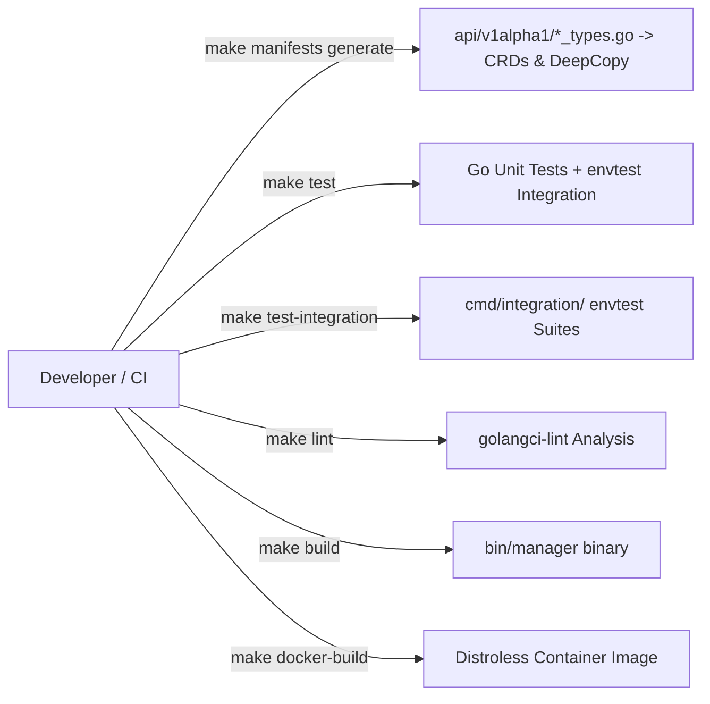
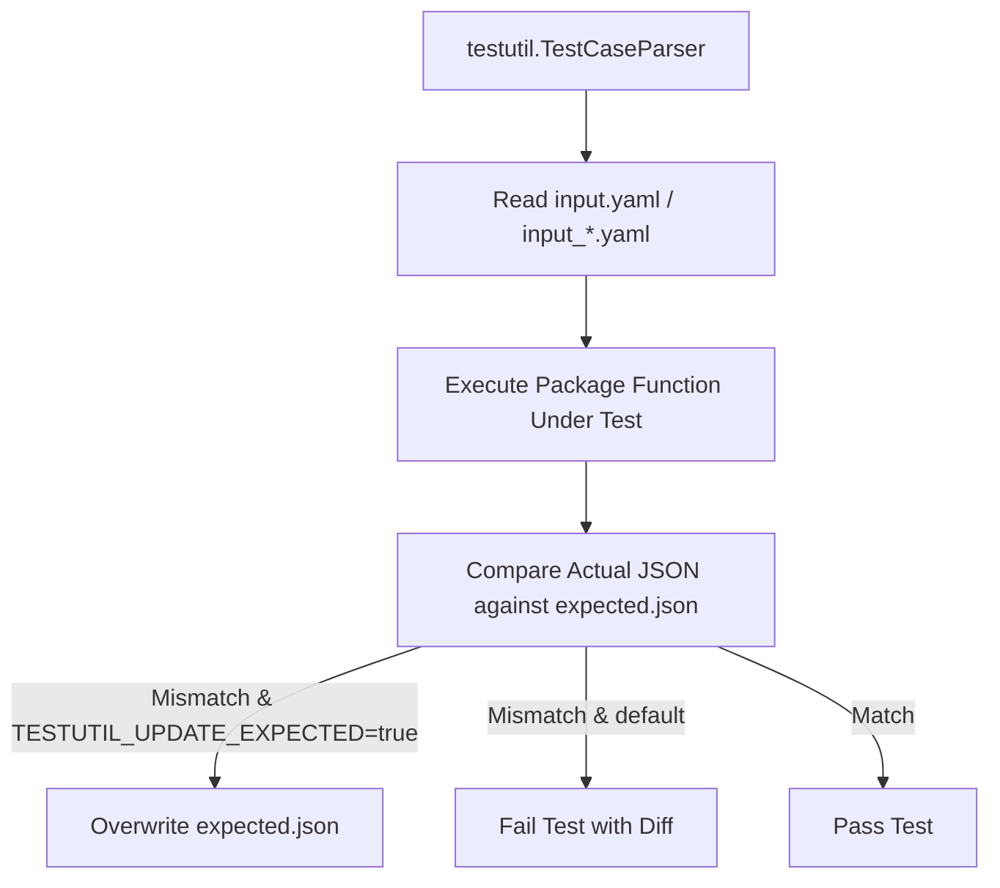

<!-- source: DeepWiki mcp.deepwiki.com · repo NVIDIA/cluster-readiness-engine · page 1.3 Repository Layout and Development Workflow · fetched 2026-10-26 -->

# Repository Layout and Development Workflow

<details>
<summary>Relevant source files</summary>

The following files were used as context for generating this wiki page:

- [.claude/skills/cre-test/SKILL.md](.claude/skills/cre-test/SKILL.md)
- [.claude/skills/managing-openvex/SKILL.md](.claude/skills/managing-openvex/SKILL.md)
- [.github/CODEOWNERS](.github/CODEOWNERS)
- [.github/dco.yml](.github/dco.yml)
- [.github/workflows/attest-selftest.yml](.github/workflows/attest-selftest.yml)
- [.golangci.yml](.golangci.yml)
- [AGENTS.md](AGENTS.md)
- [CLAUDE.md](CLAUDE.md)
- [CODE_OF_CONDUCT.md](CODE_OF_CONDUCT.md)
- [CONTRIBUTING.md](CONTRIBUTING.md)
- [Dockerfile](Dockerfile)
- [GOVERNANCE.md](GOVERNANCE.md)
- [MAINTAINERS.md](MAINTAINERS.md)
- [NOTICE](NOTICE)
- [docs/cli-reference/overview.md](docs/cli-reference/overview.md)
- [docs/getting-started/first-certification.md](docs/getting-started/first-certification.md)
- [docs/getting-started/install.md](docs/getting-started/install.md)
- [go.mod](go.mod)
- [go.sum](go.sum)

</details>


This page documents the repository layout, directory structure, core build automation targets via the `Makefile`, linting configuration, testing harnesses, and contribution rules (including the issue-first workflow, conventional commits, and Developer Certificate of Origin requirements) for the NVIDIA Cluster Readiness Engine (NVCRE).

---

## 1. Repository Directory Map and Architecture Layout

The codebase is organized into standard Go and Kubernetes controller-runtime directory patterns. The root contains configuration files, build scripts, and the primary top-level directories: `api/`, `cmd/`, `pkg/`, `helm/`, `test/`, `docs/`, and `fern/`.

```mermaid
graph TD
    Root["cluster-readiness-engine root"] --> API["api/"]
    Root --> CMD["cmd/"]
    Root --> PKG["pkg/"]
    Root --> HELM["helm/"]
    Root --> TEST["test/"]
    Root --> DOCS["docs/"]
    Root --> FERN["fern/"]

    API --> APIV1["api/v1alpha1/ (*_types.go)"]
    CMD --> CMDMgr["cmd/manager/ (Controller Manager entrypoint)"]
    CMD --> CMDCLI["cmd/nvcrectl/ (CLI command tree)"]
    CMD --> CMDInt["cmd/integration/ (envtest integration suites)"]

    PKG --> PKGCat["pkg/catalog/ (Catalog entries & loaders)"]
    PKG --> PKGCtrl["pkg/controller/ (Reconciler loops)"]
    PKG --> PKGWork["pkg/workload/ (Training framework adapters)"]
    PKG --> PKGGP["pkg/goodput/ (Goodput parser & calculator)"]
    PKG --> PKGNode["pkg/nodemonitor/ (CEL-based node failure detectors)"]
    PKG --> PKGOrch["pkg/orchestration/ (Topology/bisection partitioning)"]

    HELM --> HelmChart["helm/cluster-readiness-engine/ (Chart templates & values)"]
    TEST --> TestUAT["test/uat/ (Kind + KWOK end-to-end suite)"]
    TEST --> TestHelm["test/helm/ (Chart render tests)"]
    TEST --> TestPolicy["test/releasepolicy/ (CI & release gates)"]
```


*Sources: [CLAUDE.md:68-98](), [CONTRIBUTING.md:25-31]()*

### Directory Details

* **`api/`**: Contains the Kubernetes API definitions under `api/v1alpha1/`. This includes custom resource definitions (CRDs) for `Certification`, `Workflow`, `Job`, `WorkloadRun`, `GoodputMeasurement`, `BandwidthMeasurement`, and `LogProfile` [CLAUDE.md:72-81]().
* **`cmd/`**: Entrypoints for binaries and test harnesses:
  * `cmd/manager/`: Main controller manager binary initializing controller-runtime managers and reconcilers [CLAUDE.md:70]().
  * `cmd/nvcrectl/`: Source code for the `nvcrectl` / `kubectl-nvcre` command-line tool [MAINTAINERS.md:7]().
  * `cmd/integration/`: `envtest`-based integration test suite utilizing structured input files and golden expectations [CLAUDE.md:109]().
* **`pkg/`**: Core library packages implementing controller logic, catalog management, orchestration, parsing, and execution:
  * `pkg/catalog/`: Maps `{domain, variant}` to `WorkflowSpec` builders via init-time registrations [CLAUDE.md:88]().
  * `pkg/controller/`: Core reconciliation loops for `Certification`, `Workflow`, `Job`, and associated measurement custom resources [CLAUDE.md:70]().
  * `pkg/workload/`: Adapter interface mapping training frameworks to normalized `WorkloadPhase` outputs [CLAUDE.md:87]().
  * `pkg/goodput/`: Log parsing, goodput math, and pod log-fetching abstractions [CLAUDE.md:90]().
  * `pkg/nodemonitor/`: CEL-based node failure detection interface and implementation [CLAUDE.md:89]().
  * `pkg/orchestration/`: Node partitioning, simple chunking, topology-aware greedy scheduling, and adaptive bisection algorithms [CLAUDE.md:91]().
* **`helm/`**: Helm charts for packaging the controller, RBAC manifests, ServiceMonitors, and default configurations [MAINTAINERS.md:7]().
* **`test/`**: End-to-end verification suites including `test/uat/` (Kind + KWOK workflows), `test/helm/`, `test/releasepolicy/`, and `test/docspolicy/` [.claude/skills/cre-test/SKILL.md:23]().
* **`docs/`**: Markdown-based architectural guides and user manuals.
* **`fern/`**: Configuration for the Fern documentation site generation pipeline.

Sources: [CLAUDE.md:68-98](), [CONTRIBUTING.md:25-31](), [.claude/skills/cre-test/SKILL.md:17-23]()

---

## 2. Build Automation and Makefile Targets

The repository uses a `Makefile` to orchestrate code generation, compilation, testing, and container builds. Go 1.27+ is required [CONTRIBUTING.md:111]().


*Sources: [CLAUDE.md:5-16](), [CONTRIBUTING.md:123-143]()*

### Key Makefile Targets

* **`make manifests generate`**: Must be executed after modifying `*_types.go` files or Kubebuilder markers. Updates deepcopy methods, client code, and Kubernetes CRD manifests under `config/crd/` [CLAUDE.md:8]().
* **`make test`**: Runs unit tests across packages combined with `envtest`-backed integration suites [CLAUDE.md:9]().
* **`make test-integration`**: Runs integration tests inside `cmd/integration/` using `envtest` assets and golden files [CLAUDE.md:10]().
* **`make lint` / `make lint-fix`**: Executes `golangci-lint` to check code style, static errors, and import formatting [CLAUDE.md:11-12]().
* **`make build`**: Compiles the manager binary into `bin/manager` [CLAUDE.md:13]().
* **`make build-nvcrectl`**: Compiles the `nvcrectl` CLI binary into `bin/nvcrectl` [CONTRIBUTING.md:142]().
* **`make docker-build`**: Builds the multi-stage distroless container image [CLAUDE.md:14](), using pinned base layers defined in the root `Dockerfile` [Dockerfile:8-32]().

Sources: [CLAUDE.md:5-16](), [CONTRIBUTING.md:115-143](), [Dockerfile:8-32]()

---

## 3. Linting and Code Quality Enforcement

Code quality is enforced via static analysis and structured test verification rules.

### Lint Configuration
* **`golangci-lint`**: Configured via `.golangci.yml` in the repository root. All pull requests must pass lint checks without warnings or errors.
* **Auto-formatting**: Run `make lint-fix` to automatically address style infractions where supported [CLAUDE.md:12]().

### Golden-File Unit Testing Pattern
Packages with structured outputs must use `testutil.TestCaseParser` (in `pkg/testutil/`) matching the directory layout `testdata/<feature>/<case>/input.yaml` and `expected.json` [.claude/skills/cre-test/SKILL.md:17-36](). Hand-maintained Go assertion tables for structured output are prohibited in designated core packages [CLAUDE.md:110-113]().


*Sources: [.claude/skills/cre-test/SKILL.md:27-53]()*

Updating golden files intentionally is performed by setting an environment flag:
```bash
TESTUTIL_UPDATE_EXPECTED=true go test ./pkg/report/
TESTUTIL_UPDATE_EXPECTED=true make test-integration
```
Sources: [CLAUDE.md:29-33](), [.claude/skills/cre-test/SKILL.md:27-95]()

---

## 4. Contribution Workflow, Commit Standards, and DCO Rules

Contributing to NVCRE requires adherence to structured contribution workflows, conventional commit message formatting, and legally binding Developer Certificate of Origin (DCO) sign-offs.

### Issue-First Workflow
1. **Open an Issue**: Describe the bug or feature request clearly using issue templates [CONTRIBUTING.md:34-36]().
2. **Await Acknowledgment**: Wait for a maintainer to review and agree on the proposed approach [CONTRIBUTING.md:37]().
3. **Reference the Issue**: Link the pull request to the open issue via keywords (`Closes #NNN`) [CONTRIBUTING.md:39]().
   * *Note*: Pull requests submitted without a linked, acknowledged issue may be closed unreviewed, excepting trivial typo/doc fixes [CONTRIBUTING.md:41]().

### Conventional Commits
Commit messages must follow the [Conventional Commits](https://www.conventionalcommits.org) specification using the format `type: short imperative summary` [CONTRIBUTING.md:88]().
* **Allowed Types**: `feat`, `fix`, `docs`, `test`, `refactor`, `perf`, `chore`, `ci`, `build` [CONTRIBUTING.md:98]().
* **Examples**:
  ```
  feat: add bandwidth threshold option to nccl catalog entries
  fix: requeue workflow when dependency resources are not ready
  docs: document checkpoint restart behavior
  ```
  Sources: [CONTRIBUTING.md:88-96]()

### Developer Certificate of Origin (DCO)
Every commit must include a DCO sign-off line certifying that the contributor has the right to submit the code under the project's open-source license.
* Pass the `-s` flag to `git commit`:
  ```bash
  git commit -s -m "feat: add custom workload adapter"
  ```
* The CI pipeline verifies DCO signatures on every pull request. Unsigned commits will fail the DCO check.

Sources: [CONTRIBUTING.md:75-98](), [.github/dco.yml]()

---

