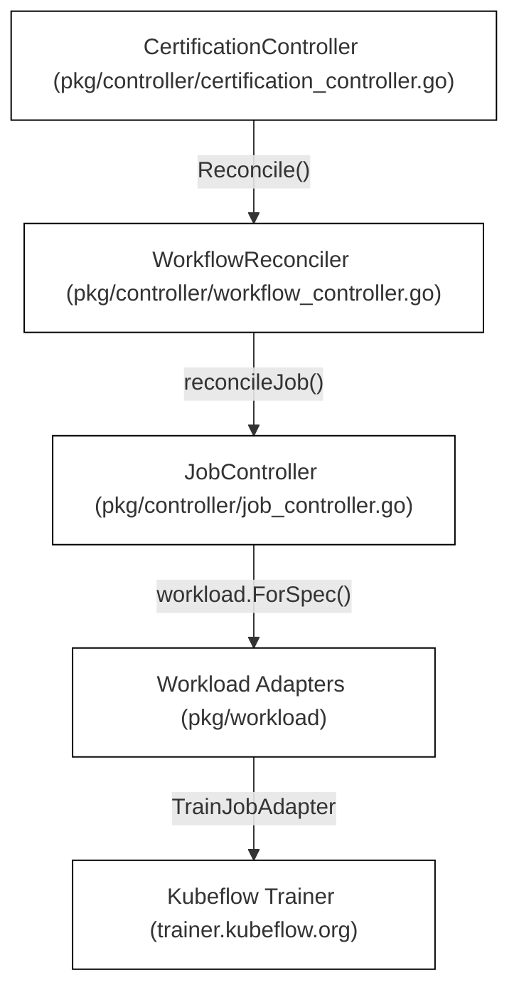
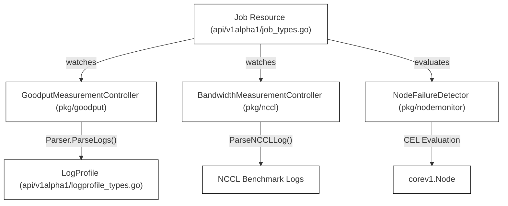

<!-- source: DeepWiki mcp.deepwiki.com · repo NVIDIA/cluster-readiness-engine · page 10 Glossary · fetched 2026-10-26 -->

# Glossary

Relevant source files

The following files were used as context for generating this wiki page:

- [.claude/skills/cre-test/SKILL.md](.claude/skills/cre-test/SKILL.md)
- [.claude/skills/managing-openvex/SKILL.md](.claude/skills/managing-openvex/SKILL.md)
- [.claude/skills/release-notes/SKILL.md](.claude/skills/release-notes/SKILL.md)
- [.github/workflows/attest-selftest.yml](.github/workflows/attest-selftest.yml)
- [.github/workflows/attest.yml](.github/workflows/attest.yml)
- [AGENTS.md](AGENTS.md)
- [CHANGELOG.md](CHANGELOG.md)
- [CLAUDE.md](CLAUDE.md)
- [CONTRIBUTING.md](CONTRIBUTING.md)
- [README.md](README.md)
- [RELEASE.md](RELEASE.md)
- [SECURITY.md](SECURITY.md)
- [THIRD_PARTY_NOTICES.md](THIRD_PARTY_NOTICES.md)
- [cmd/manager/main.go](cmd/manager/main.go)
- [config/samples/policy/kyverno-verify-images.yaml](config/samples/policy/kyverno-verify-images.yaml)
- [config/samples/policy/policy-controller-verify-images.yaml](config/samples/policy/policy-controller-verify-images.yaml)
- [docs/cli-reference/overview.md](docs/cli-reference/overview.md)
- [docs/concepts/health-monitoring-remediation.md](docs/concepts/health-monitoring-remediation.md)
- [docs/designs/000-adr.md](docs/designs/000-adr.md)
- [docs/designs/027-kustomize-override-ux.md](docs/designs/027-kustomize-override-ux.md)
- [docs/designs/031-platform-aware-nccl-config.md](docs/designs/031-platform-aware-nccl-config.md)
- [docs/designs/073-setup-retry-convergence.md](docs/designs/073-setup-retry-convergence.md)
- [docs/designs/074-supply-chain-attestation.md](docs/designs/074-supply-chain-attestation.md)
- [docs/designs/079-workload-object-labels.md](docs/designs/079-workload-object-labels.md)
- [docs/designs/081-cordoned-node-selection.md](docs/designs/081-cordoned-node-selection.md)
- [docs/designs/README.md](docs/designs/README.md)
- [docs/getting-started/first-certification.md](docs/getting-started/first-certification.md)
- [docs/getting-started/install.md](docs/getting-started/install.md)
- [docs/operations/verifying-artifacts.md](docs/operations/verifying-artifacts.md)
- [pkg/controller/certification_controller.go](pkg/controller/certification_controller.go)
- [pkg/controller/helpers.go](pkg/controller/helpers.go)
- [pkg/controller/job_controller.go](pkg/controller/job_controller.go)
- [pkg/controller/workflow_controller.go](pkg/controller/workflow_controller.go)
- [pkg/controller/workloadrun_controller.go](pkg/controller/workloadrun_controller.go)
- [pkg/controller/workloadrun_workflow_lookup_test.go](pkg/controller/workloadrun_workflow_lookup_test.go)
- [test/docspolicy/cited_gate_tests_test.go](test/docspolicy/cited_gate_tests_test.go)
- [test/docspolicy/verification_page_test.go](test/docspolicy/verification_page_test.go)
- [test/releasepolicy/attest_boundary_test.go](test/releasepolicy/attest_boundary_test.go)
- [test/releasepolicy/attest_guards_test.go](test/releasepolicy/attest_guards_test.go)
- [test/releasepolicy/gate_absence_test.go](test/releasepolicy/gate_absence_test.go)
- [test/releasepolicy/installer_draft_guard_test.go](test/releasepolicy/installer_draft_guard_test.go)
- [test/releasepolicy/predicate_parse_test.go](test/releasepolicy/predicate_parse_test.go)
- [test/releasepolicy/shell_scope_test.go](test/releasepolicy/shell_scope_test.go)
- [test/releasepolicy/workflow_graph_test.go](test/releasepolicy/workflow_graph_test.go)

## Purpose and Scope
This page defines NVCRE-specific terms, abbreviations, architectural concepts, and external tool dependencies used across the NVIDIA Cluster Readiness Engine codebase. Each entry includes its role in the system, architectural interactions, and code pointers to implementation files.

---

## Core Architecture and Custom Resources

### NVCRE (NVIDIA Cluster Readiness Engine)
- **Definition**: A Kubernetes controller and CLI toolchain designed to certify GPU clusters before production workloads run on them [README.md:1-8](). NVCRE executes topology-aware training and communication workloads, measures goodput and bandwidth, detects hardware faults, and attributes failures to specific nodes [README.md:8-20]().
- **Code Pointers**: Controller entry point (`cmd/manager/main.go`), core APIs (`api/v1alpha1/`).

### nvcrectl (kubectl nvcre)
- **Definition**: The command-line interface for NVCRE. It supports cluster setup, preflight checks, certification lifecycle execution, dry-run manifest rendering, report generation, and CLI self-upgrades [README.md:23](), [docs/getting-started/first-certification.md:39-48](). It also operates as a `kubectl` plugin (`kubectl nvcre`) [README.md:76]().
- **Code Pointers**: CLI command tree (`cmd/nvcrectl/`).

### Certification
- **Definition**: A top-level Custom Resource (`Certification`) that orchestrates multiple certification categories across a GPU cluster, tracking phase transitions (`InProgress`, `Succeeded`, `Failed`) and recording failed nodes per category [CLAUDE.md:76](), [pkg/controller/workflow_controller.go:101]().
- **Code Pointers**: CRD spec (`api/v1alpha1/certification_types.go`), controller (`pkg/controller/certification_controller.go`).

### Workflow
- **Definition**: A mid-level Custom Resource (`Workflow`) created by a Certification (one per catalog category) or a WorkloadRun [README.md:39](), [CLAUDE.md:76](). The `WorkflowReconciler` manages multi-node discovery, architecture filters, node partitioning, and iteration state machines [CLAUDE.md:77](), [pkg/controller/workflow_controller.go:134]().
- **Code Pointers**: Controller (`pkg/controller/workflow_controller.go`).

### Job
- **Definition**: A lower-level Custom Resource (`Job`) created by a Workflow [README.md:33](), [CLAUDE.md:77](). A Job encapsulates workload execution via strongly typed adapters (e.g., Kubeflow Trainer TrainJob), health monitoring, goodput measurement, and checkpoint-restart management [CLAUDE.md:78]().
- **Code Pointers**: Controller (`pkg/controller/job_controller.go`), adapter factory (`pkg/workload/`).

### WorkloadRun
- **Definition**: A simplified, single-run entry point Custom Resource (`WorkloadRun`) that bypasses the catalog by allowing operators to execute an inline training, NCCL, or custom workload directly [README.md:39](), [docs/designs/README.md:69](). It creates a Workflow directly from its inline spec [README.md:39](), [pkg/controller/workloadrun_controller.go:94]().
- **Code Pointers**: Controller (`pkg/controller/workloadrun_controller.go`).

### LogProfile
- **Definition**: A cluster-scoped Custom Resource defining regex patterns with named capture groups used to parse training framework logs for step times, iteration progress, and goodput calculation [CLAUDE.md:81](), [pkg/controller/workflow_controller.go:134]().
- **Code Pointers**: Log parsing package (`pkg/goodput/`).

### GoodputMeasurement
- **Definition**: A measurement resource that watches a Job, reads pod logs using `LogProfile` regex patterns via the `PodLogFetcher` interface, and computes the training goodput ratio against configured thresholds [CLAUDE.md:79](), [CLAUDE.md:90]().
- **Code Pointers**: Goodput calculator (`pkg/goodput/calculator.go`).

### BandwidthMeasurement
- **Definition**: A measurement resource that watches a Job, parses NCCL log output, and computes per-bus bandwidth and algorithmic bandwidth metrics [CLAUDE.md:80](), [pkg/nccl/]().
- **Code Pointers**: NCCL parser (`pkg/nccl/`).

Sources:
- `README.md:1-40`
- `CLAUDE.md:72-96`
- `docs/getting-started/first-certification.md:39-48`
- `pkg/controller/workflow_controller.go:134-150`
- `pkg/controller/workloadrun_controller.go:90-110`

---

## Diagram 1: CRD Hierarchy & Controller Mapping

Sources: `pkg/controller/workflow_controller.go:131`, `pkg/controller/workloadrun_controller.go:71`, `CLAUDE.md:72-88`.

---

## Catalog, Workloads, and Execution Engines

### Catalog Entry & Category
- **Definition**: A catalog entry defines a specific test category (e.g., `communication/nccl-all-reduce`, `training/nemotron5-8b`) mapped via `init()` registration to a WorkflowSpec builder [CLAUDE.md:88](). Categories define test logic, architecture requirements, and default parameters.
- **Code Pointers**: Catalog implementation (`pkg/catalog/`).

### Test Scale
- **Definition**: The node count configuration (e.g., `full-scale`, subset scales) determining how many GPU nodes participate in a workload run [README.md:128](), [docs/designs/README.md:64]().
- **Code Pointers**: Orchestration package (`pkg/orchestration/`).

### MNNVL (Multi-Node NVLink)
- **Definition**: NVIDIA technology linking GPUs across multiple nodes using NVLink fabric. NVCRE detects MNNVL capability and configures environment variables (such as `NCCL_MNNVL_ENABLE`) and hardware descriptors accordingly [README.md:131](), [pkg/controller/workflow_controller.go:47-48](), [pkg/gpu/].
- **Code Pointers**: GPU detection (`pkg/gpu/`), Workflow controller (`pkg/controller/workflow_controller.go`).

### NCCL (Nvidia Collective Communications Library)
- **Definition**: A library of multi-GPU collective communication primitives (AllReduce, AllGather, AlltoAll) used by NVCRE's communication benchmark catalog entries to validate fabric bandwidth and latency [README.md:14](), [docs/getting-started/first-certification.md:97]().
- **Code Pointers**: NCCL parser (`pkg/nccl/`), catalog communication entries (`pkg/catalog/`).

### TrainJob
- **Definition**: The primary training workload resource provided by Kubeflow Trainer (`trainer.kubeflow.org`), instantiated by NVCRE's workload adapter to execute distributed training jobs [CLAUDE.md:78](), [pkg/controller/workflow_controller.go:100-101]().
- **Code Pointers**: Workload adapters (`pkg/workload/`).

### JobSet
- **Definition**: An upstream Kubernetes API used for managing groups of pods as a unit for distributed workloads. NVCRE preserves externally managed JobSets and integrates with orchestration frameworks [docs/designs/README.md:88]().
- **Code Pointers**: Job controller (`pkg/controller/job_controller.go`).

### Kubeflow Trainer
- **Definition**: The upstream training operator (`trainer.kubeflow.org`) installed during `setup init` that provides the `TrainJob` API for running distributed deep learning training workloads [docs/getting-started/first-certification.md:78](), [pkg/controller/workflow_controller.go:100-101]().
- **Code Pointers**: Setup phase (`pkg/setup/`).

Sources:
- `README.md:14-131`
- `CLAUDE.md:78-88`
- `docs/getting-started/first-certification.md:78-97`
- `pkg/controller/workflow_controller.go:47-101`

---

## Diagram 2: Measurement and Fault Detection Subsystem Mapping

Sources: `CLAUDE.md:79-90`, `pkg/goodput/`, `pkg/nccl/`, `pkg/nodemonitor/`.

---

## Monitoring, Fault Isolation, and Scheduling

### Volcano / Kueue Gang Scheduling
- **Definition**: Advanced gang scheduling engines used to ensure all pods in a distributed workload are scheduled simultaneously, preventing deadlocks during multi-node GPU bring-up. NVCRE configures queue labels and scheduler names via platform overrides [docs/designs/README.md:86]().
- **Code Pointers**: Platform overrides (`pkg/platform/`).

### CEL NodeFailureDetector
- **Definition**: A CEL (Common Expression Language) expression evaluator within `pkg/nodemonitor` that inspects Node object states and metrics while workloads run, detecting hardware degradation and attributing failures [CLAUDE.md:89]().
- **Code Pointers**: Node monitor (`pkg/nodemonitor/`).

### Adaptive Fault Isolation
- **Definition**: An internal bisection algorithm used by diagnostics (e.g., `diagnose` groups) to recursively isolate faulty nodes during NCCL communication failures [CLAUDE.md:91](), [docs/designs/README.md:65]().
- **Code Pointers**: Orchestration package (`pkg/orchestration/`).

### failedNodesRef
- **Definition**: A tracking field in Certification status that records nodes failing verification along with structured failure reasons (e.g., `HardwareFailureDetected`, `ThresholdViolation`, `WorkloadFailed`) [CLAUDE.md:83]().
- **Code Pointers**: Certification status types (`api/v1alpha1/certification_types.go`).

Sources:
- `CLAUDE.md:83-91`
- `docs/designs/README.md:65-86`

---

## Configuration, Rendering, and Testing

### Platform Override & WhenSpec
- **Definition**: Platform-specific configuration layers (`pkg/platform`) that adapt manifests for cloud service providers (AWS, GCP, Azure, OCI, on-prem) or GPU architectures (GB200, H100, etc.). `WhenSpec` defines condition matching rules using JSON patches and strategic merge transforms [README.md:15](), [CLAUDE.md:97](), [docs/designs/README.md:44]().
- **Code Pointers**: Platform overrides (`pkg/platform/`), workflow detector (`pkg/controller/workflow_detect.go`).

### KWOK (Kubernetes Workload Controller)
- **Definition**: A simulation tool used in UAT (User Acceptance Testing) to simulate thousands of GPU nodes without requiring real hardware [CLAUDE.md:37]().
- **Code Pointers**: UAT test suites (`test/uat/`).

### envtest
- **Definition**: Controller-runtime's testing environment (`controller-runtime/pkg/envtest`) that starts an API server and etcd without a kubelet, used for fast integration testing of controllers and reconcilers [CLAUDE.md:25](), [docs/designs/README.md:34]().
- **Code Pointers**: Integration test suite (`cmd/integration/`).

Sources:
- `README.md:15`
- `CLAUDE.md:25-37, 97`
- `docs/designs/README.md:34-44`

---

## Supply Chain Security and Release Engineering

### cosign / Sigstore
- **Definition**: Tooling for container and artifact signing using keyless OIDC authentication via GitHub Actions (`attest.yml`) [SECURITY.md:69](), [.github/workflows/attest.yml:6-12]().
- **Code Pointers**: Release workflows (`.github/workflows/attest.yml`, `SECURITY.md`).

### SLSA Provenance
- **Definition**: Cryptographic supply chain build provenance (Build Level L2) attesting that build artifacts were produced by authorized GitHub Actions workflows [SECURITY.md:69](), [.github/workflows/attest.yml:22]().
- **Code Pointers**: Release verification workflows (`.github/workflows/attest.yml`).

### CycloneDX SBOM (Software Bill of Materials)
- **Definition**: Standardized machine-readable inventories of software components and dependencies published for every NVCRE container image and CLI binary [SECURITY.md:69](), [RELEASE.md:135]().
- **Code Pointers**: Release build pipeline (`RELEASE.md`).

### OpenVEX
- **Definition**: Machine-readable vulnerability exploitation status documentation used to record reachability evidence for third-party dependencies [.github/workflows/attest.yml]().
- **Code Pointers**: Vulnerability management workflows.

### Grype
- **Definition**: Vulnerability scanner used in CI pipelines alongside suppression files (`.grype.yaml`) to inspect container images for known Common Vulnerabilities and Exposures (CVEs).
- **Code Pointers**: CI workflows (`.github/workflows/`).

### DCO (Developer Certificate of Origin)
- **Definition**: A developer sign-off mechanism (`Signed-off-by`) required on all commits to certify that the contributor has the right to submit the code under the project's license.
- **Code Pointers**: Contribution guidelines (`CONTRIBUTING.md`).

### ADR (Architecture Decision Record)
- **Definition**: Concise canonical documents stored in `docs/designs/` recording architectural decisions, context, implementation details, and consequences [docs/designs/README.md:1-5]().
- **Code Pointers**: Design records (`docs/designs/`).

Sources:
- `SECURITY.md:69-101`
- `RELEASE.md:135-140`
- `.github/workflows/attest.yml:6-34`
- `docs/designs/README.md:1-5`