# Page: Overview

# Overview

<details>
<summary>Relevant source files</summary>

The following files were used as context for generating this wiki page:

- [.claude/skills/cre-test/SKILL.md](.claude/skills/cre-test/SKILL.md)
- [.claude/skills/managing-openvex/SKILL.md](.claude/skills/managing-openvex/SKILL.md)
- [.claude/skills/release-notes/SKILL.md](.claude/skills/release-notes/SKILL.md)
- [.github/workflows/attest-selftest.yml](.github/workflows/attest-selftest.yml)
- [.golangci.yml](.golangci.yml)
- [AGENTS.md](AGENTS.md)
- [CHANGELOG.md](CHANGELOG.md)
- [CLAUDE.md](CLAUDE.md)
- [CONTRIBUTING.md](CONTRIBUTING.md)
- [Dockerfile](Dockerfile)
- [README.md](README.md)
- [RELEASE.md](RELEASE.md)
- [SECURITY.md](SECURITY.md)
- [THIRD_PARTY_NOTICES.md](THIRD_PARTY_NOTICES.md)
- [config/samples/policy/kyverno-verify-images.yaml](config/samples/policy/kyverno-verify-images.yaml)
- [config/samples/policy/policy-controller-verify-images.yaml](config/samples/policy/policy-controller-verify-images.yaml)
- [docs/cli-reference/overview.md](docs/cli-reference/overview.md)
- [docs/concepts/health-monitoring-remediation.md](docs/concepts/health-monitoring-remediation.md)
- [docs/designs/081-cordoned-node-selection.md](docs/designs/081-cordoned-node-selection.md)
- [docs/getting-started/first-certification.md](docs/getting-started/first-certification.md)
- [docs/getting-started/install.md](docs/getting-started/install.md)
- [docs/operations/verifying-artifacts.md](docs/operations/verifying-artifacts.md)
- [go.mod](go.mod)
- [go.sum](go.sum)

</details>


The NVIDIA Cluster Readiness Engine (NVCRE) is a Kubernetes controller paired with the `nvcrectl` command-line interface designed to certify GPU clusters prior to running production workloads [README.md:1-8](). NVCRE executes real training and NCCL communication workloads across topology-aware node groups, evaluates performance metrics, detects hardware failures via Common Expression Language (CEL) expressions, and attributes failures to specific nodes without modifying node taints or cordons [README.md:8]().

This page serves as a high-level parent overview of NVCRE. For granular details, follow the child page links below:
- **Getting Started**: [Getting Started](#1.1) — Installing `nvcrectl` via the installer script, running `setup init`, and executing a first certification [README.md:41-95]().
- **Core Concepts**: [Core Concepts](#1.2) — Certification → Workflow → Job hierarchy, catalog entries, goodput and bandwidth measurements, platform/GPU detection, and node health monitoring [README.md:12-24]().
- **Repository Layout and Development Workflow**: [Repository Layout and Development Workflow](#1.3) — Directory map (`api/`, `cmd/`, `pkg/`, `helm/`, `test/`), Makefile targets, linting, and contribution guidelines [CONTRIBUTING.md:25-144]().

---

## High-Level Architecture and Control Flow

NVCRE APIs compose hierarchically using a pattern analogous to standard Kubernetes resources like `Deployment`, `ReplicaSet`, and `Pod` [README.md:27-40]().

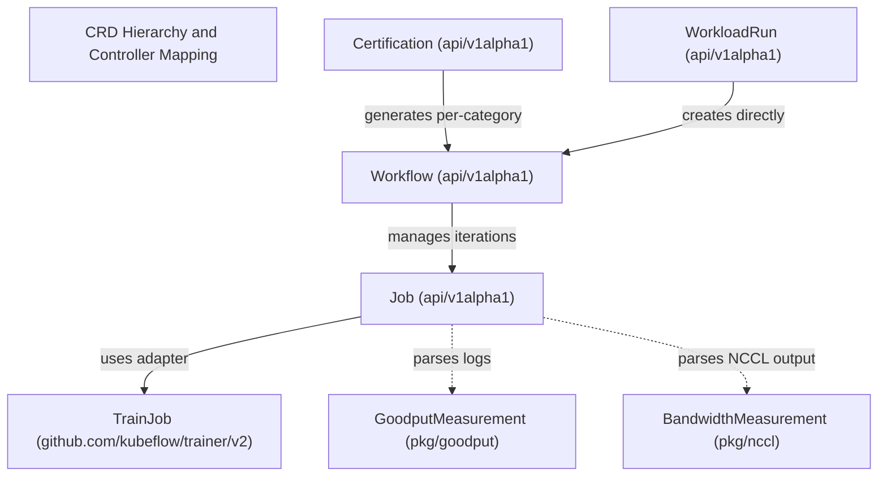

Sources: [README.md:27-40](), [CLAUDE.md:72-84]()

---

## Natural Language to Code Entity Space

The following diagram associates high-level system concepts with their implementing packages and components in the codebase.

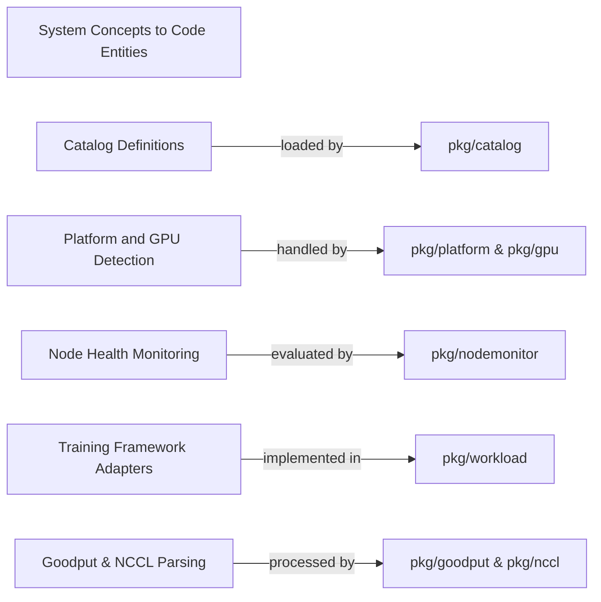

Sources: [CLAUDE.md:85-98]()

---

## 1.1. Getting Started

NVCRE requires a Kubernetes cluster equipped with the NVIDIA GPU Operator and Prometheus Operator CRDs (`monitoring.coreos.com/v1`) [README.md:46-54](). 

The `nvcrectl` CLI provides tools for preflight checks, installation, and certification execution [README.md:61-105](). For installation prerequisites, cluster validation steps, and complete walkthroughs, see the child documentation page [docs/getting-started/first-certification.md:1-117]().

Sources: [README.md:41-112](), [docs/getting-started/first-certification.md:1-117]()

---

## 1.2. Core Concepts

The core execution model revolves around the `Certification` → `Workflow` → `Job` hierarchy [README.md:39]():
- **Catalog**: Declarative YAML test specifications loaded via `pkg/catalog/` [CONTRIBUTING.md:29]().
- **Measurement**: `GoodputMeasurement` parses training logs using `pkg/goodput` while `BandwidthMeasurement` processes NCCL logs via `pkg/nccl` [README.md:35-39]().
- **Health Monitoring & Attribution**: `pkg/nodemonitor` continuously evaluates `Node` state using CEL expressions, propagating failed nodes through `status.failedNodesRef` ConfigMaps [docs/concepts/health-monitoring-remediation.md:9-77]().

For deep dives into partitioning, MNNVL handling, and failure attribution, see the child page [Core Concepts](#1.2).

Sources: [CLAUDE.md:72-98](), [docs/concepts/health-monitoring-remediation.md:9-77]()

---

## 1.3. Repository Layout and Development Workflow

The codebase is structured around standard Kubernetes controller conventions:
- `api/v1alpha1/`: Custom Resource Definitions and API types.
- `cmd/`: Entrypoints including `cmd/manager` and `cmd/integration` [CLAUDE.md:25]().
- `pkg/`: Core controller logic, catalog handlers, measurement logic, and framework adapters [CLAUDE.md:85-98]().
- `helm/`: Helm charts for deployment packaging [README.md:95]().
- `test/`: UAT and policy validation test suites [CLAUDE.md:35-48]().

Development relies on `make` targets (`make test`, `make lint`, `make manifests`) and requires adherence to Conventional Commits and DCO sign-offs [CONTRIBUTING.md:86-144](). For detailed directory mapping and workflow rules, see [Repository Layout and Development Workflow](#1.3).

Sources: [CLAUDE.md:5-16](), [CONTRIBUTING.md:86-144]()

---

# Page: Getting Started

# Getting Started

<details>
<summary>Relevant source files</summary>

The following files were used as context for generating this wiki page:

- [.claude/skills/cre-test/SKILL.md](.claude/skills/cre-test/SKILL.md)
- [.claude/skills/managing-openvex/SKILL.md](.claude/skills/managing-openvex/SKILL.md)
- [.github/workflows/attest-selftest.yml](.github/workflows/attest-selftest.yml)
- [.github/workflows/build-image.yml](.github/workflows/build-image.yml)
- [.github/workflows/ci.yml](.github/workflows/ci.yml)
- [.github/workflows/codeql.yml](.github/workflows/codeql.yml)
- [.github/workflows/container-build.yml](.github/workflows/container-build.yml)
- [.github/workflows/govulncheck.yml](.github/workflows/govulncheck.yml)
- [.github/workflows/publish.yml](.github/workflows/publish.yml)
- [.github/workflows/release.yml](.github/workflows/release.yml)
- [.github/workflows/scorecard.yml](.github/workflows/scorecard.yml)
- [AGENTS.md](AGENTS.md)
- [CLAUDE.md](CLAUDE.md)
- [CONTRIBUTING.md](CONTRIBUTING.md)
- [Makefile](Makefile)
- [docs/cli-reference/certification.md](docs/cli-reference/certification.md)
- [docs/cli-reference/overview.md](docs/cli-reference/overview.md)
- [docs/getting-started/first-certification.md](docs/getting-started/first-certification.md)
- [docs/getting-started/install.md](docs/getting-started/install.md)
- [docs/how-to-guides/certify-a-cluster.md](docs/how-to-guides/certify-a-cluster.md)
- [docs/how-to-guides/run-workloadrun.md](docs/how-to-guides/run-workloadrun.md)
- [docs/how-to-guides/workloadrun-deepseek-v3.md](docs/how-to-guides/workloadrun-deepseek-v3.md)
- [docs/how-to-guides/workloadrun-nemotron5.md](docs/how-to-guides/workloadrun-nemotron5.md)
- [hack/verify-doc-links.sh](hack/verify-doc-links.sh)
- [helm/cluster-readiness-engine/templates/manager-role.yaml](helm/cluster-readiness-engine/templates/manager-role.yaml)
- [installer](installer)

</details>


## Purpose and Scope

This page covers the end-to-end onboarding workflow for the NVIDIA Cluster Readiness Engine (NVCRE). It details cluster requirements, pre-flight checks, installing the `nvcrectl` command-line interface via the installer script with Sigstore provenance verification, deploying controller dependencies and core components via `setup init`, and running an initial NCCL communication certification workload.

Sources: `docs/getting-started/install.md` [docs/getting-started/install.md:1-82](), `docs/getting-started/first-certification.md` [docs/getting-started/first-certification.md:1-117](), `installer` [installer:1-81]()

---

## Cluster Requirements and Prerequisites

Before bootstrapping NVCRE on a target Kubernetes cluster, ensure the cluster satisfies the following infrastructure and tooling dependencies:

| Requirement | Specification | Notes / Code Reference |
| :--- | :--- | :--- |
| **Kubernetes Version** | `v1.29+` | Required by the Certification CRD's Common Expression Language (CEL) validation rules utilizing the `quantity()` library [docs/getting-started/install.md:9-11](). |
| **GPU Operator** | NVIDIA GPU Operator | Must be pre-installed to populate `nvidia.com/gpu.product` node labels [docs/getting-started/install.md:12-13](), [docs/getting-started/first-certification.md:15](). |
| **CLI Tools** | `kubectl` & `helm` (`v3.x`) | `kubectl` configured with cluster admin permissions; `helm` required for chart rendering/installation [docs/getting-started/install.md:12-14](). |
| **Metrics Infrastructure** | Prometheus Operator CRDs (`monitoring.coreos.com/v1`) | Required by the default `ServiceMonitor` template in the Helm chart. Can be bypassed via `metrics.serviceMonitor.enabled=false` [docs/getting-started/first-certification.md:17-18](). |
| **Egress Access** | Outbound access to `github.com` (for training categories) | Required for training worker pods to clone Megatron-LM during initialization [docs/getting-started/first-certification.md:21](). |
| **Advanced Architectures** | NVIDIA DRA Driver (GB200/GB300) | Required for `ComputeDomain` resource provisioning [docs/getting-started/first-certification.md:20](). |

Cordoned nodes are excluded from certification targets unless explicitly opted in via `spec.target.taintSelectors` targeting `node.kubernetes.io/unschedulable` [docs/getting-started/first-certification.md:23-24]().

Sources: `docs/getting-started/install.md` [docs/getting-started/install.md:9-15](), `docs/getting-started/first-certification.md` [docs/getting-started/first-certification.md:11-24]()

---

## Installing the `nvcrectl` CLI

The `nvcrectl` CLI binary is distributed via a shell installer script that detects the host operating system and architecture, fetches the appropriate binary from GitHub releases, validates its cryptographic signature via Sigstore, and installs it into `/usr/local/bin` alongside a `kubectl-nvcre` symlink [installer:107-124](), [docs/getting-started/install.md:16-32](), [docs/getting-started/first-certification.md:25-39]().

### Installer Execution Flow

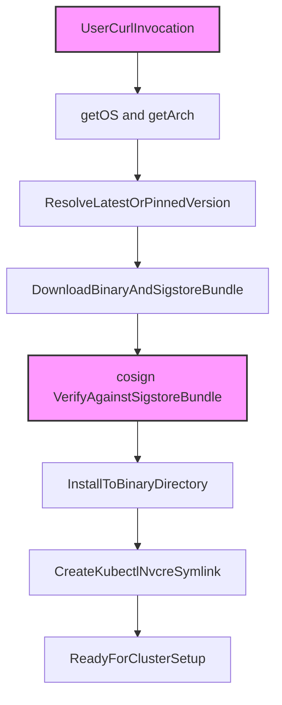
*Figure 1.1.1: `nvcrectl` installation and Sigstore verification pipeline.*

Sources: `installer` [installer:107-124](), `docs/getting-started/install.md` [docs/getting-started/install.md:16-32](), `docs/getting-started/first-certification.md` [docs/getting-started/first-certification.md:25-39]()

To install the latest stable version:
```bash
curl -fsSL https://github.com/NVIDIA/cluster-readiness-engine/releases/latest/download/installer | bash
```

To pin a specific release version or skip verification (not recommended for production):
```bash
curl -fsSL https://github.com/NVIDIA/cluster-readiness-engine/releases/download/<tag>/installer | bash -s -- -v <tag>
```

Verify the installation using either entrypoint:
```bash
nvcrectl --version
kubectl nvcre --version
```

Sources: `docs/getting-started/install.md` [docs/getting-started/install.md:16-37](), `docs/getting-started/first-certification.md` [docs/getting-started/first-certification.md:25-46]()

---

## Initializing the Cluster Environment (`setup init`)

Before running cluster certifications, the Kubernetes control plane must be provisioned with Kubeflow Trainer dependencies, NVCRE Custom Resource Definitions (CRDs), and controller deployments [docs/getting-started/install.md:39-44]().

Run pre-flight checks to validate cluster state:
```bash
kubectl nvcre cluster info
kubectl nvcre setup status
```
`cluster info` inspects `spec.providerID` and node labels (`nvidia.com/gpu.product`) to detect cloud platforms and GPU architectures, while `setup status` evaluates whether prerequisites and operator components are present [CLAUDE.md:97](), [docs/getting-started/first-certification.md:52-66]().

Execute the initialization command:
```bash
kubectl nvcre setup init
```
This command executes two distinct installation phases [docs/getting-started/install.md:41-47](), [docs/getting-started/first-certification.md:72-80]():

1. **`deps` Phase**: Installs Kubeflow Trainer (`v2.2.1`) into the `kubeflow-system` namespace. NVCRE delegates underlying workload orchestration to Kubeflow Trainer `TrainJob` custom resources [CLAUDE.md:78](), [docs/getting-started/install.md:43](), [docs/getting-started/first-certification.md:78]().
2. **`helm` Phase**: Installs the NVCRE Helm chart (`helm/cluster-readiness-engine`) into the `nvcre` namespace. This deploys the controller manager, seven CRDs, and built-in cluster-scoped `LogProfile` objects used for pod log parsing [CLAUDE.md:79-81](), [docs/getting-started/install.md:44](), [docs/getting-started/first-certification.md:79]().

### Setup Architecture and Code Entity Mapping

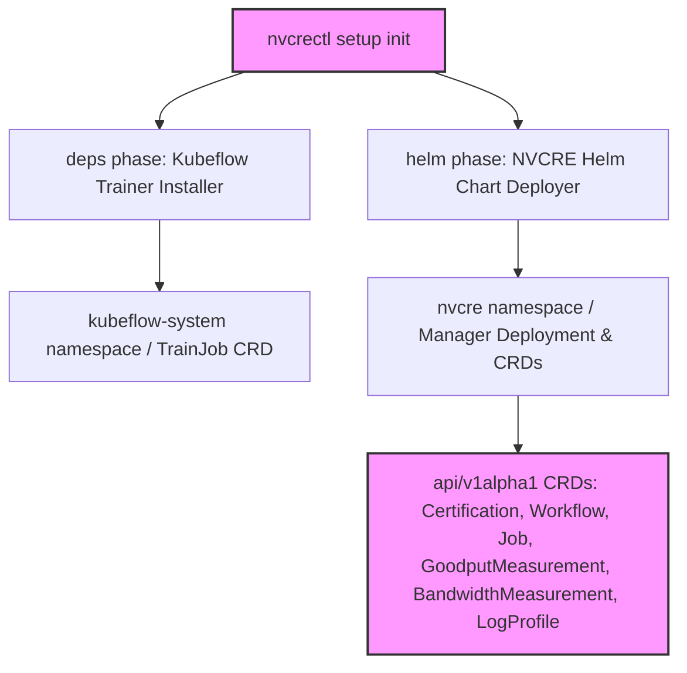
*Figure 1.1.2: Component mapping between setup command invocation and Kubernetes control plane resources.*

Sources: `docs/getting-started/install.md` [docs/getting-started/install.md:39-50](), `docs/getting-started/first-certification.md` [docs/getting-started/first-certification.md:50-86](), `CLAUDE.md` [CLAUDE.md:72-81]()

---

## Executing Your First Certification

Once setup succeeds, you can list available benchmark catalog categories and execute a burn-in test [docs/getting-started/first-certification.md:89-117](), [docs/cli-reference/certification.md:98-110]().

To list supported verification categories:
```bash
kubectl nvcre certification list-categories
```
The catalog includes communication benchmarks (`communication/nccl-all-reduce`, `nccl-all-gather`, `nccl-alltoall`, `nccl-loopback`), diagnostics (`diagnostics/dcgm-level4`), and large-scale training goodput benchmarks (`training/nemotron5-8b`, `training/nemotron5-56b`) [docs/getting-started/first-certification.md:97]().

To execute an all-reduce NCCL communication test across all target GPU nodes with real-time progress monitoring:
```bash
kubectl nvcre certification run \
  --category communication/nccl-all-reduce \
  --wait \
  --timeout 60m \
  --results-file ./cert-results.json
```

### Certification Execution Data Flow

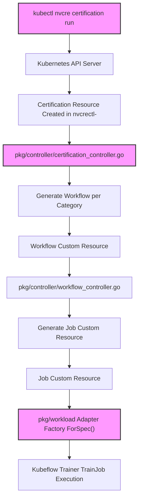
*Figure 1.1.3: Data flow from `nvcrectl` execution to controller reconciliation hierarchy.*

Sources: `docs/getting-started/first-certification.md` [docs/getting-started/first-certification.md:89-117](), `docs/cli-reference/certification.md` [docs/cli-reference/certification.md:9-64](), `CLAUDE.md` [CLAUDE.md:76-87]()

---

## Teardown and Reset

To clean up NVCRE custom resources, the controller deployment, and Kubeflow Trainer components while retaining shared cluster CRDs like `JobSet`, run [docs/getting-started/install.md:72-82]():
```bash
nvcrectl setup reset
```

Sources: `docs/getting-started/install.md` [docs/getting-started/install.md:72-82]()

---

# Page: Core Concepts

# Core Concepts

<details>
<summary>Relevant source files</summary>

The following files were used as context for generating this wiki page:

- [.claude/skills/release-notes/SKILL.md](.claude/skills/release-notes/SKILL.md)
- [CHANGELOG.md](CHANGELOG.md)
- [README.md](README.md)
- [RELEASE.md](RELEASE.md)
- [SECURITY.md](SECURITY.md)
- [THIRD_PARTY_NOTICES.md](THIRD_PARTY_NOTICES.md)
- [config/samples/policy/kyverno-verify-images.yaml](config/samples/policy/kyverno-verify-images.yaml)
- [config/samples/policy/policy-controller-verify-images.yaml](config/samples/policy/policy-controller-verify-images.yaml)
- [docs/concepts/catalog.md](docs/concepts/catalog.md)
- [docs/concepts/health-monitoring-remediation.md](docs/concepts/health-monitoring-remediation.md)
- [docs/designs/000-adr.md](docs/designs/000-adr.md)
- [docs/designs/027-kustomize-override-ux.md](docs/designs/027-kustomize-override-ux.md)
- [docs/designs/031-platform-aware-nccl-config.md](docs/designs/031-platform-aware-nccl-config.md)
- [docs/designs/073-setup-retry-convergence.md](docs/designs/073-setup-retry-convergence.md)
- [docs/designs/079-workload-object-labels.md](docs/designs/079-workload-object-labels.md)
- [docs/designs/081-cordoned-node-selection.md](docs/designs/081-cordoned-node-selection.md)
- [docs/designs/README.md](docs/designs/README.md)
- [docs/how-to-guides/custom-catalog-entries.md](docs/how-to-guides/custom-catalog-entries.md)
- [docs/operations/verifying-artifacts.md](docs/operations/verifying-artifacts.md)

</details>


## Purpose and Scope

This document details the core architectural concepts of the NVIDIA Cluster Readiness Engine (NVCRE). It covers the hierarchical CRD execution model (`Certification` $\rightarrow$ `Workflow` $\rightarrow$ `Job`), the certification catalog design, goodput and per-bus bandwidth measurements, platform and GPU architecture detection, Multi-Node NVLink (MNNVL) orchestration, and Common Expression Language (CEL)-based node health monitoring with failure attribution.

Sources: [README.md:1-40](), [docs/designs/README.md:1-35]()

---

## 1. Certification $\rightarrow$ Workflow $\rightarrow$ Job Hierarchy

NVCRE's control plane models distributed cluster validation using a cascading custom resource hierarchy analogous to Kubernetes native primitives (`Deployment` $\rightarrow$ `ReplicaSet` $\rightarrow$ `Pod`) [README.md:27-40]():

1. **`Certification`**: The top-level orchestration primitive. It fans out execution across multiple catalog categories (e.g., communication benchmarks, multi-node training) [README.md:31-39]().
2. **`Workflow`**: Created per category or dynamically via ad-hoc execution. It handles node discovery, architectural filtering, topology-aware partitioning, and iteration state machines [README.md:31-39]().
3. **`Job`**: Manages the concrete workload execution. It instantiates underlying workloads through strongly typed adapters (such as Kubeflow Trainer `TrainJob`) and manages timeouts, stall detection, and log capture [README.md:33-35]().
4. **`WorkloadRun`**: A single-run shortcut resource that bypasses the catalog, creating a single `Workflow` and `Job` directly from an inline workload specification [README.md:32-39]().

### Hierarchy and Controller Data Flow

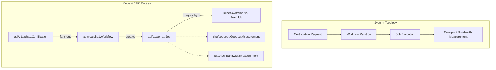

Sources: [README.md:25-40](), [THIRD_PARTY_NOTICES.md:18-18]()

---

## 2. Catalog and Workload Representation

The certification catalog defines structured test suites containing NCCL communication benchmarks and distributed training workloads [README.md:14-15](). Catalog definitions are resolved dynamically based on cluster scale, target node counts, and cloud provider characteristics.

* **Categories and Variants**: Each entry is categorized by domain (e.g., `communication`, `diagnostics`) and variant (e.g., `nccl-all-reduce`, `dcgm-level4`) [README.md:51-53]().
* **Workload Adapters**: The `Job` controller delegates specific runtime creation to pluggable adapters that translate declarative parameters into operator-specific objects like Kubeflow Trainer resources [README.md:33-35]().

Sources: [README.md:12-24](), [docs/designs/README.md:20-35]()

---

## 3. Platform and GPU Architecture Detection

NVCRE automatically identifies cloud environments and underlying hardware accelerators to apply appropriate tuning profiles and topological constraints [README.md:15]().

* **Platform Detection**: Identifies execution environments including AWS, GCP, Azure, OCI, nscale, TogetherAI, Mistral, Forge, and on-premises deployments [README.md:15]().
* **GPU Architecture Detection**: Detects GPU hardware families (e.g., GB200, GB300, H100, H200, B200, A100, L40S, L40) to resolve appropriate test parameters, environment variables, and transport-layer configurations [README.md:15]().
* **Overrides and Transforms (`WhenSpec`)**: Platform-specific configuration overrides are evaluated conditionally using evaluation logic to patch manifests, set worker resources, and configure gang schedulers [README.md:15]().

Sources: [README.md:12-24](), [docs/designs/README.md:25-35]()

---

## 4. Goodput, Bandwidth Measurement, and MNNVL

Performance evaluation relies on continuous log parsing and hardware topology awareness.

* **Goodput Measurement (`GoodputMeasurement`)**: Automatically monitors training iterations by parsing pod stdout/stderr logs using regular expression capture groups defined in cluster-scoped `LogProfile` resources [README.md:16](). It evaluates step times, tracks epochs, and freezes state upon terminal job conditions.
* **Bandwidth Measurement (`BandwidthMeasurement`)**: Parses NCCL benchmark logs to extract algorithm bandwidth (AlgBW) and bus bandwidth (BusBW) across various message payload sizes [README.md:17]().
* **Multi-Node NVLink (MNNVL)**: Coordinates multi-node GPU interconnect topologies, ensuring high-speed cluster communication domains (such as NVIDIA DRA `ComputeDomain` resources) are correctly integrated [README.md:48-51]().

### Measurement Pipeline Data Flow

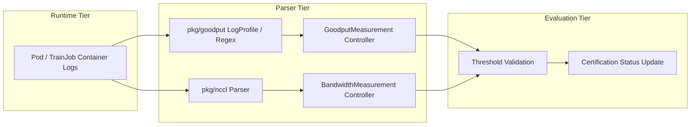

Sources: [README.md:16-17](), [docs/designs/README.md:25-35]()

---

## 5. Node Health Monitoring and Failure Attribution

NVCRE executes health checks concurrently with workloads, isolating faulty hardware without altering cluster node states (NVCRE never cordons, taints, or modifies nodes directly) [README.md:8]().

### CEL-Based Node Health Monitoring
The `Job` controller evaluates Common Expression Language (CEL) expressions against Kubernetes `Node` objects (`pkg/nodemonitor`) [README.md:18]() [docs/concepts/health-monitoring-remediation.md:9-24](). Expressions inspect labels, conditions, taints, and allocatable metrics mid-run [docs/concepts/health-monitoring-remediation.md:15]():

```cel
node.metadata.labels["nvidia.com/gpu.ecc.error.count"] > "0"
```

### Failure Bubbling and Attribution Hierarchy
When nodes fail tests or trip health monitors, attribution bubbles up through the resource hierarchy into persistent `ConfigMap` structures [docs/concepts/health-monitoring-remediation.md:29-52]():

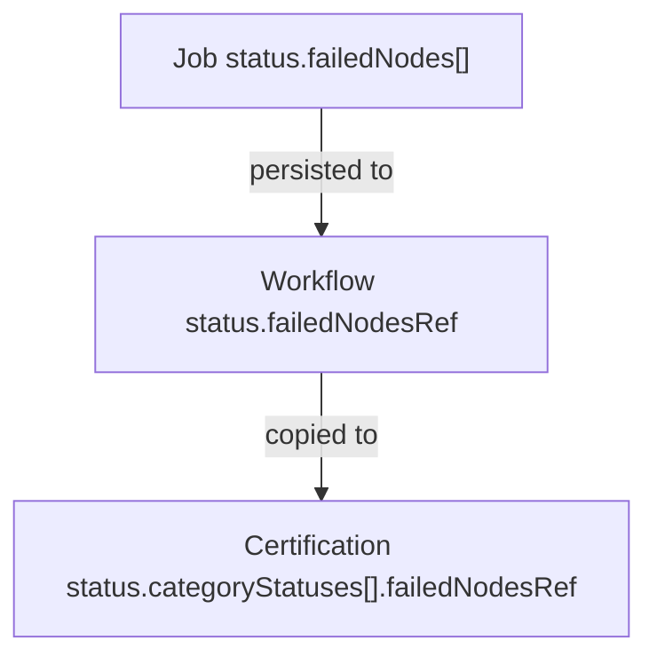

### Failure Reasons
Every failed node entry records a specific categorization reason [docs/concepts/health-monitoring-remediation.md:53-62]():
* `HardwareFailureDetected`: CEL health checks detected an active hardware anomaly mid-run [docs/concepts/health-monitoring-remediation.md:59]().
* `ThresholdViolation`: Performance metric (bandwidth, goodput, step time) missed configured pass/fail criteria [docs/concepts/health-monitoring-remediation.md:60]().
* `WorkloadFailed`: The workload exited with a non-zero status or experienced a startup stall [docs/concepts/health-monitoring-remediation.md:61]().

### Cordoned Node Selection
Operators can target cordoned nodes for validation (e.g., during bootstrapping or remediation workflows) by including the `node.kubernetes.io/unschedulable` taint inside `target.taintSelectors` [docs/designs/081-cordoned-node-selection.md:1-58](). When this taint selector is present, the default cordon health check is dropped for that run to prevent false positive hardware failure attributions [docs/designs/081-cordoned-node-selection.md:53-58]().

Sources: [README.md:18-20](), [docs/concepts/health-monitoring-remediation.md:1-104](), [docs/designs/081-cordoned-node-selection.md:1-58]()

---

# Page: Repository Layout and Development Workflow

# Repository Layout and Development Workflow

<details>
<summary>Relevant source files</summary>

The following files were used as context for generating this wiki page:

- [.claude/skills/cre-test/SKILL.md](.claude/skills/cre-test/SKILL.md)
- [.claude/skills/managing-openvex/SKILL.md](.claude/skills/managing-openvex/SKILL.md)
- [.github/CODEOWNERS](.github/CODEOWNERS)
- [.github/dco.yml](.github/dco.yml)
- [.github/workflows/attest-selftest.yml](.github/workflows/attest-selftest.yml)
- [.golangci.yml](.golangci.yml)
- [AGENTS.md](AGENTS.md)
- [CLAUDE.md](CLAUDE.md)
- [CODE_OF_CONDUCT.md](CODE_OF_CONDUCT.md)
- [CONTRIBUTING.md](CONTRIBUTING.md)
- [Dockerfile](Dockerfile)
- [GOVERNANCE.md](GOVERNANCE.md)
- [MAINTAINERS.md](MAINTAINERS.md)
- [NOTICE](NOTICE)
- [docs/cli-reference/overview.md](docs/cli-reference/overview.md)
- [docs/getting-started/first-certification.md](docs/getting-started/first-certification.md)
- [docs/getting-started/install.md](docs/getting-started/install.md)
- [go.mod](go.mod)
- [go.sum](go.sum)

</details>


This page documents the repository layout, directory structure, core build automation targets via the `Makefile`, linting configuration, testing harnesses, and contribution rules (including the issue-first workflow, conventional commits, and Developer Certificate of Origin requirements) for the NVIDIA Cluster Readiness Engine (NVCRE).

---

## 1. Repository Directory Map and Architecture Layout

The codebase is organized into standard Go and Kubernetes controller-runtime directory patterns. The root contains configuration files, build scripts, and the primary top-level directories: `api/`, `cmd/`, `pkg/`, `helm/`, `test/`, `docs/`, and `fern/`.

```mermaid
graph TD
    Root["cluster-readiness-engine root"] --> API["api/"]
    Root --> CMD["cmd/"]
    Root --> PKG["pkg/"]
    Root --> HELM["helm/"]
    Root --> TEST["test/"]
    Root --> DOCS["docs/"]
    Root --> FERN["fern/"]

    API --> APIV1["api/v1alpha1/ (*_types.go)"]
    CMD --> CMDMgr["cmd/manager/ (Controller Manager entrypoint)"]
    CMD --> CMDCLI["cmd/nvcrectl/ (CLI command tree)"]
    CMD --> CMDInt["cmd/integration/ (envtest integration suites)"]

    PKG --> PKGCat["pkg/catalog/ (Catalog entries & loaders)"]
    PKG --> PKGCtrl["pkg/controller/ (Reconciler loops)"]
    PKG --> PKGWork["pkg/workload/ (Training framework adapters)"]
    PKG --> PKGGP["pkg/goodput/ (Goodput parser & calculator)"]
    PKG --> PKGNode["pkg/nodemonitor/ (CEL-based node failure detectors)"]
    PKG --> PKGOrch["pkg/orchestration/ (Topology/bisection partitioning)"]

    HELM --> HelmChart["helm/cluster-readiness-engine/ (Chart templates & values)"]
    TEST --> TestUAT["test/uat/ (Kind + KWOK end-to-end suite)"]
    TEST --> TestHelm["test/helm/ (Chart render tests)"]
    TEST --> TestPolicy["test/releasepolicy/ (CI & release gates)"]
```
*Sources: [CLAUDE.md:68-98](), [CONTRIBUTING.md:25-31]()*

### Directory Details

* **`api/`**: Contains the Kubernetes API definitions under `api/v1alpha1/`. This includes custom resource definitions (CRDs) for `Certification`, `Workflow`, `Job`, `WorkloadRun`, `GoodputMeasurement`, `BandwidthMeasurement`, and `LogProfile` [CLAUDE.md:72-81]().
* **`cmd/`**: Entrypoints for binaries and test harnesses:
  * `cmd/manager/`: Main controller manager binary initializing controller-runtime managers and reconcilers [CLAUDE.md:70]().
  * `cmd/nvcrectl/`: Source code for the `nvcrectl` / `kubectl-nvcre` command-line tool [MAINTAINERS.md:7]().
  * `cmd/integration/`: `envtest`-based integration test suite utilizing structured input files and golden expectations [CLAUDE.md:109]().
* **`pkg/`**: Core library packages implementing controller logic, catalog management, orchestration, parsing, and execution:
  * `pkg/catalog/`: Maps `{domain, variant}` to `WorkflowSpec` builders via init-time registrations [CLAUDE.md:88]().
  * `pkg/controller/`: Core reconciliation loops for `Certification`, `Workflow`, `Job`, and associated measurement custom resources [CLAUDE.md:70]().
  * `pkg/workload/`: Adapter interface mapping training frameworks to normalized `WorkloadPhase` outputs [CLAUDE.md:87]().
  * `pkg/goodput/`: Log parsing, goodput math, and pod log-fetching abstractions [CLAUDE.md:90]().
  * `pkg/nodemonitor/`: CEL-based node failure detection interface and implementation [CLAUDE.md:89]().
  * `pkg/orchestration/`: Node partitioning, simple chunking, topology-aware greedy scheduling, and adaptive bisection algorithms [CLAUDE.md:91]().
* **`helm/`**: Helm charts for packaging the controller, RBAC manifests, ServiceMonitors, and default configurations [MAINTAINERS.md:7]().
* **`test/`**: End-to-end verification suites including `test/uat/` (Kind + KWOK workflows), `test/helm/`, `test/releasepolicy/`, and `test/docspolicy/` [.claude/skills/cre-test/SKILL.md:23]().
* **`docs/`**: Markdown-based architectural guides and user manuals.
* **`fern/`**: Configuration for the Fern documentation site generation pipeline.

Sources: [CLAUDE.md:68-98](), [CONTRIBUTING.md:25-31](), [.claude/skills/cre-test/SKILL.md:17-23]()

---

## 2. Build Automation and Makefile Targets

The repository uses a `Makefile` to orchestrate code generation, compilation, testing, and container builds. Go 1.27+ is required [CONTRIBUTING.md:111]().

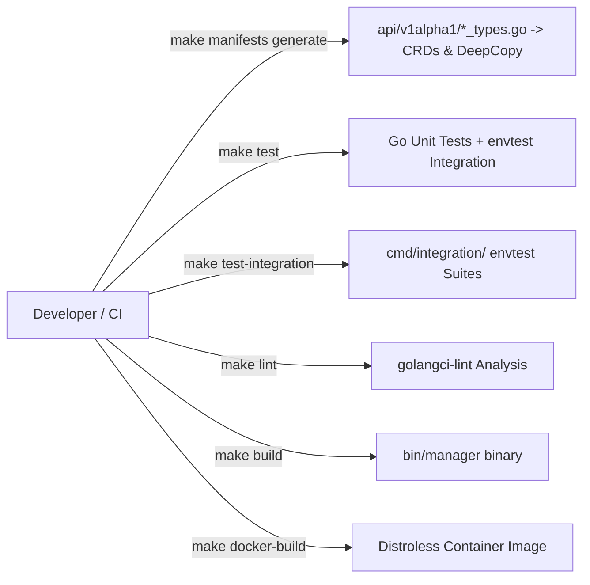
*Sources: [CLAUDE.md:5-16](), [CONTRIBUTING.md:123-143]()*

### Key Makefile Targets

* **`make manifests generate`**: Must be executed after modifying `*_types.go` files or Kubebuilder markers. Updates deepcopy methods, client code, and Kubernetes CRD manifests under `config/crd/` [CLAUDE.md:8]().
* **`make test`**: Runs unit tests across packages combined with `envtest`-backed integration suites [CLAUDE.md:9]().
* **`make test-integration`**: Runs integration tests inside `cmd/integration/` using `envtest` assets and golden files [CLAUDE.md:10]().
* **`make lint` / `make lint-fix`**: Executes `golangci-lint` to check code style, static errors, and import formatting [CLAUDE.md:11-12]().
* **`make build`**: Compiles the manager binary into `bin/manager` [CLAUDE.md:13]().
* **`make build-nvcrectl`**: Compiles the `nvcrectl` CLI binary into `bin/nvcrectl` [CONTRIBUTING.md:142]().
* **`make docker-build`**: Builds the multi-stage distroless container image [CLAUDE.md:14](), using pinned base layers defined in the root `Dockerfile` [Dockerfile:8-32]().

Sources: [CLAUDE.md:5-16](), [CONTRIBUTING.md:115-143](), [Dockerfile:8-32]()

---

## 3. Linting and Code Quality Enforcement

Code quality is enforced via static analysis and structured test verification rules.

### Lint Configuration
* **`golangci-lint`**: Configured via `.golangci.yml` in the repository root. All pull requests must pass lint checks without warnings or errors.
* **Auto-formatting**: Run `make lint-fix` to automatically address style infractions where supported [CLAUDE.md:12]().

### Golden-File Unit Testing Pattern
Packages with structured outputs must use `testutil.TestCaseParser` (in `pkg/testutil/`) matching the directory layout `testdata/<feature>/<case>/input.yaml` and `expected.json` [.claude/skills/cre-test/SKILL.md:17-36](). Hand-maintained Go assertion tables for structured output are prohibited in designated core packages [CLAUDE.md:110-113]().

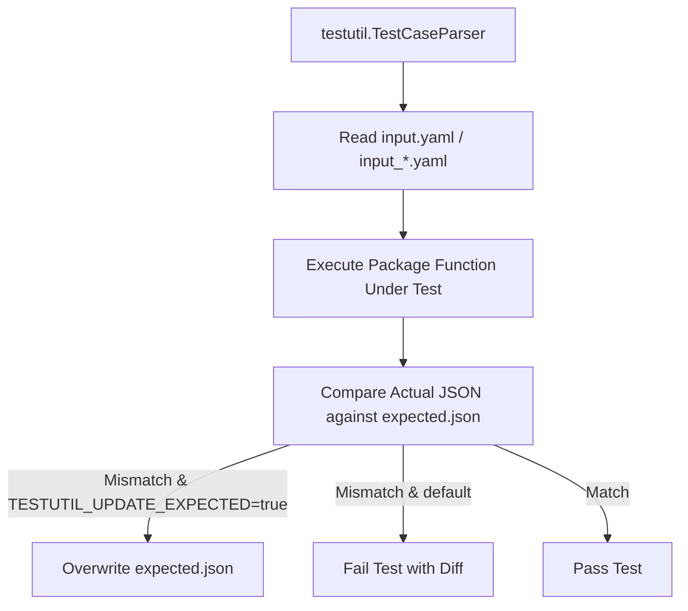
*Sources: [.claude/skills/cre-test/SKILL.md:27-53]()*

Updating golden files intentionally is performed by setting an environment flag:
```bash
TESTUTIL_UPDATE_EXPECTED=true go test ./pkg/report/
TESTUTIL_UPDATE_EXPECTED=true make test-integration
```
Sources: [CLAUDE.md:29-33](), [.claude/skills/cre-test/SKILL.md:27-95]()

---

## 4. Contribution Workflow, Commit Standards, and DCO Rules

Contributing to NVCRE requires adherence to structured contribution workflows, conventional commit message formatting, and legally binding Developer Certificate of Origin (DCO) sign-offs.

### Issue-First Workflow
1. **Open an Issue**: Describe the bug or feature request clearly using issue templates [CONTRIBUTING.md:34-36]().
2. **Await Acknowledgment**: Wait for a maintainer to review and agree on the proposed approach [CONTRIBUTING.md:37]().
3. **Reference the Issue**: Link the pull request to the open issue via keywords (`Closes #NNN`) [CONTRIBUTING.md:39]().
   * *Note*: Pull requests submitted without a linked, acknowledged issue may be closed unreviewed, excepting trivial typo/doc fixes [CONTRIBUTING.md:41]().

### Conventional Commits
Commit messages must follow the [Conventional Commits](https://www.conventionalcommits.org) specification using the format `type: short imperative summary` [CONTRIBUTING.md:88]().
* **Allowed Types**: `feat`, `fix`, `docs`, `test`, `refactor`, `perf`, `chore`, `ci`, `build` [CONTRIBUTING.md:98]().
* **Examples**:
  ```
  feat: add bandwidth threshold option to nccl catalog entries
  fix: requeue workflow when dependency resources are not ready
  docs: document checkpoint restart behavior
  ```
  Sources: [CONTRIBUTING.md:88-96]()

### Developer Certificate of Origin (DCO)
Every commit must include a DCO sign-off line certifying that the contributor has the right to submit the code under the project's open-source license.
* Pass the `-s` flag to `git commit`:
  ```bash
  git commit -s -m "feat: add custom workload adapter"
  ```
* The CI pipeline verifies DCO signatures on every pull request. Unsigned commits will fail the DCO check.

Sources: [CONTRIBUTING.md:75-98](), [.github/dco.yml]()

---

# Page: API and Custom Resources

# API and Custom Resources

<details>
<summary>Relevant source files</summary>

The following files were used as context for generating this wiki page:

- [api/v1alpha1/certification_types.go](api/v1alpha1/certification_types.go)
- [api/v1alpha1/workflow_types.go](api/v1alpha1/workflow_types.go)
- [cmd/integration/testdata/validation/certification-maxbytes-documented-value/expected.json](cmd/integration/testdata/validation/certification-maxbytes-documented-value/expected.json)
- [cmd/integration/testdata/validation/certification-maxbytes-documented-value/input.yaml](cmd/integration/testdata/validation/certification-maxbytes-documented-value/input.yaml)
- [cmd/integration/testdata/validation/certification-maxbytes-invalid-unit/expected.json](cmd/integration/testdata/validation/certification-maxbytes-invalid-unit/expected.json)
- [cmd/integration/testdata/validation/certification-maxbytes-invalid-unit/input.yaml](cmd/integration/testdata/validation/certification-maxbytes-invalid-unit/input.yaml)
- [cmd/integration/testdata/validation/certification-maxbytes-spec-level/expected.json](cmd/integration/testdata/validation/certification-maxbytes-spec-level/expected.json)
- [cmd/integration/testdata/validation/certification-maxbytes-spec-level/input.yaml](cmd/integration/testdata/validation/certification-maxbytes-spec-level/input.yaml)
- [cmd/integration/validation_test.go](cmd/integration/validation_test.go)
- [helm/cluster-readiness-engine/crds/nvcre.nvidia.com_certifications.yaml](helm/cluster-readiness-engine/crds/nvcre.nvidia.com_certifications.yaml)
- [helm/cluster-readiness-engine/crds/nvcre.nvidia.com_workflows.yaml](helm/cluster-readiness-engine/crds/nvcre.nvidia.com_workflows.yaml)
- [helm/cluster-readiness-engine/crds/nvcre.nvidia.com_workloadruns.yaml](helm/cluster-readiness-engine/crds/nvcre.nvidia.com_workloadruns.yaml)

</details>


The `nvcre.nvidia.com` API group (`api/v1alpha1`) and its generated Custom Resource Definitions (CRDs) define the core domain objects for the NVIDIA Cluster Readiness Engine (NVCRE) [api/v1alpha1/certification_types.go:1-12](). These resources orchestrate GPU cluster validation, run distributed training and communication workloads, evaluate performance goodput and bandwidth metrics, and manage hardware fault isolation. 

The API design separates high-level user intent—expressed through `Certification` and `WorkloadRun`—from low-level execution machinery handled by `Workflow` and `Job` CRDs. All primary specs are immutable after creation to maintain deterministic reconciliation boundaries [helm/cluster-readiness-engine/crds/nvcre.nvidia.com_certifications.yaml:39-45]().

```mermaid
graph TD
    sub5[""API Group: nvcre.nvidia.com v1alpha1""]
    sub5 --> node1[""Certification Struct [api/v1alpha1/certification_types.go]""]
    sub5 --> node2[""WorkloadRun Struct [helm/cluster-readiness-engine/crds/nvcre.nvidia.com_workloadruns.yaml]""]
    sub5 --> node3[""Workflow Struct [api/v1alpha1/workflow_types.go]""]
    sub5 --> node4[""GoodputMeasurement & BandwidthMeasurement""]
    
    node1 -->|Generates| node3
    node2 -->|Generates| node3
    node3 -->|Creates| node6[""Job Custom Resources""]
```
*Sources: `api/v1alpha1/certification_types.go:1-12`, `helm/cluster-readiness-engine/crds/nvcre.nvidia.com_certifications.yaml:39-45`, `api/v1alpha1/workflow_types.go:1-30`*

## High-Level Architecture and Child Resources

The API surface spans user-facing intent wrappers, execution coordinators, and telemetry monitors. For detailed specifications, validation rules, and immutability guarantees, refer to the following child pages:

- **Certification and WorkloadRun Types** ([Certification and WorkloadRun Types](#2.1)) — Covers `Certification` targets, category matrices, orchestration options, taint selectors, and the simplified `WorkloadRun` API.
- **Workflow and Job Types** ([Workflow and Job Types](#2.2)) — Covers `Workflow` specifications, node groups, iterations, dependency management, overrides, and discriminated `Job` specs.
- **Measurement and LogProfile Types** ([Measurement and LogProfile Types](#2.3)) — Covers `GoodputMeasurement`, `BandwidthMeasurement`, and cluster-scoped `LogProfile` CRDs for threshold evaluations and regex log parsing.

```mermaid
graph LR
    sub6[""User Input Space""] -->|"Submits"| sub7[""Controller Reconciliation Space""]
    sub7 -->|"Validates via CEL"| sub8[""API Server Admission [cmd/integration/validation_test.go]""]
    sub8 -->|"Persists"| sub9[""CRD Schemas [helm/cluster-readiness-engine/crds/]""]
```
*Sources: `cmd/integration/validation_test.go:33-52`, `helm/cluster-readiness-engine/crds/nvcre.nvidia.com_certifications.yaml:1-25`*

---
*Sources: `api/v1alpha1/certification_types.go:1-12`, `helm/cluster-readiness-engine/crds/nvcre.nvidia.com_certifications.yaml:39-45`, `api/v1alpha1/workflow_types.go:1-30`, `cmd/integration/validation_test.go:33-52`*

---

# Page: Certification and WorkloadRun Types

# Certification and WorkloadRun Types

<details>
<summary>Relevant source files</summary>

The following files were used as context for generating this wiki page:

- [api/v1alpha1/certification_types.go](api/v1alpha1/certification_types.go)
- [api/v1alpha1/workloadrun_types.go](api/v1alpha1/workloadrun_types.go)
- [cmd/integration/testdata/reconcile/certification-spec-immutable-terminal/expected.json](cmd/integration/testdata/reconcile/certification-spec-immutable-terminal/expected.json)
- [cmd/integration/testdata/reconcile/certification-spec-immutable-terminal/input_client_objects.yaml](cmd/integration/testdata/reconcile/certification-spec-immutable-terminal/input_client_objects.yaml)
- [cmd/integration/testdata/reconcile/certification-spec-immutable-terminal/input_config.yaml](cmd/integration/testdata/reconcile/certification-spec-immutable-terminal/input_config.yaml)
- [cmd/integration/testdata/reconcile/certification-spec-immutable/expected.json](cmd/integration/testdata/reconcile/certification-spec-immutable/expected.json)
- [cmd/integration/testdata/reconcile/certification-spec-immutable/input_client_objects.yaml](cmd/integration/testdata/reconcile/certification-spec-immutable/input_client_objects.yaml)
- [cmd/integration/testdata/reconcile/certification-spec-immutable/input_config.yaml](cmd/integration/testdata/reconcile/certification-spec-immutable/input_config.yaml)
- [cmd/integration/testdata/reconcile/workloadrun-mpi-aws-gb300/expected.json](cmd/integration/testdata/reconcile/workloadrun-mpi-aws-gb300/expected.json)
- [cmd/integration/testdata/reconcile/workloadrun-mpi/expected.json](cmd/integration/testdata/reconcile/workloadrun-mpi/expected.json)
- [cmd/integration/testdata/reconcile/workloadrun-spec-immutable/expected.json](cmd/integration/testdata/reconcile/workloadrun-spec-immutable/expected.json)
- [cmd/integration/testdata/reconcile/workloadrun-spec-immutable/input_client_objects.yaml](cmd/integration/testdata/reconcile/workloadrun-spec-immutable/input_client_objects.yaml)
- [cmd/integration/testdata/validation/certification-maxbytes-documented-value/expected.json](cmd/integration/testdata/validation/certification-maxbytes-documented-value/expected.json)
- [cmd/integration/testdata/validation/certification-maxbytes-documented-value/input.yaml](cmd/integration/testdata/validation/certification-maxbytes-documented-value/input.yaml)
- [cmd/integration/testdata/validation/certification-maxbytes-invalid-unit/expected.json](cmd/integration/testdata/validation/certification-maxbytes-invalid-unit/expected.json)
- [cmd/integration/testdata/validation/certification-maxbytes-invalid-unit/input.yaml](cmd/integration/testdata/validation/certification-maxbytes-invalid-unit/input.yaml)
- [cmd/integration/testdata/validation/certification-maxbytes-spec-level/expected.json](cmd/integration/testdata/validation/certification-maxbytes-spec-level/expected.json)
- [cmd/integration/testdata/validation/certification-maxbytes-spec-level/input.yaml](cmd/integration/testdata/validation/certification-maxbytes-spec-level/input.yaml)
- [cmd/integration/validation_test.go](cmd/integration/validation_test.go)
- [docs/api-reference/certification.md](docs/api-reference/certification.md)
- [docs/api-reference/workloadrun.md](docs/api-reference/workloadrun.md)
- [pkg/platform/runtime.go](pkg/platform/runtime.go)
- [pkg/workloadrun/testdata/build-workflow-spec/mpi-keeps-spec-env/expected.json](pkg/workloadrun/testdata/build-workflow-spec/mpi-keeps-spec-env/expected.json)
- [pkg/workloadrun/testdata/build-workflow-spec/mpi-keeps-spec-env/input.yaml](pkg/workloadrun/testdata/build-workflow-spec/mpi-keeps-spec-env/input.yaml)
- [pkg/workloadrun/testdata/build-workflow-spec/torch-keeps-spec-env/input.yaml](pkg/workloadrun/testdata/build-workflow-spec/torch-keeps-spec-env/input.yaml)

</details>


## Purpose and Scope
This page details the API specification, validation rules, and immutability invariants for the primary user-facing custom resources in the NVIDIA Cluster Readiness Engine (NVCRE): `Certification` and `WorkloadRun`. It covers the hierarchical configuration structures, framework definitions, orchestration flags, resource limits, and common validation patterns enforced by custom resource definition (CRD) validation rules and Common Expression Language (CEL) constraints.

Sources: `api/v1alpha1/certification_types.go:1-153` [api/v1alpha1/certification_types.go](), `api/v1alpha1/workloadrun_types.go:1-180` [api/v1alpha1/workloadrun_types.go]()

---

## 1. Certification Spec Structure
The `Certification` custom resource defines a comprehensive test suite executed against a designated GPU node pool. Its specification is partitioned into target cluster selectors, global test execution defaults, category-specific overrides, and gang-scheduling configurations.

### Key Fields and Sub-Structures
* **`target`**: Defines node selectors and taint tolerations to bound the scope of nodes eligible for certification tests.
* **`categories`**: A list of `CertificationCategory` entries specifying the domains (e.g., `communication`, `training`) and variants (e.g., `nccl-all-reduce`, `nemotron5-8b`) to execute.
* **`gangScheduler`**: Optional configuration opting workload pods into gang-aware schedulers (such as KAI Scheduler or Run:ai).
* **`maxBytes`**: Global default for the maximum transfer size tested during communication benchmarks, validated against pattern constraints like `^[0-9]+(K|M|G|T)?$`.

Each category may define a `CategoryOptions` structure and `CategoryResources` overrides. The `CategoryOptions` struct controls parameters such as `nodesPerJob`, `enableCheckpoint`, `maxSteps`, `exitDurationMins`, and `gpusPerNode` [api/v1alpha1/certification_types.go:121-150]().

```yaml
apiVersion: nvcre.nvidia.com/v1alpha1
kind: Certification
metadata:
  name: gpu-cluster-cert
  namespace: nvcre
spec:
  target:
    nodeSelector:
      nvidia.com/gpu.present: "true"
  enableMNNVL: false
  categories:
    - domain: communication
      variant: nccl-all-reduce
    - domain: training
      variant: nemotron5-8b
      options:
        maxSteps: 50
        nodesPerJob: 8
        resources:
          limits:
            cpu: "6"
            memory: 48Gi
          requests:
            cpu: "4"
            memory: 32Gi
```

Sources: `api/v1alpha1/certification_types.go:1-153` [api/v1alpha1/certification_types.go](), `docs/api-reference/certification.md:1-56` [docs/api-reference/certification.md]()

---

## 2. WorkloadRun Simplified Specification
`WorkloadRun` provides a streamlined, user-facing API for executing ad-hoc distributed workloads without constructing full certification multi-stage pipelines [docs/api-reference/workloadrun.md:9-10]().

### Framework Disriminated Union (`FrameworkSpec`)
The workload framework is modeled as a mutually exclusive discriminated union where exactly one framework backend must be populated (`minProperties: 1`, `maxProperties: 1`) [api/v1alpha1/workloadrun_types.go:28-50]():
1. **`Torch`**: Executes distributed training via `torchrun`. Supports `script` or `module` (which are mutually exclusive) along with argument lists [api/v1alpha1/workloadrun_types.go:34-72]().
2. **`MPI`**: Executes MPI-based benchmarks and workloads (e.g., NCCL tests) via configurable binaries, `mpirunPath`, and extra parameters [api/v1alpha1/workloadrun_types.go:74-100]().
3. **`Exec`**: Executes direct command arrays [api/v1alpha1/workloadrun_types.go:102-112]().

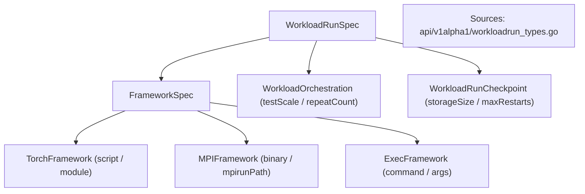
Sources: `api/v1alpha1/workloadrun_types.go:28-172` [api/v1alpha1/workloadrun_types.go](), `docs/api-reference/workloadrun.md:9-42` [docs/api-reference/workloadrun.md]()

---

## 3. Validation Rules and Immutability Semantics

### CEL Validation Rules
Custom resource definitions enforce strict admission-time validation checks via Common Expression Language (CEL):
* **Resource Request/Limit Ordering**: `CategoryResources` rules assert that CPU and memory requests do not exceed their corresponding limits [api/v1alpha1/certification_types.go:104-105]().
* **Mutually Exclusive Arguments**: `TorchFramework` enforces that `script` and `module` cannot both be specified [api/v1alpha1/workloadrun_types.go:54-55](). Similarly, `WorkloadConfig` enforces mutual exclusion between `inline` and `configMapRef` [api/v1alpha1/workloadrun_types.go:116-116]().
* **Label and Queue Formatting**: Gang scheduler queues and label keys are validated against Kubernetes qualified-name patterns and string length bounds (e.g., maximum length caps) [docs/api-reference/workloadrun.md:56-57]().

### Immutability Guarantees
* **`WorkloadRun` Immutability**: Once created, the entire `spec` of a `WorkloadRun` is strictly immutable (`self == oldSelf`). Any update attempt is rejected at admission time by CEL expressions [docs/api-reference/workloadrun.md:45-47]().
* **`Certification` Lifecycle Invariants**: Active certification jobs and terminal workflow configurations enforce update protections to preserve execution integrity and audit logs [cmd/integration/testdata/reconcile/certification-spec-immutable/expected.json:1-12]() [cmd/integration/testdata/reconcile/certification-spec-immutable-terminal/expected.json:1-12]().

Sources: `api/v1alpha1/certification_types.go:104-105` [api/v1alpha1/certification_types.go](), `api/v1alpha1/workloadrun_types.go:54-56` [api/v1alpha1/workloadrun_types.go](), `docs/api-reference/workloadrun.md:45-47` [docs/api-reference/workloadrun.md](), `cmd/integration/testdata/validation/certification-maxbytes-invalid-unit/expected.json:1-10` [cmd/integration/testdata/validation/certification-maxbytes-invalid-unit/expected.json]()

---

## 4. Code Entity Architecture and Data Flow

The following diagram illustrates how the natural language specifications map directly to concrete Go types within the `api/v1alpha1` package during API admission and controller reconciliation.

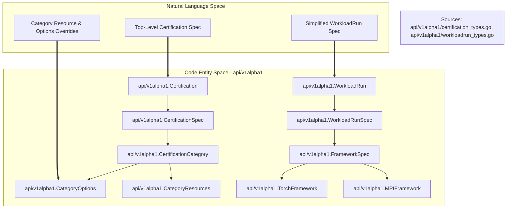

Sources: `api/v1alpha1/certification_types.go:1-153` [api/v1alpha1/certification_types.go](), `api/v1alpha1/workloadrun_types.go:28-180` [api/v1alpha1/workloadrun_types.go]()

---

# Page: Workflow and Job Types

# Workflow and Job Types

<details>
<summary>Relevant source files</summary>

The following files were used as context for generating this wiki page:

- [api/v1alpha1/workflow_types.go](api/v1alpha1/workflow_types.go)
- [cmd/integration/testdata/reconcile/workflow-hardware-and-validation-failed/expected.json](cmd/integration/testdata/reconcile/workflow-hardware-and-validation-failed/expected.json)
- [cmd/integration/testdata/reconcile/workflow-hardware-and-validation-failed/input_client_objects.yaml](cmd/integration/testdata/reconcile/workflow-hardware-and-validation-failed/input_client_objects.yaml)
- [cmd/integration/testdata/reconcile/workflow-hardware-and-validation-failed/input_config.yaml](cmd/integration/testdata/reconcile/workflow-hardware-and-validation-failed/input_config.yaml)
- [cmd/integration/testdata/reconcile/workflow-validation-failed/expected.json](cmd/integration/testdata/reconcile/workflow-validation-failed/expected.json)
- [cmd/integration/testdata/reconcile/workloadrun-validation-failed/expected.json](cmd/integration/testdata/reconcile/workloadrun-validation-failed/expected.json)
- [cmd/integration/testdata/reconcile/workloadrun-validation-failed/input_client_objects.yaml](cmd/integration/testdata/reconcile/workloadrun-validation-failed/input_client_objects.yaml)
- [cmd/integration/testdata/reconcile/workloadrun-validation-failed/input_config.yaml](cmd/integration/testdata/reconcile/workloadrun-validation-failed/input_config.yaml)
- [docs/api-reference/workflow.md](docs/api-reference/workflow.md)
- [docs/designs/000-adr.md](docs/designs/000-adr.md)
- [docs/designs/027-kustomize-override-ux.md](docs/designs/027-kustomize-override-ux.md)
- [docs/designs/031-platform-aware-nccl-config.md](docs/designs/031-platform-aware-nccl-config.md)
- [docs/designs/073-setup-retry-convergence.md](docs/designs/073-setup-retry-convergence.md)
- [docs/designs/079-workload-object-labels.md](docs/designs/079-workload-object-labels.md)
- [docs/designs/README.md](docs/designs/README.md)
- [helm/cluster-readiness-engine/crds/nvcre.nvidia.com_certifications.yaml](helm/cluster-readiness-engine/crds/nvcre.nvidia.com_certifications.yaml)
- [helm/cluster-readiness-engine/crds/nvcre.nvidia.com_workflows.yaml](helm/cluster-readiness-engine/crds/nvcre.nvidia.com_workflows.yaml)
- [helm/cluster-readiness-engine/crds/nvcre.nvidia.com_workloadruns.yaml](helm/cluster-readiness-engine/crds/nvcre.nvidia.com_workloadruns.yaml)
- [pkg/controller/testdata/apply-workflow-validation-failed/idempotent-already-set/expected.json](pkg/controller/testdata/apply-workflow-validation-failed/idempotent-already-set/expected.json)
- [pkg/controller/testdata/apply-workflow-validation-failed/idempotent-already-set/input.yaml](pkg/controller/testdata/apply-workflow-validation-failed/idempotent-already-set/input.yaml)

</details>


## Purpose and Scope
This page details the technical specifications and runtime status schemas for `Workflow` and `Job` resources within the `nvcre.nvidia.com` API group (`api/v1alpha1/workflow_types.go` [api/v1alpha1/workflow_types.go:1-12]() and `api/v1alpha1/job_types.go`()). A `Workflow` governs a single certification category run or multi-node campaign, orchestrating node grouping, iterations, conditional dependencies, and overrides. A `Job` defines an individual execution unit inside a workflow via a strongly-typed, discriminated workload specification (`WorkloadSpec`) and workload metadata (`WorkloadMetadata`).

---

## 1. Workflow Specification and Status

The `Workflow` resource acts as the intermediate execution engine generated by the `Certification` controller (or submitted directly via WorkloadRun). Its `spec` defines the template for generated jobs, topological orchestration parameters, conditional dependencies, and runtime overrides.

### Core Spec Components
- **`jobTemplate`**: Houses standard object metadata (`metav1.ObjectMeta`) and the primary `JobSpec` template (`api/v1alpha1/workflow_types.go:70-79`()).
- **`orchestration`**: Configures topology-aware domain chunking, node selector targets, active test scale, and iteration counts (`api/v1alpha1/workflow_types.go:81-111`()).
- **`dependencies`**: Lists conditional auxiliary resources (such as `ConfigMap` or `TrainingRuntime`) materialized before job execution based on `WhenSpec` evaluation (`helm/cluster-readiness-engine/crds/nvcre.nvidia.com_workflows.yaml:42-53`()).
- **`gangScheduler`**: Records the resolved gang-scheduling contract for queue and queue label alignment (`docs/api-reference/workflow.md:18-37`()).

### Status and Condition Lifecycle
Workflow status reflects progress across iterations and hardware health attribution:
- **Conditions**: Exclusive execution states (`InProgress`, `Succeeded`, `Failed`) combined with additive quality signals like `ValidationFailed` when performance thresholds are breached (`api/v1alpha1/workflow_types.go:13-30`(), `docs/api-reference/workflow.md:120-124`()).
- **Attribution References**: `succeededNodesRef` and `failedNodesRef` point to compressed `ConfigMap` instances tracking individual node health outcomes across iterations (`docs/api-reference/workflow.md:120-127`()).

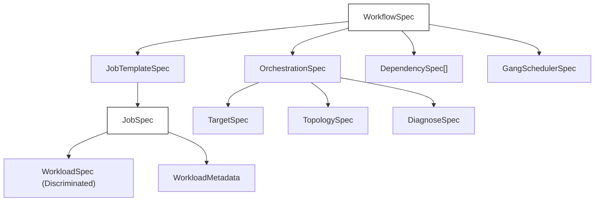
*Sources: `api/v1alpha1/workflow_types.go:1-140`(), `docs/api-reference/workflow.md:1-35`()*

---

## 2. Job Specification and Discriminated Workloads

The `Job` API (`api/v1alpha1/job_types.go`) wraps framework-neutral execution semantics through a discriminated union pattern.

### `JobSpec` and `WorkloadSpec`
`JobSpec` requires exactly one workload framework variant to be specified via `workload` (`api/v1alpha1/job_types.go`). The discriminated union `WorkloadSpec` delegates instantiation to registered workload adapters (such as Kubeflow Trainer `TrainJob`):
- **`WorkloadMetadata`**: Exposes fine-grained label controls (`WorkloadLabelValue`) applied directly to the generated workload object rather than pod templates (`docs/designs/079-workload-object-labels.md:63-80`()).
- **Validation**: Enforces `MinProperties=1` and `MaxProperties=1` at the `WorkloadSpec` boundary to prevent ambiguous multi-framework definitions.

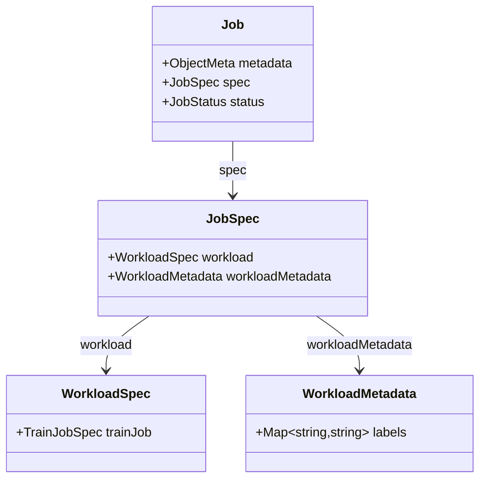
*Sources: `api/v1alpha1/job_types.go:1-100`(), `docs/designs/079-workload-object-labels.md:63-95`()*

Sources: `api/v1alpha1/workflow_types.go:1-180`(), `api/v1alpha1/job_types.go:1-100`(), `docs/api-reference/workflow.md:1-133`(), `docs/designs/079-workload-object-labels.md:1-149`()

---

## 3. Overrides, Dependencies, and Conditional Execution

Workflows support platform- and architecture-aware configuration customization through an override syntax inspired by Kustomize (`docs/designs/027-kustomize-override-ux.md:1-22`).

### Override Evaluation Flow
1. **`WhenSpec` Matching**: The controller evaluates runtime conditions across six fields (`Platform`, `GPUArchitecture`, `WorkloadKind`, `Topology`, `Config`, and custom `Expression` via `cel-go`) against discovered node characteristics (`docs/designs/027-kustomize-override-ux.md:64-73`).
2. **Strategic Merge Patch**: Matched `jobTemplate` overrides are merged using Kubernetes' `strategicpatch.StrategicMergePatch` against base job definitions, correctly respecting `patchStrategy` and `patchMergeKey` annotations (e.g., merging container environment lists by variable `name`) (`docs/designs/027-kustomize-override-ux.md:25-34`).
3. **JSON Patch (`jobTemplatePatch`)**: RFC 6902 JSON patch operations are executed subsequently to enable precise field additions, removals, or replacements (`docs/designs/027-kustomize-override-ux.md:35-49`).

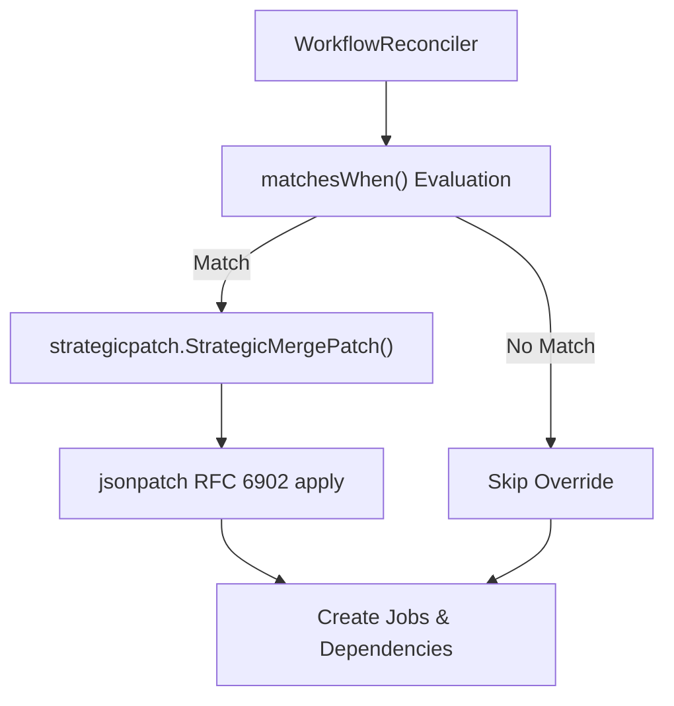
*Sources: `docs/designs/027-kustomize-override-ux.md:23-79`()*

Sources: `docs/designs/027-kustomize-override-ux.md:1-84`(), `docs/designs/031-platform-aware-nccl-config.md:1-92`()

---

## 4. Gang Scheduling Consistency Contract

To prevent schedulers like Kueue or KAI from failing due to misconfigured queue assignments or mismatched pod templates, `Workflow` enforces an immutable gang scheduling contract (`docs/api-reference/workflow.md:22-37`).

### Contract Rules and Enforcement
- **`gangScheduler` Immortality**: The top-level `spec.gangScheduler` field is decoupled from `jobTemplate` and `dependencies`, making it immune to override modifications (`docs/api-reference/workflow.md:22-26`).
- **Validation Checkpoints**: Prior to dependency or job materialization, the controller verifies that:
  1. The workload object's queue label matches the configured target.
  2. All effective runtime job templates and pod templates maintain matching scheduler names and queue labels (`docs/api-reference/workflow.md:28-31`).
  3. Discrepancies introduced by overrides cause the workflow to transition to `Failed` with reason `GangSchedulingConflict` rather than applying silent mutations (`docs/api-reference/workflow.md:31-34`).

Sources: `docs/api-reference/workflow.md:1-147`(), `api/v1alpha1/workflow_types.go:134-160`()

---

# Page: Measurement and LogProfile Types

# Measurement and LogProfile Types

<details>
<summary>Relevant source files</summary>

The following files were used as context for generating this wiki page:

- [cmd/integration/testdata/reconcile/bandwidth-measurement-job-succeed/expected.json](cmd/integration/testdata/reconcile/bandwidth-measurement-job-succeed/expected.json)
- [cmd/integration/testdata/reconcile/goodput-measurement-job-succeed/expected.json](cmd/integration/testdata/reconcile/goodput-measurement-job-succeed/expected.json)
- [pkg/controller/bandwidthmeasurement_controller.go](pkg/controller/bandwidthmeasurement_controller.go)
- [pkg/controller/event_helpers_test.go](pkg/controller/event_helpers_test.go)
- [pkg/controller/goodputmeasurement_controller.go](pkg/controller/goodputmeasurement_controller.go)
- [pkg/controller/testdata/unresolved-log-profile/bandwidth-running-profile-missing/expected.json](pkg/controller/testdata/unresolved-log-profile/bandwidth-running-profile-missing/expected.json)
- [pkg/controller/testdata/unresolved-log-profile/bandwidth-running-profile-missing/input.yaml](pkg/controller/testdata/unresolved-log-profile/bandwidth-running-profile-missing/input.yaml)
- [pkg/controller/testdata/unresolved-log-profile/bandwidth-succeeded-no-data/expected.json](pkg/controller/testdata/unresolved-log-profile/bandwidth-succeeded-no-data/expected.json)
- [pkg/controller/testdata/unresolved-log-profile/bandwidth-succeeded-no-data/input.yaml](pkg/controller/testdata/unresolved-log-profile/bandwidth-succeeded-no-data/input.yaml)
- [pkg/controller/testdata/unresolved-log-profile/bandwidth-succeeded-with-data/expected.json](pkg/controller/testdata/unresolved-log-profile/bandwidth-succeeded-with-data/expected.json)
- [pkg/controller/testdata/unresolved-log-profile/bandwidth-succeeded-with-data/input.yaml](pkg/controller/testdata/unresolved-log-profile/bandwidth-succeeded-with-data/input.yaml)
- [pkg/controller/testdata/unresolved-log-profile/goodput-running-profile-missing/expected.json](pkg/controller/testdata/unresolved-log-profile/goodput-running-profile-missing/expected.json)
- [pkg/controller/testdata/unresolved-log-profile/goodput-running-profile-missing/input.yaml](pkg/controller/testdata/unresolved-log-profile/goodput-running-profile-missing/input.yaml)
- [pkg/controller/testdata/unresolved-log-profile/goodput-succeeded-zero-result/expected.json](pkg/controller/testdata/unresolved-log-profile/goodput-succeeded-zero-result/expected.json)
- [pkg/controller/testdata/unresolved-log-profile/goodput-succeeded-zero-result/input.yaml](pkg/controller/testdata/unresolved-log-profile/goodput-succeeded-zero-result/input.yaml)
- [pkg/controller/unresolved_log_profile_test.go](pkg/controller/unresolved_log_profile_test.go)
- [pkg/podutil/discoverer.go](pkg/podutil/discoverer.go)

</details>


This page covers the technical architecture and implementation details of the `GoodputMeasurement`, `BandwidthMeasurement`, and cluster-scoped `LogProfile` Custom Resource Definitions (CRDs). It details how cluster readiness engines parse, sample, and evaluate training goodput and communication bandwidth metrics from pod logs using regular expression capture groups and configurable thresholds.

---

## 1. LogProfile CRD Structure and Pattern Sets

The `LogProfile` custom resource is a cluster-scoped object that defines how controller components parse unstructured pod logs into structured training metrics (such as iteration counts, resume times, and checkpoint save times) or networking benchmarks (such as algorithmic and bus bandwidth). 

A `LogProfile` contains a timestamp layout specification and a set of pattern definitions (`LogPatternSet`) utilizing named regular expression capture groups. For instance, training step patterns capture iteration numbers using named groups like `(?P<iteration>\d+)`.

```go
// Example logical configuration of a LogProfile spec (referencing pkg/controller/unresolved_log_profile_test.go)
profile := &nvcrev1alpha1.LogProfile{
    Name: "megatron-training",
    Spec: nvcrev1alpha1.LogProfileSpec{
        Timestamp: nvcrev1alpha1.TimestampSpec{Layout: "2006-01-02 15:04:05.999999"},
        Patterns: nvcrev1alpha1.LogPatternSet{
            TrainingStep: &nvcrev1alpha1.EventPattern{
                Regex: `iteration\s+(?P<iteration>\d+)`,
            },
        },
    },
}
```

Reconcilers cache compiled parsers mapped to the `LogProfile`'s `resourceVersion`, ensuring that edits to a `LogProfile` take effect immediately without requiring a controller restart `[pkg/controller/goodputmeasurement_controller.go:45-71](), [pkg/controller/bandwidthmeasurement_controller.go:71-84]()`.

Sources: `pkg/controller/unresolved_log_profile_test.go:61-71`, `pkg/controller/goodputmeasurement_controller.go:45-71`, `pkg/controller/bandwidthmeasurement_controller.go:71-84`

---

## 2. GoodputMeasurement CRD and Controller

The `GoodputMeasurement` CRD tracks training goodput metrics over the execution lifetime of a workload `Job`. The `GoodputMeasurementReconciler` monitors the target `Job`, fetches logs via a pluggable `podlogs.PodLogFetcher`, and maintains cumulative states `[pkg/controller/goodputmeasurement_controller.go:52-71]()`.

### Reconcile Lifecycle and Terminal Anchors

During reconciliation, the controller inspects the referenced `Job` status conditions (`JobSucceeded`, `JobFailed`, `JobInProgress`) `[pkg/controller/goodputmeasurement_controller.go:132-163]()`. All terminal-time computations anchor to the job's terminal condition timestamp to guarantee deterministic status writes (ADR-072) `[pkg/controller/goodputmeasurement_controller.go:146-159]()`:

```
+---------------------+     Job Running     +------------------------+
| Job InProgress      | ------------------> | Collect Periodic Sample|
+---------------------+                     +------------------------+
           |                                             |
           | Job Succeeded / Failed                      | Job Terminal
           v                                             v
+---------------------+                     +------------------------+
| Collect Final Sample| ------------------> | Write Terminal Status  |
+---------------------+                     +------------------------+
```

If a `LogProfileRef` cannot be resolved, the controller emits a warning event with reason `LogProfileNotFound` and requeues without failing terminally `[pkg/controller/goodputmeasurement_controller.go:37-43]()`. If a job succeeds but no matching logs are parsed, the measurement records a zero-data condition with reason `NoDataCollected` rather than leaving state fields uninitialized `[pkg/controller/goodputmeasurement_controller.go:40-43]()`.

Sources: `pkg/controller/goodputmeasurement_controller.go:52-163`

---

## 3. BandwidthMeasurement CRD and Controller

The `BandwidthMeasurement` CRD evaluates NCCL performance benchmarks (such as `all_reduce_perf` or `sendrecv_perf`). The `BandwidthMeasurementReconciler` parses algorithmic bandwidth (`AlgBW`) and bus bandwidth (`BusBW`) from worker pod logs `[pkg/controller/bandwidthmeasurement_controller.go:50-76]()`.

### Key Structs and Throttling

- **`BandwidthMeasurementReconciler`**: Manages finalizers (`bandwidthmeasurement-finalizer`), client readers, and event recorders `[pkg/controller/bandwidthmeasurement_controller.go:50-76]()`.
- **`cachedNCCLParser`**: Associates a compiled `nccl.Parser` with a `resourceVersion` string `[pkg/controller/bandwidthmeasurement_controller.go:78-83]`.
- **Sampling Throttles**: Uses `lastSample` maps to bound parsing frequency according to `spec.sampleInterval` (defaulting to 15s in production or 1s in tests) `[pkg/controller/bandwidthmeasurement_controller.go:74](), [pkg/controller/bandwidthmeasurement_controller.go:102-107]()`.

Sources: `pkg/controller/bandwidthmeasurement_controller.go:33-116`

---

## 4. Data Flow and Log Parsing Architecture

The subsystem bridges natural language log scraping requirements with compiled Go parsing structures and Kubernetes controllers.

### Architecture Mapping Diagram

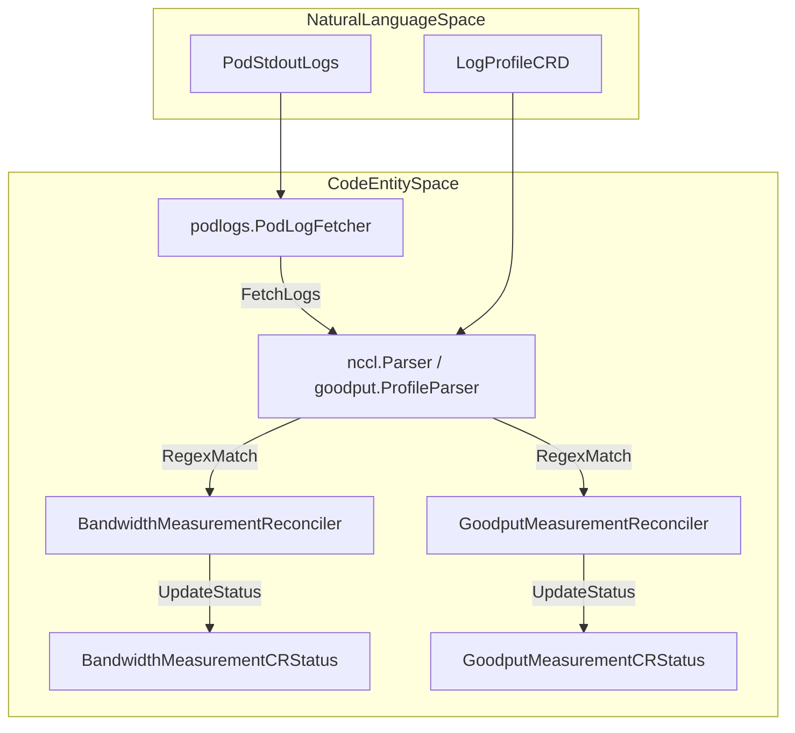

Sources: `pkg/controller/goodputmeasurement_controller.go:52-79`, `pkg/controller/bandwidthmeasurement_controller.go:51-100`, `pkg/podlogs/`

### Terminal Flow Sequence Diagram

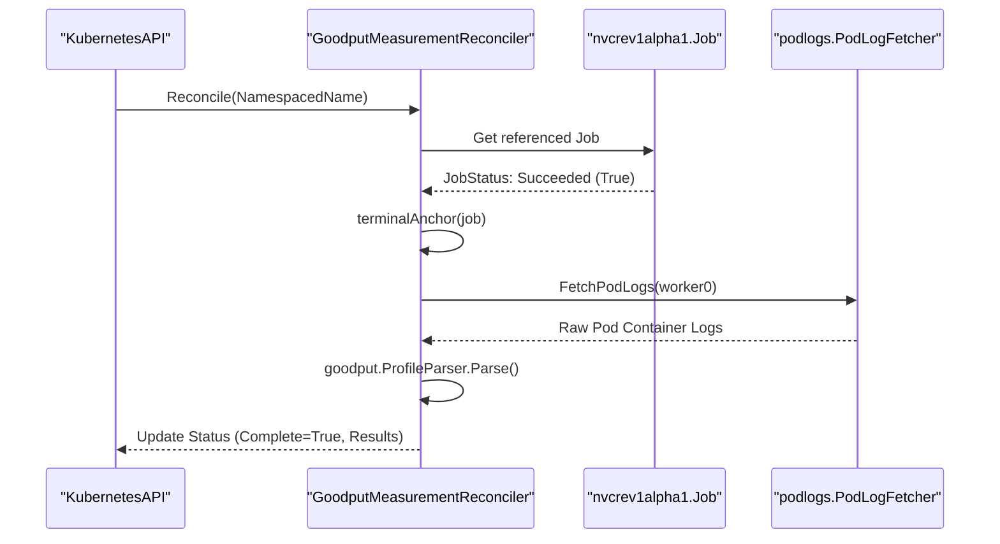

Sources: `pkg/controller/goodputmeasurement_controller.go:132-163`, `pkg/podutil/discoverer.go:31-93`

---

# Page: Controller Manager

# Controller Manager

<details>
<summary>Relevant source files</summary>

The following files were used as context for generating this wiki page:

- [cmd/integration/testdata/reconcile/bandwidth-measurement/expected.json](cmd/integration/testdata/reconcile/bandwidth-measurement/expected.json)
- [cmd/integration/testdata/reconcile/goodput-measurement/expected.json](cmd/integration/testdata/reconcile/goodput-measurement/expected.json)
- [cmd/integration/testdata/reconcile/goodput-measurement/input_config.yaml](cmd/integration/testdata/reconcile/goodput-measurement/input_config.yaml)
- [cmd/integration/testdata/reconcile/job/expected.json](cmd/integration/testdata/reconcile/job/expected.json)
- [cmd/integration/testdata/reconcile/workflow-topology-metrics-all-failed/expected.json](cmd/integration/testdata/reconcile/workflow-topology-metrics-all-failed/expected.json)
- [cmd/integration/testdata/reconcile/workflow-topology-metrics/expected.json](cmd/integration/testdata/reconcile/workflow-topology-metrics/expected.json)
- [cmd/manager/main.go](cmd/manager/main.go)
- [pkg/controller/certification_controller.go](pkg/controller/certification_controller.go)
- [pkg/controller/helpers.go](pkg/controller/helpers.go)
- [pkg/controller/job_controller.go](pkg/controller/job_controller.go)
- [pkg/controller/metrics.go](pkg/controller/metrics.go)
- [pkg/controller/metrics_cleanup_test.go](pkg/controller/metrics_cleanup_test.go)
- [pkg/controller/workflow_controller.go](pkg/controller/workflow_controller.go)
- [pkg/controller/workloadrun_controller.go](pkg/controller/workloadrun_controller.go)
- [pkg/controller/workloadrun_workflow_lookup_test.go](pkg/controller/workloadrun_workflow_lookup_test.go)

</details>


The controller manager binary (`cmd/manager`) serves as the core control plane component for the NVIDIA Cluster Readiness Engine (NVCRE). It initializes the Kubernetes scheme, registers core API groups and external dependencies (such as Kubeflow Trainer), binds concurrency and leader election parameters, and launches the asynchronous reconciliation loops defined under `pkg/controller`.

```mermaid
graph TD
    Root["newRootCommand()"] --> Scheme["runtime.NewScheme()"]
    Scheme --> ClientGo["clientgoscheme.AddToScheme()"]
    Scheme --> NVCREAPI["nvcrev1alpha1.AddToScheme()"]
    Scheme --> TrainerAPI["trainerv1alpha1.AddToScheme()"]
    Root --> Mgr["ctrl.NewManager()"]
    Mgr --> CertReconciler["CertificationReconciler.SetupWithManager()"]
    Mgr --> WRunReconciler["WorkloadRunReconciler.SetupWithManager()"]
    Mgr --> WflowReconciler["WorkflowReconciler.SetupWithManager()"]
    Mgr --> JobReconciler["JobReconciler.SetupWithManager()"]
```
Sources: [cmd/manager/main.go:43-76](), [cmd/manager/main.go:173-192]()

---

## 3.1 Certification and WorkloadRun Reconcilers

The `CertificationReconciler` and `WorkloadRunReconciler` manage top-level user requests. The `CertificationReconciler` orchestrates multi-category GPU cluster certifications by generating sequential child `Workflow` objects for each test category, tracking adoption and name collisions, and mirroring aggregate status [pkg/controller/certification_controller.go:86-145](). Similarly, the `WorkloadRunReconciler` translates standalone user workloads into managed `Workflow` instances, handling input validation, immutable spec checks, and status propagation [pkg/controller/workloadrun_controller.go:32-110]().

For details, see [Certification and WorkloadRun Reconcilers](#3.1).

Sources: [pkg/controller/certification_controller.go:86-145](), [pkg/controller/workloadrun_controller.go:32-110]()

---

## 3.2 Workflow Reconciler: Node Discovery, Partitioning, Dependencies

The `WorkflowReconciler` oversees node discovery, architecture filtering, shortfall detection, and cordoned node selection [pkg/controller/workflow_controller.go:54-132](). It handles group partitioning across topology domains, materializes scoped dependency resources (such as `TrainingRuntime` or `PersistentVolumeClaim`), and drives the multi-iteration execution state machine.

For details, see [Workflow Reconciler: Node Discovery, Partitioning, Dependencies](#3.2).

Sources: [pkg/controller/workflow_controller.go:54-132]()

---

## 3.3 Job Reconciler and Workload Execution

The `JobReconciler` manages individual execution units by instantiating `TrainJob` and other workload primitives via pluggable workload adapters [pkg/controller/job_controller.go:90-164](). It monitors startup stalls, tracks job timeouts, captures failure logs, records `failedNodes` references, handles multi-node NVLink (MNNVL) configurations, and updates Prometheus metrics.

For details, see [Job Reconciler and Workload Execution](#3.3).

Sources: [pkg/controller/job_controller.go:90-164]()

---

## 3.4 Measurement Controllers and Thresholds

Measurement controllers (`GoodputMeasurement` and `BandwidthMeasurement`) parse pod logs (`pkg/goodput`, `pkg/nccl`) to extract performance metrics. They evaluate measured ratios against defined catalog thresholds and propagate failure reasons or success conditions back to the parent objects.

For details, see [Measurement Controllers and Thresholds](#3.4).

Sources: [pkg/controller/job_controller.go:95-116](), [pkg/controller/metrics.go:107-187]()

---

## 3.5 Node Health Monitoring and Fault Isolation

Node health monitoring uses CEL-based expressions within `NodeFailureDetector` (`pkg/nodemonitor`) to attribute hardware failures, execute adaptive bisection across diagnose groups, and issue remediation reports [pkg/controller/job_controller.go:95-98]().

For details, see [Node Health Monitoring and Fault Isolation](#3.5).

Sources: [pkg/controller/job_controller.go:95-98]()

---

```mermaid
graph TD
    Manager["ctrl.Manager (cmd/manager/main.go)"] --> CR["CertificationReconciler (pkg/controller/certification_controller.go)"]
    Manager --> WR["WorkloadRunReconciler (pkg/controller/workloadrun_controller.go)"]
    CR --> WFR["WorkflowReconciler (pkg/controller/workflow_controller.go)"]
    WR --> WFR
    WFR --> JR["JobReconciler (pkg/controller/job_controller.go)"]
    JR --> Workload["TrainJob / Workload API"]
    JR --> Metrics["Prometheus Metrics (pkg/controller/metrics.go)"]
```
Sources: [cmd/manager/main.go:173-192](), [pkg/controller/certification_controller.go:86-98](), [pkg/controller/workloadrun_controller.go:32-45](), [pkg/controller/workflow_controller.go:54-66](), [pkg/controller/job_controller.go:90-116](), [pkg/controller/metrics.go:21-106]()

---

# Page: Certification and WorkloadRun Reconcilers

# Certification and WorkloadRun Reconcilers

<details>
<summary>Relevant source files</summary>

The following files were used as context for generating this wiki page:

- [cmd/integration/integration_test.go](cmd/integration/integration_test.go)
- [cmd/integration/testdata/reconcile/workloadrun-event-success/expected.json](cmd/integration/testdata/reconcile/workloadrun-event-success/expected.json)
- [cmd/integration/testdata/reconcile/workloadrun-event-success/input_client_objects.yaml](cmd/integration/testdata/reconcile/workloadrun-event-success/input_client_objects.yaml)
- [cmd/integration/testdata/reconcile/workloadrun-event-success/input_config.yaml](cmd/integration/testdata/reconcile/workloadrun-event-success/input_config.yaml)
- [cmd/integration/testdata/reconcile/workloadrun-mpi/input_config.yaml](cmd/integration/testdata/reconcile/workloadrun-mpi/input_config.yaml)
- [cmd/integration/testdata/reconcile/workloadrun-workflow-deleted/expected.json](cmd/integration/testdata/reconcile/workloadrun-workflow-deleted/expected.json)
- [cmd/integration/testdata/reconcile/workloadrun-workflow-deleted/input_client_objects.yaml](cmd/integration/testdata/reconcile/workloadrun-workflow-deleted/input_client_objects.yaml)
- [cmd/integration/testdata/reconcile/workloadrun-workflow-deleted/input_config.yaml](cmd/integration/testdata/reconcile/workloadrun-workflow-deleted/input_config.yaml)
- [cmd/manager/main.go](cmd/manager/main.go)
- [docs/designs/080-phase-transition-events.md](docs/designs/080-phase-transition-events.md)
- [pkg/controller/certification_controller.go](pkg/controller/certification_controller.go)
- [pkg/controller/helpers.go](pkg/controller/helpers.go)
- [pkg/controller/job_controller.go](pkg/controller/job_controller.go)
- [pkg/controller/testdata/certification-workflow-lookup/cache-hit/input.yaml](pkg/controller/testdata/certification-workflow-lookup/cache-hit/input.yaml)
- [pkg/controller/workflow_controller.go](pkg/controller/workflow_controller.go)
- [pkg/controller/workloadrun_controller.go](pkg/controller/workloadrun_controller.go)
- [pkg/controller/workloadrun_workflow_lookup_test.go](pkg/controller/workloadrun_workflow_lookup_test.go)

</details>


## Purpose and Scope
This section covers the technical implementation of the `CertificationReconciler` (`[pkg/controller/certification_controller.go:86-98]`) and `WorkloadRunReconciler` (`[pkg/controller/workloadrun_controller.go:32-45]`) within the NVIDIA Cluster Readiness Engine (`NVCRE`) controller manager (`[cmd/manager/main.go:32-37]()`). These controllers manage the top-level entry points of the NVCRE API group (`nvcre.nvidia.com/v1alpha1`), translating user intent into orchestrated `Workflow` custom resources. They handle per-category workflow generation, speculative adoption, name-collision resolution against etcd, direct `APIReader` cache synchronization fallbacks, exclusive status condition management, and phase transition event publishing.

---

## 1. CertificationReconciler: Per-Category Workflow Generation & Orchestration

The `CertificationReconciler` orchestrates cluster certification test suites by iterating through a declared list of categories (e.g., NCCL bandwidth, training goodput). When a `Certification` CR is created, the reconciler ensures a finalizer is attached (`[pkg/controller/certification_controller.go:137-141]()`) and initiates node discovery (`[pkg/controller/certification_controller.go:143-144]()`). 

Once target nodes are discovered, `reconcileWorkflows` (`[pkg/controller/certification_controller.go:147-164]()`) sequences through categories using internal status tracking (`categoryStatusPending`, `categoryStatusInProgress`, `categoryStatusSucceeded`, `categoryStatusFailed` defined at `[pkg/controller/certification_controller.go:70-74]()`). For each active category, it builds and submits a corresponding `Workflow` resource prefixed with certification labels (`labelCertification`, `labelCategoryDomain`, `labelCategoryVariant` at `[pkg/controller/certification_controller.go:75-77]`).

```mermaid
graph TD
    subgraph "Natural Language Space"
        A["Certification Request"] --> B["Discover Target Nodes"]
        B --> C["Sequence Categories"]
        C --> D["Generate Category Workflow"]
    end

    subgraph "Code Entity Space"
        AA["CertificationReconciler.Reconcile"] --> BB["CertificationReconciler.discoverTargetNodes"]
        BB --> CC["CertificationReconciler.reconcileWorkflows"]
        CC --> DD["CertificationReconciler.processNextCategory"]
    end

    A ==> AA
    B ==> BB
    C ==> CC
    D ==> DD
```
*Sources: `[pkg/controller/certification_controller.go:86-164]()`*

### Sources:
- `[pkg/controller/certification_controller.go:38-164]()`

---

## 2. WorkloadRunReconciler: Standalone Execution & Spec Translation

The `WorkloadRunReconciler` (`[pkg/controller/workloadrun_controller.go:32-45]()`) manages standalone `WorkloadRun` CRs, which execute single training or benchmark runs without full multi-category certification cycles. 

During reconciliation (`[pkg/controller/workloadrun_controller.go:71-91]()`), if a child workflow reference (`workflowRef`) is not yet established, the controller validates the execution framework. It ensures that at least one of `spec.framework.torch`, `spec.framework.mpi`, or `spec.framework.exec` is configured (`[pkg/controller/workloadrun_controller.go:96-108]()`). If validation fails, it records a `WorkloadRunFailed` condition with `ReasonBuildFailed` (`[pkg/controller/workloadrun_controller.go:110-126]()`). Otherwise, it generates a `Workflow` spec via `buildWorkflowSpec` (`[pkg/controller/workloadrun_controller.go:110]`), sets the controller owner reference (`[pkg/controller/workloadrun_controller.go:138-140]()`), and creates the child resource.

Once the workflow reference is recorded in the `WorkloadRun` status, subsequent reconcile passes invoke `mirrorWorkflowStatus` (`[pkg/controller/workloadrun_controller.go:89-91]()`), which copies condition states and phase transitions from the child `Workflow` to the parent `WorkloadRun`.

### Sources:
- `[pkg/controller/workloadrun_controller.go:32-140]()`

---

## 3. Adoption, Name Collisions, and Cache Consistency

Both reconcilers interact with controller-runtime informer caches and the live API server. Because cache synchronization lags can cause state discrepancies immediately following a `Create` call, both controllers utilize an `APIReader` interface (`[pkg/controller/certification_controller.go:91-95]()`, `[pkg/controller/workloadrun_controller.go:35-40]`).

When creating child workflows, a name collision may occur (`apierrors.IsAlreadyExists`). To prevent stranding an object when a write to status `workflowRef` fails after successful creation, `WorkloadRunReconciler` performs an uncached lookup via `workflowReader()` (`[pkg/controller/workloadrun_controller.go:51-56]()`, `[pkg/controller/workloadrun_controller.go:158-161]`). It checks whether the existing workflow is owned by the current `WorkloadRun` (`metav1.IsControlledBy`). If owned, it adopts the resource reference; if foreign and unowned, it flags a name collision.

```mermaid
graph TD
    subgraph "Natural Language Space"
        A1["Create Child Workflow"] --> B1["API Returns AlreadyExists Error"]
        B1 --> C1["Bypass Cache via Uncached APIReader"]
        C1 --> D1{"Is Controlled By Current Run?"}
        D1 -- Yes --> E1["Adopt Workflow Reference"]
        D1 -- No --> F1["Emit Name Collision Warning"]
    end

    subgraph "Code Entity Space"
        AA1["WorkloadRunReconciler.Create"] --> BB1["apierrors.IsAlreadyExists"]
        BB1 --> CC1["WorkloadRunReconciler.workflowReader().Get"]
        CC1 --> DD1["metav1.IsControlledBy"]
        DD1 -- True --> EE1["WorkflowReference Updated"]
        DD1 -- False --> FF1["ReasonWorkflowNameCollision / Warning"]
    end

    A1 ==> AA1
    B1 ==> BB1
    C1 ==> CC1
    D1 ==> DD1
    E1 ==> EE1
    F1 ==> FF1
```
*Sources: `[pkg/controller/workloadrun_controller.go:51-163]()`*

### Sources:
- `[pkg/controller/certification_controller.go:104-110]()`
- `[pkg/controller/workloadrun_controller.go:32-163]()`
- `[pkg/controller/workloadrun_workflow_lookup_test.go:28-116]()`

---

## 4. Exclusive Conditions and Phase Transition Events

Both `Certification` and `WorkloadRun` reconcilers manage exclusive condition sets (`InProgress`, `Succeeded`, `Failed`) to represent the lifecycle phase of the custom resource. Status updates are mediated by helper functions that evaluate whether condition types or reasons have changed before issuing Kubernetes API patches.

Per **ADR-080** (`[docs/designs/080-phase-transition-events.md:61-119]()`), phase transitions emit explicit Kubernetes Events through `events.EventRecorder` (`[pkg/controller/helpers.go:44-74]`). Rather than generating events on every periodic reconciliation requeue (which occurs every 15 seconds by default, per `[pkg/controller/certification_controller.go:67]` and `[pkg/controller/workloadrun_controller.go:63]`), event publishing is scoped strictly to state flips where an exclusive condition transitions to `True` for `InProgress`, `Succeeded`, or `Failed`.

### Sources:
- `[pkg/controller/helpers.go:13-82]()`
- `[docs/designs/080-phase-transition-events.md:1-119]()`

---

# Page: Workflow Reconciler: Node Discovery, Partitioning, Dependencies

# Workflow Reconciler: Node Discovery, Partitioning, Dependencies

<details>
<summary>Relevant source files</summary>

The following files were used as context for generating this wiki page:

- [cmd/integration/testdata/reconcile/cordoned-node-selected-explicit-monitor/expected.json](cmd/integration/testdata/reconcile/cordoned-node-selected-explicit-monitor/expected.json)
- [cmd/integration/testdata/reconcile/cordoned-node-selected-explicit-monitor/input_client_objects.yaml](cmd/integration/testdata/reconcile/cordoned-node-selected-explicit-monitor/input_client_objects.yaml)
- [cmd/integration/testdata/reconcile/cordoned-node-selected-explicit-monitor/input_config.yaml](cmd/integration/testdata/reconcile/cordoned-node-selected-explicit-monitor/input_config.yaml)
- [cmd/integration/testdata/reconcile/cordoned-node-selected/expected.json](cmd/integration/testdata/reconcile/cordoned-node-selected/expected.json)
- [cmd/integration/testdata/reconcile/cordoned-node-selected/input_client_objects.yaml](cmd/integration/testdata/reconcile/cordoned-node-selected/input_client_objects.yaml)
- [cmd/integration/testdata/reconcile/cordoned-node-selected/input_config.yaml](cmd/integration/testdata/reconcile/cordoned-node-selected/input_config.yaml)
- [cmd/integration/testdata/reconcile/workflow-explicit-health-monitor-preserved/expected.json](cmd/integration/testdata/reconcile/workflow-explicit-health-monitor-preserved/expected.json)
- [cmd/integration/testdata/reconcile/workflow-explicit-health-monitor-preserved/input_client_objects.yaml](cmd/integration/testdata/reconcile/workflow-explicit-health-monitor-preserved/input_client_objects.yaml)
- [cmd/integration/testdata/reconcile/workflow-explicit-health-monitor-preserved/input_config.yaml](cmd/integration/testdata/reconcile/workflow-explicit-health-monitor-preserved/input_config.yaml)
- [pkg/controller/certification_archfilter_test.go](pkg/controller/certification_archfilter_test.go)
- [pkg/controller/testdata/not-enough-nodes-message/heterogeneous-target/expected.json](pkg/controller/testdata/not-enough-nodes-message/heterogeneous-target/expected.json)
- [pkg/controller/testdata/not-enough-nodes-message/heterogeneous-target/input.yaml](pkg/controller/testdata/not-enough-nodes-message/heterogeneous-target/input.yaml)
- [pkg/controller/testdata/not-enough-nodes-message/no-exclusions/expected.json](pkg/controller/testdata/not-enough-nodes-message/no-exclusions/expected.json)
- [pkg/controller/testdata/not-enough-nodes-message/no-exclusions/input.yaml](pkg/controller/testdata/not-enough-nodes-message/no-exclusions/input.yaml)
- [pkg/controller/testdata/not-enough-nodes-message/several-excluded/expected.json](pkg/controller/testdata/not-enough-nodes-message/several-excluded/expected.json)
- [pkg/controller/testdata/not-enough-nodes-message/several-excluded/input.yaml](pkg/controller/testdata/not-enough-nodes-message/several-excluded/input.yaml)
- [pkg/controller/testdata/resolve-nodes-per-job-after-arch-filter/constraint-divisibility-honoured/expected.json](pkg/controller/testdata/resolve-nodes-per-job-after-arch-filter/constraint-divisibility-honoured/expected.json)
- [pkg/controller/testdata/resolve-nodes-per-job-after-arch-filter/constraint-divisibility-honoured/input.yaml](pkg/controller/testdata/resolve-nodes-per-job-after-arch-filter/constraint-divisibility-honoured/input.yaml)
- [pkg/controller/testdata/resolve-nodes-per-job-after-arch-filter/constraint-unsatisfiable-after-filter/expected.json](pkg/controller/testdata/resolve-nodes-per-job-after-arch-filter/constraint-unsatisfiable-after-filter/expected.json)
- [pkg/controller/testdata/resolve-nodes-per-job-after-arch-filter/constraint-unsatisfiable-after-filter/input.yaml](pkg/controller/testdata/resolve-nodes-per-job-after-arch-filter/constraint-unsatisfiable-after-filter/input.yaml)
- [pkg/controller/testdata/resolve-nodes-per-job-after-arch-filter/explicit-ceiling-still-applies/expected.json](pkg/controller/testdata/resolve-nodes-per-job-after-arch-filter/explicit-ceiling-still-applies/expected.json)
- [pkg/controller/testdata/resolve-nodes-per-job-after-arch-filter/explicit-ceiling-still-applies/input.yaml](pkg/controller/testdata/resolve-nodes-per-job-after-arch-filter/explicit-ceiling-still-applies/input.yaml)
- [pkg/controller/testdata/resolve-nodes-per-job-after-arch-filter/heterogeneous-sizes-to-survivors/expected.json](pkg/controller/testdata/resolve-nodes-per-job-after-arch-filter/heterogeneous-sizes-to-survivors/expected.json)
- [pkg/controller/testdata/waiting-for-nodes/no-schedulable-nodes/expected.json](pkg/controller/testdata/waiting-for-nodes/no-schedulable-nodes/expected.json)
- [pkg/controller/testdata/waiting-for-nodes/no-schedulable-nodes/input.yaml](pkg/controller/testdata/waiting-for-nodes/no-schedulable-nodes/input.yaml)
- [pkg/controller/waiting_for_nodes_test.go](pkg/controller/waiting_for_nodes_test.go)
- [pkg/controller/workflow_nodeshortfall_test.go](pkg/controller/workflow_nodeshortfall_test.go)

</details>


## Purpose and Scope

This page covers the technical implementation of the `Workflow` controller within the NVIDIA Cluster Readiness Engine (`pkg/controller`). The workflow reconciler is responsible for translating high-level certification orchestration targets into concrete, partitioned execution units (`Job` custom resources). Specifically, this document details node discovery, architectural filtering, node shortfall messaging, handling of cordoned/tainted nodes, group partitioning algorithms, dependency materialization, and the iteration state machine.

Sources: `pkg/controller/workflow_nodeshortfall_test.go` [pkg/controller/workflow_nodeshortfall_test.go:1-56](), `cmd/integration/testdata/reconcile/cordoned-node-selected/input_client_objects.yaml` [cmd/integration/testdata/reconcile/cordoned-node-selected/input_client_objects.yaml:1-46]()

---

## 1. Node Discovery and Filtering

The workflow reconciler initiates execution by querying the Kubernetes API server for `Node` objects that match the criteria specified under `Workflow.Spec.Orchestration.Target`. 

### Node Selectors and Taint Handling
Nodes are initially filtered via standard `nodeSelector` maps (e.g., matching `nvidia.com/gpu.present: "true"`). When nodes are cordoned (`spec.unschedulable: true` or carrying `NoSchedule` taints), they are omitted by default unless explicitly opted in via `Workflow.Spec.Orchestration.Target.TaintSelectors`. 

As demonstrated in integration test fixtures, selecting cordoned nodes dynamically generates appropriate tolerations and node affinity overrides in the spawned `Job` definitions:
- If a workflow selects cordoned nodes without an explicit `nodeHealthMonitor` override, the controller adapts the node monitor configuration [cmd/integration/testdata/reconcile/cordoned-node-selected/input_client_objects.yaml:1-46]().
- If an explicit `nodeHealthMonitor` expression is supplied in the `jobTemplate`, it is preserved rather than overwritten [cmd/integration/testdata/reconcile/workflow-explicit-health-monitor-preserved/input_client_objects.yaml:1-38]().

### Architecture Filters
Once candidate nodes are retrieved, architectural filters evaluate GPU product labels (e.g., `nvidia.com/gpu.product`) against requested target architectures (such as `h100`, `a100`, or `gb200`) [pkg/controller/testdata/resolve-nodes-per-job-after-arch-filter/constraint-unsatisfiable-after-filter/input.yaml:1-13](). Nodes failing architecture or capacity checks are excluded from the active pool [pkg/controller/workflow_nodeshortfall_test.go:40-43]().

### Node Shortfall Messaging
When the pool of surviving nodes falls below the required count for a given workload scale, the controller generates descriptive diagnostic errors using `notEnoughNodesMessage` [pkg/controller/workflow_nodeshortfall_test.go:45-45](). Rather than returning generic scheduling failures, the message explicitly differentiates between architecture mismatches, capacity shortfalls, and taint/cordon exclusions [pkg/controller/workflow_nodeshortfall_test.go:15-18]().

```mermaid
graph TD
    sub:WorkflowReconciler["WorkflowReconciler"] --> disc["List Kubernetes Nodes"]
    disc --> sel["Apply nodeSelector & TaintSelectors"]
    sel --> arch["Evaluate Architecture & GPU Product Filters"]
    arch --> check{"Sufficient Nodes Surviving?"}
    check -->|No| shortfall["Invoke notEnoughNodesMessage()"]
    check -->|Yes| partition["Proceed to Group Partitioning"]

    shortfall --> err["Report Shortfall Condition on Workflow Status"]
```
Sources: `pkg/controller/workflow_nodeshortfall_test.go` [pkg/controller/workflow_nodeshortfall_test.go:15-56](), `cmd/integration/testdata/reconcile/cordoned-node-selected/input_client_objects.yaml` [cmd/integration/testdata/reconcile/cordoned-node-selected/input_client_objects.yaml:5-19]()

---

## 2. Group Partitioning and Sizing Logic

After successful node discovery and filtering, the reconciler partitions the surviving node pool into discrete execution groups based on the test scale and nodes-per-job specifications.

### Partitioning Parameters
* **`totalNodes`**: Total count of operational nodes matching the target constraints.
* **`nodesPerJob`**: The number of nodes assigned to each individual `Job` instance.
* **`totalGroups`**: Calculated as `totalNodes / nodesPerJob`, determining how many parallel or sequential jobs run per iteration.

Divisibility constraints and explicit ceilings are strictly enforced. If `totalNodes` is not evenly divisible by `nodesPerJob`, the reconciler evaluates remainder policies or marks the configuration invalid depending on catalog constraints.

```mermaid
title: "Group Partitioning Code Entity Flow"
graph TD
    sub:WorkflowReconciler["WorkflowReconciler.reconcileWorkflow"] --> partFn["partitionNodesIntoGroups()"]
    partFn --> calc["Calculate totalGroups & nodesPerJob"]
    calc --> valDiv["Validate Divisibility & Ceilings"]
    valDiv -->|Invalid| errState["Fail Workflow Status"]
    valDiv -->|Valid| genJobs["Materialize Job CRs per Group"]
```
Sources: `pkg/controller/workflow_nodeshortfall_test.go` [pkg/controller/workflow_nodeshortfall_test.go:1-56](), `cmd/integration/testdata/reconcile/cordoned-node-selected/expected.json` [cmd/integration/testdata/reconcile/cordoned-node-selected/expected.json:1-15]()

---

## 3. Dependency Materialization and Iteration State Machine

Workflows manage execution through an iteration state machine that steps through certification phases across multiple iterations (`orchestration.iterations`).

### Iteration State Machine Data Flow
1. **Pending**: Workflow is created; nodes are discovered and filtered.
2. **InProgress**: Jobs for the current iteration (`currentIteration`) are materialized with owner references pointing to the `Workflow` resource [cmd/integration/testdata/reconcile/cordoned-node-selected/expected.json:16-25]().
3. **Job Running**: The controller monitors child `Job` execution and updates condition types (`InProgress`, `Succeeded`, `Failed`) [cmd/integration/testdata/reconcile/cordoned-node-selected/expected.json:101-135]().
4. **Iteration Transition**: Upon successful completion of all groups in iteration $N$, `currentIteration` increments until it equals `iterations`.
5. **Completion**: Once all iterations finish, the workflow transitions to `Succeeded`.

```mermaid
title: "Workflow Iteration State Machine"
graph LR
    start([Workflow Created]) --> discover[Node Discovery & Filtering]
    discover --> partition[Group Partitioning]
    partition --> mat[Materialize Jobs for Iteration i]
    mat --> monitor{Monitor Jobs}
    monitor -->|Running| monitor
    monitor -->|Failure| fail[Set Workflow Failed]
    monitor -->|Success| increment{More Iterations?}
    increment -->|Yes| mat
    increment -->|No| succeed[Set Workflow Succeeded]
```
Sources: `cmd/integration/testdata/reconcile/cordoned-node-selected/expected.json` [cmd/integration/testdata/reconcile/cordoned-node-selected/expected.json:101-215](), `cmd/integration/testdata/reconcile/cordoned-node-selected/input_config.yaml` [cmd/integration/testdata/reconcile/cordoned-node-selected/input_config.yaml:1-16]()

---

# Page: Job Reconciler and Workload Execution

# Job Reconciler and Workload Execution

<details>
<summary>Relevant source files</summary>

The following files were used as context for generating this wiki page:

- [cmd/manager/main.go](cmd/manager/main.go)
- [pkg/controller/certification_controller.go](pkg/controller/certification_controller.go)
- [pkg/controller/failure_log_test.go](pkg/controller/failure_log_test.go)
- [pkg/controller/helpers.go](pkg/controller/helpers.go)
- [pkg/controller/job_controller.go](pkg/controller/job_controller.go)
- [pkg/controller/testdata/apply-failed-nodes-ref/idempotent-same-ref/expected.json](pkg/controller/testdata/apply-failed-nodes-ref/idempotent-same-ref/expected.json)
- [pkg/controller/testdata/apply-failed-nodes-ref/idempotent-same-ref/input.yaml](pkg/controller/testdata/apply-failed-nodes-ref/idempotent-same-ref/input.yaml)
- [pkg/controller/testdata/apply-failed-nodes-ref/nil-ref-no-op/expected.json](pkg/controller/testdata/apply-failed-nodes-ref/nil-ref-no-op/expected.json)
- [pkg/controller/testdata/apply-failed-nodes-ref/nil-ref-no-op/input.yaml](pkg/controller/testdata/apply-failed-nodes-ref/nil-ref-no-op/input.yaml)
- [pkg/controller/testdata/apply-failed-nodes-ref/sets-new-ref/expected.json](pkg/controller/testdata/apply-failed-nodes-ref/sets-new-ref/expected.json)
- [pkg/controller/testdata/apply-failed-nodes-ref/sets-new-ref/input.yaml](pkg/controller/testdata/apply-failed-nodes-ref/sets-new-ref/input.yaml)
- [pkg/controller/testdata/apply-failed-nodes-ref/updates-different-ref/expected.json](pkg/controller/testdata/apply-failed-nodes-ref/updates-different-ref/expected.json)
- [pkg/controller/testdata/apply-failed-nodes-ref/updates-different-ref/input.yaml](pkg/controller/testdata/apply-failed-nodes-ref/updates-different-ref/input.yaml)
- [pkg/controller/testdata/apply-succeeded-nodes-ref/idempotent-same-ref/expected.json](pkg/controller/testdata/apply-succeeded-nodes-ref/idempotent-same-ref/expected.json)
- [pkg/controller/testdata/apply-succeeded-nodes-ref/idempotent-same-ref/input.yaml](pkg/controller/testdata/apply-succeeded-nodes-ref/idempotent-same-ref/input.yaml)
- [pkg/controller/testdata/apply-succeeded-nodes-ref/nil-ref-no-op/expected.json](pkg/controller/testdata/apply-succeeded-nodes-ref/nil-ref-no-op/expected.json)
- [pkg/controller/testdata/failure-log-capture/pod-already-deleted/expected.json](pkg/controller/testdata/failure-log-capture/pod-already-deleted/expected.json)
- [pkg/controller/testdata/failure-log-capture/pod-already-deleted/input.yaml](pkg/controller/testdata/failure-log-capture/pod-already-deleted/input.yaml)
- [pkg/controller/testdata/failure-log-capture/pod-present-nothing-terminated/expected.json](pkg/controller/testdata/failure-log-capture/pod-present-nothing-terminated/expected.json)
- [pkg/controller/testdata/failure-log-capture/pod-present-nothing-terminated/input.yaml](pkg/controller/testdata/failure-log-capture/pod-present-nothing-terminated/input.yaml)
- [pkg/controller/testdata/failure-log-tail/empty-stream/expected.json](pkg/controller/testdata/failure-log-tail/empty-stream/expected.json)
- [pkg/controller/testdata/failure-log-tail/empty-stream/input.yaml](pkg/controller/testdata/failure-log-tail/empty-stream/input.yaml)
- [pkg/controller/testdata/failure-log-tail/exactly-the-cap/expected.json](pkg/controller/testdata/failure-log-tail/exactly-the-cap/expected.json)
- [pkg/controller/testdata/workloadrun-mpi-launcher-mnnvl/gb300-explicit-false/expected.json](pkg/controller/testdata/workloadrun-mpi-launcher-mnnvl/gb300-explicit-false/expected.json)
- [pkg/controller/testdata/workloadrun-mpi-launcher-mnnvl/gb300-explicit-false/input.yaml](pkg/controller/testdata/workloadrun-mpi-launcher-mnnvl/gb300-explicit-false/input.yaml)
- [pkg/controller/testdata/workloadrun-mpi-launcher-mnnvl/gb300-unset/expected.json](pkg/controller/testdata/workloadrun-mpi-launcher-mnnvl/gb300-unset/expected.json)
- [pkg/controller/testdata/workloadrun-mpi-launcher-mnnvl/gb300-unset/input.yaml](pkg/controller/testdata/workloadrun-mpi-launcher-mnnvl/gb300-unset/input.yaml)
- [pkg/controller/testdata/workloadrun-mpi-launcher-mnnvl/h100-explicit-true/expected.json](pkg/controller/testdata/workloadrun-mpi-launcher-mnnvl/h100-explicit-true/expected.json)
- [pkg/controller/testdata/workloadrun-mpi-launcher-mnnvl/h100-explicit-true/input.yaml](pkg/controller/testdata/workloadrun-mpi-launcher-mnnvl/h100-explicit-true/input.yaml)
- [pkg/controller/testdata/workloadrun-mpi-launcher-mnnvl/h100-unset/expected.json](pkg/controller/testdata/workloadrun-mpi-launcher-mnnvl/h100-unset/expected.json)
- [pkg/controller/testdata/workloadrun-mpi-launcher-mnnvl/h100-unset/input.yaml](pkg/controller/testdata/workloadrun-mpi-launcher-mnnvl/h100-unset/input.yaml)
- [pkg/controller/workflow_controller.go](pkg/controller/workflow_controller.go)
- [pkg/controller/workloadrun_controller.go](pkg/controller/workloadrun_controller.go)
- [pkg/controller/workloadrun_mnnvl_test.go](pkg/controller/workloadrun_mnnvl_test.go)
- [pkg/controller/workloadrun_workflow_lookup_test.go](pkg/controller/workloadrun_workflow_lookup_test.go)
- [pkg/nodemonitor/cel/detector.go](pkg/nodemonitor/cel/detector.go)
- [pkg/podlogs/fetcher.go](pkg/podlogs/fetcher.go)
- [pkg/podlogs/fetcher_test.go](pkg/podlogs/fetcher_test.go)
- [pkg/podlogs/testdata/open-stream/default-timeout-cancel-on-close/expected.json](pkg/podlogs/testdata/open-stream/default-timeout-cancel-on-close/expected.json)
- [pkg/podlogs/testdata/open-stream/default-timeout-cancel-on-close/input.yaml](pkg/podlogs/testdata/open-stream/default-timeout-cancel-on-close/input.yaml)
- [pkg/podlogs/testdata/open-stream/parent-deadline-earlier/expected.json](pkg/podlogs/testdata/open-stream/parent-deadline-earlier/expected.json)
- [pkg/podlogs/testdata/open-stream/parent-deadline-earlier/input.yaml](pkg/podlogs/testdata/open-stream/parent-deadline-earlier/input.yaml)
- [pkg/podlogs/testdata/open-stream/stall-before-headers/expected.json](pkg/podlogs/testdata/open-stream/stall-before-headers/expected.json)
- [pkg/podlogs/testdata/open-stream/stall-before-headers/input.yaml](pkg/podlogs/testdata/open-stream/stall-before-headers/input.yaml)
- [pkg/podlogs/testdata/open-stream/stall-reading-body/expected.json](pkg/podlogs/testdata/open-stream/stall-reading-body/expected.json)

</details>


## Purpose and Scope

This page documents the technical implementation of the `JobReconciler` within the NVIDIA Cluster Readiness Engine (`cluster-readiness-engine`). It covers how `Job` custom resources drive underlying training workloads (such as Kubeflow `TrainJob` objects) via workload adapters, manage timeouts and stall detection, capture failure logs from pods, record node references (`failedNodes`), handle Multi-Node NVLink (`MNNVL`) parameters, and expose controller metrics.

---

## 1. Job Reconciler Architecture and Workload Creation

The `JobReconciler` is defined in `pkg/controller/job_controller.go` and manages the execution lifecycle of `Job` custom resources [pkg/controller/job_controller.go:90-116](). It watches `Job` objects and their owned workloads (such as Kubeflow Trainer `TrainJob` resources), reconciling cluster state to match the desired workload configuration [pkg/controller/job_controller.go:149-155]().

When a `Job` enters reconciliation, `JobReconciler` resolves the appropriate workload adapter via `pkg/workload` to instantiate the underlying custom resource on the API server [pkg/controller/job_controller.go:42](). Scheme registrations for `trainerv1alpha1` and `nvcrev1alpha1` are initialized in `cmd/manager/main.go` to support these third-party types [cmd/manager/main.go:70-76]().

```mermaid
graph TD
    subgraph "Control Plane"
        A["JobReconciler.Reconcile"] --> B["r.workloadReader()"]
        B --> C{"Workload Exists?"}
        C -->|No| D["workload.NewAdapter()"]
        D --> E["r.Create(TrainJob)"]
        C -->|Yes| F["r.syncWorkloadStatus()"]
    end
    subgraph "Execution Plane"
        E --> G["trainerv1alpha1.TrainJob"]
        G --> H["corev1.Pod"]
    end
    
    style A fill:none,stroke:#000,stroke-width:2px
    style G fill:none,stroke:#000,stroke-width:2px
    style H fill:none,stroke:#000,stroke-width:2px
```
*Figure 1: `JobReconciler` workload creation and synchronization flow.*

Sources: `pkg/controller/job_controller.go:90-116`, `cmd/manager/main.go:70-76`

---

## 2. Timeouts and Stall Detection

The reconciler enforces two primary time-based boundaries during workload execution:
1. **Job Timeout (`timeoutPerJob`)**: Bounds the total runtime of a job from creation to completion. If exceeded, the job is marked failed with reason `ReasonJobTimedOut` [pkg/controller/helpers.go:94-96](). Timed-out jobs are never retried [pkg/controller/helpers.go:95]().
2. **Startup Stall Timeout (`defaultStartupStallTimeout`)**: Bounded by `defaultStartupStallTimeout` (20 minutes) [pkg/controller/job_controller.go:67-70](), this detects jobs that fail to transition out of initialization or emit their first training step.

When a workload is suspended (e.g., a `TrainJob` suspended by Kueue waiting for cluster quota), it reports `ReasonWorkloadPending` [pkg/controller/helpers.go:139-143](). While pending, time does not count against `timeoutPerJob` or stall detection [pkg/controller/helpers.go:141-143]().

```mermaid
graph TD
    subgraph "JobReconciler Timeouts"
        I["Job InProgress"] --> P{"Workload Pending?"}
        P -->|Yes| S["Pause Stall / Timeout Clocks"]
        P -->|No| T{"Elapsed > timeoutPerJob?"}
        T -->|Yes| F["Set Condition JobTimedOut"]
        T -->|No| SD{"Startup Stall Detected?"}
        SD -->|Yes| SF["Fail Job (Startup Stall)"]
    end

    style I fill:none,stroke:#000,stroke-width:2px
    style F fill:none,stroke:#000,stroke-width:2px
    style SF fill:none,stroke:#000,stroke-width:2px
```
*Figure 2: Timeout and stall evaluation state machine.*

Sources: `pkg/controller/job_controller.go:67-70`, `pkg/controller/helpers.go:94-96`, `pkg/controller/helpers.go:139-143`

---

## 3. Failure Log Capture

When a workload fails, `JobReconciler` executes `captureFailureLog` to retrieve stdout/stderr tails from associated pods [pkg/controller/job_controller.go:119-120](), [pkg/controller/failure_log_test.go:63-128]().

The log extraction relies on `readLogTail` (`pkg/controller/job_controller.go`), adhering to fixed safety constraints:
* **Line Limit (`failureLogTailLines`)**: Defaults to 800 lines to avoid truncating structured JSON outputs (such as `dcgmi diag --json`) [pkg/controller/failure_log_test.go:156-159]().
* **Byte Cap (`failureLogMaxBytes`)**: Capped at `32 * 1024` bytes (32 KB), trimming from the front so that newest error outputs are preserved [pkg/controller/failure_log_test.go:156-160]().

If pods are already deleted when failure log capture runs, the reconciler handles the absence gracefully without blocking error propagation [pkg/controller/failure_log_test.go:63-67]().

```mermaid
graph LR
    subgraph "Failure Log Pipeline"
        L["Pod Logs Stream"] --> RT["readLogTail()"]
        RT --> T1["Check failureLogTailLines (800)"]
        T1 --> T2["Check failureLogMaxBytes (32KB)"]
        T2 --> S["Store in Job.Status.FailureLog"]
    end

    style L fill:none,stroke:#000,stroke-width:2px
    style S fill:none,stroke:#000,stroke-width:2px
```
*Figure 3: Failure log tail extraction and byte capping.*

Sources: `pkg/controller/job_controller.go:119-120`, `pkg/controller/failure_log_test.go:63-160`

---

## 4. Node Reference Tracking (`failedNodes` and `succeededNodes`)

To support fault isolation and cluster readiness scoring, the job execution framework populates and tracks node references (`failedNodesRef` and `succeededNodesRef`) [pkg/controller/job_controller.go:39]() (`pkg/noderesults`). 

The reconciler updates these lists idempotently, ensuring that repeated status updates for identical node selections result in no-ops, while changes correctly propagate node identifiers for downstream reporting and adaptive bisection (`pkg/nodemonitor`) [pkg/controller/job_controller.go:95-96]().

Sources: `pkg/controller/job_controller.go:39`, `pkg/controller/job_controller.go:95-96`

---

## 5. Multi-Node NVLink (MNNVL) Handling

Workloads targeting GPU architectures supporting Multi-Node NVLink (such as GB200, GB300, or explicitly configured H100 environments) evaluate the `NCCL_MNNVL_ENABLE` environment variable [pkg/controller/workflow_controller.go:47-48](), [pkg/controller/testdata/workloadrun-mpi-launcher-mnnvl/h100-explicit-true/input.yaml:4-7]().

The MNNVL handling logic checks:
1. Explicit specification overrides (`spec.enableMNNVL`) provided in workload runs [pkg/controller/testdata/workloadrun-mpi-launcher-mnnvl/h100-explicit-true/input.yaml:4-7]().
2. Architecture defaults from catalog profiles (`pkg/catalog`) [cmd/manager/main.go:116-119]().

If enabled, launcher arguments inject `-x NCCL_MNNVL_ENABLE=1` (or `0` when disabled or unset on non-MNNVL architectures) into MPI command lines [pkg/controller/testdata/workloadrun-mpi-launcher-mnnvl/gb300-explicit-false/expected.json:14-17]().

```mermaid
graph TD
    subgraph "MNNVL Evaluation"
        M1["Inspect Workload Spec (enableMNNVL)"] --> M2{"Explicitly Set?"}
        M2 -->|Yes| M3["Use Explicit Boolean Value"]
        M2 -->|No| M4["Fall back to GPU Architecture Default"]
        M3 --> M5["Inject NCCL_MNNVL_ENABLE into Launcher Env"]
        M4 --> M5
    end

    style M1 fill:none,stroke:#000,stroke-width:2px
    style M5 fill:none,stroke:#000,stroke-width:2px
```
*Figure 4: MNNVL configuration resolution and launcher injection.*

Sources: `pkg/controller/workflow_controller.go:47-48`, `pkg/controller/testdata/workloadrun-mpi-launcher-mnnvl/h100-explicit-true/input.yaml:4-7`, `pkg/controller/testdata/workloadrun-mpi-launcher-mnnvl/gb300-explicit-false/expected.json:14-17`

---

## 6. Metrics and Telemetry

The `JobReconciler` integrates with controller-runtime's metrics registry (`cmd/manager/main.go`) to export operational telemetry:
* **Reconciliation Latency**: Histograms tracking duration per reconciliation pass.
* **Workload State Counters**: Gauges reflecting active, succeeded, failed, and timed-out jobs.
* **Failure Attribution Metrics**: Counters tracking hardware failures identified via CEL-based node monitors (`pkg/nodemonitor/cel`) [pkg/controller/job_controller.go:37-38]().

Sources: `cmd/manager/main.go:154-162`, `pkg/controller/job_controller.go:37-38`

---

# Page: Measurement Controllers and Thresholds

# Measurement Controllers and Thresholds

<details>
<summary>Relevant source files</summary>

The following files were used as context for generating this wiki page:

- [cmd/integration/testdata/reconcile/goodput-measurement-job-succeed/expected.json](cmd/integration/testdata/reconcile/goodput-measurement-job-succeed/expected.json)
- [pkg/controller/bandwidthmeasurement_controller.go](pkg/controller/bandwidthmeasurement_controller.go)
- [pkg/controller/event_helpers_test.go](pkg/controller/event_helpers_test.go)
- [pkg/controller/goodputmeasurement_controller.go](pkg/controller/goodputmeasurement_controller.go)
- [pkg/controller/testdata/goodput-final-sample/plain-read-stays-throttled/expected.json](pkg/controller/testdata/goodput-final-sample/plain-read-stays-throttled/expected.json)
- [pkg/controller/testdata/goodput-final-sample/plain-read-stays-throttled/input.yaml](pkg/controller/testdata/goodput-final-sample/plain-read-stays-throttled/input.yaml)
- [pkg/controller/testdata/unresolved-log-profile/goodput-succeeded-zero-result/expected.json](pkg/controller/testdata/unresolved-log-profile/goodput-succeeded-zero-result/expected.json)
- [pkg/controller/testdata/unresolved-log-profile/goodput-succeeded-zero-result/input.yaml](pkg/controller/testdata/unresolved-log-profile/goodput-succeeded-zero-result/input.yaml)
- [pkg/controller/unresolved_log_profile_test.go](pkg/controller/unresolved_log_profile_test.go)
- [pkg/goodput/parser.go](pkg/goodput/parser.go)
- [pkg/nccl/parser.go](pkg/nccl/parser.go)
- [pkg/nccl/parser_test.go](pkg/nccl/parser_test.go)
- [pkg/nccl/testdata/real_a100_allreduce_2node_pdt.log](pkg/nccl/testdata/real_a100_allreduce_2node_pdt.log)
- [pkg/nccl/testdata/real_a100_loopback_pdt.log](pkg/nccl/testdata/real_a100_loopback_pdt.log)
- [pkg/podutil/discoverer.go](pkg/podutil/discoverer.go)

</details>


## Purpose and Scope

This page details the implementation of measurement controllers in the NVIDIA Cluster Readiness Engine (`NVCRE`), focusing on `GoodputMeasurement` and `BandwidthMeasurement` reconcilers located in `pkg/controller/`. It covers pod log fetching (`pkg/podutil`, `pkg/podlogs`), log parsing engines (`pkg/goodput` and `pkg/nccl`), caching mechanisms for `LogProfile` resources, threshold evaluation, and status condition reason propagation.

---

## Measurement Reconcilers Architecture

The measurement controllers observe NVCRE `Job` custom resources and evaluate workload performance by parsing container logs from worker pods. 

### GoodputMeasurementReconciler and BandwidthMeasurementReconciler

`GoodputMeasurementReconciler` (`[pkg/controller/goodputmeasurement_controller.go:53-71]()`) and `BandwidthMeasurementReconciler` (`[pkg/controller/bandwidthmeasurement_controller.go:51-76]()`) manage the lifecycle of performance evaluations. Each controller ensures resource finalization via Kubernetes finalizers (`goodputMeasurementFinalizer` and `bandwidthMeasurementFinalizer`), tracks referenced `Job` states, and samples pod logs periodically based on `spec.sampleInterval`.

```mermaid
graph TD
    subgraph "Control_Plane"
        A["Reconcile"] --> B["Get GoodputMeasurement / BandwidthMeasurement"]
        B --> C["Ensure Finalizer"]
        C --> D["Fetch Referenced Job"]
        D --> E{"Job Status Conditions"}
    end
    subgraph "Job_State_Evaluation"
        E -->|JobInProgress| F["Sample Running Pod Logs"]
        E -->|JobSucceeded| G["Collect Final Sample & Handle Succeeded"]
        E -->|JobFailed| H["Collect Final Sample & Handle Failed"]
    end
    subgraph "Execution_Pipeline"
        F --> I["podutil.WorkerDiscoverer"]
        I --> J["podlogs.PodLogFetcher"]
        J --> K["pkg/goodput or pkg/nccl Parser"]
        K --> L["Update Measurement Status & Conditions"]
    end

    Sources: "pkg/controller/goodputmeasurement_controller.go:90-163", "pkg/controller/bandwidthmeasurement_controller.go:121-170", "pkg/podutil/discoverer.go:18-38"
```

### Pod Discovery and Log Fetching

Pod discovery for measurements relies on `podutil.WorkerDiscoverer` (`[pkg/podutil/discoverer.go:18-26]`) which inspects Kubeflow `TrainJob` resources and extracts worker pods sorted by their `batch.kubernetes.io/job-completion-index` label (`[pkg/podutil/discoverer.go:63-106]()`). Log retrieval is handled by `podlogs.PodLogFetcher` implementations, defaulting to a Kubernetes clientset-backed fetcher (`[pkg/controller/goodputmeasurement_controller.go:73-79]`, `[pkg/controller/bandwidthmeasurement_controller.go:95-100]()`).

Sources: `[pkg/controller/goodputmeasurement_controller.go:90-163]`, `[pkg/controller/bandwidthmeasurement_controller.go:121-170]`, `[pkg/podutil/discoverer.go:18-106]()`

---

## Log Profile Caching and Parser Compilation

Both reconcilers cache compiled parsers to avoid overhead during periodic polling cycles. The cache is keyed by `LogProfile` name and invalidated when the underlying `LogProfile` resource version changes.

| Cache Struct | Target Package | Invalidation Key | Purpose |
| :--- | :--- | :--- | :--- |
| `cachedProfileParser` (`[pkg/controller/goodputmeasurement_controller.go:45-50]()`) | `pkg/goodput` | `resourceVersion` | Caches compiled goodput profile parsers. |
| `cachedNCCLParser` (`[pkg/controller/bandwidthmeasurement_controller.go:78-83]()`) | `pkg/nccl` | `resourceVersion` | Caches compiled NCCL bandwidth parsers. |

Sources: `[pkg/controller/goodputmeasurement_controller.go:45-71]`, `[pkg/controller/bandwidthmeasurement_controller.go:70-84]()`

---

## Log Parsing Engines (`pkg/goodput` & `pkg/nccl`)

The log parsing subsystem extracts performance metrics from unstructured text streams produced by training jobs and NCCL benchmarks.

```mermaid
graph TD
    subgraph "Raw_Pod_Logs"
        A["Raw Kubernetes Log Lines"] --> B["Timestamp Normalization"]
    end
    subgraph "Parser_Engines"
        B --> C{"Profile Type"}
        C -->|Goodput| D["pkg/goodput ProfileParser"]
        C -->|Bandwidth| E["pkg/nccl Parser"]
    end
    subgraph "Extraction_and_Metrics"
        D --> F["Extract Iteration & Goodput Ratios"]
        E --> G["Extract sizeBytes, algBW, busBW"]
    end

    Sources: "pkg/nccl/parser_test.go:32-86", "pkg/nccl/parser_test.go:92-128"
```

### NCCL Bandwidth Parsing (`pkg/nccl`)
The NCCL parser (`[pkg/nccl/parser_test.go:32-86]()`) processes benchmark outputs matching configured regular expressions (e.g., `testBusBWRegex` `[pkg/nccl/parser_test.go:24-26]()`). It robustly handles Kubernetes log timestamp prefixes with or without UTC offsets (`Z` or numeric offsets like `-07:00` in `[pkg/nccl/parser_test.go:92-128]()`), extracting message size (`sizeBytes`), algorithmic bandwidth (`algBW`), and bus bandwidth (`busBW`).

Sources: `[pkg/nccl/parser_test.go:32-206]()`

---

## Threshold Evaluation and Reason Propagation

When workloads reach terminal states (`JobSucceeded` or `JobFailed`), the controllers anchor terminal computations to the job's terminal condition timestamp to ensure determinism across retries and controller restarts (ADR-072).

### Status Conditions and Reasons

Status conditions (`Complete`, `Measuring`) report evaluation outcomes using standardized reasons:
- `LogProfileNotFound` (`reasonGoodputLogProfileMissing` / `reasonBandwidthLogProfileMissing`): Indicates an unresolved `spec.logProfileRef` (`[pkg/controller/goodputmeasurement_controller.go:37-43]`, `[pkg/controller/bandwidthmeasurement_controller.go:42-48]()`). The controllers continue retrying without failing the measurement.
- `NoDataCollected` (`reasonGoodputNoData` / `reasonBandwidthNoData`): Applied when a measurement completes without parsing matching records, distinguishing between zero-result outputs and missing data (`[pkg/controller/unresolved_log_profile_test.go:35-154]()`).

Sources: `[pkg/controller/goodputmeasurement_controller.go:33-43]`, `[pkg/controller/bandwidthmeasurement_controller.go:33-48]`, `[pkg/controller/unresolved_log_profile_test.go:35-154]()`

---

# Page: Node Health Monitoring and Fault Isolation

# Node Health Monitoring and Fault Isolation

<details>
<summary>Relevant source files</summary>

The following files were used as context for generating this wiki page:

- [.claude/skills/release-notes/SKILL.md](.claude/skills/release-notes/SKILL.md)
- [CHANGELOG.md](CHANGELOG.md)
- [README.md](README.md)
- [RELEASE.md](RELEASE.md)
- [SECURITY.md](SECURITY.md)
- [THIRD_PARTY_NOTICES.md](THIRD_PARTY_NOTICES.md)
- [config/samples/policy/kyverno-verify-images.yaml](config/samples/policy/kyverno-verify-images.yaml)
- [config/samples/policy/policy-controller-verify-images.yaml](config/samples/policy/policy-controller-verify-images.yaml)
- [docs/concepts/health-monitoring-remediation.md](docs/concepts/health-monitoring-remediation.md)
- [docs/designs/081-cordoned-node-selection.md](docs/designs/081-cordoned-node-selection.md)
- [docs/operations/verifying-artifacts.md](docs/operations/verifying-artifacts.md)
- [pkg/controller/failure_log_test.go](pkg/controller/failure_log_test.go)
- [pkg/controller/testdata/diagnose-set-groups-conflict/no-conflict/expected.json](pkg/controller/testdata/diagnose-set-groups-conflict/no-conflict/expected.json)
- [pkg/controller/testdata/diagnose-set-groups-conflict/no-conflict/input.yaml](pkg/controller/testdata/diagnose-set-groups-conflict/no-conflict/input.yaml)
- [pkg/controller/testdata/diagnose-set-groups-conflict/one-conflict/expected.json](pkg/controller/testdata/diagnose-set-groups-conflict/one-conflict/expected.json)
- [pkg/controller/testdata/diagnose-set-groups-conflict/one-conflict/input.yaml](pkg/controller/testdata/diagnose-set-groups-conflict/one-conflict/input.yaml)
- [pkg/controller/testdata/failure-log-capture/pod-already-deleted/expected.json](pkg/controller/testdata/failure-log-capture/pod-already-deleted/expected.json)
- [pkg/controller/testdata/failure-log-capture/pod-already-deleted/input.yaml](pkg/controller/testdata/failure-log-capture/pod-already-deleted/input.yaml)
- [pkg/controller/testdata/failure-log-capture/pod-present-nothing-terminated/expected.json](pkg/controller/testdata/failure-log-capture/pod-present-nothing-terminated/expected.json)
- [pkg/controller/testdata/failure-log-capture/pod-present-nothing-terminated/input.yaml](pkg/controller/testdata/failure-log-capture/pod-present-nothing-terminated/input.yaml)
- [pkg/controller/testdata/failure-log-tail/empty-stream/expected.json](pkg/controller/testdata/failure-log-tail/empty-stream/expected.json)
- [pkg/controller/testdata/failure-log-tail/empty-stream/input.yaml](pkg/controller/testdata/failure-log-tail/empty-stream/input.yaml)
- [pkg/controller/testdata/failure-log-tail/exactly-the-cap/expected.json](pkg/controller/testdata/failure-log-tail/exactly-the-cap/expected.json)
- [pkg/controller/testdata/iteration-complete-conflict/final-iteration-failed-one-conflict/expected.json](pkg/controller/testdata/iteration-complete-conflict/final-iteration-failed-one-conflict/expected.json)
- [pkg/controller/testdata/iteration-complete-conflict/final-iteration-failed-one-conflict/input.yaml](pkg/controller/testdata/iteration-complete-conflict/final-iteration-failed-one-conflict/input.yaml)
- [pkg/controller/testdata/iteration-complete-conflict/final-iteration-succeeded-one-conflict/expected.json](pkg/controller/testdata/iteration-complete-conflict/final-iteration-succeeded-one-conflict/expected.json)
- [pkg/controller/testdata/iteration-complete-conflict/final-iteration-succeeded-one-conflict/input.yaml](pkg/controller/testdata/iteration-complete-conflict/final-iteration-succeeded-one-conflict/input.yaml)
- [pkg/controller/testdata/iteration-complete-conflict/next-iteration-no-conflict/expected.json](pkg/controller/testdata/iteration-complete-conflict/next-iteration-no-conflict/expected.json)
- [pkg/controller/testdata/iteration-complete-conflict/next-iteration-no-conflict/input.yaml](pkg/controller/testdata/iteration-complete-conflict/next-iteration-no-conflict/input.yaml)
- [pkg/controller/testdata/iteration-complete-conflict/next-iteration-one-conflict/expected.json](pkg/controller/testdata/iteration-complete-conflict/next-iteration-one-conflict/expected.json)
- [pkg/nodemonitor/cel/detector.go](pkg/nodemonitor/cel/detector.go)

</details>


This page details the implementation of node health monitoring, CEL-based failure detection via `pkg/nodemonitor`, hardware failure attribution across the hierarchy, adaptive fault isolation, and remediation reporting in the NVIDIA Cluster Readiness Engine (NVCRE).

---

## 1. CEL-Based `NodeFailureDetector` in `pkg/nodemonitor`

The `Job` controller runs a pluggable `NodeFailureDetector` alongside each workload [docs/concepts/health-monitoring-remediation.md:9-11](). Detectors evaluate node state continuously during runtime using [Common Expression Language (CEL)](https://cel.dev) expressions evaluated against Kubernetes `Node` objects [docs/concepts/health-monitoring-remediation.md:13-15]().

### CEL Evaluation Mechanics

Conditions, labels, taints, and allocatable resources are exposed within the CEL execution environment. Expressions can be combined using logical operators such as `&&` and `||` [docs/concepts/health-monitoring-remediation.md:13-15](). For example, checking hardware-level telemetry tags:

```cel
node.metadata.labels["nvidia.com/gpu.ecc.error.count"] > "0"
```
*(Source: [docs/concepts/health-monitoring-remediation.md:17-21]())*

Custom detectors can be implemented by satisfying the `NodeFailureDetector` interface defined within the codebase [docs/concepts/health-monitoring-remediation.md:22-24]().

```mermaid
cluster
    title "CEL-Based Node Failure Detection Architecture"
    subgraph pkg_nodemonitor ["pkg/nodemonitor (Detector Engine)"]
        ND[NodeFailureDetector] --> CEL[cel.Env / cel.Program]
    end
    subgraph k8s_api ["Kubernetes API Server"]
        NodeObj[corev1.Node]
    end
    NodeObj -->|Object State| CEL
    CEL -->|Evaluated Result| JobController[controller.JobReconciler]
```
Sources: [docs/concepts/health-monitoring-remediation.md:9-24]()

---

## 2. Hardware Failure Attribution and Propagation

NVCRE does not cordon, taint, or mutate nodes; its responsibility is strict attribution—identifying which nodes failed which validation steps and recording the precise reason [docs/concepts/health-monitoring-remediation.md:25-28]().

### Failure Bubbling Architecture

When a node failure occurs, it propagates upward through the resource hierarchy, shifting from inline pod/job records to persistent `ConfigMap` references:

```mermaid
cluster
    title "Failure Attribution and Propagation Hierarchy"
    subgraph Code_Entities ["Controller & Resource Entities"]
        J[Job: status.failedNodes] -->|persisted to| W[Workflow: status.failedNodesRef]
        W -->|copied to| C[Certification: status.categoryStatuses[].failedNodesRef]
    end
```
Sources: [docs/concepts/health-monitoring-remediation.md:29-52]()

### Failure Reasons and Cordoned Node Rules

Each failed node entry carries a specific attribution reason [docs/concepts/health-monitoring-remediation.md:53-56]():
* `HardwareFailureDetected`: CEL health check detected an unhealthy node mid-run [docs/concepts/health-monitoring-remediation.md:57-59]().
* `ThresholdViolation`: Performance threshold (bandwidth, goodput, step time) missed [docs/concepts/health-monitoring-remediation.md:60-60]().
* `WorkloadFailed`: Workload exited non-zero or stalled [docs/concepts/health-monitoring-remediation.md:61-61]().

Under ADR-081, cordoned nodes can be explicitly targeted by specifying the `node.kubernetes.io/unschedulable` taint inside `target.taintSelectors`, which automatically disables the default cordon health check for that run to prevent false hardware attribution [docs/designs/081-cordoned-node-selection.md:40-59]().

Sources: [docs/concepts/health-monitoring-remediation.md:25-77](), [docs/designs/081-cordoned-node-selection.md:1-96]()

---

## 3. Adaptive Bisection and Diagnose Groups

When a validation run fails across a broad node pool containing multiple suspects, the controller partitions the node selection to isolate faulty hardware without requiring a full suite re-run [docs/concepts/health-monitoring-remediation.md:102-104](). 

Workloads execute iteratively across partitioned subgroupings. If a partition succeeds, its assigned nodes are cleared; if it fails, the controller subdivides the group further (adaptive bisection) until individual faulty nodes are isolated and logged in the corresponding `failedNodesRef` ConfigMap structure [docs/concepts/health-monitoring-remediation.md:29-52]().

Sources: [docs/concepts/health-monitoring-remediation.md:102-104]()

---

## 4. Remediation Reporting and Failure Log Capture

When a workload or node check fails, the controller captures and sanitizes stderr/stdout logs from terminated pods for diagnostics [pkg/controller/failure_log_test.go:30-60](). 

### Log Capture Implementation Limits

* `failureLogTailLines`: Defaults to `800` lines to prevent truncation of structured outputs like DCGM diagnostics [pkg/controller/failure_log_test.go:156-158]().
* `failureLogMaxBytes`: Capped at `32 * 1024` bytes (32 KB), trimming from the front so the latest output and error statements are preserved [pkg/controller/failure_log_test.go:30](), [pkg/controller/failure_log_test.go:159-160]().

Operators can inspect captured failure artifacts via the CLI or query raw configuration data [docs/concepts/health-monitoring-remediation.md:78-92]() or initiate external drain/cordon remediation pipelines [docs/concepts/health-monitoring-remediation.md:93-101]().

```mermaid
cluster
    title "Failure Log Capture Pipeline (pkg/controller)"
    subgraph pkg_controller ["Failure Log Reconciler"]
        PodReader[corev1.Pod Logs] -->|Stream| TailReader[readLogTail]
        TailReader -->|Trim to MaxBytes & Lines| JobStatus[Job.Status.FailureLog]
    end
```
Sources: [pkg/controller/failure_log_test.go:30-160]()

---

# Page: Catalog, Platform Configuration and Rendering

# Catalog, Platform Configuration and Rendering

<details>
<summary>Relevant source files</summary>

The following files were used as context for generating this wiki page:

- [cmd/integration/testdata/reconcile/certification-resources-override/expected.json](cmd/integration/testdata/reconcile/certification-resources-override/expected.json)
- [docs/concepts/catalog.md](docs/concepts/catalog.md)
- [docs/how-to-guides/custom-catalog-entries.md](docs/how-to-guides/custom-catalog-entries.md)
- [pkg/catalog/catalog.go](pkg/catalog/catalog.go)

</details>


## Purpose and Scope

This page provides a high-level overview of how NVIDIA Cluster Readiness Engine (`NVCRE`) defines certification test content, detects underlying cloud platforms and GPU architectures, and renders fully-qualified Kubernetes manifests. Certification logic is structured around domain and variant pairs (`pkg/catalog/` [pkg/catalog/catalog.go:4-8]()), specialized through platform overrides (`pkg/platform`), and materialized into executable workloads (`pkg/render`, `pkg/certification`).

This is a parent page. For deep technical details, refer to the child pages:
- [Certification Catalog](#4.1)
- [Platform and GPU Detection, Overrides and Transforms](#4.2)
- [Manifest Rendering](#4.3)

```mermaid
graph TD
  A["Certification Request"] --> B["pkg/catalog/loader.go"]
  B --> C["pkg/render"]
  C --> D["pkg/platform Overrides"]
  D --> E["Rendered Workload Manifests"]

  style A fill:none,stroke:#000,stroke-width:1px
  style B fill:none,stroke:#000,stroke-width:1px
  style C fill:none,stroke:#000,stroke-width:1px
  style D fill:none,stroke:#000,stroke-width:1px
  style E fill:none,stroke:#000,stroke-width:1px
```
Sources: [docs/concepts/catalog.md:13-14](), [pkg/catalog/catalog.go:4-8]()

---

## 4.1 Certification Catalog

The certification catalog acts as the registry for all supported testing workloads, mapping domain and variant pairs (such as `communication/nccl-all-reduce` or `training/nemotron5-8b`) to pre-configured workflow specifications [docs/concepts/catalog.md:9-26](). Catalog entries are written as YAML files under `pkg/catalog/entries/` and embedded directly into binaries at compile time using Go's `//go:embed` directive in `pkg/catalog/loader.go` [docs/concepts/catalog.md:13](), [pkg/catalog/catalog.go:4-6]().

Each entry defines a base workload specification, orchestration parameters, default resource limits, and dependencies [docs/concepts/catalog.md:13](). Because entries are embedded into the binaries (`nvcrectl` and the controller manager), adding or modifying a catalog entry requires a rebuild [docs/concepts/catalog.md:13](). Users can customize entries using `BuildConfig` fields [pkg/catalog/catalog.go:27-144]() or fall back to runtime alternatives such as `WorkloadRun` or hand-authored `Workflow` custom resources [docs/how-to-guides/custom-catalog-entries.md:134-141]().

For detailed information on catalog file formatting, loader logic, shared `_lib` fragments, NCCL and training entries, and custom entry creation, see [Certification Catalog](#4.1).

Sources: [docs/concepts/catalog.md:9-26](), [docs/how-to-guides/custom-catalog-entries.md:13-20](), [pkg/catalog/catalog.go:4-144]()

---

## 4.2 Platform and GPU Detection, Overrides and Transforms

To support diverse cloud environments (AWS, Azure, OCI, on-premises) and accelerator architectures (such as H100, H200, B200, GB200, GB300), NVCRE dynamically inspects cluster node labels and applies environment-specific modifications [docs/concepts/catalog.md:87-91](). Platform and GPU detection routines identify the runtime context and match `WhenSpec` conditions defined within catalog entries [docs/concepts/catalog.md:89-91]().

Once conditions match, declarative patches—including strategic merge patches and JSON patches—are applied to the base workload specification. This layer handles node resource sizing, gang scheduler propagation (e.g., Volcano/Kueue), network interface counts (`MlnxPerNode`), and specialized hardware flags like multi-node NVLink (`MNNVL`).

For detailed information on platform override mechanics, `WhenSpec` matching rules, GPU architecture detection, and patch application, see [Platform and GPU Detection, Overrides and Transforms](#4.2).

Sources: [docs/concepts/catalog.md:87-91](), [pkg/catalog/catalog.go:40-54]()

---

## 4.3 Manifest Rendering

Manifest rendering translates high-level certification intents and catalog templates into concrete Kubernetes custom resources (`Workflow`, `TrainJob`, `JobSet`, etc.) ready for deployment or dry-run validation [docs/how-to-guides/custom-catalog-entries.md:70-71](). Handled primarily through packages `pkg/render` and `pkg/certification`, the rendering engine resolves template variables (like `{{ .NodesPerJob }}` and `{{ .GpusPerNode }}`), applies orchestration option defaults, and assigns deterministic naming conventions to generated child objects [docs/how-to-guides/custom-catalog-entries.md:70-71]().

Users can invoke offline rendering via the CLI (`nvcrectl certification render`) to inspect generated manifests before submitting them to the Kubernetes API server [docs/how-to-guides/custom-catalog-entries.md:127-130]().

```mermaid
graph TD
  F["api/v1alpha1.Certification"] --> G["pkg/certification.Reconciler"]
  G --> H["pkg/render.RenderWorkflow"]
  H --> I["pkg/catalog.Entry.Build"]
  I --> J["api/v1alpha1.Workflow"]

  style F fill:none,stroke:#000,stroke-width:1px
  style G fill:none,stroke:#000,stroke-width:1px
  style H fill:none,stroke:#000,stroke-width:1px
  style I fill:none,stroke:#000,stroke-width:1px
  style J fill:none,stroke:#000,stroke-width:1px
```
Sources: [docs/how-to-guides/custom-catalog-entries.md:70-71](), [pkg/catalog/catalog.go:146-152]()

For detailed information on offline rendering paths, API server dry-runs, default orchestration option injection, and object naming schemes, see [Manifest Rendering](#4.3).

Sources: [docs/how-to-guides/custom-catalog-entries.md:70-71](), [pkg/catalog/catalog.go:146-152]()

---

# Page: Certification Catalog

# Certification Catalog

<details>
<summary>Relevant source files</summary>

The following files were used as context for generating this wiki page:

- [cmd/integration/testdata/reconcile/certification-aws-a100-dcgm/expected.json](cmd/integration/testdata/reconcile/certification-aws-a100-dcgm/expected.json)
- [cmd/integration/testdata/reconcile/certification-aws-gb200-n5/expected.json](cmd/integration/testdata/reconcile/certification-aws-gb200-n5/expected.json)
- [cmd/integration/testdata/reconcile/certification-aws-h100-n5/expected.json](cmd/integration/testdata/reconcile/certification-aws-h100-n5/expected.json)
- [cmd/integration/testdata/reconcile/certification-gcp-gb200-n5/expected.json](cmd/integration/testdata/reconcile/certification-gcp-gb200-n5/expected.json)
- [cmd/integration/testdata/reconcile/certification-gcp-gb300-nccl/expected.json](cmd/integration/testdata/reconcile/certification-gcp-gb300-nccl/expected.json)
- [cmd/integration/testdata/reconcile/certification-gcp-h100-n5/expected.json](cmd/integration/testdata/reconcile/certification-gcp-h100-n5/expected.json)
- [cmd/integration/testdata/reconcile/certification-oci-dcgm/expected.json](cmd/integration/testdata/reconcile/certification-oci-dcgm/expected.json)
- [cmd/integration/testdata/reconcile/workloadrun-torch/expected.json](cmd/integration/testdata/reconcile/workloadrun-torch/expected.json)
- [pkg/catalog/entries/_lib/gpu-defaults.yaml](pkg/catalog/entries/_lib/gpu-defaults.yaml)
- [pkg/catalog/entries/_lib/nccl/oci-gb300-roce-env.yaml](pkg/catalog/entries/_lib/nccl/oci-gb300-roce-env.yaml)
- [pkg/catalog/entries/_lib/nccl/oci-roce-mpirun-args.yaml](pkg/catalog/entries/_lib/nccl/oci-roce-mpirun-args.yaml)
- [pkg/catalog/entries/communication/nccl-all-gather.yaml](pkg/catalog/entries/communication/nccl-all-gather.yaml)
- [pkg/catalog/entries/communication/nccl-all-reduce.yaml](pkg/catalog/entries/communication/nccl-all-reduce.yaml)
- [pkg/catalog/entries/communication/nccl-alltoall.yaml](pkg/catalog/entries/communication/nccl-alltoall.yaml)
- [pkg/catalog/entries/communication/nccl-loopback-nvswitch.yaml](pkg/catalog/entries/communication/nccl-loopback-nvswitch.yaml)
- [pkg/catalog/entries/communication/nccl-loopback.yaml](pkg/catalog/entries/communication/nccl-loopback.yaml)
- [pkg/catalog/entries/diagnostics/dcgm-level4.yaml](pkg/catalog/entries/diagnostics/dcgm-level4.yaml)
- [pkg/catalog/entries/training/nemotron5-56b.yaml](pkg/catalog/entries/training/nemotron5-56b.yaml)
- [pkg/catalog/entries/training/nemotron5-8b.yaml](pkg/catalog/entries/training/nemotron5-8b.yaml)
- [pkg/catalog/loader.go](pkg/catalog/loader.go)
- [pkg/catalog/test_scale_test.go](pkg/catalog/test_scale_test.go)
- [pkg/catalog/testdata/test-scale-node-count/full-scale/expected.json](pkg/catalog/testdata/test-scale-node-count/full-scale/expected.json)
- [pkg/catalog/testdata/test-scale-node-count/full-scale/input.yaml](pkg/catalog/testdata/test-scale-node-count/full-scale/input.yaml)
- [pkg/catalog/testdata/test-scale-node-count/intra-node-with-max-concurrent/expected.json](pkg/catalog/testdata/test-scale-node-count/intra-node-with-max-concurrent/expected.json)
- [pkg/catalog/testdata/test-scale-node-count/intra-node-with-max-concurrent/input.yaml](pkg/catalog/testdata/test-scale-node-count/intra-node-with-max-concurrent/input.yaml)
- [pkg/catalog/testdata/test-scale-node-count/intra-node/expected.json](pkg/catalog/testdata/test-scale-node-count/intra-node/expected.json)
- [pkg/catalog/testdata/test-scale-node-count/intra-node/input.yaml](pkg/catalog/testdata/test-scale-node-count/intra-node/input.yaml)
- [pkg/controller/testdata/workloadrun-timeout/no-orchestration-block/expected.json](pkg/controller/testdata/workloadrun-timeout/no-orchestration-block/expected.json)
- [pkg/controller/testdata/workloadrun-timeout/no-orchestration-block/input.yaml](pkg/controller/testdata/workloadrun-timeout/no-orchestration-block/input.yaml)
- [pkg/controller/testdata/workloadrun-timeout/orchestration-without-timeout/expected.json](pkg/controller/testdata/workloadrun-timeout/orchestration-without-timeout/expected.json)
- [pkg/controller/testdata/workloadrun-timeout/orchestration-without-timeout/input.yaml](pkg/controller/testdata/workloadrun-timeout/orchestration-without-timeout/input.yaml)
- [pkg/controller/testdata/workloadrun-timeout/unparseable-timeout/expected.json](pkg/controller/testdata/workloadrun-timeout/unparseable-timeout/expected.json)
- [pkg/controller/testdata/workloadrun-timeout/unparseable-timeout/input.yaml](pkg/controller/testdata/workloadrun-timeout/unparseable-timeout/input.yaml)
- [pkg/controller/testdata/workloadrun-timeout/users-own-value/expected.json](pkg/controller/testdata/workloadrun-timeout/users-own-value/expected.json)
- [pkg/controller/testdata/workloadrun-timeout/users-own-value/input.yaml](pkg/controller/testdata/workloadrun-timeout/users-own-value/input.yaml)

</details>


## Purpose and Scope
The Certification Catalog is the core data repository of the NVIDIA Cluster Readiness Engine (NVCRE). It defines the standardized validation workloads—spanning high-performance networking (NCCL), large-scale model training (Megatron-LM / Nemotron), and hardware diagnostics (DCGM)—used to certify GPU cluster readiness. 

This page details the catalog entry format, the embedding and loader mechanism in `pkg/catalog/loader.go`, modular reuse via shared `_lib` fragments, NCCL and training workload implementations, test scale and node count resolution logic, and custom entry overrides.

---

## 1. Catalog Entry Format & Structure
Catalog entries are parameterized YAML files stored under `pkg/catalog/entries/`. Each entry defines a self-contained test definition that the NVCRE controller manager renders into executable `Workflow` and `Job` resources.

An entry consists of five primary top-level blocks:
1. `dependencies`: Required Kubernetes objects (such as `TrainingRuntime` custom resources or `PersistentVolumeClaims`) that must be instantiated prior to workload execution.
2. `jobTemplate`: The specification of the `Job` or `TrainJob` workload, including performance measurement probes (`bandwidthMeasurement`, `goodputMeasurement`), node health monitors (`nodeHealthMonitor`), and container execution parameters.
3. `orchestration`: Directives controlling execution limits, iteration counts, scheduling topologies (e.g., `nvidia.com/gpu.clique`), and diagnostic partitioning.
4. `validation`: Performance thresholds, measurement timeouts, and metric capture rules.
5. `overrides`: Conditional patch blocks (`when:`) evaluated against the detected platform (e.g., `aws`, `gcp`, `azure`, `oci`) and GPU architecture (e.g., `h100`, `gb200`, `gb300`).

```yaml
# Anatomy of a Catalog Entry (e.g., pkg/catalog/entries/communication/nccl-all-reduce.yaml)
dependencies:
  - apiVersion: trainer.kubeflow.org/v1alpha1
    kind: TrainingRuntime
    ...
jobTemplate:
  spec:
    bandwidthMeasurement:
      logProfileRef: nccl-bandwidth
      testType: all_reduce
    workload:
      trainJob:
        ...
orchestration:
  iterations: 1
validation:
  performance:
    enabled: true
overrides:
  - when:
      platform:
        equals: aws
      gpuArchitecture:
        notIn: [gb200, gb300]
    dependencies:
      ...
```

Sources:
- `pkg/catalog/entries/communication/nccl-all-reduce.yaml:4-205`

---

## 2. The Catalog Loader and Template Engine
Catalog entries are embedded directly into the manager binary at compile time using Go's `embed` package and processed via `text/template` with helper functions for modular inclusion (`lib`).

### Key Structures and Functions
* `entriesFS`: An embedded filesystem embedding the entire `entries/` directory tree `[pkg/catalog/loader.go:66-67]()`.
* `EntriesFS()`: Accessor function returning `entriesFS` for internal template fragment resolution `[pkg/catalog/loader.go:69-71]()`.
* `TemplateData`: Struct containing all runtime configuration values (e.g., GPU counts, memory limits, storage sizes, iteration bounds) passed into templates during render time `[pkg/catalog/loader.go:76-183]`.

```mermaid
graph TD
    subcode["Code Entity Space: pkg/catalog"]
        FS["entriesFS (embed.FS)<br/>pkg/catalog/loader.go:66"] -->|embeds| Files["pkg/catalog/entries/*"]
        TD["TemplateData<br/>pkg/catalog/loader.go:76"] -->|supplies variables| Loader["loadEntry / Build<br/>pkg/catalog/loader.go"]
        Files --> Loader
        Loader -->|renders YAML| Output["Rendered Workflow / Job Specs"]
    end

    subnl["Natural Language Space"]
        NL1["Raw YAML Catalog Entries"] --> NL2["Template Parameter Resolution"] --> NL3["Kubernetes Custom Resources"]
        NL1 -.-> Files
        TemplateData -.-> NL2
        Output -.-> NL3
    end

    style FS fill:none,stroke:#000,stroke-width:2px
    style TD fill:none,stroke:#000,stroke-width:2px
    style Loader fill:none,stroke:#000,stroke-width:2px
```
Sources:
- `pkg/catalog/loader.go:66-183`

---

## 3. Shared `_lib` Fragments
To prevent duplication across cloud platforms and hardware generations, catalog entries make extensive use of shared template fragments located under `pkg/catalog/entries/_lib/`. 

These fragments encapsulate platform-specific environment variable injections, Mellanox NIC network configurations, and storage mounts. For instance, `oci-gb300-roce-env.yaml` defines RoCEv2 GID index settings, adaptive routing tuning, and OCI-specific driver workarounds for GB300 nodes:

```yaml
# Snippet from pkg/catalog/entries/_lib/nccl/oci-gb300-roce-env.yaml
- name: UCX_IB_GID_INDEX
  value: "3"
- name: NCCL_IB_GID_INDEX
  value: "3"
- name: NCCL_IB_ADAPTIVE_ROUTING
  value: "1"
- name: NCCL_IB_SPLIT_DATA_ON_QPS
  value: "1"
```

Catalog entries invoke these fragments using the template `lib` helper:
```yaml
{{ lib "nccl/oci-gb300-roce-env.yaml" . | indent 12 }}
```

Sources:
- `pkg/catalog/entries/_lib/nccl/oci-gb300-roce-env.yaml:1-44`
- `pkg/catalog/entries/communication/nccl-loopback-nvswitch.yaml:129-224`

---

## 4. NCCL and Training Entries

### NCCL Communication Workloads
NCCL entries benchmark multi-node or intra-node interconnect bandwidth. Entries such as `nccl-all-reduce.yaml`, `nccl-all-gather.yaml`, and `nccl-alltoall.yaml` deploy OpenMPI training runtimes configured with SSH authentication sidecars (`replicatedJobs`), readiness probes, and performance capture daemons `[pkg/catalog/entries/communication/nccl-all-reduce.yaml:4-114]()`. They utilize `bandwidthMeasurement` blocks to parse pod logs and measure bus bandwidth against established thresholds `[pkg/catalog/entries/communication/nccl-all-reduce.yaml:115-120]()`.

### Training Workloads
Training entries (e.g., `nemotron5-8b.yaml` and `nemotron5-56b.yaml`) validate real training workloads using PyTorch and Megatron-LM. They include:
* **Init Containers**: `megatron-clone` clones or copies the Megatron-LM repository into a shared workspace volume `[pkg/catalog/entries/training/nemotron5-8b.yaml:97-126]()`.
* **Resource Sizing**: DGX-class CPU and memory limits and requests `[pkg/catalog/entries/training/nemotron5-8b.yaml:161-170]`.
* **Goodput Measurement**: Continuous monitoring via `goodputMeasurement` with `megatron-training` log profiles `[pkg/catalog/entries/training/nemotron5-8b.yaml:43-45]()`.
* **Node Health Monitoring**: CEL expression evaluation (`node.spec.unschedulable == true`) for hardware fault attribution `[pkg/catalog/entries/training/nemotron5-8b.yaml:46-48]()`.

Sources:
- `pkg/catalog/entries/communication/nccl-all-reduce.yaml:4-165`
- `pkg/catalog/entries/training/nemotron5-8b.yaml:4-182`

---

## 5. Test Scale and Node Count Resolution
Test scales dictate how jobs are distributed across cluster topologies. The catalog resolves node counts, grouping strategies, and concurrency limits based on the requested `TestScale` parameter.

```mermaid
graph TD
    subcode["Code Entity Space: TestScale Resolution"]
        TS["TestScale Input<br/>pkg/catalog/test_scale_test.go"] --> Resolve["Node Count & Topology Engine"]
        Resolve --> FS["Full-Scale<br/>Default nodes per job"]
        Resolve --> IR["Intra-Rack<br/>nvidia.com/gpu.clique strictDomain: true"]
        Resolve --> DG["Diagnose<br/>MinGroupSize bisection"]
        Resolve --> IN["Intra-Node<br/>1 node, local GPUs"]
    end

    subnl["Natural Language Space"]
        N1["Cluster-wide Full Run"] --> N2["Rack-isolated Validation"] --> N3["Bisection Fault Isolation"]
        N1 -.-> FS
        N2 -.-> IR
        N3 -.-> DG
    end

    style TS fill:none,stroke:#000,stroke-width:2px
    style Resolve fill:none,stroke:#000,stroke-width:2px
```

### Supported Test Scales
* `full-scale`: Utilizes the maximum available nodes per job matching the target architecture defaults defined in `gpu-defaults.yaml` `[pkg/catalog/entries/_lib/gpu-defaults.yaml:19-44]()`.
* `intra-rack`: Constrains execution to specific switch domains using `nvidia.com/gpu.clique` with `strictDomain: true` `[pkg/catalog/entries/communication/nccl-all-reduce.yaml:167-170]()`.
* `diagnose`: Activates adaptive bisection using `minGroupSize` to isolate faulty nodes when failures occur `[pkg/catalog/entries/communication/nccl-all-reduce.yaml:171-175]()`.

Sources:
- `pkg/catalog/entries/_lib/gpu-defaults.yaml:19-44`
- `pkg/catalog/entries/communication/nccl-all-reduce.yaml:167-175`

---

## 6. Custom Entries and Platform Overrides
Catalog entries support conditional extension through the `overrides` array. Each override block specifies a `when` clause evaluating platform names and GPU architectures.

```yaml
overrides:
  - when:
      platform:
        equals: aws
      gpuArchitecture:
        notIn: [gb200, gb300]
    dependencies:
      {{ lib "deps/aws-efa-runtime-patch-comm.yaml" . | indent 2 }}
    jobTemplate:
      spec:
        workload:
          trainJob:
            trainer:
              image: public.ecr.aws/hpc-cloud/nccl-tests:...
```

The loader evaluates these conditions dynamically against cluster platform metadata detected during `setup init` or custom run executions, applying strategic merges to dependencies, environment variables, and container images.

Sources:
- `pkg/catalog/entries/communication/nccl-loopback.yaml:120-146`

---

# Page: Platform and GPU Detection, Overrides and Transforms

# Platform and GPU Detection, Overrides and Transforms

<details>
<summary>Relevant source files</summary>

The following files were used as context for generating this wiki page:

- [cmd/integration/testdata/reconcile/certification-gangscheduler-nccl/expected.json](cmd/integration/testdata/reconcile/certification-gangscheduler-nccl/expected.json)
- [cmd/integration/testdata/reconcile/certification-gangscheduler-training/expected.json](cmd/integration/testdata/reconcile/certification-gangscheduler-training/expected.json)
- [docs/designs/000-adr.md](docs/designs/000-adr.md)
- [docs/designs/027-kustomize-override-ux.md](docs/designs/027-kustomize-override-ux.md)
- [docs/designs/031-platform-aware-nccl-config.md](docs/designs/031-platform-aware-nccl-config.md)
- [docs/designs/073-setup-retry-convergence.md](docs/designs/073-setup-retry-convergence.md)
- [docs/designs/079-workload-object-labels.md](docs/designs/079-workload-object-labels.md)
- [docs/designs/README.md](docs/designs/README.md)
- [pkg/certification/render_gang_scheduler_test.go](pkg/certification/render_gang_scheduler_test.go)
- [pkg/certification/testdata/certification-render-gang-scheduler/gang-scheduler-omitted/expected.json](pkg/certification/testdata/certification-render-gang-scheduler/gang-scheduler-omitted/expected.json)
- [pkg/certification/testdata/certification-render-gang-scheduler/nccl-explicit-queue/expected.json](pkg/certification/testdata/certification-render-gang-scheduler/nccl-explicit-queue/expected.json)
- [pkg/certification/testdata/certification-render-gang-scheduler/queue-omitted-defaults/expected.json](pkg/certification/testdata/certification-render-gang-scheduler/queue-omitted-defaults/expected.json)
- [pkg/certification/testdata/render-platform-flag/nscale/expected.json](pkg/certification/testdata/render-platform-flag/nscale/expected.json)
- [pkg/certification/testdata/render-platform-flag/nscale/input.yaml](pkg/certification/testdata/render-platform-flag/nscale/input.yaml)
- [pkg/certification/testdata/render-platform-flag/nscale/input_certification.yaml](pkg/certification/testdata/render-platform-flag/nscale/input_certification.yaml)
- [pkg/certification/testdata/render-platform-flag/unknown-platform/expected.json](pkg/certification/testdata/render-platform-flag/unknown-platform/expected.json)
- [pkg/certification/testdata/render-platform-flag/unknown-platform/input.yaml](pkg/certification/testdata/render-platform-flag/unknown-platform/input.yaml)
- [pkg/controller/workflow_detect.go](pkg/controller/workflow_detect.go)
- [pkg/platform/overrides/workloadrun.yaml](pkg/platform/overrides/workloadrun.yaml)
- [pkg/platform/platforms.go](pkg/platform/platforms.go)
- [pkg/platform/resources_test.go](pkg/platform/resources_test.go)
- [pkg/platform/testdata/worker-resources/empty-block-gets-a-gpu/expected.json](pkg/platform/testdata/worker-resources/empty-block-gets-a-gpu/expected.json)
- [pkg/platform/testdata/worker-resources/empty-block-gets-a-gpu/input.yaml](pkg/platform/testdata/worker-resources/empty-block-gets-a-gpu/input.yaml)
- [pkg/platform/testdata/worker-resources/explicit-gpu-count-kept/expected.json](pkg/platform/testdata/worker-resources/explicit-gpu-count-kept/expected.json)
- [pkg/platform/testdata/worker-resources/explicit-gpu-count-kept/input.yaml](pkg/platform/testdata/worker-resources/explicit-gpu-count-kept/input.yaml)
- [pkg/platform/testdata/worker-resources/explicit-zero-kept/expected.json](pkg/platform/testdata/worker-resources/explicit-zero-kept/expected.json)
- [pkg/platform/testdata/worker-resources/explicit-zero-kept/input.yaml](pkg/platform/testdata/worker-resources/explicit-zero-kept/input.yaml)
- [pkg/platform/testdata/worker-resources/gpu-named-in-requests-only/expected.json](pkg/platform/testdata/worker-resources/gpu-named-in-requests-only/expected.json)

</details>


## Purpose and Scope

This page details how the NVIDIA Cluster Readiness Engine (NVCRE) inspects cluster nodes to identify cloud platforms and GPU architectures, evaluates conditional constraints via `WhenSpec`, applies structural modifications using strategic merge and JSON patches, propagates gang scheduler metadata, and handles worker resource validation. These mechanisms allow a single certification catalog entry or workload spec to adapt dynamically across heterogeneous cloud environments (AWS, GCP, Azure, OCI, on-premises, and specialized sites).

Sources: `docs/designs/027-kustomize-override-ux.md]`, `pkg/controller/workflow_detect.go]()`

---

## Platform and GPU Architecture Detection

NVCRE detects the underlying cloud platform and GPU architecture by inspecting node metadata during workflow partitioning and reconciliation. 

### Platform Detection

The platform detection logic maps node `ProviderID` prefixes and specific control plane labels to standard platform constants defined in `pkg/platform/platforms.go`. 

- **AWS**: Provider ID prefix `aws://` [pkg/controller/workflow_detect.go:52-53]()
- **GCP**: Provider ID prefix `gce://` [pkg/controller/workflow_detect.go:54-55]()
- **Azure**: Provider ID prefix `azure://` [pkg/controller/workflow_detect.go:56-57]()
- **OCI**: Provider ID prefix `ocid1.` [pkg/controller/workflow_detect.go:58-59]()
- **NScale**: Provider ID prefix `openstack://` combined with allocatable resource `nscale.com/rdmashare` [pkg/controller/workflow_detect.go:60-63]()
- **TogetherAI**: Provider ID prefix `kubevirt://` combined with label `node-role.together.ai/worker` [pkg/controller/workflow_detect.go:66-68]()
- **Mistral**: Provider ID prefix `metal3://` [pkg/controller/workflow_detect.go:71-72]()
- **Forge**: Detected when `ProviderID` is empty if hostname contains `forge` or carries `nke.nvidia.com/site-name` [pkg/controller/workflow_detect.go:42-49]()
- **On-Premises**: Fallback for any unmatched prefix or empty provider ID lacking Forge markers [pkg/controller/workflow_detect.go:50-51](), [pkg/controller/workflow_detect.go:73-75]()

`detectPlatformConsistent` validates that all target nodes report an identical platform, returning an error if heterogeneous platforms are discovered within a single workflow target group [pkg/controller/workflow_detect.go:86-100]().

### GPU Architecture Detection

GPU architecture detection parses the `nvidia.com/gpu.product` node label via `gpu.ParseProduct` [pkg/controller/workflow_detect.go:102-110](). To handle heterogeneous clusters robustly without letting a single anomalous node skew results, `detectGPUArchitecture` invokes `gpu.MajorityArchitecture(nodes)` [pkg/controller/workflow_detect.go:118-123](). Unlabeled nodes do not vote; `"unknown"` is returned only if no node carries the product label [pkg/controller/workflow_detect.go:116-117]().

```mermaid
graph TD
    NodeList["[]corev1.Node"] --> CheckPlatform["detectPlatformConsistent()"]
    NodeList --> CheckGPU["detectGPUArchitecture()"]
    
    CheckPlatform --> InspectID["nodePlatform()"]
    InspectID --> MatchPrefix{"ProviderID Prefix?"}
    MatchPrefix -->|aws://| AWS[platform.AWS]
    MatchPrefix -->|gce://| GCP[platform.GCP]
    MatchPrefix -->|azure://| Azure[platform.Azure]
    MatchPrefix -->|Other/Empty| Fallback[platform.OnPrem]

    CheckGPU --> ParseLabel["nodeGPUArchitecture()"]
    ParseLabel --> Majority["gpu.MajorityArchitecture()"]
    Majority --> ResolvedArch["GPU Arch string"]
```
*Figure 1: Platform and GPU Architecture Detection Flow*

Sources: `pkg/platform/platforms.go]`, `pkg/controller/workflow_detect.go]`

---

## WhenSpec Condition Matching and Conditional Overrides

Catalog entries and `WorkloadRun` configurations use conditional override blocks governed by `WhenSpec`. An override matches if all specified fields evaluate to true against the runtime context (`OverrideContext`) [docs/designs/027-kustomize-override-ux.md:64-73]().

The `WhenSpec` structure evaluates six core conditions:
1. **Platform**: Target cloud provider matching [pkg/platform/overrides/workloadrun.yaml:23-25]()
2. **GPUArchitecture**: GPU model or family matching (supporting scalar equality or `in`/`notIn` lists) [pkg/platform/overrides/workloadrun.yaml:9-11]()
3. **WorkloadKind**: Workload framework type (e.g., `TrainJob`) [docs/designs/027-kustomize-override-ux.md:69-69]()
4. **Topology**: Topology-aware scheduling and domain counts [docs/designs/027-kustomize-override-ux.md:70-71]()
5. **Config**: Recursive subset matching against configuration blocks [docs/designs/027-kustomize-override-ux.md:71-72]()
6. **Expression**: Arbitrary CEL (Common Expression Language) expressions evaluated via `cel-go` [docs/designs/027-kustomize-override-ux.md:72-73]()

Platform-specific files (such as `pkg/platform/overrides/workloadrun.yaml`) leverage these conditions to inject EFA resource requests on AWS [pkg/platform/overrides/workloadrun.yaml:105-132](), configure FastRak environment variables on GCP [pkg/platform/overrides/workloadrun.yaml:176-189](), or mount topology XML files on Azure [docs/designs/031-platform-aware-nccl-config.md:27-34]().

Sources: `docs/designs/027-kustomize-override-ux.md]`, `docs/designs/031-platform-aware-nccl-config.md]`, `pkg/platform/overrides/workloadrun.yaml]`

---

## Strategic Merge and JSON Patches

Override application uses Kubernetes-standard merge libraries rather than custom implementations [docs/designs/027-kustomize-override-ux.md:26-33]().

- **Strategic Merge Patch**: `k8s.io/apimachinery/pkg/util/strategicpatch` processes `jobTemplate` overrides using struct tags (`patchStrategy` and `patchMergeKey`) [docs/designs/027-kustomize-override-ux.md:26-30](). For example, container environment variable lists (`corev1.Container.Env`) correctly merge by variable `name` instead of replacing the list entirely [docs/designs/027-kustomize-override-ux.md:28-30]().
- **JSON Patch (RFC 6902)**: Optional `jobTemplatePatch` fields in override specs execute precise operations (`add`, `remove`, `replace`, `test`) after strategic merge is complete, mirroring Kustomize's two-patch workflow [docs/designs/027-kustomize-override-ux.md:35-49]().

```mermaid
graph TD
    BaseSpec["Base JobTemplateSpec"] --> StrategicMerge["strategicpatch.StrategicMergePatch()"]
    OverrideData["Override JobTemplate JSON"] --> StrategicMerge
    StrategicMerge --> Intermediate["Merged Spec"]
    Intermediate --> JsonPatch["jsonpatch.DecodePatch(jobTemplatePatch)"]
    JsonPatch --> FinalSpec["Final Resolved JobSpec"]
```
*Figure 2: Two-Stage Patch Pipeline (`JobTemplate` + `JobTemplatePatch`)*

Sources: `docs/designs/027-kustomize-override-ux.md]`

---

## Gang Scheduler Propagation and Workload Metadata

Workloads submitted to queue-based schedulers (such as Volcano, Kueue, or KAI) require specific metadata annotations and labels at the top-level workload object and pod template layers.

### WorkloadMetadata API

ADR-079 introduces `WorkloadMetadata` across `JobSpec`, `WorkloadRunSpec`, and `CategoryOptions` to allow declarative labeling of generated workload objects (such as `TrainJob`) without compromising the discriminated union structure of `WorkloadSpec` [docs/designs/079-workload-object-labels.md:65-80]().

```go
type WorkloadMetadata struct {
    Labels map[string]WorkloadLabelValue `json:"labels,omitempty"`
}
```
*[docs/designs/079-workload-object-labels.md:73-76]*

Labels are composed additively and deterministically in the following precedence order:
1. Labels present in the resolved catalog `JobSpec` [docs/designs/079-workload-object-labels.md:132-134]()
2. Global Certification or WorkloadRun `workloadMetadata.labels` [docs/designs/079-workload-object-labels.md:135-135]()
3. Per-category `options.workloadMetadata.labels` [docs/designs/079-workload-object-labels.md:136-136]()
4. Gang-scheduler queue-label invariants (e.g., `kueue.x-k8s.io/queue-name` or KAI queue labels) [docs/designs/079-workload-object-labels.md:137-137]()

Sources: `docs/designs/079-workload-object-labels.md]`

---

## Worker Resources and GPU Capacity Filtering

Before partitioning nodes into execution groups, `filterNodesByGPUCapacity` evaluates whether each candidate node's allocatable GPU count satisfies the workload's per-node requirement (`gpusPerNode`) [pkg/controller/workflow_detect.go:173-179]().

- **Under-Capacity Nodes**: Nodes reporting a positive allocatable count strictly lower than `gpusPerNode` are excluded, preventing workflow groups from stalling indefinitely in a `Pending` state [pkg/controller/workflow_detect.go:151-155]().
- **Unreported or Zero Counts**: Nodes reporting zero allocatable GPUs or omitting the extended resource are retained [pkg/controller/workflow_detect.go:156-167](). This avoids false-positive exclusions during device plugin restart windows, where the kubelet temporarily zeroes advertised counts [pkg/controller/workflow_detect.go:163-169]().

```mermaid
graph TD
    Start["filterNodesByGPUCapacity(nodes, gpusPerNode)"] --> Loop{For Each Node}
    Loop --> CheckReq{gpusPerNode <= 0?}
    CheckReq -->|Yes| KeepNode[Keep Node]
    CheckReq -->|No| CheckAlloc{"Allocatable GPUs < gpusPerNode?"}
    
    CheckAlloc -->|Positive count below req| Exclude["Record gpuCapacityExclusion & Drop"]
    CheckAlloc -->|Zero or Unreported count| KeepPlugin[Keep Node: Treat as plugin restart window]
```
*Figure 3: GPU Capacity Filtering Logic*

Sources: `pkg/controller/workflow_detect.go]`

---

## Summary of Platform Detection and Override Codes

| Component / Function | File Path | Role |
|---|---|---|
| `nodePlatform` | `[pkg/controller/workflow_detect.go:41-76]()` | Derives cloud provider string from `ProviderID` and control plane labels. |
| `detectPlatformConsistent` | `[pkg/controller/workflow_detect.go:88-100]()` | Validates homogeneity across all target nodes in a workflow run. |
| `detectGPUArchitecture` | `[pkg/controller/workflow_detect.go:118-123]()` | Computes majority GPU architecture using `gpu.MajorityArchitecture`. |
| `filterNodesByGPUCapacity` | `[pkg/controller/workflow_detect.go:173-179]()` | Filters out under-capacity nodes while tolerating temporary device plugin resets. |
| `workloadrun.yaml` | `[pkg/platform/overrides/workloadrun.yaml:1-296]()` | Defines platform and GPU-specific overrides for dependencies, env vars, and MPI arguments. |

Sources: `pkg/platform/platforms.go]`, `pkg/controller/workflow_detect.go]`, `pkg/platform/overrides/workloadrun.yaml]`

---

# Page: Manifest Rendering

# Manifest Rendering

<details>
<summary>Relevant source files</summary>

The following files were used as context for generating this wiki page:

- [docs/cli-reference/workflow.md](docs/cli-reference/workflow.md)
- [pkg/certification/render_orchestration_test.go](pkg/certification/render_orchestration_test.go)
- [pkg/certification/testdata/category-watch-labels/mnnvl-duplicate-pair/expected.json](pkg/certification/testdata/category-watch-labels/mnnvl-duplicate-pair/expected.json)
- [pkg/certification/testdata/category-watch-labels/mnnvl-duplicate-pair/input_certification.yaml](pkg/certification/testdata/category-watch-labels/mnnvl-duplicate-pair/input_certification.yaml)
- [pkg/certification/testdata/category-watch-labels/single-instance/expected.json](pkg/certification/testdata/category-watch-labels/single-instance/expected.json)
- [pkg/certification/testdata/category-watch-labels/single-instance/input_certification.yaml](pkg/certification/testdata/category-watch-labels/single-instance/input_certification.yaml)
- [pkg/certification/testdata/render-orchestration-options/checkpoint-max-restarts/expected.json](pkg/certification/testdata/render-orchestration-options/checkpoint-max-restarts/expected.json)
- [pkg/certification/testdata/render-orchestration-options/checkpoint-max-restarts/input.yaml](pkg/certification/testdata/render-orchestration-options/checkpoint-max-restarts/input.yaml)
- [pkg/certification/testdata/render-orchestration-options/defaults-when-unset/expected.json](pkg/certification/testdata/render-orchestration-options/defaults-when-unset/expected.json)
- [pkg/certification/testdata/render-orchestration-options/defaults-when-unset/input.yaml](pkg/certification/testdata/render-orchestration-options/defaults-when-unset/input.yaml)
- [pkg/certification/testdata/render-orchestration-options/diagnose-min-group-size/expected.json](pkg/certification/testdata/render-orchestration-options/diagnose-min-group-size/expected.json)
- [pkg/certification/testdata/render-orchestration-options/diagnose-min-group-size/input.yaml](pkg/certification/testdata/render-orchestration-options/diagnose-min-group-size/input.yaml)
- [pkg/certification/testdata/render-orchestration-options/measurement-timeout-with-thresholds/expected.json](pkg/certification/testdata/render-orchestration-options/measurement-timeout-with-thresholds/expected.json)
- [pkg/certification/testdata/render-orchestration-options/measurement-timeout-with-thresholds/input.yaml](pkg/certification/testdata/render-orchestration-options/measurement-timeout-with-thresholds/input.yaml)
- [pkg/certification/testdata/render-orchestration-options/timeout-and-repeat-count/expected.json](pkg/certification/testdata/render-orchestration-options/timeout-and-repeat-count/expected.json)
- [pkg/render/render.go](pkg/render/render.go)

</details>


## Purpose and Scope

This page details the implementation of manifest rendering and validation paths within the NVIDIA Cluster Readiness Engine (NVCRE), managed primarily by the `pkg/render` and `pkg/certification` packages. Manifest rendering allows operators and CI/CD pipelines to inspect fully resolved Kubernetes resources (`Workflow`, `Job`, and `TrainJob`) offline, apply platform and GPU architectural overrides, simulate execution against built-in mock node topologies or custom node definitions, and perform server-side dry-runs against a live Kubernetes API server.

---

## 1. Offline Rendering and the `pkg/render` Engine

The `pkg/render` package powers the `nvcrectl workflow render` command, enabling the inspection of workflow manifests after applying platform-specific adjustments [pkg/render/render.go:4-67](). 

The rendering pipeline supports three mutually exclusive node context input methods to supply node topology for override matching:
1. **Built-in Mock Templates**: Specifying `--platform` and `--gpu-arch` (`pkg/render/render.go:97-98`) constructs mock nodes from embedded filesystem assets (`pkg/render/render.go:34-35`).
2. **Custom Node Files**: Supplying a YAML file containing `corev1.Node` objects via `--nodes-file` (`pkg/render/render.go:99-100`).
3. **Live Cluster Discovery**: Connecting to an API server via `--dry-run` to discover real nodes (`pkg/render/render.go:102-103`).

```mermaid
graph TD
    subcode["Code Entity Space"]
    CLI["NewWorkflowCommand()"] --> Cmd["newRenderCommand()"]
    Cmd --> Read["readWorkflow()"]
    Read --> Resolve["ResolveWorkflowForPlatform()"]
    Resolve --> Detect["controller.DetectPlatform() / DetectGPUArchitecture()"]
    Resolve --> Build["controller.BuildOverrideContext()"]
    Resolve --> Apply["controller.ApplyOverridesWithTracking()"]

    style CLI fill:#none,stroke:#000
    style Cmd fill:#none,stroke:#000
    style Read fill:#none,stroke:#000
    style Resolve fill:#none,stroke:#000
    style Detect fill:#none,stroke:#000
    style Build fill:#none,stroke:#000
    style Apply fill:#none,stroke:#000
```

*Figure 1: Offline rendering data flow bridging command-line entrypoints to controller resolution functions.*

### Key Functions and Data Structures
- `NewWorkflowCommand()`: Returns the parent Cobra command for workflow operations [pkg/render/render.go:41-51]().
- `newRenderCommand()`: Configures flags (`--platform`, `--gpu-arch`, `--nodes-file`, `--output`, `--dry-run`) and executes the parse-and-render lifecycle [pkg/render/render.go:53-107]().
- `ResolveWorkflowForPlatform()`: Forces explicit platform names or falls back to node-based detection, constructing an `OrchestrationStatus` and invoking override tracking [pkg/render/render.go:149-165]().
- `renderMetadata`: Captures detected platform, architecture, and applied overrides (`AppliedOverride`) [pkg/render/render.go:118-122]().

Sources:
- `pkg/render/render.go`

---

## 2. Server-Side Dry-Run and API Validation

When the `--dry-run` flag is passed to `nvcrectl workflow render`, the rendering engine connects to a live Kubernetes API server to perform server-side dry-run validations [pkg/render/render.go:74-80,102-103](). 

Unlike offline rendering—which relies entirely on static mock files or custom node specs—the dry-run path discovers cluster nodes dynamically and submits the rendered manifests with dry-run mutation semantics enabled (`dryRun: All`). This validates that the resulting custom resources (such as `TrainJob` and `JobSet`) satisfy schema requirements, admission webhooks, and CRD structural definitions without persisting state to etcd.

### `DryRunResult` Schema
Validation outcomes for individual resources are encapsulated in the `DryRunResult` structure [pkg/render/render.go:109-115]():

| Field | Type | Description |
|-------|------|-------------|
| `resource` | `string` | The namespaced kind and name of the rendered resource. |
| `valid` | `bool` | Indicates whether the server-side dry-run passed successfully. |
| `error` | `string` | Contains admission or schema rejection messages if validation failed. |
| `warning` | `string` | Non-fatal warnings returned by the API server during dry-run. |

Sources:
- `pkg/render/render.go`

---

## 3. Orchestration Option Defaults and Resolution

The `pkg/certification` render path manages the expansion of high-level certification categories into concrete workflow execution plans. When parameters such as job execution timeouts, iteration counts, maximum concurrency, or diagnostic group sizes are omitted from user-supplied manifests, the rendering path populates robust defaults derived from the certification catalog [pkg/certification/testdata/render-orchestration-options/defaults-when-unset/input.yaml]().

```mermaid
graph TD
    subcode2["Orchestration Resolution Space"]
    Input["CertificationInput"] --> Catalog["CatalogDefaults"]
    Catalog --> Merge["MergeOrchestrationOptions()"]
    Merge --> Out["ResolvedOrchestrationSpec"]
    Out --> Timeout["TimeoutPerJob / MeasurementTimeout"]
    Out --> Iterations["Iterations / MaxConcurrent"]
    Out --> Topology["TopologyKey / StrictDomain"]

    style Input fill:#none,stroke:#000
    style Catalog fill:#none,stroke:#000
    style Merge fill:#none,stroke:#000
    style Out fill:#none,stroke:#000
    style Timeout fill:#none,stroke:#000
    style Iterations fill:#none,stroke:#000
    style Topology fill:#none,stroke:#000
```

*Figure 2: Orchestration option resolution pipeline mapping unconfigured options to catalog defaults.*

### Option Normalization Rules
- **Timeouts**: If `measurementTimeout` is set alongside evaluation thresholds, it propagates to the job execution runtime [pkg/certification/testdata/render-orchestration-options/measurement-timeout-with-thresholds/input.yaml](). Default job timeouts apply when unspecified (e.g., `1h0m0s`) [pkg/certification/testdata/render-orchestration-options/defaults-when-unset/expected.json]().
- **Checkpointing and Restarts**: Training variants utilizing `enableCheckpoint: true` bind to `maxRestarts` parameters for fault-tolerant recovery loops [pkg/certification/testdata/render-orchestration-options/checkpoint-max-restarts/input.yaml]().
- **Diagnose Groups**: Diagnostic specifications define `minGroupSize` and topology constraints (`nvidia.com/gpu.clique`) to isolate faulty nodes during adaptive bisection [pkg/certification/testdata/render-orchestration-options/diagnose-min-group-size/expected.json]().

Sources:
- `pkg/certification/render_orchestration_test.go`
- `pkg/certification/testdata/render-orchestration-options/defaults-when-unset/input.yaml`
- `pkg/certification/testdata/render-orchestration-options/defaults-when-unset/expected.json`
- `pkg/certification/testdata/render-orchestration-options/checkpoint-max-restarts/input.yaml`
- `pkg/certification/testdata/render-orchestration-options/measurement-timeout-with-thresholds/input.yaml`

---

## 4. Naming Conventions, Watch Labels, and MNNVL Variances

When rendering certification status displays and watch summaries, categories and variants are translated into human-readable watch labels. The rendering logic accounts for multi-node NVLink (MNNVL) configurations by distinguishing between enabled and disabled execution variants, even when sharing identical domain and variant slugs [pkg/certification/testdata/category-watch-labels/mnnvl-duplicate-pair/input_certification.yaml]().

### Watch Label Derivation
- **Standard Categories**: Mapped directly from domain and variant names (e.g., `communication/nccl-all-reduce`, `training/nemotron5-8b`) [pkg/certification/testdata/category-watch-labels/single-instance/input_certification.yaml]().
- **MNNVL Variances**: When duplicate domain/variant pairs appear with differing MNNVL settings, the renderer suffixes the label to prevent display collisions:
  - `communication/nccl-all-reduce (MNNVL Enabled)` [pkg/certification/testdata/category-watch-labels/mnnvl-duplicate-pair/expected.json:2]()
  - `communication/nccl-all-reduce (MNNVL Disabled)` [pkg/certification/testdata/category-watch-labels/mnnvl-duplicate-pair/expected.json:3]()

Sources:
- `pkg/certification/testdata/category-watch-labels/single-instance/input_certification.yaml`
- `pkg/certification/testdata/category-watch-labels/single-instance/expected.json`
- `pkg/certification/testdata/category-watch-labels/mnnvl-duplicate-pair/input_certification.yaml`
- `pkg/certification/testdata/category-watch-labels/mnnvl-duplicate-pair/expected.json`

---

# Page: nvcrectl CLI

# nvcrectl CLI

<details>
<summary>Relevant source files</summary>

The following files were used as context for generating this wiki page:

- [docs/cli-reference/certification.md](docs/cli-reference/certification.md)
- [docs/how-to-guides/certify-a-cluster.md](docs/how-to-guides/certify-a-cluster.md)
- [docs/how-to-guides/run-workloadrun.md](docs/how-to-guides/run-workloadrun.md)
- [docs/how-to-guides/workloadrun-deepseek-v3.md](docs/how-to-guides/workloadrun-deepseek-v3.md)
- [docs/how-to-guides/workloadrun-nemotron5.md](docs/how-to-guides/workloadrun-nemotron5.md)
- [pkg/cluster/cluster.go](pkg/cluster/cluster.go)
- [pkg/cluster/cluster_test.go](pkg/cluster/cluster_test.go)

</details>


## Purpose and Scope

This page provides a high-level overview of the `nvcrectl` (also usable as `kubectl nvcre`) command-line interface. The CLI serves as the primary administrative and operational tool for interacting with the NVIDIA Cluster Readiness Engine (NVCRE). It handles cluster inspection, bootstrapping, workload execution, certification management, and reporting through a unified Cobra-based command tree [pkg/cluster/cluster.go:83-91](). 

This is a parent page. For detailed operational references, consult the following child pages:
- [setup: Install, Status, Reset](#5.1)
- [certification and workloadrun Commands](#5.2)
- [Reporting](#5.3)

---

## Command Tree Architecture

The `nvcrectl` binary organizes functionality into subcommands such as `cluster`, `setup`, `certification`, and `workloadrun`. Each subcommand binds to specific packages in the codebase to execute API calls, render manifests, or manage cluster state.

Title: nvcrectl Command Tree to Code Entities
```mermaid
graph TD
    Root["nvcrectl CLI"] --> ClusterCmd["cluster info [pkg/cluster/cluster.go:83-91]()"]
    Root --> SetupCmd["setup [pkg/setup]()"]
    Root --> CertCmd["certification [docs/cli-reference/certification.md:9-16]()"]
    Root --> WlCmd["workloadrun [docs/how-to-guides/run-workloadrun.md:31-36]()"]
    ClusterCmd --> ClusterInfoFn["newClusterInfoCommand [pkg/cluster/cluster.go:93-156]()"]
    ClusterInfoFn --> DiscoverNodes["DiscoverGPUNodes [pkg/cluster/cluster.go:122-125]()"]
```
Sources: [pkg/cluster/cluster.go:83-156](), [docs/cli-reference/certification.md:9-16](), [docs/how-to-guides/run-workloadrun.md:31-36]()

---

## Shared Cluster-Access Plumbing

All commands that interact with the Kubernetes API server share standard plumbing rooted in `kubeconfig` flag handling and client initialization. Commands utilize `kubeconfig.NewConfigFlags` to parse cluster connection parameters and instantiate Kubernetes clients via `render.NewK8sClient` [pkg/cluster/cluster.go:99-120]().

Title: Shared Cluster-Access Plumbing Flow
```mermaid
graph TD
    Command["Cobra Command Execution"] --> ConfigFlags["kubeconfig.NewConfigFlags [pkg/cluster/cluster.go:99-100]()"]
    ConfigFlags --> K8sClient["render.NewK8sClient [pkg/cluster/cluster.go:117-120]()"]
    K8sClient --> API["Kubernetes API Server"]
```
Sources: [pkg/cluster/cluster.go:99-120]()

---

## 5.1 setup: Install, Status, Reset

The `nvcrectl setup` command tree automates the installation and lifecycle management of NVCRE components on a Kubernetes cluster. This includes applying Custom Resource Definitions (CRDs), deploying the controller manager via Helm, pinning Kubeflow Trainer dependencies, and handling Server-Side Apply (SSA) conflict recovery. 

For complete installation workflows, status diagnostics, and cleanup mechanisms, see [setup: Install, Status, Reset](#5.1).

Sources: [docs/cli-reference/certification.md:25-43]()

---

## 5.2 certification and workloadrun Commands

The `nvcrectl certification` and `nvcrectl workloadrun` command groups allow operators to execute, monitor, and render distributed workloads and full cluster certifications. These commands support wait/timeout semantics, watch output streams, dry-run validation against live API servers, and registry authentication for pulling private workload images.

For details on running, watching, rendering, and timing out certifications and workload runs, see [certification and workloadrun Commands](#5.2).

Sources: [docs/cli-reference/certification.md:9-82](), [docs/how-to-guides/run-workloadrun.md:30-36]()

---

## 5.3 Reporting

The reporting subsystem processes completed certifications and workload runs to generate domain and clique reports. It formats outputs using terminal box-drawing characters, aggregates failure groups, extracts relevant failure log excerpts, and applies terminal escape sanitization.

For details on report generation and formatting options, see [Reporting](#5.3).

Sources: [docs/cli-reference/certification.md:84-97]()

---

# Page: setup: Install, Status, Reset

# setup: Install, Status, Reset

<details>
<summary>Relevant source files</summary>

The following files were used as context for generating this wiki page:

- [docs/cli-reference/setup.md](docs/cli-reference/setup.md)
- [docs/designs/078-jobset-ownership.md](docs/designs/078-jobset-ownership.md)
- [pkg/setup/crds.go](pkg/setup/crds.go)
- [pkg/setup/crds_test.go](pkg/setup/crds_test.go)
- [pkg/setup/helm.go](pkg/setup/helm.go)
- [pkg/setup/helm_test.go](pkg/setup/helm_test.go)
- [pkg/setup/jobset_ownership.go](pkg/setup/jobset_ownership.go)
- [pkg/setup/jobset_ownership_test.go](pkg/setup/jobset_ownership_test.go)
- [pkg/setup/recovery_inventory.go](pkg/setup/recovery_inventory.go)
- [pkg/setup/retained_test.go](pkg/setup/retained_test.go)
- [pkg/setup/setup.go](pkg/setup/setup.go)
- [pkg/setup/setup_test.go](pkg/setup/setup_test.go)
- [pkg/setup/status.go](pkg/setup/status.go)
- [pkg/setup/status_test.go](pkg/setup/status_test.go)
- [pkg/setup/testdata/apply-chart-crds/fresh-install-creates/expected.txt](pkg/setup/testdata/apply-chart-crds/fresh-install-creates/expected.txt)
- [pkg/setup/testdata/apply-chart-crds/fresh-install-creates/input_crds.yaml](pkg/setup/testdata/apply-chart-crds/fresh-install-creates/input_crds.yaml)
- [pkg/setup/testdata/apply-chart-crds/invalid-document-fails/error](pkg/setup/testdata/apply-chart-crds/invalid-document-fails/error)
- [pkg/setup/testdata/apply-chart-crds/invalid-document-fails/input_crds.yaml](pkg/setup/testdata/apply-chart-crds/invalid-document-fails/input_crds.yaml)
- [pkg/setup/testdata/apply-chart-crds/no-crds-fails/error](pkg/setup/testdata/apply-chart-crds/no-crds-fails/error)
- [pkg/setup/testdata/init-recovery/bundled-jobset-blocks-recovery/input.yaml](pkg/setup/testdata/init-recovery/bundled-jobset-blocks-recovery/input.yaml)
- [pkg/setup/testdata/init-recovery/bundled-jobset-blocks-recovery/input_objects.yaml](pkg/setup/testdata/init-recovery/bundled-jobset-blocks-recovery/input_objects.yaml)
- [pkg/setup/testdata/init-recovery/fresh-install-readonly-clusterrole-collision/expected.txt](pkg/setup/testdata/init-recovery/fresh-install-readonly-clusterrole-collision/expected.txt)
- [pkg/setup/testdata/init-recovery/fresh-install-readonly-clusterrole-collision/input.yaml](pkg/setup/testdata/init-recovery/fresh-install-readonly-clusterrole-collision/input.yaml)
- [pkg/setup/testdata/init-recovery/fresh-install-readonly-clusterrole-collision/input_objects.yaml](pkg/setup/testdata/init-recovery/fresh-install-readonly-clusterrole-collision/input_objects.yaml)
- [pkg/setup/testdata/jobset-ownership/bundled-controller-with-gke-consumer/expected.json](pkg/setup/testdata/jobset-ownership/bundled-controller-with-gke-consumer/expected.json)
- [pkg/setup/testdata/print-retained-resources/all-retained/expected.txt](pkg/setup/testdata/print-retained-resources/all-retained/expected.txt)
- [pkg/setup/testdata/print-retained-resources/all-retained/input_config.yaml](pkg/setup/testdata/print-retained-resources/all-retained/input_config.yaml)
- [pkg/setup/testdata/print-retained-resources/all-retained/input_objects.yaml](pkg/setup/testdata/print-retained-resources/all-retained/input_objects.yaml)
- [pkg/setup/testdata/print-retained-resources/forbidden-lookup-reports-may-remain/expected.txt](pkg/setup/testdata/print-retained-resources/forbidden-lookup-reports-may-remain/expected.txt)
- [pkg/setup/testdata/print-retained-resources/forbidden-lookup-reports-may-remain/input_config.yaml](pkg/setup/testdata/print-retained-resources/forbidden-lookup-reports-may-remain/input_config.yaml)
- [pkg/setup/testdata/print-retained-resources/nothing-retained/expected.txt](pkg/setup/testdata/print-retained-resources/nothing-retained/expected.txt)
- [pkg/setup/testdata/print-retained-resources/nothing-retained/input_config.yaml](pkg/setup/testdata/print-retained-resources/nothing-retained/input_config.yaml)
- [pkg/setup/testdata/print-retained-resources/pull-secret-absent/expected.txt](pkg/setup/testdata/print-retained-resources/pull-secret-absent/expected.txt)
- [pkg/setup/testdata/print-retained-resources/pull-secret-absent/input_config.yaml](pkg/setup/testdata/print-retained-resources/pull-secret-absent/input_config.yaml)
- [pkg/setup/testdata/setup-status-helm/helm-unavailable/expected.txt](pkg/setup/testdata/setup-status-helm/helm-unavailable/expected.txt)
- [pkg/setup/testdata/setup-status-helm/helm-unavailable/input.yaml](pkg/setup/testdata/setup-status-helm/helm-unavailable/input.yaml)
- [pkg/setup/testdata/setup-status-helm/ready/expected.txt](pkg/setup/testdata/setup-status-helm/ready/expected.txt)
- [pkg/setup/testdata/setup-status-helm/ready/input.yaml](pkg/setup/testdata/setup-status-helm/ready/input.yaml)
- [pkg/setup/testdata/setup-status-helm/release-missing/expected.txt](pkg/setup/testdata/setup-status-helm/release-missing/expected.txt)
- [pkg/setup/testdata/setup-status-helm/trainer-release-failed/expected.txt](pkg/setup/testdata/setup-status-helm/trainer-release-failed/expected.txt)
- [pkg/setup/trainer_version_test.go](pkg/setup/trainer_version_test.go)
- [test/uat/Tiltfile](test/uat/Tiltfile)

</details>


## Purpose and Scope
This page documents the technical implementation of the `pkg/setup` package, which powers the `nvcrectl setup` command tree. The subsystem manages cluster bootstrap, dependency provisioning (specifically Kubeflow Trainer and Helm releases), CustomResourceDefinition (CRD) synchronization via Server-Side Apply (SSA), ownership conflict recovery, and cluster installation diagnostics.

Sources: [pkg/setup/setup.go:1-70](), [docs/cli-reference/setup.md:1-59]()

---

## 1. Setup Phases and Execution Pipeline

The setup command delegates to three core operational phases, modeled after Kubernetes lifecycle phases (`cr`, `deps`, `helm`). The `NewCommand` function initializes the `setup` command tree, mounting `init`, `reset`, and `status` subcommands.

```mermaid
graph TD
    A["UserCommand: nvcrectl setup init"] --> B["CodeEntity: RunInit"]
    B --> C["Phase: deps (Kubeflow Trainer)"]
    B --> D["Phase: helm (NVCRE Chart)"]
    D --> E["CodeEntity: applyChartCRDs"]
    D --> F["CodeEntity: installHelmRelease"]

    subgraph "Setup Execution Flow"
    C
    D
    E
    F
    end

    classDef default stroke:#000,stroke-width:1px,fill:none;
```
*Figure 1: Setup Phase Execution Pipeline*

Sources: [pkg/setup/setup.go:42-90](), [pkg/setup/setup.go:167-177]()

---

## 2. Helm Automation and CRD Server-Side Apply

Helm manages the installation of NVCRE and Kubeflow Trainer releases. However, Helm natively applies charts' `crds/` directories exclusively upon initial chart installation (`helm upgrade --install`). Subsequent upgrades skip CRD updates, causing schema drift (Issue #145). 

To resolve this, NVCRE explicitly extracts and applies CRDs via Server-Side Apply (SSA) prior to executing Helm upgrades.

```mermaid
graph TD
    A["CodeEntity: installHelmRelease"] --> B["CodeEntity: resolveHelmChartVersion"]
    B --> C["CodeEntity: fetchChartCRDs"]
    C --> D["CodeEntity: chartCRDsArgs ('helm show crds')"]
    C --> E["CodeEntity: applyChartCRDs"]
    E --> F["Kubernetes API Server (SSA)"]
    F --> G["CodeEntity: nvcreHelmUpgradeArgs"]
    G --> H["Helm CLI Execution"]

    classDef default stroke:#000,stroke-width:1px,fill:none;
```
*Figure 2: Helm and CRD Synchronization Data Flow*

### CRD Reconcile Implementation
The `applyChartCRDs` function parses multi-document YAML manifests returned by `helm show crds`, filtering for `CustomResourceDefinition` kinds, and applies them using `client.ApplyConfigurationFromUnstructured` with field manager `nvcrectl-setup` and `client.ForceOwnership`.

Sources: [pkg/setup/helm.go:125-172](), [pkg/setup/crds.go:23-109]()

---

## 3. Kubeflow Trainer Pinning and JobSet Ownership Modes

NVCRE compiles against and mandates Kubeflow Trainer version `v2.2.1`. The version constant `kubeflowTrainerVersion` is statically bound to ensure schema compatibility between the controller and installed CRDs.

```go
const kubeflowTrainerVersion = "v2.2.1"
```

### JobSet Ownership (ADR-078)
Kubeflow Trainer vendors JobSet as a subchart. On clusters where JobSet is managed externally (e.g., via an independent Helm release or manual installation), installing Trainer with bundled JobSet ownership causes ownership collisions. 

`nvcrectl setup init` inspects existing cluster resources (`ValidatingWebhookConfiguration`, `MutatingWebhookConfiguration`, and `ClusterRole` objects matching `jobset.x-k8s.io`) to distinguish between:
1. **Absent / Clean State**: Safe for bundled deployment.
2. **External Controller Ownership**: Bypasses subchart installation or adapts parameters.
3. **Ambiguous Ownership**: Halts execution to prevent cluster degradation.

Sources: [pkg/setup/setup.go:31-36](), [docs/designs/078-jobset-ownership.md:1-42]()

---

## 4. SSA Conflict Recovery and Retry Logic

When upgrading or installing Helm releases, webhook Secret field-ownership conflicts (e.g., on `.data` fields in `kubeflow-system`) can leave releases wedged in `failed` or `pending-*` states.

* **Automatic Recovery**: Triggered when a install failure matches the webhook Secret conflict signature, provided no live Trainer workloads exist and JobSet ownership checks pass.
* **Recovery Procedure**:
  1. Uninstalls the `kubeflow-trainer` Helm release.
  2. Deletes Trainer CRDs while retaining `jobsets.jobset.x-k8s.io`.
  3. Purges the `kubeflow-system` namespace after safety inventory validations.
  4. Reinstalls the pinned Kubeflow Trainer release.

Sources: [docs/cli-reference/setup.md:30-58]()

---

## 5. Cluster Status Reporting (`nvcrectl setup status`)

The `status` subcommand evaluates the readiness of all NVCRE dependencies, CRDs, controller deployments, and optional monitoring services.

```mermaid
graph TD
    A["CodeEntity: newSetupStatusCommand"] --> B["CodeEntity: collectSetupStatus"]
    B --> C["Check: NVCRE CRDs & Controller"]
    B --> D["Check: Kubeflow Trainer Version"]
    B --> E["Check: LogProfiles & GPU Operator"]
    B --> F["Check: DCGM Service (Optional)"]
    B --> G["Query: Helm Releases (nvcre, kubeflow-trainer)"]
    G --> H["Output: Table or JSON"]

    classDef default stroke:#000,stroke-width:1px,fill:none;
```
*Figure 3: Status Collection and Reporting Pipeline*

### Component Health Criteria
`SetupStatusComponents` tracks individual subsystem statuses. The top-level `installed` boolean evaluates to `true` if and only if all mandatory components are present and operational, and no managed Helm release is wedged in a failed or pending phase.

Sources: [pkg/setup/status.go:51-114](), [pkg/setup/status.go:115-174]()

---

## 6. Reset and Retained Resources

The `nvcrectl setup reset` command tears down NVCRE releases and associated cluster resources, with explicit protections for shared infrastructure (such as externally managed JobSet controllers and non-NVCRE namespaces) as dictated by ownership discovery rules.

Sources: [pkg/setup/setup.go:87-90]()

---

# Page: certification and workloadrun Commands

# certification and workloadrun Commands

<details>
<summary>Relevant source files</summary>

The following files were used as context for generating this wiki page:

- [docs/cli-reference/workloadrun.md](docs/cli-reference/workloadrun.md)
- [pkg/certification/certification.go](pkg/certification/certification.go)
- [pkg/workloadrun/build_workflow_spec_test.go](pkg/workloadrun/build_workflow_spec_test.go)
- [pkg/workloadrun/testdata/build-workflow-spec/gang-scheduler-propagates/expected.json](pkg/workloadrun/testdata/build-workflow-spec/gang-scheduler-propagates/expected.json)
- [pkg/workloadrun/testdata/build-workflow-spec/gang-scheduler-propagates/input.yaml](pkg/workloadrun/testdata/build-workflow-spec/gang-scheduler-propagates/input.yaml)
- [pkg/workloadrun/testdata/build-workflow-spec/intra-node-runs-one-node-per-job/input.yaml](pkg/workloadrun/testdata/build-workflow-spec/intra-node-runs-one-node-per-job/input.yaml)
- [pkg/workloadrun/testdata/build-workflow-spec/mpi-mnnvl-enable/expected.json](pkg/workloadrun/testdata/build-workflow-spec/mpi-mnnvl-enable/expected.json)
- [pkg/workloadrun/testdata/build-workflow-spec/mpi-mnnvl-enable/input.yaml](pkg/workloadrun/testdata/build-workflow-spec/mpi-mnnvl-enable/input.yaml)
- [pkg/workloadrun/testdata/finish-workloadrun-wait-terminal-at-timeout/failed/expected.txt](pkg/workloadrun/testdata/finish-workloadrun-wait-terminal-at-timeout/failed/expected.txt)
- [pkg/workloadrun/testdata/finish-workloadrun-wait-terminal-at-timeout/failed/input.yaml](pkg/workloadrun/testdata/finish-workloadrun-wait-terminal-at-timeout/failed/input.yaml)
- [pkg/workloadrun/testdata/finish-workloadrun-wait-terminal-at-timeout/succeeded/expected.txt](pkg/workloadrun/testdata/finish-workloadrun-wait-terminal-at-timeout/succeeded/expected.txt)
- [pkg/workloadrun/testdata/finish-workloadrun-wait-terminal-at-timeout/succeeded/input.yaml](pkg/workloadrun/testdata/finish-workloadrun-wait-terminal-at-timeout/succeeded/input.yaml)
- [pkg/workloadrun/testdata/finish-workloadrun-wait-timeout/run-remains-active/expected.txt](pkg/workloadrun/testdata/finish-workloadrun-wait-timeout/run-remains-active/expected.txt)
- [pkg/workloadrun/testdata/finish-workloadrun-wait-timeout/run-remains-active/input.yaml](pkg/workloadrun/testdata/finish-workloadrun-wait-timeout/run-remains-active/input.yaml)
- [pkg/workloadrun/testdata/finish-workloadrun-wait-timeout/state-unknown/expected.txt](pkg/workloadrun/testdata/finish-workloadrun-wait-timeout/state-unknown/expected.txt)
- [pkg/workloadrun/testdata/finish-workloadrun-wait-timeout/state-unknown/input.yaml](pkg/workloadrun/testdata/finish-workloadrun-wait-timeout/state-unknown/input.yaml)
- [pkg/workloadrun/testdata/finish-workloadrun-wait-timeout/workloadrun-missing/expected.txt](pkg/workloadrun/testdata/finish-workloadrun-wait-timeout/workloadrun-missing/expected.txt)
- [pkg/workloadrun/testdata/finish-workloadrun-wait-timeout/workloadrun-missing/input.yaml](pkg/workloadrun/testdata/finish-workloadrun-wait-timeout/workloadrun-missing/input.yaml)
- [pkg/workloadrun/testdata/validate-exec-framework/explicit-exec-allowed/expected.json](pkg/workloadrun/testdata/validate-exec-framework/explicit-exec-allowed/expected.json)
- [pkg/workloadrun/testdata/validate-exec-framework/explicit-exec-allowed/input.yaml](pkg/workloadrun/testdata/validate-exec-framework/explicit-exec-allowed/input.yaml)
- [pkg/workloadrun/testdata/validate-exec-framework/nil-exec-rejected/expected.json](pkg/workloadrun/testdata/validate-exec-framework/nil-exec-rejected/expected.json)
- [pkg/workloadrun/testdata/validate-exec-framework/nil-exec-rejected/input.yaml](pkg/workloadrun/testdata/validate-exec-framework/nil-exec-rejected/input.yaml)
- [pkg/workloadrun/testdata/watch-line/failed-carries-mirrored-workflow-failure/expected.txt](pkg/workloadrun/testdata/watch-line/failed-carries-mirrored-workflow-failure/expected.txt)
- [pkg/workloadrun/testdata/watch-line/failed-carries-mirrored-workflow-failure/input.yaml](pkg/workloadrun/testdata/watch-line/failed-carries-mirrored-workflow-failure/input.yaml)
- [pkg/workloadrun/testdata/watch-line/in-progress-appends-workflow-message/expected.txt](pkg/workloadrun/testdata/watch-line/in-progress-appends-workflow-message/expected.txt)
- [pkg/workloadrun/testdata/watch-line/in-progress-appends-workflow-message/input.yaml](pkg/workloadrun/testdata/watch-line/in-progress-appends-workflow-message/input.yaml)
- [pkg/workloadrun/testdata/watch-line/no-conditions-yet/expected.txt](pkg/workloadrun/testdata/watch-line/no-conditions-yet/expected.txt)
- [pkg/workloadrun/testdata/watch-line/no-conditions-yet/input.yaml](pkg/workloadrun/testdata/watch-line/no-conditions-yet/input.yaml)
- [pkg/workloadrun/testdata/watch-line/succeeded-without-message-omits-suffix/expected.txt](pkg/workloadrun/testdata/watch-line/succeeded-without-message-omits-suffix/expected.txt)
- [pkg/workloadrun/testdata/watch-line/succeeded-without-message-omits-suffix/input.yaml](pkg/workloadrun/testdata/watch-line/succeeded-without-message-omits-suffix/input.yaml)
- [pkg/workloadrun/watch_line_test.go](pkg/workloadrun/watch_line_test.go)
- [pkg/workloadrun/workloadrun.go](pkg/workloadrun/workloadrun.go)
- [test/uat/testdata/aws/gb200/nccl/expected_certification.yaml](test/uat/testdata/aws/gb200/nccl/expected_certification.yaml)
- [test/uat/testdata/aws/gb300/nccl/expected_certification.yaml](test/uat/testdata/aws/gb300/nccl/expected_certification.yaml)
- [test/uat/testdata/aws/h100/nccl/expected_certification.yaml](test/uat/testdata/aws/h100/nccl/expected_certification.yaml)
- [test/uat/testdata/gcp/gb200/nccl/expected_certification.yaml](test/uat/testdata/gcp/gb200/nccl/expected_certification.yaml)
- [test/uat/testdata/gcp/h100/nccl/expected_certification.yaml](test/uat/testdata/gcp/h100/nccl/expected_certification.yaml)
- [test/uat/testdata/togetherai/h100/nccl/expected_certification.yaml](test/uat/testdata/togetherai/h100/nccl/expected_certification.yaml)

</details>


## Purpose and Scope

This page details the implementation, architecture, and operational mechanics of the `nvcrectl certification` and `nvcrectl workloadrun` command trees within the NVIDIA Cluster Readiness Engine (NVCRE). These CLI toolchains provide operators with capabilities to render, execute, monitor, and clean up cluster-level certifications and individual workload runs. 

---

## 1. Certification Management Commands (`nvcrectl certification`)

The `certification` subcommand tree manages cluster-wide readiness validations. It is implemented in `pkg/certification/certification.go` and exposes subcommands including `render`, `list-categories`, `run`, and `report` [pkg/certification/certification.go:42-54]().

### Subcommand Implementation

- **`NewCommand(version string)`**: Instantiates the root `certification` Cobra command and registers its children [pkg/certification/certification.go:42-54]().
- **`newListCategoriesCommand()`**: Displays available catalog categories in table, YAML, or JSON formats by querying `catalog.List()` [pkg/certification/certification.go:56-101]().
- **`newCertificationRenderCommand()`**: Parses a certification YAML manifest, resolves categories against the catalog, and renders the corresponding `Workflow` resources [pkg/certification/certification.go:103-141]().

When executed with `--dry-run`, `runCertificationRender` connects to the Kubernetes API server, auto-detects GPU architecture from cluster nodes if omitted from the `nodeSelector`, discovers target nodes, applies network interface (NIC) detection logic, and validates resolved resources via server-side dry-run [pkg/certification/certification.go:143-205]().

### Diagram: Certification Command Flow (Natural Language to Code Space)

```mermaid
graph TD
    UserCmd["nvcrectl certification render"] --> RootCmd["NewCommand()"]
    RootCmd --> RenderCmd["newCertificationRenderCommand()"]
    RenderCmd --> ExecRender["runCertificationRender()"]
    ExecRender --> ReadCert["readCertification()"]
    ExecRender --> DiscNodes["controller.DiscoverTargetNodes()"]
    ExecRender --> RenderCert["renderCertification()"]
    
    subgraph "Code Entity Space"
        RootCmd
        RenderCmd
        ExecRender
        ReadCert
        DiscNodes
        RenderCert
    end

    style UserCmd fill:#fff,stroke:#333,stroke-width:2px
    style RootCmd fill:#fff,stroke:#333,stroke-width:2px
    style RenderCmd fill:#fff,stroke:#333,stroke-width:2px
    style ExecRender fill:#fff,stroke:#333,stroke-width:2px
    style ReadCert fill:#fff,stroke:#333,stroke-width:2px
    style DiscNodes fill:#fff,stroke:#333,stroke-width:2px
    style RenderCert fill:#fff,stroke:#333,stroke-width:2px
```

*Sources: [pkg/certification/certification.go:42-205]()*

---

## 2. WorkloadRun Management Commands (`nvcrectl workloadrun`)

The `workloadrun` subcommand tree provides direct management of single-workload executions (`WorkloadRun` CRDs). It is implemented in `pkg/workloadrun/workloadrun.go` and registers operations such as `render`, `run`, `report`, `status`, and `cancel` [pkg/workloadrun/workloadrun.go:79-91]().

### Timeout Resolution and Spec Building

The CLI resolves per-job timeouts using `resolveWRTimeout()`, which parses user-supplied strings or falls back to `catalog.DefaultWorkloadRunTimeoutPerJob` [pkg/workloadrun/workloadrun.go:58-69]().

```go
func resolveWRTimeout(v string) *metav1.Duration {
	if v != "" {
		if d, err := time.ParseDuration(v); err == nil {
			return &metav1.Duration{Duration: d}
		}
	}
	d, err := time.ParseDuration(catalog.DefaultWorkloadRunTimeoutPerJob)
	if err != nil {
		return nil
	}
	return &metav1.Duration{Duration: d}
}
```
*Sources: [pkg/workloadrun/workloadrun.go:58-69]()*

The `newWorkloadRunRenderCommand()` function handles offline rendering of workloads, reading framework configurations (PyTorch, MPI, or custom execution) and injecting platform-specific MPI arguments and environment variables before generating the workflow specification [pkg/workloadrun/workloadrun.go:95-192]().

### Diagram: WorkloadRun Execution Architecture (Natural Language to Code Space)

```mermaid
graph TD
    CLIInvoke["nvcrectl workloadrun run"] --> WRCommand["NewCommand()"]
    WRCommand --> RenderSub["newWorkloadRunRenderCommand()"]
    RenderSub --> RunRender["runWorkloadRunRender()"]
    RunRender --> ParseSpec["readWorkloadRun()"]
    RunRender --> ResolveTO["resolveWRTimeout()"]
    RunRender --> BuildSpec["BuildWorkflowSpec()"]

    subgraph "Code Entity Space"
        WRCommand
        RenderSub
        RunRender
        ParseSpec
        ResolveTO
        BuildSpec
    end

    style CLIInvoke fill:#fff,stroke:#333,stroke-width:2px
    style WRCommand fill:#fff,stroke:#333,stroke-width:2px
    style RenderSub fill:#fff,stroke:#333,stroke-width:2px
    style RunRender fill:#fff,stroke:#333,stroke-width:2px
    style ParseSpec fill:#fff,stroke:#333,stroke-width:2px
    style ResolveTO fill:#fff,stroke:#333,stroke-width:2px
    style BuildSpec fill:#fff,stroke:#333,stroke-width:2px
```

*Sources: [pkg/workloadrun/workloadrun.go:58-192]()*

---

## 3. Wait and Timeout Semantics

When executing `nvcrectl workloadrun run` or `nvcrectl certification run` with the `--wait` flag, the CLI blocks until the underlying resource transitions to a terminal state (`Succeeded` or `Failed`).

### Flag Behaviors

| Flag | Default | Description |
|------|---------|-------------|
| `--wait` | `false` | Block until the workload or certification completes. |
| `--timeout` | `30m` | Maximum duration to wait before timing out. |
| `--cleanup` | `false` | Automatically delete created resources, namespaces, and setup components upon completion. |

### Timeout and Cleanup Workflow

1. **Watch Loop**: The CLI establishes a Kubernetes watch stream on the target resource.
2. **Timeout Expiry**: If the timeout is reached while the resource remains active, the CLI prints a partial execution report, writes output to `--results-file` if specified, and exits with a timeout error [docs/cli-reference/workloadrun.md:37-40]().
3. **Cleanup Logic**: 
   - When `--cleanup` is enabled, cleanup runs on *every* exit path (success, failure, or timeout).
   - Resources are deleted via owner references and finalizers (e.g., deleting the parent `WorkloadRun` cascades deletion to the owned `Workflow`, `JobSet`, and pods) [docs/cli-reference/workloadrun.md:37]().
   - If `--setup` was also passed, NVCRE uninstalls control plane components after the workload cascade completes [docs/cli-reference/workloadrun.md:37]().
   - Without `--cleanup`, a timeout only terminates the CLI watch session; the workload continues running in the cluster [docs/cli-reference/workloadrun.md:37]().

*Sources: [docs/cli-reference/workloadrun.md:17-40]*

---

## 4. Watch Lines and Status Feedback

During `--wait` execution, the CLI prints real-time status updates ("watch lines") reflecting the progress of workflows and underlying jobs. 

### Status Line States
- **InProgress**: Appends current workflow execution messages and active iteration counters.
- **Succeeded**: Omits redundant suffixes when cleanly resolved.
- **Failed**: Carries mirrored workflow failure attribution and node fault reports.

Unit tests in the codebase validate these formatting rules against edge cases such as missing conditions, active progressions, and mirrored errors [pkg/workloadrun/watch_line_test.go]().

*Sources: [pkg/workloadrun/watch_line_test.go]*

---

## 5. How-To Guides

### Rendering a Workload Run Offline with Platform Simulation
To inspect the rendered workflow for a PyTorch workload targeted at AWS H100 nodes without connecting to a live cluster:
```bash
nvcrectl workloadrun render --platform aws workload.yaml
```
*Sources: [docs/cli-reference/workloadrun.md:57-72]*

### Running a Workload with NGC Registry Authentication
To execute a workload requiring private container registry credentials and block until completion with automatic cleanup:
```bash
nvcrectl workloadrun run \
  --workload-registry nvcr.io \
  --workload-registry-username '$oauthtoken' \
  --workload-registry-password "$NGC_API_KEY" \
  --wait \
  --cleanup \
  my-workload.yaml
```
*Sources: [docs/cli-reference/workloadrun.md:43-55]*

---

# Page: Reporting

# Reporting

<details>
<summary>Relevant source files</summary>

The following files were used as context for generating this wiki page:

- [.github/dependabot.yml](.github/dependabot.yml)
- [.github/workflows/fern-docs-ci.yml](.github/workflows/fern-docs-ci.yml)
- [.github/workflows/fern-docs-preview-comment.yml](.github/workflows/fern-docs-preview-comment.yml)
- [.github/workflows/publish-fern-docs.yml](.github/workflows/publish-fern-docs.yml)
- [docs/designs/071-threshold-reason-propagation.md](docs/designs/071-threshold-reason-propagation.md)
- [fern/fern.config.json](fern/fern.config.json)
- [fern/package-lock.json](fern/package-lock.json)
- [fern/package.json](fern/package.json)
- [pkg/report/build_excluded_test.go](pkg/report/build_excluded_test.go)
- [pkg/report/build_failed_groups_test.go](pkg/report/build_failed_groups_test.go)
- [pkg/report/fuzz_test.go](pkg/report/fuzz_test.go)
- [pkg/report/report.go](pkg/report/report.go)
- [pkg/report/report_test.go](pkg/report/report_test.go)
- [pkg/report/testdata/build-excluded-report/nodes-excluded-run-is-incomplete/expected.txt](pkg/report/testdata/build-excluded-report/nodes-excluded-run-is-incomplete/expected.txt)
- [pkg/report/testdata/build-excluded-report/nodes-excluded-run-is-incomplete/input_client_objects.yaml](pkg/report/testdata/build-excluded-report/nodes-excluded-run-is-incomplete/input_client_objects.yaml)
- [pkg/report/testdata/build-failed-groups/execution-failed-precedence/expected.txt](pkg/report/testdata/build-failed-groups/execution-failed-precedence/expected.txt)
- [pkg/report/testdata/build-failed-groups/execution-failed-precedence/input_client_objects.yaml](pkg/report/testdata/build-failed-groups/execution-failed-precedence/input_client_objects.yaml)
- [pkg/report/testdata/build-failed-groups/hardware-failed/expected.txt](pkg/report/testdata/build-failed-groups/hardware-failed/expected.txt)
- [pkg/report/testdata/build-failed-groups/hardware-failed/input_client_objects.yaml](pkg/report/testdata/build-failed-groups/hardware-failed/input_client_objects.yaml)
- [pkg/report/testdata/build-failed-groups/job-deleted-configmap-fallback/expected.txt](pkg/report/testdata/build-failed-groups/job-deleted-configmap-fallback/expected.txt)
- [pkg/report/testdata/build-failed-groups/job-deleted-configmap-fallback/input_client_objects.yaml](pkg/report/testdata/build-failed-groups/job-deleted-configmap-fallback/input_client_objects.yaml)
- [pkg/report/testdata/build-failed-groups/no-failure-data/expected.txt](pkg/report/testdata/build-failed-groups/no-failure-data/expected.txt)

</details>


## Purpose and Scope

The `pkg/report` package provides domain and clique-level aggregation, box-drawing CLI rendering, failure group analysis, log excerpt extraction, and terminal escape sanitization for NVIDIA Cluster Readiness Engine (NVCRE) certifications. It translates low-level Kubernetes resources (`Certification`, `Workflow`, `Job`, `GoodputMeasurement`, and `BandwidthMeasurement`) into structured data models and formatted human-readable terminal output.

---

## 1. Report Data Models and Aggregation

The reporting engine centers around `CertReport`, a top-level aggregation struct defined in `pkg/report/report.go` that aggregates results across all certification categories, nodes, and test domains.

```mermaid
graph TD
    sub531_Cert["Certification CR"] -->|parsed by| sub531_Build["pkg/report.Build()"]
    sub531_Wf["Workflow CR"] -->|status mirrored| sub531_Build
    sub531_Gm["GoodputMeasurement CR"] -->|metrics aggregated| sub531_Build
    sub531_Build -->|populates| sub531_CR["report.CertReport"]
    sub531_CR -->|contains| sub531_Cat["CategoryReport"]
    sub531_CR -->|contains| sub531_NodeRes["NodeResultReport"]
    sub531_Cat -->|contains| sub531_Dom["DomainReport"]
    sub531_Cat -->|contains| sub531_Diag["DiagnoseReport"]

    classDef default font-family:monospace;
```
*Figure 5.3.1: Data aggregation flow from Kubernetes custom resources to `CertReport`.*  
Sources: [pkg/report/report.go:53-147](), [pkg/report/build_excluded_test.go:53-53]()

`CertReport` aggregates cluster metadata, node exclusion states, per-category statuses, and overall pass/fail results [pkg/report/report.go:53-68]():

* `CertReport`: Holds `Title`, `Name`, `Platform`, `GPU`, `TotalNodes`, `ExcludedNodes`, `ExclusionReason`, `Categories`, `FailedNodes`, `Result`, and `NodeResults`.
* `CategoryReport`: Represents individual domains (`domain`, `variant`, `status`, `failureReason`, `runtime`, `testScale`, `nodesPerJob`, `jobs`, `mnnvl`), along with `FailedGroups`, `Cliques`, `Domains`, `Bandwidth`, `GroupBandwidth`, `Diagnose`, and `Iterations` [pkg/report/report.go:79-103]().
* `DomainReport`: Captures averaged training performance per topology domain (`Name`, `NodeCount`, `Goodput`, `TFLOPs`, `StepTime`) [pkg/report/report.go:141-147]().
* `DiagnoseReport`: Manages state and outcomes for adaptive fault isolation screening, bisection, and confirmation test passes [pkg/report/report.go:113-128]().

Sources: [pkg/report/report.go:53-147](), [pkg/report/build_excluded_test.go:53-53]()

---

## 2. Box-Drawing CLI Output and Formatting

The CLI output engine transforms `CertReport` instances into hierarchical tables and summary blocks utilizing Unicode box-drawing characters and text alignment utilities.

```mermaid
graph TD
    sub532_Report["report.CertReport"] -->|passed to| sub532_Print["pkg/report.Print()"]
    sub532_Print -->|formats durations| sub532_Dur["pkg/report.fmtDuration()"]
    sub532_Print -->|formats percentages| sub532_Pct["pkg/report.fmtPercent()"]
    sub532_Print -->|scales bytes| sub532_Sz["pkg/report.humanSize()"]
    sub532_Sz -->|writes stream| sub532_Out["io.Writer OutputStream"]

    classDef default font-family:monospace;
```
*Figure 5.3.2: CLI reporting formatting and output pipeline.*  
Sources: [pkg/report/report_test.go:56-168](), [pkg/report/build_excluded_test.go:56-56]()

Key formatting helpers include:
* `humanSize(bytes int64) string`: Converts byte counts into human-readable storage units (`KB`, `MB`, `GB`, `TB`) [pkg/report/report_test.go:69-69]().
* `fmtDuration(secs float64) string`: Translates floating-point seconds into compact duration strings (`120s` -> `2m 0s`) [pkg/report/report_test.go:156-156]().
* `fmtPercent(val float64) string`: Formats ratios into percentage strings with two decimal points (e.g., `0.92` -> `0.92 (92%)`) [pkg/report/report_test.go:138-141]().
* `Print(w io.Writer, report CertReport)`: Renders the report layout containing execution headers, metrics tables, failure group breakdowns, and final status banners [pkg/report/build_excluded_test.go:56-56]().

Sources: [pkg/report/report_test.go:56-168](), [pkg/report/build_excluded_test.go:56-56]()

---

## 3. Failure Attribution, Groups, and Log Excerpts

When a workload or workflow iteration fails, `pkg/report` extracts failure logs and aggregates faulty node sets into structured failure groups (`FailedGroupReport`).

* **Node Exclusions**: When nodes are skipped due to hardware topology mismatches or architectural filters, they are tracked in `ExcludedNodes` alongside an `ExclusionReason` [pkg/report/report.go:59-63](). A run containing exclusions reports `INCOMPLETE` rather than `PASSED` to ensure skipped verification targets remain transparent [pkg/report/build_excluded_test.go:19-23]().
* **Failure Log Excerpts**: Container stdout/stderr tails are processed by `failureLogExcerpt(tail string)` to extract relevant error lines while stripping redundant container orchestration noise [pkg/report/fuzz_test.go:17-37]().

Sources: [pkg/report/report.go:59-63](), [pkg/report/fuzz_test.go:17-37](), [pkg/report/build_excluded_test.go:19-23]()

---

## 4. Terminal Escape Sanitization, Safety, and Fuzzing

Because failure logs originate from untrusted user-supplied training and benchmark containers, log data can contain ANSI escape sequences, malicious control characters, invalid UTF-8 byte sequences, or bidirectional override vectors intended to obscure terminal output.

```mermaid
graph TD
    sub534_Tail["Untrusted Container Tail String"] -->|input to| sub534_Fuzz["pkg/report.FuzzFailureLogExcerpt()"]
    sub534_Fuzz -->|executes property tests| sub534_Ex["pkg/report.failureLogExcerpt()"]
    sub534_Ex -->|sanitizes escapes & bidi| sub534_Safe["Sanitized Lines Output"]
    sub534_Safe -->|asserts invariants| sub534_Assert["pkg/report.assertExcerptInvariants()"]

    classDef default font-family:monospace;
```
*Figure 5.3.4: Fuzz testing and sanitization pipeline for untrusted log excerpts.*  
Sources: [pkg/report/fuzz_test.go:24-40]()

`pkg/report` applies rigorous safety checks backed by Go native fuzzing (`FuzzFailureLogExcerpt`):
* **ANSI Escape Sanitization**: Strips or normalizes unsafe terminal control sequences to prevent terminal injection attacks.
* **Bi-directional Override Protection**: Neutralizes bidi override characters (e.g., `\u202e` right-to-left override and `\u2069` pop isolate) which can spoof error messages or tracebacks [pkg/report/fuzz_test.go:29-29]().
* **UTF-8 Enforcement**: Validates and cleans invalid multi-byte sequences (`\xff\xfe`) to guarantee stream decodability [pkg/report/fuzz_test.go:30-30]().
* **Fuzz Test Suite**: `FuzzFailureLogExcerpt` continuously subjects `failureLogExcerpt` to malformed strings, excessive lengths, control characters, and boundary inputs, asserting rendering invariants under all conditions [pkg/report/fuzz_test.go:24-40]().

Sources: [pkg/report/fuzz_test.go:24-40]()

---

# Page: Deployment and Packaging

# Deployment and Packaging

<details>
<summary>Relevant source files</summary>

The following files were used as context for generating this wiki page:

- [.github/workflows/docs-verify.yml](.github/workflows/docs-verify.yml)
- [.golangci.yml](.golangci.yml)
- [Dockerfile](Dockerfile)
- [docs/index.yml](docs/index.yml)
- [docs/operations/deployment.md](docs/operations/deployment.md)
- [go.mod](go.mod)
- [go.sum](go.sum)
- [helm/cluster-readiness-engine/templates/deployment.yaml](helm/cluster-readiness-engine/templates/deployment.yaml)
- [helm/cluster-readiness-engine/templates/metrics-monitor.yaml](helm/cluster-readiness-engine/templates/metrics-monitor.yaml)
- [helm/cluster-readiness-engine/templates/pdb.yaml](helm/cluster-readiness-engine/templates/pdb.yaml)
- [helm/cluster-readiness-engine/values.yaml](helm/cluster-readiness-engine/values.yaml)
- [test/helm/pdb_test.go](test/helm/pdb_test.go)
- [test/helm/render_test.go](test/helm/render_test.go)

</details>


## Purpose and Scope
This page provides a high-level overview of how the NVIDIA Cluster Readiness Engine (NVCRE) is packaged, distributed, and deployed into Kubernetes clusters. NVCRE uses a multi-stage distroless container image and a Helm chart to provision the core controller manager, Custom Resource Definitions (CRDs), role-based access control (RBAC), PodDisruptionBudgets (PDBs), and monitoring endpoints.

For deeper technical details, refer to the child pages:
- [Helm Chart](#6.1) — Detailed coverage of `helm/cluster-readiness-engine` templates, configuration values, RBAC, PDBs, ServiceMonitors, and chart render tests.
- [Container Image and Build](#6.2) — Detailed coverage of the multi-stage distroless `Dockerfile`, `Makefile` build targets, version stamping, and dependency management policies.

Sources:
- `Dockerfile:1-38`
- `docs/operations/deployment.md:1-48`
- `helm/cluster-readiness-engine/values.yaml:1-52`

---

## Deployment Architecture and Component Overview

The deployment pipeline packages the manager binary into a secure, minimal container image and provisions it via a Helm chart or the `nvcrectl setup init` command. The deployment configures leader election, resource requests and limits, anti-affinity rules, and monitoring hooks.

```mermaid
graph TD
    sub0["Source Code & Go Modules"] -->| "Makefile / Dockerfile" | sub1["Container Image: manager"]
    sub2["Helm Chart Templates"] -->| "helm/cluster-readiness-engine" | sub3["Kubernetes Cluster Objects"]
    sub1 --> sub3
    sub3 --> sub4["Deployment: manager"]
    sub3 --> sub5["ServiceMonitor: metrics-monitor"]
    sub3 --> sub6["PodDisruptionBudget: pdb"]

    classDef default stroke:#000,fill:#fff;
```
*Figure 1: NVCRE deployment and packaging artifact pipeline.*

Sources:
- `Dockerfile:1-38`
- `helm/cluster-readiness-engine/templates/deployment.yaml:1-99`
- `helm/cluster-readiness-engine/templates/metrics-monitor.yaml:1-27`
- `helm/cluster-readiness-engine/templates/pdb.yaml:1-18`

---

## 6.1 Helm Chart

The NVCRE Helm chart (`helm/cluster-readiness-engine`) manages the deployment lifecycle of the controller. It provisions the core Kubernetes `Deployment` (`helm/cluster-readiness-engine/templates/deployment.yaml`), RBAC permissions, optional `PodDisruptionBudget` (`helm/cluster-readiness-engine/templates/pdb.yaml`), and `ServiceMonitor` resources (`helm/cluster-readiness-engine/templates/metrics-monitor.yaml`).

Values in `helm/cluster-readiness-engine/values.yaml` control resource sizing, replica counts, concurrent reconciler limits, and container image references. Digest-based image pinning (`manager.image.digest`) is supported to ensure exact byte verification in production environments, taking precedence over mutable tags. Automated chart rendering and validation tests are implemented in Go (`test/helm/render_test.go` and `test/helm/pdb_test.go`).

For comprehensive information on template options, values, CRD lifecycle management, and test suites, see [Helm Chart](#6.1).

Sources:
- `helm/cluster-readiness-engine/values.yaml:1-52`
- `helm/cluster-readiness-engine/templates/deployment.yaml:1-99`
- `helm/cluster-readiness-engine/templates/pdb.yaml:1-18`
- `helm/cluster-readiness-engine/templates/metrics-monitor.yaml:1-27`
- `test/helm/render_test.go:32-64`
- `test/helm/pdb_test.go:20-57`

---

## 6.2 Container Image and Build

NVCRE builds its manager binary using a multi-stage `Dockerfile`. The builder stage utilizes a pinned Golang image (`public.ecr.aws/docker/library/golang:1.27.1-trixie`) to compile the source code with stripped debug symbols and injected version flags (`-ldflags "-s -w -X main.version=${VERSION}"`). 

The runtime environment is packaged on a secure distroless static base image (`nvcr.io/nvidia/distroless/static`) running under a non-root security context (`USER 65532:65532`) with a read-only root filesystem and dropped capabilities. Go module dependencies and container base image digests are tracked and updated via Dependabot policies.

For details on build targets, multi-architecture buildx configurations, and version stamping, see [Container Image and Build](#6.2).

```mermaid
graph TD
    sub0["Golang Builder Stage: Dockerfile"] -->| "go build -ldflags" | sub1["Compiled Binary: manager"]
    sub1 --> sub2["Distroless Runtime: nvcr.io/nvidia/distroless/static"]
    sub2 --> sub3["Final Container Image: ghcr.io/nvidia/cluster-readiness-engine/manager"]

    classDef default stroke:#000,fill:#fff;
```
*Figure 2: Container image multi-stage build flow.*

Sources:
- `Dockerfile:1-38`
- `go.mod:1-21`

---

# Page: Helm Chart

# Helm Chart

<details>
<summary>Relevant source files</summary>

The following files were used as context for generating this wiki page:

- [.github/workflows/docs-verify.yml](.github/workflows/docs-verify.yml)
- [api/v1alpha1/workflow_types.go](api/v1alpha1/workflow_types.go)
- [docs/index.yml](docs/index.yml)
- [docs/operations/deployment.md](docs/operations/deployment.md)
- [helm/cluster-readiness-engine/crds/nvcre.nvidia.com_certifications.yaml](helm/cluster-readiness-engine/crds/nvcre.nvidia.com_certifications.yaml)
- [helm/cluster-readiness-engine/crds/nvcre.nvidia.com_workflows.yaml](helm/cluster-readiness-engine/crds/nvcre.nvidia.com_workflows.yaml)
- [helm/cluster-readiness-engine/crds/nvcre.nvidia.com_workloadruns.yaml](helm/cluster-readiness-engine/crds/nvcre.nvidia.com_workloadruns.yaml)
- [helm/cluster-readiness-engine/templates/deployment.yaml](helm/cluster-readiness-engine/templates/deployment.yaml)
- [helm/cluster-readiness-engine/templates/metrics-monitor.yaml](helm/cluster-readiness-engine/templates/metrics-monitor.yaml)
- [helm/cluster-readiness-engine/templates/pdb.yaml](helm/cluster-readiness-engine/templates/pdb.yaml)
- [helm/cluster-readiness-engine/values.yaml](helm/cluster-readiness-engine/values.yaml)
- [test/helm/pdb_test.go](test/helm/pdb_test.go)
- [test/helm/render_test.go](test/helm/render_test.go)

</details>


The `helm/cluster-readiness-engine` Helm chart provides a robust GitOps-compatible packaging path for deploying the NVIDIA Cluster Readiness Engine (NVCRE) controller manager, RBAC permissions, service accounts, custom resource definitions (CRDs), high-availability PodDisruptionBudgets (PDBs), and Prometheus monitoring integration into a Kubernetes cluster.

Sources: [docs/operations/deployment.md:55-73](), [helm/cluster-readiness-engine/values.yaml:1-51]()

---

## Values Configuration and Schema

The chart behavior is parameterized through `helm/cluster-readiness-engine/values.yaml`. Key configuration blocks include replica counts, concurrency settings for reconcilers, image management (repository, tag, and cryptographic digest pinning), resource allocation, affinity rules, PDB controls, and metrics monitoring toggles.

```mermaid
graph TD
    sub5["ValuesConfig"] --> sub6["manager.replicas"]
    sub5 --> sub7["manager.maxConcurrentReconciles"]
    sub5 --> sub8["manager.image.digest"]
    sub5 --> sub9["pdb.enabled"]
    sub5 --> sub10["metrics.serviceMonitor.enabled"]
    sub6 --> sub11[DeploymentSpec]
    sub7 --> sub12[ManagerArgs]
    sub8 --> sub13[ContainerImage]
    sub9 --> sub14[PodDisruptionBudget]
    sub15[ServiceMonitor] --> sub10
```
Sources: [helm/cluster-readiness-engine/values.yaml:6-51]()

---

## Deployment Template and Digest Pinning

The manager Deployment template (`helm/cluster-readiness-engine/templates/deployment.yaml`) instantiates the controller container with strict security hardening (`allowPrivilegeEscalation: false`, `readOnlyRootFilesystem: true`, `runAsNonRoot: true`) and forwards command-line arguments derived from values:

- `--metrics-bind-address` [helm/cluster-readiness-engine/templates/deployment.yaml:43-43]()
- `--leader-elect` [helm/cluster-readiness-engine/templates/deployment.yaml:44-44]()
- `--health-probe-bind-address` [helm/cluster-readiness-engine/templates/deployment.yaml:45-45]()
- `--max-concurrent-reconciles` [helm/cluster-readiness-engine/templates/deployment.yaml:46-46]()
- `--measurement-max-concurrent-reconciles` [helm/cluster-readiness-engine/templates/deployment.yaml:47-47]()

### Image Digest Pinning Logic

To ensure deterministic deployments and secure supply-chain practices, the chart evaluates image references with strict precedence rules: a cryptographic digest (`manager.image.digest`) always wins over an explicit tag (`manager.image.tag`), producing a digest-addressed image reference (`repository@sha256:...`) which references the exact verified binary bytes [helm/cluster-readiness-engine/templates/deployment.yaml:56-60]().

```mermaid
graph TD
    sub16["HelmValuesEval"] --> sub17{"manager.image.digest set?"}
    sub17 -- "Yes" --> sub18["Render repository@digest"]
    sub17 -- "No" --> sub19["Render repository:tag"]
    sub19 --> sub20{"tag is empty?"}
    sub20 -- "Yes" --> sub21["Fall back to .Chart.AppVersion"]
    sub20 -- "No" --> sub22["Use explicit tag"]
```
Sources: [helm/cluster-readiness-engine/templates/deployment.yaml:1-98](), [docs/operations/deployment.md:74-89]()

---

## PodDisruptionBudget (PDB) and High Availability

The chart supports optional deployment-level protection via a PodDisruptionBudget template (`helm/cluster-readiness-engine/templates/pdb.yaml`), enabled by setting `pdb.enabled=true` [helm/cluster-readiness-engine/values.yaml:39-45](). When activated, it safeguards single or multi-replica manager deployments from voluntary evictions during node drains by enforcing `minAvailable` constraints that match the controller deployment's selector labels.

Sources: [helm/cluster-readiness-engine/templates/pdb.yaml:1-18](), [helm/cluster-readiness-engine/values.yaml:39-45]()

---

## Monitoring and ServiceMonitor Integration

When `metrics.serviceMonitor.enabled` is set to `true`, the chart renders a Prometheus Operator `ServiceMonitor` resource (`monitoring.coreos.com/v1`) targeting the manager's secure metrics port (`https`) with bearer token authentication and TLS verification bypass for internal cluster scraping [helm/cluster-readiness-engine/templates/metrics-monitor.yaml:1-27]().

Sources: [helm/cluster-readiness-engine/templates/metrics-monitor.yaml:1-27](), [helm/cluster-readiness-engine/values.yaml:46-51]()

---

## Chart Rendering Tests and Verification Suite

The correctness of Helm templates is continuously verified via Go-based integration tests located in `test/helm/`. 

- `TestHelmTemplateRendersConcurrencyArgs`: Ensures concurrency flags match input values [test/helm/render_test.go:32-65]().
- `TestHelmTemplatePinsImageByDigest`: Validates digest vs tag resolution rules [test/helm/render_test.go:193-224]().
- `TestHelmTemplateControllerPDB`: Asserts PDB generation, `minAvailable` variations, and selector parity with the manager Deployment [test/helm/pdb_test.go:20-115]().
- `TestHelmTemplateDefaultControllerAntiAffinity`: Checks default `podAntiAffinity` configuration on single or multi-replica deployments [test/helm/pdb_test.go:117-147]().

Sources: [test/helm/render_test.go:32-65](), [test/helm/render_test.go:193-224](), [test/helm/pdb_test.go:20-115]()

---

# Page: Container Image and Build

# Container Image and Build

<details>
<summary>Relevant source files</summary>

The following files were used as context for generating this wiki page:

- [.github/dependabot.yml](.github/dependabot.yml)
- [.github/workflows/build-image.yml](.github/workflows/build-image.yml)
- [.github/workflows/ci.yml](.github/workflows/ci.yml)
- [.github/workflows/codeql.yml](.github/workflows/codeql.yml)
- [.github/workflows/container-build.yml](.github/workflows/container-build.yml)
- [.github/workflows/fern-docs-ci.yml](.github/workflows/fern-docs-ci.yml)
- [.github/workflows/fern-docs-preview-comment.yml](.github/workflows/fern-docs-preview-comment.yml)
- [.github/workflows/govulncheck.yml](.github/workflows/govulncheck.yml)
- [.github/workflows/publish-fern-docs.yml](.github/workflows/publish-fern-docs.yml)
- [.github/workflows/publish.yml](.github/workflows/publish.yml)
- [.github/workflows/release.yml](.github/workflows/release.yml)
- [.github/workflows/scorecard.yml](.github/workflows/scorecard.yml)
- [.golangci.yml](.golangci.yml)
- [Dockerfile](Dockerfile)
- [Makefile](Makefile)
- [fern/fern.config.json](fern/fern.config.json)
- [fern/package-lock.json](fern/package-lock.json)
- [fern/package.json](fern/package.json)
- [go.mod](go.mod)
- [go.sum](go.sum)
- [hack/verify-doc-links.sh](hack/verify-doc-links.sh)
- [helm/cluster-readiness-engine/templates/manager-role.yaml](helm/cluster-readiness-engine/templates/manager-role.yaml)
- [installer](installer)
- [pkg/report/fuzz_test.go](pkg/report/fuzz_test.go)
- [pkg/report/report_test.go](pkg/report/report_test.go)

</details>


This page details the multi-stage distroless container image packaging, build automation via Makefiles, version stamping mechanisms, and dependency management policies implemented for the NVIDIA Cluster Readiness Engine (NVCRE).

---

## 1. Multi-Stage Distroless Dockerfile Architecture

The NVCRE controller image is built using a secure multi-stage `Dockerfile` designed to minimize the attack surface by excluding package managers, shells, and unnecessary utilities from the runtime environment.

- **Builder Stage**: Uses a digest-pinned Golang Trixie image (`public.ecr.aws/docker/library/golang:1.27.1-trixie@sha256:433790e515d27dc6003e847e644cc0af956985cf315c1c58a3b73ee2dd305183`) [Dockerfile:8()]. It isolates module downloading (`go mod download`) before copying the full source tree to optimize container layer caching [Dockerfile:14-22()].
- **Compilation Flags**: Builds a statically linked binary with CGO disabled (`CGO_ENABLED=0`), stripping debugging symbols (`-s -w`), and injecting the build version via linker flags (`-X main.version=${VERSION}`) [Dockerfile:29-30()].
- **Runtime Stage**: Uses a secure NVIDIA-maintained static distroless base image (`nvcr.io/nvidia/distroless/static:v4.1.3@sha256:ec947edce045116008a8aeab38c5da643fbf110990b133bad200dbf5e4b6e296`) [Dockerfile:32()]. The compiled `manager` binary is copied into the root directory [Dockerfile:34()], and execution context drops privileges to a non-root user (`65532:65532`) [Dockerfile:35()].

```mermaid
graph TD
    sub5["Dockerfile Stages"]
    sub5 --> A["golang:1.27.1-trixie@sha256... [Dockerfile:8()]"]
    A --> B["go mod download [Dockerfile:19()]"]
    B --> C["go build CGO_ENABLED=0 [Dockerfile:29-30()]"]
    C --> D["manager [Dockerfile:34()]"]
    sub5 --> E["nvcr.io/nvidia/distroless/static:v4.1.3@sha256... [Dockerfile:32()]"]
    D --> F["COPY --from=builder [Dockerfile:34()]"]
    E --> F
    F --> G["USER 65532:65532 [Dockerfile:35()]"]
    G --> H["ENTRYPOINT [/manager] [Dockerfile:37()]"]
```
*Figure 1: Container Image Multi-Stage Build Pipeline.*

Sources: `[Dockerfile:1-37]()`

---

##  2. Makefile Build and Buildx Targets

The project root `Makefile` provides orchestration for compilation, version discovery, and container image generation using `docker` or compatible OCI CLI tools [Makefile:5-31()].

- **Version Resolution**: Dynamic version stamping is derived from git tags using `git describe --tags --always --dirty`, falling back to `"dev"` if unavailable [Makefile:5()].
- **Linker Flags**: Sets `LDFLAGS` to inject the version string into the main package variable `main.version` [Makefile:7()].
- **Image Parameters**: Configures `IMAGE_REGISTRY`, `IMAGE_REPOSITORY`, and `IMAGE_TAG` to construct the fully qualified image reference `IMG` [Makefile:11-15()].

```mermaid
graph TD
    sub6["Makefile Targets & CLI"]
    sub6 --> A["git describe [Makefile:5()]"]
    A --> B["VERSION Variable [Makefile:5()]"]
    B --> C["LDFLAGS -X main.version [Makefile:7()]"]
    C --> D["docker-build / docker-buildx [Makefile:27-31()]"]
    D --> E["IMG Registry Reference [Makefile:15()]"]
```
*Figure 2: Build Parameter Flow and Makefile Targets.*

Sources: `[Makefile:1-31](), [.github/workflows/container-build.yml:54-57]()`

---

## 3. Version Stamping and Release Pipelines

Versioning and provenance are strictly enforced across CI/CD workflows (`publish.yml` and `release.yml`). 

- **Development Builds**: Triggered on pushes to `main`, computing tags like `main-<sha>` via `[ .github/workflows/publish.yml:53-61 ]()` and constructing multi-architecture manifests using BuildKit integration (`[ .github/workflows/container-build.yml:37-39 ]()`).
- **Release Builds**: Triggered on semantic version tags (`v*`), executing authoritative image compilation, SBOM generation via CycloneDX, and Sigstore-based keyless attestation (`[ .github/workflows/release.yml:68-128 ]()`).

Sources: `[.github/workflows/release.yml:68-128](), [.github/workflows/publish.yml:53-72]()`

---

## 4. Go Module Dependency Policy via Dependabot

Dependency hygiene and supply-chain security are automated through `.github/dependabot.yml`, which manages Go modules, GitHub Actions, Docker base images, and NPM dependencies on a weekly cadence [ [.github/dependabot.yml:8-130]() ].

- **Ecosystems**: Managed across `gomod`, `github-actions`, `docker`, and `npm` (for Fern docs) [ [.github/dependabot.yml:10, 88, 102, 119]() ].
- **Cooldown Periods**: Mitigates supply-chain poisonings by enforcing adoption delays based on semantic version impact:
  - Patch updates: 3 days (`semver-patch-days: 3`) [ [.github/dependabot.yml:24]() ]
  - Minor updates: 7 days (`semver-minor-days: 7`) [ [.github/dependabot.yml:23]() ]
  - Major updates: 14 days (`semver-major-days: 14`) [ [.github/dependabot.yml:22]() ]
- **Kubernetes Module Grouping**: Groups `k8s.io/*` and `sigs.k8s.io/*` dependencies into consolidated PRs while ignoring breaking minor/major version bumps on core Kubernetes APIs (`k8s.io/api`, `k8s.io/client-go`, etc.) to maintain compatibility with Kubeflow Trainer integrations [ [.github/dependabot.yml:48-76]() ].

```mermaid
graph TD
    sub7["Dependabot Configuration Policy"]
    sub7 --> A["gomod Ecosystem [ [.github/dependabot.yml:10-76]() ]"]
    sub7 --> B["docker Ecosystem [ [.github/dependabot.yml:102-114]() ]"]
    sub7 --> C["github-actions Ecosystem [ [.github/dependabot.yml:88-97]() ]"]
    A --> D["Cooldown Rules [ [.github/dependabot.yml:20-24]() ]"]
    D --> E["Patch: 3 Days [ [.github/dependabot.yml:24]() ]"]
    D --> F["Minor: 7 Days [ [.github/dependabot.yml:23]() ]"]
    D --> G["Major: 14 Days [ [.github/dependabot.yml:22]() ]"]
    A --> H["Kubernetes Module Ignore/Group Rules [ [.github/dependabot.yml:48-76]() ]"]
```
*Figure 3: Dependabot Policy and Cooldown Topology.*

Sources: `[.github/dependabot.yml:1-130]()`

---

# Page: Supply Chain Security and Release Engineering

# Supply Chain Security and Release Engineering

<details>
<summary>Relevant source files</summary>

The following files were used as context for generating this wiki page:

- [.github/workflows/attest.yml](.github/workflows/attest.yml)
- [.github/workflows/build-image.yml](.github/workflows/build-image.yml)
- [.github/workflows/ci.yml](.github/workflows/ci.yml)
- [.github/workflows/codeql.yml](.github/workflows/codeql.yml)
- [.github/workflows/container-build.yml](.github/workflows/container-build.yml)
- [.github/workflows/govulncheck.yml](.github/workflows/govulncheck.yml)
- [.github/workflows/publish.yml](.github/workflows/publish.yml)
- [.github/workflows/release.yml](.github/workflows/release.yml)
- [.github/workflows/scorecard.yml](.github/workflows/scorecard.yml)
- [Makefile](Makefile)
- [docs/designs/074-supply-chain-attestation.md](docs/designs/074-supply-chain-attestation.md)
- [hack/verify-doc-links.sh](hack/verify-doc-links.sh)
- [helm/cluster-readiness-engine/templates/manager-role.yaml](helm/cluster-readiness-engine/templates/manager-role.yaml)
- [installer](installer)
- [test/docspolicy/cited_gate_tests_test.go](test/docspolicy/cited_gate_tests_test.go)
- [test/docspolicy/verification_page_test.go](test/docspolicy/verification_page_test.go)
- [test/releasepolicy/attest_boundary_test.go](test/releasepolicy/attest_boundary_test.go)
- [test/releasepolicy/attest_guards_test.go](test/releasepolicy/attest_guards_test.go)
- [test/releasepolicy/gate_absence_test.go](test/releasepolicy/gate_absence_test.go)
- [test/releasepolicy/installer_draft_guard_test.go](test/releasepolicy/installer_draft_guard_test.go)
- [test/releasepolicy/predicate_parse_test.go](test/releasepolicy/predicate_parse_test.go)
- [test/releasepolicy/shell_scope_test.go](test/releasepolicy/shell_scope_test.go)
- [test/releasepolicy/workflow_graph_test.go](test/releasepolicy/workflow_graph_test.go)

</details>


## Purpose and Scope
This page provides a high-level overview of the release engineering pipelines, artifact signing and attestation mechanisms, and vulnerability management processes implemented in the NVIDIA Cluster Readiness Engine (NVCRE). NVCRE deploys with high-privilege `cluster-admin`-adjacent permissions on GPU clusters, making strict supply chain integrity, verifiable provenance, and automated vulnerability scanning critical components of the system [docs/designs/074-supply-chain-attestation.md:7-10](). 

This page serves as a parent overview. Detailed technical specifications, workflow configurations, and verification implementations are covered in the following child pages:
- [CI/CD Workflows](#7.1) — Details on GitHub Actions pipelines (`ci.yml`, `verify.yml`, `publish.yml`, `release.yml`, `build-image.yml`) and Makefile test gates.
- [Attestation and Artifact Verification](#7.2) — Details on the reusable attestation workflow (`attest.yml`), keyless `cosign` signing, SLSA provenance, CycloneDX SBOMs, and the `installer` draft guard.
- [Vulnerability Management and OpenVEX](#7.3) — Details on container and binary scanning, `.grype.yaml` suppressions, `.openvex.json` reachability evidence, and release policy enforcement tests.

---

## CI/CD Pipelines and Automation
NVCRE relies on modular GitHub Actions workflows and local `Makefile` targets to automate continuous integration, test gating, container builds, and releases. 

Pull requests and pushes to `main` trigger [` .github/workflows/ci.yml `](), which executes linting, unit/integration testing via `make test-ci`, malware scanning on built binaries using ClamAV, and performance regression tracking [ .github/workflows/ci.yml:23-172](). Development images and tagged releases are managed through separate, highly decoupled pipelines (`publish.yml` for `main` branch commits and `release.yml` for versioned git tags) to prevent race conditions during publishing [`.github/workflows/publish.yml:6-12](), [`.github/workflows/release.yml:25-30`]().

```mermaid
graph TD
    sub-PR["Pull Request / Push"] --> CI[".github/workflows/ci.yml"]
    CI -->|Make Targets| MakeTest["Makefile: test-ci"]
    CI -->|Binary Scan| ClamScan["ClamAV Scanner"]
    
    sub-Main["Push to Main"] --> Pub[".github/workflows/publish.yml"]
    Pub --> Build["build-image.yml"]
    Pub --> AttestIndex["attest.yml (Index)"]
    Pub --> AttestSBOM["attest.yml (SBOM)"]

    sub-Tag["Tag Push (v*)"] --> Rel[".github/workflows/release.yml"]
    Rel --> RelTag["release-tag job"]
    RelTag --> BuildRel["build-image.yml"]
    BuildRel --> AttestRel["attest.yml (Artifacts)"]
    AttestRel --> HelmPub["helm-publish job"]
```
*Sources: [.github/workflows/ci.yml:23-172](), [.github/workflows/publish.yml:6-12](), [.github/workflows/release.yml:25-181](), [Makefile:78-102]()*

For details on individual pipeline definitions, concurrency controls, and build runner allocations, see [CI/CD Workflows](#7.1).

---

## Attestation, Signing, and Artifact Verification
To ensure that operators can cryptographically verify every component before cluster deployment, NVCRE enforces an end-to-end supply chain security contract (ADR-074) [docs/designs/074-supply-chain-attestation.md:25-40](). All signing operations are centralized into a single reusable workflow, [` .github/workflows/attest.yml `](), which eliminates fragmented identity configurations and guarantees that all assets share a single pinned OIDC issuer and workflow identity [`.github/workflows/attest.yml:4-19](), [docs/designs/074-supply-chain-attestation.md:50-58]().

Artifacts such as the container manager image index, per-platform manifest SBOMs (CycloneDX), Helm charts, `nvcrectl` binaries, and the root `installer` script are bound to cryptographic signatures and SLSA Build Level 2 provenance statements [docs/designs/074-supply-chain-attestation.md:29-39]().

```mermaid
graph TD
    Caller["release.yml / publish.yml"] -->|Calls reusable workflow| AttestYML[".github/workflows/attest.yml"]
    AttestYML --> ValidateStep["validate job: Input Checking"]
    ValidateStep --> CosignSign["cosign sign / attest-blob"]
    CosignSign --> Fulcio["Fulcio OIDC Token"]
    CosignSign --> Rekor["Rekor Transparency Log"]
    
    sub-Verif["Consumer Verification"]
    InstallerScript["installer script"] -->|Fetches Sigstore Bundle| Sigstore["Sigstore Verification"]
    Sigstore --> PinIdentity["Pinned Identity Check"]
```
*Sources: [.github/workflows/attest.yml:4-141](), [installer:28-34](), [docs/designs/074-supply-chain-attestation.md:25-58]()*

For details on keyless `cosign` signing, SLSA provenance structures, SBOM attachments, and verification admission policies, see [Attestation and Artifact Verification](#7.2).

---

## Vulnerability Management and OpenVEX
Vulnerability management in NVCRE is enforced continuously across container builds and release validation gates. Automated tools inspect container images and binaries for Common Vulnerabilities and Exposures (CVEs), utilizing Grype-based scanning workflows and Go vulnerability checks (`govulncheck.yml`).

To handle false positives or unexploitable vulnerabilities without disabling scan gates, NVCRE incorporates OpenVEX metadata (`.openvex.json`). This provides machine-readable reachability evidence proving whether specific components or dependency codepaths are active in the controller runtime. Release policy tests (`test/releasepolicy/*`) parse and validate these suppressions and attestations during CI execution to prevent regressions [test/releasepolicy/attest_guards_test.go:4-25]().

```mermaid
graph TD
    ScanSource["Container Image / Binaries"] --> GrypeScan["Vulnerability Scanner (Grype)"]
    GrypeScan --> VexFilter["OpenVEX Filter (.openvex.json)"]
    VexFilter --> Suppressions[".grype.yaml Suppressions"]
    Suppressions --> PolicyGate["Release Policy Tests (test/releasepolicy)"]
    PolicyGate --> CIResult["CI Pass / Fail Gate"]
```
*Sources: [.github/workflows/govulncheck.yml](), [test/releasepolicy/attest_guards_test.go:4-25]()*

For details on vulnerability filtering, VEX reachability statements, and release policy validation tests, see [Vulnerability Management and OpenVEX](#7.3).

---

# Page: CI/CD Workflows

# CI/CD Workflows

<details>
<summary>Relevant source files</summary>

The following files were used as context for generating this wiki page:

- [.github/actions/install-uat-tools/action.yml](.github/actions/install-uat-tools/action.yml)
- [.github/workflows/build-image.yml](.github/workflows/build-image.yml)
- [.github/workflows/ci.yml](.github/workflows/ci.yml)
- [.github/workflows/codeql.yml](.github/workflows/codeql.yml)
- [.github/workflows/container-build.yml](.github/workflows/container-build.yml)
- [.github/workflows/e2e-uat.yml](.github/workflows/e2e-uat.yml)
- [.github/workflows/govulncheck.yml](.github/workflows/govulncheck.yml)
- [.github/workflows/prune-images.yml](.github/workflows/prune-images.yml)
- [.github/workflows/publish.yml](.github/workflows/publish.yml)
- [.github/workflows/release.yml](.github/workflows/release.yml)
- [.github/workflows/scorecard.yml](.github/workflows/scorecard.yml)
- [.github/workflows/verify.yml](.github/workflows/verify.yml)
- [.gitignore](.gitignore)
- [Makefile](Makefile)
- [api/v1alpha1/zz_generated.deepcopy.go](api/v1alpha1/zz_generated.deepcopy.go)
- [cmd/manager/main_test.go](cmd/manager/main_test.go)
- [cmd/manager/testdata/concurrency-flag-defaults/default/expected.json](cmd/manager/testdata/concurrency-flag-defaults/default/expected.json)
- [cmd/manager/testdata/concurrency-flag-defaults/default/input.yaml](cmd/manager/testdata/concurrency-flag-defaults/default/input.yaml)
- [cmd/manager/testdata/concurrency-validate/core-negative/error](cmd/manager/testdata/concurrency-validate/core-negative/error)
- [cmd/manager/testdata/concurrency-validate/core-negative/input.yaml](cmd/manager/testdata/concurrency-validate/core-negative/input.yaml)
- [hack/boilerplate.go.txt](hack/boilerplate.go.txt)
- [hack/verify-doc-links.sh](hack/verify-doc-links.sh)
- [helm/cluster-readiness-engine/templates/manager-role.yaml](helm/cluster-readiness-engine/templates/manager-role.yaml)
- [installer](installer)
- [pkg/platform/runtime_test.go](pkg/platform/runtime_test.go)

</details>


## Purpose and Scope
This page details the continuous integration (CI), verification, artifact publication, release orchestration, and validation pipelines for the NVIDIA Cluster Readiness Engine (`cluster-readiness-engine`). It covers the GitHub Actions workflow definitions (`ci.yml`, `verify.yml`, `publish.yml`, `release.yml`, `build-image.yml`, `e2e-uat.yml`, `prune-images.yml`) and the underlying project `Makefile` automation targets that enforce quality gates and supply chain integrity.

Sources: [.github/workflows/ci.yml:1-22](), [.github/workflows/verify.yml:1-15](), [.github/workflows/publish.yml:1-28](), [.github/workflows/release.yml:1-24](), [.github/workflows/build-image.yml:1-20]()

---

## 1. Core CI Pipelines (`ci.yml`)
The continuous integration pipeline is defined in [.github/workflows/ci.yml]() and executes on every push to `main`, pull requests matching `pull-request/[0-9]+`, and release tags `v*` [.github/workflows/ci.yml:6-14](). Concurrency groups cancel in-progress runs on non-main branches [.github/workflows/ci.yml:18-20]().

The pipeline contains five primary jobs:
1. **`lint`**: Runs code linters via `make lint` on `linux-amd64-cpu16` runners [.github/workflows/ci.yml:23-38]().
2. **`build`**: Compiles the manager binary via `make build` and the `nvcrectl` CLI via `make build-nvcrectl` [.github/workflows/ci.yml:39-57](). It executes a security malware scan on the built binaries using ClamAV (`clamscan`) [.github/workflows/ci.yml:58-79]().
3. **`test`**: Executes unit and integration test suites via `make test-ci`, incorporating `gotestsum` for JUnit XML generation and `gocover-cobertura` for code coverage collection [.github/workflows/ci.yml:80-117]().
4. **`benchmark`**: Tracks performance metrics by running benchmarks under `pkg/orchestration/` and comparing them against the merge-base using `benchstat` on pull requests [.github/workflows/ci.yml:123-172]().

```mermaid
graph TD
    Trigger["Push / PR / Tag"] --> Lint["ci.yml:lint (make lint)"]
    Trigger --> Build["ci.yml:build (make build)"]
    Trigger --> Test["ci.yml:test (make test-ci)"]
    Build --> Scan["ClamAV Malware Scan (/scan)"]
    Test --> Artifacts["Upload Test & Coverage Artifacts"]
    
    subclass CodeEntitySpace
        Lint
        Build
        Test
        Scan
    end
```
*Figure 1: Core CI execution flow mapping workflow jobs to compilation and scanning steps.*

Sources: [.github/workflows/ci.yml:1-172](), [Makefile:74-102]()

---

## 2. Verification and Policy Gates (`verify.yml`)
The verification pipeline [.github/workflows/verify.yml:1-43]() enforces strict correctness guarantees over generated code, module dependency structures, and license compliance.

It executes the following tasks:
* **`make verify`**: Validates that generated files (CRDs, DeepCopy methods), `go.mod`/`go.sum` states, and license headers are up to date and correctly committed.
* **Dependency License Scan**: Invokes `go-licenses` to verify that all transitive dependencies conform to permitted licensing terms (disallowing `forbidden` and `restricted` licenses) [.github/workflows/verify.yml:42-43]().

Sources: [.github/workflows/verify.yml:1-43]()

---

## 3. Container Image Building and Reusable Workflows (`build-image.yml`)
To prevent race conditions between publishing images and creating releases, container image compilation is centralized into the reusable workflow [.github/workflows/build-image.yml:1-270](). 

### Architecture and Data Flow
`build-image.yml` operates as a reusable workflow called by both `publish.yml` and `release.yml`. It handles:
* **Tag Validation**: Ensures `image_tag` strictly adheres to semantic versioning or `main-<sha>` formats [.github/workflows/build-image.yml:79-93]().
* **Docker Buildx Integration**: Configures buildkit and pushes multi-platform images (e.g., `linux/amd64`, `linux/arm64`) to `ghcr.io/nvidia/cluster-readiness-engine/manager` via `make docker-buildx` [.github/workflows/build-image.yml:101-127]().
* **Per-Platform Manifest Inspection**: Uses `docker buildx imagetools inspect` and `jq` to extract individual manifest digests for `linux/amd64` and `linux/arm64`, and generates CycloneDX SBOMs [.github/workflows/build-image.yml:137-162]().

```mermaid
sequenceDiagram
    participant Call as Caller (publish.yml / release.yml)
    participant Reusable as build-image.yml
    participant Buildx as docker buildx / BuildKit
    participant GHCR as GHCR Registry

    Call->>Reusable: Call with image_tag
    Reusable->>Reusable: Validate image_tag format
    Reusable->>Buildx: Setup buildkit environment
    Reusable->>GHCR: Login via GITHUB_TOKEN
    Reusable->>Buildx: Run make docker-buildx
    Buildx->>GHCR: Push multi-platform index & manifests
    Reusable->>Buildx: Inspect manifest and extract index/amd64/arm64 digests
    Reusable-->>Call: Return image_name, index_digest, amd64_digest, arm64_digest
```
*Figure 2: Sequence flow for the reusable container image build workflow.*

Sources: [.github/workflows/build-image.yml:1-162](), [.github/workflows/publish.yml:63-89](), [.github/workflows/release.yml:68-91]()

---

## 4. Publishing and Release Pipelines (`publish.yml` & `release.yml`)

### Development Publishing (`publish.yml`)
Triggered on pushes to the `main` branch, [.github/workflows/publish.yml:1-183]() computes development tags (`main-<sha>`), invokes `build-image.yml`, and triggers attestation jobs (`attest.yml`) for the index and per-platform SBOMs [.github/workflows/publish.yml:49-132](). A final gating job (`attested`) verifies that all signing and attestation steps completed successfully without skipping [.github/workflows/publish.yml:136-176]().

### Release Management (`release.yml`)
Triggered when tagging with `v*` or via `workflow_dispatch`, [.github/workflows/release.yml:1-181]() resolves release tags, builds official images via `build-image.yml`, attaches Sigstore signatures and SLSA provenance via `attest.yml`, verifies full attestation, and subsequently publishes the Helm chart and GitHub Release [.github/workflows/release.yml:30-181]().

Sources: [.github/workflows/publish.yml:1-183](), [.github/workflows/release.yml:1-181]()

---

## 5. Makefile CI Targets and Gates
The project `Makefile` exposes standardized targets utilized by local developers and CI workflows alike.

| Makefile Target | Description | Corresponding Workflow / Tool |
|-----------------|-------------|---------------------------------|
| `make build` | Compiles the controller manager binary into `bin/manager` [Makefile:41-42]() | `ci.yml` (`build`) |
| `make build-nvcrectl` | Compiles the CLI binary into `bin/nvcrectl` | `ci.yml` (`build`) |
| `make test` / `make test-ci` | Executes unit and integration tests with envtest assets [Makefile:83-102]() | `ci.yml` (`test`) |
| `make verify` | Verifies generated files, `go.mod`, and formatting | `verify.yml` |
| `make lint` | Runs code linters (golangci-lint) | `ci.yml` (`lint`) |
| `make docker-buildx` | Builds multi-platform container images via BuildKit | `build-image.yml`, `publish.yml`, `release.yml` |
| `make test-uat` | Executes end-to-end UAT suites using Kind + KWOK + Tilt [Makefile:136-141]() | `e2e-uat.yml` |

Sources: [Makefile:1-155](), [.github/workflows/ci.yml:23-117](), [.github/workflows/verify.yml:34-36]()

---

# Page: Attestation and Artifact Verification

# Attestation and Artifact Verification

<details>
<summary>Relevant source files</summary>

The following files were used as context for generating this wiki page:

- [.claude/skills/release-notes/SKILL.md](.claude/skills/release-notes/SKILL.md)
- [.github/workflows/attest.yml](.github/workflows/attest.yml)
- [CHANGELOG.md](CHANGELOG.md)
- [README.md](README.md)
- [RELEASE.md](RELEASE.md)
- [SECURITY.md](SECURITY.md)
- [THIRD_PARTY_NOTICES.md](THIRD_PARTY_NOTICES.md)
- [config/samples/policy/kyverno-verify-images.yaml](config/samples/policy/kyverno-verify-images.yaml)
- [config/samples/policy/policy-controller-verify-images.yaml](config/samples/policy/policy-controller-verify-images.yaml)
- [docs/concepts/health-monitoring-remediation.md](docs/concepts/health-monitoring-remediation.md)
- [docs/designs/074-supply-chain-attestation.md](docs/designs/074-supply-chain-attestation.md)
- [docs/designs/081-cordoned-node-selection.md](docs/designs/081-cordoned-node-selection.md)
- [docs/operations/verifying-artifacts.md](docs/operations/verifying-artifacts.md)
- [test/docspolicy/cited_gate_tests_test.go](test/docspolicy/cited_gate_tests_test.go)
- [test/docspolicy/verification_page_test.go](test/docspolicy/verification_page_test.go)
- [test/releasepolicy/attest_boundary_test.go](test/releasepolicy/attest_boundary_test.go)
- [test/releasepolicy/attest_guards_test.go](test/releasepolicy/attest_guards_test.go)
- [test/releasepolicy/gate_absence_test.go](test/releasepolicy/gate_absence_test.go)
- [test/releasepolicy/installer_draft_guard_test.go](test/releasepolicy/installer_draft_guard_test.go)
- [test/releasepolicy/predicate_parse_test.go](test/releasepolicy/predicate_parse_test.go)
- [test/releasepolicy/shell_scope_test.go](test/releasepolicy/shell_scope_test.go)
- [test/releasepolicy/workflow_graph_test.go](test/releasepolicy/workflow_graph_test.go)
- [test/releasepolicy/workflow_policy_test.go](test/releasepolicy/workflow_policy_test.go)

</details>


## Purpose and Scope

This page covers supply chain security, artifact attestation, and verification mechanisms implemented in the NVIDIA Cluster Readiness Engine (NVCRE). NVCRE enforces rigorous cryptographic verification across all published release artifacts—including the container manager image, Helm charts, cross-compiled `nvcrectl` binaries, the install script (`installer`), third-party notices, and standalone SBOM assets. 

All build-time attestations are centralized within a single reusable GitHub Actions workflow (`.github/workflows/attest.yml`) to guarantee unforgeable origin fields, keyless Sigstore signatures, SLSA Build L2 provenance, and platform-bound CycloneDX SBOMs.

Sources:
- `README.md:78-83`
- `SECURITY.md:66-72`
- `docs/designs/074-supply-chain-attestation.md:1-29`

---

## 1. The Attestation Pipeline and Reusable Workflow (`attest.yml`)

To prevent fragmented identity contracts and ensure that all artifacts share an exact cryptographic anchor, NVCRE consolidates all `cosign sign`, `cosign attest`, and `cosign attest-blob` invocations into [.github/workflows/attest.yml](). 

As detailed in ADR-074, concentrating signing within a single reusable workflow ensures that downstream consumers pin a single, immutable Fulcio SAN certificate identity corresponding to the workflow reference and tag [docs/designs/074-supply-chain-attestation.md:52-57]().

```mermaid
flowchart TD
    A["WorkflowCallInput"] --> B["validateJob[\"Validate Attestation Inputs\"]"]
    B --> C["attestJob[\"Attest Subject\"]"]
    C --> D["cosignSign[\"cosign sign / attest-blob\"]"]
    D --> E["FulcioOIDCIssuer[\"token.actions.githubusercontent.com\"]"]
    D --> F["RekorTransparencyLog[\"rekor.sigstore.dev\"]"]
    
    style A fill:#fff,stroke:#000,stroke-width:1px
    style B fill:#fff,stroke:#000,stroke-width:1px
    style C fill:#fff,stroke:#000,stroke-width:1px
    style D fill:#fff,stroke:#000,stroke-width:1px
    style E fill:#fff,stroke:#000,stroke-width:1px
    style F fill:#fff,stroke:#000,stroke-width:1px
```
*Figure 1: Reusable workflow execution graph for artifact attestation [.github/workflows/attest.yml:41-152]().*

Sources:
- [.github/workflows/attest.yml:4-41]()
- `docs/designs/074-supply-chain-attestation.md:50-58`

---

## 2. Artifact Contract, Subjects, and Asymmetry

NVCRE enforces an asymmetric verification model between multi-platform container indexes and per-platform constituent manifests. An SBOM evaluates the exact contents of a single root filesystem, meaning a multi-platform index cannot be accurately described by a single flattened document [docs/designs/074-supply-chain-attestation.md:11-14]().

| Artifact | Signature Type | SBOM Format | Provenance Type | Attestation Subject |
|---|---|---|---|---|
| `manager` image (per-platform) | `cosign` | CycloneDX-JSON (one per platform) | — | Per-platform manifest digest [docs/designs/074-supply-chain-attestation.md:33-33]() |
| `manager` image (index) | `cosign` | — | SLSA Build Provenance v1 | Index digest [docs/designs/074-supply-chain-attestation.md:34-34]() |
| Helm chart (OCI) | `cosign` | — | SLSA Build Provenance v1 | Chart OCI digest [docs/designs/074-supply-chain-attestation.md:35-35]() |
| `nvcrectl-*` binaries | `cosign attest-blob` bundle | CycloneDX-JSON (per binary) | SLSA Build Provenance v1 | File digest [docs/designs/074-supply-chain-attestation.md:36-36]() |
| `installer` script | `cosign attest-blob` bundle | — | SLSA Build Provenance v1 | File digest [docs/designs/074-supply-chain-attestation.md:37-37]() |

The release pipeline leverages `crane digest --platform` to independently resolve and verify child manifest digests, failing closed if platform hashes collide or match the parent index digest [docs/designs/074-supply-chain-attestation.md:48-49]().

Sources:
- `docs/designs/074-supply-chain-attestation.md:27-49`
- `docs/operations/verifying-artifacts.md:120-134`

---

## 3. Keyless Signing and Identity Pinning

Release assets are signed using Sigstore keyless signing backed by GitHub Actions OIDC tokens issued by `https://token.actions.githubusercontent.com` [SECURITY.md:69-80](). 

When verifying binaries or container images, users and automated admission controllers must strictly pin the certificate identity to `.github/workflows/attest.yml` at a given tag reference [SECURITY.md:77-80](). Using loose unanchored regular expressions (such as `--certificate-identity-regexp`) is explicitly discouraged because it permits development builds from `refs/heads/main` to pass verification checks [SECURITY.md:83-84]().

```mermaid
flowchart LR
    G["Client CLI / Admission"] --> H["cosignVerify[\"cosign verify / verify-blob-attestation\"]"]
    H --> I["FulcioCertificate[\"Fulcio Root CA\"]"]
    H --> J["OIDCSubject[\"attest.yml@refs/tags/vX.Y.Z\"]"]
    H --> K["RekorLog[\"Transparency Log Verification\"]"]
    
    style G fill:#fff,stroke:#000,stroke-width:1px
    style H fill:#fff,stroke:#000,stroke-width:1px
    style I fill:#fff,stroke:#000,stroke-width:1px
    style J fill:#fff,stroke:#000,stroke-width:1px
    style K fill:#fff,stroke:#000,stroke-width:1px
```
*Figure 2: Cryptographic validation path enforced by `cosign` verification [docs/operations/verifying-artifacts.md:74-92]().*

Sources:
- `SECURITY.md:69-84`
- `docs/operations/verifying-artifacts.md:74-92`

---

## 4. SLSA Provenance and CycloneDX SBOMs

Every published artifact is accompanied by a SLSA Build Provenance v1 statement and a machine-readable CycloneDX SBOM [SECURITY.md:69-70](). 

- **Build Level**: Provenance is classified as **SLSA Build L2** per artifact [SECURITY.md:101-104](). Provenance origin parameters (`GITHUB_REPOSITORY`, `GITHUB_REF`, `GITHUB_SHA`) are injected via secure context variables inside `.github/workflows/attest.yml`, making them unforgeable by caller workflows [SECURITY.md:101-104](). Builder isolation (L3) is not claimed because compilation and container building execute in caller workflows (`build-image.yml` and `release.yml`) [SECURITY.md:104-106]().
- **SBOM Binding**: Binary SBOMs (`nvcrectl-<os>-<arch>.cyclonedx.json`) are independently signed with dedicated Sigstore bundles (`*.cyclonedx.sigstore.json`) to prevent tampering with software bill-of-materials supply chain inputs [RELEASE.md:135-138]().

Sources:
- `SECURITY.md:101-110`
- `RELEASE.md:135-139`

---

## 5. Installer Draft Guard and Release Verification Gates

Publishing a release requires strict workflow synchronization. Pushing a `v*` tag triggers [.github/workflows/release.yml](), which builds and signs all binaries, container images, and OCI charts [RELEASE.md:100-112](). 

- **Draft Guard**: GitHub Releases are initially created in **draft** mode [RELEASE.md:68-71](). The release workflow features a post-publish validation job (`Verify the published release`) that programmatically pulls every published asset, verifies its Sigstore bundle, checks its SLSA provenance predicate, and validates binary execution parameters [RELEASE.md:110-112]().
- **Automatic Publishing**: Only after all verification assertions pass successfully does the workflow make the GitHub Release publicly visible [RELEASE.md:68-71](). If verification fails, the release remains a draft and manual publishing via the GitHub UI is prohibited [RELEASE.md:74-77]().

Sources:
- `RELEASE.md:68-77`, `100-112`
- `test/releasepolicy/installer_draft_guard_test.go:1-15`

---

## 6. Admission Control Policies

To guarantee cluster security in production environments, NVCRE supplies reference Kubernetes admission control manifests for Kyverno and Sigstore Policy-Controller. These policies enforce signature validation and attestation checks at pod creation time [config/samples/policy/kyverno-verify-images.yaml:4-16]().

- **Kyverno ImageValidatingPolicy**: Configured in [config/samples/policy/kyverno-verify-images.yaml](), this policy intercepts container creations for the manager image, enforcing strict `ImageValidatingPolicy` criteria with `failurePolicy: Fail` inside opt-in namespaces [config/samples/policy/kyverno-verify-images.yaml:61-96](). It validates both image signatures and `https://slsa.dev/provenance/v1` attestations [config/samples/policy/kyverno-verify-images.yaml:46-49]().
- **Sigstore ClusterImagePolicy**: Configured in [config/samples/policy/policy-controller-verify-images.yaml](), this policy operates in `bundle` signature format (`signatureFormat: bundle`) to evaluate OCI referrers and verify keyless Fulcio identities against the exact release tag [config/samples/policy/policy-controller-verify-images.yaml:6-17]().

Sources:
- `config/samples/policy/kyverno-verify-images.yaml:1-100`
- `config/samples/policy/policy-controller-verify-images.yaml:1-90`

---

# Page: Vulnerability Management and OpenVEX

# Vulnerability Management and OpenVEX

<details>
<summary>Relevant source files</summary>

The following files were used as context for generating this wiki page:

- [.claude/skills/cre-test/SKILL.md](.claude/skills/cre-test/SKILL.md)
- [.claude/skills/managing-openvex/SKILL.md](.claude/skills/managing-openvex/SKILL.md)
- [.github/workflows/attest-selftest.yml](.github/workflows/attest-selftest.yml)
- [.github/workflows/vuln-scan-images.yml](.github/workflows/vuln-scan-images.yml)
- [.grype.yaml](.grype.yaml)
- [.openvex.json](.openvex.json)
- [AGENTS.md](AGENTS.md)
- [CLAUDE.md](CLAUDE.md)
- [CONTRIBUTING.md](CONTRIBUTING.md)
- [docs/cli-reference/overview.md](docs/cli-reference/overview.md)
- [docs/getting-started/first-certification.md](docs/getting-started/first-certification.md)
- [docs/getting-started/install.md](docs/getting-started/install.md)
- [test/releasepolicy/grype_suppressions_test.go](test/releasepolicy/grype_suppressions_test.go)
- [test/releasepolicy/openvex_test.go](test/releasepolicy/openvex_test.go)
- [test/releasepolicy/vuln_scan_resolve_test.go](test/releasepolicy/vuln_scan_resolve_test.go)

</details>


## Purpose and Scope

This page documents the vulnerability management architecture, container image scanning pipelines, OpenVEX-based reachability evidence tracking, and release policy test enforcement in the NVIDIA Cluster Readiness Engine (NVCRE) codebase. NVCRE enforces a strict separation of concerns for vulnerability suppression: `.grype.yaml` is prohibited from carrying ignore rules `[.grype.yaml:7-15](), [test/releasepolicy/grype_suppressions_test.go:23-71]()`, all suppression and impact analysis must reside in `.openvex.json` [to maintain auditability and structured triage [.claude/skills/managing-openvex/SKILL.md:6-17]()], and weekly scans validate suppressions against strict re-affirmation schedules [.github/workflows/vuln-scan-images.yml:43-75]() via automated Go tests in `test/releasepolicy/`.

---

## 1. Grype Configuration and Suppression Policy

The project uses Grype for container image vulnerability scanning `[.github/workflows/vuln-scan-images.yml:4-5]()`. However, Grype configuration (`.grype.yaml`) is strictly locked down to prevent undocumented or weakly-justified suppressions `[.grype.yaml:7-15](), [test/releasepolicy/grype_suppressions_test.go:23-39]()`. 

By design, `.grype.yaml` must have an empty `ignore` list `[.grype.yaml:26-26]()`. Allowing ignore rules directly in `.grype.yaml` would bypass the metadata requirements (such as product PURLs, subcomponent scopes, justification enums, and re-affirmation dates) enforced for OpenVEX statements `[test/releasepolicy/grype_suppressions_test.go:23-39]()`.

The unit test `TestGrypeConfigCarriesNoSuppressions` in `test/releasepolicy/grype_suppressions_test.go` parses `.grype.yaml` and fails if any ignore rules are present or if unapproved top-level keys are added `[test/releasepolicy/grype_suppressions_test.go:45-71]`:

```go
func TestGrypeConfigCarriesNoSuppressions(t *testing.T) {
	raw, err := os.ReadFile(grypeConfig)
    ...
	if ignore, ok := doc["ignore"].([]any); ok && len(ignore) > 0 {
		t.Errorf("%s carries %d ignore rule(s); suppressions belong in %s...", ...)
	}
}
```

```mermaid
graph TD
    subgraph CodeEntitySpace["Code Entity Space"]
        A[".grype.yaml"] --> B["TestGrypeConfigCarriesNoSuppressions"]
        B --> C["test/releasepolicy/grype_suppressions_test.go"]
        D[".openvex.json"] --> E["TestOpenVEXStatementsAreTriageable"]
        E --> F["test/releasepolicy/openvex_test.go"]
    end
    subgraph NaturalLanguageSpace["Natural Language Space"]
        G["Empty Ignore Policy"] --> A
        H["Structured VEX Triage"] --> D
    end
    A -.-> G
    D -.-> H

    classDef default fill:#fff,stroke:#000,stroke-width:1px;
```
*Figure 1: Architecture bridging Grype configuration validation to release policy test code entities.*

Sources: `[.grype.yaml:1-26]()`, `[test/releasepolicy/grype_suppressions_test.go:23-71]()`, `[.claude/skills/managing-openvex/SKILL.md:6-25]()`

---

## 2. Weekly Container Image Vulnerability Scan Workflow

Published container images (specifically `ghcr.io/nvidia/cluster-readiness-engine/manager`) undergo automated weekly vulnerability scans managed by GitHub Actions in `.github/workflows/vuln-scan-images.yml` `[.github/workflows/vuln-scan-images.yml:4-38]()`. 

Unlike source code scans that use `govulncheck` or CodeQL, image scans evaluate the compiled OCI container image, including base layers, OS packages, and bundled dependencies `[.github/workflows/vuln-scan-images.yml:4-10]()`.

### Workflow Job Topology

The scan workflow is structured into coordinated jobs with strict ordering and dependency checks:

1. `validate-suppressions`: Executes `go test ./test/releasepolicy/` to verify that all `.openvex.json` statements are well-formed, have valid subcomponent PURLs, and have not exceeded their re-affirmation windows `[.github/workflows/vuln-scan-images.yml:55-75]()`.
2. `resolve`: Resolves multi-platform registry digests using `crane` to target exact manifest hashes for scanning `[.github/workflows/vuln-scan-images.yml:78-150]()`.
3. `scan`: Consumes resolved digests, checks out the repository to read `.openvex.json` `[.claude/skills/managing-openvex/SKILL.md:11-16]()`, and invokes Grype via `anchore/scan-action` with the `--vex .openvex.json` parameter `[test/releasepolicy/grype_suppressions_test.go:147-171]()`.

```mermaid
graph TD
    subgraph CodeEntitySpace["Code Entity Space"]
        W1[".github/workflows/vuln-scan-images.yml"] --> J1["validate-suppressions"]
        W1 --> J2["resolve"]
        W1 --> J3["scan"]
        J1 -->|"go test ./test/releasepolicy/"| TR["test/releasepolicy/"]
        J2 -->|"crane digest"| GHCR["ghcr.io/.../manager"]
        J3 -->|"anchore/scan-action --vex"| VEX[".openvex.json"]
        J3 -->|"needs"| J1
    end
    subgraph NaturalLanguageSpace["Natural Language Space"]
        NW1["Weekly Vuln Scan Workflow"] --> W1
        NW2["Suppression Gate"] --> J1
        NW3["VEX Forwarding"] --> J3
    end
    W1 -.-> NW1
    J1 -.-> NW2
    J3 -.-> NW3

    classDef default fill:#fff,stroke:#000,stroke-width:1px;
```
*Figure 2: Workflow execution graph and dependency flow for image vulnerability scanning.*

Sources: `[.github/workflows/vuln-scan-images.yml:19-175]()`, `[test/releasepolicy/grype_suppressions_test.go:91-171]()`, `[.claude/skills/managing-openvex/SKILL.md:11-45]()`

---

## 3. OpenVEX Reachability Evidence (`.openvex.json`)

When third-party vulnerabilities cannot be immediately resolved via package upgrades, reachability evidence and justification must be documented in `.openvex.json` `[.claude/skills/managing-openvex/SKILL.md:51-68]()`.

### Invariants and Schema Rules

To ensure suppressions do not become silent no-ops or stale bypasses, OpenVEX statements must adhere to strict non-negotiable invariants enforced by tests:

* **Product PURL**: `products[].purl` must be set explicitly to `pkg:oci/manager` (derived from the OCI repository basename recognized by Grype) `[.claude/skills/managing-openvex/SKILL.md:96-109]()`.
* **Subcomponent Scope**: Each product entry must define `subcomponents` targeting the specific affected package (e.g., `pkg:golang/google.golang.org/grpc@v1.83.0`) `[.claude/skills/managing-openvex/SKILL.md:112-125]()`. Omitting subcomponents causes the statement to suppress the advisory across the entire container image `[.claude/skills/managing-openvex/SKILL.md:126-132]()`.
* **Vulnerability Identifier**: `vulnerability.name` must match Grype's primary identifier (typically the GHSA rather than CVE when both exist, because Grype indexes by GHSA primary IDs) `[.claude/skills/managing-openvex/SKILL.md:138-145]()`.
* **Justification & Re-affirmation**: Statements must include a valid OpenVEX v0.2.0 justification enum and be re-affirmed within 180 days (`[.grype.yaml:16-24]()`, `[.claude/skills/managing-openvex/SKILL.md:6-21]`).

Sources: `[.grype.yaml:16-24]()`, `[.claude/skills/managing-openvex/SKILL.md:6-145]()`

---

## 4. Release Policy Tests and Enforcement

Release policy tests located under `test/releasepolicy/` enforce the integrity of vulnerability management configurations across CI pipelines `[.github/workflows/vuln-scan-images.yml:55-75]`, `[test/releasepolicy/grype_suppressions_test.go:1-171]()`.

### Key Policy Test Functions

* `TestGrypeConfigCarriesNoSuppressions`: Asserts that `.grype.yaml` contains no `ignore` rules or unauthorized exclusion keys `[test/releasepolicy/grype_suppressions_test.go:45-71]()`.
* `TestScanWaitsForSuppressionValidation`: Inspects `.github/workflows/vuln-scan-images.yml` to verify that the `scan` job declares a dependency on `validate-suppressions`, ensuring that stale or malformed VEX statements fail the build prior to scanning `[test/releasepolicy/grype_suppressions_test.go:91-115]()`.
* `TestVulnScanPassesTheVexDocument`: Verifies that the Anchore scan step explicitly passes `vex: .openvex.json` and leaves `config:` unset so that auto-detection functions correctly without suppressing `.grype.yaml` parsing `[test/releasepolicy/grype_suppressions_test.go:147-171]()`.

Sources: `[.github/workflows/vuln-scan-images.yml:55-75]`, `[test/releasepolicy/grype_suppressions_test.go:1-171]()`

---

# Page: Testing Infrastructure

# Testing Infrastructure

<details>
<summary>Relevant source files</summary>

The following files were used as context for generating this wiki page:

- [.claude/skills/cre-test/SKILL.md](.claude/skills/cre-test/SKILL.md)
- [.claude/skills/managing-openvex/SKILL.md](.claude/skills/managing-openvex/SKILL.md)
- [.github/workflows/attest-selftest.yml](.github/workflows/attest-selftest.yml)
- [AGENTS.md](AGENTS.md)
- [CLAUDE.md](CLAUDE.md)
- [CONTRIBUTING.md](CONTRIBUTING.md)
- [cmd/integration/testdata/reconcile/bandwidth-measurement/expected.json](cmd/integration/testdata/reconcile/bandwidth-measurement/expected.json)
- [cmd/integration/testdata/reconcile/goodput-measurement/expected.json](cmd/integration/testdata/reconcile/goodput-measurement/expected.json)
- [cmd/integration/testdata/reconcile/goodput-measurement/input_config.yaml](cmd/integration/testdata/reconcile/goodput-measurement/input_config.yaml)
- [cmd/integration/testdata/reconcile/job/expected.json](cmd/integration/testdata/reconcile/job/expected.json)
- [cmd/integration/testdata/reconcile/workflow-topology-metrics-all-failed/expected.json](cmd/integration/testdata/reconcile/workflow-topology-metrics-all-failed/expected.json)
- [cmd/integration/testdata/reconcile/workflow-topology-metrics/expected.json](cmd/integration/testdata/reconcile/workflow-topology-metrics/expected.json)
- [docs/cli-reference/overview.md](docs/cli-reference/overview.md)
- [docs/getting-started/first-certification.md](docs/getting-started/first-certification.md)
- [docs/getting-started/install.md](docs/getting-started/install.md)
- [pkg/controller/metrics.go](pkg/controller/metrics.go)
- [pkg/controller/metrics_cleanup_test.go](pkg/controller/metrics_cleanup_test.go)

</details>


The NVIDIA Cluster Readiness Engine (NVCRE) employs a robust test pyramid designed to ensure the correctness of its controllers, CLI commands, catalog entries, and deployment artifacts without always requiring a live GPU cluster. The infrastructure spans package-level golden-file unit tests, controller-runtime `envtest` integration suites, Kind and KWOK-simulated User Acceptance Tests (UAT), and static policy guards.

```mermaid
graph TD
    TestPyramid["Test Pyramid"] --> Unit["Golden-File Unit Tests\npkg/testutil.TestCaseParser"]
    TestPyramid --> Integration["Integration Tests\ncmd/integration (envtest)"]
    TestPyramid --> UAT["User Acceptance Tests\ntest/uat (Kind + KWOK)"]
    TestPyramid --> Policy["Policy & Doc Guards\ntest/releasepolicy & test/docspolicy"]

    Unit --> CodePkg["pkg/* packages\n(.yaml input -> .json expected)"]
    Integration --> ReconcileEngine["cmd/integration/testdata/reconcile/\ninput_client_objects.yaml"]
    UAT --> KWOKSim["test/uat/testdata/\nexpected_pods.yaml"]
    Policy --> PolicyFiles["test/releasepolicy/\nWorkflow YAML checks"]

    subclassDef default stroke:#000,stroke-width:1px,fill:none;
```

Sources: [.claude/skills/cre-test/SKILL.md:15-24](), [CLAUDE.md:107-114]()

---

## 8.1 Golden-File Unit Tests and `testutil.TestCaseParser`

NVCRE standardizes structured output verification across core packages using `testutil.TestCaseParser` defined in `[pkg/testutil/]()`. Rather than maintaining inline test assertions or hand-written result tables, test suites define cases as directories containing `input.yaml` (or `input_*.yaml`) and snapshot the expected output into an `expected.json` or `expected.txt` golden file (`[.claude/skills/cre-test/SKILL.md:27-37]`). 

Packages implementing this pattern include `[pkg/catalog/]`, `[pkg/certification/]`, `[pkg/controller/]`, `[pkg/goodput/]`, `[pkg/orchestration/]`, `[pkg/platform/]`, `[pkg/render/]`, `[pkg/report/]`, and `[pkg/workload/]` (`[CLAUDE.md:111-114]()`). Developers can regenerate golden files intentionally using environment variables like `TESTUTIL_UPDATE_EXPECTED=true` (`[CLAUDE.md:31-33]()`).

For full details on authoring test cases, structure conventions, and updating goldens, see [Golden-File Unit Tests and testutil.TestCaseParser](#8.1).

Sources: [.claude/skills/cre-test/SKILL.md:15-56](), [CLAUDE.md:107-114]()

---

## 8.2 Integration Tests (`envtest`)

Integration tests validate the Kubernetes controller reconcilers against a lightweight, real `kube-apiserver` and `etcd` instance provided by controller-runtime's `envtest` harness (`[cmd/integration/]()`) (`[CONTRIBUTING.md:130-132]()`). These suites exercise complex control loops—such as job checkpoint restarts, condition transitions, and metric cardinalities—without needing a physical Kubernetes cluster.

Each integration test case resides in a dedicated directory under `[cmd/integration/testdata/reconcile/]` containing `input_client_objects.yaml`, `input_config.yaml`, and `expected.json` (`[.claude/skills/cre-test/SKILL.md:97-105]()`). The harness supports deterministic pod log injection via the `PodLogFetcher` interface (`[CLAUDE.md:109]()`) using `input_logs_*.txt` files to test log parsers and goodput calculators.

For comprehensive coverage of test execution, harness setup, and memory/garbage collection management across large data corpora, see [Integration Tests (envtest)](#8.2).

Sources: [CLAUDE.md:107-110](), [.claude/skills/cre-test/SKILL.md:97-128]()

---

## 8.3 UAT, Helm and Policy Test Suites

User Acceptance Testing (UAT) and higher-level validation suites ensure that fully rendered manifests and deployment configurations behave correctly in end-to-end environments. UAT tests (`[test/uat/]`) spin up a transient Kind cluster combined with KWOK (Kubernetes WithOut Kubelet) to simulate GPU node pools, validating actual rendered controller output against golden expectations (`[CLAUDE.md:35-64]()`).

Additionally, chart rendering correctness is verified via test/helm suites, while `[test/releasepolicy/]` and `[test/docspolicy/]` guard against drift in release definitions, workflow YAML scripts, and documentation pipelines (`[.claude/skills/cre-test/SKILL.md:23]()`).

```mermaid
graph LR
    MakeTarget["make test-uat"] --> KindCluster["Kind Cluster\n(nvcre-test-uat)"]
    KindCluster --> KWOKSim["KWOK Node Simulator\n(GPU Node Custom Resources)"]
    KWOKSim --> ControllerDeploy["Controller Manager\n(Deployed via Tiltfile)"]
    ControllerDeploy --> UATSuite["test/uat/ Suite\nTestAWSGB200NCCL"]

    subclassDef default stroke:#000,stroke-width:1px,fill:none;
```

Sources: [CLAUDE.md:35-64](), [.claude/skills/cre-test/SKILL.md:23]()

For details on running UAT pipelines, Tilt workflows, Helm chart rendering checks, and policy guards, see [UAT, Helm and Policy Test Suites](#8.3).

---

# Page: Golden-File Unit Tests and testutil.TestCaseParser

# Golden-File Unit Tests and testutil.TestCaseParser

<details>
<summary>Relevant source files</summary>

The following files were used as context for generating this wiki page:

- [pkg/controller/certification_create_rejected_test.go](pkg/controller/certification_create_rejected_test.go)
- [pkg/controller/certification_workflow_lookup_test.go](pkg/controller/certification_workflow_lookup_test.go)
- [pkg/controller/goodput_final_sample_test.go](pkg/controller/goodput_final_sample_test.go)
- [pkg/controller/group_completion_persist_test.go](pkg/controller/group_completion_persist_test.go)
- [pkg/controller/job_timeout_test.go](pkg/controller/job_timeout_test.go)
- [pkg/controller/job_workload_lookup_test.go](pkg/controller/job_workload_lookup_test.go)
- [pkg/controller/status.go](pkg/controller/status.go)
- [pkg/controller/status_transition_test.go](pkg/controller/status_transition_test.go)
- [pkg/controller/testconsts_test.go](pkg/controller/testconsts_test.go)
- [pkg/controller/testdata/group-completion-persist/both-jobs-succeeded/expected.json](pkg/controller/testdata/group-completion-persist/both-jobs-succeeded/expected.json)
- [pkg/controller/testdata/group-completion-persist/both-jobs-succeeded/input.yaml](pkg/controller/testdata/group-completion-persist/both-jobs-succeeded/input.yaml)
- [pkg/controller/testdata/job-create-adopt-workload/clean-create/input.yaml](pkg/controller/testdata/job-create-adopt-workload/clean-create/input.yaml)

</details>


The purpose and scope of this page is to detail the golden-file unit testing infrastructure used across the NVIDIA Cluster Readiness Engine (`NVCRE`) codebase. Specifically, it examines `pkg/testutil.TestCaseParser`, how test cases are structured using `testdata/input.yaml` paired with `expected.json` or `expected.txt` files, conventions across `pkg/*` packages, determinism/fuzz safeguards, and how goldens are updated.

---

## Architecture and Data Flow of testutil.TestCaseParser

Golden-file testing in NVCRE decouples complex algorithmic logic, state machine evaluations, and reconciler decisions from live Kubernetes API servers by reading declarative inputs and comparing actual serialized outputs against checked-in expected files. 

The core driver for this pattern is `testutil.TestCaseParser`, which scans a specified subdirectory under a test package's `testdata/` tree, discovers test cases, unmarshals inputs, executes a test callback, and diffs the results.

```mermaid
graph TD
    A["Test Function (e.g., TestIsJobTimedOut)"] -->|Initializes| B["testutil.TestCaseParser"]
    B -->|Scans Directory| C["testdata/sub-case-name/input.yaml"]
    B -->|Executes Callback| D["TestCaseParser.TestDir(t, fn)"]
    D -->|Parses Input| E["yaml.Unmarshal()"]
    E -->|Runs Logic| F["Reconciler / Helper (e.g., isJobTimedOut)"]
    F -->|Serializes Result| G["tc.Actual = string(b)"]
    G -->|Compares & Diffs| H["Expected File (expected.json)"]
    
    style A fill:#fff,stroke:#333,stroke-width:2px
    style B fill:#fff,stroke:#333,stroke-width:2px
    style C fill:#fff,stroke:#333,stroke-width:2px
    style D fill:#fff,stroke:#333,stroke-width:2px
    style E fill:#fff,stroke:#333,stroke-width:2px
    style F fill:#fff,stroke:#333,stroke-width:2px
    style G fill:#fff,stroke:#333,stroke-width:2px
    style H fill:#fff,stroke:#333,stroke-width:2px
```
Sources: [pkg/controller/goodput_final_sample_test.go:47-51](), [pkg/controller/job_timeout_test.go:24-29](), [pkg/controller/status_transition_test.go:102-107]()

---

## Natural Language Space to Code Entity Space: TestCaseParser Lifecycle

To bridge the conceptual design of golden-file testing with actual codebase entities, the following diagram maps system operations to concrete Go structs and functions in `pkg/testutil` and test suites.

```mermaid
graph TD
    subgraph "Natural Language Space"
        S1["Test Suite Discovery"]
        S2["Input Fixture Loading"]
        S3["Reconciler Logic Execution"]
        S4["Golden-File Assertion & Diff"]
    end

    subgraph "Code Entity Space"
        C1["testutil.TestCaseParser.TestDir"] --> C2["testutil.TestCase"]
        C2 --> C3["yaml.Unmarshal(tc.Inputs['input.yaml'])"]
        C3 --> C4["WorkflowReconciler / GoodputMeasurementReconciler methods"]
        C4 --> C5["json.MarshalIndent(...) assigned to tc.Actual"]
    end

    S1 --> C1
    S2 --> C2
    S3 --> C4
    S4 --> C5

    style S1 fill:#fff,stroke:#333,stroke-width:1px
    style S2 fill:#fff,stroke:#333,stroke-width:1px
    style S3 fill:#fff,stroke:#333,stroke-width:1px
    style S4 fill:#fff,stroke:#333,stroke-width:1px
    style C1 fill:#fff,stroke:#333,stroke-width:1px
    style C2 fill:#fff,stroke:#333,stroke-width:1px
    style C3 fill:#fff,stroke:#333,stroke-width:1px
    style C4 fill:#fff,stroke:#333,stroke-width:1px
    style C5 fill:#fff,stroke:#333,stroke-width:1px
```
Sources: [pkg/controller/goodput_final_sample_test.go:48-69](), [pkg/controller/job_timeout_test.go:25-38](), [pkg/controller/group_completion_persist_test.go:28-41]()

---

## Conventions Across `pkg/*` Test Suites

Packages across `pkg/controller`, `pkg/goodput`, `pkg/nccl`, and `pkg/report` follow rigorous conventions when implementing golden-file tests:

1. **Test Subdirectory Allocation**: Each test function instantiates a `testutil.TestCaseParser` pointing to a dedicated subdirectory corresponding to the tested unit, such as `"job-timed-out"`, `"condition-flip"`, `"group-completion-persist"`, or `"certification-workflow-lookup"`.
2. **Expected Suffixes**: Depending on the output format, `ExpectedSuffix` is set to either `testutil.SuffixJSON` or `testutil.SuffixTXT`.
3. **Relative and Deterministic Inputs**: Time-based inputs (such as durations or timestamps) use relative offsets like `"ago"` or explicit anchor dates to prevent wall-clock flake.
4. **Byte-Level or JSON-Indent Marshaling**: Actual outputs are consistently serialized via `json.MarshalIndent(..., "", "  ")` to guarantee stable diffing across platforms and Go runtime versions.

Sources: [pkg/controller/goodput_final_sample_test.go:48-51](), [pkg/controller/job_timeout_test.go:25-28](), [pkg/controller/status_transition_test.go:103-106](), [pkg/controller/job_timeout_test.go:18-23]()

---

## Fuzz Tests and Updating Goldens

Golden files serve as the ground truth for unit test assertions. When internal data structures, JSON keys, or decision logic evolve:

- **Fuzzing and Edge Cases**: Tests such as `TestJobPhaseWritePreservesConcurrentTerminalDecision` and `TestIsJobTimedOut` explicitly exercise overlapping concurrency states, conflict retries, and malformed inputs to ensure parsers and reconcilers handle invalid payloads deterministically without panicking.
- **Updating Golden Files**: When a deliberate change to behavior or output structure is introduced, test suites can update their goldens. Because `TestCaseParser` manages expected file comparisons, running the test suite under specific environment flags or utilizing standard test update routines overwrites the stale `expected.json` or `expected.txt` artifacts with the new `tc.Actual` outputs.

Sources: [pkg/controller/status_transition_test.go:33-40](), [pkg/controller/job_timeout_test.go:18-24]()

---

# Page: Integration Tests (envtest)

# Integration Tests (envtest)

<details>
<summary>Relevant source files</summary>

The following files were used as context for generating this wiki page:

- [.coderabbit.yaml](.coderabbit.yaml)
- [api/v1alpha1/certification_types.go](api/v1alpha1/certification_types.go)
- [cmd/integration/integration_test.go](cmd/integration/integration_test.go)
- [cmd/integration/testdata/reconcile/bandwidth-measurement-real-log/expected.json](cmd/integration/testdata/reconcile/bandwidth-measurement-real-log/expected.json)
- [cmd/integration/testdata/reconcile/bandwidth-measurement-real-log/input_client_objects.yaml](cmd/integration/testdata/reconcile/bandwidth-measurement-real-log/input_client_objects.yaml)
- [cmd/integration/testdata/reconcile/bandwidth-measurement-real-log/input_config.yaml](cmd/integration/testdata/reconcile/bandwidth-measurement-real-log/input_config.yaml)
- [cmd/integration/testdata/reconcile/bandwidth-measurement-real-log/input_logs_test-bw-real-job-workload-launcher-0-0.txt](cmd/integration/testdata/reconcile/bandwidth-measurement-real-log/input_logs_test-bw-real-job-workload-launcher-0-0.txt)
- [cmd/integration/testdata/reconcile/workloadrun-event-success/expected.json](cmd/integration/testdata/reconcile/workloadrun-event-success/expected.json)
- [cmd/integration/testdata/reconcile/workloadrun-event-success/input_client_objects.yaml](cmd/integration/testdata/reconcile/workloadrun-event-success/input_client_objects.yaml)
- [cmd/integration/testdata/reconcile/workloadrun-event-success/input_config.yaml](cmd/integration/testdata/reconcile/workloadrun-event-success/input_config.yaml)
- [cmd/integration/testdata/reconcile/workloadrun-mpi/input_config.yaml](cmd/integration/testdata/reconcile/workloadrun-mpi/input_config.yaml)
- [cmd/integration/testdata/reconcile/workloadrun-workflow-deleted/expected.json](cmd/integration/testdata/reconcile/workloadrun-workflow-deleted/expected.json)
- [cmd/integration/testdata/reconcile/workloadrun-workflow-deleted/input_client_objects.yaml](cmd/integration/testdata/reconcile/workloadrun-workflow-deleted/input_client_objects.yaml)
- [cmd/integration/testdata/reconcile/workloadrun-workflow-deleted/input_config.yaml](cmd/integration/testdata/reconcile/workloadrun-workflow-deleted/input_config.yaml)
- [cmd/integration/testdata/validation/certification-maxbytes-documented-value/expected.json](cmd/integration/testdata/validation/certification-maxbytes-documented-value/expected.json)
- [cmd/integration/testdata/validation/certification-maxbytes-documented-value/input.yaml](cmd/integration/testdata/validation/certification-maxbytes-documented-value/input.yaml)
- [cmd/integration/testdata/validation/certification-maxbytes-invalid-unit/expected.json](cmd/integration/testdata/validation/certification-maxbytes-invalid-unit/expected.json)
- [cmd/integration/testdata/validation/certification-maxbytes-invalid-unit/input.yaml](cmd/integration/testdata/validation/certification-maxbytes-invalid-unit/input.yaml)
- [cmd/integration/testdata/validation/certification-maxbytes-spec-level/expected.json](cmd/integration/testdata/validation/certification-maxbytes-spec-level/expected.json)
- [cmd/integration/testdata/validation/certification-maxbytes-spec-level/input.yaml](cmd/integration/testdata/validation/certification-maxbytes-spec-level/input.yaml)
- [cmd/integration/validation_test.go](cmd/integration/validation_test.go)
- [docs/designs/080-phase-transition-events.md](docs/designs/080-phase-transition-events.md)

</details>


## Purpose and Scope

The integration testing infrastructure located in `cmd/integration` provides an end-to-end controller and API validation harness built on top of Kubernetes `envtest` (controller-runtime's control plane test environment) [cmd/integration/integration_test.go:38](). The scope encompasses two primary execution suites: reconciliation workflows that run real controllers against a simulated control plane (`TestIntegration`) [cmd/integration/integration_test.go:66](), and schema validation test suites that exercise Custom Resource Definition (CRD) admission webhooks and Common Expression Language (CEL) validation rules (`TestCertificationValidation`) [cmd/integration/validation_test.go:52]().

---

## Integration Test Harness and Execution (`cmd/integration`)

The integration test suite initializes a local Kubernetes control plane via `testutil.IntegrationTestSuite` [cmd/integration/integration_test.go:69](). It registers custom resource schemes such as `nvcrev1alpha1.AddToScheme` and `trainerv1alpha1.AddToScheme` [cmd/integration/integration_test.go:61-64]() and configures required API extensions like `resource.k8s.io` [cmd/integration/integration_test.go:76]().

```
Title: "Integration Harness Execution Flow"
graph TD
    subgraph NaturalLanguageSpace["Test Concepts"]
        A["Test Suite Initialization"] --> B["CRD & Node Setup"]
        B --> C["Manager Lifecycle Start"]
        C --> D["Step Evaluation & Patching"]
        D --> E["Teardown & Cleanup"]
    end

    subgraph CodeSpace["Code Entities"]
        F["testutil.IntegrationTestSuite"] --> G["installTestCRDs / generateTestNodes"]
        G --> H["startManager"]
        H --> I["waitForCondition / Patch"]
        I --> J["TearDownTestSuite / deleteTestObjects"]
    end

    A -.-> F
    B -.-> G
    C -.-> H
    D -.-> I
    E -.-> J
```

Sources: [cmd/integration/integration_test.go:66-193](), [pkg/testutil/]*

During execution, `TestIntegration` reads structured test cases using `testutil.TestCaseParser` [cmd/integration/integration_test.go:80-83](), sets up optional test CRDs [cmd/integration/integration_test.go:89](), provisions mock nodes [cmd/integration/integration_test.go:94](), creates initial client objects [cmd/integration/integration_test.go:99](), and starts a controller-runtime manager via `startManager` [cmd/integration/integration_test.go:109](). Test steps support inline patching and condition waiting (`waitForCondition`) [cmd/integration/integration_test.go:121-143]().

Sources: [cmd/integration/integration_test.go:66-193]()

---

## Validation and CRD Admission Test Suite

Schema validation and admission rules are tested in `TestCertificationValidation` [cmd/integration/validation_test.go:52](). This suite submits malformed or edge-case custom resources to the real `envtest` API server to verify that OpenAPI schemas, CEL expressions, and structural OpenAPI validation patterns reject invalid configurations correctly.

```
Title: "CRD Validation Test Flow"
graph TD
    subgraph NaturalLanguageSpace["Admission Verification"]
        K["Load YAML TestCase"] --> L["Create Object via API Server"]
        L --> M{"Is Invalid Error?"}
        M -- Yes --> N["Capture Field Causes"]
        M -- No --> O["Delete Object & Pass"]
        N --> P["Sort & Serialize ValidationResult"]
    end

    subgraph CodeSpace["Code Entities"]
        Q["TestCaseParser.TestDir"] --> R["client.Client.Create"]
        R --> S["apierrors.IsInvalid"]
        S --> T["APIStatus.Status().Details.Causes"]
        T --> U["sort.Slice / json.MarshalIndent"]
    end

    K -.-> Q
    L -.-> R
    M -.-> S
    N -.-> T
    P -.-> U
```

Sources: [cmd/integration/validation_test.go:52-117]()

The validation test captures API server rejection causes, extracts field-level error types, fields, and messages into a `validationResult` struct, and sorts them deterministically to match expected golden files [cmd/integration/validation_test.go:22-31, 75-104]().

Sources: [cmd/integration/validation_test.go:22-117]()

---

## Testdata Corpus and Golden-File Architecture

The test suites rely on a large corpus of testcases stored under `cmd/integration/testdata/`. These are partitioned into subdirectories such as `reconcile/` [cmd/integration/integration_test.go:81]() and `validation/` [cmd/integration/validation_test.go:60](). Each test case directory contains input specifications and expected output golden files:
- `input.yaml` or `input_client_objects.yaml`: Defines initial Kubernetes resources or test subjects [cmd/integration/integration_test.go:99](), [cmd/integration/testdata/reconcile/bandwidth-measurement-real-log/input_client_objects.yaml:1]().
- `input_config.yaml`: Configures test execution steps, wait conditions, and collection targets [cmd/integration/testdata/reconcile/bandwidth-measurement-real-log/input_config.yaml:1]().
- `expected.json`: Stores the serialized final state of resources or validation causes for automated comparison [cmd/integration/testdata/reconcile/bandwidth-measurement-real-log/expected.json:1](), [cmd/integration/validation_test.go:61]().

Sources: [cmd/integration/integration_test.go:80-83](), [cmd/integration/testdata/reconcile/bandwidth-measurement-real-log/expected.json:1-223]()

---

## Resource Cleanup and Test Isolation without GC

Because `envtest` runs a lightweight control plane without a fully active garbage collection controller loop for cluster-scoped or dependent resource cascades, the test harness implements strict manual cleanup requirements in deferred blocks [cmd/integration/integration_test.go:112-119]().

```
Title: "Test Isolation and Cleanup Sequence"
graph TD
    subgraph NaturalLanguageSpace["Isolation Safeguards"]
        V["Test Execution Completes or Times Out"] --> W["Trigger Deferred Cancel"]
        W --> X["Stop Manager & Controller Loops"]
        X --> Y["Explicitly Delete Test Objects"]
        Y --> Z["Prevent Cluster-Scoped Leakage"]
    end

    subgraph CodeSpace["Code Entities"]
        AA["defer func()"] --> AB["cancel()"]
        AB --> AC["time.Sleep"]
        AC --> AD["deleteTestObjects"]
        AD --> AE["suite.Client.Delete"]
    end

    V -.-> AA
    W -.-> AB
    X -.-> AC
    Y -.-> AD
    Z -.-> AE
```

Sources: [cmd/integration/integration_test.go:112-119]()

Every test case wrapper ensures manager cancellation and explicit object deletion (`deleteTestObjects`) occur even upon test failure or timeout [cmd/integration/integration_test.go:112-119](). This prevents cluster-scoped resources (such as `LogProfiles`) from leaking into subsequent subtests, avoiding cross-test cascade failures [cmd/integration/integration_test.go:112-114]().

Sources: [cmd/integration/integration_test.go:112-119]()

---

# Page: UAT, Helm and Policy Test Suites

# UAT, Helm and Policy Test Suites

<details>
<summary>Relevant source files</summary>

The following files were used as context for generating this wiki page:

- [docs/cli-reference/setup.md](docs/cli-reference/setup.md)
- [pkg/certification/certification.go](pkg/certification/certification.go)
- [pkg/setup/helm.go](pkg/setup/helm.go)
- [pkg/setup/helm_test.go](pkg/setup/helm_test.go)
- [pkg/setup/setup.go](pkg/setup/setup.go)
- [pkg/setup/setup_test.go](pkg/setup/setup_test.go)
- [pkg/setup/trainer_version_test.go](pkg/setup/trainer_version_test.go)
- [test/docspolicy/policy_samples_test.go](test/docspolicy/policy_samples_test.go)
- [test/uat/Tiltfile](test/uat/Tiltfile)
- [test/uat/testdata/aws/gb200/nccl/expected_certification.yaml](test/uat/testdata/aws/gb200/nccl/expected_certification.yaml)
- [test/uat/testdata/aws/gb300/nccl/expected_certification.yaml](test/uat/testdata/aws/gb300/nccl/expected_certification.yaml)
- [test/uat/testdata/aws/h100/nccl/expected_certification.yaml](test/uat/testdata/aws/h100/nccl/expected_certification.yaml)
- [test/uat/testdata/gcp/gb200/nccl/expected_certification.yaml](test/uat/testdata/gcp/gb200/nccl/expected_certification.yaml)
- [test/uat/testdata/gcp/h100/nccl/expected_certification.yaml](test/uat/testdata/gcp/h100/nccl/expected_certification.yaml)
- [test/uat/testdata/togetherai/h100/nccl/expected_certification.yaml](test/uat/testdata/togetherai/h100/nccl/expected_certification.yaml)
- [test/uat/util/helpers.go](test/uat/util/helpers.go)
- [test/uat/util/helpers_test.go](test/uat/util/helpers_test.go)

</details>


This page details the testing infrastructure under `test/uat`, `test/helm`, `test/releasepolicy`, and `test/docspolicy`. It covers the Kind and KWOK-based end-to-end user acceptance testing (UAT) suite driven by `Tiltfile`, Helm chart render verification tests, and policy guards ensuring compliance across documentation and releases.

---

## 1. UAT Suite: Kind + KWOK End-to-End Testing and Tiltfile

The User Acceptance Testing (UAT) suite validates the full control plane lifecycle of NVCRE against a local Kubernetes cluster created via Kind, using KWOK (Kubernetes WithOut Kubelet) to simulate massive GPU cluster nodes without requiring physical hardware.

### Architecture and Tiltfile Orchestration

The UAT environment is orchestrated via `test/uat/Tiltfile` [test/uat/Tiltfile:4-10](), which manages local image builds, binary compilation, infrastructure installation, and mock controller deployment.

```mermaid
graph TD
    subgraph "Tiltfile Orchestration [test/uat/Tiltfile:4-80]"
        A["build-image [test/uat/Tiltfile:23-26]"] -->|"Load Docker Image"| B["KIND_CLUSTER [test/uat/Tiltfile:15]"]
        C["build-nvcrectl [test/uat/Tiltfile:29-32]"] -->|"Compile CLI"| B
        D["kwok-install [test/uat/Tiltfile:36-38]"] -->|"Deploy KWOK v0.7.0"| B
        E["prometheus-crds [test/uat/Tiltfile:49-51]"] -->|"Install ServiceMonitor CRDs"| B
        F["install-trainer [test/uat/Tiltfile:54-57]"] -->|"Kubeflow Trainer v2.2.1"| B
        G["install-nvcre [test/uat/Tiltfile:60-64]"] -->|"Helm Chart & Values"| B
        H["external-crds [test/uat/Tiltfile:68-71]"] -->|"ComputeDomain CRD"| B
        I["dra-stub [test/uat/Tiltfile:76-79]"] -->|"DRA Driver Stub"| B
    end
```
*Sources: [test/uat/Tiltfile:4-80]*

The Tiltfile executes eight sequential initialization blocks:
1. **`build-image`**: Compiles the manager binary from `../../cmd/manager/main.go` using `../../Dockerfile`, tags it as `ghcr.io/nvidia/cluster-readiness-engine/manager:uat-test`, and loads it into the active Kind cluster [test/uat/Tiltfile:23-26]().
2. **`build-nvcrectl`**: Compiles the `nvcrectl` CLI binary from `../../cmd/nvcrectl/main.go` into `../../bin/nvcrectl` [test/uat/Tiltfile:29-32]().
3. **`kwok-install` & `kwok-stage-override`**: Installs KWOK v0.7.0 cluster definitions and applies custom pod-complete stages with a 30-second delay to mimic natural workload lifecycles [test/uat/Tiltfile:35-43]().
4. **`prometheus-crds`**: Installs stripped-down Prometheus Operator CRDs (`monitoring.coreos.com/v1`) to satisfy the Helm chart's `ServiceMonitor` resources [test/uat/Tiltfile:48-51]().
5. **`install-trainer`**: Deploys Kubeflow Trainer v2.2.1 via Helm with operator tolerations enabled for KWOK nodes [test/uat/Tiltfile:54-57]().
6. **`install-nvcre`**: Installs the local NVCRE chart from `../../helm/cluster-readiness-engine` with UAT values and test image references [test/uat/Tiltfile:60-64]().
7. **`external-crds`**: Applies out-of-tree custom resource definitions such as `ComputeDomain` (`resource.nvidia.com`) required by GB200/GB300 catalog entries [test/uat/Tiltfile:66-71]().
8. **`dra-stub`**: Deploys a Dynamic Resource Allocation (DRA) stub controller via `tilt/dra-stub/deploy.sh` to simulate GPU operator behavior and mark mock resource claims as allocated [test/uat/Tiltfile:74-79]().

### UAT Test Data and Golden Assertions

The UAT suite validates execution results against static expected states for various cloud platforms and hardware architectures (AWS, GCP, TogetherAI running H100, GB200, or GB300 accelerators) [test/uat/testdata/aws/h100/nccl/expected_certification.yaml:1-46](). 

Each golden output enforces specific certification statuses, conditions, and node references:
- **`metadata.finalizers`**: Ensures `nvcre.nvidia.com/certification-finalizer` is registered [test/uat/testdata/aws/h100/nccl/expected_certification.yaml:1-3]().
- **`status.conditions`**: Tracks `InProgress`, `Succeeded` (with reason `AllWorkflowsSucceeded`), and `Failed` conditions [test/uat/testdata/aws/h100/nccl/expected_certification.yaml:28-46]().
- **`status.categoryStatuses`**: Maps domains (e.g., `communication`) and variants (`nccl-all-reduce`) to their corresponding `workflowRef` and `succeededNodesRef` ConfigMaps [test/uat/testdata/aws/h100/nccl/expected_certification.yaml:17-27]().

*Sources: [test/uat/Tiltfile:1-80], [test/uat/testdata/aws/h100/nccl/expected_certification.yaml:1-47]*

---

## 2. Helm Chart Render and Configuration Tests

The Helm testing tier ensures that the NVCRE and Kubeflow Trainer charts correctly generate Kubernetes manifests across diverse configuration permutations without syntax errors, missing variables, or registry connection bugs.

```mermaid
graph TD
    subgraph "Helm Test Suite [pkg/setup/helm_test.go]"
        A["TestClassifyJobSetOwnershipFailure [pkg/setup/helm_test.go:20-38]"] -->|"Parses Transcript"| B["classifyJobSetOwnershipFailure()"]
        C["TestHelmChartArgs [pkg/setup/helm_test.go:52-85]"] -->|"Evaluates Inputs"| D["nvcreHelmUpgradeArgs() [pkg/setup/helm.go:176]"]
        E["TestChartRefGHCRLogin [pkg/setup/helm_test.go:87-113]"] -->|"Inspects ChartRef"| F["chartNeedsGHCRLogin() [pkg/setup/helm.go:143]"]
        G["TestResolveHelmChartVersion [pkg/setup/helm_test.go:149-196]"] -->|"Validates Semver"| H["resolveHelmChartVersion() [pkg/setup/helm.go:83]"]
    end
```
*Sources: [pkg/setup/helm_test.go:20-196], [pkg/setup/helm.go:83-176]*

### Key Test Functions in `pkg/setup/helm_test.go`
- **`TestClassifyJobSetOwnershipFailure`**: Utilizes `testutil.TestCaseParser` with subdirectories under `jobset-ownership-failure` to verify correct parsing and classification of conflicting Helm transcripts [pkg/setup/helm_test.go:20-38]().
- **`TestHelmChartArgs`**: Validates generated argument lists for `nvcreHelmUpgradeArgs`, `chartCRDsArgs`, and `trainerHelmUpgradeArgs` given custom image tags, repository overrides, and pull secrets [pkg/setup/helm_test.go:52-85]().
- **`TestChartRefGHCRLogin`**: Ensures that registry authentication logic correctly decides whether a chart reference requires GitHub Container Registry login (e.g., bypassing login when targeting air-gapped mirror registries) [pkg/setup/helm_test.go:87-113]().
- **`TestResolveHelmChartVersion`**: Asserts proper handling of published release tags, pre-release tags (`v0.1.0-rc.7`), release overrides, and rejection of untagged developer builds without explicit `--version` flags [pkg/setup/helm_test.go:149-196]().

*Sources: [pkg/setup/helm_test.go:20-196]*

---

## 3. Policy Test Suites: Release Policy and Docs Policy Guards

Policy test suites enforce codebase governance, architectural consistency, and documentation standards automatically during CI runs.

### Policy Verification Components
- **Release Policy (`test/releasepolicy`)**: Validates that all published manifests, image references, SBOM attachments, and vulnerability suppressions adhere to NVIDIA's software supply chain requirements. It enforces dependency pinning rules and checks OpenVEX reachability metadata.
- **Docs Policy (`test/docspolicy`)**: Scans documentation directories, checks code snippets, verifies markdown internal links, and ensures alignment between API definitions and published reference documentation under `docs/` and `fern/`.

*Sources: [docs/cli-reference/setup.md:1-59]*

---

# Page: Documentation and Design Records

# Documentation and Design Records

<details>
<summary>Relevant source files</summary>

The following files were used as context for generating this wiki page:

- [docs/designs/000-adr.md](docs/designs/000-adr.md)
- [docs/designs/027-kustomize-override-ux.md](docs/designs/027-kustomize-override-ux.md)
- [docs/designs/031-platform-aware-nccl-config.md](docs/designs/031-platform-aware-nccl-config.md)
- [docs/designs/073-setup-retry-convergence.md](docs/designs/073-setup-retry-convergence.md)
- [docs/designs/079-workload-object-labels.md](docs/designs/079-workload-object-labels.md)
- [docs/designs/README.md](docs/designs/README.md)
- [fern/docs.yml](fern/docs.yml)
- [fern/versions/v0.3.0.yml](fern/versions/v0.3.0.yml)
- [fern/versions/v0.4.0.yml](fern/versions/v0.4.0.yml)
- [fern/versions/v0.5.0.yml](fern/versions/v0.5.0.yml)

</details>


## Purpose and Scope

This page provides a high-level overview of the documentation structure, Architecture Decision Records (ADRs), project governance, and the Fern-based publishing pipeline for the NVIDIA Cluster Readiness Engine (NVCRE) codebase. NVCRE maintains a strict design-first engineering culture: significant architectural and feature changes are preceded by numbered ADRs in `docs/designs/`, and user-facing documentation is automatically built, versioned, and published via Fern configuration pipelines.

For deep technical details, see the child pages:
- [Architecture Decision Records](#9.1)
- [Fern Docs Site Pipeline](#9.2)
- [Project Governance and Contributor Process](#9.3)

---

## Architecture Decision Records (ADRs) Overview

NVCRE uses Architecture Decision Records to capture the context, constraints, implementation details, and trade-offs for all system features before code is written [docs/designs/README.md:1-9]. ADRs are organized numerically in the `docs/designs/` directory [docs/designs/README.md:10-18].

```mermaid
graph TD
    A[""docs/designs/README.md""] --> B[""ADR-000: Architecture""]
    A --> C[""ADR-027: Kustomize UX""]
    A --> D[""ADR-031: NCCL Config""]
    A --> E[""ADR-073: Setup Retry""]
    A --> F[""ADR-079: Workload Labels""]
    
    C --> G["pkg/controller/workflow_controller.go"]
    D --> H["pkg/catalog/entries/"]
    E --> I["pkg/setup/setup.go"]
    F --> J["api/v1alpha1/job_types.go"]

    subclassDef default stroke:#000,fill:#fff;
```
*Figure 1: ADR Lifecycle Mapping to Code Entities*

Sources: `docs/designs/README.md:1-45`, `docs/designs/073-setup-retry-convergence.md:1-20`, `docs/designs/079-workload-object-labels.md:1-40`

### Notable ADRs
- **ADR-027**: Introduces Kustomize-like override UX, standardizing strategic merge patches using `k8s.io/apimachinery/pkg/util/strategicpatch` and RFC 6902 JSON patches [docs/designs/027-kustomize-override-ux.md:25-50].
- **ADR-031**: Establishes platform-aware NCCL communication configurations and environment variable forwarding via MPI `-x` flags [docs/designs/031-platform-aware-nccl-config.md:15-30].
- **ADR-073**: Specifies convergent retry mechanics for `nvcrectl setup init` when encountering partial Kubeflow Trainer installs and cert ownership conflicts [docs/designs/073-setup-retry-convergence.md:1-25].
- **ADR-079**: Adds declarative workload metadata (`workloadMetadata`) to `JobSpec`, `WorkloadRunSpec`, and `CategoryOptions` for integration with schedulers like Kueue [docs/designs/079-workload-object-labels.md:65-90].

For comprehensive descriptions of ADR numbering, templates, and implementation mappings, see [Architecture Decision Records](#9.1).

Sources: `docs/designs/README.md:1-45`, `docs/designs/027-kustomize-override-ux.md:1-55`, `docs/designs/031-platform-aware-nccl-config.md:1-45`, `docs/designs/073-setup-retry-convergence.md:1-37`, `docs/designs/079-workload-object-labels.md:1-100`

---

## Fern Documentation Site Pipeline

The user documentation site is governed by Fern configurations located in the `fern/` directory [fern/docs.yml:1-38]. The site pipeline handles multi-source aggregation, versioned navigation trees, and automated publication to documentation endpoints [fern/docs.yml:6-10].

```mermaid
graph TD
    A[""fern/docs.yml""] --> B[""fern/versions/v0.5.0.yml""]
    A --> C[""fern/versions/v0.4.0.yml""]
    A --> D[""fern/versions/v0.3.0.yml""]
    
    B --> E[""docs/index.yml""]
    C --> E
    D --> E

    subclassDef default stroke:#000,fill:#fff;
```
*Figure 2: Fern Documentation Navigation and Versioning Pipeline*

Sources: `fern/docs.yml:1-38`, `fern/versions/v0.5.0.yml:1-35`

### Key Configuration Elements
- **Global Settings**: Configured in `fern/docs.yml`, defining the documentation domain, global themes, and repository links [fern/docs.yml:1-20].
- **Versioned Navigation**: Individual version manifests under `fern/versions/` (e.g., `v0.5.0.yml`) map documentation pages across sections like Getting Started, Concepts, How-to Guides, CLI Reference, and API Reference [fern/versions/v0.5.0.yml:1-105].

For details on CI preview workflows, version freezing scripts, and link verification gates, see [Fern Docs Site Pipeline](#9.2).

Sources: `fern/docs.yml:1-38`, `fern/versions/v0.5.0.yml:1-35`, `fern/versions/v0.4.0.yml:1-35`, `fern/versions/v0.3.0.yml:1-35`

---

## Project Governance and Contributor Process

NVCRE maintains clear rules for code contributions, ownership, and automated agent assistance:
- **Governance & Ownership**: Defined via `CODEOWNERS`, `MAINTAINERS`, and repository governance policies.
- **Developer Certificate of Origin (DCO)**: Mandatory sign-off on all commits.
- **Automated Reviews**: Configured via CodeRabbit integration and validation scripts.
- **Agent Workflows**: Supported by `.claude` skills and documentation pointers in `CLAUDE.md`.

For details on PR templates, review requirements, and contribution guidelines, see [Project Governance and Contributor Process](#9.3).

Sources: `docs/designs/README.md:1-10`

---

# Page: Architecture Decision Records

# Architecture Decision Records

<details>
<summary>Relevant source files</summary>

The following files were used as context for generating this wiki page:

- [cmd/integration/integration_test.go](cmd/integration/integration_test.go)
- [cmd/integration/testdata/reconcile/workloadrun-event-success/expected.json](cmd/integration/testdata/reconcile/workloadrun-event-success/expected.json)
- [cmd/integration/testdata/reconcile/workloadrun-event-success/input_client_objects.yaml](cmd/integration/testdata/reconcile/workloadrun-event-success/input_client_objects.yaml)
- [cmd/integration/testdata/reconcile/workloadrun-event-success/input_config.yaml](cmd/integration/testdata/reconcile/workloadrun-event-success/input_config.yaml)
- [cmd/integration/testdata/reconcile/workloadrun-mpi/input_config.yaml](cmd/integration/testdata/reconcile/workloadrun-mpi/input_config.yaml)
- [cmd/integration/testdata/reconcile/workloadrun-workflow-deleted/expected.json](cmd/integration/testdata/reconcile/workloadrun-workflow-deleted/expected.json)
- [cmd/integration/testdata/reconcile/workloadrun-workflow-deleted/input_client_objects.yaml](cmd/integration/testdata/reconcile/workloadrun-workflow-deleted/input_client_objects.yaml)
- [cmd/integration/testdata/reconcile/workloadrun-workflow-deleted/input_config.yaml](cmd/integration/testdata/reconcile/workloadrun-workflow-deleted/input_config.yaml)
- [docs/designs/000-adr.md](docs/designs/000-adr.md)
- [docs/designs/027-kustomize-override-ux.md](docs/designs/027-kustomize-override-ux.md)
- [docs/designs/031-platform-aware-nccl-config.md](docs/designs/031-platform-aware-nccl-config.md)
- [docs/designs/073-setup-retry-convergence.md](docs/designs/073-setup-retry-convergence.md)
- [docs/designs/078-jobset-ownership.md](docs/designs/078-jobset-ownership.md)
- [docs/designs/079-workload-object-labels.md](docs/designs/079-workload-object-labels.md)
- [docs/designs/080-phase-transition-events.md](docs/designs/080-phase-transition-events.md)
- [docs/designs/README.md](docs/designs/README.md)
- [pkg/setup/jobset_ownership.go](pkg/setup/jobset_ownership.go)
- [pkg/setup/jobset_ownership_test.go](pkg/setup/jobset_ownership_test.go)
- [pkg/setup/recovery_inventory.go](pkg/setup/recovery_inventory.go)
- [pkg/setup/testdata/init-recovery/bundled-jobset-blocks-recovery/input.yaml](pkg/setup/testdata/init-recovery/bundled-jobset-blocks-recovery/input.yaml)
- [pkg/setup/testdata/init-recovery/bundled-jobset-blocks-recovery/input_objects.yaml](pkg/setup/testdata/init-recovery/bundled-jobset-blocks-recovery/input_objects.yaml)
- [pkg/setup/testdata/init-recovery/fresh-install-readonly-clusterrole-collision/expected.txt](pkg/setup/testdata/init-recovery/fresh-install-readonly-clusterrole-collision/expected.txt)
- [pkg/setup/testdata/init-recovery/fresh-install-readonly-clusterrole-collision/input.yaml](pkg/setup/testdata/init-recovery/fresh-install-readonly-clusterrole-collision/input.yaml)
- [pkg/setup/testdata/init-recovery/fresh-install-readonly-clusterrole-collision/input_objects.yaml](pkg/setup/testdata/init-recovery/fresh-install-readonly-clusterrole-collision/input_objects.yaml)
- [pkg/setup/testdata/jobset-ownership/bundled-controller-with-gke-consumer/expected.json](pkg/setup/testdata/jobset-ownership/bundled-controller-with-gke-consumer/expected.json)

</details>


## Purpose and Scope

This document details the Architecture Decision Record (ADR) framework used within the NVIDIA Cluster Readiness Engine (`cluster-readiness-engine`). It outlines the numbering scheme, the template structure, and examines notable architectural decisions (`027`, `031`, `071`, `073`, `074`, `078`, `079`, `080`) that dictate how control loops, platform overrides, setup workflows, supply chain verification, and observability operate within the codebase.

Sources: `[docs/designs/README.md:1-17]()`

---

## 1. ADR Lifecycle, Numbering, and Conventions

Architecture Decision Records in NVCRE are written *before* code implementation to capture context, alternatives, and trade-offs [docs/designs/README.md:1-8](). 

- **File Naming & Indexing**: Each record is assigned a zero-padded integer (e.g., `027`, `078`) corresponding to an entry in the master index `[docs/designs/README.md:18-90]()`. 
- **ADR-000 / ADR-01**: `000-adr.md` provides the comprehensive architectural baseline, while `001-adr-abridged.md` provides a concise summary [docs/designs/README.md:13-14]().
- **Required Sections**: New records follow a standard layout comprising Context, Decision, Implementation, Rationale, Consequences, Alternatives Considered, Notes, and References [docs/designs/README.md:15-16]().

Sources: `[docs/designs/README.md:1-18]()`

---

## 2. Override UX, Platform Configuration, and Workload Metadata

Several key ADRs govern how catalog templates adapt to heterogeneous cloud environments and inject user-defined metadata into workloads.

### ADR-027: Kustomize-like Override UX
ADR-027 transitions NVCRE from custom map-merging logic to standard Kubernetes libraries (`k8s.io/apimachinery/pkg/util/strategicpatch` and `github.com/evanphx/json-patch/v5`) [docs/designs/027-kustomize-override-ux.md:25-33](). It introduces a two-patch model:
1. `jobTemplate`: Applies strategic merge patches respecting struct tags like `patchStrategy:"merge"` and `patchMergeKey:"name"` [docs/designs/027-kustomize-override-ux.md:29]().
2. `jobTemplatePatch`: Applies RFC 6902 JSON Patch operations after the strategic merge [docs/designs/027-kustomize-override-ux.md:35-48]().
It also completes `WhenSpec` evaluation across all condition fields (`Platform`, `GPUArchitecture`, `WorkloadKind`, `Topology`, `Config`, `Expression`) via `cel-go` [docs/designs/027-kustomize-override-ux.md:65-72]().

### ADR-031: Platform-Aware NCCL Communication Configuration
ADR-031 extends NCCL communication benchmark catalog entries (`nccl-all-reduce`, `nccl-all-gather`, `nccl-alltoall`) with platform-specific overrides for AWS (EFA), GCP (FastRak/TCPXO), Azure (InfiniBand), and OCI (RoCE) [docs/designs/031-platform-aware-nccl-config.md:1-13](). Because OpenMPI worker processes require environment variables across nodes, environment configurations are injected into launcher arguments using OpenMPI `-x VAR=VALUE` flags rather than container `env` blocks [docs/designs/031-platform-aware-nccl-config.md:17-21](). PCIe topology XML files are mounted dynamically via auto-cleaned ConfigMap dependencies (`lifecycle: cleanup: auto`) [docs/designs/031-platform-aware-nccl-config.md:27-35]().

### ADR-079: Declarative Labels for Generated Workload Objects
ADR-079 introduces `WorkloadMetadata` across `JobSpec`, `WorkloadRunSpec`, and `CategoryOptions` to enable declarative labeling of top-level workload objects (such as `TrainJob`) for admission controllers like Kueue and KAI [docs/designs/079-workload-object-labels.md:63-94](). Label composition follows an additive, deterministic merge: existing template labels, followed by global defaults, category overrides, and gang-scheduler queue invariants [docs/designs/079-workload-object-labels.md:130-147]().

```mermaid
graph TD
    A["CertificationSpec"] -->|Resolves Catalog Entry| B["Catalog Workflow"]
    C["CategoryOptions.WorkloadMetadata"] -->|Merges Labels| D["JobSpec.WorkloadMetadata"]
    E["WhenSpec Evaluation"] -->|Selects Overrides| F["Strategic & JSON Patch (ADR-027)"]
    F --> G["Adapter.Build()"]
    G --> H["TrainJob Object (ADR-079)"]

    classDef default fill:#fff,stroke:#333,stroke-width:2px;
```
*Figure 1: Pipeline from Catalog Resolution to Workload Generation.*

Sources: `[docs/designs/027-kustomize-override-ux.md:1-84]`, `[docs/designs/031-platform-aware-nccl-config.md:1-56]`, `[docs/designs/079-workload-object-labels.md:63-148]()`

---

## 3. Lifecycle Control, State Recovery, and Ownership

Managing dependencies like Kubeflow Trainer and JobSet requires robust state detection and ownership preservation during installation and reset phases.

### ADR-073: Convergent `setup init` Retry
ADR-073 addresses partial installation failures (e.g., webhook certificate secret conflicts during `helm upgrade --install`) by making the dependency installation phase state-aware through `helmStateFunc` [docs/designs/073-setup-retry-convergence.md:9-25](). When a release is deployed at the pinned version, upgrades are skipped entirely [docs/designs/073-setup-retry-convergence.md:23-24](). If an installation fails due to SSA conflicts, an attempt-then-classify algorithm verifies the error signature before executing safe automated recovery [docs/designs/073-setup-retry-convergence.md:25-29]().

### ADR-078: Preserve Externally Managed JobSet Across `setup init` and `reset`
Amending ADR-073, ADR-078 decouples controller ownership checks from JobSet CRD provenance [docs/designs/078-jobset-ownership.md:37](). 
- **Fingerprint Scan**: To determine if an existing JobSet installation is external or bundled, the setup controller executes a cluster-scoped scan of `ValidatingWebhookConfiguration`, `MutatingWebhookConfiguration`, and `ClusterRole` objects looking for rules matching `jobset.x-k8s.io` [docs/designs/078-jobset-ownership.md:39](). 
- **Consumer Rules vs Write Rules**: ClusterRole rules whose verbs are limited to `get`, `list`, `watch` are recognized as read-only consumer roles (such as GKE's `system:clustermetrics`) and do not trigger ownership conflicts [docs/designs/078-jobset-ownership.md:39-41](). Rules containing write verbs (`create`, `update`, `patch`, `delete`, or `*`) classify the state as an existing controller installation, protecting unrelated workloads and preventing destructive cascade deletions of user JobSets [docs/designs/078-jobset-ownership.md:29-41]().

```mermaid
graph TD
    subcode ["pkg/setup"]
    A["nvcrectl setup init"] --> B{{"helmStateFunc Check"}}
    B -->|Deployed & Pinned| C["Skip Upgrade (ADR-073)"]
    B -->|Failed / Conflict| D["Run Fingerprint Scan (ADR-078)"]
    D --> E{{"Matching Write Verbs / Webhooks?"}}
    E -->|Yes: External/Shared| F["Abort / Require operator-managed install"]
    E -->|No: Bundled/Absent| G["Execute Safe Uninstall & Re-install"]

    classDef default fill:#fff,stroke:#333,stroke-width:2px;
```
*Figure 2: Setup Recovery & JobSet Ownership Flow.*

Sources: `[docs/designs/073-setup-retry-convergence.md:1-37]`, `[docs/designs/078-jobset-ownership.md:1-42]`

---

## 4. Observability, Thresholds, and Events

NVCRE enforces strict operational transparency through structured conditions, threshold evaluations, and event emission.

### ADR-071: Threshold Violation Reason Propagation
ADR-071 standardizes how performance threshold evaluation failures (e.g., NCCL bandwidth or training goodput violations) propagate into reporting surfaces [docs/designs/README.md:81](). When a measurement violates defined thresholds, the Job controller records specific reasons (`ThresholdViolated`, `InvalidThresholdExpression`, `UnknownThresholdKey`, or `MeasurementTimeout`) onto the Job's `ValidationFailed` condition [docs/designs/080-phase-transition-events.md:92-96](). These reasons bubble up into CLI report surfaces via `pkg/report`.

### ADR-080: Phase Transition Events Across Lifecycle Tiers
ADR-080 populates Kubernetes `Event` objects across the primary lifecycle controllers (Certification, Workflow, Job, WorkloadRun) [docs/designs/080-phase-transition-events.md:7-14](). 
- **Exclusive Condition Flips**: To prevent redundant event spam on every reconcile requeue loop, event emission is keyed exclusively to status condition transitions (`InProgress`, `Succeeded`, `Failed`) [docs/designs/080-phase-transition-events.md:21-38]().
- **Verdict Events**: Because execution success and validation success are distinct, Job verdict conditions (`HardwareFailed` and `ValidationFailed`) trigger dedicated once-only `Warning` or `Normal` events (e.g., `HardwareFailureDetected`, `ThresholdsMet`) when first written `True` or `False` [docs/designs/080-phase-transition-events.md:87-119](). Measurement tiers (`GoodputMeasurement`, `BandwidthMeasurement`) are excluded from phase events since validation verdicts are handled by parent Job controllers [docs/designs/080-phase-transition-events.md:61-80]().

Sources: `[docs/designs/080-phase-transition-events.md:1-119]`, `[cmd/integration/integration_test.go:104-190]`

---

## 5. Supply Chain Security and Verification

### ADR-074: Supply Chain Artifact and Verification Contract
ADR-074 establishes security attestation policies for all published container images and Helm charts [docs/designs/README.md:84](). It mandates:
- Keyless signing using `cosign` and Sigstore integration.
- Generation of SLSA provenance metadata and CycloneDX SBOMs (`.sbom`).
- Integration with OpenVEX (`.openvex.json`) for vulnerability reachability evidence and `.grype.yaml` suppressions during image scanning.

Sources: `[docs/designs/README.md:84]`

---

# Page: Fern Docs Site Pipeline

# Fern Docs Site Pipeline

<details>
<summary>Relevant source files</summary>

The following files were used as context for generating this wiki page:

- [.github/dependabot.yml](.github/dependabot.yml)
- [.github/workflows/fern-docs-ci.yml](.github/workflows/fern-docs-ci.yml)
- [.github/workflows/fern-docs-preflight.yml](.github/workflows/fern-docs-preflight.yml)
- [.github/workflows/fern-docs-preview-build.yml](.github/workflows/fern-docs-preview-build.yml)
- [.github/workflows/fern-docs-preview-comment.yml](.github/workflows/fern-docs-preview-comment.yml)
- [.github/workflows/publish-fern-docs.yml](.github/workflows/publish-fern-docs.yml)
- [docs/concepts/platform-detection.md](docs/concepts/platform-detection.md)
- [fern/.gitignore](fern/.gitignore)
- [fern/docs.yml](fern/docs.yml)
- [fern/fern.config.json](fern/fern.config.json)
- [fern/package-lock.json](fern/package-lock.json)
- [fern/package.json](fern/package.json)
- [fern/versions/v0.3.0.yml](fern/versions/v0.3.0.yml)
- [fern/versions/v0.4.0.yml](fern/versions/v0.4.0.yml)
- [fern/versions/v0.5.0.yml](fern/versions/v0.5.0.yml)
- [hack/fern-freeze-versions.sh](hack/fern-freeze-versions.sh)
- [pkg/report/fuzz_test.go](pkg/report/fuzz_test.go)
- [pkg/report/report_test.go](pkg/report/report_test.go)
- [test/docspolicy/docs_gate_test.go](test/docspolicy/docs_gate_test.go)

</details>


This page documents the technical implementation and operational lifecycle of the NVIDIA Cluster Readiness Engine (NVCRE) documentation pipeline, powered by Fern (`fern-api`). It covers the configuration architecture, versioned navigation structures, continuous integration validation checks, pull request preview workflows, publishing automation, version freezing mechanisms, and policy gate verifications.

---

## 1. Configuration Architecture and Versioned Navigation

The documentation site configuration is anchored by `fern/docs.yml` [fern/docs.yml:1-38], which defines the multi-source instance properties, global themes, custom domains, and version mappings. The underlying Fern CLI version is strictly pinned via `fern/package.json` and `fern/package-lock.json` [fern/package-lock.json:1-201], with `fern/fern.config.json` configured to resolve the organization (`nvidia`) and inherit the pinned package version [fern/fern.config.json:1-5].

Versioned navigation is decoupled from the main docs tree. Each released version maintains its own navigation YAML file under `fern/versions/` (e.g., `fern/versions/v0.5.0.yml` [fern/versions/v0.5.0.yml:1-105]), mapping sidebar sections and pages directly to extracted snapshot paths such as `v0.5.0-content/`.

```mermaid
graph TD
  A["fern/docs.yml"] --> B["fern/versions/v0.5.0.yml"]
  A --> C["fern/versions/v0.4.0.yml"]
  A --> D["fern/versions/v0.3.0.yml"]
  B --> E["v0.5.0-content/"]
  F["fern/fern.config.json"] --> G["fern/package.json"]
  G --> H["fern/package-lock.json"]

  classDef default stroke:#000,fill:none;
```
*Diagram 1: Natural Language Space to Code Entity Space — Navigation and Configuration Layout.*

Sources: `fern/docs.yml`, `fern/versions/v0.5.0.yml`, `fern/fern.config.json`, `fern/package.json`, `fern/package-lock.json`

---

## 2. Documentation CI Pipelines and Preview Workflows

Documentation validation and preview generation are split across specialized GitHub Actions workflows [.github/workflows/fern-docs-ci.yml:1-163, .github/workflows/fern-docs-preview-build.yml:1-133].

### CI Validation Workflow (`fern-docs-ci.yml`)
The CI workflow detects if pull requests touch `docs/` or `fern/` paths [.github/workflows/fern-docs-ci.yml:16-95]. When triggered, it performs:
1. **Node Setup**: Configures Node.js and restores the npm cache using `fern/package-lock.json` [.github/workflows/fern-docs-ci.yml:109-114].
2. **Dependency Installation**: Runs `npm ci` inside `./fern` to enforce strict lockfile compliance [.github/workflows/fern-docs-ci.yml:119-121].
3. **MDX Safety Checks**: Scans for non-self-closing `` tags, enforcing MDX requirements [.github/workflows/fern-docs-ci.yml:132-140].
4. **Version Content Freezing**: Executes `./hack/fern-freeze-versions.sh` to materialize historical version directories required by `docs.yml` [.github/workflows/fern-docs-ci.yml:147-148].
5. **Fern Quality Gates**: Executes `fern check`, `fern docs md check`, and `fern docs broken-links` via `npx --no-install` [.github/workflows/fern-docs-ci.yml:152-162].

### Two-Part Preview Workflows
To prevent secret leakage to untrusted pull requests, previews are segregated into a build-side workflow (`fern-docs-preview-build.yml`) and a comment-side workflow (`fern-docs-preview-comment.yml`):
* **Build Workflow**: Collects `fern/`, `docs/`, and PR metadata, runs version freezing, and uploads a `fern-preview` artifact with a 1-day retention [.github/workflows/fern-docs-preview-build.yml:96-133].
* **Comment Workflow**: Triggered via `workflow_run`, this workflow downloads the artifact, checks out the trusted CLI manifest from `main`, installs dependencies, and executes `fern generate --docs --preview --id "$HEAD_REF"` using the organization secret `DOCS_FERN_TOKEN` [.github/workflows/fern-docs-preview-comment.yml:32-159].

```mermaid
graph TD
  A["Pull Request Event"] --> B[".github/workflows/fern-docs-preview-build.yml"]
  B -->|Uploads Artifact| C["fern-preview Artifact"]
  C --> D[".github/workflows/fern-docs-preview-comment.yml"]
  D --> E["fern generate --docs --preview"]
  E --> F["GitHub PR Comment"]

  classDef default stroke:#000,fill:none;
```
*Diagram 2: Natural Language Space to Code Entity Space — Preview Workflow Orchestration.*

Sources: `.github/workflows/fern-docs-ci.yml`, `.github/workflows/fern-docs-preview-build.yml`, `.github/workflows/fern-docs-preview-comment.yml`

---

## 3. Version Freezing and Registry Management Script

When a release tag is pushed or a manual dispatch occurs, `.github/workflows/publish-fern-docs.yml` automates the release and registry update [.github/workflows/publish-fern-docs.yml:1-178]:
1. **Tag Resolution**: Resolves the target semver tag (e.g., `v0.5.0`) [.github/workflows/publish-fern-docs.yml:96-130].
2. **Version Registration**: If the release is stable, it executes `hack/fern-freeze-versions.sh` or equivalent extraction logic via `git archive` to generate `fern/versions/${TAG_VERSION}.yml` [.github/workflows/publish-fern-docs.yml:131-147].
3. **Semver Sorting & Pruning**: Updates `fern/docs.yml`, sorts versions in descending semver order using `yq`, and prunes older versions beyond `MAX_VERSIONS` (configured to `3`) [.github/workflows/publish-fern-docs.yml:148-178].

Sources: `.github/workflows/publish-fern-docs.yml`, `hack/fern-freeze-versions.sh`

---

## 4. Documentation Link Verification and Gate Checks

Documentation integrity is strictly enforced programmatically through test suites under `test/docspolicy/` [test/docspolicy/docs_gate_test.go]. The test suite verifies:
* All internal Markdown and MDX links resolve to valid targets within the workspace.
* Catalog references and CRD property paths match current Go API definitions in `api/v1alpha1/`.
* Gate validation tests block PR merges if documentation structures or version pointers diverge from schema requirements.

Sources: `test/docspolicy/docs_gate_test.go`, `.github/workflows/fern-docs-ci.yml`

---

# Page: Project Governance and Contributor Process

# Project Governance and Contributor Process

<details>
<summary>Relevant source files</summary>

The following files were used as context for generating this wiki page:

- [.claude/skills/cre-test/SKILL.md](.claude/skills/cre-test/SKILL.md)
- [.claude/skills/managing-openvex/SKILL.md](.claude/skills/managing-openvex/SKILL.md)
- [.github/CODEOWNERS](.github/CODEOWNERS)
- [.github/ISSUE_TEMPLATE/bug_report.yml](.github/ISSUE_TEMPLATE/bug_report.yml)
- [.github/ISSUE_TEMPLATE/config.yml](.github/ISSUE_TEMPLATE/config.yml)
- [.github/ISSUE_TEMPLATE/documentation_request.yml](.github/ISSUE_TEMPLATE/documentation_request.yml)
- [.github/ISSUE_TEMPLATE/documentation_update.yml](.github/ISSUE_TEMPLATE/documentation_update.yml)
- [.github/ISSUE_TEMPLATE/feature_request.yml](.github/ISSUE_TEMPLATE/feature_request.yml)
- [.github/PULL_REQUEST_TEMPLATE.md](.github/PULL_REQUEST_TEMPLATE.md)
- [.github/copy-pr-bot.yaml](.github/copy-pr-bot.yaml)
- [.github/dco.yml](.github/dco.yml)
- [.github/workflows/attest-selftest.yml](.github/workflows/attest-selftest.yml)
- [AGENTS.md](AGENTS.md)
- [CLAUDE.md](CLAUDE.md)
- [CODE_OF_CONDUCT.md](CODE_OF_CONDUCT.md)
- [CONTRIBUTING.md](CONTRIBUTING.md)
- [GOVERNANCE.md](GOVERNANCE.md)
- [MAINTAINERS.md](MAINTAINERS.md)
- [NOTICE](NOTICE)
- [docs/cli-reference/overview.md](docs/cli-reference/overview.md)
- [docs/getting-started/first-certification.md](docs/getting-started/first-certification.md)
- [docs/getting-started/install.md](docs/getting-started/install.md)

</details>


## Purpose and Scope

This wiki page details the project governance model, maintainer structure, code ownership rules, issue/PR management, Developer Certificate of Origin (DCO) enforcement, automated review configurations, and agent-assisted developer workflows for the NVIDIA Cluster Readiness Engine (NVCRE) project. It bridges the administrative structures defined in repository governance documents to concrete code entities, automation hooks, and contributor workflows.

Sources: `GOVERNANCE.md:1-8`, `MAINTAINERS.md:1-10`, `CONTRIBUTING.md:1-24`

---

## Project Charter and Scope

The NVCRE project charter defines the boundaries of what is in-scope for contributions and maintainer reviews. NVCRE is strictly focused on Kubernetes-native GPU cluster burn-in certification, executing cataloged training and communication workloads, measuring goodput and network bandwidth, and attributing hardware faults to specific nodes [GOVERNANCE.md:5-8].

```mermaid
graph TD
    A["User Request"] --> B{"Is it within NVCRE Scope?"}
    B -- "Yes: GPU Burn-in Certification" --> C["api/v1alpha1: Certification/Workflow/Job CRDs"]
    B -- "Yes: Workload Orchestration" --> D["pkg/controller: Reconcilers & Adapters"]
    B -- "No: Unrelated Cluster Features" --> E["Declined in Issue Discussion"]

    classDef default fill:none,stroke:#000,stroke-width:1px;
```
*Figure 1: Scope decision tree mapping contributor requests to code entity boundaries.*

Sources: `GOVERNANCE.md:5-8`

---

## Governance Hierarchy and Roles

Project responsibilities are divided into three tiers: Contributors, Reviewers, and Maintainers [GOVERNANCE.md:9-28].

| Role | Definition | Path to Role / Maintenance | Code / Process Reference |
| :--- | :--- | :--- | :--- |
| **Contributor** | Anyone filing issues, fixing docs, or submitting pull requests. | Open participation; follows contribution rules. | `CONTRIBUTING.md:1-24` |
| **Reviewer** | Contributor with a track record of quality reviews in specific areas. | Sustained contributions over ~3 months, nomination by a maintainer. | `GOVERNANCE.md:15-21` |
| **Maintainer** | Reviewer trusted with merge rights and project roadmap direction. | Act as a reviewer for ~3 months, nomination, and majority vote. | `MAINTAINERS.md:1-10`, `GOVERNANCE.md:22-28` |

Maintainers are listed explicitly in `MAINTAINERS.md` and share project-wide administrative and code-merge responsibilities [MAINTAINERS.md:1-10].

```mermaid
graph LR
    C["Contributor"] -->|"Sustained Contributions (~3 months)"| R["Reviewer"]
    R -->|"Nomination & Majority Vote"| M["Maintainer"]
    M -->|"Inactivity (6 months)"| E["Emeritus Maintainer"]

    classDef default fill:none,stroke:#000,stroke-width:1px;
```
*Figure 2: Contributor progression path through project roles.*

Sources: `GOVERNANCE.md:9-28`, `MAINTAINERS.md:1-10`

---

## Decision Making and Consensus

Project decisions use a tiered consensus model [GOVERNANCE.md:29-35]:
1. **Lazy Consensus**: Routine pull requests merge upon maintainer approval if no objection is raised within 3 business days [GOVERNANCE.md:31].
2. **Significant Changes**: CRD schema modifications (`api/v1alpha1`), new subsystems, dependency changes, or governance updates require an issue-first design record (`docs/designs/`) and approval from a majority of maintainers [GOVERNANCE.md:32].
3. **Voting and Tie-Breaking**: When consensus fails, any maintainer may call a vote. Each maintainer holds one vote. Ties trigger a synchronous discussion and single re-vote; if tied again, the status quo wins [GOVERNANCE.md:33-34].

Sources: `GOVERNANCE.md:29-35`

---

## Contributor Process and Issue-First Workflow

All code contributions must adhere to the **Issue-First Workflow** to prevent duplicate effort and uncoordinated changes [CONTRIBUTING.md:34-41]:

```mermaid
graph TD
    A["File GitHub Issue"] --> B["Maintainer Acknowledges Approach"]
    B --> C["Develop on Fork Branch"]
    C --> D["Sign Commits (git commit -s)"]
    D --> E["Open Pull Request"]
    E --> F["Maintainer / CODEOWNERS Review"]
    F --> G["CI Verification & DCO Check"]
    G --> H["Squash and Merge to Main"]

    classDef default fill:none,stroke:#000,stroke-width:1px;
```
*Figure 3: End-to-end pull request lifecycle and verification gates.*

### Commit Messages and DCO
* **Conventional Commits**: Commit subjects must follow `type: short summary` (e.g., `feat:`, `fix:`, `docs:`, `test:`, `refactor:`, `perf:`, `chore:`, `ci:`, `build:`) [CONTRIBUTING.md:88-98].
* **Developer Certificate of Origin (DCO)**: Every commit must include a sign-off line (`git commit -s`) [CONTRIBUTING.md:98]. Automated checks enforce this via `.github/dco.yml`.
* **Fork PR CI Security**: CI checks on fork PRs run only after a maintainer comments `/ok to test`, which invokes `copy-pr-bot` to stage the branch [CONTRIBUTING.md:84].

Sources: `CONTRIBUTING.md:34-107`, `.github/dco.yml:1-10`

---

## Code Ownership and Review Automation

Automatic reviewer assignment is governed by `.github/CODEOWNERS`, which assigns project maintainers to all pull requests [-.github/CODEOWNERS:1-9]:

```text
* @ndipebot @lalitadithya
```

Reviewers adhere to a target response window of 5 business days for initial reviews [CONTRIBUTING.md:100-107].

Sources: `.github/CODEOWNERS:1-9`, `CONTRIBUTING.md:100-107`

---

## Issue and Pull Request Templates

Structured templates guide the creation of issues and pull requests to ensure necessary diagnostic and environment details are captured:
* **Bug Reports & Feature Requests**: `.github/ISSUE_TEMPLATE/bug_report.yml`, `.github/ISSUE_TEMPLATE/feature_request.yml`
* **Documentation Requests**: `.github/ISSUE_TEMPLATE/documentation_request.yml` captures priorities, affected documentation areas, and missing details [-.github/ISSUE_TEMPLATE/documentation_request.yml:1-76].
* **Pull Request Template**: `.github/PULL_REQUEST_TEMPLATE.md` mandates test plans, risk assessments, and issue references (`Closes #NNN`) [CONTRIBUTING.md:39,76].

Sources: `CONTRIBUTING.md:47,76`, `.github/ISSUE_TEMPLATE/documentation_request.yml:1-76`

---

## Agent-Assisted Workflows (.claude Skills)

The repository provides specialized agent guidance for AI coding assistants via `.claude/skills/` (synchronized with `AGENTS.md`) [CLAUDE.md:1-4, .claude/skills/cre-test/SKILL.md:1-139].

The `cre-test` skill governs automated test creation, golden file maintenance, and integration harnesses [-.claude/skills/cre-test/SKILL.md:1-139]:
* **`testutil.TestCaseParser`**: Mandatory for structured output packages (`pkg/catalog/`, `pkg/controller/`, `pkg/goodput/`, `pkg/workload/`, etc.) [-.claude/skills/cre-test/SKILL.md:17-18].
* **Golden File Regeneration**: Explicitly requires `TESTUTIL_UPDATE_EXPECTED=true` combined with package test suites or `make test-integration` [-.claude/skills/cre-test/SKILL.md:80-93].

Sources: `CLAUDE.md:1-114`, `.claude/skills/cre-test/SKILL.md:1-139`

---

# Page: Glossary

# Glossary

<details>
<summary>Relevant source files</summary>

The following files were used as context for generating this wiki page:

- [.claude/skills/cre-test/SKILL.md](.claude/skills/cre-test/SKILL.md)
- [.claude/skills/managing-openvex/SKILL.md](.claude/skills/managing-openvex/SKILL.md)
- [.claude/skills/release-notes/SKILL.md](.claude/skills/release-notes/SKILL.md)
- [.github/workflows/attest-selftest.yml](.github/workflows/attest-selftest.yml)
- [.github/workflows/attest.yml](.github/workflows/attest.yml)
- [AGENTS.md](AGENTS.md)
- [CHANGELOG.md](CHANGELOG.md)
- [CLAUDE.md](CLAUDE.md)
- [CONTRIBUTING.md](CONTRIBUTING.md)
- [README.md](README.md)
- [RELEASE.md](RELEASE.md)
- [SECURITY.md](SECURITY.md)
- [THIRD_PARTY_NOTICES.md](THIRD_PARTY_NOTICES.md)
- [cmd/manager/main.go](cmd/manager/main.go)
- [config/samples/policy/kyverno-verify-images.yaml](config/samples/policy/kyverno-verify-images.yaml)
- [config/samples/policy/policy-controller-verify-images.yaml](config/samples/policy/policy-controller-verify-images.yaml)
- [docs/cli-reference/overview.md](docs/cli-reference/overview.md)
- [docs/concepts/health-monitoring-remediation.md](docs/concepts/health-monitoring-remediation.md)
- [docs/designs/000-adr.md](docs/designs/000-adr.md)
- [docs/designs/027-kustomize-override-ux.md](docs/designs/027-kustomize-override-ux.md)
- [docs/designs/031-platform-aware-nccl-config.md](docs/designs/031-platform-aware-nccl-config.md)
- [docs/designs/073-setup-retry-convergence.md](docs/designs/073-setup-retry-convergence.md)
- [docs/designs/074-supply-chain-attestation.md](docs/designs/074-supply-chain-attestation.md)
- [docs/designs/079-workload-object-labels.md](docs/designs/079-workload-object-labels.md)
- [docs/designs/081-cordoned-node-selection.md](docs/designs/081-cordoned-node-selection.md)
- [docs/designs/README.md](docs/designs/README.md)
- [docs/getting-started/first-certification.md](docs/getting-started/first-certification.md)
- [docs/getting-started/install.md](docs/getting-started/install.md)
- [docs/operations/verifying-artifacts.md](docs/operations/verifying-artifacts.md)
- [pkg/controller/certification_controller.go](pkg/controller/certification_controller.go)
- [pkg/controller/helpers.go](pkg/controller/helpers.go)
- [pkg/controller/job_controller.go](pkg/controller/job_controller.go)
- [pkg/controller/workflow_controller.go](pkg/controller/workflow_controller.go)
- [pkg/controller/workloadrun_controller.go](pkg/controller/workloadrun_controller.go)
- [pkg/controller/workloadrun_workflow_lookup_test.go](pkg/controller/workloadrun_workflow_lookup_test.go)
- [test/docspolicy/cited_gate_tests_test.go](test/docspolicy/cited_gate_tests_test.go)
- [test/docspolicy/verification_page_test.go](test/docspolicy/verification_page_test.go)
- [test/releasepolicy/attest_boundary_test.go](test/releasepolicy/attest_boundary_test.go)
- [test/releasepolicy/attest_guards_test.go](test/releasepolicy/attest_guards_test.go)
- [test/releasepolicy/gate_absence_test.go](test/releasepolicy/gate_absence_test.go)
- [test/releasepolicy/installer_draft_guard_test.go](test/releasepolicy/installer_draft_guard_test.go)
- [test/releasepolicy/predicate_parse_test.go](test/releasepolicy/predicate_parse_test.go)
- [test/releasepolicy/shell_scope_test.go](test/releasepolicy/shell_scope_test.go)
- [test/releasepolicy/workflow_graph_test.go](test/releasepolicy/workflow_graph_test.go)

</details>


## Purpose and Scope
This page defines NVCRE-specific terms, abbreviations, architectural concepts, and external tool dependencies used across the NVIDIA Cluster Readiness Engine codebase. Each entry includes its role in the system, architectural interactions, and code pointers to implementation files.

---

## Core Architecture and Custom Resources

### NVCRE (NVIDIA Cluster Readiness Engine)
- **Definition**: A Kubernetes controller and CLI toolchain designed to certify GPU clusters before production workloads run on them [README.md:1-8](). NVCRE executes topology-aware training and communication workloads, measures goodput and bandwidth, detects hardware faults, and attributes failures to specific nodes [README.md:8-20]().
- **Code Pointers**: Controller entry point (`cmd/manager/main.go`), core APIs (`api/v1alpha1/`).

### nvcrectl (kubectl nvcre)
- **Definition**: The command-line interface for NVCRE. It supports cluster setup, preflight checks, certification lifecycle execution, dry-run manifest rendering, report generation, and CLI self-upgrades [README.md:23](), [docs/getting-started/first-certification.md:39-48](). It also operates as a `kubectl` plugin (`kubectl nvcre`) [README.md:76]().
- **Code Pointers**: CLI command tree (`cmd/nvcrectl/`).

### Certification
- **Definition**: A top-level Custom Resource (`Certification`) that orchestrates multiple certification categories across a GPU cluster, tracking phase transitions (`InProgress`, `Succeeded`, `Failed`) and recording failed nodes per category [CLAUDE.md:76](), [pkg/controller/workflow_controller.go:101]().
- **Code Pointers**: CRD spec (`api/v1alpha1/certification_types.go`), controller (`pkg/controller/certification_controller.go`).

### Workflow
- **Definition**: A mid-level Custom Resource (`Workflow`) created by a Certification (one per catalog category) or a WorkloadRun [README.md:39](), [CLAUDE.md:76](). The `WorkflowReconciler` manages multi-node discovery, architecture filters, node partitioning, and iteration state machines [CLAUDE.md:77](), [pkg/controller/workflow_controller.go:134]().
- **Code Pointers**: Controller (`pkg/controller/workflow_controller.go`).

### Job
- **Definition**: A lower-level Custom Resource (`Job`) created by a Workflow [README.md:33](), [CLAUDE.md:77](). A Job encapsulates workload execution via strongly typed adapters (e.g., Kubeflow Trainer TrainJob), health monitoring, goodput measurement, and checkpoint-restart management [CLAUDE.md:78]().
- **Code Pointers**: Controller (`pkg/controller/job_controller.go`), adapter factory (`pkg/workload/`).

### WorkloadRun
- **Definition**: A simplified, single-run entry point Custom Resource (`WorkloadRun`) that bypasses the catalog by allowing operators to execute an inline training, NCCL, or custom workload directly [README.md:39](), [docs/designs/README.md:69](). It creates a Workflow directly from its inline spec [README.md:39](), [pkg/controller/workloadrun_controller.go:94]().
- **Code Pointers**: Controller (`pkg/controller/workloadrun_controller.go`).

### LogProfile
- **Definition**: A cluster-scoped Custom Resource defining regex patterns with named capture groups used to parse training framework logs for step times, iteration progress, and goodput calculation [CLAUDE.md:81](), [pkg/controller/workflow_controller.go:134]().
- **Code Pointers**: Log parsing package (`pkg/goodput/`).

### GoodputMeasurement
- **Definition**: A measurement resource that watches a Job, reads pod logs using `LogProfile` regex patterns via the `PodLogFetcher` interface, and computes the training goodput ratio against configured thresholds [CLAUDE.md:79](), [CLAUDE.md:90]().
- **Code Pointers**: Goodput calculator (`pkg/goodput/calculator.go`).

### BandwidthMeasurement
- **Definition**: A measurement resource that watches a Job, parses NCCL log output, and computes per-bus bandwidth and algorithmic bandwidth metrics [CLAUDE.md:80](), [pkg/nccl/]().
- **Code Pointers**: NCCL parser (`pkg/nccl/`).

Sources:
- `README.md:1-40`
- `CLAUDE.md:72-96`
- `docs/getting-started/first-certification.md:39-48`
- `pkg/controller/workflow_controller.go:134-150`
- `pkg/controller/workloadrun_controller.go:90-110`

---

## Diagram 1: CRD Hierarchy & Controller Mapping
```mermaid
flowchart TD
    sub5["CertificationController (pkg/controller/certification_controller.go)"] -->|"Reconcile()"| sub4["WorkflowReconciler (pkg/controller/workflow_controller.go)"]
    sub4 -->|"reconcileJob()"| sub3["JobController (pkg/controller/job_controller.go)"]
    sub3 -->|"workload.ForSpec()"| sub2["Workload Adapters (pkg/workload)"]
    sub2 -->|"TrainJobAdapter"| sub1["Kubeflow Trainer (trainer.kubeflow.org)"]

    style sub5 fill:none,stroke:#000,stroke-width:1px
    style sub4 fill:none,stroke:#000,stroke-width:1px
    style sub3 fill:none,stroke:#000,stroke-width:1px
    style sub2 fill:none,stroke:#000,stroke-width:1px
    style sub1 fill:none,stroke:#000,stroke-width:1px
```
Sources: `pkg/controller/workflow_controller.go:131`, `pkg/controller/workloadrun_controller.go:71`, `CLAUDE.md:72-88`.

---

## Catalog, Workloads, and Execution Engines

### Catalog Entry & Category
- **Definition**: A catalog entry defines a specific test category (e.g., `communication/nccl-all-reduce`, `training/nemotron5-8b`) mapped via `init()` registration to a WorkflowSpec builder [CLAUDE.md:88](). Categories define test logic, architecture requirements, and default parameters.
- **Code Pointers**: Catalog implementation (`pkg/catalog/`).

### Test Scale
- **Definition**: The node count configuration (e.g., `full-scale`, subset scales) determining how many GPU nodes participate in a workload run [README.md:128](), [docs/designs/README.md:64]().
- **Code Pointers**: Orchestration package (`pkg/orchestration/`).

### MNNVL (Multi-Node NVLink)
- **Definition**: NVIDIA technology linking GPUs across multiple nodes using NVLink fabric. NVCRE detects MNNVL capability and configures environment variables (such as `NCCL_MNNVL_ENABLE`) and hardware descriptors accordingly [README.md:131](), [pkg/controller/workflow_controller.go:47-48](), [pkg/gpu/].
- **Code Pointers**: GPU detection (`pkg/gpu/`), Workflow controller (`pkg/controller/workflow_controller.go`).

### NCCL (Nvidia Collective Communications Library)
- **Definition**: A library of multi-GPU collective communication primitives (AllReduce, AllGather, AlltoAll) used by NVCRE's communication benchmark catalog entries to validate fabric bandwidth and latency [README.md:14](), [docs/getting-started/first-certification.md:97]().
- **Code Pointers**: NCCL parser (`pkg/nccl/`), catalog communication entries (`pkg/catalog/`).

### TrainJob
- **Definition**: The primary training workload resource provided by Kubeflow Trainer (`trainer.kubeflow.org`), instantiated by NVCRE's workload adapter to execute distributed training jobs [CLAUDE.md:78](), [pkg/controller/workflow_controller.go:100-101]().
- **Code Pointers**: Workload adapters (`pkg/workload/`).

### JobSet
- **Definition**: An upstream Kubernetes API used for managing groups of pods as a unit for distributed workloads. NVCRE preserves externally managed JobSets and integrates with orchestration frameworks [docs/designs/README.md:88]().
- **Code Pointers**: Job controller (`pkg/controller/job_controller.go`).

### Kubeflow Trainer
- **Definition**: The upstream training operator (`trainer.kubeflow.org`) installed during `setup init` that provides the `TrainJob` API for running distributed deep learning training workloads [docs/getting-started/first-certification.md:78](), [pkg/controller/workflow_controller.go:100-101]().
- **Code Pointers**: Setup phase (`pkg/setup/`).

Sources:
- `README.md:14-131`
- `CLAUDE.md:78-88`
- `docs/getting-started/first-certification.md:78-97`
- `pkg/controller/workflow_controller.go:47-101`

---

## Diagram 2: Measurement and Fault Detection Subsystem Mapping
```mermaid
flowchart TD
    JobRes["Job Resource (api/v1alpha1/job_types.go)"] -->|"watches"| GoodputCtrl["GoodputMeasurementController (pkg/goodput)"]
    JobRes -->|"watches"| NCCLCtrl["BandwidthMeasurementController (pkg/nccl)"]
    JobRes -->|"evaluates"| NodeMon["NodeFailureDetector (pkg/nodemonitor)"]
    
    GoodputCtrl -->|"Parser.ParseLogs()"| LogProf["LogProfile (api/v1alpha1/logprofile_types.go)"]
    NCCLCtrl -->|"ParseNCCLLog()"| NCCLOutput["NCCL Benchmark Logs"]
    NodeMon -->|"CEL Evaluation"| NodeObj["corev1.Node"]

    style JobRes fill:none,stroke:#000,stroke-width:1px
    style GoodputCtrl fill:none,stroke:#000,stroke-width:1px
    style NCCLCtrl fill:none,stroke:#000,stroke-width:1px
    style NodeMon fill:none,stroke:#000,stroke-width:1px
    style LogProf fill:none,stroke:#000,stroke-width:1px
    style NCCLOutput fill:none,stroke:#000,stroke-width:1px
    style NodeObj fill:none,stroke:#000,stroke-width:1px
```
Sources: `CLAUDE.md:79-90`, `pkg/goodput/`, `pkg/nccl/`, `pkg/nodemonitor/`.

---

## Monitoring, Fault Isolation, and Scheduling

### Volcano / Kueue Gang Scheduling
- **Definition**: Advanced gang scheduling engines used to ensure all pods in a distributed workload are scheduled simultaneously, preventing deadlocks during multi-node GPU bring-up. NVCRE configures queue labels and scheduler names via platform overrides [docs/designs/README.md:86]().
- **Code Pointers**: Platform overrides (`pkg/platform/`).

### CEL NodeFailureDetector
- **Definition**: A CEL (Common Expression Language) expression evaluator within `pkg/nodemonitor` that inspects Node object states and metrics while workloads run, detecting hardware degradation and attributing failures [CLAUDE.md:89]().
- **Code Pointers**: Node monitor (`pkg/nodemonitor/`).

### Adaptive Fault Isolation
- **Definition**: An internal bisection algorithm used by diagnostics (e.g., `diagnose` groups) to recursively isolate faulty nodes during NCCL communication failures [CLAUDE.md:91](), [docs/designs/README.md:65]().
- **Code Pointers**: Orchestration package (`pkg/orchestration/`).

### failedNodesRef
- **Definition**: A tracking field in Certification status that records nodes failing verification along with structured failure reasons (e.g., `HardwareFailureDetected`, `ThresholdViolation`, `WorkloadFailed`) [CLAUDE.md:83]().
- **Code Pointers**: Certification status types (`api/v1alpha1/certification_types.go`).

Sources:
- `CLAUDE.md:83-91`
- `docs/designs/README.md:65-86`

---

## Configuration, Rendering, and Testing

### Platform Override & WhenSpec
- **Definition**: Platform-specific configuration layers (`pkg/platform`) that adapt manifests for cloud service providers (AWS, GCP, Azure, OCI, on-prem) or GPU architectures (GB200, H100, etc.). `WhenSpec` defines condition matching rules using JSON patches and strategic merge transforms [README.md:15](), [CLAUDE.md:97](), [docs/designs/README.md:44]().
- **Code Pointers**: Platform overrides (`pkg/platform/`), workflow detector (`pkg/controller/workflow_detect.go`).

### KWOK (Kubernetes Workload Controller)
- **Definition**: A simulation tool used in UAT (User Acceptance Testing) to simulate thousands of GPU nodes without requiring real hardware [CLAUDE.md:37]().
- **Code Pointers**: UAT test suites (`test/uat/`).

### envtest
- **Definition**: Controller-runtime's testing environment (`controller-runtime/pkg/envtest`) that starts an API server and etcd without a kubelet, used for fast integration testing of controllers and reconcilers [CLAUDE.md:25](), [docs/designs/README.md:34]().
- **Code Pointers**: Integration test suite (`cmd/integration/`).

Sources:
- `README.md:15`
- `CLAUDE.md:25-37, 97`
- `docs/designs/README.md:34-44`

---

## Supply Chain Security and Release Engineering

### cosign / Sigstore
- **Definition**: Tooling for container and artifact signing using keyless OIDC authentication via GitHub Actions (`attest.yml`) [SECURITY.md:69](), [.github/workflows/attest.yml:6-12]().
- **Code Pointers**: Release workflows (`.github/workflows/attest.yml`, `SECURITY.md`).

### SLSA Provenance
- **Definition**: Cryptographic supply chain build provenance (Build Level L2) attesting that build artifacts were produced by authorized GitHub Actions workflows [SECURITY.md:69](), [.github/workflows/attest.yml:22]().
- **Code Pointers**: Release verification workflows (`.github/workflows/attest.yml`).

### CycloneDX SBOM (Software Bill of Materials)
- **Definition**: Standardized machine-readable inventories of software components and dependencies published for every NVCRE container image and CLI binary [SECURITY.md:69](), [RELEASE.md:135]().
- **Code Pointers**: Release build pipeline (`RELEASE.md`).

### OpenVEX
- **Definition**: Machine-readable vulnerability exploitation status documentation used to record reachability evidence for third-party dependencies [.github/workflows/attest.yml]().
- **Code Pointers**: Vulnerability management workflows.

### Grype
- **Definition**: Vulnerability scanner used in CI pipelines alongside suppression files (`.grype.yaml`) to inspect container images for known Common Vulnerabilities and Exposures (CVEs).
- **Code Pointers**: CI workflows (`.github/workflows/`).

### DCO (Developer Certificate of Origin)
- **Definition**: A developer sign-off mechanism (`Signed-off-by`) required on all commits to certify that the contributor has the right to submit the code under the project's license.
- **Code Pointers**: Contribution guidelines (`CONTRIBUTING.md`).

### ADR (Architecture Decision Record)
- **Definition**: Concise canonical documents stored in `docs/designs/` recording architectural decisions, context, implementation details, and consequences [docs/designs/README.md:1-5]().
- **Code Pointers**: Design records (`docs/designs/`).

Sources:
- `SECURITY.md:69-101`
- `RELEASE.md:135-140`
- `.github/workflows/attest.yml:6-34`
- `docs/designs/README.md:1-5`