# Page: Overview

# Overview

<details>
<summary>Relevant source files</summary>

The following files were used as context for generating this wiki page:

- [LICENSE](LICENSE)
- [README.md](README.md)

</details>


## Purpose and Scope

ComputeEval is a framework designed to generate and evaluate CUDA code produced by Large Language Models (LLMs). This document provides a high-level overview of the system architecture, core components, and workflows. The framework enables users to systematically assess LLM capabilities in generating functionally correct CUDA code through a comprehensive evaluation process.

For information about getting started with the framework, see [Getting Started](#2).

Sources: [README.md:3-14]()

## System Architecture

ComputeEval consists of two primary workflows: code generation and evaluation. The system is designed with a modular architecture that separates these concerns while providing a unified command-line interface.

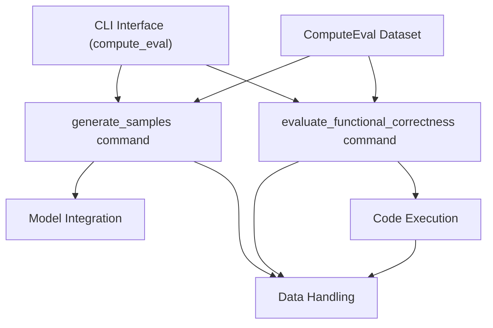

The system architecture consists of these core components:
- A command-line interface that exposes generation and evaluation functions
- A code generation module that interfaces with various LLM APIs
- An evaluation module that assesses functional correctness
- A secure execution environment for running generated CUDA code
- Data handling utilities for managing problems, samples, and results

Sources: [README.md:5-14](), [README.md:169-201]()

## Core Workflows

ComputeEval operates through two primary workflows: code generation and evaluation. These workflows can be executed independently but are designed to work together in a pipeline.

### Generation Workflow

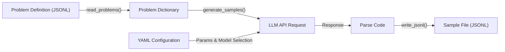

The generation workflow reads problem definitions from a JSONL file, uses them to generate prompts for LLMs, and then stores the generated code samples in another JSONL file. The process is configurable through YAML configuration files that specify parameters like model selection, sample count, and generation settings.

Sources: [README.md:134-142](), [README.md:174-188]()

### Evaluation Workflow

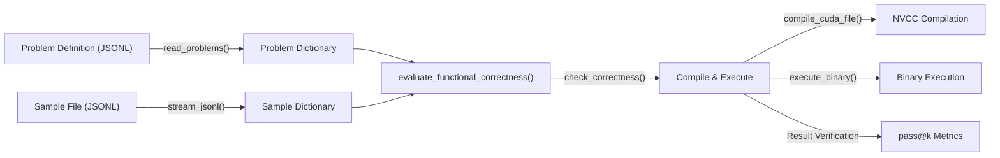

The evaluation workflow compiles and executes generated CUDA code samples against test cases to determine functional correctness. It calculates pass@k metrics to evaluate model performance. This process requires GPU hardware with CUDA Toolkit installed and implements security measures for safe execution of generated code.

Sources: [README.md:144-167](), [README.md:189-201]()

## System Components

### Command-Line Interface

The main entry point for ComputeEval is the `compute_eval` command-line interface, which supports two primary commands:

- `generate_samples`: Generates code samples using LLMs
- `evaluate_functional_correctness`: Evaluates the functional correctness of generated samples

Both commands accept configuration via YAML files, making the system flexible and easy to configure without code changes.

For detailed information about the CLI interface, see [Main CLI Interface](#6.1).

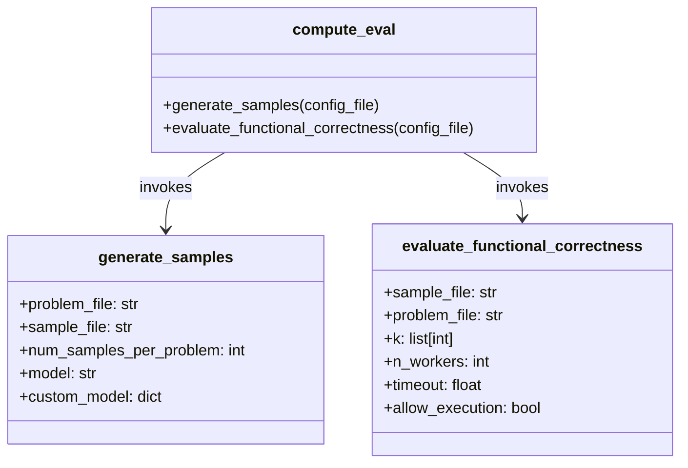

Sources: [README.md:169-201]()

### Model Integration

ComputeEval supports multiple LLM providers through a flexible model integration system. Models can be specified either by using preset model identifiers or by configuring custom models with API endpoints.

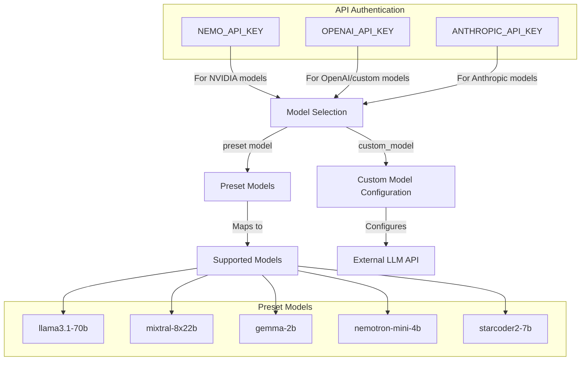

The system automatically handles the appropriate API calls and authentication for each model provider using environment variables for API keys.

Sources: [README.md:38-73](), [README.md:114-132]()

### Data Handling

ComputeEval uses structured data formats for problems, samples, and evaluation results:

| File Type | Format | Description |
|-----------|--------|-------------|
| Problem File | JSONL | Contains CUDA programming challenges with descriptions, templates, and test cases |
| Sample File | JSONL | Contains generated code samples with metadata about the model and generation parameters |
| Results | Dictionary | Contains pass@k metrics calculated from evaluation results |

The data handling component provides utilities for reading, writing, and processing these data formats. For more information about data handling, see [Data Handling](#3.4).

Sources: [README.md:83-98]()

### Code Execution

ComputeEval includes a secure execution environment for compiling and running generated CUDA code:

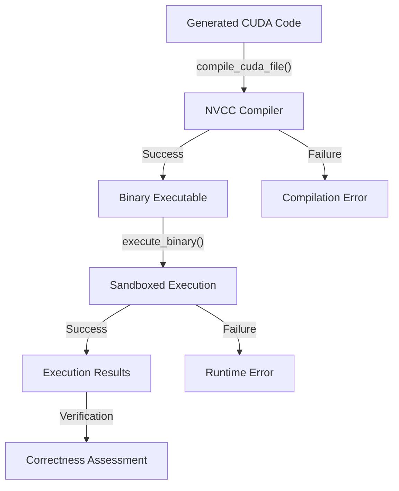

This component handles:
- CUDA code compilation using NVCC
- Safe execution of compiled binaries
- Timeout management to prevent infinite loops
- Result verification against expected outputs

For security reasons, all code execution requires explicit permission via the `--allow-execution` flag. It's recommended to run ComputeEval in a sandboxed environment when evaluating generated code.

Sources: [README.md:76-81]()

## Evaluation Metrics

ComputeEval uses the pass@k metric to evaluate model performance:

- **pass@k**: The probability that at least one of k samples will pass all test cases
- Multiple k values can be specified for evaluation (e.g., pass@1, pass@10)
- Higher pass@k values indicate better model performance

The system implements an unbiased estimator for pass@k when evaluating a subset of samples, making it efficient to estimate model performance without testing all generated samples.

For more details on the evaluation process, see [Code Evaluation](#3.2).

Sources: [README.md:144-167]()

## Dataset

The ComputeEval dataset consists of handcrafted CUDA programming challenges designed to evaluate an LLM's capability at writing reliable CUDA code. Each problem includes:

- A detailed description of the programming task
- A function signature template
- Input/output examples
- Test cases for verification

For more information about the dataset, see [Dataset](#4).

Sources: [README.md:7-9](), [README.md:202-204]()

## License Information

ComputeEval is licensed under the Apache License 2.0, while the dataset is licensed under CC BY 4.0. This ensures that both the software and data can be freely used, modified, and shared with proper attribution.

Sources: [LICENSE:1-21]()

---

# Page: Getting Started

# Getting Started

<details>
<summary>Relevant source files</summary>

The following files were used as context for generating this wiki page:

- [CONTRIBUTING.md](CONTRIBUTING.md)
- [README.md](README.md)

</details>


This guide will walk you through the process of setting up and using the compute-eval framework for evaluating Large Language Models (LLMs) on CUDA code generation tasks. After completing this guide, you'll be able to generate CUDA code samples using LLMs and evaluate their functional correctness.

For a high-level overview of the entire system, see [Overview](#1). For detailed information about the system architecture, see [System Architecture](#3).

## Prerequisites

Before you begin, ensure you have the following prerequisites installed:

- Python 3.10 or higher
- NVIDIA GPU with CUDA Toolkit 12 or greater (required only for evaluation)

Sources: [README.md:20-21]()

## Installation

There are two ways to install compute-eval:

### Option 1: Using pip

```bash
pip install .
```

### Option 2: Using Poetry (Recommended for development)

If you're planning to contribute to the project or prefer Poetry for dependency management:

```bash
# Install Poetry if you don't have it
pip install pipx
pipx install poetry
pipx ensurepath

# Configure Poetry to create virtual environments in the project directory
poetry config virtualenvs.in-project true

# Install the package
poetry shell
poetry install
```

Sources: [README.md:27-33](), [CONTRIBUTING.md:5-26]()

## API Key Configuration

To generate code samples, you'll need to obtain an API key from one of the supported LLM providers.

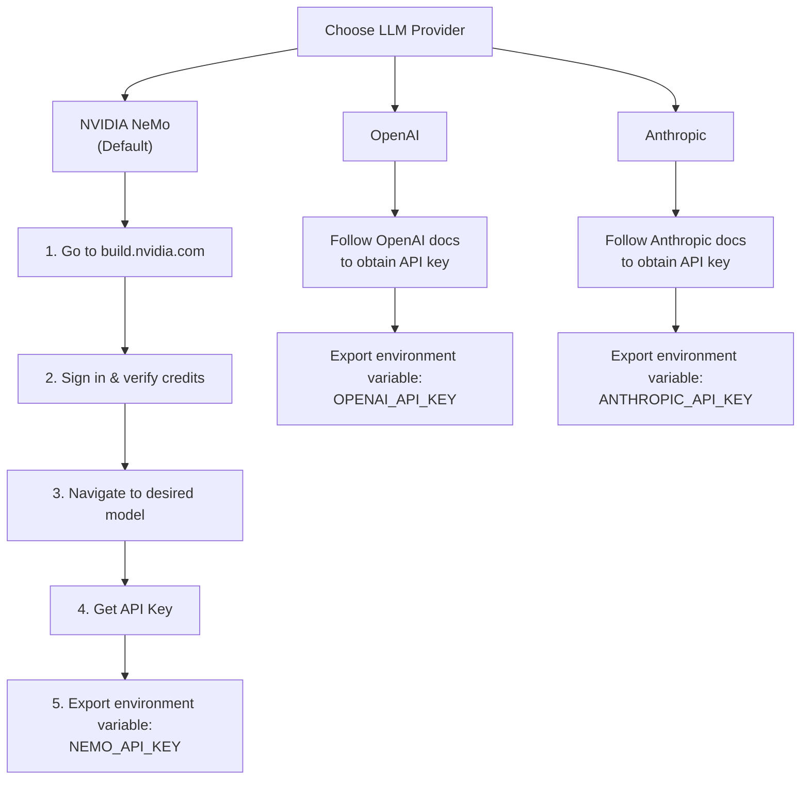

### NVIDIA NeMo (Default)

1. Go to [build.nvidia.com](https://build.nvidia.com)
2. Sign in with your account
3. Verify that you have sufficient credits to call hosted models
4. Navigate to the desired model and click on it
5. Click on "Get API Key"
6. Copy the generated API key
7. Export it as an environment variable:

```bash
export NEMO_API_KEY="your-nvidia-key"
```

### OpenAI

Follow the instructions in the [OpenAI documentation](https://openai.com/index/openai-api), then:

```bash
export OPENAI_API_KEY="your-openai-key"
```

### Anthropic (Claude)

Follow instructions on the [Anthropic documentation](https://www.anthropic.com/api), then:

```bash
export ANTHROPIC_API_KEY="your-anthropic-key"
```

Sources: [README.md:37-73]()

## Configuring ComputeEval

ComputeEval uses YAML configuration files to define parameters for code generation and evaluation. Let's examine the basic configuration structure:

### Sample Generation Configuration

```yaml
problem_file: data/cuda_problems_121924.jsonl  # Input CUDA problems
sample_file: data/samples.jsonl                # Output file for generated samples

model: llama3.1-nemotron-70b-instruct         # Model to use
num_samples_per_problem: 3                    # Samples to generate per problem
```

### Custom Model Configuration

```yaml
problem_file: data/problems.jsonl
sample_file: data/samples.jsonl

num_samples_per_problem: 3

custom_model:
  api_endpoint: https://integrate.api.nvidia.com/v1
  model_id: nvidia/llama-3.1-nemotron-70b-instruct
```

### Evaluation Configuration

```yaml
sample_file: data/samples.jsonl               # Generated samples to evaluate
problem_file: data/cuda_problems_121924.jsonl # Problem definitions

k: [1, 3]                                     # Pass@k values to calculate
```

Sources: [README.md:82-99](), [README.md:146-152]()

## Basic Usage

The ComputeEval workflow consists of two main steps: generating code samples and evaluating their functional correctness.

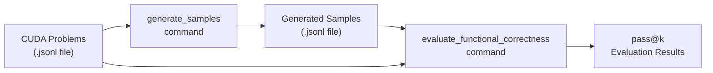

### Step 1: Generate Samples

Create a configuration file (e.g., `config_gen_samples.yaml`) with your desired parameters, then run:

```bash
compute_eval generate_samples -config_file=config_gen_samples.yaml
```

This command reads problems from your specified file, generates code samples using the configured LLM, and writes the results to the output file.

### Step 2: Evaluate Functional Correctness

Create an evaluation configuration file (e.g., `config_evalcorrectness.yaml`), then run:

```bash
compute_eval evaluate_functional_correctness -config_file=config_evalcorrectness.yaml --allow-execution
```

The `--allow-execution` flag is required because this command will compile and execute the generated CUDA code to test its correctness.

Sources: [README.md:134-167]()

## Command Reference

### generate_samples

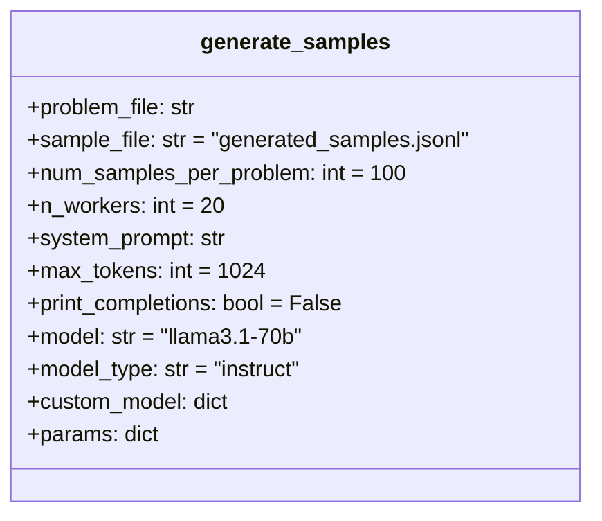

This command generates samples for given problems using a specified model.

Key parameters:
- `problem_file`: Path to file containing CUDA problems
- `sample_file`: Path for output file with generated samples
- `num_samples_per_problem`: Number of samples to generate per problem
- `model`: LLM to use for code generation
- `custom_model`: API endpoint and model ID for custom models

### evaluate_functional_correctness

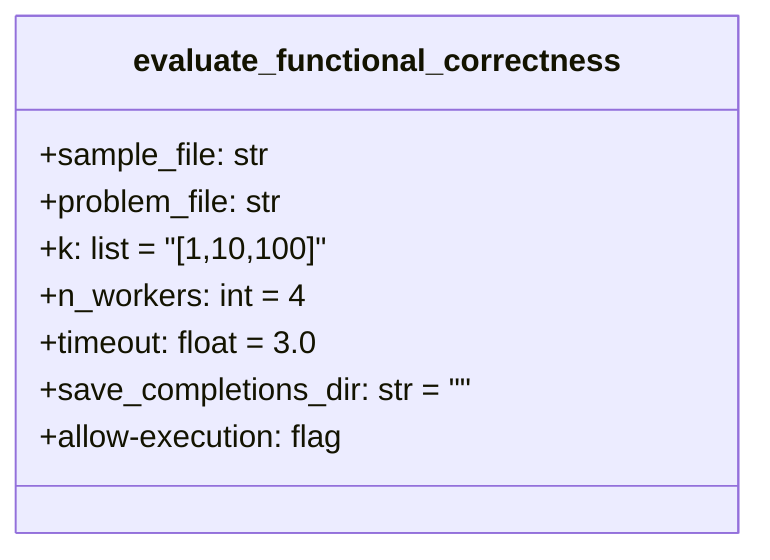

This command evaluates the functional correctness of generated samples.

Key parameters:
- `sample_file`: Path to file containing generated samples
- `problem_file`: Path to file containing problem definitions
- `k`: List of k values for pass@k calculation
- `timeout`: Timeout for each evaluation in seconds
- `--allow-execution`: Required flag to permit code execution

Sources: [README.md:169-201]()

## Available Models

ComputeEval supports a variety of LLMs for code generation. The following models are available:

| Model Identifier | Actual Model |
|------------------|--------------|
| mixtral-8x22b | mistralai/mixtral-8x22b-instruct-v0.1 |
| gemma-2b | google/gemma-2b |
| llama3.1-8b | meta/llama-3.1-8b-instruct |
| llama3.1-70b | meta/llama-3.1-70b-instruct |
| llama3.1-405b | meta/llama-3.1-405b-instruct |
| llama3.2-1b | meta/llama-3.2-1b-instruct |
| llama3.2-3b | meta/llama-3.2-3b-instruct |
| llama3.2-90b | meta/llama-3.2-90b-vision-instruct |
| llama3.1-nemotron-70b | nvidia/llama-3.1-nemotron-70b-instruct |
| nemotron-mini-4b | nvidia/nemotron-mini-4b-instruct |
| starcoder2-7b | bigcode/starcoder2-7b |
| mistral-nemo-12b | nv-mistralai/mistral-nemo-12b-instruct |

By default, NVIDIA hosted `llama-3.1-70b-instruct` is used when no model is specified.

Sources: [README.md:114-132]()

## Security Considerations

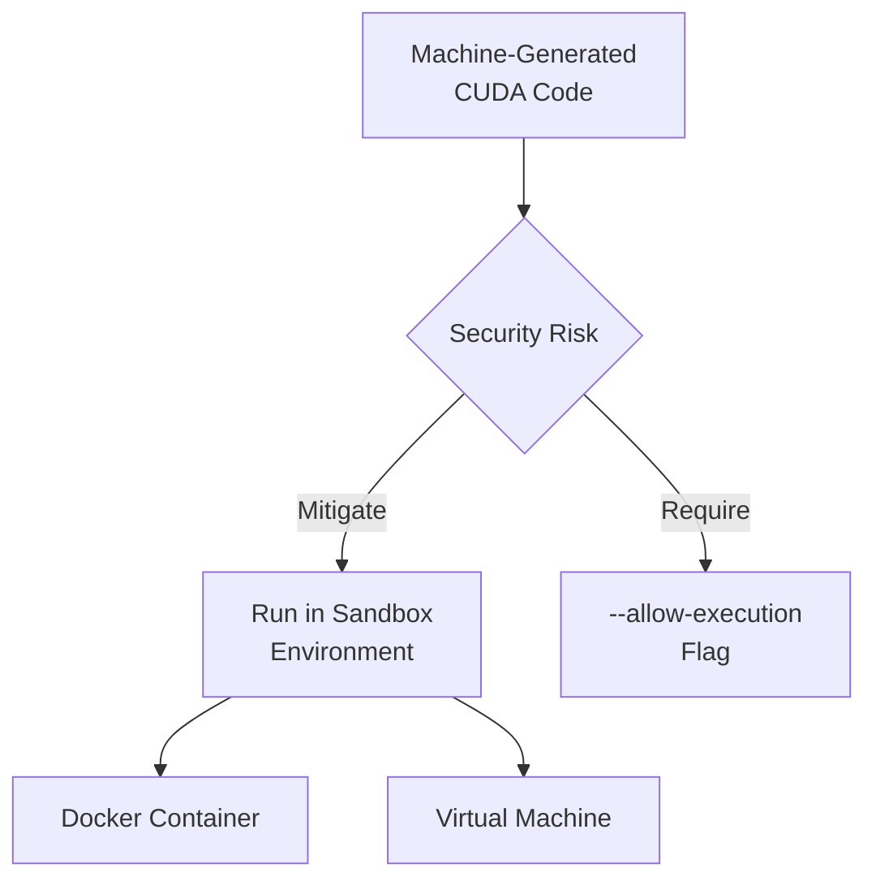

ComputeEval executes machine-generated CUDA code during evaluation. While it's unlikely that the generated code is malicious, there are potential security risks. To mitigate these risks:

1. The `--allow-execution` flag is required for evaluation to explicitly acknowledge the risk
2. It's strongly recommended to use a sandbox environment (e.g., Docker container or virtual machine) when running generated code

Sources: [README.md:77-80]()

## Complete Workflow Example

Here's a complete example of using ComputeEval to generate and evaluate CUDA code:

1. Create a sample generation configuration file named `config_gen_samples.yaml`:

```yaml
problem_file: data/cuda_problems_121924.jsonl
sample_file: data/samples.jsonl
model: llama3.1-nemotron-70b-instruct
num_samples_per_problem: 3
```

2. Generate samples:

```bash
compute_eval generate_samples -config_file=config_gen_samples.yaml
```

3. Create an evaluation configuration file named `config_evalcorrectness.yaml`:

```yaml
sample_file: data/samples.jsonl
problem_file: data/cuda_problems_121924.jsonl
k: [1, 3]
```

4. Evaluate the generated samples:

```bash
compute_eval evaluate_functional_correctness -config_file=config_evalcorrectness.yaml --allow-execution
```

5. Review the pass@k results to assess the LLM's performance.

Sources: [README.md:134-167]()

## Troubleshooting

- If you encounter API key issues, ensure you've exported the correct environment variable for your chosen model provider.
- For custom models, verify that you've set the `OPENAI_API_KEY` environment variable.
- If evaluation fails, check that you have a compatible NVIDIA GPU with the required CUDA Toolkit.
- Remember that the maximum k value in evaluation must not exceed the number of samples generated per problem.

Sources: [README.md:164-167]()

---

# Page: System Architecture

# System Architecture

<details>
<summary>Relevant source files</summary>

The following files were used as context for generating this wiki page:

- [README.md](README.md)
- [compute_eval/__init__.py](compute_eval/__init__.py)
- [compute_eval/main.py](compute_eval/main.py)

</details>


This document provides a comprehensive overview of the ComputeEval system architecture, focusing on the core components, their interactions, and the overall data flow within the system. It explains how the different modules work together to generate and evaluate CUDA code samples produced by Large Language Models (LLMs).

For specific details about the Code Generation process, see [Code Generation](#3.1). For information about the Evaluation process, see [Code Evaluation](#3.2).

## 1. High-Level Architecture Overview

ComputeEval is structured as a pipeline-oriented architecture centered around two primary workflows: code generation and code evaluation. The system is designed with a clear separation of concerns, allowing independent operation of its major components.

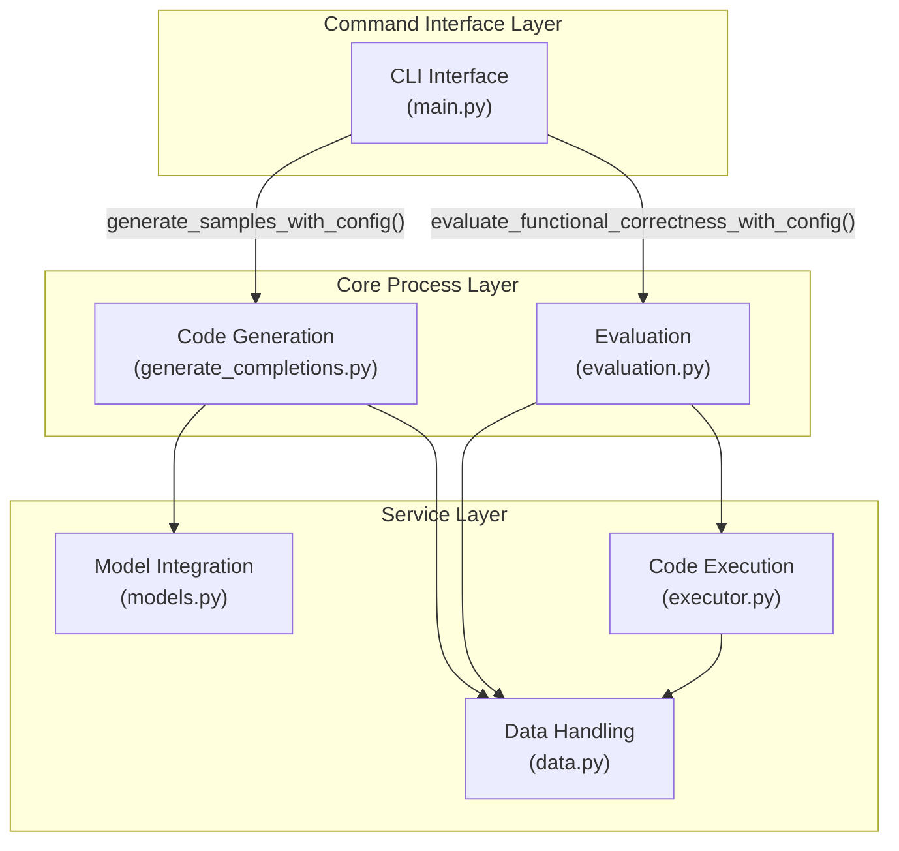

**Diagram: High-Level System Architecture**

Sources: [compute_eval/main.py:16-52]()

## 2. Command Interface Layer

The Command Interface Layer serves as the entry point to the system, exposing two primary commands through a CLI built with the Fire library.

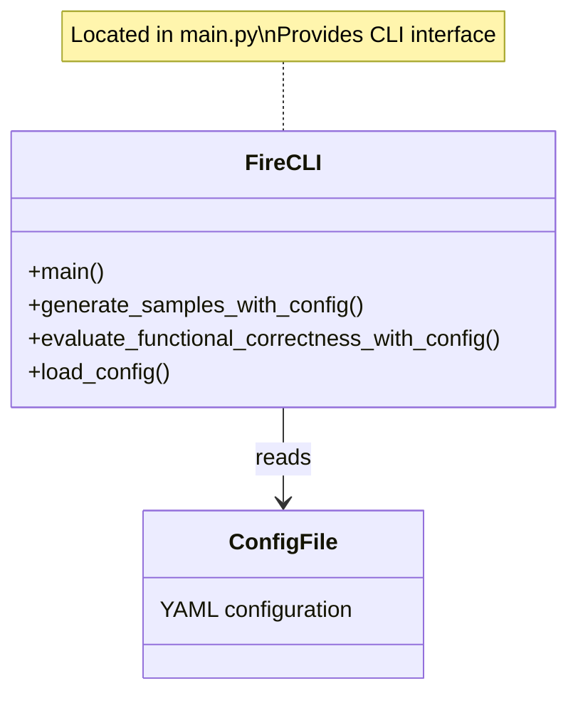

**Diagram: Command Layer Structure**

The CLI accepts YAML configuration files that define parameters for both code generation and evaluation processes. The `load_config()` function reads these files and passes the parameters to the appropriate functions.

Sources: [compute_eval/main.py:16-52]()

## 3. Core Process Layer

The Core Process Layer contains the two primary workflows of the system: Code Generation and Code Evaluation.

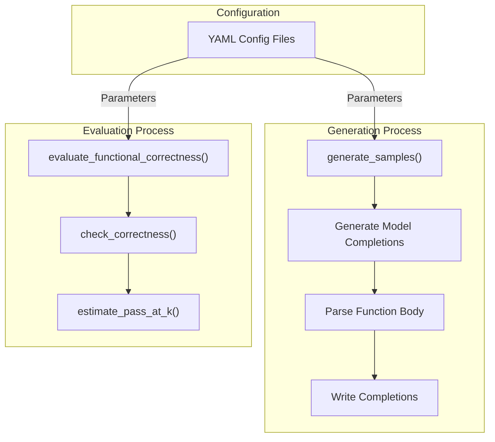

**Diagram: Core Process Flow**

The generation process creates CUDA code using LLMs, while the evaluation process tests the correctness of the generated code and calculates pass@k metrics.

Sources: [compute_eval/main.py:19-20]()

## 4. Data Flow Architecture

The data flow in ComputeEval follows a pipeline pattern, where problem definitions flow into the generation process, resulting in code samples that are then evaluated for correctness.

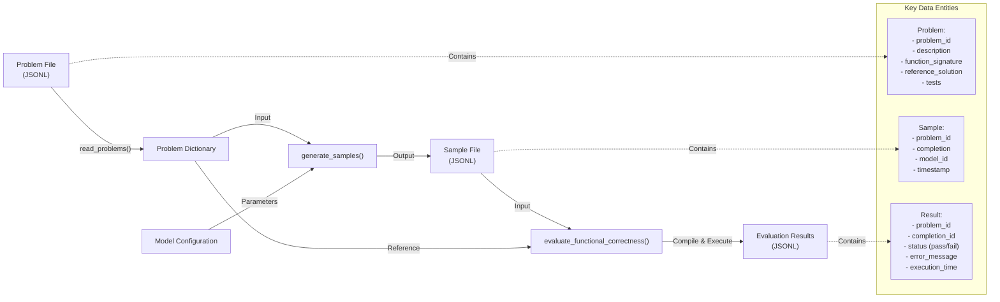

**Diagram: System Data Flow**

Sources: [compute_eval/main.py:19-20]()

## 5. Model Integration Architecture

The system integrates with various LLM providers through a flexible model interface that supports both preset models and custom model configurations.

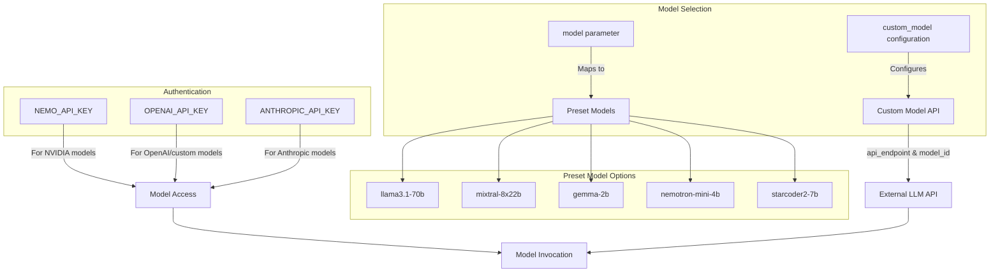

**Diagram: Model Integration Architecture**

Sources: [README.md:38-130]()

## 6. Execution Environment Architecture

The execution environment is designed to safely compile and run generated CUDA code, preventing potential security issues while accurately testing the code's functionality.

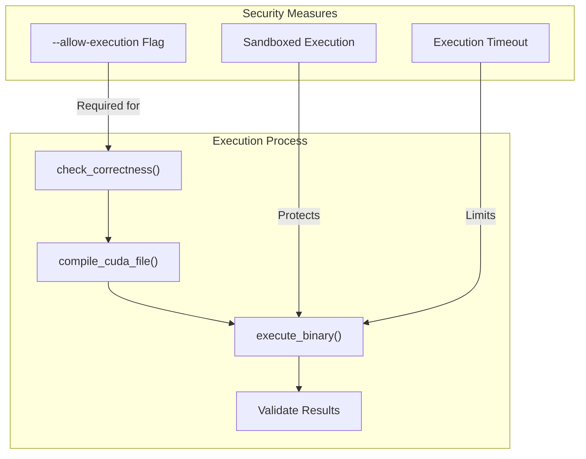

**Diagram: Execution Environment Architecture**

Sources: [README.md:76-80]()

## 7. Component Relationships

The following diagram maps the key system components to their interactions, showing how data and control flow between different parts of the system.

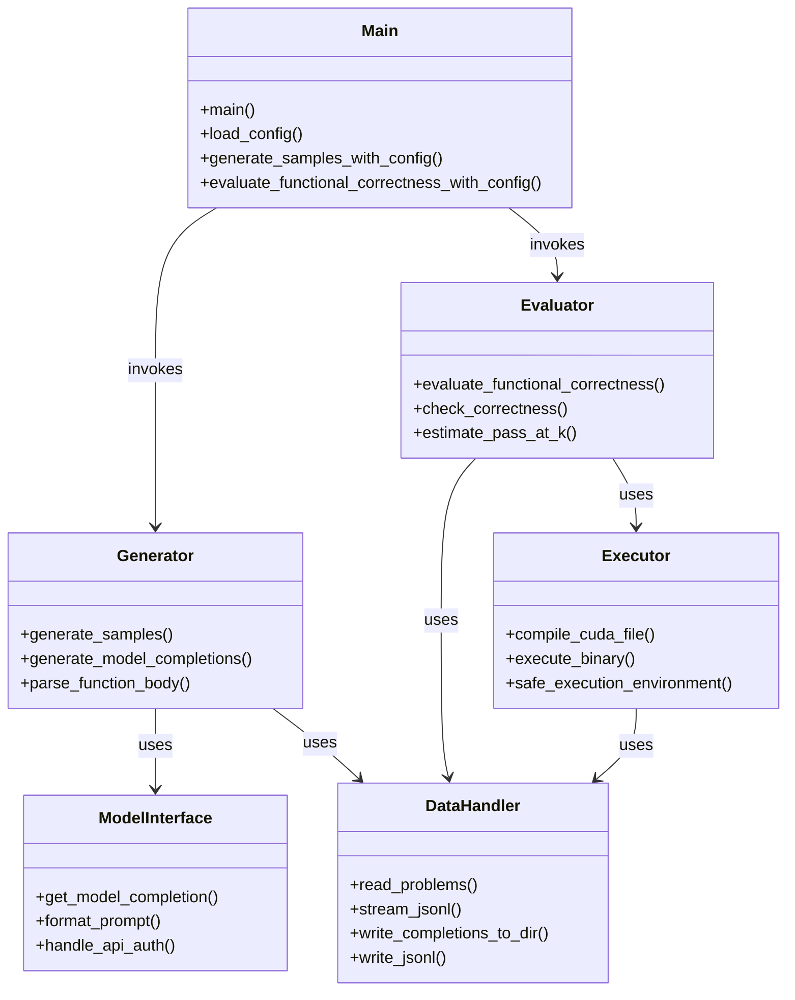

**Diagram: Component Relationship Mapping**

Sources: [compute_eval/main.py:16-52]()

## 8. Configuration Architecture

The system uses YAML configuration files to control its behavior, allowing flexible experimental setups without code changes.

```mermaid
graph TD
    subgraph "Configuration Types"
        GenConfig["Generation Configuration"]
        EvalConfig["Evaluation Configuration"]
    end
    
    subgraph "Generation Parameters"
        ProblemFile["problem_file"]
        SampleFile["sample_file"]
        Model["model or custom_model"]
        NumSamples["num_samples_per_problem"]
        SystemPrompt["system_prompt"]
        MaxTokens["max_tokens"]
    end
    
    subgraph "Evaluation Parameters"
        SampleFileEval["sample_file"]
        ProblemFileEval["problem_file"]
        KValues["k (for pass@k)"]
        Workers["n_workers"]
        Timeout["timeout"]
        SaveDir["save_completions_dir"]
    end
    
    GenConfig --> ProblemFile
    GenConfig --> SampleFile
    GenConfig --> Model
    GenConfig --> NumSamples
    GenConfig --> SystemPrompt
    GenConfig --> MaxTokens
    
    EvalConfig --> SampleFileEval
    EvalConfig --> ProblemFileEval
    EvalConfig --> KValues
    EvalConfig --> Workers
    EvalConfig --> Timeout
    EvalConfig --> SaveDir
```

**Diagram: Configuration Architecture**

Sources: [README.md:82-163]()

## Summary

The ComputeEval system architecture is built around two primary workflows:
1. **Code Generation**: Uses LLMs to generate CUDA code samples for predefined problems
2. **Code Evaluation**: Tests the functional correctness of generated code and calculates pass@k metrics

The system design emphasizes:
- **Separation of concerns**: Each component has a clear responsibility
- **Configurable operation**: YAML files control system behavior
- **Secure execution**: Sandboxed environment for running generated code
- **Flexible model integration**: Support for multiple LLM providers
- **Streamlined data flow**: Consistent data formats throughout the pipeline

This architecture enables efficient evaluation of LLM capabilities for CUDA code generation, providing a framework that can be extended with additional models and evaluation methodologies.

Sources: [README.md:1-209](), [compute_eval/main.py:16-52]()

---

# Page: Code Generation

# Code Generation

<details>
<summary>Relevant source files</summary>

The following files were used as context for generating this wiki page:

- [compute_eval/generate_completions.py](compute_eval/generate_completions.py)
- [compute_eval/main.py](compute_eval/main.py)

</details>


This page documents the code generation system within the NVIDIA Compute-Eval framework. The code generation component is responsible for prompting Large Language Models (LLMs) to produce CUDA code solutions for given programming problems. For information about evaluating the generated code's functional correctness, see [Code Evaluation](#3.2).

## 1. Overview

The code generation system takes problem descriptions from a dataset, constructs prompts for language models, generates code completions, and formats them for later evaluation. It supports multiple model providers including NVIDIA NeMo, OpenAI, and Anthropic Claude.

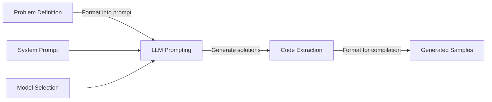

Sources: [compute_eval/generate_completions.py:184-245]()

## 2. Code Generation Workflow

The code generation process begins with the `generate_samples` function, which orchestrates the entire workflow:

```mermaid
sequenceDiagram
    participant CLI as "CLI Interface"
    participant GS as "generate_samples"
    participant RP as "read_problems"
    participant GMC as "generate_model_completions"
    participant MI as "Model Instance"
    participant PFB as "parse_function_body"
    participant WJ as "write_jsonl"
    
    CLI->>GS: "Call with config"
    GS->>RP: "Load problems"
    RP-->>GS: "Problem dictionary"
    loop For each task_id, problem
        loop num_samples_per_problem times
            GS->>GMC: "Generate completion"
            GMC->>MI: "Create model instance"
            MI-->>GMC: "Model instance"
            GMC->>MI: "Generate response"
            MI-->>GMC: "Raw completion"
            alt If model_type is "instruct"
                GMC->>PFB: "Extract function body"
                PFB-->>GMC: "Parsed completion"
            end
            GMC-->>GS: "Formatted result"
        end
    end
    GS->>WJ: "Write results to file"
```

Sources: [compute_eval/generate_completions.py:184-245](), [compute_eval/generate_completions.py:29-128](), [compute_eval/generate_completions.py:130-182]()

### 2.1 Process Steps

1. **Problem Loading**: Problems are loaded from a JSONL file using the `read_problems` function.
2. **Parallel Generation**: Multiple completions are generated for each problem using a thread pool for parallel processing.
3. **Response Generation**: Each model generates responses based on system and user prompts.
4. **Code Extraction**: For instructional models, the actual code is extracted from potentially markdown-formatted responses.
5. **Result Formatting**: The code is formatted with the problem declaration and test code to create compilable files.
6. **Output Writing**: Results are written to an output JSONL file.

Sources: [compute_eval/generate_completions.py:184-245]()

## 3. Model Integration

The system supports a variety of LLMs through a flexible model interface:

```mermaid
classDiagram
    class generate_model_completions {
        +process(task_id, system_prompt, problem, ...)
        +return(task_id, result, completion, prompt)
    }
    
    class ModelInterface {
        <<interface>>
        +generate_response(system_prompt, prompt, params)
    }
    
    class NimModel {
        +generate_response()
    }
    
    class OpenAIModel {
        +generate_response()
    }
    
    class ClaudeModel {
        +generate_response()
    }
    
    generate_model_completions --> ModelInterface: uses
    NimModel --|> ModelInterface: implements
    OpenAIModel --|> ModelInterface: implements
    ClaudeModel --|> ModelInterface: implements
```

### 3.1 Supported Models

The system provides built-in support for various LLMs through a model mapping mechanism:

| Model ID | Provider | Description |
|----------|----------|-------------|
| mixtral-8x22b-v0.1 | Mistral AI | Mixtral 8x22B Instruct model |
| gemma-2-2b-it | Google | Gemma 2 2B Instruct model |
| llama-3.1-8b-instruct | Meta | Llama 3.1 8B Instruct model |
| llama-3.1-70b-instruct | Meta | Llama 3.1 70B Instruct model |
| llama-3.1-405b-instruct | Meta | Llama 3.1 405B Instruct model |
| llama-3.2-1b-instruct | Meta | Llama 3.2 1B Instruct model |
| llama-3.2-3b-instruct | Meta | Llama 3.2 3B Instruct model |
| llama-3.1-nemotron-70b-instruct | NVIDIA | NVIDIA-enhanced Llama 3.1 70B |
| nemotron-mini-4b-instruct | NVIDIA | NVIDIA's 4B parameter model |
| starcoder2-7b | BigCode | Code-specialized model |
| mistral-nemo-12b-instruct | NVIDIA/Mistral | NVIDIA Mistral 12B |
| claude-sonnet-3.5 | Anthropic | Claude 3.5 Sonnet model |

Sources: [compute_eval/generate_completions.py:64-85]()

### 3.2 Custom Model Support

For models not in the preset list, the system supports custom model configuration by providing:
- API endpoint URL
- Model ID

When a custom model is specified, the system uses the OpenAI API client with the provided endpoint and model ID.

Sources: [compute_eval/generate_completions.py:59-62]()

## 4. Prompt Construction

The system constructs prompts for the LLMs using two components:

1. **System Prompt**: A general instruction prompt that guides the model on how to approach CUDA programming tasks.
2. **User Prompt**: A specific prompt generated from the problem description.

```mermaid
flowchart TD
    A["Problem Dictionary"] --> B["generate_user_prompt()"]
    C["include_header_files parameter"] --> B
    B --> D["User Prompt"]
    E["System Prompt"] --> F["model_instance.generate_response()"]
    D --> F
    F --> G["Raw Completion"]
    G --> H["parse_function_body()"]
    H --> I["Parsed Completion"]
    
    subgraph "Final Output Construction"
        J["problem.declaration"] --> K["Compilable Code"]
        I --> K
        L["problem.test"] --> K
    end
```

### 4.1 Code Extraction

For instruction-tuned models, the system extracts the actual code from the potentially markdown-formatted response using the `parse_function_body` function. This process:

1. Identifies code blocks between markdown triple backticks
2. Removes the function signature if necessary
3. Extracts only the function body

Sources: [compute_eval/generate_completions.py:130-182]()

## 5. Configuration Options

The code generation process can be configured with various parameters:

| Parameter | Description | Default |
|-----------|-------------|---------|
| problem_file | Path to the JSONL file containing problems | Required |
| sample_file | Path to output JSONL file for generated samples | "generated_samples.jsonl" |
| num_samples_per_problem | Number of samples to generate per problem | 100 |
| n_workers | Number of parallel workers for generation | 20 |
| system_prompt | System prompt for the model | Default prompt |
| print_completions | Whether to print completions during generation | False |
| include_header_files | Whether to include header files in the prompt | False |
| model | Model ID to use for generation | "llama-3.1-70b-instruct" |
| model_type | Type of model ("instruct" or "base") | "instruct" |
| custom_model | Dictionary with custom model configuration | None |
| params | Additional parameters to pass to the model | None |

Configuration can be provided directly via function parameters or through a YAML configuration file.

Sources: [compute_eval/generate_completions.py:184-245](), [compute_eval/main.py:28-32]()

## 6. Output Format

The generated samples are saved in JSONL format with the following structure for each entry:

```json
{
  "task_id": "problem_identifier",
  "compilable_code": "complete code with declaration, completion, and test",
  "generated_completion": "only the generated function body",
  "prompt": "the prompt sent to the model"
}
```

The output is formatted to ensure that:
1. The problem declaration is preserved
2. The generated code is clearly marked between comment markers
3. The test code is included for later evaluation

Sources: [compute_eval/generate_completions.py:121-127](), [compute_eval/generate_completions.py:230-236]()

## 7. CLI Integration

Code generation is exposed through the CLI via the `generate_samples` command, which can be invoked with direct parameters or a configuration file:

```bash
python -m compute_eval.main generate_samples --config_file=config.yaml
```

or

```bash
python -m compute_eval.main generate_samples --problem_file=problems.jsonl --model=llama-3.1-70b-instruct
```

Sources: [compute_eval/main.py:28-32](), [compute_eval/main.py:42-48]()

---

# Page: Code Evaluation

# Code Evaluation

<details>
<summary>Relevant source files</summary>

The following files were used as context for generating this wiki page:

- [compute_eval/evaluation.py](compute_eval/evaluation.py)
- [compute_eval/main.py](compute_eval/main.py)

</details>


This page documents the code evaluation subsystem of the NVIDIA Compute-Eval framework, which is responsible for assessing the functional correctness of generated CUDA code samples. The evaluation system focuses on determining whether code generated by Large Language Models (LLMs) executes correctly and produces expected outputs for given problem statements. 

For information about how code samples are generated, see [Code Generation](#3.1). For details on the secure execution environment, see [Code Execution](#3.3).

## Evaluation System Overview

The code evaluation system takes generated CUDA code samples, compiles them, executes them in a secure environment, and determines whether they pass predefined test cases. It then calculates performance metrics like pass@k to measure LLM effectiveness at code generation tasks.

```mermaid
flowchart TD
    A["Input Files"] --> B["Evaluation System"]
    A --> |"problem definitions"| C["Problem File (JSONL)"]
    A --> |"generated code samples"| D["Sample File (JSONL)"]
    
    C --> B
    D --> B
    
    B --> E["Evaluation Process"]
    E --> |"for each sample"| F["Check Correctness"]
    F --> G["Compile CUDA Code"]
    G --> H["Execute Binary"]
    H --> I["Evaluate Output"]
    
    B --> J["Calculate Metrics"]
    J --> K["pass@k Analysis"]
    
    B --> L["Results Output"]
    L --> M["Correctness Results (JSONL)"]
    L --> N["Performance Summary"]
    
    subgraph Configuration
        O["Timeout Settings"]
        P["Worker Count"]
        Q["pass@k Values"]
    end
    
    Configuration --> B
```

Sources: [compute_eval/evaluation.py:118-233](), [compute_eval/main.py:35-39]()

## Functional Correctness Evaluation

The evaluation system assesses whether generated code samples correctly solve the original problem by compiling and executing them against test cases. This process is managed by the `evaluate_functional_correctness` function.

### Core Evaluation Workflow

```mermaid
sequenceDiagram
    participant User
    participant CLI as "CLI Interface"
    participant EvalFunc as "evaluate_functional_correctness()"
    participant ThreadPool as "ThreadPoolExecutor"
    participant CheckFunc as "check_correctness()"
    participant Results as "Results Processing"
    
    User->>CLI: Run evaluation command
    CLI->>EvalFunc: Call with parameters
    EvalFunc->>EvalFunc: Read problems
    EvalFunc->>EvalFunc: Read samples
    
    loop For each sample
        EvalFunc->>ThreadPool: Submit check_correctness task
    end
    
    loop For each submitted task
        ThreadPool->>CheckFunc: Execute with problem & code
        CheckFunc-->>ThreadPool: Return correctness result
        ThreadPool-->>EvalFunc: Return future result
    end
    
    EvalFunc->>Results: Calculate pass@k metrics
    EvalFunc->>Results: Write results to file
    Results-->>User: Display pass@k summary
```

Sources: [compute_eval/evaluation.py:118-233](), [compute_eval/main.py:35-39]()

### Function Parameters

The `evaluate_functional_correctness` function accepts multiple parameters to configure the evaluation process:

| Parameter | Type | Description |
|-----------|------|-------------|
| `sample_file` | str | Path to JSONL file containing generated code samples |
| `problem_file` | str | Path to JSONL file containing problem definitions |
| `allow_execution` | bool | Flag to permit execution of untrusted code (default: False) |
| `k` | Tuple[int] | Values for pass@k calculation (default: (1, 10, 100)) |
| `n_workers` | int | Number of parallel workers for evaluation (default: 4) |
| `timeout` | float | Maximum execution time per sample in seconds (default: 60.0) |
| `save_completions_dir` | str | Optional directory to save processed completions (default: "") |

Sources: [compute_eval/evaluation.py:118-126]()

## Pass@k Metric

The pass@k metric is a statistical measure for evaluating code generation models when generating multiple solutions per problem. It estimates the probability that at least one correct solution would be found if k solutions were sampled per problem.

### Calculating Pass@k

The `estimate_pass_at_k` function implements the mathematical formula for pass@k calculation:

1 - comb(n - c, k) / comb(n, k)

Where:
- n is the number of samples generated per problem
- c is the number of correct samples
- k is the parameter being evaluated (e.g., 1, 10, 100)

```mermaid
graph TD
    A["Input Data"] --> B["estimate_pass_at_k()"]
    A --> |"num_samples"| C["Total samples per problem"]
    A --> |"num_correct"| D["Correct samples per problem"]
    A --> |"k"| E["k value(s) to evaluate"]
    
    B --> F["For each problem"]
    F --> G["Calculate: 1 - comb(n-c,k)/comb(n,k)"]
    G --> H["Average across all problems"]
    H --> I["Final pass@k metrics"]
```

Sources: [compute_eval/evaluation.py:77-102]()

## Evaluation Process Details

### Initialization and Safety

The evaluation system requires explicit permission to execute generated code for security reasons. The system displays a prominent warning and requires the `allow_execution` flag to be set to `True`.

```
===================
     WARNING
===================

Evaluation of correctness or performance will execute untrusted model-generated
code.

Although it is highly unlikely that model-generated code will do something
overtly malicious in response to this test suite, model-generated code may act
destructively due to a lack of model capability or alignment.

Users are strongly encouraged to sandbox this evaluation suite so that it does
not perform destructive actions on their host or network.

In order to execute this code you must explicitly pass the --allow-execution flag.
```

Sources: [compute_eval/evaluation.py:59-74](), [compute_eval/evaluation.py:132-134]()

### Code Evaluation Flow

1. **Read Input Files**: The system reads problem definitions and generated samples
2. **Parallel Evaluation**: Samples are evaluated using a ThreadPoolExecutor
3. **Individual Sample Check**:
   - Each sample is compiled and executed against the problem's test cases
   - Execution has a configurable timeout to prevent infinite loops
   - Compilation can include problem-specific compiler and linker flags
4. **Results Collection**: All evaluation results are collected and processed
5. **Metric Calculation**: The pass@k metrics are calculated based on sample correctness
6. **Output Generation**: Results are written to a JSONL file for further analysis

Sources: [compute_eval/evaluation.py:149-203]()

### Result Processing

After evaluating all samples, the system:

1. Calculates pass@k metrics for specified k values
2. Merges evaluation results with the original samples
3. Writes comprehensive results to a new JSONL file
4. Optionally saves completions to a specified directory
5. Displays a summary of pass@k metrics

The output JSONL file includes all original sample data plus:
- `result`: Detailed test execution results
- `skipped`: Flag indicating if the test was skipped
- `passed`: Boolean indicating whether the sample passed all tests
- `completion_id`: Unique identifier for the completion

Sources: [compute_eval/evaluation.py:206-233]()

## CLI Usage

The evaluation functionality is exposed through a command-line interface. The system can be invoked directly or configured using a YAML file:

### Direct Command Line Usage

```
python -m compute_eval.main evaluate_functional_correctness \
    --sample_file path/to/samples.jsonl \
    --problem_file path/to/problems.jsonl \
    --allow_execution True \
    --k 1 10 100 \
    --n_workers 4 \
    --timeout 60.0
```

### Using Configuration File

```
python -m compute_eval.main evaluate_functional_correctness \
    --config_file path/to/config.yaml
```

Example YAML configuration:

```yaml
sample_file: path/to/samples.jsonl
problem_file: path/to/problems.jsonl
allow_execution: true
k: [1, 10, 100]
n_workers: 4
timeout: 60.0
save_completions_dir: path/to/save/dir
```

Sources: [compute_eval/main.py:35-39](), [compute_eval/main.py:22-26]()

## Integration with System Components

The evaluation system integrates with other components of the compute-eval framework:

```mermaid
classDiagram
    class Main {
        +evaluate_functional_correctness_with_config()
        +load_config()
    }
    
    class Evaluation {
        +evaluate_functional_correctness()
        +estimate_pass_at_k()
        +get_cli_args()
    }
    
    class Execution {
        +check_correctness()
        +compile_cuda_file()
        +execute_binary()
    }
    
    class Data {
        +read_problems()
        +stream_jsonl()
        +write_jsonl()
        +write_completions_to_dir()
    }
    
    Main --> Evaluation: calls
    Evaluation --> Execution: uses
    Evaluation --> Data: reads/writes
```

Sources: [compute_eval/main.py:35-39](), [compute_eval/evaluation.py:51-57](), [compute_eval/evaluation.py:149-203]()

## Security Considerations

When evaluating model-generated code, security is a significant concern. The system includes several safeguards:

1. **Explicit Execution Permission**: Requires the `--allow-execution` flag
2. **Warning Display**: Shows a prominent warning about executing untrusted code
3. **Execution Timeout**: Limits the maximum execution time for each sample
4. **Parallel Isolation**: Executes each sample in a separate process
5. **Recommendation for Sandboxing**: Encourages users to run the evaluation in a sandboxed environment

The execution itself happens in the Code Execution subsystem, which provides additional security features. See [Code Execution](#3.3) for more details.

Sources: [compute_eval/evaluation.py:59-74](), [compute_eval/evaluation.py:132-134]()

---

# Page: Code Execution

# Code Execution

<details>
<summary>Relevant source files</summary>

The following files were used as context for generating this wiki page:

- [compute_eval/execution.py](compute_eval/execution.py)

</details>


This document details the secure code execution environment used within the compute-eval framework to compile and run generated CUDA code for evaluation purposes. The execution system provides controlled, sandboxed environments to safely compile, execute, and verify the correctness of model-generated CUDA code.

For information about the overall evaluation process and metrics, see [Code Evaluation](#3.2).

## 1. Execution System Overview

The Code Execution system handles the critical task of safely turning generated CUDA code into executable programs, running them, and capturing their results. It provides isolation mechanisms to ensure the generated code cannot harm the host system while allowing accurate functional correctness assessment.

```mermaid
flowchart TD
    subgraph "Code Execution System"
        A["check_correctness()"] --> B["compile_cuda_file()"]
        B --> C["execute_binary()"]
        
        A --> D["safe_execution_environment()"]
        D --> E["reliability_guard()"]
        D --> F["time_limit()"]
        
        G["unsafe_execute()"] --> B
        G --> C
    end
    
    H["Generated CUDA Code"] --> A
    A --> I["Execution Results"]
```

Sources: [compute_eval/execution.py:206-247](). [compute_eval/execution.py:155-196](), [compute_eval/execution.py:57-92](), [compute_eval/execution.py:95-127]()

## 2. Execution Workflow

The execution process follows a sequential workflow to safely compile and run CUDA code:

```mermaid
sequenceDiagram
    participant E as "Evaluator"
    participant C as "check_correctness()"
    participant MP as "Multiprocessing"
    participant UE as "unsafe_execute()"
    participant CF as "compile_cuda_file()"
    participant EB as "execute_binary()"
    participant SE as "safe_execution_environment()"
    
    E->>C: Problem, completion, timeout
    C->>MP: Create process
    MP->>UE: Run with isolation
    
    UE->>SE: Set up sandbox
    UE->>UE: Create temporary files
    UE->>CF: Compile CUDA code
    
    alt Compilation successful
        CF-->>UE: Return binary path
        UE->>EB: Execute binary
        EB-->>UE: Return execution result
    else Compilation failed
        CF-->>UE: Return error
    end
    
    UE-->>MP: Return result
    MP-->>C: Return result
    C-->>E: Return correctness report
```

Sources: [compute_eval/execution.py:206-247](), [compute_eval/execution.py:155-196]()

## 3. CUDA Code Compilation

The compilation process transforms the generated CUDA code into executable binaries using NVIDIA's nvcc compiler.

### 3.1 Compilation Function

The `compile_cuda_file()` function handles the compilation process by:
1. Invoking the `nvcc` compiler with appropriate arguments
2. Capturing compilation errors and outputs
3. Managing compilation timeouts
4. Reporting compilation success or failure

Sources: [compute_eval/execution.py:57-92]()

### 3.2 Compilation Workflow

```mermaid
flowchart LR
    A["Generated .cu File"] --> B["compile_cuda_file()"]
    B --> C["nvcc Compiler"]
    
    C --> D{"Compilation Success?"}
    
    D -->|"Yes"| E["Return Binary Path"]
    D -->|"No"| F["Return Error Message"]
    
    G["Timeout Monitor"] --> B
```

Sources: [compute_eval/execution.py:57-92]()

## 4. Binary Execution

After successful compilation, the generated binary is executed in a controlled environment.

### 4.1 Execution Function

The `execute_binary()` function:
1. Runs the compiled binary with appropriate environment settings
2. Captures program output and return codes
3. Interprets execution results
4. Handles timeouts and runtime errors

Sources: [compute_eval/execution.py:95-127]()

### 4.2 Execution Return Codes

| Return Code | Meaning | Result |
|-------------|---------|--------|
| 0 | Successful execution | "passed" |
| 200 | GPU architecture compatibility issue | "skipped" |
| Other | Program error | Error message |

Sources: [compute_eval/execution.py:95-127]()

## 5. Safety and Sandboxing

The execution system employs multiple layers of security to ensure safe execution of untrusted code.

### 5.1 Safe Execution Environment

```mermaid
flowchart TD
    A["safe_execution_environment()"] --> B["create_tempdir()"]
    A --> C["reliability_guard()"]
    A --> D["time_limit()"]
    
    B --> E["Temporary Directory"]
    C --> F["Disabled Destructive Functions"]
    D --> G["Signal Handlers for Timeouts"]
    
    subgraph "Isolation Mechanisms"
        E
        F
        G
    end
```

Sources: [compute_eval/execution.py:130-152](), [compute_eval/execution.py:250-273](), [compute_eval/execution.py:332-416]()

### 5.2 Reliability Guard

The `reliability_guard()` function disables potentially harmful system functions:

- File system operations (remove, rename, chmod)
- Process operations (kill, fork)
- System environment modifications
- Memory-limited execution (optional)

This prevents generated code from interfering with the test environment or host system.

Sources: [compute_eval/execution.py:332-416]()

### 5.3 Process Isolation

The execution system uses Python's multiprocessing module to:

1. Execute code in separate processes
2. Enforce resource limits per process
3. Reliably terminate runaway processes
4. Clean up child processes after execution

Sources: [compute_eval/execution.py:206-247](), [compute_eval/execution.py:418-433]()

## 6. Timeout Management

Timeouts are critical for handling infinite loops or resource-intensive code that could otherwise hang the evaluation system.

### 6.1 Time Limiting Mechanisms

```mermaid
flowchart LR
    subgraph "Windows"
        A["Threading Timer"] --> B["Timeout Handler"]
    end
    
    subgraph "POSIX Systems"
        C["SIGALRM Signal"] --> D["Signal Handler"]
    end
    
    B --> E["TimeoutException"]
    D --> E
    
    E --> F["Process Termination"]
```

Sources: [compute_eval/execution.py:250-273](), [compute_eval/execution.py:292-293]()

### 6.2 Process Cleanup

The system ensures thorough cleanup after execution:
1. All child processes are terminated
2. Temporary directories are removed
3. System resources are released

Sources: [compute_eval/execution.py:418-433](), [compute_eval/execution.py:286-290]()

## 7. Integration with Evaluation System

The execution system integrates with the broader evaluation workflow through the `check_correctness()` function.

```mermaid
flowchart TD
    A["Evaluator"] --> B["check_correctness()"]
    
    B --> C["unsafe_execute()"]
    C --> D["compile_cuda_file()"]
    C --> E["execute_binary()"]
    
    B --> F["Dictionary Result"]
    F --> G["task_id"]
    F --> H["passed"]
    F --> I["skipped"]
    F --> J["result"]
    F --> K["completion_id"]
    
    F --> L["Evaluation Metrics"]
```

Sources: [compute_eval/execution.py:206-247]()

## 8. Error Handling

The execution system provides comprehensive error handling:

1. Compilation errors are captured and reported
2. Runtime errors from binary execution are caught
3. Timeouts are properly handled and reported
4. System errors during any phase are gracefully managed

This ensures robust operation even when executing potentially problematic generated code.

Sources: [compute_eval/execution.py:57-92](), [compute_eval/execution.py:95-127](), [compute_eval/execution.py:155-196]()

## 9. Security Considerations

The execution system is designed with security in mind but has important limitations:

> **WARNING**: The reliability guard is NOT a complete security sandbox. Untrusted code, including model-generated code, should not be blindly executed outside of a proper security sandbox.

For production deployments, additional security measures should be considered, such as:
- Container-based isolation
- More restrictive resource limits
- Network isolation
- Filesystem isolation

Sources: [compute_eval/execution.py:332-416]()

---

# Page: Data Handling

# Data Handling

<details>
<summary>Relevant source files</summary>

The following files were used as context for generating this wiki page:

- [compute_eval/data.py](compute_eval/data.py)

</details>


The Data Handling component in compute-eval manages all input/output operations related to problem definitions, generated CUDA code samples, and evaluation results. This module provides utility functions for reading problem definitions, parsing JSONL files, and writing output data in structured formats.

For information about how generated code is executed, see [Code Execution](#3.3).

## Data Formats

The compute-eval system primarily uses JSONL (JSON Lines) format for structured data storage. JSONL is a convenient format where each line is a valid JSON object, making it easy to stream and process records incrementally.

### Problem Format

Problems are stored in JSONL files where each line represents a single programming challenge. A typical problem definition includes:

- `task_id`: Unique identifier for the problem
- `prompt`: The programming challenge description
- `entry_point`: The function name that needs to be implemented
- `test_code`: Code used to validate the implementation
- Additional metadata specific to the CUDA problem

### Completion Format

Generated code solutions (completions) are stored in two forms:

1. As individual `.cu` files when writing to a directory
2. As entries in a JSONL file when stored collectively

Completion entries typically include:
- `task_id`: The problem identifier
- `completion_id`: Unique identifier for this completion
- `prompt`: The original prompt
- `compilable_code`: The generated CUDA code
- `passed`: Boolean indicating whether the code passed testing

Sources: [compute_eval/data.py]()

## Input Operations

### Reading Problems

The system provides functions to read problem definitions from JSONL files. The main function used is `read_problems()`, which parses a JSONL file and returns a dictionary of problems indexed by their task IDs.

```mermaid
flowchart LR
    A["JSONL File"] -->|"stream_jsonl()"| B["JSON Objects"]
    B -->|"read_problems()"| C["Problem Dictionary"]
    C -->|"Key: task_id<br>Value: problem data"| D["System Usage"]
```

**Diagram: Problem Loading Process**

Sources: [compute_eval/data.py:48-49]()

### Parsing JSONL Files

The `stream_jsonl()` function handles the parsing of JSONL files, with support for both plain and gzipped files. It yields each line as a Python dictionary after parsing it from JSON.

```mermaid
flowchart TD
    A["Input Filename"] -->|"Check extension"| B{"Is .gz file?"}
    B -->|"Yes"| C["Open with gzip.open()"]
    B -->|"No"| D["Open with standard open()"]
    C --> E["Parse each line with json.loads()"]
    D --> E
    E -->|"Yield dictionary"| F["Consuming Function"]
```

**Diagram: JSONL Parsing Process**

Sources: [compute_eval/data.py:52-66]()

## Output Operations

### Writing Completions

The system can write generated code completions to individual files in a specified directory using `write_completions_to_dir()`. Each file contains:

1. A comment indicating if the solution passed or failed
2. The original prompt as a comment
3. The actual compilable CUDA code

```mermaid
flowchart TD
    A["Completion Data"] -->|"write_completions_to_dir()"| B["For each completion"]
    B --> C["Create filename from task_id and completion_id"]
    C --> D["Write pass/fail comment"]
    D --> E["Write prompt as comment"]
    E --> F["Write compilable code"]
    F --> G["Save .cu file"]
```

**Diagram: Completion Writing Process**

Sources: [compute_eval/data.py:69-90]()

### Writing Results

Results and other structured data can be written to JSONL files using the `write_jsonl()` function, which supports both plain and gzipped output formats, as well as appending to existing files.

```mermaid
flowchart TD
    A["Data Dictionary List"] -->|"write_jsonl()"| B{"Is .gz file?"}
    B -->|"Yes"| C["Write with GzipFile"]
    B -->|"No"| D["Write directly"]
    C --> E["Encode and write each JSON object"]
    D --> E
```

**Diagram: JSONL Writing Process**

Sources: [compute_eval/data.py:92-111]()

## Data Flow in the System

The Data Handling component interacts with other components of the compute-eval system as illustrated below:

```mermaid
flowchart LR
    subgraph "Input"
        A["Problem JSONL"]
    end
    
    subgraph "Data Handling Component"
        B["read_problems()"] 
        C["stream_jsonl()"]
        D["write_completions_to_dir()"]
        E["write_jsonl()"]
    end
    
    subgraph "Code Generation"
        F["Generation Process"]
    end
    
    subgraph "Code Evaluation"
        G["Evaluation Process"]
    end
    
    subgraph "Output"
        H["Completion JSONL"]
        I["Evaluation Results JSONL"]
        J["Individual .cu Files"]
    end
    
    A --> C
    C --> B
    B --> F
    F --> E
    E --> H
    H --> G
    G --> E
    E --> I
    F --> D
    D --> J
    B --> G
```

**Diagram: Data Flow Through System Components**

Sources: [compute_eval/data.py]()

## JSONL Structure Examples

Below are examples of the data structures used in the system's JSONL files:

### Problem JSONL Example

```json
{
  "task_id": "cuda_vector_add_1",
  "prompt": "Implement a CUDA kernel that adds two vectors element-wise...",
  "entry_point": "vector_add",
  "test_code": "// Test code that verifies the vector addition works correctly"
}
```

### Completion JSONL Example

```json
{
  "task_id": "cuda_vector_add_1",
  "completion_id": "model_name_sample_0",
  "prompt": "Implement a CUDA kernel that adds two vectors element-wise...",
  "compilable_code": "// CUDA code generated by the model",
  "passed": true
}
```

### Results JSONL Example

```json
{
  "task_id": "cuda_vector_add_1",
  "completion_id": "model_name_sample_0",
  "passed": true,
  "compile_error": null,
  "runtime_error": null,
  "execution_time": 0.023
}
```

## Implementation Details

### Core Data Handling Functions

| Function | Purpose | Input | Output |
|----------|---------|-------|--------|
| `read_problems()` | Reads problems from a JSONL file | Path to JSONL file | Dictionary of problems indexed by task_id |
| `stream_jsonl()` | Parses JSONL line by line | Path to JSONL file | Iterator of dictionary objects |
| `write_completions_to_dir()` | Saves completions as .cu files | Directory path, completion data | Files on disk |
| `write_jsonl()` | Writes data to JSONL format | Filename, data iterable, append flag | JSONL file on disk |

The Data Handling component provides these abstractions for file operations, allowing other system components to focus on their specific responsibilities without managing the details of data persistence.

Sources: [compute_eval/data.py]()

---

# Page: Dataset

# Dataset

<details>
<summary>Relevant source files</summary>

The following files were used as context for generating this wiki page:

- [DATASET_CARD.md](DATASET_CARD.md)
- [README.md](README.md)

</details>


This document describes the ComputeEval dataset, which forms the foundation for evaluating Large Language Models on CUDA code generation tasks. The dataset consists of handcrafted CUDA programming challenges designed to systematically assess model capabilities across various CUDA programming concepts.

## Dataset Overview

The ComputeEval dataset is a collection of CUDA programming tasks structured as self-contained challenges. Each challenge represents a specific problem requiring CUDA code generation expertise.

```mermaid
flowchart TD
    A["ComputeEval Dataset"] -->|"Used for"| B["Evaluation Purposes"]
    A -->|"Structured as"| C["JSONL Format"]
    A -->|"Contains"| D["CUDA Challenges"]
    
    B -->|"Provides"| B1["Input for code generation"]
    B -->|"Serves as"| B2["Reference for evaluation"]
    
    D -->|"Covers"| D1["Kernel launches"]
    D -->|"Covers"| D2["Thread-block manipulation"]
    D -->|"Covers"| D3["Shared memory usage"]
    D -->|"Covers"| D4["CCCL: Thrust/CUB"]
    D -->|"Covers"| D5["Other CUDA concepts"]
```

Sources: [DATASET_CARD.md:3-3](), [README.md:8-8]()

## Dataset Structure

### File Format

The dataset is stored in JSON Lines (`.jsonl`) format, with each line representing a single CUDA programming task. The dataset is primarily accessed through `data/cuda_problems_121924.jsonl` in the repository.

### Data Fields

Each task entry contains structured fields that define both the problem statement and evaluation criteria:

| Field | Description |
|-------|-------------|
| `task_id` | Unique identifier for the task (e.g., "CUDA/0") |
| `prompt` | Natural language description of the CUDA code to write |
| `cc_flags` | Compiler arguments that may be used during compilation |
| `ld_flags` | Linker arguments that may be used during compilation |
| `declaration` | Preliminary code (includes, macros, device stubs) required before the solution |
| `test` | C++ snippet (often containing `main()`) that verifies correctness at runtime |
| `example_test` | Ancillary snippet or annotation (may be empty or contain additional tests) |
| `cuda_toolkit` | String indicating CUDA version requirements (e.g., "12.0") |
| `solution` | Example or reference kernel that solves the prompt |

Sources: [DATASET_CARD.md:11-23]()

## Dataset Entry Structure

The following diagram illustrates how a dataset entry is structured and maps to different components in the system:

```mermaid
classDiagram
    class DatasetEntry {
        +String task_id
        +String prompt
        +String cc_flags
        +String ld_flags
        +String declaration
        +String test
        +String example_test
        +String cuda_toolkit
        +String solution
    }
    
    class read_problems {
        Loads dataset entries
        Creates problem dictionary
    }
    
    class generate_samples {
        Uses prompt
        Uses declaration
        Creates CUDA code samples
    }
    
    class check_correctness {
        Uses test
        Validates against solution
        Determines functional correctness
    }
    
    DatasetEntry --> read_problems
    read_problems --> generate_samples
    read_problems --> check_correctness
```

Sources: [DATASET_CARD.md:13-23](), [README.md:95-97](), [README.md:153-162]()

## Integration in System Workflow

The ComputeEval dataset serves as a critical input to both the generation and evaluation components of the system:

```mermaid
flowchart LR
    A["Problem File<br>(cuda_problems_121924.jsonl)"] -->|"read_problems()"| B["Problem Dictionary"]
    
    B -->|"Used by"| C["generate_samples()"]
    C -->|"Creates"| D["Sample File<br>(samples.jsonl)"]
    
    B -->|"Used by"| E["evaluate_functional_correctness()"]
    D -->|"Input to"| E
    
    E -->|"Performs"| F["check_correctness()"]
    F -->|"Involves"| F1["compile_cuda_file()"]
    F -->|"Involves"| F2["execute_binary()"]
    
    F -->|"Produces"| G["pass@k metrics"]
    
    subgraph "Dataset Usage"
        A
        B
    end
    
    subgraph "Generation Process"
        C
        D
    end
    
    subgraph "Evaluation Process"
        E
        F
        F1
        F2
        G
    end
```

Sources: [README.md:84-98](), [README.md:146-162]()

## Usage in System Components

### In Code Generation

The dataset is loaded into the generation process through this workflow:

1. Problems are loaded from the dataset file using the `read_problems()` function
2. The system extracts the `prompt` and `declaration` fields for each problem
3. These fields are formatted into appropriate prompts for the selected LLM
4. The LLM generates CUDA code samples based on these prompts
5. Generated samples are saved to a samples file (typically `data/samples.jsonl`)

Example configuration for generation:

```yaml
problem_file: data/cuda_problems_121924.jsonl  # Dataset input
sample_file: data/samples.jsonl  # Generated samples output
model: llama-3.1-nemotron-70b-instruct  # Model to use
num_samples_per_problem: 3  # Samples per problem
```

Sources: [README.md:84-98]()

### In Evaluation

The dataset is used in the evaluation process as follows:

1. Both problem definitions and generated samples are loaded
2. For each sample, the system uses the corresponding problem's `test` field
3. The sample code is compiled and executed against this test
4. Results determine whether the sample passes or fails
5. The system calculates pass@k metrics based on all samples

Example configuration for evaluation:

```yaml
sample_file: data/samples.jsonl
problem_file: data/cuda_problems_121924.jsonl
k: [1, 3]
```

Sources: [README.md:146-162]()

## Current Status and Future Development

The ComputeEval dataset is currently in Alpha stage. According to the project documentation, the development team plans to:

1. Refine the evaluation framework
2. Make frequent updates to the dataset
3. Add additional problems spanning all aspects of CUDA development

Sources: [README.md:12-14]()

## License

The ComputeEval dataset is licensed under Creative Commons Attribution 4.0 International License (CC-BY-4.0).

Sources: [DATASET_CARD.md:26-29]()

---

# Page: Development Guide

# Development Guide

<details>
<summary>Relevant source files</summary>

The following files were used as context for generating this wiki page:

- [.gitignore](.gitignore)
- [CONTRIBUTING.md](CONTRIBUTING.md)

</details>


This guide provides comprehensive instructions for setting up a development environment, understanding the codebase structure, and contributing to the compute-eval repository. For information about system architecture and components, see [System Architecture](#3).

## Prerequisites

Before starting development, ensure you have:

- Python 3.10 or higher installed
- Git for version control
- CUDA toolkit (for testing CUDA code compilation and execution)
- Appropriate API keys for model providers you plan to use

## Setting Up the Development Environment

The compute-eval project uses Poetry for dependency management and virtual environment creation.

### Installing Poetry

Poetry can be installed using pipx, which ensures proper isolation:

```bash
pip install pipx
pipx install poetry
pipx ensurepath # ensures that ~/.local/bin is added to $PATH
```

### Configuring the Development Environment

1. Clone the repository:
   ```bash
   git clone https://github.com/NVIDIA/compute-eval.git
   cd compute-eval
   ```

2. Configure Poetry to create virtualenvs in the project directory:
   ```bash
   poetry config virtualenvs.in-project true
   ```

3. Create the virtual environment and install dependencies:
   ```bash
   poetry shell # starts a new shell inside the virtual environment
   poetry install
   ```

4. Create a `.env` file in the project root with your API keys:
   ```
   NEMO_API_KEY="<YOUR-NEMO-API-KEY>"
   # Or for custom models:
   API_KEY="<YOUR-API-KEY>"
   # For other providers as needed:
   OPENAI_API_KEY="<YOUR-OPENAI-API-KEY>"
   ANTHROPIC_API_KEY="<YOUR-ANTHROPIC-API-KEY>"
   ```

Sources: [CONTRIBUTING.md:3-41]()

## Development Workflow

The compute-eval system consists of several interconnected components. The following diagram illustrates the development workflow and how different components interact:

**Development Workflow Overview**

```mermaid
flowchart TD
    subgraph "Development Process"
        setup["Setup Environment<br>poetry install"]
        develop["Modify Code<br>CLI, Generator, Evaluator, etc."]
        lint["Run Linters<br>Black & Isort"]
        test["Run Tests"]
        validate["Validate with Sample Problems"]
        contrib["Create Pull Request<br>with DCO"]
    end

    setup --> develop
    develop --> lint
    lint --> test
    test --> validate
    validate --> |Successful| contrib
    validate --> |Failed| develop
```

### Repository Structure and Key Components

**Repository Component Structure**

```mermaid
classDiagram
    class compute_eval {
        Main package
    }
    
    class cli {
        Command line interface
        +main()
        +parse_args()
    }
    
    class generator {
        Code generation
        +generate_samples()
        +generate_model_completions()
    }
    
    class evaluator {
        Functional correctness
        +evaluate_functional_correctness()
        +estimate_pass_at_k()
    }
    
    class executor {
        Execution environment
        +check_correctness()
        +compile_cuda_file()
        +execute_binary()
    }
    
    class data_handler {
        Data operations
        +read_problems()
        +write_jsonl()
    }
    
    compute_eval --> cli
    compute_eval --> generator
    compute_eval --> evaluator
    compute_eval --> executor
    compute_eval --> data_handler
    
    cli ..> generator: uses
    cli ..> evaluator: uses
    evaluator ..> executor: uses
    generator ..> data_handler: uses
    evaluator ..> data_handler: uses
    executor ..> data_handler: uses
```

When making code changes, consider how your modifications affect the interactions between these components.

Sources: System Overview diagrams

## Code Standards and Linting

The compute-eval project uses strict formatting standards enforced by Black (code formatter) and Isort (import sorter).

### Setting Up Linting in VSCode

1. Install the recommended extensions:
   - Black Python Formatter
   - Isort Formatter

2. Add the following configuration to your VSCode settings:
   ```json
   "[python]": {
       "editor.defaultFormatter": "ms-python.black-formatter",
       "editor.formatOnSave": true,
       "editor.codeActionsOnSave": {
           "source.organizeImports": "always"
       },
   },
   "isort.args":["--profile", "black"],
   ```

This configuration ensures that:
- Files are automatically formatted when saved
- Imports are organized according to the Black-compatible Isort profile

Sources: [CONTRIBUTING.md:42-58]()

## Testing Your Changes

### Running the System Locally

To test your changes:

1. Generate code samples from the test problem set:
   ```bash
   python -m compute_eval.cli generate --problem_file path/to/problems.jsonl --model custom_model --output_file samples.jsonl
   ```

2. Evaluate the generated samples:
   ```bash
   python -m compute_eval.cli evaluate --problem_file path/to/problems.jsonl --sample_file samples.jsonl --output_file results.jsonl
   ```

### Validation Best Practices

**Development Testing Flow**

```mermaid
flowchart LR
    code["Code Changes"] --> unit["Unit Tests"]
    unit --> small["Small Test Problem Set"]
    small --> full["Full Problem Set"]
    
    subgraph "Test Environment"
        unit
        small
        full
    end
    
    full --> |"Issues Found"| code
    full --> |"Successful"| pr["Pull Request"]
```

## Contributing Changes

When you're ready to contribute your changes:

1. Ensure all tests pass
2. Verify code has been properly formatted with Black and Isort
3. Create a pull request with a clear description of changes
4. Include a DCO (Developer Certificate of Origin) in your commit message

### DCO Requirement

All commits must include a signed-off-by line that indicates your agreement with the [Developer Certificate of Origin](https://developercertificate.org). Add this by using the `-s` flag with git commit:

```bash
git commit -s -m "Your commit message"
```

Sources: [CONTRIBUTING.md:60-62]()

## Common Development Tasks

The following table outlines common development tasks and how to perform them:

| Task | Command/Action |
|------|---------------|
| Start development environment | `poetry shell` |
| Install dependencies | `poetry install` |
| Format code | `black compute_eval/` or save in VSCode with configured formatter |
| Organize imports | `isort compute_eval/` or save in VSCode with configured formatter |
| Generate test samples | `python -m compute_eval.cli generate --problem_file test_problems.jsonl --model custom_model --output_file test_samples.jsonl` |
| Evaluate test samples | `python -m compute_eval.cli evaluate --problem_file test_problems.jsonl --sample_file test_samples.jsonl --output_file test_results.jsonl` |

## Development Notes

- Generated sample files and results files are ignored by git by default, as specified in the `.gitignore` file
- Always keep API keys in your `.env` file, which is excluded from version control
- The project is installed in editable mode by default, so changes to the code take effect immediately without reinstallation

Sources: [.gitignore:39-44]()

## Troubleshooting Common Issues

| Issue | Solution |
|-------|----------|
| Missing API keys | Ensure your `.env` file exists with the correct API keys |
| CUDA compilation errors | Verify CUDA toolkit installation and compatibility with your GPU |
| Import errors | Check if you're running the code from within the Poetry environment |
| Linting errors | Run Black and Isort manually to format your code |

By following this development guide, you'll be able to set up, modify, and contribute to the compute-eval repository effectively.

---

# Page: API Reference

# API Reference

<details>
<summary>Relevant source files</summary>

The following files were used as context for generating this wiki page:

- [compute_eval/__init__.py](compute_eval/__init__.py)
- [compute_eval/main.py](compute_eval/main.py)

</details>


This document provides a comprehensive reference guide to the Compute-Eval API, serving as a central hub for accessing detailed documentation about each system interface. It outlines the organization of the API components and directs users to specific sub-pages for detailed documentation on each component.

For information about the overall system architecture, see [System Architecture](#3).
For guides on getting started with the system, see [Getting Started](#2).

## API Structure Overview

The Compute-Eval API is organized into several key components that work together to generate and evaluate CUDA code samples. The following diagram illustrates the relationships between these API components and their corresponding code implementations:

```mermaid
graph TD
    CLI["CLI Interface\ncompute_eval/main.py"] --> Gen["Generation API\ncompute_eval/generate_completions.py"]
    CLI --> Eval["Evaluation API\ncompute_eval/evaluation.py"]
    
    Gen --> Model["Model Interface\ncompute_eval/generators/*"]
    Gen --> DataIO["Data API\ncompute_eval/data.py"]
    
    Eval --> Exec["Execution API\ncompute_eval/execution.py"]
    Eval --> DataIO
    
    Exec --> DataIO
```

This API structure reflects the system's workflow, where code samples are first generated using language models and then evaluated for functional correctness.

Sources: [compute_eval/main.py:19-20]()

## Command-Line Interface

The Compute-Eval system exposes its functionality through a command-line interface implemented in `main.py`. The CLI provides two main commands:

1. `generate_samples`: Generates CUDA code samples using specified language models
2. `evaluate_functional_correctness`: Evaluates the functional correctness of generated samples

```mermaid
classDiagram
    class Main {
        +generate_samples_with_config(config_file, **kwargs)
        +evaluate_functional_correctness_with_config(config_file, **kwargs)
        +load_config(config_file)
        +main()
    }
    
    class GenerateCompletions {
        +generate_samples(**kwargs)
    }
    
    class Evaluation {
        +evaluate_functional_correctness(**kwargs)
    }
    
    Main --> GenerateCompletions: calls
    Main --> Evaluation: calls
```

The CLI implementation uses the `fire` library to expose these commands in a user-friendly way. Both commands support configuration through YAML files or direct parameter passing.

Sources: [compute_eval/main.py:16-52]()

### Configuration Loading

The CLI supports loading configuration parameters from YAML files:

```python
def load_config(config_file):
    with open(config_file, "r") as file:
        return yaml.safe_load(file)
```

Configuration parameters from files can be combined with command-line arguments, with command-line arguments taking precedence:

```python
def generate_samples_with_config(config_file=None, **kwargs):
    if config_file:
        config = load_config(config_file)
        kwargs.update(config)
    generate_samples(**kwargs)
```

Sources: [compute_eval/main.py:23-39]()

## API Components

The following table maps API components to their corresponding code files and main entry points:

| API Component | Code File | Main Entry Points | Documentation |
|---------------|-----------|-------------------|---------------|
| CLI Interface | compute_eval/main.py | `generate_samples_with_config()`, `evaluate_functional_correctness_with_config()` | [Main CLI Interface](#6.1) |
| Generation API | compute_eval/generate_completions.py | `generate_samples()` | [Generation API](#6.2) |
| Evaluation API | compute_eval/evaluation.py | `evaluate_functional_correctness()` | [Evaluation API](#6.3) |
| Execution API | compute_eval/execution.py | Various execution functions | [Execution API](#6.4) |
| Data API | compute_eval/data.py | Various data handling functions | [Data API](#6.5) |

Sources: [compute_eval/main.py:19-20](), [compute_eval/main.py:28-39]()

### Generation API

The Generation API (`compute_eval/generate_completions.py`) provides functionality for generating CUDA code samples using language models. The main entry point is the `generate_samples()` function, which handles the process of generating code solutions for CUDA programming problems.

For detailed documentation, see [Generation API](#6.2).

### Evaluation API

The Evaluation API (`compute_eval/evaluation.py`) handles the assessment of functional correctness for generated code samples. The primary function is `evaluate_functional_correctness()`, which evaluates how well the generated code solutions perform when compiled and executed.

For detailed documentation, see [Evaluation API](#6.3).

### Execution API

The Execution API handles the secure compilation and execution of generated CUDA code, providing the infrastructure needed for evaluating code correctness. It includes mechanisms for safely compiling and running CUDA code within a controlled environment.

For detailed documentation, see [Execution API](#6.4).

### Data API

The Data API manages all data input/output operations, including reading problem definitions, writing generated samples, and handling evaluation results. It provides the functions necessary for data persistence and retrieval throughout the system.

For detailed documentation, see [Data API](#6.5).

## API Call Flow

The following sequence diagram illustrates how API calls flow through the system during typical usage:

```mermaid
sequenceDiagram
    participant User
    participant Main as "main.py"
    participant GenComp as "generate_completions.py"
    participant Eval as "evaluation.py"
    participant Exec as "execution.py"
    participant Data as "data.py"
    
    User->>Main: compute-eval generate_samples
    Main->>GenComp: generate_samples(**kwargs)
    GenComp->>Data: read_problems()
    Data-->>GenComp: problem_data
    GenComp->>GenComp: generate_model_completions()
    GenComp->>Data: write_completions_to_dir()
    
    User->>Main: compute-eval evaluate_functional_correctness
    Main->>Eval: evaluate_functional_correctness(**kwargs)
    Eval->>Data: read_problems()
    Data-->>Eval: problem_data
    Eval->>Data: read_samples()
    Data-->>Eval: samples_data
    Eval->>Exec: check_correctness()
    Exec->>Exec: compile_cuda_file()
    Exec->>Exec: execute_binary()
    Exec-->>Eval: execution_results
    Eval->>Data: write_results()
```

Sources: [compute_eval/main.py:42-48]()

## CLI Usage Examples

Here are examples of using the Compute-Eval CLI:

**Generate samples using a configuration file:**
```bash
python -m compute_eval.main generate_samples --config_file=configs/generation.yaml
```

**Evaluate functional correctness with direct parameters:**
```bash
python -m compute_eval.main evaluate_functional_correctness --samples_file=samples.jsonl --problems_file=problems.jsonl
```

**Generate samples with direct parameters:**
```bash
python -m compute_eval.main generate_samples --model=llama3.1-70b --problem_file=problems.jsonl --output_dir=samples/
```

Sources: [compute_eval/main.py:42-48]()

---

# Page: Main CLI Interface

# Main CLI Interface

<details>
<summary>Relevant source files</summary>

The following files were used as context for generating this wiki page:

- [README.md](README.md)
- [compute_eval/main.py](compute_eval/main.py)

</details>


## Purpose and Scope

This document details the Command Line Interface (CLI) of the compute-eval framework, which serves as the primary entry point for generating and evaluating CUDA code. The CLI exposes two main commands: `generate_samples` for producing code with Large Language Models and `evaluate_functional_correctness` for testing the generated code's functionality. This document covers command syntax, configuration options, and execution patterns.

For information about the Generation API implementation, see [Generation API](#6.2). For information about the Evaluation API implementation, see [Evaluation API](#6.3).

## Overview of CLI Architecture

The compute-eval framework uses a command-line interface built with the Python Fire library. The interface provides a simple way to access the two primary functionalities of the system: code generation and code evaluation.

```mermaid
graph TD
    A["compute_eval CLI"]
    B["generate_samples command"]
    C["evaluate_functional_correctness command"]
    D["Configuration System"]
    E["YAML Config Files"]
    F["Command Line Arguments"]
    
    A --> B
    A --> C
    B --> D
    C --> D
    D --> E
    D --> F
    
    B -->|"Invokes"| G["Generation System"]
    C -->|"Invokes"| H["Evaluation System"]
    
    G -->|"Produces"| I["Sample Files (.jsonl)"]
    H -->|"Consumes"| I
    H -->|"Produces"| J["Evaluation Results"]
```

Sources: [compute_eval/main.py:42-48]()

## Command Line Structure

The compute-eval CLI provides two primary commands that correspond to the main workflows in the system:

```
compute_eval <command> [options]
```

Where `<command>` is one of:
- `generate_samples`: Generate CUDA code samples using LLMs
- `evaluate_functional_correctness`: Evaluate the functional correctness of generated samples

Each command accepts configuration either through command-line arguments or a YAML configuration file using the `-config_file` parameter.

```mermaid
flowchart LR
    A["compute_eval"] --> B["Command Selection"]
    B --> C["generate_samples"]
    B --> D["evaluate_functional_correctness"]
    
    C --> E["Config Loading"]
    D --> E
    
    E --> F["YAML Config File"]
    E --> G["Command Line Args"]
    
    F --> H["Configuration Merge"]
    G --> H
    
    H --> I["Command Execution"]
```

Sources: [compute_eval/main.py:28-39](), [compute_eval/main.py:23-25]()

## Configuration System

The compute-eval system uses a flexible configuration approach that allows parameters to be specified in either YAML files or as command-line arguments. When both are provided, command-line arguments take precedence over the config file values.

### Configuration Loading Process

```mermaid
sequenceDiagram
    participant User
    participant CLI as "CLI Interface"
    participant ConfigLoader as "Configuration Loader"
    participant CommandImpl as "Command Implementation"
    
    User->>CLI: "compute_eval command -config_file=file.yaml [args]"
    CLI->>ConfigLoader: "load_config(config_file)"
    ConfigLoader-->>CLI: "configuration dict"
    CLI->>CLI: "merge CLI args into config"
    CLI->>CommandImpl: "execute with merged config"
    CommandImpl-->>User: "command output"
```

Sources: [compute_eval/main.py:23-25](), [compute_eval/main.py:28-32](), [compute_eval/main.py:35-39]()

## Command: generate_samples

The `generate_samples` command generates CUDA code samples for given problems using a specified LLM model.

### Parameters

| Parameter | Type | Default | Description |
|-----------|------|---------|-------------|
| `problem_file` | str | (required) | Path to the file containing problems |
| `sample_file` | str | "generated_samples.jsonl" | Path for output samples |
| `num_samples_per_problem` | int | 100 | Number of samples to generate per problem |
| `n_workers` | int | 20 | Number of worker threads |
| `system_prompt` | str | (predefined) | System prompt for the model |
| `max_tokens` | int | 1024 | Maximum tokens to generate |
| `print_completions` | bool | False | Print completions to stdout |
| `model` | str | "llama3.1-70b" | Model to use for generation |
| `model_type` | str | "instruct" | Type of model |
| `custom_model` | dict | None | API endpoint and model ID for custom models |
| `params` | dict | None | Parameters for chat completions |

### Example Usage

Via config file:
```bash
compute_eval generate_samples -config_file=example_config_gen_samples.yaml
```

With a configuration file containing:
```yaml
problem_file: data/cuda_problems_121924.jsonl
sample_file: data/samples.jsonl
model: llama-3.1-nemotron-70b-instruct
num_samples_per_problem: 3
```

Via direct command line:
```bash
compute_eval generate_samples --problem_file=data/cuda_problems_121924.jsonl --sample_file=data/samples.jsonl --model=llama3.1-70b --num_samples_per_problem=3
```

Sources: [README.md:169-188](), [README.md:82-94](), [README.md:137-142]()

## Command: evaluate_functional_correctness

The `evaluate_functional_correctness` command evaluates the functional correctness of generated CUDA code samples and calculates pass@k metrics.

### Parameters

| Parameter | Type | Default | Description |
|-----------|------|---------|-------------|
| `sample_file` | str | (required) | Path to the file containing samples |
| `problem_file` | str | (required) | Path to the file containing problems |
| `k` | str | "1,10,100" | List of k values as comma-separated string |
| `n_workers` | int | 4 | Number of worker threads |
| `timeout` | float | 3.0 | Timeout for each evaluation in seconds |
| `save_completions_dir` | str | "" | Directory to save completions as .cu files |
| `allow_execution` | flag | (required) | Flag to allow execution of generated code |

### Example Usage

Via config file:
```bash
compute_eval evaluate_functional_correctness -config_file=example_config_evalcorrectness.yaml --allow-execution
```

With a configuration file containing:
```yaml
sample_file: data/samples.jsonl
problem_file: data/cuda_problems_121924.jsonl
k: [1, 3]
```

Via direct command line:
```bash
compute_eval evaluate_functional_correctness --sample_file=data/samples.jsonl --problem_file=data/cuda_problems_121924.jsonl --k="1,3" --allow-execution
```

Sources: [README.md:189-201](), [README.md:144-152](), [README.md:154-158]()

## API Keys and Model Configuration

The CLI interface supports various LLM providers through API keys that must be set as environment variables.

### Available Models

The framework supports several preset models that can be specified using the `model` parameter:

```mermaid
graph TD
    A["Model Selection"] --> B["Preset Models"]
    A --> C["Custom Model Configuration"]
    
    B --> D["NVIDIA Models"]
    B --> E["Open Source Models"]
    
    D --> D1["llama3.1-nemotron-70b"]
    D --> D2["nemotron-mini-4b"]
    D --> D3["mistral-nemo-12b"]
    
    E --> E1["llama3.1-8b/70b/405b"]
    E --> E2["llama3.2-1b/3b/90b"]
    E --> E3["mixtral-8x22b"]
    E --> E4["gemma-2b"]
    E --> E5["starcoder2-7b"]
    
    C --> F["Custom API Configuration"]
    F --> F1["api_endpoint"]
    F --> F2["model_id"]
```

### API Key Configuration

| Provider | Environment Variable | Used For |
|----------|---------------------|----------|
| NVIDIA NeMo | `NEMO_API_KEY` | NVIDIA-hosted models (default) |
| OpenAI | `OPENAI_API_KEY` | OpenAI models or custom models |
| Anthropic | `ANTHROPIC_API_KEY` | Anthropic (Claude) models |

Sources: [README.md:38-73](), [README.md:114-132]()

## Configuration File Format

The compute-eval system uses YAML configuration files for structured parameter specification. Below are the core configuration structures:

### Generate Samples Configuration

```yaml
# Required parameters
problem_file: data/cuda_problems_121924.jsonl  # Path to input problems
sample_file: data/samples.jsonl                # Path for output samples

# Model selection (one of these options)
model: llama3.1-70b                            # Preset model name
# OR
custom_model:                                  # Custom model configuration
  api_endpoint: https://api.example.com/v1
  model_id: provider/model-name

# Optional parameters
num_samples_per_problem: 3                     # Samples per problem
n_workers: 20                                  # Worker threads
system_prompt: "You are a CUDA programming expert..."  # Custom system prompt
max_tokens: 1024                               # Maximum tokens to generate
print_completions: false                       # Print to stdout
params:                                        # Model parameters
  temperature: 0.7
  top_p: 0.95
```

### Evaluate Functional Correctness Configuration

```yaml
# Required parameters
sample_file: data/samples.jsonl                # Path to samples
problem_file: data/cuda_problems_121924.jsonl  # Path to problems

# Optional parameters
k: [1, 3, 10]                                  # K values for pass@k metric
n_workers: 4                                   # Worker threads
timeout: 3.0                                   # Evaluation timeout in seconds
save_completions_dir: "output/completions"     # Save completions directory
```

Sources: [README.md:82-112](), [README.md:144-152]()

## Code Execution Security

The compute-eval framework executes machine-generated CUDA code, which could pose potential security risks. The system implements specific safety measures:

1. All code execution requires the explicit `--allow-execution` flag
2. Timeouts are enforced to prevent infinite loops or resource exhaustion
3. Generated code is executed in a controlled environment

```mermaid
flowchart TD
    A["Evaluation Command"] --> B{"--allow-execution\nprovided?"}
    B -->|"No"| C["Display Warning\nExecution Aborted"]
    B -->|"Yes"| D["Prepare Execution Environment"]
    D --> E["Compile CUDA Code"]
    E --> F["Execute with Timeout"]
    F --> G["Verify Results"]
    
    subgraph "Security Measures"
        D
        F
    end
```

It is strongly recommended to run the framework in a sandboxed environment (e.g., Docker container or virtual machine) to further mitigate security risks.

Sources: [README.md:77-80](), [README.md:157-158]()

## Implementation Details

The CLI interface is implemented using the Python Fire library, which automatically converts Python functions into command-line interfaces. The main entry point is defined in the `main.py` file, which exposes the two primary commands.

```mermaid
classDiagram
    class Main {
        +load_config(config_file)
        +generate_samples_with_config(config_file, **kwargs)
        +evaluate_functional_correctness_with_config(config_file, **kwargs)
        +main()
    }
    
    class FireCLI {
        +Fire(commands)
    }
    
    class GenerateSamples {
        +generate_samples(**kwargs)
    }
    
    class EvaluationSystem {
        +evaluate_functional_correctness(**kwargs)
    }
    
    Main --> FireCLI: uses
    Main --> GenerateSamples: invokes
    Main --> EvaluationSystem: invokes
```

The command implementation works as follows:
1. The `main()` function defines the CLI command structure using Fire
2. Each command has a wrapper function that handles configuration loading
3. Configuration is loaded from files and merged with command-line arguments
4. The appropriate implementation function is called with the merged configuration

Sources: [compute_eval/main.py:16-52]()

---

# Page: Generation API

# Generation API

<details>
<summary>Relevant source files</summary>

The following files were used as context for generating this wiki page:

- [compute_eval/generate_completions.py](compute_eval/generate_completions.py)

</details>


The Generation API is the core component of the compute-eval framework responsible for generating CUDA code samples using various Large Language Models (LLMs). This document details the API functions, parameters, and execution flow for generating code samples from problem definitions. For information about evaluating these generated samples, see [Evaluation API](#6.3).

## Core Functions Overview

The Generation API provides a set of functions that work together to generate code completions for CUDA programming tasks:

```mermaid
flowchart TD
    A["generate_samples()"] --> B["generate_model_completions()"]
    B --> C["Model Interface"]
    C --> D["Response Generation"]
    D --> E["parse_function_body()"]
    E --> F["Output Formatting"]
```

Sources: [compute_eval/generate_completions.py:184-245](), [compute_eval/generate_completions.py:29-127](), [compute_eval/generate_completions.py:130-181]()

## Main Generation Function

The primary entry point for code generation is the `generate_samples()` function, which:

1. Reads problems from a specified problem file
2. Creates a thread pool for parallel execution
3. Submits generation tasks to the thread pool
4. Collects and formats results
5. Writes the generated samples to a JSONL file

### Function Signature and Parameters

```
generate_samples(
    problem_file: str,
    sample_file: str = "generated_samples.jsonl",
    num_samples_per_problem: int = 100,
    n_workers: int = 20,
    system_prompt: Optional[str] = SYSTEM_PROMPT,
    print_completions: bool = False,
    include_header_files: bool = False,
    model: Optional[str] = "llama-3.1-70b-instruct",
    model_type: Optional[str] = "instruct",
    custom_model: Optional[dict] = None,
    params: Optional[dict] = None,
)
```

| Parameter | Type | Default | Description |
|-----------|------|---------|-------------|
| `problem_file` | str | (Required) | Path to the JSONL file containing problem definitions |
| `sample_file` | str | "generated_samples.jsonl" | Path to output JSONL file for generated samples |
| `num_samples_per_problem` | int | 100 | Number of code samples to generate per problem |
| `n_workers` | int | 20 | Number of concurrent worker threads for generation |
| `system_prompt` | str | SYSTEM_PROMPT | System prompt to use for instructing the model |
| `print_completions` | bool | False | Whether to print generated completions |
| `include_header_files` | bool | False | Whether to include header files in the prompt |
| `model` | str | "llama-3.1-70b-instruct" | Preset model name to use |
| `model_type` | str | "instruct" | Type of model ("instruct" or "base") |
| `custom_model` | dict | None | Custom model configuration (requires "api_endpoint" and "model_id") |
| `params` | dict | None | Additional parameters to pass to the model |

Sources: [compute_eval/generate_completions.py:184-245]()

## Model Completion Generation

The `generate_model_completions()` function handles the actual interaction with the LLM to generate code. It selects and initializes the appropriate model, constructs the prompt, and processes the model's response.

```mermaid
classDiagram
    class "generate_model_completions" {
        +task_id: str
        +system_prompt: str
        +problem: dict
        +print_completions: bool
        +include_header_files: bool
        +model: str
        +model_type: str
        +custom_model: dict
        +params: dict
        +return: tuple(task_id, result, completion, prompt)
    }
    
    class "Model Selection" {
        +OpenAIModel
        +NimModel
        +ClaudeModel
    }
    
    class "Prompt Generation" {
        +generate_user_prompt()
    }
    
    class "Response Processing" {
        +parse_function_body()
    }
    
    "generate_model_completions" --> "Model Selection": Uses
    "generate_model_completions" --> "Prompt Generation": Calls
    "generate_model_completions" --> "Response Processing": Calls for instruct models
```

Sources: [compute_eval/generate_completions.py:29-127]()

### Model Selection Logic

The function supports two paths for model selection:

1. **Custom Model**: Uses OpenAI-compatible API with custom endpoint and model ID
2. **Preset Models**: Maps model name to an appropriate model instance

```mermaid
flowchart TD
    A["generate_model_completions()"] --> B{"custom_model is None?"}
    B -->|Yes| C["Select from preset model map"]
    B -->|No| D["Create OpenAIModel with custom config"]
    
    C --> E["NimModel for NVIDIA/Meta/Google models"]
    C --> F["ClaudeModel for Anthropic models"]
    
    E --> G["model_instance.generate_response()"]
    F --> G
    D --> G
    
    G -->|"model_type=instruct"| H["parse_function_body()"]
    G -->|"model_type!=instruct"| I["Use raw completion"]
    
    H --> J["Format final result"]
    I --> J
```

Sources: [compute_eval/generate_completions.py:59-126]()

## Function Body Parsing

For instruction-tuned models, the API provides the `parse_function_body()` function to extract the actual code implementation from the model's response, which may include explanations and code blocks.

### Algorithm Steps:

1. Find code block markers (triple backticks)
2. Extract content between markers
3. If `drop_signature` is True, remove the function signature and opening brace
4. Return the function body lines joined with newlines

Sources: [compute_eval/generate_completions.py:130-181]()

## Parallel Execution Model

The Generation API uses Python's ThreadPoolExecutor to generate multiple code samples concurrently:

```mermaid
flowchart LR
    A["Problem Set"] --> B["generate_samples()"]
    B --> C["ThreadPoolExecutor"]
    
    C -->|"Worker 1"| D1["generate_model_completions()"]
    C -->|"Worker 2"| D2["generate_model_completions()"]
    C -->|"Worker 3"| D3["generate_model_completions()"]
    C -->|"Worker n"| Dn["generate_model_completions()"]
    
    D1 --> E["Result Collection"]
    D2 --> E
    D3 --> E
    Dn --> E
    
    E --> F["JSONL Output"]
```

Sources: [compute_eval/generate_completions.py:205-237]()

## Supported Models

The Generation API provides built-in support for multiple LLMs through a model mapping system:

| Model Name | Provider | Implementation Class |
|------------|----------|---------------------|
| mixtral-8x22b-v0.1 | Mistral AI | NimModel |
| gemma-2-2b-it | Google | NimModel |
| llama-3.1-8b-instruct | Meta | NimModel |
| llama-3.1-70b-instruct | Meta | NimModel |
| llama-3.1-405b-instruct | Meta | NimModel |
| llama-3.2-1b-instruct | Meta | NimModel |
| llama-3.2-3b-instruct | Meta | NimModel |
| llama-3.1-nemotron-70b-instruct | NVIDIA | NimModel |
| nemotron-mini-4b-instruct | NVIDIA | NimModel |
| starcoder2-7b | BigCode | NimModel |
| mistral-nemo-12b-instruct | NVIDIA+Mistral | NimModel |
| claude-sonnet-3.5 | Anthropic | ClaudeModel |

Sources: [compute_eval/generate_completions.py:64-85]()

## Data Flow Through the API

The following diagram illustrates the complete data flow through the Generation API:

```mermaid
flowchart TD
    A["read_problems(problem_file)"] --> B["Problem Dictionary"]
    B --> C["generate_samples()"]
    
    C --> D["Thread Pool"]
    D -->|"Task 1..n"| E["generate_model_completions()"]
    
    E --> F["Model Selection"]
    F --> G["Prompt Construction"]
    G --> H["LLM API Call"]
    H --> I["Response"]
    
    I -->|"model_type=instruct"| J["parse_function_body()"]
    I -->|"model_type!=instruct"| K["Raw Response"]
    
    J --> L["Format Result"]
    K --> L
    
    L --> M["Result Collection"]
    M --> N["write_jsonl(sample_file, results)"]
```

Sources: [compute_eval/generate_completions.py:184-245]()

## Output Format

The Generation API produces a JSONL file containing the following fields for each generated sample:

| Field | Description |
|-------|-------------|
| `task_id` | Identifier of the problem |
| `compilable_code` | Complete code including declaration, generated body, and test code |
| `generated_completion` | Only the generated function body |
| `prompt` | The prompt provided to the model |

Sources: [compute_eval/generate_completions.py:230-236]()

## Integration with Other System Components

The Generation API interfaces with other components of the compute-eval framework:

```mermaid
flowchart TD
    A["CLI Interface"] --> B["generate_samples()"]
    
    B --> C["Data Handling"]
    C -->|"read_problems()"| D["Problem Files"]
    C -->|"write_jsonl()"| E["Sample Files"]
    
    B --> F["Model Integration"]
    F --> G["NimModel"]
    F --> H["OpenAIModel"]
    F --> I["ClaudeModel"]
    
    J["Prompting"] --> B
    J -->|"SYSTEM_PROMPT"| K["Default System Prompt"]
    J -->|"generate_user_prompt()"| L["User Prompt"]
```

Sources: [compute_eval/generate_completions.py:16-27](), [compute_eval/generate_completions.py:184-245]()

---

# Page: Evaluation API

# Evaluation API

<details>
<summary>Relevant source files</summary>

The following files were used as context for generating this wiki page:

- [compute_eval/evaluation.py](compute_eval/evaluation.py)

</details>


This document details the Evaluation API within the compute-eval framework, which is responsible for assessing the functional correctness of CUDA code generated by Large Language Models (LLMs). The API provides mechanisms to compile, execute, and test generated code against reference problems, producing pass@k metrics that indicate model performance.

For information about generating code samples, see [Generation API](#6.2). For details on the secure execution environment, see [Execution API](#6.4).

## Overview

The Evaluation API serves as the component responsible for testing whether generated CUDA code functions correctly. It processes generated samples, executes them in a controlled environment, and evaluates their correctness based on predefined test cases.

```mermaid
flowchart LR
    ProblemFile[/"Problem File
    (JSONL)"/] --> ReadProblems["read_problems()"]
    SampleFile[/"Sample File
    (JSONL)"/] --> ReadSamples["stream_jsonl()"]
    
    ReadProblems --> Problems["Problem Dictionary"]
    ReadSamples --> Samples["Generated Samples"]
    
    Problems --> EvalFunction["evaluate_functional_correctness()"]
    Samples --> EvalFunction
    
    EvalFunction --> ThreadPool["ThreadPoolExecutor"]
    ThreadPool --> |"Multiple threads"| CheckCorrectness["check_correctness()"]
    
    CheckCorrectness --> Results["Results Dictionary"]
    Results --> PassAtK["estimate_pass@k()"]
    
    PassAtK --> FinalResults["Performance Metrics"]
    Results --> OutputFile[/"Results File
    (JSONL)"/]
    
    subgraph "Optional"
        OutputFile --> SaveCompletions["write_completions_to_dir()"]
        SaveCompletions --> CompletionsDir[/"Saved Completions"/]
    end
```

Sources: [compute_eval/evaluation.py:118-233]()

## Core API Functions

### evaluate_functional_correctness

The primary function of the Evaluation API that orchestrates the entire evaluation process.

```python
def evaluate_functional_correctness(
    sample_file: str,
    problem_file: str,
    allow_execution: bool = False,
    k: Tuple[int] = (1, 10, 100),
    n_workers: int = 4,
    timeout: float = 60.0,
    save_completions_dir: str = "",
)
```

**Parameters:**
- `sample_file`: Path to the JSONL file containing generated code samples
- `problem_file`: Path to the JSONL file containing problem definitions
- `allow_execution`: Flag to explicitly permit execution of untrusted code
- `k`: Tuple of values for which to calculate pass@k metrics (default: 1, 10, 100)
- `n_workers`: Number of parallel worker threads for evaluation
- `timeout`: Maximum time allowed for compilation and execution in seconds
- `save_completions_dir`: Optional directory to save completions with results

**Process Flow:**
1. Validates execution permission (exits if `allow_execution` is False)
2. Reads problem definitions from the problem file
3. Processes each sample using a thread pool to check correctness
4. Calculates pass@k metrics across all problems
5. Writes results to a JSONL file and optionally saves completions

**Output:**
- Creates a file named `{sample_file_basename}_correctness_results.jsonl`
- Returns pass@k metrics in the console

Sources: [compute_eval/evaluation.py:118-233]()

### estimate_pass_at_k

Function that calculates the pass@k metric for evaluating model performance.

```python
def estimate_pass_at_k(
    num_samples: Union[int, List[int], np.ndarray],
    num_correct: Union[List[int], np.ndarray],
    k: int,
) -> np.ndarray
```

**Parameters:**
- `num_samples`: Number of samples per problem (can be a constant or array)
- `num_correct`: Number of correctly solved samples per problem
- `k`: The k value for the pass@k calculation
  
**Returns:**
- An array of pass@k probabilities for each problem

Sources: [compute_eval/evaluation.py:77-103]()

### get_cli_args

Utility function that extracts compilation and linking flags from problem definitions.

```python
def get_cli_args(problem: Dict[str, Dict]) -> str
```

**Parameters:**
- `problem`: Dictionary containing problem definition with optional `cc_flags` and `ld_flags`

**Returns:**
- A string containing the command-line arguments for compilation

Sources: [compute_eval/evaluation.py:105-115]()

## Evaluation Process Details

The evaluation process involves several stages, coordinated by the main evaluation function:

```mermaid
sequenceDiagram
    participant Client as "Client Code"
    participant EvalAPI as "evaluate_functional_correctness()"
    participant DataIO as "Data I/O Functions"
    participant ThreadPool as "ThreadPoolExecutor"
    participant Executor as "check_correctness()"
    participant Estimator as "estimate_pass_at_k()"
    
    Client->>EvalAPI: Call with sample and problem files
    EvalAPI->>EvalAPI: Validate execution permission
    EvalAPI->>DataIO: read_problems(problem_file)
    DataIO-->>EvalAPI: Problem definitions
    EvalAPI->>DataIO: stream_jsonl(sample_file)
    DataIO-->>EvalAPI: Generated samples
    
    loop For each sample
        EvalAPI->>ThreadPool: Submit check_correctness task
        ThreadPool->>Executor: Execute with problem and code
        Executor-->>ThreadPool: Result {passed, skipped, etc.}
        ThreadPool-->>EvalAPI: Completed future with result
    end
    
    EvalAPI->>Estimator: Calculate pass@k metrics
    Estimator-->>EvalAPI: pass@k values
    
    EvalAPI->>DataIO: write_jsonl(results)
    EvalAPI-->>Client: Print pass@k metrics
    
    alt save_completions_dir provided
        EvalAPI->>DataIO: write_completions_to_dir()
    end
```

Sources: [compute_eval/evaluation.py:118-187]()

## Understanding pass@k Metric

The pass@k metric is a statistical measure that estimates the probability of solving a problem if the model is allowed k attempts. This is particularly useful for evaluating code generation models that can produce multiple solutions for the same problem.

### Mathematical Definition

For a problem with n samples and c correct solutions, pass@k is calculated as:

1 - (combinations of k incorrect solutions from n-c) / (combinations of k solutions from n)

This is implemented using the formula:
```
pass@k = 1.0 - prod(1.0 - k / range(n-c+1, n+1))
```

This metric provides a robust way to evaluate model performance even when generating multiple samples per problem.

Sources: [compute_eval/evaluation.py:77-103]()

## Data Structures

### Input Format

The Evaluation API expects two key inputs, both in JSONL format:

1. **Problem File**: Contains problem definitions with test cases
   ```json
   {
     "task_id": "unique_problem_identifier",
     "entry_point": "function_name",
     "cc_flags": "optional_compiler_flags",
     "ld_flags": "optional_linker_flags",
     "cuda_version": "optional_cuda_version"
   }
   ```

2. **Sample File**: Contains generated code solutions
   ```json
   {
     "task_id": "unique_problem_identifier",
     "compilable_code": "generated_cuda_code"
   }
   ```

### Output Format

The API produces a JSONL file with detailed results for each sample:
```json
{
  "task_id": "unique_problem_identifier",
  "compilable_code": "generated_cuda_code",
  "result": "execution_result_or_error",
  "skipped": false,
  "passed": true,
  "completion_id": 0
}
```

Sources: [compute_eval/evaluation.py:149-233]()

## Security Warning

The Evaluation API executes untrusted model-generated code, which poses potential security risks. The system displays a prominent warning message:

```
===================
     WARNING
===================

Evaluation of correctness or performance will execute untrusted model-generated
code.

Although it is highly unlikely that model-generated code will do something
overtly malicious in response to this test suite, model-generated code may act
destructively due to a lack of model capability or alignment.

Users are strongly encouraged to sandbox this evaluation suite so that it does
not perform destructive actions on their host or network.

In order to execute this code you must explicitly pass the --allow-execution flag.
```

To enable execution, the `allow_execution` parameter must be explicitly set to `True`. Otherwise, the program will exit with the warning message.

Sources: [compute_eval/evaluation.py:58-74]()

## Integration with Other Components

The Evaluation API interfaces with several other components in the compute-eval system:

```mermaid
graph TD
    subgraph "Evaluation API"
        EvalFunc["evaluate_functional_correctness()"]
        EstimateFunc["estimate_pass_at_k()"]
        GetCLIArgs["get_cli_args()"]
    end
    
    subgraph "Data API"
        ReadProblems["read_problems()"]
        StreamJSONL["stream_jsonl()"]
        WriteJSONL["write_jsonl()"]
        WriteCompletions["write_completions_to_dir()"]
    end
    
    subgraph "Execution API"
        CheckCorrectness["check_correctness()"]
        CompileCUDA["compile_cuda_file()"]
        ExecuteBinary["execute_binary()"]
    end
    
    EvalFunc -->|"Uses"| ReadProblems
    EvalFunc -->|"Uses"| StreamJSONL
    EvalFunc -->|"Uses"| WriteJSONL
    EvalFunc -->|"Uses"| WriteCompletions
    EvalFunc -->|"Uses"| CheckCorrectness
    EvalFunc -->|"Uses"| EstimateFunc
    EvalFunc -->|"Uses"| GetCLIArgs
    
    CheckCorrectness -->|"Uses"| CompileCUDA
    CheckCorrectness -->|"Uses"| ExecuteBinary
```

Sources: [compute_eval/evaluation.py:51-58](), [compute_eval/evaluation.py:118-233]()

## Usage Example

Here's a minimal example of using the Evaluation API:

```python
from compute_eval.evaluation import evaluate_functional_correctness

# Evaluate generated samples against problem definitions
evaluate_functional_correctness(
    sample_file="generated_samples.jsonl",
    problem_file="cuda_problems.jsonl",
    allow_execution=True,  # Explicitly allow code execution
    k=(1, 10, 100),        # Calculate pass@1, pass@10, and pass@100
    n_workers=4,           # Use 4 parallel workers
    timeout=60.0,          # 60-second timeout
)
```

The function will produce a results file named `generated_samples_correctness_results.jsonl` and print the pass@k metrics to the console.

## Error Handling

The Evaluation API handles several error conditions:

1. **Execution Safety**: Exits if `allow_execution=False` to prevent accidental execution of untrusted code
2. **Skipped Problems**: If a problem's samples are all skipped (e.g., due to incompatible GPU architecture), the problem is excluded from pass@k calculations
3. **Missing Problems**: Verifies that all problems defined in the problem file have corresponding samples
4. **Invalid Directories**: When `save_completions_dir` is specified, ensures the directory exists

Sources: [compute_eval/evaluation.py:132-147](), [compute_eval/evaluation.py:183-200]()

## Performance Considerations

The Evaluation API is designed for efficiency when evaluating large numbers of generated code samples:

1. **Parallel Execution**: Uses a thread pool to check correctness of multiple samples simultaneously
2. **Progress Reporting**: Employs tqdm progress bars to provide feedback during long-running evaluations
3. **Timeouts**: Each compilation and execution has a configurable timeout to prevent hanging on problematic samples
4. **Batch Processing**: Streams samples from disk rather than loading them all into memory

Sources: [compute_eval/evaluation.py:152-180](), [compute_eval/evaluation.py:185-187]()

---

# Page: Execution API

# Execution API

<details>
<summary>Relevant source files</summary>

The following files were used as context for generating this wiki page:

- [compute_eval/execution.py](compute_eval/execution.py)

</details>


The Execution API is responsible for securely compiling and executing CUDA code within the Compute-Eval framework. This API provides a controlled environment for testing generated CUDA code, ensuring reliable evaluation of model-generated samples. For information about evaluation metrics and processes, see [Evaluation API](#6.3).

## Overview

The Execution API handles the compilation and execution of CUDA code samples with safety mechanisms to prevent harmful operations. It enables the functional correctness testing of LLM-generated CUDA code by compiling the code, running it, and determining whether it produces the expected results.

```mermaid
flowchart TD
    subgraph "Execution Flow"
        A["check_correctness()"] --> B["Create multiprocessing Process"]
        B --> C["unsafe_execute()"]
        C --> D["safe_execution_environment()"]
        D --> E["compile_cuda_file()"]
        E -- "If compilation successful" --> F["execute_binary()"]
        F --> G["Return execution result"]
        E -- "If compilation failed" --> G
        G --> H["Return result dictionary"]
    end
```

Sources: [compute_eval/execution.py:206-247]()

## Key Functions

The Execution API provides several core functions for working with CUDA code:

| Function | Purpose | Key Parameters | Return Value |
|----------|---------|----------------|--------------|
| `check_correctness()` | Evaluates functional correctness of completions | problem, completion, timeout | Result dictionary |
| `compile_cuda_file()` | Compiles CUDA file into binary | cuda_file_path, output_binary_path, timeout | Tuple (status, message) |
| `execute_binary()` | Runs compiled binary | binary_file_path, cuda_file_path, timeout | Status string |
| `unsafe_execute()` | Coordinates compilation and execution | timeout, result, completion, problem | None (updates result list) |
| `safe_execution_environment()` | Creates safe execution context | timeout | Context manager |
| `reliability_guard()` | Disables destructive functions | maximum_memory_bytes | None |

Sources: [compute_eval/execution.py:57-433]()

### Compilation and Execution Pipeline

```mermaid
sequenceDiagram
    participant Client as "Calling Function"
    participant Checker as "check_correctness()"
    participant Process as "Multiprocessing Process"
    participant Executor as "unsafe_execute()"
    participant Compiler as "compile_cuda_file()"
    participant Runner as "execute_binary()"
    
    Client->>Checker: "Submit problem and completion"
    Checker->>Process: "Create process with args"
    Process->>Executor: "Run unsafe_execute()"
    Executor->>Executor: "Create temp directories"
    Executor->>Executor: "Write completion to .cu file"
    Executor->>Compiler: "Compile CUDA file"
    Compiler-->>Executor: "Return compilation status"
    
    alt Compilation successful
        Executor->>Runner: "Execute binary"
        Runner-->>Executor: "Return execution status"
    else Compilation failed
        Executor-->>Process: "Return compilation error"
    end
    
    Executor-->>Process: "Store result"
    Process-->>Checker: "Join process"
    Checker->>Client: "Return result dictionary"
```

Sources: [compute_eval/execution.py:156-196](), [compute_eval/execution.py:206-247]()

## Safety Mechanisms

The Execution API implements several safety mechanisms to prevent harmful code execution:

### Secure Execution Environment

```mermaid
flowchart TD
    A["safe_execution_environment()"] --> B["create_tempdir()"]
    B --> C["Create isolated directory"]
    A --> D["reliability_guard()"]
    D --> E["Disable destructive functions"]
    D --> F["Limit memory resources"]
    A --> G["time_limit()"]
    G --> H["Set signal handler for timeout"]
    
    I["Process Isolation"] --> J["multiprocessing.Process"]
    I --> K["kill_descendants()"]
    K --> L["Terminate child processes"]
```

Sources: [compute_eval/execution.py:130-152](), [compute_eval/execution.py:332-416](), [compute_eval/execution.py:251-273](), [compute_eval/execution.py:418-433]()

The execution environment includes:

1. **Temporary Directories**: All code is executed within isolated temporary directories
2. **Process Isolation**: Each execution runs in a separate process
3. **Timeout Handling**: Executions are limited by configurable timeouts
4. **Resource Limits**: Memory usage can be restricted
5. **Function Disabling**: Potentially destructive system functions are disabled

Sources: [compute_eval/execution.py:332-416]()

## Code Compilation Function

The `compile_cuda_file` function handles the compilation of CUDA source code:

```mermaid
flowchart TD
    A["compile_cuda_file()"] --> B["Construct nvcc command"]
    B --> C["Run subprocess.run()"]
    C -- "returncode == 0" --> D["Return 'passed' and binary path"]
    C -- "returncode != 0" --> E["Return 'failed' and error message"]
    C -- "returncode == 127" --> F["Print 'nvcc not found' message"]
    F --> E
    C -- "Exception occurred" --> G["Return 'failed' and exception message"]
```

Sources: [compute_eval/execution.py:57-92]()

### Key Parameters:
- `cuda_file_path`: Path to the CUDA source file
- `output_binary_path`: Destination path for compiled binary
- `timeout`: Maximum time (in seconds) for compilation
- `cli_args`: Optional NVCC command-line arguments

Sources: [compute_eval/execution.py:57-69]()

## Binary Execution Function

The `execute_binary` function runs compiled binaries with proper isolation:

```mermaid
flowchart TD
    A["execute_binary()"] --> B["Set environment variables"]
    B --> C["Run binary using subprocess.run()"]
    C -- "returncode == 0" --> D["Return 'passed'"]
    C -- "returncode == 200" --> E["Return 'skipped'"]
    C -- "returncode != 0 or 200" --> F["Return error message"]
    C -- "TimeoutExpired exception" --> G["Return timeout message"]
    C -- "Other exception" --> H["Return error message"]
```

Sources: [compute_eval/execution.py:95-127]()

### Key Parameters:
- `binary_file_path`: Path to the compiled binary
- `cuda_file_path`: Path to the source CUDA file (for reference)
- `timeout`: Maximum execution time in seconds

Sources: [compute_eval/execution.py:95-102]()

## Correctness Checking Workflow

The `check_correctness` function coordinates the overall execution process:

```mermaid
flowchart TD
    A["check_correctness()"] --> B["Create multiprocessing manager"]
    B --> C["Create shared result list"]
    C --> D["Create and start process"]
    D --> E["Join process with timeout"]
    E --> F["Check if process is still alive"]
    F -- Yes --> G["Kill descendants"]
    G --> H["Kill parent process"]
    F -- No --> I["Check result list"]
    I -- Empty --> J["Add timeout message"]
    I -- Not empty --> K["Extract result status"]
    J --> L["Return result dictionary"]
    K --> L
```

Sources: [compute_eval/execution.py:206-247]()

The result dictionary contains:
- `task_id`: Problem identifier
- `passed`: Boolean indicating success
- `skipped`: Boolean indicating if execution was skipped
- `result`: Detailed result message
- `completion_id`: Optional identifier for the completion

Sources: [compute_eval/execution.py:241-247]()

## Context Managers and Utilities

The API provides several context managers to support the execution environment:

| Context Manager | Purpose |
|-----------------|---------|
| `safe_execution_environment()` | Creates an isolated execution environment |
| `time_limit()` | Sets a time limit for execution |
| `create_tempdir()` | Creates a temporary directory |
| `swallow_io()` | Captures and redirects stdout/stderr |
| `chdir()` | Changes directory with cleanup |

Sources: [compute_eval/execution.py:130-152](), [compute_eval/execution.py:251-273](), [compute_eval/execution.py:286-290](), [compute_eval/execution.py:277-282](), [compute_eval/execution.py:317-330]()

## Usage Example

The Execution API is primarily used internally by the Evaluation API ([Evaluation API](#6.3)) to check the correctness of generated CUDA code samples. A typical usage flow is:

1. The Evaluation API processes a set of generated code samples
2. For each sample, `check_correctness()` is called with the problem and completion
3. The function handles compilation and execution safely
4. Results are gathered and analyzed to calculate pass@k metrics

Sources: [compute_eval/execution.py:206-247]()

## Error Handling

The Execution API implements robust error handling to ensure graceful failure in case of:

1. Compilation errors (invalid CUDA code)
2. Runtime errors (segmentation faults, invalid operations)
3. Timeouts (infinite loops, excessive computation)
4. Resource exhaustion (memory limits)
5. Missing CUDA compiler or incompatible architecture

All errors are captured and reported in a consistent format to facilitate analysis.

Sources: [compute_eval/execution.py:90-92](), [compute_eval/execution.py:123-127](), [compute_eval/execution.py:193-196]()

---

# Page: Data API

# Data API

<details>
<summary>Relevant source files</summary>

The following files were used as context for generating this wiki page:

- [compute_eval/data.py](compute_eval/data.py)

</details>


The Data API provides functionality for handling data input/output operations in the compute-eval framework. It is responsible for reading problem definitions, parsing JSONL files, and writing evaluation results to various output formats. For information about generating code samples, see [Generation API](#6.2), and for evaluating those samples, see [Evaluation API](#6.3).

## Overview

The Data API serves as the data handling layer in the compute-eval system, facilitating the flow of information between different components of the framework. Its primary responsibilities include:

- Reading problem definitions from JSONL files
- Streaming and parsing JSONL data
- Writing code completions to files with metadata
- Writing results to JSONL files

```mermaid
graph TD
    CLI["CLI Interface"] --> GenSamples["Generate Samples"]
    CLI --> EvalCorrectness["Evaluate Correctness"]
    
    subgraph "Data API"
        ReadProblems["read_problems"]
        StreamJsonl["stream_jsonl"]
        WriteCompletions["write_completions_to_dir"]
        WriteJsonl["write_jsonl"]
    end
    
    GenSamples --> ReadProblems
    GenSamples --> WriteJsonl
    EvalCorrectness --> ReadProblems
    EvalCorrectness --> StreamJsonl
    EvalCorrectness --> WriteCompletions
    EvalCorrectness --> WriteJsonl
    
    ReadProblems --> Problem[("Problem Definitions")]
    StreamJsonl --> JsonData[("JSONL Data")]
    WriteCompletions --> Files[("Output Files")]
    WriteJsonl --> Results[("Results JSONL")]
```

Sources: [compute_eval/data.py:48-111]()

## Core Functions

The Data API consists of four main functions that handle different aspects of data processing:

| Function | Purpose | Parameters | Return Value |
|----------|---------|------------|--------------|
| `read_problems` | Reads problem definitions from a JSONL file | `evalset_file`: Path to JSONL file | Dictionary mapping task IDs to problem definitions |
| `stream_jsonl` | Parses JSONL files line by line | `filename`: Path to JSONL file | Iterable of dictionaries |
| `write_completions_to_dir` | Writes code completions to individual files | `dir_path`: Output directory<br>`data`: Completion data | None |
| `write_jsonl` | Writes data to a JSONL file | `filename`: Output file path<br>`data`: Data to write<br>`append`: Whether to append | None |

Sources: [compute_eval/data.py:48-111]()

### read_problems

```python
def read_problems(evalset_file: str) -> Dict[str, Dict]:
    return {task["task_id"]: task for task in stream_jsonl(evalset_file)}
```

This function reads problem definitions from a JSONL file and returns them as a dictionary indexed by task ID. It utilizes the `stream_jsonl` function to parse the file.

Sources: [compute_eval/data.py:48-49]()

### stream_jsonl

```python
def stream_jsonl(filename: str) -> Iterable[Dict]:
    """
    Parses each jsonl line and yields it as a dictionary
    """
```

This function parses JSONL files (with optional gzip compression) and yields each line as a Python dictionary. It handles both compressed (.gz) and uncompressed files, skipping blank lines.

Sources: [compute_eval/data.py:52-66]()

### write_completions_to_dir

```python
def write_completions_to_dir(dir_path: str, data: Iterable[Dict]):
    """
    Writes the prompt, pass / fail and the completion of each provided sample
    to a specific directory.
    """
```

This function writes code completions to individual files in a specified directory, including metadata about whether they passed or failed evaluation. Each file is named using the task ID and completion ID pattern.

Sources: [compute_eval/data.py:69-90]()

### write_jsonl

```python
def write_jsonl(filename: str, data: Iterable[Dict], append: bool = False):
    """
    Writes an iterable of dictionaries to jsonl
    """
```

This function writes an iterable of dictionaries to a JSONL file, with optional gzip compression and appending capabilities.

Sources: [compute_eval/data.py:92-111]()

## Data Flow

The following diagram illustrates how data flows through the Data API functions within the compute-eval system:

```mermaid
flowchart LR
    ProblemFile["Problem File\n(JSONL)"] --> ReadProblems["read_problems()"]
    ReadProblems --> ProblemDict["Problem Dictionary"]
    
    ProblemDict --> Generator["Generator\nComponent"]
    Generator --> Samples["Generated Samples"]
    
    Samples --> WriteJsonl["write_jsonl()"]
    WriteJsonl --> SampleFile["Sample File\n(JSONL)"]
    
    SampleFile --> Evaluator["Evaluator\nComponent"]
    ProblemDict --> Evaluator
    
    Evaluator --> WriteCompletions["write_completions_to_dir()"]
    WriteCompletions --> CodeFiles["Individual Code Files\n(.cu)"]
    
    Evaluator --> WriteResults["write_jsonl()"]
    WriteResults --> ResultsFile["Results File\n(JSONL)"]
```

Sources: [compute_eval/data.py:48-111]()

## Data Formats

### Problem Definition Format

Problem definitions are stored in JSONL format, with each line containing a JSON object representing a single problem:

```json
{
  "task_id": "unique_identifier",
  "prompt": "Problem description and code stub",
  "canonical_solution": "Reference solution",
  "entry_point": "Function name to be tested"
}
```

Sources: [compute_eval/data.py:48-49]()

### Completion Format

Completions generated by models are stored with the following structure:

```json
{
  "task_id": "unique_identifier",
  "completion_id": "unique_completion_identifier",
  "prompt": "Original prompt given to the model",
  "compilable_code": "Generated code solution",
  "passed": true/false
}
```

Sources: [compute_eval/data.py:69-90]()

### Data Structure Relationships

The following diagram shows the relationships between the different data structures handled by the Data API:

```mermaid
classDiagram
    class ProblemDefinition {
        +String task_id
        +String prompt
        +String canonical_solution
        +String entry_point
    }
    
    class CodeCompletion {
        +String task_id
        +String completion_id
        +String prompt
        +String compilable_code
        +Boolean passed
    }
    
    class EvaluationResult {
        +String task_id
        +String completion_id
        +Boolean passed
        +String result
        +String error_message
    }
    
    ProblemDefinition "1" -- "many" CodeCompletion: generates
    CodeCompletion "1" -- "1" EvaluationResult: evaluates to
```

Sources: [compute_eval/data.py:48-111]()

## Usage Examples

### Reading Problems

```python
# Read problems from a JSONL file
problems = read_problems("problems.jsonl")
for task_id, problem in problems.items():
    print(f"Task ID: {task_id}")
    print(f"Prompt: {problem['prompt'][:100]}...")
```

Sources: [compute_eval/data.py:48-49]()

### Streaming JSONL

```python
# Stream and process JSONL data
for item in stream_jsonl("results.jsonl"):
    print(f"Task ID: {item['task_id']}")
    print(f"Passed: {item['passed']}")
```

Sources: [compute_eval/data.py:52-66]()

### Writing Completions

```python
# Write completions to a directory
completions = [
    {
        "task_id": "cuda_001",
        "completion_id": "completion_1",
        "prompt": "Write a CUDA kernel to add two vectors",
        "compilable_code": "// CUDA code here",
        "passed": True
    }
]
write_completions_to_dir("output_dir", completions)
```

Sources: [compute_eval/data.py:69-90]()

### Writing JSONL

```python
# Write data to a JSONL file
results = [
    {
        "task_id": "cuda_001",
        "completion_id": "completion_1",
        "passed": True,
        "result": "passed",
        "error_message": None
    }
]
write_jsonl("results.jsonl", results)
```

Sources: [compute_eval/data.py:92-111]()

## JSONL Format

JSONL (JSON Lines) is a text format where each line is a valid JSON object. This format is particularly suitable for streaming and processing large datasets line by line. In the compute-eval system, JSONL is used for:

- Problem definitions (input)
- Generated code completions (intermediate data)
- Evaluation results (output)

The Data API provides functions to read from and write to JSONL files, with support for gzip compression.

Sources: [compute_eval/data.py:52-66](), [compute_eval/data.py:92-111]()