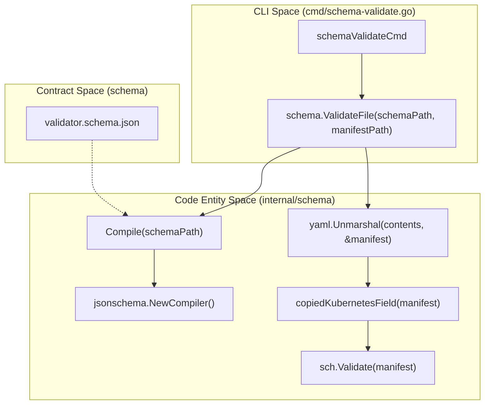

<!-- source: DeepWiki mcp.deepwiki.com · repo NVIDIA/container-canary · page 5.5 Schema Validation · fetched 2026-10-26 -->

# Schema Validation

<details>
<summary>Relevant source files</summary>

The following files were used as context for generating this wiki page:

- [cmd/schema-validate.go](cmd/schema-validate.go)
- [internal/schema/contract_test.go](internal/schema/contract_test.go)
- [internal/schema/diagnostics.go](internal/schema/diagnostics.go)
- [internal/schema/schema.go](internal/schema/schema.go)
- [schema/container-canary.nvidia.com/v1/validator.schema.json](schema/container-canary.nvidia.com/v1/validator.schema.json)

</details>


The `internal/schema` package provides the mechanism for validating `Validator` manifests against a formal JSON Schema contract. This ensures that manifests conform to the expected structure before the `container-canary` runtime attempts to execute probes.

### Overview of Validation Flow

The schema validation process is exposed via the `schema-validate` CLI command, which uses the `jsonschema` library to perform structural checks and a custom diagnostics engine to provide helpful error messages for users migrating from Kubernetes manifests.

**Validation Workflow Diagram**



**Sources:**
- [cmd/schema-validate.go:18-31]()
- [internal/schema/schema.go:17-41]()
- [internal/schema/schema.go:44-64]()

---

### Key Functions and Implementation

#### ValidateFile
Defined in `internal/schema/schema.go`, this is the primary entry point for validation. It performs three main steps:
1.  **Schema Compilation**: Compiles the JSON Schema file into a `jsonschema.Schema` object using `Compile` [internal/schema/schema.go:18-21]().
2.  **Diagnostic Pre-check**: Invokes `copiedKubernetesField` to detect common errors where users have copy-pasted incompatible Kubernetes fields [internal/schema/schema.go:33-35]().
3.  **JSON Schema Validation**: Executes the formal schema validation against the unmarshaled manifest [internal/schema/schema.go:37-39]().

#### Compile
The `Compile` function handles the loading and parsing of the JSON Schema. It uses `jsonschema.NewCompiler()` and adds the schema file as a resource using a `file://` URI scheme to ensure correct internal reference resolution [internal/schema/schema.go:44-64]().

#### Diagnostics (copiedKubernetesField)
The `copiedKubernetesField` function provides specific error messages for Kubernetes-specific fields that are not supported by `container-canary`. This helps users distinguish between the tool's manifest format and a standard Kubernetes Pod spec.

| Detected Field | Reason for Error |
| :--- | :--- |
| `livenessProbe`, `readinessProbe`, `startupProbe` | Canary uses `checks[].probe` instead [internal/schema/diagnostics.go:11-15](). |
| `env[].valueFrom` | Only `name` and `value` are supported in `EnvVar` [internal/schema/diagnostics.go:17-25](). |
| `checks[].probe.grpc` | `grpc` actions are currently unsupported; use `exec`, `httpGet`, or `tcpSocket` [internal/schema/diagnostics.go:27-41](). |

**Sources:**
- [internal/schema/schema.go:17-41]()
- [internal/schema/diagnostics.go:5-44]()

---

### The JSON Schema Contract

The project maintains a public contract at `schema/container-canary.nvidia.com/v1/validator.schema.json`. This schema is designed to be self-contained and strictly versioned.

**Contract Constraints Diagram**

```mermaid
classDiagram
    class "ValidatorSchema" {
        +apiVersion: "container-canary.nvidia.com/v1"
        +kind: "Validator"
        +name: string
        +checks: check[]
    }
    class "check" {
        +name: string
        +probe: probe
    }
    class "probe" {
        +exec: execAction
        +httpGet: httpGetAction
        +tcpSocket: tcpSocketAction
        +initialDelaySeconds: int
        +timeoutSeconds: int
    }
    ValidatorSchema "1" *-- "1..*" check
    check "1" *-- "1" probe
    
    note for probe "Exactly one action (oneOf) required: exec, httpGet, or tcpSocket"
```

**Key Schema Features:**
*   **No External References**: The schema is verified to have no external `$ref` links to `http`, `openapi`, or `kubernetes.io` to ensure it remains portable and offline-capable [internal/schema/contract_test.go:12-23]().
*   **Strict Property Evaluation**: The schema uses `"unevaluatedProperties": false` across most definitions (e.g., `envVar`, `servicePort`, `probe`) to prevent silent typos in manifest files [schema/container-canary.nvidia.com/v1/validator.schema.json:21, 28, 38, 70]().
*   **Action Exclusivity**: The `probe` definition uses a `oneOf` constraint combined with `not: anyOf` to ensure that exactly one probe action (`exec`, `httpGet`, or `tcpSocket`) is defined per check [schema/container-canary.nvidia.com/v1/validator.schema.json:65-69]().

**Sources:**
- [schema/container-canary.nvidia.com/v1/validator.schema.json:1-105]()
- [internal/schema/contract_test.go:12-23]()

---

### CLI Integration

The `schema-validate` command allows users to verify their manifests against either the built-in schema or a custom schema file provided via the `--schema` flag.

| Flag | Default Value | Description |
| :--- | :--- | :--- |
| `--schema` | `schema/container-canary.nvidia.com/v1/validator.schema.json` | Path to the Validator JSON Schema [cmd/schema-validate.go:35](). |

The command iterates through all provided manifest arguments and calls `schema.ValidateFile` for each, returning an error immediately if any manifest fails validation [cmd/schema-validate.go:23-27]().

**Sources:**
- [cmd/schema-validate.go:18-36]()
- [internal/schema/schema.go:13]()

---

