# Page: Overview

# Overview

<details>
<summary>Relevant source files</summary>

The following files were used as context for generating this wiki page:

- [CONTRIBUTING.md](CONTRIBUTING.md)
- [Makefile](Makefile)
- [README.md](README.md)
- [go.mod](go.mod)
- [main.go](main.go)

</details>


This document provides a comprehensive overview of Container Canary, a container validation tool designed to ensure container images meet platform-specific requirements. It covers the project's purpose, core concepts, system architecture, and key components. For installation instructions, see [Installation](#1.1). For getting started with validation, see [Quick Start](#1.2). For detailed CLI usage, see [CLI Reference](#2.1).

## What is Container Canary

Container Canary is a validation tool for container images in bring-your-own-container (BYOC) computing environments. It validates whether container images conform to platform-specific requirements by executing a set of checks defined in a declarative YAML manifest. [README.md:1-20]()

The tool addresses a common challenge: compute platforms like Kubeflow, SageMaker, and others allow users to provide custom container images but require those images to meet specific constraints such as:
- Running as a non-root user with specific UID. [README.md:55-57]()
- Exposing services on designated ports. [README.md:52]()
- Having home directories in specific locations. [README.md:56]()
- Installing required packages. [README.md:18]()
- Setting proper HTTP headers for iframe compatibility. [README.md:54]()

Container Canary records these requirements as versioned manifests and validates containers against them, particularly useful in CI/CD pipelines to prevent regressions. [README.md:20-21]()

**Sources**: [README.md:1-21](), [cmd/root.go:26-38]()

## Core Concepts

Container Canary operates on four fundamental concepts:

| Concept | Description | Code Entity |
|---------|-------------|-------------|
| **Validator** | A manifest defining platform requirements and runtime configuration | `api.Validator` struct in [pkg/types/v1/types.go:23-35]() |
| **Check** | An individual validation test with a name, description, and probe | `api.Check` struct in [pkg/types/v1/types.go:37-43]() |
| **Probe** | The actual test mechanism (exec, HTTP, or TCP) with timing parameters | `api.Probe` struct in [pkg/types/v1/types.go:45-56]() |
| **Validation** | The process of starting a container and executing all checks against it | `Validator.Validate()` in [internal/validator/validator.go:53-112]() |

**Sources**: [README.md:145-287](), [pkg/types/v1/types.go:23-56](), [internal/validator/validator.go:53-112]()

## System Architecture

The following diagram shows the high-level architecture and how components interact:

Title: High-Level System Architecture
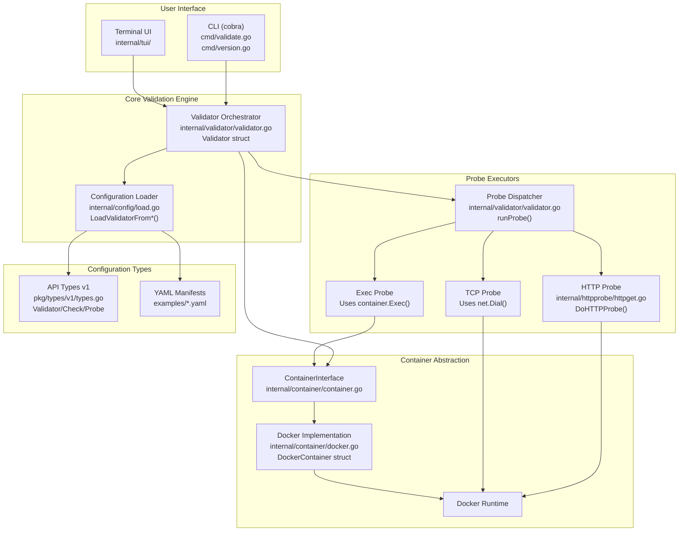

**Sources**: [cmd/validate.go:1-90](), [cmd/version.go:1-40](), [internal/validator/validator.go:1-219](), [internal/config/load.go:1-75](), [internal/httpprobe/httpget.go:1-95](), [internal/container/container.go:1-35](), [internal/container/docker.go:1-140](), [pkg/types/v1/types.go:1-75]()

## Validation Workflow

Container Canary follows a sequential validation workflow:

Title: Validation Sequence Diagram
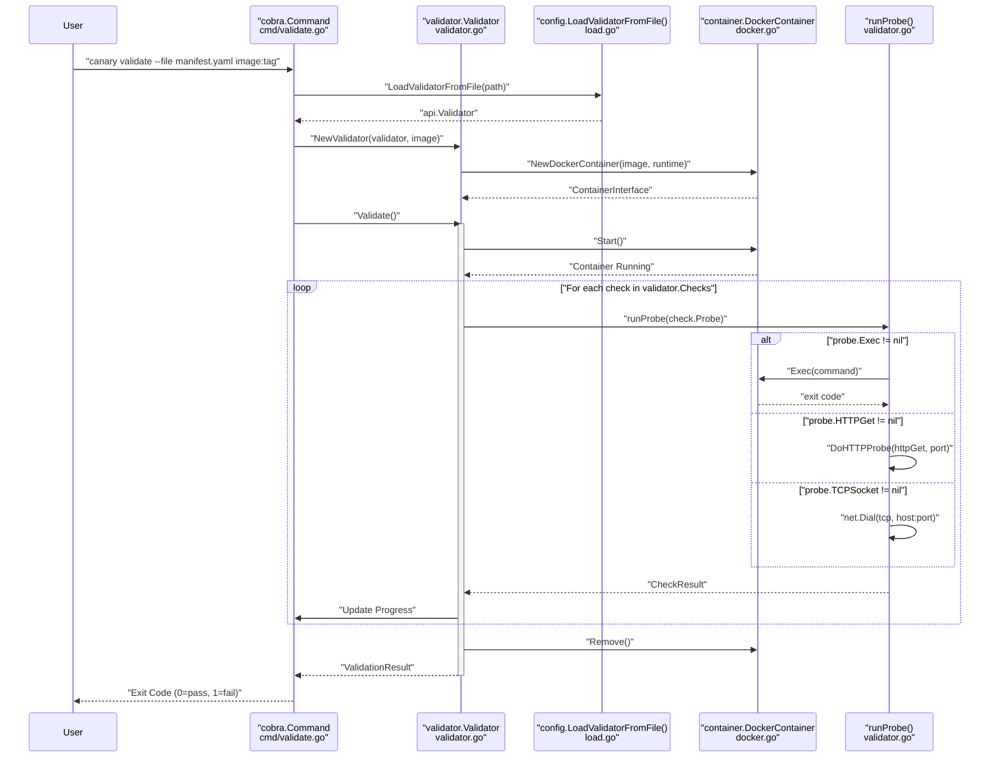

**Sources**: [cmd/validate.go:50-90](), [internal/validator/validator.go:53-112](), [internal/config/load.go:34-42](), [internal/container/docker.go:53-85](), [internal/httpprobe/httpget.go:34-95]()

## Key Components

### Validator Orchestrator

The `Validator` struct in [internal/validator/validator.go:33-40]() is the central orchestration component. It manages:
- Container lifecycle (start, stop, cleanup). [internal/validator/validator.go:56-111]()
- Sequential execution of checks. [internal/validator/validator.go:68-76]()
- Probe routing based on type. [internal/validator/validator.go:149-178]()
- Result aggregation and reporting. [internal/validator/validator.go:78-81]()

Key methods:
- `Validate()`: Main entry point that executes all checks. [internal/validator/validator.go:53-112]()
- `runProbe()`: Dispatches to appropriate probe executor. [internal/validator/validator.go:149-178]()
- `runCheck()`: Executes a single check with retry logic. [internal/validator/validator.go:114-147]()

### Configuration Loader

The configuration system in [internal/config/load.go]() supports three loading mechanisms:

| Function | Purpose | Source Type |
|----------|---------|-------------|
| `LoadValidatorFromFile(path)` | Load from local YAML file | Filesystem |
| `LoadValidatorFromURL(url)` | Load from remote URL | HTTP/HTTPS |
| `LoadValidatorFromBytes(data)` | Load from memory | In-memory bytes |

All converge on `LoadValidatorFromBytes()` which uses `yaml.Unmarshal()` to parse into `api.Validator` structs. [internal/config/load.go:66-74]()

### Container Abstraction

The container abstraction in [internal/container/container.go:27-33]() defines the `ContainerInterface`:

```go
type ContainerInterface interface {
	Start() error
	Remove() error
	Exec(command []string) (int, error)
}
```

The Docker implementation in [internal/container/docker.go:33-41]() (`DockerContainer` struct) provides concrete methods using Docker CLI commands:
- `Start()`: Executes `docker run` with configured ports, volumes, environment variables. [internal/container/docker.go:53-85]()
- `Remove()`: Executes `docker rm -f`. [internal/container/docker.go:87-95]()
- `Exec()`: Executes `docker exec` and returns exit code. [internal/container/docker.go:97-124]()

**Sources**: [internal/validator/validator.go:33-178](), [internal/config/load.go:34-75](), [internal/container/container.go:27-33](), [internal/container/docker.go:33-124]()

## Probe Types and Executors

Container Canary supports three probe types, each mapped to specific validation strategies:

Title: Probe Execution Flow
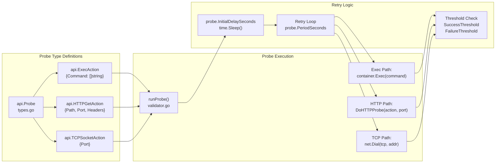

### Exec Probe
Executes commands inside the container via `container.Exec()`. Returns success if exit code is 0. [internal/validator/validator.go:155-160]()

**Use Cases**: Validate user, UID, home directory, installed packages, filesystem state. [README.md:77-101]()

### HTTP Probe  
Performs HTTP GET requests via `DoHTTPProbe()` in [internal/httpprobe/httpget.go:34-95](). Validates:
- Response status code < 300. [internal/httpprobe/httpget.go:78]()
- Optional request headers. [internal/httpprobe/httpget.go:53-56]()
- Optional response header matching. [internal/httpprobe/httpget.go:82-92]()

**Use Cases**: Validate HTTP service availability, routing, CORS headers. [README.md:102-125]()

### TCP Probe
Attempts TCP connection using `net.Dial()`. Returns success if connection established. [internal/validator/validator.go:171-175]()

**Use Cases**: Validate port availability, TCP service listening. [README.md:261-268]()

**Sources**: [internal/validator/validator.go:149-178](), [internal/httpprobe/httpget.go:34-95](), [pkg/types/v1/types.go:45-75](), [README.md:221-268]()

## Technology Stack

Container Canary is built with the following dependencies:

| Dependency | Purpose | Version |
|------------|---------|---------|
| Go | Implementation language | 1.25.0 |
| github.com/spf13/cobra | CLI framework | v1.10.2 |
| github.com/charmbracelet/bubbletea | Terminal UI framework | v0.25.0 |
| github.com/charmbracelet/lipgloss | TUI styling | v0.5.0 |
| gopkg.in/yaml.v3 | YAML parsing | v3.0.1 |
| k8s.io/api | Kubernetes probe types | v0.23.3 |
| github.com/stretchr/testify | Testing framework | v1.11.1 |
| github.com/google/uuid | UUID generation | v1.6.0 |

The project reuses Kubernetes API types (`k8s.io/api`) to maintain compatibility with existing Kubernetes probe definitions, reducing the learning curve for users familiar with Kubernetes. [go.mod:15](), [README.md:128]()

**Sources**: [go.mod:1-53]()

## Build and Distribution

Container Canary uses a comprehensive build system:

- **Build Tool**: Makefile in root directory. [Makefile:1-48]()
- **Cross-Compilation**: Builds for Linux (amd64/arm64), macOS (amd64/arm64), Windows (amd64). [Makefile:23-29]()
- **Version Embedding**: Linker flags inject version, commit hash, and build time. [Makefile:7-10]()
- **CI/CD**: GitHub Actions workflows for testing, linting, and releases. [README.md:3]()
- **Static Linking**: Linux binaries use `CGO_ENABLED=0` for portability. [Makefile:25-26]()

For build instructions, see [Building from Source](#4.1). For CI/CD details, see [CI/CD and Releases](#6).

**Sources**: [Makefile:1-48](), [CONTRIBUTING.md:9-16]()

## Next Steps

- **Installation**: See [Installation](#1.1) for download and setup instructions.
- **Quick Start**: See [Quick Start](#1.2) for a simple validation example.
- **Writing Manifests**: See [Writing Validator Manifests](#2.2) for creating custom validators.
- **Architecture Deep Dive**: See [Architecture](#3) for detailed component architecture.
- **API Reference**: See [API Reference](#5) for complete type definitions.
- **Developer Guide**: See [Developer Guide](#4) for development and contribution guidelines.

**Sources**: [README.md:22-40](), [CONTRIBUTING.md:1-94]()

---

# Page: Installation

# Installation

<details>
<summary>Relevant source files</summary>

The following files were used as context for generating this wiki page:

- [.github/workflows/upload-release-assets.yaml](.github/workflows/upload-release-assets.yaml)
- [CONTRIBUTING.md](CONTRIBUTING.md)
- [Makefile](Makefile)
- [README.md](README.md)
- [main.go](main.go)

</details>


This document describes how to install `container-canary` on your system. It covers two installation methods: downloading pre-built binaries from releases, and building from source. For information about using `container-canary` after installation, see [Quick Start](). For detailed development setup including testing infrastructure, see [Building from Source]().

## Installation Methods Overview

Container-canary can be installed through two primary methods:

1.  **Pre-built Binaries** (Recommended): Download platform-specific binaries from GitHub releases.
2.  **Build from Source**: Compile the tool locally using the Go toolchain and `make`.

### Installation Flow
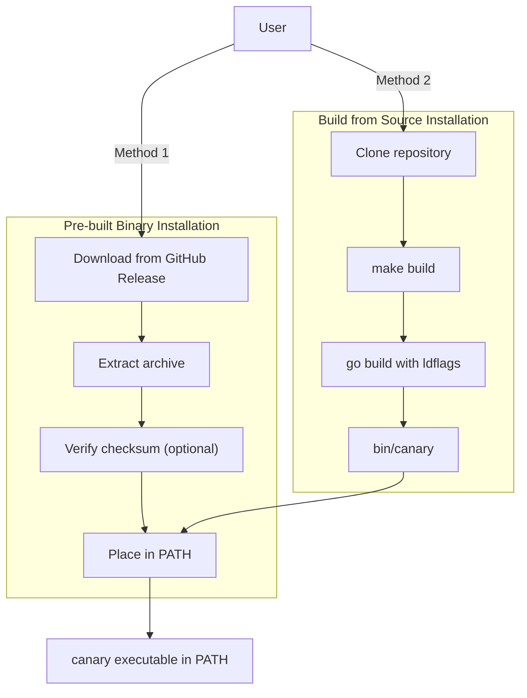
**Sources**: [README.md:42-44](), [Makefile:14-19](), [CONTRIBUTING.md:9-16]()

---

## Installing from Pre-built Binaries

The recommended installation method is to download pre-built binaries from the GitHub releases page [README.md:44]().

### Supported Platforms

The project uses a `package` target in the `Makefile` to cross-compile for multiple architectures [Makefile:23-29]().

| Platform | Architecture | Binary Name |
| :--- | :--- | :--- |
| Linux | AMD64 | `canary_linux_amd64` |
| Linux | ARM64 | `canary_linux_arm64` |
| macOS | AMD64 (Intel) | `canary_darwin_amd64` |
| macOS | ARM64 (Apple Silicon) | `canary_darwin_arm64` |
| Windows | AMD64 | `canary_windows_amd64.exe` |

**Sources**: [Makefile:24-28]()

### Download and Install

1.  **Navigate to the releases page**: Visit `https://github.com/NVIDIA/container-canary/releases`.
2.  **Download the appropriate binary** for your platform from the latest release assets.
3.  **Verify the checksum** (optional): The CI pipeline calculates SHA256 hashes for all assets during the release process [.github/workflows/upload-release-assets.yaml:35-40]().
4.  **Make the binary executable** (Linux/macOS only):
    ```bash
    chmod +x canary_linux_amd64
    ```
5.  **Move to a directory in your PATH**:
    ```bash
    sudo mv canary_linux_amd64 /usr/local/bin/canary
    ```

### Linux Static Binaries
Linux builds explicitly set `CGO_ENABLED=0` in the `Makefile` [Makefile:25-26](). This avoids dynamic linking against `libc`, preventing "version `GLIBC_X.XX' not found" errors when running the binary on systems older than the build environment [Makefile:20-22]().

**Sources**: [Makefile:20-26](), [.github/workflows/upload-release-assets.yaml:35-40]()

---

## Building from Source

Building from source requires the Go toolchain. The project currently targets Go version `1.26.x` in CI [.github/workflows/upload-release-assets.yaml:31]().

### Prerequisites
*   **Go**: 1.26.x (as specified in CI)
*   **Make**: Used for task running [CONTRIBUTING.md:7]()
*   **Docker**: Required for running tests [CONTRIBUTING.md:20-24]()

### Build Architecture
The build process uses `go build` with specific `-ldflags` to inject versioning metadata into the `internal` package [Makefile:7-10]().

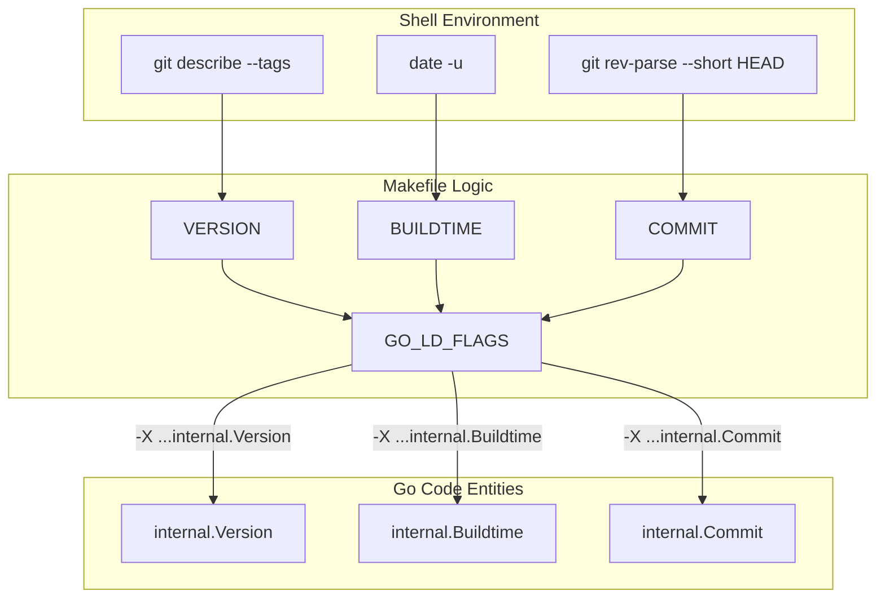
**Sources**: [Makefile:1-10](), [CONTRIBUTING.md:11-16]()

### Build Commands

1.  **Clone the repository**:
    ```bash
    git clone https://github.com/NVIDIA/container-canary.git
    cd container-canary
    ```
2.  **Standard Build**:
    Builds the binary for the current platform and places it in `bin/canary` [Makefile:14-15]().
    ```bash
    make build
    ```
3.  **Multi-platform Build**:
    Produces binaries for all supported OS/Arch combinations [Makefile:23-29]().
    ```bash
    make package
    ```

**Sources**: [Makefile:14-29](), [CONTRIBUTING.md:9-16]()

---

## Verification and Testing

After installation or building, verify the installation by checking the version and running the test suite.

### Version Check
The `canary version` command (entry point in `main.go` calling `cmd.Execute()`) will display the metadata injected during the build [main.go:22-24]().

### Running Tests
Tests require specific container images to be built locally first using the `testprep` target [CONTRIBUTING.md:20-23]().

1.  **Prepare test containers**:
    ```bash
    make testprep
    ```
    This builds `container-canary/kubeflow:shouldpass` and `container-canary/kubeflow:shouldfail` using Docker [Makefile:36-38]().

2.  **Execute tests**:
    ```bash
    make test
    ```
    This runs `go test -v ./...` [Makefile:33-34]().

**Sources**: [Makefile:33-39](), [CONTRIBUTING.md:20-37](), [main.go:22-24]()

---

## Next Steps

- [Quick Start](): Run your first validation against a container image.
- [CLI Reference](): Explore the `validate` and `schema-validate` commands.
- [Developer Guide](): Detailed information on contributing and code quality standards.

---

# Page: Quick Start

# Quick Start

<details>
<summary>Relevant source files</summary>

The following files were used as context for generating this wiki page:

- [CONTRIBUTING.md](CONTRIBUTING.md)
- [README.md](README.md)
- [cmd/validate.go](cmd/validate.go)
- [examples/kubeflow.yaml](examples/kubeflow.yaml)

</details>


This guide provides a hands-on introduction to using container-canary by walking through a simple validation example. After completing this guide, you will understand how to validate a container image against a set of requirements defined in a YAML manifest.

**Prerequisites**: Ensure you have installed container-canary by following the instructions in [1.1. Installation]().

**Scope**: This guide covers basic validation workflows using pre-built example manifests. For comprehensive information about writing your own validator manifests, see [2.2. Writing Validator Manifests](). For complete CLI command reference, see [2.1. CLI Reference]().

---

## Basic Validation Workflow

Container-canary validates container images through a three-step process:

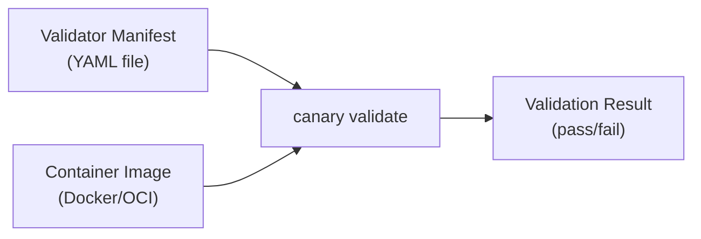

**Sources**: [README.md:9-16]()

---

## Your First Validation

Let's start with a simple example that validates any container. This example uses the `awesome.yaml` manifest, which runs three trivial checks that always pass.

### Step 1: Review the Manifest

The `awesome.yaml` manifest defines three checks that execute simple shell commands:

| Check Name | Description | Probe Type | Command |
|------------|-------------|------------|---------|
| packages | 📦 Required packages are installed | exec | `true` |
| services | 🤖 Expected services are running | exec | `true` |
| awesome | 🎉 Your container is awesome | exec | `true` |

Each check uses the `exec` probe type to run commands inside the container. The `true` command always exits with code 0, causing the checks to pass.

**Sources**: [README.md:9-16]()

### Step 2: Run the Validation

Execute the validation command against any container image. The `validate` command is defined in `cmd/validate.go` [cmd/validate.go:29-61]().

```bash
canary validate --file examples/awesome.yaml your/container:latest
```

**Expected output**:
```
Validating your/container:latest against awesome
 📦 Required packages are installed                  [passed]
 🤖 Expected services are running                    [passed]
 🎉 Your container is awesome                        [passed]
validation passed
```

The `--file` flag specifies the validator manifest path [cmd/validate.go:87-87](). The final argument is the container image to validate [cmd/validate.go:45-45]().

**Sources**: [README.md:9-16](), [cmd/validate.go:29-90]()

### Step 3: Using Remote Manifests

Manifests can also be loaded from URLs, eliminating the need to download them locally. The CLI handles both local paths and URLs via the `validator.Validate` function [cmd/validate.go:51-51]().

```bash
canary validate \
  --file https://raw.githubusercontent.com/NVIDIA/container-canary/main/examples/awesome.yaml \
  your/container:latest
```

This is useful for CI/CD pipelines or sharing validation specifications across teams.

**Sources**: [cmd/validate.go:51-51](), [cmd/validate.go:87-87]()

---

## Validation Execution Flow

The following diagram shows the internal execution flow when you run a validation, mapping the process to actual code entities:

```mermaid
sequenceDiagram
    participant User
    participant CLI["CLI<br/>cmd/validate.go"]
    participant ValidatorPkg["validator.Validate()<br/>internal/validator/validator.go"]
    participant ContainerInt["container.ContainerInterface<br/>internal/container/interface.go"]
    participant Docker["docker.Docker (Implementation)<br/>internal/container/docker/docker.go"]
    
    User->>CLI: "canary validate --file manifest.yaml image:tag"
    CLI->>CLI: "imageArg() check for Docker"
    CLI->>ValidatorPkg: "validator.Validate(image, file, ...)"
    
    ValidatorPkg->>ContainerInt: "NewContainer(image, ...)"
    ContainerInt->>Docker: "Create & Start Container"
    
    loop "For each Check in Validator.Checks"
        ValidatorPkg->>ValidatorPkg: "runCheck(check)"
        ValidatorPkg->>Docker: "Execute Probe (Exec/HTTP/TCP)"
        Docker-->>ValidatorPkg: "Probe Result"
    end
    
    ValidatorPkg->>Docker: "Remove container"
    ValidatorPkg-->>CLI: "bool (success/fail)"
    CLI-->>User: "Exit 0 or 1"
```

**Key Components**:

| Component | Code Entity | Responsibility |
|-----------|-----------|----------------|
| CLI Command | `validateCmd` [cmd/validate.go:29]() | Parses flags and orchestrates validation |
| Validation Entry | `validator.Validate` [internal/validator/validator.go]() | High-level orchestration of the validation lifecycle |
| Image Check | `imageArg` [cmd/validate.go:63]() | Validates image existence and Docker availability |
| Container Abstraction | `ContainerInterface` [internal/container/interface.go]() | Interface for container operations (Start, Stop, Exec) |

**Sources**: [cmd/validate.go:29-90](), [internal/validator/validator.go]()

---

## Understanding Validation Results

### Successful Validation

When all checks pass, the `RunE` function returns `nil` [cmd/validate.go:59-59](), resulting in an exit code of `0`.

```
validation passed
```

### Failed Validation

If any check fails, the `validator.Validate` function returns `false` [cmd/validate.go:51-51](), and the CLI returns a "validation failed" error [cmd/validate.go:57-57](), resulting in an exit code of `1`.

**Sources**: [cmd/validate.go:51-60]()

---

## A Real-World Example: Kubeflow

The Kubeflow example demonstrates more sophisticated validation using multiple probe types.

### Validation Command

```bash
canary validate \
  --file examples/kubeflow.yaml \
  public.ecr.aws/j1r0q0g6/notebooks/notebook-servers/jupyter-scipy:v1.5.0-rc.1
```

### Checks Performed

The Kubeflow manifest validates requirements such as user identity, home directory location, and network service availability.

| Check | Description | Probe Type | Purpose |
|-------|-------------|------------|---------|
| user | 👩 User is jovyan | `exec` | Verifies `whoami` returns `jovyan` [examples/kubeflow.yaml:15-22]() |
| uid | 🆔 User ID is 1000 | `exec` | Validates UID for volume permissions [examples/kubeflow.yaml:23-30]() |
| home | 🏠 Home directory is /home/jovyan | `exec` | Ensures `$HOME` is set correctly [examples/kubeflow.yaml:31-38]() |
| http | 🌏 Exposes HTTP on port 8888 | `httpGet` | Tests web service availability [examples/kubeflow.yaml:39-45]() |
| NB_PREFIX | 🧭 Correctly routes the NB_PREFIX | `httpGet` | Validates URL routing configuration [examples/kubeflow.yaml:46-52]() |
| allow-origin-all | 🔓 Sets CORS header | `httpGet` | Checks `Access-Control-Allow-Origin` [examples/kubeflow.yaml:53-65]() |

**Manifest structure breakdown**:

```mermaid
graph TB
    Manifest["kubeflow.yaml"]
    Env["Env Vars<br/>NB_PREFIX: /hub/jovyan/"]
    Ports["Ports<br/>8888/TCP"]
    Volumes["Volumes<br/>/home/jovyan"]
    Checks["Checks"]
    
    Manifest --> Env
    Manifest --> Ports
    Manifest --> Volumes
    Manifest --> Checks
    
    Env --- [examples/kubeflow.yaml:6-8]
    Ports --- [examples/kubeflow.yaml:9-11]
    Volumes --- [examples/kubeflow.yaml:12-13]
    Checks --- [examples/kubeflow.yaml:14-66]
```

**Sources**: [examples/kubeflow.yaml:1-65](), [README.md:46-142]()

---

## Common CLI Patterns

### Validate with Local Manifest
```bash
canary validate --file path/to/manifest.yaml image:tag
```

### Validate with Debug Mode
The `--debug` flag keeps the container running on failure, allowing you to manually inspect the state [cmd/validate.go:88-88]().
```bash
canary validate --file manifest.yaml --debug image:tag
```

### Custom Startup Timeout
If a container takes a long time to initialize, use `--startup-timeout` (default is 10s) [cmd/validate.go:89-89]().
```bash
canary validate --file manifest.yaml --startup-timeout 30 image:tag
```

**Sources**: [cmd/validate.go:85-90]()

---

## Next Steps

1. **Explore More Examples**: Review additional manifests in the `examples/` directory.
2. **Write Your Own Manifest**: Learn the complete manifest structure in [2.2. Writing Validator Manifests]().
3. **Understand Probe Types**: Deep dive into `exec`, `httpGet`, and `tcpSocket` probes in [2.2.2. Probe Types]().
4. **Integrate into CI/CD**: See how to use `make testprep` to build test images for validation in [4.2. Running Tests]() and [CONTRIBUTING.MD:20-29]().

**Sources**: [README.md:144-144](), [CONTRIBUTING.md:20-29]()

---

# Page: User Guide

# User Guide

<details>
<summary>Relevant source files</summary>

The following files were used as context for generating this wiki page:

- [CONTRIBUTING.md](CONTRIBUTING.md)
- [README.md](README.md)
- [cmd/validate.go](cmd/validate.go)
- [examples/kubeflow.yaml](examples/kubeflow.yaml)

</details>


This guide provides comprehensive documentation for using `container-canary` to validate container images against platform requirements. It covers the basic validation workflow, command-line usage, manifest creation, and practical examples for real-world scenarios.

For command-line flag details and options, see [CLI Reference](#2.1). For in-depth manifest authoring, see [Writing Validator Manifests](#2.2). For detailed API schemas, see [API Reference](#5).

## Overview

Container Canary validates container images by:
1. Loading a validator manifest (YAML file) that defines requirements.
2. Starting the target container with specified runtime configuration.
3. Executing a series of checks using probes (`exec`, `httpGet`, `tcpSocket`).
4. Reporting pass/fail results for each check.
5. Cleaning up container resources.

The validation workflow is designed to be deterministic and reproducible, making it ideal for CI/CD environments to avoid regressions in containers [README.md:18-20]().

**Sources**: [README.md:1-20](), [cmd/validate.go:29-61]()

## Core Concepts

### Validator Manifests

Validator manifests are YAML files that describe container requirements. Each manifest contains:

| Component | Purpose | Required |
|-----------|---------|----------|
| Metadata | `name`, `description`, `documentation` links | Yes |
| Runtime Options | `env`, `ports`, `volumes`, `command` | No |
| Checks | List of validation probes to execute | Yes |

**Sources**: [README.md:145-162](), [examples/kubeflow.yaml:1-14]()

### Probe Types

Container Canary supports three probe mechanisms, each suited to different validation scenarios:

| Probe Type | Use Case | Success Condition |
|------------|----------|-------------------|
| `exec` | Validate internal container state (user, filesystem, processes) | Command exits with status code 0 |
| `httpGet` | Validate HTTP services and response headers | HTTP status < 400 and optional header matching |
| `tcpSocket` | Validate network service availability | TCP connection succeeds |

**Sources**: [README.md:211-268](), [examples/kubeflow.yaml:15-65]()

### Validation Lifecycle

Each check executes according to a configurable lifecycle involving delays, timeouts, and thresholds [README.md:270-286]().

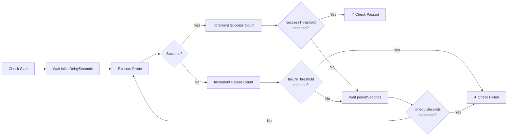

**Sources**: [README.md:270-286]()

## Basic Validation Workflow

### Command Structure

The basic validation command follows this pattern:

```console
$ canary validate --file <manifest-path-or-url> <image-reference>
```

### Workflow Diagram

The following diagram maps the CLI execution to the internal Go functions and entities.

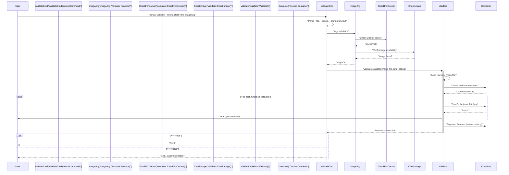

**Sources**: [cmd/validate.go:29-90](), [README.md:9-16]()

## Manifest Loading and Configuration

Container Canary supports loading manifests from the local filesystem or via HTTP(S) URLs [cmd/validate.go:87]().

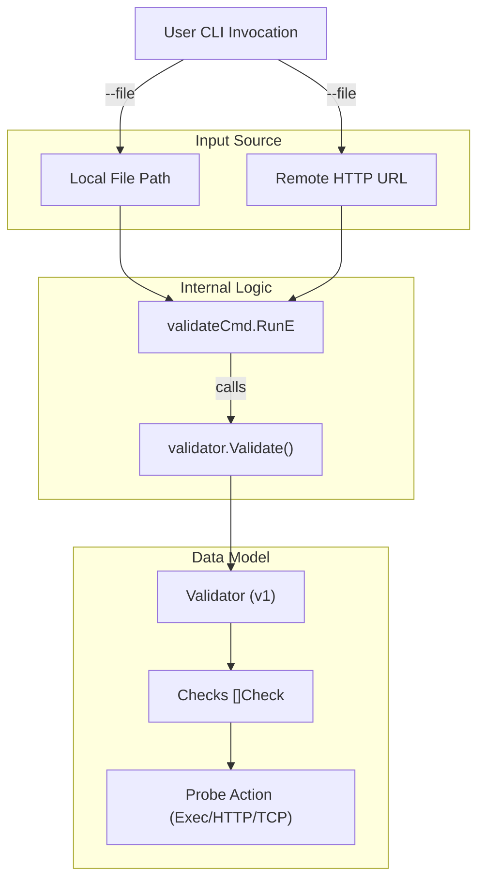

**Sources**: [cmd/validate.go:37-51](), [README.md:145-208]()

## Example: Validating a Kubeflow Container

The Kubeflow example validates requirements like running as user `jovyan` (UID 1000), having a specific home directory, and exposing port 8888 with correct CORS headers [README.md:46-60]().

### Requirements Mapping

| Requirement | Probe Implementation | File Reference |
|-------------|----------------------|----------------|
| User is `jovyan` | `exec: command: ["whoami"]` | [examples/kubeflow.yaml:15-22]() |
| UID is 1000 | `exec: command: ["id", "grep", "uid=1000"]` | [examples/kubeflow.yaml:23-30]() |
| HTTP Port 8888 | `httpGet: port: 8888` | [examples/kubeflow.yaml:39-45]() |
| CORS Header | `httpGet: responseHttpHeaders: Access-Control-Allow-Origin` | [examples/kubeflow.yaml:53-65]() |

**Sources**: [README.md:45-141](), [examples/kubeflow.yaml:1-65]()

## Command-Line Options

### Flags

| Flag | Type | Default | Description |
|------|------|---------|-------------|
| `--file` | string | (empty) | **Required**. Path or URL of a manifest to validate against. |
| `--debug` | bool | `false` | Keep container running on failure for debugging. |
| `--startup-timeout` | int | `10` | Maximum time (in seconds) to wait for the container to start up. |

**Sources**: [cmd/validate.go:85-90]()

## Understanding Results and Debugging

### Exit Codes
- **0**: All checks passed [cmd/validate.go:59-60]().
- **1**: One or more checks failed, or a technical error occurred (e.g., Docker not found) [cmd/validate.go:56-58](), [cmd/validate.go:81]().

### Debugging
Using the `--debug` flag prevents the `validator` from removing the container upon failure [cmd/validate.go:88](). This allows users to inspect the container state using standard Docker tools while the validation environment is still active.

**Sources**: [cmd/validate.go:29-61](), [README.md:288-294]()

## Next Steps

- For detailed command-line reference, see [CLI Reference](#2.1)
- For comprehensive manifest authoring guide, see [Writing Validator Manifests](#2.2)
- For real-world examples, see [Example Validators](#2.3)
- For developer setup and testing, see [Developer Guide](#4)

---

# Page: CLI Reference

# CLI Reference

<details>
<summary>Relevant source files</summary>

The following files were used as context for generating this wiki page:

- [cmd/root.go](cmd/root.go)
- [cmd/schema-validate.go](cmd/schema-validate.go)
- [cmd/validate.go](cmd/validate.go)
- [cmd/validate_test.go](cmd/validate_test.go)
- [cmd/version.go](cmd/version.go)

</details>


## Purpose and Scope

This document provides a complete reference for the `container-canary` command-line interface. It details all available commands, their flags, arguments, and usage patterns. For information about writing validator manifests to use with the CLI, see [Writing Validator Manifests](#2.2). For architectural details about how the CLI integrates with the validation system, see [System Components](#3.1).

## Command Structure

Container-canary uses the Cobra framework [cmd/root.go:23]() to provide a hierarchical command structure. The CLI consists of a root command (`canary`) with three subcommands: `validate`, `version`, and `schema-validate`.

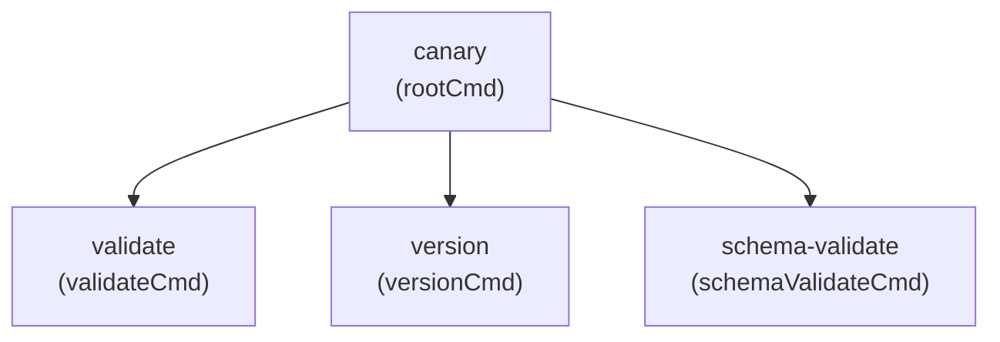

**Sources:** [cmd/root.go:27-39](), [cmd/validate.go:29-35](), [cmd/version.go:27-39](), [cmd/schema-validate.go:18-31]()

## Root Command: `canary`

The root command provides the entry point to the CLI and displays help information when invoked without subcommands.

### Usage

```bash
canary [command]
```

### Description

The root command identifies `container-canary` as "A little bird to validate your containers" [cmd/root.go:29](). It explains the tool's purpose: validating whether custom container images are compatible with various compute platforms that support "Bring your own container" models [cmd/root.go:30-33]().

### Implementation Details

| Property | Value | Source |
|----------|-------|--------|
| Command Name | `canary` | [cmd/root.go:28]() |
| Entry Point | `rootCmd.Execute()` | [cmd/root.go:43-48]() |
| Framework | Cobra | [cmd/root.go:23]() |

**Sources:** [cmd/root.go:27-60]()

## Validate Command: `canary validate`

The `validate` command executes container validation against a specified manifest. This is the primary command for running validation checks.

### Usage

```bash
canary validate [flags] IMAGE
```

### Arguments

| Argument | Required | Description |
|----------|----------|-------------|
| `IMAGE` | Yes | Container image name with optional tag (e.g., `myorg/mycontainer:rev`) |

The image argument is validated through the `imageArg` function [cmd/validate.go:63-83](), which:
1. Ensures exactly one image argument is provided [cmd/validate.go:64-70]().
2. Verifies Docker is available via `container.CheckForDocker()` [cmd/validate.go:72-74]().
3. Confirms the image exists using `validator.CheckImage(cmd, image, "docker")` [cmd/validate.go:78-82]().

### Flags

| Flag | Type | Default | Description |
|------|------|---------|-------------|
| `--file` | string | (none) | **Required.** Path or URL to a validator manifest [cmd/validate.go:87](). |
| `--debug` | bool | `false` | Keep the container running after validation failure for debugging purposes [cmd/validate.go:88](). |
| `--startup-timeout` | int | `10` | Maximum time in seconds to wait for the container to start [cmd/validate.go:89](). |

### Execution Flow

The `validate` command follows this execution sequence:

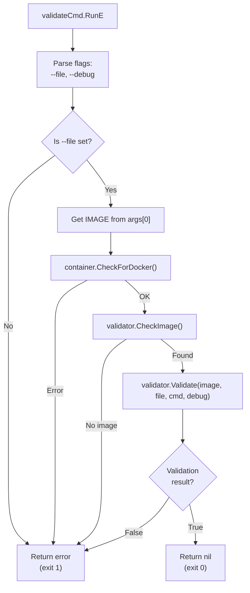

**Sources:** [cmd/validate.go:36-60](), [cmd/validate.go:63-83]()

## Schema Validate Command: `canary schema-validate`

The `schema-validate` command validates one or more manifest files against the published Validator JSON Schema.

### Usage

```bash
canary schema-validate manifest [manifest...] [flags]
```

### Flags

| Flag | Type | Default | Description |
|------|------|---------|-------------|
| `--schema` | string | `schema.Path` | Path to the Validator JSON Schema [cmd/schema-validate.go:35](). |

### Implementation Details

The command iterates through the provided arguments and calls `schema.ValidateFile` for each manifest [cmd/schema-validate.go:23-27](). If all manifests pass, it prints "schema validation passed" [cmd/schema-validate.go:28]().

**Sources:** [cmd/schema-validate.go:18-36]()

## Version Command: `canary version`

The `version` command displays build information and metadata about the `container-canary` binary.

### Usage

```bash
canary version
```

### Output Fields

The command displays the following information from the `internal` package:

| Field | Code Entity | Source |
|-------|-------------|--------|
| Version | `internal.Version` | [cmd/version.go:33]() |
| Go version | `internal.GoVersion` | [cmd/version.go:34]() |
| Commit | `internal.Commit` | [cmd/version.go:35]() |
| OS/Arch | `internal.Os` / `internal.Arch` | [cmd/version.go:36]() |
| Built | `internal.Buildtime` | [cmd/version.go:37]() |

**Sources:** [cmd/version.go:27-39]()

## Command Initialization and Registration

All commands are registered with the `rootCmd` during package initialization.

```mermaid
graph LR
    rootCmd["rootCmd [cmd/root.go]"]
    validateCmd["validateCmd [cmd/validate.go]"]
    versionCmd["versionCmd [cmd/version.go]"]
    schemaCmd["schemaValidateCmd [cmd/schema-validate.go]"]
    
    init_val["init() [cmd/validate.go:85]"] -->|AddCommand| rootCmd
    init_ver["init() [cmd/version.go:45]"] -->|AddCommand| rootCmd
    init_sch["init() [cmd/schema-validate.go:33]"] -->|AddCommand| rootCmd
```

### Persistent Flags
The `validate` command defines persistent flags for `--file`, `--debug`, and `--startup-timeout` in its `init()` function [cmd/validate.go:87-89]().

**Sources:** [cmd/validate.go:85-90](), [cmd/version.go:45-47](), [cmd/schema-validate.go:33-36]()

## Error Handling

The CLI implements comprehensive error handling with specific exit paths:

| Error Scenario | Code Path | Exit Status |
|----------------|-----------|-------------|
| Command Execution Error | `rootCmd.Execute()` | `os.Exit(1)` [cmd/root.go:44-47]() |
| Validation Failure | `validator.Validate()` returns `false` | `errors.New("validation failed")` [cmd/validate.go:56-58]() |
| Missing Manifest | `file == ""` | `errors.New("you must specify a manifest...")` [cmd/validate.go:41-43]() |
| Image Check Failure | `validator.CheckImage()` returns `false` | `fmt.Errorf("no such image: %s", image)` [cmd/validate.go:78-82]() |

**Sources:** [cmd/root.go:43-48](), [cmd/validate.go:36-60](), [cmd/validate.go:63-83]()

---

# Page: Writing Validator Manifests

# Writing Validator Manifests

<details>
<summary>Relevant source files</summary>

The following files were used as context for generating this wiki page:

- [CONTRIBUTING.md](CONTRIBUTING.md)
- [README.md](README.md)
- [internal/apis/v1/types.go](internal/apis/v1/types.go)
- [schema/container-canary.nvidia.com/v1/validator.schema.json](schema/container-canary.nvidia.com/v1/validator.schema.json)

</details>


This guide provides an overview of creating validator manifests for container-canary. Validator manifests are YAML files that define container requirements as executable checks. For detailed information about specific aspects of manifests, see:
- Manifest structure and metadata: [Manifest Structure](#2.2.1)
- Probe types and their use cases: [Probe Types](#2.2.2)
- Probe timing and retry configuration: [Probe Configuration](#2.2.3)

## Purpose and Scope

Validator manifests are the core configuration files that define container validation requirements. They translate platform documentation (e.g., "must run as user jovyan") into executable validation checks. This page explains the conceptual model behind manifests and provides guidance on creating effective validators. Implementation details and complete API references are covered in child pages and [API Reference](#5).

**Sources**: [README.md:18-20](), [README.md:145-148]()

## Manifest Fundamentals

### What is a Validator Manifest

A validator manifest is a declarative YAML file that specifies:
1. **What to validate**: The container requirements (user, ports, services) [README.md:18-21]()
2. **How to validate**: The probe mechanisms (exec, HTTP, TCP) [README.md:33-36]()
3. **Runtime environment**: Container configuration needed for validation (environment variables, ports, volumes) [README.md:28-32]()

Manifests enable versioning of container requirements and automated regression testing in CI pipelines [README.md:20-21]().

**Sources**: [README.md:18-21](), [README.md:28-36]()

### Manifest Type System

Container-canary uses Go structs defined in `internal/apis/v1/types.go` to provide type-safe manifest parsing. The type hierarchy follows Kubernetes API conventions:

**Manifest Entity Mapping**
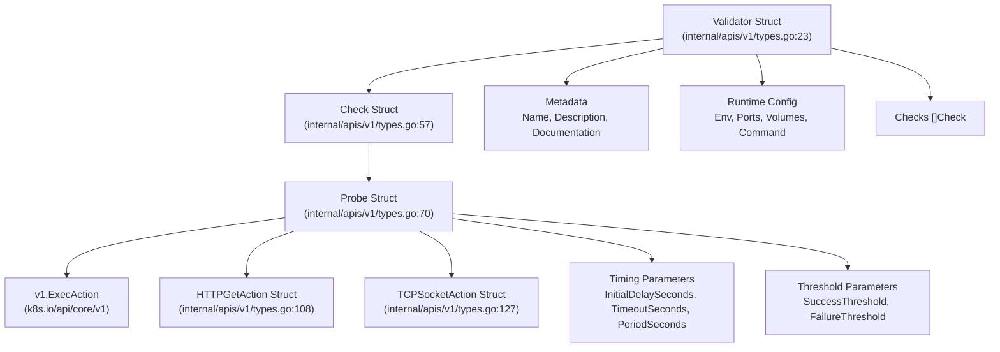

**Sources**: [internal/apis/v1/types.go:23-140]()

### Manifest to Execution Flow

The following diagram shows how manifest elements map to runtime execution:

**Code Entity Interaction Flow**
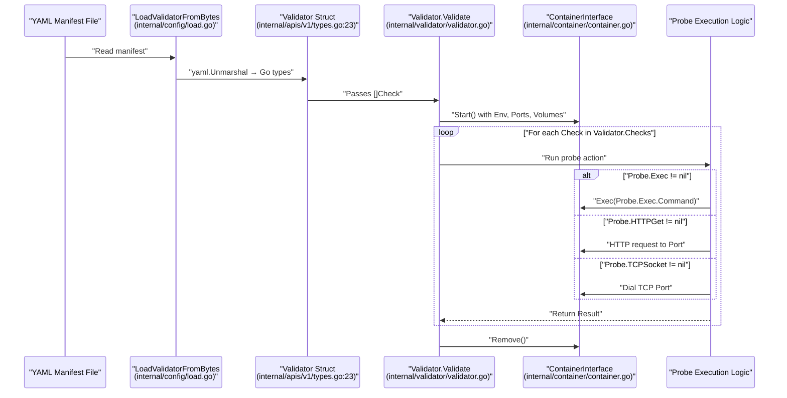

**Sources**: [internal/apis/v1/types.go:23-140](), [README.md:145-148](), [schema/container-canary.nvidia.com/v1/validator.schema.json:1-105]()

## Creating Your First Manifest

### Starting from Examples

The simplest starting point is a basic manifest that runs a command and checks a condition:

```yaml
apiVersion: container-canary.nvidia.com/v1
kind: Validator
name: basic-check
description: A simple example
checks:
  - name: verify-true
    description: 📦 Verify the true command works
    probe:
      exec:
        command:
          - /bin/sh
          - -c
          - "true"
```

This minimal manifest demonstrates the required API versioning fields (`apiVersion`, `kind`), metadata, and a simple `exec` probe [schema/container-canary.nvidia.com/v1/validator.schema.json:7-11]().

**Sources**: [schema/container-canary.nvidia.com/v1/validator.schema.json:7-19](), [README.md:63-126]()

### Anatomy of a Check

Each `Check` struct consists of three primary parts:

| Component | Purpose | Code Pointer |
|-----------|---------|--------------|
| `name` | Unique identifier for the check | [internal/apis/v1/types.go:60]() |
| `description` | Human-readable output text | [internal/apis/v1/types.go:63]() |
| `probe` | The validation mechanism (Exec, HTTP, TCP) | [internal/apis/v1/types.go:67]() |

**Sources**: [internal/apis/v1/types.go:57-68]()

## Manifest Structure Patterns

### The Kubeflow Pattern

The Kubeflow example demonstrates a production-grade validation pattern:

1. **Metadata Layer**: Uses `name`, `description`, and `documentation` to link to requirements [internal/apis/v1/types.go:23-34]().
2. **Runtime Environment**: Sets `env`, `ports`, and `volumes` to mirror the platform [internal/apis/v1/types.go:39-47]().
3. **Layered Validation**: Checks progress from basic system identity (UID/User) to complex application state (HTTP headers) [README.md:77-126]().

**Sources**: [README.md:46-126](), [internal/apis/v1/types.go:23-55]()

### Check Ordering Strategy

Checks execute sequentially as they appear in the `Checks` slice [internal/apis/v1/types.go:37](). It is recommended to order them as follows:
1. **Identity/Environment**: User, UID, and shell environment [README.md:78-101]().
2. **Connectivity**: TCP and basic HTTP availability [README.md:102-115]().
3. **Behavioral**: Response headers and specific path routing [README.md:116-125]().

**Sources**: [README.md:77-126](), [internal/apis/v1/types.go:37]()

## Runtime Configuration

### Mimicking the Target Platform

The `Validator` struct includes fields to replicate the container's production environment:
- `Env`: A list of `v1.EnvVar` [internal/apis/v1/types.go:40]().
- `Ports`: A list of `v1.ServicePort` [internal/apis/v1/types.go:43]().
- `Volumes`: A list of `Volume` structs for mount paths [internal/apis/v1/types.go:46]().
- `Command`: An optional entrypoint override [internal/apis/v1/types.go:50]().

**Sources**: [internal/apis/v1/types.go:39-55]()

## Probe Selection Guide

| Validation Goal | Probe Action | Example Field |
|-----------------|--------------|---------------|
| System Identity | `exec` | `probe.exec.command` [internal/apis/v1/types.go:83]() |
| Port Connectivity | `tcpSocket` | `probe.tcpSocket.port` [internal/apis/v1/types.go:87]() |
| Web Service | `httpGet` | `probe.httpGet.path` [internal/apis/v1/types.go:85]() |
| Response Headers| `httpGet` | `probe.httpGet.responseHttpHeaders` [internal/apis/v1/types.go:124]() |

Detailed probe configuration is covered in [Probe Types](#2.2.2).

**Sources**: [internal/apis/v1/types.go:83-87](), [internal/apis/v1/types.go:124]()

## Validation Best Practices

### Use Descriptive Names and Emojis
The `description` field is what the user sees in the TUI or CLI output. Using emojis helps distinguish different check types (e.g., 🆔 for UID, 🌏 for HTTP) [README.md:135-140]().

### Set Appropriate Thresholds
The `Probe` struct defaults to 1 for `SuccessThreshold` and `FailureThreshold` [internal/apis/v1/types.go:96-97](). For services with long startup times, increase `failureThreshold` or `initialDelaySeconds` [internal/apis/v1/types.go:71,79]().

### YAML Unmarshaling and Defaults
The `UnmarshalYAML` function in `internal/apis/v1/types.go` ensures that even if timing parameters are omitted in YAML, they default to safe values (e.g., `TimeoutSeconds: 30`) [internal/apis/v1/types.go:90-106]().

**Sources**: [internal/apis/v1/types.go:70-106](), [README.md:132-142]()

---

# Page: Manifest Structure

# Manifest Structure

<details>
<summary>Relevant source files</summary>

The following files were used as context for generating this wiki page:

- [CONTRIBUTING.md](CONTRIBUTING.md)
- [README.md](README.md)
- [internal/apis/v1/types.go](internal/apis/v1/types.go)
- [schema/container-canary.nvidia.com/v1/validator.schema.json](schema/container-canary.nvidia.com/v1/validator.schema.json)

</details>


This page details the YAML structure of validator manifests used by container-canary. A validator manifest defines the complete specification for validating a container image, including metadata, runtime configuration, and validation checks. For information about specific probe types and their configuration, see [Probe Types](#2.2.2) and [Probe Configuration](#2.2.3). For complete API type references, see [Validator Type](#5.1).

## Overview

Validator manifests are YAML files that follow a Kubernetes-style API structure with `apiVersion`, `kind`, and typed fields. The manifest defines:
- **Metadata**: Descriptive information about the validator (name, description, documentation)
- **Runtime Configuration**: Container execution environment (environment variables, ports, volumes, command)
- **Checks**: List of validation checks to execute against the container

**Sources**: [internal/apis/v1/types.go:22-55](), [README.md:63-126]()

## Top-Level Manifest Structure

### Manifest Header Fields

```yaml
apiVersion: container-canary.nvidia.com/v1
kind: Validator
name: kubeflow
description: Kubeflow notebooks
documentation: https://www.kubeflow.org/docs/components/notebooks/container-images/#custom-images
```

| Field | Type | Required | Purpose |
|-------|------|----------|---------|
| `apiVersion` | string | Yes | API version, currently `container-canary.nvidia.com/v1` |
| `kind` | string | Yes | Resource type, must be `Validator` |
| `name` | string | Yes* | Identifier for the validator |
| `description` | string | No | Human-readable description of what is validated |
| `documentation` | string | No | URL to external documentation defining requirements |

\* The JSON Schema requires `name` to be present and non-empty.

**Sources**: [internal/apis/v1/types.go:24-34](), [schema/container-canary.nvidia.com/v1/validator.schema.json:7-13]()

### Hierarchical Structure Diagram

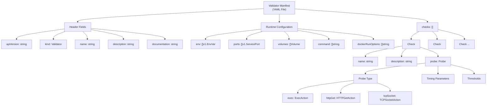

**Sources**: [internal/apis/v1/types.go:22-55](), [internal/apis/v1/types.go:57-68](), [internal/apis/v1/types.go:70-88](), [schema/container-canary.nvidia.com/v1/validator.schema.json:8-19]()

## Runtime Configuration Section

The runtime configuration section defines how the container should be started before validation begins. These fields correspond to the `Validator` struct definition.

### Environment Variables

```yaml
env:
  - name: NB_PREFIX
    value: /hub/jovyan/
```

Environment variables use a subset of the Kubernetes `v1.EnvVar` type. The schema specifically supports literal `name` and `value` fields; `valueFrom` is not supported.

**Type Mapping**: `Env []v1.EnvVar` at [internal/apis/v1/types.go:40]()
**Schema Constraint**: [schema/container-canary.nvidia.com/v1/validator.schema.json:23-29]()

### Port Exposures

```yaml
ports:
  - port: 8888
    protocol: TCP
```

Ports use a subset of the Kubernetes `v1.ServicePort` type. The `port` (integer 1-65535) and `protocol` (TCP, UDP, or SCTP) are required by the schema.

**Type Mapping**: `Ports []v1.ServicePort` at [internal/apis/v1/types.go:43]()
**Schema Constraint**: [schema/container-canary.nvidia.com/v1/validator.schema.json:30-39]()

### Volume Mounts

```yaml
volumes:
  - mountPath: /home/jovyan
  - mountPath: /tmp/data
    path: /host/path/to/data
```

Volumes define filesystem mounts. The `Volume` type supports:
- `mountPath`: Path inside the container (required)
- `path`: Path on the host (optional; if omitted, an empty volume is created)

**Type Mapping**: `Volumes []Volume` at [internal/apis/v1/types.go:46](), [internal/apis/v1/types.go:133-140]()

### Container Command

```yaml
command:
  - /bin/bash
  - -c
  - jupyter lab --allow-root
```

Overrides the container's default entrypoint/command.

**Type Mapping**: `Command []string` at [internal/apis/v1/types.go:50]()

### Docker Run Options

```yaml
dockerRunOptions:
  - --privileged
  - --cap-add=SYS_ADMIN
```

Additional flags passed directly to the Docker CLI. This maps to the `dockerRunOptions` YAML key.

**Type Mapping**: `DockerRunOptions []string` at [internal/apis/v1/types.go:54]()

**Sources**: [internal/apis/v1/types.go:39-54](), [schema/container-canary.nvidia.com/v1/validator.schema.json:14-18]()

## Checks Section

The `checks` section is a list of validation checks to perform. The schema requires at least one check to be defined.

### Check Structure

```yaml
checks:
  - name: user
    description: 👩 User is jovyan
    probe:
      exec:
        command: ["/bin/sh", "-c", "[ $(whoami) = jovyan ]"]
```

| Field | Type | Required | Purpose |
|-------|------|----------|---------|
| `name` | string | Yes | Identifier for the check |
| `description` | string | No | Human-readable description displayed during execution |
| `probe` | Probe | Yes | Probe definition specifying how to validate |

**Sources**: [internal/apis/v1/types.go:57-68](), [schema/container-canary.nvidia.com/v1/validator.schema.json:46-51]()

## Type Mapping: YAML to Go Structs

### Complete Type Hierarchy Diagram

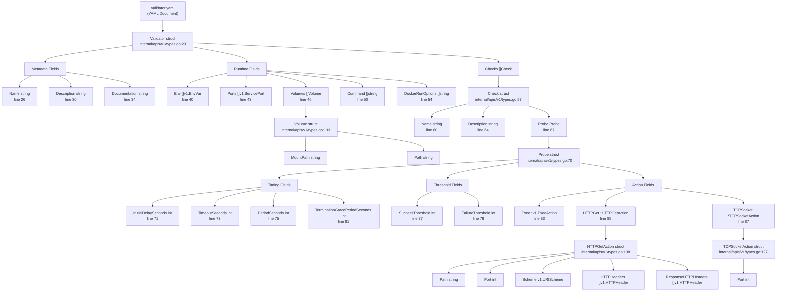

**Sources**: [internal/apis/v1/types.go:22-140]()

## Concrete Example: Mapping YAML to Code

The following diagram maps actual YAML content from the `kubeflow.yaml` example to the corresponding Go struct fields:

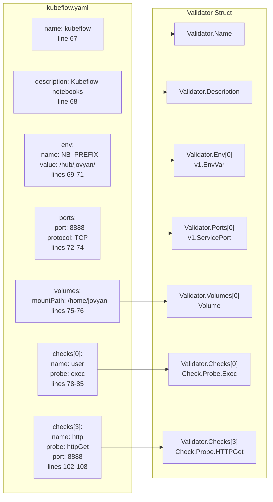

**Sources**: [README.md:63-126](), [internal/apis/v1/types.go:22-55]()

## Probe Field Defaults

The `Probe` type implements custom YAML unmarshalling to provide sensible defaults for timing and threshold fields when they are not specified in the manifest.

| Field | Default Value | Purpose |
|-------|---------------|---------|
| `initialDelaySeconds` | 0 | No delay before first probe execution |
| `timeoutSeconds` | 30 | Maximum time for probe execution |
| `periodSeconds` | 1 | Interval between probe retries |
| `successThreshold` | 1 | Consecutive successes required |
| `failureThreshold` | 1 | Consecutive failures before giving up |
| `terminationGracePeriodSeconds` | 30 | Grace period for container shutdown |

These defaults are set in the `UnmarshalYAML` method.

**Sources**: [internal/apis/v1/types.go:90-106]()

## Complete Field Reference Table

| YAML Path | Go Type | Struct Location | Required | Description |
|-----------|---------|-----------------|----------|-------------|
| `apiVersion` | string | N/A | Yes | API version identifier |
| `kind` | string | N/A | Yes | Must be "Validator" |
| `name` | string | `Validator.Name` | Yes | Validator identifier |
| `description` | string | `Validator.Description` | No | Human-readable description |
| `documentation` | string | `Validator.Documentation` | No | URL to requirements documentation |
| `env[]` | `[]v1.EnvVar` | `Validator.Env` | No | Environment variables |
| `ports[]` | `[]v1.ServicePort` | `Validator.Ports` | No | Port exposures |
| `volumes[]` | `[]Volume` | `Validator.Volumes` | No | Volume mounts |
| `volumes[].mountPath` | string | `Volume.MountPath` | Yes | Container mount path |
| `volumes[].path` | string | `Volume.Path` | No | Host path (empty volume if omitted) |
| `command[]` | `[]string` | `Validator.Command` | No | Container command override |
| `dockerRunOptions[]` | `[]string` | `Validator.DockerRunOptions` | No | Additional docker run flags |
| `checks[]` | `[]Check` | `Validator.Checks` | Yes | List of validation checks (min 1) |
| `checks[].name` | string | `Check.Name` | Yes | Check identifier |
| `checks[].description` | string | `Check.Description` | No | Check description |
| `checks[].probe` | `Probe` | `Check.Probe` | Yes | Probe specification |
| `checks[].probe.exec` | `*v1.ExecAction` | `Probe.Exec` | No* | Exec probe action |
| `checks[].probe.httpGet` | `*HTTPGetAction` | `Probe.HTTPGet` | No* | HTTP probe action |
| `checks[].probe.tcpSocket` | `*TCPSocketAction` | `Probe.TCPSocket` | No* | TCP probe action |

\* Exactly one probe action type must be specified per probe (enforced by `oneOf` in JSON Schema).

**Sources**: [internal/apis/v1/types.go:22-140](), [schema/container-canary.nvidia.com/v1/validator.schema.json:1-105]()

---

# Page: Probe Types

# Probe Types

<details>
<summary>Relevant source files</summary>

The following files were used as context for generating this wiki page:

- [CONTRIBUTING.md](CONTRIBUTING.md)
- [README.md](README.md)
- [examples/dask-scheduler.yaml](examples/dask-scheduler.yaml)
- [internal/validator/exec.go](internal/validator/exec.go)
- [internal/validator/httpget.go](internal/validator/httpget.go)
- [internal/validator/tcp.go](internal/validator/tcp.go)

</details>


This page documents the three probe types available in `container-canary` for validating container behavior: **Exec**, **HTTPGet**, and **TCPSocket**. Each probe type provides a different method for checking that a container meets specific requirements.

For information about configuring probe timing parameters, thresholds, and retry logic, see [Probe Configuration](#2.2.3). For the overall structure of validator manifests, see [Manifest Structure](#2.2.1).

## Overview

Container Canary borrows the probe concept from Kubernetes, where probes are used to check container health. In `container-canary`, probes are repurposed to validate that a container image meets platform requirements [README.md:128-128](). Each check in a validator manifest contains exactly one probe, which defines how to test a specific requirement.

The three probe types provide different validation strategies:

| Probe Type | Purpose | Validation Method | Common Use Cases |
|------------|---------|-------------------|------------------|
| **Exec** | Execute commands inside the container | Command exit code (0 = pass) | User/UID validation, package checks, filesystem verification |
| **HTTPGet** | Make HTTP requests to container services | HTTP status code (<400 = pass) + optional header validation | Web service availability, routing, CORS headers |
| **TCPSocket** | Test TCP connectivity | TCP connection success | Port availability, service listening |

**Sources:** [README.md:33-37](), [internal/validator/exec.go:25-32](), [internal/validator/httpget.go:29-59](), [internal/validator/tcp.go:28-36]()

## Probe Type Architecture

The following diagram shows how probe types are defined and dispatched within the codebase:

**Probe Dispatcher Architecture**
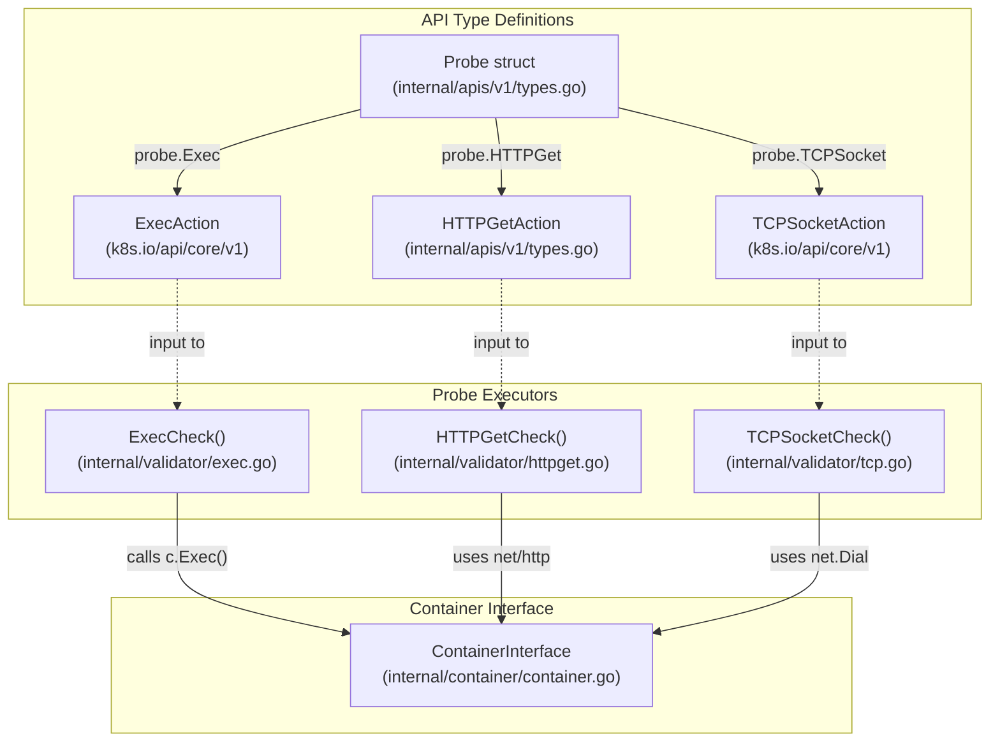

The `Probe` struct contains three optional pointer fields corresponding to the three probe types. The validator's check execution logic dispatches to the appropriate probe handler function.

**Sources:** [internal/validator/exec.go:25-25](), [internal/validator/httpget.go:29-29](), [internal/validator/tcp.go:28-28]()

## Exec Probe

The Exec probe type executes a command inside the running container and validates the exit code. If the command exits with code `0`, the check passes. Any non-zero exit code results in a failed check [internal/validator/exec.go:27-31]().

### Structure

An Exec probe uses the `ExecAction` type, which contains a single field:

```yaml
probe:
  exec:
    command:
      - /bin/sh
      - -c
      - "[ $(whoami) = jovyan ]"
```

The `command` field is a string array representing the command and its arguments to execute [README.md:82-85]().

### Implementation

The `ExecCheck` function in `internal/validator/exec.go` implements Exec probe validation:

**Exec Validation Flow**
```mermaid
sequenceDiagram
    participant Validator
    participant ExecCheck["ExecCheck()"]
    participant Container["ContainerInterface"]
    
    Validator->>ExecCheck: "ExecCheck(c, probe)"
    ExecCheck->>Container: "c.Exec(action.Command...)"
    
    alt Exit code = 0
        Container-->>ExecCheck: "nil error"
        ExecCheck-->>Validator: "true, nil (PASS)"
    else Exit code != 0
        Container-->>ExecCheck: "error"
        ExecCheck-->>Validator: "false, nil (FAIL)"
    end
```

The implementation calls `c.Exec(action.Command...)` on the container interface [internal/validator/exec.go:27-27](). If the command execution returns an error (non-zero exit code), the check returns `false` [internal/validator/exec.go:28-30]().

**Sources:** [internal/validator/exec.go:25-32]()

### Common Use Cases

**User and Permission Checks:**
```yaml
- name: user
  description: 👩 User is jovyan
  probe:
    exec:
      command:
        - /bin/sh
        - -c
        - "[ $(whoami) = jovyan ]"
```
[README.md:78-85]()

**Home Directory Verification:**
```yaml
- name: home
  description: 🏠 Home directory is /home/jovyan
  probe:
    exec:
      command:
        - /bin/sh
        - -c
        - "[ $HOME = /home/jovyan ]"
```
[README.md:94-101]()

## HTTPGet Probe

The HTTPGet probe type makes an HTTP GET request to a specified port and path on the container. The check passes if the response status code is less than 400 and any specified response headers match [internal/validator/httpget.go:31-51]().

### Structure

The `HTTPGetAction` allows for request headers and response header validation:

```yaml
probe:
  httpGet:
    path: /
    port: 8888
    httpHeaders:  # Optional request headers
      - name: X-Custom-Header
        value: "foo"
    responseHttpHeaders:  # Optional response header validation
      - name: Access-Control-Allow-Origin
        value: "*"
```

**Sources:** [README.md:105-107](), [README.md:122-124]()

### Implementation

The `HTTPGetCheck` function in `internal/validator/httpget.go` implements HTTP probe validation:

**HTTP Validation Flow**
```mermaid
flowchart TB
    Start["HTTPGetCheck()"]
    CreateReq["Create http.NewRequest<br/>'GET' to localhost:port/path"]
    SetReqHeaders["Set req.Header from<br/>action.HTTPHeaders"]
    DoReq["client.Do(req)"]
    
    CheckStatus{"StatusCode < 400?"}
    CheckRespHeaders{"Match<br/>responseHttpHeaders?"}
    
    Pass["Return true, nil"]
    Fail["Return false, nil"]
    
    Start --> CreateReq
    CreateReq --> SetReqHeaders
    SetReqHeaders --> DoReq
    DoReq --> CheckStatus
    
    CheckStatus -->|"No"| Fail
    CheckStatus -->|"Yes"| CheckRespHeaders
    
    CheckRespHeaders -->|"All Match"| Pass
    CheckRespHeaders -->|"Mismatch"| Fail
```

The implementation:
1. Creates an HTTP GET request to `http://localhost:{port}{path}` [internal/validator/httpget.go:34-34]().
2. Sets request headers from `action.HTTPHeaders` [internal/validator/httpget.go:40-42]().
3. Matches the Kubernetes kubelet behavior: treats any 2xx or 3xx response as success [internal/validator/httpget.go:31-32]().
4. Validates that each header in `responseHttpHeaders` exists in the response with the exact value [internal/validator/httpget.go:52-57]().

**Sources:** [internal/validator/httpget.go:29-59]()

### Common Use Cases

**CORS Header Validation:**
```yaml
- name: allow-origin-all
  description: "🔓 Sets 'Access-Control-Allow-Origin: *' header"
  probe:
    httpGet:
      path: /
      port: 8888
      responseHttpHeaders:
        - name: Access-Control-Allow-Origin
          value: "*"
```
[README.md:116-125]()

## TCPSocket Probe

The TCPSocket probe type attempts to establish a TCP connection to a specified port on the container. The check passes if the connection succeeds [internal/validator/tcp.go:31-36]().

### Structure

The `TCPSocketAction` contains a port number:

```yaml
probe:
  tcpSocket:
    port: 8786
```
[examples/dask-scheduler.yaml:24-25]()

### Implementation

The `TCPSocketCheck` function in `internal/validator/tcp.go` implements TCP probe validation:

**TCP Validation Flow**
```mermaid
sequenceDiagram
    participant Validator
    participant TCPCheck["TCPSocketCheck()"]
    participant Net["net.Dial"]
    
    Validator->>TCPCheck: "TCPSocketCheck(c, probe)"
    TCPCheck->>Net: "net.Dial('tcp', 'localhost:port')"
    
    alt Connection Success
        Net-->>TCPCheck: "conn, nil"
        TCPCheck-->>Validator: "true, nil (PASS)"
    else Connection Refused/Timeout
        Net-->>TCPCheck: "nil, error"
        TCPCheck-->>Validator: "false, nil (FAIL)"
    end
```

The implementation uses `net.Dial("tcp", address)` to attempt a connection to `localhost:{port}` [internal/validator/tcp.go:30-31](). If an error occurs during dialing, the check fails [internal/validator/tcp.go:32-34]().

**Sources:** [internal/validator/tcp.go:28-36]()

### Common Use Cases

**Dask Comm Port Validation:**
```yaml
- name: comm
  description: ⛓ Exposes Dask comm on port 8786
  probe:
    tcpSocket:
      port: 8786
    failureThreshold: 30
```
[examples/dask-scheduler.yaml:21-26]()

## Probe Type Comparison

| Aspect | Exec Probe | HTTPGet Probe | TCPSocket Probe |
|--------|------------|---------------|-----------------|
| **Validation Method** | Command exit code | HTTP status + headers | TCP connection |
| **Success Criteria** | Exit code == 0 | Status < 400 & headers match | Connection success |
| **Code Entity** | `ExecCheck` | `HTTPGetCheck` | `TCPSocketCheck` |
| **Source File** | `internal/validator/exec.go` | `internal/validator/httpget.go` | `internal/validator/tcp.go` |

**Sources:** [internal/validator/exec.go:25-32](), [internal/validator/httpget.go:29-59](), [internal/validator/tcp.go:28-36]()

---

# Page: Probe Configuration

# Probe Configuration

<details>
<summary>Relevant source files</summary>

The following files were used as context for generating this wiki page:

- [CONTRIBUTING.md](CONTRIBUTING.md)
- [README.md](README.md)
- [internal/apis/v1/types.go](internal/apis/v1/types.go)
- [internal/validator/validator.go](internal/validator/validator.go)

</details>


This page documents the timing parameters and threshold settings that control probe execution behavior. These configuration options apply to all probe types (exec, httpGet, and tcpSocket) and control when probes execute, how often they retry, and what determines success or failure.

For information about the different probe types and their specific action parameters, see [2.2.2 Probe Types](). For the overall manifest structure, see [2.2.1 Manifest Structure]().

## Configuration Parameters Overview

All probes share a common set of configuration parameters defined in the `Probe` struct. These parameters control the timing and threshold behavior of probe execution, regardless of the probe type.

| Parameter | Type | Default | Description |
|-----------|------|---------|-------------|
| `initialDelaySeconds` | int | 0 | Delay before first probe execution |
| `timeoutSeconds` | int | 30 | Total time allowed for probe to succeed |
| `periodSeconds` | int | 1 | Interval between probe execution attempts |
| `successThreshold` | int | 1 | Consecutive successes required for overall success |
| `failureThreshold` | int | 1 | Consecutive failures required for overall failure |
| `terminationGracePeriodSeconds` | int | 30 | Grace period before termination (currently unused) |

**Sources:** [internal/apis/v1/types.go:70-88]()

## Probe Entity Mapping

The following diagram maps the configuration parameters defined in the `Probe` struct to their roles within the execution logic.

```mermaid
classDiagram
    class Probe {
        +int InitialDelaySeconds
        +int TimeoutSeconds
        +int PeriodSeconds
        +int SuccessThreshold
        +int FailureThreshold
        +int TerminationGracePeriodSeconds
        +ExecAction* Exec
        +HTTPGetAction* HTTPGet
        +TCPSocketAction* TCPSocket
        +UnmarshalYAML()
    }
    
    class ExecAction {
        +[]string Command
    }
    
    class HTTPGetAction {
        +string Path
        +int Port
        +URIScheme Scheme
        +[]HTTPHeader HTTPHeaders
        +[]HTTPHeader ResponseHTTPHeaders
    }
    
    class TCPSocketAction {
        +int Port
    }
    
    Probe --> ExecAction : "exec probe type"
    Probe --> HTTPGetAction : "httpGet probe type"
    Probe --> TCPSocketAction : "tcpSocket probe type"
```

The `Probe` struct contains both the timing/threshold configuration (covered on this page) and one of the three action types that define what the probe actually does.

**Sources:** [internal/apis/v1/types.go:70-88]()

## Timing Parameters

### initialDelaySeconds

The `initialDelaySeconds` parameter specifies the delay (in seconds) before the first probe execution begins. This allows time for the container to initialize before validation starts.

- **Type:** `int`
- **Default:** `0`
- **Use Case:** Set this when containers need startup time before they are ready to be validated

The delay is applied once at the start of probe execution in the `executeCheck` function:

```go
time.Sleep(time.Duration(probe.InitialDelaySeconds) * time.Second)
```

**Sources:** [internal/apis/v1/types.go:71](), [internal/validator/validator.go:182]()

### timeoutSeconds

The `timeoutSeconds` parameter defines the maximum total duration (in seconds) for the probe to succeed. If the probe does not meet its success threshold within this time, it fails with a timeout error.

- **Type:** `int`
- **Default:** `30`
- **Behavior:** Total elapsed time from probe start, excluding `initialDelaySeconds`.

The timeout check occurs on each iteration of the retry loop within `executeCheck`:

```go
if time.Since(start) > time.Duration(probe.TimeoutSeconds)*time.Second {
    return false, fmt.Errorf("check timed out after %d seconds", probe.TimeoutSeconds)
}
```

**Sources:** [internal/apis/v1/types.go:73](), [internal/validator/validator.go:201-203]()

### periodSeconds

The `periodSeconds` parameter specifies the interval (in seconds) between probe execution attempts. After each probe execution, the system waits this duration before attempting the next execution.

- **Type:** `int`
- **Default:** `1`

The period is enforced at the end of each retry loop iteration:

```go
time.Sleep(time.Duration(probe.PeriodSeconds) * time.Second)
```

**Sources:** [internal/apis/v1/types.go:75](), [internal/validator/validator.go:204]()

## Threshold Parameters

### successThreshold

The `successThreshold` parameter specifies how many consecutive successful probe executions are required before the overall check is considered successful.

- **Type:** `int`
- **Default:** `1`
- **Behavior:** Resets to 0 on any failure.

The success counter increments on each successful probe execution and resets to 0 on failures:

```go
if passFail {
    passes += 1
    fails = 0
} else {
    fails += 1
    passes = 0
}
if passes >= probe.SuccessThreshold || fails >= probe.FailureThreshold {
    return passFail, err
}
```

**Sources:** [internal/apis/v1/types.go:77](), [internal/validator/validator.go:191-199]()

### failureThreshold

The `failureThreshold` parameter specifies how many consecutive failed probe executions are required before the overall check is considered failed.

- **Type:** `int`
- **Default:** `1`
- **Behavior:** Resets to 0 on any success.

Like success threshold, the failure counter increments on failures and resets on success.

**Sources:** [internal/apis/v1/types.go:79](), [internal/validator/validator.go:194-199]()

## Default Values

Default values are set during YAML unmarshaling via the `UnmarshalYAML` method on the `Probe` type in `internal/apis/v1/types.go`. If configuration parameters are omitted from the manifest, these defaults are applied:

```go
raw := rawProbe{
    InitialDelaySeconds:           0,
    TimeoutSeconds:                30,
    PeriodSeconds:                 1,
    SuccessThreshold:              1,
    FailureThreshold:              1,
    TerminationGracePeriodSeconds: 30,
}
```

**Sources:** [internal/apis/v1/types.go:90-106]()

## Probe Execution Logic

The `executeCheck` function in `internal/validator/validator.go` orchestrates probe execution with timing and threshold logic.

### Logic Flow Diagram

```mermaid
flowchart TD
    Start["executeCheck(method, container, probe)"] --> Sleep["Sleep initialDelaySeconds"]
    Sleep --> Init["Initialize:<br/>passes = 0<br/>fails = 0<br/>start = now()"]
    Init --> Loop["Execute probe method"]
    
    Loop --> CheckErr{Error?}
    CheckErr -->|Yes| RetErr["return false, error"]
    CheckErr -->|No| CheckPass{passFail?}
    
    CheckPass -->|true| IncPass["passes += 1<br/>fails = 0"]
    CheckPass -->|false| IncFail["fails += 1<br/>passes = 0"]
    
    IncPass --> ThreshCheck{Threshold<br/>met?}
    IncFail --> ThreshCheck
    
    ThreshCheck -->|"passes >= successThreshold"| RetSuccess["return true, nil"]
    ThreshCheck -->|"fails >= failureThreshold"| RetFail["return false, nil"]
    ThreshCheck -->|Neither| TimeCheck{Timeout?}
    
    TimeCheck -->|"now() - start > timeoutSeconds"| RetTimeout["return false, timeout error"]
    TimeCheck -->|No| SleepPeriod["Sleep periodSeconds"]
    SleepPeriod --> Loop
    
    RetErr --> End([End])
    RetSuccess --> End
    RetFail --> End
    RetTimeout --> End
```

**Key Behaviors:**

1. **Initial Delay**: Applied once before any probe execution [internal/validator/validator.go:182]().
2. **Counters Reset**: Success counter resets on failure; failure counter resets on success [internal/validator/validator.go:191-197]().
3. **Threshold Evaluation**: Check passes as soon as success threshold is met, fails as soon as failure threshold is met [internal/validator/validator.go:198-200]().
4. **Timeout**: Total elapsed time (excluding initial delay) is checked before each sleep period [internal/validator/validator.go:201-203]().
5. **Periodic Retry**: `periodSeconds` delay occurs between each probe attempt [internal/validator/validator.go:204]().

**Sources:** [internal/validator/validator.go:181-206]()

## Validation and Error Handling

### Timeout Errors

When a probe exceeds `timeoutSeconds`, it returns a formatted timeout error:

```
"check timed out after %d seconds"
```

This occurs when neither success nor failure thresholds are met within the allowed time.

### Probe Execution Errors

If the probe execution itself (the `probeCallable`) encounters a system error (e.g., Docker API failure, network connectivity issues), the check immediately fails and returns the error. This bypasses threshold logic:

```go
passFail, err := method(c, probe)
if err != nil {
    return false, err
}
```

**Sources:** [internal/validator/validator.go:62](), [internal/validator/validator.go:187-190]()

## terminationGracePeriodSeconds

The `terminationGracePeriodSeconds` parameter is defined in the `Probe` struct and defaulted to 30 seconds during unmarshaling, but it is currently not utilized in the `executeCheck` or container lifecycle logic.

**Sources:** [internal/apis/v1/types.go:81](), [internal/apis/v1/types.go:98]()

---

**Sources:** [internal/apis/v1/types.go:70-106](), [internal/validator/validator.go:181-206]()

---

# Page: Example Validators

# Example Validators

<details>
<summary>Relevant source files</summary>

The following files were used as context for generating this wiki page:

- [examples/awesome.yaml](examples/awesome.yaml)
- [examples/binder.yaml](examples/binder.yaml)
- [examples/dask-scheduler.yaml](examples/dask-scheduler.yaml)
- [examples/databricks.yaml](examples/databricks.yaml)
- [examples/gpu.yaml](examples/gpu.yaml)
- [examples/kubeflow.yaml](examples/kubeflow.yaml)
- [internal/container/docker.go](internal/container/docker.go)
- [internal/container/docker_test.go](internal/container/docker_test.go)
- [internal/validator/tcp.go](internal/validator/tcp.go)

</details>


This page showcases real-world validator manifest examples with detailed explanations of their structure, checks, and use cases. These examples demonstrate how to translate platform requirements into executable validation specifications.

## GPU Support Example

The `gpu.yaml` manifest demonstrates how to pass extra flags to the underlying container runtime, specifically for hardware acceleration.

### Manifest Structure
[examples/gpu.yaml:1-18]()

```yaml
apiVersion: container-canary.nvidia.com/v1
kind: Validator
name: gpu
description: A GPU example to show you can pass extra flags to Docker
command:
- "sleep"
- "30"
dockerRunOptions:
- "--gpus"
- "all"
checks:
  - name: nvidia-smi
    description: 📦 Can run nvidia-smi
    probe:
      exec:
        command:
          - /usr/bin/nvidia-smi
      initialDelaySeconds: 1
```

### Implementation Detail: Runtime Options
The `dockerRunOptions` field [examples/gpu.yaml:8-10]() is passed directly to the `DockerContainer` struct [internal/container/docker.go:23](). When the container starts, these options are appended to the `docker run` command arguments [internal/container/docker.go:51-53]().

**Sources:** [examples/gpu.yaml:1-18](), [internal/container/docker.go:23-53]()

---

## Databricks Custom Container Example

The Databricks validator follows the [official requirements](https://docs.databricks.com/clusters/custom-containers.html#option-2-build-your-own-docker-base) for custom base images, ensuring that necessary system utilities and specific language runtimes are present.

### Check Breakdown
[examples/databricks.yaml:12-77]()

| Check Name | Purpose | Implementation |
|------------|---------|----------------|
| `bash` | Shell availability | `which bash` |
| `distro` | OS Compatibility | `grep 'ubuntu\|alpine' /etc/os-release` |
| `java8` | Runtime Version | `java -version 2>&1 | grep 8u` |
| `python` | Environment | `which virtualenv` |

### System Dependency Mapping

```mermaid
graph TD
    subgraph "Databricks Requirements"
        Req1["Ubuntu or Alpine Linux"]
        Req2["System Utilities (ps, ip, cat)"]
        Req3["Java 8 (8u)"]
        Req4["Python Virtualenv"]
    end

    subgraph "Validator Entities (databricks.yaml)"
        C_Distro["check: distro"]
        C_Sudo["check: sudo (procps/iproute2)"]
        C_Java["check: java8"]
        C_Py["check: python"]
    end

    Req1 --> C_Distro
    Req2 --> C_Sudo
    Req3 --> C_Java
    Req4 --> C_Py
```

**Sources:** [examples/databricks.yaml:1-77]()

---

## Dask and Binder Examples

These examples demonstrate the use of networking probes (`httpGet` and `tcpSocket`) to verify distributed system components.

### Dask Scheduler (TCP Probes)
[examples/dask-scheduler.yaml:1-26]()

The Dask validator uses both HTTP and TCP socket probes to verify the scheduler's health:
- **Dashboard**: Uses `httpGet` on port 8787 [examples/dask-scheduler.yaml:17-19]().
- **Communication Layer**: Uses `tcpSocket` on port 8786 [examples/dask-scheduler.yaml:24-25]().

### Binder (Jupyter Probes)
[examples/binder.yaml:1-55]()

Binder requires specific user IDs and home directories similar to Kubeflow, but focuses on the Jupyter Lab entrypoint. It validates that the service is reachable at the root path `/` on port 8888 [examples/binder.yaml:52-54]().

### Networking Validation Flow

```mermaid
sequenceDiagram
    participant V as "validator.TCPSocketCheck"
    participant H as "validator.HTTPGetCheck"
    participant C as "DockerContainer"
    participant Net as "Network Stack"

    V->>Net: net.Dial("tcp", "localhost:8786")
    Net-->>V: Connection Success
    Note over V: returns (true, nil)

    H->>Net: GET http://localhost:8888/
    Net-->>H: HTTP 200 OK
    Note over H: returns (true, nil)
```

**Sources:** [examples/dask-scheduler.yaml:1-26](), [examples/binder.yaml:1-55](), [internal/validator/tcp.go:28-36]()

---

## Kubeflow Notebooks (Complex Example)

The Kubeflow validator is the most comprehensive example, combining environment variables, volume mounts, and advanced HTTP header validation.

### Complete Manifest
[examples/kubeflow.yaml:1-65]()

### Key Technical Features
1.  **Environment Simulation**: Sets `NB_PREFIX` [examples/kubeflow.yaml:7-8]() to replicate the Kubeflow Gateway environment.
2.  **Volume Simulation**: Mounts `/home/jovyan` [examples/kubeflow.yaml:13]() to ensure the container handles persistent volumes correctly.
3.  **CORS Validation**: Uses `responseHttpHeaders` [examples/kubeflow.yaml:62-64]() to verify that the container allows cross-origin requests, which is critical for the Kubeflow UI.

### Kubeflow Requirements Mapping

| Requirement | Code Location | Logic |
|-------------|---------------|-------|
| **User ID** | [examples/kubeflow.yaml:23-30]() | `id | grep uid=1000` |
| **Routing** | [examples/kubeflow.yaml:46-52]() | `httpGet` path: `/hub/jovyan/lab` |
| **CORS** | [examples/kubeflow.yaml:53-65]() | Match `Access-Control-Allow-Origin: *` |

**Sources:** [examples/kubeflow.yaml:1-65](), [internal/container/docker.go:35-49]()

---

## Comparison of Probe Strategies

| Strategy | Manifest Example | Code Implementation | Use Case |
|----------|------------------|---------------------|----------|
| **Exec** | `kubeflow.yaml` [18-22]() | `c.Exec(command...)` [internal/container/docker.go:145]() | Internal state, file existence, CLI versions. |
| **HTTP** | `binder.yaml` [52-54]() | `http.Get(url)` | Web interfaces, REST APIs, Health endpoints. |
| **TCP** | `dask-scheduler.yaml` [24-25]() | `net.Dial("tcp", addr)` [internal/validator/tcp.go:31]() | Database ports, custom protocols (Dask/gRPC). |

**Sources:** [internal/container/docker.go:145-150](), [internal/validator/tcp.go:28-36](), [examples/kubeflow.yaml:18-22]()

---

# Page: Architecture

# Architecture

<details>
<summary>Relevant source files</summary>

The following files were used as context for generating this wiki page:

- [Makefile](Makefile)
- [examples/gpu.yaml](examples/gpu.yaml)
- [internal/container/docker.go](internal/container/docker.go)
- [internal/container/docker_test.go](internal/container/docker_test.go)
- [internal/validator/validator.go](internal/validator/validator.go)
- [main.go](main.go)

</details>


This document provides an overview of container-canary's internal architecture and design patterns. It explains how the major components are organized, how they interact, and the key abstractions that enable extensibility and testability.

For detailed information about specific components, see:
- System Components: [System Components](#3.1)
- Validation Flow: [Validation Flow](#3.2)
- Container Abstraction: [Container Abstraction](#3.3)
- Probe Execution: [Probe Execution](#3.4)
- Terminal UI: [Terminal UI](#3.5)

For information about the validator manifest format and API types, see [API Reference](#5).

## Architectural Overview

Container-canary follows a **layered architecture** pattern with clear separation between user interface, orchestration logic, container runtime abstraction, and configuration management. The design prioritizes modularity, testability, and extensibility.

The system is organized into the following layers:

| Layer | Purpose | Key Packages |
|-------|---------|--------------|
| **Interface Layer** | User interaction via CLI and TUI | `cmd/canary`, `internal/validator` (TUI components) |
| **Orchestration Layer** | Coordinates validation workflow | `internal/validator` |
| **Execution Layer** | Implements probe execution strategies | `internal/validator` (probe functions) |
| **Container Abstraction** | Provides runtime-agnostic container operations | `internal/container` |
| **Configuration Layer** | Loads and parses validator manifests | `internal/config` |
| **API Types** | Defines data structures for manifests | `internal/apis/v1` |

### Package Structure and Dependencies

The following diagram shows the package organization and dependency relationships, using actual package paths and key exported types:

```mermaid
graph TB
    subgraph "cmd/canary"
        Main["main.go<br/>Entry Point"]
        ValidateCmd["validate.go<br/>CLI Command"]
        VersionCmd["version.go<br/>Version Command"]
    end
    
    subgraph "internal/validator"
        ValidateFn["Validate()<br/>Orchestrator"]
        ModelStruct["model struct<br/>TUI State"]
        ProbeCheck["ExecCheck()<br/>HTTPGetCheck()<br/>TCPSocketCheck()"]
        ExecuteCheck["executeCheck()<br/>Retry Logic"]
    end
    
    subgraph "internal/container"
        ContainerIF["ContainerInterface<br/>interface"]
        DockerImpl["DockerContainer<br/>struct"]
        NewFn["New()<br/>Constructor"]
    end
    
    subgraph "internal/config"
        LoadFile["LoadValidatorFromFile()"]
        LoadURL["LoadValidatorFromURL()"]
    end
    
    subgraph "internal/apis/v1"
        ValidatorType["Validator struct"]
        CheckType["Check struct"]
        ProbeType["Probe struct"]
    end
    
    subgraph "External Dependencies"
        Cobra["github.com/spf13/cobra<br/>CLI Framework"]
        Bubbletea["github.com/charmbracelet/bubbletea<br/>TUI Framework"]
        K8sAPI["k8s.io/api/core/v1<br/>Kubernetes Types"]
    end
    
    Main --> ValidateCmd
    Main --> VersionCmd
    ValidateCmd --> ValidateFn
    
    ValidateFn --> ModelStruct
    ValidateFn --> ProbeCheck
    ValidateFn --> ExecuteCheck
    ValidateFn --> ContainerIF
    ValidateFn --> LoadFile
    ValidateFn --> LoadURL
    
    ProbeCheck --> ContainerIF
    ExecuteCheck --> ProbeCheck
    
    NewFn --> DockerImpl
    DockerImpl -.implements.- ContainerIF
    
    LoadFile --> ValidatorType
    LoadURL --> ValidatorType
    
    ValidatorType --> CheckType
    CheckType --> ProbeType
    
    ValidateCmd --> Cobra
    ModelStruct --> Bubbletea
    ValidatorType --> K8sAPI
    DockerImpl --> K8sAPI
    
    style ValidateFn fill:#f9f9f9
    style ContainerIF fill:#f9f9f9
    style ValidatorType fill:#f9f9f9
```

**Sources**: [internal/validator/validator.go:18-37](), [internal/container/docker.go:1-26](), [main.go:20-24](), [Makefile:7-10]()

## Core Design Patterns

### 1. Interface-Based Container Abstraction

The `ContainerInterface` provides a clean abstraction over container runtime operations. The `DockerContainer` struct in [internal/container/docker.go:15-26]() implements this interface, isolating Docker-specific logic from the validation orchestration.

**Key Interface Methods (Implemented by DockerContainer):**
- `Start(timeoutSeconds int) error` - Launch container with startup validation [internal/container/docker.go:29-97]()
- `Remove() error` - Clean up container resources [internal/container/docker.go:111-114]()
- `Exec(command ...string) (string, error)` - Execute commands inside container [internal/container/docker.go:145-150]()
- `Status() (*ContainerInfo, error)` - Query container state [internal/container/docker.go:117-142]()
- `Logs() (string, error)` - Retrieve container logs [internal/container/docker.go:153-156]()

This abstraction enables:
- **Testability**: Mock implementations for unit testing without Docker (see [internal/container/docker_test.go:29-70]())
- **Extensibility**: Future support for other runtimes (containerd, podman) without changing validation logic
- **Isolation**: Validation orchestration in [internal/validator/validator.go]() remains independent of runtime details

**Sources**: [internal/container/docker.go:15-156](), [internal/container/docker_test.go:29-85]()

### 2. Bubbletea Model-View-Update Architecture

The Terminal UI uses the Elm-inspired Model-View-Update pattern provided by Bubbletea. The `model` struct encapsulates all UI state, and the validation logic is driven by message passing.

**Key Message Types Defined in [internal/validator/validator.go:44-60]():**

| Message Type | Purpose | Triggered By |
|--------------|---------|--------------|
| `configLoaded` | Configuration loaded or failed | `loadConfig()` [internal/validator/validator.go:101-129]() |
| `containerStarted` | Container successfully started | `startContainer()` [internal/validator/validator.go:131-142]() |
| `containerStopped` | Container removed | `shutdown()` [internal/validator/validator.go:144-152]() |
| `containerFailed` | Container operation failed | Any container error |
| `checkResult` | Individual check completed | `runCheck()` [internal/validator/validator.go:160-178]() |

This pattern enables asynchronous operations (container startup, check execution) while maintaining a responsive UI that can be canceled at any time.

**Sources**: [internal/validator/validator.go:44-60](), [internal/validator/validator.go:64-99]()

### 3. Strategy Pattern for Probe Execution

The validation system implements probe execution using a strategy pattern. The `probeCallable` function type in [internal/validator/validator.go:62]() defines the interface, and concrete implementations handle different probe types:

```mermaid
graph LR
    subgraph "Probe Strategy Interface"
        ProbeCallable["probeCallable<br/>func(ContainerInterface, *Probe) (bool, error)"]
    end
    
    subgraph "Concrete Strategies"
        ExecCheck["ExecCheck()<br/>Execute commands"]
        HTTPGetCheck["HTTPGetCheck()<br/>HTTP requests"]
        TCPSocketCheck["TCPSocketCheck()<br/>TCP connections"]
    end
    
    subgraph "Orchestration"
        RunCheck["runCheck()<br/>Select strategy"]
        ExecuteCheck["executeCheck()<br/>Retry logic"]
    end
    
    RunCheck -->|"probe.Exec != nil"| ExecCheck
    RunCheck -->|"probe.HTTPGet != nil"| HTTPGetCheck
    RunCheck -->|"probe.TCPSocket != nil"| TCPSocketCheck
    
    ExecCheck --> ExecuteCheck
    HTTPGetCheck --> ExecuteCheck
    TCPSocketCheck --> ExecuteCheck
    
    ExecuteCheck --> ProbeCallable
    
    style ProbeCallable fill:#f9f9f9
    style ExecuteCheck fill:#f9f9f9
```

The dispatcher in [internal/validator/validator.go:160-178]() selects the appropriate strategy based on which probe field is populated in the `canaryv1.Probe` struct. The `executeCheck()` function in [internal/validator/validator.go:181-206]() wraps each strategy with consistent retry logic, timing, and threshold evaluation.

**Sources**: [internal/validator/validator.go:62](), [internal/validator/validator.go:160-178](), [internal/validator/validator.go:181-206]()

## Data Flow Architecture

The following diagram illustrates how data flows through the system from configuration loading to final result, using actual struct types and function names:

```mermaid
flowchart TD
    subgraph Input["Input Sources"]
        YAMLFile["YAML File<br/>*.yaml"]
        YAMLUrl["YAML URL<br/>https://..."]
        ImageArg["Image Argument<br/>image:tag"]
    end
    
    subgraph ConfigLoad["Configuration Loading"]
        LoadFile["LoadValidatorFromFile()"]
        LoadURL["LoadValidatorFromURL()"]
    end
    
    subgraph Types["Type Structures"]
        ValidatorStruct["canaryv1.Validator<br/>{Env, Ports, Volumes, Checks}"]
        CheckStruct["canaryv1.Check<br/>{Name, Description, Probe}"]
        ProbeStruct["canaryv1.Probe<br/>{Exec, HTTPGet, TCPSocket, Timing}"]
    end
    
    subgraph Container["Container Management"]
        NewContainer["container.New()"]
        DockerStruct["DockerContainer<br/>{Name, Id, Image, Command}"]
        StartMethod["Start(timeout)"]
    end
    
    subgraph Execution["Probe Execution"]
        RunCheckFn["runCheck()"]
        ExecuteCheckFn["executeCheck()"]
        ProbeStrategy["ExecCheck() /<br/>HTTPGetCheck() /<br/>TCPSocketCheck()"]
    end
    
    subgraph Output["Output"]
        CheckResult["checkResult<br/>{Description, Passed, Error}"]
        ModelStruct["model<br/>{allChecksPassed, err}"]
        ExitCode["Exit Code<br/>0 or 1"]
    end
    
    YAMLFile --> LoadFile
    YAMLUrl --> LoadURL
    
    LoadFile --> ValidatorStruct
    LoadURL --> ValidatorStruct
    ValidatorStruct --> CheckStruct
    CheckStruct --> ProbeStruct
    
    ValidatorStruct --> NewContainer
    ImageArg --> NewContainer
    NewContainer --> DockerStruct
    DockerStruct --> StartMethod
    
    CheckStruct --> RunCheckFn
    StartMethod --> RunCheckFn
    RunCheckFn --> ExecuteCheckFn
    ExecuteCheckFn --> ProbeStrategy
    
    ProbeStrategy --> CheckResult
    CheckResult --> ModelStruct
    ModelStruct --> ExitCode
    
    style ValidatorStruct fill:#f9f9f9
    style DockerStruct fill:#f9f9f9
    style ExecuteCheckFn fill:#f9f9f9
```

**Sources**: [internal/validator/validator.go:101-129](), [internal/validator/validator.go:131-142](), [internal/validator/validator.go:160-206](), [internal/container/docker.go:15-97]()

## Key Type Definitions

The following table maps the core data structures to their purposes and locations in the codebase:

| Type | Package | Purpose | Key Fields |
|------|---------|---------|------------|
| `Validator` | `internal/apis/v1` | Top-level manifest structure | `Env`, `Ports`, `Volumes`, `Command`, `Checks` |
| `Check` | `internal/apis/v1` | Individual validation check | `Name`, `Description`, `Probe` |
| `Probe` | `internal/apis/v1` | Probe configuration | `Exec`, `HTTPGet`, `TCPSocket`, timing parameters |
| `DockerContainer` | `internal/container` | Docker runtime wrapper | `Name`, `Id`, `Image`, `Command`, `Ports` |
| `model` | `internal/validator` | TUI state machine | `sub`, `configPath`, `spinner`, `allChecksPassed` |
| `checkResult` | `internal/validator` | Check execution result | `Description`, `Passed`, `Error` |

**Sources**: [internal/container/docker.go:15-26](), [internal/validator/validator.go:44-60](), [internal/validator/validator.go:76-87]()

## Concurrency Model

Container-canary uses Go channels for concurrent operations, particularly during check execution. The `Validate()` function in [internal/validator/validator.go:64-99]() creates a `model` struct that includes a `sub chan checkResult` channel.

**Concurrency Pattern:**
1. Main TUI runs in the `tea.Program` event loop [internal/validator/validator.go:88-89]()
2. Each check executes as a Bubbletea command (goroutine) [internal/validator/validator.go:160-178]()
3. Check results are sent on the `sub` channel [internal/validator/validator.go:175]()
4. `waitForChecks()` command in [internal/validator/validator.go:154-158]() receives from the channel and converts to TUI messages
5. The `model` updates its state based on received `checkResult` messages

**Sources**: [internal/validator/validator.go:64-99](), [internal/validator/validator.go:154-158](), [internal/validator/validator.go:160-178]()

## Extension Points

The architecture provides several extension points for future enhancements:

### 1. Additional Container Runtimes

Implement the container interface for other runtimes by following the pattern in [internal/container/docker.go](). This requires implementing `Start`, `Remove`, `Exec`, `Status`, and `Logs`.

### 2. Custom Probe Types

Add new probe strategies by:
1. Defining probe configuration in `canaryv1.Probe` struct
2. Implementing a new probe function matching `probeCallable` signature in [internal/validator/validator.go:62]()
3. Adding dispatch logic in `runCheck()` function in [internal/validator/validator.go:160-178]()

### 3. Build-time Customization

The `Makefile` uses `GO_LD_FLAGS` to inject versioning information at build time, allowing the binary to report its exact commit and build time [Makefile:7-10]().

**Sources**: [internal/container/docker.go:1-156](), [internal/validator/validator.go:62](), [internal/validator/validator.go:160-178](), [Makefile:7-10]()

## Configuration System

Container-canary uses a **declarative manifest-based configuration** system. Manifests are YAML files that define the validator specification.

**Loader Functions:**
- `LoadValidatorFromFile(path string)` - Load from local filesystem
- `LoadValidatorFromURL(url string)` - Load from HTTP/HTTPS URL  

The configuration loading is triggered by the `loadConfig()` command in [internal/validator/validator.go:101-129]() which dispatches to the appropriate loader based on whether the path contains `"://"` (URL) or not (file).

**Sources**: [internal/validator/validator.go:101-129]()

## Error Handling Strategy

Container-canary uses explicit error propagation with context-specific error messages:

1. **Container Errors**: Docker-specific errors like missing root privileges or failed startup are handled in [internal/container/docker.go:61-97]().
2. **Probe Errors**: Include check name and probe type context in [internal/validator/validator.go:172]().
3. **Timeout Errors**: Formatted with elapsed time in [internal/validator/validator.go:201-203]().

The `model` struct accumulates the final status, and `Validate()` returns the result to the CLI [internal/validator/validator.go:93-97]().

**Sources**: [internal/container/docker.go:61-97](), [internal/validator/validator.go:160-206](), [internal/validator/validator.go:93-97]()

---

# Page: System Components

# System Components

<details>
<summary>Relevant source files</summary>

The following files were used as context for generating this wiki page:

- [cmd/validate.go](cmd/validate.go)
- [internal/config/load.go](internal/config/load.go)
- [internal/container/container.go](internal/container/container.go)
- [internal/schema/schema.go](internal/schema/schema.go)
- [internal/validator/validator.go](internal/validator/validator.go)

</details>


This document describes the major architectural components of container-canary and their responsibilities. The system is organized into five primary layers: the Command-Line Interface (CLI), the Validator Orchestrator, the Container Manager, the Configuration Loader, and the Schema Validator. Each component is implemented as a distinct Go package with well-defined interfaces and clear separation of concerns.

For details on how these components interact during validation execution, see [Validation Flow](#3.2). For implementation details of the container abstraction layer, see [Container Abstraction](#3.3). For probe execution mechanics, see [Probe Execution](#3.4).

## Component Architecture Overview

The following diagram maps the system's major components to their corresponding code entities:

```mermaid
graph TB
    subgraph "cmd Package"
        ValidateCmd["validateCmd<br/>(cobra.Command)"]
        RootCmd["rootCmd<br/>(cobra.Command)"]
        VersionCmd["versionCmd<br/>(cobra.Command)"]
        SchemaValidateCmd["schemaValidateCmd<br/>(cobra.Command)"]
    end
    
    subgraph "internal/validator Package"
        ValidateFunc["Validate()<br/>Entry Point"]
        Model["model<br/>(bubbletea.Model)"]
        LoadConfig["loadConfig()<br/>tea.Cmd"]
        StartContainer["startContainer()<br/>tea.Cmd"]
        RunCheck["runCheck()<br/>tea.Cmd"]
        ExecuteCheck["executeCheck()<br/>probeCallable"]
        ExecCheck["ExecCheck()"]
        HTTPGetCheck["HTTPGetCheck()"]
        TCPSocketCheck["TCPSocketCheck()"]
    end
    
    subgraph "internal/container Package"
        ContainerIF["ContainerInterface"]
        DockerContainer["DockerContainer<br/>(struct)"]
        NewFunc["New()<br/>Constructor"]
        StartMethod["Start()"]
        ExecMethod["Exec()"]
        RemoveMethod["Remove()"]
        StatusMethod["Status()"]
    end
    
    subgraph "internal/config Package"
        LoadFromFile["LoadValidatorFromFile()"]
        LoadFromURL["LoadValidatorFromURL()"]
        LoadFromBytes["LoadValidatorFromBytes()"]
    end

    subgraph "internal/schema Package"
        ValidateFile["ValidateFile()"]
        Compile["Compile()"]
    end
    
    subgraph "internal/apis/v1 Package"
        ValidatorType["Validator<br/>(struct)"]
        CheckType["Check<br/>(struct)"]
        ProbeType["Probe<br/>(struct)"]
    end
    
    ValidateCmd --> ValidateFunc
    ValidateFunc --> Model
    Model --> LoadConfig
    Model --> StartContainer
    Model --> RunCheck
    RunCheck --> ExecuteCheck
    ExecuteCheck --> ExecCheck
    ExecuteCheck --> HTTPGetCheck
    ExecuteCheck --> TCPSocketCheck
    
    LoadConfig --> LoadFromFile
    LoadConfig --> LoadFromURL
    LoadFromFile --> LoadFromBytes
    LoadFromURL --> LoadFromBytes
    LoadFromBytes --> ValidatorType
    
    StartContainer --> NewFunc
    NewFunc --> DockerContainer
    DockerContainer -.implements.- ContainerIF
    
    ExecCheck --> ExecMethod
    HTTPGetCheck --> StatusMethod
    TCPSocketCheck --> StatusMethod
    
    ValidatorType --> CheckType
    CheckType --> ProbeType

    SchemaValidateCmd --> ValidateFile
    ValidateFile --> Compile
```

**Sources:** [internal/validator/validator.go:1-219](), [cmd/validate.go:1-90](), [internal/container/container.go:1-50](), [internal/config/load.go:1-75](), [internal/schema/schema.go:1-64]()

## Component Summary Table

| Component | Package | Primary Types / Functions | Responsibility |
|-----------|---------|--------------------------|----------------|
| CLI Commands | `cmd` | `validateCmd`, `rootCmd` | User interface, argument parsing, command dispatch |
| Validator Orchestrator | `internal/validator` | `model`, `Validate()`, `executeCheck()` | Orchestrates validation workflow, manages TUI |
| Container Manager | `internal/container` | `ContainerInterface`, `DockerContainer` | Container lifecycle management, command execution |
| Configuration Loader | `internal/config` | `LoadValidatorFromFile()`, `LoadValidatorFromURL()` | Manifest parsing and loading |
| Schema Validator | `internal/schema` | `ValidateFile()`, `Compile()` | Validates manifest YAML against JSON Schema |
| API Types | `internal/apis/v1` | `Validator`, `Check`, `Probe` | Data structures for validation configuration |

**Sources:** [internal/validator/validator.go:1-219](), [cmd/validate.go:1-90](), [internal/container/container.go:1-50](), [internal/config/load.go:1-75](), [internal/schema/schema.go:1-64]()

## CLI Layer (cmd Package)

The CLI layer is implemented using the Cobra command framework and serves as the primary user interface. The main command structure consists of:

### Command Structure

- **`rootCmd`** - Root command that initializes the application.
- **`validateCmd`** - Primary command for container validation [cmd/validate.go:29-61]().
- **`versionCmd`** - Displays version information.
- **`schemaValidateCmd`** - Validates a manifest file against the internal JSON schema.

### validateCmd Implementation

The `validateCmd` implements the following workflow:

1. **Argument Validation**: Uses custom `imageArg()` validator [cmd/validate.go:63-83]().
   - Verifies exactly one image argument is provided.
   - Checks Docker availability via `container.CheckForDocker()` [cmd/validate.go:72-74]().
   - Validates image exists before proceeding using `validator.CheckImage()` [cmd/validate.go:78-82]().

2. **Flag Processing**:
   - `--file`: Required manifest path or URL [cmd/validate.go:87]().
   - `--debug`: Keeps container running on failure for debugging [cmd/validate.go:88]().
   - `--startup-timeout`: Container startup timeout in seconds (default: 10) [cmd/validate.go:89]().

3. **Validation Invocation**: Delegates to `validator.Validate()` [cmd/validate.go:51]().

4. **Result Handling**: Returns appropriate exit codes based on validation outcome.

**Sources:** [cmd/validate.go:1-90]()

## Validator Orchestrator (internal/validator Package)

The validator orchestrator is the central coordination component, implemented as a Bubbletea terminal UI model. It manages the complete validation lifecycle from configuration loading through result reporting.

### model Struct

The `model` struct [internal/validator/validator.go:76-87]() maintains validation state:

| Field | Type | Purpose |
|-------|------|---------|
| `sub` | `chan checkResult` | Channel for asynchronous check results [internal/validator/validator.go:77]() |
| `configPath` | `string` | Path or URL to validator manifest |
| `containerStarted` | `bool` | Container lifecycle state tracking |
| `containerStartupTimeout` | `int` | Startup timeout in seconds |
| `spinner` | `spinner.Model` | Visual loading indicator |
| `progress` | `progress.Model` | Check progress bar with solid fill `#f2e63a` [internal/validator/validator.go:82]() |
| `allChecksPassed` | `bool` | Cumulative validation result |
| `debug` | `bool` | Debug mode flag |
| `image` | `string` | Target container image |
| `tty` | `bool` | TTY availability flag for input handling |

**Sources:** [internal/validator/validator.go:76-87]()

### Message-Based State Machine

The validator uses Bubbletea's message-passing architecture with the following message types [internal/validator/validator.go:44-60]():

- **`configLoaded`**: Carries parsed `Validator` configuration or error.
- **`containerStarted`**: Carries `ContainerInterface` instance.
- **`containerStopped`**: Signals successful cleanup.
- **`containerFailed`**: Carries error from container operations.
- **`checkResult`**: Carries individual check pass/fail result and description.

### Probe Execution with Retry Logic

The `executeCheck()` function [internal/validator/validator.go:181-206]() implements the core retry and threshold logic:

1. **Initial Delay**: Waits `probe.InitialDelaySeconds` before first attempt [internal/validator/validator.go:182]().
2. **Execution Loop**: Repeatedly executes probe method [internal/validator/validator.go:186-205]().
3. **Threshold Tracking**: 
   - Increments `passes` counter on success; resets `fails` [internal/validator/validator.go:192-193]().
   - Increments `fails` counter on failure; resets `passes` [internal/validator/validator.go:195-196]().
4. **Termination Conditions**:
   - `passes >= probe.SuccessThreshold` or `fails >= probe.FailureThreshold`: Returns current state [internal/validator/validator.go:198-200]().
   - Time exceeds `probe.TimeoutSeconds`: Returns timeout error [internal/validator/validator.go:201-203]().
5. **Retry Interval**: Sleeps `probe.PeriodSeconds` between attempts [internal/validator/validator.go:204]().

**Sources:** [internal/validator/validator.go:181-206]()

## Container Manager (internal/container Package)

The container management layer provides an abstraction over container runtime operations.

### ContainerInterface

The `ContainerInterface` defines the contract for container operations [internal/container/container.go:39-45]():

```go
type ContainerInterface interface {
    Start(timeoutSeconds int) error
    Remove() error
    Status() (*ContainerInfo, error)
    Exec(command ...string) (string, error)
    Logs() (string, error)
}
```

### Docker Implementation

The `New()` function [internal/container/container.go:47-50]() returns a `DockerContainer` (which implements `ContainerInterface`). It generates a unique name prefixed with `canary-runner-` followed by a UUID fragment [internal/container/container.go:48]().

**Sources:** [internal/container/container.go:1-50]()

## Configuration Loader (internal/config Package)

The configuration loader handles manifest ingestion from multiple sources.

### Loading Pipeline

- **`LoadValidatorFromURL(url string)`**: Fetches content via `http.Get()` and reads the body [internal/config/load.go:32-46]().
- **`LoadValidatorFromFile(path string)`**: Resolves absolute path and reads the file from disk [internal/config/load.go:48-64]().
- **`LoadValidatorFromBytes(b []byte)`**: Unmarshals YAML data into the `canaryv1.Validator` struct using `gopkg.in/yaml.v2` [internal/config/load.go:66-75]().

**Sources:** [internal/config/load.go:1-75]()

## Schema Validator (internal/schema Package)

The `internal/schema` package provides standalone validation of manifest files against the project's JSON Schema.

### Key Functions

- **`ValidateFile(schemaPath, manifestPath string)`**: 
  1. Compiles the schema at `schemaPath` [internal/schema/schema.go:18]().
  2. Reads and unmarshals the manifest at `manifestPath` using `yaml.v3` [internal/schema/schema.go:23-31]().
  3. Checks for deprecated or copied Kubernetes fields [internal/schema/schema.go:33]().
  4. Performs JSON Schema validation [internal/schema/schema.go:37]().

- **`Compile(schemaPath string)`**: Reads the schema file, parses it as JSON, and uses `jsonschema.NewCompiler()` to create a validator instance [internal/schema/schema.go:44-64]().

**Sources:** [internal/schema/schema.go:1-64]()

---

# Page: Validation Flow

# Validation Flow

<details>
<summary>Relevant source files</summary>

The following files were used as context for generating this wiki page:

- [cmd/validate.go](cmd/validate.go)
- [internal/config/load.go](internal/config/load.go)
- [internal/validator/validator.go](internal/validator/validator.go)

</details>


This document traces the complete validation workflow from CLI invocation through configuration loading, container lifecycle management, check execution, and result reporting. It describes the message-driven architecture using bubbletea and the state transitions that occur during validation.

For information about the CLI interface and command-line arguments, see [CLI Reference](#2.1). For details about probe execution mechanics and retry logic, see [Probe Execution](#3.4). For the container lifecycle abstraction, see [Container Abstraction](#3.3).

## Overview

The validation flow is implemented as an event-driven system using the [bubbletea](https://github.com/charmbracelet/bubbletea) TUI framework. The flow proceeds through five distinct phases:

| Phase | Primary Function | Message Types |
|-------|-----------------|---------------|
| **Initialization** | Parse CLI arguments, create TUI model | N/A |
| **Configuration Loading** | Load and parse validator manifest | `configLoaded` |
| **Container Startup** | Create and start target container | `containerStarted`, `containerFailed` |
| **Check Execution** | Execute probes sequentially | `checkResult` |
| **Cleanup** | Remove container | `containerStopped`, `containerFailed` |

The entire flow is orchestrated through message passing, enabling both interactive TUI display and programmatic status tracking.

**Sources:** [internal/validator/validator.go:64-219](), [cmd/validate.go:36-60]()

## Entry Point and Initialization

The validation process begins in the CLI command handler, which performs preliminary validation before delegating to the validator orchestrator.

### CLI Command Handler

[cmd/validate.go:29-60]() defines the `validateCmd` cobra command:

```bash
canary validate [IMAGE] --file <path-or-url> [--debug] [--startup-timeout <seconds>]
```

The command handler:
1. Validates that a manifest file/URL is provided via `--file` flag [cmd/validate.go:37-43]()
2. Checks for Docker availability via `container.CheckForDocker()` [cmd/validate.go:72-74]()
3. Verifies the target image exists locally via `validator.CheckImage()` [cmd/validate.go:78-82]()
4. Invokes `validator.Validate()` with the image, manifest path, and flags [cmd/validate.go:51-51]()
5. Returns exit code 0 on success, non-zero on failure [cmd/validate.go:56-59]()

### Validator Initialization

[internal/validator/validator.go:64-99]() creates the validation model and starts the bubbletea program:

```go
func Validate(image string, configPath string, cmd *cobra.Command, debug bool) (bool, error)
```

This function:
- Opens `/dev/tty` for TUI input, falling back to `stdin` if unavailable [internal/validator/validator.go:67-71]()
- Extracts the `--startup-timeout` flag [internal/validator/validator.go:72-75]()
- Creates a `model` struct containing the execution state, including a `sub` channel for `checkResult` messages [internal/validator/validator.go:76-87]()
- Initializes and runs the bubbletea program using `tea.NewProgram` [internal/validator/validator.go:88-89]()
- Returns the final validation result and any errors [internal/validator/validator.go:93-97]()

**Sources:** [cmd/validate.go:29-90](), [internal/validator/validator.go:64-99]()

## Message-Driven Architecture

The validation flow uses bubbletea's message-passing architecture, where each phase communicates through typed messages.

### Message Flow Diagram

```mermaid
sequenceDiagram
    participant User
    participant CLI as "validateCmd"
    participant Validate as "validator.Validate()"
    participant Model as "bubbletea model"
    participant Config as "loadConfig()"
    participant Container as "startContainer()"
    participant Check as "runCheck()"
    participant Shutdown as "shutdown()"
    
    User->>CLI: "canary validate image --file manifest.yaml"
    CLI->>CLI: "imageArg() validation"
    CLI->>Validate: "Validate(image, configPath, cmd, debug)"
    Validate->>Model: "tea.NewProgram(model)"
    
    activate Model
    Model->>Config: "loadConfig(configPath)"
    Config-->>Model: "configLoaded{Config, Error}"
    
    alt "Config loaded successfully"
        Model->>Container: "startContainer(image, validator, timeout)"
        Container-->>Model: "containerStarted{Container}"
        
        loop "For each check in validator.Checks"
            Model->>Check: "runCheck(results, container, check)"
            Check->>Check: "executeCheck() with retry logic"
            Check-->>Model: "checkResult{Description, Passed, Error}"
        end
        
        Model->>Shutdown: "shutdown(container)"
        Shutdown-->>Model: "containerStopped{}"
    else "Config failed or checks failed"
        Model->>Shutdown: "shutdown(container)"
        Shutdown-->>Model: "containerStopped{}"
    end
    
    Model-->>Validate: "model{allChecksPassed, err}"
    deactivate Model
    Validate-->>CLI: "(bool, error)"
    CLI-->>User: "exit code"
```

### Message Type Definitions

[internal/validator/validator.go:44-60]() defines the internal message types used to drive the state machine:

| Message Type | Fields | Purpose |
|-------------|--------|---------|
| `checkResult` | `Description string`<br>`Passed bool`<br>`Error error` | Reports individual check outcome [internal/validator/validator.go:44-48]() |
| `containerFailed` | `Error error` | Reports container operation failure [internal/validator/validator.go:50-52]() |
| `containerStarted` | `Container ContainerInterface` | Signals container is ready [internal/validator/validator.go:53-55]() |
| `containerStopped` | (empty) | Signals cleanup complete [internal/validator/validator.go:56-56]() |
| `configLoaded` | `Config *canaryv1.Validator`<br>`Error error` | Delivers parsed configuration [internal/validator/validator.go:57-60]() |

**Sources:** [internal/validator/validator.go:44-60]()

## Configuration Loading Phase

The configuration loading phase retrieves and parses the validator manifest from either a local file or remote URL.

```mermaid
flowchart TB
    Start["loadConfig(filePath)"]
    CheckURL{"filePath contains<br/>'://'?"}
    LoadURL["config.LoadValidatorFromURL()"]
    LoadFile["config.LoadValidatorFromFile()"]
    ParseCheck{"Parsing<br/>successful?"}
    CheckEmpty{"len(Checks) == 0?"}
    ReturnError["Return configLoaded{nil, error}"]
    ReturnSuccess["Return configLoaded{Config, nil}"]
    
    Start --> CheckURL
    CheckURL -->|"Yes"| LoadURL
    CheckURL -->|"No"| LoadFile
    LoadURL --> ParseCheck
    LoadFile --> ParseCheck
    ParseCheck -->|"Error"| ReturnError
    ParseCheck -->|"Success"| CheckEmpty
    CheckEmpty -->|"Yes"| ReturnError
    CheckEmpty -->|"No"| ReturnSuccess
```

[internal/validator/validator.go:101-129]() implements `loadConfig()`:

- Checks if `filePath` contains `"://"` to distinguish URLs from local paths [internal/validator/validator.go:106-110]()
- Delegates to `config.LoadValidatorFromURL()` [internal/config/load.go:32-46]() or `config.LoadValidatorFromFile()` [internal/config/load.go:48-64]()
- The underlying `LoadValidatorFromBytes` uses `yaml.Unmarshal` to populate the `canaryv1.Validator` struct [internal/config/load.go:66-75]()
- Validates that at least one check is defined [internal/validator/validator.go:117-122]()
- Returns a `configLoaded` message with either the validator config or an error [internal/validator/validator.go:124-127]()

**Sources:** [internal/validator/validator.go:101-129](), [internal/config/load.go:32-75]()

## Container Startup Phase

After configuration loads successfully, the container startup phase creates and starts the target container with the specified runtime configuration.

```mermaid
flowchart TB
    Start["startContainer(image, validator, timeout)"]
    CreateContainer["container.New(image, env, ports, volumes, command, options)"]
    StartContainer["container.Start(timeout)"]
    WaitLoop["Wait for container.Status()"]
    CheckState{"Container<br/>state?"}
    CheckTimeout{"Exceeded<br/>timeout?"}
    RemoveOnFail["container.Remove()"]
    ReturnStarted["Return containerStarted{Container}"]
    ReturnFailed["Return containerFailed{Error}"]
    
    Start --> CreateContainer
    CreateContainer --> StartContainer
    StartContainer --> WaitLoop
    WaitLoop --> CheckState
    CheckState -->|"exited"| RemoveOnFail
    CheckState -->|"running"| ReturnStarted
    CheckState -->|"other"| CheckTimeout
    CheckTimeout -->|"Yes"| RemoveOnFail
    CheckTimeout -->|"No"| WaitLoop
    RemoveOnFail --> ReturnFailed
```

### Container Startup Implementation

[internal/validator/validator.go:131-142]() implements `startContainer()`:

1. Creates a new `ContainerInterface` via `container.New()` with manifest-defined environment, ports, volumes, command, and runtime options [internal/validator/validator.go:133-133]()
2. Calls `container.Start(startupTimeout)` to initialize the runtime instance [internal/validator/validator.go:134-134]()
3. Returns `containerStarted` on success or `containerFailed` on error [internal/validator/validator.go:135-140]()

**Sources:** [internal/validator/validator.go:131-142]()

## Check Execution Phase

Once the container is running, checks execute sequentially in the order defined in the manifest.

### Check Execution State Machine

```mermaid
stateDiagram-v2
    [*] --> AwaitingChecks: "Container started"
    AwaitingChecks --> ExecutingCheck: "Pop next check"
    
    ExecutingCheck --> DetermineProbeType: "Check probe type"
    
    DetermineProbeType --> ExecProbe: "probe.Exec != nil"
    DetermineProbeType --> HTTPProbe: "probe.HTTPGet != nil"
    DetermineProbeType --> TCPProbe: "probe.TCPSocket != nil"
    DetermineProbeType --> CheckError: "No probe defined"
    
    ExecProbe --> ExecuteCheck
    HTTPProbe --> ExecuteCheck
    TCPProbe --> ExecuteCheck
    
    ExecuteCheck --> InitialDelay: "Apply initialDelaySeconds"
    InitialDelay --> ProbeLoop: "Start retry loop"
    
    ProbeLoop --> ExecuteProbe: "Run probe method"
    ExecuteProbe --> UpdateCounters: "Get result"
    UpdateCounters --> CheckThresholds: "passes/fails counters"
    
    CheckThresholds --> CheckSuccess: "passes >= successThreshold"
    CheckThresholds --> CheckFailure: "fails >= failureThreshold"
    CheckThresholds --> CheckTimeout: "time > timeoutSeconds"
    CheckThresholds --> WaitPeriod: "Continue"
    
    WaitPeriod --> ProbeLoop: "Sleep periodSeconds"
    
    CheckSuccess --> ReportResult: "checkResult{true}"
    CheckFailure --> ReportResult: "checkResult{false}"
    CheckTimeout --> ReportResult: "checkResult{error}"
    CheckError --> ReportResult: "checkResult{error}"
    
    ReportResult --> AwaitingChecks: "More checks remaining"
    ReportResult --> [*]: "All checks complete"
```

### Check Execution Code Path

[internal/validator/validator.go:160-178]() implements `runCheck()`:

1. Determines probe type by checking which field is non-nil in `check.Probe` [internal/validator/validator.go:165-171]()
2. Invokes `executeCheck(method, container, probe)` with the appropriate probe callable (`ExecCheck`, `HTTPGetCheck`, or `TCPSocketCheck`) [internal/validator/validator.go:166-170]()
3. Sends the resulting `checkResult` to the results channel [internal/validator/validator.go:175-175]()

### Retry and Threshold Logic

[internal/validator/validator.go:181-206]() implements `executeCheck()`:

- **Initial Delay**: Sleep for `probe.InitialDelaySeconds` [internal/validator/validator.go:182-182]()
- **Execution Loop**: Enters a loop that calls the probe `method` [internal/validator/validator.go:186-205]()
- **Thresholds**: Tracks consecutive `passes` and `fails`. Returns when either `SuccessThreshold` or `FailureThreshold` is reached [internal/validator/validator.go:191-199]()
- **Timeout**: Enforces `probe.TimeoutSeconds` across the entire retry lifecycle [internal/validator/validator.go:201-203]()
- **Period**: Sleeps for `probe.PeriodSeconds` between probe attempts [internal/validator/validator.go:204-204]()

**Sources:** [internal/validator/validator.go:160-206]()

## Cleanup and Result Reporting

After all checks complete (or on failure), the container is removed and results are reported.

### Cleanup Phase

[internal/validator/validator.go:144-152]() implements `shutdown()`:

- Calls `container.Remove()` to destroy the container instance [internal/validator/validator.go:146-146]()
- Returns `containerStopped{}` on success [internal/validator/validator.go:150-150]()

### Result Formatting

[internal/validator/validator.go:208-219]() implements `getStatus()`:
- Formats results using `passedStyle` (green) or `failedStyle` (red) based on the outcome and presence of errors [internal/validator/validator.go:209-218]()

### Final Result Propagation

The validation result flows back through the call stack:

```mermaid
flowchart LR
    Model["bubbletea model<br/>allChecksPassed bool<br/>err error"]
    Validate["validator.Validate()<br/>returns (bool, error)"]
    CLI["validateCmd.RunE<br/>returns error"]
    Cobra["cobra exit code"]
    
    Model -->|"model{allChecksPassed, err}"| Validate
    Validate -->|"(allChecksPassed, err)"| CLI
    CLI -->|"nil or error"| Cobra
    Cobra -->|"0 or 1"| User["Exit code"]
```

[internal/validator/validator.go:88-97]() extracts the result from the bubbletea model after `p.Run()` completes.

**Sources:** [internal/validator/validator.go:88-97](), [internal/validator/validator.go:144-152](), [internal/validator/validator.go:208-219](), [cmd/validate.go:51-59]()

## Concurrency and Message Passing

The validation system uses goroutines and channels to manage concurrent operations while maintaining sequential check execution.

### Channel Usage

[internal/validator/validator.go:77]() creates a channel for check results:

```go
sub: make(chan checkResult)
```

[internal/validator/validator.go:154-158]() implements `waitForChecks()` which blocks on this channel, allowing the bubbletea loop to receive asynchronous probe results as messages.

Each check goroutine sends its result to this channel [internal/validator/validator.go:175-175](), which is then picked up by the model's update loop to progress the UI and trigger the next check or shutdown.

**Sources:** [internal/validator/validator.go:77](), [internal/validator/validator.go:154-158](), [internal/validator/validator.go:175-175]()

---

# Page: Container Abstraction

# Container Abstraction

<details>
<summary>Relevant source files</summary>

The following files were used as context for generating this wiki page:

- [examples/gpu.yaml](examples/gpu.yaml)
- [internal/container/container.go](internal/container/container.go)
- [internal/container/docker.go](internal/container/docker.go)
- [internal/container/docker_test.go](internal/container/docker_test.go)

</details>


This document describes the container abstraction layer in `container-canary`, which provides a clean interface for container lifecycle management and command execution. The abstraction isolates the validation logic from runtime-specific implementation details, currently supporting Docker through the `DockerContainer` implementation.

For information about how the container abstraction is used during validation, see [Validation Flow](). For details about probe execution within containers, see [Probe Execution]().

## Purpose and Design

The container abstraction layer serves two primary goals:

1.  **Decoupling**: Separates validation orchestration logic from container runtime implementation details.
2.  **Extensibility**: Enables future support for alternative container runtimes (podman, containerd, etc.) without modifying validation logic.

The abstraction is defined in [internal/container/container.go]() and implemented for Docker in [internal/container/docker.go]().

**Sources:** [internal/container/container.go:1-50](), [internal/container/docker.go:1-156]()

## ContainerInterface Definition

The `ContainerInterface` defines the contract for all container runtime implementations:

```mermaid
classDiagram
    class ContainerInterface {
        <<interface>>
        +Start(timeoutSeconds int) error
        +Remove() error
        +Status() (*ContainerInfo, error)
        +Exec(command ...string) (string, error)
        +Logs() (string, error)
    }
    
    class ContainerInfo {
        +Id string
        +State ContainerState
        +RunCommand string
    }
    
    class ContainerState {
        +Status string
        +Running bool
    }
    
    class DockerContainer {
        +Name string
        +Id string
        +Image string
        +Command []string
        +Env []EnvVar
        +Ports []ServicePort
        +Volumes []Volume
        +RunOptions []string
        -runCommand string
        -StartupTimeout int
    }
    
    ContainerInterface <|.. DockerContainer : "implements"
    ContainerInterface ..> ContainerInfo : "returns"
    ContainerInfo *-- ContainerState : "contains"
```

**Sources:** [internal/container/container.go:28-45](), [internal/container/docker.go:15-26]()

### Interface Methods

| Method | Purpose | Return Value |
| :--- | :--- | :--- |
| `Start(timeoutSeconds int)` | Launch container and wait for running state | `error` if startup fails or times out |
| `Remove()` | Force remove container | `error` if removal fails |
| `Status()` | Get container state and metadata | `*ContainerInfo` with runtime details |
| `Exec(command ...string)` | Execute command inside container | Command output as `string` |
| `Logs()` | Retrieve container logs | Log output as `string` |

**Sources:** [internal/container/container.go:39-45]()

## Container Factory

The `New` function creates container instances with automatically generated unique names:

```mermaid
graph LR
    New["New()"] --> GenerateUUID["uuid.New().String()[:8]"]
    GenerateUUID --> FormatName["fmt.Sprintf('canary-runner-%s', uuid)"]
    FormatName --> CreateDocker["&DockerContainer{...}"]
    CreateDocker --> ReturnInterface["ContainerInterface"]
    
    Input1["image string"] --> New
    Input2["env []EnvVar"] --> New
    Input3["ports []ServicePort"] --> New
    Input4["volumes []Volume"] --> New
    Input5["command []string"] --> New
    Input6["dockerRunOptions []string"] --> New
```

The factory function signature:
[internal/container/container.go:47-50]()
```go
func New(image string, env []v1.EnvVar, ports []v1.ServicePort, volumes []canaryv1.Volume, command []string, dockerRunOptions []string) ContainerInterface {
	name := fmt.Sprintf("%s%s", "canary-runner-", uuid.New().String()[:8])
	return &DockerContainer{Name: name, Image: image, Command: command, Env: env, Ports: ports, Volumes: volumes, RunOptions: dockerRunOptions}
}
```

Container names follow the pattern `canary-runner-<8-char-uuid>` to prevent collisions during concurrent validations [internal/container/container.go:48-49]().

**Sources:** [internal/container/container.go:47-50]()

## DockerContainer Implementation

### Structure

The `DockerContainer` struct stores all configuration needed to launch and manage a Docker container:

| Field | Type | Purpose |
| :--- | :--- | :--- |
| `Name` | `string` | Unique container identifier |
| `Id` | `string` | Docker-assigned container ID |
| `Image` | `string` | Container image to run |
| `Command` | `[]string` | Entrypoint override |
| `Env` | `[]v1.EnvVar` | Environment variables |
| `Ports` | `[]v1.ServicePort` | Port mappings |
| `Volumes` | `[]canaryv1.Volume` | Volume mounts |
| `RunOptions` | `[]string` | Additional docker run flags |
| `runCommand` | `string` | Full docker run command executed |
| `StartupTimeout` | `int` | Container startup timeout |

**Sources:** [internal/container/docker.go:15-26]()

### Docker CLI Command Mapping

Each interface method maps to specific Docker CLI commands:

```mermaid
graph TB
    subgraph "ContainerInterface Methods"
        StartMethod["Start(timeoutSeconds)"]
        RemoveMethod["Remove()"]
        StatusMethod["Status()"]
        ExecMethod["Exec(command...)"]
        LogsMethod["Logs()"]
    end
    
    subgraph "Docker CLI Commands"
        DockerRun["docker run -d --name <name> <options> <image>"]
        DockerRM["docker rm -f <name>"]
        DockerInspect["docker inspect <name>"]
        DockerExec["docker exec <name> <command>"]
        DockerLogs["docker logs <name>"]
    end
    
    subgraph "Implementation"
        ExecCommand["exec.Command()"]
    end
    
    StartMethod --> DockerRun
    RemoveMethod --> DockerRM
    StatusMethod --> DockerInspect
    ExecMethod --> DockerExec
    LogsMethod --> DockerLogs
    
    DockerRun --> ExecCommand
    DockerRM --> ExecCommand
    DockerInspect --> ExecCommand
    DockerExec --> ExecCommand
    DockerLogs --> ExecCommand
```

**Sources:** [internal/container/docker.go:29-156]()

### Start Method Implementation

The `Start` method implements a startup sequence with polling and timeout handling:

```mermaid
stateDiagram-v2
    [*] --> CheckForDocker: "Start(timeoutSeconds)"
    CheckForDocker --> BuildCommand: "Docker available"
    CheckForDocker --> Error1: "Docker missing"
    
    BuildCommand --> AddName: "docker run -d"
    AddName --> AddEnv: "--name"
    AddEnv --> AddPorts: "-e FOO=BAR"
    AddPorts --> AddVolumes: "-p 80:80"
    AddVolumes --> AddRunOptions: "-v /path:/mount"
    AddRunOptions --> AddImage: "[custom options]"
    AddImage --> AddCommand: "nginx:latest"
    AddCommand --> Execute: "[entrypoint override]"
    
    Execute --> PollLoop: "exec.Command()"
    
    PollLoop --> Status: "Every 1 second"
    Status --> CheckExited: "docker inspect"
    CheckExited --> CleanupFailed: "State.Status == 'exited'"
    CheckExited --> CheckRunning: "Still starting"
    CheckRunning --> Success: "State.Running == true"
    CheckRunning --> CheckTimeout: "Still waiting"
    CheckTimeout --> PollLoop: "time < timeout"
    CheckTimeout --> CleanupTimeout: "time >= timeout"
    
    CleanupFailed --> Error2: "Remove() & return error"
    CleanupTimeout --> Error3: "Remove() & return timeout"
    Success --> [*]: "Container ready"
```

Key implementation details:

1.  **Docker Availability Check**: [internal/container/docker.go:61-63]() calls `CheckForDocker()` before attempting to start.
2.  **Command Construction**: [internal/container/docker.go:31-59]() builds the docker run command with all configuration.
3.  **Startup Polling**: [internal/container/docker.go:67-90]() polls container status every second until running or timeout.
4.  **Automatic Cleanup**: Failed or timed-out containers are automatically removed via `c.Remove()` [internal/container/docker.go:73](), [internal/container/docker.go:83]().

**Sources:** [internal/container/docker.go:29-97]()

### Command Construction Details

The `Start` method builds the docker run command in this order:

| Step | Code Location | Purpose |
| :--- | :--- | :--- |
| Base command | [internal/container/docker.go:31]() | `docker run -d` |
| Container name | [internal/container/docker.go:33]() | `--name <uuid-name>` |
| Environment variables | [internal/container/docker.go:35-37]() | `-e VAR=value` for each env var |
| Port mappings | [internal/container/docker.go:39-41]() | `-p hostPort:containerPort/protocol` |
| Volume mounts | [internal/container/docker.go:43-49]() | `-v path:mountPath` or `-v mountPath` |
| Custom run options | [internal/container/docker.go:51-53]() | User-specified docker run flags (e.g., `--gpus all`) |
| Image | [internal/container/docker.go:55]() | Target image name |
| Entrypoint override | [internal/container/docker.go:57-59]() | Custom command if specified |

**Sources:** [internal/container/docker.go:31-59](), [examples/gpu.yaml:8-10]()

## Container Lifecycle Operations

### Status Inspection

The `Status()` method retrieves detailed container information:

```mermaid
sequenceDiagram
    participant Caller
    participant DockerContainer
    participant DockerCLI as "docker inspect"
    participant JSON as JSON Unmarshaler
    
    Caller->>DockerContainer: Status()
    DockerContainer->>DockerCLI: exec.Command("docker", "inspect", name)
    DockerCLI-->>DockerContainer: JSON output
    DockerContainer->>JSON: json.Unmarshal(output, &infoList)
    JSON-->>DockerContainer: []ContainerInfo
    
    alt len(infoList) != 1
        DockerContainer-->>Caller: error: expected 1 container
    else Success
        DockerContainer->>DockerContainer: Populate RunCommand field
        DockerContainer-->>Caller: &ContainerInfo{...}
    end
```

The method:
1.  Executes `docker inspect <name>` [internal/container/docker.go:119]().
2.  Unmarshals JSON into `[]ContainerInfo` [internal/container/docker.go:127]().
3.  Validates exactly one container returned [internal/container/docker.go:133-135]().
4.  Populates the `RunCommand` field with the stored docker run command [internal/container/docker.go:139]().

**Sources:** [internal/container/docker.go:117-142]()

### Command Execution

The `Exec()` method executes commands inside running containers:

[internal/container/docker.go:145-150]()
```go
func (c DockerContainer) Exec(command ...string) (string, error) {
	args := append([]string{"exec", c.Name}, command...)
	out, err := exec.Command("docker", args...).Output()
	return string(out), err
}
```

Usage pattern:
-   Input: Variadic command parts (e.g., `"uname", "-a"`).
-   Constructs: `docker exec <container-name> <command...>` [internal/container/docker.go:147-148]().
-   Returns: Standard output as string or error.

**Sources:** [internal/container/docker.go:145-150]()

### Log Retrieval

The `Logs()` method retrieves container stdout/stderr using `docker logs <name>` [internal/container/docker.go:153-156]().

**Sources:** [internal/container/docker.go:153-156]()

### Container Removal

The `Remove()` method forcefully removes containers using `docker rm -f` [internal/container/docker.go:111-114](). This is critical for cleanup after validation failures or timeouts [internal/container/docker.go:73](), [internal/container/docker.go:83]().

**Sources:** [internal/container/docker.go:111-114]()

## Docker Availability Check

The `CheckForDocker()` function validates Docker availability before operations:

```mermaid
graph TB
    Start["CheckForDocker()"] --> LookPath["exec.LookPath('docker')"]
    LookPath -->|Not found| Error1["return 'Docker is missing'"]
    LookPath -->|Found| TestExec["exec.Command('docker', 'ps')"]
    TestExec -->|Fails| Error2["return 'Docker requires root privileges'"]
    TestExec -->|Success| Return["return nil"]
```

Two-stage validation:
1.  **Binary check**: [internal/container/docker.go:100-102]() - Verifies `docker` command exists in PATH.
2.  **Execution check**: [internal/container/docker.go:104-106]() - Runs `docker ps` to verify Docker daemon access.

**Sources:** [internal/container/docker.go:99-108]()

## Testing

The container abstraction includes comprehensive tests in [internal/container/docker_test.go]():

### Test Coverage

| Test Function | Validation |
| :--- | :--- |
| `TestDockerContainer` | Full lifecycle: Start → Status → Exec → Remove [internal/container/docker_test.go:29-70]() |
| `TestDockerContainerRemoves` | Explicit container removal functionality [internal/container/docker_test.go:71-85]() |

The test suite validates:
1.  **Container startup**: nginx image starts successfully [internal/container/docker_test.go:40-42]().
2.  **Environment variables**: Passed correctly to container [internal/container/docker_test.go:31-33]().
3.  **Port mappings**: Configured as specified [internal/container/docker_test.go:34-36]().
4.  **Command execution**: `uname -a` returns string containing "Linux" [internal/container/docker_test.go:61-69]().
5.  **Status inspection**: `RunCommand` field populated correctly [internal/container/docker_test.go:54-59]().

**Sources:** [internal/container/docker_test.go:1-85]()

## Type Dependencies

The container package depends on external types for configuration:

```mermaid
graph TB
    subgraph "Container Package"
        DockerContainer["DockerContainer struct"]
        ContainerInterface["ContainerInterface interface"]
    end
    
    subgraph "Kubernetes API Types"
        EnvVar["v1.EnvVar"]
        ServicePort["v1.ServicePort"]
    end
    
    subgraph "Canary API Types"
        Volume["canaryv1.Volume"]
    end
    
    DockerContainer --> EnvVar
    DockerContainer --> ServicePort
    DockerContainer --> Volume
    
    New["New() factory"] --> EnvVar
    New --> ServicePort
    New --> Volume
```

Type usage:
-   **`v1.EnvVar`**: Kubernetes core API environment variable type [internal/container/docker.go:20]().
-   **`v1.ServicePort`**: Kubernetes core API port mapping type [internal/container/docker.go:21]().
-   **`canaryv1.Volume`**: Canary-specific volume mount type [internal/container/docker.go:22]().

**Sources:** [internal/container/docker.go:3-13](), [internal/container/docker.go:20-22]()

---

# Page: Probe Execution

# Probe Execution

<details>
<summary>Relevant source files</summary>

The following files were used as context for generating this wiki page:

- [examples/dask-scheduler.yaml](examples/dask-scheduler.yaml)
- [internal/validator/exec.go](internal/validator/exec.go)
- [internal/validator/httpget.go](internal/validator/httpget.go)
- [internal/validator/httpget_test.go](internal/validator/httpget_test.go)
- [internal/validator/tcp.go](internal/validator/tcp.go)
- [internal/validator/validator.go](internal/validator/validator.go)

</details>


## Purpose and Scope

This document details the internal probe execution architecture of container-canary, explaining how different probe types are dispatched, executed, and evaluated against configured thresholds. It covers the retry logic, threshold evaluation mechanism, and the implementation of each probe type (Exec, HTTP, TCP).

For information about configuring probes in validator manifests, see [Probe Types]() and [Probe Configuration](). For the complete validation workflow context, see [Validation Flow](). For API reference documentation of probe type definitions, see [Probe Type]().

## Probe Execution Architecture

The probe execution system is built around a flexible dispatching mechanism that routes probes to specialized handlers based on their type. All probe handlers share a common function signature (`probeCallable`) and execution framework that provides consistent retry logic and threshold evaluation.

### Logic Flow and Code Entities

The following diagram bridges the logical execution flow to the specific functions and files in the codebase.

```mermaid
graph TB
    runCheck["runCheck()<br/>internal/validator/validator.go"]
    executeCheck["executeCheck()<br/>internal/validator/validator.go"]
    
    subgraph "Probe Type Dispatch [internal/validator/validator.go:165-174]"
        checkExec["check.Probe.Exec != nil"]
        checkHTTP["check.Probe.HTTPGet != nil"]
        checkTCP["check.Probe.TCPSocket != nil"]
    end
    
    subgraph "Probe Handlers"
        ExecCheck["ExecCheck()<br/>internal/validator/exec.go"]
        HTTPGetCheck["HTTPGetCheck()<br/>internal/validator/httpget.go"]
        TCPSocketCheck["TCPSocketCheck()<br/>internal/validator/tcp.go"]
    end
    
    subgraph "Retry & Threshold Logic [internal/validator/validator.go:181-206]"
        initialDelay["time.Sleep(InitialDelaySeconds)"]
        retryLoop["for { ... } loop"]
        thresholdEval["Success/Failure threshold evaluation"]
    end
    
    runCheck --> checkExec
    runCheck --> checkHTTP
    runCheck --> checkTCP
    
    checkExec -->|"ExecCheck"| executeCheck
    checkHTTP -->|"HTTPGetCheck"| executeCheck
    checkTCP -->|"TCPSocketCheck"| executeCheck
    
    executeCheck --> ExecCheck
    executeCheck --> HTTPGetCheck
    executeCheck --> TCPSocketCheck
    
    ExecCheck --> initialDelay
    HTTPGetCheck --> initialDelay
    TCPSocketCheck --> initialDelay
    
    initialDelay --> retryLoop
    retryLoop --> thresholdEval
    thresholdEval -->|"threshold not met"| retryLoop
    thresholdEval -->|"success/failure threshold met"| result["Return boolean result"]
```

**Sources:** [internal/validator/validator.go:160-206](), [internal/validator/exec.go:25-32](), [internal/validator/httpget.go:29-59](), [internal/validator/tcp.go:28-36]()

## Probe Type Dispatching

The `runCheck` function serves as the entry point for probe execution. It examines the probe configuration to determine which handler to invoke based on which action field is non-nil.

### Dispatch Logic

[internal/validator/validator.go:160-178]() implements the dispatching mechanism:

| Probe Type | Condition Check | Handler Function | Action Field |
|------------|----------------|------------------|--------------|
| Exec | `check.Probe.Exec != nil` | `ExecCheck` | `probe.Exec` |
| HTTP | `check.Probe.HTTPGet != nil` | `HTTPGetCheck` | `probe.HTTPGet` |
| TCP | `check.Probe.TCPSocket != nil` | `TCPSocketCheck` | `probe.TCPSocket` |

The dispatch logic at [internal/validator/validator.go:165-174]() evaluates each probe type in sequence and calls `executeCheck` with the appropriate handler.

### Probe Callable Interface

All probe handlers implement the `probeCallable` function signature defined at [internal/validator/validator.go:62]():

```go
type probeCallable func(container.ContainerInterface, *canaryv1.Probe) (bool, error)
```

This common interface enables polymorphic handling of different probe types within the unified retry/threshold framework.

**Sources:** [internal/validator/validator.go:62](), [internal/validator/validator.go:160-178]()

## Exec Probe Handler

The Exec probe handler executes commands inside the running container and evaluates success based on the command's exit code.

```mermaid
sequenceDiagram
    participant executeCheck as "executeCheck()"
    participant ExecCheck as "ExecCheck() [exec.go]"
    participant Container as "ContainerInterface [container.go]"
    
    executeCheck->>ExecCheck: ExecCheck(c, probe)
    activate ExecCheck
    
    ExecCheck->>Container: c.Exec(action.Command...)
    
    alt Command Success (err == nil)
        Container-->>ExecCheck: nil error
        ExecCheck-->>executeCheck: (true, nil)
    else Command Failure (err != nil)
        Container-->>ExecCheck: error
        ExecCheck-->>executeCheck: (false, nil)
    end
    
    deactivate ExecCheck
```

### Implementation

The `ExecCheck` function at [internal/validator/exec.go:25-32]() is the simplest probe handler:

1. Extracts the `Exec` action from the probe configuration [internal/validator/exec.go:26]().
2. Calls `c.Exec()` with the command arguments [internal/validator/exec.go:27]().
3. Returns `true` if the command exits successfully (exit code 0/nil error) [internal/validator/exec.go:31]().
4. Returns `false` if the command fails (non-zero exit code/error) [internal/validator/exec.go:29]().

Note that errors are intentionally returned as `(false, nil)` rather than `(false, err)` at [internal/validator/exec.go:29](). This allows the retry logic to continue attempting the check rather than failing immediately.

**Sources:** [internal/validator/exec.go:25-32](), [internal/validator/validator.go:188-190]()

## HTTP Probe Handler

The HTTP probe handler makes HTTP GET requests to the container and validates both the connection and optionally the response headers.

```mermaid
graph TB
    HTTPGetCheck["HTTPGetCheck()<br/>httpget.go:29"]
    extractAction["Extract probe.HTTPGet"]
    buildRequest["Build HTTP GET request<br/>localhost:port/path"]
    setHeaders["Set request headers<br/>from action.HTTPHeaders"]
    executeRequest["Execute HTTP request"]
    checkResponse["Check response status<br/>(200 <= code < 400)"]
    validateHeaders["Validate ResponseHTTPHeaders"]
    
    HTTPGetCheck --> extractAction
    extractAction --> buildRequest
    buildRequest --> setHeaders
    setHeaders --> executeRequest
    executeRequest -->|"Connection failed"| returnFalse["Return (false, nil)"]
    executeRequest -->|"Success"| checkResponse
    checkResponse -->|"Status >= 400"| returnFalse
    checkResponse -->|"Status < 400"| validateHeaders
    validateHeaders -->|"Headers match"| returnTrue["Return (true, nil)"]
    validateHeaders -->|"Headers missing/wrong"| returnFalse
```

### Implementation Details

The `HTTPGetCheck` function at [internal/validator/httpget.go:29-59]() implements HTTP validation:

1. **Request Construction** [internal/validator/httpget.go:33-37](): Builds a GET request to `http://localhost:{port}{path}`.
2. **Request Headers** [internal/validator/httpget.go:40-42](): Applies custom headers from `HTTPHeaders` configuration.
3. **Request Execution** [internal/validator/httpget.go:43-46](): Makes the HTTP request.
4. **Status Code Check** [internal/validator/httpget.go:49-51](): Matches Kubernetes behavior where any code `< 400` is success.
5. **Response Header Validation** [internal/validator/httpget.go:52-57](): Verifies that all `ResponseHTTPHeaders` are present and match expected values.

### Header Validation

Response header validation at [internal/validator/httpget.go:52-57]() performs exact string matching. Headers are joined without separators using `strings.Join(val[:], "")` [internal/validator/httpget.go:54]().

**Sources:** [internal/validator/httpget.go:29-59](), [internal/validator/httpget_test.go:31-117]()

## TCP Probe Handler

The TCP probe handler attempts to establish a TCP connection to the container's exposed port. Success is determined solely by whether the connection can be established.

### Implementation

The `TCPSocketCheck` function at [internal/validator/tcp.go:28-36]() implements this logic:

1. Formats the address as `localhost:{port}` [internal/validator/tcp.go:30]().
2. Attempts a connection using `net.Dial("tcp", address)` [internal/validator/tcp.go:31]().
3. Returns `true` if the connection is established [internal/validator/tcp.go:35]().
4. Returns `false` if the connection fails [internal/validator/tcp.go:33]().

**Sources:** [internal/validator/tcp.go:28-36](), [internal/validator/validator.go:169-170]()

## Retry and Threshold Logic

The `executeCheck` function at [internal/validator/validator.go:181-206]() implements a retry mechanism that prevents false failures during container initialization and provides configurable success/failure criteria.

### Timing Parameters

| Parameter | Purpose | Implementation |
|-----------|---------|----------------|
| `InitialDelaySeconds` | Wait time before first probe execution | `time.Sleep(...)` at [internal/validator/validator.go:182]() |
| `TimeoutSeconds` | Maximum total execution time | `time.Since(start) > ...` at [internal/validator/validator.go:201]() |
| `PeriodSeconds` | Wait time between probe attempts | `time.Sleep(...)` at [internal/validator/validator.go:204]() |

### Threshold Parameters

| Parameter | Purpose | Implementation |
|-----------|---------|----------------|
| `SuccessThreshold` | Consecutive successes required to pass | `passes >= probe.SuccessThreshold` at [internal/validator/validator.go:198]() |
| `FailureThreshold` | Consecutive failures required to fail | `fails >= probe.FailureThreshold` at [internal/validator/validator.go:198]() |

### Counter Logic

The retry loop at [internal/validator/validator.go:186-205]() maintains two counters:

- **passes**: Incremented on success, reset to 0 on failure [internal/validator/validator.go:191-193]().
- **fails**: Incremented on failure, reset to 0 on success [internal/validator/validator.go:194-196]().

This ensures that thresholds require *consecutive* results. For example, with `SuccessThreshold: 3`, three consecutive successful probe executions are required.

**Sources:** [internal/validator/validator.go:181-206]()

## Complete Execution Sequence

The following diagram shows the complete probe execution sequence with all components:

```mermaid
sequenceDiagram
    participant runCheck as "runCheck()"
    participant executeCheck as "executeCheck()"
    participant Handler as "Probe Handler<br/>(Exec/HTTP/TCP)"
    participant Container as "ContainerInterface"
    
    runCheck->>executeCheck: executeCheck(method, c, &check.Probe)
    activate executeCheck
    
    executeCheck->>executeCheck: Sleep InitialDelaySeconds
    executeCheck->>executeCheck: Start timer (time.Now())
    
    loop Until threshold or timeout
        executeCheck->>Handler: method(c, probe)
        activate Handler
        Handler->>Container: Perform Action
        Container-->>Handler: Result
        Handler-->>executeCheck: (passFail, err)
        deactivate Handler
        
        alt passFail == true
            executeCheck->>executeCheck: passes++, fails=0
        else passFail == false
            executeCheck->>executeCheck: fails++, passes=0
        end
        
        alt Threshold Met
            executeCheck-->>runCheck: return passFail
        else Timeout Exceeded
            executeCheck-->>runCheck: return error
        else
            executeCheck->>executeCheck: Sleep PeriodSeconds
        end
    end
    
    deactivate executeCheck
```

**Sources:** [internal/validator/validator.go:160-206]()

## Error Handling

Probe handlers follow a consistent error handling pattern:

- **Action Failures**: Return `(false, nil)` (e.g., `net.Dial` fails or `HTTP` status is 404) to allow retry logic to continue [internal/validator/tcp.go:33](), [internal/validator/httpget.go:50]().
- **Execution Errors**: If the `method` itself returns a non-nil error to `executeCheck`, the process aborts immediately [internal/validator/validator.go:188-190]().
- **Timeout**: If thresholds aren't met within `TimeoutSeconds`, a specific timeout error is returned [internal/validator/validator.go:202]().

**Sources:** [internal/validator/validator.go:181-206](), [internal/validator/exec.go:25-32](), [internal/validator/httpget.go:29-59](), [internal/validator/tcp.go:28-36]()

---

# Page: Terminal UI

# Terminal UI

<details>
<summary>Relevant source files</summary>

The following files were used as context for generating this wiki page:

- [go.mod](go.mod)
- [internal/validator/tui.go](internal/validator/tui.go)
- [internal/validator/validator.go](internal/validator/validator.go)

</details>


## Purpose and Scope

This document explains the Terminal UI (TUI) implementation in `container-canary`, which provides an interactive, real-time interface for container validation. The TUI is built using the [Bubbletea](https://github.com/charmbracelet/bubbletea) framework and follows the Elm architecture pattern.

For information about the overall validation workflow, see [Validation Flow](3.2). For details about probe execution logic independent of the UI, see [Probe Execution](3.4). For CLI command structure, see [CLI Reference](2.1).

**Sources**: [internal/validator/validator.go:1-219](), [internal/validator/tui.go:1-193]()

---

## Architecture Overview

The TUI implements the Elm architecture, a functional pattern consisting of three core components: `Model` (application state), `Update` (state transitions), and `View` (rendering). The system is event-driven, with `tea.Cmd` producing `tea.Msg` instances that trigger state updates.

### Elm Architecture in Container-Canary

```mermaid
graph TB
    subgraph "Bubbletea Runtime"
        Runtime["tea.Program"]
    end
    
    subgraph "Application Components"
        Model["model struct (internal/validator/tui.go:30-45)<br/>(Application State)"]
        Init["Init() tea.Cmd (internal/validator/tui.go:47-53)<br/>(Bootstrap)"]
        Update["Update(tea.Msg) (internal/validator/tui.go:55-85)<br/>(State Transitions)"]
        View["View() string (internal/validator/tui.go:87-105)<br/>(Terminal Rendering)"]
    end
    
    subgraph "Message Types (internal/validator/validator.go)"
        KeyMsg["tea.KeyMsg<br/>(User Input)"]
        ConfigMsg["configLoaded (line 57)<br/>(Config Loaded)"]
        ContainerMsg["containerStarted (line 53)<br/>containerStopped (line 56)<br/>containerFailed (line 50)"]
        CheckMsg["checkResult (line 44)<br/>(Check Complete)"]
        UIMsg["spinner.TickMsg<br/>progress.FrameMsg"]
    end
    
    subgraph "Command Producers (internal/validator/validator.go)"
        LoadConfigCmd["loadConfig() (line 101)"]
        StartContainerCmd["startContainer() (line 131)"]
        RunCheckCmd["runCheck() (line 160)"]
        ShutdownCmd["shutdown() (line 144)"]
        WaitChecksCmd["waitForChecks() (line 154)"]
    end
    
    Runtime --> Init
    Init --> Model
    Model --> Update
    Update --> Model
    Model --> View
    View --> Runtime
    
    KeyMsg --> Update
    ConfigMsg --> Update
    ContainerMsg --> Update
    CheckMsg --> Update
    UIMsg --> Update
    
    Update --> LoadConfigCmd
    Update --> StartContainerCmd
    Update --> RunCheckCmd
    Update --> ShutdownCmd
    Update --> WaitChecksCmd
    
    LoadConfigCmd --> ConfigMsg
    StartContainerCmd --> ContainerMsg
    RunCheckCmd --> CheckMsg
    ShutdownCmd --> ContainerMsg
    WaitChecksCmd --> CheckMsg
```

**Sources**: [internal/validator/tui.go:30-105](), [internal/validator/validator.go:44-60, 64-99, 101-178]()

---

## Model State

The `model` struct in [internal/validator/tui.go:30-45]() maintains all application state during validation execution.

### Model Structure

| Field | Type | Purpose |
|-------|------|---------|
| `sub` | `chan checkResult` | Channel for receiving check results from concurrent executions [internal/validator/tui.go:31]() |
| `container` | `container.ContainerInterface` | Active container instance being validated [internal/validator/tui.go:32]() |
| `containerStarted` | `bool` | Flag indicating container is running [internal/validator/tui.go:33]() |
| `containerStartupTimeout` | `int` | Maximum seconds to wait for container startup [internal/validator/tui.go:34]() |
| `results` | `[]checkResult` | Accumulated results from completed checks [internal/validator/tui.go:35]() |
| `allChecksPassed` | `bool` | Aggregated pass/fail status across all checks [internal/validator/tui.go:36]() |
| `spinner` | `spinner.Model` | Bubbletea spinner for loading animations [internal/validator/tui.go:37]() |
| `progress` | `progress.Model` | Bubbletea progress bar for check execution [internal/validator/tui.go:38]() |
| `debug` | `bool` | Debug mode flag (leaves container running on failure) [internal/validator/tui.go:39]() |
| `image` | `string` | Container image being validated [internal/validator/tui.go:40]() |
| `validator` | `*canaryv1.Validator` | Parsed validator configuration [internal/validator/tui.go:41]() |
| `configPath` | `string` | Path or URL to validator manifest [internal/validator/tui.go:42]() |
| `err` | `error` | Error state for failed operations [internal/validator/tui.go:43]() |
| `tty` | `bool` | Whether output is a TTY (enables rich UI) [internal/validator/tui.go:44]() |

**Sources**: [internal/validator/tui.go:30-45]()

---

## Message Types

The TUI uses a type-safe message system where each message type represents a specific event. All messages implement the `tea.Msg` interface.

### Application-Level Messages

```mermaid
graph LR
    subgraph "Configuration Phase"
        configLoaded["configLoaded<br/>{Config, Error}"]
    end
    
    subgraph "Container Lifecycle"
        containerStarted["containerStarted<br/>{Container}"]
        containerStopped["containerStopped<br/>{}"]
        containerFailed["containerFailed<br/>{Error}"]
    end
    
    subgraph "Validation Phase"
        checkResult["checkResult<br/>{Description, Passed, Error}"]
    end
    
    subgraph "User Input"
        KeyMsg["tea.KeyMsg<br/>(q, ctrl+c)"]
    end
    
    subgraph "UI Updates"
        TickMsg["spinner.TickMsg"]
        FrameMsg["progress.FrameMsg"]
    end
```

| Message Type | Fields | Triggered By |
|-------------|--------|--------------|
| `configLoaded` | `Config *canaryv1.Validator`<br/>`Error error` | `loadConfig()` command [internal/validator/validator.go:57-60]() |
| `containerStarted` | `Container container.ContainerInterface` | `startContainer()` command [internal/validator/validator.go:53-55]() |
| `containerStopped` | None | `shutdown()` command [internal/validator/validator.go:56]() |
| `containerFailed` | `Error error` | Container startup/shutdown errors [internal/validator/validator.go:50-52]() |
| `checkResult` | `Description string`<br/>`Passed bool`<br/>`Error error` | `runCheck()` command [internal/validator/validator.go:44-48]() |
| `tea.KeyMsg` | Key pressed | User keyboard input [internal/validator/tui.go:59-60]() |
| `spinner.TickMsg` | Frame data | Spinner animation timer [internal/validator/tui.go:73-76]() |
| `progress.FrameMsg` | Frame data | Progress bar animation timer [internal/validator/tui.go:77-80]() |

**Sources**: [internal/validator/validator.go:44-60](), [internal/validator/tui.go:55-85]()

---

## Command Functions

Commands are functions that return `tea.Cmd`, which the Bubbletea runtime executes asynchronously. When complete, they produce messages that are sent to the `Update()` method.

### Command Lifecycle Diagram

```mermaid
sequenceDiagram
    participant U as Update()
    participant R as Bubbletea Runtime
    participant C as Command Function
    participant E as External System
    
    U->>R: Return tea.Cmd
    R->>C: Execute command (goroutine)
    C->>E: Perform operation
    E-->>C: Result
    C->>R: Return tea.Msg
    R->>U: Update(msg)
```

### Core Commands

#### `loadConfig(filePath string) tea.Cmd`

Located at [internal/validator/validator.go:101-129](), loads and parses the validator manifest from file or URL.

**Returns**: `configLoaded` message with parsed `*canaryv1.Validator` or error.

#### `startContainer(image, validator, timeout) tea.Cmd`

Located at [internal/validator/validator.go:131-142](), creates and starts the target container using `container.New` and `container.Start`.

**Returns**: `containerStarted` with `ContainerInterface` or `containerFailed` with error.

#### `runCheck(results chan, container, check) tea.Cmd`

Located at [internal/validator/validator.go:160-178](), executes a single validation check and sends result to the channel.

**Probe Routing**:
- `check.Probe.Exec` → `ExecCheck()` [internal/validator/validator.go:165-166]()
- `check.Probe.HTTPGet` → `HTTPGetCheck()` [internal/validator/validator.go:167-168]()
- `check.Probe.TCPSocket` → `TCPSocketCheck()` [internal/validator/validator.go:169-170]()

#### `shutdown(container) tea.Cmd`

Located at [internal/validator/validator.go:144-152](), removes the container using `container.Remove()`.

#### `waitForChecks(sub chan) tea.Cmd`

Located at [internal/validator/validator.go:154-158](), blocks waiting for check results from the channel.

**Sources**: [internal/validator/validator.go:101-178]()

---

## Update Flow

The `Update()` method at [internal/validator/tui.go:55-85]() processes all incoming messages and returns the updated model with any new commands to execute.

### State Transition Diagram

```mermaid
stateDiagram-v2
    [*] --> LoadingConfig: Init()
    
    LoadingConfig --> StartingContainer: configLoaded (success)
    LoadingConfig --> Error: configLoaded (error)
    
    StartingContainer --> RunningChecks: containerStarted
    StartingContainer --> Error: containerFailed
    
    RunningChecks --> RunningChecks: checkResult (more checks)
    RunningChecks --> ShuttingDown: checkResult (all complete, success)
    RunningChecks --> ShuttingDown: checkResult (all complete, failure)
    RunningChecks --> ShuttingDown: q pressed
    
    ShuttingDown --> [*]: containerStopped
    
    Error --> [*]: tea.Quit
```

### Message Handlers

#### `handleKeypress(m model, msg tea.KeyMsg)`

Located at [internal/validator/tui.go:111-125](), processes keyboard input. "ctrl+c" or "q" sets `allChecksPassed = false` and triggers `shutdown()` if the container is running [internal/validator/tui.go:114-121]().

#### `handleConfigLoaded(m model, msg configLoaded)`

Located at [internal/validator/tui.go:127-139](), processes configuration loading. It calls `startContainer()` on success [internal/validator/tui.go:137]().

#### `handleContainerStarted(m model, msg containerStarted)`

Located at [internal/validator/tui.go:141-155](). It iterates through `m.validator.Checks` and launches `runCheck()` for each [internal/validator/tui.go:151-153]().

#### `handleCheckResult(m model, msg checkResult)`

Located at [internal/validator/tui.go:162-193](). If all checks are complete, it either calls `shutdown()` or leaves the container running if `debug` is enabled and checks failed [internal/validator/tui.go:171-181]().

**Sources**: [internal/validator/tui.go:55-193]()

---

## View Rendering

The `View()` method at [internal/validator/tui.go:87-105]() renders the current state. Rendering behavior depends on TTY detection.

### TTY vs Non-TTY Mode

| Mode | Detection | UI Elements |
|------|-----------|-------------|
| **TTY** | `/dev/tty` opens successfully | Spinner, progress bar, real-time updates |
| **Non-TTY** | `/dev/tty` fails to open | Text-only output via `tea.Printf()` |

The TTY detection occurs at [internal/validator/validator.go:65-71]().

### UI Components

**Spinner** ([internal/validator/validator.go:81]()):
- Usage: Config loading, container startup [internal/validator/tui.go:92, 96]().

**Progress Bar** ([internal/validator/validator.go:82]()):
- Usage: Real-time progress during check execution [internal/validator/tui.go:100]().
- Dynamic color: Green (`"10"`) if passing, red (`"9"`) if failing [internal/validator/tui.go:184-187]().

**Sources**: [internal/validator/tui.go:87-105](), [internal/validator/validator.go:64-88, 184-187]()

---

## Styling System

The TUI uses [lipgloss](https://github.com/charmbracelet/lipgloss) for terminal styling, defined at [internal/validator/validator.go:39-42]().

| Style | Color | Usage |
|-------|-------|-------|
| `helpStyle` | `"8"` (gray) | Help text [internal/validator/validator.go:39]() |
| `passedStyle` | `"10"` (green) | Successful results [internal/validator/validator.go:40]() |
| `failedStyle` | `"9"` (red) | Failed results, errors [internal/validator/validator.go:41]() |
| `highlightStyle` | `"6"` (cyan) | Image/Validator names [internal/validator/validator.go:42]() |

The `getStatus()` function at [internal/validator/validator.go:208-219]() applies these styles to check outcomes.

**Sources**: [internal/validator/validator.go:39-42, 208-219]()

---

## Initialization and Execution

The TUI is initialized and executed through the `Validate()` function at [internal/validator/validator.go:64-99]().

### Initialization Sequence

1.  **TTY Detection**: Tries to open `/dev/tty` [internal/validator/validator.go:67-71]().
2.  **Model Creation**: Initializes `model` with a `sub` channel and UI components [internal/validator/validator.go:76-87]().
3.  **Program Execution**: Starts `tea.NewProgram` and calls `p.Run()` [internal/validator/validator.go:88-89]().
4.  **Result Extraction**: Returns `allChecksPassed` and any `err` from the final model [internal/validator/validator.go:93-97]().

**Sources**: [internal/validator/validator.go:64-99]()

---

## Debug Mode Behavior

Debug mode is controlled by the `debug` boolean flag [internal/validator/tui.go:39]() and affects container cleanup.

### Container Lifecycle

If validation fails and `debug` is true, the `handleCheckResult` function skips the `shutdown(m.container)` command, leaving the container running for manual inspection [internal/validator/tui.go:177-180]().

### Verbose Output

In `handleContainerStarted`, if `debug` is enabled, the model prints the container's run command via `tea.Printf` [internal/validator/tui.go:146-149]().

**Sources**: [internal/validator/tui.go:146-149, 177-181]()

---

# Page: Developer Guide

# Developer Guide

<details>
<summary>Relevant source files</summary>

The following files were used as context for generating this wiki page:

- [.pre-commit-config.yaml](.pre-commit-config.yaml)
- [CONTRIBUTING.md](CONTRIBUTING.md)
- [Makefile](Makefile)
- [README.md](README.md)
- [main.go](main.go)

</details>


This guide provides comprehensive information for developers who want to contribute to `container-canary`. It covers setting up your development environment, building the project, running tests, maintaining code quality, and submitting contributions.

For information about the internal architecture and how components interact, see [Architecture](#3). For API type definitions and configuration loading functions, see [API Reference](#5).

---

## Development Prerequisites

Container-canary is written in Go and requires the following tools for development:

| Tool | Purpose | Minimum Version |
|------|---------|----------------|
| Go | Core language | 1.21.x |
| Make | Build automation | Any recent version |
| Docker | Test container runtime | Any recent version |
| golangci-lint | Code linting | Latest |
| pre-commit (optional) | Git hooks | Latest |

The project uses Go modules for dependency management.

**Sources**: [Makefile:37-38](), [CONTRIBUTING.md:7-8](), [CONTRIBUTING.md:41-48]()

---

## Building from Source

### Build System Architecture

The build system is centered around the `Makefile`, which provides targets for building, testing, and packaging the application. The build process embeds version metadata into the binary at compile time using Go linker flags.

**System to Code Mapping: Build Metadata Injection**
```mermaid
graph TB
    subgraph "Natural Language Space"
        VersionInfo["Version Metadata"]
        BuildProc["Build Process"]
        Platform["Target Platforms"]
    end

    subgraph "Code Entity Space"
        Makefile["Makefile"]
        InternalPkg["internal package"]
        LDFlags["GO_LD_FLAGS"]
        
        Makefile -- "sets" --> LDFlags
        LDFlags -- "injects into" --> InternalPkg
        
        InternalPkg -- "contains" --> V["Version"]
        InternalPkg -- "contains" --> B["Buildtime"]
        InternalPkg -- "contains" --> C["Commit"]
    end
    
    VersionInfo -.-> InternalPkg
    BuildProc -.-> Makefile
    Platform -.-> Makefile
```
**Sources**: [Makefile:1-10]()

### Build Targets

The `Makefile` provides several targets for different build scenarios:

#### `make build`
Builds the binary for your current platform into `bin/canary`. The build command at [Makefile:15]() uses `go build` with linker flags that embed three metadata values into the `internal` package:
- `internal.Version` [Makefile:7]()
- `internal.Buildtime` [Makefile:8]()
- `internal.Commit` [Makefile:9]()

#### `make package`
Cross-compiles binaries for all supported platforms into the `bin/` directory at [Makefile:23-29](). Linux builds set `CGO_ENABLED=0` to avoid dynamic linking issues [Makefile:20-22]().

For more details, see [Building from Source](#4.1).

**Sources**: [Makefile:1-32](), [CONTRIBUTING.md:9-16]()

---

## Running Tests

### Test Infrastructure

The test suite requires Docker test containers that validate both passing and failing scenarios. Before running tests, you must build these containers using the `make testprep` target.

**System to Code Mapping: Test Container Lifecycle**
```mermaid
graph LR
    subgraph "Natural Language Space"
        TestPrep["Test Preparation"]
        TestExec["Test Execution"]
    end

    subgraph "Code Entity Space"
        TestPrepTarget["make testprep"]
        TestTarget["make test"]
        PassDockerfile["internal/testdata/containers/kubeflow.Dockerfile"]
        FailDockerfile["internal/testdata/containers/kubeflow_broken.Dockerfile"]
        GoTest["go test -v ./..."]

        TestPrepTarget -- "uses" --> PassDockerfile
        TestPrepTarget -- "uses" --> FailDockerfile
        TestTarget -- "invokes" --> GoTest
    end

    TestPrep -.-> TestPrepTarget
    TestExec -.-> TestTarget
```
**Sources**: [Makefile:33-39](), [CONTRIBUTING.md:18-37]()

### Execution
1. **Prepare**: Run `make testprep` to build the required Docker images `container-canary/kubeflow:shouldpass` and `container-canary/kubeflow:shouldfail` [Makefile:36-39]().
2. **Run**: Execute `make test` to run the Go test suite [Makefile:33-34]().

For details, see [Running Tests](#4.2).

---

## Code Quality

### Linting and Formatting
The project enforces code quality standards using `golangci-lint` and `gofmt` [CONTRIBUTING.md:7-8, 41]().

### Pre-commit Hooks
Developers are encouraged to use `pre-commit` to check requirements automatically on commit [CONTRIBUTING.md:41-48](). The configuration in [.pre-commit-config.yaml:1-12]() includes:
- `golangci-lint`
- `trailing-whitespace`
- `end-of-file-fixer`

For details, see [Code Quality](#4.3).

---

## Contributing

### Developer Certificate of Origin (DCO)
We require that all contributors "sign-off" on their commits using the `--signoff` (or `-s`) option [CONTRIBUTING.md:50-67](). This certifies the contribution is your original work under the DCO 1.1 [CONTRIBUTING.md:71-94]().

### Process
1. Fork and clone the repository.
2. Ensure code is formatted with `gofmt`.
3. Verify all tests pass and linting is clean.
4. Sign-off every commit.

For details, see [Contributing](#4.4).

**Sources**: [CONTRIBUTING.md:1-94](), [README.md:38-39]()

---

# Page: Building from Source

# Building from Source

<details>
<summary>Relevant source files</summary>

The following files were used as context for generating this wiki page:

- [Makefile](Makefile)
- [go.mod](go.mod)
- [internal/main.go](internal/main.go)
- [main.go](main.go)

</details>


This document explains how to build container-canary from source code using the Make build system. It covers build prerequisites, available Make targets, cross-platform compilation, and build metadata injection.

For information about installing pre-built binaries, see [Installation](#1.1). For information about the automated release build process, see [Release Process](#6.2).

---

## Prerequisites

Container-canary requires Go 1.25.0 or later. The project uses Go modules for dependency management and a Makefile-based build system for cross-platform compilation.

### Required Tools

- **Go 1.25.0+**: The minimum Go version specified in [go.mod:3]()
- **Git**: Required for version and commit hash extraction [Makefile:1-3]()
- **Make**: Standard GNU Make for executing build targets
- **Docker**: Required only for `make testprep` to build test containers [Makefile:36-39]()

### Dependency Resolution

All project dependencies are declared in [go.mod:5-16]() (direct dependencies) and [go.mod:18-53]() (transitive dependencies). Direct dependencies include `cobra` for CLI [go.mod:11](), `bubbletea` for the TUI [go.mod:7](), and `jsonschema` for validation [go.mod:10]().

**Sources**: [go.mod:1-53](), [Makefile:1-48]()

---

## Build System Overview

The build system is centered around a Makefile that provides multiple targets for different build scenarios. All builds inject metadata (version, commit hash, build timestamp) into the binary at compile time using Go linker flags.

### Build Metadata Injection

The build system extracts three pieces of metadata using shell commands:

```makefile
VERSION := $(shell git describe --tags --dirty --always)
BUILDTIME := $(shell date -u '+%Y-%m-%dT%H:%M:%SZ')
COMMIT := $(shell git rev-parse --short HEAD)
```
[Makefile:1-3]()

These values are embedded into the binary via linker flags [Makefile:7-10]() and correspond to variables defined in the `internal` package [internal/main.go:22-25]().

**Build Metadata Flow**

```mermaid
graph LR
    subgraph "Build Time Metadata Extraction"
        Git["Git Repository"]
        GitDescribe["git describe --tags<br/>--dirty --always"]
        GitRevParse["git rev-parse<br/>--short HEAD"]
        Date["date -u"]
        
        Git --> GitDescribe
        Git --> GitRevParse
        Date --> BuildTime["BUILDTIME<br/>2025-02-15T10:30:00Z"]
        GitDescribe --> Version["VERSION<br/>v0.4.0 or v0.4.0-dirty"]
        GitRevParse --> Commit["COMMIT<br/>a1b2c3d"]
    end
    
    subgraph "Linker Flags"
        LDFlags["GO_LD_FLAGS"]
        
        Version --> LDFlags
        BuildTime --> LDFlags
        Commit --> LDFlags
    end
    
    subgraph "Compiled Binary"
        Binary["canary binary"]
        VersionVar["internal.Version"]
        BuildtimeVar["internal.Buildtime"]
        CommitVar["internal.Commit"]
        
        LDFlags --> VersionVar
        LDFlags --> BuildtimeVar
        LDFlags --> CommitVar
        
        VersionVar --> Binary
        BuildtimeVar --> Binary
        CommitVar --> Binary
    end
```

The linker flags `-X` option sets package variables at link time without modifying source code [Makefile:7-10]().

**Sources**: [Makefile:1-10](), [internal/main.go:18-27]()

---

## Available Make Targets

The Makefile provides several targets for different build and development workflows [Makefile:12-48]().

| Target | Purpose | Description |
|--------|---------|-------------|
| `build` | Single-platform build | Build for the current platform only |
| `package` | Cross-platform build | Build for all 5 supported platforms |
| `test` | Run tests | Execute the test suite with `go test` |
| `testprep` | Prepare test containers | Build Docker test containers |
| `all` | Default target | Run `test` and `package` |
| `version` | Display version | Print the current version string |
| `clean` | Clean artifacts | Remove binaries and clear test cache |
| `help` | Display help | Show all available targets |

### Target: `make build`

Builds a single binary for the current platform, placing it in `bin/canary` [Makefile:14-18]().

```bash
make build
# Output:
# built: bin/canary
# version: v0.4.0
# commit: a1b2c3d
```

### Target: `make package`

Cross-compiles binaries for all five supported platform/architecture combinations [Makefile:23-31]():

| Platform | Architecture | Binary Name | CGO Enabled |
|----------|-------------|-------------|-------------|
| Windows | amd64 | `canary_windows_amd64.exe` | Yes (default) |
| Linux | amd64 | `canary_linux_amd64` | No |
| Linux | arm64 | `canary_linux_arm64` | No |
| macOS (Darwin) | amd64 | `canary_darwin_amd64` | Yes (default) |
| macOS (Darwin) | arm64 | `canary_darwin_arm64` | Yes (default) |

**Sources**: [Makefile:12-31]()

---

## Platform-Specific Build Configuration

### Linux Static Linking

Linux builds explicitly disable CGO to create statically-linked binaries [Makefile:20-26]():

```makefile
env GOOS=linux GOARCH=amd64 CGO_ENABLED=0 go build ...
env GOOS=linux GOARCH=arm64 CGO_ENABLED=0 go build ...
```

This prevents runtime errors like `version GLIBC_2.32 not found` when running the binary on systems with older glibc versions than the build system. The comment at [Makefile:20-22]() explains this design decision.

### macOS and Windows Builds

macOS and Windows builds leave `CGO_ENABLED` at its default value (enabled), as these platforms have more stable system library ABIs and benefit from native C integration for certain operations.

**Cross-Compilation Architecture**

```mermaid
graph TB
    subgraph "Build Host"
        Make["make package"]
        
        Make --> WinBuild["GOOS=windows<br/>GOARCH=amd64<br/>CGO_ENABLED=default"]
        Make --> LinuxAMD["GOOS=linux<br/>GOARCH=amd64<br/>CGO_ENABLED=0"]
        Make --> LinuxARM["GOOS=linux<br/>GOARCH=arm64<br/>CGO_ENABLED=0"]
        Make --> DarwinAMD["GOOS=darwin<br/>GOARCH=amd64<br/>CGO_ENABLED=default"]
        Make --> DarwinARM["GOOS=darwin<br/>GOARCH=arm64<br/>CGO_ENABLED=default"]
    end
    
    subgraph "Build Outputs"
        WinBuild --> WinBin["bin/canary_windows_amd64.exe"]
        LinuxAMD --> LinAMDBin["bin/canary_linux_amd64<br/>(static binary)"]
        LinuxARM --> LinARMBin["bin/canary_linux_arm64<br/>(static binary)"]
        DarwinAMD --> DarAMDBin["bin/canary_darwin_amd64"]
        DarwinARM --> DarARMBin["bin/canary_darwin_arm64"]
    end
    
    subgraph "Linker Flags Applied to All"
        LDFlags["-ldflags<br/>-X internal.Version=...<br/>-X internal.Buildtime=...<br/>-X internal.Commit=..."]
        
        WinBuild -.-> LDFlags
        LinuxAMD -.-> LDFlags
        LinuxARM -.-> LDFlags
        DarwinAMD -.-> LDFlags
        DarwinARM -.-> LDFlags
    end
```

**Sources**: [Makefile:20-31]()

---

## Build Workflow

### Standard Development Build

For local development and testing:

```bash
# Clone the repository
git clone https://github.com/NVIDIA/container-canary.git
cd container-canary

# Build for current platform
make build

# Binary is placed in bin/canary
./bin/canary version
```

### Full Cross-Platform Build

For creating distribution artifacts:

```bash
# Build for all platforms
make package

# All binaries are in bin/
ls -l bin/
# canary_darwin_amd64
# canary_darwin_arm64
# canary_linux_amd64
# canary_linux_arm64
# canary_windows_amd64.exe
```

### Building with Tests

The default `make all` target runs both tests and cross-compilation [Makefile:12]():

```bash
make all
# Equivalent to:
# make test && make package
```

**Complete Build Process Flow**

```mermaid
sequenceDiagram
    participant Dev as "Developer"
    participant Make as "Make"
    participant Git as "Git"
    participant Go as "Go Compiler"
    participant Bin as "bin/ Directory"
    
    Dev->>Make: make package
    
    activate Make
    Make->>Git: git describe --tags
    Git-->>Make: v0.4.0
    
    Make->>Git: git rev-parse --short HEAD
    Git-->>Make: a1b2c3d
    
    Make->>Make: date -u
    Make-->>Make: 2025-02-15T10:30:00Z
    
    Make->>Make: Construct GO_LD_FLAGS
    
    loop For each platform/arch
        Make->>Go: go build -o bin/canary_PLATFORM_ARCH<br/>-ldflags "GO_LD_FLAGS"
        Go-->>Bin: Binary with embedded metadata
    end
    
    Make-->>Dev: Build complete<br/>version: v0.4.0<br/>commit: a1b2c3d
    deactivate Make
```

**Sources**: [Makefile:1-31](), [main.go:22-24]()

---

## Verifying Build Metadata

After building, verify that version information is correctly embedded:

```bash
./bin/canary version
```

The `canary` entry point [main.go:22-24]() calls `cmd.Execute()`, which includes the `version` command. This command reads from the variables set by linker flags [Makefile:7-10]() in the `internal` package [internal/main.go:22-25]().

**Sources**: [Makefile:7-10](), [main.go:22-24](), [internal/main.go:22-27]()

---

## Cleaning Build Artifacts

Remove compiled binaries and clear Go's test cache:

```bash
make clean
```

This target [Makefile:43-45]():
- Removes all files matching `bin/canary*`
- Runs `go clean -testcache` to clear cached test results

**Sources**: [Makefile:43-45]()

---

## Build Variables Reference

The following Makefile variables control the build process:

| Variable | Source | Example Value | Purpose |
|----------|--------|---------------|---------|
| `VERSION` | `git describe` | `v0.4.0-dirty` | Semantic version with dirty flag |
| `BUILDTIME` | `date -u` | `2025-02-15T10:30:00Z` | UTC build timestamp |
| `COMMIT` | `git rev-parse` | `a1b2c3d` | Short commit hash (7 chars) |
| `EXECUTABLE` | Hardcoded | `canary` | Base binary name |
| `GO_LD_FLAGS` | Computed | `-X internal.Version=...` | Linker flags for metadata injection |
| `GO_FLAGS` | Computed | `-ldflags "..."` | Complete go build flags |

**Build Variable Flow**

```mermaid
graph LR
    subgraph "External Commands"
        GitDescribe["git describe<br/>--tags --dirty --always"]
        DateCmd["date -u<br/>'+%Y-%m-%dT%H:%M:%SZ'"]
        GitRevParse["git rev-parse<br/>--short HEAD"]
    end
    
    subgraph "Makefile Variables"
        VERSION["VERSION"]
        BUILDTIME["BUILDTIME"]
        COMMIT["COMMIT"]
        EXECUTABLE["EXECUTABLE<br/>(hardcoded: canary)"]
        
        GitDescribe --> VERSION
        DateCmd --> BUILDTIME
        GitRevParse --> COMMIT
    end
    
    subgraph "Derived Variables"
        GO_LD_FLAGS["GO_LD_FLAGS<br/>-X internal.Version=$(VERSION)<br/>-X internal.Buildtime=$(BUILDTIME)<br/>-X internal.Commit=$(COMMIT)"]
        GO_FLAGS["GO_FLAGS<br/>-ldflags &quot;$(GO_LD_FLAGS)&quot;"]
        
        VERSION --> GO_LD_FLAGS
        BUILDTIME --> GO_LD_FLAGS
        COMMIT --> GO_LD_FLAGS
        
        GO_LD_FLAGS --> GO_FLAGS
    end
    
    subgraph "Build Commands"
        GoBuild["go build<br/>-o bin/$(EXECUTABLE)<br/>$(GO_FLAGS)"]
        
        EXECUTABLE --> GoBuild
        GO_FLAGS --> GoBuild
    end
```

**Sources**: [Makefile:1-10]()

---

## Troubleshooting

### Missing Git Repository

If building outside a Git repository, version extraction will fail. The `git describe --always` flag [Makefile:1]() ensures a fallback to the commit hash if no tags exist.

### Go Version Mismatch

If your Go version is older than 1.25.0, the build will fail. The [go.mod:3]() specifies the required Go version.

### CGO Build Failures on Linux

If `CGO_ENABLED=0` causes build failures, check if any new dependencies require CGO. The current dependencies [go.mod:5-16]() are compatible with static linking.

**Sources**: [go.mod:3-16](), [Makefile:1](), [Makefile:20-26]()

---

# Page: Running Tests

# Running Tests

<details>
<summary>Relevant source files</summary>

The following files were used as context for generating this wiki page:

- [Makefile](Makefile)
- [cmd/root.go](cmd/root.go)
- [cmd/root_test.go](cmd/root_test.go)
- [cmd/validate_test.go](cmd/validate_test.go)
- [cmd/version_test.go](cmd/version_test.go)
- [internal/config/load_test.go](internal/config/load_test.go)
- [internal/schema/contract_test.go](internal/schema/contract_test.go)
- [internal/testdata/containers/kubeflow.Dockerfile](internal/testdata/containers/kubeflow.Dockerfile)
- [internal/testdata/containers/kubeflow_broken.Dockerfile](internal/testdata/containers/kubeflow_broken.Dockerfile)
- [main.go](main.go)

</details>


This document explains the container-canary test suite, including test containers, running tests locally, and the validation logic used in automated testing.

## Test Suite Overview

The container-canary project employs a two-tiered testing strategy:

1.  **Unit Tests**: Test individual components in isolation, such as configuration loading [internal/config/load_test.go:26-59]() and schema contract validation [internal/schema/contract_test.go:12-23]().
2.  **Integration Tests**: Validate end-to-end workflows by invoking the CLI against real Docker containers [cmd/validate_test.go:27-38]().

All tests are written using the standard Go `testing` package with the `testify/assert` library for assertions [cmd/validate_test.go:24]().

### Test Organization Diagram

```mermaid
graph TB
    subgraph "Test_Organization"
        ["TestSuite"]
        
        ["TestSuite"] --> ["Unit_Tests"]
        ["TestSuite"] --> ["Integration_Tests"]
        
        ["Unit_Tests"] --> ["internal_config_TestValidator"]
        ["Unit_Tests"] --> ["internal_schema_TestPublishedContract"]
        
        ["Integration_Tests"] --> ["cmd_TestValidate"]
        ["Integration_Tests"] --> ["cmd_TestValidateFails"]
    end
    
    subgraph "Test_Dependencies"
        ["Test_Containers"]
        ["Docker_Runtime"]
        
        ["Test_Containers"] --> ["kubeflow_shouldpass"]
        ["Test_Containers"] --> ["kubeflow_shouldfail"]
    end
    
    subgraph "Execution_Entities"
        ["make_test"]
        ["make_testprep"]
        ["go_test_v"]
    end
    
    ["make_testprep"] --> ["Test_Containers"]
    ["Test_Containers"] --> ["Docker_Runtime"]
    
    ["Integration_Tests"] --> ["kubeflow_shouldpass"]
    ["Integration_Tests"] --> ["kubeflow_shouldfail"]
    
    ["make_test"] --> ["go_test_v"]
    ["go_test_v"] --> ["Unit_Tests"]
    ["go_test_v"] --> ["Integration_Tests"]
```

**Sources**: [Makefile:33-38](), [cmd/validate_test.go:27-50](), [internal/config/load_test.go:26-59]()

## Test Prerequisites

Before running tests, you must have Docker installed and the Docker daemon running. The integration tests depend on specific container images being present in the local Docker daemon.

### Building Test Containers

The integration tests require two pre-built test containers that simulate valid and invalid Kubeflow notebook environments. These containers must be built before running tests:

```bash
make testprep
```

This command executes the following build operations [Makefile:36-38]():

| Container Image | Dockerfile Source | Purpose |
| :--- | :--- | :--- |
| `container-canary/kubeflow:shouldpass` | `internal/testdata/containers/kubeflow.Dockerfile` | Properly configured environment (User: `jovyan`) [internal/testdata/containers/kubeflow.Dockerfile:9]() |
| `container-canary/kubeflow:shouldfail` | `internal/testdata/containers/kubeflow_broken.Dockerfile` | Misconfigured environment (User: `bob`) [internal/testdata/containers/kubeflow_broken.Dockerfile:10]() |

**Sources**: [Makefile:36-39](), [internal/testdata/containers/kubeflow.Dockerfile:1-16](), [internal/testdata/containers/kubeflow_broken.Dockerfile:1-19]()

## Running Tests Locally

### Using Make

The standard way to run the full suite is via the `Makefile` [Makefile:33-34]():

```bash
make test
```

This runs `go test -v ./...`, which discovers and executes all `_test.go` files in the repository.

### Cleaning Test State

If you encounter issues with cached results, use the `clean` target [Makefile:43-45]():

```bash
make clean
```
This removes build artifacts and clears the Go test cache via `go clean -testcache` [Makefile:45]().

**Sources**: [Makefile:33-48]()

## Integration Test Flow

The integration tests exercise the `rootCmd` [cmd/root.go:27]() by programmatically setting CLI arguments and capturing the standard output buffer.

### CLI Validation Sequence

```mermaid
sequenceDiagram
    participant T as "TestValidate (Go Test)"
    participant R as "cmd.rootCmd"
    participant V as "cmd.validateCmd"
    participant C as "Docker Engine"
    
    T->>R: SetArgs(["validate", "--file", "kubeflow.yaml", "shouldpass"])
    T->>R: Execute()
    R->>V: RunE()
    V->>C: Pull/Start container-canary/kubeflow:shouldpass
    C-->>V: Container Running
    V->>V: Run Probes (HTTP/Exec/TCP)
    V-->>R: Return Nil (Success)
    R-->>T: Return Nil
    T->>T: assert.Contains(buffer, "validation passed")
```

**Sources**: [cmd/validate_test.go:27-38](), [cmd/root.go:43-48]()

## Detailed Test Implementation

### Configuration Loading Tests
Tests in `internal/config/load_test.go` verify that the YAML manifests are correctly unmarshaled into Go structs. They check for:
*   Correct metadata (Name, Description) [internal/config/load_test.go:32-33]().
*   Probe details, such as `HTTPGet` paths and ports [internal/config/load_test.go:49-50]().
*   Header validation for both request and expected response headers [internal/config/load_test.go:52-59]().

### CLI Command Tests
The `cmd` package tests verify the user-facing interface:
*   **`TestVersion`**: Ensures the `version` command outputs Version, Git Commit, and Build Time [cmd/version_test.go:27-42]().
*   **`TestValidate`**: Runs a successful validation against the `shouldpass` image [cmd/validate_test.go:27-38]().
*   **`TestValidateFails`**: Ensures the CLI returns an error when probes fail against the `shouldfail` image [cmd/validate_test.go:40-50]().
*   **`TestFileDoesNotExist`**: Validates error handling for missing manifest files [cmd/validate_test.go:52-62]().

### Schema Contract Tests
`internal/schema/contract_test.go` ensures the JSON schema remains self-contained and follows project standards:
*   Checks that the schema does not contain external `http` references that could break offline validation [internal/schema/contract_test.go:17-18]().
*   Verifies the `README.md` documentation contains the correct release-pinned schema URL pattern [internal/schema/contract_test.go:30]().

**Sources**: [internal/config/load_test.go:26-59](), [cmd/version_test.go:27-42](), [cmd/validate_test.go:27-62](), [internal/schema/contract_test.go:1-41]()

---

# Page: Code Quality

# Code Quality

<details>
<summary>Relevant source files</summary>

The following files were used as context for generating this wiki page:

- [.github/workflows/lint.yaml](.github/workflows/lint.yaml)
- [.pre-commit-config.yaml](.pre-commit-config.yaml)

</details>


This document explains the code quality standards, linting requirements, and automated quality enforcement for the `container-canary` project. It covers local development tools like pre-commit hooks, formatting requirements, and CI enforcement.

For information about running tests, see [4.2 Running Tests](). For the complete contribution workflow including DCO sign-off, see [4.4 Contributing](). For details on CI workflows, see [6.1 Continuous Integration]().

## Overview

`container-canary` enforces code quality through multiple layers: local pre-commit hooks, CI linting workflows, and required formatting standards. All code must pass `golangci-lint` checks and be formatted with `gofmt` before it can be merged.

## Code Quality Enforcement Pipeline

```mermaid
graph TB
    Developer["Developer"]
    LocalEdit["Code Changes"]
    PreCommit["Pre-commit Hooks"]
    GitCommit["Git Commit"]
    Push["Push to GitHub"]
    LintWorkflow["Lint Workflow<br/>.github/workflows/lint.yaml"]
    LintAction["pre-commit/action@v3.0.1"]
    ModCheck["go mod tidy -diff"]
    PassFail{Pass?}
    Merge["Merge to Main"]
    Reject["CI Failure"]
    
    Developer --> LocalEdit
    LocalEdit --> PreCommit
    PreCommit --> GitCommit
    GitCommit --> Push
    Push --> LintWorkflow
    LintWorkflow --> ModCheck
    ModCheck --> LintAction
    LintAction --> PassFail
    PassFail -->|Yes| Merge
    PassFail -->|No| Reject
    
    PreCommit -.->|Optional but<br/>recommended| LocalEdit
```

**Diagram: Code Quality Enforcement Flow** - This diagram shows how code quality is enforced both locally (optional) and in CI (mandatory). The pre-commit hooks provide early feedback to developers before code reaches CI.

Sources: [.github/workflows/lint.yaml:1-32](), [.pre-commit-config.yaml:1-12]()

## Linting Tools

### golangci-lint

The primary linting tool is `golangci-lint`, which aggregates multiple Go linters into a single tool. It checks for code style issues, potential bugs, and code complexity problems.

The tool is configured via [.pre-commit-config.yaml:4-7]() and runs automatically in CI via [.github/workflows/lint.yaml:31-32]().

**Linting Configuration:**

| Tool | Version | Purpose |
|------|---------|---------|
| golangci-lint | v2.12.2 | Comprehensive Go linting |
| trailing-whitespace hook | v6.0.0 | Remove trailing whitespace |
| end-of-file-fixer hook | v6.0.0 | Ensure files end with newline |

Sources: [.pre-commit-config.yaml:4-12]()

## Pre-commit Hook System

```mermaid
graph LR
    subgraph "Pre-commit Configuration"
        Config[".pre-commit-config.yaml"]
    end
    
    subgraph "Hook Repositories"
        GolangciRepo["github.com/golangci/golangci-lint"]
        PreCommitRepo["github.com/pre-commit/pre-commit-hooks"]
    end
    
    subgraph "Installed Hooks"
        GolangciHook["golangci-lint"]
        TrailingWS["trailing-whitespace"]
        EOFFixer["end-of-file-fixer"]
    end
    
    subgraph "Git Workflow"
        GitAdd["git add"]
        GitCommit["git commit"]
        HookExec["Pre-commit Execution"]
        CommitSuccess["Commit Created"]
        CommitBlock["Commit Blocked"]
    end
    
    Config --> GolangciRepo
    Config --> PreCommitRepo
    GolangciRepo --> GolangciHook
    PreCommitRepo --> TrailingWS
    PreCommitRepo --> EOFFixer
    
    GitAdd --> GitCommit
    GitCommit --> HookExec
    HookExec --> GolangciHook
    HookExec --> TrailingWS
    HookExec --> EOFFixer
    
    GolangciHook --> CommitSuccess
    GolangciHook --> CommitBlock
    TrailingWS --> CommitSuccess
    EOFFixer --> CommitSuccess
```

**Diagram: Pre-commit Hook Architecture** - This diagram maps the pre-commit configuration file to the actual hooks that execute during `git commit`, showing how [.pre-commit-config.yaml]() defines the quality gates.

Sources: [.pre-commit-config.yaml:1-12]()

### Installing Pre-commit Hooks

Pre-commit hooks are optional but strongly recommended for local development. They catch linting errors before they reach CI, saving time by providing immediate feedback.

To install the hooks locally:

```bash
$ pre-commit install
```

After installation, hooks run automatically on `git commit`. To manually run hooks on all files:

```bash
$ pre-commit run --all-files
```

Sources: [.pre-commit-config.yaml:1-3]()

## Code Formatting and Module Integrity

### gofmt Requirement

All Go code must be formatted with `gofmt`. This is enforced by `golangci-lint`, which includes formatters in its check suite.

### Go Module Hygiene

The CI pipeline ensures that the `go.mod` and `go.sum` files are up-to-date and clean by running a diff check on the module files.

```bash
go mod tidy -diff
```

This prevents PRs from being merged with unnecessary dependencies or missing checksums.

Sources: [.github/workflows/lint.yaml:28-29]()

## CI Enforcement

### Lint Workflow

The [.github/workflows/lint.yaml]() workflow enforces code quality on every push and pull request:

```yaml
on: [push, pull_request]
name: Lint
jobs:
  lint:
    runs-on: ubuntu-latest
    env:
      GOTOOLCHAIN: local
    steps:
      - name: Checkout source
        uses: actions/checkout@3d3c42e5aac5ba805825da76410c181273ba90b1 # v7.0.1
      - name: Install Go
        uses: actions/setup-go@b7ad1dad31e06c5925ef5d2fc7ad053ef454303e # v7.0.0
        with:
          go-version: 1.26.x
      - name: Check Go module files
        run: go mod tidy -diff
      - name: Run pre-commit
        uses: pre-commit/action@2c7b3805fd2a0fd8c1884dcaebf91fc102a13ecd # v3.0.1
```

**Key aspects:**

| Aspect | Details |
|--------|---------|
| Trigger | Every `push` and `pull_request` |
| Go Version | 1.26.x |
| Runner | ubuntu-latest |
| Module Check | `go mod tidy -diff` |
| Action | `pre-commit/action@v3.0.1` |
| Configuration Source | [.pre-commit-config.yaml]() |

The workflow uses the same pre-commit configuration as local development, ensuring consistency between local checks and CI enforcement.

Sources: [.github/workflows/lint.yaml:1-32]()

### Lint Failure Handling

When the lint workflow fails, it blocks PR merges. Common causes and solutions:

| Issue | Detection | Solution |
|-------|-----------|----------|
| Trailing whitespace | `trailing-whitespace` hook | Pre-commit auto-fixes this |
| Missing EOF newline | `end-of-file-fixer` hook | Pre-commit auto-fixes this |
| Lint violations | `golangci-lint` hook | Manual code corrections required |
| Unclean modules | `go mod tidy -diff` | Run `go mod tidy` locally |

Sources: [.pre-commit-config.yaml:8-12](), [.github/workflows/lint.yaml:28-32]()

## Local Quality Checks

```mermaid
graph TB
    subgraph "Local Development Workflow"
        Edit["Edit Code"]
        PreCommitCheck{Pre-commit<br/>Installed?}
        AutoCheck["Automatic Hook Check"]
        ManualCheck["Manual Quality Check"]
        Commit["Git Commit"]
        Push["Push to GitHub"]
    end
    
    subgraph "Manual Check Options"
        RunAll["pre-commit run --all-files"]
        RunMod["go mod tidy"]
        RunLint["golangci-lint run"]
    end
    
    Edit --> PreCommitCheck
    PreCommitCheck -->|Yes| AutoCheck
    PreCommitCheck -->|No| ManualCheck
    
    ManualCheck --> RunAll
    ManualCheck --> RunMod
    ManualCheck --> RunLint
    
    AutoCheck --> Commit
    RunAll --> Commit
    RunMod --> Commit
    RunLint --> Commit
    
    Commit --> Push
```

**Diagram: Local Quality Check Workflow** - Shows the two paths for code quality verification: automatic (via pre-commit hooks) and manual (via explicit tool invocation).

Sources: [.pre-commit-config.yaml:1-12](), [.github/workflows/lint.yaml:28-32]()

## Summary

Code quality in `container-canary` is enforced through a layered approach:

1. **Local Development:** Optional pre-commit hooks provide immediate feedback.
2. **CI Enforcement:** Mandatory lint workflow blocks non-compliant PRs using `pre-commit/action`.
3. **Module Integrity:** Explicit checks for `go.mod` cleanliness.
4. **Consistent Configuration:** Same [.pre-commit-config.yaml]() used locally and in CI.
5. **Multiple Checks:** Linting, formatting, whitespace cleanup, and EOF fixing.

Sources: [.github/workflows/lint.yaml:1-32](), [.pre-commit-config.yaml:1-12]()

---

# Page: Contributing

# Contributing

<details>
<summary>Relevant source files</summary>

The following files were used as context for generating this wiki page:

- [.agents/skills/issue-writer/SKILL.md](.agents/skills/issue-writer/SKILL.md)
- [.agents/skills/making-a-commit/SKILL.md](.agents/skills/making-a-commit/SKILL.md)
- [.agents/skills/making-a-commit/agents/openai.yaml](.agents/skills/making-a-commit/agents/openai.yaml)
- [.github/CODEOWNERS](.github/CODEOWNERS)
- [.gitignore](.gitignore)
- [CONTRIBUTING.md](CONTRIBUTING.md)
- [README.md](README.md)
- [skills-lock.json](skills-lock.json)

</details>


This page guides contributors through the process of developing and submitting changes to `container-canary`. It covers the local development workflow, testing requirements, code quality standards, and the DCO sign-off process required for all contributions.

## Purpose and Scope

The `container-canary` project welcomes contributions that improve container validation capabilities. This document provides technical guidance on:
- Setting up the local Go development environment.
- Building and testing changes using the provided `Makefile`.
- Adhering to code quality standards and linting requirements.
- Fulfilling the mandatory Developer Certificate of Origin (DCO) sign-off.
- Utilizing specialized Agent Skills for automated tasks.

---

## Prerequisites

Contributors must have the following tools installed to build and validate the project:

| Tool | Purpose | Reference |
|------|---------|-----------|
| Go 1.21+ | Primary language for the project | [README.md:4]() |
| Docker | Required for `testprep` and running validation probes | [CONTRIBUTING.md:20-28]() |
| make | Task runner for builds and tests | [CONTRIBUTING.md:7]() |
| golangci-lint | Static analysis and linting | [CONTRIBUTING.md:39-41]() |
| pre-commit | Automated local git hooks | [CONTRIBUTING.md:41-48]() |

**Sources**: [CONTRIBUTING.md:7-41](), [README.md:4]()

---

## Development Workflow

The development workflow is centered around standard Go practices and a `Makefile` that handles container dependencies for testing.

### Building from Source

The project is compiled into a single binary. Use the `build` target to generate the executable:

```bash
make build
```
This executes `go build -o bin/canary .` [CONTRIBUTING.md:14-15]().

### Running Tests

Testing `container-canary` requires local Docker images to act as validation targets.

1.  **Build Test Containers**: Run `make testprep` to build the required Docker images from `internal/testdata/containers/` [CONTRIBUTING.md:23-28]().
2.  **Execute Tests**: Run `make test` to execute the Go test suite [CONTRIBUTING.md:33-37]().

```mermaid
graph TD
    subgraph "Build System (Makefile)"
        MB["make build"] --> BIN["./bin/canary"]
        MTP["make testprep"] --> DOCKER["Docker Images: kubeflow:shouldpass, etc."]
        MT["make test"] --> GOTEST["go test -v ./..."]
    end

    subgraph "Code Entities"
        GOTEST --> TFILES["*_test.go"]
        DOCKER --> TDATA["internal/testdata/containers/"]
    end

    BIN -.->|Validates| DOCKER
```

**Sources**: [CONTRIBUTING.md:7-37]()

---

## Code Quality and Linting

The project enforces strict linting using `golangci-lint` and `gofmt` [CONTRIBUTING.md:7-41]().

### Pre-commit Hooks
Contributors are encouraged to use `pre-commit` to catch errors before pushing to CI:
1.  Install: `pre-commit install` [CONTRIBUTING.md:44-45]().
2.  Run manually: `pre-commit run --all-files` [CONTRIBUTING.md:47]().

---

## DCO Sign-off Requirement

All contributions **must** include a Developer Certificate of Origin (DCO) sign-off. This certifies that you have the legal right to submit the code under the project's license [CONTRIBUTING.md:52-54]().

### Signing Commits
Use the `-s` or `--signoff` flag when committing:
```bash
git commit -s -m "Add new probe type"
```
This appends `Signed-off-by: Your Name <your@email.com>` to the commit message [CONTRIBUTING.md:58-66]().

### Agent Skills for Automation
The repository includes specialized "Agent Skills" located in `.agents/skills/` to assist with common tasks while maintaining project standards:

- **Making a Commit**: The `making-a-commit` skill ensures every commit is DCO-signed by default [.agents/skills/making-a-commit/SKILL.md:1-8]().
- **Issue Writer**: The `issue-writer` skill helps draft concise, human-focused GitHub issues for bugs and enhancements [.agents/skills/issue-writer/SKILL.md:1-10]().

```mermaid
graph LR
    subgraph "Natural Language Space"
        UserIntent["'Create a commit for my changes'"]
        IssueIntent["'Report a bug in HTTP probe'"]
    end

    subgraph "Code Entity Space (Agent Skills)"
        MAC[".agents/skills/making-a-commit"]
        IW[".agents/skills/issue-writer"]
    end

    subgraph "Output Requirements"
        DCO["git commit --signoff"]
        MD["Concise GitHub Issue Markdown"]
    end

    UserIntent --> MAC
    MAC --> DCO
    IssueIntent --> IW
    IW --> MD
```

**Sources**: [.agents/skills/making-a-commit/SKILL.md:1-8](), [.agents/skills/issue-writer/SKILL.md:1-10](), [CONTRIBUTING.md:50-66]()

---

## Pull Request Validation

When a PR is submitted, GitHub Actions trigger the following workflows:
1.  **DCO Check**: Ensures all commits are signed-off.
2.  **Lint**: Runs `golangci-lint`.
3.  **Test**: Runs the test suite across a matrix of Go versions (1.21, 1.22, 1.23) [README.md:3]().

### Contribution Checklist
- [ ] Code formatted with `gofmt` [CONTRIBUTING.md:7]().
- [ ] `make build` and `make test` pass locally [CONTRIBUTING.md:14-37]().
- [ ] All commits signed with `git commit -s` [CONTRIBUTING.md:58-59]().
- [ ] New functionality includes corresponding tests.

**Sources**: [CONTRIBUTING.md:1-94](), [README.md:1-40](), [.github/CODEOWNERS:1]()

---

# Page: API Reference

# API Reference

<details>
<summary>Relevant source files</summary>

The following files were used as context for generating this wiki page:

- [internal/apis/v1/types.go](internal/apis/v1/types.go)
- [schema/container-canary.nvidia.com/v1/validator.schema.json](schema/container-canary.nvidia.com/v1/validator.schema.json)

</details>


This page provides complete reference documentation for the container-canary API, including the validator manifest schema and Go configuration loading functions. The API consists of type definitions in the `internal/apis/v1` package that define the structure of validator manifests, and loading functions in the `internal/config` package for parsing manifests from various sources.

For details on the specific fields and behaviors of each component, see the following child pages:
- [Validator Type](#5.1) — Detailed structure of the root manifest object.
- [Check Type](#5.2) — Reference for individual check definitions.
- [Probe Type](#5.3) — Reference for probe actions (exec, http, tcp) and timing.
- [Configuration Loading](#5.4) — Go API for loading manifests from files, URLs, or bytes.
- [Schema Validation](#5.5) — Internal validation logic and the JSON Schema contract.

## Type Hierarchy

The container-canary API defines a hierarchical structure of types that compose to form complete validator specifications. The Go types in `internal/apis/v1/types.go` correspond to the `Validator` schema defined in the project's JSON Schema.

### Natural Language to Code Mapping

This diagram bridges the manifest concepts to their respective Go entities and external Kubernetes type dependencies.

```mermaid
graph TB
    subgraph "Manifest Structure"
        Validator["Validator (struct)"]
        Check["Check (struct)"]
        Probe["Probe (struct)"]
    end

    subgraph "Action Implementations"
        ExecAction["v1.ExecAction (K8s)"]
        HTTPGetAction["HTTPGetAction (struct)"]
        TCPSocketAction["TCPSocketAction (struct)"]
    end

    subgraph "Support Types"
        EnvVar["v1.EnvVar (K8s)"]
        ServicePort["v1.ServicePort (K8s)"]
        Volume["Volume (struct)"]
        HTTPHeader["v1.HTTPHeader (K8s)"]
    end
    
    Validator -->|"Checks []Check"| Check
    Validator -->|"Env []v1.EnvVar"| EnvVar
    Validator -->|"Ports []v1.ServicePort"| ServicePort
    Validator -->|"Volumes []Volume"| Volume
    
    Check -->|"Probe Probe"| Probe
    
    Probe -->|"Exec *v1.ExecAction"| ExecAction
    Probe -->|"HTTPGet *HTTPGetAction"| HTTPGetAction
    Probe -->|"TCPSocket *TCPSocketAction"| TCPSocketAction
    
    HTTPGetAction -->|"HTTPHeaders []v1.HTTPHeader"| HTTPHeader
```

**Sources:** [internal/apis/v1/types.go:23-140](), [schema/container-canary.nvidia.com/v1/validator.schema.json:22-104]()

## Validator Type

The `Validator` type is the root object of a validator manifest. It defines metadata, runtime configuration, and the checks to perform. It includes fields for container environment setup such as `Env`, `Ports`, and `Volumes`.

For details, see [Validator Type](#5.1).

**Sources:** [internal/apis/v1/types.go:23-55](), [schema/container-canary.nvidia.com/v1/validator.schema.json:8-20]()

## Check Type

The `Check` type defines a single validation check within a validator. Each check contains a `Probe` that performs the actual validation logic (e.g., checking if a process is running or a port is open).

For details, see [Check Type](#5.2).

**Sources:** [internal/apis/v1/types.go:57-68](), [schema/container-canary.nvidia.com/v1/validator.schema.json:46-51]()

## Probe Type

The `Probe` type defines how a check is executed, including timing parameters (`initialDelaySeconds`, `timeoutSeconds`), thresholds, and the action to perform. The probe implementation supports exactly one action: `exec`, `httpGet`, or `tcpSocket`.

For details, see [Probe Type](#5.3).

**Sources:** [internal/apis/v1/types.go:70-88](), [schema/container-canary.nvidia.com/v1/validator.schema.json:52-71]()

## Configuration Loading

The `internal/config` package provides the entry points for the system to ingest manifests. It handles the translation from raw bytes or external files into the internal `Validator` Go struct.

### Loading Workflow

The following diagram shows how different input sources flow through the configuration loader to produce a validated `Validator` instance.

```mermaid
graph LR
    subgraph "Input Sources"
        LocalFile["Local File Path"]
        RemoteURL["Remote URL"]
        RawBytes["[]byte"]
    end

    subgraph "internal/config"
        LoadFile["LoadValidatorFromFile"]
        LoadURL["LoadValidatorFromURL"]
        LoadBytes["LoadValidatorFromBytes"]
    end

    subgraph "Internal Processing"
        YAML["yaml.Unmarshal"]
        ProbeDefault["Probe.UnmarshalYAML"]
    end

    LocalFile --> LoadFile
    RemoteURL --> LoadURL
    RawBytes --> LoadBytes
    
    LoadFile --> LoadBytes
    LoadURL --> LoadBytes
    
    LoadBytes --> YAML
    YAML --> ProbeDefault
    ProbeDefault --> Result["*config.Validator"]
```

For details, see [Configuration Loading](#5.4).

**Sources:** [internal/config/load.go:32-75](), [internal/apis/v1/types.go:90-106]()

## Schema Validation

The `internal/schema` package (and the corresponding `validator.schema.json`) ensures that manifests conform to the expected structure before execution. The schema defines strict requirements, such as requiring `apiVersion`, `kind`, `name`, and at least one `check`.

For details, see [Schema Validation](#5.5).

**Sources:** [schema/container-canary.nvidia.com/v1/validator.schema.json:1-105]()

---

# Page: Validator Type

# Validator Type

<details>
<summary>Relevant source files</summary>

The following files were used as context for generating this wiki page:

- [internal/apis/v1/types.go](internal/apis/v1/types.go)
- [schema/container-canary.nvidia.com/v1/validator.schema.json](schema/container-canary.nvidia.com/v1/validator.schema.json)

</details>


## Purpose and Scope

This document provides complete technical reference documentation for the `Validator` type, the top-level configuration structure for `container-canary` validation manifests. The `Validator` type encapsulates all information needed to validate a container image, including metadata, runtime configuration, and the suite of validation checks.

**Sources:** [internal/apis/v1/types.go:1-140]()

## Overview

The `Validator` type is defined in the `config` package and serves as the root configuration object for container validation. It is designed to be serialized from YAML manifests and mirrors Kubernetes API conventions for familiarity, specifically leveraging types from `k8s.io/api/core/v1`.

The `Validator` combines three categories of information:
1.  **Metadata**: Descriptive information (name, description, documentation links).
2.  **Runtime Configuration**: Container execution parameters (environment variables, ports, volumes, command).
3.  **Validation Checks**: A list of specific `Check` objects to perform against the container.

**Sources:** [internal/apis/v1/types.go:22-55](), [schema/container-canary.nvidia.com/v1/validator.schema.json:4-21]()

## Type Definition

The `Validator` struct is defined in [internal/apis/v1/types.go:23-55]() as follows:

```go
type Validator struct {
	// The validator name.
	Name string

	// The validator description.
	Description string

	// A link to the documentation where the requirements are defined.
	Documentation string

	// A list of checks to perform validation against.
	Checks []Check

	// A list of environment variables to set on the container before starting.
	Env []v1.EnvVar

	// A list of ports to expose on the container.
	Ports []v1.ServicePort

	// A list of volumes to mount on the container.
	Volumes []Volume

	// A command to run in the container
	Command []string

	// Additional flags to pass to the docker CLI.
	DockerRunOptions []string  `yaml:"dockerRunOptions"`
}
```

### Validator Entity Mapping

This diagram bridges the YAML manifest structure (Natural Language/Configuration Space) to the Go internal types (Code Entity Space).

```mermaid
graph TB
    subgraph "Manifest (YAML/JSON)"
        YAML["Validator Manifest"]
    end

    subgraph "Code Entities (internal/apis/v1/types.go)"
        ValidatorStruct["type Validator struct"]
        CheckStruct["type Check struct"]
        VolumeStruct["type Volume struct"]
        
        subgraph "K8s Imports"
            EnvVar["v1.EnvVar"]
            ServicePort["v1.ServicePort"]
        end
    end

    YAML -- "name" --> ValidatorStruct
    YAML -- "checks[]" --> CheckStruct
    YAML -- "env[]" --> EnvVar
    YAML -- "ports[]" --> ServicePort
    YAML -- "volumes[]" --> VolumeStruct
    
    ValidatorStruct -->|"Checks"| CheckStruct
    ValidatorStruct -->|"Env"| EnvVar
    ValidatorStruct -->|"Ports"| ServicePort
    ValidatorStruct -->|"Volumes"| VolumeStruct
```

**Sources:** [internal/apis/v1/types.go:23-55](), [schema/container-canary.nvidia.com/v1/validator.schema.json:8-20]()

## Field Reference

| Field | Type | Required | YAML Key | Description |
| :--- | :--- | :--- | :--- | :--- |
| `Name` | `string` | **Yes** | `name` | Human-readable identifier for the validator. |
| `Description` | `string` | Optional | `description` | Brief description of what the validator checks. |
| `Documentation` | `string` | Optional | `documentation` | URL to external documentation defining requirements. |
| `Checks` | `[]Check` | **Yes** | `checks` | List of validation checks to perform. Must contain at least 1 item. |
| `Env` | `[]v1.EnvVar` | Optional | `env` | Environment variables to set in the container. |
| `Ports` | `[]v1.ServicePort` | Optional | `ports` | Ports to expose from the container. |
| `Volumes` | `[]Volume` | Optional | `volumes` | Volumes to mount in the container. |
| `Command` | `[]string` | Optional | `command` | Override the default container `ENTRYPOINT`/`CMD`. |
| `DockerRunOptions` | `[]string` | Optional | `dockerRunOptions` | Additional flags to pass to the docker CLI. |

**Sources:** [internal/apis/v1/types.go:23-55](), [schema/container-canary.nvidia.com/v1/validator.schema.json:7-21]()

### Field Details

#### Metadata Fields
*   **`Name`**: Used for identification in logs and output. [internal/apis/v1/types.go:26]().
*   **`Description`**: Provides context about the validator's purpose. [internal/apis/v1/types.go:30]().
*   **`Documentation`**: Links to authoritative documentation. The JSON schema enforces a `uri` format if provided. [schema/container-canary.nvidia.com/v1/validator.schema.json:13]().

#### Runtime Configuration Fields
*   **`Env`**: Uses a subset of Kubernetes `core/v1.EnvVar`. Only `name` and `value` are supported; `valueFrom` is not supported. [schema/container-canary.nvidia.com/v1/validator.schema.json:24-29]().
*   **`Ports`**: Uses a subset of Kubernetes `core/v1.ServicePort`. Only `port` and `protocol` (TCP, UDP, SCTP) are supported. [schema/container-canary.nvidia.com/v1/validator.schema.json:30-39]().
*   **`Volumes`**: Uses a custom `Volume` type to mount host paths or create empty volumes. [internal/apis/v1/types.go:133-140]().
*   **`Command`**: Overrides the container's default execution command. [internal/apis/v1/types.go:50]().
*   **`DockerRunOptions`**: Passes arbitrary flags directly to `docker run`, providing an escape hatch for advanced Docker configurations (e.g., `--gpus all`, `--privileged`). [internal/apis/v1/types.go:54]().

#### Validation Configuration Fields
*   **`Checks`**: The core validation specification. Each check defines a `Probe` to execute. [internal/apis/v1/types.go:37]().

## Supporting Types

### Volume Type
The `Volume` type defines how data is presented to the container during validation.

```go
type Volume struct {
	// Path to mount in the container
	MountPath string `yaml:"mountPath,omitempty"`

	// Path to mount from host, will use empty volume if omitted
	Path string `yaml:"path,omitempty"`
}
```

**Sources:** [internal/apis/v1/types.go:133-140]()

### Type Relationships and Data Flow

This diagram illustrates the relationship between the `Validator` and its child types, showing how configuration flows into the validation engine.

```mermaid
graph LR
    subgraph "Top Level"
        V["Validator struct"]
    end

    subgraph "Sub-Components"
        C["Check struct"]
        P["Probe struct"]
        Vol["Volume struct"]
    end

    subgraph "Actions (internal/apis/v1/types.go)"
        Exec["ExecAction"]
        HTTP["HTTPGetAction"]
        TCP["TCPSocketAction"]
    end

    V -->|"1..N"| C
    V -->|"0..N"| Vol
    C -->|"1"| P
    
    P -->|"oneOf"| Exec
    P -->|"oneOf"| HTTP
    P -->|"oneOf"| TCP
```

**Sources:** [internal/apis/v1/types.go:23-88](), [schema/container-canary.nvidia.com/v1/validator.schema.json:65-69]()

## JSON Schema Constraints

The `Validator` type is governed by a JSON schema that enforces several strict requirements:
1.  **Required Fields**: `apiVersion`, `kind`, `name`, and `checks` must be present. [schema/container-canary.nvidia.com/v1/validator.schema.json:7]()
2.  **API Version**: Must be exactly `container-canary.nvidia.com/v1`. [schema/container-canary.nvidia.com/v1/validator.schema.json:9]()
3.  **Kind**: Must be exactly `Validator`. [schema/container-canary.nvidia.com/v1/validator.schema.json:10]()
4.  **No Extraneous Fields**: `unevaluatedProperties: false` is set on the root object to prevent typos in manifest keys. [schema/container-canary.nvidia.com/v1/validator.schema.json:21]()

**Sources:** [schema/container-canary.nvidia.com/v1/validator.schema.json:1-21]()

---

# Page: Check Type

# Check Type

<details>
<summary>Relevant source files</summary>

The following files were used as context for generating this wiki page:

- [internal/apis/v1/types.go](internal/apis/v1/types.go)
- [internal/validator/validator.go](internal/validator/validator.go)

</details>


## Purpose and Scope

This document provides a complete reference for the `Check` type, which represents an individual validation test within a container-canary validator manifest. A check encapsulates a single validation requirement along with its associated probe configuration.

For information about the parent `Validator` type that contains checks, see [Validator Type](#5.1). For detailed information about the `Probe` type and probe execution logic, see [Probe Type](#5.3).

---

## Type Definition

The `Check` type is defined in [internal/apis/v1/types.go:57-68]() and represents a single validation test to be performed against a container.

### Structure

```go
type Check struct {
    // The check name.
    // +optional
    Name string

    // The check description.
    // +optional
    Description string

    // A probe to run.
    Probe Probe
}
```

### Field Descriptions

| Field | Type | Required | Purpose |
|-------|------|----------|---------|
| `Name` | `string` | Optional | Human-readable identifier for the check. Used in CLI output and logs to identify which validation is running. |
| `Description` | `string` | Optional | Extended description of what the check validates. Supports Unicode characters and emojis for enhanced readability in terminal output. |
| `Probe` | `Probe` | Required | The actual validation logic to execute. Contains timing configuration, thresholds, and the probe action (exec, httpGet, or tcpSocket). |

**Sources:** [internal/apis/v1/types.go:57-68]()

---

## Type Hierarchy and Relationships

### Container Structure

```mermaid
graph TB
    Validator["Validator<br/>(internal/apis/v1/types.go:23)"]
    CheckList["[]Check<br/>(slice of checks)"]
    Check["Check<br/>(internal/apis/v1/types.go:57)"]
    Probe["Probe<br/>(internal/apis/v1/types.go:70)"]
    ExecAction["v1.ExecAction"]
    HTTPGetAction["HTTPGetAction<br/>(internal/apis/v1/types.go:108)"]
    TCPSocketAction["TCPSocketAction<br/>(internal/apis/v1/types.go:127)"]

    Validator -->|"contains"| CheckList
    CheckList -->|"element type"| Check
    Check -->|"contains"| Probe
    Probe -->|"one of"| ExecAction
    Probe -->|"one of"| HTTPGetAction
    Probe -->|"one of"| TCPSocketAction

    style Check stroke-width:2px
```

**Diagram: Check Type in Type Hierarchy**

The `Check` type serves as the middle layer between the `Validator` (which defines overall container validation requirements) and the `Probe` (which defines specific validation actions). Each `Validator` contains a slice of `Check` objects [internal/apis/v1/types.go:37](), and each `Check` contains exactly one `Probe` configuration [internal/apis/v1/types.go:67]().

**Sources:** [internal/apis/v1/types.go:23-68]()

---

## YAML Configuration Format

### Basic Structure

In validator manifest files, checks are defined under the `checks` key as a YAML list:

```yaml
checks:
  - name: check-identifier
    description: Human-readable description
    probe:
      # probe configuration
```

### Field Mapping

```mermaid
graph LR
    subgraph "Natural Language Space (YAML)"
    YAMLCheck["YAML Check Object"]
    NameField["name: string"]
    DescField["description: string"]
    ProbeField["probe: object"]
    end
    
    subgraph "Code Entity Space (Go)"
    GoCheck["Check struct (internal/apis/v1/types.go)"]
    GoName["Name string"]
    GoDesc["Description string"]
    GoProbe["Probe Probe"]
    end

    YAMLCheck --> NameField
    YAMLCheck --> DescField
    YAMLCheck --> ProbeField
    
    NameField -.->|"unmarshals to"| GoName
    DescField -.->|"unmarshals to"| GoDesc
    ProbeField -.->|"unmarshals to"| GoProbe
    
    GoName --> GoCheck
    GoDesc --> GoCheck
    GoProbe --> GoCheck
```

**Diagram: YAML to Go Type Mapping for Check**

**Sources:** [internal/apis/v1/types.go:57-68]()

---

## Check Processing Flow

### Validation Execution

The validation logic iterates through all checks defined in the `Validator` config. The `runCheck` function [internal/validator/validator.go:160-178]() is responsible for dispatching the check to the appropriate execution method based on the probe type.

```mermaid
sequenceDiagram
    participant VL as "loadConfig<br/>(internal/validator/validator.go)"
    participant M as "model (TUI State)"
    participant RC as "runCheck<br/>(internal/validator/validator.go)"
    participant EC as "executeCheck<br/>(internal/validator/validator.go)"

    VL->>M: "Return configLoaded with Validator"
    Note over M: "Iterate over Validator.Checks"
    M->>RC: "Call for each Check"
    
    alt Exec Probe
        RC->>EC: "executeCheck(ExecCheck, ...)"
    else HTTP Probe
        RC->>EC: "executeCheck(HTTPGetCheck, ...)"
    else TCP Probe
        RC->>EC: "executeCheck(TCPSocketCheck, ...)"
    end

    EC-->>M: "Return checkResult"
```

**Diagram: Check Processing During Validation**

### Execution Logic

When a check is executed via `executeCheck` [internal/validator/validator.go:181-206](), it follows a strict lifecycle:
1. **Initial Delay**: Waits for `probe.InitialDelaySeconds` [internal/validator/validator.go:182]().
2. **Retry Loop**: Executes the probe method repeatedly [internal/validator/validator.go:186]().
3. **Threshold Evaluation**:
    - If successful runs reach `probe.SuccessThreshold`, the check passes [internal/validator/validator.go:198-200]().
    - If failed runs reach `probe.FailureThreshold`, the check fails [internal/validator/validator.go:198-200]().
4. **Timeout**: If the total time exceeds `probe.TimeoutSeconds`, the check returns an error [internal/validator/validator.go:201-203]().

**Sources:** [internal/validator/validator.go:160-206](), [internal/apis/v1/types.go:70-81]()

---

## Design Considerations

### Optional Metadata
Both `Name` and `Description` fields are marked as optional in the Go struct comments [internal/apis/v1/types.go:59-64](). This allows for minimal manifests where only the probe logic is required.

### Single Probe Constraint
Each `Check` contains exactly one `Probe` field [internal/apis/v1/types.go:67](). The `runCheck` function uses an `if/else` block to determine which probe type is active [internal/validator/validator.go:165-174](). If a check is defined without any known probe actions (Exec, HTTPGet, or TCPSocket), it returns an error result [internal/validator/validator.go:172]().

### Result Reporting
Results are communicated back to the UI via the `checkResult` struct [internal/validator/validator.go:44-48](), which includes the check's `Description`, a boolean `Passed` status, and any `Error` encountered during execution.

**Sources:** [internal/apis/v1/types.go:57-68](), [internal/validator/validator.go:44-48](), [internal/validator/validator.go:160-178]()

---

## Summary Table

| Aspect | Detail |
|--------|--------|
| **Definition Location** | [internal/apis/v1/types.go:57-68]() |
| **Parent Type** | `Validator` ([internal/apis/v1/types.go:23-55]()) |
| **Child Type** | `Probe` ([internal/apis/v1/types.go:70-88]()) |
| **Execution Entrypoint** | `runCheck` ([internal/validator/validator.go:160]()) |
| **Retry Controller** | `executeCheck` ([internal/validator/validator.go:181]()) |
| **Required Fields** | `Probe` |
| **Optional Fields** | `Name`, `Description` |

**Sources:** [internal/apis/v1/types.go:57-88](), [internal/validator/validator.go:160-206]()

---

# Page: Probe Type

# Probe Type

<details>
<summary>Relevant source files</summary>

The following files were used as context for generating this wiki page:

- [examples/dask-scheduler.yaml](examples/dask-scheduler.yaml)
- [internal/apis/v1/types.go](internal/apis/v1/types.go)
- [internal/validator/exec.go](internal/validator/exec.go)
- [internal/validator/httpget.go](internal/validator/httpget.go)
- [internal/validator/tcp.go](internal/validator/tcp.go)

</details>


## Purpose and Scope

This page provides a complete API reference for the `Probe` type, which defines validation logic within a `Check`. A Probe specifies *how* to validate a container, including timing parameters, success/failure thresholds, and one of three action types: `Exec`, `HTTPGet`, or `TCPSocket`.

For information about how Probes fit within Checks, see [Check Type](5.2). For details on the Validator that contains Checks, see [Validator Type](5.1). For guidance on writing probe configurations, see [Probe Configuration](2.2.3).

## Probe Type Definition

The `Probe` type is defined in [internal/apis/v1/types.go:70-88]() and specifies both the validation action and the retry/threshold behavior.

**Natural Language to Code Entity Mapping**
```mermaid
classDiagram
    class Probe["Probe (struct)"] {
        +int InitialDelaySeconds
        +int TimeoutSeconds
        +int PeriodSeconds
        +int SuccessThreshold
        +int FailureThreshold
        +int TerminationGracePeriodSeconds
        +ExecAction* Exec
        +HTTPGetAction* HTTPGet
        +TCPSocketAction* TCPSocket
        +UnmarshalYAML() error
    }
    
    class ExecAction["v1.ExecAction (k8s.io)"] {
        +[]string Command
    }
    
    class HTTPGetAction["HTTPGetAction (struct)"] {
        +string Path
        +int Port
        +URIScheme Scheme
        +[]HTTPHeader HTTPHeaders
        +[]HTTPHeader ResponseHTTPHeaders
    }
    
    class TCPSocketAction["TCPSocketAction (struct)"] {
        +int Port
    }
    
    Probe --> ExecAction : "exec field"
    Probe --> HTTPGetAction : "httpGet field"
    Probe --> TCPSocketAction : "tcpSocket field"
```

**Sources:** [internal/apis/v1/types.go:70-131]()

## Field Reference

### Timing Parameters

| Field | Type | Default | Description |
|-------|------|---------|-------------|
| `InitialDelaySeconds` | `int` | `0` | Number of seconds to wait after container starts before executing the first probe |
| `TimeoutSeconds` | `int` | `30` | Number of seconds after which the probe times out |
| `PeriodSeconds` | `int` | `1` | How often (in seconds) to perform the probe |
| `TerminationGracePeriodSeconds` | `int` | `30` | Grace period for container termination |

**Sources:** [internal/apis/v1/types.go:71-81](), [internal/apis/v1/types.go:90-106]()

### Threshold Parameters

| Field | Type | Default | Description |
|-------|------|---------|-------------|
| `SuccessThreshold` | `int` | `1` | Minimum consecutive successes for the probe to be considered successful after having failed |
| `FailureThreshold` | `int` | `1` | Minimum consecutive failures for the probe to be considered failed after having succeeded |

These thresholds control retry behavior. For example, with `SuccessThreshold: 3`, the probe must succeed 3 consecutive times before the check passes. This is useful for containers that may be temporarily unavailable during startup.

**Sources:** [internal/apis/v1/types.go:77-79](), [internal/apis/v1/types.go:90-106]()

## Probe Action Types

Exactly one of the following action types must be specified in each Probe.

### ExecAction

Executes a command inside the container and checks the exit code. The probe succeeds if the command returns exit code 0.

**Code Execution Logic**
```mermaid
graph LR
    Probe["Probe Object"] --> Exec["Exec: v1.ExecAction"]
    Exec --> Command["Command: []string"]
    
    Command --> Implementation["validator.ExecCheck()"]
    Implementation --> ContainerExec["ContainerInterface.Exec(command...)"]
    ContainerExec --> Result{"Exit Code"}
    Result -->|"0"| Success["Probe Success (true)"]
    Result -->|"non-zero / error"| Failure["Probe Failure (false)"]
```

**Type:** `*v1.ExecAction` (imported from `k8s.io/api/core/v1`) [internal/apis/v1/types.go:20]()

**Fields:**
- `Command` (`[]string`): Command and arguments to execute inside the container.

**Implementation:** The exec probe is handled by `ExecCheck` in [internal/validator/exec.go:25-32](), which invokes the `Exec` method on the `ContainerInterface`. It returns `true` if the command succeeds (no error) and `false` otherwise [internal/validator/exec.go:28-31]().

**Sources:** [internal/apis/v1/types.go:83](), [internal/validator/exec.go:25-32]()

### HTTPGetAction

Performs an HTTP GET request against the container and validates the response status and headers.

**Type:** `*HTTPGetAction` (defined in [internal/apis/v1/types.go:108-125]())

**Fields:**

| Field | Type | Required | Description |
|-------|------|----------|-------------|
| `Path` | `string` | No | Path to access on the HTTP server (defaults to `/`) |
| `Port` | `int` | Yes | Port number to access (1-65535) |
| `Scheme` | `v1.URIScheme` | No | Protocol scheme (`HTTP` or `HTTPS`, defaults to `HTTP`) |
| `HTTPHeaders` | `[]v1.HTTPHeader` | No | Custom headers to include in the request |
| `ResponseHTTPHeaders` | `[]v1.HTTPHeader` | No | Headers expected in the response; probe fails if any are missing or have incorrect values |

**Implementation:** The HTTP probe is handled by `HTTPGetCheck` in [internal/validator/httpget.go:29-59]().
1. It initializes an `http.Client` and constructs a request to `http://localhost:{port}{path}` [internal/validator/httpget.go:33-34]().
2. Sets request headers from `HTTPHeaders` [internal/validator/httpget.go:40-42]().
3. Matches Kubernetes behavior: treat any 2xx or 3xx (code < 400) as success [internal/validator/httpget.go:31-32]().
4. If `ResponseHTTPHeaders` are provided, it iterates through them and ensures the response contains matching keys and values [internal/validator/httpget.go:52-57]().

**Sources:** [internal/apis/v1/types.go:108-125](), [internal/validator/httpget.go:29-59]()

### TCPSocketAction

Attempts to open a TCP connection to the container. The probe succeeds if the connection is established.

**Type:** `*TCPSocketAction` (defined in [internal/apis/v1/types.go:127-131]())

**Fields:**

| Field | Type | Required | Description |
|-------|------|----------|-------------|
| `Port` | `int` | Yes | Port number to connect to (1-65535) |

**Implementation:** Handled by `TCPSocketCheck` in [internal/validator/tcp.go:28-36](). It uses `net.Dial("tcp", address)` to attempt a connection to `localhost:{port}` [internal/validator/tcp.go:30-31]().

**Sources:** [internal/apis/v1/types.go:127-131](), [internal/validator/tcp.go:28-36]()

## Default Values

The `Probe` type implements a custom `UnmarshalYAML` method in [internal/apis/v1/types.go:90-106]() that sets default values for all timing and threshold parameters:

| Field | Default Value |
|-------|---------------|
| `InitialDelaySeconds` | `0` |
| `TimeoutSeconds` | `30` |
| `PeriodSeconds` | `1` |
| `SuccessThreshold` | `1` |
| `FailureThreshold` | `1` |
| `TerminationGracePeriodSeconds` | `30` |

**Sources:** [internal/apis/v1/types.go:90-106]()

## Probe Execution Flow

The validation logic uses the thresholds and timing parameters to determine the final state of a `Check`.

```mermaid
stateDiagram-v2
    [*] --> WaitInitialDelay: "Start Validation"
    
    WaitInitialDelay --> ExecuteAction: "After InitialDelaySeconds"
    
    state ExecuteAction {
        direction LR
        "validator.ExecCheck"
        "validator.HTTPGetCheck"
        "validator.TCPSocketCheck"
    }

    ExecuteAction --> CheckResult: "Action completes"
    
    CheckResult --> SuccessCount: "Action succeeded (true)"
    CheckResult --> FailureCount: "Action failed (false/error)"
    
    SuccessCount --> ProbeSuccess: "successCount >= SuccessThreshold"
    SuccessCount --> WaitPeriod: "successCount < SuccessThreshold"
    
    FailureCount --> ProbeFailure: "failureCount >= FailureThreshold"
    FailureCount --> WaitPeriod: "failureCount < FailureThreshold"
    
    WaitPeriod --> ExecuteAction: "After PeriodSeconds"
    
    ProbeSuccess --> [*]: "Check PASS"
    ProbeFailure --> [*]: "Check FAIL"
```

**Sources:** [internal/apis/v1/types.go:70-88](), [internal/validator/exec.go:25-32](), [internal/validator/httpget.go:29-59](), [internal/validator/tcp.go:28-36]()

## YAML Configuration Examples

### Minimal HTTP Probe
Used in `dask-scheduler` example to verify the dashboard is up [examples/dask-scheduler.yaml:14-20]().
```yaml
checks:
  - name: dashboard
    probe:
      httpGet:
        path: /
        port: 8787
      failureThreshold: 30
```

### TCP Probe
Used in `dask-scheduler` example to verify communication port [examples/dask-scheduler.yaml:21-26]().
```yaml
checks:
  - name: comm
    probe:
      tcpSocket:
        port: 8786
      failureThreshold: 30
```

**Sources:** [examples/dask-scheduler.yaml:14-26]()

---

# Page: Configuration Loading

# Configuration Loading

<details>
<summary>Relevant source files</summary>

The following files were used as context for generating this wiki page:

- [internal/config/load.go](internal/config/load.go)
- [internal/config/load_test.go](internal/config/load_test.go)

</details>


## Purpose and Scope

This document describes the configuration loading functions provided by the `internal/config` package. These functions are responsible for loading validator manifests from different sources (files, URLs, or raw bytes) and unmarshaling them into `Validator` objects defined in the `internal/apis/v1` package.

For information about the structure and fields of the `Validator` type itself, see [Validator Type](#5.1). For details about the manifest YAML structure, see [Writing Validator Manifests](#2.2).

**Sources:** [internal/config/load.go:1-75]()

---

## Overview

The configuration loading system provides three primary functions that all produce the same output type but accept different input sources:

| Function | Input Source | Use Case |
|----------|-------------|----------|
| `LoadValidatorFromFile` | Local file path | Standard local manifest files |
| `LoadValidatorFromURL` | HTTP/HTTPS URL | Remote manifest files (e.g., from GitHub) |
| `LoadValidatorFromBytes` | Raw byte slice | Testing, in-memory manifests, or custom sources |

All three functions follow a converging architecture where `LoadValidatorFromFile` and `LoadValidatorFromURL` ultimately delegate to `LoadValidatorFromBytes` for the actual YAML parsing. This design ensures consistent parsing behavior regardless of the input source.

**Sources:** [internal/config/load.go:32-75]()

---

## Configuration Loading Flow

```mermaid
graph TB
    subgraph "Input Sources"
        FileInput["File Path<br/>(string)"]
        URLInput["HTTP/HTTPS URL<br/>(string)"]
        BytesInput["Raw Bytes<br/>([]byte)"]
    end
    
    subgraph "Loading Functions"
        LoadFile["LoadValidatorFromFile"]
        LoadURL["LoadValidatorFromURL"]
        LoadBytes["LoadValidatorFromBytes"]
    end
    
    subgraph "File Operations"
        AbsPath["filepath.Abs()"]
        StatCheck["os.Stat()"]
        ReadFile["os.ReadFile()"]
    end
    
    subgraph "URL Operations"
        HTTPGet["http.Get()"]
        ReadBody["io.ReadAll()"]
    end
    
    subgraph "Core Parsing"
        YAMLUnmarshal["yaml.Unmarshal()"]
        ValidatorStruct["canaryv1.Validator"]
    end
    
    FileInput --> LoadFile
    URLInput --> LoadURL
    BytesInput --> LoadBytes
    
    LoadFile --> AbsPath
    AbsPath --> StatCheck
    StatCheck --> ReadFile
    ReadFile --> LoadBytes
    
    LoadURL --> HTTPGet
    HTTPGet --> ReadBody
    ReadBody --> LoadBytes
    
    LoadBytes --> YAMLUnmarshal
    YAMLUnmarshal --> ValidatorStruct
    
    ValidatorStruct --> Output["*canaryv1.Validator"]
```

**Diagram: Configuration Loading Architecture**

This diagram illustrates how all loading paths converge to `LoadValidatorFromBytes`, which performs the actual YAML unmarshaling. The file and URL loaders are essentially thin wrappers that handle source-specific I/O operations before delegating to the bytes loader.

**Sources:** [internal/config/load.go:32-75]()

---

## Loading Functions

### LoadValidatorFromFile

```go
func LoadValidatorFromFile(path string) (*canaryv1.Validator, error)
```

Loads a validator manifest from a local file system path.

**Implementation Details:**

1. **Path Resolution** [internal/config/load.go:49-52](): Converts the input path to an absolute path using `filepath.Abs()`. This ensures consistent path handling regardless of the current working directory.
2. **Existence Check** [internal/config/load.go:54-56](): Verifies the file exists using `os.Stat()`. Returns a formatted error message if the file is not found.
3. **File Reading** [internal/config/load.go:58-61](): Reads the entire file contents using `os.ReadFile()`.
4. **Delegation** [internal/config/load.go:63](): Delegates to `LoadValidatorFromBytes()` for YAML parsing.

**Error Conditions:**
- Path cannot be resolved to absolute path.
- File does not exist (returns: `"no such file %s"` [internal/config/load.go:55]()).
- File cannot be read (permissions, I/O errors).
- YAML parsing failures (propagated from `LoadValidatorFromBytes`).

**Sources:** [internal/config/load.go:48-64]()

---

### LoadValidatorFromURL

```go
func LoadValidatorFromURL(url string) (*canaryv1.Validator, error)
```

Loads a validator manifest from an HTTP or HTTPS URL. This enables remote manifest loading, commonly used for fetching validator definitions from version control repositories.

**Implementation Details:**

1. **HTTP Request** [internal/config/load.go:33-36](): Issues a GET request using the standard library `http.Get()`.
2. **Response Body Reading** [internal/config/load.go:38-43](): Reads the complete response body using `io.ReadAll()`. The response body is properly closed using `defer resp.Body.Close()`.
3. **Delegation** [internal/config/load.go:45](): Delegates to `LoadValidatorFromBytes()` for YAML parsing.

**Error Conditions:**
- Network connectivity failures.
- HTTP errors (4xx, 5xx status codes).
- Response body read failures.
- YAML parsing failures (propagated from `LoadValidatorFromBytes`).

**Sources:** [internal/config/load.go:32-46]()

---

### LoadValidatorFromBytes

```go
func LoadValidatorFromBytes(b []byte) (*canaryv1.Validator, error)
```

The core loading function that parses YAML bytes into a `Validator` object. Both `LoadValidatorFromFile` and `LoadValidatorFromURL` ultimately call this function.

**Implementation Details:**

1. **Struct Initialization** [internal/config/load.go:67](): Creates an empty `canaryv1.Validator` struct.
2. **YAML Unmarshaling** [internal/config/load.go:69-72](): Uses `gopkg.in/yaml.v2` to unmarshal the byte slice into the validator struct. The YAML library handles field mapping based on struct tags defined in the `canaryv1` package.
3. **Result Return** [internal/config/load.go:74](): Returns a pointer to the populated validator struct.

**YAML Library:**
The function uses `gopkg.in/yaml.v2` [internal/config/load.go:29](), which provides:
- Struct tag-based field mapping.
- Type conversion for basic types.
- Error reporting for malformed YAML.

**Sources:** [internal/config/load.go:66-75]()

---

## Function Dependency Map

```mermaid
graph TB
    subgraph "Package: internal/config"
        LoadFile["LoadValidatorFromFile(path string)<br/>(*Validator, error)"]
        LoadURL["LoadValidatorFromURL(url string)<br/>(*Validator, error)"]
        LoadBytes["LoadValidatorFromBytes(b []byte)<br/>(*Validator, error)"]
    end
    
    subgraph "Standard Library: path/filepath"
        Abs["filepath.Abs(path)"]
    end
    
    subgraph "Standard Library: os"
        Stat["os.Stat(filename)"]
        ReadFile["os.ReadFile(filename)"]
    end
    
    subgraph "Standard Library: net/http"
        HTTPGet["http.Get(url)"]
    end
    
    subgraph "Standard Library: io"
        ReadAll["io.ReadAll(resp.Body)"]
    end
    
    subgraph "External: gopkg.in/yaml.v2"
        YAMLUnmarshal["yaml.Unmarshal(data, &validator)"]
    end
    
    subgraph "Package: internal/apis/v1"
        Validator["canaryv1.Validator struct"]
    end
    
    LoadFile --> Abs
    LoadFile --> Stat
    LoadFile --> ReadFile
    LoadFile --> LoadBytes
    
    LoadURL --> HTTPGet
    LoadURL --> ReadAll
    LoadURL --> LoadBytes
    
    LoadBytes --> YAMLUnmarshal
    
    YAMLUnmarshal --> Validator
    
    LoadFile -.->|returns| Validator
    LoadURL -.->|returns| Validator
    LoadBytes -.->|returns| Validator
```

**Diagram: Code Entity Dependencies**

This diagram maps the loading functions to their concrete dependencies in code. Each function is shown with its exact signature, and edges indicate function calls or data flow.

**Sources:** [internal/config/load.go:1-75]()

---

## Error Handling

All loading functions return errors following Go's standard error handling pattern. Error propagation flows as follows:

### Error Categories

| Category | Source | Example |
|----------|--------|---------|
| **File System Errors** | `LoadValidatorFromFile` | File not found, permission denied |
| **Network Errors** | `LoadValidatorFromURL` | Connection timeout, DNS failure |
| **HTTP Errors** | `LoadValidatorFromURL` | 404 Not Found, 500 Internal Server Error |
| **YAML Parsing Errors** | `LoadValidatorFromBytes` | Invalid YAML syntax, type mismatch |

### Error Wrapping

The functions do not wrap errors with additional context. Errors are returned directly from the underlying operations:
- `filepath.Abs()` errors are returned as-is [internal/config/load.go:50-52]().
- `os.Stat()` errors trigger a custom formatted error: `"no such file %s"` [internal/config/load.go:55]().
- `os.ReadFile()` errors are returned as-is [internal/config/load.go:59-61]().
- `http.Get()` errors are returned as-is [internal/config/load.go:34-36]().
- `io.ReadAll()` errors are returned as-is [internal/config/load.go:41-43]().
- `yaml.Unmarshal()` errors are returned as-is [internal/config/load.go:70-72]().

**Sources:** [internal/config/load.go:32-75]()

---

## Testing Coverage

The test suite in `internal/config/load_test.go` validates the loading functionality by:

1. **Loading Example Manifest**: Loads `../../examples/kubeflow.yaml` using `LoadValidatorFromFile` [internal/config/load_test.go:29]().
2. **Verifying Metadata**: Checks `name` and `description` fields (e.g., `validator.Name` should be "kubeflow") [internal/config/load_test.go:32-33]().
3. **Verifying Checks**: Ensures the `Checks` array is populated and validates individual check properties [internal/config/load_test.go:35-40]().
4. **Verifying Probe Details**: Validates probe configuration including:
   - `InitialDelaySeconds` [internal/config/load_test.go:42]().
   - `HTTPGet` paths and ports [internal/config/load_test.go:49-50]().
   - Request and Response HTTP headers [internal/config/load_test.go:52-58]().

The test demonstrates that the loader correctly unmarshals all levels of the validator structure, from top-level metadata to deeply nested probe configurations.

**Sources:** [internal/config/load_test.go:26-59]()

---

## Validation and Type Safety

### No Runtime Validation

The loading functions perform **no semantic validation** of the loaded validator. They only ensure:
- YAML is syntactically valid.
- Field types match the struct definition.

Semantic validation (e.g., ensuring at least one check exists, validating probe configurations) is the responsibility of the `internal/schema` package.

### Type Safety

Type safety is enforced at compile time through the Go type system:
- All three functions return `*canaryv1.Validator` [internal/config/load.go:32,48,66]().
- The YAML library maps fields based on struct tags.
- Type mismatches during unmarshaling result in errors.

This design ensures that successfully loaded validators conform to the `Validator` type structure, but does not guarantee they are logically valid or complete.

**Sources:** [internal/config/load.go:66-75]()

---

# Page: Schema Validation

# Schema Validation

<details>
<summary>Relevant source files</summary>

The following files were used as context for generating this wiki page:

- [cmd/schema-validate.go](cmd/schema-validate.go)
- [internal/schema/contract_test.go](internal/schema/contract_test.go)
- [internal/schema/diagnostics.go](internal/schema/diagnostics.go)
- [internal/schema/schema.go](internal/schema/schema.go)
- [schema/container-canary.nvidia.com/v1/validator.schema.json](schema/container-canary.nvidia.com/v1/validator.schema.json)

</details>


The `internal/schema` package provides the mechanism for validating `Validator` manifests against a formal JSON Schema contract. This ensures that manifests conform to the expected structure before the `container-canary` runtime attempts to execute probes.

### Overview of Validation Flow

The schema validation process is exposed via the `schema-validate` CLI command, which uses the `jsonschema` library to perform structural checks and a custom diagnostics engine to provide helpful error messages for users migrating from Kubernetes manifests.

**Validation Workflow Diagram**

```mermaid
graph TD
    subgraph "CLI Space (cmd/schema-validate.go)"
        A["schemaValidateCmd"] --> B["schema.ValidateFile(schemaPath, manifestPath)"]
    end

    subgraph "Code Entity Space (internal/schema)"
        B --> C["Compile(schemaPath)"]
        C --> D["jsonschema.NewCompiler()"]
        B --> E["yaml.Unmarshal(contents, &manifest)"]
        E --> F["copiedKubernetesField(manifest)"]
        F --> G["sch.Validate(manifest)"]
    end

    subgraph "Contract Space (schema)"
        H["validator.schema.json"] -.-> C
    end
```

**Sources:**
- [cmd/schema-validate.go:18-31]()
- [internal/schema/schema.go:17-41]()
- [internal/schema/schema.go:44-64]()

---

### Key Functions and Implementation

#### ValidateFile
Defined in `internal/schema/schema.go`, this is the primary entry point for validation. It performs three main steps:
1.  **Schema Compilation**: Compiles the JSON Schema file into a `jsonschema.Schema` object using `Compile` [internal/schema/schema.go:18-21]().
2.  **Diagnostic Pre-check**: Invokes `copiedKubernetesField` to detect common errors where users have copy-pasted incompatible Kubernetes fields [internal/schema/schema.go:33-35]().
3.  **JSON Schema Validation**: Executes the formal schema validation against the unmarshaled manifest [internal/schema/schema.go:37-39]().

#### Compile
The `Compile` function handles the loading and parsing of the JSON Schema. It uses `jsonschema.NewCompiler()` and adds the schema file as a resource using a `file://` URI scheme to ensure correct internal reference resolution [internal/schema/schema.go:44-64]().

#### Diagnostics (copiedKubernetesField)
The `copiedKubernetesField` function provides specific error messages for Kubernetes-specific fields that are not supported by `container-canary`. This helps users distinguish between the tool's manifest format and a standard Kubernetes Pod spec.

| Detected Field | Reason for Error |
| :--- | :--- |
| `livenessProbe`, `readinessProbe`, `startupProbe` | Canary uses `checks[].probe` instead [internal/schema/diagnostics.go:11-15](). |
| `env[].valueFrom` | Only `name` and `value` are supported in `EnvVar` [internal/schema/diagnostics.go:17-25](). |
| `checks[].probe.grpc` | `grpc` actions are currently unsupported; use `exec`, `httpGet`, or `tcpSocket` [internal/schema/diagnostics.go:27-41](). |

**Sources:**
- [internal/schema/schema.go:17-41]()
- [internal/schema/diagnostics.go:5-44]()

---

### The JSON Schema Contract

The project maintains a public contract at `schema/container-canary.nvidia.com/v1/validator.schema.json`. This schema is designed to be self-contained and strictly versioned.

**Contract Constraints Diagram**

```mermaid
classDiagram
    class "ValidatorSchema" {
        +apiVersion: "container-canary.nvidia.com/v1"
        +kind: "Validator"
        +name: string
        +checks: check[]
    }
    class "check" {
        +name: string
        +probe: probe
    }
    class "probe" {
        +exec: execAction
        +httpGet: httpGetAction
        +tcpSocket: tcpSocketAction
        +initialDelaySeconds: int
        +timeoutSeconds: int
    }
    ValidatorSchema "1" *-- "1..*" check
    check "1" *-- "1" probe
    
    note for probe "Exactly one action (oneOf) required: exec, httpGet, or tcpSocket"
```

**Key Schema Features:**
*   **No External References**: The schema is verified to have no external `$ref` links to `http`, `openapi`, or `kubernetes.io` to ensure it remains portable and offline-capable [internal/schema/contract_test.go:12-23]().
*   **Strict Property Evaluation**: The schema uses `"unevaluatedProperties": false` across most definitions (e.g., `envVar`, `servicePort`, `probe`) to prevent silent typos in manifest files [schema/container-canary.nvidia.com/v1/validator.schema.json:21, 28, 38, 70]().
*   **Action Exclusivity**: The `probe` definition uses a `oneOf` constraint combined with `not: anyOf` to ensure that exactly one probe action (`exec`, `httpGet`, or `tcpSocket`) is defined per check [schema/container-canary.nvidia.com/v1/validator.schema.json:65-69]().

**Sources:**
- [schema/container-canary.nvidia.com/v1/validator.schema.json:1-105]()
- [internal/schema/contract_test.go:12-23]()

---

### CLI Integration

The `schema-validate` command allows users to verify their manifests against either the built-in schema or a custom schema file provided via the `--schema` flag.

| Flag | Default Value | Description |
| :--- | :--- | :--- |
| `--schema` | `schema/container-canary.nvidia.com/v1/validator.schema.json` | Path to the Validator JSON Schema [cmd/schema-validate.go:35](). |

The command iterates through all provided manifest arguments and calls `schema.ValidateFile` for each, returning an error immediately if any manifest fails validation [cmd/schema-validate.go:23-27]().

**Sources:**
- [cmd/schema-validate.go:18-36]()
- [internal/schema/schema.go:13]()

---

# Page: CI/CD and Releases

# CI/CD and Releases

<details>
<summary>Relevant source files</summary>

The following files were used as context for generating this wiki page:

- [.github/workflows/lint.yaml](.github/workflows/lint.yaml)
- [.github/workflows/test.yaml](.github/workflows/test.yaml)
- [.github/workflows/upload-release-assets.yaml](.github/workflows/upload-release-assets.yaml)

</details>


This page documents the automated testing, building, and release pipelines for `container-canary`. It covers the GitHub Actions workflows that ensure code quality, the build system for cross-platform binaries, and the automated release process. For information about building from source manually, see [Building from Source](#4.1). For information about code quality tools and pre-commit hooks, see [Code Quality](#4.3).

## Overview

The `container-canary` project implements a fully automated CI/CD pipeline that ensures every commit is tested across multiple Go versions, builds are reproducible, and releases are automatically generated with cross-platform binaries and checksums.

```mermaid
graph TB
    Developer["Developer"]
    Commit["Git Commit/PR"]
    TestWF["Test Workflow<br/>.github/workflows/test.yaml"]
    LintWF["Lint Workflow<br/>.github/workflows/lint.yaml"]
    
    MainBranch["Main Branch"]
    TagCreated["Git Tag Created"]
    
    UploadAssets["Upload Release Assets<br/>.github/workflows/upload-release-assets.yaml"]
    
    Makefile["Makefile"]
    TestPrep["make testprep"]
    Test["make test"]
    Package["make package"]
    
    Binaries["Cross-platform Binaries"]
    Checksums["SHA256 Checksums"]
    
    GitHubRelease["GitHub Release"]
    
    Developer --> Commit
    Commit --> TestWF
    Commit --> LintWF
    
    TestWF --> Makefile
    Makefile --> TestPrep
    TestPrep --> Test
    
    Commit --> MainBranch
    MainBranch --> TagCreated
    TagCreated --> UploadAssets
    
    UploadAssets --> Makefile
    Makefile --> Package
    Package --> Binaries
    Package --> Checksums
    
    Binaries --> GitHubRelease
    Checksums --> GitHubRelease
```

**Sources:** [.github/workflows/test.yaml:1-37](), [.github/workflows/lint.yaml:1-32](), [.github/workflows/upload-release-assets.yaml:1-47]()

## Continuous Integration Workflows

For details, see [Continuous Integration](#6.1).

### Test Workflow
The test workflow runs automatically on every push and pull request. It utilizes a matrix strategy to ensure compatibility across multiple Go versions.

- **Trigger**: Runs on `push` and `pull_request` [.github/workflows/test.yaml:1]().
- **Matrix**: Tests Go versions `1.25.x` and `1.26.x` on `ubuntu-latest` [.github/workflows/test.yaml:17-19]().
- **Execution**: Runs `make testprep` to build test containers followed by `make test` to execute the suite [.github/workflows/test.yaml:34-37]().

### Lint Workflow
The lint workflow ensures code style and module integrity.
- **Go Modules**: Runs `go mod tidy -diff` to verify that `go.mod` and `go.sum` are up to date [.github/workflows/lint.yaml:29]().
- **Pre-commit**: Executes `pre-commit/action` to run all configured hooks (e.g., formatting, static analysis) [.github/workflows/lint.yaml:31-32]().

**Sources:** [.github/workflows/test.yaml:1-37](), [.github/workflows/lint.yaml:1-32]()

## Release Process

For details, see [Release Process](#6.2).

The release process is automated via GitHub Actions and triggers whenever a new release is published in the repository.

### Asset Building and Upload
When a release is published [.github/workflows/upload-release-assets.yaml:2-4](), the `Upload Release Assets` workflow:
1.  Checks out the code and sets up Go `1.26.x` [.github/workflows/upload-release-assets.yaml:24-31]().
2.  Runs `make package` to generate cross-platform binaries [.github/workflows/upload-release-assets.yaml:34]().
3.  Calculates `SHA256` checksums for all generated binaries in the `bin/` directory [.github/workflows/upload-release-assets.yaml:35-40]().
4.  Uploads the binaries and checksum files to the GitHub Release using the `gh` CLI [.github/workflows/upload-release-assets.yaml:41-47]().

**Sources:** [.github/workflows/upload-release-assets.yaml:1-47]()

## Build Metadata

For details, see [Build Metadata](#6.3).

### Version Embedding
`container-canary` embeds versioning and build information directly into the binary during the build process using Go linker flags (`-ldflags`). This allows the `version` command to provide precise provenance data.

```mermaid
graph LR
    subgraph "Build Environment"
        V_VAR["VERSION (git describe)"]
        C_VAR["COMMIT (git rev-parse)"]
        T_VAR["BUILDTIME (date)"]
    end

    subgraph "Go Linker Flags (LD_FLAGS)"
        V_LD["-X internal.Version"]
        C_LD["-X internal.Commit"]
        T_LD["-X internal.Buildtime"]
    end

    V_VAR --> V_LD
    C_VAR --> C_LD
    T_VAR --> T_LD

    V_LD --> CanaryBinary["canary binary"]
    C_LD --> CanaryBinary
    T_LD --> CanaryBinary
```

The workflow environment variables like `GOTOOLCHAIN: local` are used to ensure the build environment respects the local toolchain settings during these automated runs [.github/workflows/test.yaml:21](), [.github/workflows/lint.yaml:16](), [.github/workflows/upload-release-assets.yaml:22]().

**Sources:** [.github/workflows/test.yaml:21](), [.github/workflows/upload-release-assets.yaml:22](), [.github/workflows/upload-release-assets.yaml:32-40]()

---

# Page: Continuous Integration

# Continuous Integration

<details>
<summary>Relevant source files</summary>

The following files were used as context for generating this wiki page:

- [.github/workflows/lint.yaml](.github/workflows/lint.yaml)
- [.github/workflows/test.yaml](.github/workflows/test.yaml)

</details>


## Purpose and Scope

This document describes the continuous integration (CI) system used by `container-canary` to ensure code quality and functionality. The CI system consists of two primary GitHub Actions workflows that execute on every push and pull request: test execution across multiple Go versions and automated code linting.

For information about the release automation process, see [Release Process](#6.2). For details on how build metadata is embedded during compilation, see [Build Metadata](#6.3). For local testing and code quality tools, see [Running Tests](#4.2) and [Code Quality](#4.3).

**Sources:** [.github/workflows/test.yaml:1-37](), [.github/workflows/lint.yaml:1-32]()

---

## CI System Overview

The `container-canary` CI system implements two automated quality gates that execute on all code changes:

| Workflow | File | Primary Purpose | Execution Time |
|----------|------|-----------------|----------------|
| Test | `.github/workflows/test.yaml` | Verify functionality across multiple Go versions | ~2-5 minutes |
| Lint | `.github/workflows/lint.yaml` | Enforce code quality and formatting standards | ~1-2 minutes |

Both workflows are triggered by the same events (`on: [push, pull_request]`) ensuring that every commit and pull request undergoes comprehensive validation before merging.

**Sources:** [.github/workflows/test.yaml:1-2](), [.github/workflows/lint.yaml:1-2]()

---

## Workflow Trigger Architecture

```mermaid
graph TB
    subgraph "Git Events"
        Push["git push<br/>(any branch)"]
        PR["Pull Request<br/>(opened/updated)"]
    end
    
    subgraph "GitHub Actions Workflows"
        TestWorkflow["test.yaml<br/>Test Workflow"]
        LintWorkflow["lint.yaml<br/>Lint Workflow"]
    end
    
    subgraph "Execution Environment"
        TestMatrix["Matrix Jobs<br/>Go 1.25.x, 1.26.x<br/>ubuntu-latest"]
        LintJob["Single Job<br/>Go 1.26.x<br/>ubuntu-latest"]
    end
    
    subgraph "Build System Integration"
        MakeTestPrep["make testprep"]
        MakeTest["make test"]
        GoModTidy["go mod tidy -diff"]
        PreCommitHooks["pre-commit hooks"]
    end
    
    subgraph "Quality Gates"
        TestResults["Test Results<br/>(pass/fail)"]
        LintResults["Lint Results<br/>(pass/fail)"]
    end
    
    Push --> TestWorkflow
    Push --> LintWorkflow
    PR --> TestWorkflow
    PR --> LintWorkflow
    
    TestWorkflow --> TestMatrix
    LintWorkflow --> LintJob
    
    TestMatrix --> MakeTestPrep
    MakeTestPrep --> MakeTest
    MakeTest --> TestResults
    
    LintJob --> GoModTidy
    GoModTidy --> PreCommitHooks
    PreCommitHooks --> LintResults
    
    TestResults --> MergeDecision{Merge Allowed?}
    LintResults --> MergeDecision
    
    MergeDecision -->|All Pass| MergeEnabled["✓ Ready to Merge"]
    MergeDecision -->|Any Fail| MergeBlocked["✗ Merge Blocked"]
```

**Diagram: CI Workflow Trigger and Execution Flow**

Both workflows execute in parallel when triggered, with failure in either workflow blocking merge approval. The test workflow runs parallel matrix jobs, while the lint workflow executes a single job. Both workflows use `concurrency` groups to cancel in-progress runs when a new push occurs on the same reference [.github/workflows/test.yaml:7-9](), [.github/workflows/lint.yaml:7-9]().

**Sources:** [.github/workflows/test.yaml:1-22](), [.github/workflows/lint.yaml:1-17]()

---

## Test Workflow

The test workflow (`test.yaml`) validates `container-canary` functionality across multiple Go compiler versions using a matrix strategy.

### Matrix Configuration

```yaml
strategy:
  fail-fast: false
  matrix:
    go-version: [1.25.x, 1.26.x]
    os: [ubuntu-latest]
```

The `fail-fast: false` configuration ensures all matrix jobs complete even if one fails, providing comprehensive test results across all Go versions [.github/workflows/test.yaml:15-18]().

**Sources:** [.github/workflows/test.yaml:14-19]()

### Test Execution Steps

```mermaid
sequenceDiagram
    participant GHA as "GitHub Actions Runner"
    participant Setup as "Setup Steps"
    participant Docker as "Docker Runtime"
    participant Make as "Makefile Targets"
    participant Tests as "Go Test Suite"
    
    Note over GHA: Job starts for Go 1.25.x/1.26.x
    
    GHA->>Setup: Checkout source (actions/checkout@v7)
    Setup-->>GHA: Repository code ready
    
    GHA->>Setup: Install Go (actions/setup-go@v7)
    Setup-->>GHA: Go runtime ready
    
    GHA->>Make: make testprep
    Make->>Docker: Build test containers
    Note over Docker: Build known-good and<br/>known-bad test images
    Docker-->>Make: Test containers ready
    Make-->>GHA: testprep complete
    
    GHA->>Make: make test
    Make->>Tests: go test ./...
    Note over Tests: Execute all test suites<br/>Use test containers
    Tests-->>Make: Test results
    Make-->>GHA: Exit code (0=pass, 1=fail)
    
    alt All tests pass
        GHA->>GHA: ✓ Job succeeds
    else Any test fails
        GHA->>GHA: ✗ Job fails
    end
```

**Diagram: Test Workflow Execution Sequence**

The workflow executes four distinct steps:

1. **Source Checkout** ([.github/workflows/test.yaml:23-26]()): Clones the repository using `actions/checkout@v7`.
2. **Go Installation** ([.github/workflows/test.yaml:28-31]()): Uses `actions/setup-go@v7` to install the matrix-specified Go version. The environment variable `GOTOOLCHAIN: local` is set to ensure the specific version is used [.github/workflows/test.yaml:21]().
3. **Test Container Build** ([.github/workflows/test.yaml:33-34]()): Executes `make testprep` to build Docker test containers.
4. **Test Execution** ([.github/workflows/test.yaml:36-37]()): Runs `make test` to execute the full test suite.

**Sources:** [.github/workflows/test.yaml:20-37]()

---

## Lint Workflow

The lint workflow (`lint.yaml`) enforces code quality and formatting standards using Go module checks and the pre-commit framework.

### Workflow Configuration

```mermaid
graph TB
    subgraph "Lint Workflow Execution"
        Trigger["Trigger Event<br/>(push or pull_request)"]
        
        subgraph "Setup Phase"
            CheckoutStep["actions/checkout@v7<br/>Clone repository"]
            GoSetup["actions/setup-go@v7<br/>Install Go 1.26.x"]
        end
        
        subgraph "Quality Checks"
            GoModCheck["go mod tidy -diff<br/>Verify module sync"]
            PreCommitAction["pre-commit/action@v3.0.1"]
            
            subgraph "Pre-commit Hooks"
                Golangci["golangci-lint<br/>Go linting"]
                CheckYAML["check-yaml<br/>YAML validation"]
                OtherHooks["Other Hooks<br/>(whitespace, etc.)"]
            end
        end
        
        subgraph "Result"
            LintPass["✓ Lint Success"]
            LintFail["✗ Lint Failure"]
        end
    end
    
    Trigger --> CheckoutStep
    CheckoutStep --> GoSetup
    GoSetup --> GoModCheck
    GoModCheck --> PreCommitAction
    
    PreCommitAction --> Golangci
    PreCommitAction --> CheckYAML
    PreCommitAction --> OtherHooks
    
    PreCommitAction --> Result{All Hooks Pass?}
    
    Result -->|Yes| LintPass
    Result -->|No| LintFail
```

**Diagram: Lint Workflow Hook Execution**

The lint workflow consists of four primary steps:

1. **Repository Checkout** ([.github/workflows/lint.yaml:18-21]()): Clones the source code.
2. **Go Installation** ([.github/workflows/lint.yaml:23-26]()): Installs Go 1.26.x.
3. **Module File Check** ([.github/workflows/lint.yaml:28-29]()): Runs `go mod tidy -diff` to ensure `go.mod` and `go.sum` are up-to-date and synchronized.
4. **Pre-commit Execution** ([.github/workflows/lint.yaml:31-32]()): Runs all configured pre-commit hooks via `pre-commit/action@v3.0.1`.

**Sources:** [.github/workflows/lint.yaml:12-32]()

---

## Workflow Job Dependencies and Execution

```mermaid
graph TB
    subgraph "GitHub Event"
        Event["git push or<br/>Pull Request"]
    end
    
    subgraph "Parallel Workflow Execution"
        TestJob125["test-job<br/>Go 1.25.x"]
        TestJob126["test-job<br/>Go 1.26.x"]
        LintJob["lint-job<br/>Go 1.26.x"]
    end
    
    subgraph "Status Checks"
        Status125["Test: Go 1.25.x"]
        Status126["Test: Go 1.26.x"]
        StatusLint["Lint"]
    end
    
    subgraph "Merge Protection"
        AllRequired["All Required<br/>Checks Pass"]
        MergeButton["Enable Merge"]
    end
    
    Event --> TestJob125
    Event --> TestJob126
    Event --> LintJob
    
    TestJob125 --> Status125
    TestJob126 --> Status126
    LintJob --> StatusLint
    
    Status125 --> AllRequired
    Status126 --> AllRequired
    StatusLint --> AllRequired
    
    AllRequired --> MergeButton
```

**Diagram: Workflow Job Execution and Status Reporting**

All workflow jobs execute in parallel with no inter-job dependencies. The matrix strategy in the test workflow creates independent jobs from a single workflow definition [.github/workflows/test.yaml:14-19]().

**Sources:** [.github/workflows/test.yaml:11-19](), [.github/workflows/lint.yaml:11-13]()

---

## Integration with Build System

Both CI workflows delegate to Make targets defined in the project's Makefile, ensuring that CI execution matches local development workflows:

| Workflow | Step | Target/Command | Purpose |
|----------|------|----------------|---------|
| Test | Build test containers | `make testprep` | Prepare Docker images for testing [.github/workflows/test.yaml:34]() |
| Test | Run tests | `make test` | Execute Go test suite [.github/workflows/test.yaml:37]() |
| Lint | Module check | `go mod tidy -diff` | Ensure dependencies are clean [.github/workflows/lint.yaml:29]() |
| Lint | Pre-commit | `pre-commit/action` | Execute linting and formatting [.github/workflows/lint.yaml:32]() |

**Sources:** [.github/workflows/test.yaml:33-37](), [.github/workflows/lint.yaml:28-32]()

---

## Execution Environment

Both workflows execute on `ubuntu-latest` runners provided by GitHub Actions. 

- **Permissions**: Workflows are granted `contents: read` permissions [.github/workflows/test.yaml:4-5](), [.github/workflows/lint.yaml:4-5]().
- **Timeouts**: The test workflow has a 30-minute timeout [.github/workflows/test.yaml:13](), while the lint workflow is limited to 10 minutes [.github/workflows/lint.yaml:14]().
- **Go Toolchain**: Both workflows set `GOTOOLCHAIN: local` to enforce the version specified in the workflow rather than allowing Go to automatically download newer toolchains [.github/workflows/test.yaml:21](), [.github/workflows/lint.yaml:16]().

**Sources:** [.github/workflows/test.yaml:1-21](), [.github/workflows/lint.yaml:1-16]()

---

## Multi-Version Go Testing Strategy

The test workflow validates `container-canary` against specific Go versions:

```yaml
go-version: [1.25.x, 1.26.x]
```

This strategy:
- **Ensures compatibility** with current and previous Go compiler versions.
- **Catches version-specific bugs** before they affect users.
- **Validates backward compatibility** as new Go versions release.

The `.x` suffix in version specifications (e.g., `1.26.x`) instructs the `setup-go` action to use the latest patch release of that minor version [.github/workflows/test.yaml:17]().

**Sources:** [.github/workflows/test.yaml:14-18]()

---

# Page: Release Process

# Release Process

<details>
<summary>Relevant source files</summary>

The following files were used as context for generating this wiki page:

- [.github/release-drafter.yml](.github/release-drafter.yml)
- [.github/workflows/release-drafter.yaml](.github/workflows/release-drafter.yaml)
- [.github/workflows/upload-release-assets.yaml](.github/workflows/upload-release-assets.yaml)
- [MAINTAINING.md](MAINTAINING.md)
- [examples/README.md](examples/README.md)

</details>


This document describes the automated and manual steps involved in creating and publishing releases of `container-canary`. The release process includes automated changelog generation, manual release approval, cross-platform binary building, and asset distribution through GitHub Releases.

For information about build metadata (version, commit, buildtime) embedded in binaries, see [Build Metadata](#6.3). For CI/CD workflows that run on every commit, see [Continuous Integration](#6.1).

## Overview

The `container-canary` release process follows a semi-automated workflow that balances automation with manual control. Release drafts are automatically created and maintained as pull requests are merged, but maintainers manually review and publish releases. Once published, asset building and distribution is fully automated.

### High-Level Workflow
Title: Release Pipeline Overview
```mermaid
graph TB
    PR["Pull Request Merged<br/>to main branch"]
    Drafter["release-drafter Action<br/>Updates draft release"]
    Draft["GitHub Draft Release<br/>Auto-generated changelog"]
    
    Maintainer["Maintainer Reviews<br/>Draft Release"]
    Decision{"Approve<br/>Release?"}
    
    Publish["Publish Release<br/>Creates Git Tag"]
    
    AssetWorkflow["upload-release-assets<br/>Workflow Triggered"]
    BuildBinaries["make package<br/>Cross-compile binaries"]
    GenChecksums["Generate SHA256<br/>Checksums"]
    Upload["Upload Assets to<br/>GitHub Release"]
    
    Complete["Release Complete<br/>with Binaries"]
    
    PR --> Drafter
    Drafter --> Draft
    Draft --> Maintainer
    Maintainer --> Decision
    Decision -->|"No"| Draft
    Decision -->|"Yes"| Publish
    Publish --> AssetWorkflow
    AssetWorkflow --> BuildBinaries
    BuildBinaries --> GenChecksums
    GenChecksums --> Upload
    Upload --> Complete
```

**Sources:** [MAINTAINING.md:7-21](), [.github/workflows/upload-release-assets.yaml:1-6](), [.github/workflows/release-drafter.yaml:1-9]()

## Automated Release Draft Generation

The Release Drafter GitHub Action automatically creates and updates draft releases as pull requests are merged to the `main` branch. This action runs on triggers defined in [.github/workflows/release-drafter.yaml:6-17]():

| Trigger Event | Purpose |
|---------------|---------|
| `push` to `main` | Update draft release with merged PRs |
| `pull_request` | Auto-label PRs for changelog categorization |
| `pull_request_target` | Support PR auto-labeling from forks |

### Changelog Generation

The release drafter uses PR labels to categorize changes and determine version bumps. Configuration is defined in [.github/release-drafter.yml:1-30]():

**Change Categories:**

| Label | Changelog Section | Version Impact |
|-------|------------------|----------------|
| `enhancement` | Enhancements | Minor version bump |
| `bug` | Bug Fixes | Patch version bump |
| `documentation` | Documentation and code quality | Patch version bump |
| `breaking` | N/A | Major version bump |

**Auto-labeling:** Pull requests that modify `*.md` files are automatically labeled as `documentation` [.github/release-drafter.yml:27-30]().

### Release Template

Each draft release includes a structured template with:

1. **What's Changed** section - Auto-generated changelog from PR titles [.github/release-drafter.yml:32-34]()
2. **Installation** section - Instructions with platform-specific download commands [.github/release-drafter.yml:36-42]()
3. **Verification** - Download verification instructions using SHA256 checksums [.github/release-drafter.yml:44-50]()

**Sources:** [.github/workflows/release-drafter.yaml:1-33](), [.github/release-drafter.yml:1-67]()

## Manual Release Publishing

Maintainers follow a review and publish workflow documented in [MAINTAINING.md:13-19]():

### Publishing Steps

Title: Maintainer Release Interaction
```mermaid
sequenceDiagram
    participant M as "Maintainer"
    participant GH as "GitHub Releases UI"
    participant Draft as "Draft Release"
    participant Tag as "Git Tag"
    participant Workflow as "Upload Workflow"
    
    M->>GH: "Find most recent draft"
    GH->>Draft: "Display draft"
    M->>Draft: "Edit draft"
    
    Note over M,Draft: Review Process
    M->>Draft: "Check title/tag version"
    M->>Draft: "Check body text"
    
    M->>Draft: "Hit publish release!"
    Draft->>Tag: "Create tag"
    Tag->>Workflow: "Trigger on published event"
```

**Review Checklist:**
1. Verify title and tag match the desired version (e.g., `v1.2.3`) [MAINTAINING.md:17]()
2. Review auto-generated changelog for accuracy [MAINTAINING.md:18]()
3. Publish release to create the git tag [MAINTAINING.md:19]()

Once published, the `release.published` event triggers the asset upload workflow [.github/workflows/upload-release-assets.yaml:1-4]().

**Sources:** [MAINTAINING.md:13-21](), [.github/workflows/upload-release-assets.yaml:1-4]()

## Automated Asset Building

The `upload-release-assets.yaml` workflow builds binaries for all supported platforms when a release is published. The workflow runs on `ubuntu-latest` and uses Go `1.26.x` [.github/workflows/upload-release-assets.yaml:17-31]().

### Build Process Flow

Title: Asset Building and Distribution Flow
```mermaid
graph TB
    Trigger["release.published Event"]
    Checkout["Checkout code<br/>actions/checkout"]
    SetupGo["Install Go 1.26.x<br/>actions/setup-go"]
    
    Package["make package<br/>Build binaries"]
    
    subgraph "Binaries in bin/"
        B1["canary_linux_amd64"]
        B2["canary_darwin_arm64"]
        B3["...others"]
    end
    
    Checksums["Calculate hashes<br/>shasum -a 256"]
    
    Upload["gh release upload<br/>Upload binaries + sums"]
    
    Trigger --> Checkout
    Checkout --> SetupGo
    SetupGo --> Package
    Package --> B1
    Package --> B2
    Package --> B3
    B1 --> Checksums
    B2 --> Checksums
    B3 --> Checksums
    Checksums --> Upload
```

**Sources:** [.github/workflows/upload-release-assets.yaml:1-47]()

### Binary Packaging and Checksums

The workflow executes `make package` to generate the binaries [.github/workflows/upload-release-assets.yaml:34](). After building, it iterates through all files in the `bin/` directory starting with `canary_` and generates SHA256 checksums [.github/workflows/upload-release-assets.yaml:35-40]():

```bash
cd bin
for f in canary_*; do
    shasum -a 256 "$f" > "$f".sha256sum;
done
```

### Asset Upload

The `gh` CLI tool is used to upload all files to the release. The workflow extracts the tag name from `GITHUB_REF` and uploads all `canary_*` files (both binaries and checksums) [.github/workflows/upload-release-assets.yaml:42-47]():

```bash
cd bin
tag_name="${GITHUB_REF##*/}"
gh release upload "$tag_name" canary_*
```

**Sources:** [.github/workflows/upload-release-assets.yaml:32-47](), [MAINTAINING.md:21-23]()

## Release Artifacts

Upon completion, each GitHub release contains the following artifacts:

### File Structure
- **Binaries:** Cross-compiled executables for supported platforms (Linux, macOS, Windows).
- **Checksums:** `.sha256sum` files for every binary to allow user verification [.github/workflows/upload-release-assets.yaml:39]().

### User Verification
Users can verify download integrity using the instructions provided in the release notes template [.github/release-drafter.yml:44-50]():

```console
$ curl -L https://github.com/NVIDIA/container-canary/releases/download/v$VERSION/canary_linux_amd64.sha256sum > canary_linux_amd64.sha256sum
$ sha256sum --check --status canary_linux_amd64.sha256sum
```

**Sources:** [.github/release-drafter.yml:36-67](), [.github/workflows/upload-release-assets.yaml:35-40]()

---

# Page: Build Metadata

# Build Metadata

<details>
<summary>Relevant source files</summary>

The following files were used as context for generating this wiki page:

- [Makefile](Makefile)
- [cmd/version.go](cmd/version.go)
- [internal/main.go](internal/main.go)
- [main.go](main.go)

</details>


This document explains how container-canary embeds build-time information into compiled binaries and makes it available at runtime. Build metadata includes version information, git commit hash, and build timestamp, which are injected during compilation using Go linker flags.

## Overview

Container-canary uses Go's linker flag mechanism (`-ldflags -X`) to inject metadata into the binary at compile time. This approach eliminates the need for external version files or runtime version detection, ensuring that every binary contains accurate build information regardless of how it was compiled.

**Sources:** [Makefile:7-10](), [internal/main.go:22-27]()

## Build Metadata Variables

The build metadata is stored in package-level variables within the `internal` package. These variables are initialized with default values but are intended to be overridden at link time.

### Data Flow: Code Entity Space

The following diagram maps the flow from build-time shell commands to the Go variables defined in the `internal` package.

```mermaid
graph TB
    subgraph "internal/main.go Variables"
        Version["internal.Version<br/>(default: 'Unknown')"]
        GoVersion["internal.GoVersion<br/>(runtime.Version())"]
        Buildtime["internal.Buildtime<br/>(default: 'Unknown')"]
        Commit["internal.Commit<br/>(default: 'Unknown')"]
        Os["internal.Os<br/>(runtime.GOOS)"]
        Arch["internal.Arch<br/>(runtime.GOARCH)"]
    end
    
    subgraph "Metadata Sources (Makefile)"
        GitDescribe["git describe --tags --dirty --always"]
        GitRevParse["git rev-parse --short HEAD"]
        DateCmd["date -u '+%Y-%m-%dT%H:%M:%SZ'"]
        RuntimeInfo["Go runtime package"]
    end
    
    GitDescribe -->|"Overrides via -X flag"| Version
    GitRevParse -->|"Overrides via -X flag"| Commit
    DateCmd -->|"Overrides via -X flag"| Buildtime
    RuntimeInfo -->|"Set at runtime"| GoVersion
    RuntimeInfo -->|"Set at runtime"| Os
    RuntimeInfo -->|"Set at runtime"| Arch
    
    Version --> VersionCmd["cmd/version.go output"]
    GoVersion --> VersionCmd
    Buildtime --> VersionCmd
    Commit --> VersionCmd
    Os --> VersionCmd
    Arch --> VersionCmd
```

### Variable Definitions

| Variable | Default Value | Override Source | Purpose |
|----------|---------------|-----------------|---------|
| `Version` | `"Unknown"` | `git describe --tags --dirty --always` | Git tag or commit description |
| `GoVersion` | `runtime.Version()` | Not overridden | Go compiler version |
| `Buildtime` | `"Unknown"` | `date -u` (ISO 8601) | Build timestamp in UTC |
| `Commit` | `"Unknown"` | `git rev-parse --short HEAD` | Short git commit hash |
| `Os` | `runtime.GOOS` | Not overridden | Target operating system |
| `Arch` | `runtime.GOARCH` | Not overridden | Target architecture |

Three variables (`Version`, `Commit`, `Buildtime`) are overridden at link time, while three others (`GoVersion`, `Os`, `Arch`) are determined automatically by the Go `runtime` package.

**Sources:** [internal/main.go:20-27]()

## Metadata Extraction and Injection

The `Makefile` orchestrates metadata extraction from the git repository and build environment, then passes this information to the Go compiler via linker flags.

```mermaid
sequenceDiagram
    participant Make as Makefile
    participant Git as Git Commands
    participant Date as Date Command
    participant Go as Go Compiler/Linker
    participant Binary as canary Binary
    
    Make->>Git: git describe --tags --dirty --always
    Git-->>Make: VERSION (e.g., "v1.2.3-dirty")
    
    Make->>Git: git rev-parse --short HEAD
    Git-->>Make: COMMIT (e.g., "a1b2c3d")
    
    Make->>Date: date -u '+%Y-%m-%dT%H:%M:%SZ'
    Date-->>Make: BUILDTIME (e.g., "2024-01-15T10:30:45Z")
    
    Make->>Go: go build -ldflags "-X internal.Version=... -X internal.Commit=... -X internal.Buildtime=..."
    Go->>Binary: Compile with metadata embedded
    
    Note over Binary: internal.Version = "v1.2.3-dirty"<br/>internal.Commit = "a1b2c3d"<br/>internal.Buildtime = "2024-01-15T10:30:45Z"
```

### Makefile Variable Definition

The `Makefile` defines three shell-evaluated variables at the top of the file:

```makefile
VERSION := $(shell git describe --tags --dirty --always)
BUILDTIME := $(shell date -u '+%Y-%m-%dT%H:%M:%SZ')
COMMIT := $(shell git rev-parse --short HEAD)
```

These variables are evaluated once when `make` is invoked and remain constant throughout the build process.

**Sources:** [Makefile:1-3]()

### Linker Flag Construction

The extracted metadata is passed to the Go linker using the `-X` flag, which sets the value of string variables at link time:

```makefile
GO_LD_FLAGS += -X github.com/nvidia/container-canary/internal.Version=$(VERSION)
GO_LD_FLAGS += -X github.com/nvidia/container-canary/internal.Buildtime=$(BUILDTIME)
GO_LD_FLAGS += -X github.com/nvidia/container-canary/internal.Commit=$(COMMIT)
GO_FLAGS = -ldflags "$(GO_LD_FLAGS)"
```

The `-X` flag format is: `-X importpath.name=value`

- **Import path:** `github.com/nvidia/container-canary/internal`
- **Variable names:** `Version`, `Buildtime`, `Commit`
- **Values:** Substituted from `Makefile` variables.

**Sources:** [Makefile:7-10]()

### Build Invocation

The linker flags are applied during all build targets:

```makefile
build: ## Build for the current platform
	go build -o bin/$(EXECUTABLE) $(GO_FLAGS) .

package: ## Build for all platforms
	env GOOS=windows GOARCH=amd64 go build -o bin/$(EXECUTABLE)_windows_amd64.exe $(GO_FLAGS) .
	env GOOS=linux GOARCH=amd64 CGO_ENABLED=0 go build -o bin/$(EXECUTABLE)_linux_amd64 $(GO_FLAGS) .
    # ... additional platforms
```

The `$(GO_FLAGS)` variable, which contains the linker flags, is included in every `go build` invocation, ensuring metadata is embedded in all platform builds.

**Sources:** [Makefile:14-28]()

## Runtime Access via Version Command

The embedded metadata is exposed to users through the `version` subcommand, implemented in `cmd/version.go`.

### Execution Flow: CLI to Internal Metadata

This diagram illustrates how the `versionCmd` interacts with the `internal` package to display build info.

```mermaid
graph LR
    subgraph "User Interaction"
        User["User"]
        CLI["canary version"]
    end
    
    subgraph "cmd/version.go"
        VersionCmd["versionCmd cobra.Command"]
        ShowLine["showLine() function"]
    end
    
    subgraph "internal Package"
        InternalVars["internal.Version<br/>internal.GoVersion<br/>internal.Commit<br/>internal.Os / internal.Arch<br/>internal.Buildtime"]
    end
    
    subgraph "Console Output"
        Output["Container Canary<br/> Version: v1.2.3<br/> Go Version: go1.21.0<br/> Commit: a1b2c3d<br/> OS/Arch: linux/amd64<br/> Built: 2024-01-15T10:30:45Z"]
    end
    
    User -->|"Executes"| CLI
    CLI --> VersionCmd
    VersionCmd -->|"Reads"| InternalVars
    VersionCmd -->|"Calls for each field"| ShowLine
    ShowLine -->|"Formats and prints"| Output
    Output -->|"Displays"| User
```

### Version Command Implementation

The `versionCmd` is a `cobra.Command` that reads metadata from the `internal` package and formats it for display:

```go
var versionCmd = &cobra.Command{
	Use:   "version",
	Short: "Print the version of containercanary",
	Long:  ``,
	Run: func(cmd *cobra.Command, args []string) {
		cmd.Println("Container Canary")
		showLine(cmd, "Version", internal.Version)
		showLine(cmd, "Go Version", internal.GoVersion)
		showLine(cmd, "Commit", internal.Commit)
		showLine(cmd, "OS/Arch", fmt.Sprintf("%s/%s", internal.Os, internal.Arch))
		showLine(cmd, "Built", internal.Buildtime)
	},
}
```

The `showLine` helper function formats each metadata field with consistent spacing:

```go
func showLine(cmd *cobra.Command, title string, value string) {
	cmd.Printf(" %-16s %s\n", fmt.Sprintf("%s:", title), value)
}
```

**Sources:** [cmd/version.go:27-43]()

## Cross-Platform Build Considerations

The build metadata system works identically across all supported platforms. The `package` target builds for five platform/architecture combinations:

| Platform | Architecture | Binary Name | CGO Setting |
|----------|--------------|-------------|-------------|
| Windows | amd64 | `canary_windows_amd64.exe` | Default |
| Linux | amd64 | `canary_linux_amd64` | `CGO_ENABLED=0` |
| Linux | arm64 | `canary_linux_arm64` | `CGO_ENABLED=0` |
| macOS (Darwin) | amd64 | `canary_darwin_amd64` | Default |
| macOS (Darwin) | arm64 | `canary_darwin_arm64` | Default |

### Static Linking for Linux

Linux builds set `CGO_ENABLED=0` to avoid dynamic linking against `libc`. This prevents issues where the binary might fail to run on older systems due to missing `GLIBC` versions. The metadata embedding mechanism works identically with or without CGO.

**Sources:** [Makefile:20-28]()

## Implementation Notes

### Version String Format
The `VERSION` variable uses `git describe --tags --dirty --always`:
- Returns the most recent tag.
- Appends `-dirty` if working directory has uncommitted changes.
- Falls back to the short commit hash if no tags exist.

**Sources:** [Makefile:1]()

### Timestamp Format
The `BUILDTIME` uses ISO 8601 format in UTC (`date -u '+%Y-%m-%dT%H:%M:%SZ'`).

**Sources:** [Makefile:2]()

### Short Commit Hash
The `COMMIT` variable uses `git rev-parse --short HEAD` to produce an abbreviated commit hash.

**Sources:** [Makefile:3]()

### Build-Time Verification
The `Makefile` includes targets to display the extracted metadata during the build process:

```makefile
build: ## Build for the current platform
	go build -o bin/$(EXECUTABLE) $(GO_FLAGS) .
	@echo built: bin/$(EXECUTABLE)
	@echo version: $(VERSION)
	@echo commit: $(COMMIT)
```

**Sources:** [Makefile:14-18]()

---
**Sources:** [Makefile:1-32](), [internal/main.go:18-27](), [cmd/version.go:18-47]()

---

# Page: Dependencies

# Dependencies

<details>
<summary>Relevant source files</summary>

The following files were used as context for generating this wiki page:

- [go.mod](go.mod)
- [go.sum](go.sum)

</details>


This document provides a comprehensive reference for `container-canary`'s external dependencies, their purposes, and the project's dependency management strategy. It covers both direct and indirect dependencies, version constraints, and how dependencies map to functional components.

For information about building the project and managing dependencies during development, see [Building from Source](#4.1). For details on API types and interfaces, see [API Reference](#5).

---

## Dependency Overview

Container-canary uses Go modules for dependency management and maintains a dependency footprint focused on CLI interaction, terminal UI, YAML configuration parsing, and Kubernetes API type compatibility. Notably, the project leverages the `jsonschema` library for manifest validation against a defined schema.

**Dependency Categories:**
- **CLI Framework**: Command-line interface construction
- **Terminal UI**: Interactive text-based user interface
- **Configuration & Validation**: YAML parsing and JSON Schema validation
- **Kubernetes Types**: API type definitions for probe specifications
- **Testing**: Unit and integration test utilities

**Sources:** [go.mod:1-16]()

---

## Dependency Architecture

### Functional Mapping

```mermaid
graph TB
    subgraph "CLI_Layer"
        cobra["github.com/spf13/cobra<br/>v1.10.2"]
        pflag["github.com/spf13/pflag<br/>v1.0.9"]
    end
    
    subgraph "Terminal_UI_Layer"
        bubbletea["github.com/charmbracelet/bubbletea<br/>v0.25.0"]
        bubbles["github.com/charmbracelet/bubbles<br/>v0.10.3"]
        lipgloss["github.com/charmbracelet/lipgloss<br/>v0.5.0"]
        termenv["github.com/muesli/termenv<br/>v0.15.2"]
    end
    
    subgraph "Configuration_&_Validation"
        yaml["gopkg.in/yaml.v2<br/>v2.4.0"]
        jsonschema["github.com/santhosh-tekuri/jsonschema/v6<br/>v6.0.3"]
        k8sapi["k8s.io/api<br/>v0.23.3"]
    end
    
    subgraph "Testing"
        testify["github.com/stretchr/testify<br/>v1.11.1"]
    end
    
    cobra --> pflag
    bubbletea --> termenv
    bubbletea --> bubbles
    bubbles --> lipgloss
    
    style cobra fill:none,stroke-width:2px
    style bubbletea fill:none,stroke-width:2px
    style jsonschema fill:none,stroke-width:2px
    style testify fill:none,stroke-width:2px
```

**Sources:** [go.mod:6-16](), [go.mod:38-41]()

---

## Core Dependencies

For detailed information on the specific libraries and their integration into the core logic, see [Core Dependencies](#7.1).

### CLI Framework: Cobra
Container-canary uses `github.com/spf13/cobra` to handle command parsing and flag management. This is the entry point for all user interactions.
**Sources:** [go.mod:11]()

### Terminal UI: Bubble Tea Ecosystem
The validation progress is rendered using `github.com/charmbracelet/bubbletea` and its associated styling libraries like `lipgloss`.
**Sources:** [go.mod:6-8]()

### Schema Validation: jsonschema
A key architectural component is the use of `github.com/santhosh-tekuri/jsonschema/v6` to ensure that validator manifests conform to the project's specification before execution.
**Sources:** [go.mod:10]()

### Kubernetes API Types
The project embeds `k8s.io/api` types (specifically `v1.Handler`) to define probes, allowing users to use familiar syntax for `exec`, `httpGet`, and `tcpSocket` checks.
**Sources:** [go.mod:15]()

---

## Dependency Management

For details on Go module maintenance and the purpose of lock files, see [Dependency Management](#7.2).

### Go Version Requirements
The project requires Go **1.25.0**. This ensures access to modern language features and security updates.
**Sources:** [go.mod:3]()

### Dependency Verification
The `go.sum` file serves as the project's lock file, containing cryptographic checksums for all direct and transitive dependencies to ensure reproducible builds and supply chain security.

**Checksum Verification:**
```mermaid
graph LR
    GoMod["go.mod<br/>(Declared Deps)"]
    GoSum["go.sum<br/>(Checksums)"]
    GoBuild["Go Build Process"]
    
    GoMod --> GoBuild
    GoSum -->|"Verify Integrity"| GoBuild
    GoBuild -->|"Output"| Binary["container-canary"]
    
    style GoSum fill:none,stroke-width:2px
```
**Sources:** [go.sum:1-81]() (truncated)

---

## Indirect Dependencies

Container-canary relies on several supporting libraries for terminal handling, logging, and system-level operations.

| Category | Key Packages | Purpose |
|----------|--------------|---------|
| **Terminal Support** | `github.com/muesli/termenv`, `github.com/mattn/go-isatty` | Environment detection and ANSI support |
| **System** | `golang.org/x/sys`, `golang.org/x/term` | Low-level OS calls and terminal control |
| **Kubernetes Utils** | `k8s.io/apimachinery`, `k8s.io/klog/v2` | Common type machinery and logging |
| **Text/Unicode** | `github.com/rivo/uniseg`, `github.com/mattn/go-runewidth` | Unicode segmentation and display width |

**Sources:** [go.mod:18-53]()

---

## License and Compatibility

All major dependencies are selected based on permissive open-source licenses (MIT, Apache-2.0, BSD-3-Clause) to ensure the project remains accessible for broad distribution. The use of Kubernetes `v0.23.3` types provides a stable API baseline for container probes that is compatible with most modern container runtimes.

**Sources:** [go.mod:15-16]()

---

# Page: Core Dependencies

# Core Dependencies

<details>
<summary>Relevant source files</summary>

The following files were used as context for generating this wiki page:

- [go.mod](go.mod)
- [go.sum](go.sum)

</details>


## Purpose and Scope

This document describes the core external dependencies used by `container-canary` and their roles within the system architecture. It covers the primary libraries for CLI framework, terminal UI, configuration parsing, API types, and JSON schema validation. For information about the build system and toolchain, see [Building from Source](#4.1). For details on how dependencies are managed and updated, see [Dependency Management](#7.2).

---

## Dependency Architecture Overview

Container-canary is built on a foundation of specialized external libraries. The dependency structure separates concerns into distinct layers: user interface (CLI and TUI), configuration management, container abstractions, and validation logic.

```mermaid
graph TB
    subgraph "User Interface Layer"
        CLI["CLI Commands<br/>(cobra)"]
        TUI["Terminal UI<br/>(bubbletea)"]
    end
    
    subgraph "Core Application"
        Validator["internal/validator"]
        Config["internal/config"]
        Schema["internal/schema"]
    end
    
    subgraph "CLI Framework"
        Cobra["github.com/spf13/cobra<br/>v1.10.2"]
    end
    
    subgraph "TUI Framework"
        Bubbletea["github.com/charmbracelet/bubbletea<br/>v0.25.0"]
        Bubbles["github.com/charmbracelet/bubbles<br/>v0.10.3"]
        Lipgloss["github.com/charmbracelet/lipgloss<br/>v0.5.0"]
    end
    
    subgraph "Configuration & Validation"
        YAMLv3["gopkg.in/yaml.v3<br/>v3.0.1"]
        K8sAPI["k8s.io/api<br/>v0.23.3"]
        JSONSchema["github.com/santhosh-tekuri/jsonschema/v6<br/>v6.0.3"]
    end
    
    subgraph "Testing"
        Testify["github.com/stretchr/testify<br/>v1.11.1"]
    end
    
    CLI --> Cobra
    TUI --> Bubbletea
    TUI --> Bubbles
    TUI --> Lipgloss
    
    Config --> YAMLv3
    Config --> K8sAPI
    Schema --> JSONSchema
    
    Validator -.-> Testify
```

**Sources:** [go.mod:5-16]()

---

## CLI Framework: Cobra

Container-canary uses **Cobra** (`github.com/spf13/cobra v1.10.2`) as its command-line interface framework. Cobra provides the structure for the `canary validate`, `canary schema-validate`, and `canary version` commands.

### Key Features Used

| Feature | Usage in Container-Canary |
|---------|---------------------------|
| Command Hierarchy | Root command with subcommands (`validate`, `version`, `schema-validate`) |
| Flag Parsing | `--file`, `--url`, `--format`, `--no-color` flags |
| Help Generation | Automatic help text for all commands |

**Sources:** [go.mod:11]()

---

## Terminal UI Framework: Bubbletea Ecosystem

Container-canary's interactive terminal UI is built on the **Bubbletea** framework (`github.com/charmbracelet/bubbletea v0.25.0`), which implements the Elm Architecture pattern.

### Component Breakdown

| Package | Version | Purpose |
|---------|---------|---------|
| `bubbletea` | v0.25.0 | Core framework for terminal event loops and rendering |
| `bubbles` | v0.10.3 | Reusable TUI components like `spinner.Model` and `progress.Model` |
| `lipgloss` | v0.5.0 | Styling engine for terminal text, colors, and layouts |

```mermaid
graph LR
    subgraph "TUI Components"
        BTea["github.com/charmbracelet/bubbletea"]
        BBubbles["github.com/charmbracelet/bubbles"]
        BLip["github.com/charmbracelet/lipgloss"]
    end

    subgraph "Code Implementation"
        TUIModel["TUI Model Struct"]
        UpdateFn["Update(msg tea.Msg)"]
        ViewFn["View() string"]
    end

    TUIModel --> BTea
    UpdateFn --> BTea
    ViewFn --> BLip
    TUIModel --> BBubbles
```

**Sources:** [go.mod:6-8]()

---

## Configuration and Schema Validation

### Kubernetes API Types

**k8s.io/api** (v0.23.3) provides the structural definitions for probes. Container-canary reuses these types to ensure compatibility with standard Kubernetes semantics.

| Type | Source | Usage |
|------|--------|-------|
| `Probe` | `k8s.io/api/core/v1` | Base probe structure (timing, thresholds) |
| `ExecAction` | `k8s.io/api/core/v1` | Definition for command-based probes |
| `HTTPGetAction` | `k8s.io/api/core/v1` | Definition for HTTP-based probes |

**Sources:** [go.mod:15]()

### JSON Schema Validation

**jsonschema/v6** (`github.com/santhosh-tekuri/jsonschema/v6 v6.0.3`) is a critical dependency used to validate validator manifests against the project's JSON schema contract.

```mermaid
graph TD
    subgraph "Validation Flow"
        Manifest["YAML Manifest"]
        YAML3["gopkg.in/yaml.v3"]
        JSON["JSON Object"]
        JSComp["jsonschema.Compiler"]
        Schema["Validator JSON Schema"]
    end

    Manifest --> YAML3
    YAML3 --> JSON
    JSON --> JSComp
    Schema --> JSComp
    JSComp --> Result["Validation Result"]
```

**Sources:** [go.mod:10](), [go.mod:14]()

---

## Testing Framework: Testify

**github.com/stretchr/testify** (v1.11.1) is used for unit and integration testing, providing the `assert` and `require` packages for verifying code behavior.

**Sources:** [go.mod:12]()

---

## Summary of Core Dependencies

| Dependency | Version | Purpose |
|------------|---------|---------|
| `github.com/spf13/cobra` | v1.10.2 | CLI entry point and flag management |
| `github.com/charmbracelet/bubbletea` | v0.25.0 | Interactive TUI lifecycle |
| `github.com/santhosh-tekuri/jsonschema/v6` | v6.0.3 | Manifest schema enforcement |
| `k8s.io/api` | v0.23.3 | Kubernetes-compatible probe types |
| `gopkg.in/yaml.v3` | v3.0.1 | YAML manifest deserialization |
| `github.com/google/uuid` | v1.6.0 | Unique identification for container instances |

**Sources:** [go.mod:5-16]()

---

# Page: Dependency Management

# Dependency Management

<details>
<summary>Relevant source files</summary>

The following files were used as context for generating this wiki page:

- [.github/workflows/lint.yaml](.github/workflows/lint.yaml)
- [go.mod](go.mod)
- [go.sum](go.sum)

</details>


## Purpose and Scope

This document describes the dependency management strategy used by `container-canary`, including the Go module system, dependency versioning, and the purpose of each major dependency. For information about the core dependencies' usage in the codebase, see [Core Dependencies]().

Container-canary uses Go modules as its dependency management system. This provides reproducible builds, explicit versioning, and cryptographic verification of dependencies.

---

## Go Module Configuration

The project's dependency configuration is defined in two primary files at the repository root:

| File | Purpose | Location |
|------|---------|----------|
| `go.mod` | Module definition and dependency declarations | [go.mod:1-53]() |
| `go.sum` | Cryptographic checksums for dependency verification | [go.sum:1-81]() |

### Module Identity

The module is identified as `github.com/nvidia/container-canary` with a minimum Go version requirement of `1.25.0`:

```go
module github.com/nvidia/container-canary

go 1.25.0
```

**Sources:** [go.mod:1-3]()

---

## Dependency Categories

### Direct Dependencies Structure

```mermaid
graph TB
    subgraph "container-canary Module"
        Main["github.com/nvidia/container-canary"]
    end
    
    subgraph "CLI Framework"
        Cobra["spf13/cobra<br/>v1.10.2"]
    end
    
    subgraph "Terminal UI"
        Bubbletea["charmbracelet/bubbletea<br/>v0.25.0"]
        Bubbles["charmbracelet/bubbles<br/>v0.10.3"]
        Lipgloss["charmbracelet/lipgloss<br/>v0.5.0"]
    end
    
    subgraph "Validation & Data"
        JsonSchema["santhosh-tekuri/jsonschema/v6<br/>v6.0.3"]
        YamlV3["gopkg.in/yaml.v3<br/>v3.0.1"]
        K8sAPI["k8s.io/api<br/>v0.23.3"]
    end
    
    subgraph "Testing & Utilities"
        Testify["stretchr/testify<br/>v1.11.1"]
        UUID["google/uuid<br/>v1.6.0"]
    end
    
    Main --> Cobra
    Main --> Bubbletea
    Main --> Bubbles
    Main --> Lipgloss
    Main --> JsonSchema
    Main --> YamlV3
    Main --> K8sAPI
    Main --> Testify
    Main --> UUID
    
    Bubbletea --> Bubbles
    Bubbletea --> Lipgloss
```

**Sources:** [go.mod:5-16]()

---

## Direct Dependencies

The project declares direct dependencies serving specific architectural purposes:

### CLI and User Interface Dependencies

| Package | Version | Purpose |
|---------|---------|---------|
| `github.com/spf13/cobra` | v1.10.2 | Command-line interface framework for `validate` and `version` commands |
| `github.com/charmbracelet/bubbletea` | v0.25.0 | Terminal UI framework implementing the Elm architecture |
| `github.com/charmbracelet/bubbles` | v0.10.3 | Reusable TUI components (progress bars, spinners, viewports) |
| `github.com/charmbracelet/lipgloss` | v0.5.0 | Terminal styling and layout library |

### Validation and Data Processing

| Package | Version | Purpose |
|---------|---------|---------|
| `github.com/santhosh-tekuri/jsonschema/v6` | v6.0.3 | JSON Schema validation for validator manifests |
| `gopkg.in/yaml.v3` | v3.0.1 | YAML parsing and serialization for manifest files |
| `k8s.io/api` | v0.23.3 | Kubernetes API types for probe definitions (ExecAction, HTTPGetAction, TCPSocketAction) |

The `k8s.io/api` dependency provides type compatibility with Kubernetes probe specifications, enabling users to leverage familiar syntax from Kubernetes pod definitions.

### Testing and Utilities

| Package | Version | Purpose |
|---------|---------|---------|
| `github.com/stretchr/testify` | v1.11.1 | Testing assertions and mocking framework |
| `github.com/google/uuid` | v1.6.0 | UUID generation for container identification |

**Sources:** [go.mod:5-16]()

---

## Indirect Dependencies

Indirect dependencies are transitive dependencies required by the direct dependencies listed above. These are explicitly tracked in `go.mod` for reproducibility.

### Dependency Chain Example

```mermaid
graph LR
    subgraph "Direct"
        Bubbletea["bubbletea<br/>v0.25.0"]
    end
    
    subgraph "Indirect (Terminal Handling)"
        Console["containerd/console<br/>v1.0.4"]
        Cancelreader["muesli/cancelreader<br/>v0.2.2"]
        Localereader["mattn/go-localereader<br/>v0.0.1"]
        XTerm["golang.org/x/term<br/>v0.43.0"]
    end
    
    subgraph "Indirect (Rendering)"
        Ansi["muesli/ansi<br/>v0.0.0-20230316"]
        Reflow["muesli/reflow<br/>v0.3.0"]
        Termenv["muesli/termenv<br/>v0.15.2"]
        Runewidth["mattn/go-runewidth<br/>v0.0.15"]
    end
    
    Bubbletea --> Console
    Bubbletea --> Cancelreader
    Bubbletea --> Localereader
    Bubbletea --> XTerm
    
    Bubbletea --> Ansi
    Bubbletea --> Reflow
    Bubbletea --> Termenv
    Bubbletea --> Runewidth
```

### Major Indirect Dependency Categories

**Kubernetes Dependencies:**
- `k8s.io/apimachinery` v0.23.3 - API machinery for Kubernetes object serialization [go.mod:48]()
- `k8s.io/klog/v2` v2.30.0 - Structured logging used by Kubernetes libraries [go.mod:49]()
- `sigs.k8s.io/json` v0.0.0-20211020170558 - JSON serialization for Kubernetes types [go.mod:51]()

**Terminal and Console:**
- `github.com/containerd/console` v1.0.4 - Console handling [go.mod:21]()
- `github.com/muesli/termenv` v0.15.2 - Terminal environment detection [go.mod:38]()
- `golang.org/x/term` v0.43.0 - Terminal control [go.mod:45]()

**Sources:** [go.mod:18-53]()

---

## Dependency Verification with go.sum

The `go.sum` file contains cryptographic checksums (SHA-256 hashes) for all dependencies and their specific versions. This file enables:

1. **Integrity Verification**: Ensures downloaded modules match expected content.
2. **Reproducible Builds**: Guarantees identical builds across environments.
3. **Supply Chain Security**: Detects tampering or unexpected changes in dependencies.

### Structure of go.sum Entries

Each module version has two entries:

```
github.com/charmbracelet/bubbletea v0.25.0 h1:bAfwk7jRz7FKFl9RzlI...
github.com/charmbracelet/bubbletea v0.25.0/go.mod h1:EN3QDR1T5ZdWmdfDzYcqO...
```

- **First entry**: Hash of the module's content (source code).
- **Second entry**: Hash of the module's `go.mod` file.

### Verification Process

```mermaid
graph TD
    Download["Download Module<br/>from Proxy/VCS"]
    ComputeHash["Compute SHA-256<br/>Checksum"]
    CheckSum["Lookup in<br/>go.sum"]
    Verify{"Checksums<br/>Match?"}
    Accept["Accept Module"]
    Reject["Reject Module<br/>Build Fails"]
    
    Download --> ComputeHash
    ComputeHash --> CheckSum
    CheckSum --> Verify
    Verify -->|Yes| Accept
    Verify -->|No| Reject
```

**Sources:** [go.sum:1-81]()

---

## Version Management

### Go Version Requirements

The project specifies a minimum Go version of `1.25.0` in `go.mod` [go.mod:3](). However, the CI environment (GitHub Actions) uses `1.26.x` for linting and module verification [ .github/workflows/lint.yaml:26]().

### Continuous Integration Checks

The `lint` workflow includes a specific step to ensure that `go.mod` and `go.sum` are properly maintained and synchronized:

```yaml
- name: Check Go module files
  run: go mod tidy -diff
```

This ensures that any pull request containing unsynchronized or unnecessary dependencies will fail CI.

**Sources:** [.github/workflows/lint.yaml:28-29]()

---

## Dependency Update Process

### Common Update Operations

**Update a specific dependency:**
```bash
go get github.com/spf13/cobra@latest
go mod tidy
```

**Verify and clean up dependencies:**
```bash
go mod verify    # Verify checksums against go.sum
go mod tidy      # Remove unused dependencies and add missing ones
```

### Best Practices

When working with dependencies in `container-canary`:

1. **Always commit both `go.mod` and `go.sum`**: Both files must be committed together to maintain reproducibility.
2. **Run `go mod tidy` before committing**: Ensures `go.mod` and `go.sum` are synchronized and minimal.
3. **Review dependency changes**: Check for unexpected transitive dependency additions when updating direct dependencies.
4. **CI Verification**: The `lint.yaml` workflow automatically enforces that the module files are "tidy" using the `-diff` flag [ .github/workflows/lint.yaml:29]().

**Sources:** [go.mod:1-53](), [.github/workflows/lint.yaml:28-29]()

---

# Page: Glossary

# Glossary

<details>
<summary>Relevant source files</summary>

The following files were used as context for generating this wiki page:

- [CONTRIBUTING.md](CONTRIBUTING.md)
- [README.md](README.md)
- [examples/gpu.yaml](examples/gpu.yaml)
- [go.mod](go.mod)
- [internal/apis/v1/types.go](internal/apis/v1/types.go)
- [internal/container/docker.go](internal/container/docker.go)
- [internal/container/docker_test.go](internal/container/docker_test.go)
- [internal/schema/schema.go](internal/schema/schema.go)
- [internal/validator/validator.go](internal/validator/validator.go)

</details>


This page provides technical definitions for terms, jargon, and architectural concepts specific to the `container-canary` codebase. It serves as a reference for onboarding engineers to understand how natural language requirements map to internal Go entities.

## Core Concepts

### Validator
The top-level configuration object that defines the environment and the set of requirements a container must satisfy. It is represented by the `Validator` struct and is typically loaded from a YAML manifest.

*   **Implementation**: `Validator` struct in [internal/apis/v1/types.go:23-55]().
*   **Key Fields**:
    *   `Checks`: A slice of validation requirements [internal/apis/v1/types.go:37]().
    *   `DockerRunOptions`: Arbitrary flags passed to the `docker run` command [internal/apis/v1/types.go:54]().
    *   `Env`, `Ports`, `Volumes`: Runtime configurations applied to the test container [internal/apis/v1/types.go:40-46]().

### Check
A discrete requirement defined within a Validator. Each check has a human-readable description and a technical `Probe` to verify the requirement.

*   **Implementation**: `Check` struct in [internal/apis/v1/types.go:57-68]().
*   **Data Flow**: The `Validate` function iterates through these checks and spawns Bubble Tea commands via `runCheck` [internal/validator/validator.go:160-178]().

### Probe
The active mechanism used to verify a `Check`. Probes in `container-canary` are modeled after Kubernetes liveness/readiness probes.

*   **Implementation**: `Probe` struct in [internal/apis/v1/types.go:70-88]().
*   **Probe Types**:
    *   **Exec**: Runs a command inside the container via `docker exec` [internal/validator/probes.go]().
    *   **HTTPGet**: Performs an HTTP request against a port in the container [internal/validator/probes.go]().
    *   **TCPSocket**: Checks if a TCP port is open and accepting connections [internal/validator/probes.go]().
*   **Thresholds**: Probes use `SuccessThreshold` and `FailureThreshold` to determine a final pass/fail state after multiple attempts [internal/validator/validator.go:181-206]().

### Container Interface
An abstraction layer that allows the validator to interact with different container runtimes. Currently, the primary implementation is for Docker.

*   **Interface Definition**: `ContainerInterface` in [internal/container/container.go]().
*   **Docker Implementation**: `DockerContainer` struct in [internal/container/docker.go:15-26]().

---

## Technical Mapping: Manifest to Code

The following diagram illustrates how YAML manifest properties map to specific Go structures and functions during the validation lifecycle.

**Entity Mapping Diagram**
```mermaid
graph TD
    subgraph "Natural Language / YAML"
        Y_Val["Validator Manifest (.yaml)"]
        Y_Check["check: 'User is jovyan'"]
        Y_Probe["probe: exec command"]
        Y_Opts["dockerRunOptions: [--gpus all]"]
    end

    subgraph "Code Entity Space (internal/apis/v1)"
        C_Val["type Validator struct"]
        C_Check["type Check struct"]
        C_Probe["type Probe struct"]
    end

    subgraph "Execution Space (internal/validator)"
        E_Run["executeCheck()"]
        E_Call["type probeCallable"]
    end

    Y_Val --> C_Val
    Y_Check --> C_Check
    Y_Probe --> C_Probe
    Y_Opts --> C_Val
    
    C_Check --> E_Run
    C_Probe --> E_Run
    E_Run --> E_Call
```
**Sources**: [internal/apis/v1/types.go:23-88](), [internal/validator/validator.go:62-62](), [internal/validator/validator.go:181-206]()

---

## Validation Lifecycle

The validation process moves through several states, managed by the Bubble Tea `model`.

**Validation Flow Diagram**
```mermaid
sequenceDiagram
    participant CLI as "cobra.Command"
    participant V as "validator.Validate()"
    participant M as "validator.model (Bubble Tea)"
    participant C as "container.DockerContainer"

    CLI->>V: Invoke with image & config
    V->>M: Initialize Program
    M->>M: loadConfig()
    M->>C: Start() container
    C->>C: docker run -d [DockerRunOptions]
    loop For each Check
        M->>V: runCheck()
        V->>V: executeCheck()
        Note over V: Respects InitialDelay & Period
        V->>C: Exec() / HTTP Request
        V-->>M: checkResult (Passed/Failed)
    end
    M->>C: Remove()
    M-->>CLI: Final Status
```
**Sources**: [internal/validator/validator.go:64-99](), [internal/validator/validator.go:131-142](), [internal/validator/validator.go:160-178](), [internal/container/docker.go:29-97]()

---

## Jargon & Abbreviations

| Term | Definition | Code Pointer |
| :--- | :--- | :--- |
| **DCO** | Developer Certificate of Origin. Requirement for all commits to be signed off (`-s`). | [CONTRIBUTING.md:52-68]() |
| **InitialDelay** | The number of seconds to wait after the container starts before performing the first probe. | [internal/apis/v1/types.go:71]() |
| **PeriodSeconds** | How often (in seconds) to perform the probe. | [internal/apis/v1/types.go:75]() |
| **SuccessThreshold** | Minimum consecutive successes for the probe to be considered successful after having failed. | [internal/apis/v1/types.go:77]() |
| **FailureThreshold** | Minimum consecutive failures for the probe to be considered failed after having succeeded. | [internal/apis/v1/types.go:79]() |
| **TUI** | Terminal User Interface. `container-canary` uses the Bubble Tea framework for its interactive output. | [internal/validator/validator.go:29-32]() |
| **Schema Validation** | The process of verifying a Validator YAML against the official JSON schema before execution. | [internal/schema/schema.go:17-41]() |

**Sources**: [internal/apis/v1/types.go:70-81](), [internal/schema/schema.go:1-13](), [CONTRIBUTING.md:50-70]()