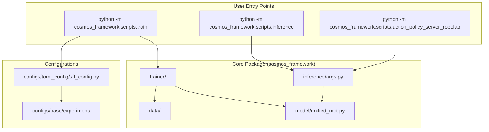
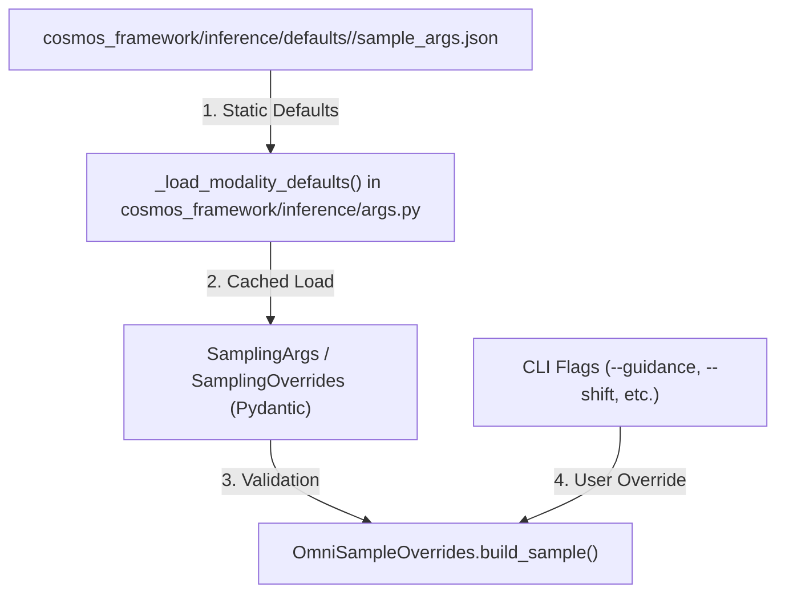

<!-- source: DeepWiki mcp.deepwiki.com · repo NVIDIA/cosmos-framework · page 1 Overview · fetched 2026-10-26 -->

# Overview

<details>
<summary>Relevant source files</summary>

The following files were used as context for generating this wiki page:

- [README.md](README.md)
- [cosmos_framework/inference/args.py](cosmos_framework/inference/args.py)
- [docs/action_policy_droid_server.md](docs/action_policy_droid_server.md)

</details>


**Cosmos-Framework** is an end-to-end platform for training and serving world models, specifically optimized for the **Cosmos3** model family [README.md:14-16](). It unifies vision-language models (VLM), video generators (VFM), world simulators, and world-action models into a single framework [README.md:21-23]().

The repository is structured around a single top-level Python package, `cosmos_framework`, which handles core logic for distributed training, multi-modal inference, and model serving [README.md:16-19]().

### The Cosmos3 Model Family
Cosmos3 is a suite of omnimodal world models built on a unified **Mixture-of-Transformers (MoT)** architecture [README.md:21-23](). It processes and generates language, images, video, audio, and action sequences. The framework supports several variants:
*   **Cosmos3-Nano**: Optimized for efficiency and robotics applications, including forward/inverse dynamics and policy modalities [cosmos_framework/inference/args.py:165-168]().
*   **Cosmos3-Vision**: Large-scale generative models for high-quality video and image synthesis.
*   **Cosmos3-Reasoner**: VLM-based models designed for complex reasoning tasks [cosmos_framework/inference/args.py:170-171]().

---

### Key Capabilities

#### 1. Distributed Training (SFT)
The framework provides a robust infrastructure for Supervised Fine-Tuning (SFT) using PyTorch distributed primitives [README.md:18-19]().
*   **Parallelism**: Supports Fully Sharded Data Parallel (FSDP), Tensor Parallel (TP), Context Parallel (CP), and Pipeline Parallel (PP) [README.md:18-19]().
*   **Checkpointing**: Uses native Distributed Checkpoint (DCP) format with utilities to import/export HuggingFace `safetensors` [README.md:18-19]().
*   **Data Handling**: Adapters for JSONL, WebDataset, and LeRobot formats [README.md:18-19]().

For details, see [Training (Supervised Fine-Tuning)](#3).

#### 2. Multi-Modal Inference
Inference is handled through a flexible CLI and API system that supports various modality modes such as `text2video`, `image2video`, and `forward_dynamics` [cosmos_framework/inference/args.py:157-171]().
*   **Offline Batching**: High-throughput generation from JSON/JSONL input manifests [README.md:77-83]().
*   **Backends**: Integration with native `cosmos_framework` engines as well as ecosystem shims for `diffusers`, `transformers`, and `vllm` [README.md:19-19]().

For details, see [Inference](#4).

#### 3. Online Serving and Action Policy
The framework includes a production-ready serving stack and specialized robotics support [README.md:19-19]().
*   **Ray Serve**: Scalable deployment for handling concurrent requests.
*   **Action Policy Servers**: Specialized servers (e.g., `action_policy_server_robolab`) for streaming actions to robotic clients [docs/action_policy_droid_server.md:66-68]().

---

### Repository Organization

The repository follows a single-package design where the core logic resides in `cosmos_framework/`, supplemented by standalone ecosystem packages [README.md:16-19]().

#### High-Level Structure
| Directory | Description |
| :--- | :--- |
| `cosmos_framework/` | Core package: data pipelines, model architectures, trainer, and inference logic. |
| `packages/` | Standalone shim libraries for `diffusers`, `transformers`, and `vllm` [README.md:19-19](). |
| `examples/` | SFT recipes (TOML) and shell scripts for launching training [README.md:63-66](). |
| `cosmos_framework/scripts/` | Entry points for training, inference, and model conversion [README.md:18-19](). |
| `inputs/` | Sample JSON manifests for testing various inference modalities [README.md:80-80](). |

For a detailed walkthrough, see [Repository Layout and Code Structure](#1.1).

#### System Mapping: Natural Language to Code Entities
The following diagram bridges high-level framework concepts to their specific implementation points in the codebase.

**Framework Entity Mapping**

Sources: [README.md:16-19](), [cosmos_framework/inference/args.py:157-171](), [docs/action_policy_droid_server.md:66-68]()

---

### Getting Started

To begin using the framework, ensure your environment meets the system requirements (FFmpeg, CUDA 12.8+, etc.) and install using the `uv` package manager [README.md:40-56]().

```bash
# Example installation for CUDA 13.0
uv sync --all-extras --group=cu130-train
source .venv/bin/activate
```

For a step-by-step guide, see [Getting Started: Setup and Installation](#1.2).

#### Inference Configuration Flow
The framework uses a multi-layered resolution chain to determine parameters like guidance scale and frame count, managed primarily through `SamplingArgs` and `SamplingOverrides` [cosmos_framework/inference/args.py:86-110]().

**Inference Parameter Resolution**

Sources: [cosmos_framework/inference/args.py:65-110]()

---

### Child Sections
*   [Repository Layout and Code Structure](#1.1): Detailed breakdown of the directory tree and internal package organization.
*   [Getting Started: Setup and Installation](#1.2): Environment prerequisites, installation commands, and verification steps.

---

