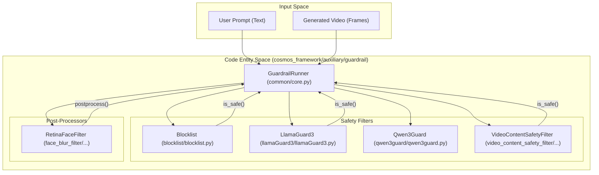
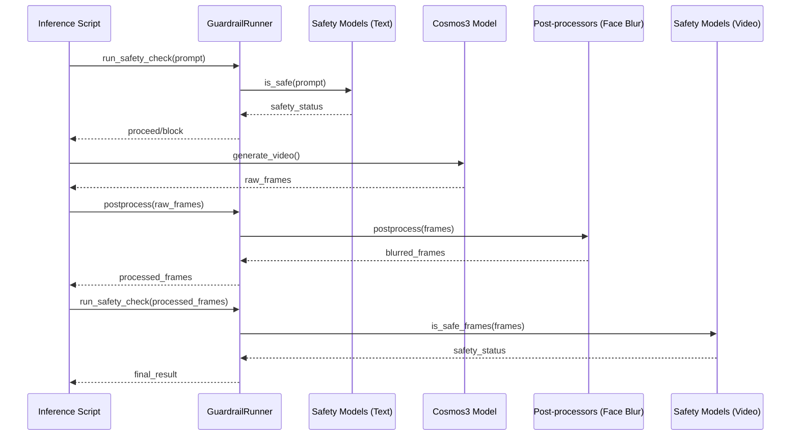

<!-- source: DeepWiki mcp.deepwiki.com · repo NVIDIA/cosmos-framework · page 4.4 Guardrails and Content Safety · fetched 2026-10-26 -->

# Guardrails and Content Safety

Relevant source files

The following files were used as context for generating this wiki page:

- [cosmos_framework/inference/args.py](cosmos_framework/inference/args.py)
- [cosmos_framework/inference/inference.py](cosmos_framework/inference/inference.py)
- [cosmos_framework/inference/transfer.py](cosmos_framework/inference/transfer.py)
- [cosmos_framework/model/vfm/omni_mot_model.py](cosmos_framework/model/vfm/omni_mot_model.py)

The Cosmos-Framework includes a comprehensive guardrail system designed to ensure content safety across both text prompts and generated video content. These guardrails are implemented as a modular suite of filters that can be executed before inference (input safety) and after generation (output safety and post-processing).

## Core Architecture

The guardrail system is built on a set of base classes that define the interface for safety checks and post-processing. The central orchestration is handled by the `GuardrailRunner`.

### Base Classes and Runner
- **`ContentSafetyGuardrail`**: A base class for models that determine if an input (text or video) is safe. Subclasses must implement `is_safe(**kwargs)` [cosmos_framework/auxiliary/guardrail/common/core.py:19-22]().
- **`PostprocessingGuardrail`**: A base class for filters that modify the generated output (e.g., blurring faces). Subclasses must implement `postprocess(frames)` [cosmos_framework/auxiliary/guardrail/common/core.py:24-27]().
- **`GuardrailRunner`**: The main entry point that iterates through a list of safety models and post-processors. It returns a boolean safety status and diagnostic messages [cosmos_framework/auxiliary/guardrail/common/core.py:29-67]().

### Data Flow and Entity Mapping
The following diagram illustrates how natural language safety concepts map to specific code entities within the `guardrail` subpackage.

**Guardrail Execution Flow**

**Sources:** [cosmos_framework/auxiliary/guardrail/common/core.py:29-67](), [cosmos_framework/auxiliary/guardrail/blocklist/blocklist.py:24-29](), [cosmos_framework/auxiliary/guardrail/llamaGuard3/llamaGuard3.py:17-21](), [cosmos_framework/auxiliary/guardrail/video_content_safety_filter/video_content_safety_filter.py:35-39]()

## Text Safety Guardrails

Text-based guardrails evaluate user prompts before they reach the model backbone.

### 1. Blocklist Filter
The `Blocklist` class provides a keyword-based filtering mechanism using `better-profanity` and `nltk`.
- **Functionality**: It supports exact matches, fuzzy partial matches, and whitelisting [cosmos_framework/auxiliary/guardrail/blocklist/blocklist.py:45-52]().
- **Partial Matching**: Uses `difflib.SequenceMatcher` to detect variations of blocked words based on a `guardrail_partial_match_letter_count` threshold [cosmos_framework/auxiliary/guardrail/blocklist/blocklist.py:83-129]().
- **Data Source**: Keywords are loaded from the `Cosmos-Guardrail1` HuggingFace repository [cosmos_framework/auxiliary/guardrail/common/core.py:13-16]().

### 2. LlamaGuard3
The `LlamaGuard3` class wraps the `meta-llama/Llama-Guard-3-8B` model to perform LLM-based moderation.
- **Categories**: It checks against a predefined list of `UNSAFE_CATEGORIES` (e.g., Sourcing and Procurement, Criminal Activities) [cosmos_framework/auxiliary/guardrail/llamaGuard3/llamaGuard3.py:10]().
- **Implementation**: It applies a chat template to the prompt and parses the model output for the "unsafe" string and specific violation codes [cosmos_framework/auxiliary/guardrail/llamaGuard3/llamaGuard3.py:65-90]().

### 3. Qwen3Guard
Similar to LlamaGuard, `Qwen3Guard` utilizes the `Qwen/Qwen3Guard-Gen-0.6B` model.
- **Labeling**: It extracts safety labels (Safe, Unsafe, or Controversial) and specific categories using regex patterns [cosmos_framework/auxiliary/guardrail/qwen3guard/qwen3guard.py:45-62]().

**Sources:** [cosmos_framework/auxiliary/guardrail/blocklist/blocklist.py:1-150](), [cosmos_framework/auxiliary/guardrail/llamaGuard3/llamaGuard3.py:17-99](), [cosmos_framework/auxiliary/guardrail/qwen3guard/qwen3guard.py:18-71]()

## Video Safety and Post-processing

### Video Content Safety Filter (VCSF)
The `VideoContentSafetyFilter` performs frame-by-frame analysis of generated video to detect visual violations.
- **Architecture**: Uses a `SigLIPEncoder` for vision embedding and a `VideoSafetyModel` multi-class classifier [cosmos_framework/auxiliary/guardrail/video_content_safety_filter/video_content_safety_filter.py:51-58]().
- **Sampling Strategy**: Frames are sampled at 2 FPS for efficiency [cosmos_framework/auxiliary/guardrail/video_content_safety_filter/video_content_safety_filter.py:94-96]().
- **Rejection Logic**: A video is marked unsafe if more than 10% of sampled frames (defined by `CUTOFF_UNSAFE_FRAMES_PERCENT`) are classified into unsafe categories like "Sexual_Content", "Drugs", or "Child_Abuse" [cosmos_framework/auxiliary/guardrail/video_content_safety_filter/video_content_safety_filter.py:23-32](), [cosmos_framework/auxiliary/guardrail/video_content_safety_filter/video_content_safety_filter.py:127-131]().

### Face Blur Post-processor
The `RetinaFaceFilter` identifies human faces in generated frames and applies a pixelation effect.
- **Detection**: Employs the `RetinaFace` model with a ResNet50 backbone [cosmos_framework/auxiliary/guardrail/face_blur_filter/face_blur_filter.py:39-66]().
- **Processing**: Frames are converted to BGR, mean-subtracted, and passed through the detector. Detected bounding boxes are filtered by confidence (default 0.7) and NMS [cosmos_framework/auxiliary/guardrail/face_blur_filter/face_blur_filter.py:78-147]().
- **Pixelation**: Regions of interest (ROIs) corresponding to faces are pixelated using `pixelate_face` [cosmos_framework/auxiliary/guardrail/face_blur_filter/face_blur_filter.py:143-144]().

**Sources:** [cosmos_framework/auxiliary/guardrail/video_content_safety_filter/video_content_safety_filter.py:35-150](), [cosmos_framework/auxiliary/guardrail/face_blur_filter/face_blur_filter.py:39-160]()

## Implementation Details

### Checkpoint Management
Guardrail models (Blocklist, VCSF, and RetinaFace) utilize a unified checkpoint downloader pointing to `nvidia/Cosmos-Guardrail1` on HuggingFace [cosmos_framework/auxiliary/guardrail/common/core.py:13-16]().

### GPU Offloading
Most guardrail classes support an `offload_model_to_cpu` flag in their `__init__`. When enabled, the model is moved to GPU only during the active `is_safe` or `postprocess` call and returned to CPU memory immediately after to save VRAM for the primary inference tasks [cosmos_framework/auxiliary/guardrail/llamaGuard3/llamaGuard3.py:68-85](), [cosmos_framework/auxiliary/guardrail/video_content_safety_filter/video_content_safety_filter.py:77-87]().

### Integration with Inference
During inference, the `GuardrailRunner` is typically invoked at two stages:
1. **Pre-Inference**: `run_safety_check` is called with the text prompt. If it returns `False`, the generation is aborted.
2. **Post-Inference**: `postprocess` is called on the generated tensor, followed by a second `run_safety_check` on the resulting frames.

**Inference Integration Diagram**

**Sources:** [cosmos_framework/auxiliary/guardrail/common/core.py:42-67](), [cosmos_framework/auxiliary/guardrail/video_content_safety_filter/video_content_safety_filter.py:100-149]()

---

