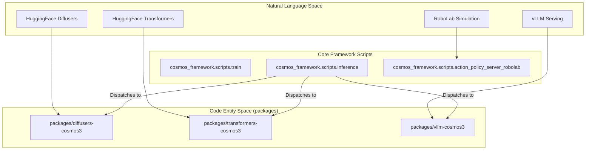
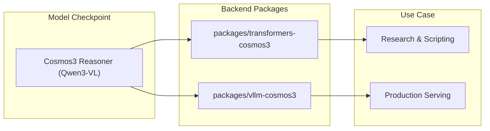

<!-- source: DeepWiki mcp.deepwiki.com · repo NVIDIA/cosmos-framework · page 5 Ecosystem Backend Packages · fetched 2026-10-26 -->

# Ecosystem Backend Packages

Relevant source files

The following files were used as context for generating this wiki page:

- [README.md](README.md)
- [docs/action_policy_droid_server.md](docs/action_policy_droid_server.md)

The **Cosmos-Framework** provides a set of standalone shim libraries located in the `packages/` directory. These packages are designed to adapt **Cosmos3** model checkpoints to the broader machine learning ecosystem, enabling seamless integration with industry-standard libraries such as HuggingFace `diffusers`, `transformers`, and the `vLLM` serving engine [README.md:18-20]().

While the core `cosmos_framework` package provides the primary training and inference implementations, these ecosystem backends serve as lightweight wrappers that allow developers to use Cosmos3 models within existing production pipelines and community tools.

### Backend Overview

The following table summarizes the available backend packages and their primary use cases:

| Package | Target Ecosystem | Primary Use Case |
| :--- | :--- | :--- |
| `diffusers-cosmos3` | HuggingFace Diffusers | Generative workflows (Text-to-Video, Image-to-Video) using the Diffusers API. |
| `transformers-cosmos3` | HuggingFace Transformers | Autoregressive reasoning and Vision-Language Model (VLM) tasks. |
| `vllm-cosmos3` | vLLM | High-throughput serving and deployment of Reasoner models. |

### Architecture and Code Mapping

The ecosystem backends bridge the gap between the internal Cosmos3 Mixture-of-Transformers (MoT) architecture and external API standards. The framework also provides specialized entry points for serving these models in robotics contexts, such as the `action_policy_server_robolab` [docs/action_policy_droid_server.md:66-68]().

**Ecosystem Integration Map**

**Sources:** [README.md:18-20](), [docs/action_policy_droid_server.md:66-68]()

---

## 5.1 Diffusers Backend
The `packages/diffusers-cosmos3/` library is a dedicated plugin for the HuggingFace `diffusers` ecosystem. It wraps Cosmos3 Video Functional Models (VFM) to make them compatible with standard diffusion pipelines. This allows users to leverage existing `diffusers` features like schedulers and community-driven UI integrations while utilizing Cosmos3's state-of-the-art generation capabilities.

For detailed implementation details, including the package structure and `pyproject.toml` configuration, see **[diffusers-cosmos3](#5.1)**.

---

## 5.2 Transformers and vLLM Backends
These two packages focus on the **Cosmos3 Reasoner** (VLM) models, which are based on the Qwen3-VL architecture.

*   **transformers-cosmos3**: Located in `packages/transformers-cosmos3/`, this shim enables the Reasoner models to be loaded via the standard HuggingFace `AutoModelForCausalLM` and `AutoProcessor` interfaces. It is ideal for research, fine-tuning, and simple inference scripts.
*   **vllm-cosmos3**: Located in `packages/vllm-cosmos3/`, this backend provides the necessary kernels and logic to run Cosmos3 Reasoner models within the vLLM engine. This is the recommended path for high-performance production serving where request throughput and PagedAttention are critical.

For a comparison of when to use these backends versus the native `cosmos_framework` path, see **[transformers-cosmos3 and vllm-cosmos3](#5.2)**.

**Reasoner Backend Selection**

**Sources:** [README.md:18-20](), [README.md:23-23]()

---

