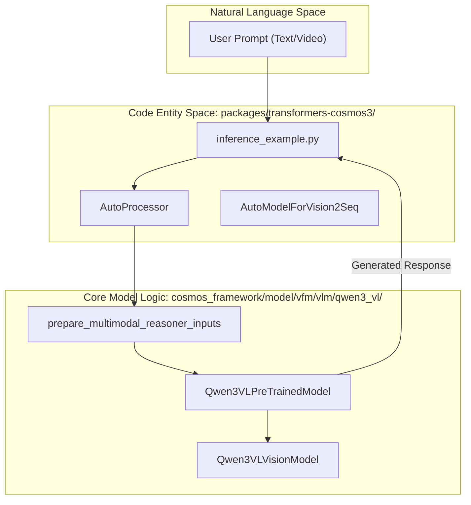
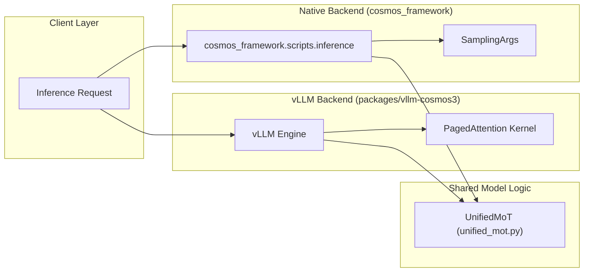

<!-- source: DeepWiki mcp.deepwiki.com · repo NVIDIA/cosmos-framework · page 5.2 transformers-cosmos3 and vllm-cosmos3 · fetched 2026-10-26 -->

# transformers-cosmos3 and vllm-cosmos3

Relevant source files

The following files were used as context for generating this wiki page:

- [README.md](README.md)
- [cosmos_framework/model/vfm/mot/unified_mot.py](cosmos_framework/model/vfm/mot/unified_mot.py)
- [cosmos_framework/model/vfm/vlm/qwen3_vl/qwen3_vl.py](cosmos_framework/model/vfm/vlm/qwen3_vl/qwen3_vl.py)
- [docs/action_policy_droid_server.md](docs/action_policy_droid_server.md)

The **Cosmos3 Reasoner** (based on the Qwen3-VL architecture) can be executed through three primary paths: the native `cosmos_framework` inference pipeline, the HuggingFace Transformers integration via `transformers-cosmos3`, and the high-throughput serving backend via `vllm-cosmos3`. These ecosystem backend packages act as lightweight shims that adapt Cosmos3 checkpoints for use in standard industry toolchains.

### Backend Selection Guide

| Backend | Package Path | Use Case | Key Features |
| :--- | :--- | :--- | :--- |
| **Native** | `cosmos_framework/` | Research, Fine-tuning, and Omnimodal tasks. | Full access to MoT layers, custom guardrails, and joint modality processing. |
| **Transformers** | `packages/transformers-cosmos3/` | Prototyping and local experimentation. | Standard HF `AutoModel` compatibility, easy integration with existing HF scripts. |
| **vLLM** | `packages/vllm-cosmos3/` | Production serving and high-throughput inference. | PagedAttention, continuous batching, and optimized CUDA kernels for Reasoner models. |

Sources: [README.md:16-20](), [README.md:87-93]()

---

### transformers-cosmos3: HuggingFace Integration

The `transformers-cosmos3` package provides a compatibility layer for the Cosmos3 Reasoner, which utilizes the Qwen3-VL backbone. This allows users to load Reasoner checkpoints using standard HuggingFace Transformers classes. The core of this integration is the `Qwen3VL` implementation within the framework, which is adapted from the HuggingFace `modeling_qwen3_vl.py` [cosmos_framework/model/vfm/vlm/qwen3_vl/qwen3_vl.py:4-7]().

#### Implementation and Data Flow
The integration focuses on mapping the Cosmos3 unified architecture weights to the expected structure of a Qwen3-VL model. The model supports complex visual processing through `Qwen3VLVisionPatchEmbed` [cosmos_framework/model/vfm/vlm/qwen3_vl/qwen3_vl.py:74-83]() and `Qwen3VLVisionPatchMerger` [cosmos_framework/model/vfm/vlm/qwen3_vl/qwen3_vl.py:118-127]().

1.  **Checkpoint Loading**: The package expects a checkpoint in HuggingFace `safetensors` format.
2.  **Inference Example**: The `inference_example.py` script demonstrates the end-to-end flow:
    *   Initialize the processor (handling both image/video visual inputs and text).
    *   Load the model using `AutoModelForVision2Seq`.
    *   Process inputs into the required tensor format using utility functions like `prepare_multimodal_reasoner_inputs` [cosmos_framework/model/vfm/mot/unified_mot.py:61-63]().
    *   Generate text responses using the Reasoner's logic.

#### Key Components
*   **`Qwen3VLPreTrainedModel`**: The base class for the Reasoner within the framework [cosmos_framework/model/vfm/vlm/qwen3_vl/qwen3_vl.py:51-57]().
*   **`Qwen3VLVisionModel`**: Handles the visual tower processing, including 3D convolutions for temporal patching [cosmos_framework/model/vfm/vlm/qwen3_vl/qwen3_vl.py:82-83]().
*   **Rotary Embeddings**: Uses `Qwen3VLVisionRotaryEmbedding` for spatial-temporal positioning [cosmos_framework/model/vfm/vlm/qwen3_vl/qwen3_vl.py:98-105]().

**Reasoner Data Flow (Transformers Backend)**

Sources: [cosmos_framework/model/vfm/vlm/qwen3_vl/qwen3_vl.py:51-57](), [cosmos_framework/model/vfm/mot/unified_mot.py:61-63](), [README.md:19-20]()

---

### vllm-cosmos3: High-Throughput Serving

The `vllm-cosmos3` package is a specialized backend shim designed for high-performance serving of the Cosmos3 Reasoner. It leverages the **vLLM** engine to provide optimized inference capabilities.

#### Implementation Details
The shim integrates Cosmos3 with vLLM's internal model registry. It ensures that the specific architectural nuances of the Reasoner—such as its handling of long video sequences via the `UnifiedMoT` architecture [cosmos_framework/model/vfm/mot/unified_mot.py:86-96]()—are compatible with vLLM's optimized kernels.

*   **PagedAttention**: Efficiently manages KV cache for long reasoning chains.
*   **Continuous Batching**: Processes multiple requests simultaneously.
*   **Weight Mapping**: Dynamically maps Cosmos3 `safetensors` to vLLM's internal linear and attention layer implementations.

#### System Architecture
The following diagram illustrates how a request flows through the vLLM shim compared to the native framework.

**Inference Backend Comparison**

Sources: [cosmos_framework/model/vfm/mot/unified_mot.py:86-111](), [README.md:18-19](), [README.md:78-84]()

---

### When to use which Backend

The choice between these packages depends on the deployment target and the required features.

| Feature | `cosmos_framework` | `transformers-cosmos3` | `vllm-cosmos3` |
| :--- | :--- | :--- | :--- |
| **Model Support** | All Cosmos3 (VFM/VLM) | Reasoner only | Reasoner only |
| **Throughput** | Moderate (Batch) | Low (Sequential) | High (Concurrent) |
| **Ease of Use** | High (Internal CLI) | High (HF ecosystem) | Moderate (Requires vLLM setup) |
| **Customizability** | Maximum | Limited to HF API | Limited to vLLM Kernels |
| **Guardrails** | Full Support | Manual Integration | Manual Integration |

#### Integration with cosmos_framework
While these packages live in `packages/`, they are used in conjunction with the main framework's export tools. A model trained using `cosmos_framework.scripts.train` [README.md:18-18]() is exported into the `safetensors` format required by both the Transformers and vLLM shims. The Reasoner itself relies on the `LayerTypes` dispatch table to select between dense and MoE variants during initialization [cosmos_framework/model/vfm/mot/unified_mot.py:99-131]().

Sources: [README.md:16-20](), [cosmos_framework/model/vfm/mot/unified_mot.py:113-131]()

---

