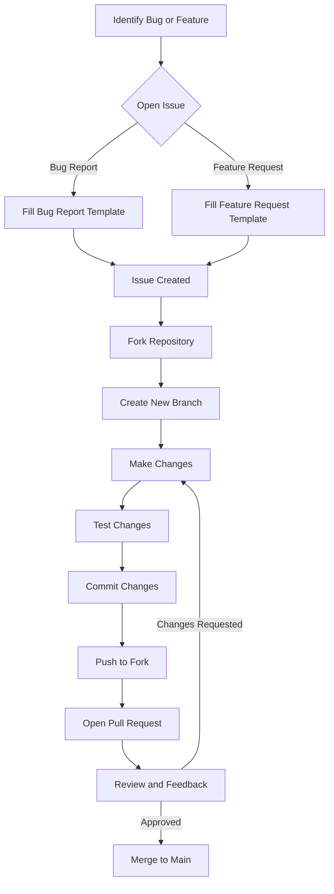
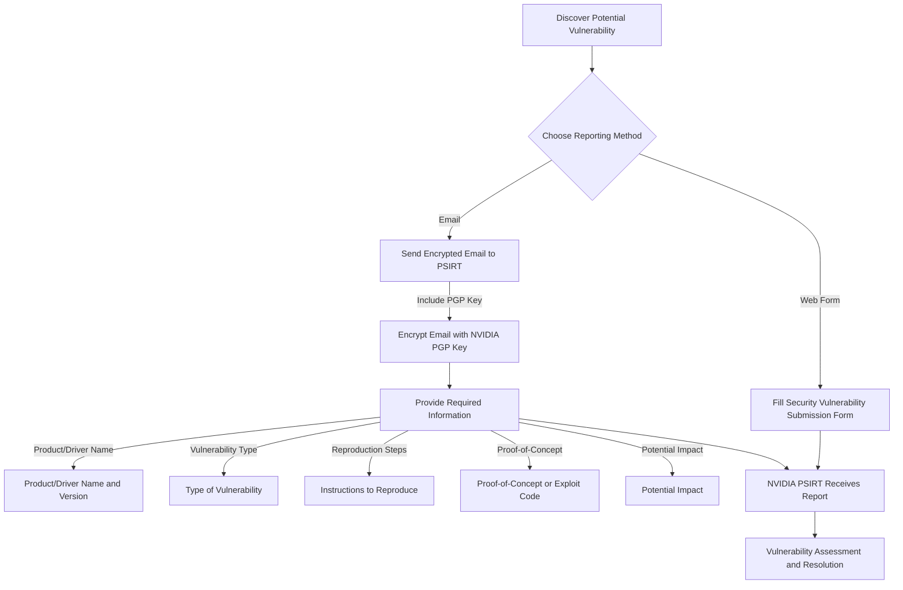

<!-- source: DeepWiki mcp.deepwiki.com · repo NVIDIA/cosmos · page 9.2 Contributing, Security, and Licensing · fetched 2026-10-26 -->

# Contributing, Security, and Licensing

Relevant source files

The following files were used as context for generating this wiki page:

- [.github/ISSUE_TEMPLATE/bug_report.md](.github/ISSUE_TEMPLATE/bug_report.md)
- [.github/ISSUE_TEMPLATE/feature_request.md](.github/ISSUE_TEMPLATE/feature_request.md)
- [CONTRIBUTING.md](CONTRIBUTING.md)
- [LICENSE](LICENSE)
- [RELEASE.md](RELEASE.md)
- [SECURITY.md](SECURITY.md)
- [cookbooks/cosmos3/cosmos3-model-architecture.png](cookbooks/cosmos3/cosmos3-model-architecture.png)
- [cookbooks/cosmos3/generator/action/assets/actions/av_traj_forward.json](cookbooks/cosmos3/generator/action/assets/actions/av_traj_forward.json)
- [cookbooks/cosmos3/generator/action/assets/actions/av_traj_left.json](cookbooks/cosmos3/generator/action/assets/actions/av_traj_left.json)
- [cookbooks/cosmos3/generator/action/assets/actions/av_traj_right.json](cookbooks/cosmos3/generator/action/assets/actions/av_traj_right.json)
- [cookbooks/cosmos3/generator/action/assets/actions/umi.json](cookbooks/cosmos3/generator/action/assets/actions/umi.json)
- [cookbooks/cosmos3/generator/action/finetune/README.md](cookbooks/cosmos3/generator/action/finetune/README.md)
- [cookbooks/cosmos3/generator/audiovisual/finetune/README.md](cookbooks/cosmos3/generator/audiovisual/finetune/README.md)
- [cookbooks/cosmos3/nim/README.md](cookbooks/cosmos3/nim/README.md)
- [cookbooks/cosmos3/nim/acknowledgements/2.0.0.md](cookbooks/cosmos3/nim/acknowledgements/2.0.0.md)
- [cookbooks/cosmos3/nim/acknowledgements/README.md](cookbooks/cosmos3/nim/acknowledgements/README.md)

This page details the guidelines and processes for contributing to the NVIDIA Cosmos project, reporting security vulnerabilities, understanding the licensing terms, and reviewing release information. It covers the `CONTRIBUTING.md` guidelines, bug report and feature request issue templates, the `SECURITY.md` disclosure process, `LICENSE` terms, `RELEASE.md` for version history, and the NIM acknowledgements files.

## Contributing Guidelines

The NVIDIA Cosmos project welcomes contributions from the community. Adherence to the [NVIDIA Open Source Code of Conduct](CODE_OF_CONDUCT.md)() is expected from all participants [CONTRIBUTING.md:5-7]().

### Reporting Issues

For bug reports or feature requests, issues should be opened on the [GitHub Issues](https://github.com/NVIDIA/cosmos/issues) page [CONTRIBUTING.md:13]().

#### Bug Reports
When submitting a bug report, provide the following information:
*   A clear and descriptive title [CONTRIBUTING.md:16]().
*   Steps to reproduce the problem [CONTRIBUTING.md:17]().
*   Expected behavior versus actual behavior [CONTRIBUTING.md:18]().
*   Environment details (OS, CUDA version, GPU model, Python version) [CONTRIBUTING.md:19]().
*   Relevant logs or error messages [CONTRIBUTING.md:20]().

The bug report template `.github/ISSUE_TEMPLATE/bug_report.md` guides users to provide this information, including sections for reproduction steps, expected vs. actual behavior, outputs (error/stack trace, log files), and system information [bug_report.md:8-60]().

#### Feature Requests
For feature requests, the template `.github/ISSUE_TEMPLATE/feature_request.md` prompts for:
*   Problem/Use Case [feature_request.md:9-11]().
*   Proposed Feature [feature_request.md:13-15]().
*   Affected Area (e.g., Cookbooks, Evaluation, Inference integration, Models, Finetune/distill, Docs) [feature_request.md:17-26]().
*   Additional Context (e.g., papers, links, related issues) [feature_request.md:28-30]().

### Submitting Changes

The process for submitting code changes involves:
1.  **Forking the repository** and creating a new branch from `main` [CONTRIBUTING.md:23-26]().
2.  **Making changes** that adhere to project conventions and do not introduce regressions [CONTRIBUTING.md:29]().
3.  **Testing changes** to ensure existing cookbooks and examples function correctly [CONTRIBUTING.md:32]().
4.  **Committing changes** with a clear, descriptive message [CONTRIBUTING.md:34-37]().
5.  **Pushing to your fork** and opening a Pull Request (PR) against the `main` branch of the upstream repository [CONTRIBUTING.md:39]().

#### Pull Request Guidelines
*   Provide a clear description of the PR's purpose [CONTRIBUTING.md:43]().
*   Reference related issues (e.g., `Fixes #123`) [CONTRIBUTING.md:44]().
*   Keep PRs focused on a single logical change [CONTRIBUTING.md:45]().
*   Ensure the branch is up to date with `main` [CONTRIBUTING.md:46]().
*   Be responsive to review feedback [CONTRIBUTING.md:47]().

### Development Setup

To get started with development, the following prerequisites are necessary:
*   Python 3.10 or later [CONTRIBUTING.md:53]().
*   CUDA 12.8 or 13.x (with specific backend selection) [CONTRIBUTING.md:54]().
*   An NVIDIA GPU with sufficient VRAM [CONTRIBUTING.md:55]().
*   `uv` >= 0.11.3 [CONTRIBUTING.md:56]().

The setup involves cloning the repository and setting up the environment as described in the main `README.md` [CONTRIBUTING.md:60-68](). Cookbooks are provided for end-to-end examples [CONTRIBUTING.md:69]().

### Contribution Areas

Contributions are welcome in:
*   **Cookbooks and examples**: New notebooks demonstrating Cosmos 3 capabilities [CONTRIBUTING.md:75]().
*   **Documentation**: Improvements to READMEs or inline documentation [CONTRIBUTING.md:76]().
*   **Bug fixes**: For existing code or documentation [CONTRIBUTING.md:77]().
*   **Benchmarks**: Additional inference benchmark results [CONTRIBUTING.md:78]().

Sources:
- [CONTRIBUTING.md:1-86]()
- [.github/ISSUE_TEMPLATE/bug_report.md:1-64]()
- [.github/ISSUE_TEMPLATE/feature_request.md:1-29]()

## Security Vulnerability Disclosure

NVIDIA takes security seriously. To report a potential security vulnerability in any NVIDIA product, use the [Security Vulnerability Submission Form](https://www.nvidia.com/en-us/support/submit-security-vulnerability) or send an email to [NVIDIA PSIRT](mailto:psirt@nvidia.com) [SECURITY.md:6-9]().

When reporting via email, encrypt the message using [NVIDIA’s public PGP key](https://www.nvidia.com/en-us/security/pgp-key) and include:
1.  Product/Driver name and version/branch [SECURITY.md:13]().
2.  Type of vulnerability (e.g., code execution, denial of service) [SECURITY.md:14]().
3.  Instructions to reproduce [SECURITY.md:15]().
4.  Proof-of-concept or exploit code [SECURITY.md:16]().
5.  Potential impact of the vulnerability [SECURITY.md:17]().

Past NVIDIA Security Bulletins and Notices are available at <https://www.nvidia.com/en-us/security/> [SECURITY.md:19]().

Sources:
- [SECURITY.md:1-19]()

## Licensing

The NVIDIA Cosmos project is licensed under the [OpenMDW-1.1 License](LICENSE) [CONTRIBUTING.md:81](). All contributions must comply with its terms [CONTRIBUTING.md:82]().

### NIM Acknowledgements

The Cosmos3 Certified NIM container (`nvcr.io/nim/nvidia/cosmos3:2.0.0`) includes specific license and notice information [acknowledgements/2.0.0.md:6-7]().

The running NIM exposes bundled product license information at `/v1/license` [acknowledgements/2.0.0.md:10](). Additionally, the release image contains:
*   `/opt/nim/LICENSE` for NIM terms [acknowledgements/2.0.0.md:12]().
*   `/opt/nim/MODEL_LICENSE` for model terms [acknowledgements/2.0.0.md:13]().
*   `/opt/nim/NOTICE` for product notices and contact information [acknowledgements/2.0.0.md:14]().
*   `/opt/nim/licenses/` for included component licenses [acknowledgements/2.0.0.md:15]().
*   `/usr/share/cosmos3/oss-source/` for package modification scripts, source manifest, reproduction instructions, and checksums related to Berkeley DB adapters [acknowledgements/2.0.0.md:16-18]().

The cookbook source is covered by the repository's `LICENSE` [acknowledgements/2.0.0.md:20](). Users are advised to inspect the files in the exact image and any downloaded model files to ensure terms and notices match their deployment [acknowledgements/2.0.0.md:21-22]().

An example of an included license is the Apache License 2.0 for the `accelerate` Python package [acknowledgements/2.0.0.md:28-137]().

Sources:
- [LICENSE]()
- [CONTRIBUTING.md:80-82]()
- [cookbooks/cosmos3/nim/acknowledgements/2.0.0.md:1-137]()
- [cookbooks/cosmos3/nim/acknowledgements/README.md:1-6]()

## Release Notes

The `RELEASE.md` file provides a comprehensive history of releases for the NVIDIA Cosmos project. It details new features, improvements, bug fixes, and any breaking changes introduced in each version. This document is crucial for users to understand the evolution of the project and for developers to track changes between versions.

Sources:
- [RELEASE.md]()

## Contribution Workflow

The following diagram illustrates the general workflow for contributing to the NVIDIA Cosmos project, from identifying an issue to merging a pull request.

**Diagram: Contribution Workflow**

Sources:
- [CONTRIBUTING.md:10-47]()
- [.github/ISSUE_TEMPLATE/bug_report.md:1-64]()
- [.github/ISSUE_TEMPLATE/feature_request.md:1-29]()

## Security Vulnerability Reporting Process

The diagram below outlines the process for reporting security vulnerabilities to NVIDIA PSIRT.

**Diagram: Security Vulnerability Reporting Process**

Sources:
- [SECURITY.md:4-17]()

---

