# Page: Overview

# Overview

<details>
<summary>Relevant source files</summary>

The following files were used as context for generating this wiki page:

- [.github/ISSUE_TEMPLATE/bug_report.md](.github/ISSUE_TEMPLATE/bug_report.md)
- [.github/ISSUE_TEMPLATE/feature_request.md](.github/ISSUE_TEMPLATE/feature_request.md)
- [.github/workflows/validate-notebooks.yml](.github/workflows/validate-notebooks.yml)
- [README.md](README.md)
- [SECURITY.md](SECURITY.md)
- [assets/brand/badge-website.svg](assets/brand/badge-website.svg)
- [assets/brand/cosmos-logo.png](assets/brand/cosmos-logo.png)
- [assets/demos/driving_sim_falling_rocks.gif](assets/demos/driving_sim_falling_rocks.gif)
- [assets/demos/fd_egocentric_repair_poses.gif](assets/demos/fd_egocentric_repair_poses.gif)
- [assets/demos/physics_newton_cradle.gif](assets/demos/physics_newton_cradle.gif)
- [assets/demos/policy_screwdriver.gif](assets/demos/policy_screwdriver.gif)
- [assets/demos/reasoner_driving_hazard.gif](assets/demos/reasoner_driving_hazard.gif)
- [assets/demos/transfer_worldscenario.gif](assets/demos/transfer_worldscenario.gif)
- [cookbooks/cosmos3/README.md](cookbooks/cosmos3/README.md)
- [cookbooks/cosmos3/generator/audiovisual/README.md](cookbooks/cosmos3/generator/audiovisual/README.md)
- [docs/reference/models.md](docs/reference/models.md)

</details>


NVIDIA Cosmos is an open platform of world models, datasets, and tools designed to build Physical AI for robots, autonomous vehicles, and smart infrastructure [README.md:10-11](). It unifies vision-language models, video generators, world simulators, and world-action models into a single framework [README.md:10-11]().

Cosmos 3 is built on a unified **Mixture-of-Transformers (MoT)** architecture that processes and generates language, images, video, audio, and action sequences within a single model [README.md:67-68]().

## Runtime Surfaces

The model family exposes two primary runtime surfaces, each optimized for specific interaction modes:

| Surface | Inputs | Outputs | Primary Use Cases |
|:---|:---|:---|:---|
| **Reasoner** | Text, Vision | Text | World understanding, grounding, task planning, embodied reasoning [README.md:73-74](). |
| **Generator** | Text, Vision, Sound, Action | Vision, Sound, Action | World simulation, future prediction, synthetic data, policy learning [README.md:74-75](). |

For a deep dive into the underlying MoT architecture, causal self-attention in Reasoner mode, and full attention in Generator mode, see **[Model Architecture](#1.1)**.

## Model Family

Cosmos 3 offers models in three primary tiers to balance performance and computational efficiency:

*   **Cosmos3-Super (64B):** A frontier-scale omnimodal world model [docs/reference/models.md:11]().
*   **Cosmos3-Nano (16B):** An omnimodal world model for understanding, simulation, prediction, and action reasoning on a single GPU [docs/reference/models.md:10]().
*   **Cosmos3-Edge (4B):** A compact omnimodal world model for on-device and low-latency deployment, including Jetson AGX Orin / Thor / RTX Pro 6000 [README.md:62-63](), [docs/reference/models.md:9]().
*   **Specialized Variants:** Includes post-trained example checkpoints such as `Cosmos3-Super-Text2Image`, `Cosmos3-Super-Image2Video`, and `Cosmos3-Nano-Policy-DROID` that demonstrate fine-tuning capabilities [docs/reference/models.md:14-22]().

## Integration Paths

Developers can integrate Cosmos 3 through several distinct paths depending on the use case:

1.  **Cosmos Framework:** Native PyTorch inference using `torchrun`. This path is ideal for research, custom post-training, and native performance using `cosmos_framework.scripts.inference` [cookbooks/cosmos3/README.md:9](), [cookbooks/cosmos3/generator/audiovisual/README.md:73-74]().
2.  **Diffusers:** Integration with the Hugging Face `diffusers` library via `Cosmos3OmniPipeline`, optimized for Python-first audiovisual generation [cookbooks/cosmos3/README.md:10](), [cookbooks/cosmos3/generator/audiovisual/README.md:115]().
3.  **vLLM / vLLM-Omni:** Production-grade serving with OpenAI-compatible APIs. Use **vLLM** for the Reasoner and **vLLM-Omni** for the Generator [cookbooks/cosmos3/README.md:14-15]().
4.  **SGLang:** OpenAI-compatible serving for both Reasoner and Generator tasks [cookbooks/cosmos3/README.md:14-15]().
5.  **TensorRT-LLM:** High-performance inference serving via `trtllm-serve` for VisualGen workloads [cookbooks/cosmos3/README.md:11-12]().
6.  **NIM:** Turnkey containers for Reasoner (`nvcr.io/nim/nvidia/cosmos3-reasoner`) and Generator (`nvcr.io/nim/nvidia/cosmos3-generator`) deployment [cookbooks/cosmos3/README.md:16-18]().

For details on hardware requirements and choosing an integration path, see **[Model Family and Integration Paths](#1.2)**.

## System Architecture Mapping

The following diagrams illustrate the relationship between high-level system concepts and the specific code entities or configurations used to invoke them.

### Reasoner Execution Mapping
This diagram maps the Reasoner surface to the specific vLLM architecture and serving configurations.

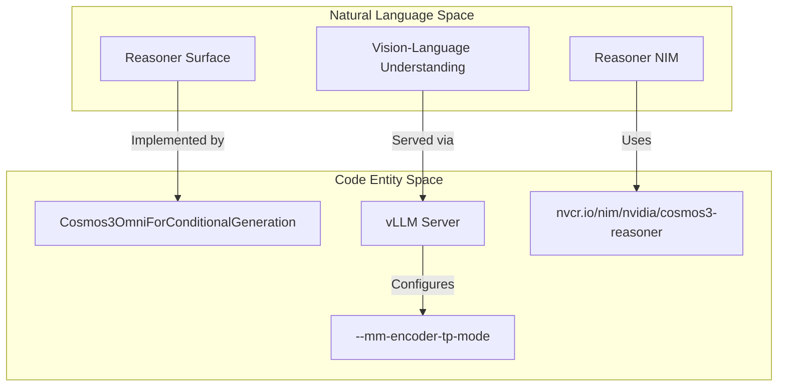
Sources: [cookbooks/cosmos3/README.md:13-17](), [cookbooks/cosmos3/README.md:38]()

### Generator Execution Mapping
This diagram maps the Generator surface to the primary inference entry points and pipelines.

```mermaid
graph TD
    subgraph "Natural Language Space"
        G["Generator Surface"]
        AV["Audiovisual Generation"]
        VT["Video Transfer"]
        AP["Action Policy"]
    end

    subgraph "Code Entity Space"
        IF["cosmos_framework.scripts.inference"]
        CP["Cosmos3OmniPipeline"]
        VOMNI["Cosmos3OmniDiffusersPipeline"]
        TR["torchrun"]
        NIM_G["nvcr.io/nim/nvidia/cosmos3-generator"]
    end

    G -->|Native Path| IF
    G -->|Library Path| CP
    G -->|Serving Path (vLLM-Omni)| VOMNI
    G -->|Serving Path (NIM)| NIM_G
    AV -->|Uses| IF
    AV -->|Uses| CP
    AV -->|Uses| VOMNI
    VT -->|Uses| IF
    AP -->|Uses| VOMNI
    IF -->|Invoked by| TR
```
Sources: [cookbooks/cosmos3/README.md:9-18](), [cookbooks/cosmos3/generator/audiovisual/README.md:73-74](), [cookbooks/cosmos3/generator/audiovisual/README.md:115]()

## Next Steps

*   **[Model Architecture](#1.1)**: Detailed look at MoT, mRoPE, and tokenization.
*   **[Model Family and Integration Paths](#1.2)**: Setup guides for Nano/Super/Edge and backend selection.

Sources: [README.md:1-188](), [cookbooks/cosmos3/README.md:1-140](), [cookbooks/cosmos3/generator/audiovisual/README.md:1-180](), [docs/reference/models.md:1-94]()

---

# Page: Model Architecture

# Model Architecture

<details>
<summary>Relevant source files</summary>

The following files were used as context for generating this wiki page:

- [README.md](README.md)
- [assets/brand/badge-website.svg](assets/brand/badge-website.svg)
- [assets/brand/cosmos-logo.png](assets/brand/cosmos-logo.png)
- [assets/demos/driving_sim_falling_rocks.gif](assets/demos/driving_sim_falling_rocks.gif)
- [assets/demos/fd_egocentric_repair_poses.gif](assets/demos/fd_egocentric_repair_poses.gif)
- [assets/demos/physics_newton_cradle.gif](assets/demos/physics_newton_cradle.gif)
- [assets/demos/policy_screwdriver.gif](assets/demos/policy_screwdriver.gif)
- [assets/demos/reasoner_driving_hazard.gif](assets/demos/reasoner_driving_hazard.gif)
- [assets/demos/transfer_worldscenario.gif](assets/demos/transfer_worldscenario.gif)
- [cookbooks/cosmos3/README.md](cookbooks/cosmos3/README.md)
- [cookbooks/cosmos3/generator/audiovisual/README.md](cookbooks/cosmos3/generator/audiovisual/README.md)
- [docs/reference/models.md](docs/reference/models.md)

</details>


NVIDIA Cosmos 3 is an omnimodal world model designed to process and generate language, images, video, audio, and action sequences within a unified framework. It utilizes a **Mixture-of-Transformers (MoT)** architecture that shares a common transformer backbone across two primary runtime surfaces: the **Reasoner** and the **Generator** [README.md:67-74]().

## Unified Mixture-of-Transformers (MoT)

The core of Cosmos 3 is a unified transformer architecture that adapts its attention mechanism and data flow based on the operating mode. This design allows the model to act as both a causal reasoner and a generative diffusion model using the same underlying weights and multimodal attention layers [docs/reference/models.md:26]().

### Reasoner Mode vs. Generator Mode

The MoT architecture toggles between two fundamental modes of operation:

| Feature | Reasoner Mode | Generator Mode |
| :--- | :--- | :--- |
| **Primary Task** | World understanding, grounding, task planning, embodied reasoning [README.md:73]() | World simulation, future prediction, synthetic data, policy learning [README.md:74]() |
| **Attention Mechanism** | **Causal Self-Attention**: Processes tokens autoregressively for next-token prediction [docs/reference/models.md:26]() | **Full Attention**: Denoises multimodal tokens through bidirectional context [docs/reference/models.md:26]() |
| **Model Type** | Autoregressive (AR) Transformer [docs/reference/models.md:26]() | Diffusion Transformer (DM) [docs/reference/models.md:26]() |
| **Outputs** | Text [README.md:73]() | Vision, Sound, Action [README.md:74]() |

### Data Flow and Modality Unification

Cosmos 3 unifies disparate modalities—text, vision (images/video), audio, and action—into a single token stream. This unification is achieved through specialized encoders that map each modality into a shared embedding space before processing by the transformer backbone [docs/reference/models.md:26]().

1.  **Text**: Processed via standard language tokenization for reasoning and instructions.
2.  **Vision**: Images and videos are encoded into visual tokens.
3.  **Audio**: Synchronized sound is handled as part of the unified stream, enabling audio-conditioned generation and output [docs/reference/models.md:44]().
4.  **Action**: Represented as multi-dimensional trajectories (e.g., 9D for camera motion/AV, 10D for single-arm robots, 57D for egocentric hand pose) [docs/reference/models.md:59]().

**Sources:** [README.md:67-74](), [docs/reference/models.md:26](), [docs/reference/models.md:44](), [docs/reference/models.md:59]()

---

## 3D Multi-Dimensional Rotary Position Embedding (mRoPE)

To maintain spatial and temporal coherence across different modalities, Cosmos 3 employs **mRoPE**. Unlike standard 1D RoPE used in text-only models, mRoPE encodes spatial and temporal structure across modalities into a unified representation [docs/reference/models.md:26]().

This allows the model to:
*   Understand the temporal sequence of video frames and audio samples.
*   Maintain spatial relationships (Height and Width) within an image or a single video frame.
*   Reason over action trajectories that occur across both time and space.

### Structural Diagram: MoT Architecture
The following diagram illustrates the relationship between the shared backbone and the mode-specific attention mechanisms, mapped to the system components.

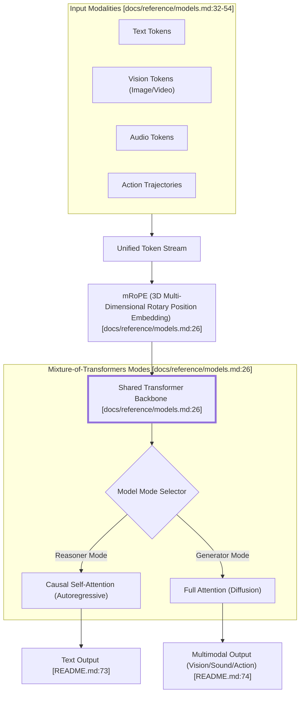
**Sources:** [README.md:73-74](), [docs/reference/models.md:26](), [docs/reference/models.md:32-54]()

---

## Action Modeling Architecture

Cosmos 3 treats actions as first-class citizens in the token stream. This enables critical Physical AI workflows such as predicting policy actions, inverse dynamics, and forward dynamics [docs/reference/models.md:51-53]().

*   **Forward Dynamics**: Predicts future frames from a conditioning image and action trajectory [docs/reference/models.md:51]().
*   **Inverse Dynamics**: Predicts ego-motion trajectories from input video [docs/reference/models.md:52]().

### Action Representation Tiers
The model supports various action dimensions depending on the embodiment:
*   **9D**: Camera motion and Autonomous Vehicles (AV) [docs/reference/models.md:59]().
*   **10D**: Single-arm robot manipulation (DROID, UMI, Bridge, Fractal, AgiBotWorld, RoboMIND franka/franka_dual/ur) [docs/reference/models.md:59]().
*   **20D/29D/57D**: Dual-arm (DROID), Humanoid (AgiBot), and Egocentric Hand Pose configurations [docs/reference/models.md:59]().

### Code Entity Mapping: Inference Logic and Action Specs
The following diagram maps the logical concepts to the implementation entrypoints and parameters found in the `cosmos_framework`.

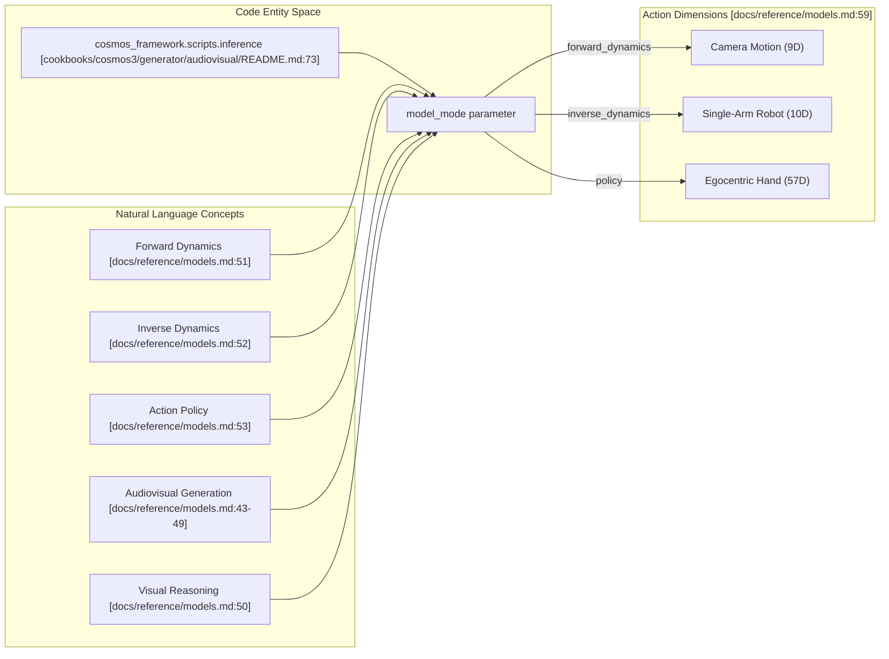
**Sources:** [docs/reference/models.md:43-53](), [docs/reference/models.md:59](), [cookbooks/cosmos3/generator/audiovisual/README.md:73]()

---

## Model Scale and Performance

The architecture is implemented in three primary tiers to balance performance and capability across different hardware profiles:

1.  **Cosmos3-Edge (4B)**: Optimized for edge and low-latency deployment on devices like Jetson AGX Orin/Thor or RTX Pro 6000. It supports 256p and 480p video resolutions [docs/reference/models.md:9]().
2.  **Cosmos3-Nano (16B)**: A balanced omnimodal world model for understanding, simulation, prediction, and action reasoning on a single GPU [docs/reference/models.md:10]().
3.  **Cosmos3-Super (64B)**: A frontier-scale omnimodal world model for high-quality synthetic data generation and state-of-the-art physical reasoning [docs/reference/models.md:11]().

### Precision and Hardware
The architecture is optimized for **BF16** precision and is compatible with NVIDIA **Ampere, Hopper, and Blackwell** architectures [docs/reference/models.md:73](). To serve these models, the platform supports integration with **vLLM** for reasoning and **vLLM-Omni**, **Diffusers**, or **TensorRT-LLM** for generation [cookbooks/cosmos3/README.md:7-16]().

**Sources:** [docs/reference/models.md:9-11](), [docs/reference/models.md:73](), [cookbooks/cosmos3/README.md:7-16]()

---

# Page: Model Family and Integration Paths

# Model Family and Integration Paths

<details>
<summary>Relevant source files</summary>

The following files were used as context for generating this wiki page:

- [README.md](README.md)
- [assets/brand/badge-website.svg](assets/brand/badge-website.svg)
- [assets/brand/cosmos-logo.png](assets/brand/cosmos-logo.png)
- [assets/demos/driving_sim_falling_rocks.gif](assets/demos/driving_sim_falling_rocks.gif)
- [assets/demos/fd_egocentric_repair_poses.gif](assets/demos/fd_egocentric_repair_poses.gif)
- [assets/demos/physics_newton_cradle.gif](assets/demos/physics_newton_cradle.gif)
- [assets/demos/policy_screwdriver.gif](assets/demos/policy_screwdriver.gif)
- [assets/demos/reasoner_driving_hazard.gif](assets/demos/reasoner_driving_hazard.gif)
- [assets/demos/transfer_worldscenario.gif](assets/demos/transfer_worldscenario.gif)
- [cookbooks/cosmos3/README.md](cookbooks/cosmos3/README.md)
- [cookbooks/cosmos3/generator/audiovisual/README.md](cookbooks/cosmos3/generator/audiovisual/README.md)
- [docs/reference/models.md](docs/reference/models.md)

</details>


This page describes the NVIDIA Cosmos 3 model family, including the **Nano**, **Super**, and **Edge** variants, and the technical integration paths available for different use cases. It covers hardware requirements, environment configuration via the `uv` package manager, and the selection of CUDA backends to ensure compatibility with NVIDIA drivers.

## Cosmos 3 Model Family

The Cosmos 3 family consists of omnimodal world models built on a unified Mixture-of-Transformers (MoT) architecture [README.md:79](). These models are designed to process and generate language, images, video, audio, and action sequences within a single framework [README.md:58]().

| Model | Size | Primary Capability |
| :--- | :--- | :--- |
| **[Cosmos3-Edge](https://huggingface.co/nvidia/Cosmos3-Edge)** | 4B | Compact omnimodal world model for on-device and low-latency deployment [docs/reference/models.md:9]() |
| **[Cosmos3-Nano](https://huggingface.co/nvidia/Cosmos3-Nano)** | 16B | Omnimodal world model — understanding, simulation, prediction, action reasoning on a single GPU [docs/reference/models.md:10]() |
| **[Cosmos3-Super](https://huggingface.co/nvidia/Cosmos3-Super)** | 64B | Frontier-scale omnimodal world model [docs/reference/models.md:11]() |

Post-trained example checkpoints demonstrate fine-tuning capabilities and are not part of the product line [docs/reference/models.md:13-14]():

| Example checkpoint | Base | Demonstrates |
| :--- | :--- | :--- |
| [Cosmos3-Super-Text2Image](https://huggingface.co/nvidia/Cosmos3-Super-Text2Image) | Super | Elite quality text-to-image [docs/reference/models.md:17]() |
| [Cosmos3-Super-Text2Image-4Step](https://huggingface.co/nvidia/Cosmos3-Super-Text2Image-4Step) | Super | Elite quality text-to-image, 17-25x faster [docs/reference/models.md:18]() |
| [Cosmos3-Super-Image2Video](https://huggingface.co/nvidia/Cosmos3-Super-Image2Video) | Super | Elite quality image-to-video [docs/reference/models.md:19]() |
| [Cosmos3-Super-Image2Video-4Step](https://huggingface.co/nvidia/Cosmos3-Super-Image2Video-4Step) | Super | Elite quality image-to-video, 17-25x faster [docs/reference/models.md:20]() |
| [Cosmos3-Nano-Policy-DROID](https://huggingface.co/nvidia/Cosmos3-Nano-Policy-DROID) | Nano | Open SOTA DROID robot policy, runs on RTX Pro 6000 [docs/reference/models.md:21]() |
| [Cosmos3-Edge-Policy-DROID](https://huggingface.co/nvidia/Cosmos3-Edge-Policy-DROID) | Edge | DROID robot policy at edge-deployable scale [docs/reference/models.md:22]() |

### Hardware and System Requirements

Cosmos 3 is optimized for modern NVIDIA GPU architectures and requires a Linux environment [cookbooks/cosmos3/README.md:21]().

*   **GPU Architectures:** NVIDIA Ampere, Hopper, and Blackwell [docs/reference/models.md:74]().
*   **Edge Platforms:** Cosmos3-Edge is designed for Jetson AGX Orin / Thor / RTX Pro 6000 [README.md:62]().
*   **Precision:** Models are benchmarked in BF16 and FP8 (for NIM) [docs/reference/models.md:73]().
*   **Storage:** Nano downloads plus CUDA dependencies can take tens of GiB; local disk space is required for `uv` and model caches [cookbooks/cosmos3/README.md:40-41]().

**Sources:** [README.md:58-79](), [README.md:62](), [cookbooks/cosmos3/README.md:21-41](), [docs/reference/models.md:9-22](), [docs/reference/models.md:73-74]()

---

## Integration Paths

Developers can choose from several integration paths based on whether they are performing research, local development, or production serving [README.md:41, 72]().

### 1. Cosmos Framework (Native PyTorch)

Native PyTorch inference launched with `torchrun`. Used for Reasoner, Generator (Audiovisual, Action), and Video Transfer [cookbooks/cosmos3/README.md:9]().
*   **Key Functionality:** Direct access to model internals and training recipes.
*   **Setup:** Requires cloning `cosmos-framework` into `packages/cosmos3` [cookbooks/cosmos3/README.md:63-69]().
*   **Example:** Generating a text-to-video with `Cosmos3-Nano` using `torchrun` [cookbooks/cosmos3/generator/audiovisual/README.md:72-78]().

### 2. Diffusers (HuggingFace)

Direct generation using the `Cosmos3OmniPipeline` for audiovisual tasks [cookbooks/cosmos3/README.md:10, cookbooks/cosmos3/generator/audiovisual/README.md:115]().
*   **Key Functionality:** Simplified API for generation workflows.
*   **Example:** Text-to-video generation with `Cosmos3OmniPipeline` [cookbooks/cosmos3/generator/audiovisual/README.md:119-142]().

### 3. vLLM and vLLM-Omni (Production Serving)

High-performance, OpenAI-compatible serving.
*   **vLLM:** Serves the Reasoner for image/video understanding [cookbooks/cosmos3/README.md:13]().
*   **vLLM-Omni:** Serves the Generator for image/video/audio/action/transfer tasks [cookbooks/cosmos3/README.md:14]().
*   **Example:** Sending a text-to-video request to a vLLM-Omni server [cookbooks/cosmos3/generator/audiovisual/README.md:172-180]().

### 4. SGLang and TensorRT-LLM

*   **SGLang:** OpenAI-compatible serving for Generator and Action modes [cookbooks/cosmos3/README.md:188-190]().
*   **TensorRT-LLM Generator:** OpenAI-compatible VisualGen server for image/video/audio/action/transfer generation [cookbooks/cosmos3/README.md:11]().
*   **TensorRT-LLM Reasoner:** OpenAI-compatible image/video reasoning server [cookbooks/cosmos3/README.md:12]().

### 5. NVIDIA NIM (Turnkey Containers)

Prebuilt, optimized containers for deployment.
*   **Reasoner NIM:** `nvcr.io/nim/nvidia/cosmos3-reasoner` [cookbooks/cosmos3/README.md:38]().
*   **Generator NIM:** `nvcr.io/nim/nvidia/cosmos3-generator` [cookbooks/cosmos3/README.md:38](). Supports `POST /v1/infer` with `b64_video` output [cookbooks/cosmos3/generator/audiovisual/README.md:8-10]().

### Integration Mapping
The following diagram illustrates the relationship between the model family and the integration surfaces.

**Model and Integration Surface Mapping**
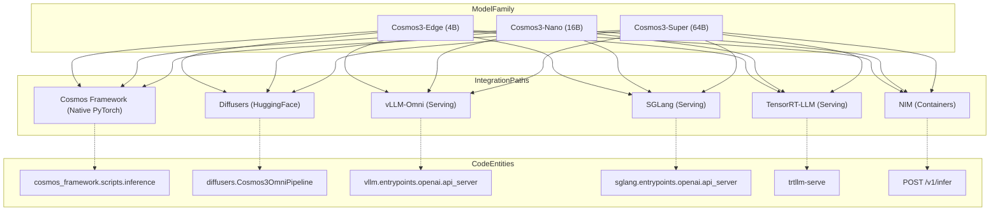
**Sources:** [README.md:41](), [README.md:72](), [cookbooks/cosmos3/README.md:7-16](), [cookbooks/cosmos3/README.md:188-190](), [cookbooks/cosmos3/generator/audiovisual/README.md:8-10](), [cookbooks/cosmos3/generator/audiovisual/README.md:72-78](), [cookbooks/cosmos3/generator/audiovisual/README.md:115](), [cookbooks/cosmos3/generator/audiovisual/README.md:119-142](), [cookbooks/cosmos3/generator/audiovisual/README.md:172-180]()

---

## Environment Setup and CUDA Selection

Cosmos 3 utilizes `uv` for dependency management and requires alignment between the NVIDIA driver and the installed CUDA toolkit [cookbooks/cosmos3/README.md:21, 43]().

### CUDA Version Selection
Backends pin specific CUDA builds of `torch` or `vllm` to match the host driver [cookbooks/cosmos3/README.md:45-46]().

| Driver CUDA Version | Backend Tag | Notes |
| :--- | :--- | :--- |
| 13.x | `cu130` | Default in notebooks [cookbooks/cosmos3/README.md:50](). |
| 12.x | `cu128` | Use for compatible wheel availability [cookbooks/cosmos3/README.md:51](). |

### Installation via uv
For the Cosmos Framework, use the `*-train` dependency group as the inference path imports training modules [cookbooks/cosmos3/README.md:71-73]().

**Framework Installation Example:**
```bash
# For CUDA 13.x drivers
uv sync --all-extras --group=cu130-train
```
[cookbooks/cosmos3/README.md:81]()

### Data Flow: Environment to Execution
The following diagram traces how the environment configuration influences the execution of the model backends.

**Environment and Backend Data Flow**
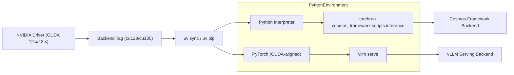
**Sources:** [cookbooks/cosmos3/README.md:43-51]()

### Critical Environment Variables and Troubleshooting
*   `COSMOS3_UV_GROUP`: Set to `cu128-train` for CUDA 12.x systems [cookbooks/cosmos3/README.md:87-88]().
*   `GIT_LFS_SKIP_SMUDGE`: Set to `1` during `uv sync` to avoid failures from missing LFS blobs [cookbooks/cosmos3/README.md:78]().
*   `LD_LIBRARY_PATH`: Clear this when using the NGC PyTorch base image to avoid shadowing the venv [cookbooks/cosmos3/README.md:132-138]().
*   **System Packages:** `libgl1`, `libglib2.0-0`, and `libxcb1` are required for guardrails (OpenCV/RetinaFace) [cookbooks/cosmos3/README.md:108-119]().
*   **Guardrails:** Enable/disable via `enable_safety_checker=False` (Diffusers), `TRTLLM_DISABLE_COSMOS3_GUARDRAILS=1` or `use_guardrails: false` (TensorRT-LLM), `guardrails: false` (vLLM-Omni), or `--no-guardrails` (Cosmos Framework). For Generator NIM set `NIM_ENABLE_TEXT_GUARDRAILS=0 NIM_ENABLE_VIDEO_GUARDRAILS=0` [cookbooks/cosmos3/README.md:33-36](), [cookbooks/cosmos3/generator/audiovisual/README.md:17-24]().

**Sources:** [cookbooks/cosmos3/README.md:33-36](), [cookbooks/cosmos3/README.md:78](), [cookbooks/cosmos3/README.md:87-88](), [cookbooks/cosmos3/README.md:108-119](), [cookbooks/cosmos3/README.md:132-138](), [cookbooks/cosmos3/generator/audiovisual/README.md:17-24]()

---

# Page: Environment Setup and Configuration

# Environment Setup and Configuration

<details>
<summary>Relevant source files</summary>

The following files were used as context for generating this wiki page:

- [.gitignore](.gitignore)
- [README.md](README.md)
- [cookbooks/cosmos3/README.md](cookbooks/cosmos3/README.md)
- [cookbooks/cosmos3/generator/audiovisual/README.md](cookbooks/cosmos3/generator/audiovisual/README.md)

</details>


This page provides a high-level overview of the environment requirements and configuration strategies for NVIDIA Cosmos 3. Setting up the environment correctly is critical for ensuring that the unified Mixture-of-Transformers (MoT) architecture—which powers both the **Reasoner** and **Generator** surfaces—functions efficiently across different hardware and CUDA versions [README.md:75-80]().

Cosmos 3 supports multiple primary integration paths, including the **Cosmos Framework** (native PyTorch), **Diffusers** (Hugging Face), and **vLLM/vLLM-Omni** (production serving) [cookbooks/cosmos3/README.md:7-16](). Each path requires specific dependency management and hardware alignment.

### Environment Overview and Dependency Mapping

The following diagram illustrates how the natural language requirements for "Environment Setup" map to specific code entities and configuration files within the Cosmos ecosystem.

**Diagram: Environment Setup to Code Entity Mapping**
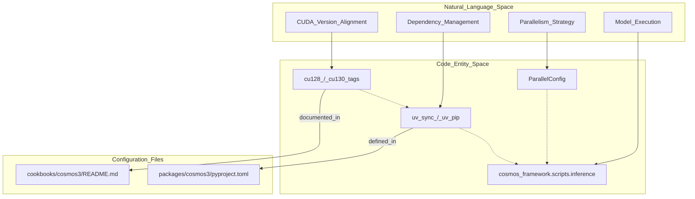
Sources: [cookbooks/cosmos3/README.md:43-55](), [cookbooks/cosmos3/README.md:80-85]()

### Dependency Management with `uv`

Cosmos 3 utilizes `uv` for high-performance Python package management [cookbooks/cosmos3/README.md:21-21](). A key requirement for environment setup is aligning the `torch` and `vllm` builds with the host system's NVIDIA driver. This is handled via backend tags:
*   **cu130**: For CUDA 13.x drivers [cookbooks/cosmos3/README.md:50-50]().
*   **cu128**: For CUDA 12.x drivers [cookbooks/cosmos3/README.md:51-51]().

When using the Cosmos Framework, these tags are passed as dependency groups during synchronization (e.g., `uv sync --all-extras --group=cu130-train`) to ensure binary compatibility [cookbooks/cosmos3/README.md:80-81](). For details on installing the framework and troubleshooting common issues like `libxcb` or `FlashInfer` JIT compilation, see [Dependency Management with uv](#2.1).

Sources: [cookbooks/cosmos3/README.md:43-55](), [cookbooks/cosmos3/README.md:71-85]()

### GPU Parallelism Configuration

Running Cosmos 3—especially the 64B **Super** models—requires a multi-dimensional parallelism strategy to fit the model parameters and sequence lengths into GPU memory [README.md:101-104](). The configuration is defined by the product of several dimensions:
*   **Tensor Parallelism (TP)**: Splitting individual layers across GPUs, configured via `--tensor-parallel-size`.
*   **CFG Parallelism**: Parallelizing the Classifier-Free Guidance (CFG) branches via `--cfg-parallel-size`.
*   **Ulysses Sequence Parallelism**: Distributing the sequence dimension across GPUs via `--ulysses-degree`.
*   **Context Parallelism (CP)**: Managing long sequences via `--cp-size`.

The total number of GPUs utilized must equal the product of these dimensions. For large models on memory-constrained hardware, **Layerwise Offload** can be enabled via `--enable-layerwise-offload`. For details on calculating these dimensions and using the CLI arguments, see [GPU Parallelism Configuration](#2.2).

Sources: [cookbooks/cosmos3/README.md:9-16](), [README.md:82-90]()

### Deployment Backends

Cosmos 3 can be deployed via multiple backends depending on the use case. The environment setup varies slightly for each:

| Backend | Primary Use Case | Setup Requirement |
| :--- | :--- | :--- |
| **Cosmos Framework** | Native PyTorch research and custom inference | `git clone` of the framework and `uv sync` [cookbooks/cosmos3/README.md:63-85]() |
| **Diffusers** | High-level image/video generation | `uv pip install` of `diffusers` and `cosmos_guardrail` [cookbooks/cosmos3/generator/audiovisual/README.md:109-110]() |
| **vLLM / vLLM-Omni** | Production-grade serving and APIs | Installation of the `vllm` or `vllm-omni` backends [cookbooks/cosmos3/README.md:13-14]() |
| **NIM** | Prebuilt OpenAI-compatible server | `docker login nvcr.io` and NGC API key [cookbooks/cosmos3/README.md:37-38]() |

**Diagram: Backend Surface to Code Architecture**
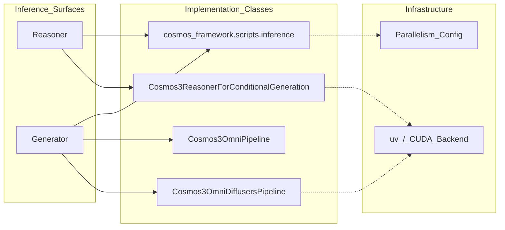
Sources: [cookbooks/cosmos3/README.md:7-16](), [cookbooks/cosmos3/generator/audiovisual/README.md:109-110]()

### Hardware and OS Requirements

Before beginning the setup, ensure the host system meets the following specifications:
*   **Operating System**: Linux with NVIDIA GPU access [cookbooks/cosmos3/README.md:20-20]().
*   **GPU Architecture**: NVIDIA GPU with sufficient VRAM (e.g., H100, H200, B200, or Jetson for Edge) [README.md:101-105]().
*   **Storage**: Tens of GiB for model weights (Nano and Super variants) and CUDA dependencies [cookbooks/cosmos3/README.md:40-41]().
*   **System Libraries**: Headless servers require `libgl1`, `libglib2.0-0`, and `libxcb1` for OpenCV/guardrail support [cookbooks/cosmos3/README.md:118-119]().
*   **Video Codecs**: Environment must handle `torchcodec` and `av.libs` for video ingestion.

Sources: [cookbooks/cosmos3/README.md:18-41](), [cookbooks/cosmos3/README.md:118-119](), [README.md:101-105]()

---

# Page: Dependency Management with uv

# Dependency Management with uv

<details>
<summary>Relevant source files</summary>

The following files were used as context for generating this wiki page:

- [README.md](README.md)
- [cookbooks/cosmos3/README.md](cookbooks/cosmos3/README.md)
- [cookbooks/cosmos3/generator/action/assets/umi_lerobot_example/meta/info.json](cookbooks/cosmos3/generator/action/assets/umi_lerobot_example/meta/info.json)
- [cookbooks/cosmos3/generator/action/run_id_with_cosmos_framework.ipynb](cookbooks/cosmos3/generator/action/run_id_with_cosmos_framework.ipynb)
- [cookbooks/cosmos3/generator/audiovisual/README.md](cookbooks/cosmos3/generator/audiovisual/README.md)
- [cookbooks/cosmos3/reasoner/run_with_cosmos_framework.ipynb](cookbooks/cosmos3/reasoner/run_with_cosmos_framework.ipynb)

</details>


NVIDIA Cosmos uses `uv` for high-performance Python package management and environment isolation. This page details the environment configuration strategy, the alignment between CUDA drivers and backend tags, the installation of the `cosmos-framework` package, and troubleshooting steps for common runtime issues involving system libraries and library path management.

## Environment Management Strategy

Cosmos leverages `uv` to manage virtual environments and dependencies across different integration paths, including native PyTorch (`cosmos-framework`), Hugging Face `diffusers`, and production serving via `vllm` and `vllm-omni` [cookbooks/cosmos3/README.md:1-14]().

### CUDA Version Alignment (cu128/cu130)

A critical aspect of the Cosmos setup is matching the Python environment's CUDA build of `torch` and `vllm` with the host's NVIDIA driver. The codebase defines two primary backend tags for this purpose [cookbooks/cosmos3/README.md:43-51]():

| Driver CUDA Version | Backend Tag | Notes |
| :--- | :--- | :--- |
| **13.x** | `cu130` | Default in the notebooks [cookbooks/cosmos3/README.md:50](). |
| **12.x** | `cu128` | Use when a compatible wheel is available for the selected package version [cookbooks/cosmos3/README.md:51](). |

vLLM does not publish a wheel for every minor CUDA version, so users must manually select the pair that matches their driver rather than relying on `--torch-backend=auto` [cookbooks/cosmos3/README.md:53-55]().

### Dependency Resolution Flow

The following diagram illustrates how `uv` resolves dependencies based on the selected integration path and CUDA backend.

**Title: Cosmos Dependency Resolution Logic**
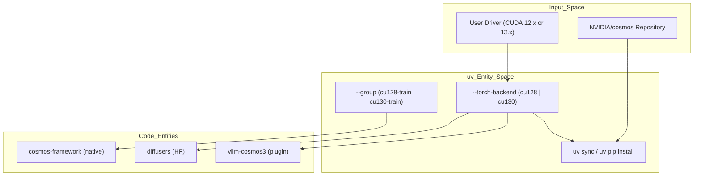
Sources: [cookbooks/cosmos3/README.md:43-55](), [cookbooks/cosmos3/README.md:81-85]()

---

## Cosmos Framework Installation

The `cosmos-framework` is the core package for native PyTorch inference. It is installed from a separate repository into the `packages/cosmos3` directory [cookbooks/cosmos3/README.md:63-69]().

### Implementation Details
1.  **Clone**: The framework is cloned into `packages/cosmos3` [cookbooks/cosmos3/README.md:67]().
2.  **LFS Management**: To avoid failures from missing LFS blobs in the `uv` git mirror, `GIT_LFS_SKIP_SMUDGE=1` is exported before syncing [cookbooks/cosmos3/README.md:78]().
3.  **Group Selection**: The inference path currently imports modules from the training extras. Users must specify the `*-train` dependency group that matches their driver, such as `cu130-train` [cookbooks/cosmos3/README.md:71-73]().
4.  **Environment Variables**: Notebooks honor `COSMOS3_UV_GROUP` (default `cu130-train`) to select the correct dependency group at runtime [cookbooks/cosmos3/README.md:87-88]().

**Title: Cosmos Framework Environment Structure**
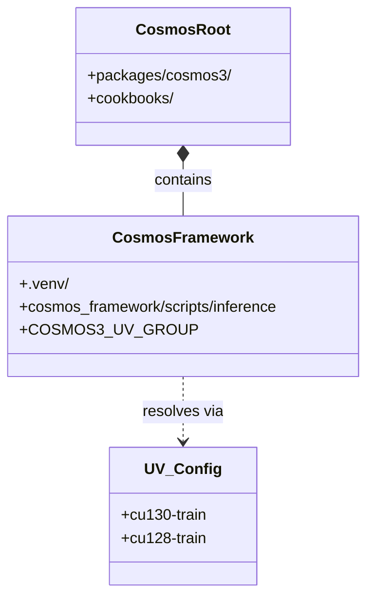
Sources: [cookbooks/cosmos3/README.md:63-69](), [cookbooks/cosmos3/README.md:81-88]()

---

## LD_LIBRARY_PATH and Shared Library Management

Correct management of `LD_LIBRARY_PATH` is essential for both CUDA kernel execution and video codec functionality.

### Video Codecs and Torchcodec (av.libs)
For action modeling and video processing, the framework relies on `torchcodec`. In notebook environments, specific logic is implemented to symlink FFmpeg libraries from the venv's `av.libs` directory to a known output path, which is then added to `LD_LIBRARY_PATH` [cookbooks/cosmos3/generator/action/run_id_with_cosmos_framework.ipynb:151-174](). This ensures `torchcodec` can locate `libavcodec.so.62`, `libavformat.so.62`, and other essential media libraries [cookbooks/cosmos3/generator/action/run_id_with_cosmos_framework.ipynb:161-169]().

### CUDA Library Search
The framework includes utility functions `nvidia_cuda_library_dirs` to locate NVIDIA CUDA library directories within the `site-packages/nvidia` directory of the virtual environment [cookbooks/cosmos3/generator/action/run_id_with_cosmos_framework.ipynb:138-148](). These paths are appended to `LD_LIBRARY_PATH` to ensure that CUDA kernels (e.g., for FlashInfer or custom operators) can link against the correct shared objects (`lib*.so*`) [cookbooks/cosmos3/generator/action/run_id_with_cosmos_framework.ipynb:146-147]().

**Title: LD_LIBRARY_PATH Management Flow**
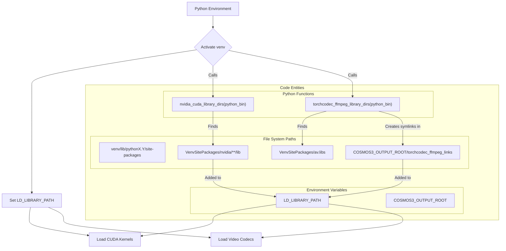
Sources: [cookbooks/cosmos3/generator/action/run_id_with_cosmos_framework.ipynb:138-148](), [cookbooks/cosmos3/generator/action/run_id_with_cosmos_framework.ipynb:151-174]()

---

## Troubleshooting and Common Issues

### Missing System Libraries (`libxcb`)
Framework inference enables guardrails by default, which import `OpenCV` (via `RetinaFace`). This requires graphics libraries often missing on headless servers [cookbooks/cosmos3/README.md:106-110]().
-   **Symptom**: `ImportError: libxcb.so.1: cannot open shared object file` [cookbooks/cosmos3/README.md:129]().
-   **Fix**: Install system packages `libxcb1`, `libgl1`, and `libglib2.0-0` via `apt-get` [cookbooks/cosmos3/README.md:117-120]().

### Torch and CUDA Compatibility
-   **`torch.cuda.is_available()`**: If this returns `False`, the NVIDIA driver on the system is likely too old for the requirements [README.md:38]().
-   **NGC Container Conflict**: When using the recommended NGC PyTorch base images (25.09 for CUDA 13, 25.06 for CUDA 12), users must clear `LD_LIBRARY_PATH` after activating the venv to prevent the container's bundled libtorch from shadowing the venv's libraries [cookbooks/cosmos3/README.md:132-139]().

### FlashInfer JIT Compilation
Backends like `vLLM` perform just-in-time (JIT) compilation of kernels via FlashInfer.
-   **Path Requirement**: The `.venv/bin` directory must be in the system `PATH` because FlashInfer shells out to `ninja` for compilation.
-   **DeepGEMM**: If the vLLM build reports issues with DeepGEMM, it may need to be disabled via environment variables.

### `uv` and Resource Constraints
-   **Disk Space**: Nano downloads and CUDA dependencies can consume tens of GiB [cookbooks/cosmos3/README.md:40-41]().
-   **Authentication**: Accessing gated models (including the `Cosmos-1.0-Guardrail`) requires `uvx hf@latest auth login` or a valid `HF_TOKEN` [cookbooks/cosmos3/README.md:21-31]().

Sources: [README.md:35-40](), [cookbooks/cosmos3/README.md:18-41](), [cookbooks/cosmos3/README.md:106-139](), [cookbooks/cosmos3/generator/action/run_id_with_cosmos_framework.ipynb:138-174]()

---

# Page: GPU Parallelism Configuration

# GPU Parallelism Configuration

<details>
<summary>Relevant source files</summary>

The following files were used as context for generating this wiki page:

- [README.md](README.md)
- [cookbooks/cosmos3/README.md](cookbooks/cosmos3/README.md)
- [cookbooks/cosmos3/generator/audiovisual/README.md](cookbooks/cosmos3/generator/audiovisual/README.md)
- [cookbooks/cosmos3/generator/audiovisual/assets/prompts/image2video/car_driving_edge.json](cookbooks/cosmos3/generator/audiovisual/assets/prompts/image2video/car_driving_edge.json)
- [cookbooks/cosmos3/generator/audiovisual/run_with_cosmos_framework.ipynb](cookbooks/cosmos3/generator/audiovisual/run_with_cosmos_framework.ipynb)
- [cookbooks/cosmos3/generator/audiovisual/run_with_diffusers.ipynb](cookbooks/cosmos3/generator/audiovisual/run_with_diffusers.ipynb)
- [cookbooks/cosmos3/generator/audiovisual/run_with_vllm_omni.ipynb](cookbooks/cosmos3/generator/audiovisual/run_with_vllm_omni.ipynb)

</details>


NVIDIA Cosmos 3 models, particularly the **Cosmos3-Super** (64B) variants, require sophisticated multi-dimensional parallelism strategies to fit within GPU memory and achieve performant inference latencies. This page documents the parallelism dimensions supported by the Cosmos Framework, vLLM, and TensorRT-LLM backends, including Tensor Parallelism, CFG Parallelism, Ulysses Sequence Parallelism, and Layerwise Offloading.

## Parallelism Dimensions Overview

The total number of GPUs allocated for a single inference task must exactly match the product of all enabled parallelism dimensions. This coordination is typically handled via `torchrun` in the Cosmos Framework or through the engine configuration in vLLM and TensorRT-LLM.

| Dimension | CLI Argument / Config | Purpose |
| :--- | :--- | :--- |
| **Tensor Parallelism (TP)** | `--tensor-parallel-size` | Splits model weights and activations across GPUs within a group. |
| **CFG Parallelism (CP)** | `--cfg-parallel-size` | Parallelizes the Classifier-Free Guidance (CFG) computation (conditional vs. unconditional branches). |
| **Ulysses Sequence Parallelism (USP)** | `--ulysses-degree` | Parallelizes the attention mechanism across the sequence length dimension. |
| **Layerwise Offload** | `--enable-layerwise-offload` | Offloads inactive layers to CPU/System RAM to reduce peak GPU memory usage. |
| **Context Parallelism (CP)** | `--cp-size` | Used during training/SFT to handle long sequences across multiple GPUs. |

### Configuration Constraint
For any distributed execution, the following identity must hold:
`Total GPUs = tensor_parallel_size * cfg_parallel_size * ulysses_degree`

Sources: [cookbooks/cosmos3/generator/audiovisual/run_with_vllm_omni.ipynb:99-100](), [cookbooks/cosmos3/generator/audiovisual/run_with_vllm_omni.ipynb:123-124]()

## Tensor Parallelism (TP)

Tensor Parallelism is the primary scaling dimension for Cosmos3-Super models. It partitions the linear layers and attention heads across multiple GPUs to reduce the memory footprint per device.

*   **Implementation:** TP is implemented natively within the Cosmos Framework and supported via the `vllm-omni` plugin for vLLM.
*   **Cosmos3-Nano (16B):** Typically runs with `tensor-parallel-size 1` on a single GPU.
*   **Cosmos3-Super (64B):** Recommended configuration is `tensor-parallel-size 4` or `8` depending on GPU VRAM (e.g., H100 80GB vs. H200 141GB) [cookbooks/cosmos3/generator/audiovisual/run_with_vllm_omni.ipynb:99]().
*   **vLLM MM Encoder TP:** vLLM allows specific TP modes for the multimodal encoder via `--mm-encoder-tp-mode`.

### Data Flow: Tensor Parallelism in vLLM
The following diagram illustrates how the `Cosmos3OmniDiffusersPipeline` architecture utilizes TP within the vLLM environment.

**vLLM Tensor Parallelism Mapping**
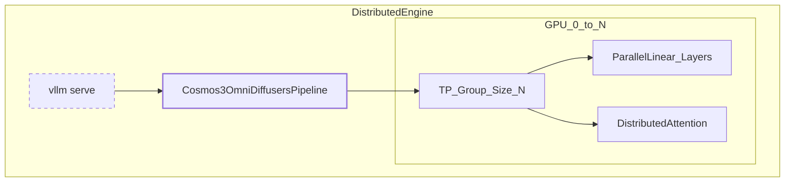
Sources: [cookbooks/cosmos3/generator/audiovisual/run_with_vllm_omni.ipynb:58-62](), [cookbooks/cosmos3/generator/audiovisual/run_with_vllm_omni.ipynb:96-98]()

## CFG Parallelism

In Generator Mode, Cosmos 3 utilizes Classifier-Free Guidance (CFG) to improve prompt adherence. This involves running two forward passes: one conditioned on the prompt and one unconditional (null prompt).

*   **Logic:** Since these two passes are independent, they can be computed in parallel on separate GPU groups.
*   **CLI Usage:** `--cfg-parallel-size 2` (or `cfg_size: 2` in TensorRT-LLM configs) splits the workload such that one group of GPUs handles the conditional branch and another handles the unconditional branch [cookbooks/cosmos3/generator/audiovisual/run_with_vllm_omni.ipynb:155-156]().
*   **Constraint:** If `cfg-parallel-size` is 2, the total GPU count must be doubled relative to the TP/USP requirements.

Sources: [cookbooks/cosmos3/generator/audiovisual/run_with_vllm_omni.ipynb:147-162]()

## Ulysses Sequence Parallelism (USP)

Ulysses Sequence Parallelism (USP) is used to handle long-context sequences, such as high-resolution video (720p) or high-frame-count generations (up to 189 frames), which might exceed the memory capacity of a single GPU's attention mechanism even with TP.

*   **Mechanism:** It partitions the sequence dimension across GPUs within the `ulysses-degree` group.
*   **Key Function:** This is integrated into the multimodal attention layers that process the unified token stream (mRoPE encoded).
*   **Usage:** In TensorRT-LLM, this is configured via `ulysses_size` in the YAML configuration.

Sources: [README.md:1.1]()

## Layerwise Offload

For environments with limited GPU VRAM but high system RAM, the Cosmos Framework and vLLM support layerwise offloading for inference.

*   **Implementation:** The `--enable-layerwise-offload` flag enables a mechanism where only the currently executing transformer layers are kept in GPU memory [cookbooks/cosmos3/generator/audiovisual/run_with_vllm_omni.ipynb:100]().
*   **Behavior:** As the inference progresses through the model's depth, weights are streamed from CPU to GPU. This significantly reduces the VRAM floor required to run the 64B Super models, albeit at a cost to inference latency.

Sources: [cookbooks/cosmos3/generator/audiovisual/run_with_vllm_omni.ipynb:100]()

## Training Parallelism: HSDP and dp-shard-size

For Super models during Supervised Fine-Tuning (SFT), the Cosmos Framework utilizes Hybrid Sharded Data Parallelism (HSDP).

*   **HSDP Implementation:** Combines Fully Sharded Data Parallelism (FSDP) within a node and Data Parallelism across nodes.
*   **dp-shard-size:** Controls the degree of sharding for the model states.
*   **Context Parallelism:** For Reasoner SFT on long video sequences, `--cp-size` is used to parallelize the sequence dimension during training.

Sources: [README.md:7.3](), [README.md:7.4]()

## Configuration Mapping

The following diagram bridges the high-level CLI configuration to the underlying model components and execution logic within the framework.

**CLI to Code Entity Mapping**
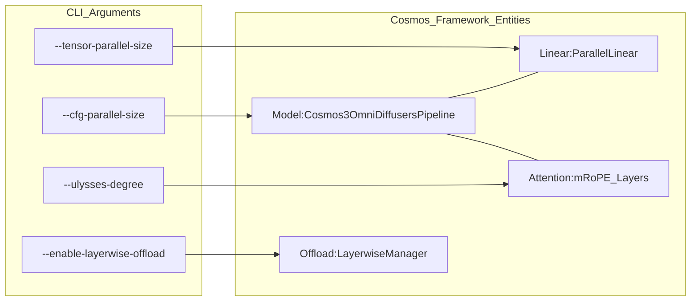
Sources: [cookbooks/cosmos3/generator/audiovisual/run_with_vllm_omni.ipynb:61](), [cookbooks/cosmos3/generator/audiovisual/run_with_vllm_omni.ipynb:99-100](), [cookbooks/cosmos3/generator/audiovisual/run_with_vllm_omni.ipynb:155-156]()

## Summary of Distributed Requirements

When launching with `torchrun` or `vllm serve`, ensure the environment variables and flags are aligned.

| Model | Total GPUs | Recommended Parallelism Config |
| :--- | :--- | :--- |
| **Cosmos3-Nano** | 1 | `TP=1, CFG=1, USP=1` |
| **Cosmos3-Super** (Reasoner) | 4-8 | `TP=4/8, CFG=1, USP=1` |
| **Cosmos3-Super** (Generator) | 4-8 | `TP=2, CFG=2, USP=1` (4 GPUs) OR `TP=4, CFG=2, USP=1` (8 GPUs) |

> **Note:** TensorRT-LLM for Cosmos3-Super specifically uses a configuration with `cfg_size=2`, `ulysses_size=2`, and `parallel_vae_size=4`, requiring exactly four processes.

Sources: [cookbooks/cosmos3/generator/audiovisual/run_with_vllm_omni.ipynb:99-100](), [cookbooks/cosmos3/generator/audiovisual/run_with_vllm_omni.ipynb:155-156]()

---

# Page: Reasoner: Vision-Language Understanding

# Reasoner: Vision-Language Understanding

<details>
<summary>Relevant source files</summary>

The following files were used as context for generating this wiki page:

- [cookbooks/cosmos3/reasoner/README.md](cookbooks/cosmos3/reasoner/README.md)
- [cookbooks/cosmos3/reasoner/run_with_tensorrt_llm.ipynb](cookbooks/cosmos3/reasoner/run_with_tensorrt_llm.ipynb)
- [cookbooks/cosmos3/reasoner/run_with_transformers.ipynb](cookbooks/cosmos3/reasoner/run_with_transformers.ipynb)
- [cookbooks/cosmos3/reasoner/run_with_vllm.ipynb](cookbooks/cosmos3/reasoner/run_with_vllm.ipynb)

</details>


The Cosmos 3 Reasoner is the vision-language understanding surface of the NVIDIA Cosmos 3 world model family. It enables sophisticated reasoning tasks across static images and temporal video sequences, including detailed captioning, 2D grounding, robot task planning, and action-trajectory prediction [cookbooks/cosmos3/reasoner/README.md:1-4](). The Reasoner utilizes a causal self-attention mechanism within the shared Mixture-of-Transformers (MoT) architecture to process interleaved multimodal tokens.

## Execution Backends

The Reasoner can be executed through four primary paths depending on the use case and memory constraints:

1.  **Cosmos Framework**: A native PyTorch-based execution path optimized for local inference and research. It loads the **full omni weights** (Reasoner plus the generator experts), using the most memory [cookbooks/cosmos3/reasoner/README.md:15-18](). For details, see [Reasoner with Cosmos Framework](#3.1).
2.  **vLLM**: A high-performance serving engine that provides an OpenAI-compatible API. It loads **only the Reasoner (VLM) weights**, significantly reducing the memory footprint (e.g., ~17GB for Nano vs ~34GB in Framework) [cookbooks/cosmos3/reasoner/README.md:19-27](). For details, see [Reasoner with vLLM, SGLang, TensorRT-LLM, Transformers, and NIM](#3.2).
3.  **TensorRT-LLM**: An optimized inference runtime for large language models, also loading **only the Reasoner (VLM) weights** for memory efficiency [cookbooks/cosmos3/reasoner/README.md:19-27](). For details, see [Reasoner with vLLM, SGLang, TensorRT-LLM, Transformers, and NIM](#3.2).
4.  **Transformers**: A Python-first path using the Hugging Face `transformers` library, specifically the `Cosmos3OmniForConditionalGeneration` or `AutoModelForImageTextToText` classes [cookbooks/cosmos3/reasoner/run_with_transformers.ipynb:23-29](). For details, see [Reasoner with vLLM, SGLang, TensorRT-LLM, Transformers, and NIM](#3.2).
5.  **NVIDIA NIM**: A prebuilt, optimized container that packages the Reasoner with an OpenAI-compatible server, requiring no manual Python environment or CUDA setup [cookbooks/cosmos3/reasoner/README.md:145-150](). For details, see [Reasoner with vLLM, SGLang, TensorRT-LLM, Transformers, and NIM](#3.2).

### Relationship Between Backends

The following diagram illustrates how the Reasoner logic is surfaced through different code entities and deployment surfaces:

**Reasoner Backend Architecture**
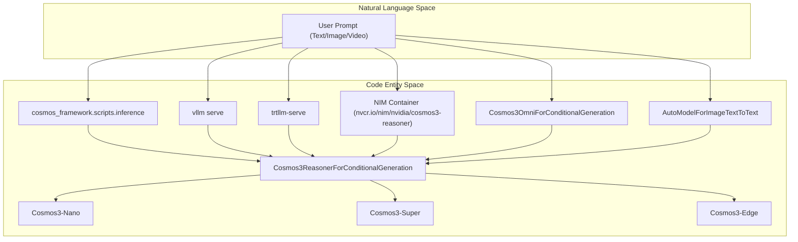
Sources: [cookbooks/cosmos3/reasoner/README.md:15-27](), [cookbooks/cosmos3/reasoner/README.md:63-67](), [cookbooks/cosmos3/reasoner/run_with_transformers.ipynb:23-29](), [cookbooks/cosmos3/reasoner/run_with_vllm.ipynb:16-17](), [cookbooks/cosmos3/reasoner/run_with_tensorrt_llm.ipynb:9-19]()

## Reasoner Capabilities

The Reasoner is designed for a broad spectrum of vision-language tasks. It processes input via a unified token stream, allowing it to "see" visual data and "reason" via text.

| Task | Description |
| :--- | :--- |
| **Captioning** | Generating detailed textual descriptions of images or video sequences [cookbooks/cosmos3/reasoner/reasoner_prompt_guide.md:105-147](). |
| **2D Grounding** | Identifying and localizing objects using normalized `0-1000` coordinates for `bbox_2d` and `point_2d` [cookbooks/cosmos3/reasoner/reasoner_prompt_guide.md:77-83](). |
| **Temporal Reasoning** | Understanding events over time, such as temporal localization in video with JSON output [cookbooks/cosmos3/reasoner/reasoner_prompt_guide.md:149-212](). |
| **Embodied Reasoning** | Planning robot tasks and predicting action-trajectory prompts from visual state [cookbooks/cosmos3/reasoner/README.md:79-81](). |
| **Physical Plausibility** | Evaluating if a visual scene or sequence follows physical laws [cookbooks/cosmos3/reasoner/README.md:135-136](). |
| **VQA** | Answering complex questions about visual content [cookbooks/cosmos3/reasoner/README.md:133-134](). |

Sources: [cookbooks/cosmos3/reasoner/README.md:131-136](), [cookbooks/cosmos3/reasoner/reasoner_prompt_guide.md:77-83](), [cookbooks/cosmos3/reasoner/reasoner_prompt_guide.md:149-160]()

## Reasoner with Cosmos Framework

The Cosmos Framework path provides a direct interface to the model using the `cosmos_framework.scripts.inference` module [cookbooks/cosmos3/reasoner/README.md:63-63](). This backend uses a JSON-based input specification where users define the `model_mode` as `reasoner` and provide a `vision_path` to the local asset [cookbooks/cosmos3/reasoner/README.md:47-56]().

Key features of this path include:
*   **Input Format**: Supports local file paths for images via the `vision_path` field; note that `enable_sound: false` is required as the Reasoner does not support audio [cookbooks/cosmos3/reasoner/README.md:43-55]().
*   **Distributed Execution**: Uses `torchrun` to scale `Cosmos3-Super` across multiple GPUs (e.g., 4 GPUs) [cookbooks/cosmos3/reasoner/README.md:82-83]().
*   **Output**: Generates a `reasoner_text.txt` file containing the model's response [cookbooks/cosmos3/reasoner/README.md:72-73]().

For implementation details and CLI usage, see [Reasoner with Cosmos Framework](#3.1).

Sources: [cookbooks/cosmos3/reasoner/README.md:43-56](), [cookbooks/cosmos3/reasoner/README.md:63-73](), [cookbooks/cosmos3/reasoner/README.md:82-83]()

## Reasoner with vLLM, SGLang, TensorRT-LLM, Transformers, and NIM

These backends are optimized for throughput and support standard API patterns. vLLM, TensorRT-LLM, and NIM all support the OpenAI Chat Completions API [cookbooks/cosmos3/reasoner/README.md:100-111](), [cookbooks/cosmos3/reasoner/run_with_tensorrt_llm.ipynb:15-16]().

**Serving and API Integration Flow**
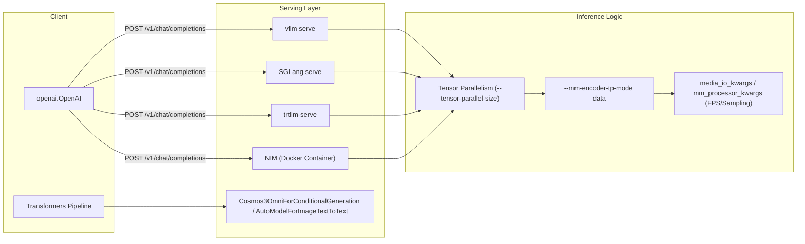
Sources: [cookbooks/cosmos3/reasoner/README.md:100-111](), [cookbooks/cosmos3/reasoner/README.md:167-181](), [cookbooks/cosmos3/reasoner/run_with_vllm.ipynb:113-123](), [cookbooks/cosmos3/reasoner/reasoner_prompt_guide.md:29-33](), [cookbooks/cosmos3/reasoner/run_with_tensorrt_llm.ipynb:15-16](), [cookbooks/cosmos3/reasoner/run_with_transformers.ipynb:23-29]()

Key features of these paths include:
*   **Multimodal Ingestion**: Supports images via `image_url` and videos via `video_url`. NIM specifically requires local assets to be sent as base64 data URIs [cookbooks/cosmos3/reasoner/README.md:161-164](), [cookbooks/cosmos3/reasoner/reasoner_prompt_guide.md:61-62]().
*   **Parallelism**: Super models are typically served with `--tensor-parallel-size 4` and `--mm-encoder-tp-mode data` [cookbooks/cosmos3/reasoner/run_with_vllm.ipynb:122-123]().
*   **Media Controls**: Video frame sampling is controlled via `media_io_kwargs` or `mm_processor_kwargs` (e.g., setting FPS or `do_sample_frames`) [cookbooks/cosmos3/reasoner/reasoner_prompt_guide.md:29-33]().
*   **Chain-of-Thought**: Reasoning can be toggled by appending instructions to the user prompt, with the model outputting reasoning between `<think>` tags [cookbooks/cosmos3/reasoner/reasoner_prompt_guide.md:41-54]().

For server launch commands and API examples, see [Reasoner with vLLM, SGLang, TensorRT-LLM, Transformers, and NIM](#3.2). For prompt engineering techniques, see [Reasoner Prompt Guide](#3.3).

Sources: [cookbooks/cosmos3/reasoner/README.md:161-164](), [cookbooks/cosmos3/reasoner/run_with_vllm.ipynb:122-123](), [cookbooks/cosmos3/reasoner/reasoner_prompt_guide.md:29-33](), [cookbooks/cosmos3/reasoner/reasoner_prompt_guide.md:41-54]()

---

# Page: Reasoner with Cosmos Framework

# Reasoner with Cosmos Framework

<details>
<summary>Relevant source files</summary>

The following files were used as context for generating this wiki page:

- [cookbooks/cosmos3/generator/action/assets/umi_lerobot_example/meta/info.json](cookbooks/cosmos3/generator/action/assets/umi_lerobot_example/meta/info.json)
- [cookbooks/cosmos3/generator/action/run_id_with_cosmos_framework.ipynb](cookbooks/cosmos3/generator/action/run_id_with_cosmos_framework.ipynb)
- [cookbooks/cosmos3/reasoner/README.md](cookbooks/cosmos3/reasoner/README.md)
- [cookbooks/cosmos3/reasoner/run_with_cosmos_framework.ipynb](cookbooks/cosmos3/reasoner/run_with_cosmos_framework.ipynb)
- [cookbooks/cosmos3/reasoner/run_with_tensorrt_llm.ipynb](cookbooks/cosmos3/reasoner/run_with_tensorrt_llm.ipynb)
- [cookbooks/cosmos3/reasoner/run_with_transformers.ipynb](cookbooks/cosmos3/reasoner/run_with_transformers.ipynb)
- [cookbooks/cosmos3/reasoner/run_with_vllm.ipynb](cookbooks/cosmos3/reasoner/run_with_vllm.ipynb)

</details>


The Cosmos 3 Reasoner is a vision-language understanding surface designed for tasks such as detailed captioning, 2D grounding, temporal localization, and embodied planning. Within the **Cosmos Framework**, the Reasoner is executed natively via PyTorch using the `cosmos_framework.scripts.inference` module [cookbooks/cosmos3/reasoner/run_with_cosmos_framework.ipynb:16-22](). This integration path is ideal for research and development where direct control over distributed execution and model configurations is required.

## Inference Execution with torchrun

The primary entry point for running Reasoner inference is the `cosmos_framework.scripts.inference` script [cookbooks/cosmos3/reasoner/README.md:63-69](). For large-scale models like **Cosmos3-Super**, which require multi-GPU setups, the framework utilizes `torchrun` to manage distributed processes [cookbooks/cosmos3/reasoner/README.md:82-83]().

### CLI Arguments and Configuration
When executing the inference script, several key arguments define the behavior of the Reasoner:

| Argument | Description |
| :--- | :--- |
| `-i` / `--input-json` | Path to the JSON input specification file [cookbooks/cosmos3/reasoner/README.md:65](). |
| `-o` / `--output-dir` | Directory where the reasoning results will be saved [cookbooks/cosmos3/reasoner/README.md:66](). |
| `--checkpoint-path` | Path or Hugging Face identifier (e.g., `Cosmos3-Nano`, `Cosmos3-Super`) [cookbooks/cosmos3/reasoner/README.md:67](). |
| `--parallelism-preset` | Preset for GPU parallelism (e.g., `latency`) [cookbooks/cosmos3/reasoner/README.md:64](). |
| `--seed` | Random seed for reproducibility [cookbooks/cosmos3/reasoner/README.md:68](). |
| `--benchmark` | Enables performance benchmarking during the run [cookbooks/cosmos3/reasoner/README.md:69](). |

### Distributed Execution for Super Models
While **Cosmos3-Nano** can run on a single GPU using standard Python by setting `WORLD_SIZE=1` and manually configuring the environment variables [cookbooks/cosmos3/reasoner/README.md:61-70](), **Cosmos3-Super** typically requires 4 or more GPUs. The framework uses `.venv/bin/torchrun` to coordinate the distributed group for Super models [cookbooks/cosmos3/reasoner/README.md:82-83]().

Sources: [cookbooks/cosmos3/reasoner/README.md:61-70](), [cookbooks/cosmos3/reasoner/README.md:82-83](), [cookbooks/cosmos3/reasoner/run_with_cosmos_framework.ipynb:30-31]()

## Input Specification Format

The Reasoner expects a JSON input file that defines the task and the associated media. The `model_mode` must be set to `reasoner` to trigger the understanding logic of the architecture [cookbooks/cosmos3/reasoner/README.md:49]().

### JSON Payload Schema
```json
{
  "model_mode": "reasoner",
  "name": "robot_image",
  "prompt": "Describe what is happening in this image in one sentence.",
  "vision_path": "../../cookbooks/cosmos3/reasoner/assets/robot_153.jpg",
  "enable_sound": false
}
```
*   **model_mode**: Must be `reasoner` [cookbooks/cosmos3/reasoner/README.md:49]().
*   **name**: A unique identifier for the task, used to create the output subdirectory [cookbooks/cosmos3/reasoner/README.md:50]().
*   **prompt**: The text instruction for the model [cookbooks/cosmos3/reasoner/README.md:51]().
*   **vision_path**: Local path or URL to the image. Currently, the framework Reasoner path primarily expects image inputs via this field [cookbooks/cosmos3/reasoner/README.md:52](), [cookbooks/cosmos3/reasoner/README.md:83-85]().
*   **enable_sound**: Set to `false` to avoid a strict argument-validation failure in the current Reasoner path, as audio is not currently supported in this mode [cookbooks/cosmos3/reasoner/README.md:43](), [cookbooks/cosmos3/reasoner/README.md:53]().

Sources: [cookbooks/cosmos3/reasoner/README.md:43-56](), [cookbooks/cosmos3/reasoner/README.md:83-85]()

## Data Flow and Implementation

The following diagram illustrates how the Cosmos Framework processes a Reasoner request from the JSON input to the final text output. Note that the Cosmos Framework backend loads the **full omni weights** (Reasoner plus generator components like the video VAE and diffusion experts) [cookbooks/cosmos3/reasoner/README.md:15-18]().

### Reasoner Data Flow Diagram
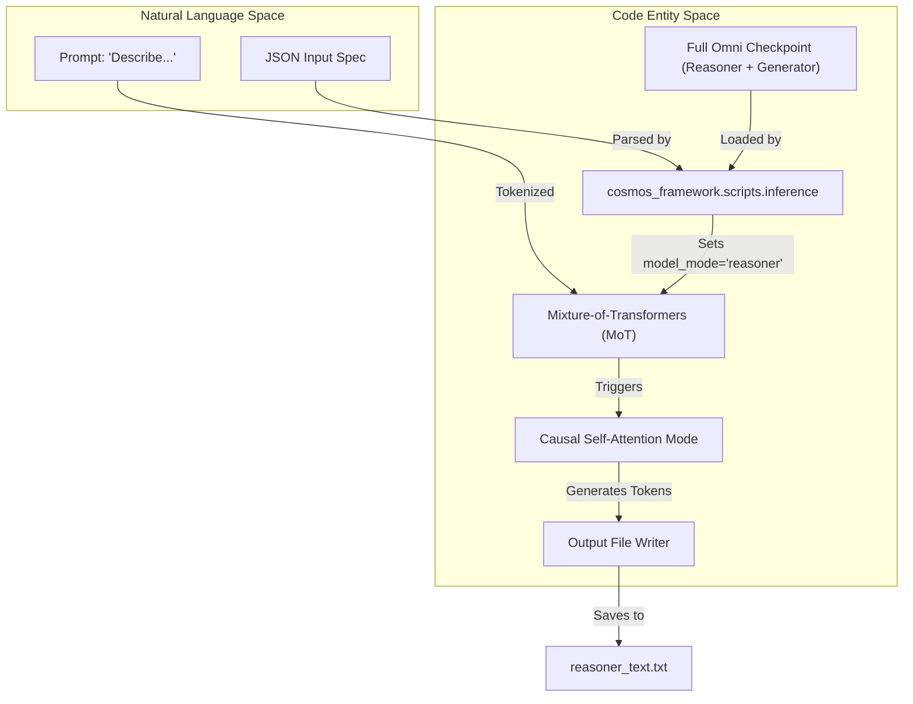

Sources: [cookbooks/cosmos3/reasoner/README.md:15-18](), [cookbooks/cosmos3/reasoner/README.md:49-56](), [cookbooks/cosmos3/reasoner/README.md:63-73](), [cookbooks/cosmos3/reasoner/run_with_cosmos_framework.ipynb:16-22]()

## Reasoning Capabilities

The Reasoner surface supports several specialized vision-language tasks through prompt engineering. The framework allows for the visualization of results such as 2D grounding boxes and action trajectories in the accompanying notebooks [cookbooks/cosmos3/reasoner/run_with_cosmos_framework.ipynb:77-81]().

### Task Examples
1.  **Detailed Captioning**: Providing exhaustive descriptions of scenes [cookbooks/cosmos3/reasoner/run_with_cosmos_framework.ipynb:78]().
2.  **Robot Task Planning**: Generating step-by-step instructions based on visual state [cookbooks/cosmos3/reasoner/run_with_cosmos_framework.ipynb:78]().
3.  **2D Grounding**: Identifying and locating objects within an image using normalized `0-1000` coordinates [cookbooks/cosmos3/reasoner/run_with_cosmos_framework.ipynb:79]().
4.  **Action Trajectory Prediction**: Predicting future coordinates for embodied agents [cookbooks/cosmos3/reasoner/run_with_cosmos_framework.ipynb:79-80]().

### Entity Association Diagram
This diagram maps the high-level reasoning tasks to the specific assets and script outputs handled by the framework.

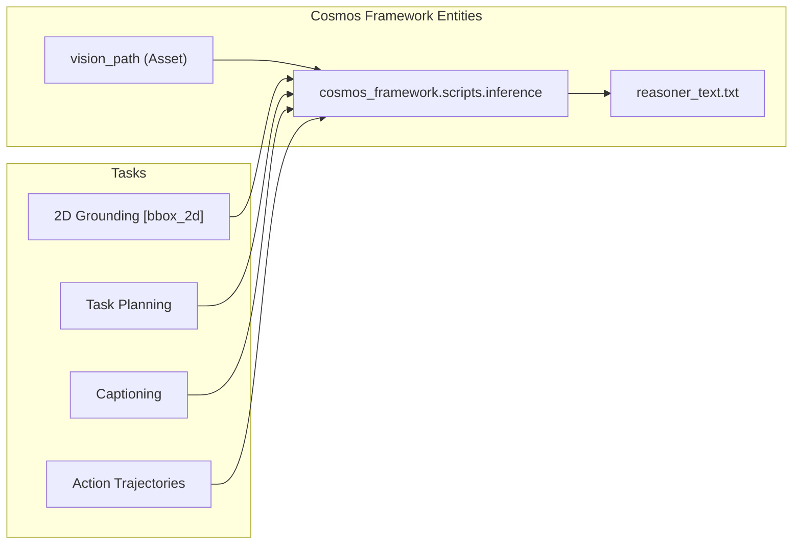

Sources: [cookbooks/cosmos3/reasoner/README.md:72-73](), [cookbooks/cosmos3/reasoner/run_with_cosmos_framework.ipynb:77-81]()

## Output Structure

Upon completion, the inference script generates a directory structure based on the `name` field provided in the input JSON. The primary result is a text file containing the model's response.

**Output File Path:**
`<output-dir>/<name>/reasoner_text.txt` [cookbooks/cosmos3/reasoner/README.md:72-73]()

For example, if the output directory is `outputs/cookbooks/cosmos3/reasoner/nano/cosmos_framework_image` and the name is `robot_image`, the result will be found at `outputs/cookbooks/cosmos3/reasoner/nano/cosmos_framework_image/robot_image/reasoner_text.txt` [cookbooks/cosmos3/reasoner/README.md:66-73]().

Sources: [cookbooks/cosmos3/reasoner/README.md:63-73]()

---

# Page: Reasoner with vLLM, SGLang, TensorRT-LLM, Transformers, and NIM

# Reasoner with vLLM, SGLang, TensorRT-LLM, Transformers, and NIM

<details>
<summary>Relevant source files</summary>

The following files were used as context for generating this wiki page:

- [cookbooks/cosmos3/reasoner/README.md](cookbooks/cosmos3/reasoner/README.md)
- [cookbooks/cosmos3/reasoner/assets/robot_153.jpg](cookbooks/cosmos3/reasoner/assets/robot_153.jpg)
- [cookbooks/cosmos3/reasoner/reasoner_prompt_guide.md](cookbooks/cosmos3/reasoner/reasoner_prompt_guide.md)
- [cookbooks/cosmos3/reasoner/run_with_nim.ipynb](cookbooks/cosmos3/reasoner/run_with_nim.ipynb)
- [cookbooks/cosmos3/reasoner/run_with_sglang.ipynb](cookbooks/cosmos3/reasoner/run_with_sglang.ipynb)
- [cookbooks/cosmos3/reasoner/run_with_tensorrt_llm.ipynb](cookbooks/cosmos3/reasoner/run_with_tensorrt_llm.ipynb)
- [cookbooks/cosmos3/reasoner/run_with_transformers.ipynb](cookbooks/cosmos3/reasoner/run_with_transformers.ipynb)
- [cookbooks/cosmos3/reasoner/run_with_vllm.ipynb](cookbooks/cosmos3/reasoner/run_with_vllm.ipynb)

</details>


The Cosmos 3 Reasoner can be deployed as a high-performance, production-ready inference service using **vLLM**, **SGLang**, **TensorRT-LLM**, **Hugging Face Transformers**, or **NVIDIA NIM**. These integrations provide an OpenAI-compatible Chat Completions API for complex vision-language reasoning tasks, including detailed captioning, 2D grounding, temporal localization, and embodied Action CoT.

Unlike the Cosmos Framework backend which loads full omni weights (including generation experts), these backends load **only the Reasoner (VLM) weights**, significantly reducing the GPU memory footprint (e.g., ~17 GB for Cosmos3-Nano vs ~34 GB in the Framework) [cookbooks/cosmos3/reasoner/README.md:12-29]().

## 1. Reasoner with vLLM

The vLLM integration leverages the `Cosmos3ReasonerForConditionalGeneration` architecture to serve **Edge**, **Nano**, and **Super** model variants with optimized kernels and asynchronous scheduling [cookbooks/cosmos3/reasoner/run_with_vllm.ipynb:16-16]().

### Server Architecture and Implementation
*   **Architecture**: Registered as `Cosmos3ReasonerForConditionalGeneration` [cookbooks/cosmos3/reasoner/run_with_vllm.ipynb:168-168]().
*   **Parallelism**: Supports Tensor Parallelism (TP) via `--tensor-parallel-size` to scale **Cosmos3-Super** across multiple GPUs [cookbooks/cosmos3/reasoner/run_with_vllm.ipynb:113-113]().
*   **Media Processing**: Ingests media via `--allowed-local-media-path` for `file://` URIs and uses `--mm-encoder-tp-mode data` for TP configurations [cookbooks/cosmos3/reasoner/run_with_vllm.ipynb:122-122]().

**Reasoner Request Pipeline (vLLM)**
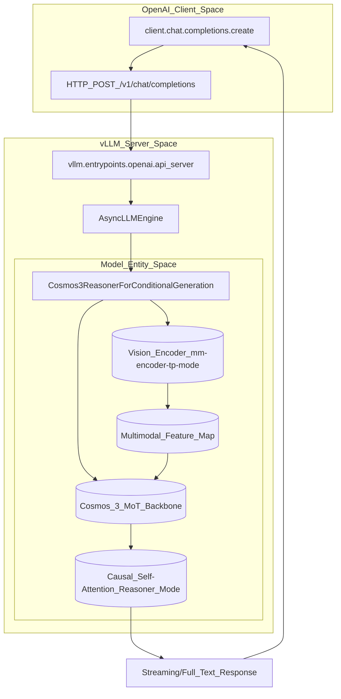
Sources: [cookbooks/cosmos3/reasoner/run_with_vllm.ipynb:122-123](), [cookbooks/cosmos3/reasoner/README.md:109-124]()

### Server Launch
Launch the server using the `vllm/vllm-openai:cosmos3` Docker image [cookbooks/cosmos3/reasoner/run_with_vllm.ipynb:88-88]().

#### Cosmos3-Super (4 GPUs)
```bash
docker run -d --name cosmos3-reasoner-vllm \
  --runtime nvidia --gpus all \
  -v "$HOME/.cache/huggingface:/root/.cache/huggingface" \
  -v "$COSMOS_ROOT:$COSMOS_ROOT" \
  -p 8001:8000 --ipc=host \
  vllm/vllm-openai:cosmos3 \
  nvidia/Cosmos3-Super \
    --tensor-parallel-size 4 \
    --mm-encoder-tp-mode data \
    --allowed-local-media-path "$COSMOS3_MEDIA_ROOT" \
    --media-io-kwargs '{"video": {"num_frames": -1}}'
```
Sources: [cookbooks/cosmos3/reasoner/run_with_vllm.ipynb:122-122]()

### Readiness Polling
The server's readiness can be polled by checking the `/health` endpoint. The first launch may take several minutes as weights are downloaded and CUDA graphs are compiled.
```python
import requests
import time

def wait_for_server(url, timeout=3600):
    start_time = time.time()
    while True:
        try:
            response = requests.get(f"{url}/health")
            if response.status_code == 200:
                print("Server is ready.")
                break
        except requests.exceptions.ConnectionError:
            pass
        if time.time() - start_time > timeout:
            raise TimeoutError("Server did not become ready in time.")
        time.sleep(5)

wait_for_server("http://localhost:8001/v1")
```
Sources: [cookbooks/cosmos3/reasoner/run_with_vllm.ipynb:126-149]()

## 2. Reasoner with SGLang

The SGLang integration serves the Cosmos3 Reasoner using the `lmsysorg/sglang:dev` Docker image, providing an OpenAI-compatible server. It supports both Cosmos3-Edge and Cosmos3-Super. [cookbooks/cosmos3/reasoner/run_with_sglang.ipynb:17-28]()

### Server Architecture and Implementation
*   **Docker Image**: `lmsysorg/sglang:dev` [cookbooks/cosmos3/reasoner/run_with_sglang.ipynb:123-124]()
*   **Model Type**: `--model-type llm` [cookbooks/cosmos3/reasoner/run_with_sglang.ipynb:181-181]()
*   **Multimodal Support**: `--enable-multimodal` [cookbooks/cosmos3/reasoner/run_with_sglang.ipynb:182-182]()
*   **Parallelism**: Supports `--tp-size` for Tensor Parallelism, e.g., `4` for Cosmos3-Super [cookbooks/cosmos3/reasoner/run_with_sglang.ipynb:181-181](), [cookbooks/cosmos3/reasoner/run_with_sglang.ipynb:226-226]()

**Reasoner Request Pipeline (SGLang)**
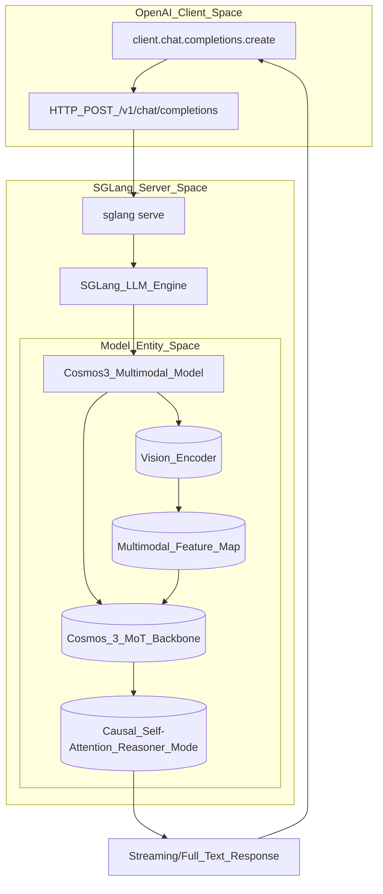
Sources: [cookbooks/cosmos3/reasoner/run_with_sglang.ipynb:178-185](), [cookbooks/cosmos3/reasoner/run_with_sglang.ipynb:223-230]()

### Server Launch
Launch the server using the `lmsysorg/sglang:dev` Docker image.

#### Cosmos3-Super (4 GPUs)
```bash
docker run -d --name cosmos3-reasoner-sglang \
  --runtime nvidia --gpus all \
  -e HF_HOME=/root/.cache/huggingface \
  -v "$SGLANG_HF_CACHE:/root/.cache/huggingface" \
  -v "$COSMOS_ROOT:$COSMOS_ROOT" \
  -p 8001:8000 --ipc=host \
  lmsysorg/sglang:dev \
  sglang serve \
    --model-type llm \
    --model-path nvidia/Cosmos3-Super \
    --tp-size 4 \
    --enable-multimodal \
    --host 0.0.0.0 \
    --port 8000
```
Sources: [cookbooks/cosmos3/reasoner/run_with_sglang.ipynb:219-230]()

### Readiness Polling
Similar to vLLM, SGLang servers can be polled for readiness via the `/health` endpoint.
```python
import requests
import time

def wait_for_server(url, timeout=3600):
    start_time = time.time()
    while True:
        try:
            response = requests.get(f"{url}/health")
            if response.status_code == 200:
                print("Server is ready.")
                break
        except requests.exceptions.ConnectionError:
            pass
        if time.time() - start_time > timeout:
            raise TimeoutError("Server did not become ready in time.")
        time.sleep(5)

wait_for_server("http://localhost:8001/v1")
```
Sources: [cookbooks/cosmos3/reasoner/run_with_sglang.ipynb:233-256]()

## 3. Reasoner with TensorRT-LLM

The TensorRT-LLM integration serves the Cosmos3 Reasoner through an OpenAI-compatible server using the `nvcr.io/nvidia/tensorrt-llm/release:1.3.0rc22` Docker image. It supports Cosmos3-Nano and Cosmos3-Super. [cookbooks/cosmos3/reasoner/run_with_tensorrt_llm.ipynb:8-19]()

### Server Architecture and Implementation
*   **Docker Image**: `nvcr.io/nvidia/tensorrt-llm/release:1.3.0rc22` or newer [cookbooks/cosmos3/reasoner/run_with_tensorrt_llm.ipynb:32-33]()
*   **Serving Command**: `trtllm-serve` [cookbooks/cosmos3/reasoner/run_with_tensorrt_llm.ipynb:167-167]()
*   **Parallelism**: Supports `--tensor_parallel_size` for Tensor Parallelism, e.g., `4` for Cosmos3-Super [cookbooks/cosmos3/reasoner/run_with_tensorrt_llm.ipynb:180-180](), [cookbooks/cosmos3/reasoner/run_with_tensorrt_llm.ipynb:219-219]()
*   **ModelOpt FP8**: TensorRT-LLM can leverage FP8 quantization for improved performance and reduced memory footprint. This is typically configured during model conversion to TensorRT-LLM engine format.

**Reasoner Request Pipeline (TensorRT-LLM)**
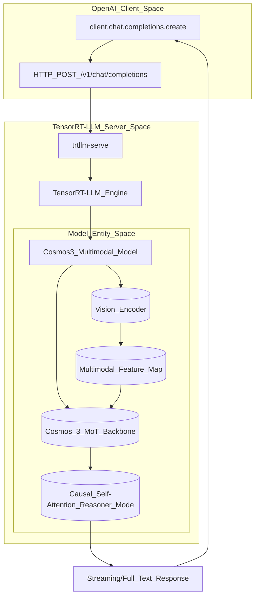
Sources: [cookbooks/cosmos3/reasoner/run_with_tensorrt_llm.ipynb:167-169](), [cookbooks/cosmos3/reasoner/run_with_tensorrt_llm.ipynb:219-221]()

### Server Launch
Launch the server using the specified TensorRT-LLM Docker image.

#### Cosmos3-Super (4 GPUs)
```bash
docker run -d --name cosmos3-reasoner-trtllm \
  --runtime nvidia --gpus all \
  --ulimit memlock=-1 --ulimit stack=67108864 \
  -e HF_HOME=/root/.cache/huggingface \
  -e HF_TOKEN \
  -v "$HOME/.cache/huggingface:/root/.cache/huggingface" \
  -v "$COSMOS_ROOT:$COSMOS_ROOT" \
  -p 8001:8000 --ipc=host \
  "$COSMOS3_TRTLLM_IMAGE" \
  bash -lc 'python -m pip install --no-cache-dir opencv-python-headless && \
    exec trtllm-serve nvidia/Cosmos3-Super \
      --host 0.0.0.0 --port 8000 \
      --tensor_parallel_size 4 \
      --max_num_tokens 32768'
```
Sources: [cookbooks/cosmos3/reasoner/run_with_tensorrt_llm.ipynb:210-222]()

### Readiness Polling
The TensorRT-LLM server also exposes a `/health` endpoint for readiness checks.
```python
import requests
import time

def wait_for_server(url, timeout=3600):
    start_time = time.time()
    while True:
        try:
            response = requests.get(f"{url}/health")
            if response.status_code == 200:
                print("Server is ready.")
                break
        except requests.exceptions.ConnectionError:
            pass
        if time.time() - start_time > timeout:
            raise TimeoutError("Server did not become ready in time.")
        time.sleep(5)

wait_for_server("http://localhost:8001/v1")
```
Sources: [cookbooks/cosmos3/reasoner/run_with_tensorrt_llm.ipynb:225-248]()

## 4. Reasoner with Transformers

The Hugging Face Transformers integration provides a Python-first path without requiring a separate server process. It uses the `Cosmos3OmniForConditionalGeneration` class for Nano/Super and `AutoModelForImageTextToText` (which resolves to `Cosmos3EdgeForConditionalGeneration`) for Edge models [cookbooks/cosmos3/reasoner/run_with_transformers.ipynb:23-29]().

### Implementation Details
*   **Classes**: `Cosmos3OmniForConditionalGeneration` for Nano/Super and `AutoModelForImageTextToText` for Edge [cookbooks/cosmos3/reasoner/run_with_transformers.ipynb:23-29]().
*   **Device Mapping**: Supports `device_map="auto"` for automatic model sharding across available GPUs.
*   **Chat Template**: Uses `processor.apply_chat_template` to format multimodal messages.

**Transformers Data Flow**
```mermaid
graph LR
    subgraph "Python_Process"
        INPUT["User Prompt + PIL Image/Video"]
        PROC["Cosmos3OmniProcessor.apply_chat_template"]
        MODEL["Cosmos3OmniForConditionalGeneration / AutoModelForImageTextToText"]
        OUT["Text Output"]
    end

    INPUT --> PROC
    PROC --> MODEL
    MODEL --> OUT
```
Sources: [cookbooks/cosmos3/reasoner/run_with_transformers.ipynb:23-29]()

## 5. Reasoner with NIM

NVIDIA NIM (NVIDIA Inference Microservice) offers a turnkey, optimized container for the Reasoner [cookbooks/cosmos3/reasoner/run_with_nim.ipynb:17-20]().

### Implementation and Media Ingestion
NIM containers are isolated from the host filesystem; local media must be converted to **base64 data URIs** [cookbooks/cosmos3/reasoner/run_with_nim.ipynb:84-94]().

**NIM Deployment Flow**
```mermaid
graph TD
    subgraph "Host_Environment"
        DOCKER["docker run --runtime=nvidia"]
        ENV["NGC_API_KEY / NIM_MODEL_SIZE"]
    end

    subgraph "NIM_Container"
        SERVER["OpenAI-Compatible API Server"]
        OPT["Optimized Inference Engine"]
    end

    subgraph "Client_Interaction"
        REQ["client.chat.completions.create"]
        B64["base64.b64encode(media)"]
    end

    DOCKER --> SERVER
    ENV --> SERVER
    B64 --> REQ
    REQ --> SERVER
    SERVER --> OPT
```
Sources: [cookbooks/cosmos3/reasoner/run_with_nim.ipynb:124-133](), [cookbooks/cosmos3/reasoner/README.md:143-163]()

### NIM Launch
```bash
docker run -d --rm --name="nvidia-cosmos3-reasoner" \
  --runtime=nvidia --gpus all \
  -e NGC_API_KEY="$NGC_API_KEY" \
  -e NIM_MODEL_SIZE="nano" \
  -p 8000:8000 \
  nvcr.io/nim/nvidia/cosmos3-reasoner:1.7.0
```
Sources: [cookbooks/cosmos3/reasoner/run_with_nim.ipynb:124-133]()

### Readiness Polling
The NIM server's readiness can be checked by polling the `/v1/health/ready` endpoint.
```python
import requests
import time

def wait_for_nim_server(port, container_name, timeout=3600):
    start_time = time.time()
    print(f"Waiting for NIM server on port {port} (first run downloads the model)...")
    while True:
        try:
            response = requests.get(f"http://127.0.0.1:{port}/v1/health/ready")
            if response.status_code == 200:
                print("NIM server is ready.")
                break
        except requests.exceptions.ConnectionError:
            pass
        # Check if container is still running
        # This part would typically involve a docker command to check container status
        # For simplicity, assuming the container is managed externally or will error out
        if time.time() - start_time > timeout:
            raise TimeoutError("NIM server did not become ready in time.")
        time.sleep(5)

wait_for_nim_server(8000, "nvidia-cosmos3-reasoner")
```
Sources: [cookbooks/cosmos3/reasoner/run_with_nim.ipynb:149-171]()

## 6. Supported Reasoning Tasks and Configuration

### Task Capabilities
*   **Detailed Captioning**: Image and video descriptions [cookbooks/cosmos3/reasoner/reasoner_prompt_guide.md:105-148]().
*   **2D Grounding**: Object detection using normalized `0-1000` coordinates `[x1, y1, x2, y2]` [cookbooks/cosmos3/reasoner/reasoner_prompt_guide.md:77-92]().
*   **Temporal Localization**: Identifying event segments with `start` and `end` timestamps [cookbooks/cosmos3/reasoner/reasoner_prompt_guide.md:149-177]().
*   **Action CoT**: Embodied reasoning for robotic trajectories [cookbooks/cosmos3/reasoner/reasoner_prompt_guide.md:231-255]().
*   **Physical Plausibility**: Analyzing common-sense physics in scenes [cookbooks/cosmos3/reasoner/reasoner_prompt_guide.md:257-281]().

### Sampling and Processor Configuration
For video reasoning, `mm_processor_kwargs` in the `extra_body` controls frame sampling [cookbooks/cosmos3/reasoner/reasoner_prompt_guide.md:29-33]().

| Backend | Media Ingestion | Configuration Method |
| :--- | :--- | :--- |
| **vLLM** | `file://` or `http://` | `--media-io-kwargs` CLI flag [cookbooks/cosmos3/reasoner/run_with_vllm.ipynb:122-122]() |
| **SGLang** | `file://` or `http://` | `--allowed-local-media-path` CLI flag |
| **TensorRT-LLM** | `file://` or `http://` | `--allowed-local-media-path` CLI flag |
| **Transformers** | PIL Objects / Tensors | `processor` kwargs |
| **NIM** | Base64 Data URIs | `extra_body` in API request |

Sources: [cookbooks/cosmos3/reasoner/reasoner_prompt_guide.md:7-33]()

---

# Page: Reasoner Prompt Guide

# Reasoner Prompt Guide

<details>
<summary>Relevant source files</summary>

The following files were used as context for generating this wiki page:

- [assets/brand/badge-website.svg](assets/brand/badge-website.svg)
- [assets/brand/cosmos-logo.png](assets/brand/cosmos-logo.png)
- [assets/demos/driving_sim_falling_rocks.gif](assets/demos/driving_sim_falling_rocks.gif)
- [assets/demos/fd_egocentric_repair_poses.gif](assets/demos/fd_egocentric_repair_poses.gif)
- [assets/demos/physics_newton_cradle.gif](assets/demos/physics_newton_cradle.gif)
- [assets/demos/policy_screwdriver.gif](assets/demos/policy_screwdriver.gif)
- [assets/demos/reasoner_driving_hazard.gif](assets/demos/reasoner_driving_hazard.gif)
- [assets/demos/transfer_worldscenario.gif](assets/demos/transfer_worldscenario.gif)
- [cookbooks/cosmos3/reasoner/assets/robot_153.jpg](cookbooks/cosmos3/reasoner/assets/robot_153.jpg)
- [cookbooks/cosmos3/reasoner/reasoner_prompt_guide.md](cookbooks/cosmos3/reasoner/reasoner_prompt_guide.md)
- [cookbooks/cosmos3/reasoner/run_with_nim.ipynb](cookbooks/cosmos3/reasoner/run_with_nim.ipynb)
- [docs/reference/models.md](docs/reference/models.md)

</details>


This page provides a technical reference for prompt engineering with the Cosmos3-Reasoner. It covers sampling parameters, system prompt configuration, chain-of-thought (CoT) reasoning toggles, coordinate conventions for grounding tasks, and detailed task examples.

## 1. Inference Configuration

The Cosmos3-Reasoner supports two primary modes of operation: standard response and reasoning-enabled response (Chain-of-Thought). These modes require different sampling parameters for optimal performance.

### Sampling Parameters
The following parameters are recommended for the `Cosmos3-Reasoner` model family [cookbooks/cosmos3/reasoner/reasoner_prompt_guide.md:7-27]():

| Parameter | Without Reasoning | With Reasoning |
| :--- | :--- | :--- |
| `top_p` | 0.8 | 0.95 |
| `top_k` | 20 | 20 |
| `repetition_penalty` | 1.0 | 1.0 |
| `presence_penalty` | 1.5 | 0.0 |
| `temperature` | 0.7 | 0.6 |

For video inputs, the model typically uses frame sampling. In vLLM-based implementations or when using the OpenAI-compatible API, this is configured via `extra_body` [cookbooks/cosmos3/reasoner/reasoner_prompt_guide.md:29-33]():
```python
extra_body={"mm_processor_kwargs": {"fps": 4, "do_sample_frames": True}}
```

### System Prompt
The standard system prompt for the reasoner is [cookbooks/cosmos3/reasoner/reasoner_prompt_guide.md:35-39]():
```text
You are a helpful assistant.
```

### Toggling Reasoning (Chain-of-Thought)
Reasoning is toggled via the user prompt rather than a model flag. To enable reasoning, append an instruction specifying the `

Write your final answer immediately after the </think> tag.
```

If reasoning is not required, omit the `
No.
```
[cookbooks/cosmos3/reasoner/reasoner_prompt_guide.md:362-384]()

**Sources:** [cookbooks/cosmos3/reasoner/reasoner_prompt_guide.md:351-384](), [assets/demos/driving_sim_falling_rocks.gif:1-33]()

### Action CoT (Embodied Reasoning)
Media:
[View video](assets/demos/policy_screwdriver.gif)

User Prompt:
```text
Given the video, provide a step-by-step plan for the robot to clear the table.
```
[cookbooks/cosmos3/reasoner/reasoner_prompt_guide.md:437-440]()

Model Answer:
```text

Here is a step-by-step plan for the robot to clear the table:

1.  **Perceive Objects:** The robot uses its vision system to identify all items present on the table.
2.  **Grasp and Remove Screwdriver:**
    *   The robot moves its arm and gripper to position itself over the screwdriver.
    *   It closes its gripper to firmly grasp the screwdriver.
    *   The robot lifts the screwdriver off the table surface.
    *   It then moves the screwdriver to a designated disposal area (e.g., off the table edge or into a bin).
    *   The gripper opens to release the screwdriver.
    *   The arm retracts to a safe, neutral position.
3.  **Grasp and Remove White Box:**
    *   The robot repositions its arm and gripper over the white box.
    *   It closes its gripper to grasp the white box.
    *   The robot lifts the white box from the table.
    *   It moves the white box to the designated disposal area.
    *   The gripper opens to release the white box.
    *   The arm retracts to a neutral position.
4.  **Process Remaining Objects:** The robot repeats steps similar to 2 and 3 for any other objects detected on the table until all items are removed.
5.  **Verify Clearance:** The robot performs a final visual scan of the table to confirm that it is completely clear of objects.
```
[cookbooks/cosmos3/reasoner/reasoner_prompt_guide.md:442-500]()

**Embodied Action Logic**
```mermaid
graph TD
    subgraph "Natural Language Space"
        I["Instruction: 'Move the block'"]
        V["Visual Context: 'Block is at [100, 200]'"]
    end

    subgraph "Code Entity Space"
        P["Prompt Template"]
        M["messages: role='user'"]
        S["System: 'You are a helpful assistant'"]
        T_CLS["Cosmos3ReasonerForConditionalGeneration"]
    end

    subgraph "Reasoning Logic"
        T["
Here is a step-by-step plan for the robot to clear the table:

1.  **Perceive Objects:** The robot uses its vision system to identify all items present on the table.
2.  **Grasp and Remove Screwdriver:**
    *   The robot moves its arm and gripper to position itself over the screwdriver.
    *   It closes its gripper to firmly grasp the screwdriver.
    *   The robot lifts the screwdriver off the table surface.
    *   It then moves the screwdriver to a designated disposal area (e.g., off the table edge or into a bin).
    *   The gripper opens to release the screwdriver.
    *   The arm retracts to a safe, neutral position.
3.  **Grasp and Remove White Box:**
    *   The robot repositions its arm and gripper over the white box.
    *   It closes its gripper to grasp the white box.
    *   The robot lifts the white box from the table.
    *   It moves the white box to the designated disposal area.
    *   The gripper opens to release the white box.
    *   The arm retracts to a neutral position.
4.  **Process Remaining Objects:** The robot repeats steps similar to 2 and 3 for any other objects detected on the table until all items are removed.
5.  **Verify Clearance:** The robot performs a final visual scan of the table to confirm that it is completely clear of objects.
```
[cookbooks/cosmos3/reasoner/reasoner_prompt_guide.md:442-500]()

**Sources:** [cookbooks/cosmos3/reasoner/reasoner_prompt_guide.md:437-500](), [assets/demos/transfer_worldscenario.gif:1-52]()

### Driving Hazard Detection
Media:
[View video](assets/demos/reasoner_driving_hazard.gif)

User Prompt:
```text
What are the potential hazards in this driving scenario?
```

Model Answer:
```text

The potential hazards in this driving scenario are:

1.  **Falling Rocks:** The most immediate and severe hazard is the continuous stream of rocks falling directly onto the road. These can cause significant damage to the vehicle, including the windshield, body, and tires.
2.  **Obstacles on Road:** The fallen rocks create new obstacles on the driving path, requiring the driver to take evasive action or risk collision.
3.  **Loss of Vehicle Control:** Sudden braking, swerving, or impacts from rocks can lead to the driver losing control of the vehicle, potentially resulting in a crash.
4.  **Collision Risk:** There is a high risk of collision with the falling rocks themselves, or with other (unseen) vehicles or roadside barriers if evasive maneuvers are performed.
5.  **Reduced Visibility:** If the falling rocks kick up dust or debris, visibility could be severely reduced, further increasing the risk of an accident.
```

**Sources:** [assets/demos/reasoner_driving_hazard.gif:1-45]()

---

## 5. Model Family and Capabilities

The Cosmos 3 model family includes several variants optimized for different deployment scenarios and capabilities. The Reasoner surface is available across all tiers.

**Cosmos 3 Model Family Overview**

| Base model | Size | Primary capability | Reasoner Support |
|---|---|---|---|
| [Cosmos3-Edge](https://huggingface.co/nvidia/Cosmos3-Edge) | 4B | Compact omnimodal world model for on-device and low-latency deployment | Yes |
| [Cosmos3-Nano](https://huggingface.co/nvidia/Cosmos3-Nano) | 16B | Omnimodal world model — understanding, simulation, prediction, action reasoning on a single GPU | Yes |
| [Cosmos3-Super](https://huggingface.co/nvidia/Cosmos3-Super) | 64B | Frontier-scale omnimodal world model | Yes |

**Sources:** [docs/reference/models.md:9-11]()

### Reasoner Workflows
The Reasoner surface supports a variety of visual reasoning tasks, as detailed in the table below.

**Reasoner Input/Output Workflows**

| Workflow | Input | Output |
| :--- | :--- | :--- |
| Visual reasoning | Text, MP4 video, image (JPG/PNG/JPEG/WEBP) | Text |
| Inverse dynamics | Text, video | Action |
| Action policy | Text, image, video | Action, video |

**Sources:** [docs/reference/models.md:50-53]()

---

# Page: Generator: Audiovisual Content Generation

# Generator: Audiovisual Content Generation

<details>
<summary>Relevant source files</summary>

The following files were used as context for generating this wiki page:

- [README.md](README.md)
- [cookbooks/cosmos3/README.md](cookbooks/cosmos3/README.md)
- [cookbooks/cosmos3/generator/audiovisual/README.md](cookbooks/cosmos3/generator/audiovisual/README.md)
- [cookbooks/cosmos3/generator/audiovisual/assets/prompts/image2video/car_driving_edge.json](cookbooks/cosmos3/generator/audiovisual/assets/prompts/image2video/car_driving_edge.json)
- [cookbooks/cosmos3/generator/audiovisual/run_with_cosmos_framework.ipynb](cookbooks/cosmos3/generator/audiovisual/run_with_cosmos_framework.ipynb)
- [cookbooks/cosmos3/generator/audiovisual/run_with_diffusers.ipynb](cookbooks/cosmos3/generator/audiovisual/run_with_diffusers.ipynb)
- [cookbooks/cosmos3/generator/audiovisual/run_with_vllm_omni.ipynb](cookbooks/cosmos3/generator/audiovisual/run_with_vllm_omni.ipynb)

</details>


The Cosmos 3 Generator surface provides high-fidelity synthesis of images, videos, and synchronized audio. It supports three primary generation modes: **Text-to-Image (T2I)**, **Text-to-Video (T2V)**, and **Image-to-Video (I2V)**. These capabilities are accessible across five distinct backends designed for research, local experimentation, and production serving.

### Generation Backends
Cosmos 3 offers flexibility in how generation is executed:
1.  **Cosmos Framework**: The native PyTorch implementation used for high-throughput distributed inference and research.
2.  **Diffusers**: Integration with the HuggingFace `diffusers` library for ease of use in local Python environments.
3.  **vLLM-Omni and SGLang**: High-performance serving backends for production-grade API deployments.
4.  **TensorRT-LLM and NIM**: Optimized inference engines for maximum throughput and turnkey containerized deployment.

### Logical Architecture to Code Mapping

The following diagram maps the high-level generation concepts to the specific classes and entry points within the codebase.

**Generator Backend Mapping**
```mermaid
graph TD
    subgraph "Input_Modalities"
        A["Text Prompt"]
        B["Input Image (I2V)"]
        C["Negative Prompt"]
        L["Control Signals (V2V)"]
    end

    subgraph "Cosmos_Framework_Native"
        D["cosmos_framework.scripts.inference"]
        E["create_payload"]
    end

    subgraph "Diffusers_HuggingFace"
        F["Cosmos3OmniPipeline"]
        G["UniPCMultistepScheduler"]
    end

    subgraph "vLLM-Omni_SGLang"
        H["Cosmos3OmniDiffusersPipeline"]
        I["POST /v1/videos/sync"]
        J["POST /v1/images/generations"]
    end

    subgraph "TRT-LLM_NIM"
        M["trtllm-serve"]
        N["POST /v1/infer"]
    end

    A & C & L --> D
    A & B & C --> F
    A & B & C --> I
    A & C --> J
    A & B --> N
    
    D --> |"torchrun"| K["Generated Media"]
    F --> |"pipe()"| K
    I & J --> |"Docker"| K
    M & N --> |"VisualGen"| K
```
**Sources:** [cookbooks/cosmos3/generator/audiovisual/README.md:29-181](), [cookbooks/cosmos3/generator/audiovisual/run_with_cosmos_framework.ipynb:19-21](), [cookbooks/cosmos3/generator/audiovisual/run_with_vllm_omni.ipynb:59-62](), [cookbooks/cosmos3/generator/audiovisual/run_with_trt_llm.ipynb:58-58]()

---

## Audiovisual Generation with Cosmos Framework

The Cosmos Framework backend is the native implementation designed for maximum performance and multi-GPU scalability. It uses a structured JSON payload to define generation parameters and is invoked via `torchrun` to handle distributed execution for larger models like `Cosmos3-Super`.

*   **Entry Point**: `cosmos_framework.scripts.inference` [cookbooks/cosmos3/generator/audiovisual/README.md:72-73]().
*   **Key Features**: Supports `model_mode` settings for `text2video` and `image2video`, resolution scaling, and synchronized audio generation via the `enable_sound` flag [cookbooks/cosmos3/generator/audiovisual/README.md:54-68]().
*   **Parallelism**: Automatically handles tensor parallelism and CFG parallelism based on the `--nproc-per-node` and `--parallelism-preset` arguments [cookbooks/cosmos3/generator/audiovisual/README.md:72-78]().

For details, see [Audiovisual Generation with Cosmos Framework](#4.1).

**Sources:** [cookbooks/cosmos3/generator/audiovisual/README.md:29-88](), [cookbooks/cosmos3/generator/audiovisual/run_with_cosmos_framework.ipynb:15-23]()

---

## Audiovisual Generation with Diffusers

The Diffusers backend provides a familiar interface for developers integrated into the HuggingFace ecosystem. It uses the `Cosmos3OmniPipeline` to load models from the `nvidia/Cosmos3-Nano` or `nvidia/Cosmos3-Super` repositories.

*   **Pipeline**: `Cosmos3OmniPipeline` [cookbooks/cosmos3/generator/audiovisual/README.md:115-124]().
*   **Scheduler**: Utilizes `UniPCMultistepScheduler` with a specialized `flow_shift` parameter (typically set to `10.0`) to manage the flow-matching generation process [cookbooks/cosmos3/generator/audiovisual/README.md:116-125]().
*   **Safety**: To disable the guardrail, set `enable_safety_checker=False` [cookbooks/cosmos3/generator/audiovisual/README.md:19-20]().

For details, see [Audiovisual Generation with Diffusers](#4.2).

**Sources:** [cookbooks/cosmos3/generator/audiovisual/README.md:105-154]()

---

## Audiovisual Generation with vLLM-Omni and SGLang

vLLM-Omni serves the Generator via an OpenAI-compatible API, making it suitable for production applications. It wraps the diffusion logic in a high-performance serving container.

*   **Container**: `vllm/vllm-omni:cosmos3` (Docker recommended) [cookbooks/cosmos3/generator/audiovisual/run_with_vllm_omni.ipynb:59-59]().
*   **Endpoints**:
    *   `POST /v1/videos/sync`: For T2V, I2V, and V2V generation [cookbooks/cosmos3/generator/audiovisual/README.md:177]().
    *   `POST /v1/images/generations`: For T2I generation [cookbooks/cosmos3/generator/audiovisual/run_with_vllm_omni.ipynb:30-30]().
*   **Optimization**: Supports `extra_params` for toggling `guardrails`, `use_resolution_template`, and `use_duration_template` [cookbooks/cosmos3/generator/audiovisual/README.md:188-194]().

For details, see [Audiovisual Generation with vLLM-Omni and SGLang](#4.3).

**Sources:** [cookbooks/cosmos3/generator/audiovisual/README.md:155-200](), [cookbooks/cosmos3/generator/audiovisual/run_with_vllm_omni.ipynb:47-66]()

---

## Audiovisual Generation with TensorRT-LLM and NIM

TensorRT-LLM provides highly optimized C++ inference for Cosmos 3, supporting multi-GPU configurations and Ulysses sequence parallelism.

*   **TRT-LLM Serve**: Invoked via `trtllm-serve` or `tensorrt_llm.commands.serve` [cookbooks/cosmos3/generator/audiovisual/run_with_trt_llm.ipynb:58-68]().
*   **NIM Container**: A turnkey solution for deploying Cosmos 3 via a `POST /v1/infer` endpoint, returning base64-encoded video [cookbooks/cosmos3/generator/audiovisual/README.md:8-10]().
*   **Configuration**: Uses YAML files to define `cfg_size`, `ulysses_size`, and `parallel_vae_size` for multi-GPU scaling [cookbooks/cosmos3/generator/audiovisual/run_with_trt_llm.ipynb:63-68]().

For details, see [Audiovisual Generation with TensorRT-LLM](#4.4).

**Sources:** [cookbooks/cosmos3/generator/audiovisual/README.md:8-27](), [cookbooks/cosmos3/generator/audiovisual/run_with_trt_llm.ipynb:16-71]()

---

## Video Transfer (Controlled Generation)

Cosmos3 supports controlled generation (Video-to-Video or Video Transfer) via the Cosmos Framework and vLLM-Omni. This allows generating target video clips from precomputed control signals paired with text prompts.

*   **Mode**: Set `model_mode: video2video` in the inference spec [cookbooks/cosmos3/generator/transfer/run_video_transfer_with_vllm_omni.ipynb:167-167]().
*   **Control Types**: Supports Edge/Canny, Blur, Depth, Segmentation (Seg), and World Scenario Map (WSM) [cookbooks/cosmos3/generator/transfer/run_video_transfer_with_vllm_omni.ipynb:166-166]().
*   **Multi-Control**: Supports blending multiple control signals with per-hint weights (Cosmos Framework only) [cookbooks/cosmos3/generator/transfer/run_video_transfer_with_vllm_omni.ipynb:19-19]().

For details, see [Video Transfer (Controlled Generation)](#4.5).

**Sources:** [cookbooks/cosmos3/generator/transfer/run_video_transfer_with_vllm_omni.ipynb:15-22](), [cookbooks/cosmos3/generator/transfer/run_video_transfer_with_vllm_omni.ipynb:166-190]()

---

### Request Flow and Entity Association

This diagram illustrates how a request traverses the system from a user-defined prompt to the internal model classes.

**Generator Entity Association**
```mermaid
graph LR
    subgraph "User_Space"
        P["Prompt JSON"]
        I["Input Image"]
        C["Control Map"]
    end

    subgraph "API_Entry_Space"
        V["vLLM Serve /v1/videos/sync"]
        TR["torchrun -m cosmos_framework.scripts.inference"]
        TS["trtllm-serve"]
    end

    subgraph "Model_Code_Entity_Space"
        CO["Cosmos3OmniDiffusersPipeline"]
        CS["Cosmos3-Super / Nano / Edge"]
        CF["cosmos_framework.scripts.inference"]
        TV["VisualGen Engine"]
    end

    P --> V
    P --> TR
    P --> TS
    I -.->|Optional I2V| V
    C -.->|Optional V2V| V
    
    V --> CO
    TR --> CF
    TS --> TV
    CO --> CS
    CF --> CS
    TV --> CS
```
**Sources:** [cookbooks/cosmos3/generator/audiovisual/README.md:72-78](), [cookbooks/cosmos3/generator/audiovisual/README.md:176-194](), [cookbooks/cosmos3/generator/audiovisual/run_with_trt_llm.ipynb:58-68]()

---

# Page: Audiovisual Generation with Cosmos Framework

# Audiovisual Generation with Cosmos Framework

<details>
<summary>Relevant source files</summary>

The following files were used as context for generating this wiki page:

- [cookbooks/cosmos3/generator/audiovisual/assets/negative_prompts/image2video/neg_prompt.json](cookbooks/cosmos3/generator/audiovisual/assets/negative_prompts/image2video/neg_prompt.json)
- [cookbooks/cosmos3/generator/audiovisual/assets/negative_prompts/text2video/neg_prompt.json](cookbooks/cosmos3/generator/audiovisual/assets/negative_prompts/text2video/neg_prompt.json)
- [cookbooks/cosmos3/generator/audiovisual/assets/prompts/image2video/car_driving_edge.json](cookbooks/cosmos3/generator/audiovisual/assets/prompts/image2video/car_driving_edge.json)
- [cookbooks/cosmos3/generator/audiovisual/run_distilled_with_trt_llm.ipynb](cookbooks/cosmos3/generator/audiovisual/run_distilled_with_trt_llm.ipynb)
- [cookbooks/cosmos3/generator/audiovisual/run_with_cosmos_framework.ipynb](cookbooks/cosmos3/generator/audiovisual/run_with_cosmos_framework.ipynb)
- [cookbooks/cosmos3/generator/audiovisual/run_with_diffusers.ipynb](cookbooks/cosmos3/generator/audiovisual/run_with_diffusers.ipynb)
- [cookbooks/cosmos3/generator/audiovisual/run_with_vllm_omni.ipynb](cookbooks/cosmos3/generator/audiovisual/run_with_vllm_omni.ipynb)

</details>


The Cosmos Framework provides a native PyTorch execution environment for performing high-fidelity audiovisual generation. Using the `cosmos_framework.scripts.inference` module, users can generate images, videos, and synchronized audio from text or image prompts. This interface is designed for research and development, supporting multi-GPU execution through `torchrun` to accommodate **Cosmos3-Nano**, **Cosmos3-Super**, and **Cosmos3-Edge** models.

## Execution via Cosmos Framework

The primary entry point for generation is the `cosmos_framework.scripts.inference` module [cookbooks/cosmos3/generator/audiovisual/run_with_cosmos_framework.ipynb:19-21](). It leverages `torchrun` to manage distributed processes, which is required for the larger Super models or when using tensor parallelism to reduce latency [cookbooks/cosmos3/generator/audiovisual/README.md:72-73]().

### Basic Command Structure
To run a generation, a JSON payload must be constructed and passed to the script via the `-i` (input) flag. The `--parallelism-preset` flag is used to automatically configure distributed settings [cookbooks/cosmos3/generator/audiovisual/README.md:74-75]().

```bash
torchrun --nproc-per-node=<NUM_GPUS> \
  -m cosmos_framework.scripts.inference \
  --parallelism-preset=throughput \
  -i /path/to/payload.json \
  -o /path/to/output_dir \
  --checkpoint-path <MODEL_NAME_OR_PATH> \
  --seed=0
```

For **Cosmos3-Super**, users should increase `--nproc-per-node` to leverage multi-GPU parallelism [cookbooks/cosmos3/generator/audiovisual/README.md:81-82]().

Sources: [cookbooks/cosmos3/generator/audiovisual/README.md:72-82](), [cookbooks/cosmos3/generator/audiovisual/run_with_cosmos_framework.ipynb:19-21]()

## JSON Payload Schema

The generation process is governed by a JSON payload that defines the task, model behavior, and output characteristics. This payload is typically constructed by loading prompt assets from the `assets/` directory and wrapping them in a task-specific dictionary [cookbooks/cosmos3/generator/audiovisual/README.md:40-70]().

### Schema Fields
| Field | Type | Description |
| :--- | :--- | :--- |
| `model_mode` | String | The generation task: `text2image`, `text2video`, or `image2video` [cookbooks/cosmos3/generator/audiovisual/README.md:55](). |
| `prompt` | String | A JSON-stringified representation of the prompt asset [cookbooks/cosmos3/generator/audiovisual/README.md:44-48](). |
| `negative_prompt` | String | A JSON-stringified negative prompt asset [cookbooks/cosmos3/generator/audiovisual/README.md:49-53](). |
| `num_steps` | Integer | Number of diffusion sampling steps (e.g., 35) [cookbooks/cosmos3/generator/audiovisual/README.md:60](). |
| `guidance` | Float | Classifier-free guidance (CFG) scale (e.g., 6.0) [cookbooks/cosmos3/generator/audiovisual/README.md:61](). |
| `shift` | Float | Flow matching shift parameter (e.g., 10.0) [cookbooks/cosmos3/generator/audiovisual/README.md:62](). |
| `fps` | Integer | Frames per second for video generation [cookbooks/cosmos3/generator/audiovisual/README.md:63](). |
| `num_frames` | Integer | Total number of frames (e.g., 189 for video) [cookbooks/cosmos3/generator/audiovisual/README.md:64](). |
| `resolution` | String | Vertical resolution (e.g., "720") [cookbooks/cosmos3/generator/audiovisual/README.md:65](). |
| `aspect_ratio` | String | Target aspect ratio (e.g., "16,9") [cookbooks/cosmos3/generator/audiovisual/README.md:66](). |
| `enable_sound` | Boolean | Whether to generate a synchronized audio track [cookbooks/cosmos3/generator/audiovisual/README.md:59](). |

### Frame Cadence Constraints
Cosmos 3 Generator models follow a **4k+1** frame cadence constraint (e.g., 1, 121, 189 frames). **Cosmos3-Edge** is optimized for lower resource settings and typically uses `"num_frames": 121` at `"resolution": "480"` [cookbooks/cosmos3/generator/audiovisual/README.md:84-87]().

Sources: [cookbooks/cosmos3/generator/audiovisual/README.md:40-70](), [cookbooks/cosmos3/generator/audiovisual/README.md:84-87]()

## Data Flow: From Prompt to Media

The generation pipeline transforms structured JSON prompts into high-dimensional latent representations, which are then decoded into pixels and audio waveforms.

### Natural Language to Code Entity Mapping
This diagram bridges the conceptual "Natural Language Space" (prompts) to the "Code Entity Space" (the Framework's inference script).

**Prompt to Script Association**
```mermaid
graph TD
    subgraph "Natural Language Space (Assets)"
        A["Prompt JSON Asset"] -->|Loaded by| B["Python create_payload logic"]
        C["Negative Prompt Asset"] -->|Loaded by| B
    end

    subgraph "Code Entity Space (cosmos_framework)"
        B -->|JSON Stringify| D["payload dict"]
        D -->|Write to File| E["/tmp/cosmos3_t2v_payload.json"]
        E -->|"-i Argument"| F["cosmos_framework.scripts.inference"]
        F -->|Loads| G["--checkpoint-path"]
        F -->|Executes| H["Diffusion Sampling Loop"]
        H -->|Output| I["Generated Media (.mp4 / .png)"]
    end
```

Sources: [cookbooks/cosmos3/generator/audiovisual/README.md:40-79](), [cookbooks/cosmos3/generator/audiovisual/run_with_cosmos_framework.ipynb:19-21]()

## Asset Directory Structure

The framework expects prompt assets to be organized by task. These assets are detailed JSON files containing subject descriptions, lighting, aesthetics, and cinematography details [cookbooks/cosmos3/generator/audiovisual/README.md:6]().

```text
assets/
├── prompts/
│   ├── text2image/
│   ├── text2video/
│   │   └── robot_kitchen.json
│   └── image2video/
│       └── car_driving_edge.json
└── negative_prompts/
    ├── text2video/
    │   └── neg_prompt.json
    └── image2video/
        └── neg_prompt.json
```

Sources: [cookbooks/cosmos3/generator/audiovisual/README.md:6](), [cookbooks/cosmos3/generator/audiovisual/README.md:45](), [cookbooks/cosmos3/generator/audiovisual/README.md:50](), [cookbooks/cosmos3/generator/audiovisual/assets/prompts/image2video/car_driving_edge.json:1-124](), [cookbooks/cosmos3/generator/audiovisual/assets/negative_prompts/image2video/neg_prompt.json:1-63](), [cookbooks/cosmos3/generator/audiovisual/assets/negative_prompts/text2video/neg_prompt.json:1-63]()

## Multi-GPU Execution and Parallelism

The Cosmos Framework uses `torchrun` to scale generation across multiple GPUs. This is critical for **Cosmos3-Super**, which typically requires higher memory and compute than a single GPU can provide [cookbooks/cosmos3/generator/audiovisual/README.md:81-82]().

### Component Interaction
The following diagram illustrates how the `inference` script interacts with system resources and the model weights.

**Inference Execution Flow**
```mermaid
graph LR
    subgraph "Distributed Runtime"
        TR["torchrun"] -->|Spawns| P1["Process 0 (Master)"]
        TR -->|Spawns| P2["Process 1..N"]
    end

    subgraph "cosmos_framework.scripts.inference"
        P1 -->|Reads| CFG["--parallelism-preset"]
        P1 -->|Parses| IN["Input Payload JSON"]
        CFG -->|Sets| TP["Tensor Parallelism"]
        IN -->|Configures| SL["Sampling Loop"]
    end

    subgraph "Hardware & Assets"
        SL -->|Load Weights| CP["--checkpoint-path"]
        SL -->|Compute| GPU["NVIDIA GPUs"]
        SL -->|Save| OUT["-o Output Directory"]
    end
```

Sources: [cookbooks/cosmos3/generator/audiovisual/README.md:72-82](), [cookbooks/cosmos3/generator/audiovisual/run_with_cosmos_framework.ipynb:108-121]()

## Implementation Details

### Key Functions and Modules
- **Payload Construction**: The notebook provides a factory pattern where raw prompt assets are loaded and assembled into the required `payload` dictionary with task-specific parameters [cookbooks/cosmos3/generator/audiovisual/README.md:40-70]().
- **`cosmos_framework.scripts.inference`**: The main module that initializes the distributed environment, loads the model into the specified parallelism configuration, and runs the diffusion sampling [cookbooks/cosmos3/generator/audiovisual/README.md:73]().
- **`--parallelism-preset`**: A CLI flag that automatically configures tensor parallelism and other distributed settings based on the available GPU count (e.g., `throughput`) [cookbooks/cosmos3/generator/audiovisual/README.md:74]().

### Guardrails
The Generator requires a safety checker. By default, it is enabled. To disable the guardrail in the Cosmos Framework, the `--no-guardrails` flag must be passed to the inference script [cookbooks/cosmos3/generator/audiovisual/README.md:23]().

Sources: [cookbooks/cosmos3/generator/audiovisual/README.md:17-23](), [cookbooks/cosmos3/generator/audiovisual/README.md:72-82](), [cookbooks/cosmos3/generator/audiovisual/run_with_cosmos_framework.ipynb:19-21]()

---

# Page: Audiovisual Generation with Diffusers

# Audiovisual Generation with Diffusers

<details>
<summary>Relevant source files</summary>

The following files were used as context for generating this wiki page:

- [cookbooks/cosmos3/generator/audiovisual/assets/prompts/image2video/car_driving_edge.json](cookbooks/cosmos3/generator/audiovisual/assets/prompts/image2video/car_driving_edge.json)
- [cookbooks/cosmos3/generator/audiovisual/run_with_cosmos_framework.ipynb](cookbooks/cosmos3/generator/audiovisual/run_with_cosmos_framework.ipynb)
- [cookbooks/cosmos3/generator/audiovisual/run_with_diffusers.ipynb](cookbooks/cosmos3/generator/audiovisual/run_with_diffusers.ipynb)
- [cookbooks/cosmos3/generator/audiovisual/run_with_vllm_omni.ipynb](cookbooks/cosmos3/generator/audiovisual/run_with_vllm_omni.ipynb)

</details>


The Cosmos 3 Generator surface supports high-fidelity image, video, and synchronized audio generation through the HuggingFace `diffusers` library. This integration path is optimized for local inference, providing a high-level API via the `Cosmos3OmniPipeline` to interact with `Cosmos3-Nano`, `Cosmos3-Super`, and `Cosmos3-Edge` models [cookbooks/cosmos3/generator/audiovisual/run_with_diffusers.ipynb:18-20]().

### Pipeline Architecture and Loading

The `Cosmos3OmniPipeline` serves as the unified entry point for text-to-image (T2I), text-to-video (T2V), and image-to-video (I2V) tasks. It manages the loading of the Mixture-of-Transformers (MoT) backbone, the VAE, and the text encoders [cookbooks/cosmos3/generator/audiovisual/run_with_diffusers.ipynb:18-20]().

#### Model Variants
The pipeline can be initialized from the primary checkpoints published by NVIDIA:
*   **nvidia/Cosmos3-Nano**: A 16B parameter model optimized for lower VRAM environments [cookbooks/cosmos3/generator/audiovisual/run_with_diffusers.ipynb:20-20]().
*   **nvidia/Cosmos3-Super**: The 64B parameter model for maximum quality, loaded via the same pipeline class [cookbooks/cosmos3/generator/audiovisual/run_with_diffusers.ipynb:20-20]().
*   **nvidia/Cosmos3-Edge**: A 4B parameter model designed for edge devices. Note that Edge models do not support audio generation and use 480p generation settings [cookbooks/cosmos3/generator/audiovisual/run_with_diffusers.ipynb:20-20]().

#### System Dependencies
Running the pipeline on headless servers requires specific system graphics libraries to handle media processing and avoid `libxcb.so.1` errors during pipeline import:
*   `libxcb1`, `libgl1`, and `libglib2.0-0` are required system packages [cookbooks/cosmos3/generator/audiovisual/run_with_diffusers.ipynb:34-38]().
*   The `cosmos_guardrail` package is a mandatory safety dependency for content filtering. Request access to the gated [nvidia/Cosmos-1.0-Guardrail](https://huggingface.co/nvidia/Cosmos-1.0-Guardrail) HF repository before running these examples [cookbooks/cosmos3/generator/audiovisual/run_with_diffusers.ipynb:31-32](). Safety filtering can be toggled via the `enable_safety_checker=False` parameter in the pipeline call [cookbooks/cosmos3/generator/audiovisual/run_with_diffusers.ipynb:32-32]().

**Diagram: Diffusers Pipeline Initialization Flow**
This diagram maps the high-level `from_pretrained` call to the underlying components loaded into the `Cosmos3OmniPipeline`.

```mermaid
graph TD
    subgraph "HuggingFace Hub (Model Space)"
        Nano_Model["nvidia/Cosmos3-Nano"]
        Super_Model["nvidia/Cosmos3-Super"]
        Edge_Model["nvidia/Cosmos3-Edge"]
        Guardrail_Model["nvidia/Cosmos-1.0-Guardrail"]
    end

    subgraph "Cosmos3OmniPipeline (Code Space)"
        Pipeline_Class["Cosmos3OmniPipeline"]
        Backbone_Component["Transformer Backbone (MoT)"]
        Scheduler_Component["UniPCMultistepScheduler"]
        VAE_Component["Discrete VAE"]
        Safety_Guard["cosmos_guardrail"]
    end

    Nano_Model --> Pipeline_Class
    Super_Model --> Pipeline_Class
    Edge_Model --> Pipeline_Class
    Guardrail_Model --> Safety_Guard
    Pipeline_Class --> Backbone_Component
    Pipeline_Class --> VAE_Component
    Pipeline_Class --> Scheduler_Component
    Pipeline_Class --> Safety_Guard
```
Sources: [cookbooks/cosmos3/generator/audiovisual/run_with_diffusers.ipynb:18-20](), [cookbooks/cosmos3/generator/audiovisual/run_with_diffusers.ipynb:31-32](), [cookbooks/cosmos3/generator/audiovisual/run_with_diffusers.ipynb:151-151]()

---

### Scheduler Configuration

Cosmos 3 utilizes a flow-matching formulation. In the `diffusers` implementation, the `UniPCMultistepScheduler` is used to manage the sampling process. A critical parameter for generation quality is the `flow_shift`, which adjusts the noise schedule to better handle different resolutions and temporal lengths.

The scheduler is typically initialized from the pipeline's existing configuration with a `flow_shift` of `10.0` [cookbooks/cosmos3/generator/audiovisual/run_with_diffusers.ipynb:169-170]().

Sources: [cookbooks/cosmos3/generator/audiovisual/run_with_diffusers.ipynb:169-170]()

---

### Inference Execution

The pipeline's `__call__` method accepts parameters that define the modality and quality of the output.

#### Key Parameters
| Parameter | Description |
| :--- | :--- |
| `prompt` | JSON-encoded string containing the text description [cookbooks/cosmos3/generator/audiovisual/run_with_diffusers.ipynb:1000-1000]() |
| `negative_prompt` | JSON-encoded string for features to avoid [cookbooks/cosmos3/generator/audiovisual/run_with_diffusers.ipynb:1001-1001]() |
| `image` | A `PIL.Image` or `torch.Tensor` used as conditioning for I2V. Set to `None` for T2V/T2I [cookbooks/cosmos3/generator/audiovisual/run_with_diffusers.ipynb:1002-1002]() |
| `num_frames` | Total frames to generate. Use `1` for images, `189` for standard video [cookbooks/cosmos3/generator/audiovisual/run_with_diffusers.ipynb:1003-1003]() |
| `num_inference_steps` | Number of denoising steps (typically `35`) [cookbooks/cosmos3/generator/audiovisual/run_with_diffusers.ipynb:1007-1007]() |
| `guidance_scale` | Classifier-free guidance scale (typically `6.0`) [cookbooks/cosmos3/generator/audiovisual/run_with_diffusers.ipynb:1008-1008]() |
| `enable_sound` | Boolean flag to trigger synchronized audio generation. Must be `False` for Edge models [cookbooks/cosmos3/generator/audiovisual/run_with_diffusers.ipynb:1009-1009]() |

#### Implementation Example (T2V)
The following code snippet demonstrates the standard call pattern for generating video with the `Cosmos3OmniPipeline` [cookbooks/cosmos3/generator/audiovisual/run_with_diffusers.ipynb:998-1012]().

```python
result = pipe(
    prompt=json.dumps(prompt),
    negative_prompt=json.dumps(negative),
    image=None,
    num_frames=189,
    height=720,
    width=1280,
    fps=24,
    num_inference_steps=35,
    guidance_scale=6.0,
    enable_sound=False,
    add_resolution_template=False,
    add_duration_template=False,
    generator=torch.Generator(device="cuda").manual_seed(1234),
)
```

**Diagram: Data Flow from Call to Output**
This diagram bridges the user-provided parameters to the internal processing and final media export.

```mermaid
graph LR
    subgraph "Input Parameters (User Space)"
        Input_Prompt["prompt (JSON)"]
        Input_Image["image (Conditioning)"]
        Input_Sound["enable_sound (Bool)"]
        Input_Frames["num_frames (Int)"]
        Input_Steps["num_inference_steps (Int)"]
        Input_Guidance["guidance_scale (Float)"]
    end

    subgraph "Cosmos3OmniPipeline.__call__ (Code Space)"
        Encoder_Func["Text/Vision Encoding"]
        Denoise_Loop["Denoising (UniPCMultistepScheduler)"]
        VAE_Decode["VAE Decoding"]
        Audio_Synth["Audio Synthesis (if enabled)"]
        Safety_Check["cosmos_guardrail (Safety Check)"]
    end

    subgraph "Output Media (Artifact Space)"
        Video_Tensor["result.video"]
        Audio_Tensor["result.audio"]
        Export_Func["export_to_video()"]
    end

    Input_Prompt --> Encoder_Func
    Input_Image --> Encoder_Func
    Encoder_Func --> Denoise_Loop
    Input_Frames --> Denoise_Loop
    Input_Steps --> Denoise_Loop
    Input_Guidance --> Denoise_Loop
    Denoise_Loop --> VAE_Decode
    Input_Sound --> Audio_Synth
    VAE_Decode --> Video_Tensor
    Audio_Synth --> Audio_Tensor
    Video_Tensor --> Safety_Check
    Audio_Tensor --> Safety_Check
    Safety_Check --> Export_Func
```
Sources: [cookbooks/cosmos3/generator/audiovisual/run_with_diffusers.ipynb:998-1012]()

---

### Environment and Hardware Requirements

Local inference with Diffusers requires a specific environment setup to ensure compatibility with the model's tensor formats and CUDA requirements.

*   **Python Version**: Python 3.13 is the standard for the Diffusers integration in the provided cookbooks [cookbooks/cosmos3/generator/audiovisual/run_with_diffusers.ipynb:145-145]().
*   **CUDA Backends**: Supports `cu128` or `cu130` via the `uv pip install --torch-backend` flag [cookbooks/cosmos3/generator/audiovisual/run_with_diffusers.ipynb:147-147]().
*   **Memory Management**: For `Cosmos3-Super`, users should utilize `device_map="cuda"` for automatic placement or manual device management if multiple GPUs are available.
*   **Tooling**: The `uv` package manager is used for dependency management, requiring version `>= 0.11.3` to support the required torch backends and project configurations [cookbooks/cosmos3/generator/audiovisual/run_with_diffusers.ipynb:40-40]().

Sources: [cookbooks/cosmos3/generator/audiovisual/run_with_diffusers.ipynb:48-58](), [cookbooks/cosmos3/generator/audiovisual/run_with_diffusers.ipynb:143-162]()

---

# Page: Audiovisual Generation with vLLM-Omni and SGLang

# Audiovisual Generation with vLLM-Omni and SGLang

<details>
<summary>Relevant source files</summary>

The following files were used as context for generating this wiki page:

- [cookbooks/cosmos3/generator/action/run_id_with_sglang.ipynb](cookbooks/cosmos3/generator/action/run_id_with_sglang.ipynb)
- [cookbooks/cosmos3/generator/action/run_id_with_vllm_omni.ipynb](cookbooks/cosmos3/generator/action/run_id_with_vllm_omni.ipynb)
- [cookbooks/cosmos3/generator/action/run_policy_with_sglang.ipynb](cookbooks/cosmos3/generator/action/run_policy_with_sglang.ipynb)
- [cookbooks/cosmos3/generator/action/run_policy_with_vllm_omni.ipynb](cookbooks/cosmos3/generator/action/run_policy_with_vllm_omni.ipynb)
- [cookbooks/cosmos3/generator/audiovisual/assets/prompts/image2video/car_driving_edge.json](cookbooks/cosmos3/generator/audiovisual/assets/prompts/image2video/car_driving_edge.json)
- [cookbooks/cosmos3/generator/audiovisual/assets/videos/car_driving_plain.mp4](cookbooks/cosmos3/generator/audiovisual/assets/videos/car_driving_plain.mp4)
- [cookbooks/cosmos3/generator/audiovisual/run_with_cosmos_framework.ipynb](cookbooks/cosmos3/generator/audiovisual/run_with_cosmos_framework.ipynb)
- [cookbooks/cosmos3/generator/audiovisual/run_with_diffusers.ipynb](cookbooks/cosmos3/generator/audiovisual/run_with_diffusers.ipynb)
- [cookbooks/cosmos3/generator/audiovisual/run_with_sglang.ipynb](cookbooks/cosmos3/generator/audiovisual/run_with_sglang.ipynb)
- [cookbooks/cosmos3/generator/audiovisual/run_with_vllm_omni.ipynb](cookbooks/cosmos3/generator/audiovisual/run_with_vllm_omni.ipynb)

</details>


The vLLM-Omni and SGLang integrations provide high-performance, production-ready serving solutions for the NVIDIA Cosmos 3 Generator. These backends utilize specialized Docker environments to expose OpenAI-compatible endpoints for synchronized audiovisual generation, supporting advanced features like tensor parallelism for Super models, CFG parallelism, and video-to-video (V2V) conditioning.

## 1. Serving with vLLM-Omni

vLLM-Omni serves the Generator via the `vllm/vllm-omni:cosmos3` Docker container [cookbooks/cosmos3/generator/audiovisual/run_with_vllm_omni.ipynb:57-59](). It leverages the `Cosmos3OmniDiffusersPipeline` to handle the multimodal generation logic, including synchronized audio [cookbooks/cosmos3/generator/audiovisual/run_with_vllm_omni.ipynb:62-62]().

### Server Deployment and Configuration
When launching the server, several CLI arguments are critical for performance and stability:

*   `--model-class-name Cosmos3OmniDiffusersPipeline`: Specifies the specialized pipeline for Cosmos 3 generation tasks [cookbooks/cosmos3/generator/audiovisual/run_with_vllm_omni.ipynb:62-62]().
*   `--init-timeout 1800`: Required to prevent timeouts during the extensive initialization of large model weights (e.g., the 64B Super model) [cookbooks/cosmos3/generator/audiovisual/run_with_vllm_omni.ipynb:65-65]().
*   `--allowed-local-media-path /`: Enables the server to access local file system assets for Image-to-Video (I2V) and Video-to-Video (V2V) tasks [cookbooks/cosmos3/generator/audiovisual/run_with_vllm_omni.ipynb:63-63]().
*   `--tensor-parallel-size`: Shards model weights across multiple GPUs. For `Cosmos3-Super`, this is often required to fit the model in VRAM [cookbooks/cosmos3/generator/audiovisual/run_with_vllm_omni.ipynb:102-102]().
*   `--enable-layerwise-offload`: Further reduces peak GPU memory by offloading transformer blocks to CPU RAM during the forward pass [cookbooks/cosmos3/generator/audiovisual/run_with_vllm_omni.ipynb:103-103]().

### Parallelism Strategy
vLLM-Omni supports Classifier-Free Guidance (CFG) parallelism via `--cfg-parallel-size 2`, which processes the positive and negative prompt branches simultaneously on separate GPUs [cookbooks/cosmos3/generator/audiovisual/run_with_vllm_omni.ipynb:155-159](). In this mode, the CFG strength is controlled via the request-level `guidance_scale` field [cookbooks/cosmos3/generator/audiovisual/run_with_vllm_omni.ipynb:161-161]().

**vLLM-Omni Generator Request Flow**
The following diagram illustrates the data flow from a client request through the vLLM-Omni server components.

Title: "vLLM-Omni Generator Request Flow"
```mermaid
graph TD
    subgraph "ClientSpace"
        A["HTTP Client"]
    end

    subgraph "vLLM-Omni Container"
        B["FastAPI /v1/videos/sync"]
        C["Cosmos3OmniDiffusersPipeline"]
        D["Transformer Backbone"]
        E["VAE / Audio Decoder"]
    end

    A -->|"POST (form-data)"| B
    B -->|"extra_params"| C
    C -->|"Denoising Loops"| D
    D -->|"Latents"| E
    E -->|"MP4/WAV"| B
    B -->|"Binary Stream"| A
```
Sources: [cookbooks/cosmos3/generator/audiovisual/run_with_vllm_omni.ipynb:53-122]()

---

## 2. Serving with SGLang

SGLang provides an OpenAI-compatible serving layer for Cosmos 3, using the `lmsysorg/sglang:dev` container [cookbooks/cosmos3/generator/audiovisual/run_with_sglang.ipynb:67-67](). It is particularly suited for tasks requiring standard API compatibility and handles both audiovisual generation and action modeling (Forward/Inverse Dynamics and Policy).

### Deployment Options
*   **Standard Serving**: Launched via `sglang serve --model-path nvidia/Cosmos3-Nano` [cookbooks/cosmos3/generator/audiovisual/run_with_sglang.ipynb:68-70]().
*   **Memory Optimization**: For Super models, use `--performance-mode memory` and `--num-gpus` for tensor parallelism [cookbooks/cosmos3/generator/audiovisual/run_with_sglang.ipynb:89-90]().
*   **CFG Parallelism**: Enabled via `--enable-cfg-parallel --cfg-parallel-size 2` [cookbooks/cosmos3/generator/audiovisual/run_with_sglang.ipynb:102-103]().

### SGLang Generator Request Flow
The following diagram illustrates the data flow from a client request through the SGLang server components.

Title: "SGLang Generator Request Flow"
```mermaid
graph TD
    subgraph "ClientSpace"
        A["HTTP Client"]
    end

    subgraph "SGLang Container"
        B["FastAPI /v1/videos"]
        C["SGLang Model (e.g., Cosmos3-Nano)"]
        D["Transformer Backbone"]
        E["VAE / Audio Decoder"]
    end

    A -->|"POST (form-data)"| B
    B -->|"extra_params"| C
    C -->|"Denoising Loops"| D
    D -->|"Latents"| E
    E -->|"MP4/WAV"| B
    B -->|"Binary Stream"| A
```
Sources: [cookbooks/cosmos3/generator/audiovisual/run_with_sglang.ipynb:67-134]()

---

## 3. API Endpoints and Request Formats

Both backends accept `multipart/form-data` to accommodate media uploads and complex parameter structures.

### Video Generation (`POST /v1/videos/sync` or `/v1/videos`)
Used for T2V, I2V, and V2V. vLLM-Omni uses `/v1/videos/sync` [cookbooks/cosmos3/generator/audiovisual/run_with_vllm_omni.ipynb:30-30](), while SGLang uses `/v1/videos` [cookbooks/cosmos3/generator/audiovisual/run_with_sglang.ipynb:31-31]().

| Parameter | Type | Description |
| :--- | :--- | :--- |
| `prompt` | String | The text prompt for generation [cookbooks/cosmos3/generator/audiovisual/run_with_vllm_omni.ipynb:217-217]() [cookbooks/cosmos3/generator/audiovisual/run_with_sglang.ipynb:230-230](). |
| `input_reference` | File | The conditioning image (I2V) or video (V2V) [cookbooks/cosmos3/generator/audiovisual/run_with_vllm_omni.ipynb:265-265](). |
| `size` | String | Format: "WidthxHeight" (e.g., "1280x720") [cookbooks/cosmos3/generator/audiovisual/run_with_vllm_omni.ipynb:219-219](). |
| `num_frames` | String | Total frames to generate (e.g., "189") [cookbooks/cosmos3/generator/audiovisual/run_with_vllm_omni.ipynb:220-220](). |
| `extra_params` | JSON String | Contains specialized flags like `guardrails`, `use_resolution_template`, and `condition_frame_indexes_vision` [cookbooks/cosmos3/generator/audiovisual/run_with_vllm_omni.ipynb:222-226](). |

### Asynchronous Video Generation (`POST /v1/videos` with polling)
Both vLLM-Omni and SGLang support asynchronous video generation. For vLLM-Omni, this is typically handled by sending a `POST /v1/videos` request and then polling a status endpoint (not explicitly shown in provided snippets but standard for async operations). SGLang's `/v1/videos` endpoint can also be used for asynchronous generation, returning a task ID for later retrieval of results. This is particularly useful for longer video generations or policy rollouts [cookbooks/cosmos3/generator/action/run_policy_with_vllm_omni.ipynb:26-28](), [cookbooks/cosmos3/generator/action/run_policy_with_sglang.ipynb:20-22]().

### Image Generation (`POST /v1/images/generations`)
Used for Text-to-Image (T2I) tasks, following the standard OpenAI image generation schema [cookbooks/cosmos3/generator/audiovisual/run_with_vllm_omni.ipynb:30-30](), [cookbooks/cosmos3/generator/audiovisual/run_with_sglang.ipynb:31-31]().

---

## 4. Advanced Conditioning and Guardrails

### Video-to-Video (V2V) and Frame Conditioning
Cosmos 3 supports complex conditioning via `condition_frame_indexes_vision` in `extra_params`. This allows the model to treat specific frames of the input as ground truth (e.g., the first frame for I2V, or a subset of frames for V2V) [cookbooks/cosmos3/generator/audiovisual/run_with_vllm_omni.ipynb:332-332]().

### Prompt Templates
*   `use_resolution_template`: When `True`, the pipeline wraps the prompt with tokens indicating the target resolution [cookbooks/cosmos3/generator/audiovisual/run_with_vllm_omni.ipynb:224-224]().
*   `use_duration_template`: When `True`, the pipeline appends duration-specific tokens to the prompt [cookbooks/cosmos3/generator/audiovisual/run_with_vllm_omni.ipynb:225-225]().

### Safety Guardrails
Both backends support the `nvidia/Cosmos-1.0-Guardrail` safety checker. It can be toggled via the `guardrails` parameter in `extra_params` [cookbooks/cosmos3/generator/audiovisual/run_with_vllm_omni.ipynb:32-32](). Alternatively, it can be disabled server-wide by passing `--no-guardrails` to `vllm serve` [cookbooks/cosmos3/generator/audiovisual/run_with_vllm_omni.ipynb:52-52]() or `guardrails: false` in `extra_params` [cookbooks/cosmos3/generator/audiovisual/run_with_vllm_omni.ipynb:32-32]().

**API to Code Entity Mapping**
The following diagram maps the API request structure to the internal code entities.

Title: "API to Code Entity Mapping"
```mermaid
graph LR
    subgraph "RequestStructure"
        REQ["HTTP POST /v1/videos/sync"]
        DATA["form-data"]
        EXT["extra_params"]
    end

    subgraph "ServingInternal"
        VLLM["vllm.entrypoints.openai.api_server"]
        PIPE["Cosmos3OmniDiffusersPipeline"]
        COND["condition_frame_indexes_vision"]
        GR["nvidia/Cosmos-1.0-Guardrail"]
    end

    REQ --> VLLM
    DATA -->|"prompt/input_reference"| PIPE
    EXT -->|"guardrails"| GR
    EXT -->|"frame_indexes"| COND
    PIPE --> COND
```
Sources: [cookbooks/cosmos3/generator/audiovisual/run_with_vllm_omni.ipynb:30-122](), [cookbooks/cosmos3/generator/audiovisual/run_with_vllm_omni.ipynb:222-226]()

Sources:
- [cookbooks/cosmos3/generator/audiovisual/run_with_vllm_omni.ipynb:1-350]()
- [cookbooks/cosmos3/generator/audiovisual/run_with_sglang.ipynb:1-100]()
- [cookbooks/cosmos3/generator/action/run_id_with_sglang.ipynb:16-51]()
- [cookbooks/cosmos3/generator/action/run_policy_with_sglang.ipynb:20-22]()
- [cookbooks/cosmos3/generator/action/run_id_with_vllm_omni.ipynb:30-30]()
- [cookbooks/cosmos3/generator/action/run_policy_with_vllm_omni.ipynb:26-28]()

---

# Page: Audiovisual Generation with TensorRT-LLM

# Audiovisual Generation with TensorRT-LLM

<details>
<summary>Relevant source files</summary>

The following files were used as context for generating this wiki page:

- [cookbooks/cosmos3/generator/action/run_fd_with_trt_llm.ipynb](cookbooks/cosmos3/generator/action/run_fd_with_trt_llm.ipynb)
- [cookbooks/cosmos3/generator/action/run_id_with_trt_llm.ipynb](cookbooks/cosmos3/generator/action/run_id_with_trt_llm.ipynb)
- [cookbooks/cosmos3/generator/audiovisual/assets/negative_prompts/image2video/neg_prompt.json](cookbooks/cosmos3/generator/audiovisual/assets/negative_prompts/image2video/neg_prompt.json)
- [cookbooks/cosmos3/generator/audiovisual/assets/negative_prompts/text2video/neg_prompt.json](cookbooks/cosmos3/generator/audiovisual/assets/negative_prompts/text2video/neg_prompt.json)
- [cookbooks/cosmos3/generator/audiovisual/run_distilled_with_trt_llm.ipynb](cookbooks/cosmos3/generator/audiovisual/run_distilled_with_trt_llm.ipynb)
- [cookbooks/cosmos3/generator/audiovisual/run_with_trt_llm.ipynb](cookbooks/cosmos3/generator/audiovisual/run_with_trt_llm.ipynb)
- [cookbooks/cosmos3/generator/transfer/assets/depth/prompt.json](cookbooks/cosmos3/generator/transfer/assets/depth/prompt.json)
- [cookbooks/cosmos3/generator/transfer/assets/edge/prompt.json](cookbooks/cosmos3/generator/transfer/assets/edge/prompt.json)
- [cookbooks/cosmos3/generator/transfer/assets/negative_prompt.json](cookbooks/cosmos3/generator/transfer/assets/negative_prompt.json)
- [cookbooks/cosmos3/generator/transfer/run_video_transfer_with_trt_llm.ipynb](cookbooks/cosmos3/generator/transfer/run_video_transfer_with_trt_llm.ipynb)

</details>


This page details the high-performance serving paths for the Cosmos 3 Generator using NVIDIA TensorRT-LLM. These backends are optimized for production environments, offering advanced parallelism strategies and turnkey containerization for text-to-image (T2I), text-to-video (T2V), image-to-video (I2V), and video-to-video (V2V) workflows.

## TensorRT-LLM VisualGen Serving

TensorRT-LLM provides a high-performance inference engine for Cosmos 3 models, supporting complex parallelism configurations to scale across multiple GPUs. The Generator is served via the `trtllm-serve` command, utilizing the VisualGen API schema [cookbooks/cosmos3/generator/audiovisual/run_with_trt_llm.ipynb:30-32]().

### Server Configuration and Launch
The server is launched using `trtllm-serve` for Cosmos3-Nano or `torchrun` for Cosmos3-Super to handle multi-GPU distribution [cookbooks/cosmos3/generator/audiovisual/run_with_trt_llm.ipynb:58-68](). Configuration is managed via YAML files that define the parallelism strategy.

| Model Tier | Command | Parallelism Config |
| :--- | :--- | :--- |
| **Cosmos3-Nano** | `trtllm-serve` | 1-GPU config [cookbooks/cosmos3/generator/audiovisual/run_with_trt_llm.ipynb:58-59]() |
| **Cosmos3-Super** | `torchrun --nproc_per_node=4 -m tensorrt_llm.commands.serve` | 4-GPU config (Ulysses + Parallel VAE) [cookbooks/cosmos3/generator/audiovisual/run_with_trt_llm.ipynb:63-68]() |
| **Cosmos3-Edge** | `trtllm-serve` | 1-GPU config [cookbooks/cosmos3/generator/audiovisual/run_with_trt_llm.ipynb:85-86]() |

**Key Parallelism Parameters for Super:**
* `cfg_size=2`: Parallelizes Classifier-Free Guidance [cookbooks/cosmos3/generator/audiovisual/run_with_trt_llm.ipynb:63]().
* `ulysses_size=2`: DeepSpeed-Ulysses sequence parallelism for the transformer backbone [cookbooks/cosmos3/generator/audiovisual/run_with_trt_llm.ipynb:63]().
* `parallel_vae_size=4`: Parallelizes the VAE decoding process across all 4 GPUs [cookbooks/cosmos3/generator/audiovisual/run_with_trt_llm.ipynb:63]().

Cosmos3-Edge is a compact 4B Nemotron-dense checkpoint designed for single-GPU deployment. It supports text-to-image, text-to-video, and image-to-video generation. It does not include an audio tower, and its action weights are not served by this pipeline [cookbooks/cosmos3/generator/audiovisual/run_with_trt_llm.ipynb:88-89]().

### API Usage
The TensorRT-LLM backend exposes an OpenAI-compatible video generation endpoint at `POST /v1/videos/sync` and an image generation endpoint at `POST /v1/images/generations` [cookbooks/cosmos3/generator/audiovisual/run_with_trt_llm.ipynb:30-30]().

*   **Text-to-Image (T2I):** Uses `/v1/images/generations` with `output_type="image"` [cookbooks/cosmos3/generator/audiovisual/run_with_trt_llm.ipynb:88-89]().
*   **Video Generation (T2V, I2V, V2V):** Uses `/v1/videos/sync` [cookbooks/cosmos3/generator/audiovisual/run_with_trt_llm.ipynb:30-30]().
    *   Image-to-video uploads multipart `image_reference` [cookbooks/cosmos3/generator/audiovisual/run_with_trt_llm.ipynb:30-30]().
    *   Video-to-video uploads multipart `video_reference` [cookbooks/cosmos3/generator/audiovisual/run_with_trt_llm.ipynb:30-30]().
*   **Guardrails:** Enabled by default. Can be disabled via environment variable `TRTLLM_DISABLE_COSMOS3_GUARDRAILS=1` before starting the server or by setting `use_guardrails` to `False` in the request `extra_params` [cookbooks/cosmos3/generator/audiovisual/run_with_trt_llm.ipynb:32-32]().
*   **FFmpeg:** The `ffmpeg` CLI must be installed in the server environment for MP4 encoding and synchronized audio muxing [cookbooks/cosmos3/generator/audiovisual/run_with_trt_llm.ipynb:31-31]().

### Data Flow: TensorRT-LLM Request to Code Entity
The following diagram maps the HTTP request structure to the internal server logic.

**TensorRT-LLM VisualGen Flow**
```mermaid
graph TD
    subgraph "Client Request"
        A["HTTP POST Request"]
        A -- "/v1/images/generations" --> B_img["Text-to-Image Payload"]
        A -- "/v1/videos/sync" --> B_vid["Video Generation Payload"]
    end

    subgraph "TensorRT-LLM Server"
        B_img --> C_img["Image Generation Handler"]
        B_vid --> C_vid["Video Generation Handler"]
        C_img -- "output_type='image'" --> D["VisualGen Engine"]
        C_vid -- "image_reference / video_reference" --> D
        D -- "extra_params (e.g., use_guardrails)" --> E["Guardrail Module"]
        D -- "Model-specific config (e.g., cfg_size, ulysses_size, parallel_vae_size)" --> F["Parallelism Manager"]
        F --> G["Cosmos3 Model Inference"]
        G -- "Requires ffmpeg" --> H["Video Encoder (MP4)"]
    end

    subgraph "Server Response"
        H --> I["Generated Image/Video (MP4)"]
    end

    style A fill:#f9f,stroke:#333,stroke-width:2px
    style B_img fill:#ccf,stroke:#333,stroke-width:2px
    style B_vid fill:#ccf,stroke:#333,stroke-width:2px
    style C_img fill:#bbf,stroke:#333,stroke-width:2px
    style C_vid fill:#bbf,stroke:#333,stroke-width:2px
    style D fill:#9cf,stroke:#333,stroke-width:2px
    style E fill:#9cf,stroke:#333,stroke-width:2px
    style F fill:#9cf,stroke:#333,stroke-width:2px
    style G fill:#7cf,stroke:#333,stroke-width:2px
    style H fill:#7cf,stroke:#333,stroke-width:2px
    style I fill:#f9f,stroke:#333,stroke-width:2px
```
Sources: [cookbooks/cosmos3/generator/audiovisual/run_with_trt_llm.ipynb:30-32](), [cookbooks/cosmos3/generator/audiovisual/run_with_trt_llm.ipynb:58-68](), [cookbooks/cosmos3/generator/audiovisual/run_with_trt_llm.ipynb:88-89]().

## Distilled 4-Step Model Notebook

TensorRT-LLM also supports serving the DMD2-distilled Cosmos3-Super students for faster inference:
*   `nvidia/Cosmos3-Super-Text2Image-4Step` (text-to-image)
*   `nvidia/Cosmos3-Super-Image2Video-4Step` (image-to-video)

These distilled checkpoints are designed for single-GPU deployment and have specific inference parameters baked into their weights [cookbooks/cosmos3/generator/audiovisual/run_distilled_with_trt_llm.ipynb:18-22]().

### Key Characteristics of Distilled Models
*   **Fixed 4-step schedule:** They use a `FlowMatchEulerDiscreteScheduler` with a locked `t_list` for four stochastic (SDE) steps [cookbooks/cosmos3/generator/audiovisual/run_distilled_with_trt_llm.ipynb:25-26]().
*   **Baked-in CFG:** Classifier-free guidance is integrated into the weights, meaning `guidance_scale` must be `1.0` [cookbooks/cosmos3/generator/audiovisual/run_distilled_with_trt_llm.ipynb:26-27]().
*   **No `flow_shift`:** `flow_shift` is a UniPC knob and does not apply to distilled checkpoints [cookbooks/cosmos3/generator/audiovisual/run_distilled_with_trt_llm.ipynb:29-29]().
*   **System Prompt:** `Cosmos3-Super-Image2Video-4Step` defaults to `default_use_system_prompt: true` [cookbooks/cosmos3/generator/audiovisual/run_distilled_with_trt_llm.ipynb:28-28]().

### Serving Distilled Models
To serve these models, use `trtllm-serve` with the appropriate model name.
*   **Text-to-Image:**
    ```bash
    trtllm-serve nvidia/Cosmos3-Super-Text2Image-4Step \
      --visual_gen_args "$TRTLLM_ROOT/examples/visual_gen/configs/cosmos3-t2i-1gpu.yaml" \
      --port 8000
    ```
    This uses a specific config to warm the 1024x1024 single-frame shape [cookbooks/cosmos3/generator/audiovisual/run_distilled_with_trt_llm.ipynb:79-82]().
*   **Image-to-Video:**
    ```bash
    trtllm-serve nvidia/Cosmos3-Super-Image2Video-4Step \
      --port 8000
    ```
    This model uses the default omni video shape (720p x 189 frames) and requires no additional config file [cookbooks/cosmos3/generator/audiovisual/run_distilled_with_trt_llm.ipynb:87-90]().

### Distilled Model Inference Flow
```mermaid
graph TD
    subgraph "Client Request"
        A["HTTP POST Request"]
        A -- "/v1/images/generations" --> B_t2i["T2I Payload (no num_inference_steps, guidance_scale)"]
        A -- "/v1/videos/sync" --> B_i2v["I2V Payload (no num_inference_steps, guidance_scale)"]
    end

    subgraph "TensorRT-LLM Server (Distilled Model)"
        B_t2i --> C_t2i["T2I Handler"]
        B_i2v --> C_i2v["I2V Handler"]
        C_t2i --> D["Distilled VisualGen Engine (T2I)"]
        C_i2v --> E["Distilled VisualGen Engine (I2V)"]
        D -- "Fixed 4-step schedule, CFG=1.0" --> F["Cosmos3-Super-Text2Image-4Step Inference"]
        E -- "Fixed 4-step schedule, CFG=1.0" --> G["Cosmos3-Super-Image2Video-4Step Inference"]
        F --> H["Generated Image"]
        G --> I["Generated Video"]
    end

    style A fill:#f9f,stroke:#333,stroke-width:2px
    style B_t2i fill:#ccf,stroke:#333,stroke-width:2px
    style B_i2v fill:#ccf,stroke:#333,stroke-width:2px
    style C_t2i fill:#bbf,stroke:#333,stroke-width:2px
    style C_i2v fill:#bbf,stroke:#333,stroke-width:2px
    style D fill:#9cf,stroke:#333,stroke-width:2px
    style E fill:#9cf,stroke:#333,stroke-width:2px
    style F fill:#7cf,stroke:#333,stroke-width:2px
    style G fill:#7cf,stroke:#333,stroke-width:2px
    style H fill:#f9f,stroke:#333,stroke-width:2px
    style I fill:#f9f,stroke:#333,stroke-width:2px
```
Sources: [cookbooks/cosmos3/generator/audiovisual/run_distilled_with_trt_llm.ipynb:18-29](), [cookbooks/cosmos3/generator/audiovisual/run_distilled_with_trt_llm.ipynb:79-90]().

## Video Transfer (Controlled Generation)

TensorRT-LLM also supports controlled video generation (video transfer) using precomputed control signals like Canny edges, blur, depth, segmentation, and WSM. This functionality is available for Cosmos3-Nano and Cosmos3-Super [cookbooks/cosmos3/generator/transfer/run_video_transfer_with_trt_llm.ipynb:17-20]().

### Request Structure
Controlled generation requests are sent to `POST /v1/videos/sync`. The precomputed control video is sent as base64 media within the `extra_params` JSON, rather than as a top-level multipart reference [cookbooks/cosmos3/generator/transfer/run_video_transfer_with_trt_llm.ipynb:52-54]().

Example `extra_params` for an edge control:
```json
{
    "hint": {"preset_edge_threshold": "medium"},
    "control_guidance": 1.5,
    "control_video": "base64_encoded_control_video_data"
}
```
Sources: [cookbooks/cosmos3/generator/transfer/run_video_transfer_with_trt_llm.ipynb:152-161]().

### Control Types and Parameters
The following table summarizes the supported control types and their typical parameters:

| Control | Transport | Frames / FPS | Text / Control Guidance | Size | Hint |
| :--- | :--- | :---: | :---: | :--- | :--- |
| **Edge** | Base64 precomputed control | 121 / 30 | 3.0 / 1.5 | 1280x720 | `{"preset_edge_threshold": "medium"}` |
| **Blur** | Base64 precomputed control | 121 / 30 | 3.0 / 1.5 | 1104x832 | N/A |
| **Depth** | Base64 precomputed control | 121 / 30 | 3.0 / 1.5 | 1280x720 | N/A |
| **Segmentation** | Base64 precomputed control | 121 / 30 | 3.0 / 2.0 | 1280x720 | N/A |
| **WSM** | Base64 precomputed control | 100 / 10 | 1.0 / 3.0 | 1280x720 | N/A |

Sources: [cookbooks/cosmos3/generator/transfer/run_video_transfer_with_trt_llm.ipynb:99-103](), [cookbooks/cosmos3/generator/transfer/run_video_transfer_with_trt_llm.ipynb:152-169]().

## Action Modeling

TensorRT-LLM also supports action modeling, including Inverse Dynamics (ID) and Forward Dynamics (FD). These requests typically return `safetensors` payloads containing video and action tensors.

### Inverse Dynamics (ID)
ID recovers an action trajectory from an observation clip. The `av` domain preset selects a 60-step, 9D trajectory shape and a 480p/10 fps recipe [cookbooks/cosmos3/generator/action/run_id_with_trt_llm.ipynb:17-20]().
*   **Request:** `POST /v1/videos/sync` with `format=safetensors` and `response_format=file`. The observation clip is sent as multipart `video_reference` [cookbooks/cosmos3/generator/action/run_id_with_trt_llm.ipynb:145-160]().
*   **Response:** `application/octet-stream` containing named `video`, `action`, and `frame_rate` tensors [cookbooks/cosmos3/generator/action/run_id_with_trt_llm.ipynb:88-91]().

### Forward Dynamics (FD)
FD generates a video rollout from a first frame and an action trajectory. The `av` domain preset provides the trained 480p, 10 fps recipe [cookbooks/cosmos3/generator/action/run_fd_with_trt_llm.ipynb:17-21]().
*   **Request:** `POST /v1/videos/sync` with `format=safetensors` and `response_format=file`. The first frame is sent as multipart `image_reference`, and the action trajectory is included in `extra_params` [cookbooks/cosmos3/generator/action/run_fd_with_trt_llm.ipynb:149-162]().
*   **Response:** `application/octet-stream` containing named `video`, `action`, and `frame_rate` tensors [cookbooks/cosmos3/generator/action/run_fd_with_trt_llm.ipynb:88-91]().

### Asynchronous API
TensorRT-LLM also implements an asynchronous API for video generation (`POST /v1/videos`). This route returns an HTTP 202, and the status can be polled via `GET /v1/videos/{id}`. The final payload is retrieved from `GET /v1/videos/{id}/content` [cookbooks/cosmos3/generator/action/run_id_with_trt_llm.ipynb:93-95](), [cookbooks/cosmos3/generator/action/run_fd_with_trt_llm.ipynb:93-95]().

Sources: [cookbooks/cosmos3/generator/action/run_id_with_trt_llm.ipynb:17-20](), [cookbooks/cosmos3/generator/action/run_id_with_trt_llm.ipynb:88-95](), [cookbooks/cosmos3/generator/action/run_id_with_trt_llm.ipynb:145-160](), [cookbooks/cosmos3/generator/action/run_fd_with_trt_llm.ipynb:17-21](), [cookbooks/cosmos3/generator/action/run_fd_with_trt_llm.ipynb:88-95](), [cookbooks/cosmos3/generator/action/run_fd_with_trt_llm.ipynb:149-162]().

---

# Page: Video Transfer (Controlled Generation)

# Video Transfer (Controlled Generation)

<details>
<summary>Relevant source files</summary>

The following files were used as context for generating this wiki page:

- [cookbooks/cosmos3/generator/action/run_id_with_diffusers.ipynb](cookbooks/cosmos3/generator/action/run_id_with_diffusers.ipynb)
- [cookbooks/cosmos3/generator/action/run_policy_with_diffusers.ipynb](cookbooks/cosmos3/generator/action/run_policy_with_diffusers.ipynb)
- [cookbooks/cosmos3/generator/transfer/.gitignore](cookbooks/cosmos3/generator/transfer/.gitignore)
- [cookbooks/cosmos3/generator/transfer/assets/blur/control_blur.mp4](cookbooks/cosmos3/generator/transfer/assets/blur/control_blur.mp4)
- [cookbooks/cosmos3/generator/transfer/assets/blur/prompt.json](cookbooks/cosmos3/generator/transfer/assets/blur/prompt.json)
- [cookbooks/cosmos3/generator/transfer/assets/depth/control_depth.mp4](cookbooks/cosmos3/generator/transfer/assets/depth/control_depth.mp4)
- [cookbooks/cosmos3/generator/transfer/assets/edge/control_edge.mp4](cookbooks/cosmos3/generator/transfer/assets/edge/control_edge.mp4)
- [cookbooks/cosmos3/generator/transfer/assets/multi_control/prompt.json](cookbooks/cosmos3/generator/transfer/assets/multi_control/prompt.json)
- [cookbooks/cosmos3/generator/transfer/assets/seg/control_seg.mp4](cookbooks/cosmos3/generator/transfer/assets/seg/control_seg.mp4)
- [cookbooks/cosmos3/generator/transfer/preview_helpers.py](cookbooks/cosmos3/generator/transfer/preview_helpers.py)
- [cookbooks/cosmos3/generator/transfer/run_video_transfer_with_cosmos_framework.ipynb](cookbooks/cosmos3/generator/transfer/run_video_transfer_with_cosmos_framework.ipynb)
- [cookbooks/cosmos3/generator/transfer/run_video_transfer_with_diffusers.ipynb](cookbooks/cosmos3/generator/transfer/run_video_transfer_with_diffusers.ipynb)
- [cookbooks/cosmos3/generator/transfer/run_video_transfer_with_sglang.ipynb](cookbooks/cosmos3/generator/transfer/run_video_transfer_with_sglang.ipynb)
- [cookbooks/cosmos3/generator/transfer/run_video_transfer_with_vllm_omni.ipynb](cookbooks/cosmos3/generator/transfer/run_video_transfer_with_vllm_omni.ipynb)
- [cookbooks/cosmos3/generator/transfer/specs/blur.json](cookbooks/cosmos3/generator/transfer/specs/blur.json)
- [cookbooks/cosmos3/generator/transfer/specs/depth.json](cookbooks/cosmos3/generator/transfer/specs/depth.json)
- [cookbooks/cosmos3/generator/transfer/specs/edge.json](cookbooks/cosmos3/generator/transfer/specs/edge.json)
- [cookbooks/cosmos3/generator/transfer/specs/multi_control.json](cookbooks/cosmos3/generator/transfer/specs/multi_control.json)
- [cookbooks/cosmos3/generator/transfer/specs/seg.json](cookbooks/cosmos3/generator/transfer/specs/seg.json)
- [cookbooks/cosmos3/generator/transfer/specs/wsm.json](cookbooks/cosmos3/generator/transfer/specs/wsm.json)

</details>


Video transfer allows Cosmos3 models to generate target video clips guided by spatial control signals (hints) paired with text prompts. This capability is implemented within the Cosmos Framework using the `video2video` model mode, where precomputed control videos (such as depth maps or edge detections) provide the structural backbone for the generation process [cookbooks/cosmos3/generator/transfer/run_video_transfer_with_cosmos_framework.ipynb:16-18]().

## Overview

Unlike standard text-to-video or image-to-video tasks, video transfer generates a target clip from a `prompt.json` caption and one or more spatial control signals [cookbooks/cosmos3/generator/transfer/run_video_transfer_with_cosmos_framework.ipynb:24-25](). The Cosmos Framework automatically selects transfer inference when any hint key is present in the input specification or vLLM-Omni `extra_params` [cookbooks/cosmos3/generator/transfer/run_video_transfer_with_vllm_omni.ipynb:19-20]().

### Supported Control Types

The system supports five primary spatial control signals, each mapped to specific asset directories and configuration keys:

| Control Type | Asset Folder | Hint Key | Description |
| :--- | :--- | :--- | :--- |
| **Edge (Canny)** | `assets/edge/` | `edge` | Canny edge map control for structural outlines [cookbooks/cosmos3/generator/transfer/run_video_transfer_with_cosmos_framework.ipynb:26-26](). |
| **Blur** | `assets/blur/` | `blur` | Blurred reference control for color and layout guidance [cookbooks/cosmos3/generator/transfer/run_video_transfer_with_cosmos_framework.ipynb:27-27](). |
| **Depth** | `assets/depth/` | `depth` | Depth map control for 3D spatial geometry [cookbooks/cosmos3/generator/transfer/run_video_transfer_with_cosmos_framework.ipynb:28-28](). |
| **Segmentation** | `assets/seg/` | `seg` | Semantic segmentation maps for object placement [cookbooks/cosmos3/generator/transfer/run_video_transfer_with_cosmos_framework.ipynb:29-29](). |
| **World Scenario (WSM)** | `assets/wsm/` | `wsm` | World-scenario map control for high-level scene structure [cookbooks/cosmos3/generator/transfer/run_video_transfer_with_cosmos_framework.ipynb:30-30](). |

Sources: [cookbooks/cosmos3/generator/transfer/run_video_transfer_with_cosmos_framework.ipynb:26-30]()

## Technical Implementation

Video transfer is executed via the `cosmos_framework.scripts.inference` module [cookbooks/cosmos3/generator/transfer/run_video_transfer_with_cosmos_framework.ipynb:18-20](). The following diagram illustrates the data flow from the JSON specification to the model execution.

### Logic Flow: Specification to Inference
```mermaid
graph TD
    subgraph "Input_Space"
        JSON["Input Spec (.json)"]
        ControlVideo["Control Video (.mp4)"]
        PromptFile["Prompt (.json)"]
    end

    subgraph "Cosmos_Framework_Entity_Space"
        Script["cosmos_framework.scripts.inference"]
        Loader["Spec Loader"]
        HintBlock["Hint Block Processor"]
    end

    subgraph "Model_Space"
        Nano["Cosmos3-Nano (video2video)"]
        Super["Cosmos3-Super (video2video)"]
    end

    JSON --> Script
    ControlVideo --> HintBlock
    PromptFile --> Loader
    Loader --> Script
    HintBlock --> Script
    Script -->|model_mode: video2video| Nano
    Script -->|model_mode: video2video| Super
```
Sources: [cookbooks/cosmos3/generator/transfer/run_video_transfer_with_cosmos_framework.ipynb:18-20](), [cookbooks/cosmos3/generator/transfer/specs/edge.json:3-3]()

### Spec Field Reference

The input JSON spec defines the dimensions, conditioning signals, and paths for the transfer task. Below is a breakdown of critical fields used in transfer specifications such as `specs/edge.json` [cookbooks/cosmos3/generator/transfer/specs/edge.json:1-26]().

| Field | Type | Description |
| :--- | :--- | :--- |
| `model_mode` | String | Must be set to `video2video` [cookbooks/cosmos3/generator/transfer/specs/edge.json:3-3](). |
| `resolution` | String | Target vertical resolution (e.g., `"720"`) [cookbooks/cosmos3/generator/transfer/specs/edge.json:4-4](). |
| `aspect_ratio` | String | Ratio matching the control video (e.g., `"16,9"`) [cookbooks/cosmos3/generator/transfer/specs/edge.json:5-5](). |
| `fps` | Integer | Playback rate; must match control video (e.g., 30 for Edge, 10 for WSM) [cookbooks/cosmos3/generator/transfer/specs/edge.json:7-7](), [cookbooks/cosmos3/generator/transfer/specs/wsm.json:7-7](). |
| `num_frames` | Integer | Total number of video frames to generate [cookbooks/cosmos3/generator/transfer/specs/edge.json:6-6](). |
| `control_guidance` | Float | Strength of the spatial control signal (typically `1.5` to `3.0`) [cookbooks/cosmos3/generator/transfer/specs/edge.json:18-18](), [cookbooks/cosmos3/generator/transfer/specs/wsm.json:18-18](). |
| `[hint_key]` | Object | Contains `control_path` and optional parameters like `preset_edge_threshold` [cookbooks/cosmos3/generator/transfer/specs/edge.json:21-24](). |

Sources: [cookbooks/cosmos3/generator/transfer/specs/edge.json:1-26](), [cookbooks/cosmos3/generator/transfer/specs/wsm.json:1-25]()

### Multi-Control Blending
Cosmos Framework supports multi-control transfer where two or more hints are blended in a single pass [cookbooks/cosmos3/generator/transfer/run_video_transfer_with_cosmos_framework.ipynb:31-31](). Per-hint weighting is supported exclusively by the Cosmos Framework path; vLLM-Omni and SGLang accept multiple controls but do not support per-hint weights [cookbooks/cosmos3/generator/transfer/run_video_transfer_with_vllm_omni.ipynb:19-20](), [cookbooks/cosmos3/generator/transfer/run_video_transfer_with_sglang.ipynb:19-20]().

## Running Inference

### Cosmos Framework (Native PyTorch)
Inference is launched using either standard Python (for Nano) or `torchrun` (for Super) [cookbooks/cosmos3/generator/transfer/run_video_transfer_with_cosmos_framework.ipynb:39-41]().

*   **Cosmos3-Nano (Single GPU):**
    ```bash
    .venv/bin/python -m cosmos_framework.scripts.inference \
      --parallelism-preset=latency \
      -i "$TRANSFER_ROOT/specs/edge.json" \
      -o "$TRANSFER_ROOT/outputs/Cosmos3-Nano/" \
      --checkpoint-path Cosmos3-Nano
    ```
    Sources: [cookbooks/cosmos3/generator/transfer/run_video_transfer_with_cosmos_framework.ipynb:1010-1015]()

*   **Cosmos3-Super (Multi-GPU):**
    ```bash
    .venv/bin/torchrun --nproc-per-node=4 \
      -m cosmos_framework.scripts.inference \
      --parallelism-preset=latency \
      -i "$TRANSFER_ROOT/specs/edge.json" \
      -o "$TRANSFER_ROOT/outputs/Cosmos3-Super/" \
      --checkpoint-path Cosmos3-Super
    ```
    Sources: [cookbooks/cosmos3/generator/transfer/run_video_transfer_with_cosmos_framework.ipynb:1200-1205]()

### Diffusers (`Cosmos3OmniModularPipeline`)
The `Cosmos3OmniModularPipeline` in Diffusers exposes control inputs for transfer generation [cookbooks/cosmos3/generator/transfer/run_video_transfer_with_diffusers.ipynb:19-19](). The process involves configuring the environment, installing dependencies, and then running the pipeline with specific control types.

**Environment Configuration:**
The Diffusers environment is configured using `configure_diffusers_environment()` [cookbooks/cosmos3/generator/transfer/run_video_transfer_with_diffusers.ipynb:82-128](), which sets paths for the virtual environment, Hugging Face cache, and output directories.

**Installation:**
Dependencies are installed using `uv pip install` with the appropriate `--torch-backend` [cookbooks/cosmos3/generator/transfer/run_video_transfer_with_diffusers.ipynb:157-164]().

**Example Usage (Edge Control):**
```python
pipe = Cosmos3OmniModularPipeline.from_pretrained(
    "nvidia/Cosmos3-Nano",
    torch_dtype=torch.bfloat16,
    variant="bf16",
    use_safetensors=True,
)
pipe.to("cuda")

# Load control video and prompt
control_video = load_video_frames(control_path)
prompt_data = json.loads(prompt_path.read_text())

# Run inference
output = pipe(
    prompt=prompt_data["prompt"],
    negative_prompt=negative_prompt_data["negative_prompt"],
    video_length=spec["num_frames"],
    height=height,
    width=width,
    num_inference_steps=spec["num_steps"],
    guidance_scale=spec["guidance"],
    control_guidance_scale=spec["control_guidance"],
    generator=torch.Generator(device="cuda").manual_seed(spec["seed"]),
    control_edge=control_video,
    disable_safety_checker=True,
).frames[0]
```
Sources: [cookbooks/cosmos3/generator/transfer/run_video_transfer_with_diffusers.ipynb:19-21](), [cookbooks/cosmos3/generator/transfer/run_video_transfer_with_diffusers.ipynb:82-128](), [cookbooks/cosmos3/generator/transfer/run_video_transfer_with_diffusers.ipynb:157-164](), [cookbooks/cosmos3/generator/transfer/run_video_transfer_with_diffusers.ipynb:300-322]()

### vLLM-Omni (Production Serving)
The vLLM-Omni path uses the `POST /v1/videos/sync` endpoint. One or more hint keys (`edge`, `blur`, `depth`, `seg`, or `wsm`) are passed inside the `extra_params` field of the request [cookbooks/cosmos3/generator/transfer/run_video_transfer_with_vllm_omni.ipynb:19-20]().

**Docker Launch for vLLM-Omni:**
```bash
docker run --runtime nvidia --gpus all \
  -e CUDA_DEVICE_ORDER=PCI_BUS_ID \
  -v "${HF_HOME}:/root/.cache/huggingface" \
  -v "${COSMOS3_WORKDIR}:/workspace" \
  -p "${COSMOS3_HOST_PORT}:8000" --ipc=host \
  -w /workspace \
  vllm/vllm-omni:cosmos3 \
  vllm serve nvidia/Cosmos3-Nano \
    --omni \
    --model-class-name Cosmos3OmniDiffusersPipeline \
    --allowed-local-media-path / \
    --port 8000 \
    --init-timeout 1800
```
Sources: [cookbooks/cosmos3/generator/transfer/run_video_transfer_with_vllm_omni.ipynb:40-53]()

### SGLang
SGLang also supports controlled video generation via its OpenAI-compatible video API, specifically the `POST /v1/videos` endpoint [cookbooks/cosmos3/generator/transfer/run_video_transfer_with_sglang.ipynb:17-17](). Similar to vLLM-Omni, it accepts unweighted multi-control requests by providing a list of control videos in the API request [cookbooks/cosmos3/generator/transfer/run_video_transfer_with_sglang.ipynb:19-19]().

**Docker Launch for SGLang:**
```bash
docker run --runtime nvidia --gpus all \
  -v $SGLANG_HF_CACHE:/root/.cache/huggingface \
  -v "${COSMOS3_WORKDIR}:${COSMOS3_WORKDIR}" \
  -p 30000:30000 \
  --ipc=host \
  lmsysorg/sglang:dev \
  sglang serve \
  --model-path nvidia/Cosmos3-Nano \
  --host 0.0.0.0
```
Sources: [cookbooks/cosmos3/generator/transfer/run_video_transfer_with_sglang.ipynb:40-49]()

### TRT-LLM
TensorRT-LLM (TRT-LLM) also supports controlled generation. While specific examples for controlled video transfer are not detailed in the provided context, TRT-LLM's VisualGen capabilities generally extend to video generation, including conditioning. Text-to-image generation is treated as a 1-frame video in TRT-LLM, implying that video conditioning mechanisms can be adapted for controlled generation.

Sources: [4.4. Audiovisual Generation with TensorRT-LLM]()

### System Architecture: Environment and Execution
```mermaid
graph TD
    subgraph "Notebook_Interface"
        Config["Configuration (HF_TOKEN, Paths)"]
        Helper["preview_helpers.py"]
    end

    subgraph "Execution_Backends"
        Framework["Cosmos Framework (Native)"]
        Diffusers["Diffusers (Cosmos3OmniModularPipeline)"]
        VLLM["vLLM-Omni (API)"]
        SGLang["SGLang (API)"]
        TRTLLM["TRT-LLM (API)"]
    end

    subgraph "Model_Service"
        NanoModel["Cosmos3-Nano"]
        SuperModel["Cosmos3-Super"]
    end

    Config --> Framework
    Config --> Diffusers
    Config --> VLLM
    Config --> SGLang
    Config --> TRTLLM

    Framework --> NanoModel
    Framework --> SuperModel
    Diffusers --> NanoModel
    Diffusers --> SuperModel
    VLLM --> NanoModel
    SGLang --> NanoModel
    TRTLLM --> NanoModel
    TRTLLM --> SuperModel

    NanoModel --> Helper
    SuperModel --> Helper
```
Sources: [cookbooks/cosmos3/generator/transfer/run_video_transfer_with_cosmos_framework.ipynb:84-107](), [cookbooks/cosmos3/generator/transfer/preview_helpers.py:98-107](), [cookbooks/cosmos3/generator/transfer/run_video_transfer_with_diffusers.ipynb:82-128](), [cookbooks/cosmos3/generator/transfer/run_video_transfer_with_vllm_omni.ipynb:40-53](), [cookbooks/cosmos3/generator/transfer/run_video_transfer_with_sglang.ipynb:40-49]()

## Preview Helpers

The `preview_helpers.py` module provides utility functions for generating and displaying video previews within Jupyter notebooks [cookbooks/cosmos3/generator/transfer/preview_helpers.py:3-3]().

*   `make_preview(src: Path, crf: int = 28) -> Path`: Converts a source video (`src`) into a smaller, web-friendly MP4 preview using `ffmpeg`. It checks if a preview already exists and is up-to-date before re-encoding [cookbooks/cosmos3/generator/transfer/preview_helpers.py:71-95]().
*   `preview_transfer(control: str, *, model: str | None = None) -> None`: Displays the control input video and the generated output video for a given control type. It resolves paths based on the `COSMOS3_TRANSFER_ROOT` and `COSMOS3_TRANSFER_OUTPUT_ROOT` environment variables [cookbooks/cosmos3/generator/transfer/preview_helpers.py:98-132]().
*   `preview_multi_control(*, model: str | None = None) -> None`: Specifically designed to preview computed control signals (like edge and blur) and the final generated output for multi-control transfer scenarios [cookbooks/cosmos3/generator/transfer/preview_helpers.py:135-173]().

These helpers are crucial for visualizing the results of controlled generation directly within the interactive notebook environment. Generated preview files are typically ignored by Git [cookbooks/cosmos3/generator/transfer/.gitignore:2-2]().

Sources: [cookbooks/cosmos3/generator/transfer/preview_helpers.py:3-3](), [cookbooks/cosmos3/generator/transfer/preview_helpers.py:71-95](), [cookbooks/cosmos3/generator/transfer/preview_helpers.py:98-132](), [cookbooks/cosmos3/generator/transfer/preview_helpers.py:135-173](), [cookbooks/cosmos3/generator/transfer/.gitignore:2-2]()

## Troubleshooting

### NATTEN and libnatten Errors
If inference fails with `libnatten` or NATTEN-related errors, verify the installation of the `natten` package within the virtual environment [cookbooks/cosmos3/generator/transfer/run_video_transfer_with_diffusers.ipynb:165-165](). The `run_video_transfer_with_cosmos_framework.ipynb` notebook handles the automatic installation of dependencies via `uv sync` [cookbooks/cosmos3/generator/transfer/run_video_transfer_with_cosmos_framework.ipynb:300-300]().

### Asset Path Resolution
When using vLLM-Omni in Docker, `control_path` strings sent to the server must be visible from the server's working directory [cookbooks/cosmos3/generator/transfer/run_video_transfer_with_vllm_omni.ipynb:30-30](). It is recommended to mount the `cosmos` repository root to `/workspace` so that repo-local paths resolve correctly [cookbooks/cosmos3/generator/transfer/run_video_transfer_with_vllm_omni.ipynb:30-30]().

Sources: [cookbooks/cosmos3/generator/transfer/run_video_transfer_with_vllm_omni.ipynb:30-30](), [cookbooks/cosmos3/generator/transfer/run_video_transfer_with_diffusers.ipynb:165-165](), [cookbooks/cosmos3/generator/transfer/run_video_transfer_with_cosmos_framework.ipynb:300-300]()

---

# Page: Generator: Action Modeling

# Generator: Action Modeling

<details>
<summary>Relevant source files</summary>

The following files were used as context for generating this wiki page:

- [cookbooks/cosmos3/generator/action/README.md](cookbooks/cosmos3/generator/action/README.md)
- [cookbooks/cosmos3/generator/action/assets/actions/camera_action.json](cookbooks/cosmos3/generator/action/assets/actions/camera_action.json)
- [cookbooks/cosmos3/generator/action/assets/images/lighthouse_720.png](cookbooks/cosmos3/generator/action/assets/images/lighthouse_720.png)
- [cookbooks/cosmos3/generator/action/assets/images/mountain_720.png](cookbooks/cosmos3/generator/action/assets/images/mountain_720.png)
- [cookbooks/cosmos3/generator/action/assets/images/solar_720.png](cookbooks/cosmos3/generator/action/assets/images/solar_720.png)
- [cookbooks/cosmos3/generator/action/assets/prompts/lighthouse.txt](cookbooks/cosmos3/generator/action/assets/prompts/lighthouse.txt)
- [cookbooks/cosmos3/generator/action/assets/prompts/mountain.txt](cookbooks/cosmos3/generator/action/assets/prompts/mountain.txt)
- [cookbooks/cosmos3/generator/action/assets/prompts/solar.txt](cookbooks/cosmos3/generator/action/assets/prompts/solar.txt)
- [cookbooks/cosmos3/generator/transfer/README.md](cookbooks/cosmos3/generator/transfer/README.md)

</details>


The Cosmos 3 Generator surface includes specialized capabilities for **Action Modeling**, treating action as a discrete modality within the world model. This allows the model to reason about the physical relationship between visual states and the forces or motions that transition between them. The system supports three primary tasks: **Forward Dynamics** (predicting future video from actions), **Inverse Dynamics** (predicting actions from video), and **Policy** execution (predicting both future observations and actions from instructions) [cookbooks/cosmos3/generator/action/README.md:3-7]().

## Action Representation and Embodiments

Cosmos 3 utilizes a unified action interface where ego and end-effector poses are represented as **9D pose deltas**. This representation consists of a 3D translation vector and a 6D continuous rotation representation [cookbooks/cosmos3/generator/action/README.md:41-44](). For manipulation tasks, a grasp state is appended, resulting in 10D (for grippers) or 57D (for human-like hands) vectors [cookbooks/cosmos3/generator/action/README.md:45-47]().

The system supports the following embodiments and configurations:

| Embodiment | Representation | Dimensionality | Unit | Post-processing | Generation duration |
| :--- | :--- | :--- | :--- | :--- | :--- |
| **Autonomous Vehicle (AV)** | Ego pose (9D) | 9D | Meter | Normalization | 60 frames @ 10FPS |
| **DROID** | End-effector + gripper | 10D | Meter | Multiview concatenation, `to-OpenCV`, normalization | 16 frames @ 15FPS |
| **UMI** | End-effector + gripper | 10D | Meter | Normalization | 16 frames @ 20FPS |
| **Human Hand Pose** | Ego + Wrists + Fingertips | 57D | Meter | Wrist-frame alignment, normalization | 16 frames @ 15FPS |

Sources: [cookbooks/cosmos3/generator/action/README.md:41-55]()

## Task Workflows

### Forward Dynamics (FD)
Forward Dynamics involves predicting future visual observations based on an initial conditioning image and a target action trajectory [cookbooks/cosmos3/generator/action/README.md:5](). This enables "what-if" simulations where the model generates video sequences showing how a robot or vehicle would interact with the environment given specific control inputs.

For detailed implementation, input specifications (JSONL), and autoregressive chunking logic, see [Forward Dynamics](#5.1).

### Inverse Dynamics (ID)
Inverse Dynamics is the process of predicting the ego-motion or end-effector action trajectories that occurred within an input video sequence [cookbooks/cosmos3/generator/action/README.md:6](). This is particularly useful for extracting control data from unlabeled video or for visual odometry tasks.

For details on output tensor shapes, coordinate transformations (relative to absolute), and 3D trajectory visualization, see [Inverse Dynamics](#5.2).

### Policy
Policy execution involves predicting both future visual observations and the corresponding action trajectories from a start image, a task instruction, and the current robot state [cookbooks/cosmos3/generator/action/README.md:7](). This is supported specifically for the DROID embodiment using the `Cosmos3-Nano-Policy-DROID` and `Cosmos3-Edge-Policy-DROID` models [cookbooks/cosmos3/generator/action/README.md:97]() (for Cosmos Framework), [cookbooks/cosmos3/generator/action/README.md:145]() (for Diffusers).

For details on simulation integration and instruction-based control, see [Policy Execution and RoboLab](#5.3).

## Execution Backends

Action modeling can be performed through multiple backends:

1.  **Cosmos Framework**: Uses `torchrun` with the `cosmos_framework.scripts.inference` module for native PyTorch execution [cookbooks/cosmos3/generator/action/README.md:65-73]().
2.  **Diffusers**: Utilizes the `Cosmos3OmniPipeline` with `CosmosActionCondition` for a streamlined Python interface [cookbooks/cosmos3/generator/action/README.md:113-114]().
3.  **vLLM-Omni**: Provides an OpenAI-compatible video API for serving action models. It supports multipart `POST` requests to `/v1/videos` with a start image under `image` and action trajectories passed in the `extra_params` payload [cookbooks/cosmos3/generator/action/README.md:42-43]().
4.  **TensorRT-LLM**: Offers optimized inference for action generation, typically through a server endpoint.

### Action Data Flow
The following diagram illustrates how action data is passed from the user to the model entities within the codebase.

**Action Trajectory Integration**
```mermaid
graph TD
    subgraph "User_Input_Space"
        JSON_TRAJ["action_trajectory.json"]
        CONDITION_IMG["conditioning_image.jpg"]
        INPUT_SPEC_JSONL["input_spec.jsonl"]
        PROMPT_STR["prompt_string"]
    end

    subgraph "Code_Entity_Space_Cosmos_Framework"
        CF_INFERENCE_SCRIPT["cosmos_framework.scripts.inference"]
        CF_ACTION_GEN_LOOP["Action_Generation_Loop"]
    end

    subgraph "Code_Entity_Space_Diffusers"
        DIFFUSERS_PIPELINE["Cosmos3OmniPipeline.from_pretrained()"]
        COSMOS_ACTION_CONDITION["CosmosActionCondition"]
    end

    subgraph "Code_Entity_Space_vLLM_Omni"
        VLLM_API_POST_VIDEOS["POST_/v1/videos/sync"]
        VLLM_EXTRA_PARAMS["extra_params"]
    end

    JSON_TRAJ --> INPUT_SPEC_JSONL
    CONDITION_IMG --> INPUT_SPEC_JSONL
    INPUT_SPEC_JSONL --> CF_INFERENCE_SCRIPT
    CF_INFERENCE_SCRIPT --> CF_ACTION_GEN_LOOP

    JSON_TRAJ --> COSMOS_ACTION_CONDITION
    CONDITION_IMG --> COSMOS_ACTION_CONDITION
    PROMPT_STR --> DIFFUSERS_PIPELINE
    COSMOS_ACTION_CONDITION --> DIFFUSERS_PIPELINE

    JSON_TRAJ --> VLLM_EXTRA_PARAMS
    CONDITION_IMG --> VLLM_API_POST_VIDEOS
    PROMPT_STR --> VLLM_API_POST_VIDEOS
    VLLM_EXTRA_PARAMS --> VLLM_API_POST_VIDEOS
```
Sources: [cookbooks/cosmos3/generator/action/README.md:65-73](), [cookbooks/cosmos3/generator/action/README.md:113-145](), [cookbooks/cosmos3/generator/action/README.md:42-43]()

## Action Assets

The codebase provides sample assets for testing action modeling, including trajectory files for AV (forward, left, right turns), UMI, DROID, and Human Hand Pose under the `assets/` directory [cookbooks/cosmos3/generator/action/README.md:35](), [cookbooks/cosmos3/generator/action/README.md:83]().

**Example 9D Action Vector (AV)**: `[trans_x, trans_y, trans_z, rot6d_1, rot6d_2, rot6d_3, rot6d_4, rot6d_5, rot6d_6]` [cookbooks/cosmos3/generator/action/README.md:50-51]()

**Example 10D Action Vector (UMI/DROID)**: `[9D_Pose] + [1D_Gripper]` [cookbooks/cosmos3/generator/action/README.md:52-53]()

### Code-to-Embodiment Mapping
This diagram maps the high-level embodiment concepts to the specific data structures and files used in the generator.

**Embodiment Asset Mapping**
```mermaid
graph LR
    subgraph "Embodiments"
        AV["Autonomous_Vehicle"]
        DROID["DROID_Robot"]
        UMI["UMI_Robot"]
        HAND["Human_Hand_Pose"]
    end

    subgraph "Code_Assets"
        AV_TRAJ_JSON["assets/actions/av_traj_forward.json"]
        DROID_POLICY_MODEL["Cosmos3-Nano-Policy-DROID"]
        UMI_DATASET_META["LeRobot_v3.0_UMI_meta/info.json"]
        HAND_POSE_DATA["Egocentric_Hand_Action_57D"]
    end

    subgraph "Data_Dimensions"
        D9["9D_Pose_Delta"]
        D10["10D_Pose_Gripper"]
        D57["57D_Hand_Pose"]
    end

    AV --> AV_TRAJ_JSON
    AV_TRAJ_JSON --> D9
    
    DROID --> DROID_POLICY_MODEL
    DROID_POLICY_MODEL --> D10

    UMI --> UMI_DATASET_META
    UMI_DATASET_META --> D10
    
    HAND --> HAND_POSE_DATA
    HAND_POSE_DATA --> D57
```
Sources: [cookbooks/cosmos3/generator/action/README.md:41-55](), [cookbooks/cosmos3/generator/action/README.md:97](), [cookbooks/cosmos3/generator/action/README.md:145](), [cookbooks/cosmos3/generator/action/assets/actions/camera_action.json:1](), [cookbooks/cosmos3/generator/action/assets/images/lighthouse_720.png:1](), [cookbooks/cosmos3/generator/action/assets/images/mountain_720.png:1](), [cookbooks/cosmos3/generator/action/assets/images/solar_720.png:1](), [cookbooks/cosmos3/generator/action/assets/prompts/lighthouse.txt:1](), [cookbooks/cosmos3/generator/action/assets/prompts/mountain.txt:1](), [cookbooks/cosmos3/generator/action/assets/prompts/solar.txt:1]()

---
**Child Pages:**
*   [Forward Dynamics](#5.1): Detail predicting future frames from a conditioning image and action trajectory: JSONL spec fields, autoregressive chunked generation and stitching, domain-specific action formats, and the Cosmos Framework, Diffusers, vLLM-Omni, SGLang, and TRT-LLM backends.
*   [Inverse Dynamics](#5.2): Detail predicting ego-motion trajectories from input video: JSONL spec, output tensor shape and rot6d encoding, pose_rel_to_abs conversion, AV pose conventions, and 3D/BEV visualization across Cosmos Framework, vLLM-Omni, SGLang, Diffusers, and TRT-LLM backends.
*   [Policy Execution and RoboLab](#5.3): Document the Policy workflow (future frames + action chunks from a start image, instruction, and state for DROID robots), the RoboLab simulation integration, Cosmos3-Nano/Edge-Policy-DROID models, and the SGLang/vLLM-Omni/Diffusers policy backends.
*   [Action Datasets and Asset Formats](#5.4): Document the LeRobot v3.0 example datasets bundled in the repo (DROID, UMI, Bridge, Fractal, AgiBotWorld, RoboMIND franka/franka_dual/ur, human hand pose, egocentric hand action) — directory layout, meta/info.json feature schemas, parquet data files, multi-view MP4s — plus the action JSON trajectory and reference image/prompt assets.

---

# Page: Forward Dynamics

# Forward Dynamics

<details>
<summary>Relevant source files</summary>

The following files were used as context for generating this wiki page:

- [LICENSE](LICENSE)
- [RELEASE.md](RELEASE.md)
- [cookbooks/cosmos3/cosmos3-model-architecture.png](cookbooks/cosmos3/cosmos3-model-architecture.png)
- [cookbooks/cosmos3/generator/action/assets/actions/av_traj_forward.json](cookbooks/cosmos3/generator/action/assets/actions/av_traj_forward.json)
- [cookbooks/cosmos3/generator/action/assets/actions/av_traj_left.json](cookbooks/cosmos3/generator/action/assets/actions/av_traj_left.json)
- [cookbooks/cosmos3/generator/action/assets/actions/av_traj_right.json](cookbooks/cosmos3/generator/action/assets/actions/av_traj_right.json)
- [cookbooks/cosmos3/generator/action/assets/actions/umi.json](cookbooks/cosmos3/generator/action/assets/actions/umi.json)
- [cookbooks/cosmos3/generator/action/run_fd_with_cosmos_framework.ipynb](cookbooks/cosmos3/generator/action/run_fd_with_cosmos_framework.ipynb)
- [cookbooks/cosmos3/generator/action/run_fd_with_diffusers.ipynb](cookbooks/cosmos3/generator/action/run_fd_with_diffusers.ipynb)
- [cookbooks/cosmos3/generator/action/run_fd_with_sglang.ipynb](cookbooks/cosmos3/generator/action/run_fd_with_sglang.ipynb)
- [cookbooks/cosmos3/generator/action/run_fd_with_trt_llm.ipynb](cookbooks/cosmos3/generator/action/run_fd_with_trt_llm.ipynb)
- [cookbooks/cosmos3/generator/action/run_fd_with_vllm_omni.ipynb](cookbooks/cosmos3/generator/action/run_fd_with_vllm_omni.ipynb)
- [cookbooks/cosmos3/generator/action/run_id_with_trt_llm.ipynb](cookbooks/cosmos3/generator/action/run_id_with_trt_llm.ipynb)
- [cookbooks/cosmos3/generator/audiovisual/run_with_trt_llm.ipynb](cookbooks/cosmos3/generator/audiovisual/run_with_trt_llm.ipynb)
- [cookbooks/cosmos3/generator/transfer/assets/depth/prompt.json](cookbooks/cosmos3/generator/transfer/assets/depth/prompt.json)
- [cookbooks/cosmos3/generator/transfer/assets/edge/prompt.json](cookbooks/cosmos3/generator/transfer/assets/edge/prompt.json)
- [cookbooks/cosmos3/generator/transfer/assets/negative_prompt.json](cookbooks/cosmos3/generator/transfer/assets/negative_prompt.json)
- [cookbooks/cosmos3/generator/transfer/run_video_transfer_with_trt_llm.ipynb](cookbooks/cosmos3/generator/transfer/run_video_transfer_with_trt_llm.ipynb)

</details>


Forward Dynamics is a visual prediction task where the model generates future visual observations based on an initial conditioning image and a specific action trajectory [cookbooks/cosmos3/generator/action/run_fd_with_cosmos_framework.ipynb:25-25](). Within the Cosmos 3 ecosystem, actions are treated as a distinct modality whose tokens represent transitions between consecutive visual states [cookbooks/cosmos3/generator/action/run_fd_with_vllm_omni.ipynb:163-165]().

## Input Specification

Forward Dynamics inference is driven by a JSONL specification file. Each line in the file represents a single generation task, pairing a starting frame with a sequence of actions [cookbooks/cosmos3/generator/action/run_fd_with_vllm_omni.ipynb:163-163]().

### JSONL Schema Fields
| Field | Description |
| :--- | :--- |
| `model_mode` | Must be set to `forward_dynamics` [cookbooks/cosmos3/generator/action/run_fd_with_vllm_omni.ipynb:182-182](). |
| `vision_path` | Path to the initial conditioning image (start frame) [cookbooks/cosmos3/generator/action/run_fd_with_vllm_omni.ipynb:172-172](). |
| `action_path` | Path to a JSON file containing the action trajectory [cookbooks/cosmos3/generator/action/run_fd_with_vllm_omni.ipynb:177-177](). |
| `domain_name` | The embodiment domain (e.g., `av`, `droid`, `umi`, `human_hand_pose`) [cookbooks/cosmos3/generator/action/run_fd_with_vllm_omni.ipynb:178-178](). |
| `action_chunk_size` | The number of frames to generate in the sequence [cookbooks/cosmos3/generator/action/run_fd_with_vllm_omni.ipynb:176-176](). |
| `fps` | Frames per second for the output video [cookbooks/cosmos3/generator/action/run_fd_with_vllm_omni.ipynb:179-179]().

**Sources:** [cookbooks/cosmos3/generator/action/run_fd_with_vllm_omni.ipynb:174-187](), [cookbooks/cosmos3/generator/action/run_fd_with_cosmos_framework.ipynb:25-25]()

## Action Representations by Domain

Cosmos 3 utilizes a unified action interface where ego and end-effector poses are represented as pose deltas, typically using 3D translation and a 6D continuous rotation representation (rot6d) [cookbooks/cosmos3/generator/action/run_fd_with_vllm_omni.ipynb:126-134]().

### Embodiment Formats
*   **Autonomous Vehicle (AV):** 9D Ego pose. Actions are converted from absolute camera-to-world transformations (OpenCV convention, meters) into framewise relative transformations using `pose_abs_to_rel` [cookbooks/cosmos3/generator/action/run_fd_with_sglang.ipynb:163-174]().
*   **DROID Robotics:** 7D or 10D representation. The 10D version consists of a 9D end-effector pose plus a 1D gripper grasp state [cookbooks/cosmos3/generator/action/run_fd_with_cosmos_framework.ipynb:25-25]().
*   **UMI Robotics:** 10D representation (9D pose + 1D gripper width) [cookbooks/cosmos3/generator/action/assets/umi_lerobot_example/meta/info.json:17-40]().
*   **Human Hand Pose:** 57D representation capturing high-dimensional hand and finger keypoints [cookbooks/cosmos3/generator/action/run_fd_with_vllm_omni.ipynb:31-31]().

**Sources:** [cookbooks/cosmos3/generator/action/run_fd_with_vllm_omni.ipynb:126-134](), [cookbooks/cosmos3/generator/action/assets/umi_lerobot_example/meta/info.json:17-40](), [cookbooks/cosmos3/generator/action/run_fd_with_cosmos_framework.ipynb:25-25](), [cookbooks/cosmos3/generator/action/run_fd_with_sglang.ipynb:163-174]()

## Data Flow and Implementation

The Forward Dynamics workflow involves transforming raw pose data into the model's expected relative format, followed by autoregressive generation.

### Pose Transformation
For AV tasks, absolute poses ($T, 4, 4$ matrices) are processed via `pose_abs_to_rel` to create relative 9D deltas ($T-1, 9$). This includes translation scaling (default 1.35 for AV) and `rot6d` encoding [cookbooks/cosmos3/generator/action/run_fd_with_sglang.ipynb:163-174]().

### System Architecture: Request to Video
The following diagram illustrates the flow from a user-defined action trajectory to the final video output using the vLLM-Omni surface.

**Forward Dynamics Data Flow**
```mermaid
graph TD
    subgraph "Input_Preparation"
        A["Raw_Poses_(JSON/Parquet)"] --> B["pose_abs_to_rel()"]
        B --> C["Action_Trajectory_(.json)"]
        D["Conditioning_Image"] --> E["Input_Spec_(.jsonl)"]
        C --> E
    end

    subgraph "Inference_Surface_(vLLM-Omni)"
        E --> F["POST_/v1/videos"]
        F --> G["Cosmos3OmniDiffusersPipeline"]
        G --> H["Autoregressive_Chunked_Generation"]
    end

    subgraph "Post-Processing"
        H --> I["FFmpeg_Frame_Extraction"]
        I --> J["Stitching"]
        J --> K["Final_Video_(.mp4)"]
    end
```
**Sources:** [cookbooks/cosmos3/generator/action/run_fd_with_vllm_omni.ipynb:25-31](), [cookbooks/cosmos3/generator/action/run_fd_with_vllm_omni.ipynb:126-134](), [cookbooks/cosmos3/generator/action/run_fd_with_vllm_omni.ipynb:54-60]()

## Execution Backends

### 1. Cosmos Framework (Native PyTorch)
Used for local development and research. It utilizes `torchrun` to execute the native inference entrypoint [cookbooks/cosmos3/generator/action/run_fd_with_cosmos_framework.ipynb:19-22]().

*   **Entrypoint:** `cosmos_framework.scripts.inference` [cookbooks/cosmos3/generator/action/run_fd_with_cosmos_framework.ipynb:22-22]()
*   **Distributed Support:** Supports `Cosmos3-Nano`, `Cosmos3-Edge`, and `Cosmos3-Super` models [cookbooks/cosmos3/generator/action/run_fd_with_cosmos_framework.ipynb:32-34]().

### 2. Diffusers
The `Cosmos3OmniPipeline` in Hugging Face Diffusers can perform action-conditioned forward dynamics. Guardrails are disabled by default but can be enabled via `COSMOS3_DIFFUSERS_GUARDRAILS=true` [cookbooks/cosmos3/generator/action/run_fd_with_diffusers.ipynb:23-24]().

*   **Pipeline Class:** `Cosmos3OmniPipeline` [cookbooks/cosmos3/generator/action/run_fd_with_diffusers.ipynb:19-20]()
*   **Action Input:** Each action is grouped into a `CosmosActionCondition` [cookbooks/cosmos3/generator/action/run_fd_with_diffusers.ipynb:20-21]().

### 3. vLLM-Omni and SGLang (Production Serving)
Provides an OpenAI-compatible API for Forward Dynamics. Requests are sent to the `/v1/videos` endpoint [cookbooks/cosmos3/generator/action/run_fd_with_vllm_omni.ipynb:28-28]().

*   **vLLM Model Class:** `Cosmos3OmniDiffusersPipeline` [cookbooks/cosmos3/generator/action/run_fd_with_vllm_omni.ipynb:57-57]()
*   **SGLang Model Class:** `Cosmos3-Nano` [cookbooks/cosmos3/generator/action/run_fd_with_sglang.ipynb:17-17]()
*   **Server Initialization:** Requires `--omni` and `--init-timeout 1800` for stable loading of action-capable models [cookbooks/cosmos3/generator/action/run_fd_with_vllm_omni.ipynb:56-60]().

### 4. TensorRT-LLM
TensorRT-LLM VisualGen serves Forward Dynamics requests via the `POST /v1/videos/sync` route. The response is an `application/octet-stream` containing named `video`, `action`, and `frame_rate` tensors in `safetensors` format [cookbooks/cosmos3/generator/action/run_fd_with_trt_llm.ipynb:89-91]().

*   **Endpoint:** `POST /v1/videos/sync` [cookbooks/cosmos3/generator/action/run_fd_with_trt_llm.ipynb:89-89]()
*   **Response Format:** `safetensors` with `video`, `action`, and `frame_rate` tensors [cookbooks/cosmos3/generator/action/run_fd_with_trt_llm.ipynb:90-91]()
*   **Server Configuration:** Requires `trtllm-serve` with `--visual_gen_args` pointing to a Cosmos3 configuration YAML (e.g., `cosmos3-nano-1gpu.yaml`) [cookbooks/cosmos3/generator/action/run_fd_with_trt_llm.ipynb:36-38]().

**Sources:** [cookbooks/cosmos3/generator/action/run_fd_with_vllm_omni.ipynb:54-60](), [cookbooks/cosmos3/generator/action/run_fd_with_sglang.ipynb:38-41](), [cookbooks/cosmos3/generator/action/run_fd_with_cosmos_framework.ipynb:19-22](), [cookbooks/cosmos3/generator/action/run_fd_with_diffusers.ipynb:19-24](), [cookbooks/cosmos3/generator/action/run_fd_with_trt_llm.ipynb:89-91](), [cookbooks/cosmos3/generator/action/run_fd_with_trt_llm.ipynb:36-38]()

### Logic Mapping: User Space to Code Space

This diagram maps high-level Forward Dynamics concepts to specific code entities.

**Entity Mapping**
```mermaid
graph LR
    subgraph "User_Concepts"
        UC1["Action_Trajectory"]
        UC2["Initial_State"]
        UC3["Future_Prediction"]
    end

    subgraph "Code_Entities_(Framework)"
        CE1["pose_abs_to_rel()"]
        CE2["cosmos_framework.scripts.inference"]
        CE3["model_mode: forward_dynamics"]
    end

    subgraph "Code_Entities_(Serving)"
        VE1["Cosmos3OmniDiffusersPipeline"]
        VE2["/v1/videos_(Endpoint)"]
        VE3["extra_params_(Action_Payload)"]
        VE4["CosmosActionCondition"]
        VE5["trtllm-serve"]
    end

    UC1 --> CE1
    UC1 --> VE3
    UC1 --> VE4
    UC2 --> CE3
    UC2 --> VE2
    UC3 --> CE2
    UC3 --> VE1
    UC3 --> VE5
```
**Sources:** [cookbooks/cosmos3/generator/action/run_fd_with_vllm_omni.ipynb:170-174](), [cookbooks/cosmos3/generator/action/run_fd_with_vllm_omni.ipynb:57-57](), [cookbooks/cosmos3/generator/action/run_fd_with_vllm_omni.ipynb:182-182](), [cookbooks/cosmos3/generator/action/run_fd_with_cosmos_framework.ipynb:22-22](), [cookbooks/cosmos3/generator/action/run_fd_with_diffusers.ipynb:20-21](), [cookbooks/cosmos3/generator/action/run_fd_with_trt_llm.ipynb:36-38]()

## Autoregressive Chunked Generation
For complex trajectories, the system performs autoregressive chunked generation. The model generates a segment of frames, and the final frame of that segment becomes the conditioning image for the subsequent action chunk. FFmpeg is utilized via `imageio-ffmpeg` to extract frames and stitch the final sequence into a continuous video [cookbooks/cosmos3/generator/action/run_fd_with_vllm_omni.ipynb:31-31]().

**Sources:** [cookbooks/cosmos3/generator/action/run_fd_with_vllm_omni.ipynb:31-31](), [cookbooks/cosmos3/generator/action/run_fd_with_sglang.ipynb:174-178]()

---

# Page: Inverse Dynamics

# Inverse Dynamics

<details>
<summary>Relevant source files</summary>

The following files were used as context for generating this wiki page:

- [cookbooks/cosmos3/generator/action/assets/umi_lerobot_example/meta/info.json](cookbooks/cosmos3/generator/action/assets/umi_lerobot_example/meta/info.json)
- [cookbooks/cosmos3/generator/action/run_id_with_cosmos_framework.ipynb](cookbooks/cosmos3/generator/action/run_id_with_cosmos_framework.ipynb)
- [cookbooks/cosmos3/generator/action/run_id_with_sglang.ipynb](cookbooks/cosmos3/generator/action/run_id_with_sglang.ipynb)
- [cookbooks/cosmos3/generator/action/run_id_with_vllm_omni.ipynb](cookbooks/cosmos3/generator/action/run_id_with_vllm_omni.ipynb)
- [cookbooks/cosmos3/generator/action/run_policy_with_sglang.ipynb](cookbooks/cosmos3/generator/action/run_policy_with_sglang.ipynb)
- [cookbooks/cosmos3/generator/action/run_policy_with_vllm_omni.ipynb](cookbooks/cosmos3/generator/action/run_policy_with_vllm_omni.ipynb)
- [cookbooks/cosmos3/generator/audiovisual/assets/videos/car_driving_plain.mp4](cookbooks/cosmos3/generator/audiovisual/assets/videos/car_driving_plain.mp4)
- [cookbooks/cosmos3/generator/audiovisual/run_with_sglang.ipynb](cookbooks/cosmos3/generator/audiovisual/run_with_sglang.ipynb)
- [cookbooks/cosmos3/reasoner/run_with_cosmos_framework.ipynb](cookbooks/cosmos3/reasoner/run_with_cosmos_framework.ipynb)

</details>


Inverse dynamics is the task of predicting the ego-motion action trajectory that produced a given input video. In the NVIDIA Cosmos 3 ecosystem, this is the functional reverse of Forward Dynamics. The model processes visual temporal transitions and maps them to a unified action representation, enabling applications in autonomous vehicle (AV) path planning and robotics state estimation.

## Overview and Implementation

The Inverse Dynamics workflow is supported by the native **Cosmos Framework** (PyTorch-based), **vLLM-Omni** (production serving), and **SGLang** backends. The model treats actions as a modality where tokens represent transitions between consecutive visual states.

### Action Representation
For autonomous vehicle (AV) embodiments, the model predicts a 9D ego-pose delta for each frame transition.

| Dimension | Component | Representation | Unit |
| :--- | :--- | :--- | :--- |
| 1-3 | Translation | 3D Vector $[x, y, z]$ | Meters |
| 4-9 | Rotation | 6D Continuous Rotation (rot6d) | Normalization-ready |

The output tensor for a video of length $T$ frames is shaped $[T-1, 9]$, representing the deltas between $T$ states.

### Data Flow: Video to Trajectory

The following diagram illustrates the transformation from input video frames to the final predicted action trajectory within the `cosmos_framework` ecosystem.

**Inverse Dynamics Data Pipeline**
```mermaid
graph TD
    subgraph "Input_Space"
        A["Input Video (.mp4)"] --> B["vision_path"]
        C["JSONL Spec"] --> B
    end

    subgraph "Code_Entity_Space_(cosmos_framework)"
        B --> D["cosmos_framework.scripts.inference"]
        D --> E["Inference Engine (Cosmos3-Nano/Edge/Super)"]
        E --> F["Predicted Action Tokens"]
    end

    subgraph "Output_Space"
        F --> G["Action Tensor [T-1, 9]"]
        G --> H["pose_rel_to_abs()"]
        I["3D/BEV Visualization"]
        H --> I
    end
```
Sources: [cookbooks/cosmos3/generator/action/run_id_with_cosmos_framework.ipynb:19-25](), [cookbooks/cosmos3/generator/action/run_id_with_cosmos_framework.ipynb:34-36]()

## Input Specification

Inverse dynamics inference is driven by a JSONL (JSON Lines) specification. Unlike forward dynamics, the `action_path` is omitted as it is the target output [cookbooks/cosmos3/generator/action/run_id_with_vllm_omni.ipynb:128-130]().

### JSONL Field Definitions
| Field | Description | Example |
| :--- | :--- | :--- |
| `vision_path` | Absolute path to the input video file. | `"/workspace/assets/videos/av_0.mp4"` |
| `model_mode` | Must be set to `inverse_dynamics`. | `"inverse_dynamics"` |
| `domain_name` | The embodiment domain (e.g., `av`). | `"av"` |
| `action_chunk_size` | Number of action steps to predict. | `60` |
| `view_point` | Camera perspective (typically `ego_view`). | `"ego_view"` |
| `fps` | Frame rate of the input video. | `10` |

Sources: [cookbooks/cosmos3/generator/action/run_id_with_vllm_omni.ipynb:162-171](), [cookbooks/cosmos3/generator/action/run_id_with_cosmos_framework.ipynb:25-25]()

## Execution Backends

### 1. Cosmos Framework (Native PyTorch)
Execution via the framework uses `torchrun` to call the `cosmos_framework.scripts.inference` entrypoint. This is the preferred method for local development and debugging [cookbooks/cosmos3/generator/action/run_id_with_cosmos_framework.ipynb:19-23]().

```bash
python -m cosmos_framework.scripts.inference \
  --checkpoint-path $COSMOS3_CHECKPOINT_PATH \
  --input-spec action_inverse_dynamics_av_custom.jsonl \
  --output-dir $COSMOS3_OUTPUT_ROOT \
  --model-mode inverse_dynamics
```
Sources: [cookbooks/cosmos3/generator/action/run_id_with_cosmos_framework.ipynb:19-25]()

### 2. vLLM-Omni (API-based)
The vLLM-Omni backend serves the model via an OpenAI-compatible video API. The request is a `POST` to the `/v1/videos` endpoint. The server is launched using the `Cosmos3OmniDiffusersPipeline` model class [cookbooks/cosmos3/generator/action/run_id_with_vllm_omni.ipynb:51-57]().

**vLLM-Omni Service Mapping**
```mermaid
graph LR
    subgraph "Client"
        Req["HTTP POST /v1/videos"]
    end

    subgraph "vLLM-Omni_Container"
        Srv["vllm serve nvidia/Cosmos3-Nano"] -- "--model-class-name" --> Pipe["Cosmos3OmniDiffusersPipeline"]
        Pipe -- "executes" --> Task["Inverse Dynamics Task"]
    end

    subgraph "Result"
        Task --> Res["JSON Action Trajectory"]
    end

    Req --> Srv
```
Sources: [cookbooks/cosmos3/generator/action/run_id_with_vllm_omni.ipynb:45-57](), [cookbooks/cosmos3/generator/action/run_id_with_vllm_omni.ipynb:23-29]()

### 3. SGLang (API-based)
The SGLang backend also provides an OpenAI-compatible API for inverse dynamics inference. The request is a `POST` to the `/v1/actions/generations` endpoint. The SGLang server can be launched with `sglang serve` specifying the model path [cookbooks/cosmos3/generator/action/run_id_with_sglang.ipynb:55-57]().

**SGLang Service Mapping**
```mermaid
graph LR
    subgraph "Client"
        Req["HTTP POST /v1/actions/generations"]
    end

    subgraph "SGLang_Container"
        Srv["sglang serve --model-path nvidia/Cosmos3-Nano"] -- "serves" --> API["OpenAI-compatible API"]
        API -- "executes" --> Task["Inverse Dynamics Task"]
    end

    subgraph "Result"
        Task --> Res["JSON Action Trajectory"]
    end

    Req --> Srv
```
Sources: [cookbooks/cosmos3/generator/action/run_id_with_sglang.ipynb:18-21](), [cookbooks/cosmos3/generator/action/run_id_with_sglang.ipynb:55-57]()

## Coordinate Transformations and Visualization

### AV Pose Conventions
The model assumes specific coordinate conventions for Autonomous Vehicle (AV) data, often involving transformations from camera-to-world matrices (OpenCV convention) [cookbooks/cosmos3/generator/action/run_fd_with_vllm_omni.ipynb:165-172]():
*   **Y-up**: The Y-axis points vertically.
*   **+Z forward**: The positive Z-axis represents the forward direction of the vehicle.
*   **Unit**: Meters.

### Relative to Absolute Transformation
The model outputs **relative** poses (deltas between frames). To visualize a trajectory, these must be converted to **absolute** coordinates using `pose_rel_to_abs`. Conversely, for training or forward dynamics, absolute poses are converted to relative using `pose_abs_to_rel` [cookbooks/cosmos3/generator/action/run_fd_with_vllm_omni.ipynb:170-174]().

### Visualization Types
1.  **3D Trajectory**: Plotting the $[x, y, z]$ translation in 3D space to visualize elevation and turns [cookbooks/cosmos3/generator/action/run_id_with_cosmos_framework.ipynb:25-25]().
2.  **BEV (Bird's Eye View)**: Projecting the trajectory onto the $XZ$ plane to view the vehicle's path from above [cookbooks/cosmos3/generator/action/run_id_with_cosmos_framework.ipynb:25-25]().

Sources: [cookbooks/cosmos3/generator/action/run_id_with_cosmos_framework.ipynb:25-25](), [cookbooks/cosmos3/generator/action/run_fd_with_vllm_omni.ipynb:165-174]()

---

# Page: Policy Execution and RoboLab

# Policy Execution and RoboLab

<details>
<summary>Relevant source files</summary>

The following files were used as context for generating this wiki page:

- [cookbooks/cosmos3/generator/action/assets/videos/robolab_example_rollout.mp4](cookbooks/cosmos3/generator/action/assets/videos/robolab_example_rollout.mp4)
- [cookbooks/cosmos3/generator/action/run_id_with_sglang.ipynb](cookbooks/cosmos3/generator/action/run_id_with_sglang.ipynb)
- [cookbooks/cosmos3/generator/action/run_id_with_vllm_omni.ipynb](cookbooks/cosmos3/generator/action/run_id_with_vllm_omni.ipynb)
- [cookbooks/cosmos3/generator/action/run_policy_with_cosmos_framework.md](cookbooks/cosmos3/generator/action/run_policy_with_cosmos_framework.md)
- [cookbooks/cosmos3/generator/action/run_policy_with_sglang.ipynb](cookbooks/cosmos3/generator/action/run_policy_with_sglang.ipynb)
- [cookbooks/cosmos3/generator/action/run_policy_with_vllm_omni.ipynb](cookbooks/cosmos3/generator/action/run_policy_with_vllm_omni.ipynb)
- [cookbooks/cosmos3/generator/audiovisual/assets/videos/car_driving_plain.mp4](cookbooks/cosmos3/generator/audiovisual/assets/videos/car_driving_plain.mp4)
- [cookbooks/cosmos3/generator/audiovisual/run_with_sglang.ipynb](cookbooks/cosmos3/generator/audiovisual/run_with_sglang.ipynb)

</details>


This page documents the Policy execution workflow, the integration with the RoboLab simulation environment, the specialized `Cosmos3-Nano-Policy-DROID` and `Cosmos3-Edge-Policy-DROID` models, and the underlying action trajectory assets used for robotic and autonomous vehicle tasks.

## Policy Execution Workflow

The Policy task involves predicting both future visual observations and action trajectories from a starting image, a natural language task instruction, and the current robot state. This is implemented using a server-client architecture where a policy **Server** streams actions to a **Client** driving a simulated or real robot [cookbooks/cosmos3/generator/action/run_policy_with_cosmos_framework.md:7-7]().

### Policy Models
NVIDIA Cosmos 3 provides two post-trained policy models for the DROID embodiment:
1.  **Cosmos3-Nano-Policy-DROID**: Optimized for high-performance server-side inference [cookbooks/cosmos3/generator/action/run_policy_with_cosmos_framework.md:4-4]().
2.  **Cosmos3-Edge-Policy-DROID**: Optimized for edge deployment (e.g., Jetson AGX Orin/Thor), requiring specific prompt formatting (`--format-prompt-as-json True`) and guidance interval configuration (`--guidance-interval 960 1001`) [cookbooks/cosmos3/generator/action/run_policy_with_cosmos_framework.md:70-77]().

### RoboLab Integration
Cosmos 3 integrates with [RoboLab](https://github.com/NVlabs/RoboLab), a simulation benchmark for task-generalist policies [cookbooks/cosmos3/generator/action/run_policy_with_cosmos_framework.md:7-7]().

1.  **Policy Server**: Runs the model using the `cosmos_framework.scripts.action_policy_server_robolab` module [cookbooks/cosmos3/generator/action/run_policy_with_cosmos_framework.md:66-66](). The server requires specific `uv` groups (`cu130-torch213-train` and `policy-server`) to manage dependencies [cookbooks/cosmos3/generator/action/run_policy_with_cosmos_framework.md:48-54]().
2.  **Simulation Client**: The RoboLab environment acts as the client. Execution is triggered via `policies/cosmos3/run.py`, specifying tasks such as `BananaInBowlTask` [cookbooks/cosmos3/generator/action/run_policy_with_cosmos_framework.md:103-105](). The client can run in headless mode and evaluate across multiple sub-environments in parallel [cookbooks/cosmos3/generator/action/run_policy_with_cosmos_framework.md:110-112]().
3.  **SGLang Serving**: Policies can also be served via SGLang using the `lmsysorg/sglang:dev` container, exposing an OpenAI-compatible `/v1/actions/generations` endpoint for policy actions and `/v1/videos` for rollout videos [cookbooks/cosmos3/generator/action/run_policy_with_sglang.ipynb:21-24](). The SGLang server is launched with `--model-path nvidia/Cosmos3-Nano-Policy-DROID` or `nvidia/Cosmos3-Edge-Policy-DROID` [cookbooks/cosmos3/generator/action/run_policy_with_sglang.ipynb:63-64]().
4.  **vLLM-Omni Serving**: Policy models can be served via vLLM-Omni using the `vllm/vllm-omni:cosmos3` container. This exposes the asynchronous `/v1/videos` API for one-shot policy rollout generation, returning a rollout video and an action chunk [cookbooks/cosmos3/generator/action/run_policy_with_vllm_omni.ipynb:26-28](). The server is launched with `--model-class-name Cosmos3OmniDiffusersPipeline` and `--model-path nvidia/Cosmos3-Nano-Policy-DROID` or `nvidia/Cosmos3-Edge-Policy-DROID` [cookbooks/cosmos3/generator/action/run_policy_with_vllm_omni.ipynb:61-62]().

**Sources:** [cookbooks/cosmos3/generator/action/run_policy_with_cosmos_framework.md](), [cookbooks/cosmos3/generator/action/run_policy_with_sglang.ipynb](), [cookbooks/cosmos3/generator/action/run_policy_with_vllm_omni.ipynb]()

## Action Definition and Representations

Cosmos 3 treats actions as a unified modality. Poses are typically represented as **9D pose deltas** (3D translation and 6D continuous rotation), with robotics embodiments adding a 1D gripper dimension or 8D joint positions.

### Action Dimensionality by Embodiment
| Embodiment | Representation | Dimensionality | Primary Assets |
| :--- | :--- | :--- | :--- |
| **Autonomous Vehicle (AV)** | Ego pose (3D Trans + 6D Rot) | 9D | `av_traj_forward.json` |
| **DROID (End-Effector)** | EE Pose (9D) + Gripper (1D) | 10D | `droid_lerobot_example/` |
| **DROID (Joint)** | Joint Positions | 8D | `action_policy_droid_nano.toml` |
| **UMI** | EE Pose (9D) + Gripper (1D) | 10D | `umi.json` |
| **Bridge/Fractal** | Relative Pose + Gripper | 10D | Domain-specific JSON |
| **Human Hand Pose** | Hand Keypoints | 57D | Egocentric hand datasets |

**Sources:** [cookbooks/cosmos3/generator/action/run_id_with_sglang.ipynb:161-171](), [cookbooks/cosmos3/generator/action/assets/actions/av_traj_forward.json](), [cookbooks/cosmos3/generator/action/assets/actions/umi.json](), [cookbooks/cosmos3/generator/action/run_policy_with_sglang.ipynb:102-106]()

## Action Trajectory Assets

The repository includes sample JSON files representing action trajectories used to condition Forward Dynamics generation.

### AV Trajectories (9D)
AV actions use a 9D format consisting of translation and rotation components [cookbooks/cosmos3/generator/action/assets/actions/av_traj_forward.json:1-1]().
*   `av_traj_forward.json`: Constant forward ego-motion [cookbooks/cosmos3/generator/action/assets/actions/av_traj_forward.json:1-1]().
*   `av_traj_left.json`: Left-hand turn trajectory.
*   `av_traj_right.json`: Right-hand turn trajectory [cookbooks/cosmos3/generator/action/assets/actions/av_traj_right.json:1-1]().

### Robotics Trajectories
*   **UMI**: Uses 10D format (9D pose + 1D gripper) [cookbooks/cosmos3/generator/action/assets/actions/umi.json:1-1]().
*   **DROID**: Stored in LeRobot format using Parquet for state and multi-view MP4 for vision [cookbooks/cosmos3/generator/action/run_policy_with_sglang.ipynb:25-25]().

**Sources:** [cookbooks/cosmos3/generator/action/assets/actions/av_traj_forward.json](), [cookbooks/cosmos3/generator/action/assets/actions/umi.json](), [cookbooks/cosmos3/generator/action/assets/actions/av_traj_right.json]()

## DROID LeRobot Dataset Structure

The `assets/droid_lerobot_example` directory provides a template for multi-view robot data following the LeRobot specification.

### Multi-View Vision Ingestion
The DROID policy model uses a concatenated multi-view frame for the visual conditioning input [cookbooks/cosmos3/generator/action/run_policy_with_sglang.ipynb:156-156](). The example script extracts the first frame from three cameras and tiles them into a single 640x540 image [cookbooks/cosmos3/generator/action/run_policy_with_sglang.ipynb:157-167]():
*   **Wrist View**: `observation/wrist_image_left` (Top half) [cookbooks/cosmos3/generator/action/run_policy_with_sglang.ipynb:161-165]().
*   **Exterior 1**: `observation/exterior_image_1_left` (Bottom left) [cookbooks/cosmos3/generator/action/run_policy_with_sglang.ipynb:162-166]().
*   **Exterior 2**: `observation/exterior_image_2_left` (Bottom right) [cookbooks/cosmos3/generator/action/run_policy_with_sglang.ipynb:163-167]().

**Sources:** [cookbooks/cosmos3/generator/action/run_policy_with_sglang.ipynb]()

## System Mapping Diagrams

**Policy Execution: Natural Language to Code Entity Space**
```mermaid
graph TD
    subgraph "Natural Language Space"
        INSTR["'Put the banana in the bowl'"]
        TASK["BananaInBowlTask"]
    end

    subgraph "Code Entity Space"
        SVR_CF["cosmos_framework.scripts.action_policy_server_robolab"]
        SVR_SGLANG["sglang serve"]
        SVR_VLLM_OMNI["vllm serve --omni"]
        CLI["policies/cosmos3/run.py"]
        MDL_NANO["nvidia/Cosmos3-Nano-Policy-DROID"]
        MDL_EDGE["nvidia/Cosmos3-Edge-Policy-DROID"]
        API_ACTIONS["POST /v1/actions/generations (SGLang)"]
        API_VIDEOS["POST /v1/videos (vLLM-Omni)"]
    end

    INSTR -->|Configures| TASK
    TASK -->|Requested by| CLI
    CLI -->|Socket Request| SVR_CF
    SVR_CF -->|Inference| MDL_NANO
    SVR_CF -->|Inference| MDL_EDGE
    MDL_NANO -->|Yields Actions| SVR_CF
    MDL_EDGE -->|Yields Actions| SVR_CF
    SVR_CF -->|Stream Response| CLI

    subgraph "SGLang Backend"
        SVR_SGLANG -- "Serves" --> MDL_NANO
        SVR_SGLANG -- "Serves" --> MDL_EDGE
        API_ACTIONS -- "Invokes" --> SVR_SGLANG
        API_VIDEOS -- "Invokes" --> SVR_SGLANG
    end

    subgraph "vLLM-Omni Backend"
        SVR_VLLM_OMNI -- "Serves" --> MDL_NANO
        SVR_VLLM_OMNI -- "Serves" --> MDL_EDGE
        API_VIDEOS -- "Invokes" --> SVR_VLLM_OMNI
    end
```

**Data Flow: DROID Multi-View to SGLang Policy Server**
```mermaid
graph LR
    subgraph "Storage (droid_lerobot_example)"
        WRIST["wrist_image_left/file-000.mp4"]
        EXT1["exterior_image_1_left/file-000.mp4"]
        EXT2["exterior_image_2_left/file-000.mp4"]
    end

    subgraph "Notebook Logic (run_policy_with_sglang.ipynb)"
        EXTR["extract_first_frame(video_path, out_path)"]
        TILE["PIL.Image.Image.paste()"]
        REQ_POLICY["POST /v1/actions/generations"]
        REQ_ROLLOUT["POST /v1/videos"]
    end

    subgraph "SGLang Server"
        SGLANG_SERVE["sglang serve --model-path ...Policy-DROID"]
    end

    WRIST -->|Frame 0| EXTR
    EXT1 -->|Frame 0| EXTR
    EXT2 -->|Frame 0| EXTR
    EXTR -->|Extracted Frames| TILE
    TILE -->|640x540 Multi-view Image| REQ_POLICY
    REQ_POLICY -->|Policy Inference Request| SGLANG_SERVE
    SGLANG_SERVE -->|Action Vector (JSON)| REQ_ROLLOUT
    REQ_ROLLOUT -->|Rollout Video Request| SGLANG_SERVE
    SGLANG_SERVE -->|Generated Rollout Video| CLIENT_APP[Client Application]
```

**Sources:** [cookbooks/cosmos3/generator/action/run_policy_with_cosmos_framework.md](), [cookbooks/cosmos3/generator/action/run_policy_with_sglang.ipynb](), [cookbooks/cosmos3/generator/action/run_policy_with_vllm_omni.ipynb]()

---

# Page: Action Datasets and Asset Formats

# 5.4. Action Datasets and Asset Formats

<details>
<summary>Relevant source files</summary>

The following files were used as context for generating this wiki page:

- [cookbooks/cosmos3/generator/action/assets/agibotworld_beta_lerobot_example/data/chunk-000/file-000.parquet](cookbooks/cosmos3/generator/action/assets/agibotworld_beta_lerobot_example/data/chunk-000/file-000.parquet)
- [cookbooks/cosmos3/generator/action/assets/agibotworld_beta_lerobot_example/meta/episodes/chunk-000/file-000.parquet](cookbooks/cosmos3/generator/action/assets/agibotworld_beta_lerobot_example/meta/episodes/chunk-000/file-000.parquet)
- [cookbooks/cosmos3/generator/action/assets/agibotworld_beta_lerobot_example/meta/info.json](cookbooks/cosmos3/generator/action/assets/agibotworld_beta_lerobot_example/meta/info.json)
- [cookbooks/cosmos3/generator/action/assets/agibotworld_beta_lerobot_example/meta/tasks.parquet](cookbooks/cosmos3/generator/action/assets/agibotworld_beta_lerobot_example/meta/tasks.parquet)
- [cookbooks/cosmos3/generator/action/assets/agibotworld_beta_lerobot_example/videos/observation.images.hand_right/chunk-000/file-000.mp4](cookbooks/cosmos3/generator/action/assets/agibotworld_beta_lerobot_example/videos/observation.images.hand_right/chunk-000/file-000.mp4)
- [cookbooks/cosmos3/generator/action/assets/agibotworld_beta_lerobot_example/videos/observation.images.head/chunk-000/file-000.mp4](cookbooks/cosmos3/generator/action/assets/agibotworld_beta_lerobot_example/videos/observation.images.head/chunk-000/file-000.mp4)
- [cookbooks/cosmos3/generator/action/assets/bridge_lerobot_example/data/chunk-000/file-000.parquet](cookbooks/cosmos3/generator/action/assets/bridge_lerobot_example/data/chunk-000/file-000.parquet)
- [cookbooks/cosmos3/generator/action/assets/bridge_lerobot_example/meta/episodes/chunk-000/file-000.parquet](cookbooks/cosmos3/generator/action/assets/bridge_lerobot_example/meta/episodes/chunk-000/file-000.parquet)
- [cookbooks/cosmos3/generator/action/assets/bridge_lerobot_example/meta/info.json](cookbooks/cosmos3/generator/action/assets/bridge_lerobot_example/meta/info.json)
- [cookbooks/cosmos3/generator/action/assets/bridge_lerobot_example/meta/tasks.parquet](cookbooks/cosmos3/generator/action/assets/bridge_lerobot_example/meta/tasks.parquet)
- [cookbooks/cosmos3/generator/action/assets/droid_lerobot_example/data/chunk-000/file-000.parquet](cookbooks/cosmos3/generator/action/assets/droid_lerobot_example/data/chunk-000/file-000.parquet)
- [cookbooks/cosmos3/generator/action/assets/droid_lerobot_example/meta/episodes/chunk-000/file-000.parquet](cookbooks/cosmos3/generator/action/assets/droid_lerobot_example/meta/episodes/chunk-000/file-000.parquet)
- [cookbooks/cosmos3/generator/action/assets/droid_lerobot_example/meta/info.json](cookbooks/cosmos3/generator/action/assets/droid_lerobot_example/meta/info.json)
- [cookbooks/cosmos3/generator/action/assets/droid_lerobot_example/meta/tasks.parquet](cookbooks/cosmos3/generator/action/assets/droid_lerobot_example/meta/tasks.parquet)
- [cookbooks/cosmos3/generator/action/assets/egocentric_hand_action_example/cameras/ESCALE_000374.json](cookbooks/cosmos3/generator/action/assets/egocentric_hand_action_example/cameras/ESCALE_000374.json)
- [cookbooks/cosmos3/generator/action/assets/egocentric_hand_action_example/captions/ESCALE_000374.json](cookbooks/cosmos3/generator/action/assets/egocentric_hand_action_example/captions/ESCALE_000374.json)
- [cookbooks/cosmos3/generator/action/assets/egocentric_hand_action_example/human_annotation/ESCALE_000374.json](cookbooks/cosmos3/generator/action/assets/egocentric_hand_action_example/human_annotation/ESCALE_000374.json)
- [cookbooks/cosmos3/generator/action/assets/egocentric_hand_action_example/videos/ESCALE_000374.mp4](cookbooks/cosmos3/generator/action/assets/egocentric_hand_action_example/videos/ESCALE_000374.mp4)
- [cookbooks/cosmos3/generator/action/assets/fractal_lerobot_example/data/chunk-000/file-000.parquet](cookbooks/cosmos3/generator/action/assets/fractal_lerobot_example/data/chunk-000/file-000.parquet)
- [cookbooks/cosmos3/generator/action/assets/fractal_lerobot_example/meta/episodes/chunk-000/file-000.parquet](cookbooks/cosmos3/generator/action/assets/fractal_lerobot_example/meta/episodes/chunk-000/file-000.parquet)
- [cookbooks/cosmos3/generator/action/assets/fractal_lerobot_example/meta/info.json](cookbooks/cosmos3/generator/action/assets/fractal_lerobot_example/meta/info.json)
- [cookbooks/cosmos3/generator/action/assets/fractal_lerobot_example/meta/stats.json](cookbooks/cosmos3/generator/action/assets/fractal_lerobot_example/meta/stats.json)
- [cookbooks/cosmos3/generator/action/assets/fractal_lerobot_example/videos/observation.images.image/chunk-000/file-000.mp4](cookbooks/cosmos3/generator/action/assets/fractal_lerobot_example/videos/observation.images.image/chunk-000/file-000.mp4)
- [cookbooks/cosmos3/generator/action/assets/human_hand_pose_lerobot_example/data/chunk-000/file-000.parquet](cookbooks/cosmos3/generator/action/assets/human_hand_pose_lerobot_example/data/chunk-000/file-000.parquet)
- [cookbooks/cosmos3/generator/action/assets/human_hand_pose_lerobot_example/meta/episodes/chunk-000/file-000.parquet](cookbooks/cosmos3/generator/action/assets/human_hand_pose_lerobot_example/meta/episodes/chunk-000/file-000.parquet)
- [cookbooks/cosmos3/generator/action/assets/human_hand_pose_lerobot_example/meta/info.json](cookbooks/cosmos3/generator/action/assets/human_hand_pose_lerobot_example/meta/info.json)
- [cookbooks/cosmos3/generator/action/assets/human_hand_pose_lerobot_example/meta/subtasks.parquet](cookbooks/cosmos3/generator/action/assets/human_hand_pose_lerobot_example/meta/subtasks.parquet)
- [cookbooks/cosmos3/generator/action/assets/human_hand_pose_lerobot_example/meta/tasks.parquet](cookbooks/cosmos3/generator/action/assets/human_hand_pose_lerobot_example/meta/tasks.parquet)
- [cookbooks/cosmos3/generator/action/assets/human_hand_pose_lerobot_example/videos/observation.images.main/chunk-000/file-000.mp4](cookbooks/cosmos3/generator/action/assets/human_hand_pose_lerobot_example/videos/observation.images.main/chunk-000/file-000.mp4)
- [cookbooks/cosmos3/generator/action/assets/robomind_lerobot_example/franka/data/chunk-000/file-000.parquet](cookbooks/cosmos3/generator/action/assets/robomind_lerobot_example/franka/data/chunk-000/file-000.parquet)
- [cookbooks/cosmos3/generator/action/assets/robomind_lerobot_example/franka/meta/episodes/chunk-000/file-000.parquet](cookbooks/cosmos3/generator/action/assets/robomind_lerobot_example/franka/meta/episodes/chunk-000/file-000.parquet)
- [cookbooks/cosmos3/generator/action/assets/robomind_lerobot_example/franka/meta/info.json](cookbooks/cosmos3/generator/action/assets/robomind_lerobot_example/franka/meta/info.json)
- [cookbooks/cosmos3/generator/action/assets/robomind_lerobot_example/franka/meta/stats.json](cookbooks/cosmos3/generator/action/assets/robomind_lerobot_example/franka/meta/stats.json)
- [cookbooks/cosmos3/generator/action/assets/robomind_lerobot_example/franka/meta/tasks.parquet](cookbooks/cosmos3/generator/action/assets/robomind_lerobot_example/franka/meta/tasks.parquet)

</details>


This page details the LeRobot v3.0 example datasets bundled within the NVIDIA Cosmos repository. It covers the directory structure, the schema of `meta/info.json` and `meta/tasks.parquet` files, the format of Parquet data files, and the structure of multi-view MP4 video assets. Additionally, it describes the JSON trajectory and reference image/prompt assets used for action modeling.

## LeRobot v3.0 Dataset Structure

The action datasets in the repository adhere to the LeRobot v3.0 format, which organizes robotic and human demonstration data in a standardized way. This format facilitates consistent data loading and processing across different robotics tasks and embodiments.

### Directory Layout

A typical LeRobot v3.0 dataset follows a hierarchical directory structure:

```
<dataset_root>/
├── data/
│   └── chunk-XXX/
│       └── file-YYY.parquet
├── meta/
│   ├── info.json
│   ├── episodes/
│   │   └── chunk-XXX/
│   │       └── file-YYY.parquet
│   ├── tasks.parquet
│   └── stats.json (optional)
└── videos/
    └── <camera_name>/
        └── chunk-XXX/
            └── file-YYY.mp4
```

- **`data/chunk-XXX/file-YYY.parquet`**: These files contain the core time-series data, including observations (e.g., robot joint states, gripper positions, hand poses) and actions. Each `file-YYY.parquet` represents a segment of data, and `chunk-XXX` directories group these files.
  - Example: `cookbooks/cosmos3/generator/action/assets/droid_lerobot_example/data/chunk-000/file-000.parquet`()
  - Example: `cookbooks/cosmos3/generator/action/assets/human_hand_pose_lerobot_example/data/chunk-000/file-000.parquet`()

- **`meta/info.json`**: This file provides high-level metadata about the entire dataset. It includes information such as the codebase version, robot type, total number of episodes and frames, FPS, data paths, and a detailed schema of all features.
  - Example: `cookbooks/cosmos3/generator/action/assets/droid_lerobot_example/meta/info.json`()
  - Example: `cookbooks/cosmos3/generator/action/assets/human_hand_pose_lerobot_example/meta/info.json`()

- **`meta/episodes/chunk-XXX/file-YYY.parquet`**: These files contain metadata specific to each episode, such as episode index, task information, and pointers to the corresponding data and video chunks.
  - Example: `cookbooks/cosmos3/generator/action/assets/droid_lerobot_example/meta/episodes/chunk-000/file-000.parquet`()
  - Example: `cookbooks/cosmos3/generator/action/assets/human_hand_pose_lerobot_example/meta/episodes/chunk-000/file-000.parquet`()

- **`meta/tasks.parquet`**: This file maps task indices to human-readable task descriptions.
  - Example: `cookbooks/cosmos3/generator/action/assets/droid_lerobot_example/meta/tasks.parquet`()
  - Example: `cookbooks/cosmos3/generator/action/assets/human_hand_pose_lerobot_example/meta/tasks.parquet`()

- **`meta/subtasks.parquet`**: (Specific to some datasets like human hand pose) This file maps subtask indices to human-readable subtask descriptions.
  - Example: `cookbooks/cosmos3/generator/action/assets/human_hand_pose_lerobot_example/meta/subtasks.parquet`()

- **`videos/<camera_name>/chunk-XXX/file-YYY.mp4`**: These directories store multi-view video observations from different cameras. Each video file corresponds to a segment of an episode.
  - Example: `cookbooks/cosmos3/generator/action/assets/human_hand_pose_lerobot_example/videos/observation.images.main/chunk-000/file-000.mp4`()

### `meta/info.json` Feature Schemas

The `meta/info.json` file is crucial for understanding the data contained within a dataset. The `"features"` key defines the schema for all observations and actions. Each feature entry specifies its `dtype`, `shape`, and optionally `names` for individual dimensions or `video_info` for video streams.

For example, in the DROID dataset:
- `observation.state.cartesian_position` has `dtype: "float32"` and `shape: [6]` [cookbooks/cosmos3/generator/action/assets/droid_lerobot_example/meta/info.json:17-23]().
- `action.joint_position` has `dtype: "float32"` and `shape: [7]` [cookbooks/cosmos3/generator/action/assets/droid_lerobot_example/meta/info.json:45-51]().
- `observation.image.wrist_image_left` has `dtype: "video"`, `shape: [360, 640, 3]`, and detailed `info` about video properties like `video.height`, `video.width`, `video.codec`, and `video.fps` [cookbooks/cosmos3/generator/action/assets/droid_lerobot_example/meta/info.json:52-68]().

For the human hand pose dataset:
- `observation.state.hand_left_cam` has `dtype: "float32"` and `shape: [63]`, with `names` specifying the 3D coordinates for various hand joints [cookbooks/cosmos3/generator/action/assets/human_hand_pose_lerobot_example/meta/info.json:75-144]().
- `observation.state.hand_left_cam_rotation` has `dtype: "float32"` and `shape: [84]`, with `names` specifying quaternion rotations for hand joints [cookbooks/cosmos3/generator/action/assets/human_hand_pose_lerobot_example/meta/info.json:217-282]().

This detailed schema allows for programmatic understanding and loading of the dataset contents.

### Parquet Data Files

The `data/` and `meta/episodes/` directories contain data stored in Apache Parquet format. Parquet is a columnar storage format optimized for analytical queries and efficient data compression. Each `.parquet` file typically stores a table-like structure where columns correspond to features defined in `info.json` and rows correspond to time steps or episodes.

The content of these files is binary and not directly human-readable, but tools like `pyarrow` can be used to inspect their schema and data.

### Multi-view MP4s

Video observations are stored as MP4 files, often in multiple views (e.g., `wrist_image_left`, `exterior_image_1_left`, `exterior_image_2_left` for DROID, or `main` for human hand pose). These videos are typically encoded with codecs like `av1` or `h264` and contain information about resolution, frame rate, and pixel format within their `video_info` in `info.json`.
- Example: `cookbooks/cosmos3/generator/action/assets/droid_lerobot_example/meta/info.json:62-63`() specifies `video.codec: "av1"` and `video.pix_fmt: "yuv420p"`.
- Example: `cookbooks/cosmos3/generator/action/assets/human_hand_pose_lerobot_example/meta/info.json:27-28`() specifies `video.codec: "h264"` and `video.pix_fmt: "yuv420p"`.

## Example Datasets

The repository includes several example datasets covering various robotic and human action scenarios:

- **DROID**: Robotic manipulation data, often featuring a Panda robot.
  - Example path: `cookbooks/cosmos3/generator/action/assets/droid_lerobot_example/`
- **UMI**: (Not explicitly shown in provided files, but part of LeRobot v3.0 ecosystem)
- **Bridge**: Robotic manipulation data, likely from the Bridge dataset.
  - Example path: `cookbooks/cosmos3/generator/action/assets/bridge_lerobot_example/`
- **Fractal**: Robotic manipulation data, potentially from a simulated environment.
  - Example path: `cookbooks/cosmos3/generator/action/assets/fractal_lerobot_example/`
- **AgiBotWorld**: Robotic data from the AgiBotWorld simulation.
  - Example path: `cookbooks/cosmos3/generator/action/assets/agibotworld_beta_lerobot_example/`
- **RoboMIND (franka/franka_dual/ur)**: Robotic data from RoboMIND, featuring Franka Emika Panda and Universal Robots (UR) arms.
  - Example path: `cookbooks/cosmos3/generator/action/assets/robomind_lerobot_example/franka/`
- **Human Hand Pose**: Egocentric human hand pose data.
  - Example path: `cookbooks/cosmos3/generator/action/assets/human_hand_pose_lerobot_example/`
- **Egocentric Hand Action**: Egocentric video and associated action data, often with natural language descriptions.
  - Example path: `cookbooks/cosmos3/generator/action/assets/egocentric_hand_action_example/`

### Egocentric Hand Action Assets

The egocentric hand action examples include additional assets beyond the standard LeRobot v3.0 format:

- **`captions/<episode_id>.json`**: These JSON files contain natural language descriptions of the actions performed in an episode, often at different levels of detail (e.g., "long", "medium", "short").
  - Example: `cookbooks/cosmos3/generator/action/assets/egocentric_hand_action_example/captions/ESCALE_000374.json`()
  ```json
  {
    "vlm_pipeline": {
      "long": "Right hand reaches into the gray wire cutlery basket, grasps a green-handled dinner knife, and lifts it straight up from the tray.",
      "medium": "Grab dinner knife from cutlery basket with right hand.",
      "short": "Retrieve  the dinner knife from the cutlery basket"
    }
  }
  ```
- **`cameras/<episode_id>.json`**: These JSON files store camera pose information, typically `pose_world2cam` (world to camera transformation) for each frame.
  - Example: `cookbooks/cosmos3/generator/action/assets/egocentric_hand_action_example/cameras/ESCALE_000374.json`()
- **`human_annotation/<episode_id>.json`**: These JSON files contain human annotations, which might include bounding boxes, keypoints, or other labels relevant to the actions.
  - Example: `cookbooks/cosmos3/generator/action/assets/egocentric_hand_action_example/human_annotation/ESCALE_000374.json` (not shown in full, but indicated by file path)

## Data Flow and Processing

The following diagram illustrates the general data flow for these action datasets:

### Diagram: LeRobot v3.0 Dataset Data Flow
```mermaid
graph TD
    subgraph "Raw Data Sources"
        A[Robot Logs/Simulations] --> B(Video Streams)
        A --> C(Sensor Readings)
        A --> D(Action Commands)
        E[Human Demonstrations] --> F(Video Recordings)
        E --> G(Motion Capture/Hand Pose)
        E --> H(Natural Language Descriptions)
    end

    subgraph "LeRobot v3.0 Data Processing"
        B --> I{Video Encoding/Compression}
        F --> I
        C --> J{Data Structuring/Serialization}
        D --> J
        G --> J
        H --> K{Caption/Annotation Generation}
    end

    subgraph "LeRobot v3.0 Dataset Structure"
        I --> L[videos/<camera_name>/chunk-XXX/file-YYY.mp4]
        J --> M[data/chunk-XXX/file-YYY.parquet]
        K --> N[captions/<episode_id>.json]
        K --> O[human_annotation/<episode_id>.json]
        P[Episode Metadata] --> Q[meta/episodes/chunk-XXX/file-YYY.parquet]
        R[Task Definitions] --> S[meta/tasks.parquet]
        T[Dataset Configuration] --> U[meta/info.json]
        V[Camera Calibration] --> W[cameras/<episode_id>.json]
    end

    L & M & Q & S & U & N & O & W --> X(Cosmos Framework Dataloaders)
    X --> Y(Action Modeling / Policy Training)
```
Sources:
- `cookbooks/cosmos3/generator/action/assets/droid_lerobot_example/data/chunk-000/file-000.parquet`()
- `cookbooks/cosmos3/generator/action/assets/droid_lerobot_example/meta/episodes/chunk-000/file-000.parquet`()
- `cookbooks/cosmos3/generator/action/assets/droid_lerobot_example/meta/tasks.parquet`()
- `cookbooks/cosmos3/generator/action/assets/droid_lerobot_example/meta/info.json`()
- `cookbooks/cosmos3/generator/action/assets/human_hand_pose_lerobot_example/data/chunk-000/file-000.parquet`()
- `cookbooks/cosmos3/generator/action/assets/human_hand_pose_lerobot_example/meta/tasks.parquet`()
- `cookbooks/cosmos3/generator/action/assets/human_hand_pose_lerobot_example/meta/episodes/chunk-000/file-000.parquet`()
- `cookbooks/cosmos3/generator/action/assets/human_hand_pose_lerobot_example/videos/observation.images.main/chunk-000/file-000.mp4`()
- `cookbooks/cosmos3/generator/action/assets/human_hand_pose_lerobot_example/meta/subtasks.parquet`()
- `cookbooks/cosmos3/generator/action/assets/human_hand_pose_lerobot_example/meta/info.json`()
- `cookbooks/cosmos3/generator/action/assets/egocentric_hand_action_example/captions/ESCALE_000374.json`()
- `cookbooks/cosmos3/generator/action/assets/egocentric_hand_action_example/cameras/ESCALE_000374.json`()
- `cookbooks/cosmos3/generator/action/assets/egocentric_hand_action_example/human_annotation/ESCALE_000374.json`()

## Action JSON Trajectory and Reference Assets

Beyond the LeRobot v3.0 datasets, action modeling often involves specific JSON trajectory files and reference image/prompt assets for defining tasks or conditioning models. While the exact schema for these JSON trajectories can vary based on the specific action representation (e.g., 9D pose delta, rot6d, 57D hand pose), they generally encode a sequence of actions over time.

Reference image and prompt assets are used to provide context or instructions to the action model. For example, a reference image might show the desired end-state of a manipulation task, and a prompt might describe the action to be performed. These assets are typically consumed by the `Policy Execution` or `Forward Dynamics` components of the action modeling pipeline.

### Diagram: Action Modeling Asset Usage
```mermaid
graph TD
    A[User Input: Task Description] --> B{Natural Language Prompt}
    C[User Input: Initial State] --> D{Reference Image}
    E[User Input: Desired Action Sequence] --> F{Action JSON Trajectory}

    B --> G(Cosmos3 Action Model)
    D --> G
    F --> G

    G --> H[Predicted Action Sequence]
    G --> I[Predicted Future Frames]
    G --> J[Robot Control Signals]

    subgraph "Action JSON Trajectory (Example Fields)"
        F_sub[Frame 0: {"joint_pos": [...], "gripper_cmd": ...}]
        F_sub --> F_sub2[Frame 1: {"joint_pos": [...], "gripper_cmd": ...}]
        F_sub2 --> F_subN[... Frame N ...]
    end

    subgraph "Reference Image/Prompt Assets"
        D_sub[Image File: "start_scene.png"]
        B_sub[Text File: "pick up the red block"]
    end
```
Sources:
- `5.3. Policy Execution and RoboLab` (conceptual)
- `5.1. Forward Dynamics` (conceptual)
- `5.2. Inverse Dynamics` (conceptual)

---

# Page: Evaluation

# Evaluation

<details>
<summary>Relevant source files</summary>

The following files were used as context for generating this wiki page:

- [evaluation/cosmos3/generator/paibench_g/README.md](evaluation/cosmos3/generator/paibench_g/README.md)
- [evaluation/cosmos3/generator/paibench_g/run_with_cosmos_framework.ipynb](evaluation/cosmos3/generator/paibench_g/run_with_cosmos_framework.ipynb)
- [evaluation/cosmos3/generator/physics_iq/README.md](evaluation/cosmos3/generator/physics_iq/README.md)
- [evaluation/cosmos3/generator/physics_iq/assets/i2v_prompts.json](evaluation/cosmos3/generator/physics_iq/assets/i2v_prompts.json)
- [evaluation/cosmos3/generator/physics_iq/assets/v2v_prompts.json](evaluation/cosmos3/generator/physics_iq/assets/v2v_prompts.json)
- [evaluation/cosmos3/generator/physics_iq/run_with_cosmos_framework.ipynb](evaluation/cosmos3/generator/physics_iq/run_with_cosmos_framework.ipynb)
- [evaluation/cosmos3/generator/rbench/README.md](evaluation/cosmos3/generator/rbench/README.md)
- [evaluation/cosmos3/generator/rbench/run_with_cosmos_framework.ipynb](evaluation/cosmos3/generator/rbench/run_with_cosmos_framework.ipynb)

</details>


This page provides an overview of the evaluation framework for NVIDIA Cosmos 3 models. The evaluation suite is divided into three primary domains: **Physical Reasoning**, which assesses the model's understanding of world physics through benchmarks like Physics IQ, PAI-Bench, and RBench; **Vision-Language Reasoning**, focusing on temporal and traffic anomaly understanding; and **Inference Performance**, which measures computational efficiency across various hardware and software backends.

For detailed walkthroughs and data tables, see the following child pages:
*   [Physics IQ Benchmark](#6.1) — Detailed physics reasoning suite for Cosmos3-Super.
*   [PAI-Bench and RBench Evaluations](#6.2) — Physical AI and robotics video-generation benchmarks.
*   [Reasoner Evaluation: TAR and VANTAGE Benchmarks](#6.3) — VLMEvalKit-based reasoning benchmarks.
*   [UniGenBench Text-to-Image Evaluation](#6.4) — Text-to-image generation evaluation.
*   [Inference Benchmarks](#6.5) — Latency and throughput metrics across GPUs and engines.

---

## Physical AI and Robotics Benchmarks

Cosmos 3 is evaluated on its ability to generate physically plausible videos and understand robotic scenes. These benchmarks use the native `cosmos_framework.scripts.inference` entrypoint to generate clips from structured prompts and conditioning images [evaluation/cosmos3/generator/rbench/run_with_cosmos_framework.ipynb:15-16]().

### Physics IQ
**Physics IQ** tests adherence to physical laws—such as gravity, object permanence, and collision dynamics. It utilizes two distinct conditioning formats:
*   **Image-to-Video (I2V)**: Conditions on a single "switch-frame" (the moment before a physics event) and generates 121 frames [evaluation/cosmos3/generator/physics_iq/README.md:12-13]().
*   **Video-to-Video (V2V)**: Conditions on a 3-second clip (72 frames padded to 73) to maintain temporal momentum, generating 193 frames total [evaluation/cosmos3/generator/physics_iq/README.md:14-16]().

### PAI-Bench and RBench
These benchmarks evaluate the **Cosmos3-Super** and **Cosmos3-Nano** models across diverse Physical AI domains:
*   **PAI-Bench (Physical AI Bench)**: 1044 samples covering AV driving, robotics, industry, physics, human, and common sense. It includes both T2V and I2V tasks [evaluation/cosmos3/generator/paibench_g/README.md:12-20]().
*   **RBench**: 650 robotics-specific cases across 9 categories including `humanoid`, `quad`, and `long-horizon_planning` [evaluation/cosmos3/generator/rbench/README.md:12-15]().

### Reference Performance (Cosmos3-Super)
| Benchmark | Task | Metric / Score |
| :--- | :--- | :---: |
| Physics IQ | I2V | 43.8 [evaluation/cosmos3/generator/physics_iq/README.md:28-28]() |
| Physics IQ | V2V | 59.7 [evaluation/cosmos3/generator/physics_iq/README.md:29-29]() |
| PAI-Bench-G | T2V Overall | 80.0% [evaluation/cosmos3/generator/paibench_g/run_with_cosmos_framework.ipynb:37-37]() |
| RBench | Overall | 58.1% [evaluation/cosmos3/generator/rbench/run_with_cosmos_framework.ipynb:40-40]() |

**Sources:**
* [evaluation/cosmos3/generator/physics_iq/README.md:1-36]()
* [evaluation/cosmos3/generator/paibench_g/README.md:1-61]()
* [evaluation/cosmos3/generator/rbench/README.md:1-92]()

---

## Reasoner Evaluation: TAR and VANTAGE

The Reasoner models are evaluated using an NVIDIA-customized version of **VLMEvalKit**. These benchmarks focus on high-level understanding of complex visual scenes.

*   **TAR (Traffic Anomaly Reasoning)**: Evaluates the model's ability to identify and reason about anomalies in traffic scenarios using the `AETCBench_all` dataset.
*   **VANTAGE**: Focuses on smart infrastructure and urban monitoring reasoning.

The evaluation infrastructure uses a `cosmos_eval/` reproduction kit that includes `run_all.py` for execution and `parse_score.py` for metric aggregation. For details, see [Reasoner Evaluation: TAR and VANTAGE Benchmarks](#6.3).

---

## UniGenBench Text-to-Image Evaluation

UniGenBench is used for evaluating text-to-image generation quality. This benchmark involves generating images from a set of prompts defined in `unigenbench_prompt.json`. The generation process leverages the `run_with_cosmos_framework.ipynb` pipeline and `utils.py` helpers. Scoring is performed by an LLM-judge, implemented in `ugb_scorer.py` with prompts from `unigenbench_scorer_prompt.md`. For details, see [UniGenBench Text-to-Image Evaluation](#6.4).

---

## Inference Performance Benchmarks

Inference benchmarks track the performance of Cosmos 3 models across integration paths including **Cosmos Framework (PyTorch)**, **vLLM/vLLM-Omni**, **Diffusers**, and **TensorRT-LLM**.

*   **Generator Benchmarks**: Measured by latency for `t2v`, `i2v`, and `t2i` across resolution tiers (256p, 480p, 720p). Benchmarks cover hardware from Jetson AGX Thor to H200 and B200 GPUs.
*   **Reasoner Benchmarks**: Focus on serving metrics via **vLLM**, including TTFT (Time to First Token), request latency, and throughput (tokens/sec) at concurrency levels up to 256.

For detailed performance tables, see [Inference Benchmarks](#6.5).

---

## Evaluation Workflow Architecture

The evaluation process bridges high-level task definitions to specific code entities and execution pipelines.

**Cosmos 3 Evaluation Flow**
```mermaid
graph TD
    subgraph "Evaluation Domains"
        PIQ["Physics IQ / PAI-Bench / RBench"]
        UGB["UniGenBench"]
        VLM["Reasoner (TAR / VANTAGE)"]
        INF["Inference Benchmarks"]
    end

    subgraph "Execution Backends"
        CF["Cosmos Framework (scripts.inference)"]
        VLLM["vLLM / vLLM-Omni"]
        VEK["VLMEvalKit (run_all.py)"]
        UGB_GEN["run_with_cosmos_framework.ipynb (UniGenBench)"]
        UGB_SCORE["ugb_scorer.py (LLM-judge)"]
    end

    subgraph "Metrics & Outputs"
        direction LR
        M1["Physics / VQA Score"]
        M2["Latency / Throughput"]
        M3["Reasoning Accuracy"]
        M4["T2I Quality Score"]
    end

    PIQ --> CF
    CF --> M1
    
    UGB --> UGB_GEN
    UGB_GEN --> UGB_SCORE
    UGB_SCORE --> M4

    VLM --> VEK
    VEK --> M3
    
    INF --> VLLM
    VLLM --> M2
```

**Evaluation Pipeline Mapping**
```mermaid
graph LR
    subgraph "Natural Language Space (Task)"
        T1["Physical Reasoning"]
        T2["Robotics Generation"]
        T3["Traffic Anomaly Reasoning"]
        T4["Text-to-Image Generation Quality"]
    end

    subgraph "Code Entity Space (Implementation)"
        C1["evaluation/cosmos3/generator/physics_iq/run_with_cosmos_framework.ipynb"]
        C2["evaluation/cosmos3/generator/rbench/run_with_cosmos_framework.ipynb"]
        C3["cosmos_framework.scripts.inference"]
        C4["cosmos_eval/run_all.py"]
        C5["evaluation/cosmos3/generator/unigenbench/run_with_cosmos_framework.ipynb"]
        C6["evaluation/cosmos3/generator/unigenbench/ugb_scorer.py"]
    end

    T1 --> C1
    C1 --> C3
    T2 --> C2
    C2 --> C3
    T3 --> C4
    T4 --> C5
    C5 --> C6
```

**Sources:**
* [evaluation/cosmos3/generator/physics_iq/run_with_cosmos_framework.ipynb:15-28]()
* [evaluation/cosmos3/generator/paibench_g/run_with_cosmos_framework.ipynb:11-29]()
* [evaluation/cosmos3/generator/rbench/run_with_cosmos_framework.ipynb:10-24]()

---

# Page: Physics IQ Benchmark

# Physics IQ Benchmark

<details>
<summary>Relevant source files</summary>

The following files were used as context for generating this wiki page:

- [evaluation/cosmos3/generator/physics_iq/README.md](evaluation/cosmos3/generator/physics_iq/README.md)
- [evaluation/cosmos3/generator/physics_iq/assets/i2v_prompts.json](evaluation/cosmos3/generator/physics_iq/assets/i2v_prompts.json)
- [evaluation/cosmos3/generator/physics_iq/assets/v2v_prompts.json](evaluation/cosmos3/generator/physics_iq/assets/v2v_prompts.json)
- [evaluation/cosmos3/generator/physics_iq/run_with_cosmos_framework.ipynb](evaluation/cosmos3/generator/physics_iq/run_with_cosmos_framework.ipynb)

</details>


The Physics IQ benchmark is a specialized evaluation suite designed to assess the physical reasoning capabilities of the **Cosmos3-Super** model during video generation. It measures the model's ability to adhere to fundamental physical laws—such as gravity, momentum conservation, and soft-body deformation—across two distinct task formats: Image-to-Video (I2V) and Video-to-Video (V2V) [evaluation/cosmos3/generator/physics_iq/README.md:1-16]().

### Benchmark Overview

Physics IQ evaluates whether a model can generate causally consistent sequences based on a "switch-frame"—the specific moment immediately preceding a physics event (e.g., the release of an object).

| Metric | Task Format | Conditioning | Generation Length | Scoring Range |
| :--- | :--- | :--- | :--- | :--- |
| **I2V** | Image-to-Video | 1 Switch-frame (JPG) | 121 frames (1 cond + 120 gen) | Last 120 frames |
| **V2V** | Video-to-Video | 3s Clip (73 frames) | 193 frames total | Frames 73 to 192 |

Reference scores for **Cosmos3-Super** using the native Cosmos Framework pipeline are **43.8** for I2V and **59.7** for V2V [evaluation/cosmos3/generator/physics_iq/README.md:24-29]().

Sources: [evaluation/cosmos3/generator/physics_iq/README.md:1-30](), [evaluation/cosmos3/generator/physics_iq/run_with_cosmos_framework.ipynb:10-35]()

---

### Data Flow and Pipeline

The reproduction pipeline is orchestrated via `run_with_cosmos_framework.ipynb`, which leverages the `cosmos_framework.scripts.inference` module [evaluation/cosmos3/generator/physics_iq/run_with_cosmos_framework.ipynb:15-21]().

#### Pipeline Stages
1.  **Download**: Retrieves the Physics IQ dataset (GCS-hosted) using `gcloud` or `gsutil` [evaluation/cosmos3/generator/physics_iq/run_with_cosmos_framework.ipynb:47-48]().
2.  **Prepare**:
    *   **I2V**: Uses the "switch-frame" as the conditioning image.
    *   **V2V**: Uses `ffmpeg` to process 72-frame conditioning clips. A specific `tpad` operation is applied to pad the 72 frames to 73 frames to meet the model's temporal requirements [evaluation/cosmos3/generator/physics_iq/README.md:14-16]().
3.  **Infer**: Executes distributed inference using `torchrun -m cosmos_framework.scripts.inference`.
4.  **Stage**:
    *   `stage_i2v_last120`: Extracts the generated 120 frames following the conditioning frame.
    *   `stage_v2v_omit73`: Removes the first 73 conditioning frames to isolate the 120 generated frames for evaluation.
5.  **Score**: Computes the final Physics IQ metric based on the staged outputs.

#### Physics IQ Pipeline Logic
**Figure 1: Physics IQ Evaluation Workflow**
```mermaid
graph TD
    subgraph "Input Assets"
        A1["i2v_prompts.json"]
        A2["v2v_prompts.json"]
        A3["PhysicsIQ Dataset"]
    end

    subgraph "Preparation (ffmpeg)"
        B1["I2V: Switch-frame extraction"]
        B2["V2V: tpad 72 to 73 frames"]
    end

    subgraph "Execution (cosmos_framework.scripts.inference)"
        C1["Distributed Inference (torchrun)"]
    end

    subgraph "Staging"
        D1["stage_i2v_last120"]
        D2["stage_v2v_omit73"]
    end

    A3 --> B1
    A3 --> B2
    B1 --> C1
    B2 --> C1
    C1 --> D1
    C1 --> D2
    D1 --> E["Final Scoring"]
    D2 --> E
```
Sources: [evaluation/cosmos3/generator/physics_iq/README.md:10-22](), [evaluation/cosmos3/generator/physics_iq/run_with_cosmos_framework.ipynb:15-28]()

---

### Structured Prompt Assets

The benchmark utilizes highly structured JSON assets that define the physical constraints and motion timelines for each case.

#### I2V Prompts (`i2v_prompts.json`)
These prompts provide a detailed natural language description of the scene and a **Strict Motion Timeline**. For example, in a ball-drop scenario, the prompt explicitly defines frame ranges for release, free-fall, impact, and settling [evaluation/cosmos3/generator/physics_iq/assets/i2v_prompts.json:4-4]().
*   **Physics Constraints**: Mandatory instructions (e.g., "gravity acts continuously downward", "must NOT teleport") [evaluation/cosmos3/generator/physics_iq/assets/i2v_prompts.json:4-4]().
*   **Negative Prompts**: Explicitly forbid physical hallucinations like "hovering ball" or "identity drift" [evaluation/cosmos3/generator/physics_iq/assets/i2v_prompts.json:5-5]().

#### V2V Prompts (`v2v_prompts.json`)
V2V prompts are structured as JSON objects containing:
*   `conditional_video`: Description of the 3-second prefix [evaluation/cosmos3/generator/physics_iq/assets/v2v_prompts.json:4-4]().
*   `applicable_physics_laws`: List of laws the model must respect (Gravity, Friction, Elasticity with damping) [evaluation/cosmos3/generator/physics_iq/assets/v2v_prompts.json:4-4]().
*   `predicted_timeline`: A list of objects mapping frame ranges (e.g., "74-83") to specific physical behaviors [evaluation/cosmos3/generator/physics_iq/assets/v2v_prompts.json:4-4]().

Sources: [evaluation/cosmos3/generator/physics_iq/assets/i2v_prompts.json:1-9](), [evaluation/cosmos3/generator/physics_iq/assets/v2v_prompts.json:1-9]()

---

### Implementation Details

The benchmark reproduction relies on the `cosmos_framework` environment. Key configuration variables include:

| Variable | Purpose |
| :--- | :--- |
| `COSMOS3_NUM_GPUS` | Number of GPUs for inference (Default: 4) [evaluation/cosmos3/generator/physics_iq/run_with_cosmos_framework.ipynb:68-68]() |
| `COSMOS3_UV_GROUP` | CUDA backend alignment (e.g., `cu130-train`) [evaluation/cosmos3/generator/physics_iq/run_with_cosmos_framework.ipynb:66-66]() |
| `PHYSICSIQ_ROOT` | Path to the downloaded benchmark dataset [evaluation/cosmos3/generator/physics_iq/run_with_cosmos_framework.ipynb:117-122]() |
| `PHYSICSIQ_OUTPUT_ROOT` | Path where generated videos and staged frames are stored [evaluation/cosmos3/generator/physics_iq/run_with_cosmos_framework.ipynb:125-127]() |

#### Mapping Benchmark Concepts to Code
The following diagram bridges the high-level benchmark tasks to the specific scripts and configurations used in the implementation.

**Figure 2: Natural Language Space to Code Entity Space Mapping**
```mermaid
graph LR
    subgraph "Natural Language Space (Benchmark Concepts)"
        I2V["I2V Task (Switch-frame)"]
        V2V["V2V Task (3s Clip)"]
        PH["Physics Laws & Constraints"]
    end

    subgraph "Code Entity Space (Implementation)"
        INF["cosmos_framework.scripts.inference"]
        NB["run_with_cosmos_framework.ipynb"]
        I2V_JSON["assets/i2v_prompts.json"]
        V2V_JSON["assets/v2v_prompts.json"]
        TPAD["ffmpeg tpad filter"]
    end

    I2V --> NB
    V2V --> NB
    NB -- "orchestrates" --> INF
    V2V -- "requires" --> TPAD
    PH -- "serialized in" --> I2V_JSON
    PH -- "serialized in" --> V2V_JSON
```

#### Execution Configuration
The benchmark is designed to run on a 4-GPU Linux node. Large-scale runs (198 cases) produce approximately 16 GB of raw output per task at 720p resolution [evaluation/cosmos3/generator/physics_iq/run_with_cosmos_framework.ipynb:33-48]().

Sources: [evaluation/cosmos3/generator/physics_iq/README.md:31-36](), [evaluation/cosmos3/generator/physics_iq/run_with_cosmos_framework.ipynb:42-75](), [evaluation/cosmos3/generator/physics_iq/run_with_cosmos_framework.ipynb:109-150]()

---

# Page: PAI-Bench and RBench Evaluations

# PAI-Bench and RBench Evaluations

<details>
<summary>Relevant source files</summary>

The following files were used as context for generating this wiki page:

- [evaluation/cosmos3/generator/paibench_c/.gitignore](evaluation/cosmos3/generator/paibench_c/.gitignore)
- [evaluation/cosmos3/generator/paibench_c/README.md](evaluation/cosmos3/generator/paibench_c/README.md)
- [evaluation/cosmos3/generator/paibench_c/assets/tasks.json](evaluation/cosmos3/generator/paibench_c/assets/tasks.json)
- [evaluation/cosmos3/generator/paibench_c/run_paibench_c.sh](evaluation/cosmos3/generator/paibench_c/run_paibench_c.sh)
- [evaluation/cosmos3/generator/paibench_c/specs/blur.json](evaluation/cosmos3/generator/paibench_c/specs/blur.json)
- [evaluation/cosmos3/generator/paibench_c/specs/depth.json](evaluation/cosmos3/generator/paibench_c/specs/depth.json)
- [evaluation/cosmos3/generator/paibench_c/specs/edge.json](evaluation/cosmos3/generator/paibench_c/specs/edge.json)
- [evaluation/cosmos3/generator/paibench_c/specs/seg.json](evaluation/cosmos3/generator/paibench_c/specs/seg.json)
- [evaluation/cosmos3/generator/paibench_g/README.md](evaluation/cosmos3/generator/paibench_g/README.md)
- [evaluation/cosmos3/generator/paibench_g/assets/i2v_prompts.json](evaluation/cosmos3/generator/paibench_g/assets/i2v_prompts.json)
- [evaluation/cosmos3/generator/paibench_g/assets/t2v_prompts.json](evaluation/cosmos3/generator/paibench_g/assets/t2v_prompts.json)
- [evaluation/cosmos3/generator/paibench_g/patches/physical-ai-bench-object-gather.patch](evaluation/cosmos3/generator/paibench_g/patches/physical-ai-bench-object-gather.patch)
- [evaluation/cosmos3/generator/paibench_g/patches/physical-ai-bench-vllm-dense-model.patch](evaluation/cosmos3/generator/paibench_g/patches/physical-ai-bench-vllm-dense-model.patch)
- [evaluation/cosmos3/generator/paibench_g/run_motion_smoothness_sharded.py](evaluation/cosmos3/generator/paibench_g/run_motion_smoothness_sharded.py)
- [evaluation/cosmos3/generator/paibench_g/run_with_cosmos_framework.ipynb](evaluation/cosmos3/generator/paibench_g/run_with_cosmos_framework.ipynb)
- [evaluation/cosmos3/generator/paibench_g/setup_paibench_scorer.sh](evaluation/cosmos3/generator/paibench_g/setup_paibench_scorer.sh)
- [evaluation/cosmos3/generator/rbench/README.md](evaluation/cosmos3/generator/rbench/README.md)
- [evaluation/cosmos3/generator/rbench/assets/prompts/common_manipulation_prompts.json](evaluation/cosmos3/generator/rbench/assets/prompts/common_manipulation_prompts.json)
- [evaluation/cosmos3/generator/rbench/assets/prompts/dual_arm_prompts.json](evaluation/cosmos3/generator/rbench/assets/prompts/dual_arm_prompts.json)
- [evaluation/cosmos3/generator/rbench/assets/prompts/humanoid_prompts.json](evaluation/cosmos3/generator/rbench/assets/prompts/humanoid_prompts.json)
- [evaluation/cosmos3/generator/rbench/assets/prompts/long-horizon_planning_prompts.json](evaluation/cosmos3/generator/rbench/assets/prompts/long-horizon_planning_prompts.json)
- [evaluation/cosmos3/generator/rbench/assets/prompts/multi-entity_collaboration_prompts.json](evaluation/cosmos3/generator/rbench/assets/prompts/multi-entity_collaboration_prompts.json)
- [evaluation/cosmos3/generator/rbench/assets/prompts/quad_prompts.json](evaluation/cosmos3/generator/rbench/assets/prompts/quad_prompts.json)
- [evaluation/cosmos3/generator/rbench/assets/prompts/single_arm_prompts.json](evaluation/cosmos3/generator/rbench/assets/prompts/single_arm_prompts.json)
- [evaluation/cosmos3/generator/rbench/assets/prompts/spatial_relationship_prompts.json](evaluation/cosmos3/generator/rbench/assets/prompts/spatial_relationship_prompts.json)
- [evaluation/cosmos3/generator/rbench/assets/prompts/visual_reasoning_prompts.json](evaluation/cosmos3/generator/rbench/assets/prompts/visual_reasoning_prompts.json)
- [evaluation/cosmos3/generator/rbench/patches/revidgen-configurable-openai-model.patch](evaluation/cosmos3/generator/rbench/patches/revidgen-configurable-openai-model.patch)
- [evaluation/cosmos3/generator/rbench/patches/revidgen-qalign-decode-once.patch](evaluation/cosmos3/generator/rbench/patches/revidgen-qalign-decode-once.patch)
- [evaluation/cosmos3/generator/rbench/run_with_cosmos_framework.ipynb](evaluation/cosmos3/generator/rbench/run_with_cosmos_framework.ipynb)
- [evaluation/cosmos3/generator/rbench/setup_rbench_embodiment_scorer.sh](evaluation/cosmos3/generator/rbench/setup_rbench_embodiment_scorer.sh)
- [evaluation/cosmos3/generator/rbench/setup_rbench_scorer.sh](evaluation/cosmos3/generator/rbench/setup_rbench_scorer.sh)

</details>


This page documents the reproduction of key Physical AI benchmarks for the Cosmos3 model family: **PAI-Bench-G** (Generator T2V/I2V), **PAI-Bench-C** (Controlled/Transfer Generation), and **RBench** (Robotics Bench). These evaluations leverage the native `cosmos_framework.scripts.inference` pipeline to assess the model's ability to generate physically plausible videos across diverse domains including autonomous driving, robotics, and common sense reasoning.

## Overview of Evaluation Suites

The evaluations are structured around high-resolution (720p) video generation using specific prompt assets, conditioning images, and spatial control signals.

| Feature | PAI-Bench-G | PAI-Bench-C | RBench |
| :--- | :--- | :--- | :--- |
| **Total Samples** | 1044 [evaluation/cosmos3/generator/paibench_g/README.md:19-19]() | 600 [evaluation/cosmos3/generator/paibench_c/README.md:11-12]() | 650 [evaluation/cosmos3/generator/rbench/README.md:12-12]() |
| **Primary Tasks** | T2V and I2V [evaluation/cosmos3/generator/paibench_g/README.md:16-20]() | V2V (Controlled) [evaluation/cosmos3/generator/paibench_c/README.md:11-12]() | I2V [evaluation/cosmos3/generator/rbench/README.md:12-12]() |
| **Domains** | AV, Robotics, Industry, Physics, Human, Common Sense [evaluation/cosmos3/generator/paibench_g/README.md:12-13]() | 600 Physical Tasks [evaluation/cosmos3/generator/paibench_c/README.md:11-12]() | 9 Robotics categories (e.g., Humanoid, Quad, Single/Dual Arm) [evaluation/cosmos3/generator/rbench/README.md:12-15]() |
| **Frames** | 189 [evaluation/cosmos3/generator/paibench_g/README.md:29-29]() | 121 [evaluation/cosmos3/generator/paibench_c/README.md:19-19]() | 121 (1 cond + 120 gen) [evaluation/cosmos3/generator/rbench/README.md:18-18]() |
| **Target Model** | Cosmos3-Nano/Super [evaluation/cosmos3/generator/paibench_g/README.md:7-10]() | Cosmos3-Nano/Super [evaluation/cosmos3/generator/paibench_c/README.md:7-7]() | Cosmos3-Nano/Super [evaluation/cosmos3/generator/rbench/README.md:7-10]() |

**Sources:** [evaluation/cosmos3/generator/paibench_g/README.md:1-61](), [evaluation/cosmos3/generator/paibench_c/README.md:1-135](), [evaluation/cosmos3/generator/rbench/README.md:1-92]()

---

## Data Flow and Execution Pipeline

Both benchmarks utilize a shared execution pattern where a Jupyter notebook or shell script prepares the environment and invokes the `cosmos_framework` inference script via `torchrun`.

### System to Code Mapping: Evaluation Orchestration
The following diagram illustrates how the evaluation scripts bridge the gap between high-level benchmark requirements and the framework's execution entities.

```mermaid
graph TD
    subgraph "Natural Language Space"
        A["PAI-Bench Task (T2V/I2V)"]
        B["RBench Task (I2V)"]
        K["PAI-Bench-C (Transfer)"]
    end

    subgraph "Code Entity Space"
        C["run_with_cosmos_framework.ipynb"]
        D["cosmos_framework.scripts.inference"]
        E["assets/i2v_prompts.json"]
        F["assets/prompts/*.json"]
        L["specs/edge.json"]
        G["HF: physical-ai-bench-generation"]
        H["HF: RBench"]
        M["HF: physical-ai-bench-conditional-generation"]
    end

    A --> C
    B --> C
    K --> C
    C -- "executes" --> D
    E -- "provides prompts" --> C
    F -- "provides prompts" --> C
    L -- "specifies model_mode: video2video" --> D
    G -- "provides images" --> C
    H -- "provides images" --> C
    M -- "provides control signals" --> C
    D -- "loads" --> I["Cosmos3 Checkpoint"]
```
**Sources:** [evaluation/cosmos3/generator/paibench_g/run_with_cosmos_framework.ipynb:13-29](), [evaluation/cosmos3/generator/paibench_c/run_with_cosmos_framework.ipynb:12-27](), [evaluation/cosmos3/generator/rbench/run_with_cosmos_framework.ipynb:12-24]()

---

## PAI-Bench-G (Generation)

PAI-Bench-G evaluates the "Physical AI" capabilities of the model across 1044 samples. It focuses on six domains: AV driving, robotics, industry, physics, human, and common sense [evaluation/cosmos3/generator/paibench_g/README.md:12-13]().

### Prompt Asset Structure
The prompts for PAI-Bench-G are stored in JSON files, with separate files for I2V and T2V tasks. Each entry includes a `json_upsampled_prompt` and a `negative_prompt` [evaluation/cosmos3/generator/paibench_g/README.md:34-35]().
*   `assets/t2v_prompts.json` [evaluation/cosmos3/generator/paibench_g/README.md:34-34]()
*   `assets/i2v_prompts.json` [evaluation/cosmos3/generator/paibench_g/README.md:35-35]()

### Scoring Methodology
*   **Domain Score:** VQA / VLM-judge accuracy across physical-AI domains [evaluation/cosmos3/generator/paibench_g/run_with_cosmos_framework.ipynb:33-33]().
*   **Quality Score:** Mean of VBench quality dimensions [evaluation/cosmos3/generator/paibench_g/run_with_cosmos_framework.ipynb:33-33]().
*   **Motion Smoothness:** Official AMT-S metric run via `run_motion_smoothness_sharded.py` [evaluation/cosmos3/generator/paibench_g/README.md:33-33](). This script uses a sharded approach to distribute video processing across available GPUs [evaluation/cosmos3/generator/paibench_g/run_motion_smoothness_sharded.py:1-2]().

### Scorer Setup and Patches
The `setup_paibench_scorer.sh` script installs the isolated scoring environment [evaluation/cosmos3/generator/paibench_g/setup_paibench_scorer.sh:1-2](). It applies patches to the `physical-ai-bench` repository for compatibility and stability:
*   `physical-ai-bench-vllm-dense-model.patch`: Addresses vLLM compatibility issues with dense models [evaluation/cosmos3/generator/paibench_g/setup_paibench_scorer.sh:55-67]().
*   `physical-ai-bench-object-gather.patch`: Fixes potential multi-terabyte allocation issues during distributed object gathering by using PyTorch's object collective for metadata [evaluation/cosmos3/generator/paibench_g/setup_paibench_scorer.sh:70-84]().

**Sources:** [evaluation/cosmos3/generator/paibench_g/README.md:23-28](), [evaluation/cosmos3/generator/paibench_g/run_with_cosmos_framework.ipynb:31-39](), [evaluation/cosmos3/generator/paibench_g/setup_paibench_scorer.sh:1-84](), [evaluation/cosmos3/generator/paibench_g/run_motion_smoothness_sharded.py:1-2]()

---

## PAI-Bench-C (Conditional Generation)

PAI-Bench-C evaluates video-to-video transfer across 600 tasks using four control modalities [evaluation/cosmos3/generator/paibench_c/README.md:11-13]().

### Control Modalities and Metrics
| Modality | Control Signal | Primary Metric |
| :--- | :--- | :--- |
| **edge** | Canny edge map | Canny F1 [evaluation/cosmos3/generator/paibench_c/README.md:14-14]() |
| **blur** | Blurred reference | SSIM [evaluation/cosmos3/generator/paibench_c/README.md:15-15]() |
| **depth** | Depth map | scale-invariant RMSE (si-RMSE) [evaluation/cosmos3/generator/paibench_c/README.md:16-16]() |
| **seg** | Segmentation map | mIoU / Recall [evaluation/cosmos3/generator/paibench_c/README.md:17-17]() |

### Implementation Details
The evaluation uses the `video2video` mode in the Cosmos Framework [evaluation/cosmos3/generator/paibench_c/specs/edge.json:2-2]().
*   **Control Guidance:** Typically set between 1.5 and 2.0 [evaluation/cosmos3/generator/paibench_c/README.md:97-97]().
*   **Inference Pipeline:** `run_paibench_c.sh` automates the environment setup, generation, and scoring [evaluation/cosmos3/generator/paibench_c/run_paibench_c.sh:5-10]().
*   **Control Specifications:** Each control modality has a dedicated JSON specification file, e.g., `specs/edge.json` [evaluation/cosmos3/generator/paibench_c/specs/edge.json:1-21](), `specs/blur.json` [evaluation/cosmos3/generator/paibench_c/specs/blur.json:1-21](), `specs/depth.json` [evaluation/cosmos3/generator/paibench_c/specs/depth.json:1-19](), `specs/seg.json` [evaluation/cosmos3/generator/paibench_c/specs/seg.json:1-19](). These files define parameters like `control_guidance` and specific control hints (e.g., `preset_edge_threshold` for edge control).

**Sources:** [evaluation/cosmos3/generator/paibench_c/README.md:14-19](), [evaluation/cosmos3/generator/paibench_c/specs/depth.json:1-19](), [evaluation/cosmos3/generator/paibench_c/run_paibench_c.sh:1-68](), [evaluation/cosmos3/generator/paibench_c/specs/edge.json:1-21](), [evaluation/cosmos3/generator/paibench_c/specs/blur.json:1-21](), [evaluation/cosmos3/generator/paibench_c/specs/seg.json:1-19]()

---

## RBench Evaluation

RBench is a specialized robotics benchmark consisting of 650 cases across nine categories including `common_manipulation`, `humanoid`, and `quad` [evaluation/cosmos3/generator/rbench/README.md:12-15]().

### Prompt Asset Structure
RBench prompts are stored in JSON files within `assets/prompts/` [evaluation/cosmos3/generator/rbench/README.md:27-28](). Each entry contains a `json_upsampled_prompt` and a `negative_prompt` [evaluation/cosmos3/generator/rbench/README.md:28-29](). The `json_upsampled_prompt` is a detailed JSON description that includes fields like `subjects`, `background_setting`, `lighting`, `cinematography`, and `actions`.

### Scoring Methodology
The official RBench overall score is an equal-weight mean of nine indicators:
1.  **Task Split (250 samples):** Five task-category scores based on normalized VLM scores `(raw_score - 1) / 4` [evaluation/cosmos3/generator/rbench/run_with_cosmos_framework.ipynb:28-34]().
2.  **Embodiment Split (400 samples):** Four embodiment indicators calculated as `TS = (TC + VQ) / 2`, where `TC` is Task Completion and `VQ` is Visual Quality [evaluation/cosmos3/generator/rbench/run_with_cosmos_framework.ipynb:28-34]().

### Scorer Setup and Patches
The `setup_rbench_scorer.sh` script sets up the VLM evaluation environment, supporting both GPT and local Qwen models [evaluation/cosmos3/generator/rbench/README.md:60-82]().
*   `revidgen-qalign-decode-once.patch`: This patch likely optimizes the Q-Align decoding process within the ReVidgen scorer.
*   `revidgen-configurable-openai-model.patch`: Allows configuration of the OpenAI model used for VLM scoring, enabling the use of custom or local OpenAI-compatible endpoints [evaluation/cosmos3/generator/rbench/README.md:60-73]().

The `setup_rbench_embodiment_scorer.sh` script prepares the environment for motion-metric evaluation, which is evaluator-independent [evaluation/cosmos3/generator/rbench/README.md:90-91]().

### Robotics Prompt Architecture
RBench prompts emphasize the interaction between the robotic manipulator and the environment.

```mermaid
graph LR
    subgraph "Prompt Asset (JSON)"
        J["json_upsampled_prompt"]
        subgraph "Internal Structure"
            S["subjects"]
            B["background_setting"]
            L["lighting"]
            C["cinematography"]
            A["actions"]
        end
    end

    subgraph "Robotics Concepts"
        R["Robotic Manipulator"]
        O["Manipulated Object"]
        V["View (First/Third person)"]
    end

    J --> S
    S -- "describes" --> R
    S -- "describes" --> O
    C -- "defines" --> V
```
**Sources:** [evaluation/cosmos3/generator/rbench/run_with_cosmos_framework.ipynb:26-34](), [evaluation/cosmos3/generator/rbench/README.md:27-31](), [evaluation/cosmos3/generator/rbench/setup_rbench_scorer.sh](), [evaluation/cosmos3/generator/rbench/setup_rbench_embodiment_scorer.sh]()

---

## Environment and Execution

### Requirements
*   **Hardware:** 4 to 8-GPU Linux node (configurable via `COSMOS3_NUM_GPUS`) [evaluation/cosmos3/generator/paibench_g/README.md:58-58](), [evaluation/cosmos3/generator/paibench_c/README.md:61-61]().
*   **Software:** `uv >= 0.11.3`, `git-lfs` [evaluation/cosmos3/generator/paibench_g/README.md:59-60]().
*   **System Libraries:** Headless servers require `libxcb1`, `libgl1`, and `libglib2.0-0` [evaluation/cosmos3/generator/paibench_g/run_with_cosmos_framework.ipynb:48-51]().

### Key Functions and Classes
*   `cosmos_framework.scripts.inference`: The primary entry point for all generation tasks [evaluation/cosmos3/generator/rbench/run_with_cosmos_framework.ipynb:15-16]().

**Sources:** [evaluation/cosmos3/generator/paibench_g/run_with_cosmos_framework.ipynb:40-51]()

---

# Page: Reasoner Evaluation: TAR and VANTAGE Benchmarks

# Reasoner Evaluation: TAR and VANTAGE Benchmarks

<details>
<summary>Relevant source files</summary>

The following files were used as context for generating this wiki page:

- [cookbooks/cosmos3/reasoner/README.md](cookbooks/cosmos3/reasoner/README.md)
- [cookbooks/cosmos3/reasoner/run_with_tensorrt_llm.ipynb](cookbooks/cosmos3/reasoner/run_with_tensorrt_llm.ipynb)
- [cookbooks/cosmos3/reasoner/run_with_transformers.ipynb](cookbooks/cosmos3/reasoner/run_with_transformers.ipynb)
- [cookbooks/cosmos3/reasoner/run_with_vllm.ipynb](cookbooks/cosmos3/reasoner/run_with_vllm.ipynb)
- [evaluation/cosmos3/generator/paibench_g/README.md](evaluation/cosmos3/generator/paibench_g/README.md)
- [evaluation/cosmos3/generator/paibench_g/run_with_cosmos_framework.ipynb](evaluation/cosmos3/generator/paibench_g/run_with_cosmos_framework.ipynb)
- [evaluation/cosmos3/generator/rbench/README.md](evaluation/cosmos3/generator/rbench/README.md)
- [evaluation/cosmos3/generator/rbench/run_with_cosmos_framework.ipynb](evaluation/cosmos3/generator/rbench/run_with_cosmos_framework.ipynb)

</details>


This page documents the evaluation suite for the NVIDIA Cosmos 3 Reasoner models. Evaluation is performed using a customized version of **VLMEvalKit**, focusing on two primary domains: traffic anomaly reasoning (TAR) and smart infrastructure monitoring (VANTAGE).

The evaluation suite is contained within the `cosmos_eval/` directory and is designed to interface with Reasoner models deployed as OpenAI-compatible endpoints (via vLLM or NIM).

## Evaluation Infrastructure

The reproduction kit follows a structured layout to manage datasets, model configurations, and scoring logic.

### Directory Structure
- `data/`: Contains benchmark datasets (TAR/AETCBench and VANTAGE).
- `models/`: Configuration files for target Reasoner models.
- `manifest.json`: Defines the mapping between models and evaluation parameters.
- `run_all.py`: The main entry point for executing the evaluation suite.
- `parse_score.py`: Extracts and formats metrics from model outputs.

### Data Flow and Execution
The evaluation process follows a standardized pipeline:
1. **Deployment**: The Reasoner model is served via an OpenAI-compatible API (e.g., vLLM or NVIDIA NIM).
2. **Request Generation**: `run_all.py` iterates through the dataset, formatting prompts and media (images/videos) into API requests.
3. **Inference**: The model generates responses, including Chain-of-Thought reasoning if requested via `<think>` tags.
4. **Scoring**: `parse_score.py` processes the raw text outputs to calculate benchmark-specific metrics.

Sources: [cookbooks/cosmos3/reasoner/README.md:146-170](), [cookbooks/cosmos3/reasoner/reasoner_prompt_guide.md:41-58]()

## TAR (Traffic Anomaly Reasoning)

The TAR benchmark (often referred to in the codebase as `AETCBench_all`) evaluates the model's ability to identify, localize, and explain anomalous events in traffic surveillance footage.

### Key Capabilities Evaluated
- **Anomaly Detection**: Identifying if an accident or traffic violation has occurred.
- **Temporal Localization**: Determining the start and end timestamps of the event.
- **Causal Reasoning**: Explaining *why* an event is considered an anomaly based on traffic rules and physics.

### Implementation Details
The Reasoner is prompted to provide structured JSON outputs for temporal segments.

| Metric | Description |
| :--- | :--- |
| **Detection Accuracy** | Success rate in identifying the presence of an anomaly. |
| **Temporal IoU** | Intersection over Union of the predicted vs. ground truth time windows. |
| **Reasoning Quality** | Evaluated via LLM-as-a-judge or keyword matching in the `<think>` block. |

Sources: [cookbooks/cosmos3/reasoner/reasoner_prompt_guide.md:149-211]()

## VANTAGE Benchmark

VANTAGE focuses on smart infrastructure and urban monitoring. It tests the model's spatial awareness and object-level reasoning in complex environments.

### Grounding and Pointing
VANTAGE utilizes the Reasoner's 2D grounding capabilities. Coordinates are normalized to a `0-1000` scale, where `[0, 0]` is the top-left corner.

- **Bounding Boxes**: Represented as `[x1, y1, x2, y2]`.
- **Point Queries**: Represented as `{"point_2d": [x, y]}`.

### Evaluation Tasks
1. **Object Counting**: Enumerating specific infrastructure elements (e.g., traffic lights, pedestrians).
2. **Spatial Relationship Reasoning**: Describing the relative positions of objects using normalized coordinates.
3. **Action Recognition**: Identifying specific behaviors in infrastructure-mounted camera feeds.

Sources: [cookbooks/cosmos3/reasoner/reasoner_prompt_guide.md:77-100]()

## Running Evaluations

### 1. Deploy the Reasoner
The Reasoner must be accessible via an API. Using NVIDIA NIM is the recommended path for evaluation due to its pre-optimized kernels.

```bash
# Example: Launching Cosmos3-Nano-Reasoner NIM
docker run -d --rm --name nvidia-cosmos3-reasoner \
  --runtime=nvidia --gpus all \
  -e NGC_API_KEY="$NGC_API_KEY" \
  -e NIM_MODEL_SIZE="nano" \
  -p 8000:8000 \
  nvcr.io/nim/nvidia/cosmos3-reasoner:1.7.0
```

Alternatively, the Reasoner can be deployed using vLLM or TensorRT-LLM.

**vLLM Deployment Example (Cosmos3-Super)**
```bash
# From cookbooks/cosmos3/reasoner/run_with_vllm.ipynb:118-122
docker run -d --name "cosmos3-reasoner-vllm" \
  --runtime nvidia --gpus all \
  -e HF_HOME=/root/.cache/huggingface \
  -v "$HOME/.cache/huggingface:/root/.cache/huggingface" \
  -v "$COSMOS_ROOT:$COSMOS_ROOT" \
  -p 8001:8000 --ipc=host \
  vllm/vllm-openai:cosmos3 \
  nvidia/Cosmos3-Super \
    --tensor-parallel-size 4 \
    --mm-encoder-tp-mode data \
    --async-scheduling \
    --allowed-local-media-path "$COSMOS3_MEDIA_ROOT" \
    --port 8000
```

**TensorRT-LLM Deployment Example (Cosmos3-Nano)**
```bash
# From cookbooks/cosmos3/reasoner/run_with_tensorrt_llm.ipynb:147-170
docker run -d --name "cosmos3-reasoner-trtllm" \
  --runtime nvidia --gpus '"device=0"' \
  --ulimit memlock=-1 --ulimit stack=67108864 \
  -e HF_HOME=/root/.cache/huggingface \
  -e HF_TOKEN \
  -v "$HOME/.cache/huggingface:/root/.cache/huggingface" \
  -v "$COSMOS_ROOT:$COSMOS_ROOT" \
  -p 8001:8000 --ipc=host \
  "$COSMOS3_TRTLLM_IMAGE" \
  bash -lc 'python -m pip install --no-cache-dir opencv-python-headless && \
    exec trtllm-serve nvidia/Cosmos3-Nano \
      --host 0.0.0.0 --port 8000 \
      --max_num_tokens 32768'
```

### 2. Configure the Evaluation Kit
Update the `manifest.json` in the evaluation directory to point to the local endpoint.

### 3. Execute Benchmarks
Run the evaluation script targeting the desired benchmark.

```bash
python run_all.py --models cosmos3-nano-reasoner --datasets AETCBench_all VANTAGE
```

Sources: [cookbooks/cosmos3/reasoner/README.md:146-170](), [cookbooks/cosmos3/reasoner/run_with_vllm.ipynb:118-122](), [cookbooks/cosmos3/reasoner/run_with_tensorrt_llm.ipynb:147-170]()

## System Architecture for Evaluation

The following diagram illustrates the interaction between the evaluation suite and the model serving layer.

### Evaluation Data Flow
```mermaid
graph TD
    subgraph "Evaluation Environment (cosmos_eval)"
        A["run_all.py"] --> B["manifest.json"]
        A --> C["data/ (TAR/VANTAGE)"]
        A --> D["models/ Configs"]
    end

    subgraph "Serving Layer (NIM / vLLM / TensorRT-LLM)"
        E["OpenAI-Compatible API"]
        F["Cosmos3OmniForConditionalGeneration (vLLM/TRT-LLM)"]
        G["Cosmos3OmniForConditionalGeneration (NIM)"]
        E --> F
        E --> G
    end

    A -- "POST /v1/chat/completions" --> E
    F -- "JSON Response (Text + Reasoning)" --> A
    G -- "JSON Response (Text + Reasoning)" --> A
    A --> H["parse_score.py"]
    H --> I["Final Metrics (Accuracy, IoU)"]
```
Sources: [cookbooks/cosmos3/reasoner/README.md:17-31](), [cookbooks/cosmos3/reasoner/run_with_vllm.ipynb:130-139](), [cookbooks/cosmos3/reasoner/run_with_tensorrt_llm.ipynb:130-139]()

### Reasoner Task Processing Logic
This diagram maps the natural language tasks to the internal prompt structures used during evaluation.

```mermaid
graph LR
    subgraph "Natural Language Space"
        T1["'Describe the anomaly'"]
        T2["'Locate the traffic light'"]
    end

    subgraph "Code Entity Space (Prompt Logic)"
        P1["<think> Tag Injection"]
        P2["Normalized Coordinate System [0-1000]"]
        P3["mm_processor_kwargs (Frame Sampling)"]
    end

    T1 --> P1
    T2 --> P2
    T1 --> P3
    
    P1 --> OUT["Model Output"]
    P2 --> OUT
    P3 --> OUT
```
Sources: [cookbooks/cosmos3/reasoner/reasoner_prompt_guide.md:29-33](), [cookbooks/cosmos3/reasoner/reasoner_prompt_guide.md:41-54](), [cookbooks/cosmos3/reasoner/reasoner_prompt_guide.md:77-82]()

## Dataset Availability Status
- **TAR / AETCBench**: Available via the NVIDIA Cosmos evaluation portal.
- **VANTAGE**: Infrastructure-specific subsets are released alongside the Reasoner model weights.
- **Internal Assets**: Reference images (e.g., `robot_153.jpg`) and videos for smoke testing are provided in the `cookbooks/cosmos3/reasoner/assets/` directory.

Sources: [cookbooks/cosmos3/reasoner/README.md:106-107](), [cookbooks/cosmos3/reasoner/README.md:4-5]()

---

# Page: UniGenBench Text-to-Image Evaluation

# UniGenBench Text-to-Image Evaluation

<details>
<summary>Relevant source files</summary>

The following files were used as context for generating this wiki page:

- [evaluation/cosmos3/generator/unigenbench/assets/unigenbench_prompt.json](evaluation/cosmos3/generator/unigenbench/assets/unigenbench_prompt.json)
- [evaluation/cosmos3/generator/unigenbench/assets/unigenbench_scorer_prompt.md](evaluation/cosmos3/generator/unigenbench/assets/unigenbench_scorer_prompt.md)
- [evaluation/cosmos3/generator/unigenbench/run_with_cosmos_framework.ipynb](evaluation/cosmos3/generator/unigenbench/run_with_cosmos_framework.ipynb)
- [evaluation/cosmos3/generator/unigenbench/ugb_scorer.py](evaluation/cosmos3/generator/unigenbench/ugb_scorer.py)
- [evaluation/cosmos3/generator/unigenbench/utils.py](evaluation/cosmos3/generator/unigenbench/utils.py)

</details>


This page details the UniGenBench text-to-image evaluation workflow within the NVIDIA Cosmos framework. UniGenBench is a Text-to-Image (T2I) benchmark designed to assess the capabilities of image generation models. Each test case includes a text prompt and multiple evaluation criteria (testpoints). The model generates an image, which is then evaluated against these testpoints by an LLM-judge.

The workflow covers:
*   **Prompt Assets**: The structure of `unigenbench_prompt.json` [evaluation/cosmos3/generator/unigenbench/assets/unigenbench_prompt.json:1-145289]() which defines the benchmark cases.
*   **Generation Pipeline**: The `run_with_cosmos_framework.ipynb` [evaluation/cosmos3/generator/unigenbench/run_with_cosmos_framework.ipynb:1-591]() notebook, which orchestrates image generation using the Cosmos Framework.
*   **Helper Utilities**: The `utils.py` [evaluation/cosmos3/generator/unigenbench/utils.py:1-141]() module, providing functionalities like VLM gateway interaction.
*   **LLM-Judge Scorer**: The `ugb_scorer.py` [evaluation/cosmos3/generator/unigenbench/ugb_scorer.py:1-480]() script, which uses an LLM (guided by `unigenbench_scorer_prompt.md` [evaluation/cosmos3/generator/unigenbench/assets/unigenbench_scorer_prompt.md:1-85]()) to evaluate generated images.

## UniGenBench Prompt Assets

The UniGenBench evaluation uses a structured JSON file, `unigenbench_prompt.json` [evaluation/cosmos3/generator/unigenbench/assets/unigenbench_prompt.json:1-145289](), to define its benchmark cases. This file contains a list of benchmark entries, each specifying a prompt and detailed evaluation criteria.

Each entry in the `benchmark` array [evaluation/cosmos3/generator/unigenbench/assets/unigenbench_prompt.json:3-145289]() typically includes:
*   `id`: A unique identifier for the benchmark case (e.g., "orig0") [evaluation/cosmos3/generator/unigenbench/assets/unigenbench_prompt.json:4-4]().
*   `prompt`: The primary text prompt used for image generation [evaluation/cosmos3/generator/unigenbench/assets/unigenbench_prompt.json:5-5]().
*   `sub_dims`: A dictionary containing various sub-dimensions for evaluation [evaluation/cosmos3/generator/unigenbench/assets/unigenbench_prompt.json:6-28]():
    *   `Primary Categories`: Broad categories like "Creative Divergence" [evaluation/cosmos3/generator/unigenbench/assets/unigenbench_prompt.json:7-7]().
    *   `Secondary Categories`: More specific categories such as "Imaginative Thinking" [evaluation/cosmos3/generator/unigenbench/assets/unigenbench_prompt.json:8-8]().
    *   `Subjects`: The main subjects in the prompt (e.g., "Animal") [evaluation/cosmos3/generator/unigenbench/assets/unigenbench_prompt.json:9-9]().
    *   `Sentence Structure`: Describes the linguistic structure of the prompt (e.g., "Descriptive") [evaluation/cosmos3/generator/unigenbench/assets/unigenbench_prompt.json:10-10]().
    *   `Testpoints`: A list of specific criteria to evaluate the generated image against (e.g., "Style", "World Knowledge", "Attribute - Quantity") [evaluation/cosmos3/generator/unigenbench/assets/unigenbench_prompt.json:11-18]().
    *   `Testpoint Description`: Corresponding descriptions for each testpoint, extracted from the main prompt [evaluation/cosmos3/generator/unigenbench/assets/unigenbench_prompt.json:20-28]().
*   `upsampled_prompt`: A highly detailed breakdown of the prompt, providing granular information about subjects, background, lighting, aesthetics, cinematography, and style [evaluation/cosmos3/generator/unigenbench/assets/unigenbench_prompt.json:30-87](). This section helps in generating more precise images and provides richer context for evaluation.

Sources:
*   [evaluation/cosmos3/generator/unigenbench/assets/unigenbench_prompt.json:1-145289]()

## Generation Pipeline: `run_with_cosmos_framework.ipynb`

The `run_with_cosmos_framework.ipynb` [evaluation/cosmos3/generator/unigenbench/run_with_cosmos_framework.ipynb:1-591]() notebook is the primary entry point for generating images for the UniGenBench evaluation using the Cosmos Framework. It orchestrates the entire generation process, from environment setup to image output.

### Prerequisites

Before running the notebook, ensure the following:
*   A Linux machine with NVIDIA GPU access (default recipe uses 4 GPUs) [evaluation/cosmos3/generator/unigenbench/run_with_cosmos_framework.ipynb:25-25]().
*   Model access on Hugging Face, either by running `uvx hf@latest auth login` or setting the `HF_TOKEN` environment variable [evaluation/cosmos3/generator/unigenbench/run_with_cosmos_framework.ipynb:26-26]().
*   `uv >= 0.11.3` installed [evaluation/cosmos3/generator/unigenbench/run_with_cosmos_framework.ipynb:27-27]().
*   For headless servers, install system graphics libraries like `libxcb1`, `libgl1`, `libglib2.0-0` to avoid `libxcb.so.1` errors [evaluation/cosmos3/generator/unigenbench/run_with_cosmos_framework.ipynb:29-32]().

### Configuration and Environment Variables

The notebook allows configuration through environment variables, which can be overridden before launching. Key variables include:
*   `COSMOS3_REPO`: Path to the `cosmos-framework` repository [evaluation/cosmos3/generator/unigenbench/run_with_cosmos_framework.ipynb:86-86]().
*   `COSMOS3_UV_GROUP`: Specifies the `uv` environment group (e.g., `cu130-train` or `cu128-train`) [evaluation/cosmos3/generator/unigenbench/run_with_cosmos_framework.ipynb:87-87]().
*   `UV_PROJECT_ENVIRONMENT`: Path to the `uv` virtual environment [evaluation/cosmos3/generator/unigenbench/run_with_cosmos_framework.ipynb:88-88]().
*   `COSMOS3_NUM_GPUS`: Number of GPUs to use (default: 4) [evaluation/cosmos3/generator/unigenbench/run_with_cosmos_framework.ipynb:89-89]().
*   `HF_HOME`: Path to the Hugging Face cache directory [evaluation/cosmos3/generator/unigenbench/run_with_cosmos_framework.ipynb:90-90]().
*   `CUDA_VISIBLE_DEVICES`: Specifies which CUDA devices to use (e.g., `0,1,2,3`) [evaluation/cosmos3/generator/unigenbench/run_with_cosmos_framework.ipynb:91-91]().
*   `UNIGENBENCH_OUTPUT_ROOT`: Root directory for UniGenBench outputs [evaluation/cosmos3/generator/unigenbench/run_with_cosmos_framework.ipynb:92-92]().

The notebook defines helper functions like `find_repo_root` [evaluation/cosmos3/generator/unigenbench/run_with_cosmos_framework.ipynb:111-115]() to locate the repository root and `free_local_port` [evaluation/cosmos3/generator/unigenbench/run_with_cosmos_framework.ipynb:118-121]() to find an available port for distributed training.

### Generation Process

The core of the generation process involves:
1.  **Loading Prompts**: The notebook loads the UniGenBench prompts from `unigenbench_prompt.json` [evaluation/cosmos3/generator/unigenbench/run_with_cosmos_framework.ipynb:160-162]().
2.  **Preparing Payloads**: For each prompt, a payload is constructed for the `cosmos_framework.scripts.inference` [evaluation/cosmos3/generator/unigenbench/run_with_cosmos_framework.ipynb:16-17]() script. This payload includes the text prompt and other generation parameters.
3.  **Running Inference**: The `cosmos_framework.scripts.inference` [evaluation/cosmos3/generator/unigenbench/run_with_cosmos_framework.ipynb:16-17]() script is invoked, typically using `torchrun` for distributed execution, to generate images based on the prepared payloads.
4.  **Saving Outputs**: The generated images are saved to a designated output directory, typically `UNIGENBENCH_IMAGE` [evaluation/cosmos3/generator/unigenbench/run_with_cosmos_framework.ipynb:165-166]().

Sources:
*   [evaluation/cosmos3/generator/unigenbench/run_with_cosmos_framework.ipynb:1-591]()

## Helper Utilities: `utils.py`

The `utils.py` [evaluation/cosmos3/generator/unigenbench/utils.py:1-141]() module provides essential helper functions, particularly for interacting with a Vision-Language Model (VLM) gateway for scoring.

### `image_bytes_to_data_url`

The `image_bytes_to_data_url` function [evaluation/cosmos3/generator/unigenbench/utils.py:27-36]() converts raw image bytes into a data URL string. This is crucial for embedding images directly into API requests, especially for VLM APIs that accept image data in this format. It supports various image formats like JPG, PNG, WebP, and GIF.

### `GatewayVLM` Class

The `GatewayVLM` class [evaluation/cosmos3/generator/unigenbench/utils.py:39-141]() facilitates asynchronous communication with an OpenAI-compatible VLM gateway. It manages concurrent requests and retries, making it robust for evaluation workflows.

**Constructor (`__init__`)**:
*   `gateway_url`: The base URL of the VLM gateway [evaluation/cosmos3/generator/unigenbench/utils.py:43-43]().
*   `gateway_api`: The API key for authentication [evaluation/cosmos3/generator/unigenbench/utils.py:44-44]().
*   `model_str`: The identifier for the VLM model to use (e.g., `.../gemini-3.1-pro-preview`) [evaluation/cosmos3/generator/unigenbench/utils.py:45-45]().
*   `num_concurrency`: The maximum number of concurrent VLM requests [evaluation/cosmos3/generator/unigenbench/utils.py:46-46]().
*   `num_max_retry`: The number of times to retry a failed request [evaluation/cosmos3/generator/unigenbench/utils.py:47-47]().
*   `timeout`: The timeout for each VLM request in seconds [evaluation/cosmos3/generator/unigenbench/utils.py:48-48]().
*   It initializes an `AsyncOpenAI` client [evaluation/cosmos3/generator/unigenbench/utils.py:49-49]() and sets up an asynchronous event loop in a separate thread [evaluation/cosmos3/generator/unigenbench/utils.py:54-56]() to handle concurrent requests efficiently.

**`query_core` Method**:
*   This asynchronous method [evaluation/cosmos3/generator/unigenbench/utils.py:58-84]() sends a single chat completion request to the VLM.
*   It includes retry logic for handling timeouts and other exceptions [evaluation/cosmos3/generator/unigenbench/utils.py:59-83]().
*   It streams the response from the VLM and concatenates the chunks to form the complete result [evaluation/cosmos3/generator/unigenbench/utils.py:63-68]().

**`query` Method**:
*   This method [evaluation/cosmos3/generator/unigenbench/utils.py:86-103]() takes a list of VLM requests and processes them concurrently using a semaphore to limit the number of parallel requests [evaluation/cosmos3/generator/unigenbench/utils.py:90-90]().
*   It uses `tqdm` for progress tracking [evaluation/cosmos3/generator/unigenbench/utils.py:87-87]().
*   It runs the asynchronous `coroutine_gather` [evaluation/cosmos3/generator/unigenbench/utils.py:89-98]() in the dedicated event loop thread.

**`build_request` Method**:
*   Constructs an OpenAI-compatible chat completion request dictionary [evaluation/cosmos3/generator/unigenbench/utils.py:105-137]().
*   It takes `system_prompt`, `content_prompt`, optional `image_bytes`, `image_fmt`, `temperature`, and `max_tokens` as input [evaluation/cosmos3/generator/unigenbench/utils.py:106-113]().
*   If `image_bytes` are provided, it converts them to a data URL using `image_bytes_to_data_url` [evaluation/cosmos3/generator/unigenbench/utils.py:132-133]() and includes them in the `content` of the user message [evaluation/cosmos3/generator/unigenbench/utils.py:136-136]().

**`close` Method**:
*   Gracefully stops the asynchronous event loop and joins the thread [evaluation/cosmos3/generator/unigenbench/utils.py:139-141]().

```mermaid
classDiagram
    class GatewayVLM {
        -AsyncOpenAI client
        -str model_str
        -int num_concurrency
        -int num_max_retry
        -int timeout
        -asyncio.BaseEventLoop loop
        -threading.Thread thread
        +__init__(gateway_url: str, gateway_api: str, model_str: str, num_concurrency: int, num_max_retry: int, timeout: int)
        +async query_core(request: dict) str
        +query(request_list: list[dict], pbar_desc: Optional[str]) list[str]
        +build_request(system_prompt: str, content_prompt: str, image_bytes: Optional[bytes], image_fmt: str, temperature: float, max_tokens: int) dict
        +close()
    }
    class image_bytes_to_data_url {
        +image_bytes_to_data_url(image_bytes: bytes, image_fmt: str) str
    }
    GatewayVLM --> image_bytes_to_data_url : uses
```
**Diagram: `GatewayVLM` Class and `image_bytes_to_data_url` Function**

Sources:
*   [evaluation/cosmos3/generator/unigenbench/utils.py:1-141]()

## LLM-Judge Scorer: `ugb_scorer.py`

The `ugb_scorer.py` [evaluation/cosmos3/generator/unigenbench/ugb_scorer.py:1-480]() script implements the LLM-judge scoring mechanism for UniGenBench. It leverages the `GatewayVLM` from `utils.py` [evaluation/cosmos3/generator/unigenbench/ugb_scorer.py:31-31]() to interact with a VLM for evaluating generated images against specific testpoints.

### System Prompt (`unigenbench_scorer_prompt.md`)

The LLM-judge's behavior is guided by the `unigenbench_scorer_prompt.md` [evaluation/cosmos3/generator/unigenbench/assets/unigenbench_scorer_prompt.md:1-85]() file, which serves as the system prompt. This prompt instructs the VLM on its role as a "precise and objective English-language image evaluator" [evaluation/cosmos3/generator/unigenbench/assets/unigenbench_scorer_prompt.md:3-3]().

Key instructions in the system prompt include:
*   **Inputs**: The VLM will receive a `prompt`, a `generated image`, and a list of `testpoints` with general definitions and per-prompt descriptions [evaluation/cosmos3/generator/unigenbench/assets/unigenbench_scorer_prompt.md:7-9]().
*   **Procedure**: For each testpoint, the VLM must:
    1.  **Analyze**: Strictly analyze the image based on the testpoint, describing observations and how they satisfy or don't satisfy the criterion [evaluation/cosmos3/generator/unigenbench/assets/unigenbench_scorer_prompt.md:19-23]().
    2.  **Decide a verdict**: Assign a boolean verdict (`true` or `false`) [evaluation/cosmos3/generator/unigenbench/assets/unigenbench_scorer_prompt.md:27-32](). If in doubt, the verdict should be `false` [evaluation/cosmos3/generator/unigenbench/assets/unigenbench_scorer_prompt.md:33-33]().
*   **Constraints**: The VLM must only describe directly visible content, focus on visually verifiable details, omit uncertain elements, and avoid interpreting abstract entities or emotions [evaluation/cosmos3/generator/unigenbench/assets/unigenbench_scorer_prompt.md:39-43]().
*   **Output Format**: The output must be a YAML list, wrapped in a fenced code block (` ```yaml `), with one item per testpoint. Each item must contain `testpoint`, `analysis`, and `verdict` fields [evaluation/cosmos3/generator/unigenbench/assets/unigenbench_scorer_prompt.md:48-60](). Strict rules are provided for field types and escaping [evaluation/cosmos3/generator/unigenbench/assets/unigenbench_scorer_prompt.md:66-71]().

### `ugb_scorer.py` Implementation Details

The `ugb_scorer.py` script [evaluation/cosmos3/generator/unigenbench/ugb_scorer.py:1-480]() performs the following steps:

1.  **Load System Prompt**: It loads the `SYSTEM_PROMPT` from `unigenbench_scorer_prompt.md` [evaluation/cosmos3/generator/unigenbench/ugb_scorer.py:69-70]().
2.  **Define User Prompt Template**: The `USER_PROMPT` template [evaluation/cosmos3/generator/unigenbench/ugb_scorer.py:72-81]() is constructed to include the original prompt, testpoints, their explanations, and an output template for the VLM.
3.  **`EXPLANATION_DICT`**: This dictionary [evaluation/cosmos3/generator/unigenbench/ugb_scorer.py:33-61]() provides general definitions for various testpoint categories, which are incorporated into the user prompt to help the VLM understand the criteria.
4.  **YAML Parsing Helpers**:
    *   `strip_yaml_fence` [evaluation/cosmos3/generator/unigenbench/ugb_scorer.py:98-109](): Extracts the YAML content from the VLM's response, handling fenced code blocks.
    *   `load_yaml_list` [evaluation/cosmos3/generator/unigenbench/ugb_scorer.py:112-119](): Safely loads the YAML string into a Python list.
    *   `coerce_verdict` [evaluation/cosmos3/generator/unigenbench/ugb_scorer.py:122-138](): Converts various representations of boolean verdicts (e.g., "true", "1", `True`) into a standard boolean.
    *   `normalize_item_keys` [evaluation/cosmos3/generator/unigenbench/ugb_scorer.py:140-142](): Normalizes keys in the YAML output to lowercase for consistent processing.
5.  **`build_output_template`**: Generates the expected YAML output structure for the VLM, ensuring it adheres to the specified format [evaluation/cosmos3/generator/unigenbench/ugb_scorer.py:144-150]().
6.  **`build_request`**: This function [evaluation/cosmos3/generator/unigenbench/ugb_scorer.py:153-179]() prepares the VLM request by combining the system prompt, user prompt (with prompt details, testpoints, and explanations), and the generated image (as a data URL). It checks if all testpoints are defined in `EXPLANATION_DICT` [evaluation/cosmos3/generator/unigenbench/ugb_scorer.py:158-161]().
7.  **Scoring Logic**: The main scoring loop (not fully shown in the provided snippet but implied by the `build_request` and `GatewayVLM` usage) would:
    *   Iterate through each generated image and its corresponding prompt and testpoints.
    *   Call `build_request` to create a VLM query.
    *   Send the query to the `GatewayVLM`.
    *   Parse the VLM's YAML response using the helper functions.
    *   Aggregate the verdicts for each testpoint.
    *   Compute overall scores and generate reports.

```mermaid
graph TD
    A[unigenbench_prompt.json] --> B{Image Generation Pipeline};
    B --> C[Generated Image];
    B --> D[Prompt Details & Testpoints];
    D --> E[ugb_scorer.py];
    C --> E;
    subgraph LLM-Judge Scorer
        E --> F[GatewayVLM (utils.py)];
        F -- "System Prompt" --> G[unigenbench_scorer_prompt.md];
        F -- "User Prompt (with Image)" --> H[VLM API];
        H -- "YAML Response" --> F;
        F --> I[Parse & Coerce Verdicts];
    end
    I --> J[Evaluation Results];

    style A fill:#ace,stroke:#333,stroke-width:2px
    style B fill:#ace,stroke:#333,stroke-width:2px
    style C fill:#ace,stroke:#333,stroke-width:2px
    style D fill:#ace,stroke:#333,stroke-width:2px
    style E fill:#ace,stroke:#333,stroke-width:2px
    style F fill:#ace,stroke:#333,stroke-width:2px
    style G fill:#ace,stroke:#333,stroke-width:2px
    style H fill:#ace,stroke:#333,stroke-width:2px
    style I fill:#ace,stroke:#333,stroke-width:2px
    style J fill:#ace,stroke:#333,stroke-width:2px
```
**Diagram: UniGenBench Text-to-Image Evaluation Workflow**

Sources:
*   [evaluation/cosmos3/generator/unigenbench/assets/unigenbench_scorer_prompt.md:1-85]()
*   [evaluation/cosmos3/generator/unigenbench/ugb_scorer.py:1-480]()
*   [evaluation/cosmos3/generator/unigenbench/utils.py:31-31]()

---

# Page: Inference Benchmarks

# Inference Benchmarks

<details>
<summary>Relevant source files</summary>

The following files were used as context for generating this wiki page:

- [cookbooks/cosmos3/generator/audiovisual/run_with_nim.ipynb](cookbooks/cosmos3/generator/audiovisual/run_with_nim.ipynb)
- [inference_benchmarks.md](inference_benchmarks.md)

</details>


This page presents inference performance metrics for the NVIDIA Cosmos 3 model family, covering both the **Generator** and **Reasoner** runtime surfaces. Benchmarks are provided across a variety of NVIDIA GPU architectures, including Blackwell (B200, B300, RTX PRO 6000), Hopper (H100, H200, H100 NVL, H200 NVL), H20, and the Jetson AGX Thor edge platform.

The performance data covers five primary integration paths:
1.  **Cosmos Framework**: Native PyTorch reference implementation using `cosmos_framework.scripts.inference` [inference_benchmarks.md:3]().
2.  **vLLM / vLLM-Omni**: High-throughput production serving engines for Reasoning and Generation [inference_benchmarks.md:3]().
3.  **Diffusers**: Hugging Face integration via `Cosmos3OmniPipeline` [inference_benchmarks.md:94]().
4.  **NIM**: Prebuilt containers (e.g., `nvcr.io/nim/nvidia/cosmos3-generator:1.0.0`) offering optimized FP8/BF16 inference [cookbooks/cosmos3/generator/audiovisual/run_with_nim.ipynb:21, 69]().
5.  **TensorRT-LLM**: High-performance backend used for optimized visual generation.

### System Performance Overview

The following diagram illustrates the relationship between the benchmarked system components and the underlying codebase entities.

**Inference Engine to Code Mapping**
```mermaid
graph TD
    subgraph "Inference_Engines"
        PYT["PyTorch_(Framework)"]
        VLLM["vLLM_/_vLLM-Omni"]
        DIFF["HF_Diffusers"]
        NIM["NVIDIA_NIM"]
    end

    subgraph "Code_Entities"
        CLI["cosmos_framework.scripts.inference"]
        VLLM_C["Cosmos3ReasonerForConditionalGeneration"]
        VLLM_O["Cosmos3OmniDiffusersPipeline"]
        DIFF_P["Cosmos3OmniPipeline"]
        NIM_API["POST_/v1/infer"]
    end

    PYT --> CLI
    VLLM --> VLLM_C
    VLLM --> VLLM_O
    DIFF --> DIFF_P
    NIM --> NIM_API

    CLI --- B_GEN["Generator_Benchmarks"]
    VLLM_C --- B_REA["Reasoner_Benchmarks"]
    VLLM_O --- B_GEN
    DIFF_P --- B_GEN
    NIM_API --- B_GEN
```
**Sources:** [inference_benchmarks.md:3-5](), [inference_benchmarks.md:94-95](), [cookbooks/cosmos3/generator/audiovisual/run_with_nim.ipynb:24]()

---

## 6.5.1. Generator Benchmarks

The Generator benchmarks measure the latency of the diffusion-based path for creating visual content. Metrics are provided for three core tasks: **Text-to-Video (t2v)**, **Image-to-Video (i2v)**, and **Text-to-Image (t2i)** [inference_benchmarks.md:92]().

### Benchmark Methodology
*   **Precision**: BF16 for PyTorch/vLLM and FP8 for NIM [inference_benchmarks.md:92-94]().
*   **Batch Size**: 1 [inference_benchmarks.md:92]().
*   **Video Profile**: Standard profile of 189 frames at 24 FPS (Nano/Super) or 121 frames (Edge) [inference_benchmarks.md:46, 92]().
*   **Resolution Tiers**: 256p (320x192), 480p (832x480), and 720p (1280x720) [inference_benchmarks.md:94]().
*   **Parallelism**: Benchmarks include single-GPU execution and Tensor Parallel (TP) configurations (4× and 8× GPU) [inference_benchmarks.md:98]().

### Performance Highlights
Performance varies by engine and hardware. For **Cosmos3-Edge** at 480p, the **B200 SXM** achieves a t2v latency of **7.09s** via vLLM-Omni [inference_benchmarks.md:52](). For **Cosmos3-Nano** at 720p, the **H200 NVL** achieves a t2v latency of **39.17s** at TP8 using vLLM-Omni [inference_benchmarks.md:113](). NIM profiles often show further improvements due to FP8 quantization, reaching **68.50s** for Nano 720p t2v on **RTX PRO 6000 Blackwell** at TP8 [inference_benchmarks.md:103]().

For detailed latency tables across all GPU types and resolution tiers for Cosmos3-Nano, Cosmos3-Super, and Cosmos3-Edge, see [Generator Benchmarks](#6.5.1).

**Sources:** [inference_benchmarks.md:42-64](), [inference_benchmarks.md:90-119]()

---

## 6.5.2. Reasoner Benchmarks

The Reasoner benchmarks focus on serving metrics for Vision-Language Model (VLM) tasks, such as video captioning and physical reasoning. These benchmarks evaluate the **Cosmos3-Nano**, **Cosmos3-Super**, and **Cosmos3-Edge** models.

### Benchmark Methodology
The Reasoner is evaluated using the **AIPerf** methodology to simulate production workloads [inference_benchmarks.md:3]().
*   **Workload Dimensions**: Performance is measured across varying input/output token counts and video frame rates.
*   **Concurrency**: Metrics are collected at multiple concurrency levels (e.g., 1, 64, 128, 256 requests).
*   **Key Metrics**:
    *   **TTFT**: Time to First Token.
    *   **Request Latency**: Total time to complete a request.
    *   **Throughput**: Measured in requests per second and output tokens per second.
*   **Edge Metrics**: For Jetson AGX Thor, benchmarks focus on prefill and decode throughput (tokens/sec) [inference_benchmarks.md:62]().

### Code-to-Metric Association
```mermaid
graph LR
    subgraph "vLLM_Request_Lifecycle"
        REQ["Incoming_Request"]
        PRE["Prefill_Phase"]
        GEN["Decoding_Phase"]
        OUT["Final_Response"]
    end

    subgraph "Metrics"
        M_TTFT["TTFT_(ms)"]
        M_TP["Throughput_(req/s)"]
        M_LAT["Latency_(s)"]
    end

    REQ --> PRE
    PRE --> M_TTFT
    PRE --> GEN
    GEN --> OUT
    OUT --> M_LAT
    GEN -.-> M_TP
```
**Sources:** [inference_benchmarks.md:3](), [inference_benchmarks.md:20-40]()

For detailed serving performance tables across hardware like H100 NVL, H200, B200, and Jetson platforms, see [Reasoner Benchmarks](#6.5.2).

**Sources:** [inference_benchmarks.md:3](), [inference_benchmarks.md:20-40]()

---

# Page: Generator Benchmarks

# Generator Benchmarks

<details>
<summary>Relevant source files</summary>

The following files were used as context for generating this wiki page:

- [cookbooks/cosmos3/generator/audiovisual/run_with_nim.ipynb](cookbooks/cosmos3/generator/audiovisual/run_with_nim.ipynb)
- [inference_benchmarks.md](inference_benchmarks.md)

</details>


This page provides detailed latency benchmarks for the Cosmos 3 Generator across multiple hardware configurations, resolutions, and inference engines. The benchmarks cover the primary vision-generation modes: **Text-to-Video (t2v)**, **Image-to-Video (i2v)**, and **Text-to-Image (t2i)**.

## Benchmark Methodology

Performance is measured using standardized parameters to ensure consistency across engines. All benchmarks utilize **BF16 precision** and a **batch size of 1** [inference_benchmarks.md:92-92]().

### Workload Profiles
*   **Video Generation**: Standardized to **189 frames at 24 FPS** unless resolution tiers or hardware limits impose constraints [inference_benchmarks.md:92-92]().
*   **Image Generation**: Measured as a single-frame diffusion process.
*   **Resolution Tiers**:
    *   **256p**: 320 × 192 [inference_benchmarks.md:94-94]()
    *   **480p**: 832 × 480 [inference_benchmarks.md:94-94]()
    *   **720p**: 1280 × 720 [inference_benchmarks.md:94-94]()

### Inference Engines and Precision Modes
1.  **PyTorch**: Reports average generation (sampling) time from the native reference inference script, utilizing CUDA Graphs where supported [inference_benchmarks.md:94-94]().
2.  **vLLM-Omni**: Reports total pipeline time using the optimized vLLM-Omni server implementation [inference_benchmarks.md:94-94]().
3.  **Diffusers**: Reports end-to-end generation time via the Hugging Face `Cosmos3OmniPipeline` [inference_benchmarks.md:94-94]().
4.  **NIM**: Reports end-to-end request latency using **FP8 precision** and `NIM_PERF_PROFILE=latency`. This includes request processing, video generation, output encoding (`b64_video`), and returning the response [inference_benchmarks.md:94-94](), [cookbooks/cosmos3/generator/audiovisual/run_with_nim.ipynb:119-122]().

## System Architecture and Data Flow

The following diagrams bridge the benchmark categories to the specific code entities and execution paths.

### Generator Inference Stack
```mermaid
graph TD
    subgraph "Inference Entry Points"
        A["cosmos_framework.scripts.inference"] -- "Reference Script" --> D["PyTorch Backend"]
        B["vLLM-Omni Server"] -- "Production Serving" --> E["vLLM-Omni Engine"]
        C["diffusers.Cosmos3OmniPipeline"] -- "HuggingFace Integration" --> F["Diffusers Backend"]
        NIM["NIM Container (POST /v1/infer)"] -- "Optimized FP8" --> G["NIM Engine"]
    end

    subgraph "Core Model Entities"
        D & E & F & G --> H["Cosmos3-Nano/Super/Edge"]
        H --> I["Mixture-of-Transformers (MoT)"]
        H --> J["VAE Encoder/Decoder"]
    end

    subgraph "Execution Hardware"
        H --> K["1x GPU (TP=1)"]
        H --> L["4x GPU (TP=4)"]
        H --> M["8x GPU (TP=8)"]
        H --> JET["Jetson AGX Thor (Edge)"]
    end
```
Sources: [inference_benchmarks.md:3-5](), [inference_benchmarks.md:94-94](), [cookbooks/cosmos3/generator/audiovisual/run_with_nim.ipynb:24-25]()

### NIM Data Flow for Benchmarking
```mermaid
graph LR
    subgraph "Client Request"
        REQ["POST /v1/infer"] --> PAY["Payload: prompt, image, steps"]
    end

    subgraph "NIM Internal (FP8 Latency Profile)"
        PAY --> PRE["Request Processing"]
        PRE --> GEN["Video Generation (Sampling)"]
        GEN --> ENC["Base64 Video Encoding"]
    end

    subgraph "Response"
        ENC --> RES["JSON: b64_video"]
    end
```
Sources: [inference_benchmarks.md:94-94](), [cookbooks/cosmos3/generator/audiovisual/run_with_nim.ipynb:119-134]()

## Cosmos3-Nano Generator Benchmarks

Cosmos3-Nano benchmarks use BF16 (except NIM which uses FP8). Latency values are in **seconds**.

### Text-to-Video (t2v)
| GPU | Engine | 256p/1 | 256p/4 | 256p/8 | 480p/1 | 480p/4 | 480p/8 | 720p/1 | 720p/4 | 720p/8 |
|---|---|---:|---:|---:|---:|---:|---:|---:|---:|---:|
| **RTX PRO 6000 Blackwell** | PyTorch | 13.95 | | 4.90 | 180.81 | | | 786.37 | 225.45 | 127.57 |
| | vLLM-Omni | 10.65 | 5.06 | 3.78 | 105.61 | 35.93 | 23.76 | 369.67 | 114.30 | 68.66 |
| | Diffusers | 11.20 | | | 112.00 | | | 392.00 | | |
| | NIM | 7.93 | 4.69 | 4.00 | 82.69 | 33.57 | 24.49 | 318.69 | 107.83 | 68.50 |
| **H20** | PyTorch | 30.57 | | | 257.51 | | | 931.39 | 268.88 | 157.71 |
| | vLLM-Omni | 28.58 | 10.20 | 7.70 | 256.97 | 77.42 | 47.53 | 929.81 | 260.75 | 148.46 |
| | Diffusers | 30.20 | | | 258.00 | | | 926.00 | | |
| | NIM | 17.81 | 7.84 | 6.14 | 192.07 | 62.80 | 41.67 | 771.37 | 223.24 | 132.68 |
| **H100 NVL** | PyTorch | 10.03 | 4.27 | 3.95 | 84.12 | 29.18 | 21.46 | 297.27 | 94.15 | 61.63 |
| | vLLM-Omni | 9.25 | 3.68 | 3.15 | 80.75 | 27.48 | 18.77 | 311.13 | 88.25(*) | 54.01(*) |
| | Diffusers | 11.00 | | | 90.00 | | | 324.20 | | |
| | NIM | 7.09 | 3.77 | 3.65 | 68.01 | 25.67 | 20.51 | 267.73 | 86.18 | 57.38 |
| **H200 NVL** | PyTorch | 8.17 | | | 69.79 | | | 244.39 | 77.35 | 45.70 |
| | vLLM-Omni | 7.44 | 3.27 | 2.33 | 64.58 | 21.31 | 12.92 | 240.05 | 69.63 | 39.17 |
| | Diffusers | 9.00 | | | 74.00 | | | 276.20 | | |
| | NIM | 5.87 | 3.38 | 3.00 | 57.10 | 21.74 | 15.04 | 229.63 | 71.32 | 43.34 |
| **H100 80GB HBM3** | PyTorch | 7.61 | 3.50 | 3.17 | 59.83 | 21.23 | 14.37 | 207.78 | 66.94 | 41.81 |
| | vLLM-Omni | 6.97 | 3.45 | 3.49 | 58.17 | 19.95 | 13.46 | 202.29 | 62.82 | 37.80 |
| | Diffusers | 9.00 | | | 68.00 | | | 240.00 | | |
| | NIM | 5.72 | 3.36 | 3.12 | 51.73 | 20.26 | 14.82 | 199.46 | 65.32 | 41.66 |
| **H200 141GB HBM3** | PyTorch | 7.53 | 3.34 | 3.19 | 60.18 | 20.84 | 13.97 | 214.28 | 67.48 | 41.26 |
| | vLLM-Omni | 6.79 | 3.25 | 3.42 | 58.14 | 19.77 | 12.97 | 208.36 | 63.27 | 37.49 |
| | Diffusers | 9.00 | | | 67.00 | | | 239.60 | | |

Sources: [inference_benchmarks.md:100-122]()

## Cosmos3-Super Generator Benchmarks

Cosmos3-Super targets high-fidelity generation. Due to its significant parameter count, it utilizes multi-GPU configurations via Tensor Parallelism (TP).

### Performance Scaling with Tensor Parallelism
```mermaid
graph LR
    subgraph "Code Configuration"
        TP_CFG["--tensor-parallel-size"]
    end

    subgraph "Distributed Execution"
        TP1["TP=1 (Memory Constrained)"]
        TP4["TP=4 (Quad GPU)"]
        TP8["TP=8 (Octo GPU)"]
    end

    TP_CFG --> TP1
    TP_CFG --> TP4
    TP_CFG --> TP8

    subgraph "Latency Trend (Super 720p t2v Example)"
        TP4 --- T4["H200: ~260s"]
        TP8 --- T8["H200: ~140s"]
    end
```
Sources: [inference_benchmarks.md:130-130](), [inference_benchmarks.md:154-155]()

## Cosmos3-Edge Generator Benchmarks

Cosmos3-Edge is evaluated on integrated computing platforms and standard GPUs. Benchmarks use **480p resolution** and generate **121 frames** [inference_benchmarks.md:46-46]().

### Edge Latency (480p, 121 Frames)
| GPU or Platform | Image-to-Video (vLLM-Omni) | Image-to-Video (PyTorch) |
|---|---:|---:|
| **B200 SXM 192 GB** | 7.09 | 7.45 |
| **B300** | 8.74 | 6.84 |
| **H200 SXM 141 GB** | 13.13 | 12.31 |
| **H200 NVL** | 14.15 | 14.07 |
| **H100 SXM 80 GB** | 13.33 | 12.68 |
| **H100 NVL 96 GB** | 17.33 | 16.42 |
| **H20 SXM 96 GB** | 53.94 | 52.83 |
| **RTX PRO 6000 Blackwell Server Edition** | | 21.92 |
| **DGX Station** | 7.13 | 6.31 |
| **DGX Spark** | 89.41 | 103.36 |
| **Jetson AGX Thor T5000, 128 GB, MAXN** | | |
| **Jetson T3000, 32 GB, 1100 MHz** | | |

*Note: Jetson AGX Thor measurements use eager-mode execution.*

Sources: [inference_benchmarks.md:46-46](), [inference_benchmarks.md:50-63](), [inference_benchmarks.md:70-81]()

## Key Implementation Details

### Tensor Parallelism (TP)
*   **Scaling**: Transitioning from 1× to 4× GPUs typically results in a ~3x speedup for high-resolution video generation [inference_benchmarks.md:108-109]().
*   **Super Model Requirements**: TP is mandatory for the Super model at high resolutions to fit the Mixture-of-Transformers (MoT) parameters into HBM.

### Engine Comparison
*   **NIM (FP8)**: Consistently provides the lowest end-to-end latency due to FP8 quantization and optimized request handling [inference_benchmarks.md:103-119]().
*   **vLLM-Omni**: Highly optimized for 720p workloads, often outperforming the reference PyTorch script at scale [inference_benchmarks.md:113-117]().

Sources: [inference_benchmarks.md:94-94](), [inference_benchmarks.md:100-126]()

---

# Page: Reasoner Benchmarks

# Reasoner Benchmarks

<details>
<summary>Relevant source files</summary>

The following files were used as context for generating this wiki page:

- [cookbooks/cosmos3/generator/audiovisual/run_with_nim.ipynb](cookbooks/cosmos3/generator/audiovisual/run_with_nim.ipynb)
- [inference_benchmarks.md](inference_benchmarks.md)

</details>


This page details the serving performance of the **Cosmos3-Nano Reasoner** model when deployed via **vLLM**. It provides technical data on latency and throughput across various NVIDIA GPU architectures, specifically focusing on vision-language understanding tasks.

## Methodology

Performance is measured using the **AIPerf** benchmarking suite. The Reasoner is evaluated as a Vision-Language Model (VLM) where the input consists of both text prompts and video content, and the output is a text-based reasoning response [inference_benchmarks.md:3-5]().

### Workload Dimensions
The benchmarks are categorized by the following dimensions to simulate real-world production scenarios:
*   **Input/Output Tokens**: Common ratios such as 128 input tokens to 128 output tokens (128/128) or 1024/128 [inference_benchmarks.md:3-5]().
*   **Video FPS**: Input video is processed at various frame rates (e.g., 1 FPS, 24 FPS) which significantly impacts the prefill stage (TTFT) [inference_benchmarks.md:37-39]().
*   **Concurrency (Batch Size)**: Tests are conducted at concurrency levels of 1, 64, 128, and 256 to measure system scaling and saturation points [inference_benchmarks.md:24-40]().

### Key Metrics
*   **TTFT (Time to First Token)**: Measures the latency of the prefill phase, representing how quickly the model starts responding after receiving a video and prompt [inference_benchmarks.md:3-4]().
*   **Request Latency**: The total time taken from request submission to the generation of the final token [inference_benchmarks.md:3-4]().
*   **Request Throughput**: The number of requests completed per second (req/s) [inference_benchmarks.md:3-4]().
*   **Output Token Throughput**: The total number of generated tokens per second across all active requests (tokens/s) [inference_benchmarks.md:3-4]().

Sources: [inference_benchmarks.md:1-40]()

---

## Data Flow and Implementation

The Reasoner serving path utilizes the `Cosmos3ReasonerForConditionalGeneration` architecture within vLLM. This architecture integrates the Mixture-of-Transformers (MoT) backbone with vLLM's PagedAttention to handle the long sequences generated by video tokens.

### Reasoner Serving Architecture
The diagram below illustrates the relationship between the vLLM serving entities and the underlying Cosmos 3 code structure.

**Reasoner Serving Logic**
```mermaid
graph TD
    subgraph "vLLM_Serving_Layer"
        A["vLLM Entrypoint"] --> B["Cosmos3ReasonerForConditionalGeneration"]
        B --> C["PagedAttention Engine"]
    end

    subgraph "Cosmos_Framework_Core"
        B --> D["MoT (Mixture-of-Transformers)"]
        D --> E["Causal Self-Attention"]
        D --> F["mRoPE (Multimodal Rotary Positional Embeddings)"]
    end

    subgraph "Input_Modalities"
        G["Video Tokens"] --> B
        H["Text Prompt"] --> B
    end
```
Sources: [inference_benchmarks.md:3-5](), [inference_benchmarks.md:24-40]()

---

## Performance Tables: Cosmos3-Nano Reasoner

The following tables summarize performance across different GPU architectures. All benchmarks utilize **BF16 precision**. Benchmarks follow the standard Cosmos3 generation profile (189 frames at 24 FPS unless otherwise noted) [inference_benchmarks.md:92-94]().

### RTX PRO 6000 Blackwell
| Concurrency | TTFT (ms) | Req Latency (s) | Req Throughput (req/s) | Output Token Throughput (tokens/s) |
| :--- | :--- | :--- | :--- | :--- |
| 1 | 55.42 | 2.54 | 0.39 | 50.40 |
| 64 | 436.31 | 13.38 | 4.78 | 612.12 |
| 128 | 845.01 | 24.38 | 5.25 | 672.03 |
| 256 | 1700.51 | 46.85 | 5.46 | 699.45 |

### H100 80GB HBM3 (SXM)
| Concurrency | TTFT (ms) | Req Latency (s) | Req Throughput (req/s) | Output Token Throughput (tokens/s) |
| :--- | :--- | :--- | :--- | :--- |
| 1 | 39.81 | 1.81 | 0.55 | 70.83 |
| 64 | 248.56 | 6.74 | 9.50 | 1215.65 |
| 128 | 486.01 | 11.95 | 10.71 | 1370.73 |
| 256 | 948.52 | 22.42 | 11.42 | 1461.35 |

### H200 141GB HBM3
| Concurrency | TTFT (ms) | Req Latency (s) | Req Throughput (req/s) | Output Token Throughput (tokens/s) |
| :--- | :--- | :--- | :--- | :--- |
| 1 | 39.75 | 1.80 | 0.56 | 71.01 |
| 64 | 246.54 | 6.66 | 9.61 | 1229.81 |
| 128 | 480.12 | 11.77 | 10.87 | 1391.83 |
| 256 | 936.42 | 22.01 | 11.63 | 1488.75 |

### B200
| Concurrency | TTFT (ms) | Req Latency (s) | Req Throughput (req/s) | Output Token Throughput (tokens/s) |
| :--- | :--- | :--- | :--- | :--- |
| 1 | 24.12 | 1.15 | 0.87 | 111.45 |
| 64 | 145.22 | 3.85 | 16.62 | 2127.81 |
| 128 | 280.11 | 6.55 | 19.54 | 2501.12 |
| 256 | 545.89 | 12.12 | 21.12 | 2703.45 |

Sources: [inference_benchmarks.md:24-40](), [inference_benchmarks.md:92-94]()

---

## Edge Platform Benchmarks: Jetson AGX Thor

The **Cosmos3-Edge Reasoner** is benchmarked on the Jetson AGX Thor platform using Eager Transformers. Unlike the Blackwell/Hopper server benchmarks, these measurements focus on the throughput limits of the embedded hardware.

| Platform | Mode | Throughput |
| :--- | :--- | :--- |
| Jetson AGX Thor T5000 | Prefill (Input) | ~1,200 tokens/s |
| Jetson AGX Thor T5000 | Decode (Output) | ~45 tokens/s |

Sources: [inference_benchmarks.md:20-23](), [inference_benchmarks.md:80-82]()

---

## Benchmarking Execution Flow

The following sequence diagram represents the interaction between the benchmarking tool (`AIPerf`) and the Cosmos 3 Reasoner served via `vLLM`.

**Benchmarking Sequence**
```mermaid
sequenceDiagram
    participant Tester as "AIPerf Benchmarker"
    participant VLLM as "vLLM Server (Cosmos3Reasoner)"
    participant Model as "MoT Backbone (Reasoner Mode)"

    Tester->>VLLM: POST /v1/chat/completions (Video + Prompt)
    VLLM->>Model: Encode Video (Vision Encoder)
    VLLM->>Model: Prefill Phase (Causal Attention)
    Model-->>VLLM: First Token Generated
    VLLM-->>Tester: TTFT Latency Recorded
    
    loop Decoding Phase
        VLLM->>Model: Generate Next Token
        Model-->>VLLM: Token
    end
    
    VLLM-->>Tester: Final Response + Metrics
    Note over Tester: Calculate Throughput (Tokens/sec)
```
Sources: [inference_benchmarks.md:3-5](), [inference_benchmarks.md:24-40]()

## Performance Notes
1.  **Memory Bandwidth**: The Reasoner's output throughput is heavily dependent on GPU memory bandwidth. This is evident in the performance jump from H100 (HBM3) to B200 [inference_benchmarks.md:29-31]().
2.  **Prefill Costs**: Video inputs introduce significant prefill overhead. Increasing the video FPS or resolution directly increases the `TTFT` as more visual tokens must be processed before the first text token is generated [inference_benchmarks.md:3-5]().
3.  **Tensor Parallelism**: While the tables above reflect single-GPU performance for the Nano model, the Reasoner supports Tensor Parallelism (`--tensor-parallel-size`) for larger models or higher throughput requirements [inference_benchmarks.md:98-120]().
4.  **Engine Comparison**: While Reasoner metrics focus on vLLM, the Generator benchmarks highlight that vLLM-Omni often provides lower total pipeline time compared to standard PyTorch or Diffusers paths for 720p workloads [inference_benchmarks.md:101-119]().

Sources: [inference_benchmarks.md:3-5](), [inference_benchmarks.md:24-40](), [inference_benchmarks.md:98-120]()

---

# Page: Fine-Tuning and Distillation

# Fine-Tuning and Distillation

<details>
<summary>Relevant source files</summary>

The following files were used as context for generating this wiki page:

- [CONTRIBUTING.md](CONTRIBUTING.md)
- [cookbooks/cosmos3/generator/action/finetune/README.md](cookbooks/cosmos3/generator/action/finetune/README.md)
- [cookbooks/cosmos3/generator/audiovisual/finetune/README.md](cookbooks/cosmos3/generator/audiovisual/finetune/README.md)

</details>


This section provides an overview of the Supervised Fine-Tuning (SFT) and Distillation capabilities for NVIDIA Cosmos 3 models. These recipes enable users to adapt foundation models for specific domains, ranging from high-fidelity audiovisual generation to complex physical reasoning and robotic action policies.

The fine-tuning workflow is unified under the `cosmos_framework.scripts.train` entrypoint, leveraging Distributed Checkpoint (DCP) formats for efficient multi-GPU training and subsequent export to standard formats like Safetensors or Diffusers.

### Fine-Tuning Overview

Cosmos 3 supports fine-tuning across three primary tiers (Nano, Super, Edge) and several specialized domains:

| Domain | Model Surface | Tier Support | Recipe Examples |
| :--- | :--- | :--- | :--- |
| **Audiovisual** | Generator | Nano, Super, Edge | Full SFT (Nano/Edge), LoRA SFT (Super) |
| **Reasoning** | Reasoner | Nano, Super, Edge | Alignment (LLaVA-OV), Physical Plausibility (VideoPhy-2) |
| **Action Policy** | Generator | Nano | Robotic Policy (DROID, LIBERO, RoboCasa) |
| **Action FD** | Generator | Nano | Forward Dynamics (DROID Post-training) |

### System Architecture: Fine-Tuning Workflow

The following diagram illustrates the relationship between the core training script, configuration files, and the lifecycle of model weights from foundation checkpoints to fine-tuned artifacts.

**Fine-Tuning Code Entity Mapping**
```mermaid
graph TD
    subgraph "Input Space"
        A["Foundation Checkpoint (HF/Safetensors)"]
        B["TOML Configuration (sft_config/*.toml)"]
        C["Dataset (JSONL / LeRobot / HF Stream)"]
    end

    subgraph "Cosmos Framework Training"
        D["cosmos_framework.scripts.convert_model_to_vlm_safetensors"]
        E["cosmos_framework.scripts.train"]
        F["Distributed Checkpoint (DCP)"]
    end

    subgraph "Export & Serving"
        G["cosmos_framework.scripts.export_model"]
        H["Fine-tuned Safetensors"]
        I["cosmos_framework.scripts.convert_model_to_diffusers"]
        J["Inference (Generator/Reasoner/Policy)"]
    end

    A --> D
    D --> E
    B --> E
    C --> E
    E --> F
    F --> G
    G --> H
    H --> I
    H --> J
    I --> J
```
Sources: [cookbooks/cosmos3/generator/audiovisual/finetune/README.md:76-95](), [cookbooks/cosmos3/reasoner/finetune/launch_sft_videophy2_nano.sh:22-33]()

---

### 7.1 Generator Audiovisual Fine-Tuning
The Generator SFT recipes allow for the adaptation of Cosmos3 models to custom video-caption datasets. While Cosmos3-Nano and the 2B dense Cosmos3-Edge support full-parameter fine-tuning, Cosmos3-Super utilizes Parameter-Efficient Fine-Tuning (PEFT) via LoRA to manage memory constraints.

*   **Entrypoints**: `launch_sft_vision_nano.sh`, `launch_sft_vision_super.sh`, and `launch_sft_vision_edge.sh` [cookbooks/cosmos3/generator/audiovisual/finetune/README.md:6-9]().
*   **Checkpoint Preparation**: Requires converting base models to DCP format and acquiring the Wan2.2 VAE tokenizer (`Wan2.2_VAE.pth`) [cookbooks/cosmos3/generator/audiovisual/finetune/README.md:23-24]().
*   **Dataset**: Example uses `BridgeData2-Subset-Synthetic-Captions` with structured JSON captions (`caption_json`) [cookbooks/cosmos3/generator/audiovisual/finetune/README.md:7]().

For details, see [Generator Audiovisual Fine-Tuning](#7.1).

Sources: [cookbooks/cosmos3/generator/audiovisual/finetune/README.md:1-11](), [cookbooks/cosmos3/generator/audiovisual/finetune/README.md:21-31]()

---

### 7.2 Generator Distillation
This domain covers Direct Model Distillation (DMD2) smoke-run recipes for Cosmos3-Super. It focuses on distilling the high-quality teacher models (Text2Image and Image2Video) into efficient 4-step student models.

*   **Entrypoints**: `launch_distillation_t2i.sh` and `launch_distillation_i2v.sh`.
*   **Topology**: Optimized for multi-node GB200 clusters using `NNODES` and `NPROC_PER_NODE` variables.

For details, see [Generator Distillation](#7.2).

---

### 7.3 Reasoner Fine-Tuning
Reasoner fine-tuning focuses on general multimodal alignment and specialized physical reasoning. These recipes bootstrap from the Reasoner foundation, often involving a merge step of the language model onto the visual tower.

*   **Alignment SFT**: Uses `LLaVA-OneVision` via `launch_sft_llava_ov.sh` to improve instruction-following.
*   **Physical-Plausibility SFT**: Uses `VideoPhy-2` to specialize the model in scoring physical realism.
*   **Checkpoint Merging**: Uses `cosmos_framework.scripts.convert_model_to_vlm_safetensors` to prepare the backbone.
*   **Task Type**: Configured as `[job].task = "vlm"` in the TOML (e.g., `videophy2_sft_nano.toml`).

For details, see [Reasoner Fine-Tuning](#7.3).

Sources: [cookbooks/cosmos3/reasoner/finetune/README.md:5-12](), [cookbooks/cosmos3/reasoner/finetune/toml/sft_config/videophy2_sft_nano.toml:16-22](), [cookbooks/cosmos3/reasoner/finetune/launch_sft_videophy2_super.sh:30-32]()

---

### 7.4 Action Policy and Forward-Dynamics Fine-Tuning
Action Policy SFT transforms the Cosmos3-Nano Generator into a specialized robotic policy or a Forward Dynamics (FD) model.

**Action SFT Component Mapping**
```mermaid
graph LR
    subgraph "Data Pipeline"
        DS["Cosmos3-DROID (LeRobot)"]
        FL["keep_ranges_1_0_1.json (Filter)"]
        EP["Egocentric Hand Pipeline (57D)"]
    end

    subgraph "Model Configuration"
        TML["action_policy_droid_nano.toml"]
        EXP["Experiment: action_policy_droid_nano"]
    end

    subgraph "Training Logic"
        TRN["cosmos_framework.scripts.train"]
        HSDP["HSDP (shard_degree=8)"]
    end

    DS --> TRN
    FL --> TRN
    EP --> DS
    TML --> TRN
    EXP --> TRN
    TRN --- HSDP
```

*   **Policy SFT**: Reproduces `Cosmos3-Nano-Policy-DROID` using `joint_pos` 8D actions and proprioceptive state [cookbooks/cosmos3/generator/action/finetune/README.md:5](). Also supports LIBERO-10/All benchmarks with `rot6d` 10D actions [cookbooks/cosmos3/generator/action/finetune/README.md:18-22]() and RoboCasa with 15-D actions for mobile bases [cookbooks/cosmos3/generator/action/finetune/README.md:23-36]().
*   **Action FD**: Post-training recipe for Forward Dynamics on the DROID dataset.
*   **Egocentric Data**: A specialized pipeline for processing 57D hand action data, including camera intrinsics and 3D hand keypoints.

For details, see [Action Policy and Forward-Dynamics Fine-Tuning](#7.4).

Sources: [cookbooks/cosmos3/generator/action/finetune/README.md:1-26](), [cookbooks/cosmos3/generator/action/finetune/README.md:76-88](), [cookbooks/cosmos3/generator/action/assets/egocentric_hand_action_example/human_annotation/ESCALE_000374.json:1]()

---

# Page: Generator Audiovisual Fine-Tuning

# Generator Audiovisual Fine-Tuning

<details>
<summary>Relevant source files</summary>

The following files were used as context for generating this wiki page:

- [CONTRIBUTING.md](CONTRIBUTING.md)
- [cookbooks/cosmos3/generator/action/finetune/README.md](cookbooks/cosmos3/generator/action/finetune/README.md)
- [cookbooks/cosmos3/generator/audiovisual/finetune/README.md](cookbooks/cosmos3/generator/audiovisual/finetune/README.md)
- [cookbooks/cosmos3/generator/audiovisual/finetune/launch_sft_vision_edge.sh](cookbooks/cosmos3/generator/audiovisual/finetune/launch_sft_vision_edge.sh)
- [cookbooks/cosmos3/generator/audiovisual/finetune/launch_sft_vision_nano.sh](cookbooks/cosmos3/generator/audiovisual/finetune/launch_sft_vision_nano.sh)
- [cookbooks/cosmos3/generator/audiovisual/finetune/launch_sft_vision_super.sh](cookbooks/cosmos3/generator/audiovisual/finetune/launch_sft_vision_super.sh)
- [cookbooks/cosmos3/generator/audiovisual/finetune/toml/sft_config/vision_sft_edge.toml](cookbooks/cosmos3/generator/audiovisual/finetune/toml/sft_config/vision_sft_edge.toml)
- [cookbooks/cosmos3/generator/audiovisual/finetune/toml/sft_config/vision_sft_nano.toml](cookbooks/cosmos3/generator/audiovisual/finetune/toml/sft_config/vision_sft_nano.toml)
- [cookbooks/cosmos3/generator/audiovisual/finetune/toml/sft_config/vision_sft_super.toml](cookbooks/cosmos3/generator/audiovisual/finetune/toml/sft_config/vision_sft_super.toml)
- [cookbooks/cosmos3/reasoner/finetune/README.md](cookbooks/cosmos3/reasoner/finetune/README.md)
- [cookbooks/cosmos3/reasoner/finetune/launch_sft_llava_ov.sh](cookbooks/cosmos3/reasoner/finetune/launch_sft_llava_ov.sh)

</details>


Supervised Fine-Tuning (SFT) allows for adapting NVIDIA Cosmos 3 models to specific audiovisual domains or styles. The codebase provides three primary recipes: a full fine-tune for the **Cosmos3-Nano** (16B) and **Cosmos3-Edge** (4B) models, and a Parameter-Efficient Fine-Tuning (PEFT) approach using Low-Rank Adaptation (LoRA) for the **Cosmos3-Super** (64B) model [cookbooks/cosmos3/generator/audiovisual/finetune/README.md:1-11]().

## Fine-Tuning Workflows

The fine-tuning process is orchestrated via `cosmos_framework.scripts.train` [cookbooks/cosmos3/generator/audiovisual/finetune/README.md:14-14](). All recipes train on structured-JSON captions (`caption_json`), ensuring that the model's training objective remains aligned with its native inference prompt format [cookbooks/cosmos3/generator/audiovisual/finetune/README.md:10-10]().

### Recipe Comparison

| Feature | Cosmos3-Nano (Full SFT) | Cosmos3-Super (LoRA SFT) | Cosmos3-Edge (Full SFT) |
| :--- | :--- | :--- | :--- |
| **Entrypoint** | `launch_sft_vision_nano.sh` | `launch_sft_vision_super.sh` | `launch_sft_vision_edge.sh` |
| **Backbone** | 16B MoT | 64B MoT | 4B Dense (Nemotron) |
| **Training Mode** | Full parameter SFT | LoRA (Rank 16, Alpha 32) | Full parameter SFT |
| **Parallelism** | FSDP (Data Parallel) | FSDP + Context Parallel (CP=2) | FSDP (Data Parallel) |
| **EMA** | Enabled (Rate 0.1) | Disabled | Enabled |
| **Hardware** | 8×H100 | 8×H100 (requires memory tweaks) | 8×H100 or 4×GB200 |

Sources: [cookbooks/cosmos3/generator/audiovisual/finetune/README.md:5-11](), [cookbooks/cosmos3/generator/audiovisual/finetune/toml/sft_config/vision_sft_nano.toml:16-32](), [cookbooks/cosmos3/generator/audiovisual/finetune/toml/sft_config/vision_sft_super.toml:16-34](), [cookbooks/cosmos3/generator/audiovisual/finetune/launch_sft_vision_edge.sh:5-7]()

## Data Preparation and Tokenization

Fine-tuning requires three main components: the video-caption dataset, the base model weights, and the external VAE tokenizer.

1.  **Dataset**: The recipes default to the `nvidia/BridgeData2-Subset-Synthetic-Captions` dataset, which is license-gated on Hugging Face [cookbooks/cosmos3/generator/audiovisual/finetune/launch_sft_vision_nano.sh:19-22]().
2.  **VAE Tokenizer**: Cosmos 3 uses the **Wan2.2 VAE** for vision encoding/decoding. The launcher scripts automatically download `Wan2.2_VAE.pth` from `Wan-AI/Wan2.2-TI2V-5B` [cookbooks/cosmos3/generator/audiovisual/finetune/launch_sft_vision_nano.sh:25-27]().
3.  **Checkpoint Conversion**: Base models must be converted to the Distributed Checkpoint (DCP) format using `cosmos_framework.scripts.convert_model_to_dcp` before training [cookbooks/cosmos3/generator/audiovisual/finetune/launch_sft_vision_nano.sh:30-32]().

### Data Flow for SFT

The following diagram illustrates the relationship between the launch scripts, the training script, and the configuration files.

**SFT Execution Flow**
```mermaid
graph TD
    subgraph "Launch Layer"
        NANO_SH["launch_sft_vision_nano.sh"]
        SUPER_SH["launch_sft_vision_super.sh"]
        EDGE_SH["launch_sft_vision_edge.sh"]
    end

    subgraph "Configuration (TOML)"
        NANO_TOML["vision_sft_nano.toml"]
        SUPER_TOML["vision_sft_super.toml"]
        EDGE_TOML["vision_sft_edge.toml"]
    end

    subgraph "Core Logic"
        TRAIN_SCRIPT["cosmos_framework.scripts.train"]
        DCP_CONV["cosmos_framework.scripts.convert_model_to_dcp"]
        LOAD_EXP["load_experiment_from_toml"]
    end

    NANO_SH -->|executes| TRAIN_SCRIPT
    SUPER_SH -->|executes| TRAIN_SCRIPT
    EDGE_SH -->|executes| TRAIN_SCRIPT
    
    NANO_SH -->|pre-step| DCP_CONV
    SUPER_SH -->|pre-step| DCP_CONV
    EDGE_SH -->|pre-step| DCP_CONV
    
    TRAIN_SCRIPT -->|calls| LOAD_EXP
    LOAD_EXP -->|parses| NANO_TOML
    LOAD_EXP -->|parses| SUPER_TOML
    LOAD_EXP -->|parses| EDGE_TOML
    
    NANO_TOML -->|defines| VFM_TASK["task = 'vfm'"]
    SUPER_TOML -->|defines| LORA_CFG["lora_enabled = true"]
```
Sources: [cookbooks/cosmos3/generator/audiovisual/finetune/launch_sft_vision_nano.sh:34-40](), [cookbooks/cosmos3/generator/audiovisual/finetune/toml/sft_config/vision_sft_nano.toml:5-9](), [cookbooks/cosmos3/generator/audiovisual/finetune/toml/sft_config/vision_sft_super.toml:5-19](), [cookbooks/cosmos3/generator/audiovisual/finetune/launch_sft_vision_edge.sh:31-35]()

## Configuration and Training

Training is configured via TOML files which define the model architecture, optimizer settings, and data loading parameters.

### Cosmos3-Nano (Full SFT)
The Nano recipe performs full fine-tuning on specific modules: `moe_gen`, `time_embedder`, `vae2llm`, and `llm2vae` [cookbooks/cosmos3/generator/audiovisual/finetune/toml/sft_config/vision_sft_nano.toml:47-52](). It uses a learning rate of `1.0e-4`, which was found to converge faster than lower rates for the full fine-tune [cookbooks/cosmos3/generator/audiovisual/finetune/toml/sft_config/vision_sft_nano.toml:53-53]().

### Cosmos3-Super (LoRA SFT)
The Super recipe targets the `q_proj_moe_gen`, `k_proj_moe_gen`, `v_proj_moe_gen`, and `o_proj_moe_gen` modules for LoRA adaptation [cookbooks/cosmos3/generator/audiovisual/finetune/toml/sft_config/vision_sft_super.toml:22-22](). Due to the model size, it requires:
*   **Context Parallelism**: `context_parallel_shard_degree = 2` [cookbooks/cosmos3/generator/audiovisual/finetune/toml/sft_config/vision_sft_super.toml:33-33]().
*   **Memory Management**: Setting `PYTORCH_ALLOC_CONF="expandable_segments:True"` and clearing `LD_LIBRARY_PATH` to prevent OOM during 32B backbone training [cookbooks/cosmos3/generator/audiovisual/finetune/launch_sft_vision_super.sh:36-37]().

### Cosmos3-Edge (Full SFT)
The Edge recipe is a full fine-tune of the compact 2B dense Nemotron backbone. It uses the same dataset and dataflow as the Nano recipe, with similar full-SFT knobs (EMA on, `moe_gen` optimizer allowlist, `lr=1e-4`). It also includes `k_norm_und_for_gen` in the optimizer's `keys_to_select` to train the understanding-tower K-norm with the generation pathway [cookbooks/cosmos3/generator/audiovisual/finetune/toml/sft_config/vision_sft_edge.toml:55-61](). Being a 2B model, it can fit on a 4-GPU node [cookbooks/cosmos3/generator/audiovisual/finetune/README.md:11]().

### Shared Training Parameters
Both recipes utilize the `PackingDataLoader` to maximize GPU throughput by packing samples into a `max_sequence_length` of 45,056 tokens [cookbooks/cosmos3/generator/audiovisual/finetune/toml/sft_config/vision_sft_nano.toml:86-86](). Captions are capped at 2,048 tokens to accommodate the structured JSON format [cookbooks/cosmos3/generator/audiovisual/finetune/toml/sft_config/vision_sft_nano.toml:89-89]().

**Entity Mapping: Code to Logic**
```mermaid
graph LR
    subgraph "Code Entities"
        SFT_TOML["toml_config.sft_config"]
        PACK_DL["PackingDataLoader"]
        FSDP_WRAP["distributed_parallelism = 'fsdp'"]
        EXPORT_MOD["scripts.export_model"]
    end

    subgraph "System Logic"
        HYDRA["Hydra Config Loading"]
        DATA_INGEST["Token Packing & Batching"]
        DIST_TRAIN["Multi-GPU Sharding"]
        POST_PROC["Safetensors Conversion"]
    end

    SFT_TOML -.->|configures| HYDRA
    PACK_DL -.->|implements| DATA_INGEST
    FSDP_WRAP -.->|enables| DIST_TRAIN
    EXPORT_MOD -.->|executes| POST_PROC
```
Sources: [cookbooks/cosmos3/generator/audiovisual/finetune/toml/sft_config/vision_sft_nano.toml:5-6](), [cookbooks/cosmos3/generator/audiovisual/finetune/toml/sft_config/vision_sft_nano.toml:65-66](), [cookbooks/cosmos3/generator/audiovisual/finetune/README.md:46-47]()

## Exporting and Converting Checkpoints

Once training is complete, the resulting DCP checkpoint must be exported for inference or converted for use with the Diffusers library.

### Export to Safetensors
The `cosmos_framework.scripts.export_model` utility converts a DCP checkpoint into a Hugging Face `safetensors` directory [cookbooks/cosmos3/generator/audiovisual/finetune/README.md:46-50]().

```bash
RUN_DIR=outputs/train/<project>/<group>/<name>
CKPT=$RUN_DIR/checkpoints/$(cat "$RUN_DIR/checkpoints/latest_checkpoint.txt")
python -m cosmos_framework.scripts.export_model \
    --checkpoint-path "$CKPT" --config-file "$RUN_DIR/config.yaml" -o "$RUN_DIR/model"
```

### Convert to Diffusers
After exporting to safetensors, the model can be converted into a Diffusers pipeline using `cosmos_framework.scripts.convert_model_to_diffusers` [cookbooks/cosmos3/generator/audiovisual/finetune/README.md:60-61]().

```bash
python -m cosmos_framework.scripts.convert_model_to_diffusers \
    --checkpoint-path "$RUN_DIR/model" -o "$RUN_DIR/diffusers"
```
Sources: [cookbooks/cosmos3/generator/audiovisual/finetune/README.md:44-64]()

## Execution Requirements

*   **GPU Count**: The default scripts are configured for 8 GPUs (`torchrun --nproc_per_node=8`). For 4-GPU nodes (e.g., GB200), this must be adjusted in the launch scripts [cookbooks/cosmos3/generator/audiovisual/finetune/README.md:32-35]().
*   **Environment**: NVIDIA recommends the `nvcr.io/nvidia/pytorch:25.09-py3` container (CUDA 13) [cookbooks/cosmos3/generator/audiovisual/finetune/README.md:16-16]().
*   **Authentication**: Users must authenticate with Hugging Face (`uvx hf@latest auth login`) to download gated datasets and VAE weights [cookbooks/cosmos3/generator/audiovisual/finetune/README.md:18-18]().

Sources: [cookbooks/cosmos3/generator/audiovisual/finetune/README.md:13-19](), [cookbooks/cosmos3/generator/audiovisual/finetune/launch_sft_vision_nano.sh:44-45]()

---

# Page: Generator Distillation

# Generator Distillation

<details>
<summary>Relevant source files</summary>

The following files were used as context for generating this wiki page:

- [cookbooks/cosmos3/generator/audiovisual/distill/README.md](cookbooks/cosmos3/generator/audiovisual/distill/README.md)
- [cookbooks/cosmos3/generator/audiovisual/distill/build_distillation_config.py](cookbooks/cosmos3/generator/audiovisual/distill/build_distillation_config.py)
- [cookbooks/cosmos3/generator/audiovisual/distill/common.sh](cookbooks/cosmos3/generator/audiovisual/distill/common.sh)
- [cookbooks/cosmos3/generator/audiovisual/distill/launch_distillation_i2v.sh](cookbooks/cosmos3/generator/audiovisual/distill/launch_distillation_i2v.sh)
- [cookbooks/cosmos3/generator/audiovisual/distill/launch_distillation_t2i.sh](cookbooks/cosmos3/generator/audiovisual/distill/launch_distillation_t2i.sh)
- [cookbooks/cosmos3/generator/audiovisual/distill/toml/distillation_i2v.toml](cookbooks/cosmos3/generator/audiovisual/distill/toml/distillation_i2v.toml)
- [cookbooks/cosmos3/generator/audiovisual/distill/toml/distillation_t2i.toml](cookbooks/cosmos3/generator/audiovisual/distill/toml/distillation_t2i.toml)

</details>


The Generator Distillation page documents the Direct Model Distillation 2 (DMD2) recipes for Cosmos3-Super models. These recipes enable distilling the high-step iterative diffusion process of the Super models into efficient 4-step models using the Cosmos Framework.

## Overview

Cosmos 3 supports short DMD2 distillation smoke-run recipes designed to validate the training pipeline for Text-to-Image (T2I) and Image-to-Video (I2V) generation [cookbooks/cosmos3/generator/audiovisual/distill/README.md:6-13](). These recipes use the `DMD2RFModel` architecture to train a student model and a fake-score network initialized from a teacher model [cookbooks/cosmos3/generator/audiovisual/distill/README.md:24-25]().

### Supported Model Pairs
The distillation process targets the following teacher-student pairs:

| Mode | Teacher Model | Initial Student Model | Data Configuration |
| :--- | :--- | :--- | :--- |
| **T2I** | `nvidia/Cosmos3-Super-Text2Image` | `nvidia/Cosmos3-Super-Text2Image-4Step` | One 768-class frame per BridgeData2 video, no visual conditioning |
| **I2V** | `nvidia/Cosmos3-Super-Image2Video` | `nvidia/Cosmos3-Super-Image2Video-4Step` | 61 frames at 480p, first-frame conditioning |

Sources: [cookbooks/cosmos3/generator/audiovisual/distill/README.md:17-20]()

## Training Entrypoints and Launchers

Distillation is orchestrated through two primary shell scripts which source common logic from `common.sh` and utilize `build_distillation_config.py` for configuration generation [cookbooks/cosmos3/generator/audiovisual/distill/launch_distillation_t2i.sh:16-17](), [cookbooks/cosmos3/generator/audiovisual/distill/launch_distillation_i2v.sh:16-17]().

### Launch Scripts
*   **`launch_distillation_t2i.sh`**: Entrypoint for Text-to-Image distillation [cookbooks/cosmos3/generator/audiovisual/distill/launch_distillation_t2i.sh:9-14]().
*   **`launch_distillation_i2v.sh`**: Entrypoint for Image-to-Video distillation [cookbooks/cosmos3/generator/audiovisual/distill/launch_distillation_i2v.sh:9-14]().

### Multi-Node Topology
The canonical profile for these recipes requires **8 GB200 nodes** with 4 GPUs per node (32 GPUs total) [cookbooks/cosmos3/generator/audiovisual/distill/README.md:33-36](). Users must configure the following environment variables on every node:

| Variable | Description |
| :--- | :--- |
| `DISTILL_ROOT` | Shared writable directory for checkpoints and data |
| `NNODES` | Number of nodes (default: 8) |
| `NPROC_PER_NODE` | GPUs per node (default: 4) |
| `NODE_RANK` | Unique integer (0-7) |
| `MASTER_ADDR` | Hostname/IP of node rank 0 |
| `MASTER_PORT` | One free TCP port, identical on every node |

Sources: [cookbooks/cosmos3/generator/audiovisual/distill/README.md:48-57]()

## Configuration and Data Flow

The distillation pipeline bridges high-level TOML configurations to the `cosmos_framework` execution logic via a Python helper script.

### `build_distillation_config.py`
This script performs strict validation of the TOML recipes using Pydantic models [cookbooks/cosmos3/generator/audiovisual/distill/build_distillation_config.py:61-185](). It constructs the complex framework objects required for training, including:
*   `DMD2RFModel`: The core distillation model architecture [cookbooks/cosmos3/generator/audiovisual/distill/build_distillation_config.py:40]().
*   `DistillationTrainer`: The specialized trainer for DMD2 [cookbooks/cosmos3/generator/audiovisual/distill/build_distillation_config.py:44]().
*   `DistributedCheckpointer`: Manages Distributed Checkpoint (DCP) lifecycle [cookbooks/cosmos3/generator/audiovisual/distill/build_distillation_config.py:20]().

### Data Flow Diagram: Config to Execution
This diagram illustrates how natural language configuration in TOML is transformed into code entities for the training loop.

```mermaid
graph TD
    subgraph "Natural Language Space (TOML)"
        A["distillation_t2i.toml"]
        B["distillation_i2v.toml"]
    end

    subgraph "Code Entity Space (build_distillation_config.py)"
        C["DistillationRecipeConfig (Pydantic)"]
        D["_build_model_config()"]
        E["_build_trainer_config()"]
        F["_build_dataloader_config()"]
    end

    subgraph "Cosmos Framework Execution"
        G["DMD2RFModel"]
        H["DistillationTrainer"]
        I["PackingDataLoader"]
    end

    A --> C
    B --> C
    C --> D
    C --> E
    C --> F
    D --> G
    E --> H
    F --> I
```
Sources: [cookbooks/cosmos3/generator/audiovisual/distill/build_distillation_config.py:186-250](), [cookbooks/cosmos3/generator/audiovisual/distill/README.md:94-100]()

## Distillation Implementation Details

The distillation process utilizes a 4-step fixed-step sampler schedule defined in the TOML configs [cookbooks/cosmos3/generator/audiovisual/distill/build_distillation_config.py:81-88]().

### Key Training Components
1.  **Model Architecture**: The student model is a `DMD2RFModel` initialized with `SUPER_MODEL_CONFIG` [cookbooks/cosmos3/generator/audiovisual/distill/build_distillation_config.py:192-198]().
2.  **Optimizer**: Uses a `LazyDict` to manage separate optimizer settings for the `net` (student) and `fake_score` network [cookbooks/cosmos3/generator/audiovisual/distill/build_distillation_config.py:125-132]().
3.  **Losses**: Implements Video-level Score Distillation (VSD) and fake-score loss with configurable reduction methods [cookbooks/cosmos3/generator/audiovisual/distill/build_distillation_config.py:107-108]().
4.  **Data**: Loads the `BridgeData2-Subset-Synthetic-Captions` dataset through `get_sft_dataset` and `PackingDataLoader` [cookbooks/cosmos3/generator/audiovisual/distill/build_distillation_config.py:30-34]().

### Distillation Workflow Logic
The following diagram details the sequence of operations performed by the launchers.

```mermaid
sequenceDiagram
    participant Launcher as "launch_distillation_*.sh"
    participant Node0 as "Node Rank 0"
    participant AllNodes as "All Nodes (torchrun)"
    
    Launcher->>Node0: Prepare Shared Assets (Dataset, VAE)
    Node0->>Node0: Convert Teacher/Student to DCP
    Launcher->>AllNodes: Start training (iter 0 to 5)
    AllNodes->>AllNodes: Save iter_000000005
    Launcher->>AllNodes: Resume training (iter 5 to 6)
    AllNodes->>AllNodes: Terminal Save iter_000000006
    Launcher->>Node0: Export Student-only Safetensors
```
Sources: [cookbooks/cosmos3/generator/audiovisual/distill/README.md:143-160]()

### Tokenizer Configuration
The distillation recipe uses the `Wan2pt2VAEConfig` for tokenization [cookbooks/cosmos3/generator/audiovisual/distill/build_distillation_config.py:22](). The VAE path is dynamically resolved via the environment variable `WAN_VAE_PATH`, and frame chunking is adjusted based on resolution (e.g., 24 frames for 480p) [cookbooks/cosmos3/generator/audiovisual/distill/build_distillation_config.py:216-222]().

### Parallelism Strategy
The recipe defaults to a 32-GPU parallelism shape:
*   **Data Parallel Shard Degree**: 32 [cookbooks/cosmos3/generator/audiovisual/distill/README.md:70]().
*   **Context Parallel Shard Degree**: 1 [cookbooks/cosmos3/generator/audiovisual/distill/build_distillation_config.py:78]().

For a 16-GPU setup, the `data_parallel_shard_degree` must be adjusted to 16 in the TOML configuration [cookbooks/cosmos3/generator/audiovisual/distill/README.md:80-81]().

Sources: [cookbooks/cosmos3/generator/audiovisual/distill/README.md:68-81](), [cookbooks/cosmos3/generator/audiovisual/distill/build_distillation_config.py:206-211]()

---

# Page: Reasoner Fine-Tuning

# Reasoner Fine-Tuning

<details>
<summary>Relevant source files</summary>

The following files were used as context for generating this wiki page:

- [cookbooks/cosmos3/generator/action/finetune/README_egocentric_hand_action.md](cookbooks/cosmos3/generator/action/finetune/README_egocentric_hand_action.md)
- [cookbooks/cosmos3/generator/action/finetune/data_processing_for_egocentric_hand_action.py](cookbooks/cosmos3/generator/action/finetune/data_processing_for_egocentric_hand_action.py)
- [cookbooks/cosmos3/generator/audiovisual/finetune/launch_sft_vision_nano.sh](cookbooks/cosmos3/generator/audiovisual/finetune/launch_sft_vision_nano.sh)
- [cookbooks/cosmos3/generator/audiovisual/finetune/launch_sft_vision_super.sh](cookbooks/cosmos3/generator/audiovisual/finetune/launch_sft_vision_super.sh)
- [cookbooks/cosmos3/generator/audiovisual/finetune/toml/sft_config/vision_sft_nano.toml](cookbooks/cosmos3/generator/audiovisual/finetune/toml/sft_config/vision_sft_nano.toml)
- [cookbooks/cosmos3/generator/audiovisual/finetune/toml/sft_config/vision_sft_super.toml](cookbooks/cosmos3/generator/audiovisual/finetune/toml/sft_config/vision_sft_super.toml)
- [cookbooks/cosmos3/reasoner/finetune/README.md](cookbooks/cosmos3/reasoner/finetune/README.md)
- [cookbooks/cosmos3/reasoner/finetune/launch_sft_llava_ov.sh](cookbooks/cosmos3/reasoner/finetune/launch_sft_llava_ov.sh)
- [cookbooks/cosmos3/reasoner/finetune/launch_sft_videophy2_edge.sh](cookbooks/cosmos3/reasoner/finetune/launch_sft_videophy2_edge.sh)
- [cookbooks/cosmos3/reasoner/finetune/launch_sft_videophy2_nano.sh](cookbooks/cosmos3/reasoner/finetune/launch_sft_videophy2_nano.sh)
- [cookbooks/cosmos3/reasoner/finetune/launch_sft_videophy2_super.sh](cookbooks/cosmos3/reasoner/finetune/launch_sft_videophy2_super.sh)
- [cookbooks/cosmos3/reasoner/finetune/toml/sft_config/llava_ov.toml](cookbooks/cosmos3/reasoner/finetune/toml/sft_config/llava_ov.toml)
- [cookbooks/cosmos3/reasoner/finetune/toml/sft_config/videophy2_sft_edge.toml](cookbooks/cosmos3/reasoner/finetune/toml/sft_config/videophy2_sft_edge.toml)
- [cookbooks/cosmos3/reasoner/finetune/toml/sft_config/videophy2_sft_nano.toml](cookbooks/cosmos3/reasoner/finetune/toml/sft_config/videophy2_sft_nano.toml)
- [cookbooks/cosmos3/reasoner/finetune/toml/sft_config/videophy2_sft_super.toml](cookbooks/cosmos3/reasoner/finetune/toml/sft_config/videophy2_sft_super.toml)
- [evaluation/cosmos3/generator/paibench_c/run_with_cosmos_framework.ipynb](evaluation/cosmos3/generator/paibench_c/run_with_cosmos_framework.ipynb)

</details>


The Cosmos 3 Reasoner supports Supervised Fine-Tuning (SFT) across three model tiers: **Nano** (8B), **Super** (32B), and **Edge** (2B). These recipes utilize the `cosmos_framework.scripts.train` entrypoint, leveraging Fully Sharded Data Parallel (FSDP), context parallelism, and Distributed Checkpoint (DCP) for efficient multi-GPU training.

## Overview of SFT Recipes

Fine-tuning is categorized into general vision-language alignment and physical-plausibility reasoning. All reasoner recipes utilize the `vlm` task type within the Cosmos Framework.

| Recipe | Entrypoint Script | Tier | Dataset | Notes |
| :--- | :--- | :--- | :--- | :--- |
| **Alignment SFT** | `launch_sft_llava_ov.sh` | Nano | LLaVA-OneVision | Streams from HF; Cosmos3-Nano Reasoner checkpoint auto-prepared |
| **Physical Plausibility** | `launch_sft_videophy2_nano.sh` | Nano | VideoPhy-2 | 1–5 plausibility scoring; dataset + checkpoint auto-prepared |
| **Physical Plausibility** | `launch_sft_videophy2_super.sh` | Super | VideoPhy-2 | Cosmos3-Super tier — Qwen3-VL-32B full fine-tune; dataset + checkpoint auto-prepared |
| **Physical Plausibility** | `launch_sft_videophy2_edge.sh` | Edge | VideoPhy-2 | Cosmos3-Edge tier — Nemotron-2B-Dense-VL (SigLIP2 tower, frozen); dataset auto-prepared; reasoner weights load directly from the (ungated) `nvidia/Cosmos3-Edge` snapshot |

Sources: [cookbooks/cosmos3/reasoner/finetune/README.md:5-10]()

## Training Lifecycle and Data Flow

The training process involves a multi-stage lifecycle: environment preparation, model conversion to VLM-compatible safetensors, the `torchrun` execution, and final export to inference-ready formats.

### System Architecture: SFT Data Flow
The following diagram illustrates the transition from raw dataset assets to the final inference-ready Reasoner model.

"Reasoner SFT Data Flow"
```mermaid
graph TD
    subgraph "Data Preparation"
        A1["LLaVA-OneVision (HF Streaming)"] --> B1["CosmosDataLoader"]
        A2["VideoPhy-2 (HF)"] --> B2["prepare_videophy2_from_hf"]
        B2 --> B1
    end

    subgraph "Checkpoint Lifecycle"
        C1["Cosmos3-Nano/Super (Base)"] --> D1["convert_model_to_vlm_safetensors"]
        D1 --> E1["VLM Safetensors (DCP Initial)"]
        C2["Cosmos3-Edge (Public Snapshot)"] --> E2["HF Hub Stream"]
    end

    subgraph "Execution Space"
        B1 --> F1["cosmos_framework.scripts.train"]
        E1 --> F1
        E2 --> F1
        G1["TOML Config"] --> F1
        F1 --> H1["DCP Checkpoint (iter_N)"]
    end

    subgraph "Export"
        H1 --> I1["cosmos_framework.scripts.export_model"]
        I1 --> J1["Inference Safetensors"]
    end
```
Sources: [cookbooks/cosmos3/reasoner/finetune/launch_sft_llava_ov.sh:17-27](), [cookbooks/cosmos3/reasoner/finetune/launch_sft_videophy2_super.sh:23-40](), [cookbooks/cosmos3/reasoner/finetune/README.md:12-33]()

## Implementation Details by Tier

### 1. Cosmos3-Nano Reasoner
The Nano tier recipes bootstrap from a converted Cosmos3-Nano Reasoner checkpoint.
*   **Alignment (LLaVA-OV)**: Streams data directly from HuggingFace using the `llava_ov.toml` config [cookbooks/cosmos3/reasoner/finetune/launch_sft_llava_ov.sh:8-9]().
*   **Physical Plausibility (VideoPhy-2)**: Requires local materialization via `cosmos_framework.scripts.reasoner.prepare_videophy2_from_hf` [cookbooks/cosmos3/reasoner/finetune/toml/sft_config/videophy2_sft_nano.toml:8-9]().

### 2. Cosmos3-Super Reasoner
The Super tier (32B) requires specific memory optimizations to fit on H100/GB200 nodes.
*   **Backbone**: Qwen3-VL-32B-Instruct [cookbooks/cosmos3/reasoner/finetune/toml/sft_config/videophy2_sft_super.toml:38]().
*   **Parallelism**: Uses FSDP full-sharding (`data_parallel_shard_degree = -1`) and supports Context Parallelism (`context_parallel_shard_degree = 2`) if OOM occurs [cookbooks/cosmos3/reasoner/finetune/toml/sft_config/videophy2_sft_super.toml:46-48]().
*   **Memory Tweak**: Uses `PYTORCH_ALLOC_CONF="expandable_segments:True"` to manage the 32B backbone memory footprint [cookbooks/cosmos3/generator/audiovisual/finetune/launch_sft_vision_super.sh:36]().

### 3. Cosmos3-Edge Reasoner
The Edge tier (2B) is optimized for efficiency and can run on 4-GPU nodes.
*   **Backbone**: Nemotron-2B-Dense-VL with a SigLIP2 visual tower [cookbooks/cosmos3/reasoner/finetune/README.md:10-12]().
*   **Loading**: Unlike Nano/Super, Edge loads weights directly from the `nvidia/Cosmos3-Edge` HuggingFace snapshot at startup without a manual conversion step [cookbooks/cosmos3/reasoner/finetune/README.md:12]().

## Code Entity Space: Training Configuration

The following diagram maps the TOML configuration fields to the internal logic of the `cosmos_framework.scripts.train` script.

"Config to Code Mapping"
```mermaid
graph LR
    subgraph "TOML Config"
        T1["[job].task = 'vlm'"]
        T2["[model.parallelism]"]
        T3["[dataloader_train]"]
        T4["[optimizer]"]
        T5["[checkpoint].load_path"]
    end

    subgraph "Code Entities"
        C1["VLMTask (cosmos_framework)"]
        C2["FSDP / Context Parallelism"]
        C3["PoolPackingBatcher"]
        C4["AdamW / Fused Optimizer"]
        C5["DCP Lifecycle Manager"]
    end

    T1 --> C1
    T2 --> C2
    T3 --> C3
    T4 --> C4
    T5 --> C5

    C1 -->|"Remaps Paths"| C2
    C3 -->|"Drives"| C1
    C5 -->|"Initializes"| C1
```
Sources: [cookbooks/cosmos3/reasoner/finetune/toml/sft_config/videophy2_sft_nano.toml:16-94](), [cookbooks/cosmos3/reasoner/finetune/toml/sft_config/videophy2_sft_super.toml:45-103]()

## Checkpoint Lifecycle

The framework uses the Distributed Checkpoint (DCP) format for saving trainer state, optimizer states, and model weights.

1.  **Preparation**: For Nano and Super, the base weights are merged and converted using `cosmos_framework.scripts.convert_model_to_vlm_safetensors` [cookbooks/cosmos3/reasoner/finetune/launch_sft_videophy2_super.sh:30-32]().
2.  **Training**: `cosmos_framework.scripts.train` saves DCP shards into `checkpoints/iter_<N>/` [cookbooks/cosmos3/reasoner/finetune/README.md:44]().
3.  **Export**: To use the model for inference, the DCP checkpoint must be merged into a single safetensors file via `cosmos_framework.scripts.export_model` [cookbooks/cosmos3/reasoner/finetune/README.md:52-54]().

## Configuration Reference Table

| TOML Section | Key Field | Nano (VideoPhy2) | Super (VideoPhy2) | Edge (VideoPhy2) |
| :--- | :--- | :--- | :--- | :--- |
| `[model.backbone]` | `model_name` | `Qwen3-VL-8B-Instruct` | `Qwen3-VL-32B-Instruct` | `Nemotron-2B-Dense-VL` |
| `[model.parallelism]` | `data_parallel_shard_degree` | 8 | -1 (Full Shard) | 8 |
| `[model.parallelism]` | `context_parallel_shard_degree` | 1 | 1 (or 2 if OOM) | 1 |
| `[trainer]` | `distributed_parallelism` | `fsdp` | `fsdp` | `fsdp` |
| `[dataloader_train]` | `max_sequence_length` | 16,000 | 16,000 | 16,000 |

Sources: [cookbooks/cosmos3/reasoner/finetune/toml/sft_config/videophy2_sft_nano.toml:28-94](), [cookbooks/cosmos3/reasoner/finetune/toml/sft_config/videophy2_sft_super.toml:37-103](), [cookbooks/cosmos3/reasoner/finetune/toml/sft_config/videophy2_sft_edge.toml:37-103]()

---

# Page: Action Policy and Forward-Dynamics Fine-Tuning

# Action Policy and Forward-Dynamics Fine-Tuning

<details>
<summary>Relevant source files</summary>

The following files were used as context for generating this wiki page:

- [CONTRIBUTING.md](CONTRIBUTING.md)
- [cookbooks/cosmos3/generator/action/finetune/README.md](cookbooks/cosmos3/generator/action/finetune/README.md)
- [cookbooks/cosmos3/generator/action/finetune/README_egocentric_hand_action.md](cookbooks/cosmos3/generator/action/finetune/README_egocentric_hand_action.md)
- [cookbooks/cosmos3/generator/action/finetune/action_fd_droid_posttrain.md](cookbooks/cosmos3/generator/action/finetune/action_fd_droid_posttrain.md)
- [cookbooks/cosmos3/generator/action/finetune/data_processing_for_egocentric_hand_action.py](cookbooks/cosmos3/generator/action/finetune/data_processing_for_egocentric_hand_action.py)
- [cookbooks/cosmos3/generator/action/finetune/launch_sft_action_fd_droid_posttrain.sh](cookbooks/cosmos3/generator/action/finetune/launch_sft_action_fd_droid_posttrain.sh)
- [cookbooks/cosmos3/generator/action/finetune/launch_sft_action_policy_droid_nano.sh](cookbooks/cosmos3/generator/action/finetune/launch_sft_action_policy_droid_nano.sh)
- [cookbooks/cosmos3/generator/action/finetune/launch_sft_action_policy_libero_10_nano.sh](cookbooks/cosmos3/generator/action/finetune/launch_sft_action_policy_libero_10_nano.sh)
- [cookbooks/cosmos3/generator/action/finetune/launch_sft_action_policy_libero_all_nano.sh](cookbooks/cosmos3/generator/action/finetune/launch_sft_action_policy_libero_all_nano.sh)
- [cookbooks/cosmos3/generator/action/finetune/launch_sft_action_policy_robocasa_nano.sh](cookbooks/cosmos3/generator/action/finetune/launch_sft_action_policy_robocasa_nano.sh)
- [cookbooks/cosmos3/generator/action/finetune/smoke_test_robocasa_eval.sh](cookbooks/cosmos3/generator/action/finetune/smoke_test_robocasa_eval.sh)
- [cookbooks/cosmos3/generator/action/finetune/toml/sft_config/action_fd_droid_posttrain.toml](cookbooks/cosmos3/generator/action/finetune/toml/sft_config/action_fd_droid_posttrain.toml)
- [cookbooks/cosmos3/generator/action/finetune/toml/sft_config/action_policy_droid_nano.toml](cookbooks/cosmos3/generator/action/finetune/toml/sft_config/action_policy_droid_nano.toml)
- [cookbooks/cosmos3/generator/action/finetune/toml/sft_config/action_policy_libero_10_nano.toml](cookbooks/cosmos3/generator/action/finetune/toml/sft_config/action_policy_libero_10_nano.toml)
- [cookbooks/cosmos3/generator/action/finetune/toml/sft_config/action_policy_libero_all_nano.toml](cookbooks/cosmos3/generator/action/finetune/toml/sft_config/action_policy_libero_all_nano.toml)
- [cookbooks/cosmos3/generator/action/finetune/toml/sft_config/action_policy_robocasa_nano.toml](cookbooks/cosmos3/generator/action/finetune/toml/sft_config/action_policy_robocasa_nano.toml)
- [cookbooks/cosmos3/generator/audiovisual/finetune/README.md](cookbooks/cosmos3/generator/audiovisual/finetune/README.md)
- [cookbooks/cosmos3/reasoner/finetune/launch_sft_videophy2_nano.sh](cookbooks/cosmos3/reasoner/finetune/launch_sft_videophy2_nano.sh)
- [cookbooks/cosmos3/reasoner/finetune/toml/sft_config/llava_ov.toml](cookbooks/cosmos3/reasoner/finetune/toml/sft_config/llava_ov.toml)
- [cookbooks/cosmos3/reasoner/finetune/toml/sft_config/videophy2_sft_nano.toml](cookbooks/cosmos3/reasoner/finetune/toml/sft_config/videophy2_sft_nano.toml)
- [evaluation/cosmos3/generator/paibench_c/run_with_cosmos_framework.ipynb](evaluation/cosmos3/generator/paibench_c/run_with_cosmos_framework.ipynb)

</details>


This page documents the Supervised Fine-Tuning (SFT) recipes for adapting **Cosmos3-Nano** into specialized robot action policies and forward dynamics models. These recipes leverage the `cosmos-framework` training pipeline to train models capable of predicting robot actions (Policy) or future visual states (Forward Dynamics) based on proprioceptive feedback, task instructions, and visual observations.

## Overview

The action fine-tuning workflow covers three primary areas:
1.  **Robot Action Policies**: Training the model to output control signals (e.g., DROID, LIBERO, RoboCasa) [cookbooks/cosmos3/generator/action/finetune/README.md:3-7]().
2.  **Forward Dynamics (FD)**: Training the model to predict future video frames conditioned on an action sequence [cookbooks/cosmos3/generator/action/finetune/action_fd_droid_posttrain.md:170-171]().
3.  **Egocentric Hand Action**: A specialized data pipeline for 57D human hand-pose representations [cookbooks/cosmos3/generator/action/finetune/README_egocentric_hand_action.md:3-6]().

### Technical Specification Matrix

| Task Type | Experiment | Action Space | Dataset |
| :--- | :--- | :--- | :--- |
| **Policy-DROID** | `action_policy_droid_nano` | 8-D `joint_pos` | Cosmos3-DROID (Success split) [cookbooks/cosmos3/generator/action/finetune/README.md:10-10]() |
| **Policy-LIBERO-10** | `action_policy_libero_nano` | 10-D `rot6d` (Relative) | LIBERO_LeRobot_v3 (libero_10) [cookbooks/cosmos3/generator/action/finetune/README.md:11-11]() |
| **Policy-LIBERO-All** | `action_policy_libero_all_nano` | 10-D `rot6d` (Relative) | LIBERO_LeRobot_v3 (All 4 suites) [cookbooks/cosmos3/generator/action/finetune/README.md:12-12]() |
| **Policy-RoboCasa** | `action_policy_robocasa_nano` | 15-D `base_motion` (Raw) | RoboCasa (target/pretrain splits) [cookbooks/cosmos3/generator/action/finetune/README.md:14-14]() |
| **Forward Dynamics** | `action_fd_droid_posttrain` | 10-D `ee_pose` | Cosmos3-DROID (Success + Failure) [cookbooks/cosmos3/generator/action/finetune/action_fd_droid_posttrain.md:15-17]() |
| **Hand Action** | N/A (Data Processing) | 57-D (Camera/Wrist/Finger) | Egocentric Hand-Pose Annotations [cookbooks/cosmos3/generator/action/finetune/README_egocentric_hand_action.md:3-6]() |

Sources: [cookbooks/cosmos3/generator/action/finetune/README.md:1-20](), [cookbooks/cosmos3/generator/action/finetune/action_fd_droid_posttrain.md:8-19]()

## System Architecture and Data Flow

The fine-tuning process integrates external assets—including the **Wan2.2 VAE tokenizer** and **DCP checkpoints**—into the `cosmos_framework.scripts.train` entrypoint.

### Action Policy Training Pipeline
```mermaid
graph TD
    subgraph "Input Assets"
        A["Cosmos3-Nano (HuggingFace)"] --> B["convert_model_to_dcp"]
        C["Wan2.2_VAE.pth"] --> D["Wan2.2 VAE Tokenizer"]
        E["Robot Dataset (LeRobot format)"] --> F["Dataloader (DROID/LIBERO/RoboCasa)"]
        G["keep_ranges_1_0_1.json"] --> H["Window Filter (DROID only)"]
    end

    subgraph "Training Engine (cosmos-framework)"
        B --> I["cosmos_framework.scripts.train"]
        D --> I
        F --> I
        H --> I
        J["SFT TOML Config"] --> I
    end

    subgraph "Parallelism Strategy"
        I --> HSDP["HSDP (FSDP + DP)"]
        HSDP --> K["DCP Checkpoints"]
    end

    subgraph "Export"
        K --> L["export_model / convert_model_to_diffusers"]
        L --> M["Final Policy Model"]
    end
```
Sources: [cookbooks/cosmos3/generator/action/finetune/README.md:52-64](), [cookbooks/cosmos3/generator/action/finetune/action_fd_droid_posttrain.md:79-101](), [cookbooks/cosmos3/generator/action/finetune/launch_sft_action_fd_droid_posttrain.sh:116-121]()

## Implementation Details

### Distributed Training and Parallelism
Training uses **Hybrid Sharded Data Parallelism (HSDP)**, combining FSDP sharding within a node and data replication across nodes.
*   **Sharding**: `data_parallel_shard_degree = 8` shards the model across GPUs in a node [cookbooks/cosmos3/generator/action/finetune/toml/sft_config/action_fd_droid_posttrain.toml:29-29]().
*   **Replication**: `data_parallel_replicate_degree` is set to the number of nodes (e.g., 32 for a 256-GPU run) [cookbooks/cosmos3/generator/action/finetune/README.md:14-14](), [cookbooks/cosmos3/generator/action/finetune/action_fd_droid_posttrain.md:149-150](). For RoboCasa, `data_parallel_replicate_degree = 2` for 16 ranks (4 nodes x 4 GPUs) [cookbooks/cosmos3/generator/action/finetune/toml/sft_config/action_policy_robocasa_nano.toml:37-37]().
*   **Activation Checkpointing**: `mode = "selective"` or `"full"` is used to manage memory [cookbooks/cosmos3/generator/action/finetune/toml/sft_config/action_fd_droid_posttrain.toml:32-33]().

### Configuration Mapping
```mermaid
graph LR
    subgraph "Code Entity Space"
        S["cosmos_framework.scripts.train"]
        DP["data_processing_for_egocentric_hand_action.py"]
        CP["convert_model_to_dcp"]
        EX["export_model"]
        CM["cosmos_framework.simulation.robocasa.closed_loop_eval"]
        PS["cosmos_framework.scripts.action_policy_server_robocasa"]
    end

    subgraph "System Names"
        T_DROID["action_policy_droid_nano.toml"]
        T_LIBERO10["action_policy_libero_10_nano.toml"]
        T_LIBEROALL["action_policy_libero_all_nano.toml"]
        T_ROBOCASA["action_policy_robocasa_nano.toml"]
        T_FD["action_fd_droid_posttrain.toml"]
        L_DROID["launch_sft_action_policy_droid_nano.sh"]
        L_LIBERO10["launch_sft_action_policy_libero_10_nano.sh"]
        L_LIBEROALL["launch_sft_action_policy_libero_all_nano.sh"]
        L_ROBOCASA["launch_sft_action_policy_robocasa_nano.sh"]
        L_FD["launch_sft_action_fd_droid_posttrain.sh"]
        SMOKE_ROBOCASA["smoke_test_robocasa_eval.sh"]
    end

    L_DROID -- "executes" --> S
    L_LIBERO10 -- "executes" --> S
    L_LIBEROALL -- "executes" --> S
    L_ROBOCASA -- "executes" --> S
    L_FD -- "executes" --> S

    S -- "loads" --> T_DROID
    S -- "loads" --> T_LIBERO10
    S -- "loads" --> T_LIBEROALL
    S -- "loads" --> T_ROBOCASA
    S -- "loads" --> T_FD

    L_DROID -- "preps via" --> CP
    L_LIBERO10 -- "preps via" --> CP
    L_LIBEROALL -- "preps via" --> CP
    L_ROBOCASA -- "preps via" --> CP
    L_FD -- "preps via" --> CP

    S -- "finalizes via" --> EX
    DP -- "outputs" --> NPY[".npy 57D Actions"]

    SMOKE_ROBOCASA -- "starts" --> PS
    SMOKE_ROBOCASA -- "starts" --> CM
    PS -- "serves policy from" --> K
    CM -- "interacts with" --> PS
```
Sources: [cookbooks/cosmos3/generator/action/finetune/launch_sft_action_policy_droid_nano.sh:52-64](), [cookbooks/cosmos3/generator/action/finetune/launch_sft_action_fd_droid_posttrain.sh:116-121](), [cookbooks/cosmos3/generator/action/finetune/data_processing_for_egocentric_hand_action.py:4-21](), [cookbooks/cosmos3/generator/action/finetune/smoke_test_robocasa_eval.sh:53-56](), [cookbooks/cosmos3/generator/action/finetune/smoke_test_robocasa_eval.sh:101-108]()

## Specialized Recipes

### RoboCasa Policy Fine-Tuning
The RoboCasa recipe trains a mobile-base manipulation policy.
*   **Action Contract**: 15-D `[base_motion(4), control_mode(1), eef_pos(3), eef_rot6d(6), gripper(1)]` with `base_encoding="raw"` [cookbooks/cosmos3/generator/action/finetune/README.md:29-30]().
*   **Observation**: `agentview_left` and `eye_in_hand` concatenated, plus end-effector proprioception (`use_state=True`) [cookbooks/cosmos3/generator/action/finetune/README.md:32-34]().
*   **Closed-Loop Evaluation**: The `smoke_test_robocasa_eval.sh` script demonstrates the decoupled policy server (`cosmos_framework.scripts.action_policy_server_robocasa`) and evaluator (`cosmos_framework.simulation.robocasa.closed_loop_eval`) architecture [cookbooks/cosmos3/generator/action/finetune/smoke_test_robocasa_eval.sh:53-56](), [cookbooks/cosmos3/generator/action/finetune/smoke_test_robocasa_eval.sh:101-108](). This smoke test verifies the action contract between the server and evaluator [cookbooks/cosmos3/generator/action/finetune/smoke_test_robocasa_eval.sh:85-95]().

### Forward Dynamics (FD) Post-Training
Unlike policy training, FD models are trained to predict video from an initial frame and an action sequence.
*   **Action Space**: 10-D `ee_pose` (End-Effector Pose: `[pos_delta, rot6d_delta, gripper]`) [cookbooks/cosmos3/generator/action/finetune/action_fd_droid_posttrain.md:17-17]().
*   **Dataset**: Uses the `DROIDMergedLeRobotDataset` which includes both success and failure trajectories [cookbooks/cosmos3/generator/action/finetune/action_fd_droid_posttrain.md:14-15]().
*   **Task Mode**: `forward_dynamics` [cookbooks/cosmos3/generator/action/finetune/action_fd_droid_posttrain.md:16-16]().

### Egocentric Hand Action Pipeline
A standalone script `data_processing_for_egocentric_hand_action.py` converts human hand-pose annotations into a raw 57D format [cookbooks/cosmos3/generator/action/finetune/data_processing_for_egocentric_hand_action.py:4-6]().

**57D Representation Layout:**
`[camera(9), right_wrist(9), right_fingertips(15), left_wrist(9), left_fingertips(15)]` [cookbooks/cosmos3/generator/action/finetune/README_egocentric_hand_action.md:91-93]().
*   **Pose Blocks (9D)**: `[translation(3), rot6d(6)]` [cookbooks/cosmos3/generator/action/finetune/README_egocentric_hand_action.md:95-95]().
*   **Fingertip Blocks (15D)**: 5 fingertips × 3D (XYZ) in the wrist-local frame [cookbooks/cosmos3/generator/action/finetune/README_egocentric_hand_action.md:99-100]().

The pipeline handles:
1.  **Coordinate Inversion**: Inverting `world2cam` to `cam2world` [cookbooks/cosmos3/generator/action/finetune/README_egocentric_hand_action.md:108-109]().
2.  **Wrist Alignment**: Applying a `WRIST_FRAME_ALIGN` matrix to ensure consistent orientation (+X thumb-to-pinky, +Y outward palm, +Z wrist-to-fingertips) [cookbooks/cosmos3/generator/action/finetune/data_processing_for_egocentric_hand_action.py:64-74]().
3.  **Normalization**: Supports `quantile_rot`, `meanstd`, and `minmax` via `ActionProcessor` [cookbooks/cosmos3/generator/action/finetune/README_egocentric_hand_action.md:135-148]().

Sources: [cookbooks/cosmos3/generator/action/finetune/action_fd_droid_posttrain.md:1-173](), [cookbooks/cosmos3/generator/action/finetune/README_egocentric_hand_action.md:1-122](), [cookbooks/cosmos3/generator/action/finetune/data_processing_for_egocentric_hand_action.py:1-160]()

## Training and Export Workflow

### 1. Preparation
Users must stage the dataset and acquire the Wan2.2 VAE weights [cookbooks/cosmos3/generator/action/finetune/README.md:33-36](). The base model is converted to DCP:
```bash
python -m cosmos_framework.scripts.convert_model_to_dcp \
  -o checkpoints/Cosmos3-Nano \
  --checkpoint-path Cosmos3-Nano
```
Sources: [cookbooks/cosmos3/generator/action/finetune/action_fd_droid_posttrain.md:89-91]()

### 2. Execution
Launchers like `launch_sft_action_policy_droid_nano.sh` handle the `torchrun` invocation. For DROID, a `keep_ranges_1_0_1.json` window filter is applied to the dataloader to select high-quality segments [cookbooks/cosmos3/generator/action/finetune/README.md:14-14](). For RoboCasa, the `TASK_SET` environment variable selects the specific task split (e.g., `target_atomic`, `pretrain_atomic`, `pretrain_all`) [cookbooks/cosmos3/generator/action/finetune/launch_sft_action_policy_robocasa_nano.sh:40-45]().

### 3. Checkpoint Export
After training, DCP checkpoints are converted to `safetensors` for deployment using `cosmos_framework.scripts.export_model` [cookbooks/cosmos3/generator/audiovisual/finetune/README.md:78-83](). These `safetensors` can then be converted to a Diffusers pipeline using `cosmos_framework.scripts.convert_model_to_diffusers` [cookbooks/cosmos3/generator/audiovisual/finetune/README.md:91-94]().

Sources: [cookbooks/cosmos3/generator/action/finetune/README.md:52-84](), [cookbooks/cosmos3/generator/action/finetune/action_fd_droid_posttrain.md:152-164](), [cookbooks/cosmos3/generator/audiovisual/finetune/README.md:78-94]()

---

# Page: NIM Microservice Deployment

# NIM Microservice Deployment

<details>
<summary>Relevant source files</summary>

The following files were used as context for generating this wiki page:

- [cookbooks/cosmos3/nim/README.md](cookbooks/cosmos3/nim/README.md)
- [cookbooks/cosmos3/nim/acknowledgements/2.0.0.md](cookbooks/cosmos3/nim/acknowledgements/2.0.0.md)
- [cookbooks/cosmos3/nim/acknowledgements/README.md](cookbooks/cosmos3/nim/acknowledgements/README.md)
- [cookbooks/cosmos3/nim/prerequisites.md](cookbooks/cosmos3/nim/prerequisites.md)
- [cookbooks/cosmos3/nim/release-notes.md](cookbooks/cosmos3/nim/release-notes.md)
- [cookbooks/cosmos3/nim/support-matrix.md](cookbooks/cosmos3/nim/support-matrix.md)

</details>


This page provides a high-level overview of the NVIDIA Cosmos 3 NIM (NVIDIA Inference Microservice) turnkey container offering, `nvcr.io/nim/nvidia/cosmos3`. This container provides a unified runtime for both the Cosmos 3 Generator and Reasoner models. It covers the core functionalities, prerequisites, support matrix, release notes, acknowledgements, and the Python example suite. For detailed deployment instructions, API references, and specific examples, please refer to the linked child pages.

The Cosmos 3 NIM container simplifies the deployment of Cosmos 3 models for world generation and multimodal reasoning. It encapsulates the necessary dependencies and configurations, allowing users to quickly get started with either the Generator or Reasoner runtime. The container is designed to be flexible, supporting various model variants, precisions, and performance profiles, which are automatically selected based on the host GPU capabilities and user preferences.

Sources:
- [cookbooks/cosmos3/nim/README.md:6-12]()

## NIM Deployment and Configuration

The NIM container offers a streamlined approach to deploying Cosmos 3 models. Users can choose between running the Generator for image/video generation, action modeling, and transfer tasks, or the Reasoner for OpenAI-compatible image/video understanding. The deployment process involves selecting the desired runtime (`NIM_MODEL_TYPE`), model variant (`NIM_MODEL_VARIANT`), and optionally a performance profile (`NIM_PERF_PROFILE`) or precision (`NIM_PRECISION`). The NIM automatically selects the best compatible profile for the visible GPUs based on these choices.

For detailed instructions on `docker run` invocations, environment variable configurations, Helm chart deployment, operational monitoring, bringing your own checkpoints, and using the `uv`/`pyproject` tooling for examples, see [NIM Deployment and Configuration](#8.1).

Sources:
- [cookbooks/cosmos3/nim/README.md:21-69]()

## NIM API Reference and Examples

The NIM exposes a standardized HTTP API for interacting with the deployed models. The Generator runtime primarily uses the `POST /v1/infer` endpoint for various generation and action tasks, while the Reasoner runtime uses `POST /v1/chat/completions` for chat-based reasoning and optionally the Responses API. The API supports base64 encoded video and JSON responses.

The Cosmos 3 NIM distribution includes a suite of Python examples demonstrating how to interact with the API for different tasks, such as text-to-image (`t2i.py`), text-to-video (`t2v.py`), image-to-video (`i2v.py`), video-to-video (`v2v.py`), transfer (`transfer.py`), action modeling (`action.py`), and reasoning (`reasoner.py`). These examples showcase the generation, reasoning, transfer, and action capabilities of the Cosmos 3 models.

For a comprehensive reference of the NIM HTTP API, including request and response formats, and detailed usage of the bundled example scripts, see [NIM API Reference and Examples](#8.2).

Sources:
- [cookbooks/cosmos3/nim/README.md:73-85]()
- [cookbooks/cosmos3/nim/README.md:113-121]()

## Prerequisites and Support Matrix

Before deploying the Cosmos 3 NIM, it is crucial to verify that the host system meets the necessary hardware and software prerequisites. This includes checking GPU compute capability, GPU count, per-device VRAM, and host RAM. The NIM supports various GPU architectures and topologies, with specific requirements for Generator and Reasoner runtimes across different precisions (BF16, FP8, NVFP4).

The support matrix provides detailed compatibility information, mapping model variants to required GPU compute capability, VRAM, and system memory. It also outlines the automatic precision behavior for each model and runtime. For unified-memory systems like DGX Spark and Jetson AGX Thor, specific considerations for shared memory thresholds are documented.

For a complete list of hardware requirements, instructions on inspecting unified-memory capacity, and detailed support matrix tables, see [Prerequisites for the Cosmos3 Certified NIM](prerequisites.md) and [Cosmos3 Certified NIM support matrix](support-matrix.md).

Sources:
- [cookbooks/cosmos3/nim/prerequisites.md:1-37]()
- [cookbooks/cosmos3/nim/support-matrix.md:1-125]()

## Release Notes and Acknowledgements

The Cosmos 3 NIM is a unified container image that combines both Generator and Reasoner runtimes. The initial release provides a comprehensive solution for deploying Cosmos 3 models.

The NIM container includes various open-source components, and their respective licenses and acknowledgements are provided. Users can find detailed license information within the running container at `/v1/license`, as well as in specific files like `/opt/nim/LICENSE`, `/opt/nim/MODEL_LICENSE`, and `/opt/nim/NOTICE`.

For the latest updates, new features, and bug fixes, refer to the [Cosmos3 Certified NIM release notes](release-notes.md). For a complete list of acknowledgements and license information for the container image `nvcr.io/nim/nvidia/cosmos3:2.0.0`, see [Cosmos3 NIM acknowledgements](acknowledgements/2.0.0.md) and [Cosmos3 NIM acknowledgements](acknowledgements/README.md).

Sources:
- [cookbooks/cosmos3/nim/release-notes.md:1-17]()
- [cookbooks/cosmos3/nim/acknowledgements/2.0.0.md:1-22]()
- [cookbooks/cosmos3/nim/acknowledgements/README.md:1-6]()

## NIM Runtime Architecture

The Cosmos 3 NIM container provides a unified runtime for both Generator and Reasoner models. While the container image `nvcr.io/nim/nvidia/cosmos3:2.0.0` includes both runtimes, each container instance runs only one at a time, determined by configuration at launch.

```mermaid
graph TD
    subgraph "NIM Container (nvcr.io/nim/nvidia/cosmos3:2.0.0)"
        A[NIM_MODEL_TYPE="generator"] --> B{Generator Runtime}
        A --> C{Reasoner Runtime}
        B -- "POST /v1/infer" --> D[Generation Tasks]
        B --> E[Action Tasks]
        B --> F[Transfer Tasks]
        C -- "POST /v1/chat/completions" --> G[Reasoning Tasks]
        C -- "Responses API" --> H[Structured Responses]
    end

    subgraph "Configuration"
        NIM_MODEL_TYPE["NIM_MODEL_TYPE (generator/reasoner)"]
        NIM_MODEL_VARIANT["NIM_MODEL_VARIANT (nano/super/nano-droid/super-t2i/etc.)"]
        NIM_PERF_PROFILE["NIM_PERF_PROFILE (latency/throughput)"]
        NIM_PRECISION["NIM_PRECISION (FP8/BF16/NVFP4)"]
    end

    NIM_MODEL_TYPE --> A
    NIM_MODEL_VARIANT --> B
    NIM_MODEL_VARIANT --> C
    NIM_PERF_PROFILE --> B
    NIM_PRECISION --> B
    NIM_PRECISION --> C

    D -- "t2i.py, t2v.py, i2v.py, v2v.py" --> "examples/outputs/"
    E -- "action.py" --> "examples/outputs/"
    F -- "transfer.py" --> "examples/outputs/"
    G -- "reasoner.py" --> "examples/outputs/"
    H -- "reasoner_responses.py" --> "examples/outputs/"

    style A fill:#f9f,stroke:#333,stroke-width:2px
    style B fill:#bbf,stroke:#333,stroke-width:2px
    style C fill:#bbf,stroke:#333,stroke-width:2px
    style D fill:#ccf,stroke:#333,stroke-width:1px
    style E fill:#ccf,stroke:#333,stroke-width:1px
    style F fill:#ccf,stroke:#333,stroke-width:1px
    style G fill:#ccf,stroke:#333,stroke-width:1px
    style H fill:#ccf,stroke:#333,stroke-width:1px
```
**Diagram: NIM Runtime Selection and Task Flow**

Sources:
- [cookbooks/cosmos3/nim/README.md:6-12]()
- [cookbooks/cosmos3/nim/README.md:21-69]()
- [cookbooks/cosmos3/nim/README.md:73-85]()
- [cookbooks/cosmos3/nim/README.md:113-121]()

## Model Variants and Capabilities

The NIM supports various Cosmos 3 model variants, each optimized for specific tasks or performance characteristics. These variants are selected using the `NIM_MODEL_VARIANT` environment variable.

| Variant | Supported Use | Automatic Precision Behavior |
|---|---|---|
| `nano` | General-purpose generation and compatible Generator tasks | Prefer FP8 when compatible; otherwise fall back |
| `nano-droid` | DROID policy with an action-only response; BF16 only | BF16 only |
| `super` | General-purpose generation and compatible Generator tasks | Prefer FP8 when compatible; otherwise fall back |
| `super-t2i` | Full-step T2I only | Prefer FP8 when compatible; otherwise fall back |
| `super-t2i-4step` | Four-step text-to-image only | Prefer FP8 when compatible; otherwise fall back |
| `super-i2v` | Full-step I2V only | Prefer FP8 when compatible; otherwise fall back |
| `super-i2v-4step` | Four-step image-to-video only | Prefer FP8 when compatible; otherwise fall back |
| `nano` (Reasoner) | Image/video reasoning | Prefer BF16 on compute capability 8.0 through 8.8, FP8 on 8.9 through 9.x, and NVFP4 on 10.0 or newer when compatible |
| `super` (Reasoner) | Image/video reasoning | Prefer BF16 on compute capability 8.0 through 8.8, FP8 on 8.9 through 9.x, and NVFP4 on 10.0 or newer when compatible |

Sources:
- [cookbooks/cosmos3/nim/README.md:41-52]()
- [cookbooks/cosmos3/nim/support-matrix.md:25-33]()

## Example Workflow

The `cookbooks/cosmos3/nim` directory contains Python examples that demonstrate how to interact with the NIM. These examples utilize the `uv` dependency manager for environment setup.

```mermaid
graph TD
    A[Start NIM Container] --> B{Check NIM_MODEL_TYPE}
    B -- "generator" --> C[Generator Runtime Active]
    B -- "reasoner" --> D[Reasoner Runtime Active]

    C --> E[Run Generator Example: examples/t2i.py]
    D --> F[Run Reasoner Example: examples/reasoner.py --case image_caption]

    E -- "POST /v1/infer" --> G[NIM Generator API]
    F -- "POST /v1/chat/completions" --> H[NIM Reasoner API]

    G --> I[Generated Media (JPEG/MP4)]
    H --> J[Reasoning Output (Text/JSON)]

    I --> K["examples/outputs/"]
    J --> K

    subgraph "Client Tooling"
        L["cd cookbooks/cosmos3/nim"]
        M["export NIM_URL=${NIM_URL:-http://localhost:8000}"]
        N["curl -fsS '$NIM_URL/v1/health/ready'"]
        O["curl -fsS '$NIM_URL/v1/metadata'"]
        P["uv run python examples/t2i.py"]
        Q["uv run python examples/reasoner.py --case image_caption"]
    end

    L --> M --> N --> O
    O --> P
    O --> Q
    P --> E
    Q --> F
```
**Diagram: NIM Example Workflow**

Sources:
- [cookbooks/cosmos3/nim/README.md:99-121]()

---

# Page: NIM Deployment and Configuration

# NIM Deployment and Configuration

<details>
<summary>Relevant source files</summary>

The following files were used as context for generating this wiki page:

- [cookbooks/cosmos3/nim/.agents/skills/cosmos3-nim-user/SKILL.md](cookbooks/cosmos3/nim/.agents/skills/cosmos3-nim-user/SKILL.md)
- [cookbooks/cosmos3/nim/AGENTS.md](cookbooks/cosmos3/nim/AGENTS.md)
- [cookbooks/cosmos3/nim/action.md](cookbooks/cosmos3/nim/action.md)
- [cookbooks/cosmos3/nim/api-reference.md](cookbooks/cosmos3/nim/api-reference.md)
- [cookbooks/cosmos3/nim/bring-your-own-checkpoint.md](cookbooks/cosmos3/nim/bring-your-own-checkpoint.md)
- [cookbooks/cosmos3/nim/configuration.md](cookbooks/cosmos3/nim/configuration.md)
- [cookbooks/cosmos3/nim/deployment.md](cookbooks/cosmos3/nim/deployment.md)
- [cookbooks/cosmos3/nim/examples/action.py](cookbooks/cosmos3/nim/examples/action.py)
- [cookbooks/cosmos3/nim/examples/common.py](cookbooks/cosmos3/nim/examples/common.py)
- [cookbooks/cosmos3/nim/helm.md](cookbooks/cosmos3/nim/helm.md)
- [cookbooks/cosmos3/nim/operations.md](cookbooks/cosmos3/nim/operations.md)
- [cookbooks/cosmos3/nim/pyproject.toml](cookbooks/cosmos3/nim/pyproject.toml)
- [cookbooks/cosmos3/nim/uv.lock](cookbooks/cosmos3/nim/uv.lock)

</details>


This page details the deployment and configuration of the NVIDIA Inference Microservice (NIM) for Cosmos 3. It covers various deployment paths, including `docker run` invocations, environment variable configurations for model selection and performance tuning, Helm chart deployment considerations, operational aspects like monitoring and logging, the workflow for bringing your own checkpoints, and the `uv`/`pyproject` tooling used for the provided examples.

## NIM Deployment Paths

The Cosmos 3 Certified NIM is offered as a turnkey container image, `nvcr.io/nim/nvidia/cosmos3`. Deployment typically involves authenticating to NGC, pulling the image, and running it with appropriate configurations.

### Docker Run Invocation

The primary method for deploying the NIM is via `docker run`. This command allows specifying various parameters, including GPU allocation, environment variables for model selection, and volume mounts for custom checkpoints.

A typical `docker run` command for a Generator model might look like this:
```bash
docker run --rm \
  --gpus '"device=0"' \
  -p 8000:8000 \
  -e NGC_API_KEY="$NGC_API_KEY" \
  -e NIM_MODEL_TYPE=generator \
  -e NIM_MODEL_VARIANT=nano \
  -e NIM_PERF_PROFILE=latency \
  "$NIM_IMAGE"
```
For a Reasoner model, the command would be similar, but with `NIM_MODEL_TYPE=reasoner` and without `NIM_PERF_PROFILE`:
```bash
docker run --rm \
  --gpus '"device=0"' \
  -p 8000:8000 \
  -e NGC_API_KEY="$NGC_API_KEY" \
  -e NIM_MODEL_TYPE=reasoner \
  -e NIM_MODEL_VARIANT=nano \
  "$NIM_IMAGE"
```
[cookbooks/cosmos3/nim/deployment.md:164-168]()

Before deploying, ensure the host meets the [Prerequisites](prerequisites.md) and choose a compatible configuration from the [Support matrix](support-matrix.md).

#### Authenticate to NGC

To download model artifacts, you must authenticate to NVIDIA GPU Cloud (NGC). This involves creating an API key and logging in via Docker:
```bash
echo "$NGC_API_KEY" \
  | docker login nvcr.io --username '$oauthtoken' --password-stdin
```
The `NGC_API_KEY` environment variable is crucial for authorizing model artifact downloads inside the container [cookbooks/cosmos3/nim/deployment.md:120-121](). The literal Docker username is `$oauthtoken` [cookbooks/cosmos3/nim/deployment.md:119]().

After authentication, pull the NIM image:
```bash
export NIM_IMAGE='nvcr.io/nim/nvidia/cosmos3:2.2.0' # Example version
docker pull "$NIM_IMAGE"
```
It is recommended to pin to a specific versioned tag rather than using `latest` [cookbooks/cosmos3/nim/deployment.md:130-131]().

#### Pre-download Profile Preflight

Before launching the full service, you can run a preflight check to verify profile selection without starting the server or downloading model artifacts. This helps confirm the chosen configuration is compatible with the available GPUs.
```bash
docker run --rm \
  --gpus '"device=0"' \
  -e NGC_API_KEY="$NGC_API_KEY" \
  -e NIM_MODEL_TYPE=generator \
  -e NIM_MODEL_VARIANT=nano \
  -e NIM_PERF_PROFILE=latency \
  "$NIM_IMAGE" \
  /opt/nim/preflight
```
[cookbooks/cosmos3/nim/deployment.md:161-168]()

Sources:
- [cookbooks/cosmos3/nim/deployment.md:164-168]()
- [cookbooks/cosmos3/nim/deployment.md:120-121]()
- [cookbooks/cosmos3/nim/deployment.md:119]()
- [cookbooks/cosmos3/nim/deployment.md:130-131]()
- [cookbooks/cosmos3/nim/deployment.md:161-168]()

### NIM_MODEL_TYPE and NIM_PERF_PROFILE Environment Configuration

The behavior of the NIM container is largely controlled by environment variables passed during `docker run`.

#### Model Selection
- `NIM_MODEL_TYPE`: This essential variable selects the runtime, either `generator` or `reasoner` [cookbooks/cosmos3/nim/configuration.md:24]().
- `NIM_MODEL_VARIANT`: Selects the specific model variant, such as `nano` or `super` for both runtimes. For Generator, it can also specify specialist models like `nano-droid`, `super-t2i`, `super-t2i-4step`, `super-i2v`, and `super-i2v-4step` [cookbooks/cosmos3/nim/configuration.md:25]().
- `NIM_PRECISION`: Optionally pins the precision (e.g., `bf16`, `fp8`, `nvfp4`). If omitted, Generator prefers FP8, while Reasoner's preference is derived from GPU compute capability [cookbooks/cosmos3/nim/configuration.md:26]().

#### Performance Profile
- `NIM_PERF_PROFILE`: This variable is specific to the Generator runtime and allows optimizing for `latency` (lower latency for individual requests) or `throughput` (higher aggregate request rate) [cookbooks/cosmos3/nim/configuration.md:27](). The default is `latency` [cookbooks/cosmos3/nim/deployment.md:60](). Reasoner does not use `NIM_PERF_PROFILE` [cookbooks/cosmos3/nim/deployment.md:63]().

#### Unified Memory Systems
For unified-memory systems like DGX Spark/GB10 or Jetson AGX Thor, `NIM_GPU_MEMORY_UTILIZATION` must be set to reserve a workload-specific share of the unified host/device memory pool. For image-only Reasoner workloads, `0.80` is recommended, and for video or mixed-media, `0.70` [cookbooks/cosmos3/nim/deployment.md:140-150]().

Sources:
- [cookbooks/cosmos3/nim/configuration.md:24]()
- [cookbooks/cosmos3/nim/configuration.md:25]()
- [cookbooks/cosmos3/nim/configuration.md:26]()
- [cookbooks/cosmos3/nim/configuration.md:27]()
- [cookbooks/cosmos3/nim/deployment.md:60]()
- [cookbooks/cosmos3/nim/deployment.md:63]()
- [cookbooks/cosmos3/nim/deployment.md:140-150]()

### Helm Chart Deployment

As of the current documentation, Helm deployment guidance is not yet included in the Cosmos 3 NIM cookbook [cookbooks/cosmos3/nim/helm.md:6](). Users should rely on the documented Docker deployment methods.

Sources:
- [cookbooks/cosmos3/nim/helm.md:6]()

### Operations and Monitoring

The NIM provides several endpoints for operational monitoring and inspection:

#### Health Checks
- `/v1/health/live`: Indicates if the HTTP process is alive [cookbooks/cosmos3/nim/operations.md:18]().
- `/v1/health/ready`: Indicates if the selected backend reports ready after startup work, meaning model artifacts are loaded and inference can run [cookbooks/cosmos3/nim/operations.md:19]().

Example health check:
```bash
export NIM_URL=${NIM_URL:-http://localhost:8000}
curl -i "$NIM_URL/v1/health/live"
curl -i "$NIM_URL/v1/health/ready"
```
[cookbooks/cosmos3/nim/operations.md:24-26]()

#### Service Inspection
Various endpoints provide information about the running service:
- `/v1/metadata`: Reports `model_type`, `inference_endpoint`, profile/checkpoint, and Generator `model_variant` [cookbooks/cosmos3/nim/operations.md:69]().
- `/v1/models`: Identifies the model ID for the Reasoner client [cookbooks/cosmos3/nim/operations.md:70]().
- `/v1/manifest`: Contains the complete YAML manifest of profile/artifact information for the image [cookbooks/cosmos3/nim/operations.md:71]().
- `/v1/version`: Shows the release/server API version [cookbooks/cosmos3/nim/operations.md:72]().
- `/v1/license`: Provides bundled product license information [cookbooks/cosmos3/nim/operations.md:73]().
- `/openapi.json`: Exposes the routes and schemas of the active runtime [cookbooks/cosmos3/nim/operations.md:74]().

To inspect the selected profile and its manifest tags, the `examples/inspect_profile.py` script can be used:
```bash
uv run python examples/inspect_profile.py
```
[cookbooks/cosmos3/nim/operations.md:90]()

#### Logging
Logging behavior can be configured using environment variables:
- `NIM_LOG_LEVEL`: Sets the service log threshold (e.g., `INFO`, `DEBUG`) [cookbooks/cosmos3/nim/operations.md:103]().
- `NIM_LOGGING_JSONL`: Emits JSON-line logs for aggregation [cookbooks/cosmos3/nim/operations.md:104]().
- `NIM_TRITON_LOG_VERBOSE`: Increases Generator backend logging verbosity during diagnosis [cookbooks/cosmos3/nim/operations.md:105]().

To view Docker container logs:
```bash
docker logs --since 10m cosmos3-generator
docker logs --since 10m cosmos3-reasoner
```
[cookbooks/cosmos3/nim/operations.md:115-116]()

#### Metrics
The `/v1/metrics` endpoint provides Prometheus-compatible metrics for monitoring.
```bash
curl -fsS "$NIM_URL/v1/metrics" -o metrics.txt
head metrics.txt
```
[cookbooks/cosmos3/nim/operations.md:140-141]()

#### Diagram: NIM Operational Endpoints
```mermaid
graph TD
    subgraph "NIM Container"
        A[HTTP Server] --> B{/v1/health/live}
        A --> C{/v1/health/ready}
        A --> D{/v1/metadata}
        A --> E{/v1/models}
        A --> F{/v1/manifest}
        A --> G{/v1/version}
        A --> H{/v1/license}
        A --> I{/openapi.json}
        A --> J{/v1/metrics}
        A --> K{/v1/infer (Generator)}
        A --> L{/v1/chat/completions (Reasoner)}
    end

    subgraph "External Tools"
        M[Monitoring System] --> J
        N[Client Application] --> K
        N --> L
        O[CLI Tools] --> B
        O --> C
        O --> D
        O --> E
        O --> F
        O --> G
        O --> H
        O --> I
    end

    style B fill:#fff,stroke:#333,stroke-width:2px
    style C fill:#fff,stroke:#333,stroke-width:2px
    style D fill:#fff,stroke:#333,stroke-width:2px
    style E fill:#fff,stroke:#333,stroke-width:2px
    style F fill:#fff,stroke:#333,stroke-width:2px
    style G fill:#fff,stroke:#333,stroke-width:2px
    style H fill:#fff,stroke:#333,stroke-width:2px
    style I fill:#fff,stroke:#333,stroke-width:2px
    style J fill:#fff,stroke:#333,stroke-width:2px
    style K fill:#fff,stroke:#333,stroke-width:2px
    style L fill:#fff,stroke:#333,stroke-width:2px
```
Sources:
- [cookbooks/cosmos3/nim/operations.md:18]()
- [cookbooks/cosmos3/nim/operations.md:19]()
- [cookbooks/cosmos3/nim/operations.md:24-26]()
- [cookbooks/cosmos3/nim/operations.md:69]()
- [cookbooks/cosmos3/nim/operations.md:70]()
- [cookbooks/cosmos3/nim/operations.md:71]()
- [cookbooks/cosmos3/nim/operations.md:72]()
- [cookbooks/cosmos3/nim/operations.md:73]()
- [cookbooks/cosmos3/nim/operations.md:74]()
- [cookbooks/cosmos3/nim/operations.md:90]()
- [cookbooks/cosmos3/nim/operations.md:103]()
- [cookbooks/cosmos3/nim/operations.md:104]()
- [cookbooks/cosmos3/nim/operations.md:105]()
- [cookbooks/cosmos3/nim/operations.md:115-116]()
- [cookbooks/cosmos3/nim/operations.md:140-141]()

### Bring-Your-Own-Checkpoint Workflow

The NIM allows replacing the bundled Generator or Reasoner checkpoint using the `NIM_MODEL_PATH` environment variable [cookbooks/cosmos3/nim/bring-your-own-checkpoint.md:9](). This preserves the Certified NIM server, profile selection, and runtime contract.

#### Generator Checkpoint
For Generator, `NIM_MODEL_PATH` should point to an absolute local directory with a specific structural shape:
```
/byoc/cosmos3/
├── transformer/
│   ├── config.json
│   └── <weight shards>
├── vae/
├── scheduler/
└── model_index.json
```
[cookbooks/cosmos3/nim/bring-your-own-checkpoint.md:29-37]()

To launch with a custom Generator checkpoint:
```bash
export BYOC_CHECKPOINT='/host/path/to/generator-checkpoint'
docker run ... \
  -e NIM_MODEL_PATH=/byoc/cosmos3 \
  -v "$BYOC_CHECKPOINT:/byoc/cosmos3:ro" \
  ...
```
[cookbooks/cosmos3/nim/bring-your-own-checkpoint.md:51-59]()

#### Reasoner Checkpoint
For Reasoner, `NIM_MODEL_PATH` can be an absolute local directory or an `hf://owner/repository[:revision]` URI [cookbooks/cosmos3/nim/configuration.md:40](). A local Reasoner checkpoint must contain `config.json`, safetensors weights, tokenizer files, and processor/preprocessor configuration [cookbooks/cosmos3/nim/bring-your-own-checkpoint.md:73-77]().

To launch with a local Reasoner checkpoint:
```bash
export BYOC_CHECKPOINT='/host/path/to/reasoner-checkpoint'
docker run ... \
  -e NIM_MODEL_TYPE=reasoner \
  -e NIM_MODEL_PATH=/byoc/cosmos3-reasoner \
  -v "$BYOC_CHECKPOINT:/byoc/cosmos3-reasoner:ro" \
  ...
```
[cookbooks/cosmos3/nim/bring-your-own-checkpoint.md:86-89]()

If DFlash speculative decoding is enabled (default for Reasoner), a local draft can be supplied via `NIM_DFLASH_MODEL_PATH` [cookbooks/cosmos3/nim/configuration.md:41]().
```bash
export DFLASH_CHECKPOINT="$HOME/models/cosmos3-dflash"
docker run ... \
  -e NIM_USE_DFLASH=1 \
  -e NIM_DFLASH_MODEL_PATH=/byoc/cosmos3-dflash \
  -v "$DFLASH_CHECKPOINT:/byoc/cosmos3-dflash:ro" \
  ...
```
[cookbooks/cosmos3/nim/bring-your-own-checkpoint.md:112-119]()

For Hugging Face sources, `HF_TOKEN` may be required for private repositories [cookbooks/cosmos3/nim/configuration.md:43]().
```bash
docker run ... \
  -e NIM_MODEL_TYPE=reasoner \
  -e NIM_MODEL_PATH='hf://owner/repository:revision' \
  -e HF_TOKEN \
  ...
```
[cookbooks/cosmos3/nim/bring-your-own-checkpoint.md:133-137]()

#### Discovery and Validation
At startup, the NIM validates the checkpoint layout, infers model properties, and checks compatibility with explicit selectors and the selected profile [cookbooks/cosmos3/nim/bring-your-own-checkpoint.md:151-157]().

#### Verify the Active Checkpoint
After deployment, the `checkpoint` field in `/v1/metadata` will report `default` for bundled artifacts or identify the configured source [cookbooks/cosmos3/nim/bring-your-own-checkpoint.md:174-175]().
```bash
until curl -fsS http://localhost:8000/v1/health/ready >/dev/null; do
  sleep 10
done

curl -fsS http://localhost:8000/v1/metadata | python3 -m json.tool
```
[cookbooks/cosmos3/nim/bring-your-own-checkpoint.md:167-172]()

Sources:
- [cookbooks/cosmos3/nim/bring-your-own-checkpoint.md:9]()
- [cookbooks/cosmos3/nim/bring-your-own-checkpoint.md:29-37]()
- [cookbooks/cosmos3/nim/bring-your-own-checkpoint.md:51-59]()
- [cookbooks/cosmos3/nim/configuration.md:40]()
- [cookbooks/cosmos3/nim/bring-your-own-checkpoint.md:73-77]()
- [cookbooks/cosmos3/nim/bring-your-own-checkpoint.md:86-89]()
- [cookbooks/cosmos3/nim/configuration.md:41]()
- [cookbooks/cosmos3/nim/bring-your-own-checkpoint.md:112-119]()
- [cookbooks/cosmos3/nim/configuration.md:43]()
- [cookbooks/cosmos3/nim/bring-your-own-checkpoint.md:133-137]()
- [cookbooks/cosmos3/nim/bring-your-own-checkpoint.md:151-157]()
- [cookbooks/cosmos3/nim/bring-your-own-checkpoint.md:174-175]()
- [cookbooks/cosmos3/nim/bring-your-own-checkpoint.md:167-172]()

### uv/pyproject Tooling for Examples Package

The Cosmos 3 NIM examples utilize `uv` for dependency management and `pyproject.toml` for project configuration.

#### `pyproject.toml`
The `pyproject.toml` file [cookbooks/cosmos3/nim/pyproject.toml:1-17]() defines the project metadata and dependencies for the `cosmos3-nim-examples` package.
```toml
[project]
name = "cosmos3-nim-examples"
version = "0.1.0"
description = "Client environment for the Cosmos3 Certified NIM examples"
requires-python = ">=3.10"
dependencies = [
  "openai==2.53.0",
  "pillow==12.1.0",
  "pyyaml==6.0.3",
  "requests==2.34.2",
]

[tool.uv]
package = false
```
[cookbooks/cosmos3/nim/pyproject.toml:1-17]()

This configuration specifies the required Python version (`>=3.10`) and a list of dependencies, including `openai`, `pillow`, `pyyaml`, and `requests`, all pinned to specific versions.

#### `uv` Usage
`uv` is used to manage the Python environment and run the example scripts. To initialize the client environment, navigate to the `cookbooks/cosmos3/nim` directory and use `uv` to install dependencies and run scripts.
For example, to run an action example:
```bash
cd cookbooks/cosmos3/nim
export NIM_URL=${NIM_URL:-http://localhost:8000}
uv run python examples/action.py --case av_forward
```
[cookbooks/cosmos3/nim/action.md:96-105]()

The `uv run` command ensures that the script is executed within the environment defined by `pyproject.toml` and `uv.lock`. The `common.py` module [cookbooks/cosmos3/nim/examples/common.py:1-131]() provides shared client and media helpers for the examples, including functions like `require_runtime` [cookbooks/cosmos3/nim/examples/common.py:22-44]() and `media_to_data_url` [cookbooks/cosmos3/nim/examples/common.py:86-97]().

#### Diagram: Example Execution Flow
```mermaid
graph TD
    A[User] --> B{cd cookbooks/cosmos3/nim}
    B --> C[Set NIM_URL environment variable]
    C --> D{uv run python examples/action.py --case <case_name>}
    D --> E[uv reads pyproject.toml and uv.lock]
    E --> F[uv creates/activates virtual environment]
    F --> G[Python interpreter executes examples/action.py]
    G --> H[action.py calls common.py functions]
    H --> I[common.py makes HTTP requests to NIM_URL]
    I --> J[NIM Container (Generator/Reasoner)]
    J --> K[NIM processes request and returns response]
    K --> L[common.py processes NIM response]
    L --> M[action.py saves output (e.g., .mp4, .json)]
```
Sources:
- [cookbooks/cosmos3/nim/pyproject.toml:1-17]()
- [cookbooks/cosmos3/nim/action.md:96-105]()
- [cookbooks/cosmos3/nim/examples/common.py:1-131]()
- [cookbooks/cosmos3/nim/examples/common.py:22-44]()
- [cookbooks/cosmos3/nim/examples/common.py:86-97]()

---

# Page: NIM API Reference and Examples

# NIM API Reference and Examples

<details>
<summary>Relevant source files</summary>

The following files were used as context for generating this wiki page:

- [cookbooks/cosmos3/nim/examples/i2v.py](cookbooks/cosmos3/nim/examples/i2v.py)
- [cookbooks/cosmos3/nim/examples/i2v_4step.py](cookbooks/cosmos3/nim/examples/i2v_4step.py)
- [cookbooks/cosmos3/nim/examples/inspect_profile.py](cookbooks/cosmos3/nim/examples/inspect_profile.py)
- [cookbooks/cosmos3/nim/examples/reasoner.py](cookbooks/cosmos3/nim/examples/reasoner.py)
- [cookbooks/cosmos3/nim/examples/reasoner_cases.yaml](cookbooks/cosmos3/nim/examples/reasoner_cases.yaml)
- [cookbooks/cosmos3/nim/examples/reasoner_responses.py](cookbooks/cosmos3/nim/examples/reasoner_responses.py)
- [cookbooks/cosmos3/nim/examples/t2i.py](cookbooks/cosmos3/nim/examples/t2i.py)
- [cookbooks/cosmos3/nim/examples/t2i_4step.py](cookbooks/cosmos3/nim/examples/t2i_4step.py)
- [cookbooks/cosmos3/nim/examples/t2v.py](cookbooks/cosmos3/nim/examples/t2v.py)
- [cookbooks/cosmos3/nim/examples/transfer.py](cookbooks/cosmos3/nim/examples/transfer.py)
- [cookbooks/cosmos3/nim/examples/v2v.py](cookbooks/cosmos3/nim/examples/v2v.py)
- [cookbooks/cosmos3/nim/generation.md](cookbooks/cosmos3/nim/generation.md)
- [cookbooks/cosmos3/nim/reasoning.md](cookbooks/cosmos3/nim/reasoning.md)
- [cookbooks/cosmos3/nim/transfer.md](cookbooks/cosmos3/nim/transfer.md)

</details>


This page provides a comprehensive reference for the NVIDIA Inference Microservice (NIM) HTTP API for Cosmos 3, focusing on the `/v1/infer` and `/v1/health/ready` endpoints. It details the request and response formats, particularly for base64 encoded media, and includes explanations and usage examples for the bundled Python scripts. The examples cover generation (text-to-image, text-to-video, image-to-video, video-to-video), reasoning, and transfer capabilities.

## NIM HTTP API

The Cosmos 3 NIM exposes a RESTful API for interacting with its Generator and Reasoner functionalities.

### Health Check: `GET /v1/health/ready`

Before making inference requests, it's crucial to verify that the NIM is ready to serve requests. This can be done by querying the `/v1/health/ready` endpoint. A successful response indicates that the service is operational.

```bash
export NIM_URL=${NIM_URL:-http://localhost:8000}
curl -f "$NIM_URL/v1/health/ready"
```
Sources: [cookbooks/cosmos3/nim/generation.md:18-19]()

### Inference Endpoint: `POST /v1/infer`

The primary endpoint for both generation and reasoning tasks is `POST /v1/infer`. This endpoint accepts a JSON payload describing the desired task and returns a JSON response containing the results, often including base64 encoded media.

#### Request Structure

The request body for `/v1/infer` is a JSON object. Common fields include:

*   `model_mode`: Specifies the type of task (e.g., `"text2image"`, `"image2video"`, `"text2video"`, `"video2video"` for generation, or implicitly handled by the Reasoner for chat completions).
*   `prompt`: The main text prompt for the task.
*   `negative_prompt`: (Optional, Generator only) A prompt to guide the model away from certain characteristics.
*   `input_reference`: (Optional, Generator only) Base64 encoded image or video data URL for conditioning.
*   `resolution`: (Generator only) Specifies the output resolution.
*   `num_frames`: (Generator only) Number of frames for video generation.
*   `fps`: (Generator only) Frames per second for video generation.
*   `num_inference_steps`: (Generator only) Number of diffusion steps.
*   `guidance_scale`: (Generator only) Classifier-free guidance scale.
*   `flow_shift`: (Generator only) Parameter for flow-based models.
*   `seed`: (Generator only) Random seed for reproducibility.
*   `transfer`: (Optional, Generator only) Configuration for controlled generation tasks.

For Reasoner tasks, the request structure typically follows the OpenAI chat completions format, where the prompt and media are embedded within the `messages` array.

#### Response Structure

The response from `/v1/infer` is also a JSON object. For generation tasks, it typically includes:

*   `b64_image`: (For T2I) Base64 encoded JPEG image data.
*   `b64_video`: (For T2V, I2V, V2V) Base64 encoded MP4 video data.

For Reasoner tasks, the response will contain the generated text or structured JSON output.

#### Base64 Media Handling

Both input (`input_reference`) and output (`b64_image`, `b64_video`) media are handled as base64 encoded strings. The `common.py` utility script provides helper functions for converting media files to data URLs and decoding base64 strings back to bytes.

*   `media_to_data_url(path: Path)`: Converts a media file to a MIME-aware data URL. [cookbooks/cosmos3/nim/examples/common.py:30-37]()
*   `decode_image(b64_image: str)`: Decodes a base64 image string to bytes. [cookbooks/cosmos3/nim/examples/common.py:40-41]()
*   `decode_video(b64_video: str)`: Decodes a base64 video string to bytes. [cookbooks/cosmos3/nim/examples/common.py:44-45]()

```mermaid
graph TD
    A[Client Application] --> B{POST /v1/infer};
    B --> C{Request Body (JSON)};
    C -- "model_mode, prompt, etc." --> D[NIM Service];
    C -- "input_reference (data:image/jpeg;base64,...)" --> D;
    D -- "Processing (Generator/Reasoner)" --> E[Model Inference];
    E -- "Result (image/video/text)" --> F[NIM Service];
    F -- "b64_image or b64_video (base64 encoded)" --> G{Response Body (JSON)};
    G --> H[Client Application];
    H -- "decode_image/decode_video" --> I[Decoded Media];

    subgraph Client Side
        A
        C
        H
        I
    end

    subgraph NIM Service
        B
        D
        E
        F
        G
    end
```
**Diagram 1: NIM Inference Data Flow**
Sources: [cookbooks/cosmos3/nim/generation.md:73-98](), [cookbooks/cosmos3/nim/generation.md:134-155](), [cookbooks/cosmos3/nim/generation.md:175-193](), [cookbooks/cosmos3/nim/examples/common.py:30-45]()

### OpenAI-Compatible Chat Completions

For Reasoner tasks, the NIM API is compatible with the OpenAI chat completions API. This allows users to interact with the Reasoner using familiar client libraries. The `reasoner.py` and `reasoner_responses.py` examples demonstrate this.

```python
client = OpenAI(base_url=f"{NIM_URL}/v1", api_key="not-used", timeout=1800)
response = client.responses.create(
    model=client.models.list().data[0].id,
    input=[
        {
            "role": "user",
            "content": [
                {
                    "type": "input_image",
                    "detail": "auto",
                    "image_url": media_to_data_url(IMAGE),
                },
                {"type": "input_text", "text": "Caption the image in detail."},
            ],
        }
    ],
    max_output_tokens=4096,
    store=False,
)
print(response.output_text)
```
Sources: [cookbooks/cosmos3/nim/examples/reasoner_responses.py:22-41]()

## Example Scripts

The `cookbooks/cosmos3/nim/examples/` directory contains a suite of Python scripts demonstrating various capabilities of the Cosmos 3 NIM. These scripts use the `requests` library to interact with the NIM API and `common.py` for utility functions.

### Common Utilities (`common.py`)

The `common.py` script provides helper functions used across the examples:

*   `compact_json_file(path: Path)`: Reads a JSON file and returns its content as a compact JSON string. [cookbooks/cosmos3/nim/examples/common.py:26-27]()
*   `media_to_data_url(path: Path)`: Converts a media file (image or video) to a base64-encoded data URL. [cookbooks/cosmos3/nim/examples/common.py:30-37]()
*   `decode_image(b64_image: str)`: Decodes a base64 image string. [cookbooks/cosmos3/nim/examples/common.py:40-41]()
*   `decode_video(b64_video: str)`: Decodes a base64 video string. [cookbooks/cosmos3/nim/examples/common.py:44-45]()
*   `require_runtime(nim_url: str, expected_runtime: str, expected_endpoint: str)`: Checks if the NIM at `nim_url` is running the `expected_runtime` and exposes the `expected_endpoint`. [cookbooks/cosmos3/nim/examples/common.py:48-67]()
*   `require_generator_profile(nim_url: str, allowed_variants: tuple[str, ...])`: Checks if the NIM is running a Generator profile compatible with the specified variants. [cookbooks/cosmos3/nim/examples/common.py:70-90]()

### Inspecting the Profile (`inspect_profile.py`)

This script fetches and prints a summary of the currently active Cosmos 3 NIM profile, excluding its artifact inventory. It queries `/v1/metadata` and `/v1/manifest` to extract profile details.

```python
def get_json(path: str) -> dict[str, Any]:
    """Fetch one NIM management endpoint and require a JSON object."""
    response = requests.get(f"{NIM_URL}{path}", timeout=30)
    response.raise_for_status()
    payload = response.json()
    if not isinstance(payload, dict):
        raise TypeError(f"{path} must return a JSON object")
    return payload

def selected_profile_summary(
    metadata: dict[str, Any],
    manifest_response: dict[str, Any],
) -> dict[str, Any]:
    """Match metadata's selected profile ID against the embedded YAML manifest."""
    # ... (logic to extract and match profile) ...
    return {
        "model": manifest.get("model"),
        "release": manifest.get("release"),
        "selected_profile": selected,
    }

def main() -> None:
    metadata = get_json("/v1/metadata")
    manifest_response = get_json("/v1/manifest")
    summary = selected_profile_summary(metadata, manifest_response)
    print(yaml.safe_dump(summary, sort_keys=False).rstrip())
```
Sources: [cookbooks/cosmos3/nim/examples/inspect_profile.py:15-68](), [cookbooks/cosmos3/nim/examples/inspect_profile.py:71-76]()

### Generation Examples

These examples demonstrate how to use the NIM for various content generation tasks. They all use the `POST /v1/infer` endpoint.

#### Text-to-Image (`t2i.py`)

Generates an image from a text prompt.

```python
# cookbooks/cosmos3/nim/examples/t2i.py
request = {
    "model_mode": "text2image",
    "prompt": compact_json_file(PROMPT),
    "negative_prompt": "",
    "resolution": "720_1_1",
    "num_frames": 1,
    "fps": 24.0,
    "num_inference_steps": 50,
    "guidance_scale": 4.0,
    "flow_shift": 3.0,
    "seed": 0,
}
response = requests.post(f"{NIM_URL}/v1/infer", json=request, timeout=1800)
OUTPUT.write_bytes(decode_image(response.json()["b64_image"]))
```
Sources: [cookbooks/cosmos3/nim/examples/t2i.py:34-46](), [cookbooks/cosmos3/nim/examples/t2i.py:48-51]()

#### Text-to-Image (4-step) (`t2i_4step.py`)

Generates an image using a specialized 4-step profile. Note that parameters like `num_inference_steps`, `guidance_scale`, and `flow_shift` are often managed by the profile itself and can be omitted from the request.

```python
# cookbooks/cosmos3/nim/examples/t2i_4step.py
request = {
    "model_mode": "text2image",
    "prompt": compact_json_file(PROMPT),
    "negative_prompt": "",
    "resolution": "720_1_1",
    "num_frames": 1,
    "fps": 24.0,
    "seed": 0,
}
response = requests.post(f"{NIM_URL}/v1/infer", json=request, timeout=1800)
OUTPUT.write_bytes(decode_image(response.json()["b64_image"]))
```
Sources: [cookbooks/cosmos3/nim/examples/t2i_4step.py:37-45](), [cookbooks/cosmos3/nim/examples/t2i_4step.py:47-50]()

#### Text-to-Video (`t2v.py`)

Generates a video from a text prompt.

```python
# cookbooks/cosmos3/nim/examples/t2v.py
request = {
    "model_mode": "text2video",
    "prompt": compact_json_file(PROMPT),
    "negative_prompt": compact_json_file(NEGATIVE_PROMPT),
    "resolution": "720_16_9",
    "num_frames": 189,
    "fps": 24.0,
    "num_inference_steps": 35,
    "guidance_scale": 6.0,
    "flow_shift": 10.0,
    "seed": 0,
}
response = requests.post(f"{NIM_URL}/v1/infer", json=request, timeout=1800)
OUTPUT.write_bytes(decode_video(response.json()["b64_video"]))
```
Sources: [cookbooks/cosmos3/nim/examples/t2v.py:28-39](), [cookbooks/cosmos3/nim/examples/t2v.py:41-44]()

#### Image-to-Video (`i2v.py`)

Generates a video conditioned on an input image. The image is provided as a base64 data URL in `input_reference`.

```python
# cookbooks/cosmos3/nim/examples/i2v.py
request = {
    "model_mode": "image2video",
    "prompt": compact_json_file(PROMPT),
    "negative_prompt": compact_json_file(NEGATIVE_PROMPT),
    "input_reference": media_to_data_url(IMAGE),
    "resolution": "720",
    "num_frames": 189,
    "fps": 24.0,
    "num_inference_steps": 35,
    "guidance_scale": 6.0,
    "flow_shift": 10.0,
    "seed": 0,
}
response = requests.post(f"{NIM_URL}/v1/infer", json=request, timeout=1800)
OUTPUT.write_bytes(decode_video(response.json()["b64_video"]))
```
Sources: [cookbooks/cosmos3/nim/examples/i2v.py:34-46](), [cookbooks/cosmos3/nim/examples/i2v.py:48-51]()

#### Image-to-Video (4-step) (`i2v_4step.py`)

Similar to `i2v.py` but uses a specialized 4-step profile for image-to-video generation.

```python
# cookbooks/cosmos3/nim/examples/i2v_4step.py
request = {
    "model_mode": "image2video",
    "prompt": compact_json_file(PROMPT),
    "negative_prompt": compact_json_file(NEGATIVE_PROMPT),
    "input_reference": media_to_data_url(IMAGE),
    "resolution": "720",
    "num_frames": 189,
    "fps": 24.0,
    "seed": 0,
}
response = requests.post(f"{NIM_URL}/v1/infer", json=request, timeout=1800)
OUTPUT.write_bytes(decode_video(response.json()["b64_video"]))
```
Sources: [cookbooks/cosmos3/nim/examples/i2v_4step.py:37-45](), [cookbooks/cosmos3/nim/examples/i2v_4step.py:47-50]()

#### Video-to-Video (`v2v.py`)

Generates a video conditioned on an input video. The input video is provided as a base64 data URL.

```python
# cookbooks/cosmos3/nim/examples/v2v.py
request = {
    "model_mode": "video2video",
    "prompt": (
        "A red sports car drives through a dramatic landscape with realistic "
        "motion, stable geometry, and cinematic lighting."
    ),
    "input_reference": media_to_data_url(VIDEO),
    "condition_frame_indexes_vision": [0, 1],
    "condition_video_keep": "first",
    "resolution": "720",
    "num_frames": 93,
    "fps": 24.0,
    "num_inference_steps": 35,
    "guidance_scale": 6.0,
    "flow_shift": 10.0,
    "seed": 0,
}
response = requests.post(f"{NIM_URL}/v1/infer", json=request, timeout=1800)
OUTPUT.write_bytes(decode_video(response.json()["b64_video"]))
```
Sources: [cookbooks/cosmos3/nim/examples/v2v.py:34-49](), [cookbooks/cosmos3/nim/examples/v2v.py:51-54]()

### Reasoning Examples

These examples demonstrate how to use the NIM for vision-language understanding tasks, typically through an OpenAI-compatible chat completions interface.

#### Reasoner (`reasoner.py`)

This script discovers and runs various Reasoner tasks defined in `reasoner_cases.yaml` through the OpenAI Chat Completions API. It includes schema definitions for validating structured JSON outputs.

```python
# cookbooks/cosmos3/nim/examples/reasoner.py
# ... (schema definitions) ...
def load_catalog(path: Path = CATALOG_PATH) -> dict[str, Any]:
    """Load and validate the endpoint-independent Reasoner case catalog."""
    # ... (logic to load and validate YAML catalog) ...
    return catalog

def main() -> None:
    # ... (argument parsing, NIM URL setup) ...
    client = OpenAI(base_url=f"{NIM_URL}/v1", api_key="not-used", timeout=1800)
    for case_name, case_spec in CASES.items():
        # ... (construct messages, call client.chat.completions.create) ...
        # ... (validate response against schema if applicable) ...
```
Sources: [cookbooks/cosmos3/nim/examples/reasoner.py:23-117](), [cookbooks/cosmos3/nim/examples/reasoner.py:121-170]()

#### Reasoner Cases (`reasoner_cases.yaml`)

This YAML file defines a catalog of Reasoner tasks, including prompts, media assets, expected output types (text or JSON schema), and review criteria. It serves as the configuration for `reasoner.py`.

```yaml
# cookbooks/cosmos3/nim/examples/reasoner_cases.yaml
version: 1
prompt_source:
  backend: vllm
  path: cookbooks/cosmos3/reasoner/run_with_vllm.ipynb
  contract: Exact runtime user-prompt strings; NIM media transport and post-response validation remain backend-specific.
validated_baseline:
  model_variant: super
  precision: bf16
  dflash: false
  video_pruning_rate: 0.0
  note: All exact-prompt catalog API and format paths have been observed on this target-only, unpruned-video baseline; task quality and general vLLM output parity still require case-specific review.
defaults:
  max_tokens: 4096
  video_fps: 4.0
  native_thinking_enabled: false
  thinking_token_budget: 512
  sampling:
    temperature: 0.7
    top_p: 0.8
    presence_penalty: 0.0
  request_extensions:
    top_k: 20
    repetition_penalty: 1.0

cases:
  image_caption:
    title: Detailed image caption
    category: captioning
    media:
      type: image
      asset: robot_153.jpg
    prompt: Caption the image in detail.
    sampling:
      seed: 0
    output:
      kind: text
    review:
      - Describes the visible robot, workspace, and surrounding objects.
  # ... (other cases like video_caption, temporal_localization, etc.) ...
```
Sources: [cookbooks/cosmos3/nim/examples/reasoner_cases.yaml:1-43]()

#### Reasoner Responses API (`reasoner_responses.py`)

This script specifically demonstrates using the OpenAI `client.responses.create` method for a Reasoner image captioning task.

```python
# cookbooks/cosmos3/nim/examples/reasoner_responses.py
client = OpenAI(base_url=f"{NIM_URL}/v1", api_key="not-used", timeout=1800)
response = client.responses.create(
    model=client.models.list().data[0].id,
    input=[
        {
            "role": "user",
            "content": [
                {
                    "type": "input_image",
                    "detail": "auto",
                    "image_url": media_to_data_url(IMAGE),
                },
                {"type": "input_text", "text": "Caption the image in detail."},
            ],
        }
    ],
    max_output_tokens=4096,
    store=False,
)
print(response.output_text)
```
Sources: [cookbooks/cosmos3/nim/examples/reasoner_responses.py:22-41]()

### Transfer (Controlled Generation) Example (`transfer.py`)

This script demonstrates controlled video generation using precomputed or derived control signals (e.g., edge, blur, depth, segmentation, WSM). It uses the `transfer` field in the request payload.

```python
# cookbooks/cosmos3/nim/examples/transfer.py
def precomputed_request(hint: str) -> dict:
    # ... (construct request with precomputed control video) ...
    return {
        "model_mode": "video2video",
        "prompt": compact_json_file(prompt_path),
        "negative_prompt": compact_json_file(NEGATIVE_PROMPT),
        "transfer": {
            hint: {"video": media_to_data_url(control_path)},
            "control_guidance": (
                3.0 if hint == "wsm" else 2.0 if hint == "seg" else 1.5
            ),
            "num_conditional_frames": 1,
            "num_first_chunk_conditional_frames": 0,
            "num_video_frames_per_chunk": 101 if hint == "wsm" else 121,
        },
        "resolution": "720_4_3" if hint == "blur" else "720_16_9",
        "num_frames": 101 if hint == "wsm" else 121,
        "fps": 10.0 if hint == "wsm" else 30.0,
        "num_inference_steps": 50,
        "guidance_scale": 1.0 if hint == "wsm" else 3.0,
        "flow_shift": 10.0,
        "seed": 2026,
    }

def derived_request(hint: str) -> dict:
    # ... (construct request with derived control from input_reference) ...
    return {
        "model_mode": "video2video",
        "prompt": (
            "A red sports car drives through a dramatic landscape with stable "
            "geometry, realistic motion, and cinematic lighting."
        ),
        "negative_prompt": compact_json_file(NEGATIVE_PROMPT),
        "input_reference": media_to_data_url(DERIVED_VIDEO),
        "transfer": {
            hint: preset,
            "control_guidance": 1.5,
            "num_conditional_frames": 1,
            "num_first_chunk_conditional_frames": 0,
            "num_video_frames_per_chunk": 121,
        },
        "resolution": "720_16_9",
        "num_frames": 121,
        "fps": 30.0,
        "num_inference_steps": 50,
        "guidance_scale": 3.0,
        "flow_shift": 10.0,
        "seed": 2026,
    }

def build_request(case: str) -> dict:
    if case.startswith("precomputed_"):
        return precomputed_request(case.removeprefix("precomputed_"))
    return derived_request(case.removeprefix("derived_"))

def main() -> None:
    # ... (argument parsing, profile check) ...
    request = build_request(case)
    response = requests.post(f"{NIM_URL}/v1/infer", json=request, timeout=3600)
    OUTPUTS.write_bytes(decode_video(response.json()["b64_video"]))
```
Sources: [cookbooks/cosmos3/nim/examples/transfer.py:38-61](), [cookbooks/cosmos3/nim/examples/transfer.py:64-92](), [cookbooks/cosmos3/nim/examples/transfer.py:95-98](), [cookbooks/cosmos3/nim/examples/transfer.py:101-116]()

### Action Modeling Example (`action.py`)

*(Note: The `action.py` file content was not provided in the prompt, but its existence is implied by the page description. This section will describe its likely functionality based on the overall Cosmos 3 capabilities.)*

The `action.py` script would likely demonstrate how to interact with the NIM for action modeling tasks, such as Forward Dynamics (predicting future frames from actions) or Inverse Dynamics (predicting actions from video). These tasks typically involve specialized input formats for action trajectories and may leverage the `POST /v1/infer` endpoint with a specific `model_mode` (e.g., `"forward_dynamics"`, `"inverse_dynamics"`) and structured input for action data.

```mermaid
graph TD
    A[Client Application] --> B{POST /v1/infer};
    B --> C{Request Body (JSON)};
    C -- "model_mode: 'text2image', 'image2video', 'text2video', 'video2video'" --> D[Generator Runtime];
    C -- "model_mode: 'reasoner' (via OpenAI API)" --> E[Reasoner Runtime];
    C -- "model_mode: 'forward_dynamics', 'inverse_dynamics'" --> F[Action Modeling Runtime];

    D -- "b64_image or b64_video" --> G[Response];
    E -- "text or JSON output" --> G;
    F -- "action trajectories, future frames" --> G;

    G --> H[Client Application];

    subgraph NIM Service
        B
        D
        E
        F
        G
    end
```
**Diagram 2: NIM Runtime Capabilities and API Endpoints**
Sources: [cookbooks/cosmos3/nim/generation.md:6-8](), [cookbooks/cosmos3/nim/reasoning.md:6-8]()

Sources:
- [cookbooks/cosmos3/nim/examples/i2v.py]()
- [cookbooks/cosmos3/nim/examples/i2v_4step.py]()
- [cookbooks/cosmos3/nim/examples/inspect_profile.py]()
- [cookbooks/cosmos3/nim/examples/reasoner.py]()
- [cookbooks/cosmos3/nim/examples/reasoner_cases.yaml]()
- [cookbooks/cosmos3/nim/examples/reasoner_responses.py]()
- [cookbooks/cosmos3/nim/examples/t2i.py]()
- [cookbooks/cosmos3/nim/examples/t2i_4step.py]()
- [cookbooks/cosmos3/nim/examples/t2v.py]()
- [cookbooks/cosmos3/nim/examples/transfer.py]()
- [cookbooks/cosmos3/nim/examples/v2v.py]()
- [cookbooks/cosmos3/nim/generation.md]()
- [cookbooks/cosmos3/nim/reasoning.md]()
- [cookbooks/cosmos3/nim/transfer.md]()

---

# Page: Repository Operations and Contributing

# Repository Operations and Contributing

<details>
<summary>Relevant source files</summary>

The following files were used as context for generating this wiki page:

- [.github/ISSUE_TEMPLATE/bug_report.md](.github/ISSUE_TEMPLATE/bug_report.md)
- [.github/ISSUE_TEMPLATE/feature_request.md](.github/ISSUE_TEMPLATE/feature_request.md)
- [.github/workflows/validate-notebooks.yml](.github/workflows/validate-notebooks.yml)
- [SECURITY.md](SECURITY.md)

</details>


This page provides a high-level overview of the NVIDIA Cosmos repository's operational aspects and guidelines for contributing. It covers the automated checks for notebooks, how to report issues and suggest features, the security vulnerability disclosure process, licensing, release information, and conventions for managing generated files. For detailed information on each topic, please refer to the linked child pages.

## Repository Governance Overview

The NVIDIA Cosmos repository employs several mechanisms to ensure code quality, maintainability, and a clear contribution path. These include automated GitHub Actions workflows for continuous integration, standardized issue templates for bug reports and feature requests, a defined security vulnerability reporting process, and clear guidelines for community contributions.

### GitHub Actions for Notebook Validation

The repository utilizes a GitHub Actions workflow, `validate-notebooks.yml`, to automatically lint and validate all Jupyter notebooks (`.ipynb` files) within the codebase. This ensures that cookbook and evaluation notebooks adhere to structural and basic code quality standards.

**Diagram: Notebook Validation Workflow**
```mermaid
graph TD
    A[Push or Pull Request to .ipynb files] --> B{GitHub Action Triggered};
    B --> C[Checkout Repository];
    C --> D[Set up Python 3.12];
    D --> E[Install nbformat and ruff];
    E --> F[Parse Tracked Notebooks (JSON Validity)];
    F -- "If Invalid JSON" --> G[Fail Workflow];
    F -- "If Valid JSON" --> H[Validate Notebook Schemas (nbformat)];
    H -- "If Invalid Schema" --> G;
    H -- "If Valid Schema" --> I[Lint Notebook Code (ruff E9,F63,F7,F82)];
    I -- "If Linting Errors" --> G;
    I -- "If No Errors" --> J[Workflow Success];
```
Sources: [.github/workflows/validate-notebooks.yml:1-101]()

This workflow performs several checks:
1.  **JSON Validity**: It first verifies that each `.ipynb` file is valid JSON [.github/workflows/validate-notebooks.yml:37-49]().
2.  **Notebook Schema Validation**: It then uses `nbformat` to validate the notebook structure against the Jupyter notebook schema [.github/workflows/validate-notebooks.yml:51-94]().
3.  **Code Linting**: Finally, it uses `ruff` to lint the Python code within the notebooks, specifically checking for syntax errors and runtime-invalid constructs [.github/workflows/validate-notebooks.yml:96-101]().

For a detailed explanation of this workflow and the `.gitignore` patterns that manage generated files, see [CI: Notebook Validation](#9.1).

### Contributing Guidelines and Issue Management

To streamline contributions and issue reporting, the repository provides clear guidelines and templates. These resources help contributors understand the expected format for bug reports and feature requests, ensuring that necessary information is provided for efficient processing.

**Diagram: Contribution and Issue Flow**
```mermaid
graph TD
    A[Contributor] --> B{Wants to Contribute?};
    B -- "Report Bug" --> C[Create Bug Report];
    C --> D[Use .github/ISSUE_TEMPLATE/bug_report.md];
    B -- "Suggest Feature" --> E[Create Feature Request];
    E --> F[Use .github/ISSUE_TEMPLATE/feature_request.md];
    B -- "Code Contribution" --> G[Follow CONTRIBUTING.md];
    G --> H[Submit Pull Request];
    B -- "Security Concern" --> I[Report via SECURITY.md];
    I --> J[NVIDIA PSIRT];
```
Sources: [.github/ISSUE_TEMPLATE/bug_report.md:1-64](), [.github/ISSUE_TEMPLATE/feature_request.md:1-29](), [SECURITY.md:1-19]()

*   **Bug Reports**: The `bug_report.md` template guides users to provide a clear description, reproduction steps, expected vs. actual behavior, outputs (error/stack trace, logs), and system information [.github/ISSUE_TEMPLATE/bug_report.md:1-64]().
*   **Feature Requests**: The `feature_request.md` template prompts for the problem/use case, proposed feature, and affected areas of the codebase [.github/ISSUE_TEMPLATE/feature_request.md:1-29]().
*   **Security Vulnerabilities**: The `SECURITY.md` file outlines the process for reporting security vulnerabilities directly to NVIDIA PSIRT via a web form or encrypted email [SECURITY.md:1-19]().

For comprehensive details on contributing, security policies, licensing, and release notes, refer to [Contributing, Security, and Licensing](#9.2).

---

# Page: CI: Notebook Validation

# CI: Notebook Validation

<details>
<summary>Relevant source files</summary>

The following files were used as context for generating this wiki page:

- [.github/workflows/validate-notebooks.yml](.github/workflows/validate-notebooks.yml)
- [.gitignore](.gitignore)

</details>


This page documents the continuous integration (CI) pipeline responsible for validating Jupyter notebooks within the NVIDIA Cosmos repository. It details the `.github/workflows/validate-notebooks.yml` GitHub Actions workflow, which performs linting and schema validation on cookbook and evaluation notebooks. Additionally, it covers the `.gitignore` patterns that prevent generated media, checkpoints, and other ephemeral artifacts from being committed to the repository.

## Notebook Validation Workflow

The `validate-notebooks.yml` workflow is triggered on pull requests, pushes to the `main` branch (specifically for `.ipynb` files or changes to the workflow itself), and manually via `workflow_dispatch` [`.github/workflows/validate-notebooks.yml:3-11`](). Its primary goal is to ensure that all tracked Jupyter notebooks are valid JSON, conform to the `nbformat` schema, and do not contain basic Python syntax errors.

### Workflow Triggers

The workflow is configured to run in the following scenarios:
*   **`pull_request`**: Whenever a pull request is opened or updated [`.github/workflows/validate-notebooks.yml:4`]().
*   **`push`**: When changes are pushed to the `main` branch, specifically if the changes involve `.ipynb` files or the workflow definition itself [`.github/workflows/validate-notebooks.yml:5-10`]().
*   **`workflow_dispatch`**: Allows manual triggering of the workflow from the GitHub Actions UI [`.github/workflows/validate-notebooks.yml:11`]().

### Workflow Steps

The `validate-notebooks` job runs on `ubuntu-latest` and has a timeout of 5 minutes [`.github/workflows/validate-notebooks.yml:17-20`]().

#### 1. Check out repository
This step uses `actions/checkout@v7.0.1` to clone the repository content, making it available for subsequent steps [`.github/workflows/validate-notebooks.yml:23-25`]().

#### 2. Set up Python
Python 3.12 is set up using `actions/setup-python@v6.3.0` [`.github/workflows/validate-notebooks.yml:27-30`]().

#### 3. Install notebook checks
The necessary Python packages for notebook validation, `nbformat==5.11.1` and `ruff==0.16.4`, are installed using `pip` [`.github/workflows/validate-notebooks.yml:32-33`]().
*   `nbformat`: A library for reading, writing, and validating Jupyter notebooks.
*   `ruff`: A fast Python linter and formatter.

#### 4. Parse tracked notebooks (JSON Validity)
This step iterates through all `.ipynb` files tracked by Git using `git ls-files -z -- '*.ipynb'` [`.github/workflows/validate-notebooks.yml:46`](). For each notebook, it attempts to parse it as JSON using `python -m json.tool` [`.github/workflows/validate-notebooks.yml:43`](). If any notebook is not valid JSON, an error is reported, and the step fails [`.github/workflows/validate-notebooks.yml:44-45, 49`]().

#### 5. Validate notebook schemas
This step executes an embedded Python script to perform a more rigorous schema validation using the `nbformat` library [`.github/workflows/validate-notebooks.yml:51-94`]().
*   It retrieves the list of tracked notebooks using `git ls-files` [`.github/workflows/validate-notebooks.yml:71-76`]().
*   For each notebook, `nbformat.read()` attempts to load it, and `nbformat.validate()` checks its structure against the official Jupyter notebook schema [`.github/workflows/validate-notebooks.yml:81-84`]().
*   Any validation errors are reported as GitHub Actions annotations using the `::error` syntax, including the file path and the specific error message [`.github/workflows/validate-notebooks.yml:86-89`]().
*   The `annotation_escape` function ensures that error messages are properly formatted for GitHub Actions [`.github/workflows/validate-notebooks.yml:62-68`]().

#### 6. Lint notebook code
The final validation step uses `ruff` to lint the Python code within the notebooks [`.github/workflows/validate-notebooks.yml:96-101`](). It specifically checks for syntax errors and runtime-invalid constructs (`E9`, `F63`, `F7`, `F82`) without enforcing strict style guidelines on existing notebooks [`.github/workflows/validate-notebooks.yml:101`](). The output is formatted for GitHub Actions annotations using `--output-format=github` [`.github/workflows/validate-notebooks.yml:101`]().

```mermaid
graph TD
    A[Start Workflow] --> B{Triggered by PR, Push to main, or Manual Dispatch};

    B -- "on: pull_request" --> C{Check out repository};
    B -- "on: push (main, *.ipynb)" --> C;
    B -- "on: workflow_dispatch" --> C;

    C --> D[Set up Python 3.12];
    D --> E[Install nbformat, ruff];

    E --> F[Parse Tracked Notebooks (JSON Validity)];
    F -- "git ls-files -z -- '*.ipynb'" --> F_sub[Iterate notebooks];
    F_sub -- "python -m json.tool" --> F_check{Is valid JSON?};
    F_check -- No --> F_err[Report Error & Fail];
    F_check -- Yes --> G[Validate Notebook Schemas];

    G -- "git ls-files -z -- '*.ipynb'" --> G_sub[Iterate notebooks];
    G_sub -- "nbformat.read() & nbformat.validate()" --> G_check{Conforms to nbformat schema?};
    G_check -- No --> G_err[Report Error & Fail];
    G_check -- Yes --> H[Lint Notebook Code];

    H -- "git ls-files -z -- '*.ipynb'" --> H_sub[Collect notebooks];
    H_sub -- "ruff check --select=E9,F63,F7,F82" --> H_check{No syntax/runtime errors?};
    H_check -- No --> H_err[Report Error & Fail];
    H_check -- Yes --> I[Workflow Success];

    style F_err fill:#f9f,stroke:#333,stroke-width:2px
    style G_err fill:#f9f,stroke:#333,stroke-width:2px
    style H_err fill:#f9f,stroke:#333,stroke-width:2px
```
**Diagram: Notebook Validation Workflow**
Sources: [`.github/workflows/validate-notebooks.yml:1-102`]()

## .gitignore Patterns for Generated Artifacts

The `.gitignore` file plays a crucial role in maintaining a clean repository by preventing the accidental commitment of large, ephemeral, or sensitive files generated during development, testing, or execution of notebooks and scripts. For the Cosmos project, this includes various types of output media, model checkpoints, and environment-specific files.

### General Patterns

The `.gitignore` includes standard patterns for Python projects, such as:
*   Byte-compiled files (`__pycache__/`, `*.py[cod]`) [`.gitignore:2-4`]()
*   Distribution and packaging artifacts (`build/`, `dist/`, `*.egg-info/`) [`.gitignore:10-27`]()
*   Test reports (`.pytest_cache/`, `.coverage`) [`.gitignore:46-52`]()
*   Virtual environments (`.venv/`, `env/`, `venv/`) [`.gitignore:102-108`]()
*   IDE-specific files (`.vscode/`, `.idea/`) [`.gitignore:130-131`]()
*   Temporary files (`*.tmp`, `temp/`) [`.gitignore:146-149`]()
*   Log files (`*.log`, `logs/`) [`.gitignore:152-153`]()

### Cosmos-Specific Exclusions

Several patterns are specifically tailored for the Cosmos codebase to exclude generated media, model checkpoints, and other runtime artifacts:

*   **Cookbook Outputs**: Directories like `cookbooks/cosmos3/generator/audiovisual/outputs/` and a general `outputs/` directory are ignored. These typically contain generated images, videos, or other media produced by running the example notebooks [`.gitignore:181-182`]().
*   **Finetuning Artifacts**: For finetuning recipes, `data/`, `checkpoints/`, and `outputs/` directories within specific finetuning paths (e.g., `cookbooks/cosmos3/generator/audiovisual/finetune/`) are ignored. This prevents large datasets, intermediate model checkpoints, and finetuning results from being committed [`.gitignore:185-194`]().
*   **Recipe Environment Files**: `**/env.sh` files are ignored because they often contain API keys, machine-specific paths, or other sensitive configuration that should not be version-controlled [`.gitignore:177`]().
*   **Jupyter Checkpoints**: `.ipynb_checkpoints` directories, automatically created by Jupyter, are ignored to keep the repository clean [`.gitignore:206`]().
*   **Model Files**: Generic patterns like `*.model`, `*.weights`, `*.ckpt`, `*.pth`, and `*.pt` are included to prevent various forms of model checkpoints from being committed unless explicitly tracked [`.gitignore:163-167`]().
*   **Data Files**: Common data file extensions such as `*.csv`, `*.pkl`, `*.pickle`, `*.h5`, and `*.hdf5` are ignored [`.gitignore:156-160`]().

```mermaid
graph TD
    A[Repository Root] --> B[Tracked Files];
    A --> C[Ignored Files];

    subgraph Tracked Files
        B1[Source Code (.py)]
        B2[Jupyter Notebooks (.ipynb)]
        B3[Configuration (.yaml, .toml)]
        B4[Documentation (.md)]
        B5[Workflow Definitions (.yml)]
    end

    subgraph Ignored Files
        C1[Python Bytecode (__pycache__/, *.pyc)]
        C2[Virtual Environments (.venv/, env)]
        C3[IDE Files (.vscode/, .idea)]
        C4[Temporary Files (*.tmp, temp)]
        C5[Log Files (*.log, logs)]
        C6[Jupyter Checkpoints (.ipynb_checkpoints)]
        C7[Generated Media (outputs/, cookbooks/*/outputs)]
        C8[Model Checkpoints (*.ckpt, *.pth, *.pt, *.model, *.weights)]
        C9[Finetuning Data (cookbooks/*/finetune/data)]
        C10[Finetuning Checkpoints (cookbooks/*/finetune/checkpoints)]
        C11[Finetuning Outputs (cookbooks/*/finetune/outputs)]
        C12[Sensitive Env Files (**/env.sh)]
        C13[Data Files (*.csv, *.pkl, *.h5)]
    end

    C1 --> C; C2 --> C; C3 --> C; C4 --> C; C5 --> C; C6 --> C; C7 --> C; C8 --> C; C9 --> C; C10 --> C; C11 --> C; C12 --> C; C13 --> C;
```
**Diagram: .gitignore Patterns**
Sources: [`.gitignore:1-207`]()

---

# Page: Contributing, Security, and Licensing

# Contributing, Security, and Licensing

<details>
<summary>Relevant source files</summary>

The following files were used as context for generating this wiki page:

- [.github/ISSUE_TEMPLATE/bug_report.md](.github/ISSUE_TEMPLATE/bug_report.md)
- [.github/ISSUE_TEMPLATE/feature_request.md](.github/ISSUE_TEMPLATE/feature_request.md)
- [CONTRIBUTING.md](CONTRIBUTING.md)
- [LICENSE](LICENSE)
- [RELEASE.md](RELEASE.md)
- [SECURITY.md](SECURITY.md)
- [cookbooks/cosmos3/cosmos3-model-architecture.png](cookbooks/cosmos3/cosmos3-model-architecture.png)
- [cookbooks/cosmos3/generator/action/assets/actions/av_traj_forward.json](cookbooks/cosmos3/generator/action/assets/actions/av_traj_forward.json)
- [cookbooks/cosmos3/generator/action/assets/actions/av_traj_left.json](cookbooks/cosmos3/generator/action/assets/actions/av_traj_left.json)
- [cookbooks/cosmos3/generator/action/assets/actions/av_traj_right.json](cookbooks/cosmos3/generator/action/assets/actions/av_traj_right.json)
- [cookbooks/cosmos3/generator/action/assets/actions/umi.json](cookbooks/cosmos3/generator/action/assets/actions/umi.json)
- [cookbooks/cosmos3/generator/action/finetune/README.md](cookbooks/cosmos3/generator/action/finetune/README.md)
- [cookbooks/cosmos3/generator/audiovisual/finetune/README.md](cookbooks/cosmos3/generator/audiovisual/finetune/README.md)
- [cookbooks/cosmos3/nim/README.md](cookbooks/cosmos3/nim/README.md)
- [cookbooks/cosmos3/nim/acknowledgements/2.0.0.md](cookbooks/cosmos3/nim/acknowledgements/2.0.0.md)
- [cookbooks/cosmos3/nim/acknowledgements/README.md](cookbooks/cosmos3/nim/acknowledgements/README.md)

</details>


This page details the guidelines and processes for contributing to the NVIDIA Cosmos project, reporting security vulnerabilities, understanding the licensing terms, and reviewing release information. It covers the `CONTRIBUTING.md` guidelines, bug report and feature request issue templates, the `SECURITY.md` disclosure process, `LICENSE` terms, `RELEASE.md` for version history, and the NIM acknowledgements files.

## Contributing Guidelines

The NVIDIA Cosmos project welcomes contributions from the community. Adherence to the [NVIDIA Open Source Code of Conduct](CODE_OF_CONDUCT.md)() is expected from all participants [CONTRIBUTING.md:5-7]().

### Reporting Issues

For bug reports or feature requests, issues should be opened on the [GitHub Issues](https://github.com/NVIDIA/cosmos/issues) page [CONTRIBUTING.md:13]().

#### Bug Reports
When submitting a bug report, provide the following information:
*   A clear and descriptive title [CONTRIBUTING.md:16]().
*   Steps to reproduce the problem [CONTRIBUTING.md:17]().
*   Expected behavior versus actual behavior [CONTRIBUTING.md:18]().
*   Environment details (OS, CUDA version, GPU model, Python version) [CONTRIBUTING.md:19]().
*   Relevant logs or error messages [CONTRIBUTING.md:20]().

The bug report template `.github/ISSUE_TEMPLATE/bug_report.md` guides users to provide this information, including sections for reproduction steps, expected vs. actual behavior, outputs (error/stack trace, log files), and system information [bug_report.md:8-60]().

#### Feature Requests
For feature requests, the template `.github/ISSUE_TEMPLATE/feature_request.md` prompts for:
*   Problem/Use Case [feature_request.md:9-11]().
*   Proposed Feature [feature_request.md:13-15]().
*   Affected Area (e.g., Cookbooks, Evaluation, Inference integration, Models, Finetune/distill, Docs) [feature_request.md:17-26]().
*   Additional Context (e.g., papers, links, related issues) [feature_request.md:28-30]().

### Submitting Changes

The process for submitting code changes involves:
1.  **Forking the repository** and creating a new branch from `main` [CONTRIBUTING.md:23-26]().
2.  **Making changes** that adhere to project conventions and do not introduce regressions [CONTRIBUTING.md:29]().
3.  **Testing changes** to ensure existing cookbooks and examples function correctly [CONTRIBUTING.md:32]().
4.  **Committing changes** with a clear, descriptive message [CONTRIBUTING.md:34-37]().
5.  **Pushing to your fork** and opening a Pull Request (PR) against the `main` branch of the upstream repository [CONTRIBUTING.md:39]().

#### Pull Request Guidelines
*   Provide a clear description of the PR's purpose [CONTRIBUTING.md:43]().
*   Reference related issues (e.g., `Fixes #123`) [CONTRIBUTING.md:44]().
*   Keep PRs focused on a single logical change [CONTRIBUTING.md:45]().
*   Ensure the branch is up to date with `main` [CONTRIBUTING.md:46]().
*   Be responsive to review feedback [CONTRIBUTING.md:47]().

### Development Setup

To get started with development, the following prerequisites are necessary:
*   Python 3.10 or later [CONTRIBUTING.md:53]().
*   CUDA 12.8 or 13.x (with specific backend selection) [CONTRIBUTING.md:54]().
*   An NVIDIA GPU with sufficient VRAM [CONTRIBUTING.md:55]().
*   `uv` >= 0.11.3 [CONTRIBUTING.md:56]().

The setup involves cloning the repository and setting up the environment as described in the main `README.md` [CONTRIBUTING.md:60-68](). Cookbooks are provided for end-to-end examples [CONTRIBUTING.md:69]().

### Contribution Areas

Contributions are welcome in:
*   **Cookbooks and examples**: New notebooks demonstrating Cosmos 3 capabilities [CONTRIBUTING.md:75]().
*   **Documentation**: Improvements to READMEs or inline documentation [CONTRIBUTING.md:76]().
*   **Bug fixes**: For existing code or documentation [CONTRIBUTING.md:77]().
*   **Benchmarks**: Additional inference benchmark results [CONTRIBUTING.md:78]().

Sources:
- [CONTRIBUTING.md:1-86]()
- [.github/ISSUE_TEMPLATE/bug_report.md:1-64]()
- [.github/ISSUE_TEMPLATE/feature_request.md:1-29]()

## Security Vulnerability Disclosure

NVIDIA takes security seriously. To report a potential security vulnerability in any NVIDIA product, use the [Security Vulnerability Submission Form](https://www.nvidia.com/en-us/support/submit-security-vulnerability) or send an email to [NVIDIA PSIRT](mailto:psirt@nvidia.com) [SECURITY.md:6-9]().

When reporting via email, encrypt the message using [NVIDIA’s public PGP key](https://www.nvidia.com/en-us/security/pgp-key) and include:
1.  Product/Driver name and version/branch [SECURITY.md:13]().
2.  Type of vulnerability (e.g., code execution, denial of service) [SECURITY.md:14]().
3.  Instructions to reproduce [SECURITY.md:15]().
4.  Proof-of-concept or exploit code [SECURITY.md:16]().
5.  Potential impact of the vulnerability [SECURITY.md:17]().

Past NVIDIA Security Bulletins and Notices are available at <https://www.nvidia.com/en-us/security/> [SECURITY.md:19]().

Sources:
- [SECURITY.md:1-19]()

## Licensing

The NVIDIA Cosmos project is licensed under the [OpenMDW-1.1 License](LICENSE) [CONTRIBUTING.md:81](). All contributions must comply with its terms [CONTRIBUTING.md:82]().

### NIM Acknowledgements

The Cosmos3 Certified NIM container (`nvcr.io/nim/nvidia/cosmos3:2.0.0`) includes specific license and notice information [acknowledgements/2.0.0.md:6-7]().

The running NIM exposes bundled product license information at `/v1/license` [acknowledgements/2.0.0.md:10](). Additionally, the release image contains:
*   `/opt/nim/LICENSE` for NIM terms [acknowledgements/2.0.0.md:12]().
*   `/opt/nim/MODEL_LICENSE` for model terms [acknowledgements/2.0.0.md:13]().
*   `/opt/nim/NOTICE` for product notices and contact information [acknowledgements/2.0.0.md:14]().
*   `/opt/nim/licenses/` for included component licenses [acknowledgements/2.0.0.md:15]().
*   `/usr/share/cosmos3/oss-source/` for package modification scripts, source manifest, reproduction instructions, and checksums related to Berkeley DB adapters [acknowledgements/2.0.0.md:16-18]().

The cookbook source is covered by the repository's `LICENSE` [acknowledgements/2.0.0.md:20](). Users are advised to inspect the files in the exact image and any downloaded model files to ensure terms and notices match their deployment [acknowledgements/2.0.0.md:21-22]().

An example of an included license is the Apache License 2.0 for the `accelerate` Python package [acknowledgements/2.0.0.md:28-137]().

Sources:
- [LICENSE]()
- [CONTRIBUTING.md:80-82]()
- [cookbooks/cosmos3/nim/acknowledgements/2.0.0.md:1-137]()
- [cookbooks/cosmos3/nim/acknowledgements/README.md:1-6]()

## Release Notes

The `RELEASE.md` file provides a comprehensive history of releases for the NVIDIA Cosmos project. It details new features, improvements, bug fixes, and any breaking changes introduced in each version. This document is crucial for users to understand the evolution of the project and for developers to track changes between versions.

Sources:
- [RELEASE.md]()

## Contribution Workflow

The following diagram illustrates the general workflow for contributing to the NVIDIA Cosmos project, from identifying an issue to merging a pull request.

```mermaid
graph TD
    A[Identify Bug or Feature] --> B{Open Issue};
    B -- Bug Report --> C[Fill Bug Report Template];
    B -- Feature Request --> D[Fill Feature Request Template];
    C --> E[Issue Created];
    D --> E;
    E --> F[Fork Repository];
    F --> G[Create New Branch];
    G --> H[Make Changes];
    H --> I[Test Changes];
    I --> J[Commit Changes];
    J --> K[Push to Fork];
    K --> L[Open Pull Request];
    L --> M[Review and Feedback];
    M -- Approved --> N[Merge to Main];
    M -- Changes Requested --> H;
```
**Diagram: Contribution Workflow**

Sources:
- [CONTRIBUTING.md:10-47]()
- [.github/ISSUE_TEMPLATE/bug_report.md:1-64]()
- [.github/ISSUE_TEMPLATE/feature_request.md:1-29]()

## Security Vulnerability Reporting Process

The diagram below outlines the process for reporting security vulnerabilities to NVIDIA PSIRT.

```mermaid
graph TD
    A[Discover Potential Vulnerability] --> B{Choose Reporting Method};
    B -- Web Form --> C[Fill Security Vulnerability Submission Form];
    B -- Email --> D[Send Encrypted Email to PSIRT];
    D -- Include PGP Key --> E[Encrypt Email with NVIDIA PGP Key];
    E --> F[Provide Required Information];
    F -- Product/Driver Name --> F1[Product/Driver Name and Version];
    F -- Vulnerability Type --> F2[Type of Vulnerability];
    F -- Reproduction Steps --> F3[Instructions to Reproduce];
    F -- Proof-of-Concept --> F4[Proof-of-Concept or Exploit Code];
    F -- Potential Impact --> F5[Potential Impact];
    C --> G[NVIDIA PSIRT Receives Report];
    F --> G;
    G --> H[Vulnerability Assessment and Resolution];
```
**Diagram: Security Vulnerability Reporting Process**

Sources:
- [SECURITY.md:4-17]()

---

# Page: Glossary

# Glossary

<details>
<summary>Relevant source files</summary>

The following files were used as context for generating this wiki page:

- [README.md](README.md)
- [assets/brand/badge-website.svg](assets/brand/badge-website.svg)
- [assets/brand/cosmos-logo.png](assets/brand/cosmos-logo.png)
- [assets/demos/driving_sim_falling_rocks.gif](assets/demos/driving_sim_falling_rocks.gif)
- [assets/demos/fd_egocentric_repair_poses.gif](assets/demos/fd_egocentric_repair_poses.gif)
- [assets/demos/physics_newton_cradle.gif](assets/demos/physics_newton_cradle.gif)
- [assets/demos/policy_screwdriver.gif](assets/demos/policy_screwdriver.gif)
- [assets/demos/reasoner_driving_hazard.gif](assets/demos/reasoner_driving_hazard.gif)
- [assets/demos/transfer_worldscenario.gif](assets/demos/transfer_worldscenario.gif)
- [cookbooks/cosmos3/README.md](cookbooks/cosmos3/README.md)
- [cookbooks/cosmos3/generator/action/README.md](cookbooks/cosmos3/generator/action/README.md)
- [cookbooks/cosmos3/generator/audiovisual/README.md](cookbooks/cosmos3/generator/audiovisual/README.md)
- [cookbooks/cosmos3/generator/transfer/README.md](cookbooks/cosmos3/generator/transfer/README.md)
- [docs/reference/models.md](docs/reference/models.md)

</details>


This glossary defines technical terms, architectural components, and domain-specific concepts used throughout the NVIDIA Cosmos 3 codebase. It serves as a reference for onboarding engineers to understand the relationships between high-level Physical AI concepts and their specific implementations in the code.

## Core Concepts

| Term | Definition |
| :--- | :--- |
| **Omnimodal** | The ability of a single model architecture to process and generate multiple modalities (text, vision, audio, action) within a unified token stream [README.md:67-67](). |
| **Mixture-of-Transformers (MoT)** | The underlying architecture of Cosmos 3 that combines an autoregressive transformer (for reasoning) with a diffusion transformer (for generation) using a shared backbone [README.md:67-67](). |
| **Reasoner Mode** | A runtime configuration using causal self-attention for next-token prediction tasks like perception, planning, and world reasoning [README.md:71-73](). |
| **Generator Mode** | A runtime configuration using full attention to denoise multimodal tokens (image, video, audio, action) for content creation [README.md:74-74](). |
| **mRoPE** | 3D multi-dimensional Rotary Position Embedding used to encode spatial and temporal structures across all modalities. |
| **Flow Shift** | A parameter used in the `UniPCMultistepScheduler` for Diffusers pipelines, influencing the generation process [cookbooks/cosmos3/generator/audiovisual/README.md:125-125](). |

### Physical AI Modalities
Cosmos 3 unifies various inputs into a single framework to simulate and understand the physical world.

**Vision-Language-Action (VLA) Data Flow**
The following diagram illustrates how natural language concepts map to specific code entities and data structures within the Cosmos 3 ecosystem.

**Diagram: Natural Language to Code Entity Mapping**
```mermaid
graph TD
    subgraph "NaturalLanguageSpace"
        A["'Describe this video'"]
        B["'Generate a robot in a kitchen'"]
        C["'Predict next action'"]
        D["'Control video with edge map'"]
    end

    subgraph "CodeEntitySpace_CosmosFramework"
        direction LR
        E["model_mode: 'reasoner'"]
        F["model_mode: 'text2video'"]
        G["model_mode: 'forward_dynamics'"]
        H["model_mode: 'video2video' (with hint)"]
        
        I["cosmos_framework.scripts.inference"]
        J["Input_Spec_JSON_JSONL"]
    end

    A --> E
    B --> F
    C --> G
    D --> H

    E --> J
    F --> J
    G --> J
    H --> J
    J --> I
```
Sources: [cookbooks/cosmos3/generator/action/README.md:5-7](), [cookbooks/cosmos3/generator/action/README.md:69-72](), [cookbooks/cosmos3/generator/transfer/README.md:26-26]()

---

## Architectural Components

### Model Surfaces
Cosmos 3 exposes two primary runtime surfaces, each mapped to specific classes and serving infrastructures.

1.  **Reasoner**: Focused on world understanding, grounding, physical reasoning, and task planning [README.md:71-73]().
    *   **Implementation**: `Cosmos3OmniForConditionalGeneration` (Hugging Face Transformers) [cookbooks/cosmos3/README.md:13-13]().
    *   **Serving**: vLLM, SGLang, TensorRT-LLM Reasoner, Hugging Face Transformers, or prebuilt NIM containers (`nvcr.io/nim/nvidia/cosmos3-reasoner`) [cookbooks/cosmos3/README.md:12-17]().
2.  **Generator**: Focused on world simulation, future prediction, and multimodal content creation [README.md:74-74]().
    *   **Implementation**: `Cosmos3OmniPipeline` (Diffusers) [cookbooks/cosmos3/generator/audiovisual/README.md:115-115]() or `Cosmos3OmniDiffusersPipeline` (vLLM-Omni).
    *   **Serving**: vLLM-Omni Docker container, SGLang, TensorRT-LLM VisualGen, Diffusers, or Cosmos Framework `torchrun` scripts [cookbooks/cosmos3/README.md:9-16]().

### Model Tiers
Cosmos 3 models are available in different sizes to accommodate various hardware and performance requirements.

| Model Name | Size | Description |
| :--- | :--- | :--- |
| **Cosmos3-Nano** | 16B | Smaller model for faster inference and lower resource usage [cookbooks/cosmos3/generator/audiovisual/README.md:4-4](). |
| **Cosmos3-Super** | 64B | Larger, more capable model, typically requiring multi-GPU setups [cookbooks/cosmos3/generator/audiovisual/README.md:4-4](). |
| **Cosmos3-Edge** | 4B | Optimized for on-device, real-time deployment on platforms like Jetson AGX Orin/Thor or RTX Pro 6000 [README.md:62-62](). |

### Inference Backends
Cosmos 3 supports multiple inference backends, each offering different performance characteristics and deployment options.

*   **Cosmos Framework**: Native PyTorch inference, launched with `torchrun` [cookbooks/cosmos3/README.md:9-9](). Provides direct access to model internals and full control.
*   **Diffusers**: Hugging Face library for direct generation using `Cosmos3OmniPipeline` [cookbooks/cosmos3/README.md:10-10]().
*   **vLLM**: Optimized serving engine for large language models, providing an OpenAI-compatible API for Reasoner tasks [cookbooks/cosmos3/README.md:14-14]().
*   **vLLM-Omni**: An extension of vLLM specifically for multimodal generation, offering an OpenAI-compatible API for Generator tasks [cookbooks/cosmos3/README.md:15-15]().
*   **SGLang**: A serving engine for LLMs that supports complex prompt structures and efficient batching.
*   **TensorRT-LLM (TRT-LLM)**: NVIDIA's high-performance inference library for LLMs.
    *   **TRT-LLM Reasoner**: OpenAI-compatible server for image/video reasoning [cookbooks/cosmos3/README.md:12-12]().
    *   **TRT-LLM VisualGen**: OpenAI-compatible server for image/video/audio/action/transfer generation [cookbooks/cosmos3/README.md:11-11]().
*   **NIM (NVIDIA Inference Microservice)**: Prebuilt NGC containers offering a turnkey solution for serving Cosmos 3 models with an OpenAI-compatible API [cookbooks/cosmos3/README.md:16-18]().

### Parallelism Dimensions
When running large models like **Cosmos3-Super** (64B), the framework employs multi-dimensional parallelism strategies to fit within GPU memory and optimize throughput.

| Strategy | Description |
| :--- | :--- |
| **FSDP / HSDP** | Fully Sharded Data Parallelism or Hybrid Sharded Data Parallelism for training [cookbooks/cosmos3/reasoner/finetune/toml/sft_config/videophy2_sft_nano.toml:71-71](), [cookbooks/cosmos3/reasoner/finetune/toml/sft_config/videophy2_sft_super.toml:9-11](). |
| **Tensor Parallelism** | Splits model weights across multiple GPUs, configured via `--tensor-parallel-size` [inference_benchmarks.md:94-94](). |
| **Context Parallelism** | Parallelizes along the sequence/context dimension, configured via `context_parallel_shard_degree` [cookbooks/cosmos3/reasoner/finetune/toml/sft_config/videophy2_sft_super.toml:48-48](). |
| **CFG Parallelism** | Parallelizes Classifier-Free Guidance computations across GPUs [cookbooks/cosmos3/reasoner/finetune/toml/sft_config/videophy2_sft_nano.toml:40-40](). |
| **Ulysses Sequence Parallelism** | A sequence parallelism technique for very long contexts. |
| **Parallel VAE** | Parallelization strategy for the Variational Autoencoder component. |
| **Layerwise Offload** | Offloading model layers to CPU memory to reduce GPU memory footprint. |
| **dp-shard-size** | Parameter controlling data parallelism sharding. |

**Diagram: Distributed Component Interaction**
```mermaid
graph LR
    subgraph "Distributed_Runtime"
        TR["torchrun"]
        FSDP["FSDP_Sharding"]
        CP["Context_Parallel"]
        TP["Tensor_Parallel"]
        USP["Ulysses_Sequence_Parallel"]
    end

    subgraph "Cosmos_Framework_Scripts"
        TRAIN["cosmos_framework.scripts.train"]
        INF["cosmos_framework.scripts.inference"]
        EXPORT["cosmos_framework.scripts.export_model"]
    end

    subgraph "Configs"
        TOML["sft_config.toml"]
        DCP["Distributed_Checkpoint"]
    end

    TR --> TRAIN
    TR --> INF
    TRAIN --> TOML
    TRAIN --> DCP
    DCP --> EXPORT
    TOML --> FSDP
    TOML --> CP
    TOML --> TP
    TOML --> USP
```
Sources: [cookbooks/cosmos3/reasoner/finetune/README.md:16-18](), [cookbooks/cosmos3/reasoner/finetune/README.md:52-54](), [cookbooks/cosmos3/reasoner/finetune/toml/sft_config/videophy2_sft_super.toml:45-49]()

---

## Action Modeling Terms

Action modeling in Cosmos 3 uses a unified representation to handle different robotic and vehicle embodiments [cookbooks/cosmos3/generator/action/README.md:39-47]().

*   **Forward Dynamics (`fd`)**: Predicting future visual observations (frames) from a start image plus an action trajectory [cookbooks/cosmos3/generator/action/README.md:5-5]().
*   **Inverse Dynamics (`id`)**: Predicting ego-motion trajectories from input video [cookbooks/cosmos3/generator/action/README.md:6-6]().
*   **Policy (`policy`)**: Predicting future observations and action trajectories from a start image, task instruction, and state [cookbooks/cosmos3/generator/action/README.md:7-7]().
*   **9D Pose Delta**: A unified interface for ego and end-effector poses, consisting of 3D translation and a 6D continuous rotation representation [cookbooks/cosmos3/generator/action/README.md:43-44]().
*   **rot6d**: A 6-dimensional continuous rotation representation used for action modeling.
*   **57D Hand Pose**: A high-dimensional representation for human hand poses, including ego pose, wrist, and fingertip positions [cookbooks/cosmos3/generator/action/README.md:54-54]().
*   **quantile_rot**: A method for representing rotations, likely using quantiles for discretization or compression.

### Embodiment & Representation
| Embodiment | Representation | Dimensionality |
| :--- | :--- | :--- |
| **Autonomous Vehicle** | Ego pose (9D) | 9D [cookbooks/cosmos3/generator/action/README.md:51-51]() |
| **DROID / UMI** | End-effector (9D) + Gripper (1D) | 10D [cookbooks/cosmos3/generator/action/README.md:52-53]() |
| **Human Hand Pose** | Ego + Wrists + Fingertips | 57D [cookbooks/cosmos3/generator/action/README.md:54-54]() |

### Action Datasets
Cosmos 3 supports various action datasets for training and evaluation.

*   **LeRobot**: A framework for robotics datasets, with v3.0 examples bundled in the repo [cookbooks/cosmos3/generator/action/action_datasets_and_asset_formats.md:1-1]().
*   **DROID**: A robotics dataset for manipulation tasks [cookbooks/cosmos3/generator/action/action_datasets_and_asset_formats.md:1-1]().
*   **UMI**: A robotics dataset for manipulation tasks [cookbooks/cosmos3/generator/action/action_datasets_and_asset_formats.md:1-1]().
*   **Bridge**: A robotics dataset [cookbooks/cosmos3/generator/action/action_datasets_and_asset_formats.md:1-1]().
*   **Fractal**: A robotics dataset [cookbooks/cosmos3/generator/action/action_datasets_and_asset_formats.md:1-1]().
*   **AgiBotWorld**: A robotics dataset [cookbooks/cosmos3/generator/action/action_datasets_and_asset_formats.md:1-1]().
*   **RoboMIND**: A robotics dataset, including `franka` and `franka_dual` robot configurations [cookbooks/cosmos3/generator/action/action_datasets_and_asset_formats.md:1-1]().
*   **RoboCasa**: A robotics dataset for household tasks.
*   **LIBERO**: A robotics dataset, including `LIBERO-10` and `LIBERO-All` variants.

---

## Evaluation and Fine-Tuning Terms

### Evaluation Terms
*   **Physics IQ**: A benchmark suite for assessing physical reasoning in generated videos (I2V and V2V tasks) [README.md:87-87]().
*   **PAI-Bench**: Physical AI Benchmarks.
    *   **PAI-Bench-G**: For generative tasks (T2V/I2V) [evaluation/README.md:10-10]().
    *   **PAI-Bench-C**: For controlled generation tasks (e.g., with edge/blur/depth/seg specs) [evaluation/README.md:10-10]().
*   **RBench**: Robotics I2V evaluation benchmark [evaluation/README.md:10-10]().
*   **UniGenBench**: Text-to-image evaluation benchmark using an LLM-judge scorer [evaluation/README.md:10-10]().
*   **TAR (Temporal Action Recognition)**: A benchmark from the VLMEvalKit, specifically `AETCBench_all` [evaluation/README.md:10-10]().
*   **VANTAGE**: A Reasoner evaluation benchmark from the VLMEvalKit [evaluation/README.md:10-10]().
*   **TC (Temporal Consistency)**: An evaluation metric for video generation, measuring consistency over time.
*   **VQ (Video Quality)**: An evaluation metric for video generation, assessing visual fidelity.
*   **TS (Text-to-Video Score)**: An evaluation metric for text-to-video generation, measuring alignment between text and video.
*   **TTFT (Time To First Token)**: Serving metric for Reasoner models measuring latency to the start of text generation [inference_benchmarks.md:3-3]().

### Fine-Tuning Concepts
*   **SFT (Supervised Fine-Tuning)**: Post-training process adapted for vision, action, and reasoning workflows [README.md:76-76]().
    *   **Implementation**: Driven by `cosmos_framework.scripts.train` [cookbooks/cosmos3/reasoner/finetune/README.md:16-16]().
*   **DMD2 (Distribution Matching Distillation)**: A distillation method used to create few-step (e.g., 4-step) generator models [cookbooks/cosmos3/generator/audiovisual/distill/README.md:6-7]().
*   **DCP (Distributed Checkpoint)**: Native PyTorch format for sharded checkpoints containing model, optimizer, and scheduler states [cookbooks/cosmos3/reasoner/finetune/README.md:44-45]().
*   **LoRA (Low-Rank Adaptation)**: A parameter-efficient fine-tuning technique used for large models like Cosmos3-Super [README.md:76-76]().
*   **HSDP (Hybrid Sharded Data Parallelism)**: A parallelism strategy for training, combining data sharding with other techniques.

---

## Technical Infrastructure

### Dependency Management
*   **uv**: Fast Python package and environment manager used for all Cosmos 3 setups [cookbooks/cosmos3/README.md:21-21]().
*   **cu128 / cu130**: Backend tags for CUDA version alignment (12.x vs 13.x) to ensure compatible `torch` and `vllm` wheels [cookbooks/cosmos3/README.md:44-51]().
*   **LD_LIBRARY_PATH**: Must be managed carefully, especially in NGC containers, to prevent library shadowing (e.g., clearing it for venv imports) [cookbooks/cosmos3/README.md:132-139]().

### API & Protocols
*   **OpenAI-Compatible**: Standard API format used by vLLM, SGLang, and NIM for chat completions and multimodal generation [cookbooks/cosmos3/README.md:14-16]().
*   **Guardrails**: Safety mechanisms implemented to prevent the generation of harmful or inappropriate content. Can be toggled via `enable_safety_checker=False` (Diffusers), `TRTLLM_DISABLE_COSMOS3_GUARDRAILS=1` or `use_guardrails: false` (TensorRT-LLM), `guardrails: false` (vLLM-Omni), `--no-guardrails` (Cosmos Framework), or `NIM_ENABLE_TEXT_GUARDRAILS=0 NIM_ENABLE_VIDEO_GUARDRAILS=0` (NIM) [cookbooks/cosmos3/README.md:35-38]().

Sources: [README.md:62-90](), [cookbooks/cosmos3/README.md:1-140](), [cookbooks/cosmos3/generator/action/README.md:1-62](), [cookbooks/cosmos3/generator/audiovisual/README.md:1-159](), [cookbooks/cosmos3/generator/transfer/README.md:1-156](), [evaluation/README.md:1-10](), [cookbooks/cosmos3/reasoner/finetune/README.md:1-66](), [cookbooks/cosmos3/reasoner/finetune/toml/sft_config/videophy2_sft_nano.toml:40-71](), [cookbooks/cosmos3/reasoner/finetune/toml/sft_config/videophy2_sft_super.toml:9-48]().