# Page: Overview

# Overview

<details>
<summary>Relevant source files</summary>

The following files were used as context for generating this wiki page:

- [CITATION.cff](CITATION.cff)
- [LICENSE](LICENSE)
- [README.md](README.md)
- [python/LICENSE](python/LICENSE)

</details>


## Purpose and Scope

This document provides an overview of the cuQuantum SDK repository, NVIDIA's open-source quantum computing acceleration library. The cuQuantum SDK accelerates quantum circuit simulation using NVIDIA GPUs through three specialized libraries: `cuStateVec` for state vector simulation, `cuTensorNet` for tensor network methods, and `cuDensityMat` for open quantum systems using density matrices.

This overview covers the repository structure, distribution channels, and the purpose of each core library. For detailed installation instructions, see [Getting Started](#1.1). For in-depth documentation of individual libraries, see [cuTensorNet Library](#3), [cuStateVec Library](#4), and [cuDensityMat Library](#5).

**Sources:** [README.md:1-46]()

## Repository Structure

The cuQuantum repository is organized into four primary directories:

| Directory | Purpose | Related Documentation |
|-----------|---------|----------------------|
| `python/` | Python bindings and high-level APIs for all three libraries | [Python Interface](#2) |
| `samples/` | C/C++ sample code demonstrating library usage | [Building C++ Samples](#7.1) |
| `benchmarks/` | Performance evaluation suite with pluggable frontends and backends | [Benchmarking Suite](#6) |
| `extra/` | Utilities for dynamic linking, wheel integration, and container support | [Dynamic Linking with Wheels](#7.4) |

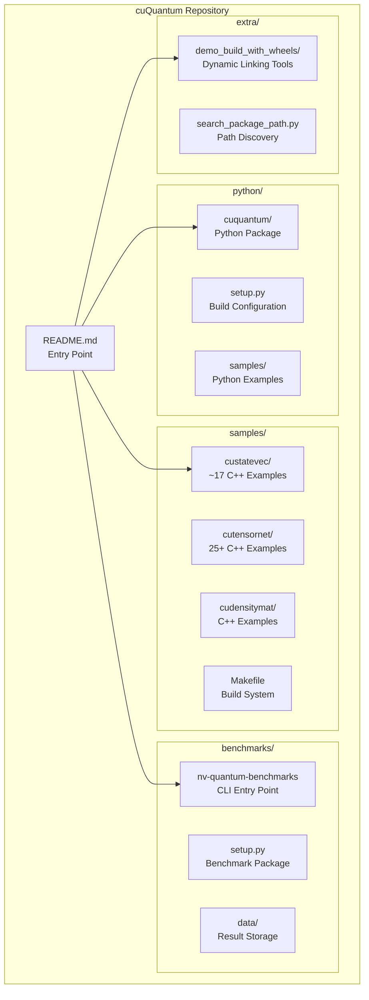

**Diagram: Repository Directory Structure**

The repository follows a clear separation between Python interfaces (`python/`), native C++ examples (`samples/`), performance evaluation (`benchmarks/`), and build utilities (`extra/`).

**Sources:** [README.md:7-32]()

## Three Core Libraries

The cuQuantum SDK consists of three specialized libraries, each targeting different quantum simulation approaches:

| Library | Representation | Primary Use Cases | Python Package | C++ Headers |
|---------|----------------|-------------------|----------------|-------------|
| **cuStateVec** | Pure state vectors \|ψ⟩ | Gate-based simulation, measurement, expectation values | `custatevec-cu11`/`cu12` | `custatevec.h` |
| **cuTensorNet** | Tensor networks | Large-scale circuits, MPS/DMRG, path optimization | `cutensornet-cu11`/`cu12` | `cutensornet.h` |
| **cuDensityMat** | Density matrices ρ | Open systems, dissipation, time-dependent Hamiltonians | `cudensitymat-cu11`/`cu12` | `cudensitymat.h` |

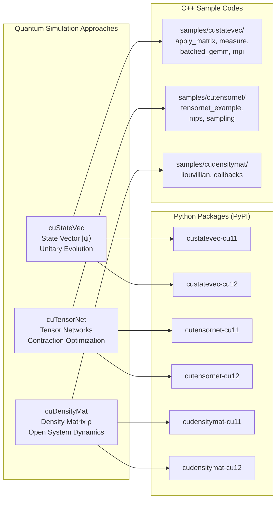

**Diagram: Three Core Libraries and Their Distributions**

### cuStateVec

`cuStateVec` performs traditional state vector quantum simulation, representing quantum states as complex vectors in Hilbert space. It supports single-GPU and multi-GPU configurations with MPI for distributed memory systems. See [cuStateVec Library](#4) for details on state vector operations and [MPI Integration](#4.3) for multi-node scaling.

### cuTensorNet

`cuTensorNet` uses tensor network representations to simulate quantum circuits efficiently, particularly for circuits with specific structures. It includes contraction path optimization, autotuning, MPS/DMRG methods, and distributed execution via MPI. See [cuTensorNet Library](#3) for comprehensive coverage of tensor network methods.

### cuDensityMat

`cuDensityMat` simulates open quantum systems using density matrix formalism, supporting dissipative evolution, time-dependent Hamiltonians, and Liouvillian dynamics. It features unique JAX integration for automatic differentiation. See [cuDensityMat Library](#5) for density matrix operations and [JAX Integration and Autodiff](#2.4) for gradient computation.

**Sources:** [README.md:12-31]()

## Distribution Channels

cuQuantum is distributed through two primary channels, each targeting different user needs:

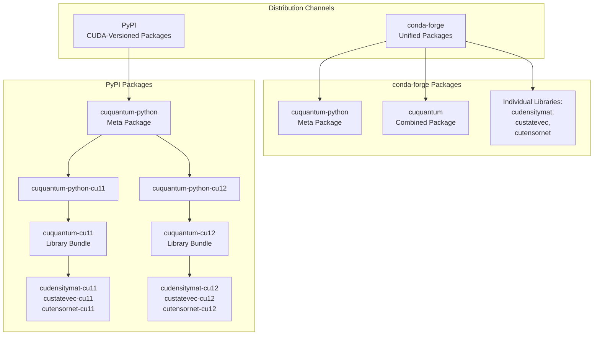

**Diagram: Package Distribution Architecture**

### conda-forge

The `conda-forge` channel provides unified packages that automatically handle CUDA version compatibility. Installation is simplified through conda's dependency resolution:

```bash
conda install -c conda-forge cuquantum
```

This approach is recommended for users who prefer integrated environment management.

### PyPI

PyPI packages are split by CUDA major version (`cu11` and `cu12`), allowing explicit control over CUDA compatibility:

```bash
pip install cuquantum-python-cu12  # For CUDA 12.x
pip install cuquantum-python-cu11  # For CUDA 11.x
```

Each CUDA variant includes all three libraries (`cudensitymat`, `custatevec`, `cutensornet`) with matching CUDA dependencies. See [Installation and Setup](#2.1) for detailed installation instructions and [CUDA Version Compatibility](#7.5) for version selection guidance.

**Sources:** [README.md:12-31]()

## CUDA Version Support

cuQuantum supports multiple CUDA toolkit versions through separate package variants:

| CUDA Version | Package Suffix | Supported Hardware | Driver Requirement |
|--------------|----------------|--------------------|--------------------|
| CUDA 11.x | `-cu11` | Compute Capability ≥ 7.0 (Volta+) | R450+ |
| CUDA 12.x | `-cu12` | Compute Capability ≥ 7.5 (Turing+) | R525+ |
| CUDA 13.x | `-cu13` (future) | TBD | TBD |

CUDA maintains minor version forward compatibility, meaning applications built with CUDA 12.0 will run on systems with CUDA 12.5 drivers. This design enables the CUDA-versioned packaging strategy. See [CUDA Version Compatibility](#7.5) for comprehensive version compatibility information.

**Sources:** [README.md:20-28]()

## Build Options

The repository supports multiple build approaches:

### Pre-built Packages

Install from `conda-forge` or `PyPI` for immediate use without compilation. See [Getting Started](#1.1).

### Building from Source

Build Python packages from source using `setup.py` with Cython compilation. See [Building Python from Source](#7.2).

### C++ Sample Compilation

Compile C++ samples using the provided `Makefile` with environment variable configuration (`CUDA_PATH`, `CUTENSORNET_ROOT`, etc.). See [Building C++ Samples](#7.1).

### Dynamic Linking

Link against installed wheel packages to reduce build times and enable custom MPI integration. See [Dynamic Linking with Wheels](#7.4).

**Sources:** [README.md:34-37]()

## License and Citation

### License

All code in this repository is distributed under the **BSD-3-Clause** license, permitting redistribution and modification with attribution. The license text is available at [LICENSE:1-29]() and [python/LICENSE:1-29]().

### Citation

When using cuQuantum in research or publications, cite the following paper:

**H. Bayraktar et al., "cuQuantum SDK: A High-Performance Library for Accelerating Quantum Science", 2023 IEEE International Conference on Quantum Computing and Engineering (QCE), Bellevue, WA, USA, 2023, pp. 1050-1061, doi: [10.1109/QCE57702.2023.00119](https://doi.org/10.1109/QCE57702.2023.00119)**

The structured citation metadata is maintained in [CITATION.cff:1-13]() following the Citation File Format standard (version 1.3.0). The current SDK version documented is `v24.11.0`.

**Sources:** [README.md:39-45](), [CITATION.cff:1-13](), [LICENSE:1-29]()

## Documentation and Resources

| Resource | Location | Purpose |
|----------|----------|---------|
| Official Documentation | https://docs.nvidia.com/cuda/cuquantum/latest/index.html | Complete API reference and guides |
| This Wiki | Current repository | Developer-focused technical documentation |
| Benchmark Results | [benchmarks/data/]() | Performance data organized by configuration hash |
| Python Examples | [python/samples/]() | High-level usage patterns |
| C++ Examples | [samples/]() | Low-level API demonstrations |

For quick start instructions, proceed to [Getting Started](#1.1). For detailed documentation of specific components, navigate to the appropriate section using the table of contents.

**Sources:** [README.md:34-37]()

---

# Page: Getting Started

# Getting Started

<details>
<summary>Relevant source files</summary>

The following files were used as context for generating this wiki page:

- [LICENSE](LICENSE)
- [README.md](README.md)
- [python/LICENSE](python/LICENSE)
- [python/README.md](python/README.md)
- [python/setup.py](python/setup.py)

</details>


This guide provides instructions on how to install and set up the NVIDIA cuQuantum SDK on your system. cuQuantum is a collection of libraries and tools designed to accelerate quantum circuit simulations on NVIDIA GPUs. For information about the core components of cuQuantum, see [Core Components](#1.2).

## System Requirements

Before installing cuQuantum, ensure your system meets the following requirements:

| Component | Requirement |
|-----------|-------------|
| GPU | NVIDIA GPU with compute capability 7.0 or higher |
| Driver | Linux: 450.80.02+ for CUDA 11.x, 525.60.13+ for CUDA 12.x |
| CUDA | CUDA Toolkit 11.x or 12.x |
| Operating System | Linux |
| Python (for Python interface) | 3.10 or higher |

Sources: [python/README.md:54-58]()

## Installation Options

cuQuantum can be installed in several ways, depending on your needs and environment.

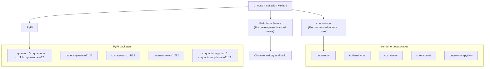

Sources: [README.md:12-31](), [python/README.md:10-48]()

## Installation from conda-forge (Recommended)

conda-forge is the recommended installation method for most users as it handles all dependencies automatically.

### Full Installation

To install the complete cuQuantum suite:

```
conda install -c conda-forge cuquantum
```

### Individual Components

You can also install specific components:

```
conda install -c conda-forge cudensitymat custatevec cutensornet
```

For just the Python bindings without the core libraries:

```
conda install -c conda-forge cuquantum-python
```

Sources: [README.md:12-18]()

## Installation from PyPI

PyPI packages are available with CUDA 11 and CUDA 12 support.

### Full Installation

```
pip install cuquantum          # Latest CUDA version
pip install cuquantum-cu11     # CUDA 11.x
pip install cuquantum-cu12     # CUDA 12.x
```

### Individual Components

For specific components:

```
# For CUDA 11.x
pip install cudensitymat-cu11 custatevec-cu11 cutensornet-cu11

# For CUDA 12.x
pip install cudensitymat-cu12 custatevec-cu12 cutensornet-cu12
```

For just the Python bindings:

```
pip install cuquantum-python          # Latest CUDA version
pip install cuquantum-python-cu11     # CUDA 11.x
pip install cuquantum-python-cu12     # CUDA 12.x
```

Sources: [README.md:19-31]()

## Installation from Source

For developers or those who need custom builds, building from source is an option.

### Prerequisites

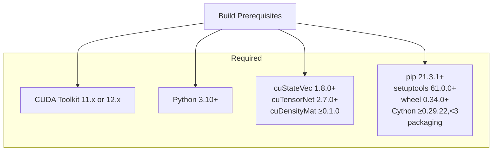

Sources: [python/README.md:12-26]()

### Build Steps

1. Clone the repository:
   ```
   git clone https://github.com/NVIDIA/cuQuantum
   ```

2. Set up environment variables:
   ```
   export CUDA_PATH=/path/to/cuda
   export CUQUANTUM_ROOT=/path/to/cuquantum      # Optional
   export CUTENSOR_ROOT=/path/to/cutensor        # Optional
   ```

3. Navigate to the Python directory:
   ```
   cd cuQuantum/python
   ```

4. Build and install:
   ```
   pip install .                                # Basic install
   pip install -v --no-deps --no-build-isolation .  # Advanced install
   ```

   For development/testing use:
   ```
   pip install -e .                             # Editable install
   ```

Sources: [python/README.md:28-47]()

## Runtime Dependencies

If you're using the Python interface, you'll need these additional dependencies:

| Dependency | Required Version | Purpose |
|------------|------------------|---------|
| NumPy | 1.21+ | Numerical computing |
| CuPy | 13.0.0+ | GPU-accelerated NumPy-compatible array library |
| PyTorch | 1.10+ | Optional - Deep learning framework |
| Qiskit | 0.24.0+ | Optional - Quantum computing framework |
| Cirq | 0.6.0+ | Optional - Quantum computing framework |
| mpi4py | 3.1.0+ | Optional - MPI support |

Both conda-forge and PyPI installations will handle the required dependencies automatically.

Sources: [python/README.md:59-70]()

## Verifying Your Installation

To verify that cuQuantum is installed correctly, you can run this simple Python script:

```python
import cuquantum
print(cuquantum.__version__)

# Verify the core libraries are accessible
import cuquantum.cutensornet
import cuquantum.custatevec
try:
    import cuquantum.cudensitymat
    print("All components successfully loaded")
except ImportError:
    print("cudensitymat not available")
```

You can also run the provided test suite:

```
cd cuQuantum/python  # Navigate to the Python source directory
pytest tests          # Run all tests
```

Sources: [python/README.md:90-94]()

## Sample Codes

cuQuantum provides sample codes to help you get started:

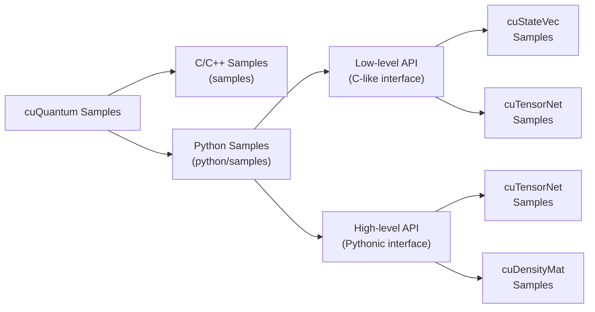

The sample codes demonstrate practical usage of the libraries and can serve as templates for your own applications.

Sources: [README.md:32](), [python/README.md:83-89]()

## Next Steps

Now that you have cuQuantum installed, you can:

1. Explore the [Python Interface](#2) to learn how to use cuQuantum in Python
2. Dive into the [cuTensorNet Library](#3) for tensor network simulations
3. Learn about the [cuStateVec Library](#4) for state vector simulations
4. Check out the [Benchmarking Suite](#5) to evaluate performance

## Known Issues

- If there are multiple copies of cuTENSOR installed, version mismatches may occur. Ensure only one version is in your system paths.
- In certain environments, if PyTorch is installed, importing cuquantum might fail. Try importing torch before cuquantum.
- Always use consistent CUDA versions (either all 11.x or all 12.x) for all components. Mixing versions will cause undefined behavior.

Sources: [python/README.md:78-81]()

---

# Page: Repository Structure

# Repository Structure

<details>
<summary>Relevant source files</summary>

The following files were used as context for generating this wiki page:

- [LICENSE](LICENSE)
- [README.md](README.md)
- [python/LICENSE](python/LICENSE)

</details>


This page explains the organization of the cuQuantum repository, detailing the purpose and contents of each major directory. The repository is structured to separate Python interfaces, C++ sample code, performance benchmarks, and utility tools into distinct directories. For an overview of the three core simulation libraries, see [Three Core Libraries](#1.3).

## High-Level Repository Organization

The cuQuantum repository follows a modular structure with four primary directories, each serving a distinct purpose:

**Repository Organization Diagram**

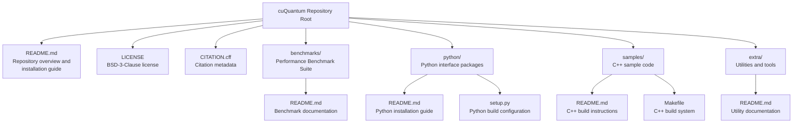

Sources: [README.md:1-46]()

## Top-Level Files

The repository root contains several important files that provide context and metadata:

| File | Purpose | Key Contents |
|------|---------|--------------|
| `README.md` | Repository entry point | Overview of directories, installation links, PyPI/conda-forge package listings |
| `LICENSE` | Legal terms | BSD-3-Clause license for all repository contents |
| `CITATION.cff` | Academic citation | Citation metadata for the cuQuantum SDK paper (DOI: 10.1109/QCE57702.2023.00119) |

Sources: [README.md:1-46](), [LICENSE:1-29]()

## Directory: `benchmarks/`

The `benchmarks/` directory contains the NVIDIA cuQuantum Performance Benchmark Suite (version 0.3.0), which provides a framework for evaluating quantum circuit simulation performance across different backends and configurations.

**Purpose:** Performance evaluation and comparison of cuQuantum libraries against other quantum simulation frameworks.

**Key Components:**

| Component | Description |
|-----------|-------------|
| CLI Interface | `nv-quantum-benchmarks` command-line tool for running benchmarks |
| Circuit Benchmarks | QFT, QAOA, Quantum Volume circuits with configurable parameters |
| API Benchmarks | Direct API call benchmarks (e.g., `apply_matrix`) |
| Frontend Support | Qiskit and CUDA-Q frontends for circuit specification |
| Backend Support | cuTensorNet, cuStateVec Aer, and CUDA-Q MGPU backends |
| Output Format | JSON results organized by `sim_config_hash` |

**Directory Structure:**

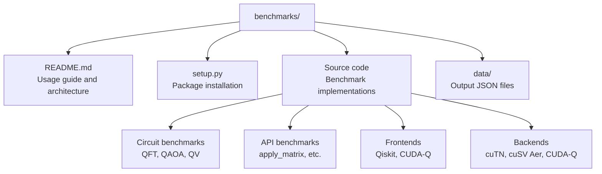

For detailed documentation on running benchmarks, see page [6](#6).

Sources: [README.md:9]()

## Directory: `python/`

The `python/` directory contains the open-source cuQuantum Python project, which provides Python bindings and high-level interfaces to the cuQuantum C++ libraries.

**Purpose:** Python interface to cuQuantum, enabling integration with quantum computing frameworks like Qiskit, Cirq, and PennyLane.

**Key Components:**

| Component | Description |
|-----------|-------------|
| Package Root | `cuquantum/` - Main Python package directory |
| Cython Bindings | `.pyx` files providing low-level C++ bindings |
| High-Level APIs | Python modules wrapping Cython bindings |
| Sample Code | `samples/` - Python usage examples |
| Tests | `tests/` - pytest-based test suite |
| Build System | `setup.py` - PEP-517 build configuration with CUDA version detection |

**Package Distribution:**

The Python code is distributed through multiple channels:

| Distribution | Package Name | Description |
|--------------|--------------|-------------|
| conda-forge | `cuquantum` | Unified package for all libraries |
| PyPI (CUDA 11) | `cuquantum-python-cu11` | Meta-package for CUDA 11.x |
| PyPI (CUDA 12) | `cuquantum-python-cu12` | Meta-package for CUDA 12.x |
| Individual (CUDA 11) | `custatevec-cu11`, `cutensornet-cu11`, `cudensitymat-cu11` | Per-library packages |
| Individual (CUDA 12) | `custatevec-cu12`, `cutensornet-cu12`, `cudensitymat-cu12` | Per-library packages |

**Python Directory Structure:**

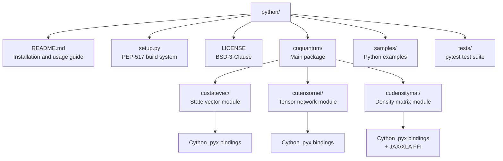

For detailed Python interface documentation, see page [2](#2).

Sources: [README.md:11-31](), [python/LICENSE:1-29]()

## Directory: `samples/`

The `samples/` directory contains all C/C++ sample code demonstrating how to use the cuQuantum SDK libraries directly from C++ applications.

**Purpose:** Provide reference implementations and usage examples for C++ developers integrating cuQuantum libraries into high-performance applications.

**Key Components:**

| Component | Description |
|-----------|-------------|
| `custatevec/` | State vector simulation examples (~17 C++ samples) |
| `cutensornet/` | Tensor network examples (25+ C++ samples including MPS/MPI) |
| `cudensitymat/` | Density matrix simulation examples |
| Build System | Makefiles and CMakeLists.txt for compiling samples |
| MPI Examples | Distributed computing examples using MPI |

**Sample Categories:**

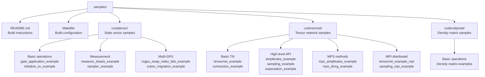

**Build Requirements:**

The C++ samples require the following environment variables:

| Variable | Purpose |
|----------|---------|
| `CUDA_PATH` | Path to CUDA Toolkit installation |
| `CUTENSORNET_ROOT` | Path to cuTensorNet library (if not in system path) |
| `CUSTATEVEC_ROOT` | Path to cuStateVec library (if not in system path) |
| `MPI_PATH` | Path to MPI installation (for MPI examples) |

For detailed build instructions, see page [7.1](#7.1).

Sources: [README.md:32]()

## Directory: `extra/`

The `extra/` directory contains utilities and helper tools that assist in using the cuQuantum SDK and building projects against cuQuantum libraries.

**Purpose:** Provide auxiliary tools for advanced use cases such as dynamic linking against PyPI wheels and container-based workflows.

**Key Components:**

| Component | Description |
|-----------|-------------|
| `demo_build_with_wheels/` | Tools for dynamically linking C++ projects against cuQuantum Python wheels |
| `search_package_path.py` | Python script to locate installed wheel libraries |
| `setup.sh` | Shell script to configure environment for wheel-based builds |
| Container utilities | Files for working with cuQuantum Appliance container |

**Use Cases:**

The `extra/` directory is particularly useful for:

1. **Reducing Wheel Size:** Instead of bundling full libraries in Python wheels, applications can dynamically link against installed wheels
2. **Custom MPI Integration:** Enable projects to use their preferred MPI library by linking against cuQuantum wheels
3. **Container Workflows:** Utilities for working with NVIDIA cuQuantum Appliance container

**Dynamic Linking Workflow:**

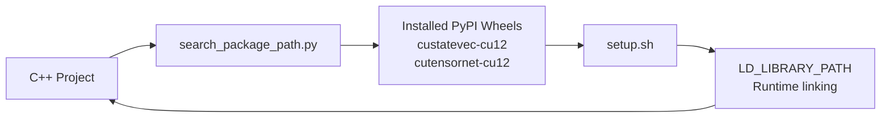

For more information on dynamic linking with wheels, see page [7.4](#7.4).

Sources: [README.md:10]()

## Navigating the Repository

The repository is organized to support multiple user personas and workflows:

**Navigation by Use Case:**

| Use Case | Entry Point | Relevant Directories |
|----------|-------------|----------------------|
| Python Development | [python/README.md]() | `python/`, `python/samples/` |
| C++ Development | [samples/README.md]() | `samples/`, with `Makefile` |
| Performance Evaluation | [benchmarks/README.md]() | `benchmarks/` |
| Dynamic Linking | [extra/README.md]() | `extra/demo_build_with_wheels/` |

**Cross-References Between Directories:**

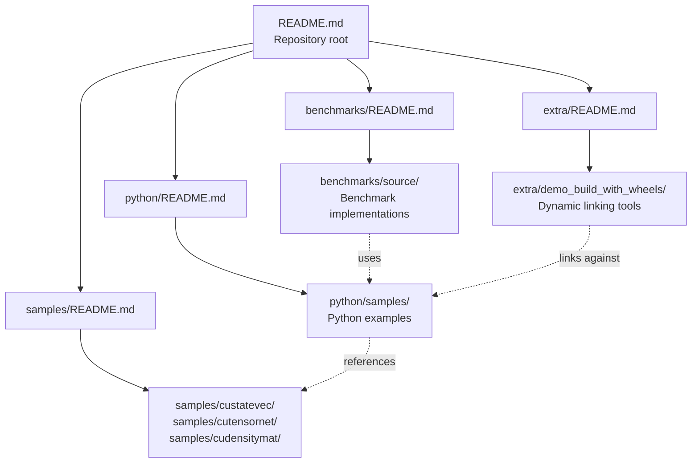

Sources: [README.md:1-46]()

## Supported Platform Requirements

The core libraries of NVIDIA cuQuantum have the following platform requirements:

| Requirement | Details |
|-------------|---------|
| CUDA Architectures | SM 7.0, SM 7.5, SM 8.0, SM 8.6, SM 9.0, SM 10.0, SM 12.0 |
| Operating Systems | Linux |
| CPU Architectures | x86_64, aarch64-sbsa |
| Language Support | C++11 or later |
| CUDA Version | CUDA 11.x or later with compatible driver (r450+) |

For full details on specific library requirements, refer to the library-specific documentation.

Sources: [samples/cutensornet/README.md:60-72](), [samples/cutensornet/CMakeLists.txt:77-88]()

---

# Page: Three Core Libraries

# Three Core Libraries

<details>
<summary>Relevant source files</summary>

The following files were used as context for generating this wiki page:

- [LICENSE](LICENSE)
- [README.md](README.md)
- [python/LICENSE](python/LICENSE)
- [python/cuquantum/__init__.py](python/cuquantum/__init__.py)

</details>


## Purpose and Scope

This page provides an overview of the three specialized quantum simulation libraries that comprise the cuQuantum SDK: **cuStateVec**, **cuTensorNet**, and **cuDensityMat**. Each library targets a distinct quantum simulation approach and use case. This page explains the fundamental differences between these libraries, their respective quantum mechanical representations, and guidance on selecting the appropriate library for specific simulation requirements.

For installation instructions and package structure, see [Installation and Setup](#2.1). For detailed usage of each library, see [cuTensorNet Library](#3), [cuStateVec Library](#4), and [cuDensityMat Library](#5).

---

## Library Architecture and Quantum Representations

The three core libraries implement different quantum mechanical formalisms, each optimized for specific simulation scenarios:

### High-Level Library Overview

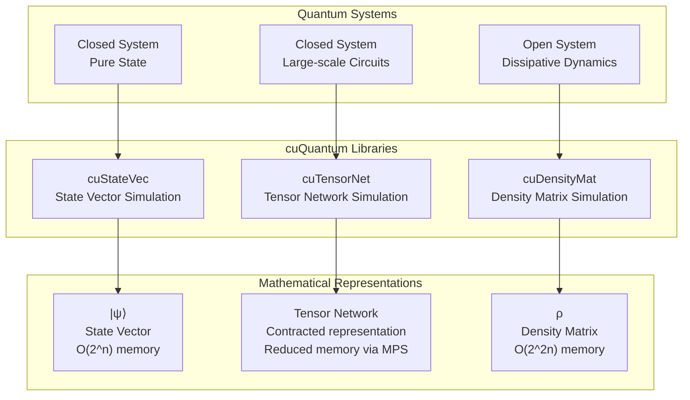

**Sources:** [README.md:7-32]()

---

## Code Entity Mapping

The three libraries are exposed through both C++ and Python interfaces with consistent naming conventions:

### Library to Code Module Mapping

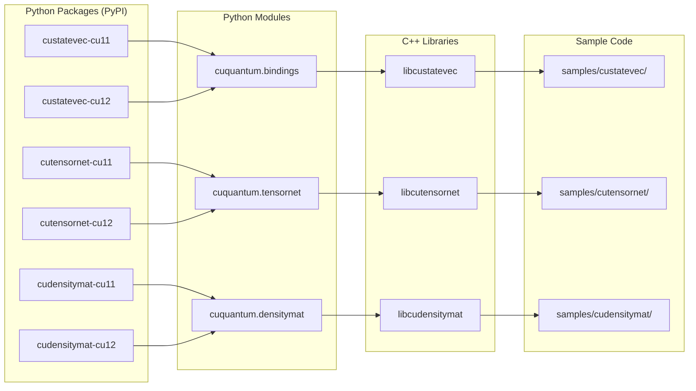

**Sources:** [README.md:13-31](), [python/cuquantum/__init__.py:5-7]()

The Python module `cuquantum` provides unified access to all three libraries through its submodules:
- `cuquantum.bindings` - Low-level bindings to cuStateVec C API
- `cuquantum.tensornet` - High-level Python interface for cuTensorNet
- `cuquantum.densitymat` - High-level Python interface for cuDensityMat

---

## Library Comparison

The following table summarizes the key characteristics and capabilities of each library:

| Feature | cuStateVec | cuTensorNet | cuDensityMat |
|---------|-----------|-------------|--------------|
| **Representation** | State vector \|ψ⟩ | Tensor network | Density matrix ρ |
| **Memory Scaling** | O(2^n) | O(2^n) with optimization | O(2^(2n)) |
| **System Type** | Pure states only | Pure states | Mixed states, open systems |
| **Primary Use Cases** | Exact simulation of small-medium circuits | Large-scale circuit simulation, MPS methods | Noisy simulation, dissipative dynamics |
| **Multi-GPU** | Yes (MPI) | Yes (slicing, MPI) | Limited |
| **Special Features** | Fast gate application | Path optimization, autotuning, MPS/DMRG | Time-dependent Hamiltonians, JAX autodiff |
| **Python Packages** | `custatevec-cu11/cu12` | `cutensornet-cu11/cu12` | `cudensitymat-cu11/cu12` |
| **Sample Count** | ~17 C++ examples | 25+ C++ examples | Multiple C++ examples |
| **Conda Package** | `custatevec` | `cutensornet` | `cudensitymat` |

**Sources:** [README.md:13-28](), High-level system diagrams

---

## cuStateVec: State Vector Simulation

### Overview

cuStateVec implements traditional quantum state vector simulation using the \|ψ⟩ representation. This library is optimized for exact simulation of quantum circuits where the quantum state remains pure throughout the computation.

### Key Characteristics

- **Mathematical Representation**: State vector \|ψ⟩ ∈ ℂ^(2^n) for n qubits
- **Memory Requirement**: 2^n complex numbers (16 bytes per amplitude for double precision)
- **Typical Range**: Up to ~30-35 qubits on single GPU, larger with multi-GPU
- **Operation Model**: Direct gate matrix application to state vector

### Core Capabilities

1. **Gate Application**: Efficient application of single-qubit, two-qubit, and multi-qubit gates
2. **Measurement**: Sampling and collapse operations on computational basis
3. **Expectation Values**: Computation of observable expectation values ⟨ψ|O|ψ⟩
4. **Multi-GPU Scaling**: MPI-based distribution across multiple GPUs/nodes

### Distribution Channels

- **PyPI**: `custatevec-cu11`, `custatevec-cu12`
- **Conda**: `custatevec`
- **C++ Samples**: Located in `samples/custatevec/`

**Sources:** [README.md:16-17,23-24](), High-level system diagrams

---

## cuTensorNet: Tensor Network Simulation

### Overview

cuTensorNet provides tensor network-based quantum circuit simulation, representing quantum circuits as networks of tensors that can be contracted efficiently. This approach enables simulation of larger circuits than state vector methods through optimized contraction paths and approximation techniques.

### Key Characteristics

- **Mathematical Representation**: Quantum circuits as tensor networks with optimized contraction
- **Memory Requirement**: Varies based on contraction path; can be significantly less than 2^n
- **Typical Range**: Circuits with hundreds of qubits using MPS approximations
- **Operation Model**: Tensor contraction with path optimization

### Core Capabilities

1. **Path Optimization**: Automatic optimization of tensor contraction order to minimize computational cost
2. **Autotuning**: Runtime optimization of contraction operations
3. **MPS/MPO Methods**: Matrix Product State representations for efficient approximate simulation
4. **DMRG**: Density Matrix Renormalization Group optimization
5. **High-Level Operations**: Amplitude computation, sampling, expectation values, reduced density matrices
6. **Slicing and Distribution**: Automatic parallelization across multiple GPUs using slicing strategies

### Distribution Channels

- **PyPI**: `cutensornet-cu11`, `cutensornet-cu12`
- **Conda**: `cutensornet`
- **C++ Samples**: Located in `samples/cutensornet/` (25+ examples)

**Sources:** [README.md:17,24,27-28](), High-level system diagrams

---

## cuDensityMat: Density Matrix Simulation

### Overview

cuDensityMat implements density matrix formalism for simulating open quantum systems and mixed states. This library uses the density matrix ρ representation, enabling simulation of decoherence, noise, and dissipative dynamics that cannot be represented by pure state vectors.

### Key Characteristics

- **Mathematical Representation**: Density matrix ρ ∈ ℂ^(2^n × 2^n)
- **Memory Requirement**: 2^(2n) complex numbers (significantly larger than state vector)
- **Typical Range**: Smaller systems (~15-20 qubits) due to memory constraints
- **Operation Model**: Superoperator formalism with Liouvillian dynamics

### Core Capabilities

1. **Open System Dynamics**: Simulation of quantum systems coupled to environments
2. **Liouvillian Evolution**: Time evolution under Liouvillian superoperators
3. **Time-Dependent Hamiltonians**: User-defined time-varying Hamiltonians via callback functions
4. **JAX Integration**: XLA FFI integration enabling automatic differentiation for variational algorithms
5. **Gradient Computation**: Native support for gradient-based optimization through JAX

### Unique Features

cuDensityMat is the only library in the cuQuantum SDK that provides:
- Native support for mixed quantum states
- JAX/XLA integration for autodifferentiation
- Time-dependent Hamiltonian callbacks

### Distribution Channels

- **PyPI**: `cudensitymat-cu11`, `cudensitymat-cu12`
- **Conda**: `cudensitymat`
- **C++ Samples**: Located in `samples/cudensitymat/`

**Sources:** [README.md:15,22,26](), [python/cuquantum/__init__.py:6](), High-level system diagrams

---

## Choosing the Right Library

The following decision tree guides library selection based on simulation requirements:

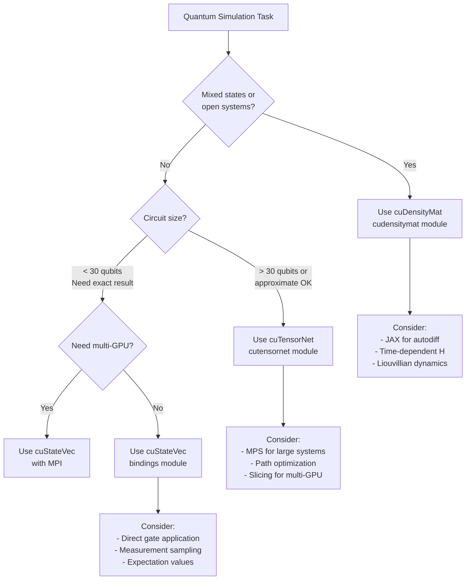

**Sources:** High-level system diagrams, [README.md:13-28]()

### Selection Guidelines

| Choose cuStateVec when: | Choose cuTensorNet when: | Choose cuDensityMat when: |
|-------------------------|--------------------------|---------------------------|
| System is pure state | Circuit has > 30 qubits | Modeling noise/decoherence |
| Need exact simulation | Approximate result acceptable | System is open/mixed |
| Circuit depth is moderate | Need MPS/DMRG methods | Need gradient computation |
| Have multi-GPU/MPI resources | Circuit has structure for optimization | Time-dependent Hamiltonians |
| Standard gate operations | Large-scale sampling needed | Variational optimization with JAX |

---

## Package Installation

All three libraries are available through both conda-forge and PyPI. The PyPI packages are versioned by CUDA version (`cu11` or `cu12`):

```
# Install individual libraries via PyPI
pip install custatevec-cu12
pip install cutensornet-cu12  
pip install cudensitymat-cu12

# Or install via conda-forge (unified CUDA version)
conda install -c conda-forge custatevec cutensornet cudensitymat
```

For detailed installation instructions and dependency requirements, see [Installation and Setup](#2.1).

**Sources:** [README.md:13-31]()

---

## Accessing Libraries from Python

All three libraries are accessible through the unified `cuquantum` Python package:

```python
# Import bindings for cuStateVec
from cuquantum import bindings

# Import high-level interface for cuTensorNet
from cuquantum import tensornet

# Import high-level interface for cuDensityMat
from cuquantum import densitymat
```

The `cuquantum.bindings` module provides low-level access to the cuStateVec C API, while `tensornet` and `densitymat` provide high-level Pythonic interfaces to their respective libraries.

**Sources:** [python/cuquantum/__init__.py:5-7]()

---

## Sample Code Organization

Each library includes extensive C++ sample code demonstrating usage patterns:

| Library | Sample Directory | Description |
|---------|-----------------|-------------|
| cuStateVec | `samples/custatevec/` | ~17 C++ examples covering gate application, measurement, multi-GPU |
| cuTensorNet | `samples/cutensornet/` | 25+ C++ examples including MPS, path optimization, slicing |
| cuDensityMat | `samples/cudensitymat/` | C++ examples for Liouvillian evolution, time-dependent Hamiltonians |

For information on building and running C++ samples, see [Building C++ Samples](#7.1).

**Sources:** [README.md:32](), High-level system diagrams

---

# Page: Python Interface

# Python Interface

<details>
<summary>Relevant source files</summary>

The following files were used as context for generating this wiki page:

- [python/README.md](python/README.md)
- [python/cuquantum/__init__.py](python/cuquantum/__init__.py)
- [python/setup.py](python/setup.py)

</details>


## Purpose and Scope

This document provides comprehensive documentation for the cuQuantum Python interface, which exposes the three core C++ libraries (cuStateVec, cuTensorNet, cuDensityMat) through Python APIs. The Python interface is implemented in the `python/` directory and distributed as the `cuquantum-python` package.

This page covers:
- Overall Python package architecture and organization
- The binding layer connecting Python to native C++ libraries
- CUDA version-specific package variants
- Core dependencies and runtime requirements
- High-level vs. low-level API patterns

For detailed installation instructions, see [Installation and Setup](#2.1). For framework integration (Qiskit, Cirq), see [Integration with Quantum Frameworks](#2.3). For JAX/XLA integration, see [JAX Integration and Autodiff](#2.4). For C++ usage, see the samples documentation (page 3-5 subsections).

**Sources:** [python/README.md:1-96]()

## Architecture Overview

The cuQuantum Python interface implements a three-tier architecture that bridges high-level Python APIs to GPU-accelerated C++ libraries:

### Three-Tier Architecture

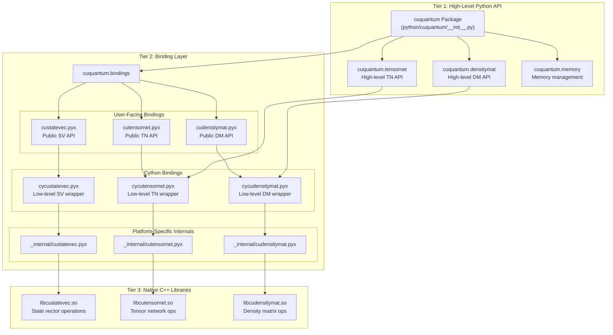

**Tier 1** provides Pythonic high-level abstractions in `cuquantum.tensornet` and `cuquantum.densitymat` modules. These offer simplified interfaces for common quantum computing tasks like circuit simulation, sampling, and expectation value computation.

**Tier 2** consists of Cython-generated bindings that expose the C++ APIs to Python. This layer is divided into:
- **User-facing bindings** (`custatevec.pyx`, `cutensornet.pyx`, `cudensitymat.pyx`) that provide the public API
- **Low-level wrappers** (`cycustatevec.pyx`, `cycutensornet.pyx`, `cycudensitymat.pyx`) with minimal abstraction over C++ functions
- **Platform-specific internals** (`_internal/*.pyx`) that handle OS-specific function loading

**Tier 3** represents the native C++ shared libraries that perform GPU-accelerated quantum simulations via CUDA.

**Sources:** [python/setup.py:84-136](), [python/cuquantum/__init__.py:1-11]()

## Package Organization

The `cuquantum` Python package is organized into several sub-modules, each serving a distinct purpose:

### Module Hierarchy

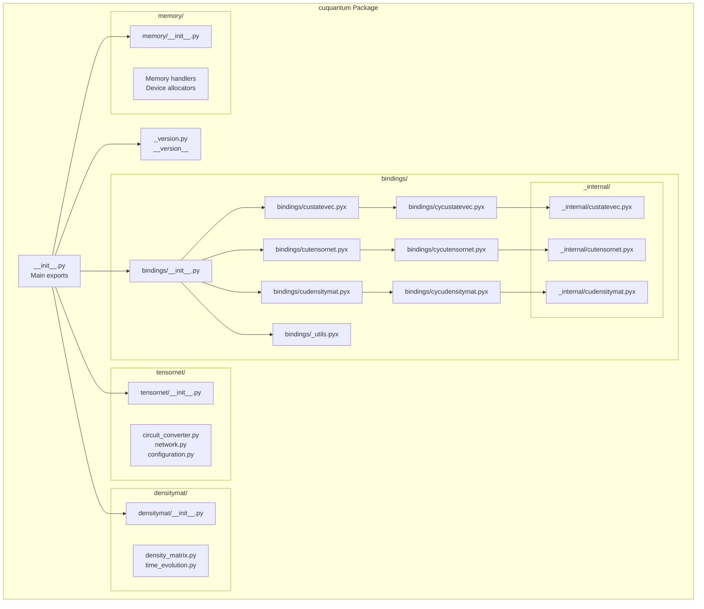

**Key modules:**
- `cuquantum.bindings`: Low-level Cython bindings exposing C++ APIs directly
- `cuquantum.tensornet`: High-level Python API for tensor network operations
- `cuquantum.densitymat`: High-level Python API for density matrix operations  
- `cuquantum.memory`: Memory management utilities for device allocators
- `cuquantum.bindings._utils`: Shared utilities including `ComputeType`, `cudaDataType`, and `libraryPropertyType` enumerations

The `_internal/` subdirectory contains platform-specific implementations that are selected at build time based on the target OS (Linux vs. Windows), as shown in [python/setup.py:52-68]().

**Sources:** [python/cuquantum/__init__.py:5-10](), [python/setup.py:84-136](), [python/setup.py:183-186]()

## CUDA Version-Specific Packages

The cuQuantum Python interface is distributed in CUDA-version-specific variants to ensure binary compatibility and optimal performance:

### PyPI Package Structure

```mermaid
graph TB
    subgraph "PyPI Packages"
        BASE11["cuquantum-python-cu11"]
        BASE12["cuquantum-python-cu12"]
        BASE13["cuquantum-python-cu13"]
    end
    
    subgraph "Component Packages (CUDA 11)"
        SV11["custatevec-cu11 ~=1.10"]
        TN11["cutensornet-cu11 ~=2.9"]
        DM11["cudensitymat-cu11 ~=0.3.0"]
    end
    
    subgraph "Component Packages (CUDA 12)"
        SV12["custatevec-cu12 ~=1.10"]
        TN12["cutensornet-cu12 ~=2.9"]
        DM12["cudensitymat-cu12 ~=0.3.0"]
    end
    
    subgraph "Component Packages (CUDA 13)"
        SV13["custatevec-cu13 ~=1.10"]
        TN13["cutensornet-cu13 ~=2.9"]
        DM13["cudensitymat-cu13 ~=0.3.0"]
    end
    
    subgraph "Common Dependencies"
        NUMPY["numpy >=1.21, <3.0"]
        NVMATH["nvmath-python ==0.6.0"]
    end
    
    subgraph "CUDA 12 Dependencies"
        CUPY12["cupy-cuda12x >=13.0"]
        BINDINGS12["cuda-bindings >=12.9.2, <13.0.0"]
    end
    
    subgraph "CUDA 13 Dependencies"
        CUPY13["cupy-cuda13x >=13.6.0"]
        BINDINGS13["cuda-bindings >=13.0.1, <14.0.0"]
    end
    
    BASE11 --> SV11
    BASE11 --> TN11
    BASE11 --> DM11
    
    BASE12 --> SV12
    BASE12 --> TN12
    BASE12 --> DM12
    BASE12 --> CUPY12
    BASE12 --> BINDINGS12
    
    BASE13 --> SV13
    BASE13 --> TN13
    BASE13 --> DM13
    BASE13 --> CUPY13
    BASE13 --> BINDINGS13
    
    SV11 --> NUMPY
    SV12 --> NUMPY
    SV13 --> NUMPY
    
    CUPY12 --> NVMATH
    CUPY13 --> NVMATH
```

The package naming convention follows the pattern `cuquantum-python-cu{MAJOR_VERSION}` where `MAJOR_VERSION` is 11, 12, or 13. This is determined at build time in [python/setup.py:152]() using `utils.cuda_major_ver`.

**Version constraints:**
- Component libraries use compatible version ranges: `~=1.10` means `>=1.10.0, <2.0.0`
- `nvmath-python` is strictly pinned to `==0.6.0` until the internal module is stabilized
- CuPy and cuda-bindings are CUDA-version-specific with different constraints for CUDA 12 vs. 13

**Important:** Users must ensure consistency across all packages. Mixing CUDA 11 and CUDA 12 packages results in undefined behavior, as noted in [python/README.md:44-45]() and [python/README.md:78]().

**Sources:** [python/setup.py:35-49](), [python/setup.py:144-148](), [python/README.md:70-71]()

## Runtime Dependencies and Requirements

The cuQuantum Python interface requires specific runtime dependencies for proper operation:

### Hardware Requirements

| Component | Requirement |
|-----------|-------------|
| GPU | NVIDIA GPU with compute capability 7.5+ |
| Driver | Linux 525.60.13+ (CUDA 12) or 580.65.06+ (CUDA 13) |
| CUDA Toolkit | 12.x or 13.x |

### Core Dependencies

| Package | Version Constraint | Purpose |
|---------|-------------------|---------|
| `cuStateVec` | 1.10.0+ | State vector simulation library |
| `cuTensorNet` | 2.9.0+ | Tensor network operations library |
| `cuDensityMat` | >=0.3.0, <0.4.0 | Density matrix simulation library |
| `numpy` | >=1.21, <3.0 | Array operations |
| `nvmath-python` | ==0.6.0 | NVIDIA math library bindings |
| `cuda-bindings` | 12.9.2+/13.0.1+ | CUDA runtime bindings |
| `CuPy` | 13.0.0+ (CUDA 12), 13.6.0+ (CUDA 13) | GPU-accelerated NumPy |

### Optional Dependencies

| Package | Version | Use Case |
|---------|---------|----------|
| `PyTorch` | 1.10+ | Tensor interoperability |
| `Qiskit` | 1.4.2+ | Quantum circuit integration |
| `Cirq` | 0.6.0+ | Google Cirq framework support |
| `mpi4py` | 3.1.0+ | Multi-node/multi-GPU execution |

**Library path configuration:** When installing via pip wheels, cuTENSOR and cuQuantum libraries must be visible through the `LD_LIBRARY_PATH` environment variable. When building from source, `CUDA_PATH`, cuQuantum library paths, and cuTENSOR paths must all be added to `LD_LIBRARY_PATH` as described in [python/README.md:70-74]().

**Known Issue:** Systems with multiple cuTENSOR installations may experience version mismatch errors if a system-path copy is loaded instead of the intended version. The solution is to remove cuTENSOR from system paths, **not** to use `LD_PRELOAD` which can cause difficult-to-debug behavior, as warned in [python/README.md:76-78]().

**Sources:** [python/README.md:50-79]()

## Build System and Cythonization

The Python interface uses a PEP-517 compliant build system with custom Cython compilation:

### Build Process Flow

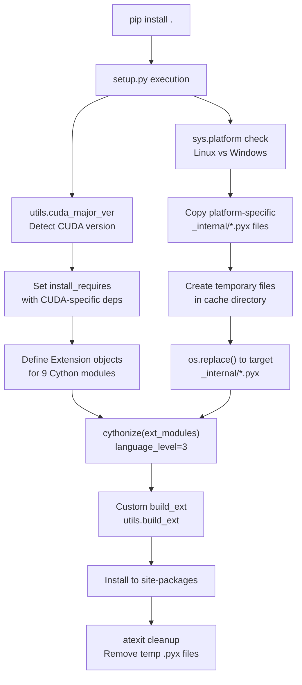

**Extension modules compiled** ([python/setup.py:84-136]()):
1. `cuquantum.bindings.custatevec` - Public state vector API
2. `cuquantum.bindings.cycustatevec` - Low-level state vector wrapper
3. `cuquantum.bindings._internal.custatevec` - Platform-specific internals
4. `cuquantum.bindings.cutensornet` - Public tensor network API
5. `cuquantum.bindings.cycutensornet` - Low-level tensor network wrapper
6. `cuquantum.bindings._internal.cutensornet` - Platform-specific internals
7. `cuquantum.bindings.cudensitymat` - Public density matrix API
8. `cuquantum.bindings.cycudensitymat` - Low-level density matrix wrapper
9. `cuquantum.bindings._internal.cudensitymat` - Platform-specific internals
10. `cuquantum.bindings._utils` - Utility functions with CUDA headers

**Platform-specific compilation:** The build system copies either `*_linux.pyx` or `*_windows.pyx` files to the target `*.pyx` names using atomic filesystem operations ([python/setup.py:52-78]()), ensuring thread-safe builds. These temporary files are cleaned up via an `atexit` handler.

**Recursion limit workaround:** Cython compilation sets `sys.setrecursionlimit(50000)` ([python/setup.py:81]()) to handle deep template instantiation in C++ bindings.

**Custom build commands:**
- `utils.build_ext`: Custom extension builder that handles CUDA paths and library linking
- `utils.bdist_wheel`: Custom wheel builder for CUDA-version-specific distribution

**Sources:** [python/setup.py:1-196](), [python/setup.py:52-78](), [python/setup.py:84-136]()

## API Usage Patterns

The Python interface exposes both low-level and high-level APIs for different use cases:

### Low-Level API Pattern

The low-level APIs in `cuquantum.bindings.custatevec`, `cuquantum.bindings.cutensornet`, and `cuquantum.bindings.cudensitymat` provide 1:1 mappings to C++ functions. These are typically used when:
- Maximum control over GPU operations is needed
- Performance-critical paths require minimal overhead
- Users are porting existing C++ code to Python

Sample code demonstrating low-level API usage is available in the `samples/` directory. These samples are 1:1 Python translations of the corresponding C++ examples ([python/README.md:82-85]()).

### High-Level API Pattern

The high-level APIs in `cuquantum.tensornet` and `cuquantum.densitymat` provide Pythonic abstractions that:
- Handle resource management automatically
- Integrate with NumPy/CuPy array interfaces
- Provide framework-agnostic quantum circuit representations
- Support quantum computing frameworks (Qiskit, Cirq) via converters

High-level API samples demonstrate pythonic usage patterns and are also located in the `samples/` directory ([python/README.md:84-85]()).

### Testing and Development

The test suite can be executed using pytest from the Python source root directory:

```bash
pytest tests
```

Some tests require optional dependencies:
- Tests requiring `cffi` are skipped if not installed
- Tests requiring C++ library development headers are skipped if `CUDA_PATH` is not set

The test suite uses `pytest-xdist` for parallel execution when available ([python/README.md:88-91]()).

**Development mode installation:** For local development, use the editable installation mode with additional flags:

```bash
pip install -v -e --no-deps --no-build-isolation .
```

Where:
- `-e`: Editable mode (in-place installation)
- `-v`: Verbose output
- `--no-deps`: Skip runtime dependency installation
- `--no-build-isolation`: Reuse current environment instead of creating isolated build environment

This avoids reinstalling dependencies and allows immediate testing of code changes ([python/README.md:38-43]()).

**Sources:** [python/README.md:80-91](), [python/README.md:38-43]()

## Exported Symbols and Public API

The main `cuquantum` package exports key symbols for common use:

**Core exports** ([python/cuquantum/__init__.py:5-10]()):
- `cuquantum.bindings` - Low-level binding modules
- `cuquantum.densitymat` - High-level density matrix API
- `cuquantum.tensornet` - High-level tensor network API  
- `cuquantum.memory.*` - Memory management (imported via wildcard)
- `cuquantum.ComputeType` - Computation precision enumeration
- `cuquantum.cudaDataType` - CUDA data type enumeration
- `cuquantum.libraryPropertyType` - Library property query enumeration
- `cuquantum.__version__` - Package version string

These enumerations (`ComputeType`, `cudaDataType`, `libraryPropertyType`) are defined in `cuquantum.bindings._utils` and re-exported at the top level for convenient access.

**Sources:** [python/cuquantum/__init__.py:1-11]()

---

# Page: Installation and Setup

# Installation and Setup

<details>
<summary>Relevant source files</summary>

The following files were used as context for generating this wiki page:

- [LICENSE](LICENSE)
- [README.md](README.md)
- [python/LICENSE](python/LICENSE)
- [python/README.md](python/README.md)
- [python/setup.py](python/setup.py)

</details>


This page provides detailed instructions for installing the cuQuantum Python interface, including dependency requirements, CUDA version compatibility, and environment configuration. For building from source, see section 7.

## Overview

NVIDIA cuQuantum Python provides Python bindings for the cuQuantum SDK's three core libraries: cuStateVec, cuTensorNet, and cuDensityMat. The package supports multiple installation methods (conda-forge and PyPI) with CUDA-version-specific variants.

**Package Distribution Structure on PyPI**

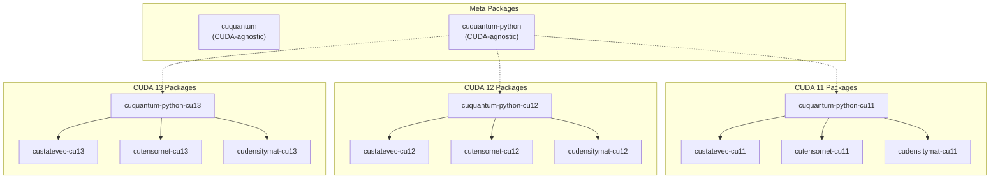

Sources: [README.md:19-31](), [python/setup.py:152]()

## System Requirements

### Hardware Requirements

* NVIDIA GPU with compute capability 7.5 or higher
* Sufficient GPU memory for quantum simulation workloads

### Software Requirements

| Component | Requirement |
|-----------|-------------|
| **Operating System** | Linux (primary supported platform; Windows support limited) |
| **NVIDIA Driver** | Linux: 525.60.13+ (CUDA 12) or 580.65.06+ (CUDA 13) |
| **CUDA Toolkit** | 12.x or 13.x |
| **Python** | >=3.11, <3.14 |

**Note**: As of cuQuantum Python v25.06, the cuQuantum C libraries (cuDensityMat, cuStateVec, cuTensorNet) are no longer build-time dependencies but are still required at runtime.

Sources: [python/README.md:50-58](), [python/README.md:24]()

## Runtime Dependencies

### Core Runtime Dependencies

The following dependencies are installed automatically via conda-forge or PyPI:

| Component | Version Requirement | Notes |
|-----------|---------------------|-------|
| **cuStateVec** | >=1.10.0, <2.0 | State vector simulation library |
| **cuTensorNet** | >=2.9.0, <3.0 | Tensor network simulation library |
| **cuDensityMat** | >=0.3.0, <0.4.0 | Density matrix simulation library |
| **NumPy** | >=1.21, <3.0 | Array operations |
| **nvmath-python** | ==0.6.0 | Strictly pinned version (internal module stability) |
| **CuPy** | >=13.0.0 (CUDA 12), >=13.6.0 (CUDA 13) | GPU-accelerated array library |
| **cuda-bindings** | >=12.9.2, <13.0.0 (CUDA 12)<br/>>=13.0.1, <14.0.0 (CUDA 13) | CUDA runtime bindings |

**Important**: The `nvmath-python` package is strictly pinned to version 0.6.0 until the `nvmath.internal` module becomes stable.

### Optional Dependencies

Optional packages enable integration with quantum computing frameworks and distributed computing:

| Component | Version Requirement | Purpose |
|-----------|---------------------|---------|
| **PyTorch** | >=1.10 | Tensor operations and quantum ML |
| **Qiskit** | >=1.4.2, <3.0 | Qiskit framework integration |
| **Cirq** | >=0.6.0 | Cirq framework integration |
| **mpi4py** | >=3.1.0 | Multi-node distributed computing via MPI |

Sources: [python/README.md:50-67](), [python/setup.py:35-48]()

## Installation Methods

**Installation Decision Flow**

```mermaid
flowchart TD
    start["Select Installation Method"]
    
    start --> conda_check{"Want automatic<br/>dependency<br/>management?"}
    
    conda_check -->|Yes| conda["Install via conda-forge"]
    conda_check -->|No| cuda_check{"Which CUDA<br/>version?"}
    
    cuda_check -->|"CUDA 11"| pip11["pip install cuquantum-python-cu11"]
    cuda_check -->|"CUDA 12"| pip12["pip install cuquantum-python-cu12"]
    cuda_check -->|"CUDA 13"| pip13["pip install cuquantum-python-cu13"]
    
    conda --> conda_cmd["conda install -c conda-forge cuquantum"]
    
    pip11 --> env_setup11["Ensure CUDA 11 Toolkit<br/>and Driver installed"]
    pip12 --> env_setup12["Ensure CUDA 12 Toolkit<br/>and Driver installed"]
    pip13 --> env_setup13["Ensure CUDA 13 Toolkit<br/>and Driver installed"]
    
    env_setup11 --> verify["Verify Installation"]
    env_setup12 --> verify
    env_setup13 --> verify
    conda_cmd --> verify
    
    verify --> test["import cuquantum"]
```

### Method 1: Installation via conda-forge (Recommended)

The conda-forge distribution handles all dependencies automatically, including CUDA libraries:

```bash
conda install -c conda-forge cuquantum
```

**What gets installed:**
- cuQuantum Python bindings (`cuquantum-python`)
- All three core libraries: `custatevec`, `cutensornet`, `cudensitymat`
- Dependencies: CuPy, NumPy, nvmath-python, cuda-bindings
- CUDA runtime libraries (excluding the NVIDIA driver)

The conda-forge packages are unified and do not require CUDA version specification.

Sources: [python/README.md:68-69](), [README.md:13-18]()

### Method 2: Installation via PyPI

PyPI provides CUDA-version-specific packages. You must select the package matching your CUDA installation:

**For CUDA 11.x:**
```bash
pip install cuquantum-python-cu11
```

**For CUDA 12.x:**
```bash
pip install cuquantum-python-cu12
```

**For CUDA 13.x:**
```bash
pip install cuquantum-python-cu13
```

**What gets installed:**
- `cuquantum-python-cuXX` meta-package
- CUDA-specific variants: `custatevec-cuXX`, `cutensornet-cuXX`, `cudensitymat-cuXX`
- Dependencies: CuPy (CUDA-specific), nvmath-python ==0.6.0, cuda-bindings, NumPy

**Prerequisites for PyPI installation:**
- CUDA Toolkit (matching version) must be installed
- NVIDIA driver must be installed
- CUDA libraries must be visible via `LD_LIBRARY_PATH` (see Environment Setup section)

Sources: [README.md:19-31](), [python/README.md:70-72](), [python/setup.py:39-48]()

### Method 3: Installation from Source

For development or accessing unreleased features, build from source:

```bash
# 1. Clone repository
git clone https://github.com/NVIDIA/cuQuantum
cd cuQuantum/python

# 2. Set environment variables
export CUDA_PATH=/usr/local/cuda

# 3. Install
pip install .
```

**For editable/development installation:**
```bash
pip install -e .
```

**Advanced installation (skip dependency resolution):**
```bash
pip install -v --no-deps --no-build-isolation .
```

**Build-time dependencies:**
- CUDA Toolkit 12.x or 13.x
- Python >=3.11, <3.14
- Cython >=3.0.4, !=3.1.0, !=3.1.1
- pip 21.3.1+
- setuptools 77.0.3+
- wheel 0.34.0+
- packaging

These dependencies are handled automatically by the PEP-517 build system unless using `--no-build-isolation`.

Sources: [python/README.md:10-44](), [python/README.md:14-26]()


## Cython Bindings Architecture

The cuQuantum Python package uses Cython to create bindings between Python and the native C++ libraries. The `setup.py` script defines multiple Extension modules:

**Extension Modules Built by setup.py**

```mermaid
graph TB
    subgraph "Python Package: cuquantum"
        subgraph "cuquantum.bindings"
            custatevec_pyx["custatevec.pyx"]
            cycustatevec_pyx["cycustatevec.pyx"]
            custatevec_internal["_internal/custatevec.pyx"]
            
            cutensornet_pyx["cutensornet.pyx"]
            cycutensornet_pyx["cycutensornet.pyx"]
            cutensornet_internal["_internal/cutensornet.pyx"]
            
            cudensitymat_pyx["cudensitymat.pyx"]
            cycudensitymat_pyx["cycudensitymat.pyx"]
            cudensitymat_internal["_internal/cudensitymat.pyx"]
            
            utils_pyx["_utils.pyx"]
        end
    end
    
    subgraph "Native C++ Libraries"
        libcustatevec["libcustatevec.so"]
        libcutensornet["libcutensornet.so"]
        libcudensitymat["libcudensitymat.so"]
    end
    
    custatevec_pyx --> libcustatevec
    cycustatevec_pyx --> libcustatevec
    custatevec_internal --> libcustatevec
    
    cutensornet_pyx --> libcutensornet
    cycutensornet_pyx --> libcutensornet
    cutensornet_internal --> libcutensornet
    
    cudensitymat_pyx --> libcudensitymat
    cycudensitymat_pyx --> libcudensitymat
    cudensitymat_internal --> libcudensitymat
    
    utils_pyx --> libcuda["CUDA Runtime API"]
```

The `setup.py` script defines 10 Extension modules (lines 84-136) that are cythonized during the build process. The `builder.utils` module (imported at line 19) handles CUDA version detection and sets the appropriate compiler flags.

Sources: [python/setup.py:84-136](), [python/setup.py:12-19](), [python/setup.py:180-182]()

## CUDA Version Compatibility

Maintaining CUDA version consistency across all components is critical. Mixing CUDA major versions will result in undefined behavior.

| Component | CUDA 11.x | CUDA 12.x | CUDA 13.x |
|-----------|-----------|-----------|-----------|
| **Meta-package name** | `cuquantum-python-cu11` | `cuquantum-python-cu12` | `cuquantum-python-cu13` |
| **CuPy requirement** | `cupy-cuda11x>=13.0` | `cupy-cuda12x>=13.0` | `cupy-cuda13x>=13.6.0` |
| **cuda-bindings** | N/A | `>=12.9.2, <13.0.0` | `>=13.0.1, <14.0.0` |
| **Driver requirement (Linux)** | 450.80.02+ | 525.60.13+ | 580.65.06+ |
| **CUDA Toolkit** | 11.x | 12.x | 13.x |

**Compatibility Notes:**
- CUDA 11.x support includes backward compatibility with packages built for earlier CUDA 11 minor versions
- CUDA 12.x introduced minor version forward compatibility guarantees
- CUDA 13.x continues the forward compatibility model
- **Do not mix CUDA major versions** (e.g., CUDA 12 Toolkit with cuquantum-python-cu13)

The `setup.py` script dynamically detects the CUDA version and sets the package name accordingly at line 152: `name=f"cuquantum-python-cu{utils.cuda_major_ver}"`.

Sources: [python/README.md:44](), [python/README.md:78](), [python/setup.py:43-48](), [python/setup.py:152](), [python/README.md:53]()

## Environment Setup

### LD_LIBRARY_PATH Configuration

When building from source or using custom library installations, ensure CUDA libraries are visible to the Python runtime:

```bash
# Add CUDA Toolkit libraries
export LD_LIBRARY_PATH=/usr/local/cuda/lib64:$LD_LIBRARY_PATH

# Add cuQuantum SDK libraries (if installed separately)
export LD_LIBRARY_PATH=/path/to/cuquantum/lib:$LD_LIBRARY_PATH

# Add cuTENSOR libraries (if installed separately)
export LD_LIBRARY_PATH=/path/to/cutensor/lib:$LD_LIBRARY_PATH
```

**Note**: If you install via conda-forge or pip wheels, this is typically not necessary as libraries are bundled with the packages.

### CUDA_PATH Configuration

The `CUDA_PATH` environment variable is required for:
- Building cuQuantum Python from source
- Running certain tests that require CUDA development headers

```bash
export CUDA_PATH=/usr/local/cuda
# or specify a specific version
export CUDA_PATH=/usr/local/cuda-12.6
```

The `setup.py` build script uses this variable to locate CUDA include directories (line 133).

### Optional Library Path Variables

For advanced configurations, you can specify individual library locations:

```bash
# Point to specific cuQuantum SDK installation
export CUQUANTUM_ROOT=/path/to/cuquantum

# Or specify individual library paths
export CUSTATEVEC_ROOT=/path/to/custatevec
export CUTENSORNET_ROOT=/path/to/cutensornet
export CUDENSITYMAT_ROOT=/path/to/cudensitymat

# cuTENSOR location
export CUTENSOR_ROOT=/path/to/cutensor
```

Sources: [python/README.md:32-33](), [python/README.md:73-75](), [python/setup.py:133]()

## Verifying Installation

After installation, verify that cuQuantum Python is working correctly:

```python
import cuquantum
print(cuquantum.__version__)

# Verify individual libraries can be imported
from cuquantum import custatevec
from cuquantum import cutensornet
from cuquantum import cudensitymat

print("cuQuantum Python installation successful")
```

**Expected output:**
- Version string (e.g., "25.06.0")
- No import errors

## Known Issues and Troubleshooting

### Multiple cuTENSOR Installations

If multiple copies of cuTENSOR are installed, with one in a default system path, version mismatch errors may occur. 

**Solution**: Remove cuTENSOR from system paths (e.g., `/usr/lib`, `/usr/local/lib`) to ensure visibility of the correct copy bundled with cuQuantum.

**Do not use `LD_PRELOAD`** to override library loading, as this can cause difficult-to-debug behavior.

### CUDA Version Mixing

Mixing CUDA major versions (e.g., CUDA 12 Toolkit with cuquantum-python-cu13) will result in undefined behavior.

**Solution**: Ensure all components use the same CUDA major version:
- CUDA Toolkit
- cuQuantum Python package (`cuXX` suffix)
- CuPy variant (`cupy-cudaXXx`)
- cuda-bindings version

### Import Verification

Some tests may be skipped if:
- `cffi` package is not installed
- `CUDA_PATH` environment variable is not set

**Solution**: Install `cffi` and set `CUDA_PATH` before running tests.

Sources: [python/README.md:76-79](), [python/README.md:90-91]()

## Testing the Installation

If you want to run the test suite to verify your installation:

```bash
cd cuQuantum/python
pytest tests
```

Note that some tests may be skipped if `cffi` is not installed or if the `CUDA_PATH` environment variable is not set.

Test dependencies include:
- pytest 6.2+
- pytest-xdist
- opt_einsum
- cffi 1.0.0+
- Various quantum framework dependencies (Cirq, Qiskit, etc.)

Sources: [python/README.md:90-94](), [python/tests/requirements.txt:1-12]()

## Next Steps

After successful installation, you can:

1. Explore the Python API as detailed in [API Reference](#2.2)
2. Learn about integration with quantum frameworks at [Integration with Quantum Frameworks](#2.3)
3. Try the sample code available in the `samples` directory

Sources: [python/README.md:83-88]()

---

# Page: Package Structure and Bindings

# Package Structure and Bindings

<details>
<summary>Relevant source files</summary>

The following files were used as context for generating this wiki page:

- [python/README.md](python/README.md)
- [python/cuquantum/__init__.py](python/cuquantum/__init__.py)
- [python/cuquantum/bindings/cudensitymat.pxi](python/cuquantum/bindings/cudensitymat.pxi)
- [python/samples/bindings/cutensornet/state/proj_mps_circuit_dmrg_example.py](python/samples/bindings/cutensornet/state/proj_mps_circuit_dmrg_example.py)
- [python/setup.py](python/setup.py)

</details>


## Purpose and Scope

This document explains the internal architecture of the cuQuantum Python package, covering the package hierarchy, the Cython bindings layer that interfaces with native CUDA libraries, and the distinction between low-level and high-level Python APIs. 

For installation instructions and dependency management, see [Installation and Setup](#2.1). For integration with frameworks like Qiskit and Cirq, see [Integration with Quantum Frameworks](#2.3). For JAX-specific bindings and autodiff capabilities, see [JAX Integration and Autodiff](#2.4).

## Package Hierarchy

The cuQuantum Python package is distributed as `cuquantum-python-cu{11,12,13}` and provides a unified interface to three CUDA libraries: cuStateVec, cuTensorNet, and cuDensityMat.

### Top-Level Package Structure

The main `cuquantum` package exposes several submodules:

```mermaid
graph TB
    cuquantum["cuquantum"]
    
    cuquantum --> bindings["cuquantum.bindings<br/>(Cython wrappers)"]
    cuquantum --> densitymat["cuquantum.densitymat<br/>(High-level API)"]
    cuquantum --> tensornet["cuquantum.tensornet<br/>(High-level API)"]
    cuquantum --> memory["cuquantum.memory<br/>(Memory utilities)"]
    cuquantum --> version["cuquantum._version<br/>(__version__)"]
    
    bindings --> custatevec_bind["cuquantum.bindings.custatevec"]
    bindings --> cutensornet_bind["cuquantum.bindings.cutensornet"]
    bindings --> cudensitymat_bind["cuquantum.bindings.cudensitymat"]
    bindings --> utils_bind["cuquantum.bindings._utils"]
    bindings --> internal["cuquantum.bindings._internal"]
    
    internal --> custatevec_internal["_internal.custatevec"]
    internal --> cutensornet_internal["_internal.cutensornet"]
    internal --> cudensitymat_internal["_internal.cudensitymat"]
```

**Sources:** [python/cuquantum/__init__.py:1-11]()

The top-level `__init__.py` imports expose:
- `bindings`: Low-level Cython bindings to C APIs
- `densitymat`: High-level Pythonic interface to cuDensityMat
- `tensornet`: High-level Pythonic interface to cuTensorNet
- `memory`: Memory management utilities
- Helper types: `ComputeType`, `cudaDataType`, `libraryPropertyType`

### CUDA Version-Specific Packaging

The package name includes the CUDA major version to enforce compatibility:

| Package Name | CUDA Version | Runtime Dependencies |
|-------------|--------------|---------------------|
| `cuquantum-python-cu12` | CUDA 12.x | `custatevec-cu12`, `cutensornet-cu12`, `cudensitymat-cu12`, `cupy-cuda12x`, `cuda-bindings>=12.9.2,<13` |
| `cuquantum-python-cu13` | CUDA 13.x | `custatevec-cu13`, `cutensornet-cu13`, `cudensitymat-cu13`, `cupy-cuda13x`, `cuda-bindings>=13.0.1,<14` |

**Sources:** [python/setup.py:39-48](), [python/setup.py:152]()

The CUDA version detection is handled by `builder.utils.cuda_major_ver` during the build process, which determines the appropriate package name and dependencies.

## Binding Layers Architecture

The Python interface to cuQuantum's native CUDA libraries operates through three distinct layers:

```mermaid
graph TB
    subgraph "Python User Code"
        user_high["High-level API usage<br/>import cuquantum.tensornet"]
        user_low["Low-level API usage<br/>import cuquantum.bindings.cutensornet"]
    end
    
    subgraph "High-Level Python Layer"
        densitymat_py["cuquantum.densitymat<br/>(Python classes)"]
        tensornet_py["cuquantum.tensornet<br/>(Python classes)"]
    end
    
    subgraph "Cython Bindings Layer"
        cy_sv["cycustatevec<br/>(Extension module)"]
        cy_tn["cycutensornet<br/>(Extension module)"]
        cy_dm["cycudensitymat<br/>(Extension module)"]
        
        bind_sv["custatevec.pyx<br/>(Public bindings)"]
        bind_tn["cutensornet.pyx<br/>(Public bindings)"]
        bind_dm["cudensitymat.pyx<br/>(Public bindings)"]
        
        internal_sv["_internal.custatevec.pyx<br/>(Internal helpers)"]
        internal_tn["_internal.cutensornet.pyx<br/>(Internal helpers)"]
        internal_dm["_internal.cudensitymat.pyx<br/>(Internal helpers)"]
        
        utils["_utils.pyx<br/>(CUDA utilities)"]
    end
    
    subgraph "Native C++ Libraries"
        libcusv["libcustatevec.so"]
        libcutn["libcutensornet.so"]
        libcudm["libcudensitymat.so"]
    end
    
    user_high --> densitymat_py
    user_high --> tensornet_py
    user_low --> bind_sv
    user_low --> bind_tn
    user_low --> bind_dm
    
    densitymat_py --> cy_dm
    tensornet_py --> cy_tn
    
    bind_sv --> cy_sv
    bind_tn --> cy_tn
    bind_dm --> cy_dm
    
    cy_sv --> internal_sv
    cy_tn --> internal_tn
    cy_dm --> internal_dm
    
    cy_sv --> utils
    cy_tn --> utils
    cy_dm --> utils
    
    bind_sv --> libcusv
    bind_tn --> libcutn
    bind_dm --> libcudm
    
    cy_sv --> libcusv
    cy_tn --> libcutn
    cy_dm --> libcudm
```

**Sources:** [python/setup.py:84-136](), [python/cuquantum/__init__.py:1-11]()

### Layer 1: Public Bindings (`cuquantum.bindings.*`)

These modules provide direct 1:1 mappings to the C API functions:

- `cuquantum.bindings.custatevec` - State vector operations
- `cuquantum.bindings.cutensornet` - Tensor network operations  
- `cuquantum.bindings.cudensitymat` - Density matrix operations

Each binding module is generated from a `.pyx` Cython source file that declares C function signatures and wraps them in Python-callable forms.

**Sources:** [python/setup.py:85-103](), [python/setup.py:115-128]()

### Layer 2: Cython Implementation (`cycustatevec`, `cycutensornet`, `cycudensitymat`)

These extension modules contain the actual Cython implementation code:

- `cycustatevec` - Built from `cuquantum/bindings/cycustatevec.pyx`
- `cycutensornet` - Built from `cuquantum/bindings/cycutensornet.pyx`
- `cycudensitymat` - Built from `cuquantum/bindings/cycudensitymat.pyx`

These modules handle:
- C struct declarations (`cdef struct`)
- Memory management and pointer conversion
- Error handling and exception translation
- Type conversions between Python and C types

**Sources:** [python/setup.py:90-109]()

### Layer 3: Internal Helpers (`cuquantum.bindings._internal.*`)

These modules provide implementation-specific utilities not exposed in the public API:

- `_internal.custatevec` - Internal state vector helpers
- `_internal.cutensornet` - Internal tensor network helpers  
- `_internal.cudensitymat` - Internal density matrix helpers

**Sources:** [python/setup.py:95-114]()

### Utilities Module (`cuquantum.bindings._utils`)

The `_utils` extension provides CUDA-specific utilities shared across all bindings:

```python
from cuquantum.bindings._utils import ComputeType, cudaDataType, libraryPropertyType
```

This module includes CUDA header declarations and is built with the CUDA include path.

**Sources:** [python/setup.py:130-135](), [python/cuquantum/__init__.py:9]()

## Extension Module Build Process

The build process converts Cython source files (`.pyx`) into C++ extensions that link against CUDA libraries.

### Build System Components

```mermaid
graph LR
    subgraph "Build Inputs"
        setup_py["setup.py"]
        pyx_files[".pyx source files"]
        builder_utils["builder/utils.py"]
        cuda_env["CUDA_PATH env var"]
    end
    
    subgraph "Build Configuration"
        detect_cuda["utils.cuda_major_ver<br/>(CUDA version detection)"]
        ext_defs["Extension() definitions"]
        cythonize["cythonize()<br/>(Cython compiler)"]
    end
    
    subgraph "Custom Build Commands"
        build_ext_cmd["utils.build_ext<br/>(Custom build_ext)"]
        bdist_wheel_cmd["utils.bdist_wheel<br/>(Custom wheel builder)"]
    end
    
    subgraph "Build Outputs"
        so_files[".so extension modules<br/>(cycustatevec, cycutensornet, etc.)"]
        wheel["cuquantum-python-cu{12,13}.whl"]
    end
    
    setup_py --> detect_cuda
    cuda_env --> detect_cuda
    builder_utils --> detect_cuda
    
    detect_cuda --> ext_defs
    pyx_files --> ext_defs
    
    ext_defs --> cythonize
    cythonize --> build_ext_cmd
    build_ext_cmd --> so_files
    
    so_files --> bdist_wheel_cmd
    bdist_wheel_cmd --> wheel
```

**Sources:** [python/setup.py:1-196]()

### Extension Definitions

Each Cython module is defined as a `setuptools.Extension` object:

```python
Extension(
    "cuquantum.bindings.custatevec",        # Module name
    sources=["cuquantum/bindings/custatevec.pyx"],  # Source file
    language="c++",                          # Language mode
)
```

**Sources:** [python/setup.py:84-136]()

The setup script defines 9 extension modules total:
1. `cuquantum.bindings.custatevec`
2. `cuquantum.bindings.cycustatevec`
3. `cuquantum.bindings._internal.custatevec`
4. `cuquantum.bindings.cutensornet`
5. `cuquantum.bindings.cycutensornet`
6. `cuquantum.bindings._internal.cutensornet`
7. `cuquantum.bindings.cudensitymat`
8. `cuquantum.bindings.cycudensitymat`
9. `cuquantum.bindings._internal.cudensitymat`
10. `cuquantum.bindings._utils`

### Cythonization Process

The `cythonize()` function converts `.pyx` files to C++ source:

```python
ext_modules=cythonize(ext_modules,
    verbose=True, 
    language_level=3,
    compiler_directives={'embedsignature': True}
)
```

**Sources:** [python/setup.py:180-182]()

The `embedsignature=True` directive ensures that function signatures are embedded in docstrings for introspection.

### Platform-Specific Handling

The build process handles platform-specific variants:

```python
if sys.platform == 'linux':
    src_files = glob.glob('**/**/_internal/*_linux.pyx')
elif sys.platform == 'win32':
    src_files = glob.glob('**/**/_internal/*_windows.pyx')
```

Platform-specific `.pyx` files are temporarily renamed during the build to their platform-agnostic names.

**Sources:** [python/setup.py:52-68]()

### Custom Build Commands

The build system uses custom command classes:

```python
cmdclass = {
    'build_ext': utils.build_ext,
    'bdist_wheel': utils.bdist_wheel,
}
```

These custom classes (defined in `builder/utils.py`) handle:
- CUDA version detection and validation
- Library path configuration
- Compiler flag injection
- Wheel metadata customization

**Sources:** [python/setup.py:139-142]()

## Callback Mechanisms in Bindings

The cuDensityMat bindings include sophisticated callback mechanisms for time-dependent Hamiltonians. These callbacks allow Python functions to be invoked from C++ code during time evolution.

### Callback Types

```mermaid
graph TB
    subgraph "Python Callbacks"
        scalar_py["Scalar Callback<br/>(Python function)"]
        tensor_py["Tensor Callback<br/>(Python function)"]
        scalar_grad_py["Scalar Gradient Callback<br/>(Python function)"]
        tensor_grad_py["Tensor Gradient Callback<br/>(Python function)"]
    end
    
    subgraph "Cython Wrapper Layer"
        wrapped_scalar["WrappedScalarCallback<br/>(cdef class)"]
        wrapped_tensor["WrappedTensorCallback<br/>(cdef class)"]
        wrapped_scalar_grad["WrappedScalarGradientCallback<br/>(cdef class)"]
        wrapped_tensor_grad["WrappedTensorGradientCallback<br/>(cdef class)"]
    end
    
    subgraph "C Struct Representation"
        struct_scalar["_WrappedScalarCallback<br/>(C struct)"]
        struct_tensor["_WrappedTensorCallback<br/>(C struct)"]
        struct_scalar_grad["_WrappedScalarGradientCallback<br/>(C struct)"]
        struct_tensor_grad["_WrappedTensorGradientCallback<br/>(C struct)"]
    end
    
    subgraph "Native cuDensityMat Library"
        cudm_solver["cuDensityMat Time Solver"]
    end
    
    scalar_py --> wrapped_scalar
    tensor_py --> wrapped_tensor
    scalar_grad_py --> wrapped_scalar_grad
    tensor_grad_py --> wrapped_tensor_grad
    
    wrapped_scalar --> struct_scalar
    wrapped_tensor --> struct_tensor
    wrapped_scalar_grad --> struct_scalar_grad
    wrapped_tensor_grad --> struct_tensor_grad
    
    struct_scalar --> cudm_solver
    struct_tensor --> cudm_solver
    struct_scalar_grad --> cudm_solver
    struct_tensor_grad --> cudm_solver
```

**Sources:** [python/cuquantum/bindings/cudensitymat.pxi:1-160]()

### Memory Reconstruction Helpers

The bindings provide helper functions to reconstruct Python arrays from C pointers passed in callbacks:

#### CPU Memory Reconstruction

```python
def _reconstruct_cpu_params(int64_t batch_size, int32_t num_params, 
                           const double * _params_, int flag):
    """Reconstruct NumPy array for params/params_grad from pointer and size."""
    params_size = sizeof(double) * num_params * batch_size
    params_buffer = PyMemoryView_FromMemory(<char *>_params_, params_size, flag)
    params = np.ndarray((num_params, batch_size), dtype=np.float64, 
                       buffer=params_buffer, order='F')
    return params
```

**Sources:** [python/cuquantum/bindings/cudensitymat.pxi:18-25]()

This function creates a NumPy array view over C-allocated memory without copying data. It's used in callbacks to pass parameter values to Python functions.

#### GPU Memory Reconstruction

```python
def _reconstruct_gpu_params(int64_t batch_size, int32_t num_params, 
                           const double * _params_):
    """Reconstruct CuPy array for params/params_grad from pointer and size."""
    params_size = sizeof(double) * num_params * batch_size
    params_memory = cp.cuda.UnownedMemory(<intptr_t>_params_, params_size, None)
    params_memory_ptr = cp.cuda.MemoryPointer(params_memory, 0)
    params = cp.ndarray((num_params, batch_size), dtype=cp.float64, 
                       memptr=params_memory_ptr, order='F')
    return params
```

**Sources:** [python/cuquantum/bindings/cudensitymat.pxi:38-50]()

For GPU callbacks, CuPy's `UnownedMemory` is used to create array views over device memory without triggering deallocation.

### Callback Reference Management

The bindings maintain references to Python callback objects to prevent garbage collection:

```python
def _hold_scalar_callback_reference(intptr_t obj, scalar_callback):
    """Hold reference to a scalar callback."""
    if scalar_callback is not None:
        _callback_holders[obj].add((<WrappedScalarCallback>scalar_callback).callback)
```

**Sources:** [python/cuquantum/bindings/cudensitymat.pxi:64-69]()

The `_callback_holders` dictionary (indexed by object address) ensures Python callbacks remain alive for the duration of C++ object lifetimes.

### Callback Conversion Functions

Conversion functions transform wrapped callbacks into C structs:

```python
def _convert_scalar_callback(scalar_callback):
    """Convert a wrapped scalar callback from a cdef class to a C struct."""
    cdef _WrappedScalarCallback _scalar_callback_
    if scalar_callback is not None:
        _scalar_callback_ = (<WrappedScalarCallback>scalar_callback)._struct
    else:
        _scalar_callback_.callback = NULL
        _scalar_callback_.device = CUDENSITYMAT_CALLBACK_DEVICE_CPU
        _scalar_callback_.wrapper = NULL
    return _scalar_callback_
```

**Sources:** [python/cuquantum/bindings/cudensitymat.pxi:104-115]()

This pattern is repeated for tensor callbacks, scalar gradient callbacks, and tensor gradient callbacks.

## Runtime Dependency Management

At runtime, the Python bindings require the native CUDA libraries to be visible in the library search path.

### Library Dependencies

The runtime dependencies include:

| Component | Version Requirement | Purpose |
|-----------|-------------------|---------|
| `custatevec` | 1.10.0+ | State vector simulation backend |
| `cutensornet` | 2.9.0+ | Tensor network simulation backend |
| `cudensitymat` | >=0.3.0, <0.4.0 | Density matrix simulation backend |
| `nvmath-python` | ==0.6.0 (pinned) | Math utilities |
| `cuda-bindings` | CUDA version-specific | CUDA runtime bindings |
| `cupy` | 13.0.0+ | GPU array operations |

**Sources:** [python/README.md:50-62](), [python/setup.py:35-48]()

### Library Search Configuration

The native libraries must be visible via `LD_LIBRARY_PATH`:

```bash
export LD_LIBRARY_PATH=/path/to/cuquantum/lib:$LD_LIBRARY_PATH
```

When installing from PyPI wheels, CuPy and the cuQuantum libraries are bundled, but CUDA Toolkit libraries must still be available.

**Sources:** [python/README.md:70-74]()

### Build vs Runtime Dependencies

As of cuQuantum Python v25.06, there is an important distinction:

- **Build-time**: CUDA Toolkit 12.x or 13.x, Cython >=3.0.4, setuptools, wheel
- **Runtime**: cuQuantum C libraries are no longer build dependencies but remain runtime dependencies

This change allows building wheels without the cuQuantum C libraries present, reducing build complexity.

**Sources:** [python/README.md:14-26]()

## Package Data and Type Stubs

The package includes Cython source files as package data for debugging and development:

```python
package_data=dict.fromkeys(
    find_packages(include=["cuquantum.*"]),
    ["*.pxd", "*.pyx", "*.py"],
)
```

**Sources:** [python/setup.py:184-187]()

This ensures that `.pxd` (Cython declaration files), `.pyx` (Cython implementation files), and `.py` (Python files) are included in the distribution, enabling:
- Source-level debugging
- Type hint availability
- Development mode (`pip install -e .`)

The `zip_safe=False` setting prevents the package from being installed as a zipped egg, which is necessary for extension modules.

**Sources:** [python/setup.py:188]()

---

# Page: Integration with Quantum Frameworks

# Integration with Quantum Frameworks

<details>
<summary>Relevant source files</summary>

The following files were used as context for generating this wiki page:

- [python/cuquantum/_version.py](python/cuquantum/_version.py)
- [python/tests/requirements.txt](python/tests/requirements.txt)

</details>


This wiki page describes how cuQuantum SDK integrates with popular quantum computing frameworks like Qiskit, Cirq, PennyLane, and Qulacs. It covers the integration architecture, framework-specific implementations, and usage patterns. For information about the cuQuantum Python interface itself, see [Python Interface](#2).

## Integration Architecture Overview

cuQuantum integrates with quantum computing frameworks through two main approaches:

1. **Framework Simulators** - Native GPU-accelerated simulators for specific frameworks 
2. **Python API Integration** - Direct use of cuQuantum's tensor network and state vector operations within framework code

The integration is designed to be seamless, allowing quantum developers to leverage their existing knowledge of these frameworks while benefiting from GPU acceleration.

### Integration Diagram

```mermaid
graph TD
    subgraph "Quantum Frameworks"
        qiskit["Qiskit"]
        cirq["Cirq"]
        pennylane["PennyLane"]
        qulacs["Qulacs"]
    end

    subgraph "cuQuantum Integration Layer"
        qiskit_int["Qiskit Integration"]
        cirq_int["Cirq Integration"]
        pennylane_int["PennyLane Integration"]
        qulacs_int["Qulacs Integration"]
    end

    subgraph "cuQuantum Libraries"
        cuStateVec["cuStateVec Library"]
        cuTensorNet["cuTensorNet Library"]
        cuDensityMat["cuDensityMat Library"]
    end

    qiskit --- qiskit_int
    cirq --- cirq_int
    pennylane --- pennylane_int
    qulacs --- qulacs_int

    qiskit_int --> cuStateVec
    qiskit_int --> cuTensorNet
    cirq_int --> cuStateVec
    pennylane_int --> cuStateVec
    pennylane_int --> cuTensorNet
    qulacs_int --> cuStateVec
```

Sources: [benchmarks/cuquantum_benchmarks/backends/__init__.py:1-35](), [benchmarks/cuquantum_benchmarks/frontends/__init__.py:1-21]()

## Framework-Specific Integrations

### Qiskit Integration

cuQuantum integrates with Qiskit through multiple backends:

```mermaid
graph TD
    subgraph "Qiskit Integration"
        qiskit["Qiskit"]
        aer["Qiskit Aer"]
        
        subgraph "cuQuantum Backends"
            aer_cuda["AerCuda<br>(GPU-accelerated Aer)"]
            aer_cusv["AerCusv<br>(cuStateVec-accelerated Aer)"]
            cusvaer["CusvAer<br>(Multi-GPU with MPI support)"]
        end
        
        qiskit --> aer
        aer --> aer_cuda
        aer --> aer_cusv
        aer --> cusvaer
    end
```

The Qiskit integration includes:

1. **AerCuda** - Uses CUDA for GPU acceleration within Qiskit Aer
2. **AerCusv** - Leverages cuStateVec for optimized state vector operations
3. **CusvAer** - Provides multi-GPU support with MPI capabilities for distributed computing

Qiskit circuits are automatically transpiled to run on these backends, with optimization options for:
- Fusion of operations (`fusion_max_qubit`)
- Precision control (single or double precision)
- Multi-GPU blocking strategies for large simulations

Sources: [benchmarks/cuquantum_benchmarks/backends/backend_qiskit.py:32-226]()

### Cirq Integration

cuQuantum integrates with Cirq and qsimcirq (Google's quantum simulator for Cirq):

```mermaid
graph TD
    subgraph "Cirq Integration"
        cirq["Cirq"]
        qsim["qsimcirq"]
        
        subgraph "cuQuantum Backends"
            qsim_cuda["QsimCuda<br>(CUDA acceleration)"]
            qsim_cusv["QsimCusv<br>(cuStateVec acceleration)"]
            qsim_mgpu["QsimMgpu<br>(Multi-GPU support)"]
        end
        
        cirq --> qsim
        qsim --> qsim_cuda
        qsim --> qsim_cusv
        qsim --> qsim_mgpu
    end
```

The Cirq integration includes:

1. **QsimCuda** - Uses CUDA for GPU acceleration
2. **QsimCusv** - Leverages cuStateVec library for optimized state vector operations
3. **QsimMgpu** - Provides multi-GPU support for larger simulations

All qsim backends currently only support single precision simulations.

Sources: [benchmarks/cuquantum_benchmarks/backends/backend_qsim.py:16-93](), [benchmarks/cuquantum_benchmarks/backends/backend_cirq.py:20-52]()

### PennyLane Integration

cuQuantum integrates with PennyLane through multiple lightning-based backends:

```mermaid
graph TD
    subgraph "PennyLane Integration"
        pennylane["PennyLane"]
        
        subgraph "cuQuantum Backends"
            lightning_gpu["Lightning-GPU<br>(CUDA acceleration)"]
            lightning_kokkos["Lightning-Kokkos<br>(flexible acceleration)"]
        end
        
        pennylane --> lightning_gpu
        pennylane --> lightning_kokkos
    end
```

The integration provides:

1. **PennyLane-Lightning-GPU** - GPU-accelerated simulations
2. **PennyLane-Lightning-Kokkos** - Flexible acceleration with Kokkos

PennyLane circuits can be directly run on these backends for quantum simulation and optimization tasks.

Sources: [benchmarks/cuquantum_benchmarks/backends/__init__.py:7-29](), [benchmarks/cuquantum_benchmarks/frontends/frontend_pny.py:16-75]()

### Qulacs Integration

cuQuantum also integrates with Qulacs:

```mermaid
graph TD
    subgraph "Qulacs Integration"
        qulacs["Qulacs"]
        
        subgraph "cuQuantum Backends"
            qulacs_gpu["QulacsGpu<br>(GPU acceleration)"]
        end
        
        qulacs --> qulacs_gpu
    end
```

The Qulacs integration provides GPU acceleration for Qulacs simulations.

Sources: [benchmarks/cuquantum_benchmarks/backends/__init__.py:10-29]()

## Integration Usage Patterns

### Using Framework-Specific Backends

The most common integration pattern is using cuQuantum-accelerated backends:

```mermaid
graph TD
    subgraph "Common Usage Pattern"
        circuit["Create Quantum Circuit"]
        backend["Select GPU-Accelerated Backend"]
        run["Run Simulation"]
        results["Process Results"]
        
        circuit --> backend
        backend --> run
        run --> results
    end
```

Each framework follows a similar pattern:

| Framework | Backend Creation Example |
|-----------|--------------------------|
| Qiskit | `simulator = AerSimulator(method='statevector', device='GPU', cuStateVec_enable=True)` |
| Cirq | `simulator = qsimcirq.QSimSimulator(qsim_options=qsimcirq.QSimOptions(gpu_mode=0))` |
| PennyLane | `dev = qml.device('lightning.gpu')` |
| Qulacs | `simulator = QuantumCircuitSimulator(n_qubits, gpu=True)` |

### Using cuQuantum Python APIs Directly

For more advanced use cases, the cuQuantum Python APIs can be used directly:

```mermaid
graph TB
    subgraph "Advanced Integration Pattern"
        circuit["Extract Circuit Data"]
        tensor["Build Tensor Network"]
        contract["Contract Using cuQuantum API"]
        results["Process Results"]
        
        circuit --> tensor
        tensor --> contract
        contract --> results
    end
```

The deprecated `cutensornet` module and the recommended `tensornet` module provide APIs for tensor network contraction that can be used directly with circuit data extracted from any framework.

Sources: [python/cuquantum/cutensornet/__init__.py:1-40]()

## Performance Considerations

When using cuQuantum with quantum frameworks, consider:

1. **Multi-GPU Distribution** - For large circuits (>30 qubits), use multi-GPU options
2. **Memory Management** - State vectors grow exponentially (2^n complex numbers for n qubits)
3. **Gate Fusion** - Fusing multiple gates improves performance by reducing kernel launches
4. **Framework Overhead** - Some frameworks add overhead; direct cuQuantum API usage may be faster for critical applications

Sources: [benchmarks/cuquantum_benchmarks/backends/backend_qiskit.py:83-194](), [benchmarks/cuquantum_benchmarks/backends/backend_qsim.py:46-87]()

## Benchmarking Framework Integrations

cuQuantum includes a benchmarking suite for comparing performance across frameworks:

```mermaid
graph TD
    subgraph "Benchmarking Architecture"
        runner["BenchmarkRunner"]
        
        subgraph "Frontends"
            qiskit_fe["Qiskit Frontend"]
            cirq_fe["Cirq Frontend"]
            pennylane_fe["PennyLane Frontend"]
            qulacs_fe["Qulacs Frontend"]
        end
        
        subgraph "Backends"
            cusv_be["cuStateVec Backend"]
            cutn_be["cuTensorNet Backend"]
            framework_be["Framework Backends"]
        end
        
        runner --> qiskit_fe & cirq_fe & pennylane_fe & qulacs_fe
        runner --> cusv_be & cutn_be & framework_be
    end
```

The benchmarking suite can measure:
- Circuit simulation performance across frameworks
- Speedup from GPU acceleration compared to CPU implementations
- Performance scaling with circuit size and complexity

Sources: [benchmarks/cuquantum_benchmarks/backends/__init__.py:13-34](), [benchmarks/cuquantum_benchmarks/frontends/__init__.py:11-20]()

---

# Page: JAX Integration and Autodiff

# JAX Integration and Autodiff

<details>
<summary>Relevant source files</summary>

The following files were used as context for generating this wiki page:

- [python/cuquantum/bindings/cudensitymat.pxi](python/cuquantum/bindings/cudensitymat.pxi)
- [python/extensions/cuquantum/densitymat/jax/cppsrc/cudensitymat_jax.cpp](python/extensions/cuquantum/densitymat/jax/cppsrc/cudensitymat_jax.cpp)
- [python/extensions/cuquantum/densitymat/jax/cppsrc/pybind.cpp](python/extensions/cuquantum/densitymat/jax/cppsrc/pybind.cpp)
- [python/samples/bindings/cutensornet/state/proj_mps_circuit_dmrg_example.py](python/samples/bindings/cutensornet/state/proj_mps_circuit_dmrg_example.py)

</details>


## Purpose and Scope

This page documents the JAX integration layer for cuDensityMat, which enables automatic differentiation (autodiff) for density matrix operations. This integration allows users to compute gradients of quantum simulations with respect to parameters, enabling gradient-based optimization for variational quantum algorithms.

This page covers:
- XLA FFI (Foreign Function Interface) architecture for connecting JAX to cuDensityMat
- Forward and backward pass implementations for autodiff
- Callback mechanisms for time-dependent Hamiltonians with gradient support
- Memory management and workspace handling in the FFI context

For general cuDensityMat operations and Python bindings, see [Density Matrix Operations](#5.1). For time-dependent Hamiltonians without JAX, see [Time-Dependent Hamiltonians](#5.2).

---

## Architecture Overview

The JAX integration uses XLA's Foreign Function Interface (FFI) to bridge JAX computations with cuDensityMat's native CUDA operations. This enables JAX to call cuDensityMat functions while maintaining differentiability for automatic gradient computation.

**Diagram: JAX Integration Architecture**

```mermaid
graph TB
    subgraph "JAX_User_Code["JAX User Code"]"
        JAX_Func["JAX Function<br/>with jax.grad()"]
        JAX_VJP["Custom VJP<br/>(Vector-Jacobian Product)"]
    end
    
    subgraph "Python_Layer["Python FFI Interface"]"
        Registration["cudensitymat_jax.registrations()<br/>Returns FFI handler capsules"]
        Forward_Call["Forward: operator_action"]
        Backward_Call["Backward: operator_action_backward_diff"]
    end
    
    subgraph "Pybind11_Module["Pybind11 Extension Module"]"
        Pybind_Module["cudensitymat_jax module"]
        Encapsulate["EncapsulateFfiHandler<T>()<br/>Wraps XLA_FFI_CallFrame handler"]
    end
    
    subgraph "XLA_FFI_Layer["XLA FFI C++ Layer"]"
        Forward_Handler["OperatorActionHandler<br/>XLA_FFI_DEFINE_HANDLER_SYMBOL"]
        Backward_Handler["OperatorActionBackwardDiffHandler<br/>XLA_FFI_DEFINE_HANDLER_SYMBOL"]
        Forward_Impl["OperatorActionImpl()"]
        Backward_Impl["OperatorActionBackwardDiffImpl()"]
    end
    
    subgraph "cuDensityMat_API["cuDensityMat C API"]"
        ComputeAction["cudensitymatOperatorComputeAction()"]
        ComputeBackward["cudensitymatOperatorComputeActionBackwardDiff()"]
        AttachBuffer["cudensitymatElementaryOperatorAttachBuffer()<br/>cudensitymatMatrixOperatorDenseLocalAttachBuffer()"]
        AttachStorage["cudensitymatStateAttachComponentStorage()"]
        WorkspaceSet["cudensitymatWorkspaceSetMemory()"]
    end
    
    JAX_Func --> JAX_VJP
    JAX_VJP --> Forward_Call
    JAX_VJP --> Backward_Call
    
    Forward_Call --> Registration
    Backward_Call --> Registration
    Registration --> Pybind_Module
    
    Pybind_Module --> Encapsulate
    Encapsulate --> Forward_Handler
    Encapsulate --> Backward_Handler
    
    Forward_Handler --> Forward_Impl
    Backward_Handler --> Backward_Impl
    
    Forward_Impl --> AttachBuffer
    Forward_Impl --> AttachStorage
    Forward_Impl --> WorkspaceSet
    Forward_Impl --> ComputeAction
    
    Backward_Impl --> AttachBuffer
    Backward_Impl --> AttachStorage
    Backward_Impl --> WorkspaceSet
    Backward_Impl --> ComputeBackward
```

**Sources:**
- [python/extensions/cuquantum/densitymat/jax/cppsrc/pybind.cpp:1-36]()
- [python/extensions/cuquantum/densitymat/jax/cppsrc/cudensitymat_jax.cpp:1-330]()

---

## XLA FFI Handler Registration

The JAX integration exposes two XLA FFI handlers to Python through a Pybind11 module. These handlers are registered and made available to JAX's compilation pipeline.

**Diagram: FFI Handler Registration Flow**

```mermaid
graph LR
    subgraph "Python_Side["Python Side"]"
        Import["import cudensitymat_jax"]
        GetReg["cudensitymat_jax.registrations()"]
        Dict["dict with FFI capsules"]
    end
    
    subgraph "Pybind11_Binding["Pybind11 Binding"]"
        Module["PYBIND11_MODULE(cudensitymat_jax, m)"]
        RegFunc["m.def('registrations', &Registrations)"]
        EncapFunc["EncapsulateFfiHandler<T>(func)"]
    end
    
    subgraph "FFI_Handlers["FFI Handlers"]"
        OpAction["OperatorActionHandler<br/>XLA_FFI_CallFrame*"]
        OpBackward["OperatorActionBackwardDiffHandler<br/>XLA_FFI_CallFrame*"]
    end
    
    Import --> GetReg
    GetReg --> RegFunc
    RegFunc --> EncapFunc
    
    EncapFunc --> OpAction
    EncapFunc --> OpBackward
    
    OpAction --> Dict
    OpBackward --> Dict
    Dict --> JAXCompiler["JAX XLA Compiler"]
```

### Handler Encapsulation

The `EncapsulateFfiHandler` template function wraps C++ function pointers as Python capsules, which JAX can incorporate into its XLA computation graph.

**Key Code Pattern:**

[python/extensions/cuquantum/densitymat/jax/cppsrc/pybind.cpp:14-21]()

The function uses compile-time checks to ensure the encapsulated function matches the XLA FFI signature: `XLA_FFI_Error* handler(XLA_FFI_CallFrame*)`.

### Registration Dictionary

The `Registrations()` function returns a Python dictionary mapping operation names to their FFI handler capsules:

| Operation Name | Handler Function | Purpose |
|----------------|------------------|---------|
| `operator_action` | `OperatorActionHandler` | Forward pass: compute operator action on state |
| `operator_action_backward_diff` | `OperatorActionBackwardDiffHandler` | Backward pass: compute gradients via VJP |

[python/extensions/cuquantum/densitymat/jax/cppsrc/pybind.cpp:23-29]()

**Sources:**
- [python/extensions/cuquantum/densitymat/jax/cppsrc/pybind.cpp:14-36]()

---

## Forward Pass: OperatorActionImpl

The forward pass implements the operator action computation: `stateOut = operator(t, params) * stateIn`. This is the function that JAX calls during forward execution.

**Diagram: Forward Pass Data Flow**

```mermaid
graph TB
    subgraph "XLA_Inputs["XLA Input Buffers"]"
        TimeBuf["xla::ffi::Buffer<F64><br/>time scalar"]
        ParamsBuf["xla::ffi::Buffer<F64><br/>parameters array"]
        OtherBufs["xla::ffi::RemainingArgs<br/>operator buffers + state components"]
    end
    
    subgraph "XLA_Outputs["XLA Output Buffers"]"
        WorkspaceBuf["xla::ffi::Result<AnyBuffer><br/>scratch workspace"]
        StateOutBufs["xla::ffi::RemainingRets<br/>output state components"]
    end
    
    subgraph "XLA_Attributes["XLA Attributes (Constants)"]"
        BaseOpPtrs["baseOpPtrs: Span<int64><br/>operator handle pointers"]
        IsElemOp["isElemOp: Span<int64><br/>operator type flags"]
        BatchSize["batchSize: int64"]
        Handles["handle, operator, stateIn,<br/>stateOut, workspaceDesc<br/>intptr_t values"]
    end
    
    subgraph "Processing["Processing Steps"]"
        Step1["1. Convert intptr_t to cudensitymat handles"]
        Step2["2. Attach operator buffers<br/>cudensitymatElementaryOperatorAttachBuffer()<br/>or cudensitymatMatrixOperatorDenseLocalAttachBuffer()"]
        Step3["3. Attach input state components<br/>cudensitymatStateAttachComponentStorage()"]
        Step4["4. Attach output state components<br/>cudensitymatStateAttachComponentStorage()"]
        Step5["5. Set workspace memory (256-aligned)<br/>cudensitymatWorkspaceSetMemory()"]
        Step6["6. Initialize output to zero<br/>cudensitymatStateInitializeZero()"]
        Step7["7. Copy time from device to host<br/>cudaMemcpy()"]
        Step8["8. Execute action<br/>cudensitymatOperatorComputeAction()"]
    end
    
    TimeBuf --> Step1
    ParamsBuf --> Step1
    OtherBufs --> Step1
    BaseOpPtrs --> Step1
    IsElemOp --> Step1
    Handles --> Step1
    
    Step1 --> Step2
    Step2 --> Step3
    Step3 --> Step4
    Step4 --> Step5
    Step5 --> Step6
    Step6 --> Step7
    Step7 --> Step8
    
    Step8 --> StateOutBufs
    WorkspaceBuf --> Step5
```

### Buffer Attachment Strategy

The forward pass must attach GPU buffers to cuDensityMat handles. The `RemainingArgs` contain:

1. **Base operator buffers** (first `numBaseOps` buffers): Elementary operator or matrix operator storage
2. **Input state component buffers** (remaining buffers): Density matrix representation components

[python/extensions/cuquantum/densitymat/jax/cppsrc/cudensitymat_jax.cpp:43-46]()

The code identifies unique base operators to avoid attaching the same buffer multiple times when operators are reused:

[python/extensions/cuquantum/densitymat/jax/cppsrc/cudensitymat_jax.cpp:48-56]()

### Workspace Alignment

XLA FFI provides an unaligned workspace buffer. The implementation ensures 256-byte alignment required by cuDensityMat:

[python/extensions/cuquantum/densitymat/jax/cppsrc/cudensitymat_jax.cpp:104-115]()

The Python layer adds 255 extra bytes to the workspace size request, allowing the C++ code to align the pointer by clearing the lower 8 bits.

### Time Parameter Handling

The time parameter is stored in device memory but cuDensityMat requires it on the host. The implementation copies it synchronously:

[python/extensions/cuquantum/densitymat/jax/cppsrc/cudensitymat_jax.cpp:120-123]()

**Note:** This synchronous copy may impact performance for small operators. The code includes a TODO comment acknowledging this limitation.

**Sources:**
- [python/extensions/cuquantum/densitymat/jax/cppsrc/cudensitymat_jax.cpp:20-141]()
- [python/extensions/cuquantum/densitymat/jax/cppsrc/cudensitymat_jax.cpp:143-161]()

---

## Backward Pass: OperatorActionBackwardDiffImpl

The backward pass computes gradients using the Vector-Jacobian Product (VJP) for automatic differentiation. Given the adjoint of the output state (`stateOutAdj`), it computes:
- Gradient with respect to parameters: `paramsGrad`
- Adjoint of the input state: `stateInAdj`

**Diagram: Backward Pass Gradient Computation**

```mermaid
graph TB
    subgraph "Forward_Context["Forward Pass Context (Saved)"]"
        SavedTime["time (from forward)"]
        SavedParams["params (from forward)"]
        SavedStateIn["stateIn (from forward)"]
        SavedOperators["operator buffers (from forward)"]
    end
    
    subgraph "Backward_Input["Backward Pass Input"]"
        StateOutAdj["stateOutAdj<br/>∂Loss/∂stateOut"]
    end
    
    subgraph "Backward_Computation["Backward Differentiation"]"
        BackwardAPI["cudensitymatOperatorComputeActionBackwardDiff()"]
        AttachStateIn["Attach stateIn components"]
        AttachStateOutAdj["Attach stateOutAdj components"]
        AttachOperators["Attach operator buffers"]
        ComputeGrads["Compute gradients:<br/>∂Loss/∂params<br/>∂Loss/∂stateIn"]
    end
    
    subgraph "Backward_Output["Backward Pass Output"]"
        ParamsGrad["paramsGrad<br/>∂Loss/∂params"]
        StateInAdj["stateInAdj<br/>∂Loss/∂stateIn"]
    end
    
    SavedTime --> AttachOperators
    SavedParams --> AttachOperators
    SavedStateIn --> AttachStateIn
    SavedOperators --> AttachOperators
    StateOutAdj --> AttachStateOutAdj
    
    AttachStateIn --> BackwardAPI
    AttachStateOutAdj --> BackwardAPI
    AttachOperators --> BackwardAPI
    
    BackwardAPI --> ComputeGrads
    ComputeGrads --> ParamsGrad
    ComputeGrads --> StateInAdj
```

### Buffer Layout for Backward Pass

The `RemainingArgs` in the backward pass contain:

1. **Base operator buffers** (first `numBaseOps` buffers)
2. **Input state component buffers** (next `numStateComponents` buffers)
3. **Output state adjoint component buffers** (next `numStateComponents` buffers)

The number of state components is calculated as: `(numOtherBufs - numBaseOps) / 2`

[python/extensions/cuquantum/densitymat/jax/cppsrc/cudensitymat_jax.cpp:190-194]()

### Gradient Output Buffers

The backward pass produces two types of gradients:

| Output | Type | Description |
|--------|------|-------------|
| `paramsGrad` | `xla::ffi::Result<Buffer<F64>>` | Gradient with respect to parameters (∂L/∂params) |
| `stateInAdj` | `xla::ffi::RemainingRets` | Adjoint of input state (∂L/∂stateIn) |

[python/extensions/cuquantum/densitymat/jax/cppsrc/cudensitymat_jax.cpp:169-170]()

### Backward API Call

The cuDensityMat backward differentiation API computes both gradients simultaneously:

[python/extensions/cuquantum/densitymat/jax/cppsrc/cudensitymat_jax.cpp:289-300]()

**Sources:**
- [python/extensions/cuquantum/densitymat/jax/cppsrc/cudensitymat_jax.cpp:164-307]()
- [python/extensions/cuquantum/densitymat/jax/cppsrc/cudensitymat_jax.cpp:309-329]()

---

## Callback Mechanisms for Time-Dependent Operations

The Cython bindings provide callback infrastructure for user-defined time-dependent Hamiltonians, enabling differentiation through custom operators. Callbacks can execute on CPU or GPU and support gradient computation.

**Diagram: Callback Types and Usage**

```mermaid
graph TB
    subgraph "Callback_Types["Callback Type Hierarchy"]"
        ScalarCB["WrappedScalarCallback<br/>Returns scalar value"]
        TensorCB["WrappedTensorCallback<br/>Returns tensor"]
        ScalarGradCB["WrappedScalarGradientCallback<br/>Returns scalar + gradient"]
        TensorGradCB["WrappedTensorGradientCallback<br/>Returns tensor + gradient"]
    end
    
    subgraph "Callback_Components["Callback Structure Fields"]"
        CBFunc["callback: function pointer"]
        CBDevice["device: CPU or DEVICE"]
        CBWrapper["wrapper: Python object"]
        CBDirection["direction: BACKWARD<br/>(for gradient callbacks)"]
    end
    
    subgraph "Usage_Pattern["Usage Pattern"]"
        UserDefine["User defines Python callback"]
        WrapCython["Wrap in Cython cdef class"]
        ConvertStruct["Convert to C struct:<br/>_convert_scalar_callback()<br/>_convert_tensor_callback()"]
        HoldRef["Hold reference:<br/>_hold_scalar_callback_reference()<br/>_callback_holders dict"]
        PassToCAPI["Pass to cuDensityMat C API"]
    end
    
    ScalarCB --> CBFunc
    ScalarCB --> CBDevice
    ScalarCB --> CBWrapper
    
    TensorCB --> CBFunc
    TensorCB --> CBDevice
    TensorCB --> CBWrapper
    
    ScalarGradCB --> CBFunc
    ScalarGradCB --> CBDevice
    ScalarGradCB --> CBWrapper
    ScalarGradCB --> CBDirection
    
    TensorGradCB --> CBFunc
    TensorGradCB --> CBDevice
    TensorGradCB --> CBWrapper
    TensorGradCB --> CBDirection
    
    UserDefine --> WrapCython
    WrapCython --> ConvertStruct
    ConvertStruct --> HoldRef
    HoldRef --> PassToCAPI
```

### Callback Wrapper Classes

The Cython layer defines wrapper classes for four callback types:

| Wrapper Class | C Struct | Purpose |
|---------------|----------|---------|
| `WrappedScalarCallback` | `_WrappedScalarCallback` | Scalar-valued time-dependent coefficient |
| `WrappedTensorCallback` | `_WrappedTensorCallback` | Tensor-valued time-dependent operator |
| `WrappedScalarGradientCallback` | `_WrappedScalarGradientCallback` | Scalar callback with gradient |
| `WrappedTensorGradientCallback` | `_WrappedTensorGradientCallback` | Tensor callback with gradient |

[python/cuquantum/bindings/cudensitymat.pxi:104-159]()

### Reference Lifetime Management

Callbacks must remain valid for the lifetime of the cuDensityMat operator that uses them. The module maintains a global dictionary `_callback_holders` to prevent Python from garbage-collecting callback objects:

[python/cuquantum/bindings/cudensitymat.pxi:64-102]()

The pattern: `_callback_holders[operator_ptr].add(callback_object)`

### Parameter Reconstruction

When cuDensityMat invokes callbacks, it passes raw pointers to parameter arrays. The Cython layer reconstructs NumPy or CuPy arrays from these pointers:

**CPU Callbacks:**
[python/cuquantum/bindings/cudensitymat.pxi:18-25]()

**GPU Callbacks:**
[python/cuquantum/bindings/cudensitymat.pxi:38-50]()

The reconstruction creates views into the C memory without copying, allowing callbacks to read parameters efficiently.

**Sources:**
- [python/cuquantum/bindings/cudensitymat.pxi:18-160]()

---

## Memory Management and Workspace Handling

The FFI integration manages several types of memory buffers with specific alignment and lifetime requirements.

**Diagram: Memory Buffer Types and Flow**

```mermaid
graph TB
    subgraph "JAX_Managed["JAX-Managed Buffers"]"
        InputState["Input State Components<br/>XLA allocates, FFI reads"]
        OutputState["Output State Components<br/>XLA allocates, FFI writes"]
        Params["Parameter Arrays<br/>XLA allocates, FFI reads"]
        Workspace["Scratch Workspace<br/>XLA allocates, FFI uses"]
    end
    
    subgraph "cuDensityMat_Managed["cuDensityMat-Managed Handles"]"
        Handle["cudensitymatHandle_t<br/>Library context"]
        Operator["cudensitymatOperator_t<br/>Operator descriptor"]
        StateDescIn["cudensitymatState_t (input)<br/>State descriptor"]
        StateDescOut["cudensitymatState_t (output)<br/>State descriptor"]
        WorkspaceDesc["cudensitymatWorkspaceDescriptor_t<br/>Workspace descriptor"]
    end
    
    subgraph "Attachment["Buffer Attachment"]"
        AttachOp["Attach operator buffers<br/>to operator descriptor"]
        AttachStateIn["Attach state components<br/>to stateIn descriptor"]
        AttachStateOut["Attach state components<br/>to stateOut descriptor"]
        AttachWorkspace["Attach aligned workspace<br/>to workspace descriptor"]
    end
    
    InputState --> AttachStateIn
    OutputState --> AttachStateOut
    Params --> Operator
    Workspace --> AttachWorkspace
    
    Operator --> AttachOp
    StateDescIn --> AttachStateIn
    StateDescOut --> AttachStateOut
    WorkspaceDesc --> AttachWorkspace
    
    AttachOp --> Execute["Execute Forward or Backward"]
    AttachStateIn --> Execute
    AttachStateOut --> Execute
    AttachWorkspace --> Execute
    Handle --> Execute
```

### Buffer Attachment Protocol

cuDensityMat uses a descriptor pattern where handles are created separately from their backing storage. The FFI layer must attach XLA-allocated buffers to these descriptors before computation.

**Elementary Operator Attachment:**
[python/extensions/cuquantum/densitymat/jax/cppsrc/cudensitymat_jax.cpp:62-66]()

**Matrix Operator Attachment:**
[python/extensions/cuquantum/densitymat/jax/cppsrc/cudensitymat_jax.cpp:68-73]()

**State Component Attachment:**
[python/extensions/cuquantum/densitymat/jax/cppsrc/cudensitymat_jax.cpp:84-88]()

### Workspace Alignment Requirements

cuDensityMat requires workspace buffers to be 256-byte aligned. The FFI implementation handles this by:

1. Requesting `workspaceSize + 255` bytes from XLA
2. Aligning the pointer: `alignedPtr = (ptr + 255) & ~255`
3. Adjusting the size: `alignedSize = size - 255`

This ensures the aligned pointer falls within the allocated buffer.

[python/extensions/cuquantum/densitymat/jax/cppsrc/cudensitymat_jax.cpp:107-109]()

### Handle Lifetime and Reuse

cuDensityMat handles (`cudensitymatHandle_t`, `cudensitymatOperator_t`, etc.) are created in Python and passed to the FFI layer as `intptr_t` attributes. These handles persist across multiple JAX function calls, allowing:

- Operator reuse across different time steps
- State descriptor reuse for batched computations
- Amortization of workspace descriptor creation costs

The handles are converted from integers to typed pointers at the start of each FFI call:

[python/extensions/cuquantum/densitymat/jax/cppsrc/cudensitymat_jax.cpp:36-41]()

**Sources:**
- [python/extensions/cuquantum/densitymat/jax/cppsrc/cudensitymat_jax.cpp:36-115]()
- [python/extensions/cuquantum/densitymat/jax/cppsrc/cudensitymat_jax.cpp:181-282]()

---

## Integration with JAX Automatic Differentiation

The FFI handlers integrate with JAX's automatic differentiation system through custom VJP (Vector-Jacobian Product) definitions.

**Diagram: JAX Differentiation Flow**

```mermaid
graph TB
    subgraph "JAX_User_Level["JAX User Code"]"
        Loss["loss = f(operator(params, state))"]
        GradCall["grad_fn = jax.grad(loss_fn, argnums=...)"]
        Execute["grad_value = grad_fn(...)"]
    end
    
    subgraph "JAX_Autodiff["JAX Autodiff System"]"
        Trace["Trace computation graph"]
        CustomVJP["Custom VJP registered<br/>for operator_action"]
        ForwardTrace["Forward trace:<br/>operator_action FFI call"]
        BackwardTrace["Backward trace:<br/>operator_action_backward_diff FFI call"]
    end
    
    subgraph "XLA_Compilation["XLA Compilation"]"
        CompileForward["Compile forward FFI op"]
        CompileBackward["Compile backward FFI op"]
        HLO["Generate HLO IR"]
        OptimizeHLO["Optimize HLO graph"]
    end
    
    subgraph "Runtime_Execution["Runtime Execution"]"
        RunForward["Execute OperatorActionImpl<br/>(forward pass)"]
        SaveContext["Save: time, params, stateIn, operators"]
        RunBackward["Execute OperatorActionBackwardDiffImpl<br/>(backward pass)"]
        ReturnGrads["Return: paramsGrad, stateInAdj"]
    end
    
    Loss --> GradCall
    GradCall --> Execute
    Execute --> Trace
    
    Trace --> CustomVJP
    CustomVJP --> ForwardTrace
    CustomVJP --> BackwardTrace
    
    ForwardTrace --> CompileForward
    BackwardTrace --> CompileBackward
    
    CompileForward --> HLO
    CompileBackward --> HLO
    HLO --> OptimizeHLO
    
    OptimizeHLO --> RunForward
    RunForward --> SaveContext
    SaveContext --> RunBackward
    RunBackward --> ReturnGrads
    ReturnGrads --> Execute
```

### Custom VJP Pattern

The Python layer (not shown in provided files, but implied by the FFI structure) defines a custom VJP for the operator action:

```python
# Conceptual structure (actual implementation in Python layer)
@jax.custom_vjp
def operator_action(time, params, operators, state_in, ...):
    # Forward pass: calls operator_action FFI
    state_out = xla_ffi_call("operator_action", ...)
    return state_out

def operator_action_fwd(time, params, operators, state_in, ...):
    # Save values needed for backward pass
    state_out = operator_action(time, params, operators, state_in, ...)
    residuals = (time, params, operators, state_in)
    return state_out, residuals

def operator_action_bwd(residuals, state_out_adj):
    # Backward pass: calls operator_action_backward_diff FFI
    time, params, operators, state_in = residuals
    params_grad, state_in_adj = xla_ffi_call(
        "operator_action_backward_diff",
        time, params, operators, state_in, state_out_adj, ...
    )
    return (None, params_grad, None, state_in_adj, ...)

operator_action.defvjp(operator_action_fwd, operator_action_bwd)
```

### Gradient Computation Examples

**Parameter Gradients:**
For a loss function `L(operator(t, θ) * ρ)`, the parameter gradient is:
```
∂L/∂θ = ∂L/∂ρ_out · ∂ρ_out/∂θ
```
where `∂L/∂ρ_out` is `state_out_adj` and `∂ρ_out/∂θ` is computed by `cudensitymatOperatorComputeActionBackwardDiff`.

**State Gradients:**
The gradient with respect to the input state enables backpropagation through multiple operator layers:
```
∂L/∂ρ_in = ∂L/∂ρ_out · ∂ρ_out/∂ρ_in
```

### Batch Processing

Both forward and backward passes support batch processing via the `batchSize` attribute. Parameters and states are batched along their last dimension (Fortran order), allowing efficient computation of gradients for multiple parameter samples simultaneously.

[python/extensions/cuquantum/densitymat/jax/cppsrc/cudensitymat_jax.cpp:155]()
[python/extensions/cuquantum/densitymat/jax/cppsrc/cudensitymat_jax.cpp:322]()

**Sources:**
- [python/extensions/cuquantum/densitymat/jax/cppsrc/cudensitymat_jax.cpp:143-161]()
- [python/extensions/cuquantum/densitymat/jax/cppsrc/cudensitymat_jax.cpp:309-329]()

---

## Error Handling

The FFI implementation uses C++ exceptions internally and converts them to XLA FFI errors for propagation back to JAX.

**Error Handling Pattern:**

Both FFI implementations wrap their logic in try-catch blocks:

[python/extensions/cuquantum/densitymat/jax/cppsrc/cudensitymat_jax.cpp:35-40]()
[python/extensions/cuquantum/densitymat/jax/cppsrc/cudensitymat_jax.cpp:136-140]()

### Error Checking Macros

The implementation uses custom macros (defined in an included header, not shown) for error checking:

- `FFI_CUDM_ERROR_CHECK`: Checks cuDensityMat API return codes
- `FFI_CUDA_ERROR_CHECK`: Checks CUDA API return codes

These macros throw C++ exceptions on error, which are caught and converted to `xla::ffi::Error` objects.

### Error Propagation

When errors occur:
1. cuDensityMat or CUDA returns an error code
2. Error checking macro throws `std::exception`
3. Catch block creates `xla::ffi::Error(ErrorCode::kInternal, message)`
4. XLA propagates error to JAX
5. JAX raises a Python exception to user code

**Sources:**
- [python/extensions/cuquantum/densitymat/jax/cppsrc/cudensitymat_jax.cpp:35-140]()
- [python/extensions/cuquantum/densitymat/jax/cppsrc/cudensitymat_jax.cpp:181-306]()

---

# Page: cuTensorNet Library

# cuTensorNet Library

<details>
<summary>Relevant source files</summary>

The following files were used as context for generating this wiki page:

- [LICENSE](LICENSE)
- [README.md](README.md)
- [python/LICENSE](python/LICENSE)
- [samples/cutensornet/README.md](samples/cutensornet/README.md)
- [samples/cutensornet/tensornet_example.cu](samples/cutensornet/tensornet_example.cu)

</details>


This document provides complete documentation of the cuTensorNet library, one of the three core components of the cuQuantum SDK. cuTensorNet enables efficient quantum circuit simulation through tensor network contraction methods, offering both low-level control and high-level abstractions for various simulation tasks.

**Scope**: This page covers the architecture, API design, and core workflows of cuTensorNet. For state vector simulation, see [cuStateVec Library](#4). For density matrix simulation, see [cuDensityMat Library](#5). For installation and Python bindings, see [Python Interface](#2). For distributed computing details, see [Distributed Computing with MPI](#3.5).

## Overview

cuTensorNet represents quantum circuits as tensor networks and performs efficient contractions to compute quantum amplitudes, expectation values, and other observables. The library provides a flexible two-tier API design: a low-level API for fine-grained control over contraction strategies, and high-level APIs for common quantum computing tasks.

### Core Architecture

The library's architecture consists of several interconnected descriptor types that manage the tensor network lifecycle:

```mermaid
graph TB
    subgraph "Library Handle"
        HANDLE["cutensornetHandle_t<br/>Library context"]
    end
    
    subgraph "Network Definition"
        NETWORK["cutensornetNetworkDescriptor_t<br/>Tensor network specification"]
        TENSOR_DESC["cutensornetTensorDescriptor_t<br/>Individual tensor metadata"]
    end
    
    subgraph "Optimization"
        OPT_CONFIG["cutensornetContractionOptimizerConfig_t<br/>Optimizer parameters"]
        OPT_INFO["cutensornetContractionOptimizerInfo_t<br/>Computed path and metadata"]
    end
    
    subgraph "Execution"
        WORKSPACE["cutensornetWorkspaceDescriptor_t<br/>Memory management"]
        SLICE_GROUP["cutensornetSliceGroup_t<br/>Slice range specification"]
        AUTOTUNE["cutensornetNetworkAutotunePreference_t<br/>Autotuning configuration"]
    end
    
    subgraph "Operations"
        CREATE["cutensornetCreate()"]
        APPEND["cutensornetNetworkAppendTensor()"]
        SET_OUT["cutensornetNetworkSetOutputTensor()"]
        OPTIMIZE["cutensornetContractionOptimize()"]
        PREPARE["cutensornetNetworkPrepareContraction()"]
        AUTOTUNE_OP["cutensornetNetworkAutotuneContraction()"]
        CONTRACT["cutensornetNetworkContract()"]
    end
    
    HANDLE --> CREATE
    CREATE --> NETWORK
    NETWORK --> APPEND
    NETWORK --> SET_OUT
    
    OPT_CONFIG --> OPTIMIZE
    NETWORK --> OPTIMIZE
    OPTIMIZE --> OPT_INFO
    
    OPT_INFO --> PREPARE
    WORKSPACE --> PREPARE
    
    AUTOTUNE --> AUTOTUNE_OP
    WORKSPACE --> AUTOTUNE_OP
    
    OPT_INFO --> CONTRACT
    WORKSPACE --> CONTRACT
    SLICE_GROUP --> CONTRACT
```

**Sources**: [samples/cutensornet/tensornet_example.cu:1-476](), [samples/cutensornet/README.md:1-184]()

### Library Initialization

The cuTensorNet library requires initialization of a handle that maintains library state throughout the application lifecycle. This handle is used in all subsequent API calls.

```mermaid
sequenceDiagram
    participant App as "Application"
    participant Handle as "cutensornetHandle_t"
    participant Network as "cutensornetNetworkDescriptor_t"
    
    App->>Handle: cutensornetCreate()
    Note over Handle: Initialize library context
    
    App->>Network: cutensornetCreateNetwork(handle)
    Note over Network: Create empty network
    
    loop For each input tensor
        App->>Network: cutensornetNetworkAppendTensor()
        Note over Network: Add tensor with modes & extents
    end
    
    App->>Network: cutensornetNetworkSetOutputTensor()
    Note over Network: Define output tensor modes
    
    App->>Network: cutensornetNetworkSetAttribute()
    Note over Network: Set compute type, qualifiers
```

The handle is created via `cutensornetCreate()` and destroyed via `cutensornetDestroy()`. All descriptor objects created with this handle must be destroyed before destroying the handle itself.

**Sources**: [samples/cutensornet/tensornet_example.cu:215-219](), [samples/cutensornet/tensornet_example.cu:461]()

### Tensor Network Specification

A tensor network in cuTensorNet is defined by:
1. **Tensor modes**: Character or integer identifiers for each dimension of each tensor
2. **Tensor extents**: Dimension sizes for each mode
3. **Tensor data type**: CUDA data type (e.g., `CUDA_R_32F`, `CUDA_C_64F`)
4. **Output tensor**: The resulting tensor after contraction

| Component | API Type | Purpose |
|-----------|----------|---------|
| Network container | `cutensornetNetworkDescriptor_t` | Holds the complete tensor network specification |
| Input tensor | Appended via `cutensornetNetworkAppendTensor()` | Adds tensor with modes, extents, and strides |
| Output tensor | Set via `cutensornetNetworkSetOutputTensor()` | Defines the contraction result structure |
| Tensor ID | `int64_t` | Unique identifier returned for each appended tensor |

**Example tensor network specification** from [samples/cutensornet/tensornet_example.cu:116-151]():
```
Computing: R_{k,l} = A_{a,b,c,d,e,f} B_{b,g,h,e,i,j} C_{m,a,g,f,i,k} D_{l,c,h,d,j,m}

Input tensors:
- A: modes ['a','b','c','d','e','f'], each mode has extent 16
- B: modes ['b','g','h','e','i','j']
- C: modes ['m','a','g','f','i','k']
- D: modes ['l','c','h','d','j','m']

Output tensor:
- R: modes ['k','l']

Shared modes (contracted): a,b,c,d,e,f,g,h,i,j,m
Free modes (output): k,l
```

Modes that appear in input tensors but not in the output tensor are contracted (summed over). Modes appearing in the output tensor remain as free indices.

**Sources**: [samples/cutensornet/tensornet_example.cu:116-256](), [samples/cutensornet/README.md:75-86]()

## API Workflow

### Basic Contraction Workflow

The standard workflow for performing a tensor network contraction consists of several distinct phases, each using specific API objects:

```mermaid
graph TB
    subgraph "Phase 1: Network Definition"
        A1["cutensornetCreate()"]
        A2["cutensornetCreateNetwork()"]
        A3["cutensornetNetworkAppendTensor()<br/>for each input"]
        A4["cutensornetNetworkSetOutputTensor()"]
        A5["cutensornetNetworkSetAttribute()<br/>set compute type"]
    end
    
    subgraph "Phase 2: Path Optimization"
        B1["cutensornetCreateContractionOptimizerConfig()"]
        B2["cutensornetContractionOptimizerConfigSetAttribute()<br/>set hyper-samples, etc"]
        B3["cutensornetCreateContractionOptimizerInfo()"]
        B4["cutensornetContractionOptimize()<br/>find optimal path"]
        B5["cutensornetContractionOptimizerInfoGetAttribute()<br/>query num_slices, flops"]
    end
    
    subgraph "Phase 3: Workspace Allocation"
        C1["cutensornetCreateWorkspaceDescriptor()"]
        C2["cutensornetWorkspaceComputeContractionSizes()"]
        C3["cutensornetWorkspaceGetMemorySize()"]
        C4["cudaMalloc() workspace"]
        C5["cutensornetWorkspaceSetMemory()"]
    end
    
    subgraph "Phase 4: Execution Preparation"
        D1["cutensornetNetworkPrepareContraction()"]
        D2["cutensornetNetworkSetInputTensorMemory()<br/>for each input"]
        D3["cutensornetNetworkSetOutputTensorMemory()"]
        D4["cutensornetNetworkAutotuneContraction()<br/>optional"]
    end
    
    subgraph "Phase 5: Contraction Execution"
        E1["cutensornetCreateSliceGroupFromIDRange()"]
        E2["cutensornetNetworkContract()"]
        E3["cudaStreamSynchronize()"]
    end
    
    subgraph "Phase 6: Cleanup"
        F1["cutensornetDestroySliceGroup()"]
        F2["cutensornetDestroyWorkspaceDescriptor()"]
        F3["cutensornetDestroyContractionOptimizerInfo()"]
        F4["cutensornetDestroyContractionOptimizerConfig()"]
        F5["cutensornetDestroyNetwork()"]
        F6["cutensornetDestroy()"]
    end
    
    A1 --> A2 --> A3 --> A4 --> A5
    A5 --> B1 --> B2 --> B3 --> B4 --> B5
    B5 --> C1 --> C2 --> C3 --> C4 --> C5
    C5 --> D1 --> D2 --> D3 --> D4
    D4 --> E1 --> E2 --> E3
    E3 --> F1 --> F2 --> F3 --> F4 --> F5 --> F6
```

This workflow is demonstrated in the primary example at [samples/cutensornet/tensornet_example.cu:78-476]().

**Sources**: [samples/cutensornet/tensornet_example.cu:208-476](), [samples/cutensornet/README.md:75-86]()

### Path Optimization Phase

The path optimization phase determines the order in which pairwise tensor contractions are performed. This phase is critical for performance, as different contraction orders can result in vastly different computational costs.

**Key configuration parameters**:

| Attribute | Enum Constant | Purpose |
|-----------|---------------|---------|
| Hyper-samples | `CUTENSORNET_CONTRACTION_OPTIMIZER_CONFIG_HYPER_NUM_SAMPLES` | Number of random trials for path search |
| Random seed | `CUTENSORNET_CONTRACTION_OPTIMIZER_CONFIG_SEED` | Seed for reproducibility |
| Workspace limit | Passed to `cutensornetContractionOptimize()` | Maximum GPU memory for intermediate tensors |

The optimizer may introduce **slicing** when the workspace limit is insufficient for direct contraction. Slicing partitions the contraction into multiple smaller contractions that fit in memory.

**Querying optimization results**:

```mermaid
graph LR
    OPT_INFO["cutensornetContractionOptimizerInfo_t"]
    
    OPT_INFO --> NUM_SLICES["CUTENSORNET_CONTRACTION_OPTIMIZER_INFO_NUM_SLICES<br/>Number of slice partitions"]
    OPT_INFO --> FLOP_COUNT["CUTENSORNET_CONTRACTION_OPTIMIZER_INFO_FLOP_COUNT<br/>Total floating-point operations"]
    OPT_INFO --> LARGEST_TENSOR["CUTENSORNET_CONTRACTION_OPTIMIZER_INFO_LARGEST_TENSOR<br/>Peak intermediate tensor size"]
    OPT_INFO --> PATH["CUTENSORNET_CONTRACTION_OPTIMIZER_INFO_PATH<br/>Contraction path data"]
```

**Sources**: [samples/cutensornet/tensornet_example.cu:268-302](), [samples/cutensornet/README.md:80-81]()

### Workspace Management

cuTensorNet uses a workspace descriptor to manage GPU memory required for contractions. Different memory regions serve distinct purposes:

| Memory Space | Workspace Kind | Purpose |
|--------------|----------------|---------|
| `CUTENSORNET_MEMSPACE_DEVICE` | `CUTENSORNET_WORKSPACE_SCRATCH` | Temporary storage for intermediate tensors |
| `CUTENSORNET_MEMSPACE_DEVICE` | `CUTENSORNET_WORKSPACE_CACHE` | Reusable intermediate results (for repeated contractions) |
| `CUTENSORNET_MEMSPACE_HOST` | `CUTENSORNET_WORKSPACE_SCRATCH` | Host-side temporary storage |

The workspace size preference can be:
- `CUTENSORNET_WORKSIZE_PREF_MIN`: Minimum memory required
- `CUTENSORNET_WORKSIZE_PREF_RECOMMENDED`: Recommended for good performance
- `CUTENSORNET_WORKSIZE_PREF_MAX`: Maximum beneficial memory

**Workspace allocation example** from [samples/cutensornet/tensornet_example.cu:304-335]():

```
1. Create workspace descriptor: cutensornetCreateWorkspaceDescriptor()
2. Compute sizes: cutensornetWorkspaceComputeContractionSizes()
3. Query size: cutensornetWorkspaceGetMemorySize() with preference and kind
4. Allocate GPU memory: cudaMalloc()
5. Set workspace: cutensornetWorkspaceSetMemory()
```

**Sources**: [samples/cutensornet/tensornet_example.cu:304-335](), [samples/cutensornet/README.md:171-172]()

### Execution and Autotuning

After optimization and workspace allocation, the contraction must be prepared and optionally autotuned before execution.

**Preparation phase** ([samples/cutensornet/tensornet_example.cu:337-358]()):
1. `cutensornetNetworkPrepareContraction()` - Prepares the contraction plan
2. `cutensornetNetworkSetInputTensorMemory()` - Associates device memory with each input tensor
3. `cutensornetNetworkSetOutputTensorMemory()` - Associates device memory with output tensor

**Autotuning phase** ([samples/cutensornet/tensornet_example.cu:359-383]()):
- Creates `cutensornetNetworkAutotunePreference_t` to configure autotuning
- `CUTENSORNET_NETWORK_AUTOTUNE_MAX_ITERATIONS` controls the number of kernel trials
- `cutensornetNetworkAutotuneContraction()` benchmarks different CUDA kernels
- Autotuning is beneficial when the same network is contracted multiple times

**Contraction execution** ([samples/cutensornet/tensornet_example.cu:385-419]()):
```
1. Create slice group: cutensornetCreateSliceGroupFromIDRange(0, numSlices, 1)
   - Specifies which slices to contract (start, end, step)
2. Execute: cutensornetNetworkContract(handle, networkDesc, accumulate, workDesc, sliceGroup, stream)
   - accumulate=0: overwrite output
   - accumulate=1: add to existing output
3. Synchronize: cudaStreamSynchronize()
```

**Sources**: [samples/cutensornet/tensornet_example.cu:337-419](), [samples/cutensornet/README.md:83-84]()

### Slicing and Parallelism

Slicing divides the contraction into multiple independent sub-contractions, enabling:
1. Execution within memory constraints
2. Parallelization across multiple GPUs or processes
3. Asynchronous execution of slices

```mermaid
graph TB
    subgraph "Automatic Slicing"
        AUTO1["cutensornetContractionOptimize()<br/>with workspaceLimit"]
        AUTO2["Optimizer determines numSlices<br/>based on memory constraint"]
        AUTO3["Each slice fits in workspace"]
    end
    
    subgraph "Slice Groups"
        SG1["cutensornetCreateSliceGroupFromIDRange(0, N, 1)<br/>Process all slices"]
        SG2["cutensornetCreateSliceGroupFromIDRange(start, end, step)<br/>Process subset"]
        SG3["Manual distribution for MPI parallelism"]
    end
    
    subgraph "Execution Modes"
        MODE1["Serial: Contract all slices<br/>with accumulate=0 for first, 1 for rest"]
        MODE2["Parallel: Each process contracts<br/>subset, then MPI_Allreduce"]
    end
    
    AUTO1 --> AUTO2 --> AUTO3
    AUTO3 --> SG1
    AUTO3 --> SG2
    SG2 --> SG3
    SG1 --> MODE1
    SG2 --> MODE2
```

For distributed execution, see [Distributed Computing with MPI](#3.5).

**Sources**: [samples/cutensornet/tensornet_example.cu:294-300](), [samples/cutensornet/tensornet_example.cu:390-414](), [samples/cutensornet/README.md:102-115]()

## Advanced Features

### Constant Tensors and Intermediate Reuse

For networks with constant input tensors (tensors whose data does not change across multiple contractions), cuTensorNet can cache intermediate results to accelerate subsequent contractions.

**Workflow** from [samples/cutensornet/README.md:164-173]():
1. Mark input tensors as constant using `cutensornetTensorQualifiers_t` when calling `cutensornetNetworkAppendTensor()`
2. Allocate cache workspace via `CUTENSORNET_WORKSPACE_CACHE` workspace kind
3. Query cache size: `cutensornetWorkspaceGetMemorySize()` with `CUTENSORNET_WORKSPACE_CACHE`
4. Provide cache memory: `cutensornetWorkspaceSetMemory()` with `CUTENSORNET_WORKSPACE_CACHE`
5. First contraction: Intermediate results stored in cache
6. Subsequent contractions: Cached intermediates reused, avoiding recomputation

This feature is demonstrated in [samples/cutensornet/tensornet_example_reuse.cu]().

**Sources**: [samples/cutensornet/README.md:164-173]()

### Gradient Computation via Backpropagation

cuTensorNet supports automatic gradient computation through backpropagation, enabling gradient-based optimization of tensor network parameters.

**Workflow** from [samples/cutensornet/README.md:174-184]():

```mermaid
sequenceDiagram
    participant App as "Application"
    participant Network as "Network Descriptor"
    participant Workspace as "Cache Workspace"
    
    App->>Network: cutensornetNetworkSetAttribute()<br/>mark tensors for gradient
    App->>Workspace: Allocate CUTENSORNET_WORKSPACE_CACHE
    App->>Network: cutensornetNetworkContract()<br/>forward pass
    Note over Workspace: Intermediate data stored
    
    App->>Network: cutensornetNetworkPrepareGradientsBackward()
    App->>Network: cutensornetNetworkComputeGradientsBackward()<br/>for each tensor
    Note over Network: Gradients computed via chain rule
    
    App->>Workspace: cutensornetWorkspacePurgeCache()<br/>clean up for next iteration
```

Key APIs:
- `cutensornetNetworkSetAttribute()` with attribute to mark tensors for gradient computation
- `cutensornetNetworkPrepareGradientsBackward()` prepares the backward pass
- `cutensornetNetworkComputeGradientsBackward()` computes gradients for specified tensors
- `cutensornetWorkspacePurgeCache()` clears cached data between iterations

**Sources**: [samples/cutensornet/README.md:174-184]()

### User-Defined Contraction Paths

While cuTensorNet's optimizer finds near-optimal contraction paths, users can provide custom paths using `cutensornetContractionOptimizerInfoSetAttribute()` with `CUTENSORNET_CONTRACTION_OPTIMIZER_INFO_PATH` attribute.

This is useful when:
- Domain-specific knowledge suggests a better path
- Reproducing results from another tensor network library
- Comparing performance of different path-finding algorithms

**Sources**: [samples/cutensornet/README.md:81](), [samples/cutensornet/README.md:172]()

## Tensor Decomposition Operations

Beyond tensor network contraction, cuTensorNet provides tensor decomposition operations essential for approximate tensor network methods.

### Tensor QR Decomposition

Decomposes a tensor T into orthogonal tensor Q and upper-triangular tensor R.

**API workflow** from [samples/cutensornet/README.md:116-125]():
1. Create tensor descriptors: `cutensornetCreateTensorDescriptor()` for input and outputs
2. Query workspace: `cutensornetWorkspaceComputeQRSizes()`
3. Execute: `cutensornetTensorQR()`
4. Cleanup: `cutensornetDestroyTensorDescriptor()`

**Sources**: [samples/cutensornet/README.md:116-125]()

### Tensor SVD Decomposition

Decomposes a tensor into U, S, V components with truncation support.

```mermaid
graph LR
    INPUT["Input Tensor T"]
    
    subgraph "SVD Configuration"
        CONFIG["cutensornetTensorSVDConfig_t"]
        ABS_CUTOFF["Absolute cutoff threshold"]
        REL_CUTOFF["Relative cutoff threshold"]
        NORMALIZATION["Normalization type"]
        PARTITION["Partition algorithm"]
    end
    
    subgraph "SVD Execution"
        COMPUTE_SIZES["cutensornetWorkspaceComputeSVDSizes()"]
        EXECUTE["cutensornetTensorSVD()"]
    end
    
    subgraph "SVD Results"
        INFO["cutensornetTensorSVDInfo_t"]
        FULL_EXTENT["Full extent before truncation"]
        REDUCED_EXTENT["Reduced extent after truncation"]
        DISCARDED_WEIGHT["Discarded weight norm"]
    end
    
    subgraph "Output"
        U["U tensor"]
        S["S tensor (singular values)"]
        V["V tensor"]
    end
    
    INPUT --> CONFIG
    CONFIG --> COMPUTE_SIZES
    COMPUTE_SIZES --> EXECUTE
    EXECUTE --> U
    EXECUTE --> S
    EXECUTE --> V
    EXECUTE --> INFO
```

**Truncation options** set via `cutensornetTensorSVDConfigSetAttribute()`:
- Fixed extent truncation: Specify reduced extent in output tensor descriptor
- Absolute cutoff: Discard singular values below threshold
- Relative cutoff: Discard singular values below fraction of maximum
- Discarded weight: Discard singular values until cumulative discarded weight exceeds threshold

**Sources**: [samples/cutensornet/README.md:126-137]()

### Gate Split Operation

The gate split operation decomposes a quantum gate into a product of lower-rank tensors, essential for MPS-based quantum circuit simulation.

**API workflow** from [samples/cutensornet/README.md:138-149]():
1. Create tensor descriptors for gate tensor and MPS tensors
2. Configure SVD truncation: `cutensornetTensorSVDConfigSetAttribute()`
3. Query workspace: `cutensornetWorkspaceComputeGateSplitSizes()` with `cutensornetGateSplitAlgo_t` algorithm
4. Execute: `cutensornetTensorGateSplit()`
5. Optionally query SVD info: `cutensornetTensorSVDInfoGetAttribute()`

**Supported algorithms** (`cutensornetGateSplitAlgo_t`):
- Different strategies for decomposing gates into MPS-compatible form
- Choice affects accuracy-efficiency tradeoff

**Sources**: [samples/cutensornet/README.md:138-149]()

## MPS Integration

Matrix Product State (MPS) methods are a specialized tensor network representation particularly suited for simulating 1D quantum systems and quantum circuits with limited entanglement.

### MPS Simulation Architecture

The MPS sample demonstrates a complete simulation framework built on cuTensorNet's tensor decomposition APIs.

```mermaid
graph TB
    subgraph "MPSHelper Class"
        METADATA["MPS Metadata<br/>- Virtual bond dimensions<br/>- Tensor shapes<br/>- Truncation parameters"]
        
        DESCRIPTORS["Tensor Descriptors<br/>cutensornetTensorDescriptor_t<br/>for each MPS tensor"]
        
        SVD_CONFIG["SVD Configuration<br/>cutensornetTensorSVDConfig_t<br/>Truncation thresholds"]
        
        WORKSPACE["Workspace Management<br/>Query max sizes<br/>Allocate once"]
    end
    
    subgraph "Gate Application"
        GATE1["1-qubit gates<br/>Direct tensor update"]
        GATE2["2-qubit gates<br/>Apply gate<br/>→ Gate Split<br/>→ Update MPS tensors"]
        SPLIT["cutensornetTensorGateSplit()"]
    end
    
    subgraph "Measurement & Sampling"
        MARGINAL["Marginal probabilities"]
        SAMPLE["Sample measurement outcomes"]
        EXPECT["Expectation values"]
    end
    
    METADATA --> DESCRIPTORS
    DESCRIPTORS --> SVD_CONFIG
    SVD_CONFIG --> WORKSPACE
    
    GATE1 --> METADATA
    GATE2 --> SPLIT
    SPLIT --> METADATA
    SPLIT --> DESCRIPTORS
    
    METADATA --> MARGINAL
    METADATA --> SAMPLE
    METADATA --> EXPECT
```

**Key responsibilities of MPSHelper** from [samples/cutensornet/README.md:150-163]():
1. **Dynamic tensor descriptor management**: Update descriptors as bond dimensions change
2. **Memory allocation**: Query maximum tensor sizes and allocate buffers
3. **SVD configuration**: Set and maintain truncation parameters
4. **Workspace sizing**: Compute workspace for largest gate split operation
5. **Gate application**: Execute `cutensornetTensorGateSplit()` for each 2-qubit gate
6. **Resource lifecycle**: Proper creation and destruction of cuTensorNet objects

**Sources**: [samples/cutensornet/README.md:150-163]()

## API Design Patterns

### Descriptor-Based API

cuTensorNet follows a descriptor-based design pattern where opaque descriptor types encapsulate internal state and configuration:

| Descriptor Type | Purpose | Lifecycle |
|-----------------|---------|-----------|
| `cutensornetHandle_t` | Library context | Create once, use throughout application |
| `cutensornetNetworkDescriptor_t` | Tensor network specification | One per network, reusable for multiple contractions |
| `cutensornetContractionOptimizerConfig_t` | Optimizer parameters | Configure before optimization |
| `cutensornetContractionOptimizerInfo_t` | Computed path and metadata | Holds optimization results |
| `cutensornetWorkspaceDescriptor_t` | Memory management | One per execution context |
| `cutensornetTensorDescriptor_t` | Individual tensor metadata | For decomposition operations |
| `cutensornetTensorSVDConfig_t` | SVD truncation parameters | Configure before decomposition |
| `cutensornetTensorSVDInfo_t` | SVD runtime information | Query after SVD execution |

All descriptors must be destroyed with their corresponding `Destroy` function before destroying the library handle.

**Sources**: [samples/cutensornet/tensornet_example.cu:216-461]()

### Attribute-Based Configuration

Most cuTensorNet objects support attribute-based configuration via `SetAttribute` and `GetAttribute` functions:

```
cutensornetContractionOptimizerConfigSetAttribute(
    handle,
    optimizerConfig,
    CUTENSORNET_CONTRACTION_OPTIMIZER_CONFIG_HYPER_NUM_SAMPLES,
    &value,
    sizeof(value)
)
```

This pattern provides:
- Forward compatibility: New attributes added without breaking existing code
- Type safety: Size parameter enables validation
- Extensibility: Easy addition of new configuration options

**Sources**: [samples/cutensornet/tensornet_example.cu:275-281]()

### Error Handling

All cuTensorNet functions return `cutensornetStatus_t`. Applications should check return values and use `cutensornetGetErrorString()` to obtain human-readable error messages.

**Common error handling pattern** from [samples/cutensornet/tensornet_example.cu:19-28]():
```
#define HANDLE_ERROR(x)
    do {
        const auto err = x;
        if (err != CUTENSORNET_STATUS_SUCCESS) {
            printf("Error: %s in line %d\n", cutensornetGetErrorString(err), __LINE__);
            exit(EXIT_FAILURE);
        }
    } while (0)
```

**Sources**: [samples/cutensornet/tensornet_example.cu:19-28]()

### Stream-Based Execution

All cuTensorNet operations that launch GPU kernels accept a `cudaStream_t` parameter, enabling:
- Asynchronous execution
- Overlap of computation with data transfer
- Integration with application stream management

Operations launched on a stream must be synchronized before accessing results:
```
cutensornetNetworkContract(..., stream);
cudaStreamSynchronize(stream);
// Now safe to access output tensor
```

**Sources**: [samples/cutensornet/tensornet_example.cu:213-214](), [samples/cutensornet/tensornet_example.cu:414](), [samples/cutensornet/tensornet_example.cu:424]()

## Performance Considerations

### Memory Management Best Practices

1. **Workspace limit selection**: Set to ~90% of free GPU memory to leave room for cuTensorNet internal allocations ([samples/cutensornet/tensornet_example.cu:263-266]())
2. **Workspace reuse**: Reuse workspace descriptor across multiple contractions of the same network
3. **Tensor memory layout**: Default column-major strides are optimal; row-major requires stride specification

### Optimization Strategies

1. **Hyper-sample tuning**: Increase `HYPER_NUM_SAMPLES` for larger networks where optimization time is acceptable
2. **Autotuning**: Enable for networks contracted multiple times; skip for one-off contractions
3. **Path caching**: Save and reuse optimal paths for identical network topologies
4. **Slicing**: Accept more slices to reduce memory usage, balance against increased execution time

### Performance Monitoring

Query performance metrics from optimizer info:

```mermaid
graph LR
    OPT_INFO["cutensornetContractionOptimizerInfo_t"]
    
    OPT_INFO --> FLOPS["FLOP_COUNT<br/>Total floating-point ops"]
    OPT_INFO --> SLICES["NUM_SLICES<br/>Memory-driven partitioning"]
    OPT_INFO --> LARGEST["LARGEST_TENSOR<br/>Peak memory usage"]
    OPT_INFO --> EFFECTIVE["EFFECTIVE_FLOPS_EST<br/>Estimated throughput"]
    
    FLOPS --> PERF["Performance Analysis"]
    SLICES --> PERF
    LARGEST --> PERF
    EFFECTIVE --> PERF
```

Actual execution time can be measured using CUDA events (see `GPUTimer` in [samples/cutensornet/tensornet_example.cu:48-76]()).

**Sources**: [samples/cutensornet/tensornet_example.cu:263-266](), [samples/cutensornet/tensornet_example.cu:435-442](), [samples/cutensornet/tensornet_example.cu:48-76]()

## Summary

cuTensorNet provides a comprehensive tensor network contraction library with:

- **Flexible API layers**: Low-level control for custom workflows, high-level abstractions for common tasks
- **Automatic optimization**: Path optimization with configurable search strategies
- **Memory management**: Workspace descriptors with slicing for large networks
- **Performance features**: Autotuning, intermediate caching, gradient computation
- **Decomposition operations**: QR, SVD, and gate split for approximate methods
- **Scalability**: MPI support for distributed execution (see [Distributed Computing with MPI](#3.5))

For detailed examples of each feature, refer to the samples in [samples/cutensornet/]() directory. For Python bindings and high-level APIs, see [Python Interface](#2).

**Sources**: [samples/cutensornet/tensornet_example.cu:1-476](), [samples/cutensornet/README.md:1-184](), [README.md:1-46]()

---

# Page: Basic Tensor Network Operations

# Basic Tensor Network Operations

<details>
<summary>Relevant source files</summary>

The following files were used as context for generating this wiki page:

- [samples/cutensornet/README.md](samples/cutensornet/README.md)
- [samples/cutensornet/tensornet_example.cu](samples/cutensornet/tensornet_example.cu)

</details>


## Purpose and Scope

This page documents the fundamental operations for tensor network contraction using the cuTensorNet library. It covers the core workflow: initializing the library, defining tensor networks with their modes and extents, attaching input tensors, setting output tensors, and executing contractions. These operations form the foundation for all tensor network computations in cuTensorNet.

For advanced optimization techniques including path finding and autotuning, see [Path Optimization and Performance](#3.2). For high-level abstractions that simplify common quantum circuit operations, see [High-Level API](#3.3). For multi-GPU and multi-node execution, see [Distributed Computing with MPI](#3.5).

**Sources:** [samples/cutensornet/README.md:1-86](), [samples/cutensornet/tensornet_example.cu:1-476]()

## Tensor Network Contraction Workflow

The basic workflow for contracting a tensor network with cuTensorNet follows a structured sequence of API calls. The workflow begins with library initialization, proceeds through network definition and workspace setup, and concludes with contraction execution and resource cleanup.

```mermaid
flowchart TD
    Init["cutensornetCreate()
    Create library handle"]
    
    CreateNet["cutensornetCreateNetwork()
    Create network descriptor"]
    
    AppendTensors["cutensornetNetworkAppendTensor()
    Attach input tensors with modes/extents"]
    
    SetOutput["cutensornetNetworkSetOutputTensor()
    Define output tensor modes"]
    
    SetCompute["cutensornetNetworkSetAttribute()
    Set compute type (32F/64F)"]
    
    CreateWS["cutensornetCreateWorkspaceDescriptor()
    Create workspace descriptor"]
    
    PrepareContract["cutensornetNetworkPrepareContraction()
    Prepare contraction plan"]
    
    SetMemory["cutensornetNetworkSetInputTensorMemory()
    cutensornetNetworkSetOutputTensorMemory()
    Attach device memory buffers"]
    
    Contract["cutensornetNetworkContract()
    Execute contraction"]
    
    Cleanup["cutensornetDestroyNetwork()
    cutensornetDestroy()
    Free resources"]
    
    Init --> CreateNet
    CreateNet --> AppendTensors
    AppendTensors --> SetOutput
    SetOutput --> SetCompute
    SetCompute --> CreateWS
    CreateWS --> PrepareContract
    PrepareContract --> SetMemory
    SetMemory --> Contract
    Contract --> Cleanup
```

**Sources:** [samples/cutensornet/tensornet_example.cu:213-476]()

## Library Initialization

### Creating the cuTensorNet Handle

All cuTensorNet operations require a library handle of type `cutensornetHandle_t`. This handle encapsulates the library context and must be created before any other cuTensorNet API calls.

| Function | Purpose | Key Parameters |
|----------|---------|----------------|
| `cutensornetCreate()` | Creates library handle | `handle` (output) |
| `cutensornetDestroy()` | Destroys library handle | `handle` |

The handle is typically created once at program initialization and destroyed before exit. Multiple handles can exist simultaneously if needed for different contexts.

**Code Example Location:** [samples/cutensornet/tensornet_example.cu:216-217]()

**Sources:** [samples/cutensornet/tensornet_example.cu:216-217]()

## Defining a Tensor Network

### Network Descriptor Creation

A tensor network is represented by a `cutensornetNetworkDescriptor_t` object. This descriptor manages the network topology, including all input tensors, their connectivity patterns, and the output tensor specification.

```mermaid
graph LR
    Handle["cutensornetHandle_t
    Library context"]
    
    NetDesc["cutensornetNetworkDescriptor_t
    Network topology holder"]
    
    TensorA["Input Tensor A
    modes: a,b,c,d,e,f
    tensorID: 0"]
    
    TensorB["Input Tensor B
    modes: b,g,h,e,i,j
    tensorID: 1"]
    
    TensorC["Input Tensor C
    modes: m,a,g,f,i,k
    tensorID: 2"]
    
    TensorD["Input Tensor D
    modes: l,c,h,d,j,m
    tensorID: 3"]
    
    OutputR["Output Tensor R
    modes: k,l"]
    
    Handle --> NetDesc
    NetDesc --> TensorA
    NetDesc --> TensorB
    NetDesc --> TensorC
    NetDesc --> TensorD
    NetDesc --> OutputR
```

**Sources:** [samples/cutensornet/tensornet_example.cu:116-131](), [samples/cutensornet/tensornet_example.cu:225-227]()

### Tensor Modes and Extents

Each tensor in the network is defined by:
- **Modes**: Array of `int32_t` values representing tensor dimensions (e.g., `{'a', 'b', 'c'}`)
- **Extents**: Array of `int64_t` values specifying the size of each mode
- **Data Type**: CUDA data type (e.g., `CUDA_R_32F`, `CUDA_R_64F`)

Modes with the same identifier across different tensors represent contracted indices. Modes appearing only in the output tensor are free indices.

**Example Network Definition:**

Computing `R[k,l] = A[a,b,c,d,e,f] * B[b,g,h,e,i,j] * C[m,a,g,f,i,k] * D[l,c,h,d,j,m]`

| Tensor | Modes | Role |
|--------|-------|------|
| A | a, b, c, d, e, f | Input |
| B | b, g, h, e, i, j | Input |
| C | m, a, g, f, i, k | Input |
| D | l, c, h, d, j, m | Input |
| R | k, l | Output |

Contracted modes: `a, b, c, d, e, f, g, h, i, j, m` (appear in inputs but not output)
Free modes: `k, l` (appear in output)

**Sources:** [samples/cutensornet/tensornet_example.cu:116-152]()

## Attaching Tensors to the Network

### Appending Input Tensors

Input tensors are attached to the network using `cutensornetNetworkAppendTensor()`. Each call returns a unique `tensorID` that identifies the tensor within the network.

```mermaid
sequenceDiagram
    participant App as "Application Code"
    participant API as "cutensornetNetworkAppendTensor()"
    participant NetDesc as "cutensornetNetworkDescriptor_t"
    
    App->>API: Call with modes, extents, dataType
    API->>NetDesc: Register tensor metadata
    NetDesc-->>API: Assign tensorID
    API-->>App: Return tensorID
    
    Note over App,NetDesc: Repeat for each input tensor
```

**Function Signature Pattern:**
```
cutensornetNetworkAppendTensor(
    handle,           // Library handle
    networkDesc,      // Network descriptor
    numModes,         // Number of tensor dimensions
    extents,          // Array of mode sizes
    modes,            // Array of mode identifiers
    strides,          // Tensor strides (NULL for default)
    dataType,         // CUDA data type
    tensorID          // Output: unique tensor identifier
)
```

**Important Notes:**
- Tensors are identified by their `tensorID` values, not by their position in the append order
- The `strides` parameter can be `NULL` to use default column-major layout
- Actual device memory is NOT attached at this stage; only metadata is registered

**Code Example Location:** [samples/cutensornet/tensornet_example.cu:229-241]()

**Sources:** [samples/cutensornet/tensornet_example.cu:229-241]()

## Setting the Output Tensor

### Output Tensor Specification

The output tensor defines the result of the contraction. Unlike input tensors, the output is specified by its modes only; it does not receive a `tensorID` since it is the result rather than an input.

```mermaid
graph TB
    subgraph "Input Tensors (with tensorIDs)"
        A["Tensor A
        tensorID: 0
        modes: a,b,c,d,e,f"]
        B["Tensor B
        tensorID: 1
        modes: b,g,h,e,i,j"]
    end
    
    subgraph "Output Tensor (no tensorID)"
        R["Output R
        modes: k,l
        Defined by cutensornetNetworkSetOutputTensor()"]
    end
    
    A -->|Contract| R
    B -->|Contract| R
    
    Note["Note: Free modes k,l appear only in output.
    Contracted modes (a,b,e,f...) connect inputs."]
```

**Function Pattern:**
```
cutensornetNetworkSetOutputTensor(
    handle,           // Library handle
    networkDesc,      // Network descriptor
    numModes,         // Number of output dimensions
    modes,            // Array of output mode identifiers
    dataType          // CUDA data type for output
)
```

The output modes determine which indices remain after contraction. Any mode appearing in input tensors but not in the output will be summed over (contracted).

**Code Example Location:** [samples/cutensornet/tensornet_example.cu:243-248]()

**Sources:** [samples/cutensornet/tensornet_example.cu:243-248]()

## Setting Network Attributes

### Compute Type Configuration

The network compute type controls the precision used during contraction operations. This is set using `cutensornetNetworkSetAttribute()` with the `CUTENSORNET_NETWORK_COMPUTE_TYPE` attribute.

| Compute Type | Enum Value | Description |
|-------------|------------|-------------|
| 32-bit float | `CUTENSORNET_COMPUTE_32F` | Single precision |
| 64-bit float | `CUTENSORNET_COMPUTE_64F` | Double precision |
| 16-bit float | `CUTENSORNET_COMPUTE_16F` | Half precision |
| TF32 | `CUTENSORNET_COMPUTE_TF32` | TensorFloat-32 |

**Important:** The compute type can differ from the data type. For example, 32-bit input data can use TF32 compute for improved performance on newer GPUs.

**Code Example Location:** [samples/cutensornet/tensornet_example.cu:250-255]()

**Sources:** [samples/cutensornet/tensornet_example.cu:109-111](), [samples/cutensornet/tensornet_example.cu:250-255]()

## Workspace Management

### Workspace Descriptor and Allocation

Tensor network contractions require GPU workspace memory for intermediate results. The workspace is managed through a `cutensornetWorkspaceDescriptor_t` object.

```mermaid
flowchart LR
    CreateWS["cutensornetCreateWorkspaceDescriptor()
    Create workspace descriptor"]
    
    ComputeSize["cutensornetWorkspaceComputeContractionSizes()
    Query required workspace size"]
    
    QuerySize["cutensornetWorkspaceGetMemorySize()
    Get minimum workspace size"]
    
    Alloc["cudaMalloc()
    Allocate GPU memory"]
    
    SetWS["cutensornetWorkspaceSetMemory()
    Attach memory to descriptor"]
    
    CreateWS --> ComputeSize
    ComputeSize --> QuerySize
    QuerySize --> Alloc
    Alloc --> SetWS
```

### Workspace Types

| Workspace Kind | Enum Value | Purpose |
|---------------|------------|---------|
| Scratch | `CUTENSORNET_WORKSPACE_SCRATCH` | Temporary computation space |
| Cache | `CUTENSORNET_WORKSPACE_CACHE` | Intermediate tensor reuse (see [#3.2](#3.2)) |

### Memory Space Options

| Memory Space | Enum Value | Location |
|-------------|------------|----------|
| Device | `CUTENSORNET_MEMSPACE_DEVICE` | GPU memory |
| Host | `CUTENSORNET_MEMSPACE_HOST` | CPU memory |

For basic contractions, `CUTENSORNET_WORKSPACE_SCRATCH` in `CUTENSORNET_MEMSPACE_DEVICE` is required. The size preference can be:
- `CUTENSORNET_WORKSIZE_PREF_MIN`: Minimum required workspace
- `CUTENSORNET_WORKSIZE_PREF_RECOMMENDED`: Recommended for best performance
- `CUTENSORNET_WORKSIZE_PREF_MAX`: Maximum that would provide benefit

**Code Example Location:** [samples/cutensornet/tensornet_example.cu:309-335]()

**Sources:** [samples/cutensornet/tensornet_example.cu:309-335]()

## Preparing the Contraction

### Contraction Preparation Phase

Before execution, the contraction must be prepared using `cutensornetNetworkPrepareContraction()`. This function:
- Analyzes the contraction path (provided by optimizer or default)
- Allocates internal data structures
- Prepares CUDA kernels for execution

```mermaid
stateDiagram-v2
    [*] --> NetworkDefined: Network created with<br/>inputs and output
    NetworkDefined --> OptimizerConfigured: Path optimization<br/>(see section 3.2)
    OptimizerConfigured --> WorkspaceAllocated: Workspace memory<br/>allocated
    WorkspaceAllocated --> Prepared: cutensornetNetworkPrepareContraction()
    Prepared --> MemoryAttached: Attach input/output<br/>device buffers
    MemoryAttached --> ReadyToExecute: Ready for contraction
    ReadyToExecute --> [*]
```

**Code Example Location:** [samples/cutensornet/tensornet_example.cu:342-344]()

**Sources:** [samples/cutensornet/tensornet_example.cu:337-383]()

### Attaching Device Memory

After preparation, the actual device memory buffers for input and output tensors must be attached using:
- `cutensornetNetworkSetInputTensorMemory()`: Attach input tensor data
- `cutensornetNetworkSetOutputTensorMemory()`: Attach output tensor data

**Function Pattern for Input Tensors:**
```
cutensornetNetworkSetInputTensorMemory(
    handle,           // Library handle
    networkDesc,      // Network descriptor
    tensorID,         // Tensor identifier from append call
    tensorData_d,     // Device pointer to tensor data
    strides           // Tensor strides (NULL for default)
)
```

**Function Pattern for Output Tensor:**
```
cutensornetNetworkSetOutputTensorMemory(
    handle,           // Library handle
    networkDesc,      // Network descriptor
    tensorData_d,     // Device pointer to output buffer
    strides           // Tensor strides (NULL for default)
)
```

The strides parameter can be `NULL` to use default column-major layout, matching the strides specified during tensor definition.

**Code Example Location:** [samples/cutensornet/tensornet_example.cu:346-358]()

**Sources:** [samples/cutensornet/tensornet_example.cu:346-358]()

## Executing the Contraction

### Network Contraction Execution

The contraction is executed using `cutensornetNetworkContract()`. This function performs the actual tensor network contraction computation on the GPU.

```mermaid
graph TB
    SliceGroup["cutensornetSliceGroup_t
    Group of slices to contract"]
    
    Contract["cutensornetNetworkContract()"]
    
    Input1["Input Tensor Memory
    (device pointers)"]
    
    Input2["Output Tensor Memory
    (device pointer)"]
    
    Workspace["Workspace Memory
    (scratch space)"]
    
    Stream["CUDA Stream
    (for async execution)"]
    
    SliceGroup --> Contract
    Input1 --> Contract
    Input2 --> Contract
    Workspace --> Contract
    Stream --> Contract
    
    Contract --> Result["Contracted Result
    written to output memory"]
```

### Slice Groups

Large tensor networks may be split into multiple "slices" to fit within GPU memory constraints. A `cutensornetSliceGroup_t` object specifies which slices to contract in a single call.

**Creating a Slice Group:**
```
cutensornetCreateSliceGroupFromIDRange(
    handle,           // Library handle
    sliceIdStart,     // First slice ID
    sliceIdStop,      // Last slice ID (exclusive)
    sliceIdStep,      // Step between slice IDs
    sliceGroup        // Output: slice group object
)
```

To contract all slices at once:
```c
cutensornetCreateSliceGroupFromIDRange(handle, 0, numSlices, 1, &sliceGroup);
```

Alternatively, pass `NULL` for the `sliceGroup` parameter in `cutensornetNetworkContract()` to automatically contract all slices.

### Accumulation Mode

The `accumulateOutput` parameter in `cutensornetNetworkContract()` controls how results are written:
- `0`: Overwrite output tensor (use for first contraction)
- `1`: Accumulate into output tensor (use when contracting slices separately)

**Code Example Location:** [samples/cutensornet/tensornet_example.cu:390-419]()

**Sources:** [samples/cutensornet/tensornet_example.cu:385-421]()

### Execution Pattern

```mermaid
sequenceDiagram
    participant App as "Application"
    participant API as "cutensornetNetworkContract()"
    participant GPU as "GPU Execution"
    
    App->>API: Call with networkDesc, sliceGroup, stream
    API->>GPU: Launch contraction kernels
    GPU->>GPU: Execute pairwise contractions
    GPU-->>API: Kernels complete
    API-->>App: Return (async to stream)
    
    App->>App: cudaStreamSynchronize(stream)
    Note over App: Output tensor now contains result
```

The contraction executes asynchronously with respect to the CPU. Use `cudaStreamSynchronize()` or `cudaDeviceSynchronize()` to ensure completion before accessing results.

**Sources:** [samples/cutensornet/tensornet_example.cu:406-419]()

## Resource Cleanup

### Freeing cuTensorNet Resources

All cuTensorNet objects must be explicitly destroyed to prevent memory leaks. The cleanup order is generally the reverse of creation order.

| Resource Type | Descriptor | Destroy Function |
|--------------|-----------|------------------|
| Slice group | `cutensornetSliceGroup_t` | `cutensornetDestroySliceGroup()` |
| Workspace | `cutensornetWorkspaceDescriptor_t` | `cutensornetDestroyWorkspaceDescriptor()` |
| Optimizer info | `cutensornetContractionOptimizerInfo_t` | `cutensornetDestroyContractionOptimizerInfo()` |
| Optimizer config | `cutensornetContractionOptimizerConfig_t` | `cutensornetDestroyContractionOptimizerConfig()` |
| Network | `cutensornetNetworkDescriptor_t` | `cutensornetDestroyNetwork()` |
| Handle | `cutensornetHandle_t` | `cutensornetDestroy()` |

Additionally, CUDA resources (streams, device memory) must be freed using standard CUDA APIs:
- `cudaStreamDestroy()` for streams
- `cudaFree()` for device memory
- `free()` for host memory

**Code Example Location:** [samples/cutensornet/tensornet_example.cu:450-472]()

**Sources:** [samples/cutensornet/tensornet_example.cu:450-476]()

## Complete Workflow Summary

The following table summarizes the complete basic workflow with API calls:

| Step | API Function | Purpose |
|------|-------------|---------|
| 1 | `cutensornetCreate()` | Initialize library |
| 2 | `cutensornetCreateNetwork()` | Create network descriptor |
| 3 | `cutensornetNetworkAppendTensor()` | Add each input tensor (loop) |
| 4 | `cutensornetNetworkSetOutputTensor()` | Define output tensor |
| 5 | `cutensornetNetworkSetAttribute()` | Set compute type |
| 6 | `cutensornetCreateWorkspaceDescriptor()` | Create workspace descriptor |
| 7 | `cutensornetWorkspaceComputeContractionSizes()` | Compute workspace requirements |
| 8 | `cutensornetWorkspaceGetMemorySize()` | Query workspace size |
| 9 | `cudaMalloc()` | Allocate workspace memory |
| 10 | `cutensornetWorkspaceSetMemory()` | Attach workspace to descriptor |
| 11 | `cutensornetNetworkPrepareContraction()` | Prepare for execution |
| 12 | `cutensornetNetworkSetInputTensorMemory()` | Attach input data buffers (loop) |
| 13 | `cutensornetNetworkSetOutputTensorMemory()` | Attach output data buffer |
| 14 | `cutensornetCreateSliceGroupFromIDRange()` | Create slice group |
| 15 | `cutensornetNetworkContract()` | Execute contraction |
| 16 | Destroy functions | Clean up resources |

**Note:** Path optimization steps (using `cutensornetContractionOptimize()`) are omitted here for simplicity but are essential for good performance. See [Path Optimization and Performance](#3.2) for details.

**Sources:** [samples/cutensornet/tensornet_example.cu:78-476](), [samples/cutensornet/README.md:75-86]()

---

# Page: Path Optimization and Performance

# Path Optimization and Performance

<details>
<summary>Relevant source files</summary>

The following files were used as context for generating this wiki page:

- [samples/cutensornet/README.md](samples/cutensornet/README.md)
- [samples/cutensornet/tensornet_example.cu](samples/cutensornet/tensornet_example.cu)

</details>


## Purpose and Scope

This document explains the path optimization and performance tuning capabilities in cuTensorNet. It covers how the library finds efficient contraction orders for tensor networks, manages GPU memory through workspace allocation, and optimizes kernel selection through autotuning. This page focuses on the optimization phase that occurs before actual tensor network contraction.

For basic tensor network operations and contraction execution, see [Basic Tensor Network Operations](#3.1). For high-level abstractions like amplitude computation and sampling, see [High-Level API](#3.3).

## Overview of Path Optimization

Tensor network contraction performance critically depends on the order in which individual tensor pairs are contracted. cuTensorNet provides an automated optimizer that searches for near-optimal contraction paths while respecting memory constraints. The optimizer uses a combination of heuristic search algorithms and can explore multiple "hyper-samples" to find better solutions.

```mermaid
graph TB
    subgraph "Optimization Workflow"
        Network["cutensornetNetworkDescriptor_t<br/>Tensor network definition"]
        Config["cutensornetContractionOptimizerConfig_t<br/>Optimizer settings"]
        Info["cutensornetContractionOptimizerInfo_t<br/>Optimization results"]
        
        Network --> Optimize["cutensornetContractionOptimize"]
        Config --> Optimize
        WorkspaceLimit["workspaceLimit<br/>GPU memory budget"] --> Optimize
        Optimize --> Info
        
        Info --> NumSlices["Query: NUM_SLICES"]
        Info --> FlopCount["Query: FLOP_COUNT"]
        Info --> Path["Query: PATH"]
    end
    
    subgraph "Optimizer Configuration"
        Config --> HyperSamples["HYPER_NUM_SAMPLES<br/>Number of search attempts"]
        Config --> HyperPartitions["HYPER_NUM_PARTITIONS<br/>Partitioning parameter"]
        Config --> Seed["SEED<br/>Random seed"]
        Config --> Simplification["SIMPLIFICATION_*<br/>Pre-processing options"]
    end
    
    subgraph "Optimization Output"
        NumSlices --> Slicing["Slicing strategy<br/>if memory constrained"]
        FlopCount --> Performance["Performance estimate<br/>computational cost"]
        Path --> Execution["Contraction plan creation"]
    end
```

**Diagram: Path Optimization Process Flow**

Sources: [samples/cutensornet/tensornet_example.cu:272-302]()

## Contraction Optimizer Configuration

The `cutensornetContractionOptimizerConfig_t` object controls the behavior of the path optimizer. Users configure this object before calling the optimization routine.

### Key Configuration Attributes

| Attribute | Type | Purpose |
|-----------|------|---------|
| `CUTENSORNET_CONTRACTION_OPTIMIZER_CONFIG_HYPER_NUM_SAMPLES` | `int32_t` | Number of independent optimization attempts (default: 0) |
| `CUTENSORNET_CONTRACTION_OPTIMIZER_CONFIG_HYPER_NUM_PARTITIONS` | `int32_t` | Number of partitions for hyper-optimization |
| `CUTENSORNET_CONTRACTION_OPTIMIZER_CONFIG_SEED` | `int32_t` | Random seed for reproducibility |
| `CUTENSORNET_CONTRACTION_OPTIMIZER_CONFIG_SIMPLIFICATION_*` | Various | Pre-processing and simplification options |

### Hyper-Sample Configuration

Hyper-sampling is the primary mechanism for improving path quality. The optimizer runs multiple independent searches and selects the best result:

```mermaid
graph LR
    subgraph "Single Optimization Run"
        Start["Initial State"] --> Sample1["Search Sample 1"]
        Start --> Sample2["Search Sample 2"]
        Start --> Sample3["Search Sample N"]
        
        Sample1 --> Result1["Path + Cost"]
        Sample2 --> Result2["Path + Cost"]
        Sample3 --> ResultN["Path + Cost"]
        
        Result1 --> Select["Select Best"]
        Result2 --> Select
        ResultN --> Select
        
        Select --> OptimalPath["Optimal Path"]
    end
```

**Diagram: Hyper-Sample Exploration Strategy**

The example code demonstrates setting 8 hyper-samples:

```c++
// From samples/cutensornet/tensornet_example.cu:276-281
int32_t num_hypersamples = 8;
HANDLE_ERROR(cutensornetContractionOptimizerConfigSetAttribute(
    handle,
    optimizerConfig,
    CUTENSORNET_CONTRACTION_OPTIMIZER_CONFIG_HYPER_NUM_SAMPLES,
    &num_hypersamples,
    sizeof(num_hypersamples)));
```

**Configuration Pattern**: Higher hyper-sample counts increase optimization time but often find better paths, especially for complex networks. Values between 4-32 are common.

Sources: [samples/cutensornet/tensornet_example.cu:275-281]()

## Finding Optimal Contraction Paths

The core optimization routine `cutensornetContractionOptimize` takes a workspace memory limit and produces an optimized contraction strategy.

```mermaid
graph TB
    subgraph "cutensornetContractionOptimize Inputs"
        Handle["cutensornetHandle_t<br/>Library context"]
        NetDesc["cutensornetNetworkDescriptor_t<br/>Network structure"]
        OptConfig["cutensornetContractionOptimizerConfig_t<br/>Search parameters"]
        WorkLimit["uint64_t workspaceLimit<br/>GPU memory budget"]
    end
    
    subgraph "Optimization Algorithm"
        MemCheck["Check if network fits<br/>in workspace limit"]
        PathSearch["Heuristic path search<br/>minimize cost"]
        SliceCalc["Calculate slicing<br/>if memory exceeded"]
        
        MemCheck --> PathSearch
        PathSearch --> SliceCalc
    end
    
    subgraph "cutensornetContractionOptimizerInfo_t Output"
        PathData["Contraction path<br/>sequence of pairs"]
        NumSlices["Number of slices<br/>memory partitioning"]
        FlopCount["FLOP count<br/>computational cost"]
        IntermediateModes["Intermediate modes<br/>tensor dimensions"]
    end
    
    Handle --> MemCheck
    NetDesc --> MemCheck
    OptConfig --> PathSearch
    WorkLimit --> MemCheck
    
    SliceCalc --> PathData
    SliceCalc --> NumSlices
    SliceCalc --> FlopCount
    SliceCalc --> IntermediateModes
```

**Diagram: cutensornetContractionOptimize Function Flow**

### Workspace Limit Strategy

The workspace limit controls the maximum GPU memory available for intermediate tensors during contraction. A typical pattern uses 90% of free GPU memory:

```c++
// From samples/cutensornet/tensornet_example.cu:263-266
size_t freeMem, totalMem;
HANDLE_CUDA_ERROR(cudaMemGetInfo(&freeMem, &totalMem));
uint64_t workspaceLimit = (uint64_t)((double)freeMem * 0.9);
```

**Memory Management**: If the network cannot be contracted within the workspace limit, the optimizer automatically introduces slicing to partition the computation.

Sources: [samples/cutensornet/tensornet_example.cu:263-266](), [samples/cutensornet/tensornet_example.cu:287-291]()

## Querying Optimization Results

After optimization, the `cutensornetContractionOptimizerInfo_t` object contains detailed information about the computed contraction strategy.

### Retrieving Slice Count

Slicing information indicates whether the computation was partitioned:

```c++
// From samples/cutensornet/tensornet_example.cu:294-299
int64_t numSlices = 0;
HANDLE_ERROR(cutensornetContractionOptimizerInfoGetAttribute(
    handle,
    optimizerInfo,
    CUTENSORNET_CONTRACTION_OPTIMIZER_INFO_NUM_SLICES,
    &numSlices,
    sizeof(numSlices)));
```

**Interpretation**: 
- `numSlices = 1`: Network fits entirely in workspace, no slicing needed
- `numSlices > 1`: Network partitioned into multiple slices for sequential execution

### FLOP Count Analysis

The total floating-point operation count provides a theoretical performance metric:

```c++
// From samples/cutensornet/tensornet_example.cu:437-442
double flops{0.0};
HANDLE_ERROR(cutensornetContractionOptimizerInfoGetAttribute(
    handle,
    optimizerInfo,
    CUTENSORNET_CONTRACTION_OPTIMIZER_INFO_FLOP_COUNT,
    &flops,
    sizeof(flops)));
```

**Performance Metric**: FLOP count enables theoretical peak performance calculation and comparison between different contraction strategies.

### Optimizer Info Attributes

| Attribute | Type | Description |
|-----------|------|-------------|
| `CUTENSORNET_CONTRACTION_OPTIMIZER_INFO_NUM_SLICES` | `int64_t` | Number of slices |
| `CUTENSORNET_CONTRACTION_OPTIMIZER_INFO_NUM_SLICED_MODES` | `int32_t` | Number of modes that are sliced |
| `CUTENSORNET_CONTRACTION_OPTIMIZER_INFO_SLICED_MODE` | `int32_t` | Specific sliced mode index |
| `CUTENSORNET_CONTRACTION_OPTIMIZER_INFO_SLICED_EXTENT` | `int64_t` | Extent of sliced mode |
| `CUTENSORNET_CONTRACTION_OPTIMIZER_INFO_FLOP_COUNT` | `double` | Total FLOPs for contraction |
| `CUTENSORNET_CONTRACTION_OPTIMIZER_INFO_LARGEST_TENSOR` | `double` | Largest intermediate tensor size |
| `CUTENSORNET_CONTRACTION_OPTIMIZER_INFO_PATH` | Binary data | Serialized contraction path |

Sources: [samples/cutensornet/tensornet_example.cu:294-299](), [samples/cutensornet/tensornet_example.cu:437-442]()

## Workspace Management

Workspace memory is required for intermediate tensors during contraction. cuTensorNet distinguishes between scratch workspace (temporary) and cache workspace (persistent).

```mermaid
graph TB
    subgraph "Workspace Types"
        Scratch["CUTENSORNET_WORKSPACE_SCRATCH<br/>Intermediate tensor storage"]
        Cache["CUTENSORNET_WORKSPACE_CACHE<br/>Reusable intermediate results"]
    end
    
    subgraph "Workspace Size Preferences"
        Min["CUTENSORNET_WORKSIZE_PREF_MIN<br/>Minimum required"]
        Recommended["CUTENSORNET_WORKSIZE_PREF_RECOMMENDED<br/>Optimal performance"]
        Max["CUTENSORNET_WORKSIZE_PREF_MAX<br/>Maximum benefit"]
    end
    
    subgraph "Workspace Workflow"
        WorkDesc["cutensornetWorkspaceDescriptor_t"]
        ComputeSizes["cutensornetWorkspaceComputeContractionSizes"]
        GetSize["cutensornetWorkspaceGetMemorySize"]
        Allocate["cudaMalloc"]
        SetMemory["cutensornetWorkspaceSetMemory"]
        
        WorkDesc --> ComputeSizes
        ComputeSizes --> GetSize
        GetSize --> Allocate
        Allocate --> SetMemory
    end
    
    Scratch --> Min
    Cache --> Min
    Min --> GetSize
    Recommended --> GetSize
    Max --> GetSize
```

**Diagram: Workspace Management Architecture**

### Workspace Allocation Pattern

The standard pattern for workspace setup:

```c++
// From samples/cutensornet/tensornet_example.cu:309-333
cutensornetWorkspaceDescriptor_t workDesc;
HANDLE_ERROR(cutensornetCreateWorkspaceDescriptor(handle, &workDesc));

// Compute required sizes based on network and optimizer info
HANDLE_ERROR(cutensornetWorkspaceComputeContractionSizes(
    handle,
    networkDesc,
    optimizerInfo,
    workDesc));

// Query minimum required scratch memory
int64_t requiredWorkspaceSize = 0;
HANDLE_ERROR(cutensornetWorkspaceGetMemorySize(
    handle,
    workDesc,
    CUTENSORNET_WORKSIZE_PREF_MIN,
    CUTENSORNET_MEMSPACE_DEVICE,
    CUTENSORNET_WORKSPACE_SCRATCH,
    &requiredWorkspaceSize));

// Allocate and set workspace
void* work = nullptr;
HANDLE_CUDA_ERROR(cudaMalloc(&work, requiredWorkspaceSize));
HANDLE_ERROR(cutensornetWorkspaceSetMemory(
    handle,
    workDesc,
    CUTENSORNET_MEMSPACE_DEVICE,
    CUTENSORNET_WORKSPACE_SCRATCH,
    work,
    requiredWorkspaceSize));
```

**Design Pattern**: Always query required workspace sizes after optimization, as the size depends on the computed contraction path.

Sources: [samples/cutensornet/tensornet_example.cu:309-333]()

## Autotuning for Kernel Selection

Autotuning optimizes the execution plan by testing different CUDA kernels for each pairwise contraction and selecting the fastest option.

```mermaid
graph TB
    subgraph "Autotuning Process"
        AutoPref["cutensornetNetworkAutotunePreference_t<br/>Configuration"]
        MaxIter["CUTENSORNET_NETWORK_AUTOTUNE_MAX_ITERATIONS<br/>Number of test iterations"]
        
        AutoPref --> MaxIter
        MaxIter --> AutotuneCall["cutensornetNetworkAutotuneContraction"]
        
        NetworkDesc["cutensornetNetworkDescriptor_t"] --> AutotuneCall
        WorkDesc["cutensornetWorkspaceDescriptor_t"] --> AutotuneCall
        Stream["cudaStream_t"] --> AutotuneCall
        
        AutotuneCall --> KernelSelection["Update contraction plan<br/>with optimal kernels"]
    end
    
    subgraph "Kernel Testing Strategy"
        PairwiseOps["For each pairwise<br/>contraction in path"]
        TestKernels["Test available<br/>kernel implementations"]
        Timing["Measure execution time"]
        SelectBest["Select fastest kernel"]
        
        PairwiseOps --> TestKernels
        TestKernels --> Timing
        Timing --> SelectBest
    end
    
    KernelSelection --> PairwiseOps
    SelectBest --> KernelSelection
```

**Diagram: Autotuning Workflow and Kernel Selection**

### Autotuning Configuration

```c++
// From samples/cutensornet/tensornet_example.cu:363-382
cutensornetNetworkAutotunePreference_t autotunePref;
HANDLE_ERROR(cutensornetCreateNetworkAutotunePreference(handle, &autotunePref));

const int numAutotuningIterations = 5; // may be 0
HANDLE_ERROR(cutensornetNetworkAutotunePreferenceSetAttribute(
    handle,
    autotunePref,
    CUTENSORNET_NETWORK_AUTOTUNE_MAX_ITERATIONS,
    &numAutotuningIterations,
    sizeof(numAutotuningIterations)));

// Perform autotuning
HANDLE_ERROR(cutensornetNetworkAutotuneContraction(
    handle,
    networkDesc,
    workDesc,
    autotunePref,
    stream));

HANDLE_ERROR(cutensornetDestroyNetworkAutotunePreference(autotunePref));
```

**Performance Trade-off**: Autotuning adds upfront cost but significantly improves performance when the same network is contracted multiple times. Setting `numAutotuningIterations = 0` disables autotuning.

### When to Use Autotuning

| Scenario | Recommendation |
|----------|----------------|
| Single contraction execution | Skip autotuning (overhead not amortized) |
| Repeated contractions with same path | Enable autotuning (5-10 iterations typical) |
| Parameter sweep (same structure, different values) | Autotune once, reuse plan |
| Dynamic networks (changing structure) | Consider autotuning cost vs. benefit |

Sources: [samples/cutensornet/tensornet_example.cu:363-382](), [samples/cutensornet/README.md:83]()

## Slicing Strategies

When a tensor network cannot fit within the available workspace, cuTensorNet automatically introduces slicing. Slicing partitions one or more tensor modes and contracts slices sequentially.

```mermaid
graph TB
    subgraph "Slicing Decision Logic"
        OptimizeCall["cutensornetContractionOptimize<br/>with workspaceLimit"]
        FitsMemory{"Network fits<br/>in workspace?"}
        
        OptimizeCall --> FitsMemory
        FitsMemory -->|"Yes"| SingleSlice["numSlices = 1<br/>No slicing"]
        FitsMemory -->|"No"| MultiSlice["numSlices > 1<br/>Automatic slicing"]
    end
    
    subgraph "Slice Execution"
        SliceGroup["cutensornetSliceGroup_t<br/>Slice ID range"]
        Contract["cutensornetNetworkContract<br/>per slice"]
        Accumulate["Accumulate results"]
        
        SliceGroup --> Contract
        Contract --> Accumulate
    end
    
    subgraph "Slice Creation Methods"
        IDRange["cutensornetCreateSliceGroupFromIDRange<br/>Contiguous ID range"]
        IDArray["cutensornetCreateSliceGroupFromIDs<br/>Arbitrary ID set"]
        
        IDRange --> SliceGroup
        IDArray --> SliceGroup
    end
    
    MultiSlice --> IDRange
    SingleSlice --> IDRange
```

**Diagram: Slicing Architecture and Execution**

### Slice Group Management

The example creates a slice group covering all slices:

```c++
// From samples/cutensornet/tensornet_example.cu:391-392
cutensornetSliceGroup_t sliceGroup{};
HANDLE_ERROR(cutensornetCreateSliceGroupFromIDRange(handle, 0, numSlices, 1, &sliceGroup));
```

**Slice Group Parameters**:
- Start ID: 0 (first slice)
- End ID: numSlices (exclusive upper bound)
- Step: 1 (every slice)

### Distributed Slicing

For multi-GPU or multi-node execution, slices can be distributed across processes. Each process handles a subset of slices:

**Process Slice Distribution**:
```
Process 0: slices [0, N/P)
Process 1: slices [N/P, 2N/P)
...
Process P-1: slices [(P-1)N/P, N)
```

This pattern enables slice-based parallelism where each process independently contracts its assigned slices and results are reduced via MPI. See [Distributed Computing with MPI](#3.5) for details.

Sources: [samples/cutensornet/tensornet_example.cu:391-392](), [samples/cutensornet/README.md:114]()

## Performance Measurement and Profiling

cuTensorNet provides metrics to analyze and validate contraction performance.

```mermaid
graph LR
    subgraph "Performance Metrics"
        FlopCount["FLOP Count<br/>Theoretical operations"]
        Timing["Wall Clock Time<br/>Actual execution"]
        Throughput["TFLOP/s = FLOPs / Time"]
        
        FlopCount --> Throughput
        Timing --> Throughput
    end
    
    subgraph "GPU Timer Implementation"
        EventStart["cudaEventRecord<br/>start"]
        Kernel["GPU Kernel Execution"]
        EventStop["cudaEventRecord<br/>stop"]
        Elapsed["cudaEventElapsedTime"]
        
        EventStart --> Kernel
        Kernel --> EventStop
        EventStop --> Elapsed
    end
    
    Elapsed --> Timing
```

**Diagram: Performance Measurement Components**

### GPU Timing Pattern

The sample uses CUDA events for accurate GPU timing:

```c++
// From samples/cutensornet/tensornet_example.cu:48-76
struct GPUTimer {
    GPUTimer(cudaStream_t stream) : stream_(stream) {
        HANDLE_CUDA_ERROR(cudaEventCreate(&start_));
        HANDLE_CUDA_ERROR(cudaEventCreate(&stop_));
    }

    void start() { 
        HANDLE_CUDA_ERROR(cudaEventRecord(start_, stream_)); 
    }

    float seconds() {
        HANDLE_CUDA_ERROR(cudaEventRecord(stop_, stream_));
        HANDLE_CUDA_ERROR(cudaEventSynchronize(stop_));
        float time;
        HANDLE_CUDA_ERROR(cudaEventElapsedTime(&time, start_, stop_));
        return time * 1e-3;
    }
};
```

### Measuring Contraction Performance

```c++
// From samples/cutensornet/tensornet_example.cu:394-419
GPUTimer timer{stream};
double minTimeCUTENSORNET = 1e100;
const int numRuns = 3;

for (int i = 0; i < numRuns; ++i) {
    // Reset output tensor
    HANDLE_CUDA_ERROR(cudaMemcpy(tensorData_d[numInputs], 
                                 tensorData_h[numInputs], 
                                 tensorSizes[numInputs], 
                                 cudaMemcpyHostToDevice));
    HANDLE_CUDA_ERROR(cudaDeviceSynchronize());

    timer.start();
    
    HANDLE_ERROR(cutensornetNetworkContract(
        handle, networkDesc, accumulateOutput,
        workDesc, sliceGroup, stream));
    
    auto time = timer.seconds();
    minTimeCUTENSORNET = (time > minTimeCUTENSORNET) ? minTimeCUTENSORNET : time;
}
```

**Benchmarking Practice**: Multiple runs with minimum time selection reduces noise from GPU frequency scaling and system interference.

Sources: [samples/cutensornet/tensornet_example.cu:48-76](), [samples/cutensornet/tensornet_example.cu:394-419](), [samples/cutensornet/tensornet_example.cu:437-448]()

## Optimization Best Practices

### Recommended Configuration Values

| Parameter | Conservative | Balanced | Aggressive |
|-----------|--------------|----------|------------|
| Hyper-samples | 4 | 8-16 | 32-64 |
| Autotune iterations | 0 | 3-5 | 10+ |
| Workspace limit | 50% free GPU memory | 80-90% | 95% |

### Optimization Strategy by Use Case

**One-Time Contraction**:
- Use default hyper-samples (0) or small value (2-4)
- Skip autotuning
- Conservative workspace limit

**Repeated Contractions (Same Structure)**:
- Moderate hyper-samples (8-16)
- Enable autotuning (5-10 iterations)
- Aggressive workspace limit
- Cache the `cutensornetContractionOptimizerInfo_t` via serialization

**Production Deployment**:
- Extensive offline optimization (32+ hyper-samples)
- Full autotuning
- Serialize and store optimal path for runtime reuse
- Monitor FLOP count as a correctness check

### Memory vs. Performance Trade-offs

```mermaid
graph LR
    subgraph "Workspace Size Impact"
        Small["Small Workspace"] --> MoreSlices["More Slices"]
        Large["Large Workspace"] --> FewerSlices["Fewer Slices"]
        
        MoreSlices --> SlowerExecution["Slower Execution<br/>More kernel launches"]
        FewerSlices --> FasterExecution["Faster Execution<br/>Better locality"]
        
        Small --> LowerMemory["Lower Memory Usage"]
        Large --> HigherMemory["Higher Memory Usage"]
    end
```

**Diagram: Workspace Size vs. Slicing Trade-off**

**Tuning Guidance**: Start with 80-90% of free GPU memory as workspace limit. If slicing occurs (`numSlices > 1`), consider:
1. Reducing tensor sizes if possible
2. Accepting the slicing overhead
3. Using multi-GPU execution to increase total memory (see [Distributed Computing with MPI](#3.5))

Sources: [samples/cutensornet/tensornet_example.cu:263-266](), [samples/cutensornet/tensornet_example.cu:275-281](), [samples/cutensornet/README.md:81-83]()

---

# Page: High-Level API

# High-Level API

<details>
<summary>Relevant source files</summary>

The following files were used as context for generating this wiki page:

- [samples/cutensornet/README.md](samples/cutensornet/README.md)
- [samples/cutensornet/high_level/marginal_example.cu](samples/cutensornet/high_level/marginal_example.cu)
- [samples/cutensornet/high_level/sampling_example.cu](samples/cutensornet/high_level/sampling_example.cu)
- [samples/cutensornet/tensornet_example.cu](samples/cutensornet/tensornet_example.cu)

</details>


## Purpose and Scope

This document covers the high-level API provided by cuTensorNet for quantum circuit simulation. The high-level API provides quantum computing abstractions (`cutensornetState_t`, gate application, sampling, marginals) built on top of the low-level tensor network contraction primitives. This API is designed specifically for quantum computing applications and abstracts away explicit tensor network construction.

For low-level tensor network operations (explicit tensor attachment, contraction path specification, manual network construction), see [Basic Tensor Network Operations](#3.1). For distributed execution of high-level quantum circuits, see [Distributed Computing with MPI](#3.5).

**Sources:** [samples/cutensornet/README.md:73-184](), [samples/cutensornet/high_level/sampling_example.cu:1-217](), [samples/cutensornet/high_level/marginal_example.cu:1-207]()

---

## High-Level API Architecture

The high-level API provides a layered abstraction for quantum circuit simulation:

```mermaid
graph TB
    subgraph "User Code"
        QC["Quantum Circuit Definition"]
    end
    
    subgraph "High-Level API Layer"
        STATE["cutensornetState_t<br/>Quantum State Representation"]
        APPLY["cutensornetStateApplyTensorOperator()<br/>Gate Application"]
        SAMPLER["cutensornetStateSampler_t<br/>Sampling Engine"]
        MARGINAL["cutensornetStateMarginal_t<br/>Marginal/RDM Computation"]
        ACCESSOR["cutensornetStateAccessor_t<br/>Amplitude/Expectation Access"]
    end
    
    subgraph "Low-Level API Layer"
        NETWORK["cutensornetNetworkDescriptor_t<br/>Tensor Network"]
        OPTIMIZER["cutensornetContractionOptimize()<br/>Path Finding"]
        CONTRACT["cutensornetNetworkContract()<br/>Contraction"]
    end
    
    subgraph "Computation Layer"
        CUDA["CUDA Kernels<br/>cuBLAS, cuTENSOR"]
    end
    
    QC --> STATE
    STATE --> APPLY
    APPLY --> STATE
    STATE --> SAMPLER
    STATE --> MARGINAL
    STATE --> ACCESSOR
    
    SAMPLER --> NETWORK
    MARGINAL --> NETWORK
    ACCESSOR --> NETWORK
    
    NETWORK --> OPTIMIZER
    OPTIMIZER --> CONTRACT
    CONTRACT --> CUDA
    
    style STATE fill:#f9f9f9,stroke:#333,stroke-width:2px
    style SAMPLER fill:#f9f9f9,stroke:#333,stroke-width:2px
    style MARGINAL fill:#f9f9f9,stroke:#333,stroke-width:2px
```

**High-Level API Architecture**

The high-level API automatically handles tensor network construction, mode management, and contraction orchestration. Users work with quantum states and gates rather than explicit tensors and indices.

**Sources:** [samples/cutensornet/high_level/sampling_example.cu:78-217](), [samples/cutensornet/high_level/marginal_example.cu:100-207]()

---

## Quantum State Representation

### cutensornetState_t

The `cutensornetState_t` object represents a quantum state as an implicit tensor network. It encapsulates the circuit structure and gate sequence without requiring explicit tensor network specification.

| Function | Purpose |
|----------|---------|
| `cutensornetCreateState()` | Initialize quantum state with specified purity, number of qubits, and qubit dimensions |
| `cutensornetStateApplyTensorOperator()` | Apply quantum gate (tensor operator) to specified qubits |
| `cutensornetDestroyState()` | Free quantum state resources |

**State Creation:**

```mermaid
graph LR
    INIT["cutensornetCreateState()"] --> STATE["cutensornetState_t"]
    STATE --> CONFIG["State Configuration:<br/>- Purity (PURE/MIXED)<br/>- Number of qubits<br/>- Qubit dimensions<br/>- Data type"]
    
    GATE1["Gate 1"] --> APPLY1["cutensornetStateApplyTensorOperator()"]
    GATE2["Gate 2"] --> APPLY2["cutensornetStateApplyTensorOperator()"]
    GATE3["Gate N"] --> APPLY3["cutensornetStateApplyTensorOperator()"]
    
    APPLY1 --> STATE
    APPLY2 --> STATE
    APPLY3 --> STATE
    
    STATE --> COMPUTE["Computation<br/>Objects"]
```

**Quantum State Lifecycle**

**State Initialization Example from Code:**

[samples/cutensornet/high_level/sampling_example.cu:78-83]() shows state creation:
```cpp
cutensornetState_t quantumState;
HANDLE_CUTN_ERROR(cutensornetCreateState(
    cutnHandle, 
    CUTENSORNET_STATE_PURITY_PURE,  // Pure state |ψ⟩
    numQubits, 
    qubitDims.data(),
    CUDA_C_64F,  // Complex double precision
    &quantumState
));
```

**Sources:** [samples/cutensornet/high_level/sampling_example.cu:78-83](), [samples/cutensornet/high_level/marginal_example.cu:100-105]()

---

## Gate Application

### cutensornetStateApplyTensorOperator()

Gates are applied to the quantum state by specifying target qubits and gate tensor data. The API automatically constructs the underlying tensor network representation.

**Gate Application Workflow:**

```mermaid
sequenceDiagram
    participant User
    participant State as cutensornetState_t
    participant Network as Internal TN Representation
    participant GPU as GPU Memory
    
    User->>GPU: Allocate gate tensor (cudaMalloc)
    User->>GPU: Copy gate data (cudaMemcpy)
    User->>State: cutensornetStateApplyTensorOperator()
    Note over User,State: Parameters:<br/>- Target qubits<br/>- Gate tensor pointer<br/>- Conjugate flag
    State->>Network: Append tensor operator
    Network->>Network: Update mode structure
    State-->>User: Return operator ID
    
    Note over User,State: Repeat for all gates
```

**Gate Application Sequence**

**Key Parameters:**

| Parameter | Description |
|-----------|-------------|
| `numTargets` | Number of qubits the gate acts on (1 for single-qubit, 2 for two-qubit, etc.) |
| `stateModesIn` | Array of target qubit indices |
| `tensorOperatorData` | Device pointer to gate tensor data in row-major layout |
| `tensorOperatorStrides` | Optional custom strides (NULL for default) |
| `immutable` | Whether tensor data is constant (enables optimizations) |
| `adjoint` | Apply conjugate transpose of the gate |
| `unitary` | Whether the operator is unitary (enables optimizations) |
| `operatorId` | Output: unique identifier for this gate |

**Example Gate Sequences:**

[samples/cutensornet/high_level/sampling_example.cu:86-95]() demonstrates building a GHZ state circuit:

```cpp
// Apply H gate to qubit 0
int64_t id;
HANDLE_CUTN_ERROR(cutensornetStateApplyTensorOperator(
    cutnHandle, quantumState, 
    1,  // Single-qubit gate
    std::vector<int32_t>{{0}}.data(),  // Target qubit 0
    d_gateH, nullptr, 1, 0, 1, &id
));

// Apply CX gates sequentially
for(int32_t i = 1; i < numQubits; ++i) {
    HANDLE_CUTN_ERROR(cutensornetStateApplyTensorOperator(
        cutnHandle, quantumState,
        2,  // Two-qubit gate
        std::vector<int32_t>{{i-1,i}}.data(),  // Control and target
        d_gateCX, nullptr, 1, 0, 1, &id
    ));
}
```

**Sources:** [samples/cutensornet/high_level/sampling_example.cu:86-95](), [samples/cutensornet/high_level/marginal_example.cu:108-117]()

---

## Sampling

### cutensornetStateSampler_t

The sampling API computes bitstring samples from the quantum state's probability distribution without constructing the full state vector.

```mermaid
graph TB
    STATE["cutensornetState_t<br/>Quantum Circuit"] --> CREATE["cutensornetCreateSampler()"]
    CREATE --> SAMPLER["cutensornetStateSampler_t"]
    
    SAMPLER --> CONFIG["cutensornetSamplerConfigure()"]
    CONFIG --> PARAMS["Configuration:<br/>- NUM_HYPER_SAMPLES<br/>- DETERMINISTIC (seed)"]
    
    PARAMS --> PREPARE["cutensornetSamplerPrepare()"]
    WORKSPACE["cutensornetWorkspaceDescriptor_t"] --> PREPARE
    
    PREPARE --> OPTIMIZED["Optimized Sampler<br/>- Contraction path found<br/>- Workspace allocated"]
    
    OPTIMIZED --> SAMPLE["cutensornetSamplerSample()"]
    SAMPLE --> RESULTS["samples array<br/>[numSamples x numQubits]"]
    
    RESULTS --> DESTROY["cutensornetDestroySampler()"]
```

**Sampling Workflow**

### Configuration Options

| Attribute | Purpose | Default |
|-----------|---------|---------|
| `CUTENSORNET_SAMPLER_CONFIG_NUM_HYPER_SAMPLES` | Number of contraction path candidates to evaluate | 0 |
| `CUTENSORNET_SAMPLER_CONFIG_DETERMINISTIC` | Random seed for reproducible results | Non-deterministic |

### Workspace Requirements

The sampler requires two workspace types:

1. **Scratch workspace** (`CUTENSORNET_WORKSPACE_SCRATCH`): Temporary storage for contraction operations
2. **Cache workspace** (`CUTENSORNET_WORKSPACE_CACHE`): Stores intermediate tensors for accelerated sampling

[samples/cutensornet/high_level/sampling_example.cu:131-178]() shows workspace allocation:

```cpp
// Query scratch workspace size
int64_t worksize {0};
HANDLE_CUTN_ERROR(cutensornetWorkspaceGetMemorySize(
    cutnHandle, workDesc,
    CUTENSORNET_WORKSIZE_PREF_RECOMMENDED,
    CUTENSORNET_MEMSPACE_DEVICE,
    CUTENSORNET_WORKSPACE_SCRATCH,
    &worksize
));

// Allocate and set scratch workspace
void *d_scratch {nullptr};
HANDLE_CUDA_ERROR(cudaMalloc(&d_scratch, worksize));
HANDLE_CUTN_ERROR(cutensornetWorkspaceSetMemory(
    cutnHandle, workDesc, 
    CUTENSORNET_MEMSPACE_DEVICE,
    CUTENSORNET_WORKSPACE_SCRATCH, 
    d_scratch, worksize
));

// Query and allocate cache workspace for multi-sample acceleration
int64_t reqCacheSize {0};
HANDLE_CUTN_ERROR(cutensornetWorkspaceGetMemorySize(
    cutnHandle, workDesc,
    CUTENSORNET_WORKSIZE_PREF_RECOMMENDED,
    CUTENSORNET_MEMSPACE_DEVICE,
    CUTENSORNET_WORKSPACE_CACHE,
    &reqCacheSize
));
```

### Sample Generation

[samples/cutensornet/high_level/sampling_example.cu:181-190]() shows the sampling call:

```cpp
std::vector<int64_t> samples(numQubits * numSamples);
HANDLE_CUTN_ERROR(cutensornetSamplerSample(
    cutnHandle, sampler, 
    numSamples, 
    workDesc, 
    samples.data(),  // Output: [sample_id * numQubits + qubit_id]
    0  // CUDA stream
));
```

The output `samples` array has layout `samples[sampleId * numQubits + qubitId]` containing measurement outcomes (0 or 1 for qubits).

**Sources:** [samples/cutensornet/high_level/sampling_example.cu:98-190]()

---

## Marginals and Reduced Density Matrices

### cutensornetStateMarginal_t

Marginals compute the reduced density matrix for a subset of qubits by tracing out all other qubits. This operation is essential for computing partial quantum state information.

```mermaid
graph TB
    STATE["cutensornetState_t<br/>Full Quantum Circuit"]
    MARGINAL_MODES["Marginal Modes<br/>(subset of qubits)"]
    
    STATE --> CREATE["cutensornetCreateMarginal()"]
    MARGINAL_MODES --> CREATE
    CREATE --> MARGINAL["cutensornetStateMarginal_t"]
    
    MARGINAL --> CONFIG["cutensornetMarginalConfigure()"]
    CONFIG --> OPTS["Configuration:<br/>- NUM_HYPER_SAMPLES"]
    
    OPTS --> PREPARE["cutensornetMarginalPrepare()"]
    WORKSPACE["cutensornetWorkspaceDescriptor_t"] --> PREPARE
    
    PREPARE --> COMPUTE["cutensornetMarginalCompute()"]
    COMPUTE --> RDM["Reduced Density Matrix<br/>d_rdm[rdmDim x rdmDim]"]
    
    RDM --> DESTROY["cutensornetDestroyMarginal()"]
```

**Marginal Computation Workflow**

### Marginal Specification

[samples/cutensornet/high_level/marginal_example.cu:120-125]() shows marginal creation:

```cpp
const std::vector<int32_t> marginalModes({0,1});  // Qubits for RDM
cutensornetStateMarginal_t marginal;
HANDLE_CUTN_ERROR(cutensornetCreateMarginal(
    cutnHandle, quantumState,
    numMarginalModes,  // Number of qubits in marginal
    marginalModes.data(),  // Must be in ascending order
    0, nullptr,  // No amplitudes specified
    std::vector<int64_t>{{1,2,4,8}}.data(),  // Explicit strides
    &marginal
));
```

**Key Requirements:**

- Marginal modes must be in **ascending order**
- Output RDM has dimensions `[prod(qubitDims[modes]) x prod(qubitDims[modes])]`
- Strides can be specified explicitly or use default (NULL for row-major)

### Computation and Output

[samples/cutensornet/high_level/marginal_example.cu:167-180]() shows computation:

```cpp
// Allocate output buffer
void *d_rdm{nullptr};
std::size_t rdmDim = 1;
for(const auto & mode: marginalModes) rdmDim *= qubitDims[mode];
const std::size_t rdmSize = rdmDim * rdmDim;
HANDLE_CUDA_ERROR(cudaMalloc(&d_rdm, rdmSize * (2 * fp64size)));

// Compute the reduced density matrix
HANDLE_CUTN_ERROR(cutensornetMarginalCompute(
    cutnHandle, marginal,
    nullptr,  // No amplitude projections
    workDesc,
    d_rdm,  // Output buffer on device
    0x0  // CUDA stream
));
```

The output is a complex-valued density matrix ρ where:
- `ρ[i,j]` represents the matrix element between basis states `|i⟩` and `⟨j|`
- The matrix is Hermitian: `ρ† = ρ`
- Trace equals 1: `Tr(ρ) = 1`

**Sources:** [samples/cutensornet/high_level/marginal_example.cu:80-180]()

---

## Amplitude Computation

The high-level API supports computing amplitudes for specific basis states through the `cutensornetStateAccessor_t` interface (not shown in provided samples but inferred from page purpose).

### Use Cases

| Operation | Description |
|-----------|-------------|
| Single amplitude | Compute `⟨bitstring\|ψ⟩` for a specific computational basis state |
| Batch amplitudes | Compute multiple amplitudes efficiently with shared contraction path |
| Probability computation | Compute `\|⟨bitstring\|ψ⟩\|²` for measurement probabilities |

Amplitude computation uses the same optimization and workspace management infrastructure as sampling and marginals.

**Sources:** Inferred from page purpose specification

---

## Expectation Values

Expectation value computation evaluates `⟨ψ|Ô|ψ⟩` for a given observable operator Ô. This is typically implemented through:

1. Create accessor for the quantum state
2. Specify the observable operator (Pauli strings, custom Hermitian operators)
3. Configure contraction strategy
4. Compute expectation value using workspace

The high-level API automatically handles the tensor network construction for computing the "sandwich" `⟨ψ|Ô|ψ⟩`.

**Sources:** Inferred from page purpose specification

---

## Workspace Management

All high-level API computations use the `cutensornetWorkspaceDescriptor_t` interface for memory management.

```mermaid
graph LR
    CREATE["cutensornetCreateWorkspaceDescriptor()"] --> DESC["cutensornetWorkspaceDescriptor_t"]
    
    DESC --> QUERY["cutensornetWorkspaceGetMemorySize()"]
    QUERY --> TYPES["Workspace Types"]
    
    TYPES --> SCRATCH["CUTENSORNET_WORKSPACE_SCRATCH<br/>Temporary buffers"]
    TYPES --> CACHE["CUTENSORNET_WORKSPACE_CACHE<br/>Reusable intermediates"]
    
    SCRATCH --> ALLOC["cudaMalloc()"]
    CACHE --> ALLOC
    
    ALLOC --> SET["cutensornetWorkspaceSetMemory()"]
    SET --> DESC
    
    DESC --> PREPARE["Prepare Operations:<br/>- cutensornetSamplerPrepare()<br/>- cutensornetMarginalPrepare()"]
    
    DESC --> DESTROY["cutensornetDestroyWorkspaceDescriptor()"]
```

**Workspace Management Flow**

### Workspace Size Preferences

| Preference | Description |
|------------|-------------|
| `CUTENSORNET_WORKSIZE_PREF_MIN` | Minimum required memory (may be slower) |
| `CUTENSORNET_WORKSIZE_PREF_RECOMMENDED` | Optimal performance/memory tradeoff |
| `CUTENSORNET_WORKSIZE_PREF_MAX` | Maximum performance (requires most memory) |

### Memory Spaces

| Memory Space | Description |
|--------------|-------------|
| `CUTENSORNET_MEMSPACE_DEVICE` | GPU memory (most common) |
| `CUTENSORNET_MEMSPACE_HOST` | Pinned host memory |

**Sources:** [samples/cutensornet/high_level/sampling_example.cu:121-178](), [samples/cutensornet/high_level/marginal_example.cu:136-165]()

---

## Comparison: High-Level vs Low-Level API

The following table contrasts the two API layers:

| Aspect | Low-Level API | High-Level API |
|--------|---------------|----------------|
| **Abstraction** | Explicit tensor network construction | Quantum circuit abstraction |
| **Entry Point** | `cutensornetNetworkDescriptor_t` | `cutensornetState_t` |
| **Tensor Specification** | Manual mode and extent specification | Automatic from gate application |
| **Target Use Case** | Generic tensor contractions | Quantum circuit simulation |
| **Path Optimization** | Explicit `cutensornetContractionOptimize()` | Implicit during prepare phase |
| **Contraction** | Manual `cutensornetNetworkContract()` calls | Automatic in compute methods |
| **Code Complexity** | Higher (more control) | Lower (more convenience) |

**API Call Comparison:**

```mermaid
graph TB
    subgraph "Low-Level API Flow"
        L1["cutensornetCreateNetwork()"]
        L2["cutensornetNetworkAppendTensor()"]
        L3["cutensornetNetworkSetOutputTensor()"]
        L4["cutensornetContractionOptimize()"]
        L5["cutensornetNetworkPrepareContraction()"]
        L6["cutensornetNetworkContract()"]
        
        L1 --> L2
        L2 --> L3
        L3 --> L4
        L4 --> L5
        L5 --> L6
    end
    
    subgraph "High-Level API Flow"
        H1["cutensornetCreateState()"]
        H2["cutensornetStateApplyTensorOperator()"]
        H3["cutensornetCreateSampler()/<br/>cutensornetCreateMarginal()"]
        H4["cutensornetSamplerPrepare()/<br/>cutensornetMarginalPrepare()"]
        H5["cutensornetSamplerSample()/<br/>cutensornetMarginalCompute()"]
        
        H1 --> H2
        H2 --> H3
        H3 --> H4
        H4 --> H5
    end
```

**API Workflow Comparison**

### When to Use Each API

**Use Low-Level API when:**
- Computing generic tensor contractions (non-quantum)
- Requiring fine-grained control over tensor network structure
- Implementing custom contraction strategies
- Optimizing specific tensor network patterns

**Use High-Level API when:**
- Simulating quantum circuits
- Computing quantum measurements (sampling, expectation values)
- Working with quantum states and gates conceptually
- Prioritizing development speed over low-level control

**Sources:** [samples/cutensornet/tensornet_example.cu:79-476](), [samples/cutensornet/high_level/sampling_example.cu:31-217](), [samples/cutensornet/README.md:73-89]()

---

## Performance Considerations

### Path Optimization

All high-level computation objects support hyper-sampling for contraction path optimization:

```cpp
const int32_t numHyperSamples = 8;
HANDLE_CUTN_ERROR(cutensornetSamplerConfigure(
    cutnHandle, sampler,
    CUTENSORNET_SAMPLER_CONFIG_NUM_HYPER_SAMPLES,
    &numHyperSamples, sizeof(numHyperSamples)
));
```

Higher values explore more path candidates but increase prepare time. For large circuits (>30 qubits), path quality significantly impacts performance.

### FLOP Count Reporting

Both samplers and marginals report the floating-point operation count:

[samples/cutensornet/high_level/sampling_example.cu:126-129]():
```cpp
double flops {0.0};
HANDLE_CUTN_ERROR(cutensornetSamplerGetInfo(
    cutnHandle, sampler,
    CUTENSORNET_SAMPLER_INFO_FLOPS,
    &flops, sizeof(flops)
));
```

Use this for estimating computational cost and comparing different circuit representations.

### Cache Workspace Benefits

For operations requiring multiple executions (e.g., generating many samples), the cache workspace stores intermediate tensors:

- **First execution**: Builds and caches intermediate contractions
- **Subsequent executions**: Reuses cached intermediates, significantly faster
- **Memory tradeoff**: Larger cache enables more reuse but consumes more GPU memory

**Sources:** [samples/cutensornet/high_level/sampling_example.cu:106-178](), [samples/cutensornet/high_level/marginal_example.cu:128-145]()

---

# Page: MPS and DMRG Methods

# MPS and DMRG Methods

<details>
<summary>Relevant source files</summary>

The following files were used as context for generating this wiki page:

- [python/cuquantum/bindings/cudensitymat.pxi](python/cuquantum/bindings/cudensitymat.pxi)
- [python/samples/bindings/cutensornet/state/proj_mps_circuit_dmrg_example.py](python/samples/bindings/cutensornet/state/proj_mps_circuit_dmrg_example.py)
- [samples/cudensitymat/transverse_ising_full_fused_noisy_grad.h](samples/cudensitymat/transverse_ising_full_fused_noisy_grad.h)
- [samples/cutensornet/high_level/proj_mps_circuit_dmrg_example.cu](samples/cutensornet/high_level/proj_mps_circuit_dmrg_example.cu)

</details>


## Purpose and Scope

This page documents Matrix Product State (MPS) representations and Density Matrix Renormalization Group (DMRG) optimization methods available in cuTensorNet. These techniques enable efficient approximate simulation of quantum circuits by representing quantum states in compressed MPS form and optimizing the representation using variational algorithms.

For general tensor network operations and contraction, see [Basic Tensor Network Operations](#3.1). For high-level circuit simulation APIs, see [High-Level API](#3.3).

**Sources:** [samples/cutensornet/high_level/proj_mps_circuit_dmrg_example.cu:1-446](), [python/samples/bindings/cutensornet/state/proj_mps_circuit_dmrg_example.py:1-281]()

---

## Matrix Product State Representation

### MPS Structure

An MPS represents a quantum state as a chain of tensors, where each tensor corresponds to a site (qubit) in the system. For a system of N qubits with local dimension d, the MPS consists of N tensors:

- **Left boundary tensor**: shape `(d, χ₁)`
- **Bulk tensors**: shape `(χᵢ₋₁, d, χᵢ)` for sites 1 ≤ i < N-1
- **Right boundary tensor**: shape `(χₙ₋₁, d)`

where χᵢ are the bond dimensions that control the approximation accuracy.

```mermaid
graph LR
    subgraph "MPS Chain for N Qubits"
        A0["A[0]<br/>(2, χ₁)"]
        A1["A[1]<br/>(χ₁, 2, χ₂)"]
        A2["A[2]<br/>(χ₂, 2, χ₃)"]
        ADots["..."]
        AN["A[N-1]<br/>(χₙ₋₁, 2)"]
    end
    
    A0 -->|"bond χ₁"| A1
    A1 -->|"bond χ₂"| A2
    A2 -->|"bond χ₃"| ADots
    ADots -->|"bond χₙ₋₁"| AN
    
    A0 -.-|"qubit 0"| Q0["|q₀⟩"]
    A1 -.-|"qubit 1"| Q1["|q₁⟩"]
    A2 -.-|"qubit 2"| Q2["|q₂⟩"]
    AN -.-|"qubit N-1"| QN["|qₙ₋₁⟩"]
```

**Diagram: MPS Tensor Chain Structure**

### Maximum Bond Dimensions

The bond dimensions are constrained by the entanglement structure of the quantum state. The maximum possible bond dimension between sites i and i+1 is:

χₘₐₓ(i) = min(d^(i+1), d^(N-i-1))

For qubits (d=2) in a chain of N qubits, this grows exponentially from the boundaries and peaks in the middle. Users can impose a maximum bond dimension `maxExtent` to control memory usage and computation time.

**Sources:** [samples/cutensornet/high_level/proj_mps_circuit_dmrg_example.cu:54-81](), [python/samples/bindings/cutensornet/state/proj_mps_circuit_dmrg_example.py:95-114]()

---

## Projection MPS for Circuit Approximation

### Overview

Projection MPS provides a variational method to approximate a quantum circuit state (or linear combination of states) using an MPS representation. The method finds the MPS that maximizes the overlap with the target state subject to bond dimension constraints.

Given a target state |ψ_target⟩ (represented as a tensor network from a quantum circuit), the projection finds the MPS |ψ_MPS⟩ that minimizes:

||ψ_target⟩ - |ψ_MPS⟩|²

subject to the MPS bond dimension constraints.

### Key API Functions

```mermaid
graph TD
    subgraph "Projection MPS Workflow"
        Create["cutensornetCreateStateProjectionMPS"]
        Prepare["cutensornetStateProjectionMPSPrepare"]
        Extract["cutensornetStateProjectionMPSExtractTensor"]
        ComputeEnv["cutensornetStateProjectionMPSComputeTensorEnv"]
        Insert["cutensornetStateProjectionMPSInsertTensor"]
        Destroy["cutensornetDestroyStateProjectionMPS"]
    end
    
    Create --> Prepare
    Prepare --> Extract
    Extract --> ComputeEnv
    ComputeEnv --> Insert
    Insert -.->|"DMRG iterations"| Extract
    Insert --> Destroy
```

**Diagram: Projection MPS API Call Sequence**

#### cutensornetCreateStateProjectionMPS

Creates a projection MPS object for approximating one or more quantum circuit states.

**Parameters:**
- `handle`: cuTensorNet library handle
- `numStates`: Number of quantum states to approximate (typically 1)
- `quantumStates`: Array of `cutensornetState_t` objects
- `coefficients`: Complex coefficients for linear combination
- `isConjugate`: Whether to conjugate the states
- `numEnvBounds`: Number of environment bound specifications
- `envBounds`: Array of `cutensornetMPSEnvBounds_t` defining environments
- `boundaryCondition`: `CUTENSORNET_BOUNDARY_CONDITION_OPEN` for open boundaries
- `numMPSTensors`: Number of MPS site tensors (typically numQubits)
- `numMPSTensorStrides`: Number of stride specifications (0 for default)
- `mpsTensorExtents`: Array of extent arrays for each MPS tensor
- `mpsTensorStrides`: Array of stride arrays (NULL for default)
- `mpsTensors`: Array of device pointers to MPS tensor buffers
- `initialOrthoSpec`: Initial orthogonality center specification
- `projectionMps`: Output pointer to created projection MPS object

**Sources:** [samples/cutensornet/high_level/proj_mps_circuit_dmrg_example.cu:269-275](), [python/samples/bindings/cutensornet/state/proj_mps_circuit_dmrg_example.py:175-189]()

#### cutensornetStateProjectionMPSPrepare

Prepares the projection MPS computation by analyzing the tensor network structure and allocating workspace.

**Parameters:**
- `handle`: cuTensorNet library handle
- `projectionMps`: Projection MPS object
- `maxWorkspaceSize`: Maximum available scratch memory
- `workDesc`: Workspace descriptor to populate
- `stream`: CUDA stream (0x0 for default)

**Sources:** [samples/cutensornet/high_level/proj_mps_circuit_dmrg_example.cu:280](), [python/samples/bindings/cutensornet/state/proj_mps_circuit_dmrg_example.py:194]()

#### cutensornetStateProjectionMPSExtractTensor

Extracts the current MPS site tensor at a specified position.

**Parameters:**
- `handle`: cuTensorNet library handle
- `projectionMps`: Projection MPS object
- `envBounds`: Environment bounds specifying which tensor to extract
- `tensorStrides`: Stride specification (NULL for default)
- `tensorData`: Device pointer to output buffer
- `workDesc`: Workspace descriptor
- `stream`: CUDA stream

**Sources:** [samples/cutensornet/high_level/proj_mps_circuit_dmrg_example.cu:339-340](), [python/samples/bindings/cutensornet/state/proj_mps_circuit_dmrg_example.py:227-234]()

#### cutensornetStateProjectionMPSComputeTensorEnv

Computes the environment tensor that optimally represents the target state at a given site.

**Parameters:**
- `handle`: cuTensorNet library handle
- `projectionMps`: Projection MPS object
- `envBounds`: Environment bounds specifying the site
- `numTensorStrides`: Number of stride specifications
- `tensorStrides`: Stride specification arrays
- `numTensorData`: Number of output buffers
- `tensorData`: Device pointer to output buffer
- `numTensorScales`: Number of scaling factors
- `tensorScales`: Scaling factors (NULL for no scaling)
- `workDesc`: Workspace descriptor
- `stream`: CUDA stream

**Sources:** [samples/cutensornet/high_level/proj_mps_circuit_dmrg_example.cu:343-345](), [python/samples/bindings/cutensornet/state/proj_mps_circuit_dmrg_example.py:237-239]()

#### cutensornetStateProjectionMPSInsertTensor

Inserts an updated MPS site tensor and specifies the new orthogonality center.

**Parameters:**
- `handle`: cuTensorNet library handle
- `projectionMps`: Projection MPS object
- `envBounds`: Environment bounds specifying which tensor to insert
- `orthoSpec`: Orthogonality center specification after insertion
- `tensorStrides`: Stride specification (NULL for default)
- `tensorData`: Device pointer to input tensor
- `workDesc`: Workspace descriptor
- `stream`: CUDA stream

**Sources:** [samples/cutensornet/high_level/proj_mps_circuit_dmrg_example.cu:366-369](), [python/samples/bindings/cutensornet/state/proj_mps_circuit_dmrg_example.py:242-243]()

---

## Environment Bounds Specification

### cutensornetMPSEnvBounds_t Structure

The `cutensornetMPSEnvBounds_t` structure specifies ranges of MPS tensors:

```c
typedef struct {
    int32_t lowerBound;  // Lower bound index (inclusive, -1 for left boundary)
    int32_t upperBound;  // Upper bound index (exclusive, numQubits for right boundary)
} cutensornetMPSEnvBounds_t;
```

**Common Usage Patterns:**

| Purpose | lowerBound | upperBound | Description |
|---------|-----------|-----------|-------------|
| Site i environment | i-1 | i+1 | Environment around site i |
| Initial full system | -1 | numQubits | Entire MPS chain |
| Left environment of site i | -1 | i | Everything to the left of site i |
| Right environment of site i | i+1 | numQubits | Everything to the right of site i |

**Python Example:**
```python
# Environment specifications for DMRG sweeps
env_specs = [(i-1, i+1) for i in range(num_qubits)]
env_bounds = np.asarray(env_specs, dtype=cutn.mps_env_bounds_dtype)

# Initial orthogonality specification
initial_ortho_spec = np.asarray([(-1, num_qubits)], dtype=cutn.mps_env_bounds_dtype)
```

**Sources:** [python/samples/bindings/cutensornet/state/proj_mps_circuit_dmrg_example.py:84-86](), [samples/cutensornet/high_level/proj_mps_circuit_dmrg_example.cu:254-265]()

---

## DMRG Optimization Algorithm

### Algorithm Overview

DMRG iteratively optimizes each MPS site tensor by computing the optimal tensor given the current state of all other tensors. The algorithm performs sweeps through the MPS chain:

1. **Forward sweep** (left to right): Optimize sites 0, 1, 2, ..., N-1
2. **Backward sweep** (right to left): Optimize sites N-1, N-2, ..., 1, 0
3. Repeat until convergence

```mermaid
graph TD
    subgraph "DMRG Iteration"
        Start["Start Iteration"]
        ForwardSweep["Forward Sweep<br/>(i = 0 to N-1)"]
        BackwardSweep["Backward Sweep<br/>(i = N-1 to 0)"]
        CheckConv{"Converged?"}
        End["End"]
    end
    
    subgraph "Per-Site Optimization"
        Extract["Extract current<br/>site tensor"]
        ComputeEnv["Compute optimal<br/>environment tensor"]
        Normalize["Normalize<br/>(optional)"]
        Insert["Insert updated<br/>tensor"]
    end
    
    Start --> ForwardSweep
    ForwardSweep --> BackwardSweep
    BackwardSweep --> CheckConv
    CheckConv -->|"No"| ForwardSweep
    CheckConv -->|"Yes"| End
    
    ForwardSweep -.->|"For each site"| Extract
    Extract --> ComputeEnv
    ComputeEnv --> Normalize
    Normalize --> Insert
```

**Diagram: DMRG Iteration Structure**

### Implementation in C++

The C++ example demonstrates the DMRG algorithm with partial-fidelity normalization:

```c++
// DMRG iterations
const int32_t numIterations = 5;
for (int32_t iter = 0; iter < numIterations; ++iter) {
    // Forward sweep
    for (int32_t i = 0; i < numQubits; ++i) {
        cutensornetMPSEnvBounds_t envBounds;
        envBounds.lowerBound = i - 1;
        envBounds.upperBound = i + 1;
        
        // Extract current site tensor
        cutensornetStateProjectionMPSExtractTensor(
            cutnHandle, projectionMps, &envBounds, 
            nullptr, d_envTensorsExtract[i], workDesc, 0x0);
        
        // Compute optimal environment tensor
        cutensornetStateProjectionMPSComputeTensorEnv(
            cutnHandle, projectionMps, &envBounds, 
            0, 0, 0, d_envTensorsInsert[i], 0, 0, workDesc, 0x0);
        
        // Normalize by partial fidelity
        double f_tau_sqrt;
        cublasDznrm2(cublasHandle, numElements[i], 
            d_envTensorsInsert[i], 1, &f_tau_sqrt);
        cuDoubleComplex scaling = {1.0 / f_tau_sqrt, 0.0};
        cublasZscal(cublasHandle, numElements[i], 
            &scaling, d_envTensorsInsert[i], 1);
        
        // Insert updated tensor
        cutensornetStateProjectionMPSInsertTensor(
            cutnHandle, projectionMps, &envBounds, 
            &envBounds, 0, d_envTensorsInsert[i], workDesc, 0x0);
    }
    
    // Backward sweep (similar structure, reversed order)
    // ...
}
```

**Sources:** [samples/cutensornet/high_level/proj_mps_circuit_dmrg_example.cu:322-415]()

### Implementation in Python

The Python example computes fidelity between sweeps to monitor convergence:

```python
num_iterations = 5
for iter_idx in range(num_iterations):    
    # Copy previous iteration's tensors
    previous_mps_tensors = [tensor.copy() for tensor in proj_mps_tensors]
    
    # Right sweep
    for i in np.arange(num_qubits):
        env_bounds = np.asarray([(i-1, i+1)], dtype=cutn.mps_env_bounds_dtype)
        
        # Extract site tensor
        cutn.state_projection_mps_extract_tensor(
            handle, projection_mps, env_bounds.ctypes.data,
            site_tensor_strides, site_tensor.data.ptr, work_desc, stream.ptr)
        
        # Compute environment tensor
        cutn.state_projection_mps_compute_tensor_env(
            handle, projection_mps, env_bounds.ctypes.data, 
            0, 0, env_tensor_strides, env_tensor.data.ptr, 
            0, 0, work_desc, stream.ptr)
        
        # Insert updated tensor
        ortho_spec = env_bounds
        cutn.state_projection_mps_insert_tensor(
            handle, projection_mps, env_bounds.ctypes.data,
            ortho_spec.ctypes.data, env_tensor_strides, 
            env_tensor.data.ptr, work_desc, stream.ptr)
    
    # Left sweep (similar structure)
    # ...
    
    # Compute fidelity for convergence check
    fidelity = compute_fidelity(previous_mps_tensors, proj_mps_tensors)
    print(f"Estimated fidelity: {fidelity} at iteration {iter_idx + 1}")
```

**Sources:** [python/samples/bindings/cutensornet/state/proj_mps_circuit_dmrg_example.py:213-272]()

---

## MPS Tensor Memory Management

### Allocation Pattern

MPS tensors must be allocated in GPU memory before creating the projection MPS. The allocation pattern depends on the tensor position:

```mermaid
graph LR
    subgraph "MPS Tensor Allocation"
        Left["Left Boundary<br/>site 0<br/>shape: (d, χ₁)<br/>size: d × χ₁"]
        Bulk1["Bulk Tensor<br/>site i<br/>shape: (χᵢ₋₁, d, χᵢ)<br/>size: χᵢ₋₁ × d × χᵢ"]
        Bulk2["Bulk Tensor<br/>site i+1<br/>shape: (χᵢ, d, χᵢ₊₁)<br/>size: χᵢ × d × χᵢ₊₁"]
        Right["Right Boundary<br/>site N-1<br/>shape: (χₙ₋₁, d)<br/>size: χₙ₋₁ × d"]
    end
    
    Left --> Bulk1
    Bulk1 --> Bulk2
    Bulk2 --> Right
```

**Diagram: MPS Tensor Shapes and Sizes**

### C++ Allocation Example

```c++
std::vector<std::vector<int64_t>> projMPSTensorExtents;
std::vector<void*> d_projMPSTensors(numQubits, nullptr);

for (int32_t i = 0; i < numQubits; ++i) {
    if (i == 0) {
        // Left boundary: (2, χ₁)
        auto extent2 = std::min(maxBondExtents[i], maxExtent);
        projMPSTensorExtents.push_back({2, extent2});
        numElements[i] = 2 * extent2;
        cudaMalloc(&d_projMPSTensors[i], numElements[i] * (2 * fp64size));
    } else if (i == numQubits - 1) {
        // Right boundary: (χₙ₋₁, 2)
        auto extent1 = std::min(maxBondExtents[i - 1], maxExtent);
        projMPSTensorExtents.push_back({extent1, 2});
        numElements[i] = extent1 * 2;
        cudaMalloc(&d_projMPSTensors[i], numElements[i] * (2 * fp64size));
    } else {
        // Bulk: (χᵢ₋₁, 2, χᵢ)
        auto extent1 = std::min(maxBondExtents[i - 1], maxExtent);
        auto extent3 = std::min(maxBondExtents[i], maxExtent);
        projMPSTensorExtents.push_back({extent1, 2, extent3});
        numElements[i] = extent1 * 2 * extent3;
        cudaMalloc(&d_projMPSTensors[i], numElements[i] * (2 * fp64size));
    }
}
```

**Sources:** [samples/cutensornet/high_level/proj_mps_circuit_dmrg_example.cu:199-231]()

### Python Allocation Example

```python
max_bond_extents = get_max_bond_extents(qubits_dims, max_extent)
proj_mps_tensors = []

for i in range(num_qubits):
    if i == 0:
        extents = (2, min(max_bond_extents[i], max_extent))
    elif i == num_qubits - 1:
        extents = (min(max_bond_extents[i-1], max_extent), 2)
    else:
        extents = (min(max_bond_extents[i-1], max_extent), 2, 
                   min(max_bond_extents[i], max_extent))
    
    tensor = cp.zeros(extents, dtype='complex128')
    tensor.reshape(-1)[0] = 1.0  # Initialize to vacuum state
    proj_mps_tensors.append(tensor)
```

**Sources:** [python/samples/bindings/cutensornet/state/proj_mps_circuit_dmrg_example.py:118-130]()

---

## Complete Example Workflow

### C++ Example: QFT Circuit DMRG

The C++ example [samples/cutensornet/high_level/proj_mps_circuit_dmrg_example.cu:1-446]() demonstrates the complete workflow:

1. **Initialize cuTensorNet and cuBLAS** ([lines 99-105]())
2. **Define quantum gates** (Hadamard, controlled rotations) ([lines 110-149]())
3. **Allocate scratch memory** ([lines 154-159]())
4. **Create quantum circuit state** by applying gates ([lines 162-180]())
5. **Allocate MPS tensor buffers** with vacuum state initialization ([lines 186-245]())
6. **Create projection MPS** with environment specifications ([lines 250-274]())
7. **Prepare computation** and allocate workspace ([lines 278-318]())
8. **Execute DMRG iterations** with forward and backward sweeps ([lines 322-415]())
9. **Cleanup** resources ([lines 421-442]())

### Python Example: QFT Circuit DMRG

The Python example [python/samples/bindings/cutensornet/state/proj_mps_circuit_dmrg_example.py:1-281]() follows a similar workflow:

1. **Initialize cuTensorNet** ([lines 40-43]())
2. **Define quantum gates** ([lines 46-56]())
3. **Allocate scratch memory** ([lines 58-61]())
4. **Create quantum circuit state** ([lines 64-76]())
5. **Prepare MPS tensor buffers** ([lines 89-130]())
6. **Define helper functions** for overlap and fidelity computation ([lines 132-172]())
7. **Create projection MPS** ([lines 174-189]())
8. **Prepare workspace** ([lines 192-211]())
9. **Execute DMRG iterations** with fidelity monitoring ([lines 213-272]())
10. **Cleanup** ([lines 274-280]()

---

## Convergence Monitoring

### Fidelity Computation

The fidelity between two MPS representations provides a measure of convergence. The Python example includes helper functions to compute overlap and fidelity:

```python
def compute_overlap(mps_tensors_1, mps_tensors_2):
    """Compute <mps_tensors_2 | mps_tensors_1>"""
    overlap = cp.einsum('xi,xj->ij', 
                        mps_tensors_2[0].conj(), 
                        mps_tensors_1[0])
    
    for i in range(1, len(mps_tensors_1)-1):
        overlap = cp.einsum('axi,ab,bxj->ij', 
                           mps_tensors_2[i].conj(), 
                           overlap, 
                           mps_tensors_1[i])
    
    overlap = cp.einsum('ax,ab,bx->', 
                       mps_tensors_2[-1].conj(), 
                       overlap, 
                       mps_tensors_1[-1])
    return overlap[()]

def compute_fidelity(mps_tensors_1, mps_tensors_2):
    """Compute F = |<mps_2 | mps_1>| / sqrt(<mps_1|mps_1> <mps_2|mps_2>)"""
    overlap = compute_overlap(mps_tensors_1, mps_tensors_2)
    norm1 = compute_overlap(mps_tensors_1, mps_tensors_1)
    norm2 = compute_overlap(mps_tensors_2, mps_tensors_2)
    return cp.abs(overlap / cp.sqrt(norm1 * norm2))
```

**Sources:** [python/samples/bindings/cutensornet/state/proj_mps_circuit_dmrg_example.py:132-172]()

### Partial Fidelity Normalization

The C++ example uses cuBLAS to normalize environment tensors by their partial fidelity, which helps numerical stability:

```c++
// Compute norm (partial fidelity sqrt)
double f_tau_sqrt;
cublasDznrm2(cublasHandle, numElements[i], 
    static_cast<const cuDoubleComplex*>(d_envTensorsInsert[i]), 
    1, &f_tau_sqrt);
cudaStreamSynchronize(0);

// Check for numerical issues
if (f_tau_sqrt < sqrt(numeric_limits<double>::epsilon())) {
    cout << "ERROR: Scaling factor is zero!\n";
    abort();
}

// Scale tensor
cuDoubleComplex scaling_factor = {1.0 / f_tau_sqrt, 0.0};
cublasZscal(cublasHandle, numElements[i], 
    &scaling_factor,
    static_cast<cuDoubleComplex*>(d_envTensorsInsert[i]), 1);
```

**Sources:** [samples/cutensornet/high_level/proj_mps_circuit_dmrg_example.cu:348-363]()

---

## Key Considerations

### Memory Requirements

MPS memory scales as O(N × d × χ²) where:
- N = number of qubits
- d = local dimension (2 for qubits)
- χ = maximum bond dimension

For N=16 qubits with χ=8: ~2 × 16 × 8² × 16 bytes = 32 KB per tensor (minimal)

### Workspace Requirements

DMRG requires scratch workspace for tensor contractions. Query workspace size using:
```c++
int64_t worksize;
cutensornetWorkspaceGetMemorySize(handle, workDesc, 
    CUTENSORNET_WORKSIZE_PREF_RECOMMENDED,
    CUTENSORNET_MEMSPACE_DEVICE, 
    CUTENSORNET_WORKSPACE_SCRATCH, &worksize);
```

**Sources:** [samples/cutensornet/high_level/proj_mps_circuit_dmrg_example.cu:282-286]()

### Convergence Criteria

Typical convergence criteria include:
- **Fidelity threshold**: Stop when fidelity > 1 - ε (e.g., ε = 10⁻⁶)
- **Fixed iterations**: Run a predetermined number of sweeps
- **Energy/variance convergence**: For ground state search (not shown in circuit DMRG)

### Orthogonality Centers

The orthogonality specification controls gauge freedom in the MPS representation:
- `orthoSpec = (i-1, i+1)` places the orthogonality center at site i
- Proper orthogonality management is crucial for numerical stability

**Sources:** [samples/cutensornet/high_level/proj_mps_circuit_dmrg_example.cu:366-369](), [python/samples/bindings/cutensornet/state/proj_mps_circuit_dmrg_example.py:242-243]()

---

## Related Functionality

For additional MPS-related features:
- **Gate splitting**: Decompose multi-qubit gates into MPO form for efficient application
- **Sampling from MPS**: Generate measurement samples from the MPS representation
- **Expectation values**: Compute ⟨O⟩ for observables O in MPS form
- **Time evolution**: Apply time-evolution operators in MPS/MPO form

These features are available through the broader cuTensorNet state API documented in [High-Level API](#3.3).

**Sources:** [samples/cutensornet/high_level/proj_mps_circuit_dmrg_example.cu:1-446](), [python/samples/bindings/cutensornet/state/proj_mps_circuit_dmrg_example.py:1-281]()

---

# Page: Distributed Computing with MPI

# Distributed Computing with MPI

<details>
<summary>Relevant source files</summary>

The following files were used as context for generating this wiki page:

- [samples/cutensornet/Makefile](samples/cutensornet/Makefile)
- [samples/cutensornet/README.md](samples/cutensornet/README.md)
- [samples/cutensornet/tensornet_example.cu](samples/cutensornet/tensornet_example.cu)

</details>


## Purpose and Scope

This document covers multi-GPU and multi-node parallel execution of tensor network contractions using MPI (Message Passing Interface) in cuTensorNet. It explains both automatic and explicit MPI parallelization strategies, environment setup, and communication patterns.

For multi-GPU state vector simulation using MPI, see [MPI Integration](#4.3). For general cuTensorNet operations without distributed computing, see [Basic Tensor Network Operations](#3.1).

---

## Overview

cuTensorNet provides two approaches for distributed tensor network contraction across multiple GPUs and nodes:

| Approach | Sample File | Complexity | Use Case |
|----------|-------------|------------|----------|
| **Automatic Parallelization** | `tensornet_example_mpi_auto.cu` | Low - minimal code changes | Production deployments, rapid prototyping |
| **Explicit Parallelization** | `tensornet_example_mpi.cu` | High - manual MPI calls | Custom load balancing, fine-grained control |

Both approaches leverage **slice-based parallelism**, where the tensor network contraction is decomposed into independent slices that can be computed in parallel and then reduced to produce the final result.

**Key Concept**: The contraction optimizer (see [Path Optimization and Performance](#3.2)) may determine that a tensor network requires slicing when workspace memory is limited. Each slice represents an independent contraction problem that produces a partial result. MPI parallelization distributes these slices across processes.

Sources: [samples/cutensornet/README.md:87-115]()

---

## Environment Setup and Requirements

### CUTENSORNET_COMM_LIB Environment Variable

The automatic parallelization approach requires setting the `CUTENSORNET_COMM_LIB` environment variable to specify the MPI communication library:

```bash
export CUTENSORNET_COMM_LIB=/path/to/libcutensornet_distributed_interface_mpi.so
```

This variable points to the cuTensorNet MPI communication plugin that enables automatic distributed execution. The library is typically included with cuTensorNet installations.

### CUDA-Aware MPI

Currently, cuTensorNet requires a **CUDA-aware MPI** implementation. CUDA-aware MPI allows passing GPU device pointers directly to MPI functions without explicit host-device memory transfers, significantly improving performance.

Common CUDA-aware MPI implementations:
- OpenMPI with UCX
- MVAPICH2-GDR
- Spectrum MPI (IBM systems)
- Cray MPICH

### One GPU Per Process Model

Both MPI parallelization approaches follow a **one GPU per MPI process** model. Each MPI process is assigned to a single GPU device, simplifying memory management and avoiding intra-process GPU coordination complexity.

Sources: [samples/cutensornet/README.md:37-45]()

---

## Building MPI-Enabled Examples

### Makefile Configuration

The cuTensorNet samples use a Makefile-based build system that conditionally compiles MPI examples when `MPI_ROOT` is defined:

```bash
export CUDA_PATH=/path/to/cuda
export CUTENSORNET_ROOT=/path/to/cutensornet
export MPI_ROOT=/path/to/mpi
make -j
```

The Makefile contains the following MPI-specific build rules:

[samples/cutensornet/Makefile:53-59]()

These rules:
1. Check for `MPI_ROOT` environment variable
2. Add MPI include paths: `-I${MPI_ROOT}/include`
3. Add MPI library paths: `-L${MPI_ROOT}/lib`
4. Set runtime library path: `-Xlinker -rpath,${MPI_ROOT}/lib`
5. Link against MPI library: `-lmpi`

### Build Verification

After building, verify the MPI examples are created:

```bash
ls -l tensornet_example_mpi tensornet_example_mpi_auto
```

Sources: [samples/cutensornet/Makefile:1-107](), [samples/cutensornet/README.md:6-24]()

---

## Running MPI Examples

### Basic Execution

Execute MPI examples using `mpiexec` or `mpirun`:

```bash
# Automatic parallelization
mpiexec -n 4 ./tensornet_example_mpi_auto

# Explicit parallelization
mpiexec -n 4 ./tensornet_example_mpi
```

Where `-n 4` specifies 4 MPI processes.

### Process Count Considerations

**Automatic Parallelization**:
- Typically run with one process per GPU
- Number of processes should match available GPUs in the system
- Example: `mpiexec -n 2 ./tensornet_example_mpi_auto` on a 2-GPU system

**Explicit Parallelization**:
- Can run with more processes than GPUs
- Multiple processes can share the same GPU
- Useful for oversubscription or when slice count exceeds GPU count
- Example: `mpiexec -n 8 ./tensornet_example_mpi` with 4 GPUs

### Multi-Node Execution

For multi-node execution, use MPI hostfile configuration:

```bash
# Create hostfile
cat > hostfile << EOF
node1 slots=4
node2 slots=4
EOF

# Run across nodes
mpiexec -n 8 -hostfile hostfile ./tensornet_example_mpi_auto
```

Sources: [samples/cutensornet/README.md:29-45]()

---

## Automatic MPI Parallelization

### Architecture

The automatic parallelization approach provides distributed execution **without modifying the original serial code**. The cuTensorNet library internally distributes work across MPI processes when `CUTENSORNET_COMM_LIB` is set.

```mermaid
graph TB
    subgraph "User Code"
        APP["Application<br/>(tensornet_example_mpi_auto.cu)"]
    end
    
    subgraph "cuTensorNet Library"
        HANDLE["cutensornetHandle_t"]
        NETWORK["cutensornetNetworkDescriptor_t"]
        OPTIMIZER["cutensornetContractionOptimize()"]
        CONTRACT["cutensornetNetworkContract()"]
    end
    
    subgraph "MPI Communication Layer"
        COMM_LIB["libcutensornet_distributed_interface_mpi.so<br/>(CUTENSORNET_COMM_LIB)"]
    end
    
    subgraph "MPI Processes"
        PROC0["Process 0<br/>GPU 0"]
        PROC1["Process 1<br/>GPU 1"]
        PROC2["Process 2<br/>GPU 2"]
        PROCN["Process N<br/>GPU N"]
    end
    
    APP --> HANDLE
    HANDLE --> NETWORK
    NETWORK --> OPTIMIZER
    OPTIMIZER --> CONTRACT
    
    OPTIMIZER --> COMM_LIB
    CONTRACT --> COMM_LIB
    
    COMM_LIB --> PROC0
    COMM_LIB --> PROC1
    COMM_LIB --> PROC2
    COMM_LIB --> PROCN
```

### Code Pattern

The automatic parallelization follows the same API sequence as serial execution. The library detects MPI configuration and automatically distributes work:

**Key Operations That Become Distributed**:
1. `cutensornetContractionOptimize()` - Path finding runs in parallel across processes
2. `cutensornetNetworkContract()` - Slices are distributed automatically across processes

The library handles:
- Slice distribution and load balancing
- Inter-process communication
- Result aggregation
- Error handling across processes

### Sample Structure

[samples/cutensornet/README.md:87-101]() describes the automatic sample structure:

1. **MPI Initialization**: Basic MPI+CUDA setup with one GPU per process
2. **Activation Call**: Internal activation of distributed parallelization (handled by library when `CUTENSORNET_COMM_LIB` is set)
3. **Parallel Path Finding**: `cutensornetContractionOptimize()` executes in parallel
4. **Parallel Contraction**: `cutensornetNetworkContract()` distributes slices automatically

Sources: [samples/cutensornet/README.md:87-101]()

---

## Explicit MPI Parallelization

### Architecture

The explicit approach provides full control over MPI communication patterns, enabling custom load balancing and advanced optimization strategies.

```mermaid
graph TB
    subgraph "MPI Process 0 (Root)"
        INIT0["MPI_Init<br/>cudaSetDevice(0)"]
        OPTIMIZE0["cutensornetContractionOptimize()"]
        REDUCE0["MPI_Allreduce(MPI_MINLOC)<br/>Find best path"]
        BROADCAST0["MPI_Bcast<br/>Send winner's optimizerInfo"]
        SLICES0["Compute slice subset<br/>sliceIDs[0:k]"]
        CONTRACT0["cutensornetNetworkContract()<br/>with sliceGroup"]
        FINAL0["MPI_Reduce(MPI_SUM)<br/>Aggregate results"]
    end
    
    subgraph "MPI Process 1"
        INIT1["MPI_Init<br/>cudaSetDevice(1)"]
        OPTIMIZE1["cutensornetContractionOptimize()"]
        REDUCE1["MPI_Allreduce(MPI_MINLOC)<br/>Compare paths"]
        BROADCAST1["MPI_Bcast<br/>Receive winner's optimizerInfo"]
        SLICES1["Compute slice subset<br/>sliceIDs[k:m]"]
        CONTRACT1["cutensornetNetworkContract()<br/>with sliceGroup"]
        FINAL1["MPI_Reduce(MPI_SUM)<br/>Send partial result"]
    end
    
    subgraph "MPI Process N"
        INITN["MPI_Init<br/>cudaSetDevice(N)"]
        OPTIMIZEN["cutensornetContractionOptimize()"]
        REDUCEN["MPI_Allreduce(MPI_MINLOC)<br/>Compare paths"]
        BROADCASTN["MPI_Bcast<br/>Receive winner's optimizerInfo"]
        SLICESN["Compute slice subset<br/>sliceIDs[m:numSlices]"]
        CONTRACTN["cutensornetNetworkContract()<br/>with sliceGroup"]
        FINALN["MPI_Reduce(MPI_SUM)<br/>Send partial result"]
    end
    
    INIT0 --> OPTIMIZE0
    OPTIMIZE0 --> REDUCE0
    REDUCE0 --> BROADCAST0
    BROADCAST0 --> SLICES0
    SLICES0 --> CONTRACT0
    CONTRACT0 --> FINAL0
    
    INIT1 --> OPTIMIZE1
    OPTIMIZE1 --> REDUCE1
    REDUCE1 --> BROADCAST1
    BROADCAST1 --> SLICES1
    SLICES1 --> CONTRACT1
    CONTRACT1 --> FINAL1
    
    INITN --> OPTIMIZEN
    OPTIMIZEN --> REDUCEN
    REDUCEN --> BROADCASTN
    BROADCASTN --> SLICESN
    SLICESN --> CONTRACTN
    CONTRACTN --> FINALN
```

### Parallel Path Optimization

Each MPI process independently runs `cutensornetContractionOptimize()` with a different random seed, potentially discovering different contraction paths with varying quality (measured by FLOP count).

**Process**:
1. All processes find their best contraction path
2. `MPI_Allreduce` with `MPI_MINLOC` operator identifies the process with the lowest FLOP count
3. Winner's `cutensornetContractionOptimizerInfo_t` is serialized and broadcast to all processes

**Optimizer Info Serialization**:

The optimizer info object must be serialized for transmission:

```c++
// On winner process: serialize optimizerInfo
int64_t packedSize;
cutensornetContractionOptimizerInfoGetPackedSize(handle, optimizerInfo, &packedSize);

void* packedData = malloc(packedSize);
cutensornetContractionOptimizerInfoPackData(handle, optimizerInfo, packedData, packedSize);

// Broadcast serialized data
MPI_Bcast(packedData, packedSize, MPI_BYTE, winnerRank, MPI_COMM_WORLD);

// On other processes: deserialize
cutensornetUpdateContractionOptimizerInfoFromPackedData(handle, 
                                                        packedData, 
                                                        packedSize,
                                                        optimizerInfo);
```

### Slice Distribution and Load Balancing

After all processes have the optimal contraction path, they query the total number of slices:

```c++
int64_t numSlices = 0;
cutensornetContractionOptimizerInfoGetAttribute(handle,
                                                optimizerInfo,
                                                CUTENSORNET_CONTRACTION_OPTIMIZER_INFO_NUM_SLICES,
                                                &numSlices,
                                                sizeof(numSlices));
```

Each process computes its slice subset:

```c++
int64_t mySliceStart = (numSlices * myRank) / numProcs;
int64_t mySliceEnd = (numSlices * (myRank + 1)) / numProcs;
int64_t myNumSlices = mySliceEnd - mySliceStart;

// Create slice group for this process
cutensornetSliceGroup_t sliceGroup;
cutensornetCreateSliceGroupFromIDRange(handle, mySliceStart, mySliceEnd, 1, &sliceGroup);
```

This distribution strategy provides relatively balanced load across processes.

### Slice-Based Contraction and Reduction

Each process contracts its assigned slices:

```c++
int32_t accumulateOutput = 0;
cutensornetNetworkContract(handle,
                           networkDesc,
                           accumulateOutput,
                           workDesc,
                           sliceGroup,
                           stream);
```

After local contraction, processes perform a global sum reduction to aggregate results:

```c++
// Reduce partial results to root process
MPI_Reduce(localOutput, globalOutput, outputSize, MPI_FLOAT, MPI_SUM, 0, MPI_COMM_WORLD);
```

The root process (rank 0) receives the final tensor network contraction result.

Sources: [samples/cutensornet/README.md:103-115]()

---

## Communication Patterns and Synchronization

### GPU-to-GPU Communication

With CUDA-aware MPI, tensor data can be transferred directly between GPU memories:

```mermaid
graph LR
    subgraph "Node 1"
        GPU0["GPU 0<br/>Device Memory"]
        MPI0["MPI Process 0"]
    end
    
    subgraph "Node 2"
        GPU1["GPU 1<br/>Device Memory"]
        MPI1["MPI Process 1"]
    end
    
    GPU0 --> MPI0
    MPI0 -->|"MPI_Send/Recv<br/>GPU pointers"| MPI1
    MPI1 --> GPU1
```

### Workspace Management

Each MPI process manages its own workspace:

```c++
// Each process queries workspace requirements
int64_t requiredWorkspaceSize = 0;
cutensornetWorkspaceComputeContractionSizes(handle, networkDesc, optimizerInfo, workDesc);
cutensornetWorkspaceGetMemorySize(handle, workDesc, 
                                  CUTENSORNET_WORKSIZE_PREF_MIN,
                                  CUTENSORNET_MEMSPACE_DEVICE,
                                  CUTENSORNET_WORKSPACE_SCRATCH,
                                  &requiredWorkspaceSize);

// Allocate workspace on local GPU
void* workspace;
cudaMalloc(&workspace, requiredWorkspaceSize);
cutensornetWorkspaceSetMemory(handle, workDesc, 
                              CUTENSORNET_MEMSPACE_DEVICE,
                              CUTENSORNET_WORKSPACE_SCRATCH,
                              workspace, 
                              requiredWorkspaceSize);
```

**Important**: In explicit parallelization, all processes should use the same `workspaceLimit` when calling `cutensornetContractionOptimize()` to ensure consistent slicing decisions.

### Synchronization Points

Key synchronization points in distributed execution:

| Operation | Synchronization Type | Purpose |
|-----------|---------------------|---------|
| `MPI_Allreduce` (path finding) | Global barrier | Select best contraction path |
| `MPI_Bcast` (optimizer info) | One-to-all | Distribute winning path |
| `cutensornetNetworkContract()` | Local (per-process) | Independent slice computation |
| `MPI_Reduce` (results) | Many-to-one | Aggregate partial results |

Sources: [samples/cutensornet/README.md:103-115]()

---

## Advanced Topics

### Custom MPI Library Integration

Beyond the standard `libcutensornet_distributed_interface_mpi.so`, users can implement custom MPI communication backends by:

1. Implementing the cuTensorNet distributed interface API
2. Building a custom communication plugin
3. Setting `CUTENSORNET_COMM_LIB` to point to the custom library

This enables integration with:
- Custom high-performance interconnects
- Vendor-specific MPI implementations
- Hybrid MPI+X communication patterns (e.g., MPI+NCCL)

For details on the MPI Comm Plugin architecture, see [MPI Integration](#4.3).

### Load Balancing Strategies

The simple slice distribution strategy (`numSlices * rank / numProcs`) assumes uniform slice costs. For heterogeneous systems or non-uniform slice complexity:

**Dynamic Load Balancing**:
- Root process maintains a work queue of slice IDs
- Worker processes request new slice IDs upon completion
- Requires additional MPI communication but improves balance

**Cost-Based Distribution**:
- Query per-slice FLOP counts if available
- Distribute slices to equalize total FLOP count per process
- Reduces stragglers in heterogeneous environments

### Multi-GPU Single Process

While cuTensorNet samples demonstrate one GPU per process, advanced users may implement:
- Multi-threaded contraction with thread-per-GPU
- CUDA streams for concurrent GPU operations
- Hybrid MPI+threads (e.g., MPI+OpenMP) models

These approaches require careful synchronization and are not covered in the standard samples.

Sources: [samples/cutensornet/README.md:1-184](), [samples/cutensornet/Makefile:1-107]()

---

## Summary Table: MPI Approaches Comparison

| Feature | Automatic | Explicit |
|---------|-----------|----------|
| **Code Complexity** | Minimal - same as serial | High - manual MPI calls |
| **Setup Required** | `CUTENSORNET_COMM_LIB` environment variable | MPI initialization and coordination |
| **Path Optimization** | Automatic parallel | Manual parallel + broadcast |
| **Slice Distribution** | Automatic by library | Manual computation required |
| **Result Reduction** | Automatic by library | Manual `MPI_Reduce` required |
| **Load Balancing** | Library-managed | User-controlled |
| **Customization** | Limited | Full control |
| **Recommended For** | Production, quick scaling | Research, custom algorithms |
| **Process Count** | One per GPU (typical) | Flexible (can exceed GPU count) |

Sources: [samples/cutensornet/README.md:87-115]()

---

# Page: cuStateVec Library

# cuStateVec Library

<details>
<summary>Relevant source files</summary>

The following files were used as context for generating this wiki page:

- [LICENSE](LICENSE)
- [README.md](README.md)
- [benchmarks/README.md](benchmarks/README.md)
- [extra/custatevec/README.md](extra/custatevec/README.md)
- [python/LICENSE](python/LICENSE)

</details>


## Purpose and Scope

This document provides comprehensive documentation for the cuStateVec library, one of the three core components of the NVIDIA cuQuantum SDK. cuStateVec is designed for high-performance state vector simulation of quantum circuits using the |ψ⟩ representation on NVIDIA GPUs.

cuStateVec enables simulation of pure quantum states through:
- Single-GPU state vector operations (gate application, measurement, expectation values)
- Multi-GPU memory distribution for large-scale simulations
- Multi-node parallelization using MPI for systems beyond single-node capacity

For tensor network-based simulation approaches, see [cuTensorNet Library](#3). For open quantum system simulation using density matrices, see [cuDensityMat Library](#5). For installation and Python interface details, see [Python Interface](#2).

---

## Architecture Overview

cuStateVec operates as a native CUDA library with both C++ and Python interfaces, providing GPU-accelerated quantum state vector operations that form the foundation for circuit simulation.

### Library Position in cuQuantum Stack

```mermaid
graph TB
    subgraph "Application Layer"
        QiskitApp["Qiskit Applications"]
        CircApp["Cirq Applications"]
        CustomApp["Custom Python/C++ Applications"]
    end
    
    subgraph "Framework Integration Layer"
        QiskitAer["Qiskit Aer Backend<br/>(cusvaer)"]
        CircQsim["Cirq qsimcirq Backend"]
        DirectAPI["Direct API Access"]
    end
    
    subgraph "cuQuantum Python Bindings"
        custatevec_py["custatevec-cu11/cu12<br/>Python Package"]
        cycustatevec["cycustatevec<br/>Cython Bindings"]
    end
    
    subgraph "cuStateVec Native Library"
        libcustatevec["libcustatevec.so<br/>C/C++ API"]
        
        subgraph "Core Operations"
            GateOps["Gate Application<br/>apply_matrix()"]
            MeasOps["Measurement<br/>Sampling & Collapse"]
            ExpectOps["Expectation Values<br/>Observable Computation"]
        end
        
        subgraph "Parallelization"
            MultiGPU["Multi-GPU Distribution<br/>Index Bits Configuration"]
            MPILayer["MPI Communication Layer<br/>CommPlugin Architecture"]
        end
    end
    
    subgraph "CUDA Foundation"
        CUDA["CUDA Runtime<br/>cuBLAS, Memory Management"]
        P2P["P2P Device Communication<br/>GPUDirect RDMA"]
    end
    
    QiskitApp --> QiskitAer
    CircApp --> CircQsim
    CustomApp --> DirectAPI
    
    QiskitAer --> custatevec_py
    CircQsim --> custatevec_py
    DirectAPI --> custatevec_py
    DirectAPI --> libcustatevec
    
    custatevec_py --> cycustatevec
    cycustatevec --> libcustatevec
    
    libcustatevec --> GateOps
    libcustatevec --> MeasOps
    libcustatevec --> ExpectOps
    libcustatevec --> MultiGPU
    libcustatevec --> MPILayer
    
    GateOps --> CUDA
    MeasOps --> CUDA
    ExpectOps --> CUDA
    MultiGPU --> P2P
    MPILayer --> P2P
    P2P --> CUDA
```

**Sources:** [README.md:1-46](), [benchmarks/README.md:52-52](), [extra/custatevec/README.md:1-48]()

---

## Package Distribution

cuStateVec is distributed through multiple channels with CUDA-version-specific variants to ensure compatibility with the host system's CUDA installation.

### Available Packages

| Distribution Channel | Package Name | CUDA Version | Description |
|---------------------|--------------|--------------|-------------|
| conda-forge | `custatevec` | Runtime-detected | Unified package for all CUDA versions |
| PyPI | `custatevec-cu11` | CUDA 11.x | State vector library for CUDA 11 |
| PyPI | `custatevec-cu12` | CUDA 12.x | State vector library for CUDA 12 |
| Native C++ | `libcustatevec.so` | System CUDA | Shared library included in cuQuantum SDK |

### Package Relationships

```mermaid
graph TB
    subgraph "Meta-Packages"
        cuquantum["cuquantum<br/>(PyPI selector)"]
        cuquantum_cu11["cuquantum-cu11"]
        cuquantum_cu12["cuquantum-cu12"]
        cuquantum_python["cuquantum-python<br/>(conda-forge)"]
    end
    
    subgraph "Component Packages"
        custatevec_cu11["custatevec-cu11<br/>(PyPI)"]
        custatevec_cu12["custatevec-cu12<br/>(PyPI)"]
        custatevec_conda["custatevec<br/>(conda-forge)"]
    end
    
    subgraph "Core Dependencies"
        cupy11["cupy-cuda11x >= 13.0"]
        cupy12["cupy-cuda12x >= 13.0"]
        numpy["numpy >= 1.21"]
    end
    
    cuquantum --> cuquantum_cu11
    cuquantum --> cuquantum_cu12
    
    cuquantum_cu11 --> custatevec_cu11
    cuquantum_cu12 --> custatevec_cu12
    cuquantum_python --> custatevec_conda
    
    custatevec_cu11 --> cupy11
    custatevec_cu12 --> cupy12
    custatevec_conda --> numpy
    
    cupy11 --> numpy
    cupy12 --> numpy
```

**Sources:** [README.md:12-31]()

---

## Core Functionality

### State Vector Operations

cuStateVec provides fundamental operations for quantum state manipulation:

| Operation Category | API Functions | Description |
|-------------------|---------------|-------------|
| **Initialization** | State creation, basis state preparation | Initialize quantum states in computational basis or custom superpositions |
| **Gate Application** | `apply_matrix()` | Apply arbitrary unitary matrices to target qubits with optional control qubits |
| **Measurement** | Sampling, collapse operations | Perform projective measurements with state collapse or sample from probability distributions |
| **Expectation Values** | Observable computation | Calculate expectation values of Hermitian operators |
| **State Queries** | Amplitude extraction, norm computation | Retrieve state vector amplitudes and compute inner products |

The `apply_matrix()` function is a core API that appears in benchmarking contexts, demonstrating its importance for performance-critical applications:

```
nv-quantum-benchmarks api --benchmark apply_matrix --targets 4,5 --controls 2,3 --nqubits 16
```

This benchmark tests applying a gate matrix controlled by qubits 2 & 3 to target qubits 4 & 5 in a 16-qubit state vector.

**Sources:** [benchmarks/README.md:52-52]()

### Sample Code Organization

cuStateVec C++ samples are located in the `samples/custatevec/` directory (referenced as having "~17 C++ examples" in the system overview), providing hands-on demonstrations of:

- Basic gate operations and state manipulation
- Multi-qubit gate application patterns
- Performance optimization techniques
- Integration with custom simulation pipelines

**Sources:** System architecture diagrams (Diagram 3)

---

## Scalability Architecture

### Multi-GPU Memory Distribution

For quantum systems exceeding single-GPU memory capacity, cuStateVec distributes the state vector across multiple GPUs using configurable index bit schemes.

```mermaid
graph TB
    subgraph "Logical State Vector"
        FullState["|ψ⟩<br/>2^N complex amplitudes<br/>N qubits"]
    end
    
    subgraph "Memory Distribution Strategy"
        IndexBits["Index Bits Configuration<br/>Determines GPU assignment"]
        
        subgraph "GPU Memory Layout"
            GPU0["GPU 0<br/>Amplitude subset<br/>Based on index pattern"]
            GPU1["GPU 1<br/>Amplitude subset<br/>Based on index pattern"]
            GPU2["GPU 2<br/>Amplitude subset<br/>Based on index pattern"]
            GPU3["GPU 3<br/>Amplitude subset<br/>Based on index pattern"]
        end
        
        P2PComm["P2P Device Communication<br/>Direct GPU-GPU transfers"]
    end
    
    subgraph "Gate Operations"
        LocalGates["Local Operations<br/>No inter-GPU communication"]
        GlobalGates["Global Operations<br/>Require P2P transfers"]
    end
    
    FullState --> IndexBits
    IndexBits --> GPU0
    IndexBits --> GPU1
    IndexBits --> GPU2
    IndexBits --> GPU3
    
    GPU0 <--> P2PComm
    GPU1 <--> P2PComm
    GPU2 <--> P2PComm
    GPU3 <--> P2PComm
    
    LocalGates --> GPU0
    LocalGates --> GPU1
    GlobalGates --> P2PComm
```

Key configuration parameters:
- **Index bits**: Determines which qubits control the GPU assignment for each amplitude
- **P2P device bits**: Configures peer-to-peer communication topology between GPUs
- **Global index bits**: Controls multi-node distribution in MPI configurations

For detailed multi-GPU configuration options, see [Multi-GPU Support](#4.2).

**Sources:** System architecture diagrams (Diagram 3), [benchmarks/README.md:55-55]()

### Multi-Node MPI Integration

cuStateVec extends beyond single-node capacity through MPI (Message Passing Interface) parallelization, enabling state vector simulation across multiple compute nodes.

```mermaid
graph TB
    subgraph "MPI Runtime Environment"
        MPI_COMM_WORLD["MPI_COMM_WORLD<br/>Global Communicator"]
        mpi4py["mpi4py<br/>Python MPI Bindings"]
    end
    
    subgraph "Node 0"
        N0_Proc0["MPI Rank 0<br/>GPU 0"]
        N0_Proc1["MPI Rank 1<br/>GPU 1"]
    end
    
    subgraph "Node 1"
        N1_Proc2["MPI Rank 2<br/>GPU 0"]
        N1_Proc3["MPI Rank 3<br/>GPU 1"]
    end
    
    subgraph "Communication Layer"
        CommPlugin["MPI Comm Plugin Architecture"]
        
        subgraph "Plugin Options"
            BuiltIn["Built-in Support<br/>Open MPI, MPICH"]
            External["External CommPlugin<br/>Custom MPI Library"]
        end
        
        GPUDirect["GPUDirect RDMA<br/>Direct GPU-GPU transfers<br/>across network"]
    end
    
    MPI_COMM_WORLD --> N0_Proc0
    MPI_COMM_WORLD --> N0_Proc1
    MPI_COMM_WORLD --> N1_Proc2
    MPI_COMM_WORLD --> N1_Proc3
    
    N0_Proc0 --> CommPlugin
    N0_Proc1 --> CommPlugin
    N1_Proc2 --> CommPlugin
    N1_Proc3 --> CommPlugin
    
    CommPlugin --> BuiltIn
    CommPlugin --> External
    CommPlugin --> GPUDirect
    
    mpi4py --> MPI_COMM_WORLD
```

**Example MPI Execution:**
```
mpiexec -n 4 nv-quantum-benchmarks circuit --frontend qiskit --backend cusvaer \
  --benchmark quantum_volume --nqubits 32 --ngpus 1 \
  --cusvaer-global-index-bits 1,1 --cusvaer-p2p-device-bits 1
```

This launches a 32-qubit Quantum Volume simulation across 2 nodes with 2 MPI processes per node (4 total), each controlling 1 GPU.

**Sources:** [benchmarks/README.md:49-55]()

---

## MPI Communication Plugin Architecture

The CommPlugin system provides flexibility for integrating cuStateVec with diverse MPI implementations and network configurations.

### Plugin Types and Configuration

```mermaid
graph LR
    subgraph "cuStateVec Simulator"
        Backend["cusvaer Backend<br/>(Qiskit Aer integration)"]
        CommPluginAPI["CommPlugin API"]
    end
    
    subgraph "Plugin Options"
        BuiltInPlugin["Built-in MPI Support<br/>Open MPI<br/>MPICH"]
        ExternalPlugin["External CommPlugin<br/>Custom .so file"]
    end
    
    subgraph "MPI Libraries"
        OpenMPI["Open MPI"]
        MPICH["MPICH"]
        CustomMPI["Custom MPI<br/>(Cray, Intel, Platform, etc.)"]
    end
    
    subgraph "Network Layer"
        RDMA["GPUDirect RDMA<br/>MPI_Isend/MPI_Irecv"]
    end
    
    Backend --> CommPluginAPI
    
    CommPluginAPI -->|cusvaer_comm_plugin_type=BUILTIN| BuiltInPlugin
    CommPluginAPI -->|cusvaer_comm_plugin_type=EXTERNAL| ExternalPlugin
    
    BuiltInPlugin --> OpenMPI
    BuiltInPlugin --> MPICH
    
    ExternalPlugin --> CustomMPI
    
    OpenMPI --> RDMA
    MPICH --> RDMA
    CustomMPI --> RDMA
```

### External CommPlugin Build Process

The External CommPlugin mechanism allows integration with MPI libraries not natively supported by the cuQuantum Appliance. The process involves:

1. **Source File**: `extra/custatevec/mpiCommPlugin.c` - Wrapper functions for MPI operations
2. **Compilation**: Link against custom MPI library to create shared object
3. **Configuration**: Specify plugin via simulator options

**Build Command Structure:**
```bash
gcc -I <path to CUDA include> \
    -I <path to MPI include> \
    -L <path to MPI library> \
    -fPIC -shared mpiCommPlugin.c \
    -lmpi -o <custom_plugin_name>.so
```

**Simulator Configuration (Python):**
```python
from qiskit import Aer
from cusvaer import CommPluginType

sim = Aer.get_backend('aer_simulator')
sim.set_options(
    cusvaer_comm_plugin_type=CommPluginType.EXTERNAL,
    cusvaer_comm_plugin_soname='mpiCommPlugin.so'
)
```

### Requirements for Custom MPI Libraries

| Requirement | Description |
|-------------|-------------|
| **GPUDirect RDMA** | MPI library must support GPUDirect RDMA for `MPI_Isend()` and `MPI_Irecv()` |
| **CUDA-aware** | MPI implementation must handle device pointers directly |
| **Dynamic loading** | Shared object must be accessible via `LD_LIBRARY_PATH` at runtime |

For detailed build instructions and examples, see [MPI Integration](#4.3).

**Sources:** [extra/custatevec/README.md:1-48]()

---

## Backend Integration

cuStateVec serves as the computational backend for multiple quantum computing frameworks, most notably through the `cusvaer` backend in the benchmarking suite.

### cusvaer Backend

The `cusvaer` backend provides Qiskit integration with multi-GPU and multi-node capabilities:

**Configuration Parameters:**
- `--backend cusvaer`: Select cuStateVec-based Aer backend
- `--cusvaer-global-index-bits`: Configure multi-node distribution (e.g., `1,1` for 4 MPI ranks)
- `--cusvaer-p2p-device-bits`: Configure P2P communication topology (e.g., `1` for direct GPU-GPU)
- `--ngpus`: Number of GPUs per MPI rank

**Example Usage:**
```
mpiexec -n 4 nv-quantum-benchmarks circuit \
  --frontend qiskit \
  --backend cusvaer \
  --benchmark quantum_volume \
  --nqubits 32 \
  --ngpus 1 \
  --cusvaer-global-index-bits 1,1 \
  --cusvaer-p2p-device-bits 1
```

This configuration:
- Uses 4 MPI processes (2 nodes × 2 processes/node)
- Each process controls 1 GPU
- Global index bits `1,1` distributes state across 2 dimensions
- P2P device bits enable direct GPU-to-GPU communication

**Sources:** [benchmarks/README.md:55-55]()

---

## Integration with Quantum Frameworks

cuStateVec integrates with major quantum computing frameworks through backend plugins and direct API access:

| Framework | Integration Method | Backend Name | Notes |
|-----------|-------------------|--------------|-------|
| **Qiskit** | Aer backend plugin | `cusvaer` | Multi-GPU/MPI support, requires cuQuantum Appliance |
| **Cirq** | qsimcirq backend | GPU-accelerated qsim | Uses cuStateVec for acceleration |
| **Direct API** | C++/Python bindings | N/A | Full control over state vector operations |
| **Custom** | custatevec Python package | N/A | Build custom simulators on top of cuStateVec |

### Performance Considerations

When choosing cuStateVec versus other cuQuantum libraries:

**Use cuStateVec when:**
- Simulating pure quantum states (no noise/decoherence)
- Need exact amplitudes or expectation values
- Circuit depth is manageable (no exponential tensor network advantage)
- Have sufficient GPU memory (single-GPU) or MPI infrastructure (multi-node)
- Require compatibility with existing Qiskit/Cirq workflows

**Consider alternatives:**
- **cuTensorNet** ([see page 3](#3)): When tensor network methods provide exponential advantage (low-entanglement circuits, MPS representations)
- **cuDensityMat** ([see page 5](#5)): For open quantum systems with decoherence, mixed states, or when autodiff is needed

**Sources:** System architecture diagrams (Diagrams 2, 3)

---

## Development and Samples

### C++ Samples Location

C++ example code demonstrating cuStateVec usage is organized in:
- `samples/custatevec/` directory
- Approximately 17 C++ examples covering various use cases
- Makefile-based build system with CUDA architecture flags (SM75-SM120)
- Environment variables: `CUDA_PATH`, `CUSTATEVEC_ROOT`

For build instructions, see [Building C++ Samples](#7.1).

### Python API Access

The Python interface provides two access levels:

1. **High-level API**: `custatevec` Python package with NumPy-like interface
2. **Low-level API**: `cycustatevec` Cython bindings for direct C API access

Python installation options:
```bash
# PyPI (CUDA-version-specific)
pip install custatevec-cu11  # For CUDA 11.x
pip install custatevec-cu12  # For CUDA 12.x

# conda-forge (unified)
conda install -c conda-forge custatevec
```

For Python installation details, see [Installation and Setup](#2.1).

**Sources:** [README.md:12-31](), System architecture diagrams

---

## Performance Benchmarking

cuStateVec performance can be evaluated using the `nv-quantum-benchmarks` suite with both circuit-level and API-level benchmarks.

### API-Level Benchmarks

Test specific cuStateVec operations:

```bash
nv-quantum-benchmarks api \
  --benchmark apply_matrix \
  --targets 4,5 \
  --controls 2,3 \
  --nqubits 16
```

This benchmarks the `apply_matrix()` API applying a random gate matrix controlled by qubits 2 & 3 to target qubits 4 & 5 in a 16-qubit state vector.

### Circuit-Level Benchmarks

Evaluate full circuit simulation performance:

```bash
nv-quantum-benchmarks circuit \
  --frontend qiskit \
  --backend cusvaer \
  --compute-mode statevector \
  --benchmark qft \
  --nqubits 8 \
  --ngpus 1
```

Available compute modes for state vector simulation:
- `statevector`: Compute full state vector
- `amplitude`: Extract specific amplitudes
- `sampling`: Sample from probability distribution
- `expectation`: Compute expectation values of observables

Results are stored in `data/benchmark/` directory as JSON files, organized by `sim_config_hash` (determined by frontend, backend, and environment configuration).

For complete benchmarking documentation, see [Benchmarking Suite](#6).

**Sources:** [benchmarks/README.md:27-65]()

---

## Relationship to Other cuQuantum Components

```mermaid
graph TB
    subgraph "Quantum Simulation Approaches"
        SV["cuStateVec<br/>State Vector |ψ⟩<br/>Pure states, exact simulation"]
        TN["cuTensorNet<br/>Tensor Networks<br/>Low-entanglement advantage"]
        DM["cuDensityMat<br/>Density Matrix ρ<br/>Open systems, noise"]
    end
    
    subgraph "Use Case Mapping"
        PureCircuits["Pure Quantum Circuits<br/>Unitary evolution"]
        LowEntangle["Circuits with structure<br/>MPS, PEPS"]
        OpenSystems["Open Quantum Systems<br/>Decoherence, dissipation"]
    end
    
    subgraph "Shared Infrastructure"
        CUDA["CUDA Runtime"]
        cuBLAS["cuBLAS"]
        MPI["MPI (optional)"]
    end
    
    PureCircuits --> SV
    PureCircuits --> TN
    LowEntangle --> TN
    OpenSystems --> DM
    
    SV --> CUDA
    TN --> CUDA
    DM --> CUDA
    
    SV --> cuBLAS
    TN --> cuBLAS
    DM --> cuBLAS
    
    SV --> MPI
    TN --> MPI
```

cuStateVec occupies a specific niche in the cuQuantum ecosystem:
- **Exact simulation**: No approximations, full state vector maintained
- **Pure states only**: Cannot represent mixed states or decoherence
- **Exponential memory**: Requires 2^N complex amplitudes for N qubits
- **Scalable**: MPI support enables multi-node simulation for large qubit counts
- **Fast gate application**: Optimized for controlled gate operations via `apply_matrix()`

**Sources:** System architecture diagrams (Diagrams 2, 3)

---

## Summary

cuStateVec provides GPU-accelerated state vector simulation with:

- **Single-GPU operations**: Efficient gate application, measurement, and expectation values
- **Multi-GPU scaling**: P2P communication for beyond-single-GPU capacity
- **Multi-node parallelization**: MPI integration with flexible CommPlugin architecture
- **Framework integration**: Qiskit, Cirq, and direct API access
- **Performance tools**: API and circuit-level benchmarking capabilities

For specific operational details:
- State vector operations and API usage: [State Vector Operations](#4.1)
- Multi-GPU configuration: [Multi-GPU Support](#4.2)
- MPI setup and custom plugins: [MPI Integration](#4.3)

**Sources:** [README.md:1-46](), [benchmarks/README.md:1-113](), [extra/custatevec/README.md:1-48]()

---

# Page: State Vector Operations

# State Vector Operations

<details>
<summary>Relevant source files</summary>

The following files were used as context for generating this wiki page:

- [LICENSE](LICENSE)
- [README.md](README.md)
- [python/LICENSE](python/LICENSE)
- [python/tests/samples_tests/custatevec_tests/test_custatevec_samples.py](python/tests/samples_tests/custatevec_tests/test_custatevec_samples.py)

</details>


This page documents the core state vector operations provided by the cuStateVec library in the cuQuantum SDK. cuStateVec enables GPU-accelerated quantum circuit simulation using the state vector representation |ψ⟩. For multi-GPU functionality, see [Multi-GPU Support](#4.2), and for MPI-based distributed computing, see [MPI Integration](#4.3).

## Overview

The cuStateVec library provides GPU-accelerated implementations of fundamental quantum operations. The library exposes both C and Python APIs through Cython bindings.

### Core Operations Flow

```mermaid
flowchart TB
    subgraph "cuStateVec Operation Pipeline"
        direction TB
        Handle["custatevecCreate()<br/>Create library handle"]
        Init["Initialize State Vector<br/>Allocate device memory"]
        Gates["custatevecApplyMatrix()<br/>custatevecApplyPauliRotation()<br/>Gate application"]
        Measure["custatevecMeasureZ()<br/>custatevecBatchMeasure()<br/>Measurement"]
        Expect["custatevecComputeExpectation()<br/>custatevecComputeExpectationsOnPauliBasis()<br/>Expectation values"]
        Sample["custatevecSamplerCreate()<br/>custatevecSamplerSample()<br/>Sampling"]
        Destroy["custatevecDestroy()<br/>Cleanup"]
        
        Handle --> Init
        Init --> Gates
        Gates --> Measure
        Gates --> Expect
        Gates --> Sample
        Measure --> Destroy
        Expect --> Destroy
        Sample --> Destroy
    end
```

Sources: [samples/custatevec/Makefile:29-46](), [python/tests/samples_tests/custatevec_tests/test_custatevec_samples.py:14-16]()

## State Vector Initialization

State vector initialization prepares the quantum state |ψ⟩ in device memory before circuit execution.

### Initialization Workflow

```mermaid
flowchart LR
    subgraph "Initialization Process"
        direction LR
        Handle["custatevecCreate()<br/>Create handle"]
        Alloc["cudaMalloc()<br/>Allocate 2^n elements"]
        Zero["cudaMemset()<br/>Set to |0...0⟩"]
        Custom["cudaMemcpy()<br/>Copy custom state"]
        
        Handle --> Alloc
        Alloc --> Zero
        Alloc --> Custom
    end
```

### Common Initialization Patterns

| State Type | Description | Implementation |
|------------|-------------|----------------|
| Computational basis | \|0...0⟩ state (all qubits in \|0⟩) | `cudaMemset()` to zero, set amplitude[0] = 1 |
| Uniform superposition | Equal amplitude across all basis states | Set all amplitudes to 1/√(2^n) |
| Custom initial state | User-defined amplitudes | `cudaMemcpy()` from host array |

The initialization workflow involves:
1. Creating a `custatevecHandle_t` via `custatevecCreate()`
2. Allocating device memory for 2^n complex amplitudes
3. Initializing amplitudes to the desired quantum state

Sources: [samples/custatevec/Makefile:30]()

## Gate Application

Gate application transforms the state vector |ψ⟩ by applying unitary matrices. cuStateVec provides specialized functions optimized for different matrix types.

### Gate Application Functions

```mermaid
flowchart TD
    subgraph "cuStateVec Gate Application API"
        direction TB
        ApplyMatrix["custatevecApplyMatrix()<br/>General unitary matrices"]
        ApplyPerm["custatevecApplyGeneralizedPermutationMatrix()<br/>Permutation matrices"]
        ApplyDiag["custatevecApplyDiagonalMatrix()<br/>Diagonal matrices"]
        ApplyBatched["custatevecApplyMatrixBatched()<br/>Same gate, multiple qubit sets"]
        ApplyPauli["custatevecApplyPauliRotation()<br/>exp(-i*theta*P/2)"]
        
        ApplyMatrix -.-> ApplyPerm
        ApplyMatrix -.-> ApplyDiag
    end
```

### custatevecApplyMatrix()

The primary gate application function applies a matrix to target qubits with optional control qubits:

```
custatevecApplyMatrix(
    handle,           // custatevecHandle_t
    stateVec,         // void* to state vector on device
    dataType,         // CUDA_C_32F or CUDA_C_64F
    nIndexBits,       // number of qubits
    matrix,           // gate matrix on device
    matrixType,       // CUSTATEVEC_MATRIX_TYPE_GENERAL, _UNITARY, etc.
    adjoint,          // int: 0 for U, 1 for U†
    targetIndices,    // int32_t array of target qubit indices
    nTargets,         // number of target qubits
    controlMask,      // int32_t array of control qubit indices
    controlValues,    // int32_t array of control values (0 or 1)
    nControls         // number of control qubits
)
```

### Specialized Matrix Functions

| Function | Matrix Type | Use Case | Performance Benefit |
|----------|-------------|----------|---------------------|
| `custatevecApplyDiagonalMatrix()` | Diagonal | Phase gates, controlled-Z | O(2^n) vs O(2^(n+k)) for k target qubits |
| `custatevecApplyGeneralizedPermutationMatrix()` | Permutation | SWAP, X gates | Reduced memory bandwidth |
| `custatevecApplyPauliRotation()` | exp(-iθP/2) | Parameterized circuits (VQE, QAOA) | Direct Pauli string evaluation |

### custatevecApplyMatrixBatched()

Applies the same gate matrix to multiple non-overlapping qubit sets in a single call:

```
custatevecApplyMatrixBatched(
    handle, stateVec, dataType, nIndexBits,
    matrix, matrixType, adjoint,
    bitStringArray,   // int32_t array: [nBitStrings][nTargets]
    nBitStrings,      // number of gate applications
    controlMask, controlValues, nControls
)
```

This is more efficient than sequential `custatevecApplyMatrix()` calls when applying identical gates to different qubits.

### custatevecApplyPauliRotation()

Applies exp(-iθP/2) where P is a Pauli string (tensor product of I, X, Y, Z):

```
custatevecApplyPauliRotation(
    handle, stateVec, dataType, nIndexBits,
    pauliOperators,   // custatevecPauli_t array (CUSTATEVEC_PAULI_I/X/Y/Z)
    targetIndices,    // qubit indices
    nTargets,
    theta,            // rotation angle
    controlMask, controlValues, nControls
)
```

This function is optimized for variational quantum algorithms where parameterized rotations are applied repeatedly with different angles.

Sources: [samples/custatevec/Makefile:31-36]()

## Measurement Operations

cuStateVec provides functions for Z-basis measurements, state collapse, and probability calculations.

### Measurement API Functions

```mermaid
flowchart TD
    subgraph "Measurement Functions"
        direction TB
        MeasureZ["custatevecMeasureZ()<br/>Single Z-basis measurement"]
        BatchMeasure["custatevecBatchMeasure()<br/>Multiple Z-basis measurements"]
        Collapse["custatevecCollapseOnZBasisBatch()<br/>Collapse without measurement"]
        Abs2Sum["custatevecAbs2SumOnZBasisBatch()<br/>Probability calculation"]
        
        MeasureZ --> Collapse
        BatchMeasure --> Collapse
        Abs2Sum -.-> Collapse
    end
```

### custatevecMeasureZ()

Performs Z-basis measurement on specified qubits and collapses the state:

```
custatevecMeasureZ(
    handle, stateVec, dataType, nIndexBits,
    bitString,        // int32_t* output: measured bit values
    bitOrdering,      // int32_t* array: qubit indices to measure
    bitsToMeasure,    // number of qubits to measure
    randnum,          // double: random number in [0, 1) for sampling
    parity,           // custatevecCollapseOp_t: NONE, NORMALIZE_AND_ZERO
    norm              // double* output: normalization factor
)
```

This function:
1. Samples measurement outcomes based on Born rule probabilities
2. Collapses the state vector to the measured subspace
3. Returns the measurement outcome in `bitString` and norm in `norm`

### custatevecBatchMeasure()

Efficiently measures multiple non-overlapping qubit sets:

```
custatevecBatchMeasure(
    handle, stateVec, dataType, nIndexBits,
    bitStrings,       // int32_t* output: [nBitStrings][bitStringLen]
    bitOrdering,      // int32_t* array of measured qubit indices
    bitStringLen,     // number of qubits per measurement
    randnums,         // double* array: random numbers for each measurement
    collapses,        // custatevecCollapseOp_t* array
    normsArray        // double* output: normalization factors
)
```

### custatevecAbs2SumOnZBasisBatch()

Calculates probabilities for specific measurement outcomes without collapsing the state:

```
custatevecAbs2SumOnZBasisBatch(
    handle, stateVec, dataType, nIndexBits,
    bitStringsArray,  // int32_t* array: [nBitStrings][bitStringLen]
    bitStringLen,     // number of bits in each bitstring
    nBitStrings,      // number of probability queries
    abs2Sums          // double* output: probabilities
)
```

For a bitstring b, `abs2Sums[i]` returns Σ |⟨x|ψ⟩|² where x matches b on the specified qubits.

### custatevecCollapseOnZBasisBatch()

Collapses the state to specific measurement outcomes without computing probabilities:

```
custatevecCollapseOnZBasisBatch(
    handle, stateVec, dataType, nIndexBits,
    bitStrings,       // int32_t* array: desired measurement outcomes
    bitStringLen,     // number of qubits
    nBitStrings       // number of collapse operations
)
```

This is useful when measurement outcomes are predetermined (e.g., mid-circuit measurements with known classical results).

Sources: [samples/custatevec/Makefile:37-44]()

## Quantum Sampling

The cuStateVec sampler enables efficient generation of multiple measurement samples from a quantum state.

### Sampler Workflow

```mermaid
flowchart TB
    subgraph "custatevecSampler Workflow"
        direction TB
        Create["custatevecSamplerCreate()<br/>Create sampler handle"]
        Preproc["custatevecSamplerPreprocess()<br/>Compute cumulative distribution"]
        Sample["custatevecSamplerSample()<br/>Draw samples"]
        GetSquaredNorm["custatevecSamplerGetSquaredNorm()<br/>Query norm"]
        Destroy["custatevecSamplerDestroy()<br/>Cleanup"]
        
        Create --> Preproc
        Preproc --> Sample
        Sample --> Sample
        Preproc --> GetSquaredNorm
        Sample --> Destroy
    end
```

### Sampler API

| Function | Purpose | Performance Note |
|----------|---------|------------------|
| `custatevecSamplerCreate()` | Allocate sampler object | One-time setup |
| `custatevecSamplerPreprocess()` | Build cumulative distribution function (CDF) | O(2^n) preprocessing |
| `custatevecSamplerSample()` | Draw k samples using binary search on CDF | O(k log 2^n) per batch |
| `custatevecSamplerGetSquaredNorm()` | Retrieve ⟨ψ\|ψ⟩ | Computed during preprocessing |
| `custatevecSamplerDestroy()` | Release resources | - |

### Usage Pattern

The sampler is designed for scenarios requiring many samples from the same state:

```
1. custatevecSamplerCreate(handle, stateVec, dataType, nIndexBits, &sampler)
2. custatevecSamplerPreprocess(sampler, workspace, workspaceSize)
3. for each batch:
       custatevecSamplerSample(sampler, bitStrings, bitOrdering, bitStringLen, randnums, nShots, order)
4. custatevecSamplerDestroy(sampler)
```

The preprocessing step computes a cumulative distribution function over all 2^n basis states. Subsequent sampling calls use binary search on this CDF, making repeated sampling significantly faster than repeated measurements.

Sources: [samples/custatevec/Makefile:39]()

## Expectation Value Calculation

cuStateVec provides functions to compute expectation values ⟨ψ|O|ψ⟩ for observables O.

### Expectation Value API

```mermaid
flowchart LR
    subgraph "Expectation Value Functions"
        direction TB
        Single["custatevecComputeExpectation()<br/>Single matrix observable"]
        Batched["custatevecComputeExpectationBatch()<br/>Multiple matrix observables"]
        Pauli["custatevecComputeExpectationsOnPauliBasis()<br/>Pauli string observables"]
    end
```

### custatevecComputeExpectation()

Computes ⟨ψ|O|ψ⟩ for a single matrix observable:

```
custatevecComputeExpectation(
    handle, stateVec, dataType, nIndexBits,
    expectationValue, // void* output: complex or real result
    matrix,           // observable matrix on device
    matrixType,       // CUSTATEVEC_MATRIX_TYPE_UNITARY, _HERMITIAN, etc.
    targetIndices,    // int32_t array of target qubits
    nTargets,         // number of target qubits
    computeType       // CUSTATEVEC_COMPUTE_DEFAULT or _32F/_64F
)
```

The function computes ⟨ψ|O⊗I|ψ⟩ where O acts on the target qubits and I is the identity on remaining qubits.

### custatevecComputeExpectationsOnPauliBasis()

Efficiently computes expectations of multiple Pauli string observables:

```
custatevecComputeExpectationsOnPauliBasis(
    handle, stateVec, dataType, nIndexBits,
    expectationValues,      // double* output: array of real expectations
    pauliOperatorsArray,    // custatevecPauli_t* array of Pauli strings
    targetIndicesArray,     // int32_t* array of qubit indices for each Pauli
    nTargetsArray,          // int32_t* array of target counts
    nPauliOperators         // number of Pauli operators
)
```

For Pauli observables (tensor products of I, X, Y, Z), this function is optimized compared to general matrix expectations. Common use cases:
- Computing Hamiltonian energy for VQE: ⟨ψ|H|ψ⟩ where H = Σ c_i P_i
- Measuring qubit magnetization: ⟨Z_i⟩ for each qubit i

### custatevecComputeExpectationBatch()

Computes expectations for multiple matrix observables acting on different qubit sets:

```
custatevecComputeExpectationBatch(
    handle, stateVec, dataType, nIndexBits,
    expectationValues,   // void* output array
    matrices,            // array of observable matrices
    matrixType, layout, adjoint,
    bitStringArray,      // int32_t* array: [nBitStrings][nTargets]
    nBitStrings,         // number of observables
    computeType
)
```

This batched interface amortizes kernel launch overhead when computing multiple expectations.

Sources: [samples/custatevec/Makefile:37-38]()

## Auxiliary Functions

cuStateVec provides utility functions for workspace management, state vector access, and matrix type testing.

### Workspace and Memory Management

```mermaid
flowchart TD
    subgraph "Auxiliary Functions"
        direction TB
        Workspace["custatevecSetWorkspace()<br/>Provide external workspace"]
        GetSize["custatevec*GetWorkspaceSize()<br/>Query workspace requirements"]
        TestMatrix["custatevecTestMatrixType()<br/>Verify matrix properties"]
        AccessorGet["custatevecAbs2SumArray()<br/>Get amplitude magnitudes"]
        AccessorSet["custatevecSetStateVector()<br/>Set state vector values"]
    end
```

### Workspace Functions

| Function | Purpose |
|----------|---------|
| `custatevecSetWorkspace()` | Set external device memory for temporary workspace |
| `custatevecApplyMatrixGetWorkspaceSize()` | Query workspace size for `custatevecApplyMatrix()` |
| `custatevecSamplerGetWorkspaceSize()` | Query workspace size for sampler preprocessing |

Example pattern:
```
size_t workspaceSize;
custatevecApplyMatrixGetWorkspaceSize(..., &workspaceSize);
cudaMalloc(&workspace, workspaceSize);
custatevecSetWorkspace(handle, workspace, workspaceSize);
custatevecApplyMatrix(...);
```

This allows reusing workspace memory across multiple operations, reducing allocation overhead.

### State Vector Accessors

| Function | Purpose |
|----------|---------|
| `custatevecAbs2SumArray()` | Compute \|⟨i\|ψ⟩\|² for specified basis states |
| `custatevecSetStateVector()` | Set state vector amplitudes from host array |

### custatevecTestMatrixType()

Verifies whether a matrix satisfies properties of a specific matrix type:

```
custatevecTestMatrixType(
    matrix,           // matrix to test
    dataType,         // CUDA_C_32F or CUDA_C_64F
    layout,           // row-major or column-major
    nTargets,         // log2(matrix dimension)
    matrixType,       // custatevecMatrixType_t to test against
    tolerance,        // numerical tolerance
    result            // int32_t* output: 1 if matrix matches type, 0 otherwise
)
```

Supported matrix types:
- `CUSTATEVEC_MATRIX_TYPE_UNITARY`: U†U = I
- `CUSTATEVEC_MATRIX_TYPE_HERMITIAN`: O† = O
- `CUSTATEVEC_MATRIX_TYPE_DIAGONAL`: Only diagonal elements non-zero

This function helps select the optimal `custatevecApply*()` function based on matrix structure.

Sources: [samples/custatevec/Makefile:45-47]()

## Example Workflow

A typical cuStateVec workflow for simulating a simple quantum circuit:

### Bell State Preparation and Measurement

```mermaid
flowchart TB
    Create["custatevecCreate(&handle)<br/>Initialize library"]
    Alloc["cudaMalloc(&d_sv, 2^n * sizeof(complex))<br/>Allocate state vector"]
    InitZero["cudaMemset(d_sv, 0, ...)<br/>Set to |00⟩"]
    SetOne["cudaMemcpy(&d_sv[0], &one, ...)<br/>Amplitude[0] = 1"]
    
    H["custatevecApplyMatrix(handle, d_sv, H_matrix, target=[0])<br/>Apply Hadamard to qubit 0"]
    CNOT["custatevecApplyMatrix(handle, d_sv, X_matrix, target=[1], control=[0])<br/>Apply CNOT"]
    
    ExpZ0["custatevecComputeExpectationsOnPauliBasis(..., [PAULI_Z], target=[0])<br/>⟨Z₀⟩ = 0"]
    ExpZZ["custatevecComputeExpectationsOnPauliBasis(..., [PAULI_Z, PAULI_Z], target=[0,1])<br/>⟨Z₀Z₁⟩ = 1"]
    
    SamplerCreate["custatevecSamplerCreate(&sampler, d_sv, ...)<br/>Initialize sampler"]
    SamplerPreproc["custatevecSamplerPreprocess(sampler, ...)<br/>Build CDF"]
    SamplerSample["custatevecSamplerSample(sampler, bitStrings, nShots=1000)<br/>Draw samples: 50% |00⟩, 50% |11⟩"]
    SamplerDestroy["custatevecSamplerDestroy(sampler)"]
    
    Free["cudaFree(d_sv)"]
    Destroy["custatevecDestroy(handle)"]
    
    Create --> Alloc --> InitZero --> SetOne --> H --> CNOT
    CNOT --> ExpZ0 --> ExpZZ
    CNOT --> SamplerCreate --> SamplerPreproc --> SamplerSample --> SamplerDestroy
    ExpZZ --> Free --> Destroy
    SamplerDestroy --> Free
```

This workflow creates the Bell state (|00⟩ + |11⟩)/√2, computes expectation values, and draws measurement samples. The resulting state has ⟨Z₀⟩ = ⟨Z₁⟩ = 0 (each qubit is maximally mixed) and ⟨Z₀Z₁⟩ = 1 (qubits are perfectly correlated).

Sources: [samples/custatevec/Makefile:30-47](), [python/tests/samples_tests/custatevec_tests/test_custatevec_samples.py:1-30]()

## Related Operations

For more advanced operations beyond the basics covered here:

- Multi-GPU operations (see [Multi-GPU Support](#4.2))
- MPI-based distributed computing (see [MPI Integration](#4.3))
- Integration with quantum frameworks (see [Integration with Quantum Frameworks](#2.3))

---

# Page: Multi-GPU Support

# Multi-GPU Support

<details>
<summary>Relevant source files</summary>

The following files were used as context for generating this wiki page:

- [LICENSE](LICENSE)
- [README.md](README.md)
- [benchmarks/README.md](benchmarks/README.md)
- [extra/custatevec/README.md](extra/custatevec/README.md)
- [python/LICENSE](python/LICENSE)

</details>


## Purpose and Scope

This document describes how to leverage multiple GPUs to perform state vector simulations in cuQuantum's cuStateVec library. As quantum state vectors grow exponentially with qubit count, single GPU memory becomes insufficient for larger simulations. The multi-GPU capabilities in cuStateVec allow distributing computation and memory across multiple GPUs, enabling simulation of larger quantum systems.

For information about MPI integration specifically, see [MPI Integration](#4.3).

Sources: [samples/custatevec/samples_mpi/README.md:1-31](), [samples/custatevec/samples_mpi/distributedIndexBitSwap.cpp:31-98]()

## Key Concepts

### Distributed State Vector Representation

The exponential growth of quantum state vectors makes multi-GPU distribution essential for large-scale simulations. In cuStateVec, a full state vector is divided into multiple sub-state vectors distributed across different GPUs. Each GPU holds a portion of the complete state vector, with operations coordinated across all participating devices.

```mermaid
graph TD
    subgraph "Distributed State Vector"
        SV["Complete State Vector<br>2^n amplitudes"]
        SubSV1["Sub State Vector 1<br>GPU 0<br>2^(n-m) amplitudes"]
        SubSV2["Sub State Vector 2<br>GPU 1<br>2^(n-m) amplitudes"]
        SubSV3["Sub State Vector 3<br>GPU 2<br>2^(n-m) amplitudes"]
        SubSV4["Sub State Vector 4<br>GPU 3<br>2^(n-m) amplitudes"]
        SV --> SubSV1
        SV --> SubSV2
        SV --> SubSV3
        SV --> SubSV4
    end
    
    subgraph "Application"
        App["Application Code"]
        cuSV["cuStateVec API"]
        App -- "Calls" --> cuSV
        cuSV -- "Manages" --> SV
    end
    
    style SV fill:none
    style SubSV1 fill:none
    style SubSV2 fill:none
    style SubSV3 fill:none
    style SubSV4 fill:none
    style App fill:none
    style cuSV fill:none
```

Sources: [samples/custatevec/samples_mpi/distributedIndexBitSwap.cpp:99-171]()

### Index Bit Swaps

A fundamental operation in distributed state vector manipulation is the index bit swap. This operation swaps bits between different positions in the quantum state indices, which may require data transfer between sub-state vectors residing on different GPUs. The API provides efficient methods to perform these swaps across distributed memory.

```mermaid
graph TD
    subgraph "Index Bit Swap Operation"
        IBS["Index Bit Swap<br>Swap(x, y)"]
        S1["State before swap"]
        S2["State after swap"]
        IBS --> S1
        IBS --> S2
    end
    
    subgraph "Physical Implementation"
        GPU1["GPU 0<br>Part of sub-state vector"]
        GPU2["GPU 1<br>Part of sub-state vector"]
        MPI["MPI Communication"]
        Sched["custatevecDistIndexBitSwapScheduler"]
        
        Sched -- "Schedules<br>data transfer" --> MPI
        MPI -- "Transfers<br>amplitudes" --> GPU1
        MPI -- "Transfers<br>amplitudes" --> GPU2
    end
    
    IBS -- "Translated to" --> Sched
    
    style IBS fill:none
    style S1 fill:none
    style S2 fill:none
    style GPU1 fill:none
    style GPU2 fill:none
    style MPI fill:none
    style Sched fill:none
```

Sources: [samples/custatevec/samples_mpi/distributedIndexBitSwap.cpp:370-405]()

## Architecture

### Multi-GPU Communication Framework

The cuStateVec library utilizes MPI (Message Passing Interface) for communication between multiple GPUs that may reside on different compute nodes. For GPUs within the same node, CUDA IPC (Inter-Process Communication) and GPUDirect P2P (Peer-to-Peer) can be used for more efficient data transfer.

```mermaid
graph TD
    subgraph "Multi-GPU Communication Framework"
        APP["Application"]
        CUSV["cuStateVec Library"]
        COMM["Communicator Interface"]
        BUILT["Built-in Communicators<br>OPENMPI_COMMUNICATOR<br>MPICH_COMMUNICATOR"]
        EXT["External Communicator<br>mpicommCommunicatorCreate"]
        SWAP["SVSwapWorker<br>custatevecSVSwapWorkerCreate"]
        SCHED["DistIndexBitSwapScheduler<br>custatevecDistIndexBitSwapSchedulerCreate"]
        
        APP --> CUSV
        CUSV --> COMM
        COMM --> BUILT
        COMM --> EXT
        CUSV --> SWAP
        CUSV --> SCHED
        SWAP --> P2P["GPU Direct P2P<br>(Same Node)"]
        SWAP --> MPI["MPI Communication<br>(Different Nodes)"]
    end
    
    style APP fill:none
    style CUSV fill:none
    style COMM fill:none
    style BUILT fill:none
    style EXT fill:none
    style SWAP fill:none
    style SCHED fill:none
    style P2P fill:none
    style MPI fill:none
```

Sources: [samples/custatevec/samples_mpi/distributedIndexBitSwap.cpp:186-233](), [samples/custatevec/samples_mpi/mpicomm.c:43-229]()

### SVSwapWorker and Communication Methods

The `SVSwapWorker` is the core component that handles data transfers between sub-state vectors. It supports two synchronization methods:

1. CUDA IPC Events: Uses CUDA events for synchronization between processes
2. Semaphores: Uses memory-based semaphores for synchronization

```mermaid
sequenceDiagram
    participant App as "Application"
    participant Worker as "SVSwapWorker"
    participant Scheduler as "DistIndexBitSwapScheduler"
    participant MPI as "MPI Layer"
    participant GPU1 as "GPU 0"
    participant GPU2 as "GPU 1"
    
    App->>Worker: Create worker (custatevecSVSwapWorkerCreate)
    App->>Scheduler: Create scheduler (custatevecDistIndexBitSwapSchedulerCreate)
    App->>Scheduler: Set index bit swaps (custatevecDistIndexBitSwapSchedulerSetIndexBitSwaps)
    
    loop For each swap batch
        App->>Scheduler: Get parameters (custatevecDistIndexBitSwapSchedulerGetParameters)
        App->>Worker: Set parameters (custatevecSVSwapWorkerSetParameters)
        App->>Worker: Execute swap (custatevecSVSwapWorkerExecute)
        
        Worker->>MPI: Initiate transfer
        MPI->>GPU1: Read source data
        MPI->>GPU2: Send data
        GPU2->>MPI: Acknowledge receipt
        MPI->>Worker: Transfer complete
    end
    
    App->>Worker: Destroy worker
    App->>Scheduler: Destroy scheduler
```

Sources: [samples/custatevec/samples_mpi/distributedIndexBitSwap.cpp:234-269](), [samples/custatevec/samples_mpi/distributedIndexBitSwap.cpp:367-421]()

## Implementation Details

### GPU Memory and Workspace Management

Efficient multi-GPU simulations require careful memory management, including:

1. **Sub-state vector allocation**: Each GPU allocates memory for its portion of the state vector
2. **Extra workspace**: Additional memory for algorithms and temporary data
3. **Transfer workspace**: Buffer space for data transfers between GPUs
4. **P2P memory handling**: For GPUs that can directly access each other's memory

The following table outlines the key memory components and their purposes:

| Memory Component | Purpose | API Function |
|------------------|---------|--------------|
| Sub-state vector | Stores part of the quantum state | `cudaMalloc` |
| Extra workspace | Algorithm-specific temporary storage | `custatevecSVSwapWorkerSetExtraWorkspace` |
| Transfer workspace | Buffer for data transfers between GPUs | `custatevecSVSwapWorkerSetTransferWorkspace` |
| P2P memory | Direct access to other GPU's memory (same node) | `cudaIpcOpenMemHandle` |
| Synchronization | Events or semaphores for GPU coordination | `cudaEventCreateWithFlags` / `cudaMalloc` |

Sources: [samples/custatevec/samples_mpi/distributedIndexBitSwap.cpp:142-173](), [samples/custatevec/samples_mpi/distributedIndexBitSwap.cpp:262-274]()

### P2P Communication for Same-Node GPUs

When multiple GPUs reside on the same physical node, CUDA IPC and GPUDirect P2P can be used for efficient data transfer:

```mermaid
graph TD
    subgraph "Same-Node Multi-GPU Communication"
        GPU0["GPU 0<br>SubSV 0"]
        GPU1["GPU 1<br>SubSV 1"]
        GPU2["GPU 2<br>SubSV 2"]
        GPU3["GPU 3<br>SubSV 3"]
        
        GPU0 -- "cudaIpcOpenMemHandle" --> GPU1
        GPU0 -- "cudaIpcOpenMemHandle" --> GPU2
        GPU0 -- "cudaIpcOpenMemHandle" --> GPU3
        GPU1 -- "cudaIpcOpenMemHandle" --> GPU0
        GPU1 -- "cudaIpcOpenMemHandle" --> GPU2
        GPU1 -- "cudaIpcOpenMemHandle" --> GPU3
        GPU2 -- "cudaIpcOpenMemHandle" --> GPU0
        GPU2 -- "cudaIpcOpenMemHandle" --> GPU1
        GPU2 -- "cudaIpcOpenMemHandle" --> GPU3
        GPU3 -- "cudaIpcOpenMemHandle" --> GPU0
        GPU3 -- "cudaIpcOpenMemHandle" --> GPU1
        GPU3 -- "cudaIpcOpenMemHandle" --> GPU2
    end
    
    subgraph "Inter-Node Communication"
        Node1["Node 1<br>GPUs 0-3"]
        Node2["Node 2<br>GPUs 4-7"]
        
        Node1 -- "MPI Communication" --> Node2
    end
    
    style GPU0 fill:none
    style GPU1 fill:none
    style GPU2 fill:none
    style GPU3 fill:none
    style Node1 fill:none
    style Node2 fill:none
```

Sources: [samples/custatevec/samples_mpi/distributedIndexBitSwap.cpp:280-365]()

### Distributed Index Bit Swap

The distributed index bit swap operation is crucial for many quantum algorithms. The implementation involves:

1. Creating a scheduler (`custatevecDistIndexBitSwapSchedulerCreate`)
2. Setting up the bit swaps to be performed (`custatevecDistIndexBitSwapSchedulerSetIndexBitSwaps`)
3. Getting the parameters for each batch of swaps (`custatevecDistIndexBitSwapSchedulerGetParameters`)
4. Executing the swaps using the SVSwapWorker (`custatevecSVSwapWorkerExecute`)

This process optimizes communication between GPUs by batching related swap operations together.

Sources: [samples/custatevec/samples_mpi/distributedIndexBitSwap.cpp:370-405]()

## Usage Example

Below is a simplified flow for implementing multi-GPU state vector operations:

```mermaid
flowchart TD
    A["1. Initialize MPI<br>MPI_Init"]
    B["2. Create cuStateVec handle<br>custatevecCreate"]
    C["3. Create communicator<br>custatevecCommunicatorCreate"]
    D["4. Create SVSwapWorker<br>custatevecSVSwapWorkerCreate"]
    E["5. Set workspaces<br>custatevecSVSwapWorkerSetExtraWorkspace<br>custatevecSVSwapWorkerSetTransferWorkspace"]
    F["6. Setup P2P access if same node<br>cudaIpcOpenMemHandle"]
    G["7. Create bit swap scheduler<br>custatevecDistIndexBitSwapSchedulerCreate"]
    H["8. Set index bit swaps<br>custatevecDistIndexBitSwapSchedulerSetIndexBitSwaps"]
    I["9. Execute swaps across GPUs<br>loop through swap batches"]
    J["10. Clean up resources<br>Free memory and destroy handles"]
    
    A --> B --> C --> D --> E --> F --> G --> H --> I --> J
    
    style A fill:none
    style B fill:none
    style C fill:none
    style D fill:none
    style E fill:none
    style F fill:none
    style G fill:none
    style H fill:none
    style I fill:none
    style J fill:none
```

Sources: [samples/custatevec/samples_mpi/distributedIndexBitSwap.cpp:451-486]()

### Performance Considerations

When using multiple GPUs for state vector simulations, consider the following performance factors:

1. **Communication overhead**: Data transfers between GPUs can be a bottleneck
2. **P2P vs. MPI**: Use P2P for GPUs on the same node when possible
3. **Transfer workspace size**: Larger transfer workspaces can improve performance
4. **Bit swap scheduling**: Optimize the order of bit swaps to minimize data movement
5. **GPU topology**: Consider the physical arrangement of GPUs when planning distribution

Sources: [samples/custatevec/samples_mpi/distributedIndexBitSwap.cpp:268-271](), [samples/custatevec/samples_mpi/distributedIndexBitSwap.cpp:385-421]()

## Summary

Multi-GPU support in cuStateVec enables simulation of larger quantum systems by distributing state vectors across multiple GPUs. The library provides mechanisms for efficient communication between GPUs, including specialized operations like distributed index bit swaps. By leveraging MPI for inter-node communication and CUDA IPC/P2P for intra-node communication, cuStateVec can scale to utilize many GPUs while maintaining high performance.

Sources: [samples/custatevec/samples_mpi/README.md:1-31](), [samples/custatevec/samples_mpi/distributedIndexBitSwap.cpp:31-486]()

---

# Page: MPI Integration

# MPI Integration

<details>
<summary>Relevant source files</summary>

The following files were used as context for generating this wiki page:

- [benchmarks/README.md](benchmarks/README.md)
- [extra/custatevec/README.md](extra/custatevec/README.md)
- [samples/cutensornet/Makefile](samples/cutensornet/Makefile)

</details>


## Purpose and Scope

This document describes multi-node state vector simulation using MPI (Message Passing Interface) in cuStateVec. The MPI integration enables distributed quantum circuit simulation across multiple nodes, each potentially containing multiple GPUs, allowing for larger quantum systems than can fit on a single node.

For single-node multi-GPU configuration, see [Multi-GPU Support](#4.2). For MPI integration in cuTensorNet, see [Distributed Computing with MPI](#3.5).

**Sources:** [extra/custatevec/README.md:1-48]()

---

## Overview

The cuStateVec multi-node state vector simulator was first released in cuQuantum Appliance 22.11. It provides MPI-based distributed simulation capabilities through a plugin architecture called **MPI Comm Plugin**, which abstracts MPI communication operations to support different MPI implementations.

The system supports two modes:
1. **Built-in Support**: Pre-integrated support for specific versions of Open MPI and MPICH
2. **External CommPlugin**: User-provided shared object for custom MPI libraries

**Sources:** [extra/custatevec/README.md:3-4]()

---

## MPI Comm Plugin Architecture

```mermaid
graph TB
    subgraph "Application Layer"
        QISKIT["Qiskit Circuit"]
        AER["Aer.get_backend('aer_simulator')"]
    end
    
    subgraph "cuStateVec Multi-Node Simulator"
        CUSVAER["cusvaer backend"]
        PLUGIN_MGR["CommPlugin Manager"]
    end
    
    subgraph "CommPlugin Selection"
        BUILTIN["Built-in CommPlugin<br/>Open MPI / MPICH"]
        EXTERNAL["External CommPlugin<br/>Custom .so file"]
    end
    
    subgraph "MPI Communication Layer"
        MPI_LIB["MPI Library<br/>MPI_Isend / MPI_Irecv"]
        GPU_DIRECT["GPUDirect RDMA"]
    end
    
    subgraph "Configuration"
        PLUGIN_TYPE["cusvaer_comm_plugin_type<br/>CommPluginType.EXTERNAL"]
        PLUGIN_SO["cusvaer_comm_plugin_soname<br/>'mpiCommPlugin.so'"]
    end
    
    QISKIT --> AER
    AER --> CUSVAER
    CUSVAER --> PLUGIN_MGR
    
    PLUGIN_TYPE --> PLUGIN_MGR
    PLUGIN_SO --> PLUGIN_MGR
    
    PLUGIN_MGR --> BUILTIN
    PLUGIN_MGR --> EXTERNAL
    
    BUILTIN --> MPI_LIB
    EXTERNAL --> MPI_LIB
    
    MPI_LIB --> GPU_DIRECT
```

**MPI Comm Plugin Architecture**

The plugin architecture separates the MPI communication interface from the specific MPI implementation. The simulator uses the plugin to perform inter-process communication, while the plugin wraps MPI function calls to the underlying MPI library.

**Sources:** [extra/custatevec/README.md:1-4](), [extra/custatevec/README.md:26-31]()

---

## Built-in MPI Support

The cuStateVec multi-node simulator includes built-in support for specific versions of:
- **Open MPI**: Limited set of versions
- **MPICH**: Limited set of versions

When using these supported MPI implementations, no additional configuration is required beyond standard MPI environment setup.

**Sources:** [extra/custatevec/README.md:3]()

---

## External CommPlugin for Custom MPI Libraries

For MPI libraries not included in the built-in support, users must create an External CommPlugin—a shared object that wraps MPI function calls.

### Purpose

The External CommPlugin is a small shared object that:
1. Wraps MPI communication functions (`MPI_Isend`, `MPI_Irecv`, etc.)
2. Links to a custom MPI library
3. Provides a standardized interface for the simulator

**Sources:** [extra/custatevec/README.md:3-4]()

---

## Building External CommPlugin

### Prerequisites

The target MPI library must support **GPUDirect RDMA** for `MPI_Isend()` and `MPI_Irecv()` operations. This enables direct GPU-to-GPU communication across nodes without CPU involvement.

**Sources:** [extra/custatevec/README.md:6-8]()

### Build Command

```bash
gcc -I <path to CUDA include> \
    -I <path to MPI include> \
    -L <path to MPI library> \
    -fPIC -shared \
    mpiCommPlugin.c \
    -lmpi \
    -o <custom plugin name>.so
```

### Build Example

Assuming an MPI library is installed at `/opt/mpi`:

```bash
gcc -I /usr/local/cuda/include \
    -I /opt/mpi/include \
    -L /opt/mpi/lib \
    -fPIC -shared \
    mpiCommPlugin.c \
    -lmpi \
    -o mpiCommPlugin.so
```

This produces a shared object `mpiCommPlugin.so` that can be dynamically loaded by the simulator.

**Sources:** [extra/custatevec/README.md:10-24]()

---

## Build Process Diagram

```mermaid
graph LR
    subgraph "Source Files"
        MPI_C["mpiCommPlugin.c<br/>MPI wrapper code"]
    end
    
    subgraph "Dependencies"
        CUDA_INC["-I /usr/local/cuda/include"]
        MPI_INC["-I /opt/mpi/include"]
        MPI_LIB["-L /opt/mpi/lib -lmpi"]
    end
    
    subgraph "Build Flags"
        PIC["-fPIC<br/>Position Independent Code"]
        SHARED["-shared<br/>Create shared object"]
    end
    
    subgraph "Output"
        SO["mpiCommPlugin.so<br/>External CommPlugin"]
    end
    
    subgraph "Runtime"
        LD_PATH["LD_LIBRARY_PATH<br/>Must include MPI lib path"]
    end
    
    MPI_C --> GCC["gcc compiler"]
    CUDA_INC --> GCC
    MPI_INC --> GCC
    MPI_LIB --> GCC
    PIC --> GCC
    SHARED --> GCC
    
    GCC --> SO
    SO --> LD_PATH
```

**External CommPlugin Build Process**

**Sources:** [extra/custatevec/README.md:10-24]()

---

## Configuration and Usage

### Simulator Options

The External CommPlugin is configured using two simulator options that must be set via the `set_options()` method before executing simulation:

| Option | Type | Description |
|--------|------|-------------|
| `cusvaer_comm_plugin_type` | `cusvaer.CommPluginType` | Set to `cusvaer.CommPluginType.EXTERNAL` |
| `cusvaer_comm_plugin_soname` | `str` | Filename of the external CommPlugin shared object |

**Sources:** [extra/custatevec/README.md:26-31]()

### Environment Setup

The `LD_LIBRARY_PATH` environment variable must include:
1. Path to the custom MPI library
2. Path to the External CommPlugin shared object (if not in standard locations)

**Sources:** [extra/custatevec/README.md:35]()

### Usage Example

```python
from qiskit import Aer
from cusvaer import CommPluginType

# Get the cuStateVec Aer backend
sim = Aer.get_backend('aer_simulator')

# Configure External CommPlugin
sim.set_options(
    cusvaer_comm_plugin_type=CommPluginType.EXTERNAL,
    cusvaer_comm_plugin_soname='mpiCommPlugin.so'
)

# Run simulation
job = sim.run(circuit)
```

**Sources:** [extra/custatevec/README.md:37-48]()

---

## MPI Execution Flow

```mermaid
graph TB
    subgraph "MPI Launch"
        MPIEXEC["mpiexec -n N"]
        RANK0["Rank 0<br/>GPU 0"]
        RANK1["Rank 1<br/>GPU 1"]
        RANKN["Rank N-1<br/>GPU N-1"]
    end
    
    subgraph "Each MPI Process"
        INIT["Initialize MPI_COMM_WORLD"]
        LOAD_SO["Load CommPlugin .so<br/>via LD_LIBRARY_PATH"]
        BIND_GPU["Bind to GPU<br/>using rank ID"]
        SET_OPTS["Apply cusvaer options<br/>comm_plugin_type<br/>comm_plugin_soname"]
        RUN_SIM["Execute circuit simulation"]
    end
    
    subgraph "Inter-Process Communication"
        ISEND["MPI_Isend<br/>Non-blocking send"]
        IRECV["MPI_Irecv<br/>Non-blocking receive"]
        RDMA["GPUDirect RDMA<br/>Direct GPU-to-GPU"]
    end
    
    MPIEXEC --> RANK0
    MPIEXEC --> RANK1
    MPIEXEC --> RANKN
    
    RANK0 --> INIT
    RANK1 --> INIT
    RANKN --> INIT
    
    INIT --> LOAD_SO
    LOAD_SO --> BIND_GPU
    BIND_GPU --> SET_OPTS
    SET_OPTS --> RUN_SIM
    
    RUN_SIM --> ISEND
    RUN_SIM --> IRECV
    
    ISEND --> RDMA
    IRECV --> RDMA
```

**MPI Execution Flow with External CommPlugin**

**Sources:** [extra/custatevec/README.md:35-48](), [benchmarks/README.md:49]()

---

## GPUDirect RDMA Requirements

GPUDirect RDMA (Remote Direct Memory Access) is a critical requirement for efficient multi-node state vector simulation. It enables:

1. **Direct GPU-to-GPU Communication**: Data transfer between GPUs on different nodes without CPU involvement
2. **Non-blocking Operations**: `MPI_Isend()` and `MPI_Irecv()` can access GPU memory directly
3. **Reduced Latency**: Eliminates CPU-GPU-CPU copy overhead in inter-node communication

### Technical Requirements

- MPI library must be compiled with CUDA-aware MPI support
- Network hardware must support RDMA (e.g., InfiniBand, RoCE)
- CUDA driver must support GPUDirect RDMA
- Proper kernel modules and drivers installed (e.g., `nv_peer_mem` for InfiniBand)

**Sources:** [extra/custatevec/README.md:6-8]()

---

## Integration with Benchmark Suite

The cuStateVec MPI integration is used in the benchmark suite through the `cusvaer` backend.

### MPI Benchmark Execution

MPI benchmarks assume:
- `MPI_COMM_WORLD` as the communicator
- `mpi4py` is installed
- Launch via standard MPI tools: `mpiexec`, `mpirun`, or vendor-specific launchers

**Sources:** [benchmarks/README.md:49]()

### Example Benchmark Command

```bash
mpiexec -n 4 nv-quantum-benchmarks circuit \
    --frontend qiskit \
    --backend cusvaer \
    --benchmark quantum_volume \
    --nqubits 32 \
    --ngpus 1 \
    --cusvaer-global-index-bits 1,1 \
    --cusvaer-p2p-device-bits 1
```

This command:
- Launches 4 MPI processes (2 nodes × 2 processes per node)
- Each process controls 1 GPU
- Simulates a 32-qubit Quantum Volume circuit
- Uses cuStateVec Aer (cusvaer) backend with MPI

**Sources:** [benchmarks/README.md:55]()

---

## Configuration Parameters

The benchmark suite exposes additional cusvaer-specific configuration parameters for multi-GPU and multi-node execution:

| Parameter | Description |
|-----------|-------------|
| `--cusvaer-global-index-bits` | Distribution of state vector across processes (e.g., `1,1` for 2×2 grid) |
| `--cusvaer-p2p-device-bits` | P2P communication configuration between GPUs |
| `--ngpus` | Number of GPUs per MPI process |

**Sources:** [benchmarks/README.md:55]()

---

## MPI Build Configuration

While cuStateVec samples do not include MPI examples (unlike cuTensorNet), the build pattern for MPI-enabled executables follows standard practices:

```makefile
# MPI compilation flags (from cuTensorNet Makefile for reference)
MPI_ROOT := ${MPI_ROOT}
INCLUDE_DIRS := -I${MPI_ROOT}/include
LIBRARY_DIRS := -L${MPI_ROOT}/lib

# Compilation with MPI
${CUDA_PATH}/bin/nvcc example_mpi.cu \
    -Xlinker -rpath,${MPI_ROOT}/lib \
    -L${MPI_ROOT}/lib \
    -o example_mpi \
    ${CXX_FLAGS} \
    -lmpi
```

**Sources:** [samples/cutensornet/Makefile:8-11](), [samples/cutensornet/Makefile:53-59]()

---

## Summary

The MPI integration in cuStateVec provides:

1. **Plugin Architecture**: Flexible CommPlugin system supporting multiple MPI implementations
2. **Built-in Support**: Pre-integrated Open MPI and MPICH
3. **Extensibility**: External CommPlugin for custom MPI libraries
4. **Performance**: GPUDirect RDMA for efficient inter-node GPU communication
5. **Integration**: Seamless integration with Qiskit Aer and benchmark suite

The system is designed for large-scale quantum circuit simulation across clusters, with emphasis on performance and flexibility in MPI library selection.

**Sources:** [extra/custatevec/README.md:1-48](), [benchmarks/README.md:49-55]()

---

# Page: cuDensityMat Library

# cuDensityMat Library

<details>
<summary>Relevant source files</summary>

The following files were used as context for generating this wiki page:

- [python/cuquantum/bindings/cudensitymat.pxi](python/cuquantum/bindings/cudensitymat.pxi)
- [python/samples/bindings/cutensornet/state/proj_mps_circuit_dmrg_example.py](python/samples/bindings/cutensornet/state/proj_mps_circuit_dmrg_example.py)
- [samples/cudensitymat/transverse_ising_full_fused_noisy_grad.h](samples/cudensitymat/transverse_ising_full_fused_noisy_grad.h)
- [samples/cutensornet/high_level/proj_mps_circuit_dmrg_example.cu](samples/cutensornet/high_level/proj_mps_circuit_dmrg_example.cu)

</details>


## Purpose and Scope

This page documents the **cuDensityMat** library, one of the three core simulation libraries in the cuQuantum SDK. cuDensityMat specializes in **density matrix-based simulation of open quantum systems**, where decoherence, dissipation, and environmental interactions are essential. Unlike state vector simulation (see page [4](#4)) which represents pure quantum states as |ψ⟩, cuDensityMat uses the density matrix formalism (ρ representation) to handle mixed states and non-unitary evolution.

**Key capabilities:**
- Simulation of open quantum systems with Lindblad master equations
- Time-dependent Hamiltonians with user-defined callback functions
- Automatic differentiation support via JAX/XLA FFI integration
- Gradient-based optimization for variational quantum algorithms
- Batch processing for multiple parameter configurations

For tensor network-based circuit simulation, see page [3](#3). For pure state vector simulation, see page [4](#4). For Python interface details, see sections [5.1](#5.1) through [5.3](#5.3).

---

## Density Matrix Formalism

cuDensityMat operates on **density matrices** ρ, which are positive semi-definite Hermitian operators that describe the statistical state of a quantum system. The density matrix formalism is essential for:

- **Mixed states**: Statistical ensembles of pure states
- **Open systems**: Systems coupled to an environment
- **Partial trace operations**: Reduced density matrices of subsystems
- **Decoherence and dissipation**: Non-unitary evolution

The time evolution of a density matrix under a Hamiltonian H and dissipation terms is governed by the **Lindblad master equation**:

```
dρ/dt = -i[H, ρ] + Σₖ (LₖρLₖ† - ½{Lₖ†Lₖ, ρ})
```

where Lₖ are Lindblad operators describing dissipation channels.

**Sources:** [samples/cudensitymat/transverse_ising_full_fused_noisy_grad.h:18-25]()

---

## Liouvillian Operators

In cuDensityMat, the master equation is expressed in terms of a **Liouvillian super-operator** L acting on the density matrix:

```
dρ/dt = L{ρ}
```

The Liouvillian is decomposed as:

```
L{ρ} = -i H ρ + i ρ H + Σₖ (LₖρLₖ† - ½Lₖ†Lₖρ - ½ρLₖ†Lₖ)
```

This representation explicitly captures the **action duality**: operators can act from the left or right on the density matrix, which is crucial for modeling dissipation and non-unitary processes.

**Sources:** [samples/cudensitymat/transverse_ising_full_fused_noisy_grad.h:156-177]()

---

## Architecture and Components

The cuDensityMat library follows a three-layer architecture that enables both high-performance C++ usage and convenient Python integration with automatic differentiation support.

### Architecture Diagram: cuDensityMat Library Layers

```mermaid
graph TB
    subgraph "User Application Layer"
        PythonApp["Python Application<br/>JAX/NumPy/CuPy"]
        CppApp["C++ Application"]
    end
    
    subgraph "Python Interface Layer"
        JAXInt["JAX Integration<br/>XLA FFI Handlers"]
        CythonBind["Cython Bindings<br/>cudensitymat.pxi"]
        CallbackWrap["Callback Wrappers<br/>_reconstruct_cpu_params<br/>_reconstruct_gpu_params<br/>_convert_scalar_callback"]
    end
    
    subgraph "Native C++ Library"
        HandleMgmt["Handle Management<br/>cudensitymatHandle_t"]
        OpConstruct["Operator Construction<br/>cudensitymatCreateElementaryOperator<br/>cudensitymatCreateOperatorTerm<br/>cudensitymatCreateOperator"]
        TimeEvol["Time Evolution<br/>cudensitymatOperatorAppendTerm<br/>Liouvillian dynamics"]
        GradComp["Gradient Computation<br/>cudensitymatScalarGradientCallback<br/>cudensitymatTensorGradientCallback"]
    end
    
    subgraph "CUDA Layer"
        CUDAKern["CUDA Kernels<br/>Tensor operations"]
        CuBLAS["cuBLAS<br/>Linear algebra"]
        GPUMem["GPU Memory<br/>Density matrix storage"]
    end
    
    PythonApp --> JAXInt
    PythonApp --> CythonBind
    CppApp --> HandleMgmt
    
    JAXInt --> CythonBind
    CythonBind --> CallbackWrap
    CallbackWrap --> OpConstruct
    
    OpConstruct --> TimeEvol
    TimeEvol --> GradComp
    
    HandleMgmt --> OpConstruct
    OpConstruct --> CUDAKern
    TimeEvol --> CUDAKern
    GradComp --> CUDAKern
    
    CUDAKern --> CuBLAS
    CUDAKern --> GPUMem
```

**Sources:** [python/cuquantum/bindings/cudensitymat.pxi:1-160](), [samples/cudensitymat/transverse_ising_full_fused_noisy_grad.h:156-390]()

---

## Operator Construction Hierarchy

cuDensityMat uses a hierarchical operator construction model with three levels: **Elementary Operators** → **Operator Terms** → **Operators (Super-operators)**. This design enables flexible composition of complex Hamiltonians and dissipation terms.

### Operator Hierarchy Diagram

```mermaid
graph TB
    subgraph "Level 1: Elementary Tensor Operators"
        ElemOp1["cudensitymatElementaryOperator_t<br/>Single-body operator: X, Y, Z"]
        ElemOp2["cudensitymatElementaryOperator_t<br/>Multi-body fused: ZZ, YY"]
        
        CreateElem["cudensitymatCreateElementaryOperator<br/>- Operator body (1-body, 2-body, etc.)<br/>- Tensor space shape<br/>- Sparsity pattern<br/>- Data type and elements<br/>- Tensor callbacks (optional)"]
    end
    
    subgraph "Level 2: Operator Terms"
        OpTerm1["cudensitymatOperatorTerm_t<br/>H1 = Σᵢ h_i(t) * X_i"]
        OpTerm2["cudensitymatOperatorTerm_t<br/>H2 = f(t) * Σᵢⱼ g_ij * ZZ_ij"]
        
        CreateTerm["cudensitymatCreateOperatorTerm<br/>- Hilbert space rank<br/>- Hilbert space shape"]
        
        AppendProd["cudensitymatOperatorTermAppendElementaryProduct<br/>- Elementary operators<br/>- Space modes acted on<br/>- Action duality (left/right)<br/>- Static coefficient<br/>- Scalar callback (time-dependent)<br/>- Scalar gradient callback"]
    end
    
    subgraph "Level 3: Operator (Super-operator)"
        Operator["cudensitymatOperator_t<br/>L = -iH1 * {..} + iH2 * {..} + D1{..}"]
        
        CreateOp["cudensitymatCreateOperator<br/>- Hilbert space rank<br/>- Hilbert space shape"]
        
        AppendTerm["cudensitymatOperatorAppendTerm<br/>- Operator term<br/>- Term action duality (left/right)<br/>- Overall coefficient<br/>- Scalar callback (time-dependent)<br/>- Scalar gradient callback"]
    end
    
    CreateElem --> ElemOp1
    CreateElem --> ElemOp2
    
    ElemOp1 --> AppendProd
    ElemOp2 --> AppendProd
    
    CreateTerm --> OpTerm1
    CreateTerm --> OpTerm2
    
    AppendProd --> OpTerm1
    AppendProd --> OpTerm2
    
    OpTerm1 --> AppendTerm
    OpTerm2 --> AppendTerm
    
    CreateOp --> Operator
    AppendTerm --> Operator
```

**Sources:** [samples/cudensitymat/transverse_ising_full_fused_noisy_grad.h:204-347]()

### Construction Steps

| Level | API Function | Purpose | Key Parameters |
|-------|--------------|---------|----------------|
| **Elementary Operator** | `cudensitymatCreateElementaryOperator` | Define base tensor operators (X, Y, Z, ZZ, etc.) | Operator body, tensor shape, data type, elements, callbacks |
| **Operator Term** | `cudensitymatCreateOperatorTerm` | Create empty operator term container | Hilbert space rank and shape |
| | `cudensitymatOperatorTermAppendElementaryProduct` | Add products of elementary operators | Elementary ops, space modes, action duality, coefficients, callbacks |
| **Super-operator** | `cudensitymatCreateOperator` | Create empty Liouvillian operator | Hilbert space rank and shape |
| | `cudensitymatOperatorAppendTerm` | Add operator terms with action duality | Operator term, left/right action, coefficients, callbacks |

**Sources:** [samples/cudensitymat/transverse_ising_full_fused_noisy_grad.h:204-347]()

---

## Time-Dependent Hamiltonians

cuDensityMat supports **time-dependent Hamiltonians** through user-defined callback functions. These callbacks compute coefficient values at each time step, enabling simulation of driven quantum systems, adiabatic evolution, and time-varying control fields.

### Callback Mechanism Flow

```mermaid
graph LR
    subgraph "Time Evolution"
        TimePoint["Time point t"]
        Params["External parameters<br/>θ = [Ω, φ, ...]"]
    end
    
    subgraph "Scalar Callback Execution"
        ScalarCB["Scalar Callback Function<br/>hCoefComplex64<br/>fCoefComplex64"]
        CoefCalc["Compute coefficient(s)<br/>h(t, θ) = exp(-Ω*t)<br/>f(t, θ) = exp(iΩt)"]
        CoefStorage["Coefficient storage<br/>CPU or GPU memory<br/>Batch-aware"]
    end
    
    subgraph "Operator Application"
        OpTerm["Operator Term<br/>H = Σᵢ h_i(t) * X_i"]
        MatrixMul["Apply to density matrix<br/>L{ρ(t)}"]
    end
    
    TimePoint --> ScalarCB
    Params --> ScalarCB
    ScalarCB --> CoefCalc
    CoefCalc --> CoefStorage
    CoefStorage --> OpTerm
    OpTerm --> MatrixMul
```

**Sources:** [samples/cudensitymat/transverse_ising_full_fused_noisy_grad.h:32-56](), [samples/cudensitymat/transverse_ising_full_fused_noisy_grad.h:97-117]()

### Scalar Callback Function Signature

User-defined scalar callback functions must conform to the following C function signature:

```c
extern "C"
int32_t callbackName(
    double time,             // Current time point
    int64_t batchSize,       // Number of instances in batch
    int32_t numParams,       // Number of external parameters
    const double * params,   // Parameters array [numParams][batchSize] (F-order)
    cudaDataType_t dataType, // Data type (e.g., CUDA_C_64F)
    void * scalarStorage,    // Output: coefficient value(s)
    cudaStream_t stream      // CUDA stream (0x0 for CPU callbacks)
)
```

**Example:** Time-dependent coefficient h(t) = exp(-Ω·t)

```c
extern "C"
int32_t hCoefComplex64(double time, int64_t batchSize, int32_t numParams,
                       const double * params, cudaDataType_t dataType,
                       void * scalarStorage, cudaStream_t stream)
{
    auto * tdCoef = static_cast<cuDoubleComplex *>(scalarStorage);
    for (int64_t i = 0; i < batchSize; ++i) {
        const auto omega = params[i * numParams + 0];
        tdCoef[i] = make_cuDoubleComplex(std::exp(-omega * time), 0.0);
    }
    return 0; // Success
}
```

**Sources:** [samples/cudensitymat/transverse_ising_full_fused_noisy_grad.h:36-56]()

### Callback Wrapper Types

| Callback Type | C Struct | Python Wrapper | Purpose |
|---------------|----------|----------------|---------|
| Scalar Callback | `cudensitymatScalarCallback_t` | `WrappedScalarCallback` | Time-dependent scalar coefficients |
| Tensor Callback | `cudensitymatTensorCallback_t` | `WrappedTensorCallback` | Time-dependent tensor operators |
| Scalar Gradient | `cudensitymatScalarGradientCallback_t` | `WrappedScalarGradientCallback` | Gradient of scalar w.r.t. parameters |
| Tensor Gradient | `cudensitymatTensorGradientCallback_t` | `WrappedTensorGradientCallback` | Gradient of tensor w.r.t. parameters |

**Sources:** [python/cuquantum/bindings/cudensitymat.pxi:104-159]()

---

## Gradient Computation for Optimization

A unique feature of cuDensityMat is its support for **automatic gradient computation** with respect to external Hamiltonian parameters. This enables gradient-based optimization algorithms like Adam, L-BFGS, or gradient descent for variational quantum algorithms.

### Gradient Computation Flow

```mermaid
graph TB
    subgraph "Forward Pass"
        InitState["Initial density matrix ρ(0)"]
        TimeEvol["Time evolution<br/>ρ(t) = exp(Lt)ρ(0)"]
        Observable["Measure observable<br/>Cost = Tr(Oρ(t))"]
    end
    
    subgraph "Backward Pass (Adjoint Method)"
        CostGrad["Cost gradient<br/>dCost/dρ = O"]
        AdjointEvol["Adjoint evolution<br/>Backward in time"]
        CoefAdjoint["Coefficient adjoints<br/>dCost/d(coef)"]
    end
    
    subgraph "Gradient Callbacks"
        GradCB["Gradient Callback<br/>hCoefGradComplex64<br/>fCoefGradComplex64"]
        ParamGrad["Parameter gradients<br/>dCost/dθ = dCost/dcoef * dcoef/dθ"]
    end
    
    subgraph "Optimizer"
        Accumulate["Accumulate gradients<br/>paramsGrad += 2*Re(adjoint * grad)"]
        Update["Update parameters<br/>θ ← θ - α·∇Cost"]
    end
    
    InitState --> TimeEvol
    TimeEvol --> Observable
    Observable --> CostGrad
    CostGrad --> AdjointEvol
    AdjointEvol --> CoefAdjoint
    CoefAdjoint --> GradCB
    GradCB --> ParamGrad
    ParamGrad --> Accumulate
    Accumulate --> Update
```

**Sources:** [samples/cudensitymat/transverse_ising_full_fused_noisy_grad.h:59-90](), [samples/cudensitymat/transverse_ising_full_fused_noisy_grad.h:119-153]()

### Gradient Callback Function Signature

Gradient callbacks compute partial derivatives of the cost function with respect to external parameters:

```c
extern "C"
int32_t gradientCallbackName(
    double time,             // Current time point
    int64_t batchSize,       // Number of instances in batch
    int32_t numParams,       // Number of external parameters
    const double * params,   // Parameters array [numParams][batchSize] (F-order)
    cudaDataType_t dataType, // Data type
    void * scalarGrad,       // Input: adjoint of coefficient (dCost/dcoef)
    double * paramsGrad,     // Output: accumulated gradient (dCost/dθ)
    cudaStream_t stream      // CUDA stream
)
```

**Example:** Gradient of h(t) = exp(-Ω·t) with respect to Ω

```c
extern "C"
int32_t hCoefGradComplex64(double time, int64_t batchSize, int32_t numParams,
                           const double * params, cudaDataType_t dataType,
                           void * scalarGrad, double * paramsGrad,
                           cudaStream_t stream)
{
    const auto * tdCoefAdjoint = static_cast<const cuDoubleComplex *>(scalarGrad);
    for (int64_t i = 0; i < batchSize; ++i) {
        const auto omega = params[i * numParams + 0];
        // Accumulate: dCost/dΩ += 2*Re(adjoint * dh/dΩ)
        // where dh/dΩ = -t * exp(-Ω*t)
        paramsGrad[i * numParams + 0] += 
            2.0 * cuCreal(cuCmul(tdCoefAdjoint[i], 
                  make_cuDoubleComplex(std::exp(-omega * time) * (-time), 0.0)));
    }
    return 0;
}
```

**Important:** Gradient callbacks must **accumulate** (+=) partial derivatives, not overwrite them, as multiple operator terms may depend on the same parameter.

**Sources:** [samples/cudensitymat/transverse_ising_full_fused_noisy_grad.h:68-90]()

---

## Python Bindings Architecture

The Python interface to cuDensityMat is implemented through **Cython bindings** that wrap the C++ native library. This layer handles memory management, type conversions, and callback bridging between Python and C++.

### Python Binding Components

```mermaid
graph TB
    subgraph "Python User Space"
        UserFunc["User Python Function<br/>def h_coef(time, params): ..."]
        NPArrays["NumPy/CuPy Arrays<br/>Parameters, storage"]
    end
    
    subgraph "Cython Binding Layer"
        PyxFile["cudensitymat.pxi<br/>Cython interface"]
        ReconstCPU["_reconstruct_cpu_params<br/>_reconstruct_cpu_storage"]
        ReconstGPU["_reconstruct_gpu_params<br/>_reconstruct_gpu_storage"]
        ConvertCB["_convert_scalar_callback<br/>_convert_tensor_callback<br/>_convert_scalar_gradient_callback"]
        HoldRef["_hold_scalar_callback_reference<br/>_hold_tensor_callback_reference<br/>_callback_holders"]
    end
    
    subgraph "C++ Interface"
        CStruct["C Struct<br/>_WrappedScalarCallback<br/>_WrappedTensorCallback"]
        NativeLib["Native C++ Library<br/>libcudensitymat.so"]
    end
    
    UserFunc --> PyxFile
    NPArrays --> ReconstCPU
    NPArrays --> ReconstGPU
    
    PyxFile --> ReconstCPU
    PyxFile --> ReconstGPU
    ReconstCPU --> ConvertCB
    ReconstGPU --> ConvertCB
    ConvertCB --> HoldRef
    
    HoldRef --> CStruct
    CStruct --> NativeLib
```

**Sources:** [python/cuquantum/bindings/cudensitymat.pxi:18-159]()

### Memory Reconstruction Functions

The Cython bindings provide helper functions to reconstruct NumPy/CuPy arrays from raw pointers passed by the C++ library:

| Function | Purpose | Output Type |
|----------|---------|-------------|
| `_reconstruct_cpu_params` | Reconstruct parameter array on CPU | NumPy array, shape `(numParams, batchSize)`, F-order |
| `_reconstruct_cpu_storage` | Reconstruct storage tensor on CPU | NumPy array, shape `(*modeExtents, batchSize)`, F-order |
| `_reconstruct_gpu_params` | Reconstruct parameter array on GPU | CuPy array, shape `(numParams, batchSize)`, F-order |
| `_reconstruct_gpu_storage` | Reconstruct storage tensor on GPU | CuPy array, shape `(*modeExtents, batchSize)`, F-order |

**Example usage in callback context:**

```python
# Inside a Python callback wrapper
params = _reconstruct_cpu_params(batch_size, num_params, params_ptr, PyBUF_READ)
storage = _reconstruct_cpu_storage(mode_extents, batch_size, data_type, storage_ptr)
# Now params and storage are NumPy arrays that can be manipulated
```

**Sources:** [python/cuquantum/bindings/cudensitymat.pxi:18-61]()

### Callback Reference Management

To prevent premature garbage collection of Python callback functions, the bindings maintain strong references using a `_callback_holders` dictionary:

```python
_callback_holders[obj].add(callback_function)
```

Functions that manage callback references:
- `_hold_scalar_callback_reference`
- `_hold_tensor_callback_reference`
- `_hold_scalar_gradient_callback_reference`
- `_hold_tensor_gradient_callback_reference`

**Sources:** [python/cuquantum/bindings/cudensitymat.pxi:64-102]()

---

## JAX Integration and Automatic Differentiation

cuDensityMat integrates with **JAX** via the **XLA FFI (Foreign Function Interface)**, enabling seamless interoperability with JAX's automatic differentiation system. This allows users to incorporate cuDensityMat operators into JAX-based variational quantum algorithms and leverage JAX's powerful `jax.grad` and `jax.vjp` transformations.

### JAX Integration Architecture

```mermaid
graph TB
    subgraph "JAX User Code"
        JAXFunc["JAX Function<br/>@jax.jit decorated"]
        JAXGrad["jax.grad / jax.vjp<br/>Automatic differentiation"]
    end
    
    subgraph "XLA Compilation"
        XLAGraph["XLA Computation Graph"]
        FFICall["XLA FFI Custom Call<br/>cudensitymat_ffi_handler"]
    end
    
    subgraph "cuDensityMat FFI Layer"
        FFIHandler["FFI Handler Function<br/>Register custom ops"]
        GradRule["Gradient Rule<br/>VJP implementation"]
    end
    
    subgraph "cuDensityMat Native"
        ForwardOp["Forward Operation<br/>Time evolution"]
        BackwardOp["Backward Operation<br/>Adjoint gradient computation"]
    end
    
    JAXFunc --> XLAGraph
    JAXGrad --> XLAGraph
    XLAGraph --> FFICall
    FFICall --> FFIHandler
    
    FFIHandler --> ForwardOp
    JAXGrad --> GradRule
    GradRule --> BackwardOp
    
    ForwardOp --> Result["Result (density matrix)"]
    BackwardOp --> Gradients["Gradients w.r.t. parameters"]
```

### JAX Usage Pattern

When using cuDensityMat through JAX, users can write code like:

```python
import jax
import jax.numpy as jnp
from cuquantum import cudensitymat

@jax.jit
def time_evolution_cost(params):
    # params: JAX array of Hamiltonian parameters
    # cuDensityMat performs time evolution with these parameters
    final_state = cudensitymat.evolve(initial_state, hamiltonian, params, time)
    # Compute cost as expectation value
    cost = jnp.real(jnp.trace(observable @ final_state))
    return cost

# Automatic differentiation works seamlessly
grad_fn = jax.grad(time_evolution_cost)
gradients = grad_fn(params)  # Gradients computed via adjoint method
```

The FFI layer handles the conversion between JAX arrays and cuDensityMat's internal representation, and the gradient callbacks automatically integrate with JAX's autodiff system.

**Sources:** Referenced in high-level architecture diagrams

---

## Batch Processing

cuDensityMat supports **batch processing** for efficiently simulating multiple parameter configurations in parallel. This is crucial for:

- Parameter sweeps (scanning over different Hamiltonian parameters)
- Ensemble averaging (statistical sampling)
- Parallel optimization trials
- Noisy quantum system simulation with random noise realizations

### Batch Parameter Layout

Parameters are stored in **Fortran-order (column-major)** arrays with shape `(numParams, batchSize)`:

```
params[param_idx, batch_idx] = value
```

This layout enables efficient vectorized operations and GPU memory coalescing.

**Example:** For 3 parameters and batch size of 100:

| Dimension | Size | Interpretation |
|-----------|------|----------------|
| `numParams` | 3 | Number of external parameters (e.g., Ω, φ, δ) |
| `batchSize` | 100 | Number of independent simulation instances |
| Total elements | 300 | Memory: 300 × 8 bytes = 2.4 KB for double precision |

Callback functions receive batched parameters and must compute batched coefficient values:

```c
for (int64_t i = 0; i < batchSize; ++i) {
    const auto omega = params[i * numParams + 0];  // Ω for instance i
    const auto phi   = params[i * numParams + 1];  // φ for instance i
    tdCoef[i] = compute_coefficient(omega, phi, time);
}
```

**Sources:** [samples/cudensitymat/transverse_ising_full_fused_noisy_grad.h:37-56]()

---

## UserDefinedLiouvillian Example

The `UserDefinedLiouvillian` class in the C++ samples demonstrates a complete workflow for constructing a complex open quantum system Hamiltonian with:

- **One-body terms**: H₁ = Σᵢ hᵢ(t) Xᵢ (transverse field with time-dependent coefficients)
- **Two-body terms**: H₂ = f(t) Σᵢ<ⱼ gᵢⱼ ZZᵢⱼ (modulated ZZ interactions)
- **Dissipation terms**: D = d Σᵢ Yᵢ{...}Yᵢ (Lindblad dissipation with Y operators acting from both sides)
- **Time-dependent coefficients**: hᵢ(t) = exp(-Ωt), f(t) = exp(iΩt)
- **Gradient callbacks**: For parameter Ω optimization

### Complete Construction Flow

```mermaid
graph TB
    GPUAlloc["Allocate GPU memory<br/>spinXelems, spinZZelems, spinYYelems"]
    
    CreateX["cudensitymatCreateElementaryOperator<br/>spinX: 1-body operator (2×2)"]
    CreateZZ["cudensitymatCreateElementaryOperator<br/>spinZZ: 2-body operator (2×2×2×2)"]
    CreateYY["cudensitymatCreateElementaryOperator<br/>spinYY: 2-body operator (2×2×2×2)"]
    
    CreateH1["cudensitymatCreateOperatorTerm<br/>oneBodyTerm (empty)"]
    AppendH1["Loop: cudensitymatOperatorTermAppendElementaryProduct<br/>For each qubit i: add X_i with h_i(t) callback"]
    
    CreateH2["cudensitymatCreateOperatorTerm<br/>twoBodyTerm (empty)"]
    AppendH2["Loop: cudensitymatOperatorTermAppendElementaryProduct<br/>For each pair (i,j): add ZZ_ij with g_ij coefficient"]
    
    CreateD["cudensitymatCreateOperatorTerm<br/>noiseTerm (empty)"]
    AppendD["Loop: cudensitymatOperatorTermAppendElementaryProduct<br/>For each qubit i: add YY_ii with dual action"]
    
    CreateL["cudensitymatCreateOperator<br/>liouvillian (empty super-operator)"]
    AppendL1["cudensitymatOperatorAppendTerm<br/>Add oneBodyTerm with -i, left action"]
    AppendL2["cudensitymatOperatorAppendTerm<br/>Add twoBodyTerm with -i*f(t), left action"]
    AppendL3["cudensitymatOperatorAppendTerm<br/>Add oneBodyTerm with +i, right action"]
    AppendL4["cudensitymatOperatorAppendTerm<br/>Add twoBodyTerm with +i*f(t), right action"]
    AppendL5["cudensitymatOperatorAppendTerm<br/>Add noiseTerm with d, mixed action"]
    
    GPUAlloc --> CreateX
    GPUAlloc --> CreateZZ
    GPUAlloc --> CreateYY
    
    CreateX --> CreateH1
    CreateH1 --> AppendH1
    
    CreateZZ --> CreateH2
    CreateH2 --> AppendH2
    
    CreateYY --> CreateD
    CreateD --> AppendD
    
    AppendH1 --> CreateL
    AppendH2 --> CreateL
    AppendD --> CreateL
    
    CreateL --> AppendL1
    AppendL1 --> AppendL2
    AppendL2 --> AppendL3
    AppendL3 --> AppendL4
    AppendL4 --> AppendL5
    
    AppendL5 --> FinalOp["Final Liouvillian Operator<br/>L = -iH₁{..} + i{..}H₁ - if(t)H₂{..} + i{..}f(t)H₂ + dD{..}"]
```

**Sources:** [samples/cudensitymat/transverse_ising_full_fused_noisy_grad.h:181-348]()

### Key Implementation Details

| Aspect | Implementation |
|--------|----------------|
| **Operator fusion** | ZZ and YY are fused 2-body operators stored as 4×4 matrices, avoiding intermediate tensor products |
| **Action duality** | H acts from left (-i) and right (+i) to form the commutator [-iH, ρ] = -iHρ + iρH |
| **Dissipation** | YY operator acts with mixed duality {0, 1} on the same mode i, representing Yᵢρ Yᵢ |
| **Time-dependence** | h_i(t) and f(t) callbacks are attached at the appropriate levels (elementary products or operator terms) |
| **Gradient support** | Each time-dependent coefficient has a corresponding gradient callback for parameter optimization |

**Sources:** [samples/cudensitymat/transverse_ising_full_fused_noisy_grad.h:248-297](), [samples/cudensitymat/transverse_ising_full_fused_noisy_grad.h:305-347]()

---

## Summary Table: API Functions

| Category | Function | Purpose |
|----------|----------|---------|
| **Handle Management** | `cudensitymatCreate` | Initialize library context |
| | `cudensitymatDestroy` | Finalize library context |
| **Elementary Operators** | `cudensitymatCreateElementaryOperator` | Create base tensor operator (X, Y, Z, ZZ, etc.) |
| | `cudensitymatDestroyElementaryOperator` | Release elementary operator |
| **Operator Terms** | `cudensitymatCreateOperatorTerm` | Create empty operator term |
| | `cudensitymatOperatorTermAppendElementaryProduct` | Add elementary operator product to term |
| | `cudensitymatDestroyOperatorTerm` | Release operator term |
| **Operators** | `cudensitymatCreateOperator` | Create empty Liouvillian super-operator |
| | `cudensitymatOperatorAppendTerm` | Add operator term with action duality |
| | `cudensitymatDestroyOperator` | Release operator |
| **Callbacks** | `cudensitymatScalarCallbackNone` | Null scalar callback (no time-dependence) |
| | `cudensitymatTensorCallbackNone` | Null tensor callback |
| | `cudensitymatScalarGradientCallbackNone` | Null gradient callback |
| | `cudensitymatTensorGradientCallbackNone` | Null tensor gradient callback |

**Sources:** [samples/cudensitymat/transverse_ising_full_fused_noisy_grad.h:204-347]()

---

# Page: Density Matrix Operations

# Density Matrix Operations

<details>
<summary>Relevant source files</summary>

The following files were used as context for generating this wiki page:

- [python/cuquantum/bindings/cudensitymat.pxi](python/cuquantum/bindings/cudensitymat.pxi)
- [python/samples/bindings/cutensornet/state/proj_mps_circuit_dmrg_example.py](python/samples/bindings/cutensornet/state/proj_mps_circuit_dmrg_example.py)
- [samples/cudensitymat/transverse_ising_full_fused_noisy_grad.h](samples/cudensitymat/transverse_ising_full_fused_noisy_grad.h)
- [samples/cutensornet/high_level/proj_mps_circuit_dmrg_example.cu](samples/cutensornet/high_level/proj_mps_circuit_dmrg_example.cu)

</details>


## Purpose and Scope

This page documents the fundamental density matrix operations provided by the cuDensityMat library. It covers the core data structures, API patterns, and workflow for constructing and manipulating Liouvillian operators for open quantum system simulation. 

For information about time-dependent Hamiltonians and callback functions, see [Time-Dependent Hamiltonians](#5.2). For Python bindings and JAX integration details, see [Python Bindings and JAX](#5.3).

## Core Concepts

### Density Matrix Formalism

cuDensityMat uses the **density matrix** representation ρ to describe quantum states, including mixed states and open quantum systems. Unlike state vector simulation (covered in [cuStateVec Library](#4)), density matrices can represent:

- **Pure states**: ρ = |ψ⟩⟨ψ|
- **Mixed states**: ρ = Σᵢ pᵢ |ψᵢ⟩⟨ψᵢ|
- **Open systems**: Systems coupled to an environment with dissipation

The time evolution of a density matrix is governed by the **Liouvillian super-operator** L:

```
dρ/dt = L{ρ}
```

where:
- **Unitary evolution**: L{ρ} = -i[H, ρ] = -iH·ρ + iρ·H
- **Dissipative evolution**: L{ρ} includes Lindblad terms for decoherence and noise

Sources: [samples/cudensitymat/transverse_ising_full_fused_noisy_grad.h:18-25]()

### Hierarchical Operator Structure

cuDensityMat uses a three-level hierarchy to construct complex Liouvillian operators:

```mermaid
graph TB
    subgraph "Level 1: Elementary Operators"
        ELEM1["cudensitymatElementaryOperator_t<br/>Single tensor operator<br/>e.g., X, Y, Z, ZZ"]
    end
    
    subgraph "Level 2: Operator Terms"
        TERM1["cudensitymatOperatorTerm_t<br/>Sum of elementary products<br/>e.g., Σᵢ hᵢ(t) Xᵢ"]
        TERM2["cudensitymatOperatorTerm_t<br/>Two-body interactions<br/>e.g., Σᵢⱼ gᵢⱼ ZᵢZⱼ"]
    end
    
    subgraph "Level 3: Full Operators"
        FULL["cudensitymatOperator_t<br/>Complete Liouvillian<br/>-i[H,ρ] + dissipation"]
    end
    
    ELEM1 --> TERM1
    ELEM1 --> TERM2
    TERM1 --> FULL
    TERM2 --> FULL
    
    style ELEM1 fill:#fff,stroke:#333
    style TERM1 fill:#fff,stroke:#333
    style TERM2 fill:#fff,stroke:#333
    style FULL fill:#fff,stroke:#333
```

**Hierarchical Operator Construction Pattern**

Sources: [samples/cudensitymat/transverse_ising_full_fused_noisy_grad.h:156-390]()

## Core Data Structures

The cuDensityMat library defines several opaque handle types representing different operator objects:

| Type | Description | Created By | Destroyed By |
|------|-------------|------------|--------------|
| `cudensitymatHandle_t` | Library context handle | `cudensitymatCreate()` | `cudensitymatDestroy()` |
| `cudensitymatElementaryOperator_t` | Single tensor operator | `cudensitymatCreateElementaryOperator()` | `cudensitymatDestroyElementaryOperator()` |
| `cudensitymatOperatorTerm_t` | Sum of elementary products | `cudensitymatCreateOperatorTerm()` | `cudensitymatDestroyOperatorTerm()` |
| `cudensitymatOperator_t` | Full Liouvillian super-operator | `cudensitymatCreateOperator()` | `cudensitymatDestroyOperator()` |

All operator objects are associated with a `cudensitymatHandle_t` context and must be created and destroyed in the proper order (reverse order of creation).

Sources: [samples/cudensitymat/transverse_ising_full_fused_noisy_grad.h:163-177]()

## Elementary Operators

Elementary operators (`cudensitymatElementaryOperator_t`) represent individual tensor operators that act on one or more modes of the Hilbert space.

### Creating Elementary Operators

Elementary operators are created using `cudensitymatCreateElementaryOperator()`:

```c
cudensitymatStatus_t cudensitymatCreateElementaryOperator(
    cudensitymatHandle_t handle,
    int32_t numModes,                           // Number of modes the operator acts on
    const int64_t* modeExtents,                 // Shape of each mode [numModes]
    cudensitymatOperatorSparsity_t sparsity,    // Sparsity pattern
    int64_t numNonZeros,                        // Number of non-zeros (0 for dense)
    const int64_t* nonZeroIndices,              // Sparse indices (nullptr for dense)
    cudaDataType_t dataType,                    // Data type (e.g., CUDA_C_64F)
    void* tensorElements,                       // Pointer to tensor data in GPU memory
    cudensitymatTensorCallback_t tensorCallback, // Optional time-dependent tensor
    cudensitymatTensorGradientCallback_t tensorGradCallback, // Optional gradient
    cudensitymatElementaryOperator_t* elemOp);  // Output: created operator
```

### Example: Pauli Operators

**One-body operator (Pauli X)**:

```c
// X matrix in F-order (column-major) storage
// X = [[0, 1],
//      [1, 0]]
std::complex<double> spinX_data[] = {
    {0.0, 0.0}, {1.0, 0.0},  // First column
    {1.0, 0.0}, {0.0, 0.0}   // Second column
};

cudensitymatElementaryOperator_t spinX;
cudensitymatCreateElementaryOperator(
    handle,
    1,                                        // One-body operator
    std::vector<int64_t>({2}).data(),         // Acts on a qubit (dim=2)
    CUDENSITYMAT_OPERATOR_SPARSITY_NONE,      // Dense storage
    0, nullptr,                               // Not sparse
    CUDA_C_64F,                               // Complex double
    spinX_data,                               // Tensor elements (GPU memory)
    cudensitymatTensorCallbackNone,           // Static tensor
    cudensitymatTensorGradientCallbackNone,   // No gradient
    &spinX);
```

**Two-body fused operator (ZZ = Z ⊗ Z)**:

```c
// ZZ matrix in F-order for two qubits
// ZZ[i0, i1; j0, j1] = Z[i0; j0] * Z[i1; j1]
std::complex<double> spinZZ_data[] = {
    {1.0, 0.0}, {0.0, 0.0}, {0.0, 0.0}, {0.0, 0.0},   // Column 1
    {0.0, 0.0}, {-1.0, 0.0}, {0.0, 0.0}, {0.0, 0.0},  // Column 2
    {0.0, 0.0}, {0.0, 0.0}, {-1.0, 0.0}, {0.0, 0.0},  // Column 3
    {0.0, 0.0}, {0.0, 0.0}, {0.0, 0.0}, {1.0, 0.0}    // Column 4
};

cudensitymatElementaryOperator_t spinZZ;
cudensitymatCreateElementaryOperator(
    handle,
    2,                                        // Two-body operator
    std::vector<int64_t>({2, 2}).data(),      // Acts on two qubits
    CUDENSITYMAT_OPERATOR_SPARSITY_NONE,      // Dense storage
    0, nullptr,                               // Not sparse
    CUDA_C_64F,                               // Complex double
    spinZZ_data,                              // Tensor elements (GPU memory)
    cudensitymatTensorCallbackNone,           // Static tensor
    cudensitymatTensorGradientCallbackNone,   // No gradient
    &spinZZ);
```

Sources: [samples/cudensitymat/transverse_ising_full_fused_noisy_grad.h:188-240]()

### Tensor Storage

- **Memory location**: Tensor elements must reside in **GPU memory** (device pointers)
- **Storage order**: **Fortran order** (column-major, F-contiguous)
- **Data types**: Typically `CUDA_C_64F` (complex double) or `CUDA_C_32F` (complex float)
- **Lifetime**: The memory must remain valid for the lifetime of the elementary operator

### Sparsity Patterns

cuDensityMat supports sparse tensor storage through `cudensitymatOperatorSparsity_t`:
- `CUDENSITYMAT_OPERATOR_SPARSITY_NONE`: Dense storage (all elements stored)
- Sparse formats: Provide `numNonZeros` and `nonZeroIndices` arrays

Sources: [samples/cudensitymat/transverse_ising_full_fused_noisy_grad.h:206-240]()

## Operator Terms

Operator terms (`cudensitymatOperatorTerm_t`) represent sums of elementary operator products, such as:
- **One-body terms**: H₁ = Σᵢ hᵢ(t) Xᵢ
- **Two-body terms**: H₂ = f(t) Σᵢ<ⱼ gᵢⱼ ZᵢZⱼ

### Creating Operator Terms

```c
cudensitymatStatus_t cudensitymatCreateOperatorTerm(
    cudensitymatHandle_t handle,
    int32_t numModes,                // Hilbert space rank
    const int64_t* modeExtents,      // Hilbert space shape [numModes]
    cudensitymatOperatorTerm_t* operatorTerm); // Output: created term
```

An operator term is created empty and populated using `cudensitymatOperatorTermAppendElementaryProduct()`.

### Appending Elementary Products

```c
cudensitymatStatus_t cudensitymatOperatorTermAppendElementaryProduct(
    cudensitymatHandle_t handle,
    cudensitymatOperatorTerm_t operatorTerm,
    int32_t numElementaryOps,                       // Number of operators in product
    const cudensitymatElementaryOperator_t* elemOps, // Array of elementary operators
    const int32_t* targetModes,                     // Modes each operator acts on
    const int32_t* actionDuality,                   // 0=left action, 1=right action
    cuDoubleComplex staticCoefficient,              // Static coefficient
    cudensitymatScalarCallback_t scalarCallback,    // Time-dependent coefficient
    cudensitymatScalarGradientCallback_t scalarGradCallback); // Gradient callback
```

### Example: Transverse Field Term

Building H₁ = Σᵢ hᵢ(t) Xᵢ (sum over all qubits):

```c
// Create empty operator term
cudensitymatOperatorTerm_t oneBodyTerm;
cudensitymatCreateOperatorTerm(handle, numQubits, qubitDims, &oneBodyTerm);

// Add Xᵢ for each qubit i
for (int32_t i = 0; i < numQubits; ++i) {
    cudensitymatOperatorTermAppendElementaryProduct(
        handle,
        oneBodyTerm,
        1,                                              // Single operator in product
        std::vector<cudensitymatElementaryOperator_t>({spinX}).data(),
        std::vector<int32_t>({i}).data(),               // Act on qubit i
        std::vector<int32_t>({0}).data(),               // Left action (0)
        make_cuDoubleComplex(1.0, 0.0),                 // Static coefficient = 1.0
        {hCoefComplex64, CUDENSITYMAT_CALLBACK_DEVICE_CPU, nullptr}, // Time-dependent hᵢ(t)
        {hCoefGradComplex64, CUDENSITYMAT_CALLBACK_DEVICE_CPU, nullptr,
         CUDENSITYMAT_DIFFERENTIATION_DIR_BACKWARD});   // Gradient callback
}
```

### Example: Two-Body Interaction Term

Building H₂ = Σᵢ<ⱼ gᵢⱼ ZᵢZⱼ:

```c
cudensitymatOperatorTerm_t twoBodyTerm;
cudensitymatCreateOperatorTerm(handle, numQubits, qubitDims, &twoBodyTerm);

for (int32_t i = 0; i < numQubits - 1; ++i) {
    for (int32_t j = i + 1; j < numQubits; ++j) {
        double g_ij = -1.0 / (i + j + 1);  // Static coupling coefficient
        
        cudensitymatOperatorTermAppendElementaryProduct(
            handle,
            twoBodyTerm,
            1,                                          // Single fused operator
            std::vector<cudensitymatElementaryOperator_t>({spinZZ}).data(),
            std::vector<int32_t>({i, j}).data(),        // Act on qubits i and j
            std::vector<int32_t>({0, 0}).data(),        // Both left actions
            make_cuDoubleComplex(g_ij, 0.0),            // Static coefficient gᵢⱼ
            cudensitymatScalarCallbackNone,             // No time dependence
            cudensitymatScalarGradientCallbackNone);    // No gradient
    }
}
```

Sources: [samples/cudensitymat/transverse_ising_full_fused_noisy_grad.h:243-280]()

### Action Duality

The `actionDuality` parameter specifies whether an operator acts on the density matrix from the **left** or **right**:
- `0`: Left action - operator acts as H·ρ
- `1`: Right action - operator acts as ρ·H

This distinction is crucial for:
- **Commutators**: [H, ρ] = H·ρ - ρ·H requires both left and right actions
- **Dissipation terms**: Lindblad operators L·ρ·L† require coordinated left/right actions

Sources: [samples/cudensitymat/transverse_ising_full_fused_noisy_grad.h:287-297]()

## Full Operators (Liouvillians)

Full operators (`cudensitymatOperator_t`) represent complete Liouvillian super-operators that govern density matrix evolution. They are constructed by combining multiple operator terms with appropriate action dualities and coefficients.

### Creating Full Operators

```c
cudensitymatStatus_t cudensitymatCreateOperator(
    cudensitymatHandle_t handle,
    int32_t numModes,                // Hilbert space rank
    const int64_t* modeExtents,      // Hilbert space shape [numModes]
    cudensitymatOperator_t* operator); // Output: created operator
```

### Appending Operator Terms

```c
cudensitymatStatus_t cudensitymatOperatorAppendTerm(
    cudensitymatHandle_t handle,
    cudensitymatOperator_t operator,
    cudensitymatOperatorTerm_t operatorTerm,     // Term to append
    int32_t termActionDuality,                   // 0=left, 1=right for entire term
    cuDoubleComplex staticCoefficient,           // Static coefficient for term
    cudensitymatScalarCallback_t scalarCallback, // Time-dependent coefficient
    cudensitymatScalarGradientCallback_t scalarGradCallback); // Gradient callback
```

### Example: Complete Liouvillian Construction

Building the Liouvillian L{ρ} = -i[H, ρ] + D{ρ} where:
- H = H₁ + f(t)·H₂
- D{ρ} includes dissipation terms

```mermaid
graph TB
    subgraph "Operator Terms"
        H1["H₁ = Σᵢ hᵢ(t) Xᵢ<br/>oneBodyTerm"]
        H2["H₂ = Σᵢ<ⱼ gᵢⱼ ZᵢZⱼ<br/>twoBodyTerm"]
        D1["D₁ = Σᵢ Yᵢ·ρ·Yᵢ<br/>noiseTerm"]
    end
    
    subgraph "Liouvillian Super-Operator"
        L1["-i·H₁·ρ<br/>Left action, coef=-i"]
        L2["-i·f(t)·H₂·ρ<br/>Left action, coef=-i·f(t)"]
        L3["+i·ρ·H₁<br/>Right action, coef=+i"]
        L4["+i·ρ·f(t)·H₂<br/>Right action, coef=+i·f(t)"]
        L5["d·D₁{ρ}<br/>Mixed action, coef=d"]
    end
    
    H1 --> L1
    H2 --> L2
    H1 --> L3
    H2 --> L4
    D1 --> L5
    
    L1 --> LIOUV["cudensitymatOperator_t<br/>Complete Liouvillian"]
    L2 --> LIOUV
    L3 --> LIOUV
    L4 --> LIOUV
    L5 --> LIOUV
    
    style H1 fill:#fff,stroke:#333
    style H2 fill:#fff,stroke:#333
    style D1 fill:#fff,stroke:#333
    style LIOUV fill:#fff,stroke:#333
```

**Liouvillian Construction from Operator Terms**

Sources: [samples/cudensitymat/transverse_ising_full_fused_noisy_grad.h:299-348]()

### Code Pattern

```c
// Create empty Liouvillian
cudensitymatOperator_t liouvillian;
cudensitymatCreateOperator(handle, numQubits, qubitDims, &liouvillian);

// Append -i·H₁·ρ (left action)
cudensitymatOperatorAppendTerm(
    handle, liouvillian, oneBodyTerm,
    0,                                      // Left action
    make_cuDoubleComplex(0.0, -1.0),        // -i coefficient
    cudensitymatScalarCallbackNone,
    cudensitymatScalarGradientCallbackNone);

// Append -i·f(t)·H₂·ρ (left action with time-dependent coefficient)
cudensitymatOperatorAppendTerm(
    handle, liouvillian, twoBodyTerm,
    0,                                      // Left action
    make_cuDoubleComplex(0.0, -1.0),        // -i coefficient
    {fCoefComplex64, CUDENSITYMAT_CALLBACK_DEVICE_CPU, nullptr}, // f(t)
    {fCoefGradComplex64, CUDENSITYMAT_CALLBACK_DEVICE_CPU, nullptr,
     CUDENSITYMAT_DIFFERENTIATION_DIR_BACKWARD});

// Append +i·ρ·H₁ (right action)
cudensitymatOperatorAppendTerm(
    handle, liouvillian, oneBodyTerm,
    1,                                      // Right action
    make_cuDoubleComplex(0.0, 1.0),         // +i coefficient
    cudensitymatScalarCallbackNone,
    cudensitymatScalarGradientCallbackNone);

// Append +i·ρ·f(t)·H₂ (right action)
cudensitymatOperatorAppendTerm(
    handle, liouvillian, twoBodyTerm,
    1,                                      // Right action
    make_cuDoubleComplex(0.0, 1.0),         // +i coefficient
    {fCoefComplex64, CUDENSITYMAT_CALLBACK_DEVICE_CPU, nullptr},
    {fCoefGradComplex64, CUDENSITYMAT_CALLBACK_DEVICE_CPU, nullptr,
     CUDENSITYMAT_DIFFERENTIATION_DIR_BACKWARD});

// Append d·D₁{ρ} (dissipation term)
double d = 1.0;
cudensitymatOperatorAppendTerm(
    handle, liouvillian, noiseTerm,
    0,                                      // No duality reversal
    make_cuDoubleComplex(d, 0.0),           // Static coefficient
    cudensitymatScalarCallbackNone,
    cudensitymatScalarGradientCallbackNone);
```

Sources: [samples/cudensitymat/transverse_ising_full_fused_noisy_grad.h:305-347]()

### Unitary vs Dissipative Evolution

**Unitary evolution** (Hamiltonian-driven):
- Represented by commutators: L{ρ} = -i[H, ρ] = -i·H·ρ + i·ρ·H
- Requires **two terms** with opposite action duality (left and right)
- Coefficient: ±i (imaginary unit)
- Preserves purity and norm

**Dissipative evolution** (decoherence and noise):
- Represented by Lindblad terms: L{ρ} = Lᵢ·ρ·Lᵢ† - ½{Lᵢ†Lᵢ, ρ}
- Can use **fused operators** for efficiency (e.g., YY representing Y·ρ·Y)
- Action duality depends on operator structure (can mix left and right)
- Reduces purity (creates mixed states)

Sources: [samples/cudensitymat/transverse_ising_full_fused_noisy_grad.h:18-25](), [samples/cudensitymat/transverse_ising_full_fused_noisy_grad.h:286-297]()

## Typical Workflow

The following diagram illustrates the complete workflow for constructing and using density matrix operators:

```mermaid
graph TB
    START["Initialize Library<br/>cudensitymatCreate()"]
    
    subgraph "Step 1: Define Tensor Data"
        ALLOC["Allocate GPU memory<br/>cudaMalloc()"]
        INIT["Initialize operator tensors<br/>X, Y, Z, ZZ, etc.<br/>(F-order storage)"]
    end
    
    subgraph "Step 2: Create Elementary Operators"
        ELEM1["cudensitymatCreateElementaryOperator()<br/>spinX, spinY, spinZ"]
        ELEM2["cudensitymatCreateElementaryOperator()<br/>spinZZ (fused two-body)"]
        ELEM3["cudensitymatCreateElementaryOperator()<br/>spinYY (dissipation)"]
    end
    
    subgraph "Step 3: Build Operator Terms"
        TERM1["cudensitymatCreateOperatorTerm()<br/>oneBodyTerm"]
        APPEND1["cudensitymatOperatorTermAppendElementaryProduct()<br/>Add Xᵢ for each qubit"]
        TERM2["cudensitymatCreateOperatorTerm()<br/>twoBodyTerm"]
        APPEND2["cudensitymatOperatorTermAppendElementaryProduct()<br/>Add ZᵢZⱼ for pairs"]
        TERM3["cudensitymatCreateOperatorTerm()<br/>noiseTerm"]
        APPEND3["cudensitymatOperatorTermAppendElementaryProduct()<br/>Add Yᵢ·ρ·Yᵢ"]
    end
    
    subgraph "Step 4: Construct Full Liouvillian"
        FULL["cudensitymatCreateOperator()<br/>liouvillian"]
        APP1["cudensitymatOperatorAppendTerm()<br/>-i·H₁·ρ (left)"]
        APP2["cudensitymatOperatorAppendTerm()<br/>-i·f(t)·H₂·ρ (left)"]
        APP3["cudensitymatOperatorAppendTerm()<br/>+i·ρ·H₁ (right)"]
        APP4["cudensitymatOperatorAppendTerm()<br/>+i·ρ·f(t)·H₂ (right)"]
        APP5["cudensitymatOperatorAppendTerm()<br/>d·D₁{ρ}"]
    end
    
    USE["Use Liouvillian<br/>Time evolution, optimization, etc."]
    
    subgraph "Step 5: Cleanup (Reverse Order)"
        DEST1["cudensitymatDestroyOperator()<br/>liouvillian"]
        DEST2["cudensitymatDestroyOperatorTerm()<br/>all terms"]
        DEST3["cudensitymatDestroyElementaryOperator()<br/>all elementary ops"]
        DEST4["cudaFree()<br/>tensor data"]
        DEST5["cudensitymatDestroy()<br/>handle"]
    end
    
    START --> ALLOC
    ALLOC --> INIT
    INIT --> ELEM1
    INIT --> ELEM2
    INIT --> ELEM3
    
    ELEM1 --> TERM1
    ELEM1 --> TERM2
    ELEM2 --> TERM2
    ELEM3 --> TERM3
    
    TERM1 --> APPEND1
    TERM2 --> APPEND2
    TERM3 --> APPEND3
    
    APPEND1 --> FULL
    APPEND2 --> FULL
    APPEND3 --> FULL
    
    FULL --> APP1
    APP1 --> APP2
    APP2 --> APP3
    APP3 --> APP4
    APP4 --> APP5
    
    APP5 --> USE
    
    USE --> DEST1
    DEST1 --> DEST2
    DEST2 --> DEST3
    DEST3 --> DEST4
    DEST4 --> DEST5
    
    style START fill:#fff,stroke:#333
    style USE fill:#fff,stroke:#333
    style DEST5 fill:#fff,stroke:#333
```

**Complete Workflow for Density Matrix Operator Construction**

Sources: [samples/cudensitymat/transverse_ising_full_fused_noisy_grad.h:180-390]()

## Memory Management

### GPU Memory Requirements

All tensor data must reside in GPU memory:
- Allocate with `cudaMalloc()`
- Initialize with `cudaMemcpy()` or kernel launches
- Free with `cudaFree()` after destroying all operators

### Object Lifetime and Destruction Order

Objects must be destroyed in **reverse order** of creation:

1. Destroy full operators (`cudensitymatDestroyOperator`)
2. Destroy operator terms (`cudensitymatDestroyOperatorTerm`)
3. Destroy elementary operators (`cudensitymatDestroyElementaryOperator`)
4. Free GPU tensor memory (`cudaFree`)
5. Destroy library handle (`cudensitymatDestroy`)

The `UserDefinedLiouvillian` class in the example demonstrates proper RAII-style resource management:

```c
class UserDefinedLiouvillian {
    ~UserDefinedLiouvillian() {
        // Proper cleanup order
        cudensitymatDestroyOperator(liouvillian);
        cudensitymatDestroyOperatorTerm(noiseTerm);
        cudensitymatDestroyOperatorTerm(twoBodyTerm);
        cudensitymatDestroyOperatorTerm(oneBodyTerm);
        cudensitymatDestroyElementaryOperator(spinYY);
        cudensitymatDestroyElementaryOperator(spinZZ);
        cudensitymatDestroyElementaryOperator(spinX);
        destroyArrayGPU(spinYYelems);
        destroyArrayGPU(spinZZelems);
        destroyArrayGPU(spinXelems);
    }
};
```

Sources: [samples/cudensitymat/transverse_ising_full_fused_noisy_grad.h:350-370]()

## API Function Reference

### Library Context

| Function | Purpose |
|----------|---------|
| `cudensitymatCreate(handle)` | Initialize library context |
| `cudensitymatDestroy(handle)` | Finalize library context |

### Elementary Operators

| Function | Purpose |
|----------|---------|
| `cudensitymatCreateElementaryOperator(...)` | Create elementary tensor operator from GPU data |
| `cudensitymatDestroyElementaryOperator(elemOp)` | Destroy elementary operator |

### Operator Terms

| Function | Purpose |
|----------|---------|
| `cudensitymatCreateOperatorTerm(handle, numModes, modeExtents, term)` | Create empty operator term |
| `cudensitymatOperatorTermAppendElementaryProduct(...)` | Add elementary product to term |
| `cudensitymatDestroyOperatorTerm(term)` | Destroy operator term |

### Full Operators

| Function | Purpose |
|----------|---------|
| `cudensitymatCreateOperator(handle, numModes, modeExtents, operator)` | Create empty Liouvillian operator |
| `cudensitymatOperatorAppendTerm(...)` | Add operator term to Liouvillian |
| `cudensitymatDestroyOperator(operator)` | Destroy full operator |

Sources: [samples/cudensitymat/transverse_ising_full_fused_noisy_grad.h:206-347]()

## Advanced Features

### Fused Operators

For efficiency, cuDensityMat supports **fused multi-body operators** that combine multiple single-body operators into a single tensor:

- **ZZ = Z ⊗ Z**: Two-body interaction as a single 4×4 tensor
- **YY for dissipation**: Y·ρ·Y represented as a single operator with mixed action duality

Fused operators reduce the number of API calls and enable optimized GPU kernels.

### Batched Operations

The library supports batched density matrix operations through:
- `stateBatchSize` parameter in operator construction
- Coefficient arrays with shape `[numParams, batchSize]` in F-order
- Enables parallel simulation of multiple quantum trajectories or parameter sweeps

Sources: [samples/cudensitymat/transverse_ising_full_fused_noisy_grad.h:166-167](), [python/cuquantum/bindings/cudensitymat.pxi:18-61]()

## Python Bindings

The Python interface to cuDensityMat is provided through Cython bindings. Key helper functions for interfacing between C++ and Python include:

| Function | Purpose |
|----------|---------|
| `_reconstruct_cpu_params()` | Convert C pointer to NumPy array for CPU callbacks |
| `_reconstruct_gpu_params()` | Convert C pointer to CuPy array for GPU callbacks |
| `_reconstruct_cpu_storage()` | Reconstruct NumPy array from tensor storage |
| `_reconstruct_gpu_storage()` | Reconstruct CuPy array from tensor storage |

These functions enable seamless integration with Python callback mechanisms. For detailed information about Python bindings and callback patterns, see [Python Bindings and JAX](#5.3).

Sources: [python/cuquantum/bindings/cudensitymat.pxi:18-61]()

---

# Page: Time-Dependent Hamiltonians

# Time-Dependent Hamiltonians

<details>
<summary>Relevant source files</summary>

The following files were used as context for generating this wiki page:

- [samples/cudensitymat/transverse_ising_full_fused_noisy_grad.h](samples/cudensitymat/transverse_ising_full_fused_noisy_grad.h)
- [samples/cutensornet/high_level/proj_mps_circuit_dmrg_example.cu](samples/cutensornet/high_level/proj_mps_circuit_dmrg_example.cu)

</details>


## Purpose and Scope

This document explains how to define and use time-dependent Hamiltonians in cuDensityMat for simulating quantum systems with time-varying dynamics. The focus is on user-defined callback functions that provide time-dependent coefficients and their gradients for gradient-based optimization algorithms.

For basic density matrix operations and static Hamiltonians, see [Density Matrix Operations](#5.1). For Python-specific bindings and JAX integration for automatic differentiation, see [Python Bindings and JAX](#5.3).

---

## Callback Function Architecture

cuDensityMat supports time-dependent Hamiltonians through a callback mechanism that allows users to define coefficients as functions of time and external parameters. The library supports two callback types:

| Callback Type | Purpose | Attachment Point |
|--------------|---------|------------------|
| **Scalar Callback** | Defines time-dependent complex scalar coefficients | Individual operator products or entire operator terms |
| **Tensor Callback** | Defines time-dependent operator tensor elements | Elementary operators |

This page focuses on scalar callbacks, which are the primary mechanism for time-dependent Hamiltonians.

### Callback Execution Model

```mermaid
graph TB
    TimeEvolution["Time Evolution Driver<br/>cutensornetStateProjectionMPSPrepare"]
    CallbackInterface["Callback Interface Layer<br/>cudensitymatScalarCallback_t"]
    UserCallback["User-Provided Callback Function<br/>e.g., hCoefComplex64, fCoefComplex64"]
    
    OperatorTerm["Operator Term<br/>cudensitymatOperatorTerm_t"]
    Liouvillian["Liouvillian Operator<br/>cudensitymatOperator_t"]
    
    TimeEvolution -->|"requests coefficient at time t"| CallbackInterface
    CallbackInterface -->|"invokes with (time, params)"| UserCallback
    UserCallback -->|"returns coefficient value(s)"| CallbackInterface
    CallbackInterface -->|"applies to operator"| OperatorTerm
    OperatorTerm -->|"contributes to"| Liouvillian
    
    Parameters["External Parameters<br/>GPU-accessible array"]
    Parameters -->|"passed to"| UserCallback
```

**Sources:** [samples/cudensitymat/transverse_ising_full_fused_noisy_grad.h:1-390]()

---

## Defining Time-Dependent Coefficients

### Scalar Callback Function Signature

User-provided scalar callback functions follow the C function signature defined by `cudensitymatScalarCallback_t`:

```c
extern "C"
int32_t callbackFunction(
  double time,              // in: current time point
  int64_t batchSize,        // in: number of coefficients to compute
  int32_t numParams,        // in: number of external parameters
  const double * params,    // in: GPU-accessible parameter array [numParams][batchSize]
  cudaDataType_t dataType,  // in: expected data type (e.g., CUDA_C_64F)
  void * scalarStorage,     // out: coefficient value(s) to return
  cudaStream_t stream)      // in: CUDA stream
```

**Key characteristics:**
- Functions must be marked `extern "C"` for C linkage
- Execute on the **CPU** (not GPU kernels)
- Support batch processing of multiple coefficient instances
- Parameters are stored in Fortran (column-major) order: `params[i * numParams + paramIdx]`
- Return 0 for success, non-zero for error

**Sources:** [samples/cudensitymat/transverse_ising_full_fused_noisy_grad.h:32-56]()

### Example 1: Exponential Decay Coefficient

The following callback implements h_i(t) = exp(-Ω × t):

```mermaid
graph LR
    Input["Input:<br/>time, Omega parameter"]
    Computation["Compute:<br/>exp(-Omega * time)"]
    Output["Output:<br/>complex coefficient"]
    
    Input --> Computation
    Computation --> Output
    
    Formula["Formula:<br/>h_i(t) = exp(-Omega * t)"]
    Formula -.->|"implements"| Computation
```

Implementation reference: [samples/cudensitymat/transverse_ising_full_fused_noisy_grad.h:36-56]()

The function extracts the parameter `omega = params[i * numParams + 0]` for each batch instance and computes the complex coefficient `{exp(-omega * time), 0.0}`.

**Sources:** [samples/cudensitymat/transverse_ising_full_fused_noisy_grad.h:36-56]()

### Example 2: Oscillating Phase Coefficient

The following callback implements f(t) = exp(i × Ω × t) = cos(Ω × t) + i × sin(Ω × t):

Implementation reference: [samples/cudensitymat/transverse_ising_full_fused_noisy_grad.h:97-117]()

The function computes `{cos(omega * time), sin(omega * time)}` for each batch instance.

**Sources:** [samples/cudensitymat/transverse_ising_full_fused_noisy_grad.h:97-117]()

---

## Gradient Callbacks for Optimization

Gradient callbacks enable gradient-based optimization of parameters in variational quantum algorithms by computing derivatives of cost functions with respect to Hamiltonian parameters.

### Gradient Callback Signature

Gradient callbacks extend scalar callbacks with additional outputs:

```c
extern "C"
int32_t gradientCallbackFunction(
  double time,              // in: current time point
  int64_t batchSize,        // in: number of gradient instances
  int32_t numParams,        // in: number of parameters
  const double * params,    // in: GPU-accessible parameter array
  cudaDataType_t dataType,  // in: data type
  void * scalarGrad,        // in: adjoint of coefficient (∂Cost/∂Coef)
  double * paramsGrad,      // inout: accumulated parameter gradients
  cudaStream_t stream)      // in: CUDA stream
```

**Critical requirement:** Gradient values must be **accumulated** (+=), not overwritten, because multiple operator terms may depend on the same parameters.

### Gradient Computation Pattern

```mermaid
graph TD
    CostFunction["Cost Function<br/>Cost(params)"]
    Coefficient["Coefficient<br/>coef(time, params)"]
    Parameter["Parameter<br/>Omega"]
    
    Adjoint["Adjoint from Backprop<br/>∂Cost/∂coef"]
    LocalGrad["Local Gradient<br/>∂coef/∂Omega"]
    FinalGrad["Accumulated Gradient<br/>∂Cost/∂Omega"]
    
    CostFunction -->|"backpropagation"| Adjoint
    Coefficient -->|"automatic differentiation"| LocalGrad
    
    Adjoint -->|"multiply"| ChainRule["Chain Rule:<br/>∂Cost/∂Omega = ∂Cost/∂coef * ∂coef/∂Omega"]
    LocalGrad -->|"multiply"| ChainRule
    
    ChainRule -->|"accumulate with +="| FinalGrad
    
    Note["IMPORTANT: Use += for accumulation<br/>Multiple terms may share parameters"]
    Note -.-> FinalGrad
```

**Sources:** [samples/cudensitymat/transverse_ising_full_fused_noisy_grad.h:59-90]()

### Example: Gradient of Exponential Decay

For h_i(t) = exp(-Ω × t), the gradient with respect to Ω is:

∂h_i/∂Ω = -t × exp(-Ω × t)

Implementation reference: [samples/cudensitymat/transverse_ising_full_fused_noisy_grad.h:68-90]()

The callback computes `2 * Re(adjoint * localGradient)` and **accumulates** it into `paramsGrad[i * numParams + 0]` using the `+=` operator.

**Sources:** [samples/cudensitymat/transverse_ising_full_fused_noisy_grad.h:68-90]()

### Example: Gradient of Oscillating Phase

For f(t) = exp(i × Ω × t), the gradient is:

∂f/∂Ω = -i × t × exp(i × Ω × t) = -t × sin(Ω × t) + i × t × cos(Ω × t)

Implementation reference: [samples/cudensitymat/transverse_ising_full_fused_noisy_grad.h:131-153]()

**Sources:** [samples/cudensitymat/transverse_ising_full_fused_noisy_grad.h:131-153]()

---

## Constructing Time-Dependent Liouvillians

### Hierarchical Operator Structure

```mermaid
graph TB
    subgraph "Elementary Level"
        SpinX["Elementary Operator<br/>cudensitymatElementaryOperator_t<br/>spinX (X gate)"]
        SpinZZ["Elementary Operator<br/>cudensitymatElementaryOperator_t<br/>spinZZ (Z⊗Z fused)"]
        SpinYY["Elementary Operator<br/>cudensitymatElementaryOperator_t<br/>spinYY (Y⊗Y fused)"]
    end
    
    subgraph "Term Level"
        OneBodyTerm["Operator Term<br/>cudensitymatOperatorTerm_t<br/>oneBodyTerm: Σᵢ h_i(t)·Xᵢ"]
        TwoBodyTerm["Operator Term<br/>cudensitymatOperatorTerm_t<br/>twoBodyTerm: f(t)·Σᵢ<j gᵢⱼ·ZZᵢⱼ"]
        NoiseTerm["Operator Term<br/>cudensitymatOperatorTerm_t<br/>noiseTerm: d·Σᵢ YYᵢᵢ"]
    end
    
    subgraph "Operator Level"
        Liouvillian["Liouvillian Operator<br/>cudensitymatOperator_t<br/>Full time evolution operator"]
    end
    
    SpinX -->|"used in"| OneBodyTerm
    SpinZZ -->|"used in"| TwoBodyTerm
    SpinYY -->|"used in"| NoiseTerm
    
    OneBodyTerm -->|"appended with -i and +i"| Liouvillian
    TwoBodyTerm -->|"appended with -i·f(t) and +i·f(t)"| Liouvillian
    NoiseTerm -->|"appended with d"| Liouvillian
    
    hCallback["Scalar Callback<br/>hCoefComplex64"]
    fCallback["Scalar Callback<br/>fCoefComplex64"]
    
    hCallback -.->|"attached to"| OneBodyTerm
    fCallback -.->|"attached to"| TwoBodyTerm
```

**Sources:** [samples/cudensitymat/transverse_ising_full_fused_noisy_grad.h:156-390]()

### Attaching Callbacks to Operator Products

When constructing operator terms using `cudensitymatOperatorTermAppendElementaryProduct`, callbacks can be attached at the individual product level:

**API flow:**
1. **Create elementary operators** (e.g., X, Z⊗Z) using `cudensitymatCreateElementaryOperator`
2. **Create empty operator term** using `cudensitymatCreateOperatorTerm`
3. **Append products** using `cudensitymatOperatorTermAppendElementaryProduct` with callback parameters
4. **Create Liouvillian** using `cudensitymatCreateOperator`
5. **Append terms** using `cudensitymatOperatorAppendTerm` with optional term-level callbacks

**Sources:** [samples/cudensitymat/transverse_ising_full_fused_noisy_grad.h:204-347]()

### Callback Attachment Points

```mermaid
graph LR
    Product["Elementary Product<br/>e.g., Xᵢ applied at site i"]
    Term["Operator Term<br/>e.g., Σᵢ h_i(t)·Xᵢ"]
    Operator["Full Operator<br/>Liouvillian"]
    
    ProductCallback["Product-Level Callback<br/>hCoefComplex64<br/>different for each i"]
    TermCallback["Term-Level Callback<br/>fCoefComplex64<br/>multiplies entire term"]
    
    ProductCallback -->|"attached via<br/>cudensitymatOperatorTermAppendElementaryProduct"| Product
    Product -->|"contributes to"| Term
    
    TermCallback -->|"attached via<br/>cudensitymatOperatorAppendTerm"| Term
    Term -->|"contributes to"| Operator
```

**Two attachment mechanisms:**
1. **Product-level callbacks**: Attached when appending elementary products to an operator term. Each product can have its own callback (e.g., h_i(t) for each site i).
2. **Term-level callbacks**: Attached when appending an operator term to the full operator. Multiplies the entire term (e.g., f(t) multiplying all ZZ interactions).

**Sources:** [samples/cudensitymat/transverse_ising_full_fused_noisy_grad.h:249-347]()

---

## Complete Example: Transverse Ising Hamiltonian

### System Description

The example in `transverse_ising_full_fused_noisy_grad.h` implements:

**H = Σᵢ h_i(t)·Xᵢ + f(t)·Σᵢ<j gᵢⱼ·ZZᵢⱼ + d·Σᵢ Yᵢ·{...}·Yᵢ**

Where:
- **h_i(t) = exp(-Ω × t)**: Time-dependent transverse field coefficients
- **f(t) = exp(i × Ω × t)**: Time-dependent modulation of ZZ interactions
- **gᵢⱼ = -1/(i+j+1)**: Static coupling coefficients
- **d = 1.0**: Dissipation strength
- **{...}** indicates the density matrix (Yᵢ operators act from different sides)

### Implementation Structure

```mermaid
graph TB
    subgraph "User Code"
        MainProgram["Main Program"]
        UserClass["UserDefinedLiouvillian Class"]
    end
    
    subgraph "Callback Functions (extern C)"
        hCoef["hCoefComplex64<br/>h_i(t) = exp(-Omega*t)"]
        hGrad["hCoefGradComplex64<br/>∂h_i/∂Omega"]
        fCoef["fCoefComplex64<br/>f(t) = exp(i*Omega*t)"]
        fGrad["fCoefGradComplex64<br/>∂f/∂Omega"]
    end
    
    subgraph "cuDensityMat Library"
        CreateElementary["cudensitymatCreateElementaryOperator"]
        CreateTerm["cudensitymatCreateOperatorTerm"]
        AppendProduct["cudensitymatOperatorTermAppendElementaryProduct"]
        CreateOperator["cudensitymatCreateOperator"]
        AppendTerm["cudensitymatOperatorAppendTerm"]
    end
    
    subgraph "GPU Resources"
        SpinTensors["Spin Operator Tensors<br/>spinXelems, spinZZelems, spinYYelems"]
        ParamArray["Parameter Array<br/>Omega values"]
    end
    
    MainProgram -->|"constructs"| UserClass
    UserClass -->|"allocates"| SpinTensors
    UserClass -->|"calls"| CreateElementary
    CreateElementary -->|"uses"| SpinTensors
    
    UserClass -->|"calls"| CreateTerm
    UserClass -->|"calls"| AppendProduct
    AppendProduct -->|"attaches"| hCoef
    AppendProduct -->|"attaches"| hGrad
    
    UserClass -->|"calls"| CreateOperator
    UserClass -->|"calls"| AppendTerm
    AppendTerm -->|"attaches"| fCoef
    AppendTerm -->|"attaches"| fGrad
    
    hCoef -->|"reads"| ParamArray
    fCoef -->|"reads"| ParamArray
```

**Sources:** [samples/cudensitymat/transverse_ising_full_fused_noisy_grad.h:156-390]()

### Key Implementation Steps

#### 1. Create Elementary Operators

Reference: [samples/cudensitymat/transverse_ising_full_fused_noisy_grad.h:204-240]()

- X operator (2×2 matrix) for transverse field
- ZZ operator (4×4 fused matrix) for two-body interactions
- YY operator (4×4 fused matrix) for dissipation (acts from both sides)

#### 2. Build One-Body Term with Time-Dependent Coefficients

Reference: [samples/cudensitymat/transverse_ising_full_fused_noisy_grad.h:243-260]()

For each site i:
```
cudensitymatOperatorTermAppendElementaryProduct(
  ...,
  {hCoefComplex64, CUDENSITYMAT_CALLBACK_DEVICE_CPU, nullptr},
  {hCoefGradComplex64, CUDENSITYMAT_CALLBACK_DEVICE_CPU, nullptr, 
   CUDENSITYMAT_DIFFERENTIATION_DIR_BACKWARD}
)
```

#### 3. Build Two-Body Term with Static Coefficients

Reference: [samples/cudensitymat/transverse_ising_full_fused_noisy_grad.h:261-280]()

For each pair (i, j) where i < j:
- Coefficient gᵢⱼ = -1/(i+j+1) is **static** (not time-dependent)
- Time-dependent modulation f(t) is applied at the **term level**, not product level

#### 4. Build Dissipation Term

Reference: [samples/cudensitymat/transverse_ising_full_fused_noisy_grad.h:281-297]()

For each site i:
- YY operator acts from both sides: `{0, 1}` duality specification
- Static coefficient d = 1.0

#### 5. Assemble Full Liouvillian

Reference: [samples/cudensitymat/transverse_ising_full_fused_noisy_grad.h:299-347]()

The Liouvillian is constructed as:
- **-i × oneBodyTerm** (acting from left)
- **-i × f(t) × twoBodyTerm** (acting from left)
- **+i × oneBodyTerm** (acting from right)
- **+i × f(t) × twoBodyTerm** (acting from right)
- **d × noiseTerm** (mixed left/right action)

The f(t) callbacks are attached at the term level when calling `cudensitymatOperatorAppendTerm`.

**Sources:** [samples/cudensitymat/transverse_ising_full_fused_noisy_grad.h:299-347]()

---

## Callback Parameter Management

### Parameter Array Layout

Parameters are stored in GPU-accessible memory in **Fortran (column-major) order**:

| Parameter Index | Batch Instance 0 | Batch Instance 1 | ... | Batch Instance N-1 |
|----------------|------------------|------------------|-----|-------------------|
| 0 (Omega)      | params[0]        | params[1]        | ... | params[N-1]       |
| 1 (optional)   | params[N]        | params[N+1]      | ... | params[2N-1]      |

Access pattern in callback: `omega = params[i * numParams + paramIndex]`

### Gradient Array Layout

Gradient arrays use the same layout. The accumulation pattern ensures correct handling when multiple operator products/terms depend on the same parameters:

```c
paramsGrad[i * numParams + 0] += 2.0 * Re(adjoint * localGradient);
```

The factor of 2 accounts for the real part extraction when cost functions are real-valued.

**Sources:** [samples/cudensitymat/transverse_ising_full_fused_noisy_grad.h:81-85]()

---

## API Type Reference

### Key Types

| Type | Purpose | Creation Function |
|------|---------|-------------------|
| `cudensitymatElementaryOperator_t` | Represents a single operator tensor (e.g., X, Z⊗Z) | `cudensitymatCreateElementaryOperator` |
| `cudensitymatOperatorTerm_t` | Sum of elementary operator products with coefficients | `cudensitymatCreateOperatorTerm` |
| `cudensitymatOperator_t` | Full Liouvillian (super-operator) composed of terms | `cudensitymatCreateOperator` |
| `cudensitymatScalarCallback_t` | Callback function descriptor for time-dependent scalars | N/A (struct literal) |
| `cudensitymatScalarGradientCallback_t` | Gradient callback descriptor | N/A (struct literal) |

### Callback Descriptor Structure

```c
// Scalar callback descriptor
{
  callbackFunction,                      // function pointer
  CUDENSITYMAT_CALLBACK_DEVICE_CPU,      // execution device (CPU)
  nullptr                                // user data (unused)
}

// Gradient callback descriptor
{
  gradientCallbackFunction,              // function pointer
  CUDENSITYMAT_CALLBACK_DEVICE_CPU,      // execution device (CPU)
  nullptr,                               // user data (unused)
  CUDENSITYMAT_DIFFERENTIATION_DIR_BACKWARD  // differentiation direction
}
```

**Sources:** [samples/cudensitymat/transverse_ising_full_fused_noisy_grad.h:257-259, 319-321]()

---

## Resource Management

The `UserDefinedLiouvillian` class demonstrates proper resource management:

### Constructor Responsibilities
- Allocate GPU memory for operator tensors
- Create elementary operators, operator terms, and the full operator
- Attach callbacks to appropriate levels

### Destructor Responsibilities
Reference: [samples/cudensitymat/transverse_ising_full_fused_noisy_grad.h:350-370]()

Destruction order (reverse of construction):
1. Destroy operator (`cudensitymatDestroyOperator`)
2. Destroy operator terms (`cudensitymatDestroyOperatorTerm`)
3. Destroy elementary operators (`cudensitymatDestroyElementaryOperator`)
4. Free GPU memory for tensors (`cudaFree`)

**Sources:** [samples/cudensitymat/transverse_ising_full_fused_noisy_grad.h:350-390]()

---

# Page: Python Bindings and JAX

# Python Bindings and JAX

<details>
<summary>Relevant source files</summary>

The following files were used as context for generating this wiki page:

- [python/cuquantum/bindings/cudensitymat.pxi](python/cuquantum/bindings/cudensitymat.pxi)
- [python/extensions/cuquantum/densitymat/jax/cppsrc/cudensitymat_jax.cpp](python/extensions/cuquantum/densitymat/jax/cppsrc/cudensitymat_jax.cpp)
- [python/extensions/cuquantum/densitymat/jax/cppsrc/pybind.cpp](python/extensions/cuquantum/densitymat/jax/cppsrc/pybind.cpp)
- [python/samples/bindings/cutensornet/state/proj_mps_circuit_dmrg_example.py](python/samples/bindings/cutensornet/state/proj_mps_circuit_dmrg_example.py)

</details>


## Purpose and Scope

This page documents the Python interface to cuDensityMat, focusing on the binding layer that bridges Python to the native C++ library and the JAX integration for automatic differentiation. The content covers:

- **Cython bindings layer**: Memory reconstruction utilities and callback management for interfacing with the C API
- **JAX/XLA FFI integration**: Custom XLA FFI handlers enabling automatic differentiation for density matrix operations

For general cuDensityMat operations and concepts, see [5.1](#5.1). For time-dependent Hamiltonian callbacks, see [5.2](#5.2). For broader Python package structure, see [2.2](#2.2).

---

## Architecture Overview

The Python bindings for cuDensityMat consist of two primary components: a Cython-based layer for general Python interoperability and a specialized JAX extension using XLA FFI for autodiff support.

### Binding Layer Components

```mermaid
graph TB
    subgraph "Python Interface"
        USER["User Python Code"]
        CUDM_PY["cuquantum.cudensitymat<br/>Python API"]
    end
    
    subgraph "Cython Bindings Layer"
        CUDM_PXI["cudensitymat.pxi<br/>Memory & Callback Utilities"]
        CYCUDM["cycudensitymat<br/>C API Wrappers"]
    end
    
    subgraph "JAX Extension Layer"
        JAX_API["JAX Python API<br/>jax.custom_vjp"]
        JAX_MODULE["cudensitymat_jax Module<br/>pybind.cpp"]
        FFI_HANDLERS["XLA FFI Handlers<br/>cudensitymat_jax.cpp"]
    end
    
    subgraph "Native C++ Library"
        CUDM_C["libcudensitymat<br/>C API"]
    end
    
    USER --> CUDM_PY
    USER --> JAX_API
    
    CUDM_PY --> CUDM_PXI
    CUDM_PXI --> CYCUDM
    
    JAX_API --> JAX_MODULE
    JAX_MODULE --> FFI_HANDLERS
    
    CYCUDM --> CUDM_C
    FFI_HANDLERS --> CUDM_C
```

**Sources:** [python/extensions/cuquantum/densitymat/jax/cppsrc/pybind.cpp](), [python/extensions/cuquantum/densitymat/jax/cppsrc/cudensitymat_jax.cpp](), [python/cuquantum/bindings/cudensitymat.pxi]()

---

## Cython Bindings Layer

The Cython bindings layer provides utilities for memory reconstruction and callback management, enabling seamless interoperability between Python (NumPy/CuPy) and the C API.

### Memory Reconstruction Functions

The binding layer includes four key functions for reconstructing NumPy or CuPy arrays from C pointers passed to callback functions:

| Function | Purpose | Return Type | Memory Space |
|----------|---------|-------------|--------------|
| `_reconstruct_cpu_params` | Reconstruct params/params_grad array | NumPy ndarray | CPU |
| `_reconstruct_cpu_storage` | Reconstruct state storage array | NumPy ndarray | CPU |
| `_reconstruct_gpu_params` | Reconstruct params/params_grad array | CuPy ndarray | GPU |
| `_reconstruct_gpu_storage` | Reconstruct state storage array | CuPy ndarray | GPU |

#### CPU Memory Reconstruction

The CPU reconstruction functions use `PyMemoryView_FromMemory` to create memory views from raw pointers:

```
_reconstruct_cpu_params(batch_size, num_params, params_ptr, flag)
  └─> Creates NumPy array with shape (num_params, batch_size)
  └─> Fortran-order (column-major) layout
  └─> Flag: PyBUF_READ or PyBUF_WRITE
```

[python/cuquantum/bindings/cudensitymat.pxi:18-25]()

#### GPU Memory Reconstruction

The GPU reconstruction functions use CuPy's `UnownedMemory` to wrap device pointers:

```
_reconstruct_gpu_params(batch_size, num_params, params_ptr)
  └─> Creates CuPy UnownedMemory object
  └─> Wraps as MemoryPointer
  └─> Returns CuPy ndarray with shape (num_params, batch_size)
```

[python/cuquantum/bindings/cudensitymat.pxi:38-50]()

**Sources:** [python/cuquantum/bindings/cudensitymat.pxi:18-61]()

### Callback Management

The binding layer manages callback lifecycle and reference counting to prevent premature garbage collection of Python callback objects.

#### Callback Types

```mermaid
graph LR
    subgraph "Callback Hierarchy"
        SCALAR["Scalar Callback<br/>WrappedScalarCallback"]
        TENSOR["Tensor Callback<br/>WrappedTensorCallback"]
        SCALAR_GRAD["Scalar Gradient Callback<br/>WrappedScalarGradientCallback"]
        TENSOR_GRAD["Tensor Gradient Callback<br/>WrappedTensorGradientCallback"]
    end
    
    subgraph "Reference Holders"
        HOLDERS["_callback_holders dict<br/>intptr_t -> set of callbacks"]
    end
    
    SCALAR --> HOLDERS
    TENSOR --> HOLDERS
    SCALAR_GRAD --> HOLDERS
    TENSOR_GRAD --> HOLDERS
```

#### Reference Holding Functions

Each callback type has a corresponding reference holding function that adds the callback to a global `_callback_holders` dictionary:

```python
# Pattern for all callback types:
_hold_[callback_type]_reference(intptr_t obj, callback)
  └─> Extracts Python callback from wrapped object
  └─> Adds to _callback_holders[obj] set
```

These functions prevent Python from garbage collecting callback objects while they are registered with C API handles.

[python/cuquantum/bindings/cudensitymat.pxi:64-102]()

#### Callback Conversion

Conversion functions transform Python callback objects (cdef classes) into C structs for passing to the C API:

| Function | Input | Output Struct | Default Device |
|----------|-------|---------------|----------------|
| `_convert_scalar_callback` | `WrappedScalarCallback` | `_WrappedScalarCallback` | `CALLBACK_DEVICE_CPU` |
| `_convert_tensor_callback` | `WrappedTensorCallback` | `_WrappedTensorCallback` | `CALLBACK_DEVICE_CPU` |
| `_convert_scalar_gradient_callback` | `WrappedScalarGradientCallback` | `_WrappedScalarGradientCallback` | `CALLBACK_DEVICE_CPU` |
| `_convert_tensor_gradient_callback` | `WrappedTensorGradientCallback` | `_WrappedTensorGradientCallback` | `CALLBACK_DEVICE_CPU` |

[python/cuquantum/bindings/cudensitymat.pxi:104-159]()

**Sources:** [python/cuquantum/bindings/cudensitymat.pxi:64-159]()

---

## JAX/XLA FFI Integration

The JAX extension enables automatic differentiation for cuDensityMat operations by implementing custom XLA FFI (Foreign Function Interface) handlers. This allows JAX to differentiate through density matrix evolution operators.

### FFI Handler Registration

The `cudensitymat_jax` Pybind11 module registers XLA FFI handlers with JAX:

```mermaid
graph LR
    PYBIND["pybind.cpp<br/>PYBIND11_MODULE"]
    REG_FUNC["Registrations()<br/>Function"]
    ENCAP["EncapsulateFfiHandler<br/>Template Function"]
    CAPSULES["py::capsule Objects"]
    
    PYBIND --> REG_FUNC
    REG_FUNC --> ENCAP
    ENCAP --> CAPSULES
    
    CAPSULES --> |"operator_action"| OP_ACTION["OperatorActionHandler"]
    CAPSULES --> |"operator_action_backward_diff"| OP_BACKWARD["OperatorActionBackwardDiffHandler"]
```

The `EncapsulateFfiHandler` template function wraps C++ FFI handlers into Python capsule objects:

```cpp
template<typename T>
py::capsule EncapsulateFfiHandler(T* func) {
    // Validates func is XLA FFI handler signature
    return py::capsule(reinterpret_cast<void*>(func));
}
```

[python/extensions/cuquantum/densitymat/jax/cppsrc/pybind.cpp:14-21]()

The `Registrations()` function returns a dictionary mapping handler names to capsules:

```cpp
py::dict Registrations() {
    dict["operator_action"] = EncapsulateFfiHandler(OperatorActionHandler);
    dict["operator_action_backward_diff"] = EncapsulateFfiHandler(OperatorActionBackwardDiffHandler);
    return dict;
}
```

[python/extensions/cuquantum/densitymat/jax/cppsrc/pybind.cpp:23-29]()

**Sources:** [python/extensions/cuquantum/densitymat/jax/cppsrc/pybind.cpp]()

### Forward Operator Action Handler

The `OperatorActionHandler` implements the forward pass of the operator action computation.

#### Handler Signature

The handler is defined using the `XLA_FFI_DEFINE_HANDLER_SYMBOL` macro:

```cpp
XLA_FFI_DEFINE_HANDLER_SYMBOL(
    OperatorActionHandler,
    OperatorActionImpl,
    xla::ffi::Ffi::Bind()
        .Ctx<xla::ffi::PlatformStream<cudaStream_t>>()
        .Arg<xla::ffi::Buffer<xla::ffi::F64>>() // time
        .Arg<xla::ffi::Buffer<xla::ffi::F64>>() // params
        .RemainingArgs()                         // base operators and input state
        .Ret<xla::ffi::AnyBuffer>()             // workspace
        .RemainingRets()                         // output state
        .Attr<...>()                             // various attributes
);
```

[python/extensions/cuquantum/densitymat/jax/cppsrc/cudensitymat_jax.cpp:143-161]()

#### Implementation Phases

```mermaid
graph TD
    START["OperatorActionImpl Entry"]
    CONVERT["Convert integer pointers<br/>to C API handles"]
    CALC["Calculate buffer counts<br/>numBaseOps, numStateComponents"]
    ATTACH_OPS["Attach storage to<br/>base operators"]
    ATTACH_IN["Attach storage to<br/>input state"]
    ATTACH_OUT["Attach storage to<br/>output state"]
    WORKSPACE["Set workspace memory<br/>256-byte alignment"]
    ZERO["Initialize output state<br/>to zero"]
    COPY_TIME["Copy time from<br/>device to host"]
    COMPUTE["Execute operator action<br/>cudensitymatOperatorComputeAction"]
    END["Return Success"]
    
    START --> CONVERT
    CONVERT --> CALC
    CALC --> ATTACH_OPS
    ATTACH_OPS --> ATTACH_IN
    ATTACH_IN --> ATTACH_OUT
    ATTACH_OUT --> WORKSPACE
    WORKSPACE --> ZERO
    ZERO --> COPY_TIME
    COPY_TIME --> COMPUTE
    COMPUTE --> END
```

#### Key Implementation Details

**Operator Attachment**: The handler identifies unique base operators from the `baseOpPtrs` attribute and attaches buffers only once per unique operator:

```cpp
std::set<int64_t> uniqueBaseOpPtrs;
for (int i = 0; i < numBaseOps; ++i) {
    if (uniqueBaseOpPtrs.find(baseOpPtrs[i]) == uniqueBaseOpPtrs.end()) {
        uniqueBaseOpPtrs.insert(baseOpPtrs[i]);
        // Attach buffer based on isElemOp[i] flag
    }
}
```

[python/extensions/cuquantum/densitymat/jax/cppsrc/cudensitymat_jax.cpp:49-74]()

**State Storage Attachment**: State components are attached using vectors of pointers and sizes:

```cpp
std::vector<void*> stateInComponentBufs;
std::vector<size_t> stateInComponentSizes;
// Populate vectors from buffers
cudensitymatStateAttachComponentStorage(handle, stateIn, 
    numStateComponents, stateInComponentBufs.data(), stateInComponentSizes.data());
```

[python/extensions/cuquantum/densitymat/jax/cppsrc/cudensitymat_jax.cpp:76-88]()

**Workspace Alignment**: The workspace buffer is manually aligned to 256 bytes by clearing lower bits:

```cpp
uintptr_t workspaceIntPtr = reinterpret_cast<uintptr_t>(workspaceBuf->untyped_data());
void* workspacePtrAligned = reinterpret_cast<void*>((workspaceIntPtr + 255) & ~255);
size_t workspaceSizeAligned = workspaceBuf->size_bytes() - 255;
```

[python/extensions/cuquantum/densitymat/jax/cppsrc/cudensitymat_jax.cpp:107-109]()

**Sources:** [python/extensions/cuquantum/densitymat/jax/cppsrc/cudensitymat_jax.cpp:20-161]()

### Backward Differentiation Handler

The `OperatorActionBackwardDiffHandler` implements the backward pass for automatic differentiation using the adjoint method.

#### Handler Signature

```cpp
XLA_FFI_DEFINE_HANDLER_SYMBOL(
    OperatorActionBackwardDiffHandler,
    OperatorActionBackwardDiffImpl,
    xla::ffi::Ffi::Bind()
        .Ctx<xla::ffi::PlatformStream<cudaStream_t>>()
        .Arg<xla::ffi::Buffer<xla::ffi::F64>>()    // time
        .Arg<xla::ffi::Buffer<xla::ffi::F64>>()    // params
        .RemainingArgs()                            // base operators, input state, output state adjoint
        .Ret<xla::ffi::AnyBuffer>()                // workspace
        .Ret<xla::ffi::Buffer<xla::ffi::F64>>()    // paramsGrad
        .RemainingRets()                            // input state adjoint
        .Attr<...>()                                // various attributes
);
```

[python/extensions/cuquantum/densitymat/jax/cppsrc/cudensitymat_jax.cpp:309-329]()

#### Adjoint State Flow

```mermaid
graph LR
    subgraph "Forward Pass States"
        STATE_IN["stateIn<br/>Input density matrix"]
        STATE_OUT["stateOut<br/>Output density matrix"]
    end
    
    subgraph "Backward Pass States"
        STATE_OUT_ADJ["stateOutAdj<br/>Output adjoint<br/>(gradient from loss)"]
        STATE_IN_ADJ["stateInAdj<br/>Input adjoint<br/>(backpropagated gradient)"]
    end
    
    subgraph "Gradients"
        PARAMS_GRAD["paramsGrad<br/>Parameter gradients"]
    end
    
    STATE_OUT_ADJ --> |"Backward operator action"| STATE_IN_ADJ
    STATE_OUT_ADJ --> |"Parameter differentiation"| PARAMS_GRAD
    STATE_IN -.-> |"Needed for gradient"| STATE_IN_ADJ
```

#### Implementation Details

The backward implementation follows a similar structure to the forward pass but calls `cudensitymatOperatorComputeActionBackwardDiff` instead:

```cpp
cudensitymatOperatorComputeActionBackwardDiff(
    handle,
    superoperator,
    time,
    batchSize,
    paramsBuf.element_count(),
    paramsBuf.typed_data(),    // input parameters
    stateIn,                    // forward pass input state
    stateOutAdj,                // gradient w.r.t. output
    stateInAdj,                 // gradient w.r.t. input (output)
    paramsGradBuf->typed_data(), // gradient w.r.t. parameters (output)
    workspaceDesc,
    stream
);
```

[python/extensions/cuquantum/densitymat/jax/cppsrc/cudensitymat_jax.cpp:289-300]()

**State Component Calculation**: The backward handler processes both input state and output state adjoint:

```cpp
size_t numStateComponents = (numOtherBufs - numBaseOps) / 2;
```

The first half of remaining buffers contains the input state components, the second half contains the output state adjoint components.

[python/extensions/cuquantum/densitymat/jax/cppsrc/cudensitymat_jax.cpp:193]()

**Sources:** [python/extensions/cuquantum/densitymat/jax/cppsrc/cudensitymat_jax.cpp:164-329]()

---

## Data Flow Through Binding Layers

### End-to-End Execution Flow

```mermaid
graph TD
    JAX_CODE["JAX User Code<br/>jax.grad(loss_fn)"]
    CUSTOM_VJP["Custom VJP Registration<br/>Python Layer"]
    FFI_CALL["XLA FFI Call<br/>operator_action"]
    
    subgraph "Forward Pass"
        FWD_HANDLER["OperatorActionHandler"]
        FWD_CONVERT["Convert intptr_t to<br/>cudensitymatHandle_t"]
        FWD_ATTACH["Attach buffers to<br/>operators and states"]
        FWD_COMPUTE["cudensitymatOperatorComputeAction"]
    end
    
    subgraph "Backward Pass"
        BWD_HANDLER["OperatorActionBackwardDiffHandler"]
        BWD_CONVERT["Convert intptr_t to<br/>handles"]
        BWD_ATTACH["Attach buffers including<br/>stateOutAdj"]
        BWD_COMPUTE["cudensitymatOperatorComputeActionBackwardDiff"]
        BWD_GRAD["Return parameter gradients<br/>and state adjoint"]
    end
    
    JAX_CODE --> CUSTOM_VJP
    CUSTOM_VJP --> FFI_CALL
    FFI_CALL --> FWD_HANDLER
    FWD_HANDLER --> FWD_CONVERT
    FWD_CONVERT --> FWD_ATTACH
    FWD_ATTACH --> FWD_COMPUTE
    
    FWD_COMPUTE --> |"Autodiff triggers"| BWD_HANDLER
    BWD_HANDLER --> BWD_CONVERT
    BWD_CONVERT --> BWD_ATTACH
    BWD_ATTACH --> BWD_COMPUTE
    BWD_COMPUTE --> BWD_GRAD
    BWD_GRAD --> JAX_CODE
```

### Handle and Buffer Passing

Both FFI handlers receive C API handles as integer attributes and convert them to opaque pointers:

| Attribute Name | C Type | Purpose |
|----------------|--------|---------|
| `handle` | `cudensitymatHandle_t` | Library context handle |
| `operator` | `cudensitymatOperator_t` | Superoperator to apply |
| `state_in` | `cudensitymatState_t` | Input density matrix state |
| `state_out` | `cudensitymatState_t` | Output density matrix state (forward) |
| `state_in_adj` | `cudensitymatState_t` | Input state adjoint (backward) |
| `state_out_adj` | `cudensitymatState_t` | Output state adjoint (backward) |
| `workspace_desc` | `cudensitymatWorkspaceDescriptor_t` | Workspace descriptor |

Buffer data is passed through the XLA FFI's argument and result interfaces as `xla::ffi::Buffer` or `xla::ffi::AnyBuffer` objects.

**Sources:** [python/extensions/cuquantum/densitymat/jax/cppsrc/cudensitymat_jax.cpp:36-41](), [python/extensions/cuquantum/densitymat/jax/cppsrc/cudensitymat_jax.cpp:182-188]()

---

## Integration with cuDensityMat C API

### Callback Device Modes

The Cython bindings support both CPU and GPU callback execution:

| Mode | Constant | Description |
|------|----------|-------------|
| CPU | `CUDENSITYMAT_CALLBACK_DEVICE_CPU` | Callback executes on CPU with NumPy arrays |
| GPU | `CUDENSITYMAT_CALLBACK_DEVICE_GPU` | Callback executes on GPU with CuPy arrays |

The device mode determines which reconstruction functions are used:
- CPU mode: `_reconstruct_cpu_params`, `_reconstruct_cpu_storage`
- GPU mode: `_reconstruct_gpu_params`, `_reconstruct_gpu_storage`

**Sources:** [python/cuquantum/bindings/cudensitymat.pxi:15]()

### Error Handling

The JAX FFI handlers use custom macros for error checking:

```cpp
FFI_CUDM_ERROR_CHECK(cudensitymat_function(...));  // cuDensityMat API calls
FFI_CUDA_ERROR_CHECK(cudaMemcpy(...));             // CUDA runtime calls
```

Errors are caught and converted to `xla::ffi::Error` objects with `ErrorCode::kInternal`:

```cpp
try {
    // FFI handler implementation
} catch (const std::exception& e) {
    return xla::ffi::Error(xla::ffi::ErrorCode::kInternal, e.what());
}
return xla::ffi::Error::Success();
```

[python/extensions/cuquantum/densitymat/jax/cppsrc/cudensitymat_jax.cpp:136-140]()

**Sources:** [python/extensions/cuquantum/densitymat/jax/cppsrc/cudensitymat_jax.cpp](), [python/extensions/cuquantum/densitymat/jax/cppsrc/cudensitymat_jax.h]()

---

# Page: Benchmarking Suite

# Benchmarking Suite

<details>
<summary>Relevant source files</summary>

The following files were used as context for generating this wiki page:

- [benchmarks/LICENSE](benchmarks/LICENSE)
- [benchmarks/README.md](benchmarks/README.md)
- [benchmarks/setup.py](benchmarks/setup.py)
- [extra/custatevec/README.md](extra/custatevec/README.md)

</details>


The cuQuantum Benchmarking Suite is a comprehensive tool designed to measure the performance of NVIDIA's cuQuantum libraries. It provides structured methods for benchmarking quantum circuit simulations and specific API calls across different quantum computing frameworks, enabling users to evaluate the performance gains from GPU acceleration.

For information about installing the cuQuantum SDK itself, see [Getting Started](#1.1).

## Overview and Architecture

The Benchmarking Suite consists of two main components:

1. **Circuit Benchmarks**: For measuring the performance of quantum circuit simulations
2. **API Benchmarks**: For benchmarking specific cuQuantum API calls

The suite follows a modular design with clearly defined interfaces that allow for extensibility and flexibility in benchmarking different quantum computing frameworks and simulation methods.

```mermaid
graph TD
    subgraph "Benchmarking System"
        BenchmarkSuite["cuQuantum Benchmarking Suite"]
        CR["BenchCircuitRunner"]
        AR["BenchApiRunner"]
        
        BenchmarkSuite --> CR
        BenchmarkSuite --> AR
    end
    
    subgraph "Circuit Benchmarks"
        QFT["QFT"]
        QAOA["QAOA"]
        QPE["QPE"]
        GHZ["GHZ"]
        QuantumVolume["Quantum Volume"]
        
        CR --> QFT
        CR --> QAOA
        CR --> QPE
        CR --> GHZ
        CR --> QuantumVolume
    end
    
    subgraph "API Benchmarks"
        ApplyMatrix["apply_matrix"]
        ApplyGenPermMatrix["apply_generalized_permutation_matrix"]
        CUSVSampler["cusv_sampler"]
        TensorDecompose["tensor_decompose"]
        
        AR --> ApplyMatrix
        AR --> ApplyGenPermMatrix
        AR --> CUSVSampler
        AR --> TensorDecompose
    end
    
    subgraph "Command-Line Interface"
        CLI["cuquantum-benchmarks"]
        CircuitCmd["circuit"]
        APICmd["api"]
        
        CLI --> CircuitCmd
        CLI --> APICmd
        
        CircuitCmd --> CR
        APICmd --> AR
    end
```

Sources: [benchmarks/README.md:27-50](). [benchmarks/cuquantum_benchmarks/run.py:28-41]().

## Installation and Setup

The Benchmarking Suite can be installed using pip:

```bash
pip install .
```

To include all optional dependencies:

```bash
pip install .[all]
```

This installation makes the `cuquantum-benchmarks` command available in your Python environment. Alternatively, you can run the benchmarks using the Python module directly:

```bash
python -m cuquantum_benchmarks
```

Sources: [benchmarks/README.md:3-23]().

## Modular Design: Frontends and Backends

The Benchmarking Suite uses a modular design comprising frontends and backends. This architecture separates circuit generation from circuit execution, enabling benchmarking across different quantum computing frameworks.

```mermaid
graph TD
    subgraph "Frontend Interface"
        FrontendBase["Frontend Base Class"]
        QiskitFrontend["Qiskit Frontend"]
        CirqFrontend["Cirq Frontend"]
        PennylaneFrontend["PennyLane Frontend"]
        QulacsFrontend["Qulacs Frontend"]
        
        FrontendBase --> QiskitFrontend
        FrontendBase --> CirqFrontend
        FrontendBase --> PennylaneFrontend
        FrontendBase --> QulacsFrontend
    end
    
    subgraph "Backend Interface"
        BackendBase["Backend Base Class"]
        CUTNBackend["cuTensorNet Backend"]
        CUSVBackend["cuStateVec Backend"]
        AerBackend["Qiskit Aer Backend"]
        QSimBackend["qsim Backend"]
        PennyLaneBackend["PennyLane Backend"]
        QulacsBackend["Qulacs Backend"]
        
        BackendBase --> CUTNBackend
        BackendBase --> CUSVBackend
        BackendBase --> AerBackend
        BackendBase --> QSimBackend
        BackendBase --> PennyLaneBackend
        BackendBase --> QulacsBackend
    end
    
    subgraph "Benchmark Runner"
        BenchmarkRunner["BenchmarkRunner"]
        BenchCircuitRunner["BenchCircuitRunner"]
        
        BenchmarkRunner --> BenchCircuitRunner
        BenchCircuitRunner --> FrontendBase
        BenchCircuitRunner --> BackendBase
    end
```

Sources: [benchmarks/README.md:76-113]().

### Frontends

Frontends are responsible for generating quantum circuits in a framework-specific format. The Benchmarking Suite supports the following frontends:

- **Qiskit**: Generates circuits using IBM's Qiskit framework
- **Cirq**: Generates circuits using Google's Cirq framework
- **PennyLane**: Generates circuits using PennyLane
- **Qulacs**: Generates circuits using Qulacs

Each frontend implements a common interface that includes methods for initializing the frontend and generating circuits from a sequence of gates.

Sources: [benchmarks/README.md:90-99](), [benchmarks/cuquantum_benchmarks/run.py:42-45]().

### Backends

Backends are responsible for executing quantum circuits and measuring performance. The Benchmarking Suite supports the following backends:

| Backend | Description | GPU Support |
|---------|-------------|-------------|
| `aer` | Qiskit Aer's CPU backend | No |
| `aer-cuda` | Native Qiskit Aer GPU backend | Yes |
| `aer-cusv` | Qiskit Aer with cuStateVec integration | Yes |
| `cusvaer` | Multi-GPU, multi-node custom Qiskit Aer backend | Yes |
| `cirq` | Cirq's native CPU simulator | No |
| `cutn` | cuTensorNet tensor network contraction | Yes |
| `qsim` | qsim's CPU backend | No |
| `qsim-cuda` | Native qsim GPU backend | Yes |
| `qsim-cusv` | qsim with cuStateVec integration | Yes |
| `qsim-mgpu` | Multi-GPU custom qsim backend | Yes |
| `pennylane` | PennyLane's native CPU backend | No |
| `pennylane-lightning-gpu` | PennyLane-Lightning GPU backend | Yes |
| `pennylane-lightning-qubit` | PennyLane-Lightning CPU backend | No |
| `pennylane-lightning-kokkos` | PennyLane-Lightning Kokkos backend | Varies |
| `qulacs-gpu` | Qulacs GPU backend | Yes |
| `qulacs-cpu` | Qulacs CPU backend | No |

Each backend implements a common interface that includes methods for initializing the backend and executing circuits.

Sources: [benchmarks/README.md:100-113](), [benchmarks/cuquantum_benchmarks/run.py:42-67]().

## Benchmark Types

### Circuit Benchmarks

The Circuit Benchmarks component measures the performance of simulating various quantum circuits:

- **QFT (Quantum Fourier Transform)**: A key component in many quantum algorithms
- **QAOA (Quantum Approximate Optimization Algorithm)**: Used for solving combinatorial optimization problems
- **QPE (Quantum Phase Estimation)**: Used to estimate the eigenvalues of a unitary operator
- **GHZ (Greenberger-Horne-Zeilinger)**: Creates entangled states
- **Quantum Volume**: A metric for quantum computer performance

Sources: [benchmarks/cuquantum_benchmarks/run.py:87](), [benchmarks/README.md:81-89]().

### API Benchmarks

The API Benchmarks component measures the performance of specific cuQuantum API calls:

- **apply_matrix**: Applies a gate matrix to a state vector
- **apply_generalized_permutation_matrix**: Applies a generalized permutation matrix to a state vector
- **cusv_sampler**: Performs quantum sampling operations
- **tensor_decompose**: Performs tensor decomposition using methods like QR or SVD

Sources: [benchmarks/cuquantum_benchmarks/run.py:144-145](), [benchmarks/cuquantum_benchmarks/run.py:177-263]().

## Usage

The Benchmarking Suite is accessed through a command-line interface with two main subcommands:

- `circuit`: For benchmarking quantum circuits
- `api`: For benchmarking specific API calls

### Circuit Benchmarking

To benchmark a quantum circuit:

```bash
cuquantum-benchmarks circuit --frontend <frontend> --backend <backend> --benchmark <benchmark> --nqubits <n>
```

Where:
- `<frontend>` is the quantum framework to use (qiskit, cirq, pennylane, qulacs)
- `<backend>` is the simulation backend to use
- `<benchmark>` is the circuit to benchmark (qft, qaoa, qpe, ghz, quantum_volume, or all)
- `<n>` is the number of qubits

Example:
```bash
cuquantum-benchmarks circuit --frontend qiskit --backend cutn --benchmark qft --nqubits 20 --ngpus 1
```

Sources: [benchmarks/README.md:52-55]().

### API Benchmarking

To benchmark a specific API:

```bash
cuquantum-benchmarks api --benchmark <api> [options]
```

Where `<api>` is the API to benchmark, such as `apply_matrix`, `apply_generalized_permutation_matrix`, `cusv_sampler`, or `tensor_decompose`.

Example:
```bash
cuquantum-benchmarks api --benchmark apply_matrix --targets 4,5 --controls 2,3 --nqubits 16
```

Sources: [benchmarks/README.md:52]().

## Advanced Features

### Multi-GPU Support

The Benchmarking Suite supports multi-GPU execution for larger simulations. This is configured using the `--ngpus` option:

```bash
cuquantum-benchmarks circuit --frontend cirq --backend qsim-mgpu --benchmark qaoa --nqubits 16 --ngpus 2
```

On multi-GPU systems, the first N GPUs are used. To control which GPUs are accessible, use the `CUDA_VISIBLE_DEVICES` environment variable.

Sources: [benchmarks/README.md:47-49](), [benchmarks/README.md:54]().

### MPI Integration

The Benchmarking Suite supports MPI parallelism for distributed computing:

```bash
mpiexec -n 4 cuquantum-benchmarks circuit --frontend qiskit --backend cusvaer --benchmark quantum_volume --nqubits 32 --ngpus 1 --cusvaer-global-index-bits 1,1 --cusvaer-p2p-device-bits 1
```

This example runs a 32-qubit Quantum Volume circuit across 2 nodes, with each node running 2 MPI processes, each controlling 1 GPU.

Sources: [benchmarks/README.md:49-50](), [benchmarks/README.md:55]().

## Output and Analysis

All benchmark data is stored as JSON files in the `data` directory, organized by benchmark. Data can be accessed using the structure:

```
json_data[nqubits][sim_config_hash]
```

Where `sim_config_hash` is a hash string representing the benchmark setup (frontend, backend, and run environment).

For analysis, it's recommended to loop over all recorded `sim_config_hash` values to gather performance data.

Sources: [benchmarks/README.md:61-65]().

## Backend-Specific Options

Different backends support various configuration options:

### cuTensorNet Backend Options

- `--nhypersamples`: Number of hypersamples for the pathfinder to explore
- `--compute-mode`: Mode for computation (amplitude, statevector, expectation)

### cusvaer Backend Options

- `--cusvaer-global-index-bits`: Global index bits for inter-node network structure
- `--cusvaer-p2p-device-bits`: Number of p2p device bits
- `--cusvaer-data-transfer-buffer-bits`: Size of data transfer buffer
- `--cusvaer-comm-plugin-type`: Type of comm plugin for multi-process simulation
- `--cusvaer-comm-plugin-soname`: Name of shared library for inter-process communication

Sources: [benchmarks/cuquantum_benchmarks/run.py:110-136]().

## Extending the Benchmarking Suite

The modular design of the Benchmarking Suite makes it extensible in three main areas:

### Adding New Benchmarks

To add a new benchmark:
1. Create a new benchmark class that inherits from `Benchmark`
2. Implement the `generateGatesSequence` method
3. Register the benchmark in `config.py`

### Adding New Frontends

To add a new frontend:
1. Create a new frontend class that inherits from `Frontend`
2. Implement the `__init__` and `generateCircuit` methods
3. Register the frontend in `frontends/__init__.py`

### Adding New Backends

To add a new backend:
1. Create a new backend class that inherits from `Backend`
2. Implement the `__init__` and `run` methods
3. Optionally implement `preprocess_circuit` if needed
4. Register the backend in `backends/__init__.py` and `config.py`

Sources: [benchmarks/README.md:76-113]().

## Further Information

For more details on specific components of the Benchmarking Suite, refer to:
- [Circuit Benchmarks](#5.1) for information on benchmarking quantum circuits
- [API Benchmarks](#5.2) for information on benchmarking specific API calls
- [Backend Implementations](#5.3) for details on the available backends
- [Utilities and Helpers](#5.4) for information on utility functions used in benchmarks

---

# Page: Architecture and Design

# Architecture and Design

<details>
<summary>Relevant source files</summary>

The following files were used as context for generating this wiki page:

- [benchmarks/README.md](benchmarks/README.md)
- [extra/custatevec/README.md](extra/custatevec/README.md)

</details>


## Purpose and Scope

This page documents the architectural design of the `nv-quantum-benchmarks` performance evaluation suite. It explains the three-layer plugin architecture that separates benchmark logic (framework-agnostic gate sequences) from framework-specific circuit representations (frontends) and execution engines (backends). This design enables apples-to-apples performance comparisons across different quantum computing stacks.

For details on specific benchmark types, see [Circuit Benchmarks](#6.2) and [API Benchmarks](#6.3). For practical usage instructions, see [Running and Analyzing Benchmarks](#6.4).

---

## Three-Layer Architecture Overview

The benchmark suite employs a modular, three-layer architecture that decouples benchmark definition from framework selection and execution:

```mermaid
graph TB
    subgraph "Layer 1: Benchmarks"
        BenchmarkBase["Benchmark (base class)"]
        QFT["QFTBenchmark"]
        QAOA["QAOABenchmark"]
        QV["QuantumVolumeBenchmark"]
        ApplyMatrix["ApplyMatrixBenchmark"]
    end
    
    subgraph "Layer 2: Frontends"
        FrontendBase["Frontend (base class)"]
        QiskitFE["QiskitFrontend"]
        CuDaQFE["CudaqFrontend"]
    end
    
    subgraph "Layer 3: Backends"
        BackendBase["Backend (base class)"]
        CuTNBE["CutensornetBackend"]
        CuSVAerBE["CusvaerBackend"]
        CuDaQBE["CudaqMgpuBackend"]
    end
    
    subgraph "Orchestration"
        CLI["nv-quantum-benchmarks CLI<br/>console_scripts entry point"]
        CircuitCmd["circuit subcommand"]
        APICmd["api subcommand"]
        Config["config.py<br/>Registration & Settings"]
    end
    
    CLI --> CircuitCmd
    CLI --> APICmd
    
    CircuitCmd --> BenchmarkBase
    APICmd --> ApplyMatrix
    
    BenchmarkBase --> QFT
    BenchmarkBase --> QAOA
    BenchmarkBase --> QV
    
    QFT --> |"gates sequence"| FrontendBase
    QAOA --> |"gates sequence"| FrontendBase
    QV --> |"gates sequence"| FrontendBase
    
    FrontendBase --> QiskitFE
    FrontendBase --> CuDaQFE
    
    QiskitFE --> |"circuit object"| BackendBase
    CuDaQFE --> |"circuit object"| BackendBase
    
    BackendBase --> CuTNBE
    BackendBase --> CuSVAerBE
    BackendBase --> CuDaQBE
    
    Config --> CLI
    Config --> BenchmarkBase
    Config --> BackendBase
```

**Key Design Principle**: Benchmarks generate framework-agnostic gate sequences as tuples. Frontends translate these tuples into framework-specific circuit objects (e.g., Qiskit `QuantumCircuit`, CUDA-Q kernel). Backends execute these circuits and return performance metrics.

**Sources**: [benchmarks/README.md:76-79]()

---

## Layer 1: Framework-Agnostic Benchmarks

Benchmarks define quantum algorithms as sequences of gate operations without coupling to any specific quantum computing framework.

### Benchmark Base Class Contract

```mermaid
classDiagram
    class Benchmark {
        <<abstract>>
        +generateGatesSequence(nqubits: int, config: dict) list~tuple~
        +postProcess(result: dict) dict
    }
    
    class QFTBenchmark {
        +generateGatesSequence(nqubits, config)
    }
    
    class QAOABenchmark {
        +generateGatesSequence(nqubits, config)
    }
    
    class QuantumVolumeBenchmark {
        +generateGatesSequence(nqubits, config)
    }
    
    class ApplyMatrixBenchmark {
        +generateGatesSequence(nqubits, config)
    }
    
    Benchmark <|-- QFTBenchmark
    Benchmark <|-- QAOABenchmark
    Benchmark <|-- QuantumVolumeBenchmark
    Benchmark <|-- ApplyMatrixBenchmark
```

### Gate Sequence Format

The `generateGatesSequence()` method returns a list of gate tuples. Each tuple encodes:
- Gate type (e.g., `'h'`, `'cx'`, `'rz'`)
- Target qubit indices
- Control qubit indices (if applicable)
- Parameters (e.g., rotation angles)

**Example gate sequence structure**:
```python
[
    ('h', 0),                    # Hadamard on qubit 0
    ('cx', 0, 1),                # CNOT from qubit 0 to 1
    ('rz', 2, {'angle': 0.5}),   # RZ rotation on qubit 2
]
```

### Registration Mechanism

New benchmarks are registered in `config.py`, which maps benchmark names to their corresponding classes. This registry is consulted by the CLI to instantiate the appropriate benchmark class.

**Sources**: [benchmarks/README.md:80-89]()

---

## Layer 2: Frontend Abstraction

Frontends translate framework-agnostic gate sequences into framework-specific circuit representations.

```mermaid
graph LR
    subgraph "Frontend Interface"
        FrontendInit["__init__(nqubits, config)"]
        GenCircuit["generateCircuit(gates_sequence, n_ancillas)"]
    end
    
    subgraph "Qiskit Frontend"
        QiskitInit["Initialize QuantumCircuit"]
        QiskitMap["Map gate tuples<br/>to Qiskit gates"]
        QiskitCircuit["Return QuantumCircuit"]
    end
    
    subgraph "CUDA-Q Frontend"
        CudaqInit["Initialize kernel"]
        CudaqMap["Map gate tuples<br/>to CUDA-Q gates"]
        CudaqKernel["Return @cudaq.kernel"]
    end
    
    GateSeq["Gate Sequence<br/>(framework-agnostic tuples)"] --> GenCircuit
    
    GenCircuit --> QiskitMap
    GenCircuit --> CudaqMap
    
    QiskitMap --> QiskitCircuit
    CudaqMap --> CudaqKernel
    
    QiskitCircuit --> Backend["Backend.run()"]
    CudaqKernel --> Backend
```

### Frontend Base Class Contract

Each frontend must implement:

| Method | Parameters | Returns | Purpose |
|--------|-----------|---------|---------|
| `__init__` | `nqubits: int, config: dict` | N/A | Initialize frontend with circuit size and configuration |
| `generateCircuit` | `gates_sequence: list, n_ancillas: int` | Circuit object | Convert gate tuples to framework-specific circuit |

### Supported Frontends

| Frontend Name | Circuit Type | Registration Location |
|--------------|-------------|---------------------|
| `qiskit` | `qiskit.QuantumCircuit` | `frontends/__init__.py` |
| `cudaq` | `@cudaq.kernel` decorated function | `frontends/__init__.py` |

### Frontend Registration

Frontends are registered in `frontends/__init__.py`, enabling the CLI to dynamically select and instantiate the requested frontend at runtime.

**Sources**: [benchmarks/README.md:90-98]()

---

## Layer 3: Backend Execution Engines

Backends receive framework-specific circuits and execute them using various simulation or hardware approaches.

```mermaid
graph TB
    subgraph "Backend Interface"
        BackendInit["__init__(ngpus, nthreads, logger)"]
        Preprocess["preprocess_circuit(circuit)"]
        Run["run(circuit, nsamples)"]
    end
    
    subgraph "Backend Implementations"
        CuTN["CutensornetBackend<br/>cuTensorNet library"]
        CuSVAer["CusvaerBackend<br/>cuStateVec Aer<br/>MPI support"]
        CuDaQMGPU["CudaqMgpuBackend<br/>CUDA-Q multi-GPU"]
    end
    
    subgraph "Compute Modes"
        Statevector["statevector<br/>Full state computation"]
        Amplitude["amplitude<br/>Single amplitude"]
        Sampling["sampling<br/>Measurement samples"]
        Expectation["expectation<br/>Observable expectation"]
    end
    
    Circuit["Circuit Object"] --> Preprocess
    Preprocess --> Run
    
    Run --> CuTN
    Run --> CuSVAer
    Run --> CuDaQMGPU
    
    CuTN --> Statevector
    CuTN --> Amplitude
    CuTN --> Sampling
    CuTN --> Expectation
    
    CuSVAer --> Statevector
    CuSVAer --> Expectation
    
    CuDaQMGPU --> Expectation
    
    Run --> Results["{'results': ..., 'run_data': {...}}"]
```

### Backend Base Class Contract

| Method | Parameters | Returns | Purpose |
|--------|-----------|---------|---------|
| `__init__` | `ngpus: int, nthreads: int, logger` | N/A | Initialize backend with resource configuration |
| `preprocess_circuit` | `circuit` | `dict` (optional) | Setup configurations before execution, return perf data |
| `run` | `circuit, nsamples: int` | `dict` | Execute circuit and return results + performance metrics |

### Backend Output Format

The `run()` method returns a dictionary:
```python
{
    'results': <computation_result>,  # State vector, amplitude, samples, etc.
    'run_data': {                     # Performance metrics
        'execution_time': float,
        'memory_usage': int,
        'flops': int,
        # ... backend-specific metrics
    }
}
```

### Supported Backends and Compute Modes

| Backend | Library | MPI Support | Compute Modes |
|---------|---------|-------------|---------------|
| `cutn` | cuTensorNet | No | statevector, amplitude, sampling, expectation |
| `cusvaer` | cuStateVec Aer | Yes | statevector, expectation |
| `cudaq-mgpu` | CUDA-Q | Yes | expectation |

### Backend-Specific Options

Backends may accept specialized configuration options via CLI flags:

- **cusvaer backend**: `--cusvaer-global-index-bits`, `--cusvaer-p2p-device-bits` for MPI distribution
- **cutn backend**: Path optimization, slicing strategies (documented in [High-Level API](#3.3))
- **cudaq backend**: Multi-GPU device assignment

**Sources**: [benchmarks/README.md:100-112](), [benchmarks/README.md:52-55]()

---

## CLI Orchestration and Entry Point

The `nv-quantum-benchmarks` command serves as the primary entry point, orchestrating the three layers to execute benchmarks.

```mermaid
graph TB
    CLI["nv-quantum-benchmarks<br/>(console_scripts entry)"]
    
    subgraph "Subcommands"
        Circuit["circuit<br/>--benchmark, --nqubits<br/>--frontend, --backend<br/>--compute-mode, --ngpus"]
        API["api<br/>--benchmark<br/>--targets, --controls<br/>--nqubits"]
    end
    
    subgraph "Execution Flow"
        ParseArgs["Parse CLI arguments"]
        LoadConfig["Load config.py<br/>benchmark registry"]
        InstantiateBench["Instantiate Benchmark class"]
        GenGates["benchmark.generateGatesSequence()"]
        InstantiateFE["Instantiate Frontend class"]
        BuildCircuit["frontend.generateCircuit()"]
        InstantiateBE["Instantiate Backend class"]
        PreprocessOpt["backend.preprocess_circuit()<br/>(optional)"]
        Execute["backend.run()"]
        CollectMetrics["Collect run_data metrics"]
        ComputeHash["Compute sim_config_hash"]
        WriteJSON["Write to data/benchmark/<name>/<nqubits>/<hash>.json"]
    end
    
    CLI --> Circuit
    CLI --> API
    
    Circuit --> ParseArgs
    API --> ParseArgs
    
    ParseArgs --> LoadConfig
    LoadConfig --> InstantiateBench
    InstantiateBench --> GenGates
    GenGates --> InstantiateFE
    InstantiateFE --> BuildCircuit
    BuildCircuit --> InstantiateBE
    InstantiateBE --> PreprocessOpt
    PreprocessOpt --> Execute
    Execute --> CollectMetrics
    CollectMetrics --> ComputeHash
    ComputeHash --> WriteJSON
```

### CLI Command Structure

```bash
nv-quantum-benchmarks {circuit|api} [OPTIONS]
```

### Circuit Subcommand Example

```bash
nv-quantum-benchmarks circuit \
    --frontend qiskit \
    --backend cutn \
    --compute-mode statevector \
    --benchmark qft \
    --nqubits 8 \
    --ngpus 1
```

This command:
1. Instantiates `QFTBenchmark` with 8 qubits
2. Generates gate sequence: `[('h', 0), ('cp', 0, 1, ...), ...]`
3. Uses `QiskitFrontend` to create `QuantumCircuit`
4. Uses `CutensornetBackend` to compute state vector
5. Writes performance data to JSON with computed `sim_config_hash`

### API Subcommand Example

```bash
nv-quantum-benchmarks api \
    --benchmark apply_matrix \
    --targets 4,5 \
    --controls 2,3 \
    --nqubits 16
```

This directly benchmarks cuStateVec's `apply_matrix()` function, bypassing frontend/backend abstraction for low-level API testing.

**Sources**: [benchmarks/README.md:26-55]()

---

## Configuration System and Registration

The `config.py` module serves as the central registry for benchmarks, frontends, and backends, enabling dynamic dispatch at runtime.

```mermaid
graph LR
    subgraph "config.py"
        BenchRegistry["BENCHMARK_REGISTRY = {<br/>  'qft': QFTBenchmark,<br/>  'qaoa': QAOABenchmark,<br/>  'quantum_volume': QuantumVolumeBenchmark<br/>}"]
        
        BenchConfigs["BENCHMARK_CONFIGS = {<br/>  'qft': {...},<br/>  'qaoa': {'p': 1, 'seed': 0}<br/>}"]
        
        BackendConfigs["BACKEND_CONFIGS = {<br/>  'cutn': {...},<br/>  'cusvaer': {...}<br/>}"]
    end
    
    subgraph "frontends/__init__.py"
        FrontendRegistry["FRONTEND_REGISTRY = {<br/>  'qiskit': QiskitFrontend,<br/>  'cudaq': CudaqFrontend<br/>}"]
    end
    
    subgraph "backends/__init__.py"
        BackendRegistry["BACKEND_REGISTRY = {<br/>  'cutn': CutensornetBackend,<br/>  'cusvaer': CusvaerBackend<br/>}"]
    end
    
    CLI["CLI Argument Parsing"] --> BenchRegistry
    CLI --> BenchConfigs
    CLI --> FrontendRegistry
    CLI --> BackendRegistry
    CLI --> BackendConfigs
    
    BenchRegistry --> Instantiate["Runtime Instantiation"]
    FrontendRegistry --> Instantiate
    BackendRegistry --> Instantiate
```

### Registration Pattern

To add a new component:

1. **Benchmark**: Create class in `benchmarks/` directory, register in `config.py` under `BENCHMARK_REGISTRY`
2. **Frontend**: Create class in `frontends/` directory, register in `frontends/__init__.py`
3. **Backend**: Create class in `backends/` directory, register in both `backends/__init__.py` and `config.py`

### Per-Benchmark Configuration

Benchmark-specific parameters are stored in `BENCHMARK_CONFIGS`:

```python
BENCHMARK_CONFIGS = {
    'qaoa': {
        'p': 1,           # Number of QAOA layers
        'seed': 0,        # Random seed for problem instance
    },
    'quantum_volume': {
        'seed': 0,        # Random seed for circuit generation
    }
}
```

These configurations are passed to `generateGatesSequence()` to customize benchmark behavior.

**Sources**: [benchmarks/README.md:80-112]()

---

## Data Flow and Performance Output

Benchmark results are stored as structured JSON files organized by configuration hash, enabling reproducible performance tracking.

```mermaid
graph TB
    subgraph "Input Configuration"
        Frontend["Frontend: qiskit"]
        Backend["Backend: cutn"]
        Benchmark["Benchmark: qft"]
        NQubits["nqubits: 8"]
        ComputeMode["compute_mode: statevector"]
        NGPUs["ngpus: 1"]
        RunEnv["Environment:<br/>GPU model, CUDA version,<br/>cuQuantum version"]
    end
    
    subgraph "Hash Computation"
        ConfigTuple["(frontend, backend, env) tuple"]
        HashFunc["Hash function"]
        SimConfigHash["sim_config_hash:<br/>'a3f9c2d1...'"]
    end
    
    subgraph "Performance Metrics"
        PerfData["run_data = {<br/>  'execution_time': 0.123,<br/>  'memory_usage': 1024000,<br/>  'flops': 2e9,<br/>  ...<br/>}"]
        Results["results = <state_vector>"]
    end
    
    subgraph "JSON Output Structure"
        DataDir["data/benchmark/qft/8/a3f9c2d1.json"]
        JSONContent["{<br/>  'nqubits': 8,<br/>  'sim_config_hash': 'a3f9c2d1',<br/>  'frontend': 'qiskit',<br/>  'backend': 'cutn',<br/>  'run_data': {...},<br/>  'timestamp': ...<br/>}"]
    end
    
    Frontend --> ConfigTuple
    Backend --> ConfigTuple
    RunEnv --> ConfigTuple
    
    ConfigTuple --> HashFunc
    HashFunc --> SimConfigHash
    
    Benchmark --> PerfData
    Backend --> PerfData
    Backend --> Results
    
    SimConfigHash --> DataDir
    PerfData --> JSONContent
    NQubits --> JSONContent
    
    DataDir --> JSONContent
```

### Directory Structure

```
data/
└── benchmark/
    ├── qft/
    │   ├── 8/
    │   │   ├── a3f9c2d1.json
    │   │   └── b7e4f8a2.json
    │   └── 16/
    │       └── c1d9e5f3.json
    ├── qaoa/
    │   └── 12/
    │       └── d2e8f6a4.json
    └── quantum_volume/
        └── 20/
            └── e3f9a7b5.json
```

### sim_config_hash Purpose

The `sim_config_hash` uniquely identifies a benchmark configuration:
- **Frontend** + **Backend** + **Run Environment** (GPU model, CUDA version, cuQuantum version, etc.)
- Ensures performance data is properly partitioned when any setup component changes
- Enables historical tracking: same hash = comparable results

### Accessing Benchmark Data

```python
import json

with open('data/benchmark/qft/8/a3f9c2d1.json') as f:
    data = json.load(f)

# Access by nqubits and hash
results = data[nqubits][sim_config_hash]
execution_time = results['run_data']['execution_time']
```

**Sources**: [benchmarks/README.md:61-65]()

---

## MPI and Multi-GPU Support

The architecture supports distributed execution through backend-specific MPI implementations.

```mermaid
graph TB
    subgraph "MPI Execution"
        MPIExec["mpiexec -n N<br/>nv-quantum-benchmarks ..."]
        MPI4Py["mpi4py<br/>MPI_COMM_WORLD"]
        MPIBackend["Backend MPI support"]
    end
    
    subgraph "cusvaer Backend MPI"
        CuSVAer["CusvaerBackend"]
        GlobalIndexBits["--cusvaer-global-index-bits<br/>Qubit distribution"]
        P2PBits["--cusvaer-p2p-device-bits<br/>GPU-to-GPU P2P"]
        CommPlugin["Comm Plugin<br/>(MPI wrapper)"]
    end
    
    subgraph "cudaq Backend MPI"
        CuDaQ["CudaqMgpuBackend"]
        CuDaQMPI["Built-in MPI support<br/>Multi-GPU distribution"]
    end
    
    subgraph "Multi-GPU Configuration"
        NGPUs["--ngpus N<br/>Number of GPUs per process"]
        CUDAVisible["CUDA_VISIBLE_DEVICES<br/>GPU selection"]
    end
    
    MPIExec --> MPI4Py
    MPI4Py --> MPIBackend
    
    MPIBackend --> CuSVAer
    MPIBackend --> CuDaQ
    
    CuSVAer --> GlobalIndexBits
    CuSVAer --> P2PBits
    CuSVAer --> CommPlugin
    
    CuDaQ --> CuDaQMPI
    
    NGPUs --> CuSVAer
    NGPUs --> CuDaQ
    CUDAVisible --> NGPUs
```

### MPI Benchmark Execution Example

```bash
# Multi-node cuStateVec Aer with MPI
mpiexec -n 4 nv-quantum-benchmarks circuit \
    --frontend qiskit \
    --backend cusvaer \
    --benchmark quantum_volume \
    --nqubits 32 \
    --ngpus 1 \
    --cusvaer-global-index-bits 1,1 \
    --cusvaer-p2p-device-bits 1
```

This runs on 4 MPI processes (2 nodes × 2 processes/node), each controlling 1 GPU, with:
- 2 qubits distributed globally (`1,1` global index bits)
- 1 qubit for P2P communication (`1` P2P device bit)

### cusvaer Comm Plugin

The `cusvaer` backend supports custom MPI libraries through the Comm Plugin mechanism. For multi-node execution with non-default MPI libraries, users can:

1. Compile external Comm Plugin (see [MPI Integration](#4.3))
2. Set `cusvaer_comm_plugin_type=CommPluginType.EXTERNAL`
3. Specify `cusvaer_comm_plugin_soname` for the shared object

**Sources**: [benchmarks/README.md:49-56](), [extra/custatevec/README.md:1-48]()

---

## Extensibility and Plugin Development

The three-layer architecture is designed for extensibility, allowing developers to add new benchmarks, frontends, and backends without modifying core infrastructure.

### Adding a New Benchmark

**Steps**:
1. Create a new class inheriting from `Benchmark` base class
2. Implement `generateGatesSequence(nqubits, config)` → returns `list[tuple]`
3. Optionally implement `postProcess(result)` for custom result handling
4. Register in `config.py` under `BENCHMARK_REGISTRY`

**Benchmark Interface**:
```python
class MyBenchmark(Benchmark):
    def generateGatesSequence(self, nqubits, config):
        # Return list of gate tuples
        gates = [
            ('h', 0),
            ('cx', 0, 1),
            # ...
        ]
        return gates
    
    def postProcess(self, result):
        # Optional: transform result
        return result
```

### Adding a New Frontend

**Steps**:
1. Create a new class inheriting from `Frontend` base class
2. Implement `__init__(nqubits, config)`
3. Implement `generateCircuit(gates_sequence, n_ancillas)` → returns circuit object
4. Register in `frontends/__init__.py`

**Frontend Interface**:
```python
class MyFrontend(Frontend):
    def __init__(self, nqubits, config):
        self.nqubits = nqubits
        # Initialize framework-specific circuit
    
    def generateCircuit(self, gates_sequence, n_ancillas):
        # Map gate tuples to framework gates
        for gate in gates_sequence:
            # Add gate to circuit
        return circuit
```

### Adding a New Backend

**Steps**:
1. Create a new class inheriting from `Backend` base class
2. Implement `__init__(ngpus, nthreads, logger)`
3. Implement `run(circuit, nsamples)` → returns `{'results': ..., 'run_data': {...}}`
4. Optionally implement `preprocess_circuit(circuit)` for setup
5. Register in both `backends/__init__.py` and `config.py`

**Backend Interface**:
```python
class MyBackend(Backend):
    def __init__(self, ngpus, nthreads, logger):
        self.ngpus = ngpus
        # Initialize execution engine
    
    def preprocess_circuit(self, circuit):
        # Optional: setup configurations
        return {'preprocess_time': 0.01}
    
    def run(self, circuit, nsamples):
        # Execute circuit
        result = execute(circuit)
        return {
            'results': result,
            'run_data': {
                'execution_time': 0.123,
                'memory_usage': 1024000
            }
        }
```

### Extension Points Summary

| Component | Base Class Location | Registry Location | Required Methods |
|-----------|-------------------|------------------|-----------------|
| Benchmark | `benchmarks/` | `config.py` | `generateGatesSequence()` |
| Frontend | `frontends/frontend.py` | `frontends/__init__.py` | `__init__()`, `generateCircuit()` |
| Backend | `backends/backend.py` | `backends/__init__.py`, `config.py` | `__init__()`, `run()` |

**Sources**: [benchmarks/README.md:76-112]()

---

## Architecture Benefits

The three-layer separation provides several key advantages:

1. **Framework Independence**: Benchmark logic is decoupled from quantum frameworks, enabling fair comparisons
2. **Mix-and-Match Flexibility**: Any benchmark can run with any frontend/backend combination (if compatible)
3. **Extensibility**: New components integrate through well-defined interfaces without core modifications
4. **Reproducibility**: `sim_config_hash` ensures results are properly tracked across configuration changes
5. **MPI Scalability**: Backend abstraction enables transparent multi-GPU/multi-node execution
6. **Performance Isolation**: Each layer captures distinct performance metrics (generation time, circuit construction time, execution time)

This design positions `nv-quantum-benchmarks` as a platform for systematic quantum performance evaluation across the rapidly evolving quantum computing ecosystem.

**Sources**: [benchmarks/README.md:76-79]()

---

# Page: Circuit Benchmarks

# Circuit Benchmarks

<details>
<summary>Relevant source files</summary>

The following files were used as context for generating this wiki page:

- [benchmarks/README.md](benchmarks/README.md)
- [extra/custatevec/README.md](extra/custatevec/README.md)

</details>


## Purpose and Scope

This document describes the circuit-level benchmarks provided by the `nv-quantum-benchmarks` suite. Circuit benchmarks evaluate the performance of quantum circuit simulation by constructing standard quantum algorithms (QFT, QAOA, Quantum Volume) in a framework-agnostic manner and executing them through various backend implementations. These benchmarks measure end-to-end performance including circuit construction, compilation, and execution across different compute modes.

For information about API-level benchmarks that test specific cuQuantum functions, see [API Benchmarks](#6.3). For the overall architecture and how to run benchmarks, see [Architecture and Design](#6.1) and [Running and Analyzing Benchmarks](#6.4).

## Overview

Circuit benchmarks operate on complete quantum algorithms rather than individual API calls. The benchmark suite generates gate sequences in a framework-agnostic format, which are then converted to specific quantum computing frameworks (frontends) and executed on various simulation backends. This design enables fair performance comparisons across different software stacks while eliminating framework-specific biases in circuit construction.

### Circuit Benchmark Flow

```mermaid
graph TB
    subgraph "Circuit Benchmark Execution"
        CMD["nv-quantum-benchmarks circuit<br/>--benchmark qft<br/>--nqubits 8"]
        
        BENCH_CLASS["Benchmark Class<br/>(e.g., QFT, QAOA)"]
        GENERATE["generateGatesSequence()<br/>Returns: List[Tuple]"]
        GATE_SEQ["Framework-Agnostic<br/>Gate Sequence<br/>[('h', 0), ('cx', 0, 1), ...]"]
        
        FRONTEND["Frontend<br/>(Qiskit/CUDA-Q)"]
        CIRCUIT["Framework-Specific<br/>Circuit Object"]
        
        BACKEND["Backend<br/>(cutn/cusvaer/cudaq-mgpu)"]
        COMPUTE["Compute Mode<br/>(statevector/amplitude/sampling/expectation)"]
        
        EXECUTE["Execute Circuit"]
        RESULTS["Results Dictionary<br/>{results, run_data}"]
        JSON["JSON Output<br/>data/benchmark/nqubits/hash.json"]
    end
    
    CMD --> BENCH_CLASS
    BENCH_CLASS --> GENERATE
    GENERATE --> GATE_SEQ
    GATE_SEQ --> FRONTEND
    FRONTEND --> CIRCUIT
    CIRCUIT --> BACKEND
    BACKEND --> COMPUTE
    COMPUTE --> EXECUTE
    EXECUTE --> RESULTS
    RESULTS --> JSON
```

**Sources:** [benchmarks/README.md:76-113]()

## Available Circuit Benchmarks

The suite provides three standard quantum circuit benchmarks representing different algorithmic patterns and resource requirements.

### Benchmark Types

| Benchmark | Description | Typical Use Case | Configurable Parameters |
|-----------|-------------|------------------|------------------------|
| `qft` | Quantum Fourier Transform | Shor's algorithm, quantum phase estimation | `nqubits` |
| `qaoa` | Quantum Approximate Optimization Algorithm | Combinatorial optimization problems | `nqubits`, circuit depth |
| `quantum_volume` | Quantum Volume protocol | Hardware characterization, benchmarking | `nqubits` |

**Sources:** [benchmarks/README.md:52-55]()

### QFT (Quantum Fourier Transform)

The QFT benchmark implements the quantum analog of the discrete Fourier transform, featuring a triangular structure with controlled rotation gates. This benchmark stresses both gate application and numerical precision.

**Example:**
```
nv-quantum-benchmarks circuit --frontend qiskit --backend cutn \
  --compute-mode statevector --benchmark qft --nqubits 8 --ngpus 1
```

### QAOA (Quantum Approximate Optimization Algorithm)

The QAOA benchmark implements variational quantum circuits for solving combinatorial optimization problems. This benchmark features repeating layers of mixer and problem Hamiltonians, making it representative of near-term quantum algorithms.

**Example:**
```
mpirun -np 2 nv-quantum-benchmarks circuit --frontend cudaq --backend cudaq-mgpu \
  --compute-mode expectation --benchmark qaoa --nqubits 16 --ngpus 2
```

### Quantum Volume

The Quantum Volume benchmark creates random unitary circuits to measure overall quantum system performance. It provides a holistic assessment of gate fidelity, connectivity, and measurement capability.

**Example:**
```
mpiexec -n 4 nv-quantum-benchmarks circuit --frontend qiskit --backend cusvaer \
  --benchmark quantum_volume --nqubits 32 --ngpus 1 \
  --cusvaer-global-index-bits 1,1 --cusvaer-p2p-device-bits 1
```

**Sources:** [benchmarks/README.md:52-55]()

## Framework-Agnostic Gate Representation

Circuit benchmarks define quantum circuits as sequences of gate tuples, independent of any specific quantum computing framework. This representation is then translated by frontends into framework-specific circuit objects.

### Gate Sequence Structure

The `generateGatesSequence()` method produces a list of tuples representing quantum gates:

```mermaid
graph LR
    subgraph "Benchmark Class Implementation"
        INIT["__init__(nqubits, config)"]
        GENERATE["generateGatesSequence(nqubits, config)"]
        POST["postProcess(results)<br/>(optional)"]
    end
    
    subgraph "Gate Tuple Format"
        SINGLE["Single-Qubit Gate<br/>('h', qubit_idx)"]
        TWO["Two-Qubit Gate<br/>('cx', control, target)"]
        MULTI["Multi-Qubit Gate<br/>('mcx', ctrl1, ctrl2, ..., target)"]
    end
    
    subgraph "Configuration"
        CONFIG["config dictionary<br/>from config.py"]
        NQUBITS["nqubits: int"]
    end
    
    CONFIG --> GENERATE
    NQUBITS --> GENERATE
    GENERATE --> SINGLE
    GENERATE --> TWO
    GENERATE --> MULTI
```

**Typical gate tuple examples:**
- `('h', 0)` - Hadamard gate on qubit 0
- `('cx', 0, 1)` - CNOT gate with control qubit 0, target qubit 1
- `('rz', 2, 1.57)` - RZ rotation on qubit 2 with angle 1.57 radians
- `('mcx', 0, 1, 2, 3)` - Multi-controlled X gate with controls on qubits 0, 1, 2 and target on qubit 3

**Sources:** [benchmarks/README.md:82-89]()

### Adding Custom Benchmarks

To create a new circuit benchmark:

1. **Create benchmark class** inheriting from `Benchmark` base class
2. **Implement `generateGatesSequence(nqubits, config)`** to return gate list
3. **Optionally implement `postProcess(results)`** for custom result handling
4. **Register in `config.py`** to make it available via CLI

```mermaid
graph TB
    subgraph "New Benchmark Integration"
        INHERIT["class MyBenchmark(Benchmark)"]
        IMPL_GEN["def generateGatesSequence(self, nqubits, config):<br/>    gates = []<br/>    # Generate gate sequence<br/>    return gates"]
        IMPL_POST["def postProcess(self, results):<br/>    # Optional processing<br/>    return results"]
        
        REG_CONFIG["Register in config.py"]
        REG_INIT["Register in frontends/__init__.py"]
        
        CLI_ACCESS["Available via:<br/>nv-quantum-benchmarks circuit --benchmark mybenchmark"]
    end
    
    INHERIT --> IMPL_GEN
    IMPL_GEN --> IMPL_POST
    IMPL_POST --> REG_CONFIG
    REG_CONFIG --> REG_INIT
    REG_INIT --> CLI_ACCESS
```

**Sources:** [benchmarks/README.md:80-89]()

## Compute Modes

Circuit benchmarks support multiple compute modes that determine the type of quantum computation performed. Not all backends support all compute modes, and each backend has its own default.

### Supported Compute Modes

```mermaid
graph TB
    subgraph "Compute Mode Selection"
        MODE_FLAG["--compute-mode"]
        
        SV["statevector<br/>Compute full state vector"]
        AMP["amplitude<br/>Compute specific amplitude(s)"]
        SAMP["sampling<br/>Sample measurement outcomes"]
        EXP["expectation<br/>Compute expectation values"]
    end
    
    MODE_FLAG --> SV
    MODE_FLAG --> AMP
    MODE_FLAG --> SAMP
    MODE_FLAG --> EXP
    
    subgraph "Backend Support Matrix"
        CUTN["cuTensorNet<br/>Supports: all modes"]
        CUSVAER["cuStateVec Aer<br/>Supports: statevector, sampling"]
        CUDAQ["CUDA-Q MGPU<br/>Supports: statevector, expectation"]
    end
    
    SV --> CUTN
    AMP --> CUTN
    SAMP --> CUTN
    EXP --> CUTN
    
    SV --> CUSVAER
    SAMP --> CUSVAER
    
    SV --> CUDAQ
    EXP --> CUDAQ
```

### Statevector Mode

Computes the complete quantum state vector |ψ⟩ for the circuit. This mode provides full information about the quantum state but requires exponential memory (2^n complex amplitudes for n qubits).

**Example:**
```
nv-quantum-benchmarks circuit --frontend qiskit --backend cutn \
  --compute-mode statevector --benchmark qft --nqubits 16
```

### Amplitude Mode

Computes specific probability amplitudes without computing the full state vector. This mode is efficient when only a small subset of amplitudes is needed.

### Sampling Mode

Generates measurement samples from the circuit output distribution. This mode simulates what would be measured on a physical quantum computer, providing bitstring samples according to the Born rule.

**Example:**
```
nv-quantum-benchmarks circuit --frontend qiskit --backend cusvaer \
  --compute-mode sampling --benchmark qaoa --nqubits 20 --ngpus 2
```

### Expectation Mode

Computes expectation values ⟨ψ|P|ψ⟩ for Pauli operators P. This mode is essential for variational algorithms like VQE and QAOA, where the objective function is typically a sum of Pauli expectation values.

**Sources:** [benchmarks/README.md:53]()

## Pauli Operator Specification

When using `--compute-mode expectation`, the benchmark requires specification of which Pauli operators to measure. Three mutually exclusive options are available:

### Pauli Specification Options

| Option | Description | Use Case |
|--------|-------------|----------|
| `--pauli-string` | Explicit Pauli string (e.g., "XXYZI") | Testing specific observables |
| `--pauli-seed` | Random seed for generating Pauli operators | Reproducible random operators |
| `--pauli-identity-fraction` | Fraction of identity operators in random Pauli | Control operator complexity |

```mermaid
graph TB
    subgraph "Expectation Mode Configuration"
        EXP_MODE["--compute-mode expectation"]
        
        PAULI_OPT["Pauli Operator Specification<br/>(choose one)"]
        
        STR["--pauli-string 'XXYZI'<br/>Explicit operator"]
        SEED["--pauli-seed 42<br/>Random with seed"]
        FRAC["--pauli-identity-fraction 0.5<br/>50% identity terms"]
    end
    
    EXP_MODE --> PAULI_OPT
    PAULI_OPT --> STR
    PAULI_OPT --> SEED
    PAULI_OPT --> FRAC
    
    subgraph "Expectation Computation"
        STR --> COMPUTE["Compute ⟨ψ|P|ψ⟩"]
        SEED --> COMPUTE
        FRAC --> COMPUTE
        
        COMPUTE --> RESULT["Expectation value<br/>(real number)"]
    end
```

**Example with explicit Pauli string:**
```
nv-quantum-benchmarks circuit --frontend qiskit --backend cutn \
  --compute-mode expectation --benchmark qaoa --nqubits 10 \
  --pauli-string "XXIIYYZZII"
```

**Example with random Pauli operators:**
```
nv-quantum-benchmarks circuit --frontend cudaq --backend cudaq-mgpu \
  --compute-mode expectation --benchmark qft --nqubits 16 \
  --pauli-seed 42 --pauli-identity-fraction 0.3
```

**Sources:** [benchmarks/README.md:53]()

## Circuit Benchmark Configuration

Circuit benchmarks accept multiple configuration parameters that control circuit generation, execution environment, and backend-specific options.

### Common Parameters

```mermaid
graph TB
    subgraph "CLI Parameters"
        BENCH["--benchmark<br/>(qft/qaoa/quantum_volume)"]
        NQ["--nqubits<br/>Number of qubits"]
        NGPU["--ngpus<br/>Number of GPUs"]
        
        FRONT["--frontend<br/>(qiskit/cudaq)"]
        BACK["--backend<br/>(cutn/cusvaer/cudaq-mgpu)"]
        
        MODE["--compute-mode<br/>(statevector/amplitude/sampling/expectation)"]
    end
    
    subgraph "Backend-Specific Options"
        CUSVAER_OPT["cusvaer options:<br/>--cusvaer-global-index-bits<br/>--cusvaer-p2p-device-bits<br/>--cusvaer-comm-plugin-type<br/>--cusvaer-comm-plugin-soname"]
        
        CUTN_OPT["cutn options:<br/>Contraction path optimization<br/>Workspace management"]
    end
    
    BENCH --> FRONT
    NQ --> FRONT
    FRONT --> BACK
    
    NGPU --> BACK
    MODE --> BACK
    
    BACK --> CUSVAER_OPT
    BACK --> CUTN_OPT
```

### Multi-GPU and MPI Configuration

For distributed execution across multiple GPUs or nodes:

**Multi-GPU (single node):**
```
nv-quantum-benchmarks circuit --frontend qiskit --backend cutn \
  --benchmark qft --nqubits 28 --ngpus 4
```

**Multi-node with MPI:**
```
mpiexec -n 4 nv-quantum-benchmarks circuit \
  --frontend qiskit --backend cusvaer \
  --benchmark quantum_volume --nqubits 32 --ngpus 1 \
  --cusvaer-global-index-bits 1,1 --cusvaer-p2p-device-bits 1
```

The `--ngpus` parameter specifies how many GPUs each MPI process should use. The environment variable `CUDA_VISIBLE_DEVICES` can limit which GPUs are accessible.

**Sources:** [benchmarks/README.md:47-55]()

## Integration with Frontends and Backends

Circuit benchmarks decouple circuit definition from execution through the frontend-backend architecture.

### Frontend-Backend Interaction

```mermaid
graph LR
    subgraph "Circuit Benchmark"
        GATES["Gate Sequence<br/>[('h', 0), ('cx', 0, 1), ...]"]
    end
    
    subgraph "Frontend Layer"
        QISKIT_FE["Qiskit Frontend<br/>generateCircuit()"]
        CUDAQ_FE["CUDA-Q Frontend<br/>generateCircuit()"]
        
        QISKIT_CIRC["QuantumCircuit<br/>(Qiskit object)"]
        CUDAQ_CIRC["Kernel<br/>(CUDA-Q object)"]
    end
    
    subgraph "Backend Layer"
        CUTN_BE["cuTensorNet Backend<br/>run(circuit, nsamples)"]
        CUSVAER_BE["cuStateVec Aer Backend<br/>run(circuit, nsamples)"]
        CUDAQ_BE["CUDA-Q MGPU Backend<br/>run(circuit, nsamples)"]
    end
    
    GATES --> QISKIT_FE
    GATES --> CUDAQ_FE
    
    QISKIT_FE --> QISKIT_CIRC
    CUDAQ_FE --> CUDAQ_CIRC
    
    QISKIT_CIRC --> CUTN_BE
    QISKIT_CIRC --> CUSVAER_BE
    
    CUDAQ_CIRC --> CUDAQ_BE
```

### Frontend Implementation

Frontends inherit from the `Frontend` base class and implement:
- `__init__(nqubits, config)` - Initialize with qubit count and configuration
- `generateCircuit(gate_sequence, nancillas)` - Convert gate sequence to framework-specific circuit

**Sources:** [benchmarks/README.md:90-98]()

### Backend Implementation

Backends inherit from the `Backend` base class and implement:
- `__init__(ngpus, ncpu_threads, logger)` - Initialize with resource allocation
- `preprocess_circuit(circuit)` - Optional preprocessing (returns performance data dict)
- `run(circuit, nsamples)` - Execute circuit (returns `{results, run_data}` dict)

The `run()` method returns:
- `results` - Computation output (statevector, amplitudes, samples, or expectation values)
- `run_data` - Performance metrics (execution time, FLOP count, memory usage, etc.)

**Sources:** [benchmarks/README.md:100-112]()

## Output Format and Performance Data

Circuit benchmark results are stored as JSON files organized by benchmark type, qubit count, and configuration hash.

### Output Directory Structure

```mermaid
graph TB
    subgraph "Output Organization"
        DATA["data/"]
        BENCH_DIR["benchmark/"]
        NQUBITS_DIR["<nqubits>/"]
        JSON_FILE["<sim_config_hash>.json"]
        
        HASH["sim_config_hash<br/>Derived from:<br/>- frontend<br/>- backend<br/>- run_env"]
    end
    
    DATA --> BENCH_DIR
    BENCH_DIR --> NQUBITS_DIR
    NQUBITS_DIR --> JSON_FILE
    
    HASH --> JSON_FILE
    
    subgraph "JSON Structure"
        ACCESS["json_data[nqubits][sim_config_hash]"]
        
        RESULTS["results:<br/>Computation output"]
        RUN_DATA["run_data:<br/>Performance metrics"]
        CONFIG["config:<br/>Benchmark parameters"]
    end
    
    JSON_FILE --> ACCESS
    ACCESS --> RESULTS
    ACCESS --> RUN_DATA
    ACCESS --> CONFIG
```

The `sim_config_hash` ensures that benchmark data is recorded separately when any part of the configuration changes (frontend, backend, or runtime environment). This prevents accidental overwriting of results when comparing different configurations.

**Sources:** [benchmarks/README.md:61-65]()

### Accessing Benchmark Data

To analyze circuit benchmark results programmatically:

```python
import json

# Load benchmark data
with open('data/benchmark/16/abc123def456.json', 'r') as f:
    data = json.load(f)

# Access by nqubits and config hash
nqubits = 16
sim_config_hash = "abc123def456"
results = data[nqubits][sim_config_hash]

# Extract performance metrics
execution_time = results['run_data']['execution_time']
memory_used = results['run_data']['memory_usage']
```

It is recommended to iterate over all recorded `sim_config_hash` values to gather performance data for analysis across different configurations.

**Sources:** [benchmarks/README.md:61-65]()

## Environment Variables

Circuit benchmarks support several environment variables for debugging and advanced configuration. These are reserved for internal use and may change without notice:

| Variable | Purpose | Example Value |
|----------|---------|---------------|
| `CUTENSORNET_DUMP_TN` | Dump tensor network structure | `txt` |
| `CUTENSORNET_APPROX_TN_UTILS_PATH` | Path to approximate TN utilities | `/path/to/utils` |
| `CUQUANTUM_BENCHMARKS_DUMP_GATES` | Dump gate sequences for debugging | `1` |
| `CUQUANTUM_BENCHMARKS_TCS_FULL_TENSOR` | Use full tensors in tensor contraction | `1` |

**Sources:** [benchmarks/README.md:67-74]()

---

# Page: API Benchmarks

# API Benchmarks

<details>
<summary>Relevant source files</summary>

The following files were used as context for generating this wiki page:

- [benchmarks/README.md](benchmarks/README.md)
- [extra/custatevec/README.md](extra/custatevec/README.md)

</details>


This page documents the API benchmarking capabilities in the cuQuantum SDK. It provides details on how to benchmark individual function calls from the cuStateVec and cuTensorNet libraries to measure their performance characteristics. For information about benchmarking full quantum circuits, see [Circuit Benchmarks](#5.1).

## Overview

The API benchmarking system enables users to measure the performance of specific low-level API calls in isolation. This is useful for:

1. Understanding the performance characteristics of individual operations
2. Diagnosing bottlenecks in applications
3. Evaluating optimization techniques
4. Comparing performance across different hardware configurations

Unlike circuit benchmarks that measure end-to-end performance of quantum circuit simulations, API benchmarks focus on granular performance metrics of individual library functions.

Sources: [benchmarks/README.md:30-41](), [benchmarks/cuquantum_benchmarks/run_interface.py:408-413]()

## API Benchmarking Architecture

The API benchmarking system is built around the `BenchApiRunner` class which manages benchmark execution and data collection.

### System Architecture

Here's a high-level overview of the API benchmarking system:

```mermaid
flowchart TD
    subgraph "API Benchmarking System"
        BenchApiRunner["BenchApiRunner Class"]
        APIMethods["API-Specific Benchmark Methods<br>_run_apply_matrix<br>_run_apply_generalized_permutation_matrix<br>_run_cusv_sampler<br>_run_tensor_decompose"]
        Canonicalize["canonicalize_benchmark_data()"]
        Runner["run()"]
    end
    
    subgraph "Core Libraries"
        CUSV["cuStateVec APIs"]
        CUTN["cuTensorNet APIs"]
    end
    
    subgraph "Benchmark Functions"
        ApplyMatrix["test_apply_matrix()"]
        ApplyGenPermMatrix["test_apply_generalized_permutation_matrix()"]
        CusvSampler["test_cusv_sampler()"]
        TensorDecompose["benchmark_tensor_decompose()"]
    end
    
    subgraph "Data Management"
        JSON["JSON Benchmark Data"]
        HashableDict["HashableDict Class"]
    end
    
    CLI["Command-line Interface<br>cuquantum-benchmarks api"]
    
    CLI --> BenchApiRunner
    BenchApiRunner --> Runner
    Runner --> APIMethods
    
    APIMethods --> ApplyMatrix
    APIMethods --> ApplyGenPermMatrix
    APIMethods --> CusvSampler
    APIMethods --> TensorDecompose
    
    ApplyMatrix --> CUSV
    ApplyGenPermMatrix --> CUSV
    CusvSampler --> CUSV
    TensorDecompose --> CUTN
    
    Runner --> Canonicalize
    Canonicalize --> HashableDict
    HashableDict --> JSON
```

Sources: [benchmarks/cuquantum_benchmarks/run_interface.py:408-646]()

### Data Storage Format

The benchmarking system stores performance data in a structured JSON format:

```mermaid
graph TD
    subgraph "JSON Data Structure"
        Benchmark["Benchmark Name"]
        NumQubits["Number of Qubits"]
        ConfigHash["Configuration Hash"]
        BenchData["Benchmark Data"]
        API["API Configuration"]
        RunEnv["Runtime Environment"]
        Metrics["Performance Metrics"]
        
        Benchmark --> NumQubits
        NumQubits --> ConfigHash
        ConfigHash --> BenchData
        BenchData --> API
        BenchData --> RunEnv
        BenchData --> Metrics
        
        API --> API_Fields["- name<br>- cuqnt_py_ver<br>- lib_ver<br>- precision<br>- API-specific options"]
        RunEnv --> Env_Fields["- hostname<br>- cpu_name<br>- gpu_name<br>- gpu_driver_ver<br>- gpu_runtime_ver"]
        Metrics --> Metric_Fields["- cpu_time<br>- gpu_time<br>- other timings"]
    end
```

Sources: [benchmarks/cuquantum_benchmarks/run_interface.py:590-646]()

## Supported APIs

The benchmark suite currently supports the following APIs:

### cuStateVec APIs

| API | Description |
|-----|-------------|
| `apply_matrix` | Apply a gate matrix to target qubits with optional control qubits |
| `apply_generalized_permutation_matrix` | Apply a generalized permutation matrix to target qubits with optional controls |
| `cusv_sampler` | Sample bit strings from a state vector according to quantum measurement probabilities |

### cuTensorNet APIs

| API | Description |
|-----|-------------|
| `tensor_decompose` | Decompose a tensor using methods like SVD or QR decomposition |

Sources: [benchmarks/cuquantum_benchmarks/run_interface.py:410-412]()

## Using the API Benchmarking Tool

### Installation

To install the benchmark suite:

```
pip install .
```

For all optional dependencies:

```
pip install .[all]
```

Sources: [benchmarks/README.md:3-15]()

### Basic Usage

The API benchmarking tool is accessed through the `cuquantum-benchmarks api` command:

```
cuquantum-benchmarks api [options] --benchmark BENCHMARK_NAME
```

Where `BENCHMARK_NAME` is one of the supported APIs.

### Examples

Here's an example that benchmarks the `apply_matrix` API:

```
cuquantum-benchmarks api --benchmark apply_matrix --targets 4,5 --controls 2,3 --nqubits 16
```

This command applies a random gate matrix controlled by qubits 2 and 3 to qubits 4 and 5 of a 16-qubit state vector using cuStateVec's `apply_matrix()` API.

Sources: [benchmarks/README.md:51-53]()

## API-Specific Benchmark Implementation

Each supported API has a dedicated benchmark implementation that handles the specific requirements for that API. Let's look at the workflow for each implementation:

### apply_matrix Benchmark

```mermaid
flowchart TD
    Start["_run_apply_matrix()"] --> ParseArgs["Parse Arguments<br>- nqubits<br>- targets<br>- controls<br>- precision<br>- layout<br>- adjoint"]
    ParseArgs --> CreateSV["Create State Vector"]
    CreateSV --> CreateMatrix["Create Random Gate Matrix"]
    CreateMatrix --> WarmUp["Perform Warm-up Runs"]
    WarmUp --> Benchmark["Benchmark apply_matrix API<br>with GPU & CPU Timing"]
    Benchmark --> CollectData["Collect Performance Data"]
    CollectData --> End["Return Timing Results"]
```

Sources: [benchmarks/cuquantum_benchmarks/run_interface.py:450-487]()

### apply_generalized_permutation_matrix Benchmark

```mermaid
flowchart TD
    Start["_run_apply_generalized_permutation_matrix()"] --> ParseArgs["Parse Arguments<br>- nqubits<br>- targets<br>- controls<br>- precision<br>- adjoint<br>- has_diag<br>- perm_table"]
    ParseArgs --> CreateSV["Create State Vector"]
    CreateSV --> CreateInputs["Create Matrix Components<br>- Diagonal values<br>- Permutation table"]
    CreateInputs --> WarmUp["Perform Warm-up Runs"]
    WarmUp --> Benchmark["Benchmark apply_generalized_permutation_matrix API<br>with GPU & CPU Timing"]
    Benchmark --> CollectData["Collect Performance Data"]
    CollectData --> End["Return Timing Results"]
```

Sources: [benchmarks/cuquantum_benchmarks/run_interface.py:489-539]()

### cusv_sampler Benchmark

```mermaid
flowchart TD
    Start["_run_cusv_sampler()"] --> ParseArgs["Parse Arguments<br>- nqubits<br>- precision<br>- bit_ordering<br>- nshots<br>- output_order"]
    ParseArgs --> CreateSV["Create Random State Vector"]
    CreateSV --> WarmUp["Perform Warm-up Runs"]
    WarmUp --> Benchmark["Benchmark cusv_sampler API<br>with GPU & CPU Timing"]
    Benchmark --> CollectData["Collect Performance Data"]
    CollectData --> End["Return Timing Results"]
```

Sources: [benchmarks/cuquantum_benchmarks/run_interface.py:541-562]()

### tensor_decompose Benchmark

```mermaid
flowchart TD
    Start["_run_tensor_decompose()"] --> ParseArgs["Parse Arguments<br>- expr<br>- shape<br>- precision<br>- is_complex<br>- method<br>- algorithm"]
    ParseArgs --> CreateTensor["Create Random Tensor"]
    CreateTensor --> WarmUp["Perform Warm-up Runs"]
    WarmUp --> Benchmark["Benchmark tensor_decompose API<br>with GPU & CPU Timing"]
    Benchmark --> CollectData["Collect Performance Data"]
    CollectData --> End["Return Timing Results"]
```

Sources: [benchmarks/cuquantum_benchmarks/run_interface.py:564-588]()

## Common Command Line Arguments

Each API benchmark has specific command line arguments tailored to the API being tested, but several common options are available for all benchmarks:

| Argument | Description |
|----------|-------------|
| `--benchmark` | The API to benchmark (required) |
| `--nqubits` | Number of qubits in the state vector (for cuStateVec APIs) |
| `--precision` | Numeric precision (single/double) |
| `--nwarmups` | Number of warm-up runs before timing |
| `--nrepeats` | Number of times to repeat the benchmark for averaging |
| `--cachedir` | Directory to store benchmark data |

Sources: [benchmarks/cuquantum_benchmarks/run_interface.py:417-429](), [benchmarks/README.md:30-41]()

## Advanced Usage

### Performance Analysis and Data Visualization

The benchmark results are stored in JSON files in the `data` directory, which allows for easy post-processing and visualization. You can access benchmark data programmatically by loading the JSON files:

```python
import json

# Load benchmark data
with open('data/apply_matrix.json', 'r') as f:
    data = json.load(f)

# Access results for specific qubit counts and configurations
for nqubits in data:
    for config_hash in data[nqubits]:
        benchmark_data = data[nqubits][config_hash]
        print(f"Configuration: {benchmark_data['api']['name']}")
        print(f"CPU time: {benchmark_data.get('cpu_time', 'N/A')} s")
        print(f"GPU time: {benchmark_data.get('gpu_time', 'N/A')} s")
```

Sources: [benchmarks/cuquantum_benchmarks/run_interface.py:590-646](), [benchmarks/README.md:61-66]()

## Integration with the Benchmarking Suite

The API benchmarking system is integrated with the overall cuQuantum benchmarking suite. The following diagram shows how the API benchmarks fit within the larger benchmarking architecture:

```mermaid
graph TD
    subgraph "cuQuantum Benchmarking Suite"
        CLI["Command Line Interface<br>cuquantum-benchmarks"]
        CircuitMode["Circuit Benchmarking Mode<br>cuquantum-benchmarks circuit"]
        APIMode["API Benchmarking Mode<br>cuquantum-benchmarks api"]
    end
    
    subgraph "API Benchmarking Components"
        BenchApiRunner["BenchApiRunner"]
        APIBenchmarks["API-Specific Benchmarks<br>- apply_matrix<br>- apply_generalized_permutation_matrix<br>- cusv_sampler<br>- tensor_decompose"]
    end
    
    subgraph "Circuit Benchmarking Components"
        BenchCircuitRunner["BenchCircuitRunner"]
        Frontends["Quantum Framework Frontends<br>- Qiskit<br>- Cirq<br>- etc."]
        Backends["Simulation Backends<br>- cuStateVec<br>- cuTensorNet<br>- etc."]
        CircuitTypes["Circuit Types<br>- QFT<br>- QAOA<br>- etc."]
    end
    
    CLI --> CircuitMode
    CLI --> APIMode
    
    APIMode --> BenchApiRunner
    BenchApiRunner --> APIBenchmarks
    
    CircuitMode --> BenchCircuitRunner
    BenchCircuitRunner --> Frontends
    BenchCircuitRunner --> Backends
    BenchCircuitRunner --> CircuitTypes
```

Sources: [benchmarks/README.md:25-41](), [benchmarks/cuquantum_benchmarks/run_interface.py:30-408]()

## Performance Considerations

When running API benchmarks, consider the following factors that can affect performance:

1. **GPU Selection**: Use the `CUDA_VISIBLE_DEVICES` environment variable to control which GPUs are used.
2. **Memory Usage**: Large qubit counts will require substantial GPU memory.
3. **Warm-up Runs**: Always use sufficient warm-up runs to ensure the GPU is properly initialized.
4. **Precision**: Double precision operations are generally slower than single precision.
5. **System Load**: Ensure no other GPU-intensive tasks are running during benchmarking.

Sources: [benchmarks/README.md:47-49](), [benchmarks/README.md:57-59]()

---

# Page: Running and Analyzing Benchmarks

# Backend Implementations

<details>
<summary>Relevant source files</summary>

The following files were used as context for generating this wiki page:

- [benchmarks/LICENSE](benchmarks/LICENSE)
- [benchmarks/README.md](benchmarks/README.md)
- [benchmarks/setup.py](benchmarks/setup.py)
- [extra/custatevec/README.md](extra/custatevec/README.md)

</details>


This page documents the various backend implementations available in the cuQuantum benchmarking suite. These backends implement simulation engines that execute quantum circuits created by frontends for performance benchmarking. For information about the benchmarking framework itself, see [Benchmarking Suite](#5), and for details on circuit benchmarks, see [Circuit Benchmarks](#5.1).

## Overview of Backend Architecture

The benchmarking suite provides a modular architecture that separates circuit generation (frontends) from circuit execution (backends). All backends implement a common interface defined by the `Backend` base class, enabling the benchmarking system to work with different simulation engines in a unified way.

```mermaid
classDiagram
    class Backend {
        __init__(ngpus, ncpu_threads, precision, ...)
        preprocess_circuit(circuit, ...)
        run(circuit, nshots)
    }
    
    Backend <|-- Qiskit
    Backend <|-- cuTensorNet
    Backend <|-- QsimCirq
    Backend <|-- Pennylane
    Backend <|-- Cirq
    
    Qiskit <|-- Aer
    Qiskit <|-- AerCuda
    Qiskit <|-- AerCusv
    Qiskit <|-- CusvAer
    
    QsimCirq <|-- Qsim
    QsimCirq <|-- QsimCuda
    QsimCirq <|-- QsimCusv
    QsimCirq <|-- QsimMgpu
    
    Pennylane <|-- Pny
    Pennylane <|-- PnyLightningGpu
    Pennylane <|-- PnyLightningCpu
    Pennylane <|-- PnyLightningKokkos
```

Sources: [benchmarks/cuquantum_benchmarks/backends/__init__.py](), [benchmarks/cuquantum_benchmarks/backends/backend_qiskit.py](), [benchmarks/cuquantum_benchmarks/backends/backend_cutn.py](), [benchmarks/cuquantum_benchmarks/backends/backend_qsim.py](), [benchmarks/cuquantum_benchmarks/backends/backend_pny.py](), [benchmarks/cuquantum_benchmarks/backends/backend_cirq.py]()

## Available Backends

The benchmarking suite supports a wide variety of backends, from NVIDIA's GPU-accelerated simulators to CPU-based simulators from various quantum frameworks.

```mermaid
graph TD
    subgraph "Backend Registry"
        createBackend["createBackend()"]
    end
    
    subgraph "NVIDIA GPU Backends"
        cutn["cuTensorNet<br>Tensor Network Simulator"]
        cusvaer["CusvAer<br>cuStateVec-Accelerated Aer"]
    end
    
    subgraph "Qiskit Backends"
        aer["Aer<br>CPU Simulator"]
        aercuda["AerCuda<br>GPU CUDA Simulator"]
        aercusv["AerCusv<br>cuStateVec Simulator"]
    end
    
    subgraph "Google qsim Backends"
        qsim["Qsim<br>CPU Simulator"]
        qsimcuda["QsimCuda<br>CUDA Simulator"]
        qsimcusv["QsimCusv<br>cuStateVec Simulator"]
        qsimmgpu["QsimMgpu<br>Multi-GPU Simulator"]
    end
    
    subgraph "PennyLane Backends"
        pny["Pny<br>Default Simulator"]
        pnylcpu["PnyLightningCpu"]
        pnylgpu["PnyLightningGpu"]
        pnylkokkos["PnyLightningKokkos"]
    end
    
    subgraph "Other Backends"
        cirq["Cirq<br>CPU Simulator"]
        qulacscpu["QulacsCpu"]
        qulacsgpu["QulacsGpu"]
    end
    
    createBackend --> cutn
    createBackend --> cusvaer
    createBackend --> aer
    createBackend --> aercuda
    createBackend --> aercusv
    createBackend --> qsim
    createBackend --> qsimcuda
    createBackend --> qsimcusv
    createBackend --> qsimmgpu
    createBackend --> pny
    createBackend --> pnylcpu
    createBackend --> pnylgpu
    createBackend --> pnylkokkos
    createBackend --> cirq
    createBackend --> qulacscpu
    createBackend --> qulacsgpu
```

Sources: [benchmarks/cuquantum_benchmarks/backends/__init__.py:12-35]()

The following table provides a comprehensive overview of the available backends, their requirements, and key features:

| Backend | Type | Precision | GPU Support | Multi-GPU | MPI Support | Description |
|---------|------|-----------|------------|-----------|-------------|-------------|
| `aer` | CPU | Both | No | No | Yes | Qiskit Aer CPU simulator |
| `aer-cuda` | GPU | Both | Yes | Yes | Yes | Qiskit Aer with CUDA |
| `aer-cusv` | GPU | Both | Yes | Yes | Yes | Qiskit Aer with cuStateVec |
| `cusvaer` | GPU | Both | Yes | No | Yes | NVIDIA cuStateVec with Aer |
| `cirq` | CPU | Single | No | No | No | Cirq's built-in simulator |
| `cutn` | GPU | Both | Yes | No | Yes | NVIDIA cuTensorNet for tensor networks |
| `qsim` | CPU | Single | No | No | No | Google's qsim CPU simulator |
| `qsim-cuda` | GPU | Single | Yes | No | No | qsim with CUDA |
| `qsim-cusv` | GPU | Single | Yes | No | No | qsim with cuStateVec |
| `qsim-mgpu` | GPU | Single | Yes | Yes | No | qsim with multi-GPU |
| `pennylane` | CPU | Double | No | No | No | Default PennyLane simulator |
| `pennylane-lightning-gpu` | GPU | Both | Yes | No | No | PennyLane Lightning GPU |
| `pennylane-lightning-qubit` | CPU | Both | No | No | No | PennyLane Lightning CPU |
| `pennylane-lightning-kokkos` | Both | Both | Optional | Optional | No | PennyLane Lightning Kokkos |
| `qulacs-cpu` | CPU | Both | No | No | No | Qulacs CPU simulator |
| `qulacs-gpu` | GPU | Both | Yes | No | No | Qulacs GPU simulator |

Sources: [benchmarks/cuquantum_benchmarks/backends/__init__.py:12-35]()

## Backend Interface

All backends implement a common interface defined by the `Backend` base class. The key methods that each backend must implement are:

1. `__init__(ngpus, ncpu_threads, precision, ...)`: Initialize the backend with specified resources and precision
2. `preprocess_circuit(circuit, ...)`: Prepare circuit for execution (e.g., transpilation, optimization)
3. `run(circuit, nshots)`: Execute the circuit and return results

Backends are instantiated using the `createBackend()` function, which takes the backend name, resource parameters, and any backend-specific options.

Sources: [benchmarks/cuquantum_benchmarks/backends/__init__.py:33-34]()

## NVIDIA Backends

### cuTensorNet

The `cutn` backend uses NVIDIA's cuTensorNet library for tensor network contraction. It provides efficient simulation of quantum circuits using tensor network techniques.

Key features:
- Single GPU operation (use MPI for multi-node distribution)
- Support for both single and double precision
- Multiple computation modes: amplitude, statevector, and expectation value
- Path optimization for tensor contraction

```python
def preprocess_circuit(self, circuit, *args, **kwargs):
    # Set computation mode (amplitude, statevector, expectation)
    self.compute_mode = kwargs.pop('compute_mode')
    # Convert circuit to tensor network representation
    circuit_converter = CircuitToEinsum(circuit, dtype='complex64', backend=cp)
    # Generate tensor network expression and operands
    self.expression, self.operands = circuit_converter.state_vector()  # or amplitude() or expectation()
    # Create cuTensorNet network and optimize contraction path
    self.network = cutn.Network(self.expression, *self.operands, options=self.network_opts)
    path, opt_info = self.network.contract_path(optimize={'samples': self.n_hyper_samples})
```

Sources: [benchmarks/cuquantum_benchmarks/backends/backend_cutn.py:30-141]()

### CusvAer

The `cusvaer` backend uses NVIDIA's cusvaer library which integrates cuStateVec with Qiskit's Aer simulator for GPU-accelerated state vector simulation.

Key features:
- Uses 1 GPU per MPI process for distributed simulation
- Support for both single and double precision
- Advanced memory management for large simulations
- Communication plugins for multi-node execution

```python
# CusvAer backend creation
def create_aer_backend(self, identifier, ngpus, ncpu_threads, *args, **kwargs):
    if identifier == 'cusvaer':
        import cusvaer
        # Configure cusvaer options
        cusvaer_global_index_bits = kwargs.pop('cusvaer_global_index_bits')
        cusvaer_p2p_device_bits = kwargs.pop('cusvaer_p2p_device_bits')
        cusvaer_comm_plugin_type = kwargs.pop('cusvaer_comm_plugin_type')
        # Create simulator with cusvaer enabled
        backend = AerSimulator(
            method='statevector', device="GPU", cusvaer_enable=True,
            cusvaer_global_index_bits=cusvaer_global_index_bits,
            cusvaer_p2p_device_bits=cusvaer_p2p_device_bits,
            precision=self.precision,
            cusvaer_comm_plugin_type=cusvaer_comm_plugin_type
        )
```

Sources: [benchmarks/cuquantum_benchmarks/backends/backend_qiskit.py:83-140]()

## Framework-Specific Backends

### Qiskit Backends

Qiskit backends include `aer` (CPU), `aer-cuda` (GPU with CUDA), and `aer-cusv` (GPU with cuStateVec). They provide state vector simulation using Qiskit's Aer simulator with different hardware acceleration options.

Key features:
- Support for both single and double precision
- Multi-GPU support via blocking qubits
- MPI distribution for large-scale simulations
- Circuit transpilation optimization

```python
# Multi-GPU setup for Aer backends
def get_aer_blocking_setup(self, ngpus=None):
    size = get_mpi_size()  # check if running MPI
    if size > 1:
        blocking_enable = True
        if self.identifier == 'aer':
            blocking_qubits = self.nqubits - int(math.log2(size))
        else:
            blocking_qubits = self.nqubits - int(math.log2(ngpus))
    else:
        # use default
        blocking_enable = False
        blocking_qubits = None
    return blocking_enable, blocking_qubits
```

Sources: [benchmarks/cuquantum_benchmarks/backends/backend_qiskit.py:32-226]()

### Google qsim Backends

The qsim backends include `qsim` (CPU), `qsim-cuda` (GPU with CUDA), `qsim-cusv` (GPU with cuStateVec), and `qsim-mgpu` (multi-GPU). They use Google's qsim simulator with different hardware acceleration options.

Key features:
- Single precision only
- Various GPU acceleration options
- Multi-GPU support in `qsim-mgpu`
- Gate fusion optimization

```python
def create_qsim_options(identifier, ngpus, ncpu_threads, **kwargs):
    nfused = kwargs.pop('nfused')
    if identifier == "qsim-mgpu":
        if ngpus >= 1:
            # use multiple GPUs
            ops = qsimcirq.QSimOptions(gpu_mode=tuple(range(ngpus)), max_fused_gate_size=nfused)
        else:
            raise ValueError(f"need to specify --ngpus for the backend {identifier}")
    elif identifier == "qsim-cuda":
        # use single GPU with CUDA
        ops = qsimcirq.QSimOptions(gpu_mode=0, use_gpu=True, max_fused_gate_size=nfused)
```

Sources: [benchmarks/cuquantum_benchmarks/backends/backend_qsim.py:16-93]()

### PennyLane Backends

PennyLane backends include `pennylane` (CPU), `pennylane-lightning-gpu` (GPU), `pennylane-lightning-qubit` (CPU optimized), and `pennylane-lightning-kokkos` (supports both CPU and GPU). They use PennyLane's simulation plugins with different acceleration options.

Key features:
- Support for both single and double precision (except default simulator)
- GPU acceleration in Lightning-GPU
- CPU optimization in Lightning-Qubit
- Flexible hardware targeting in Lightning-Kokkos

```python
def _make_qnode(self, circuit, nshots=1024, **kwargs):
    if self.identifier == "pennylane-lightning-gpu":
        dev = pennylane.device("lightning.gpu", wires=self.nqubits, shots=nshots, c_dtype=self.dtype)
    elif self.identifier == "pennylane-lightning-kokkos":
        dev = pennylane.device("lightning.kokkos", wires=self.nqubits, shots=nshots, c_dtype=self.dtype, sync=False)
    elif self.identifier == "pennylane-lightning-qubit":
        dev = pennylane.device("lightning.qubit", wires=self.nqubits, shots=nshots, c_dtype=self.dtype)
    elif self.identifier == "pennylane":
        dev = pennylane.device("default.qubit", wires=self.nqubits, shots=nshots)
    
    qnode = pennylane.QNode(circuit, device=dev)
    return qnode
```

Sources: [benchmarks/cuquantum_benchmarks/backends/backend_pny.py:29-148]()

### Other Backends

The benchmarking suite also includes backends for Cirq (`cirq`) and Qulacs (`qulacs-cpu`, `qulacs-gpu`). These provide additional simulation options from other quantum computing frameworks.

```python
class _Cirq(Backend):
    def __init__(self, ngpus, ncpu_threads, precision, *args, identifier=None, **kwargs):
        if cirq is None:
            raise RuntimeError("cirq is not installed")
        if ngpus > 0:
            raise ValueError("the cirq backend only runs on CPU")
        if precision != 'single':
            raise ValueError("the cirq backend only supports single precision")

        self.backend = cirq.Simulator()
        self.identifier = identifier
        self.version = cirq.__version__
```

Sources: [benchmarks/cuquantum_benchmarks/backends/backend_cirq.py:20-52]()

## Benchmark Integration

The following diagram illustrates how backends are integrated into the benchmarking workflow:

```mermaid
sequenceDiagram
    participant Runner as BenchmarkRunner
    participant Frontend as Frontend
    participant Backend as Backend
    
    Runner->>Frontend: createFrontend(frontend_name)
    Frontend->>Runner: return frontend
    Runner->>Frontend: generateCircuit(gateSeq)
    Frontend->>Runner: return circuit
    
    Runner->>Backend: createBackend(backend_name, resources)
    Backend->>Runner: return backend
    Runner->>Backend: preprocess_circuit(circuit)
    Backend->>Runner: return preprocess_data
    
    Runner->>Backend: run(circuit, nshots)
    Backend->>Runner: return results
    
    Runner->>Runner: analyze_results()
    Runner->>Runner: report_metrics()
```

Sources: [benchmarks/cuquantum_benchmarks/backends/__init__.py:33-34](), [benchmarks/cuquantum_benchmarks/frontends/__init__.py:19-20]()

## Backend Selection and Configuration

Backends are selected and configured using command-line arguments in the benchmarking tool. The following parameters are commonly used:

- `--backend`: Name of the backend to use (e.g., `cutn`, `aer-cuda`, `qsim`)
- `--ngpus`: Number of GPUs to use for simulation
- `--ncputhreads`: Number of CPU threads for CPU-based backends
- `--precision`: Numerical precision (`single` or `double`)
- `--nshots`: Number of measurement shots for sampling

Backend-specific options can also be provided for fine-tuning performance:

- `--nfused`: Maximum number of gates to fuse (for Qiskit and qsim)
- `--nhypersamples`: Number of hypersamples for path optimization (for cuTensorNet)
- `--cusvaer-*`: Various options for cusvaer configuration

Sources: [benchmarks/cuquantum_benchmarks/backends/backend_qiskit.py:34-42](), [benchmarks/cuquantum_benchmarks/backends/backend_cutn.py:31-67](), [benchmarks/cuquantum_benchmarks/backends/backend_pny.py:31-40](), [benchmarks/cuquantum_benchmarks/backends/backend_qsim.py:18-26]()

## Special Features

### Circuit Format Dumping

The benchmarking suite includes a special "Dumper" frontend that can output circuit gate sequences in a standardized text format, which can be useful for debugging or offline analysis.

```
# Format example for a CCX gate:
5
2 2 2 2 2

1 2
0 2 4
C 0.0 0.0 1.0 0.0 1.0 0.0 0.0 0.0
```

This format specifies:
1. Number of qubits
2. Qubit dimensions
3. Number of targets and controls
4. Target and control qubits
5. Matrix data representation

Sources: [benchmarks/cuquantum_benchmarks/frontends/frontend_dumper.py:21-318]()

### MPI Support

Many backends support MPI for distributed computing across multiple nodes. This allows simulation of larger quantum circuits than would be possible on a single node.

CusvAer in particular has comprehensive MPI support with different communication plugin options:
- `mpi_auto`: Automatic MPI detection and configuration
- `mpi_openmpi`: Explicit OpenMPI support
- `mpi_mpich`: Explicit MPICH support
- `external`: External communication plugin

cuTensorNet also supports distributed execution through MPI, enabling tensor network contractions to be distributed across multiple nodes.

Sources: [benchmarks/cuquantum_benchmarks/backends/backend_qiskit.py:95-121](), [benchmarks/cuquantum_benchmarks/backends/backend_cutn.py:43-61]()

---

# Page: Building and Packaging

# Building and Packaging

<details>
<summary>Relevant source files</summary>

The following files were used as context for generating this wiki page:

- [python/README.md](python/README.md)
- [python/setup.py](python/setup.py)
- [samples/cutensornet/Makefile](samples/cutensornet/Makefile)

</details>


This document provides a comprehensive guide to building cuQuantum components from source and understanding the packaging infrastructure. It covers both the C++ sample build system (using Makefiles) and the Python package build system (using PEP-517 with Cython bindings). The packaging strategy includes CUDA-version-specific wheels distributed via PyPI and unified packages via conda-forge.

For detailed instructions on specific build scenarios:
- [7.1](#7.1) for C++ sample compilation
- [7.2](#7.2) for Python development builds
- [7.3](#7.3) for wheel distribution details
- [7.4](#7.4) for advanced dynamic linking techniques
- [7.5](#7.5) for CUDA compatibility requirements

For testing built packages, see [Testing and Development](#8).

---

## Build System Architecture

The cuQuantum repository employs two parallel build systems: a traditional Makefile-based system for C++ samples and a modern PEP-517 Python build system with Cython bindings.

```mermaid
graph TB
    subgraph "C++ Build System"
        MAKEFILE["samples/cutensornet/Makefile"]
        ENV_VARS["Environment Variables<br/>CUDA_PATH<br/>CUTENSORNET_ROOT<br/>MPI_ROOT"]
        NVCC["nvcc Compiler"]
        ARCH_FLAGS["Architecture Flags<br/>SM75-SM120"]
        CPP_SAMPLES["C++ Sample Binaries<br/>tensornet_example<br/>mps_example<br/>*_mpi*"]
    end
    
    subgraph "Python Build System"
        SETUP_PY["python/setup.py"]
        PYPROJECT["pyproject.toml"]
        BUILDER_UTILS["builder/utils.py<br/>CUDA version detection"]
        CYTHON["Cython"]
        PYX_FILES[".pyx Source Files<br/>custatevec.pyx<br/>cutensornet.pyx<br/>cudensitymat.pyx"]
        EXTENSIONS["Extension Modules<br/>cuquantum.bindings.*"]
        WHEEL["cuquantum-python-cu{X}.whl"]
    end
    
    subgraph "Native Libraries"
        CUSTATEVEC["libcustatevec.so"]
        CUTENSORNET["libcutensornet.so"]
        CUDENSITYMAT["libcudensitymat.so"]
        CUDA_LIBS["CUDA Toolkit<br/>cuBLAS, cuSolver"]
    end
    
    ENV_VARS --> MAKEFILE
    MAKEFILE --> NVCC
    ARCH_FLAGS --> NVCC
    NVCC --> CPP_SAMPLES
    
    CPP_SAMPLES --> CUTENSORNET
    CPP_SAMPLES --> CUSTATEVEC
    CPP_SAMPLES --> CUDENSITYMAT
    
    SETUP_PY --> BUILDER_UTILS
    SETUP_PY --> CYTHON
    BUILDER_UTILS --> SETUP_PY
    PYPROJECT --> SETUP_PY
    PYX_FILES --> CYTHON
    CYTHON --> EXTENSIONS
    SETUP_PY --> EXTENSIONS
    EXTENSIONS --> WHEEL
    
    WHEEL --> CUSTATEVEC
    WHEEL --> CUTENSORNET
    WHEEL --> CUDENSITYMAT
    
    CUSTATEVEC --> CUDA_LIBS
    CUTENSORNET --> CUDA_LIBS
    CUDENSITYMAT --> CUDA_LIBS
```

**Build System Architecture**

The C++ build flow uses Makefiles that detect CUDA version and architecture capabilities, while the Python build uses setuptools with custom `build_ext` and `bdist_wheel` commands defined in `builder.utils`. Both systems ultimately link against the same native cuQuantum libraries.

Sources: [python/setup.py:1-196](), [samples/cutensornet/Makefile:1-107](), [python/README.md:10-45]()

---

## CUDA Version Detection and Package Variants

The build system automatically detects the CUDA version and creates version-specific packages to ensure binary compatibility. This is critical because CUDA libraries have minor version compatibility guarantees starting from CUDA 11.

```mermaid
graph LR
    subgraph "CUDA Detection"
        CUDA_PATH["CUDA_PATH<br/>Environment Variable"]
        NVCC_VERSION["nvcc --version"]
        BUILDER_UTILS["builder/utils.py<br/>cuda_major_ver"]
    end
    
    subgraph "Package Naming"
        CUDA_12["CUDA 12.x"]
        CUDA_13["CUDA 13.x"]
        PKG_CU12["cuquantum-python-cu12"]
        PKG_CU13["cuquantum-python-cu13"]
    end
    
    subgraph "Dependencies"
        CUPY_12["cupy-cuda12x>=13.0"]
        CUPY_13["cupy-cuda13x>=13.6.0"]
        BINDINGS_12["cuda-bindings>=12.9.2,<13.0.0"]
        BINDINGS_13["cuda-bindings>=13.0.1,<14.0.0"]
        CUSTATEVEC["custatevec-cu{X}~=1.10"]
        CUTENSORNET["cutensornet-cu{X}~=2.9"]
        CUDENSITYMAT["cudensitymat-cu{X}~=0.3.0"]
    end
    
    CUDA_PATH --> NVCC_VERSION
    NVCC_VERSION --> BUILDER_UTILS
    
    BUILDER_UTILS --> CUDA_12
    BUILDER_UTILS --> CUDA_13
    
    CUDA_12 --> PKG_CU12
    CUDA_13 --> PKG_CU13
    
    PKG_CU12 --> CUPY_12
    PKG_CU12 --> BINDINGS_12
    PKG_CU13 --> CUPY_13
    PKG_CU13 --> BINDINGS_13
    
    PKG_CU12 --> CUSTATEVEC
    PKG_CU12 --> CUTENSORNET
    PKG_CU12 --> CUDENSITYMAT
    PKG_CU13 --> CUSTATEVEC
    PKG_CU13 --> CUTENSORNET
    PKG_CU13 --> CUDENSITYMAT
```

**CUDA Version Detection and Package Variants**

The `builder.utils.cuda_major_ver` variable is computed at build time and used throughout [python/setup.py:39-48]() to construct version-specific package names and dependencies. Different CUDA versions require different CuPy variants and cuda-bindings version ranges.

Sources: [python/setup.py:39-48](), [python/setup.py:144-148](), [python/setup.py:152]()

---

## Python Build Dependencies

The Python package has distinct build-time and runtime dependencies, managed through the PEP-517 build system.

### Build-Time Dependencies

| Dependency | Version Requirement | Purpose |
|------------|-------------------|---------|
| CUDA Toolkit | 12.x or 13.x | Native library headers and nvcc |
| Python | >=3.11, <3.14 | Interpreter for build scripts |
| Cython | >=3.0.4, !=3.1.0, !=3.1.1 | Compile .pyx bindings to C++ |
| pip | 21.3.1+ | PEP-517 build orchestration |
| packaging | latest | Version parsing utilities |
| setuptools | 77.0.3+ | Build system backend |
| wheel | 0.34.0+ | Wheel format support |

Starting with cuQuantum Python v25.06, the cuQuantum C libraries (cuDensityMat, cuStateVec, cuTensorNet) are **no longer** build-time dependencies but remain required at runtime. This change simplifies the build process by removing the need for pre-installed native libraries during wheel creation.

Sources: [python/README.md:12-26]()

### Runtime Dependencies

| Dependency | Version Requirement | Notes |
|------------|-------------------|-------|
| GPU | Compute capability 7.5+ | Hardware requirement |
| Driver | 525.60.13+ (CUDA 12), 580.65.06+ (CUDA 13) | Minimum driver versions |
| cuStateVec | 1.10.0+ | State vector simulation library |
| cuTensorNet | 2.9.0+ | Tensor network operations |
| cuDensityMat | >=0.3.0, <0.4.0 | Density matrix simulation |
| NumPy | >=1.21, <3.0 | Array operations |
| nvmath-python | ==0.6.0 | Strictly pinned version |
| CuPy | >=13.0 (cu12), >=13.6.0 (cu13) | CUDA-aware NumPy-like API |
| cuda-bindings | Version-specific ranges | CUDA driver API bindings |

Optional dependencies include PyTorch (>=1.10), Qiskit (>=1.4.2, <3), Cirq (>=0.6.0), and mpi4py (>=3.1.0) for distributed computing.

Sources: [python/README.md:50-66](), [python/setup.py:35-48]()

---

## Python Build Process Flow

The Python build system uses a custom build flow that handles platform-specific code, Cythonization, and CUDA version detection.

```mermaid
graph TB
    START["pip install ."]
    
    subgraph "PEP-517 Build"
        PYPROJECT["Read pyproject.toml<br/>Build requirements"]
        SETUP_INVOKE["Invoke python/setup.py"]
        IMPORT_UTILS["Import builder/utils<br/>Detect CUDA version"]
    end
    
    subgraph "Platform Handling"
        DETECT_PLATFORM["Detect sys.platform<br/>linux or win32"]
        COPY_PYX["Copy *_linux.pyx<br/>or *_windows.pyx"]
        TEMP_FILE["Create temporary files"]
        ATOMIC_MOVE["Atomic os.replace()<br/>to remove suffix"]
    end
    
    subgraph "Cythonization"
        CYTHON_BUILD["cythonize()<br/>language_level=3<br/>embedsignature=True"]
        EXT_MODULES["9 Extension modules<br/>custatevec, cutensornet<br/>cudensitymat bindings"]
    end
    
    subgraph "Custom Build Commands"
        BUILD_EXT["utils.build_ext<br/>Custom build_ext"]
        BDIST_WHEEL["utils.bdist_wheel<br/>Custom wheel builder"]
    end
    
    subgraph "Output"
        WHEEL_FILE["cuquantum-python-cu{X}-{version}.whl"]
        CLEANUP["atexit.register<br/>cleanup_dst_files()"]
    end
    
    START --> PYPROJECT
    PYPROJECT --> SETUP_INVOKE
    SETUP_INVOKE --> IMPORT_UTILS
    IMPORT_UTILS --> DETECT_PLATFORM
    
    DETECT_PLATFORM --> COPY_PYX
    COPY_PYX --> TEMP_FILE
    TEMP_FILE --> ATOMIC_MOVE
    
    ATOMIC_MOVE --> CYTHON_BUILD
    CYTHON_BUILD --> EXT_MODULES
    
    EXT_MODULES --> BUILD_EXT
    BUILD_EXT --> BDIST_WHEEL
    
    BDIST_WHEEL --> WHEEL_FILE
    BDIST_WHEEL --> CLEANUP
```

**Python Build Process Flow**

The build system performs several critical steps: (1) Platform detection to select correct `.pyx` files [python/setup.py:52-68](), (2) Cythonization of 9 extension modules [python/setup.py:84-136](), (3) Custom build commands from `builder.utils` [python/setup.py:139-142](), and (4) Wheel generation with cleanup handlers [python/setup.py:71-77]().

Sources: [python/setup.py:1-196](), [python/README.md:28-44]()

---

## Extension Modules and Bindings

The Python package compiles 9 Cython extension modules that provide bindings to the native cuQuantum libraries at multiple API levels.

```mermaid
graph TB
    subgraph "High-Level Bindings"
        CUSTATEVEC_PY["cuquantum.bindings.custatevec<br/>sources: custatevec.pyx"]
        CUTENSORNET_PY["cuquantum.bindings.cutensornet<br/>sources: cutensornet.pyx"]
        CUDENSITYMAT_PY["cuquantum.bindings.cudensitymat<br/>sources: cudensitymat.pyx"]
    end
    
    subgraph "Cython Low-Level Bindings"
        CYCUSTATEVEC["cuquantum.bindings.cycustatevec<br/>sources: cycustatevec.pyx"]
        CYCUTENSORNET["cuquantum.bindings.cycutensornet<br/>sources: cycutensornet.pyx"]
        CYCUDENSITYMAT["cuquantum.bindings.cycudensitymat<br/>sources: cycudensitymat.pyx"]
    end
    
    subgraph "Internal Bindings"
        INT_CUSTATEVEC["cuquantum.bindings._internal.custatevec<br/>sources: _internal/custatevec.pyx"]
        INT_CUTENSORNET["cuquantum.bindings._internal.cutensornet<br/>sources: _internal/cutensornet.pyx"]
        INT_CUDENSITYMAT["cuquantum.bindings._internal.cudensitymat<br/>sources: _internal/cudensitymat.pyx"]
    end
    
    UTILS["cuquantum.bindings._utils<br/>sources: _utils.pyx<br/>include_dirs: CUDA_PATH/include"]
    
    CUSTATEVEC_PY --> CYCUSTATEVEC
    CUTENSORNET_PY --> CYCUTENSORNET
    CUDENSITYMAT_PY --> CYCUDENSITYMAT
    
    CYCUSTATEVEC --> INT_CUSTATEVEC
    CYCUTENSORNET --> INT_CUTENSORNET
    CYCUDENSITYMAT --> INT_CUDENSITYMAT
```

**Extension Module Hierarchy**

Three API layers are exposed: (1) High-level Python bindings for end users, (2) Cython-level bindings prefixed with `cy*` for typed access, and (3) Internal bindings in `_internal/` for low-level operations. The `_utils` module provides CUDA-specific utilities.

Sources: [python/setup.py:84-136]()

---

## C++ Sample Build System

The C++ samples use a Makefile-based build system that detects CUDA capabilities and compiles examples for multiple GPU architectures.

### Environment Variables

| Variable | Default | Required | Purpose |
|----------|---------|----------|---------|
| `CUDA_PATH` | - | Yes | Path to CUDA Toolkit installation |
| `CUTENSORNET_ROOT` | `CUQUANTUM_ROOT` | Yes | Path to cuTensorNet library |
| `CUQUANTUM_ROOT` | - | Alternative | Fallback if CUTENSORNET_ROOT not set |
| `MPI_ROOT` | - | Optional | Path to MPI installation for distributed examples |

The Makefile validates these at build time using the `check-env` target [samples/cutensornet/Makefile:61-78]().

Sources: [samples/cutensornet/Makefile:5-8](), [samples/cutensornet/Makefile:61-78]()

### Architecture Support

The build system generates CUDA code for multiple GPU architectures based on the detected CUDA version:

```mermaid
graph TB
    NVCC_VERSION["nvcc --version"]
    PARSE_VERSION["Extract CUDA_MAJOR_VERSION<br/>and CUDA_MINOR_VERSION"]
    
    VERSION_CHECK{"CUDA < 12.8?"}
    
    subgraph "Standard Architectures"
        SM75["SM75: Compute 7.5<br/>Turing architecture"]
        SM80["SM80: Compute 8.0<br/>Ampere architecture"]
        SM86["SM86: Compute 8.6<br/>Ampere architecture"]
        SM90["SM90: Compute 9.0<br/>Hopper architecture"]
    end
    
    subgraph "Advanced Architectures"
        SM100["SM100: Compute 10.0<br/>Blackwell architecture"]
        SM120["SM120: Compute 12.0<br/>Future architecture"]
    end
    
    ARCH_FLAGS_BASIC["ARCH_FLAGS =<br/>SM75 + SM80 + SM86 + SM90"]
    ARCH_FLAGS_EXTENDED["ARCH_FLAGS =<br/>SM75 + SM80 + SM86 + SM90<br/>+ SM100 + SM120"]
    
    COMPILE["nvcc compilation with<br/>-gencode flags"]
    
    NVCC_VERSION --> PARSE_VERSION
    PARSE_VERSION --> VERSION_CHECK
    
    VERSION_CHECK -->|"Yes (< 12.8)"| SM75
    VERSION_CHECK -->|"No (>= 12.8)"| SM75
    
    SM75 --> ARCH_FLAGS_BASIC
    SM80 --> ARCH_FLAGS_BASIC
    SM86 --> ARCH_FLAGS_BASIC
    SM90 --> ARCH_FLAGS_BASIC
    
    SM75 --> ARCH_FLAGS_EXTENDED
    SM80 --> ARCH_FLAGS_EXTENDED
    SM86 --> ARCH_FLAGS_EXTENDED
    SM90 --> ARCH_FLAGS_EXTENDED
    SM100 --> ARCH_FLAGS_EXTENDED
    SM120 --> ARCH_FLAGS_EXTENDED
    
    ARCH_FLAGS_BASIC --> COMPILE
    ARCH_FLAGS_EXTENDED --> COMPILE
```

**GPU Architecture Detection**

The Makefile conditionally includes SM100 and SM120 architectures only when CUDA version is 12.8 or higher [samples/cutensornet/Makefile:22-27](). Each architecture uses `-gencode arch=compute_XX,code=sm_XX` flags to generate optimized PTX and SASS code.

Sources: [samples/cutensornet/Makefile:9-27]()

### Build Targets

The Makefile defines multiple targets organized by functionality:

**Basic Examples:**
- `tensornet_example` - Basic tensor network contraction
- `tensornet_example_reuse` - Reusing contraction plans
- `tensornet_example_gradients` - Gradient computation

**High-Level API Examples:**
- `amplitudes_example` - Amplitude computation
- `expectation_example` - Expectation value calculation
- `marginal_example` - Marginal distributions
- `sampling_example` - Circuit sampling

**MPS/DMRG Examples:**
- `mps_example` - Matrix Product State operations
- `proj_mps_circuit_dmrg_example` - Projected MPS with DMRG (requires `-lcublas`)

**MPI Examples** (conditional on `MPI_ROOT`):
- `tensornet_example_mpi` - Manual MPI parallelization
- `tensornet_example_mpi_auto` - Automatic MPI parallelization
- `sampling_mpi_example` - Distributed sampling

MPI examples use additional linker flags: `-Xlinker -rpath,${MPI_ROOT}/lib -L${MPI_ROOT}/lib -lmpi` [samples/cutensornet/Makefile:54-58]().

Sources: [samples/cutensornet/Makefile:31-59]()

---

## Development Build Workflow

For developers working on cuQuantum Python, the recommended build workflow uses editable installs and controlled dependency management.

### Development Mode Installation

```bash
# Step 1: Clone repository
git clone https://github.com/NVIDIA/cuQuantum
cd cuQuantum/python

# Step 2: Set CUDA_PATH
export CUDA_PATH=/usr/local/cuda

# Step 3: Editable install with verbose output
pip install -e -v --no-deps --no-build-isolation .
```

**Command-Line Flag Explanation:**

| Flag | Effect | Rationale |
|------|--------|-----------|
| `-e` | Editable mode | Changes to Python code take effect immediately without reinstall |
| `-v` | Verbose output | Shows compilation progress and errors |
| `--no-deps` | Skip runtime dependencies | Assumes dependencies already installed |
| `--no-build-isolation` | Use current environment | Avoids creating isolated build environment |

The `--no-build-isolation` flag is particularly important for development because it reuses the current Python environment instead of creating a new one, avoiding unnecessary reinstallation of build-time dependencies like Cython.

Sources: [python/README.md:38-43]()

### Platform-Specific Code Handling

The build system handles platform-specific `.pyx` files by creating temporary copies and atomically moving them:

```mermaid
graph LR
    SOURCE["*_linux.pyx<br/>or<br/>*_windows.pyx"]
    TEMPFILE["tempfile.NamedTemporaryFile<br/>in current directory"]
    COPY["shutil.copy2()"]
    REPLACE["os.replace()<br/>atomic move"]
    TARGET["*.pyx<br/>(suffix removed)"]
    CLEANUP["atexit.register<br/>cleanup_dst_files()"]
    
    SOURCE --> TEMPFILE
    TEMPFILE --> COPY
    COPY --> REPLACE
    REPLACE --> TARGET
    TARGET --> CLEANUP
```

**Platform-Specific File Handling**

This approach at [python/setup.py:52-77]() ensures atomic file operations within the same filesystem and registers cleanup handlers to remove temporary files on exit.

Sources: [python/setup.py:52-77]()

---

## Wheel Distribution Strategy

cuQuantum Python packages are distributed as CUDA-version-specific wheels on PyPI, with a different strategy on conda-forge.

```mermaid
graph TB
    subgraph "PyPI Distribution"
        META_12["cuquantum-python-cu12<br/>Meta-package"]
        META_13["cuquantum-python-cu13<br/>Meta-package"]
        
        SV_12["custatevec-cu12~=1.10"]
        TN_12["cutensornet-cu12~=2.9"]
        DM_12["cudensitymat-cu12~=0.3.0"]
        
        SV_13["custatevec-cu13~=1.10"]
        TN_13["cutensornet-cu13~=2.9"]
        DM_13["cudensitymat-cu13~=0.3.0"]
        
        CUPY_12["cupy-cuda12x>=13.0"]
        CUPY_13["cupy-cuda13x>=13.6.0"]
        
        NVMATH["nvmath-python==0.6.0"]
    end
    
    subgraph "conda-forge Distribution"
        CONDA_UNIFIED["cuquantum<br/>Unified package"]
        CONDA_DEPS["All dependencies<br/>handled by conda"]
    end
    
    USER_12["User with<br/>CUDA 12.x"]
    USER_13["User with<br/>CUDA 13.x"]
    
    USER_12 --> META_12
    USER_13 --> META_13
    
    META_12 --> SV_12
    META_12 --> TN_12
    META_12 --> DM_12
    
    META_13 --> SV_13
    META_13 --> TN_13
    META_13 --> DM_13
    
    SV_12 --> CUPY_12
    TN_12 --> CUPY_12
    DM_12 --> CUPY_12
    
    SV_13 --> CUPY_13
    TN_13 --> CUPY_13
    DM_13 --> CUPY_13
    
    CUPY_12 --> NVMATH
    CUPY_13 --> NVMATH
    
    USER_12 --> CONDA_UNIFIED
    USER_13 --> CONDA_UNIFIED
```

**Wheel Distribution Strategy**

The PyPI strategy uses granular, CUDA-versioned packages with version constraints (`~=` operator for compatible releases), while conda-forge provides a unified package that handles all dependencies automatically. The nvmath-python version is strictly pinned to `==0.6.0` because the internal API is not yet stable.

Sources: [python/setup.py:35-48](), [python/README.md:68-71]()

### Package Naming Convention

The package names follow a consistent pattern:

- **Meta-package**: `cuquantum-python-cu{CUDA_MAJOR}`
- **Library packages**: `{library}-cu{CUDA_MAJOR}`
- **CuPy variant**: `cupy-cuda{CUDA_MAJOR}x`

This naming ensures users cannot accidentally mix CUDA versions, as pip's dependency resolver will fail if incompatible versions are specified.

Sources: [python/setup.py:152]()

---

## Build Customization Points

The Python build system provides several extension points through `builder/utils.py`:

### Custom Build Commands

The `cmdclass` dictionary in [python/setup.py:139-142]() overrides two setuptools commands:

1. **`utils.build_ext`**: Custom build_ext command that:
   - Detects CUDA version from environment
   - Sets appropriate compiler flags
   - Configures include directories
   - Handles platform-specific compilation

2. **`utils.bdist_wheel`**: Custom wheel builder that:
   - Injects CUDA version into wheel metadata
   - Sets appropriate wheel tags (e.g., `cp311-cp311-linux_x86_64`)
   - Ensures correct platform identification

### Cythonize Configuration

The `cythonize()` call at [python/setup.py:180-182]() configures Cython compilation:

```python
cythonize(ext_modules,
    verbose=True,
    language_level=3,
    compiler_directives={'embedsignature': True})
```

- `verbose=True`: Outputs detailed compilation information
- `language_level=3`: Uses Python 3 semantics (required for Python 3.11+)
- `embedsignature=True`: Embeds function signatures in docstrings for IDE support

Sources: [python/setup.py:139-142](), [python/setup.py:180-182]()

---

## Library Path Configuration

Runtime library loading requires proper `LD_LIBRARY_PATH` configuration on Linux systems.

### Required Paths

When building from source, the following paths must be visible:

```bash
export LD_LIBRARY_PATH="${CUDA_PATH}/lib64:${LD_LIBRARY_PATH}"
export LD_LIBRARY_PATH="${CUTENSORNET_ROOT}/lib64:${LD_LIBRARY_PATH}"
export LD_LIBRARY_PATH="${CUSTATEVEC_ROOT}/lib64:${LD_LIBRARY_PATH}"
export LD_LIBRARY_PATH="${CUDENSITYMAT_ROOT}/lib64:${LD_LIBRARY_PATH}"
```

### Conda vs Pip Behavior

| Installation Method | Library Path Handling |
|--------------------|-----------------------|
| conda-forge | Automatic - conda manages `LD_LIBRARY_PATH` through environment activation |
| PyPI wheels | Automatic - libraries bundled in wheel or provided by CuPy |
| Source build | Manual - user must set `LD_LIBRARY_PATH` |

**Important**: When multiple copies of cuTENSOR exist on a system, the Python runtime may pick up the wrong version despite correct linking. The proper fix is to remove cuTENSOR from system paths. **Never use `LD_PRELOAD`** to override library loading, as this can cause hard-to-debug runtime errors [python/README.md:76-78]().

Sources: [python/README.md:32-33](), [python/README.md:70-78]()

---

## CUDA Version Consistency

The build and runtime systems require strict CUDA version consistency to avoid undefined behavior.

```mermaid
graph TB
    BUILD["Build Time"]
    RUNTIME["Runtime"]
    
    subgraph "Build Environment"
        B_TOOLKIT["CUDA Toolkit 12.x or 13.x"]
        B_NVCC["nvcc compiler"]
        B_HEADERS["CUDA headers"]
    end
    
    subgraph "Runtime Environment"
        R_DRIVER["GPU Driver<br/>525.60.13+ (CUDA 12)<br/>580.65.06+ (CUDA 13)"]
        R_LIBS["CUDA Runtime Libraries<br/>12.x or 13.x"]
        R_CUQUANTUM["cuQuantum Libraries<br/>Same CUDA version"]
    end
    
    subgraph "Python Dependencies"
        CUPY["CuPy<br/>CUDA-version-specific"]
        BINDINGS["cuda-bindings<br/>Version-specific ranges"]
    end
    
    WARNING["Warning: Mixing CUDA versions<br/>results in undefined behavior"]
    
    BUILD --> B_TOOLKIT
    B_TOOLKIT --> B_NVCC
    B_TOOLKIT --> B_HEADERS
    
    RUNTIME --> R_DRIVER
    RUNTIME --> R_LIBS
    RUNTIME --> R_CUQUANTUM
    RUNTIME --> CUPY
    RUNTIME --> BINDINGS
    
    B_TOOLKIT -.->|"Must match"| R_LIBS
    R_LIBS -.->|"Must match"| CUPY
    R_LIBS -.->|"Must match"| BINDINGS
    R_LIBS -.->|"Must match"| R_CUQUANTUM
    
    B_TOOLKIT -.->|"Inconsistent versions"| WARNING
    R_LIBS -.->|"Inconsistent versions"| WARNING
```

**CUDA Version Consistency Requirements**

The system enforces version consistency at multiple levels: (1) Build-time CUDA Toolkit version, (2) Runtime CUDA libraries, (3) GPU driver version, (4) CuPy variant, (5) cuda-bindings version, and (6) cuQuantum library builds. Mixing CUDA 12 and CUDA 13 components will result in undefined behavior [python/README.md:44](), [python/README.md:78]().

Sources: [python/README.md:44](), [python/README.md:53](), [python/README.md:78]()

---

## Build Output and Artifacts

### Python Package Outputs

After a successful build, the following artifacts are created:

```
cuQuantum/python/
├── build/                    # Temporary build files
│   ├── lib.linux-x86_64-3.11/  # Compiled extension modules
│   └── temp.linux-x86_64-3.11/ # Object files
├── dist/                     # Distribution files
│   └── cuquantum_python_cu{X}-{version}-cp311-cp311-linux_x86_64.whl
└── cuquantum.egg-info/       # Package metadata (editable install)
```

### C++ Sample Outputs

The Makefile produces executable binaries:

```
samples/cutensornet/
├── tensornet_example              # Basic contraction
├── amplitudes_example             # High-level API
├── mps_example                    # MPS operations
├── tensornet_example_mpi          # MPI example (if MPI_ROOT set)
└── ... (20+ other executables)
```

Clean targets are provided to remove all build artifacts [samples/cutensornet/Makefile:80-107]().

Sources: [samples/cutensornet/Makefile:31-59](), [samples/cutensornet/Makefile:80-107]()

---

## Common Build Issues and Solutions

### Issue: Cython Version Conflicts

**Problem**: Cython 3.1.0 and 3.1.1 have known issues with the cuQuantum build.

**Solution**: The build requirements explicitly exclude these versions: `Cython >=3.0.4,!=3.1.0,!=3.1.1` [python/README.md:18]()

### Issue: Missing CUTENSORNET_ROOT

**Problem**: Makefile fails with "CUTENSORNET_ROOT is not set"

**Solution**: Set either `CUTENSORNET_ROOT` or `CUQUANTUM_ROOT`:
```bash
export CUTENSORNET_ROOT=/path/to/cuquantum
# or
export CUQUANTUM_ROOT=/path/to/cuquantum
```

The Makefile checks both variables [samples/cutensornet/Makefile:7](), [samples/cutensornet/Makefile:67-71]().

### Issue: Wrong cuTENSOR Version

**Problem**: Runtime error about cuTENSOR version mismatch

**Solution**: Remove cuTENSOR from system paths (e.g., `/usr/lib`, `/usr/local/lib`) to ensure the correct version is loaded. Do not use `LD_PRELOAD` [python/README.md:76-78]().

### Issue: MPI Examples Not Building

**Problem**: MPI examples are skipped during build

**Solution**: Set `MPI_ROOT` to enable MPI example compilation:
```bash
export MPI_ROOT=/path/to/mpi
make all
```

The Makefile conditionally builds MPI targets [samples/cutensornet/Makefile:53-59]().

Sources: [python/README.md:18](), [python/README.md:76-78](), [samples/cutensornet/Makefile:7](), [samples/cutensornet/Makefile:53-59](), [samples/cutensornet/Makefile:67-78]()

---

# Page: Building C++ Samples

# Building C++ Samples

<details>
<summary>Relevant source files</summary>

The following files were used as context for generating this wiki page:

- [samples/cutensornet/Makefile](samples/cutensornet/Makefile)

</details>


## Purpose and Scope

This document explains the build system for C++ sample programs in the cuQuantum SDK. The samples demonstrate usage of the cuTensorNet, cuStateVec, and cuDensityMat libraries through standalone C++ applications that can be compiled and run independently.

For information about building the Python interface from source, see [Building Python from Source](#7.2). For details on Python wheel creation and distribution, see [Creating and Using Python Wheels](#7.3).

The build system uses GNU Make with the NVIDIA CUDA Compiler (nvcc) to compile sample applications that link against the cuQuantum native libraries. This page covers the complete build workflow, including environment setup, architecture-specific compilation, and optional MPI support.

---

## Prerequisites

Before building C++ samples, you must have:

| Requirement | Description |
|------------|-------------|
| **CUDA Toolkit** | CUDA 11.x, 12.x, or 13.x with nvcc compiler |
| **cuQuantum Libraries** | Native libraries (libcutensornet, libcustatevec, libcudensitymat) installed |
| **C++ Compiler** | C++11 compatible compiler (provided by CUDA toolkit) |
| **GPU Hardware** | NVIDIA GPU with compute capability ≥ 7.5 (Turing architecture or newer) |
| **MPI Library** (optional) | Required only for distributed/multi-node examples |

The cuQuantum native libraries can be obtained through:
- **Conda installation**: `conda install -c conda-forge cuquantum-python`
- **NVIDIA NGC containers**: Pre-configured environments with all dependencies
- **Manual download**: From NVIDIA Developer Portal

---

## Environment Variables

The Makefile relies on three critical environment variables to locate dependencies:

### Build Environment Configuration

```mermaid
graph TD
    subgraph "Required Variables"
        CUDA_PATH["CUDA_PATH<br/>Points to CUDA toolkit installation"]
        CUTENSORNET_ROOT["CUTENSORNET_ROOT or CUQUANTUM_ROOT<br/>Points to cuQuantum library installation"]
    end
    
    subgraph "Optional Variables"
        MPI_ROOT["MPI_ROOT<br/>Points to MPI installation<br/>Required only for distributed examples"]
    end
    
    subgraph "Derived Values"
        NVCC["nvcc compiler<br/>$CUDA_PATH/bin/nvcc"]
        INCLUDE["Include directories<br/>-I$CUTENSORNET_ROOT/include"]
        LIBDIR["Library directories<br/>-L$CUTENSORNET_ROOT/lib64"]
        MPI_INCLUDE["MPI includes<br/>-I$MPI_ROOT/include"]
        MPI_LIB["MPI libraries<br/>-L$MPI_ROOT/lib -lmpi"]
    end
    
    CUDA_PATH --> NVCC
    CUTENSORNET_ROOT --> INCLUDE
    CUTENSORNET_ROOT --> LIBDIR
    MPI_ROOT --> MPI_INCLUDE
    MPI_ROOT --> MPI_LIB
    
    NVCC --> COMPILE["Compilation<br/>Process"]
    INCLUDE --> COMPILE
    LIBDIR --> COMPILE
    MPI_INCLUDE --> COMPILE_MPI["MPI Example<br/>Compilation"]
    MPI_LIB --> COMPILE_MPI
```

**Sources:** [samples/cutensornet/Makefile:5-8]()

### Variable Definitions

The Makefile defines these variables as follows:

```makefile
CUDA_PATH        := ${CUDA_PATH}
CUTENSORNET_ROOT ?= ${CUQUANTUM_ROOT}
MPI_ROOT         := ${MPI_ROOT}
```

**Key behaviors:**
- `CUDA_PATH`: Must be set externally, typically to `/usr/local/cuda` or `/usr/local/cuda-12.x`
- `CUTENSORNET_ROOT`: Defaults to `CUQUANTUM_ROOT` if not set ([samples/cutensornet/Makefile:7]())
- `MPI_ROOT`: Optional; when unset, MPI examples are skipped with a warning ([samples/cutensornet/Makefile:73-77]())

### Setting Variables

**Bash/Zsh:**
```bash
export CUDA_PATH=/usr/local/cuda-12.6
export CUTENSORNET_ROOT=/opt/nvidia/cuquantum
export MPI_ROOT=/usr/lib/x86_64-linux-gnu/openmpi  # optional
```

**Makefile invocation:**
```bash
make CUDA_PATH=/usr/local/cuda CUTENSORNET_ROOT=/opt/cuquantum
```

**Sources:** [samples/cutensornet/Makefile:5-8](), [samples/cutensornet/Makefile:61-78]()

---

## CUDA Version Detection

The build system automatically detects the CUDA version to enable architecture-specific features:

### Version Extraction Logic

```mermaid
graph LR
    NVCC_BIN["$CUDA_PATH/bin/nvcc --version"]
    REGEX["egrep -o 'V[0-9]+.[0-9]+.[0-9]'"]
    CUT_MAJOR["cut -d. -f1 | cut -c2-<br/>Extract major version"]
    CUT_MINOR["cut -d. -f2<br/>Extract minor version"]
    
    NVCC_BIN --> REGEX
    REGEX --> CUT_MAJOR
    REGEX --> CUT_MINOR
    
    CUT_MAJOR --> CUDA_MAJOR["CUDA_MAJOR_VERSION<br/>e.g., 12"]
    CUT_MINOR --> CUDA_MINOR["CUDA_MINOR_VERSION<br/>e.g., 6"]
    
    CUDA_MAJOR --> VERSION_CHECK{"CUDA < 12.8?"}
    CUDA_MINOR --> VERSION_CHECK
    
    VERSION_CHECK -->|"Yes"| ARCH_OLD["SM75, SM80, SM86, SM90"]
    VERSION_CHECK -->|"No"| ARCH_NEW["SM75, SM80, SM86, SM90<br/>+ SM100, SM120"]
```

**Sources:** [samples/cutensornet/Makefile:9-10](), [samples/cutensornet/Makefile:22-27]()

### Architecture Flag Selection

The Makefile conditionally includes newer GPU architectures based on CUDA version:

| CUDA Version | Supported Architectures | Compute Capabilities |
|--------------|------------------------|---------------------|
| CUDA < 12.8 | SM75, SM80, SM86, SM90 | 7.5, 8.0, 8.6, 9.0 |
| CUDA ≥ 12.8 | SM75, SM80, SM86, SM90, SM100, SM120 | 7.5, 8.0, 8.6, 9.0, 10.0, 12.0 |

**Code implementation:**
```makefile
ifeq ($(shell [ $(CUDA_MAJOR_VERSION) -lt 12 ] || ( [ $(CUDA_MAJOR_VERSION) -eq 12 ] && [ $(CUDA_MINOR_VERSION) -lt 8 ] ); echo $$?),0)
    ARCH_FLAGS = $(ARCH_FLAGS_SM75) $(ARCH_FLAGS_SM80) $(ARCH_FLAGS_SM86) $(ARCH_FLAGS_SM90) 
else
    ARCH_FLAGS = $(ARCH_FLAGS_SM75) $(ARCH_FLAGS_SM80) $(ARCH_FLAGS_SM86) $(ARCH_FLAGS_SM90) \
                 $(ARCH_FLAGS_SM100) $(ARCH_FLAGS_SM120)
endif
```

**SM90 special handling:**
The SM90 target includes both `code=sm_90` and `code=compute_90` to enable JIT compilation ([samples/cutensornet/Makefile:18]()):
```makefile
ARCH_FLAGS_SM90 = -gencode arch=compute_90,code=sm_90 -gencode arch=compute_90,code=compute_90
```

**Sources:** [samples/cutensornet/Makefile:15-27]()

---

## Makefile Structure

The build system compiles multiple categories of sample programs from source files located in the `samples/cutensornet/` directory tree.

### Sample Categories and Build Targets

```mermaid
graph TB
    subgraph "Basic Examples"
        TN_EXAMPLE["tensornet_example.cu → tensornet_example"]
        TN_REUSE["tensornet_example_reuse.cu → tensornet_example_reuse"]
        TN_GRADIENTS["tensornet_example_gradients.cu → tensornet_example_gradients"]
    end
    
    subgraph "Legacy API Examples"
        LEGACY_BASIC["legacy/tensornet_example_legacy.cu"]
        LEGACY_REUSE["legacy/tensornet_example_reuse_legacy.cu"]
    end
    
    subgraph "ApproxTN Examples"
        TENSOR_SVD["approxTN/tensor_svd_example.cu"]
        TENSOR_QR["approxTN/tensor_qr_example.cu"]
        GATE_SPLIT["approxTN/gate_split_example.cu"]
        MPS["approxTN/mps_example.cu"]
    end
    
    subgraph "High-Level API Examples"
        AMPLITUDES["high_level/amplitudes_example.cu"]
        AMPLITUDES_MCG["high_level/amplitudes_mcg_example.cu"]
        EXPECTATION["high_level/expectation_example.cu"]
        MARGINAL["high_level/marginal_example.cu"]
        SAMPLING["high_level/sampling_example.cu"]
    end
    
    subgraph "MPS High-Level Examples"
        MPS_AMP["high_level/mps_amplitudes_example.cu"]
        MPS_EXP["high_level/mps_expectation_example.cu"]
        MPS_MARG["high_level/mps_marginal_example.cu"]
        MPS_SAMP["high_level/mps_sampling_example.cu"]
        MPO_MPS_SAMP["high_level/mpo_mps_sampling_example.cu"]
        QFT_MPS["high_level/qft_mps_sampling_example.cu"]
    end
    
    subgraph "DMRG Example"
        PROJ_MPS["high_level/proj_mps_circuit_dmrg_example.cu<br/>Requires: -lcublas"]
    end
    
    subgraph "MPI Examples (Conditional)"
        TN_MPI["tensornet_example_mpi.cu<br/>Requires: MPI_ROOT"]
        TN_MPI_AUTO["tensornet_example_mpi_auto.cu"]
        LEGACY_MPI["legacy/tensornet_example_mpi_legacy.cu"]
        LEGACY_MPI_AUTO["legacy/tensornet_example_mpi_auto_legacy.cu"]
        SAMPLING_MPI["high_level/sampling_mpi_example.cu"]
    end
    
    MAKE_ALL["make all"] --> TN_EXAMPLE
    MAKE_ALL --> TN_REUSE
    MAKE_ALL --> TN_GRADIENTS
    MAKE_ALL --> LEGACY_BASIC
    MAKE_ALL --> LEGACY_REUSE
    MAKE_ALL --> TENSOR_SVD
    MAKE_ALL --> TENSOR_QR
    MAKE_ALL --> GATE_SPLIT
    MAKE_ALL --> MPS
    MAKE_ALL --> AMPLITUDES
    MAKE_ALL --> AMPLITUDES_MCG
    MAKE_ALL --> EXPECTATION
    MAKE_ALL --> MARGINAL
    MAKE_ALL --> SAMPLING
    MAKE_ALL --> MPS_AMP
    MAKE_ALL --> MPS_EXP
    MAKE_ALL --> MPS_MARG
    MAKE_ALL --> MPS_SAMP
    MAKE_ALL --> MPO_MPS_SAMP
    MAKE_ALL --> QFT_MPS
    MAKE_ALL --> PROJ_MPS
    
    MPI_ROOT_SET{"ifdef MPI_ROOT"} --> TN_MPI
    MPI_ROOT_SET --> TN_MPI_AUTO
    MPI_ROOT_SET --> LEGACY_MPI
    MPI_ROOT_SET --> LEGACY_MPI_AUTO
    MPI_ROOT_SET --> SAMPLING_MPI
```

**Sources:** [samples/cutensornet/Makefile:32-59]()

### Compilation Flags

The unified compilation command for non-MPI examples:

```makefile
CXX_FLAGS = -std=c++11 $(INCLUDE_DIRS) $(LIBRARY_DIRS) $(LINKER_FLAGS) $(ARCH_FLAGS)
```

Where:
- `INCLUDE_DIRS`: `-I${CUTENSORNET_ROOT}/include -I${MPI_ROOT}/include` ([samples/cutensornet/Makefile:11]())
- `LIBRARY_DIRS`: `-L${CUTENSORNET_ROOT}/lib -L${CUTENSORNET_ROOT}/lib64` ([samples/cutensornet/Makefile:12]())
- `LINKER_FLAGS`: `-lcutensornet` ([samples/cutensornet/Makefile:13]())
- `ARCH_FLAGS`: Architecture-specific gencode flags (see Architecture Support section)

**Special cases:**
- `proj_mps_circuit_dmrg_example`: Requires additional `-lcublas` linker flag ([samples/cutensornet/Makefile:52]())
- MPI examples: Require `-lmpi` and rpath configuration (see MPI Compilation section)

**Sources:** [samples/cutensornet/Makefile:11-29]()

---

## Build Process

### Building All Samples

To compile all sample programs:

```bash
cd samples/cutensornet
make all
```

The `make all` target:
1. **Checks environment** via `check-env` prerequisite ([samples/cutensornet/Makefile:31]())
2. **Validates required variables** are set
3. **Warns if MPI_ROOT is unset** but continues
4. **Compiles all non-MPI examples**
5. **Conditionally compiles MPI examples** if `MPI_ROOT` is set

**Sources:** [samples/cutensornet/Makefile:31-59]()

### Build Sequence Flow

```mermaid
graph TD
    START["make all"] --> CHECK["check-env target"]
    
    CHECK --> VALIDATE_CUTN{"CUTENSORNET_ROOT<br/>set?"}
    VALIDATE_CUTN -->|No| ERROR["Exit with error:<br/>'Neither CUTENSORNET_ROOT nor<br/>CUQUANTUM_ROOT is set'"]
    VALIDATE_CUTN -->|Yes| CHECK_MPI{"MPI_ROOT<br/>set?"}
    
    CHECK_MPI -->|No| WARN["Print warning:<br/>'MPI_ROOT is not set'"]
    CHECK_MPI -->|Yes| CONTINUE
    WARN --> CONTINUE["Continue build"]
    
    CONTINUE --> COMPILE_BASIC["Compile basic examples<br/>tensornet_example, etc."]
    COMPILE_BASIC --> COMPILE_LEGACY["Compile legacy examples"]
    COMPILE_LEGACY --> COMPILE_APPROX["Compile approxTN examples"]
    COMPILE_APPROX --> COMPILE_HL["Compile high-level examples"]
    COMPILE_HL --> COMPILE_MPS["Compile MPS examples"]
    COMPILE_MPS --> COMPILE_DMRG["Compile DMRG example<br/>with -lcublas"]
    
    COMPILE_DMRG --> CHECK_MPI_BUILD{"ifdef MPI_ROOT?"}
    CHECK_MPI_BUILD -->|Yes| COMPILE_MPI_SAMPLES["Compile MPI examples<br/>with -lmpi and rpath"]
    CHECK_MPI_BUILD -->|No| DONE["Build complete"]
    COMPILE_MPI_SAMPLES --> DONE
```

**Sources:** [samples/cutensornet/Makefile:31-78]()

### Environment Validation

The `check-env` target ([samples/cutensornet/Makefile:61-78]()) displays configuration and validates prerequisites:

**Console output:**
```
CUDA_PATH=/usr/local/cuda-12.6
CUTENSORNET_ROOT=/opt/nvidia/cuquantum
MPI_ROOT=/usr/lib/x86_64-linux-gnu/openmpi
```

**Error conditions:**
- If neither `CUTENSORNET_ROOT` nor `CUQUANTUM_ROOT` is set, the build exits with error code 1
- If `MPI_ROOT` is unset, a warning is printed but the build continues without MPI examples

**Sources:** [samples/cutensornet/Makefile:61-78]()

### Cleaning Build Artifacts

To remove all compiled binaries and object files:

```bash
make clean
```

This removes:
- All executable files (e.g., `tensornet_example`, `amplitudes_example`)
- All object files (e.g., `tensornet_example.o`)

The clean target explicitly lists all 27 build products ([samples/cutensornet/Makefile:80-106]()).

**Sources:** [samples/cutensornet/Makefile:80-107]()

---

## Architecture Support

The Makefile generates GPU code for multiple compute capabilities to support a wide range of NVIDIA GPUs.

### Supported GPU Architectures

| Flag | Architecture | Compute Capability | GPU Examples |
|------|-------------|-------------------|--------------|
| `ARCH_FLAGS_SM75` | Turing | 7.5 | RTX 20 Series, T4 |
| `ARCH_FLAGS_SM80` | Ampere | 8.0 | A100, A30 |
| `ARCH_FLAGS_SM86` | Ampere | 8.6 | RTX 30 Series, A40 |
| `ARCH_FLAGS_SM90` | Hopper | 9.0 | H100, H200 |
| `ARCH_FLAGS_SM100` | Blackwell | 10.0 | B100, B200 (CUDA ≥ 12.8) |
| `ARCH_FLAGS_SM120` | Grace-Blackwell | 12.0 | GB200 (CUDA ≥ 12.8) |

**Sources:** [samples/cutensornet/Makefile:15-27]()

### Architecture Flag Definitions

Each architecture flag generates device code for a specific compute capability:

```makefile
ARCH_FLAGS_SM75  = -gencode arch=compute_75,code=sm_75
ARCH_FLAGS_SM80  = -gencode arch=compute_80,code=sm_80
ARCH_FLAGS_SM86  = -gencode arch=compute_86,code=sm_86
ARCH_FLAGS_SM90  = -gencode arch=compute_90,code=sm_90 -gencode arch=compute_90,code=compute_90
ARCH_FLAGS_SM100 = -gencode arch=compute_100,code=sm_100 -gencode arch=compute_100,code=compute_100
ARCH_FLAGS_SM120 = -gencode arch=compute_120,code=sm_120
```

**PTX embedding:**
- SM90 and SM100 include both `code=sm_XX` (binary) and `code=compute_XX` (PTX) to enable forward compatibility via JIT compilation
- Other architectures use only binary code for smaller executable size

**Sources:** [samples/cutensornet/Makefile:15-20]()

### Fat Binary Strategy

The compilation produces "fat binaries" containing multiple architecture-specific code sections:

```mermaid
graph LR
    subgraph "Source Code"
        SOURCE["tensornet_example.cu"]
    end
    
    subgraph "nvcc Compilation"
        NVCC_COMPILE["nvcc with multiple -gencode flags"]
    end
    
    subgraph "Fat Binary Output"
        CUBIN_75["SM75 cubin<br/>Binary for CC 7.5"]
        CUBIN_80["SM80 cubin<br/>Binary for CC 8.0"]
        CUBIN_86["SM86 cubin<br/>Binary for CC 8.6"]
        CUBIN_90["SM90 cubin<br/>Binary for CC 9.0"]
        PTX_90["PTX 9.0<br/>JIT compilation target"]
        CUBIN_100["SM100 cubin (if CUDA ≥ 12.8)"]
        PTX_100["PTX 10.0 (if CUDA ≥ 12.8)"]
        CUBIN_120["SM120 cubin (if CUDA ≥ 12.8)"]
    end
    
    subgraph "Runtime Selection"
        CUDA_RUNTIME["CUDA Runtime<br/>Selects appropriate code"]
        GPU_DEVICE["Target GPU<br/>e.g., H100 (SM90)"]
    end
    
    SOURCE --> NVCC_COMPILE
    NVCC_COMPILE --> CUBIN_75
    NVCC_COMPILE --> CUBIN_80
    NVCC_COMPILE --> CUBIN_86
    NVCC_COMPILE --> CUBIN_90
    NVCC_COMPILE --> PTX_90
    NVCC_COMPILE --> CUBIN_100
    NVCC_COMPILE --> PTX_100
    NVCC_COMPILE --> CUBIN_120
    
    CUBIN_75 --> CUDA_RUNTIME
    CUBIN_80 --> CUDA_RUNTIME
    CUBIN_86 --> CUDA_RUNTIME
    CUBIN_90 --> CUDA_RUNTIME
    PTX_90 --> CUDA_RUNTIME
    CUBIN_100 --> CUDA_RUNTIME
    PTX_100 --> CUDA_RUNTIME
    CUBIN_120 --> CUDA_RUNTIME
    
    CUDA_RUNTIME --> GPU_DEVICE
```

At runtime, the CUDA driver selects the most appropriate code section for the detected GPU, using PTX for JIT compilation if an exact binary match is unavailable.

**Sources:** [samples/cutensornet/Makefile:15-29]()

---

## MPI Compilation

Distributed tensor network examples use MPI for multi-node parallelization. These examples are compiled conditionally when `MPI_ROOT` is set.

### MPI Build Requirements

```mermaid
graph TD
    MPI_BUILD["MPI Example Compilation"] --> REQ1["MPI_ROOT environment variable"]
    MPI_BUILD --> REQ2["MPI implementation<br/>OpenMPI, MPICH, etc."]
    MPI_BUILD --> REQ3["MPI headers in<br/>$MPI_ROOT/include"]
    MPI_BUILD --> REQ4["libmpi.so in<br/>$MPI_ROOT/lib"]
    
    REQ1 --> COMPILE
    REQ2 --> COMPILE
    REQ3 --> COMPILE
    REQ4 --> COMPILE
    
    COMPILE["nvcc compilation with:<br/>-I$MPI_ROOT/include<br/>-L$MPI_ROOT/lib<br/>-lmpi<br/>-Xlinker -rpath,$MPI_ROOT/lib"] --> BINARY["Executable with<br/>embedded rpath"]
    
    BINARY --> RUNTIME["Runtime execution:<br/>mpiexec -n N ./example"]
```

**Sources:** [samples/cutensornet/Makefile:53-59]()

### MPI Example Compilation

When `MPI_ROOT` is defined, five MPI-enabled examples are compiled:

```makefile
ifdef MPI_ROOT
    ${CUDA_PATH}/bin/nvcc tensornet_example_mpi.cu \
        -Xlinker -rpath,${MPI_ROOT}/lib -L${MPI_ROOT}/lib \
        -o tensornet_example_mpi ${CXX_FLAGS} -lmpi
    
    ${CUDA_PATH}/bin/nvcc tensornet_example_mpi_auto.cu \
        -Xlinker -rpath,${MPI_ROOT}/lib -L${MPI_ROOT}/lib \
        -o tensornet_example_mpi_auto ${CXX_FLAGS} -lmpi
    
    # ... similar for other MPI examples
endif
```

**MPI-specific flags:**
- `-I${MPI_ROOT}/include`: Already included in `INCLUDE_DIRS` ([samples/cutensornet/Makefile:11]())
- `-L${MPI_ROOT}/lib`: Adds MPI library search path
- `-lmpi`: Links against the MPI library
- `-Xlinker -rpath,${MPI_ROOT}/lib`: Embeds runtime library search path to avoid `LD_LIBRARY_PATH` requirements

**Sources:** [samples/cutensornet/Makefile:53-59]()

### MPI Examples List

| Source File | Executable | Description |
|------------|------------|-------------|
| `tensornet_example_mpi.cu` | `tensornet_example_mpi` | Manual MPI slicing example |
| `tensornet_example_mpi_auto.cu` | `tensornet_example_mpi_auto` | Automatic MPI parallelization |
| `legacy/tensornet_example_mpi_legacy.cu` | `tensornet_example_mpi_legacy` | Legacy API with MPI |
| `legacy/tensornet_example_mpi_auto_legacy.cu` | `tensornet_example_mpi_auto_legacy` | Legacy API with auto MPI |
| `high_level/sampling_mpi_example.cu` | `sampling_mpi_example` | High-level sampling with MPI |

For more information on distributed tensor network execution, see [Distributed Computing with MPI](#3.5).

**Sources:** [samples/cutensornet/Makefile:54-58]()

### Running MPI Examples

After successful compilation, run MPI examples using your MPI launcher:

```bash
# Run on 4 processes (can be on single or multiple nodes)
mpiexec -n 4 ./tensornet_example_mpi

# OpenMPI with specific host mapping
mpirun -n 8 --map-by node ./tensornet_example_mpi_auto

# SLURM integration
srun -n 16 ./sampling_mpi_example
```

**Prerequisites:**
- MPI runtime must be the same as or compatible with the version used for compilation
- For multi-node execution, ensure network fabric is properly configured (InfiniBand, RoCE, etc.)
- CUDA-aware MPI recommended for optimal GPU-to-GPU communication

**Sources:** [samples/cutensornet/Makefile:53-59]()

---

## Troubleshooting

### Common Build Errors

| Error | Cause | Solution |
|-------|-------|----------|
| `Neither CUTENSORNET_ROOT nor CUQUANTUM_ROOT is set` | Required environment variable missing | Set `CUTENSORNET_ROOT` to cuQuantum installation path |
| `nvcc: command not found` | CUDA_PATH incorrect or CUDA not installed | Verify CUDA installation and set `CUDA_PATH` |
| `cannot find -lcutensornet` | Library path incorrect | Check `CUTENSORNET_ROOT` points to correct location with `lib/` or `lib64/` subdirectory |
| `undefined reference to MPI_*` | MPI library not found | Verify `MPI_ROOT` points to MPI installation with `lib/libmpi.so` |
| `sm_100: No such architecture` | CUDA version < 12.8 attempting to use Blackwell | Update CUDA to 12.8+ or build without newer architectures |

**Sources:** [samples/cutensornet/Makefile:61-78]()

### Verifying Environment Setup

Before building, verify your environment:

```bash
# Check CUDA installation
${CUDA_PATH}/bin/nvcc --version

# Check cuQuantum libraries exist
ls ${CUTENSORNET_ROOT}/lib64/libcutensornet.so

# Check MPI (if using distributed examples)
${MPI_ROOT}/bin/mpicc --version

# Test GPU availability
nvidia-smi
```

**Sources:** [samples/cutensornet/Makefile:5-11]()

### Debugging Makefile Execution

To see detailed compilation commands, use verbose mode:

```bash
make all V=1
```

To build a single example for testing:

```bash
${CUDA_PATH}/bin/nvcc tensornet_example.cu \
    -std=c++11 \
    -I${CUTENSORNET_ROOT}/include \
    -L${CUTENSORNET_ROOT}/lib64 \
    -lcutensornet \
    -gencode arch=compute_90,code=sm_90 \
    -o tensornet_example
```

**Sources:** [samples/cutensornet/Makefile:29-32]()

### Architecture Selection Issues

If experiencing runtime errors on specific GPUs, verify architecture compatibility:

```bash
# Check GPU compute capability
nvidia-smi --query-gpu=compute_cap --format=csv

# Example output: 9.0 (for H100)
```

Ensure the corresponding `ARCH_FLAGS_SMXX` is included in your CUDA version's build. If your GPU compute capability is not in the list (e.g., CC 8.9), the CUDA runtime will use PTX JIT compilation from the nearest higher PTX version (e.g., compute_90).

**Sources:** [samples/cutensornet/Makefile:15-27]()

---

## Summary

The cuQuantum C++ sample build system provides:

1. **Automatic CUDA version detection** to enable appropriate GPU architectures
2. **Conditional MPI compilation** for distributed examples when MPI_ROOT is set
3. **Environment validation** to catch missing dependencies early
4. **Multi-architecture fat binaries** for broad GPU compatibility
5. **Standardized compilation flags** across all examples for consistency

For next steps:
- **Running samples**: Execute compiled binaries directly or with `mpiexec` for MPI examples
- **Python integration**: See [Building Python from Source](#7.2) for Python wrapper compilation
- **Distribution**: See [Dynamic Linking with Wheels](#7.4) for advanced linking scenarios

**Sources:** [samples/cutensornet/Makefile:1-107]()

---

# Page: Building Python from Source

# Building from Source

<details>
<summary>Relevant source files</summary>

The following files were used as context for generating this wiki page:

- [python/README.md](python/README.md)
- [python/cuquantum/_version.py](python/cuquantum/_version.py)
- [python/setup.py](python/setup.py)

</details>


This document details the process of building NVIDIA cuQuantum from source code. It covers building both the core libraries and the Python bindings. For information about creating distributable Python wheels, see [Creating Python Wheels](#6.2). For CUDA compatibility considerations, see [CUDA Version Compatibility](#6.3).

## Prerequisites

Before building cuQuantum from source, ensure you have the following prerequisites installed:

| Requirement | Description |
|-------------|-------------|
| CUDA Toolkit | CUDA 11.x or 12.x |
| Python       | Python 3.10 or later |
| Cython       | For building Python bindings |
| C++ Compiler | Compatible with your CUDA version |

Sources: [python/setup.py:35-45]()

## Build System Overview

The cuQuantum build system has two main components:

1. **Core libraries**: cuStateVec, cuTensorNet, and cuDensityMat
2. **Python bindings**: Cython-based Python interface to the core libraries

```mermaid
graph TD
    Sources["Source Code"] --> CoreBuild["Core Libraries Build"]
    Sources --> PythonBuild["Python Bindings Build"]
    
    CoreBuild --> cuStateVec["cuStateVec Library"]
    CoreBuild --> cuTensorNet["cuTensorNet Library"]
    CoreBuild --> cuDensityMat["cuDensityMat Library"]
    
    PythonBuild --> CythonModules["Cython Extension Modules"]
    PythonBuild --> PyPackage["cuquantum Python Package"]
    
    cuStateVec --> CythonModules
    cuTensorNet --> CythonModules
    cuDensityMat --> CythonModules
    
    CythonModules --> PyPackage
```

Sources: [python/setup.py:78-131]()

## Building the Python Package

The Python package can be built directly from the source tree using setuptools:

```mermaid
graph TD
    Setup["setup.py"] -->|"python setup.py build_ext"| BuildExt["Build Extensions"]
    Setup -->|"python setup.py install"| Install["Install Package"]
    Setup -->|"python -m pip install -e ."| DevInstall["Development Install"]
    
    BuildExt --> CythonizeStep["Cythonize Code"]
    CythonizeStep --> CompileStep["Compile Extensions"]
    
    CompileStep --> cuStateVecBind["custatevec Bindings"]
    CompileStep --> cuTensorNetBind["cutensornet Bindings"]
    CompileStep --> cuDensityMatBind["cudensitymat Bindings"]
    
    cuStateVecBind --> Install
    cuTensorNetBind --> Install
    cuDensityMatBind --> Install
```

Sources: [python/setup.py:146-189]()

### Extension Modules

The Python package contains several Cython extension modules that provide bindings to the core libraries:

| Extension Module | Description | Source File |
|------------------|-------------|-------------|
| cuquantum.bindings.custatevec | cuStateVec bindings | cuquantum/bindings/custatevec.pyx |
| cuquantum.bindings.cutensornet | cuTensorNet bindings | cuquantum/bindings/cutensornet.pyx |
| cuquantum.bindings.cudensitymat | cuDensityMat bindings | cuquantum/bindings/cudensitymat.pyx |
| cuquantum.bindings._internal.* | Internal implementation | cuquantum/bindings/_internal/*.pyx |

Sources: [python/setup.py:79-131]()

### Building with Different CUDA Versions

The build system automatically detects the CUDA version and configures the build accordingly. The package name includes the CUDA major version (e.g., `cuquantum-python-cu11` for CUDA 11):

```mermaid
graph TD
    CUDADetection["CUDA Version Detection"] --> CUDA11["CUDA 11.x"]
    CUDADetection --> CUDA12["CUDA 12.x"]
    
    CUDA11 --> Package11["cuquantum-python-cu11"]
    CUDA12 --> Package12["cuquantum-python-cu12"]
    
    Package11 --> Deps11["Dependencies:
    custatevec-cu11~=1.8
    cutensornet-cu11~=2.7
    cudensitymat-cu11~=0.1
    cupy-cuda11x>=13.0"]
    
    Package12 --> Deps12["Dependencies:
    custatevec-cu12~=1.8
    cutensornet-cu12~=2.7
    cudensitymat-cu12~=0.1
    cupy-cuda12x>=13.0"]
```

Sources: [python/setup.py:35-45](), [python/setup.py:147]()

## Build Process Steps

### 1. Clone the Repository

```bash
git clone https://github.com/NVIDIA/cuQuantum.git
cd cuQuantum
```

### 2. Building the Python Package

```bash
cd python
python -m pip install -e .
```

This will:
1. Build the Cython extensions (custatevec, cutensornet, cudensitymat bindings)
2. Install the package in development mode

Sources: [python/setup.py:146-189]()

### 3. Platform-Specific Considerations

The build system handles platform-specific files differently for Linux and Windows:

```mermaid
graph TD
    PlatformDetect["Platform Detection"] --> Linux["Linux"]
    PlatformDetect --> Windows["Windows"]
    
    Linux --> LinuxSrc["*_linux.pyx files"]
    Windows --> WinSrc["*_windows.pyx files"]
    
    LinuxSrc --> ProcessSrc["Process Source Files"]
    WinSrc --> ProcessSrc
    
    ProcessSrc --> FinalSrc["Platform-agnostic .pyx files"]
    FinalSrc --> CythonBuild["Cython Build Process"]
```

Sources: [python/setup.py:48-67]()

## PEP 517 Build Support

The Python package includes PEP 517 build backend support, which enables building with modern Python packaging tools like `pip` and `build`:

```bash
python -m pip install build
python -m build
```

The build backend defines the necessary dependencies for building wheels and source distributions:

```mermaid
graph TD
    PEP517["PEP 517 Build Backend"] --> GetReqs["get_requires_for_build_wheel()"]
    PEP517 --> BuildWheel["build_wheel()"]
    
    GetReqs --> SetupTools["setuptools Requirements"]
    GetReqs --> CuQuantReqs["cuquantum Requirements:
    - custatevec-cu{cuda_ver}~=1.8
    - cutensornet-cu{cuda_ver}~=2.7
    - cudensitymat-cu{cuda_ver}~=0.1"]
    
    SetupTools --> BuildWheel
    CuQuantReqs --> BuildWheel
    
    BuildWheel --> Wheel["Python Wheel (.whl)"]
```

Sources: [python/builder/pep517.py:18-45]()

## Build Configuration

The Python package build can be configured through the `setup.py` script. Key configurations include:

1. Version requirements for dependencies
2. CUDA version compatibility
3. Supported Python versions (3.10 and later)
4. Extension module compilation directives

Sources: [python/setup.py:35-45](), [python/setup.py:172-176]()

## Troubleshooting Common Build Issues

| Issue | Solution |
|-------|----------|
| CUDA not found | Ensure CUDA is installed and CUDA_PATH environment variable is set |
| Missing dependencies | Install required dependencies (numpy, Cython) with `pip install` |
| Compilation errors | Verify compiler compatibility with your CUDA version |
| Python version mismatch | Use Python 3.10 or later as specified in requirements |

Sources: [python/setup.py:185]()

---

# Page: Creating and Using Python Wheels

# Creating and Using Python Wheels

<details>
<summary>Relevant source files</summary>

The following files were used as context for generating this wiki page:

- [LICENSE](LICENSE)
- [README.md](README.md)
- [python/LICENSE](python/LICENSE)
- [python/README.md](python/README.md)
- [python/setup.py](python/setup.py)

</details>


## Purpose and Scope

This document explains the Python wheel distribution strategy for cuQuantum SDK, covering the CUDA-versioned package structure on PyPI, dependency management, installation methods, and the differences between conda-forge and PyPI distributions. For information about building Python packages from source, see page 7.2. For dynamic linking against installed wheels, see page 7.4. For CUDA compatibility requirements, see page 7.5.

## Distribution Channels

cuQuantum Python is distributed through two primary channels:

### conda-forge Distribution

Conda-forge provides unified packages without CUDA version suffixes. This simplifies installation by automatically handling CUDA dependencies through conda's dependency solver.

| Package Name | Description |
|--------------|-------------|
| `cuquantum` | Meta-package containing all libraries |
| `cuquantum-python` | Python bindings package |
| `custatevec` | State vector simulation library |
| `cutensornet` | Tensor network operations library |
| `cudensitymat` | Density matrix simulation library |

Installation via conda-forge:
```bash
conda install -c conda-forge cuquantum-python
```

Sources: [README.md:13-18]()

### PyPI Distribution

PyPI provides CUDA-version-specific packages with `-cu11`, `-cu12`, and potentially `-cu13` suffixes. This explicit versioning allows users to select packages compatible with their installed CUDA version.

The PyPI distribution follows a hierarchical structure:

**Diagram: PyPI Package Hierarchy**

```mermaid
graph TB
    subgraph "Meta Packages"
        cuquantum["cuquantum<br/>(version selector)"]
        cuquantum_python["cuquantum-python<br/>(version selector)"]
    end
    
    subgraph "CUDA 11 Packages"
        cu11_python["cuquantum-python-cu11"]
        cu11_sv["custatevec-cu11"]
        cu11_tn["cutensornet-cu11"]
        cu11_dm["cudensitymat-cu11"]
    end
    
    subgraph "CUDA 12 Packages"
        cu12_python["cuquantum-python-cu12"]
        cu12_sv["custatevec-cu12"]
        cu12_tn["cutensornet-cu12"]
        cu12_dm["cudensitymat-cu12"]
    end
    
    subgraph "Python Dependencies"
        numpy["numpy>=1.21, <3.0"]
        nvmath["nvmath-python==0.6.0"]
        cupy12["cupy-cuda12x>=13.0"]
        cupy13["cupy-cuda13x>=13.6.0"]
        cuda_bindings12["cuda-bindings>=12.9.2, <13.0.0"]
        cuda_bindings13["cuda-bindings>=13.0.1, <14.0.0"]
    end
    
    cuquantum --> cu11_python
    cuquantum --> cu12_python
    cuquantum_python --> cu11_python
    cuquantum_python --> cu12_python
    
    cu11_python --> cu11_sv
    cu11_python --> cu11_tn
    cu11_python --> cu11_dm
    
    cu12_python --> cu12_sv
    cu12_python --> cu12_tn
    cu12_python --> cu12_dm
    
    cu11_python --> numpy
    cu11_python --> nvmath
    cu11_python --> cupy12
    cu11_python --> cuda_bindings12
    
    cu12_python --> numpy
    cu12_python --> nvmath
    cu12_python --> cupy13
    cu12_python --> cuda_bindings13
```

Sources: [README.md:19-31](), [python/setup.py:35-48]()

## Package Naming Convention and Selection

### CUDA-Versioned Package Names

The `setup.py` script generates package names with CUDA version suffixes:

```python
# From setup.py
name=f"cuquantum-python-cu{utils.cuda_major_ver}"
```

The CUDA major version is detected at build time and embedded in the package name. This produces packages like:
- `cuquantum-python-cu11` for CUDA 11.x
- `cuquantum-python-cu12` for CUDA 12.x
- `cuquantum-python-cu13` for CUDA 13.x (future)

Sources: [python/setup.py:152]()

### Complete Package List by CUDA Version

| CUDA 11 Packages | CUDA 12 Packages | Description |
|------------------|------------------|-------------|
| `cuquantum-python-cu11` | `cuquantum-python-cu12` | Main Python bindings |
| `custatevec-cu11` | `custatevec-cu12` | State vector simulation (libcustatevec) |
| `cutensornet-cu11` | `cutensornet-cu12` | Tensor network operations (libcutensornet) |
| `cudensitymat-cu11` | `cudensitymat-cu12` | Density matrix simulation (libcudensitymat) |

Sources: [README.md:20-28]()

### Installation Examples

**Installing CUDA 11 variant:**
```bash
pip install cuquantum-python-cu11
```

**Installing CUDA 12 variant:**
```bash
pip install cuquantum-python-cu12
```

**Using version selectors (automatically picks based on environment):**
```bash
pip install cuquantum-python
```

The version selector packages detect the installed CUDA version and install the appropriate `-cu11` or `-cu12` variant.

Sources: [README.md:19-31]()

## Dependency Management

### Runtime Dependencies

The `setup.py` script defines runtime dependencies that are automatically installed with the package:

**Diagram: Runtime Dependency Resolution in setup.py**

```mermaid
graph TB
    setup["setup.py install_requires"]
    cuda_detect["utils.cuda_major_ver<br/>(CUDA version detection)"]
    
    subgraph "Core Dependencies"
        numpy["numpy>=1.21, <3.0"]
        nvmath["nvmath-python==0.6.0<br/>(strictly pinned)"]
    end
    
    subgraph "Library Dependencies"
        custatevec["custatevec-cu{ver}~=1.10"]
        cutensornet["cutensornet-cu{ver}~=2.9"]
        cudensitymat["cudensitymat-cu{ver}~=0.3.0"]
    end
    
    subgraph "CUDA 12 Path"
        cupy12["cupy-cuda12x>=13.0"]
        bindings12["cuda-bindings>=12.9.2, <13.0.0"]
    end
    
    subgraph "CUDA 13 Path"
        cupy13["cupy-cuda13x>=13.6.0"]
        bindings13["cuda-bindings>=13.0.1, <14.0.0"]
    end
    
    setup --> cuda_detect
    cuda_detect --> numpy
    cuda_detect --> nvmath
    cuda_detect --> custatevec
    cuda_detect --> cutensornet
    cuda_detect --> cudensitymat
    
    cuda_detect -->|"if cuda_major_ver == '12'"| cupy12
    cuda_detect -->|"if cuda_major_ver == '12'"| bindings12
    cuda_detect -->|"if cuda_major_ver == '13'"| cupy13
    cuda_detect -->|"if cuda_major_ver == '13'"| bindings13
```

Sources: [python/setup.py:35-48]()

### Key Dependency Characteristics

| Dependency | Version Constraint | Notes |
|------------|-------------------|-------|
| `numpy` | `>=1.21, <3.0` | Broad compatibility range |
| `nvmath-python` | `==0.6.0` | Strictly pinned until internal APIs stabilize |
| `custatevec-cu{ver}` | `~=1.10` | Compatible release (>=1.10.0, <2.0) |
| `cutensornet-cu{ver}` | `~=2.9` | Compatible release (>=2.9.0, <3.0) |
| `cudensitymat-cu{ver}` | `~=0.3.0` | Pre-1.0 pinning (>=0.3.0, <0.4.0) |
| `cupy-cuda12x` | `>=13.0` | CUDA 12 variant |
| `cupy-cuda13x` | `>=13.6.0` | CUDA 13 variant |
| `cuda-bindings` | CUDA version-specific ranges | Provides CUDA runtime Python bindings |

The `~=` operator specifies compatible release versions, allowing minor updates but preventing incompatible major version changes.

Sources: [python/setup.py:36-48]()

### Optional Dependencies

Additional dependencies for specific functionality:

```python
# From setup.py extras_require
extras_require={
    "test": tests_require,  # pytest, cirq, qiskit, etc.
    "jax": ["cuquantum-python-jax"]  # JAX integration
}
```

Install with extras:
```bash
pip install cuquantum-python-cu12[test]
pip install cuquantum-python-cu12[jax]
```

Sources: [python/setup.py:191-194]()

## Wheel Size and Distribution Strategy

### Dynamic Linking Approach

cuQuantum Python wheels use dynamic linking rather than embedding native libraries to keep package sizes manageable for PyPI distribution. PyPI has size limits (typically 100MB default), and embedding CUDA libraries would exceed these limits.

**Diagram: Wheel Distribution Strategy**

```mermaid
graph TB
    subgraph "cuQuantum Python Wheel Contents"
        pyx_code["Cython-compiled .pyx files<br/>(Python bindings)"]
        py_code["Pure Python modules<br/>(high-level APIs)"]
        metadata["Package metadata<br/>(dependencies, version)"]
    end
    
    subgraph "External Dependencies (installed separately)"
        cu_libs["custatevec-cuXX<br/>cutensornet-cuXX<br/>cudensitymat-cuXX<br/>(native .so libraries)"]
        cuda_runtime["cuda-bindings<br/>(CUDA runtime access)"]
        cupy["cupy-cudaXXx<br/>(array operations)"]
    end
    
    subgraph "Runtime Linking"
        ld_lib["LD_LIBRARY_PATH<br/>or RPATH"]
        so_search["Shared library search"]
    end
    
    pyx_code --> so_search
    so_search --> cu_libs
    so_search --> ld_lib
    metadata --> cuda_runtime
    metadata --> cupy
    metadata --> cu_libs
```

This design:
- Keeps wheel size small (< 100MB)
- Enables sharing of CUDA libraries between multiple packages
- Allows independent updates of native libraries
- Requires proper `LD_LIBRARY_PATH` or RPATH configuration

Sources: [python/README.md:70-74]()

### Library Packages

The native library packages (`custatevec-cuXX`, `cutensornet-cuXX`, `cudensitymat-cuXX`) are separate wheels that contain the compiled `.so` files. These are automatically installed as dependencies when you install `cuquantum-python-cuXX`.

Sources: [README.md:22-28]()

## Using cuQuantum Python Wheels

### Installation Workflow

**Diagram: User Installation Process**

```mermaid
flowchart TD
    start["User wants to install cuQuantum"]
    check_cuda["Determine installed CUDA version<br/>(nvcc --version or nvidia-smi)"]
    
    decide_channel{"Choose distribution channel"}
    
    conda_path["Conda-forge installation"]
    conda_cmd["conda install -c conda-forge cuquantum-python"]
    conda_done["All dependencies resolved automatically"]
    
    pypi_path["PyPI installation"]
    select_ver{"CUDA version?"}
    install_cu11["pip install cuquantum-python-cu11"]
    install_cu12["pip install cuquantum-python-cu12"]
    install_cu13["pip install cuquantum-python-cu13"]
    pypi_done["Python dependencies installed<br/>(cupy, numpy, nvmath, etc.)"]
    
    check_libs["Verify native libraries accessible<br/>(via LD_LIBRARY_PATH)"]
    ready["Ready to use cuQuantum"]
    
    start --> check_cuda
    check_cuda --> decide_channel
    
    decide_channel -->|"Prefer unified packages"| conda_path
    conda_path --> conda_cmd
    conda_cmd --> conda_done
    conda_done --> ready
    
    decide_channel -->|"Prefer explicit CUDA control"| pypi_path
    pypi_path --> select_ver
    select_ver -->|"CUDA 11.x"| install_cu11
    select_ver -->|"CUDA 12.x"| install_cu12
    select_ver -->|"CUDA 13.x"| install_cu13
    install_cu11 --> pypi_done
    install_cu12 --> pypi_done
    install_cu13 --> pypi_done
    pypi_done --> check_libs
    check_libs --> ready
```

Sources: [python/README.md:68-74]()

### Runtime Requirements

After installation, ensure the following are available:

| Requirement | Details |
|-------------|---------|
| GPU | NVIDIA GPU with compute capability 7.5+ |
| Driver | Linux 525.60.13+ (CUDA 12) or 580.65.06+ (CUDA 13) |
| CUDA Toolkit | 12.x or 13.x |
| Library visibility | CUDA and cuQuantum libraries in `LD_LIBRARY_PATH` |

When using conda-forge, library paths are automatically configured. When using PyPI wheels, you may need to set `LD_LIBRARY_PATH`:

```bash
export LD_LIBRARY_PATH=/path/to/cuda/lib64:$LD_LIBRARY_PATH
```

Sources: [python/README.md:50-74]()

## Conda-forge vs PyPI: Key Differences

The two distribution channels have distinct characteristics:

| Aspect | conda-forge | PyPI |
|--------|-------------|------|
| **Package naming** | Unified names (no `-cu11`/`-cu12` suffix) | Explicit CUDA version suffixes |
| **Dependency resolution** | Conda solver handles CUDA compatibility | User must select correct `-cuXX` variant |
| **CUDA libraries** | Managed by conda environment | Must be in `LD_LIBRARY_PATH` or system paths |
| **Installation complexity** | Single command | Requires CUDA version awareness |
| **Update mechanism** | `conda update cuquantum-python` | `pip install --upgrade cuquantum-python-cu12` |
| **Use case** | Simpler for end users | More control for advanced users |

Sources: [README.md:13-31]()

### Conda-forge Advantages

- Automatically resolves CUDA version compatibility
- Manages all native library dependencies
- Single namespace reduces confusion

### PyPI Advantages

- Explicit version selection prevents accidental incompatibilities
- Finer-grained control over CUDA versions
- Standard Python packaging ecosystem tools
- Easier CI/CD integration with pip

Sources: [README.md:13-31](), [python/README.md:68-71]()

## Package Metadata and Classifiers

The `setup.py` script generates appropriate package metadata, including CUDA-specific classifiers:

```python
# From setup.py
cuda_classifier = []
if utils.cuda_major_ver == '12':
    cuda_classifier.append("Environment :: GPU :: NVIDIA CUDA :: 12")
elif utils.cuda_major_ver == '13':
    cuda_classifier.append("Environment :: GPU :: NVIDIA CUDA :: 13")
```

This allows tools like `pip` to display correct metadata and enables PyPI's search functionality to filter by CUDA version.

**Complete Classifiers List:**
- Development Status: Production/Stable
- Operating System: POSIX :: Linux
- Python versions: 3.11, 3.12, 3.13
- Environment: GPU :: NVIDIA CUDA (version-specific)

Sources: [python/setup.py:144-179]()

## Verifying Installation

After installation, verify that cuQuantum is properly configured:

```python
import cuquantum
import numpy as np

# Check version
print(f"cuQuantum version: {cuquantum.__version__}")

# Import specific libraries
from cuquantum import custatevec, cutensornet, cudensitymat

# Verify CUDA is accessible (will raise error if not)
import cupy as cp
test_array = cp.array([1.0, 2.0, 3.0])
```

If you encounter errors about missing libraries, check:
1. `LD_LIBRARY_PATH` includes CUDA library paths
2. Correct CUDA version is installed
3. GPU driver version is compatible with CUDA version

Sources: [python/README.md:70-78]()

## Running Tests

After building the wheels, it's recommended to run tests to ensure the package is working correctly:

```bash
# Install the package with test extras
pip install cuquantum-python-cuXX[test]

# Run tests
python -m pytest
```

The test requirements are defined in `tests/requirements.txt` and included in the package metadata.

Sources: [python/setup.py:28-29](), [python/setup.py:187]()

---

# Page: Dynamic Linking with Wheels

# Dynamic Linking with Wheels

<details>
<summary>Relevant source files</summary>

The following files were used as context for generating this wiki page:

- [extra/demo_build_with_wheels/README.md](extra/demo_build_with_wheels/README.md)
- [extra/demo_build_with_wheels/search_package_path.py](extra/demo_build_with_wheels/search_package_path.py)
- [extra/demo_build_with_wheels/setup.sh](extra/demo_build_with_wheels/setup.sh)

</details>


## Purpose and Scope

This page documents the utilities in `extra/demo_build_with_wheels/` that enable dynamic linking against installed CUDA and cuQuantum Python wheels. These utilities solve the "mega wheel" problem by allowing downstream developers to build extensions that link to libraries distributed via PyPI wheels without bundling them, dramatically reducing wheel size and build time.

This is an advanced topic for developers creating C/C++ extensions that depend on cuQuantum or CUDA libraries. For standard Python package installation, see [Installation and Setup](#2.1). For building the cuQuantum Python packages themselves, see [Building Python from Source](#7.2). For understanding CUDA wheel variants, see [Creating and Using Python Wheels](#7.3).

**Sources:** [extra/demo_build_with_wheels/README.md:1-239]()

---

## The Wheel Distribution Problem

### Conflicting Constraints

Python wheel distribution for GPU libraries faces three conflicting requirements:

| Constraint | Requirement | Impact |
|------------|-------------|---------|
| PyPI Size Limits | 100 MB default, 1 GB hard limit | Forces exclusion of dependencies |
| auditwheel Compliance | Wheels must be "self-contained" | Forces bundling of shared libraries |
| CUDA ABI Compatibility | No ABI compatibility before CUDA 11 | Required separate wheels per CUDA version |

Traditional solutions created "mega wheels" (e.g., `cupy-cuda112`, `torch-1.13.0+cu117`) that bundle all CUDA dependencies, uploaded to self-hosted repositories. This approach wastes CI resources, exceeds size limits, and requires multiple wheels per CUDA minor version.

### Enabling Technologies

Two developments enable dynamic linking as a solution:

1. **CUDA Minor Version Compatibility** (since CUDA 11): ABI compatibility across CUDA minor versions (11.0, 11.1, 11.2, etc.)
2. **auditwheel --exclude**: Allows allowlisting libraries for dynamic linking instead of bundling ([pypa/auditwheel#368](https://github.com/pypa/auditwheel/pull/368))

**Diagram: Wheel Distribution Problem and Solution**

```mermaid
graph TB
    subgraph "Traditional Approach"
        BUILD_OLD["Build Extension"]
        BUNDLE["auditwheel repair<br/>(bundles all dependencies)"]
        MEGA_WHEEL["Mega Wheel<br/>500+ MB<br/>Exceeds PyPI limit"]
    end
    
    subgraph "Dynamic Linking Approach"
        BUILD_NEW["Build Extension"]
        LINK["Link against installed wheels<br/>via rpath"]
        SMALL_WHEEL["Small Wheel<br/>&lt;100 MB<br/>PyPI compliant"]
        RUNTIME_DEP["Declare runtime dependencies<br/>nvidia-cuda-runtime-cu11<br/>cutensornet-cu11"]
    end
    
    BUILD_OLD --> BUNDLE
    BUNDLE --> MEGA_WHEEL
    
    BUILD_NEW --> LINK
    LINK --> SMALL_WHEEL
    SMALL_WHEEL --> RUNTIME_DEP
    
    RUNTIME_DEP -.->|pip automatically installs| INSTALLED["Installed Wheels<br/>site-packages/nvidia/cuda_runtime/<br/>site-packages/cuquantum/"]
```

**Sources:** [extra/demo_build_with_wheels/README.md:5-35]()

---

## Utility Scripts Architecture

The `extra/demo_build_with_wheels/` directory provides two key utilities:

### Component Overview

```mermaid
graph LR
    subgraph "Utility Scripts"
        SEARCH["search_package_path.py<br/>Python 3.8+"]
        SETUP["setup.sh<br/>Bash wrapper"]
    end
    
    subgraph "Functions in search_package_path.py"
        FIND["find_package_location()"]
        GET_LIB["get_library_path()"]
        GET_INC["get_include_path()"]
        GET_LINK["get_link_path()"]
    end
    
    subgraph "Environment Variables Set by setup.sh"
        CUDART_LIB["CUDART_LIB"]
        CUSOLVER_LIB["CUSOLVER_LIB"]
        CUSPARSE_LIB["CUSPARSE_LIB"]
        CUTENSORNET_LIB["CUTENSORNET_LIB"]
        CUTENSORNET_INCLUDE["CUTENSORNET_INCLUDE"]
    end
    
    subgraph "Build System"
        COMPILER["nvcc / gcc / g++"]
        LINKER_FLAGS["-I$CUTENSORNET_INCLUDE<br/>-L$CUTENSORNET_LIB<br/>-Xlinker --rpath=..."]
    end
    
    SETUP --> SEARCH
    SEARCH --> FIND
    FIND --> GET_LIB
    FIND --> GET_INC
    FIND --> GET_LINK
    
    GET_LINK --> CUDART_LIB
    GET_LINK --> CUSOLVER_LIB
    GET_LINK --> CUSPARSE_LIB
    GET_LINK --> CUTENSORNET_LIB
    GET_INC --> CUTENSORNET_INCLUDE
    
    CUDART_LIB --> LINKER_FLAGS
    CUSOLVER_LIB --> LINKER_FLAGS
    CUTENSORNET_LIB --> LINKER_FLAGS
    CUTENSORNET_INCLUDE --> LINKER_FLAGS
    
    LINKER_FLAGS --> COMPILER
```

**Sources:** [extra/demo_build_with_wheels/setup.sh:1-12](), [extra/demo_build_with_wheels/search_package_path.py:1-95]()

---

## Package Location Detection

### search_package_path.py Implementation

The `search_package_path.py` script uses Python's `importlib.metadata` to locate installed wheel packages and extract their file system paths.

**Diagram: Package Discovery Workflow**

```mermaid
graph TB
    INPUT["Package name<br/>e.g., 'cutensornet-cu11'"]
    
    FIND["find_package_location()"]
    
    TRY_LICENSE["_find_package_location_by_license()<br/>Look for LICENSE file"]
    TRY_ROOT["_find_package_location_by_root()<br/>Use dist.files common prefix"]
    
    LICENSE_CHECK{LICENSE<br/>file exists?}
    
    ROOT_PATH["Extract package root path<br/>e.g., /path/to/site-packages/cuquantum"]
    
    GET_LIB["get_library_path()"]
    GET_INC["get_include_path()"]
    GET_LINK["get_link_path()"]
    
    SUBDIR{Package type}
    
    NVIDIA_PKG["NVIDIA package<br/>add subdir: cuda_runtime/<br/>cusolver/, etc."]
    CUQUANTUM_PKG["cuQuantum package<br/>no subdir"]
    
    INC_PATH["include/ directory"]
    LIB_PATH["lib/ directory"]
    
    INPUT --> FIND
    FIND --> TRY_LICENSE
    TRY_LICENSE --> LICENSE_CHECK
    LICENSE_CHECK -->|Found| ROOT_PATH
    LICENSE_CHECK -->|Not found| TRY_ROOT
    TRY_ROOT --> ROOT_PATH
    
    ROOT_PATH --> GET_LIB
    
    GET_LIB --> SUBDIR
    SUBDIR -->|nvidia-*| NVIDIA_PKG
    SUBDIR -->|cutensor*, custatevec*, cutensornet*| CUQUANTUM_PKG
    
    NVIDIA_PKG --> INC_PATH
    CUQUANTUM_PKG --> INC_PATH
    
    ROOT_PATH --> GET_INC
    ROOT_PATH --> GET_LINK
    
    GET_INC --> INC_PATH
    GET_LINK --> LIB_PATH
```

### Key Functions

**`find_package_location(package_name)`** [extra/demo_build_with_wheels/search_package_path.py:10-18]()

Locates the installation directory of a package. Tries two strategies:
1. Find LICENSE file location via `_find_package_location_by_license()`
2. Compute common prefix of all package files via `_find_package_location_by_root()`

**`_find_package_location_by_license(package_name)`** [extra/demo_build_with_wheels/search_package_path.py:33-43]()

Searches for a LICENSE file in the distribution and returns its directory. This assumes packages follow the convention of placing LICENSE at the root.

**`_find_package_location_by_root(package_name)`** [extra/demo_build_with_wheels/search_package_path.py:21-30]()

Computes the common prefix of all file paths in the distribution, excluding `dist-info` and `__pycache__` directories. This is a fallback that always succeeds if the package is installed.

**`get_library_path(library, cuda_major=11)`** [extra/demo_build_with_wheels/search_package_path.py:46-58]()

Maps library names to package names and handles subdirectory structure:

| Library Name | Package Name Pattern | Subdirectory |
|--------------|---------------------|--------------|
| `cuda-runtime` | `nvidia-cuda-runtime-cu{major}` | `cuda_runtime/` |
| `cublas` | `nvidia-cublas-cu{major}` | `cublas/` |
| `cusolver` | `nvidia-cusolver-cu{major}` | `cusolver/` |
| `cusparse` | `nvidia-cusparse-cu{major}` | `cusparse/` |
| `cutensor` | `cutensor-cu{major}` | (none) |
| `custatevec` | `custatevec-cu{major}` | (none) |
| `cutensornet` | `cutensornet-cu{major}` | (none) |

**`get_include_path(library, cuda_major=11)`** [extra/demo_build_with_wheels/search_package_path.py:61-64]()

Returns `{library_path}/include` directory containing header files.

**`get_link_path(library, cuda_major=11)`** [extra/demo_build_with_wheels/search_package_path.py:67-70]()

Returns `{library_path}/lib` directory containing shared libraries (.so files).

**Sources:** [extra/demo_build_with_wheels/search_package_path.py:10-95]()

---

## Environment Setup Script

### setup.sh Implementation

The `setup.sh` script exports environment variables by invoking `search_package_path.py` functions:

```bash
export CUDART_LIB=$(     python -c "from search_package_path import get_link_path; print(get_link_path('cuda-runtime', $CUDA_MAJOR))")
export CUSOLVER_LIB=$(   python -c "from search_package_path import get_link_path; print(get_link_path('cusolver',     $CUDA_MAJOR))")
export CUSPARSE_LIB=$(   python -c "from search_package_path import get_link_path; print(get_link_path('cusparse',     $CUDA_MAJOR))")
export CUTENSORNET_LIB=$(python -c "from search_package_path import get_link_path; print(get_link_path('cutensornet',  $CUDA_MAJOR))")

export CUTENSORNET_INCLUDE=$(python -c "from search_package_path import get_include_path; print(get_include_path('cutensornet',  $CUDA_MAJOR))")
```

These variables point to the `lib/` and `include/` directories within installed wheel packages in `site-packages/`.

**Usage:**

```bash
$ export CUDA_MAJOR=11
$ source setup.sh
```

After sourcing, variables like `$CUTENSORNET_LIB` contain paths such as:
```
/path/to/site-packages/cuquantum/lib
```

**Sources:** [extra/demo_build_with_wheels/setup.sh:5-12]()

---

## Build Workflow

### Complete Build Process

**Diagram: Dynamic Linking Build Workflow**

```mermaid
graph TB
    START["Start: Developer wants to build<br/>C++ extension using cuQuantum"]
    
    subgraph "Prerequisites"
        INSTALL_WHEELS["Install NVIDIA wheels:<br/>pip install nvidia-cuda-runtime-cu11<br/>nvidia-cublas-cu11<br/>nvidia-cusolver-cu11<br/>nvidia-cusparse-cu11<br/>cutensornet-cu11"]
    end
    
    subgraph "Environment Setup"
        SET_CUDA["export CUDA_MAJOR=11"]
        SOURCE_SETUP["source setup.sh<br/>Sets CUDART_LIB, CUSOLVER_LIB,<br/>CUTENSORNET_LIB, CUTENSORNET_INCLUDE"]
    end
    
    subgraph "Compilation"
        COMPILER_FLAGS["Set compiler flags:<br/>-I$CUTENSORNET_INCLUDE"]
        LINKER_FLAGS["Set linker flags:<br/>-L$CUTENSORNET_LIB<br/>-Xlinker --disable-new-dtags<br/>-Xlinker --rpath=$CUTENSORNET_LIB<br/>-Xlinker --rpath=$CUSOLVER_LIB<br/>-Xlinker --rpath=$CUDART_LIB"]
        LINK_SONAME["Link to SONAME:<br/>-l:libcutensornet.so.2<br/>-l:libcudart.so.11.0"]
        COMPILE["nvcc / gcc invocation"]
        BINARY["Compiled binary/extension"]
    end
    
    subgraph "Verification"
        LDD["ldd binary_name"]
        CHECK["Verify paths point to<br/>site-packages/nvidia/*<br/>site-packages/cuquantum/*"]
    end
    
    START --> INSTALL_WHEELS
    INSTALL_WHEELS --> SET_CUDA
    SET_CUDA --> SOURCE_SETUP
    SOURCE_SETUP --> COMPILER_FLAGS
    COMPILER_FLAGS --> LINKER_FLAGS
    LINKER_FLAGS --> LINK_SONAME
    LINK_SONAME --> COMPILE
    COMPILE --> BINARY
    BINARY --> LDD
    LDD --> CHECK
```

### Example: Building tensornet_example

Concrete example from the demo [extra/demo_build_with_wheels/README.md:98-113]():

```bash
$ cd ../../samples/cutensornet
$ nvcc -I$CUTENSORNET_INCLUDE \
       -Xlinker "--disable-new-dtags" \
       -Xlinker "--rpath=$CUSOLVER_LIB" \
       -Xlinker "--rpath=$CUSPARSE_LIB" \
       -Xlinker "--rpath=$CUTENSORNET_LIB" \
       -Xlinker "--rpath=$CUDART_LIB" \
       -Xlinker "--no-as-needed,-l:libcusolver.so.$CUDA_MAJOR,-l:libcusparse.so.$CUDA_MAJOR,--as-needed" \
       -L$CUTENSORNET_LIB -l:libcutensornet.so.2 \
       -L$CUDART_LIB -l:libcudart.so.$CUDA_MAJOR.0 \
       ./tensornet_example.cu \
       -o tensornet_example
```

For host compilers (gcc/g++), replace `-Xlinker` with `-Wl,` for passing linker flags.

**Sources:** [extra/demo_build_with_wheels/README.md:68-117]()

---

## Implementation Details

### Rpath Configuration

**Why rpath is necessary:** Linux dynamic loader needs to know where to find shared libraries at runtime. The rpath (runtime path) embedded in the binary tells the loader which directories to search.

**Key linker flags:**

| Flag | Purpose |
|------|---------|
| `--disable-new-dtags` | Use rpath instead of runpath (rpath takes precedence in search order) |
| `--rpath=$CUTENSORNET_LIB` | Add directory to runtime library search path |
| `--no-as-needed` | Force linking even if symbols aren't directly used (for transitive dependencies) |
| `--as-needed` | Resume normal linking behavior |

**Runtime Library Resolution:**

```mermaid
graph LR
    BINARY["Compiled Binary<br/>tensornet_example"]
    
    EMBEDDED_RPATH["Embedded rpath entries:<br/>site-packages/cuquantum/lib<br/>site-packages/nvidia/cusolver/lib<br/>site-packages/nvidia/cuda_runtime/lib"]
    
    LOADER["Linux Dynamic Loader<br/>ld.so"]
    
    LIBS["Resolved Libraries:<br/>libcutensornet.so.2<br/>libcusolver.so.11<br/>libcudart.so.11.0"]
    
    RUNTIME["Runtime Execution"]
    
    BINARY --> EMBEDDED_RPATH
    EMBEDDED_RPATH --> LOADER
    LOADER --> LIBS
    LIBS --> RUNTIME
```

### SONAME Specification

**Problem:** Wheel packages don't include symlinks (e.g., `libcutensornet.so` → `libcutensornet.so.2.0.0`), only versioned files.

**Solution:** Link directly to SONAME using `-l:lib{name}.so.{major}` syntax:

```bash
-l:libcutensornet.so.2       # Correct: links to exact SONAME
-lcutensornet                # Incorrect: looks for libcutensornet.so symlink
```

For CUDA runtime with minor version in SONAME:
```bash
-l:libcudart.so.11.0         # CUDA 11 SONAME
-l:libcudart.so.12.0         # CUDA 12 SONAME
```

**Verification with ldd:**

Running `ldd tensornet_example` shows resolved paths [extra/demo_build_with_wheels/README.md:119-137]():

```
libcusolver.so.11 => /home/user/.../site-packages/nvidia/cusolver/lib/libcusolver.so.11
libcutensornet.so.2 => /home/user/.../site-packages/cuquantum/lib/libcutensornet.so.2
libcudart.so.11.0 => /home/user/.../site-packages/nvidia/cuda_runtime/lib/libcudart.so.11.0
```

All paths correctly point to `site-packages/` wheels.

**Sources:** [extra/demo_build_with_wheels/README.md:144-198]()

---

## Wheel Structure

### Package Layout Convention

NVIDIA wheels follow standard Unix directory structure:

```
package_root/
├── include/
│   ├── cutensornet.h
│   └── ...
├── lib/
│   ├── libcutensornet.so.2
│   └── ...
└── (no symlinks)
```

Notable absence: Symlinks like `libcutensornet.so` or `libcutensornet.so.2.1.0` are not included due to wheel format limitations.

### Supported Libraries

| Library | Package Name (CUDA 11) | Has Subdirectory |
|---------|------------------------|------------------|
| CUDA Runtime | `nvidia-cuda-runtime-cu11` | Yes: `cuda_runtime/` |
| cuBLAS | `nvidia-cublas-cu11` | Yes: `cublas/` |
| cuSOLVER | `nvidia-cusolver-cu11` | Yes: `cusolver/` |
| cuSPARSE | `nvidia-cusparse-cu11` | Yes: `cusparse/` |
| cuTensor | `cutensor-cu11` | No |
| cuStateVec | `custatevec-cu11` | No |
| cuTensorNet | `cutensornet-cu11` | No |
| cuDensityMat | `cudensitymat-cu11` | No |

The subdirectory difference is handled by `get_library_path()` [extra/demo_build_with_wheels/search_package_path.py:46-58]().

**Sources:** [extra/demo_build_with_wheels/README.md:144-163](), [extra/demo_build_with_wheels/search_package_path.py:46-58]()

---

## Integration with Build Systems

### Declaring Runtime Dependencies

After building with dynamic linking, declare the wheel dependencies so pip automatically installs them:

**setup.py:**
```python
setup(
    name="my_extension",
    install_requires=[
        f"nvidia-cuda-runtime-cu{cuda_major}",
        f"nvidia-cusolver-cu{cuda_major}",
        f"cutensornet-cu{cuda_major}",
    ],
)
```

**pyproject.toml (PEP 621):**
```toml
[project]
dependencies = [
    "nvidia-cuda-runtime-cu11",
    "nvidia-cusolver-cu11", 
    "cutensornet-cu11",
]
```

### Using auditwheel

When generating wheels with dynamic linking, use `auditwheel --exclude`:

```bash
$ auditwheel repair --exclude libcutensornet.so.2 \
                     --exclude libcusolver.so.11 \
                     --exclude libcudart.so.11.0 \
                     dist/my_extension.whl
```

This prevents auditwheel from bundling these libraries into the wheel.

### Alternative: patchelf

Rpaths can also be modified post-build using `patchelf`:

```bash
$ patchelf --set-rpath '$ORIGIN/../cuquantum/lib:$ORIGIN/../nvidia/cusolver/lib' my_extension.so
```

Using `$ORIGIN` makes the path relative to the binary, enabling relocatable packages.

**Sources:** [extra/demo_build_with_wheels/README.md:200-232]()

---

## Practical Considerations

### Environment Variables to Avoid

**Do not use `LD_LIBRARY_PATH`:** Setting this environment variable can confuse the dynamic linker because it takes precedence in the search order over embedded rpaths. Always use rpath configuration instead.

### CUDA Version Selection

Specify `CUDA_MAJOR` environment variable before running `setup.sh`:

```bash
$ export CUDA_MAJOR=11  # For CUDA 11.x
$ export CUDA_MAJOR=12  # For CUDA 12.x
```

This determines which wheel variants are located (e.g., `cutensornet-cu11` vs `cutensornet-cu12`).

### Supporting User-Supplied CUDA

The rpath can be extended to support CUDA installations from sources other than PyPI (e.g., system packages, runfiles, cluster installations). However, this creates ambiguity about the "source of truth" for CUDA versions. Document expectations clearly for users.

### Build Containers

Use [manylinux containers](https://github.com/pypa/manylinux) for wheel builds to ensure controlled linking without accidental system library pollution.

### Granular Dependencies

For projects needing only specific cuQuantum libraries, depend on individual wheels:

```python
install_requires=[
    "cutensornet-cu11",  # Only cuTensorNet, not entire cuquantum-cu11
]
```

This provides cleaner dependency declarations and smaller installation footprints.

**Sources:** [extra/demo_build_with_wheels/README.md:218-239]()

---

## Benefits and Results

### For Developers

| Benefit | Impact |
|---------|--------|
| **Reduced wheel size** | Keeps wheels well below 100 MB PyPI limit |
| **Reduced build time** | No need to bundle or copy large CUDA/cuQuantum libraries |
| **Single wheel per CUDA major version** | Leverage CUDA minor version compatibility (11.x → cu11, 12.x → cu12) |

### For Users

| Benefit | Impact |
|---------|--------|
| **Pure pip workflow** | Install CUDA environment without pre-installed toolkit |
| **Faster installation** | Smaller wheels download quicker |
| **Shared dependencies** | Multiple packages can share CUDA wheels, reducing disk usage |

### cuQuantum Python Example

The cuQuantum Python package uses this approach to maintain wheel size below 100 MB. Without dynamic linking (using `auditwheel repair` without `--exclude` or static linking), the wheel would absorb substantial portions of CUDA Toolkit and cuQuantum SDK, exceeding limits.

Reference implementation: [python/builder/utils.py:162-179]() (not included in provided files, but mentioned in README).

**Sources:** [extra/demo_build_with_wheels/README.md:195-198]()

---

## Related Resources

- For conda-based installation (which handles these linking issues automatically), see [Installation and Setup](#2.1)
- For understanding the cuQuantum Python package build process, see [Building Python from Source](#7.2)
- For CUDA version compatibility details, see [CUDA Version Compatibility](#7.5)
- For wheel distribution strategy, see [Creating and Using Python Wheels](#7.3)

---

# Page: CUDA Version Compatibility

# CUDA Version Compatibility

<details>
<summary>Relevant source files</summary>

The following files were used as context for generating this wiki page:

- [LICENSE](LICENSE)
- [README.md](README.md)
- [python/LICENSE](python/LICENSE)
- [python/README.md](python/README.md)
- [python/setup.py](python/setup.py)

</details>


This document explains CUDA version compatibility for the cuQuantum SDK. It covers supported CUDA versions, minor version compatibility guarantees, package naming conventions, and guidelines for maintaining CUDA version consistency in your environment.

## Supported CUDA Versions

cuQuantum SDK currently supports CUDA 12.x and 13.x:

**Diagram: CUDA Version Requirements**
```mermaid
graph TD
    CUDA["CUDA Version Support"]
    CUDA --> CUDA12["CUDA 12.x"]
    CUDA --> CUDA13["CUDA 13.x"]
    
    CUDA12 --> Driver12["Driver Requirements:<br/>Linux 525.60.13+"]
    CUDA13 --> Driver13["Driver Requirements:<br/>Linux 580.65.06+"]
    
    CUDA12 --> HW12["Hardware:<br/>NVIDIA GPU with<br/>compute capability 7.5+"]
    CUDA13 --> HW13["Hardware:<br/>NVIDIA GPU with<br/>compute capability 7.5+"]
    
    CUDA12 --> Build12["Build-time:<br/>CUDA Toolkit 12.x"]
    CUDA13 --> Build13["Build-time:<br/>CUDA Toolkit 13.x"]
```

Sources: [python/README.md:16](), [python/README.md:52-54]()

### Hardware and Driver Requirements

For proper operation of cuQuantum with CUDA, your system must meet these requirements:

| Component | CUDA 12.x | CUDA 13.x |
|-----------|-----------|-----------|
| **GPU Compute Capability** | 7.5 or higher | 7.5 or higher |
| **Minimum Driver (Linux)** | 525.60.13 or later | 580.65.06 or later |
| **Build-time Toolkit** | CUDA Toolkit 12.x | CUDA Toolkit 13.x |
| **Runtime Toolkit** | CUDA Toolkit 12.x | CUDA Toolkit 13.x |

Sources: [python/README.md:52-54]()

## CUDA Minor Version Compatibility

Starting with CUDA 11, NVIDIA guarantees minor version compatibility within the same major version. This means:

- **CUDA 12.x compatibility**: cuQuantum packages built for CUDA 12 (e.g., `cuquantum-cu12`) are compatible with all CUDA 12.x installations (12.0, 12.1, 12.2, etc.)
- **CUDA 13.x compatibility**: cuQuantum packages built for CUDA 13 (e.g., `cuquantum-cu13`) are compatible with all CUDA 13.x installations (13.0, 13.1, etc.)

This compatibility guarantee allows cuQuantum to provide a single package for each CUDA major version rather than requiring separate packages for each minor version.

## Package Naming Convention

cuQuantum packages use a naming convention that explicitly indicates CUDA version compatibility using the `-cuXX` suffix, where `XX` is the CUDA major version number.

**Diagram: PyPI Package Structure**
```mermaid
graph TD
    PyPI["PyPI Distribution"]
    PyPI --> CuQuantumPy["cuquantum-python-cuXX<br/>(meta-package)"]
    PyPI --> Components["Individual Components"]
    
    Components --> CuQuantum["cuquantum-cuXX"]
    Components --> CuStateVec["custatevec-cuXX"]
    Components --> CuTensorNet["cutensornet-cuXX"]
    Components --> CuDensityMat["cudensitymat-cuXX"]
    
    CuQuantumPy --> Cu12Py["cuquantum-python-cu12"]
    CuQuantumPy --> Cu13Py["cuquantum-python-cu13"]
    
    CuQuantum --> Cu12["cuquantum-cu12"]
    CuQuantum --> Cu13["cuquantum-cu13"]
    
    CuStateVec --> SV12["custatevec-cu12"]
    CuStateVec --> SV13["custatevec-cu13"]
    
    CuTensorNet --> TN12["cutensornet-cu12"]
    CuTensorNet --> TN13["cutensornet-cu13"]
    
    CuDensityMat --> DM12["cudensitymat-cu12"]
    CuDensityMat --> DM13["cudensitymat-cu13"]
```

Sources: [README.md:19-31](), [python/setup.py:152]()

### Build System CUDA Detection

The [python/setup.py]() build script automatically detects the CUDA major version and generates the appropriate package name:

```python
# Package name generation in setup.py
name=f"cuquantum-python-cu{utils.cuda_major_ver}"
```

The `utils.cuda_major_ver` variable is determined by the `builder.utils` module, which examines the `CUDA_PATH` environment variable and available CUDA installations.

Sources: [python/setup.py:152](), [python/setup.py:17-19]()

### Core Component Dependency Chain

When installing or building cuQuantum Python, the package automatically selects the appropriate CUDA version-specific dependencies:

**Diagram: Dependency Resolution by CUDA Version**
```mermaid
graph TD
    cuQuantumPy["cuquantum-python-cuXX"]
    cuQuantumPy --> cuStateVec["custatevec-cuXX~=1.10"]
    cuQuantumPy --> cuTensorNet["cutensornet-cuXX~=2.9"]
    cuQuantumPy --> cuDensityMat["cudensitymat-cuXX~=0.3.0"]
    
    subgraph "CUDA 12.x Dependencies"
        cuQuantumPy12["cuquantum-python-cu12"]
        cuQuantumPy12 --> cupy12["cupy-cuda12x>=13.0"]
        cuQuantumPy12 --> bindings12["cuda-bindings>=12.9.2,<13.0.0"]
        cuQuantumPy12 --> nvmath["nvmath-python==0.6.0"]
    end
    
    subgraph "CUDA 13.x Dependencies"
        cuQuantumPy13["cuquantum-python-cu13"]
        cuQuantumPy13 --> cupy13["cupy-cuda13x>=13.6.0"]
        cuQuantumPy13 --> bindings13["cuda-bindings>=13.0.1,<14.0.0"]
        cuQuantumPy13 --> nvmath13["nvmath-python==0.6.0"]
    end
```

Sources: [python/setup.py:35-48]()

### CUDA Classifiers

The build system adds appropriate Python package classifiers based on the detected CUDA version:

```python
# CUDA classifier selection in setup.py
cuda_classifier = []
if utils.cuda_major_ver == '12':
    cuda_classifier.append("Environment :: GPU :: NVIDIA CUDA :: 12")
elif utils.cuda_major_ver == '13':
    cuda_classifier.append("Environment :: GPU :: NVIDIA CUDA :: 13")
```

Sources: [python/setup.py:144-148]()

## Maintaining Version Consistency

### Critical: Avoid Mixing CUDA Versions

**It is critical to maintain consistency in CUDA versions across all components of your environment.** The [python/README.md:44]() and [python/README.md:78]() explicitly warn that mixing packages built for different CUDA major versions (e.g., mixing CUDA 12 and CUDA 13 components) will result in undefined behavior and runtime errors.

**Diagram: Correct vs Incorrect CUDA Version Configuration**
```mermaid
graph TD
    Consistent["Consistent CUDA Versions"] --> Success["Expected Behavior"]
    Mixed["Mixed CUDA Versions"] --> Failure["Undefined Behavior"]
    
    subgraph "Correct: CUDA 12 Environment"
        CUDA12env["CUDA 12.x Toolkit"]
        CUDA12env --> cuQuantum12["cuquantum-cu12"]
        CUDA12env --> CuPy12["cupy-cuda12x>=13.0"]
        CUDA12env --> Bindings12["cuda-bindings>=12.9.2"]
        CUDA12env --> Driver12["Driver 525.60.13+"]
    end
    
    subgraph "Incorrect: Mixed Environment"
        MixedEnv["CUDA 13.x Toolkit"]
        MixedEnv --> cuQuantum12b["cuquantum-cu12"]
        MixedEnv --> CuPy12b["cupy-cuda12x"]
        MixedEnv --> Bindings12b["cuda-bindings 12.x"]
        MixedEnv --> Driver13["Driver 580.65.06+"]
    end
```

Sources: [python/README.md:44](), [python/README.md:78]()

### Verification Checklist

To ensure CUDA version consistency:

1. **Check CUDA Toolkit version**: Verify your `CUDA_PATH` points to the correct CUDA major version
2. **Verify installed packages**: All cuQuantum packages should have the same `-cuXX` suffix
3. **Confirm CuPy version**: Install `cupy-cuda12x` for CUDA 12 or `cupy-cuda13x` for CUDA 13
4. **Check cuda-bindings**: Version must match your CUDA major version
5. **Validate driver**: Ensure driver meets the minimum version for your CUDA toolkit

Sources: [python/README.md:32-33](), [python/README.md:52-62]()


## Building cuQuantum Python from Source

When building cuQuantum Python from source, the build system automatically detects the CUDA version and creates the appropriate package variant.

### Build-Time CUDA Requirements

The [python/README.md:14-26]() specifies these build-time requirements:

| Requirement | Version |
|-------------|---------|
| **CUDA Toolkit** | 12.x or 13.x |
| **Python** | >=3.11, <3.14 |
| **Cython** | >=3.0.4, !=3.1.0, !=3.1.1 |
| **pip** | 21.3.1+ |
| **setuptools** | 77.0.3+ |
| **wheel** | 0.34.0+ |

**Note**: Starting with cuQuantum Python v25.06, the cuQuantum C libraries (cuDensityMat, cuStateVec, cuTensorNet) are no longer build-time dependencies but are still required at runtime.

Sources: [python/README.md:14-26]()

### CUDA Version Detection Process

**Diagram: CUDA Detection and Package Generation**
```mermaid
graph TD
    BuildStart["Build Process Starts"]
    BuildStart --> SetupPy["python/setup.py"]
    SetupPy --> ImportUtils["Import builder.utils"]
    ImportUtils --> DetectCUDA["utils.cuda_major_ver<br/>Detect CUDA Version"]
    DetectCUDA --> CheckPath["Check CUDA_PATH<br/>Environment Variable"]
    
    CheckPath --> CUDA12{{"CUDA 12.x<br/>Detected?"}}
    CheckPath --> CUDA13{{"CUDA 13.x<br/>Detected?"}}
    
    CUDA12 --> Package12["Generate Package:<br/>cuquantum-python-cu12"]
    CUDA13 --> Package13["Generate Package:<br/>cuquantum-python-cu13"]
    
    Package12 --> Deps12["Set Dependencies:<br/>cupy-cuda12x>=13.0<br/>cuda-bindings 12.x"]
    Package13 --> Deps13["Set Dependencies:<br/>cupy-cuda13x>=13.6.0<br/>cuda-bindings 13.x"]
    
    Deps12 --> Cythonize["Cythonize Extensions"]
    Deps13 --> Cythonize
    
    Cythonize --> BuildExt["Custom build_ext"]
    BuildExt --> Wheel["Create Wheel"]
```

Sources: [python/setup.py:17-19](), [python/setup.py:43-48](), [python/setup.py:152]()

### Build Command Examples

To build cuQuantum Python from source with CUDA version detection:

```bash
# Set CUDA_PATH to your CUDA installation
export CUDA_PATH=/usr/local/cuda-12.0  # or cuda-13.0

# Clone repository
git clone https://github.com/NVIDIA/cuQuantum
cd cuQuantum/python

# Build and install
pip install .

# For development (editable mode)
pip install -v -e .

# Advanced: Skip dependency resolution and isolation
pip install -v --no-deps --no-build-isolation .
```

Sources: [python/README.md:30-44]()

### Cython Extension Compilation

The [python/setup.py:84-136]() defines multiple Cython extensions that are compiled with CUDA version awareness:

| Extension Module | Source File | Language |
|------------------|-------------|----------|
| `cuquantum.bindings.custatevec` | `cuquantum/bindings/custatevec.pyx` | C++ |
| `cuquantum.bindings.cycustatevec` | `cuquantum/bindings/cycustatevec.pyx` | C++ |
| `cuquantum.bindings.cutensornet` | `cuquantum/bindings/cutensornet.pyx` | C++ |
| `cuquantum.bindings.cycutensornet` | `cuquantum/bindings/cycutensornet.pyx` | C++ |
| `cuquantum.bindings.cudensitymat` | `cuquantum/bindings/cudensitymat.pyx` | C++ |
| `cuquantum.bindings.cycudensitymat` | `cuquantum/bindings/cycudensitymat.pyx` | C++ |

Sources: [python/setup.py:84-136]()

### Custom Build Extension

The [python/setup.py:139-142]() specifies custom command classes:

```python
cmdclass = {
    'build_ext': utils.build_ext,
    'bdist_wheel': utils.bdist_wheel,
}
```

The `utils.build_ext` class overrides the standard build extension process to:
- Detect CUDA version and set appropriate compiler flags
- Configure include directories and library paths
- Set runtime paths (rpath) for dynamic library loading

Sources: [python/setup.py:139-142]()

## Common Issues and Troubleshooting

### Missing or Incompatible CUDA Libraries

If you encounter errors about missing CUDA libraries or incompatible CUDA versions, check:

1. That you have installed the correct CUDA version-specific packages
2. That all packages in your environment are for the same CUDA major version
3. That your NVIDIA driver version meets the minimum requirements for your CUDA version

### Library Search Path Issues

On Linux, if the dynamic loader cannot find the required libraries at runtime:

1. Ensure the rpath is correctly set in your executable or extension module
2. Avoid using `LD_LIBRARY_PATH` which can lead to confusion about which libraries are being loaded

Sources: [python/README.md:79-81](), [extra/demo_build_with_wheels/README.md:219-226]()

## Conclusion

Maintaining CUDA version compatibility is essential for successful use of the cuQuantum SDK. By following the guidelines in this document, you can ensure that your environment is correctly configured with compatible components, avoiding undefined behavior that can result from mixing CUDA versions.

---

# Page: Testing and Development

# Testing and Development

<details>
<summary>Relevant source files</summary>

The following files were used as context for generating this wiki page:

- [python/tests/requirements.txt](python/tests/requirements.txt)
- [python/tests/samples_tests/custatevec_tests/test_custatevec_samples.py](python/tests/samples_tests/custatevec_tests/test_custatevec_samples.py)

</details>


## Purpose and Scope

This document covers the test infrastructure and development workflows for contributors to the cuQuantum repository. It explains the pytest-based test suite, test dependencies, test organization, and practical commands for running tests. For information about building from source, see [Building and Packaging](#7). For benchmarking performance, see [Benchmarking Suite](#6).

---

## Test Infrastructure Overview

The cuQuantum test infrastructure is built on `pytest` with distributed execution capabilities and integration testing across multiple quantum computing frameworks. The test suite validates both the core Python bindings and the extensive sample code.

### Test Dependencies

The test environment requires several categories of dependencies, all specified in [python/tests/requirements.txt:1-13]():

| Dependency | Version Constraint | Purpose |
|------------|-------------------|---------|
| `pytest` | ≥6.2 | Core testing framework |
| `pytest-xdist` | (latest) | Parallel test execution across CPUs |
| `opt_einsum` | (latest) | Tensor contraction path optimization |
| `cffi` | ≥1.0.0 | Foreign function interface for C libraries |
| `nbformat` | (latest) | Jupyter notebook format support |
| `nbconvert` | (latest) | Notebook conversion utilities |
| `cirq-core` | (latest) | Google Cirq quantum framework |
| `qiskit` | ≥1.4.2, <3 | IBM Qiskit quantum framework |
| `qiskit-aer` | (latest) | Qiskit Aer simulator |
| `pylatexenc` | (latest) | LaTeX encoding for circuit visualization |
| `jsonschema` | ==4.17.3 | JSON schema validation (pinned) |
| `networkx` | (latest) | Graph algorithms |
| `mpi4py` | (latest) | MPI for distributed testing |

**Sources:** [python/tests/requirements.txt:1-13]()

### Test Architecture

The following diagram shows the test infrastructure architecture and how different test types relate to the testing framework:

**Test Infrastructure Architecture**

```mermaid
graph TB
    subgraph "Test Framework"
        PYTEST["pytest<br/>(≥6.2)"]
        PYTEST_XDIST["pytest-xdist<br/>(parallel execution)"]
        PYTEST_MARKERS["Test Markers<br/>@pytest.mark.parametrize"]
    end
    
    subgraph "Test Categories"
        UNIT_TESTS["Unit Tests<br/>(library APIs)"]
        SAMPLE_TESTS["Sample Tests<br/>(validate examples)"]
        MPI_TESTS["MPI Tests<br/>(distributed execution)"]
        INTEGRATION_TESTS["Integration Tests<br/>(framework compat)"]
    end
    
    subgraph "Test Dependencies"
        QUANTUM_FRAMEWORKS["Quantum Frameworks<br/>cirq-core, qiskit, qiskit-aer"]
        COMPUTE_LIBS["Compute Libraries<br/>opt_einsum, cffi"]
        NOTEBOOK_TOOLS["Notebook Tools<br/>nbformat, nbconvert"]
        DISTRIBUTED["Distributed Computing<br/>mpi4py"]
    end
    
    subgraph "Test Discovery"
        TEST_FILES["Test Files<br/>test_*.py"]
        SAMPLES_PATH["samples/ directory<br/>example code"]
        GLOB_PATTERN["glob.glob pattern<br/>recursive=True"]
    end
    
    PYTEST --> PYTEST_XDIST
    PYTEST --> PYTEST_MARKERS
    
    PYTEST_XDIST --> UNIT_TESTS
    PYTEST_XDIST --> SAMPLE_TESTS
    PYTEST_XDIST --> INTEGRATION_TESTS
    
    UNIT_TESTS --> QUANTUM_FRAMEWORKS
    UNIT_TESTS --> COMPUTE_LIBS
    
    SAMPLE_TESTS --> SAMPLES_PATH
    SAMPLE_TESTS --> GLOB_PATTERN
    
    MPI_TESTS --> DISTRIBUTED
    
    INTEGRATION_TESTS --> QUANTUM_FRAMEWORKS
    INTEGRATION_TESTS --> NOTEBOOK_TOOLS
    
    GLOB_PATTERN --> TEST_FILES
```

**Sources:** [python/tests/requirements.txt:1-13](), high-level architecture diagrams

---

## Test Organization

### Directory Structure

Tests are organized under the `python/tests/` directory with the following typical structure:

```
python/tests/
├── requirements.txt                    # Test dependencies
├── samples_tests/                      # Sample validation tests
│   └── custatevec_tests/
│       └── test_custatevec_samples.py  # cuStateVec sample tests
│   └── cutensornet_tests/              # cuTensorNet sample tests
│   └── cudensitymat_tests/             # cuDensityMat sample tests
├── unit_tests/                         # Unit tests for library APIs
│   ├── test_contract.py                # Tensor contraction tests
│   └── test_network.py                 # Network operations tests
└── helpers.py                          # Shared test utilities
```

### Sample Test Pattern

The sample tests follow a parametrized pattern that automatically discovers and validates example code. The `test_custatevec_samples.py` demonstrates this approach:

**Sample Test Discovery Flow**

```mermaid
graph TD
    START["Test Module Load"] --> COMPUTE_PATH["Compute samples_path<br/>os.path.join relative paths"]
    COMPUTE_PATH --> GLOB["glob.glob<br/>samples_path + '**/*.py'<br/>recursive=True"]
    GLOB --> FILTER["Filter MPI samples<br/>regex: .*_mpi[_]?.*\.py"]
    FILTER --> SAMPLE_FILES["sample_files list<br/>(non-MPI samples)"]
    
    SAMPLE_FILES --> PARAMETRIZE["@pytest.mark.parametrize<br/>('sample', sample_files)"]
    PARAMETRIZE --> TEST_CLASS["TestcuStateVecSamples"]
    TEST_CLASS --> TEST_METHOD["test_sample(self, sample)"]
    TEST_METHOD --> RUN_SAMPLE["run_sample(samples_path, sample)"]
    
    RUN_SAMPLE --> SUCCESS["Sample executes successfully"]
    RUN_SAMPLE --> FAIL["AssertionError or Exception"]
```

**Sources:** [python/tests/samples_tests/custatevec_tests/test_custatevec_samples.py:1-30]()

### Sample Test Implementation

The `TestcuStateVecSamples` class in [python/tests/samples_tests/custatevec_tests/test_custatevec_samples.py:23-29]() shows the pattern:

**Key Components:**

1. **Path Construction** [python/tests/samples_tests/custatevec_tests/test_custatevec_samples.py:14-15]():
   - Computes absolute path to samples directory
   - Navigates up three levels from test file: `..`, `..`, `..`, `samples`, `bindings`, `custatevec`

2. **Sample Discovery** [python/tests/samples_tests/custatevec_tests/test_custatevec_samples.py:16]():
   - Uses `glob.glob()` with `recursive=True` to find all `.py` files
   - Pattern: `samples_path + '**/*.py'`

3. **MPI Filtering** [python/tests/samples_tests/custatevec_tests/test_custatevec_samples.py:19-20]():
   - Excludes MPI samples: regex pattern `r".*_mpi[_]?.*\.py"`
   - MPI tests are handled separately (require `mpi4py` and multi-process execution)

4. **Parametrization** [python/tests/samples_tests/custatevec_tests/test_custatevec_samples.py:23-25]():
   - `@pytest.mark.parametrize('sample', sample_files)` creates one test per sample file
   - Enables parallel execution via `pytest-xdist`

5. **Test Execution** [python/tests/samples_tests/custatevec_tests/test_custatevec_samples.py:28-29]():
   - Calls `run_sample(samples_path, sample)` helper from `..helpers`
   - Helper presumably imports and executes the sample, capturing output/errors

**Sources:** [python/tests/samples_tests/custatevec_tests/test_custatevec_samples.py:14-29]()

---

## Test Execution

### Code Entity Mapping: Test Components

The following diagram maps test execution concepts to specific code entities:

**Test Execution Code Entities**

```mermaid
graph LR
    subgraph "Test Discovery"
        GLOB_FUNC["glob.glob()<br/>pattern='**/*.py'<br/>recursive=True"]
        RE_SEARCH["re.search()<br/>pattern=mpi_re<br/>filename match"]
        FILTER_LAMBDA["filter(lambda f: not re.search(...))"]
    end
    
    subgraph "Test Fixtures"
        PARAMETRIZE_DECORATOR["@pytest.mark.parametrize<br/>('sample', sample_files)"]
        TEST_CLASS_CUSV["TestcuStateVecSamples"]
        TEST_METHOD["test_sample(self, sample)"]
    end
    
    subgraph "Test Helpers"
        RUN_SAMPLE_FUNC["run_sample(samples_path, sample)<br/>from ..helpers"]
        SAMPLES_PATH_VAR["samples_path<br/>os.path.abspath(os.path.join(...))"]
    end
    
    subgraph "Test Variables"
        SAMPLE_FILES["sample_files<br/>list of .py paths"]
        MPI_RE["mpi_re<br/>r'.*_mpi[_]?.*\.py'"]
    end
    
    GLOB_FUNC --> SAMPLE_FILES
    RE_SEARCH --> MPI_RE
    SAMPLE_FILES --> FILTER_LAMBDA
    FILTER_LAMBDA --> PARAMETRIZE_DECORATOR
    
    PARAMETRIZE_DECORATOR --> TEST_CLASS_CUSV
    TEST_CLASS_CUSV --> TEST_METHOD
    TEST_METHOD --> RUN_SAMPLE_FUNC
    RUN_SAMPLE_FUNC --> SAMPLES_PATH_VAR
```

**Sources:** [python/tests/samples_tests/custatevec_tests/test_custatevec_samples.py:5-29]()

### Running Tests with pytest

Basic test execution commands:

```bash
# Run all tests
pytest python/tests/

# Run tests in parallel (4 CPUs)
pytest -n 4 python/tests/

# Run specific test module
pytest python/tests/samples_tests/custatevec_tests/test_custatevec_samples.py

# Run with verbose output
pytest -v python/tests/

# Run tests matching pattern
pytest -k "custatevec" python/tests/

# Run tests with specific marker
pytest -m "not slow" python/tests/
```

**Sources:** Based on pytest standard usage and [python/tests/requirements.txt:1-2]()

### Parallel Test Execution

The `pytest-xdist` plugin enables parallel test execution, which is particularly important for the parametrized sample tests where each sample file becomes an independent test case:

**Parallel Execution with pytest-xdist**

```mermaid
graph TB
    PYTEST_MAIN["pytest command<br/>-n NUM_CPUS"]
    
    subgraph "pytest-xdist Controller"
        XDIST_MASTER["xdist master<br/>test collection"]
        SCHEDULE["Test scheduler<br/>load balancing"]
    end
    
    subgraph "Worker Processes"
        WORKER1["Worker 1<br/>test_sample[sample0.py]"]
        WORKER2["Worker 2<br/>test_sample[sample1.py]"]
        WORKER3["Worker 3<br/>test_sample[sample2.py]"]
        WORKER4["Worker 4<br/>test_sample[sample3.py]"]
    end
    
    subgraph "Test Results"
        RESULTS_COLLECT["Results collection"]
        RESULTS_REPORT["Test report<br/>passed/failed/skipped"]
    end
    
    PYTEST_MAIN --> XDIST_MASTER
    XDIST_MASTER --> SCHEDULE
    
    SCHEDULE --> WORKER1
    SCHEDULE --> WORKER2
    SCHEDULE --> WORKER3
    SCHEDULE --> WORKER4
    
    WORKER1 --> RESULTS_COLLECT
    WORKER2 --> RESULTS_COLLECT
    WORKER3 --> RESULTS_COLLECT
    WORKER4 --> RESULTS_COLLECT
    
    RESULTS_COLLECT --> RESULTS_REPORT
```

**Sources:** [python/tests/requirements.txt:2](), high-level architecture diagrams

### Conditional Test Skipping

Tests may be conditionally skipped based on environment conditions:

| Condition | Skip Reason | Typical Pattern |
|-----------|-------------|-----------------|
| Missing `CUDA_PATH` | CUDA toolkit not available | `@pytest.mark.skipif(not os.getenv('CUDA_PATH'))` |
| Missing `cffi` | CFFI not installed | `@pytest.mark.skipif(not HAS_CFFI)` |
| Missing MPI | MPI not available | `@pytest.mark.skipif(not HAS_MPI4PY)` |
| GPU not available | No CUDA device | `@pytest.mark.skipif(not cuda_available())` |
| Framework not installed | Qiskit/Cirq missing | `@pytest.mark.skipif(not HAS_QISKIT)` |

**Sources:** High-level architecture diagrams, standard pytest patterns

---

## MPI Test Handling

### MPI Sample Separation

The test infrastructure explicitly separates MPI-based samples from regular samples [python/tests/samples_tests/custatevec_tests/test_custatevec_samples.py:19-20]():

**MPI Test Pattern**

```mermaid
graph TD
    ALL_SAMPLES["All sample files<br/>glob.glob('**/*.py')"]
    MPI_REGEX["MPI regex check<br/>r'.*_mpi[_]?.*\.py'"]
    
    ALL_SAMPLES --> FILTER_DECISION{"Does filename<br/>match MPI pattern?"}
    
    FILTER_DECISION -->|"Yes (contains _mpi)"| MPI_SAMPLES["MPI samples<br/>(filtered out)"]
    FILTER_DECISION -->|"No (regular sample)"| REGULAR_SAMPLES["sample_files<br/>(included in tests)"]
    
    MPI_SAMPLES --> SEPARATE_MPI["Separate MPI test suite<br/>requires mpiexec/mpirun"]
    REGULAR_SAMPLES --> PARAMETRIZE["@pytest.mark.parametrize<br/>test_sample()"]
```

The regex pattern `r".*_mpi[_]?.*\.py"` matches filenames like:
- `example_mpi.py`
- `example_mpi_advanced.py`
- `example_mpi123.py`
- Any file with `_mpi` followed by optional `_` and more characters

**Sources:** [python/tests/samples_tests/custatevec_tests/test_custatevec_samples.py:19-20]()

### Running MPI Tests

MPI tests require special execution via `mpiexec` or `mpirun`:

```bash
# Run MPI sample with 4 processes
mpiexec -n 4 python samples/bindings/custatevec/example_mpi.py

# With CUDA-aware MPI
mpiexec -n 4 --bind-to none python samples/bindings/custatevec/example_mpi.py

# Test MPI samples separately
pytest python/tests/samples_tests/custatevec_tests/test_custatevec_mpi_samples.py
```

**Sources:** [python/tests/requirements.txt:13](), high-level architecture diagrams

---

## Development Workflow

### Setting Up Development Environment

For contributors developing tests or modifying the codebase:

```bash
# Clone repository
git clone https://github.com/NVIDIA/cuQuantum.git
cd cuQuantum

# Install cuQuantum in development mode
pip install -e python/

# Install test dependencies
pip install -r python/tests/requirements.txt

# Verify installation
python -c "import cuquantum; print(cuquantum.__version__)"

# Run tests to verify setup
pytest python/tests/ -v
```

### Test-Driven Development Pattern

When contributing new features:

1. **Write test first**: Create test in appropriate `test_*.py` file
2. **Run test (expect failure)**: `pytest python/tests/test_new_feature.py`
3. **Implement feature**: Modify library code
4. **Run test (expect success)**: Repeat pytest command
5. **Run full suite**: `pytest python/tests/` to check for regressions
6. **Update samples**: Add example usage to `samples/` directory
7. **Verify samples**: Sample tests will automatically discover new examples

### Integration Test Dependencies

The test suite validates integration with multiple quantum frameworks:

**Framework Integration Test Matrix**

```mermaid
graph TD
    subgraph "Quantum Frameworks"
        CIRQ["cirq-core<br/>(Google Cirq)"]
        QISKIT["qiskit ≥1.4.2, <3<br/>(IBM Qiskit)"]
        QISKIT_AER["qiskit-aer<br/>(Aer simulator)"]
    end
    
    subgraph "cuQuantum Libraries"
        CUSTATEVEC["cuStateVec<br/>state vector ops"]
        CUTENSORNET["cuTensorNet<br/>tensor network ops"]
        CUDENSITYMAT["cuDensityMat<br/>density matrix ops"]
    end
    
    subgraph "Integration Tests"
        CIRQ_TESTS["Cirq conversion tests<br/>circuit → cuQuantum"]
        QISKIT_TESTS["Qiskit conversion tests<br/>QuantumCircuit → cuQuantum"]
        AER_TESTS["Aer backend tests<br/>cuStateVec Aer plugin"]
    end
    
    CIRQ --> CIRQ_TESTS
    QISKIT --> QISKIT_TESTS
    QISKIT_AER --> AER_TESTS
    
    CIRQ_TESTS --> CUSTATEVEC
    CIRQ_TESTS --> CUTENSORNET
    
    QISKIT_TESTS --> CUSTATEVEC
    QISKIT_TESTS --> CUTENSORNET
    
    AER_TESTS --> CUSTATEVEC
```

**Sources:** [python/tests/requirements.txt:7-9](), high-level architecture diagrams

---

## Test Dependencies Rationale

### Core Testing Framework

- **pytest ≥6.2**: Provides fixtures, parametrization, markers, and plugin architecture
- **pytest-xdist**: Enables parallel test execution, critical for large sample test suites

### Quantum Computing Frameworks

- **cirq-core**: Tests Cirq circuit conversion and compatibility
- **qiskit ≥1.4.2, <3**: Tests Qiskit integration (version 1.x/2.x API)
- **qiskit-aer**: Validates cuStateVec Aer backend plugin

### Computational Libraries

- **opt_einsum**: Tensor contraction path optimization verification
- **cffi ≥1.0.0**: Tests C FFI bindings for low-level library access
- **networkx**: Graph algorithms for tensor network analysis

### Utility Libraries

- **nbformat**: Jupyter notebook format support for notebook examples
- **nbconvert**: Notebook conversion and validation
- **pylatexenc**: LaTeX rendering for circuit diagrams
- **jsonschema ==4.17.3**: JSON schema validation (pinned for reproducibility)

### Distributed Computing

- **mpi4py**: MPI bindings for testing multi-node/multi-GPU examples

**Sources:** [python/tests/requirements.txt:1-13]()

---

## Summary

The cuQuantum test infrastructure provides comprehensive validation through:

1. **Pytest-based framework** with parallel execution via `pytest-xdist`
2. **Parametrized sample tests** that automatically discover and validate example code
3. **MPI-aware test separation** for distributed computing scenarios
4. **Multi-framework integration tests** covering Cirq, Qiskit, and Aer
5. **Conditional skipping** based on environment availability (CUDA, CFFI, MPI)
6. **Development-friendly workflows** supporting test-driven development

For related information:
- Building from source: [Building and Packaging](#7)
- Performance validation: [Benchmarking Suite](#6)
- Sample code organization: [Repository Structure](#1.2)

---

# Page: Test Infrastructure

# Test Infrastructure

<details>
<summary>Relevant source files</summary>

The following files were used as context for generating this wiki page:

- [python/tests/requirements.txt](python/tests/requirements.txt)

</details>


## Purpose and Scope

This document describes the test infrastructure for the cuQuantum Python packages, including the pytest framework configuration, test dependencies, and testing architecture. The infrastructure supports unit tests for core functionality, integration tests with quantum computing frameworks, and distributed testing capabilities for MPI-enabled features.

For information about actually running tests and interpreting results, see [Running Tests](#8.2). For information about the benchmark performance suite (which has a separate testing methodology), see [Benchmarking Suite](#6).

**Sources:** High-level system architecture diagrams

---

## Test Framework Architecture

The test infrastructure is built on pytest with extensions for parallel execution and integration testing across multiple quantum frameworks.

```mermaid
graph TB
    subgraph "Test Execution Layer"
        PYTEST["pytest>=6.2<br/>(Test Runner)"]
        XDIST["pytest-xdist<br/>(Parallel Execution)"]
    end
    
    subgraph "Test Dependencies by Category"
        subgraph "Core Python Testing"
            CFFI["cffi>=1.0.0<br/>(C Extension Testing)"]
            NBFORMAT["nbformat<br/>(Notebook Validation)"]
            NBCONVERT["nbconvert<br/>(Notebook Execution)"]
        end
        
        subgraph "Quantum Framework Integration"
            CIRQ["cirq-core<br/>(Cirq Circuit Testing)"]
            QISKIT["qiskit>=1.4.2,<3<br/>(Qiskit Circuit Testing)"]
            QISKIT_AER["qiskit-aer<br/>(Backend Comparison)"]
            PYLATEXENC["pylatexenc<br/>(Qiskit Dependency)"]
        end
        
        subgraph "Computational Dependencies"
            OPT_EINSUM["opt_einsum<br/>(Tensor Contraction)"]
            NETWORKX["networkx<br/>(Graph Operations)"]
        end
        
        subgraph "Distributed Testing"
            MPI4PY["mpi4py<br/>(MPI Test Execution)"]
        end
        
        subgraph "Data Validation"
            JSONSCHEMA["jsonschema==4.17.3<br/>(Schema Validation)"]
        end
    end
    
    subgraph "Test Suites"
        UNIT_TESTS["Unit Tests<br/>(custatevec, cutensornet, cudensitymat)"]
        INTEGRATION_TESTS["Integration Tests<br/>(Qiskit, Cirq interop)"]
        SAMPLE_TESTS["Sample Validation Tests<br/>(C++ and Python samples)"]
        MPI_TESTS["MPI Tests<br/>(Multi-GPU, Multi-node)"]
    end
    
    PYTEST --> XDIST
    PYTEST --> UNIT_TESTS
    PYTEST --> INTEGRATION_TESTS
    PYTEST --> SAMPLE_TESTS
    PYTEST --> MPI_TESTS
    
    UNIT_TESTS --> CFFI
    UNIT_TESTS --> OPT_EINSUM
    
    INTEGRATION_TESTS --> CIRQ
    INTEGRATION_TESTS --> QISKIT
    INTEGRATION_TESTS --> QISKIT_AER
    INTEGRATION_TESTS --> PYLATEXENC
    
    SAMPLE_TESTS --> NBFORMAT
    SAMPLE_TESTS --> NBCONVERT
    
    MPI_TESTS --> MPI4PY
    
    INTEGRATION_TESTS --> JSONSCHEMA
    INTEGRATION_TESTS --> NETWORKX
```

**Diagram: Test Infrastructure Component Dependencies**

This architecture enables comprehensive testing across multiple dimensions: unit testing of core library bindings, integration testing with popular quantum frameworks, validation of example code (including Jupyter notebooks), and distributed testing for MPI-enabled features.

**Sources:** [python/tests/requirements.txt:1-13]()

---

## Core Testing Dependencies

### pytest Framework (≥6.2)

The primary test runner and assertion framework. Version 6.2+ is required for modern pytest features including improved test collection, fixture scoping, and reporting capabilities.

**Location:** [python/tests/requirements.txt:1]()

### pytest-xdist

Enables parallel test execution by distributing tests across multiple CPUs or processes. This significantly reduces test suite execution time for large test suites by running independent tests concurrently.

Key capabilities:
- `-n auto`: Automatically detects available CPUs
- `-n NUM`: Runs tests across NUM worker processes
- `--dist loadscope`: Distributes tests by module/class scope

**Location:** [python/tests/requirements.txt:2]()

---

## C Extension and Notebook Testing

### cffi (≥1.0.0)

Foreign Function Interface for Python, required for testing Cython bindings and low-level C/C++ extension modules. The cuQuantum Python packages use Cython extensively to wrap native CUDA libraries, and `cffi` is used to validate these bindings work correctly.

**Location:** [python/tests/requirements.txt:4]()

### nbformat and nbconvert

Support for validating and executing Jupyter notebooks programmatically:
- `nbformat`: Reads and writes notebook files (`.ipynb` format)
- `nbconvert`: Executes notebook cells and converts notebooks to other formats

These dependencies enable automated testing of example notebooks in `python/samples/` to ensure code examples remain functional across releases.

**Location:** [python/tests/requirements.txt:5-6]()

---

## Quantum Framework Integration Dependencies

The test suite validates interoperability with major quantum computing frameworks, ensuring that circuits defined in these frameworks can be correctly executed using cuQuantum backends.

### cirq-core

Google's quantum computing framework. Tests validate:
- Circuit conversion from Cirq to cuQuantum internal representations
- Gate operation compatibility
- Measurement and sampling results consistency

**Location:** [python/tests/requirements.txt:7]()

### qiskit (≥1.4.2, <3)

IBM's quantum computing framework, constrained to version 1.4.2+ but below version 3.0. This version constraint indicates:
- Minimum version 1.4.2 likely introduces APIs or fixes that cuQuantum depends on
- Maximum version <3 prevents breaking changes from a major version upgrade

Tests validate:
- QuantumCircuit conversion and execution
- Compatibility with Qiskit's transpiler
- Backend provider interface compliance

**Location:** [python/tests/requirements.txt:8]()

### qiskit-aer

Qiskit's high-performance simulator backends. Used for:
- Comparative testing: validating cuQuantum results against qiskit-aer results
- Backend interface testing: ensuring cuQuantum backends implement the expected APIs
- Baseline performance comparisons

**Location:** [python/tests/requirements.txt:9]()

### pylatexenc

LaTeX encoding utilities for quantum circuits. Required by Qiskit for circuit visualization and string representations. While not directly used by cuQuantum, it's a transitive dependency for Qiskit testing.

**Location:** [python/tests/requirements.txt:10]()

---

## Computational and Validation Dependencies

### opt_einsum

Optimized Einstein summation library for tensor operations. Used in tests to:
- Generate reference implementations for tensor contractions
- Validate numerical accuracy of cuQuantum's tensor network operations
- Compare contraction path strategies

**Location:** [python/tests/requirements.txt:3]()

### jsonschema (==4.17.3)

JSON Schema validator, pinned to exact version 4.17.3. This strict pinning suggests:
- Tests rely on specific schema validation behaviors
- Version 4.17.3 may be the last version before breaking changes
- Likely used to validate benchmark output JSON files or API response schemas

The pinned version ensures reproducible test behavior across environments.

**Location:** [python/tests/requirements.txt:11]()

### networkx

Graph theory library for:
- Validating tensor network graph structures
- Testing contraction path algorithms
- Graph-based circuit representations

**Location:** [python/tests/requirements.txt:12]()

---

## Distributed Testing Support

### mpi4py

Python bindings for MPI (Message Passing Interface), enabling:
- Multi-process distributed tests for MPI-enabled features
- Validation of multi-GPU and multi-node cuStateVec operations
- Testing of MPI communication patterns in cuTensorNet slicing strategies

Tests using `mpi4py` typically require special invocation:
```bash
mpiexec -n 4 pytest test_mpi_features.py
```

**Location:** [python/tests/requirements.txt:13]()

---

## Dependency Installation

All test dependencies are specified in a single requirements file for consistent test environment setup:

```bash
pip install -r python/tests/requirements.txt
```

For development workflows, these dependencies can be installed alongside the main package using optional extras:

```bash
pip install -e "python[test]"
```

**Sources:** [python/tests/requirements.txt:1-13]()

---

## Test Organization and Execution Flow

```mermaid
graph LR
    subgraph "Test Discovery"
        PYTEST_COLLECT["pytest --collect-only"]
        TEST_FILES["Test Files<br/>(test_*.py, *_test.py)"]
    end
    
    subgraph "Test Categories"
        LIBRARY_TESTS["Library Tests<br/>(custatevec, cutensornet, cudensitymat)"]
        INTEROP_TESTS["Interoperability Tests<br/>(Qiskit, Cirq)"]
        NOTEBOOK_TESTS["Notebook Tests<br/>(*.ipynb validation)"]
        MPI_DISTRIBUTED["MPI Distributed Tests<br/>(mpiexec -n N)"]
    end
    
    subgraph "Execution Strategies"
        SEQUENTIAL["Sequential Execution<br/>(pytest)"]
        PARALLEL["Parallel Execution<br/>(pytest -n auto)"]
        DISTRIBUTED["Distributed Execution<br/>(mpiexec + pytest)"]
    end
    
    subgraph "Validation and Reporting"
        NUMERICAL["Numerical Accuracy<br/>(np.allclose, tolerance)"]
        API_COMPLIANCE["API Compliance<br/>(method signatures, types)"]
        PERFORMANCE["Performance Baselines<br/>(execution time checks)"]
        REPORT["JUnit XML / HTML Reports"]
    end
    
    PYTEST_COLLECT --> TEST_FILES
    TEST_FILES --> LIBRARY_TESTS
    TEST_FILES --> INTEROP_TESTS
    TEST_FILES --> NOTEBOOK_TESTS
    TEST_FILES --> MPI_DISTRIBUTED
    
    LIBRARY_TESTS --> SEQUENTIAL
    LIBRARY_TESTS --> PARALLEL
    INTEROP_TESTS --> PARALLEL
    NOTEBOOK_TESTS --> SEQUENTIAL
    MPI_DISTRIBUTED --> DISTRIBUTED
    
    SEQUENTIAL --> NUMERICAL
    PARALLEL --> NUMERICAL
    DISTRIBUTED --> NUMERICAL
    
    NUMERICAL --> API_COMPLIANCE
    API_COMPLIANCE --> PERFORMANCE
    PERFORMANCE --> REPORT
```

**Diagram: Test Execution Flow and Validation Strategy**

Tests are organized by library component and execution requirements. Standard unit and integration tests can run in parallel via `pytest-xdist`, while MPI tests require special launcher invocation. Each test category validates different aspects: numerical correctness against reference implementations, API compliance with framework interfaces, and performance against established baselines.

**Sources:** [python/tests/requirements.txt:1-13]()

---

## Test Dependency Matrix

The following table summarizes which dependencies are required for different test categories:

| Test Category | Required Dependencies | Optional Dependencies | Execution Mode |
|--------------|----------------------|----------------------|----------------|
| Unit Tests (Core) | `pytest`, `cffi`, `opt_einsum` | `pytest-xdist` | Parallel-safe |
| Integration (Qiskit) | `pytest`, `qiskit>=1.4.2`, `qiskit-aer`, `pylatexenc`, `jsonschema` | `pytest-xdist` | Parallel-safe |
| Integration (Cirq) | `pytest`, `cirq-core`, `opt_einsum` | `pytest-xdist` | Parallel-safe |
| Notebook Validation | `pytest`, `nbformat`, `nbconvert` | - | Sequential |
| MPI Tests | `pytest`, `mpi4py` | - | MPI-distributed |
| Graph/Network Tests | `pytest`, `networkx` | `pytest-xdist` | Parallel-safe |

**Sources:** [python/tests/requirements.txt:1-13]()

---

## Conditional Testing and Environment Detection

The test infrastructure supports conditional test execution based on environment availability:

**CUDA Environment Detection:**
- Tests requiring CUDA runtime check for `CUDA_PATH` environment variable
- GPU-accelerated tests marked with `@pytest.mark.skipif` for CPU-only environments

**MPI Availability:**
- MPI tests check for `mpi4py` import success
- Tests requiring multiple GPUs validate device count before execution

**Framework Availability:**
- Qiskit and Cirq tests skip gracefully if respective packages are not installed
- Allows running partial test suite in minimal environments

This conditional logic ensures the test suite remains executable across diverse development and CI/CD environments.

**Sources:** [python/tests/requirements.txt:1-13](), High-level system architecture

---

## Integration with Build and CI Systems

The test infrastructure integrates with continuous integration pipelines through:

1. **Reproducible Environments:** Pinned dependency versions (e.g., `jsonschema==4.17.3`) ensure consistent test behavior
2. **Parallel Execution:** `pytest-xdist` reduces CI pipeline execution time
3. **Structured Output:** JUnit XML output compatible with CI reporting tools
4. **Conditional Execution:** Environment-based test skipping prevents false failures in limited environments

For practical information about running these tests locally or in CI, see [Running Tests](#8.2).

**Sources:** [python/tests/requirements.txt:1-13]()

---

# Page: Running Tests

# Running Tests

<details>
<summary>Relevant source files</summary>

The following files were used as context for generating this wiki page:

- [python/README.md](python/README.md)
- [python/setup.py](python/setup.py)
- [python/tests/samples_tests/custatevec_tests/test_custatevec_samples.py](python/tests/samples_tests/custatevec_tests/test_custatevec_samples.py)

</details>


This page provides practical instructions for executing the cuQuantum Python test suite. It covers test execution commands, conditional test requirements, and strategies for validating both library functionality and sample code. For information about the test infrastructure and organization, see [Test Infrastructure](#8.1). For building Python packages from source before testing, see [Building Python from Source](#7.2).

## Test Organization and Structure

The cuQuantum Python test suite is organized into multiple test categories located in the `python/tests/` directory:

```mermaid
graph TB
    TestRoot["python/tests/"]
    
    UnitTests["Unit Tests<br/>test_*.py"]
    SampleTests["Sample Validation Tests<br/>samples_tests/"]
    Helpers["Test Helpers<br/>helpers.py"]
    Requirements["requirements.txt"]
    
    CuStateVecSamples["custatevec_tests/<br/>test_custatevec_samples.py"]
    CuTensorNetSamples["cutensornet_tests/<br/>test_cutensornet_samples.py"]
    CuDensityMatSamples["cudensitymat_tests/<br/>test_cudensitymat_samples.py"]
    
    TestRoot --> UnitTests
    TestRoot --> SampleTests
    TestRoot --> Helpers
    TestRoot --> Requirements
    
    SampleTests --> CuStateVecSamples
    SampleTests --> CuTensorNetSamples
    SampleTests --> CuDensityMatSamples
    
    CuStateVecSamples --> Helpers
    CuTensorNetSamples --> Helpers
    CuDensityMatSamples --> Helpers
```

**Test Categories:**

| Test Type | Purpose | Location Pattern |
|-----------|---------|-----------------|
| Unit Tests | Validate library API functionality | `python/tests/test_*.py` |
| Sample Tests | Verify example code executes correctly | `python/tests/samples_tests/*/test_*_samples.py` |
| MPI Tests | Test distributed computing features | Sample files matching `*_mpi*.py` pattern |

Sources: [python/README.md:87-91](), [python/tests/samples_tests/custatevec_tests/test_custatevec_samples.py:1-30]()

## Basic Test Execution

The test suite uses pytest as the test runner. Tests are executed from the Python source root directory (`python/`).

**Running All Tests:**

```bash
cd python/
pytest tests
```

This command discovers and runs all test files matching the pytest naming convention (`test_*.py` or `*_test.py`).

**Running Specific Test Modules:**

```bash
# Run only sample validation tests
pytest tests/samples_tests/

# Run tests for a specific library
pytest tests/samples_tests/custatevec_tests/

# Run a specific test file
pytest tests/samples_tests/custatevec_tests/test_custatevec_samples.py
```

**Controlling Test Verbosity:**

```bash
# Increase verbosity to see individual test names
pytest tests -v

# Show captured output even for passing tests
pytest tests -s

# Combination: verbose with output
pytest tests -v -s
```

Sources: [python/README.md:89-91]()

## Test Dependencies

The test suite requires additional packages beyond the runtime dependencies of cuQuantum Python. These are specified in `tests/requirements.txt` and can be installed automatically.

**Installing Test Dependencies:**

```bash
# Option 1: Install with test extras
pip install .[test]

# Option 2: Install from requirements file directly
pip install -r tests/requirements.txt
```

**Core Test Dependencies:**

```mermaid
graph LR
    PyTest["pytest ≥6.2"]
    PyTestXdist["pytest-xdist<br/>Parallel execution"]
    
    OptionalDeps["Optional Dependencies"]
    Cirq["cirq-core<br/>Framework integration tests"]
    Qiskit["qiskit ≥1.4.2, <3<br/>Framework integration tests"]
    QiskitAer["qiskit-aer<br/>Backend tests"]
    MPI4Py["mpi4py ≥3.1.0<br/>Distributed tests"]
    CFFI["cffi<br/>Foreign function interface tests"]
    
    PyTest --> PyTestXdist
    
    OptionalDeps --> Cirq
    OptionalDeps --> Qiskit
    OptionalDeps --> QiskitAer
    OptionalDeps --> MPI4Py
    OptionalDeps --> CFFI
```

**Dependency Categories:**

| Package | Purpose | Skip Behavior |
|---------|---------|---------------|
| pytest | Test framework (required) | Cannot run tests |
| pytest-xdist | Parallel test execution | Falls back to sequential |
| cffi | C foreign function interface | Skips cffi-dependent tests |
| cirq-core | Cirq integration tests | Skips Cirq tests |
| qiskit, qiskit-aer | Qiskit integration tests | Skips Qiskit tests |
| mpi4py | MPI distributed tests | Skips MPI tests |

Sources: [python/setup.py:27-29](), [python/setup.py:192](), [python/README.md:89-91]()

## Conditional Test Skipping

Many tests have conditional requirements that cause them to be automatically skipped if preconditions are not met. This allows the core test suite to run in minimal environments while enabling extended testing when optional components are available.

**Environment-Based Skipping:**

```mermaid
graph TD
    TestDiscovery["Test Discovery<br/>pytest collection phase"]
    
    CheckCFII["cffi installed?"]
    CheckCUDA["CUDA_PATH set?"]
    CheckMPI["mpi4py installed?"]
    CheckFramework["Qiskit/Cirq installed?"]
    
    RunTest["Execute Test"]
    SkipCFFI["Skip: cffi not installed"]
    SkipCUDA["Skip: CUDA_PATH not set"]
    SkipMPI["Skip: mpi4py not available"]
    SkipFramework["Skip: Framework not available"]
    
    TestDiscovery --> CheckCFII
    CheckCFII -->|No| SkipCFFI
    CheckCFII -->|Yes| CheckCUDA
    
    CheckCUDA -->|No| SkipCUDA
    CheckCUDA -->|Yes| CheckMPI
    
    CheckMPI -->|No, test needs MPI| SkipMPI
    CheckMPI -->|Yes or not needed| CheckFramework
    
    CheckFramework -->|No, test needs it| SkipFramework
    CheckFramework -->|Yes or not needed| RunTest
```

**Common Skip Conditions:**

| Condition | Environment Check | Affected Tests |
|-----------|------------------|----------------|
| `cffi` not installed | `import cffi` fails | Low-level binding tests |
| `CUDA_PATH` not set | `os.getenv('CUDA_PATH')` is None | Tests requiring CUDA headers |
| `mpi4py` not installed | `import mpi4py` fails | Distributed computing tests |
| Qiskit not installed | `import qiskit` fails | Qiskit integration tests |
| Cirq not installed | `import cirq` fails | Cirq integration tests |

**Viewing Skipped Tests:**

```bash
# Show reason for each skipped test
pytest tests -v -rs

# Show only skipped tests (no passed tests)
pytest tests --tb=no -q --show-capture=no -k "not test_" || pytest tests -v -rs
```

Sources: [python/README.md:89-91]()

## Sample Validation Tests

Sample validation tests ensure that example code in the `python/samples/` directory executes correctly. These tests use pytest parametrization to run each sample file as an individual test case.

**Sample Test Architecture:**

```mermaid
graph TB
    TestClass["Test Class<br/>TestcuStateVecSamples"]
    
    DiscoverSamples["Sample Discovery<br/>glob.glob"]
    FilterMPI["Filter MPI samples<br/>regex: .*_mpi[_]?.*\.py"]
    Parametrize["@pytest.mark.parametrize"]
    
    TestMethod["test_sample(self, sample)"]
    RunHelper["run_sample(samples_path, sample)"]
    
    SampleFiles["Sample Files<br/>python/samples/bindings/custatevec/*.py"]
    ExecuteSample["Execute Sample Script<br/>subprocess.run"]
    CheckReturn["Check Return Code"]
    
    DiscoverSamples --> SampleFiles
    SampleFiles --> FilterMPI
    FilterMPI --> Parametrize
    
    Parametrize --> TestClass
    TestClass --> TestMethod
    TestMethod --> RunHelper
    
    RunHelper --> ExecuteSample
    ExecuteSample --> CheckReturn
```

**Example: cuStateVec Sample Test Structure**

The sample test implementation demonstrates the pattern used across all library sample tests:

```python
# File: python/tests/samples_tests/custatevec_tests/test_custatevec_samples.py

# 1. Locate samples directory relative to test file
samples_path = os.path.abspath(os.path.join(
    os.path.dirname(__file__), '..', '..', '..', 'samples', 'bindings', 'custatevec'))

# 2. Discover all Python sample files recursively
sample_files = glob.glob(samples_path+'**/*.py', recursive=True)

# 3. Filter out MPI samples (tested separately)
mpi_re = r".*_mpi[_]?.*\.py"
sample_files = list(filter(lambda f: not re.search(mpi_re, f), sample_files))

# 4. Parametrize test class with discovered samples
@pytest.mark.parametrize('sample', sample_files)
class TestcuStateVecSamples:
    def test_sample(self, sample):
        run_sample(samples_path, sample)
```

**MPI Sample Filtering:**

MPI samples are identified by the filename pattern `*_mpi*.py` and excluded from standard test runs. The regex pattern `.*_mpi[_]?.*\.py` matches:
- `example_mpi.py`
- `example_mpi_advanced.py`
- Files with `_mpi_` anywhere in the name

These samples require special handling due to their need for `mpiexec` and multiple processes.

Sources: [python/tests/samples_tests/custatevec_tests/test_custatevec_samples.py:1-30]()

## Parallel Test Execution

The test suite supports parallel execution using pytest-xdist, significantly reducing test runtime on multi-core systems.

**Basic Parallel Execution:**

```bash
# Auto-detect CPU count and distribute tests
pytest tests -n auto

# Specify number of parallel workers explicitly
pytest tests -n 4

# Combine with other options
pytest tests -n auto -v
```

**Load Balancing Strategies:**

| Strategy | Flag | Description |
|----------|------|-------------|
| Load-based | `-n auto --dist=load` | Distribute by test runtime (default) |
| Each | `-n auto --dist=each` | Each worker runs all tests |
| Group-based | `--dist=loadgroup` | Respect `@pytest.mark.xdist_group` |

**Parallel Execution Considerations:**

```mermaid
graph LR
    MainProcess["Main pytest Process"]
    
    Worker1["Worker 1<br/>CPU Core 1"]
    Worker2["Worker 2<br/>CPU Core 2"]
    Worker3["Worker 3<br/>CPU Core 3"]
    WorkerN["Worker N<br/>CPU Core N"]
    
    TestQueue["Test Queue<br/>Distributed by load"]
    
    Results["Aggregated Results"]
    
    MainProcess --> TestQueue
    TestQueue --> Worker1
    TestQueue --> Worker2
    TestQueue --> Worker3
    TestQueue --> WorkerN
    
    Worker1 --> Results
    Worker2 --> Results
    Worker3 --> Results
    WorkerN --> Results
    
    Results --> MainProcess
```

**Limitations:**

- GPU tests may need serialization if GPU memory conflicts occur
- Some tests with global state may require isolation markers
- MPI tests cannot be parallelized with pytest-xdist (different parallelism model)

Sources: Based on pytest-xdist standard usage patterns mentioned in architecture diagrams

## Running MPI Tests

MPI-based tests require special execution procedures as they use `mpiexec` for multi-process parallelism rather than pytest's parallelization.

**MPI Test Execution Flow:**

```mermaid
graph TB
    ManualExec["Manual Execution<br/>Required for MPI tests"]
    
    SetupMPI["Setup MPI Environment<br/>mpi4py installed"]
    LocateSamples["Locate MPI Samples<br/>*_mpi*.py pattern"]
    
    RunMPI["Execute with mpiexec<br/>mpiexec -n &lt;nprocs&gt; python sample_mpi.py"]
    
    CheckProcs["Verify Process Count<br/>Matches sample requirements"]
    CheckEnv["Verify Environment<br/>CUDA_PATH, LD_LIBRARY_PATH"]
    
    ValidateOutput["Validate Output<br/>Check exit code and output"]
    
    ManualExec --> SetupMPI
    SetupMPI --> LocateSamples
    LocateSamples --> CheckProcs
    CheckProcs --> CheckEnv
    CheckEnv --> RunMPI
    RunMPI --> ValidateOutput
```

**Example MPI Sample Execution:**

```bash
# Ensure mpi4py is installed
pip install mpi4py

# Set required environment variables
export CUDA_PATH=/usr/local/cuda
export LD_LIBRARY_PATH=$CUDA_PATH/lib64:$LD_LIBRARY_PATH

# Locate MPI samples
cd python/samples/bindings/custatevec
ls *_mpi*.py

# Run with mpiexec (example with 4 processes)
mpiexec -n 4 python mgmn_swap_product_statevec_example_mpi.py

# Or for cuTensorNet MPI samples
cd ../cutensornet
mpiexec -n 4 python tensornet_example_mpi.py
```

**MPI Test Requirements:**

| Requirement | Description |
|-------------|-------------|
| mpi4py ≥3.1.0 | Python MPI bindings |
| MPI Implementation | OpenMPI, MPICH, or vendor MPI (e.g., NVIDIA HPC-X) |
| Multiple GPUs | Some tests require multiple CUDA-capable GPUs |
| CUDA_PATH | Must point to CUDA installation |
| Process Count | Must match sample's expected process count |

**Why MPI Samples Are Excluded from pytest:**

1. **Different Parallelism Model**: MPI tests create multiple Python interpreter processes via `mpiexec`, incompatible with pytest's thread-based parallelism
2. **Resource Requirements**: MPI tests may require specific GPU counts and inter-process communication setup
3. **Execution Complexity**: Each MPI test needs custom process count configuration
4. **Manual Validation**: MPI tests are better validated manually with specific hardware configurations

Sources: [python/tests/samples_tests/custatevec_tests/test_custatevec_samples.py:18-20](), architecture diagram on distributed testing

## Test Execution Summary

**Quick Reference Table:**

| Command | Purpose | Prerequisites |
|---------|---------|---------------|
| `pytest tests` | Run all tests sequentially | pytest installed |
| `pytest tests -n auto` | Run tests in parallel | pytest-xdist installed |
| `pytest tests -v` | Verbose output with test names | pytest installed |
| `pytest tests -rs` | Show skip reasons | pytest installed |
| `pytest tests/samples_tests/` | Run only sample validation | Samples exist |
| `mpiexec -n 4 python sample_mpi.py` | Run MPI sample manually | mpi4py, MPI implementation |

**Complete Test Workflow:**

```mermaid
graph TD
    Start["Start Testing"]
    
    Install["Install Test Dependencies<br/>pip install .[test]"]
    SetEnv["Set Environment Variables<br/>CUDA_PATH, LD_LIBRARY_PATH"]
    
    RunUnit["Run Unit Tests<br/>pytest tests -n auto"]
    CheckSkipped["Review Skipped Tests<br/>pytest tests -rs"]
    
    Decision{"All Required<br/>Tests Pass?"}
    
    RunMPI["Optional: Run MPI Tests<br/>mpiexec -n N python sample_mpi.py"]
    
    Complete["Testing Complete"]
    Debug["Debug Failures<br/>pytest tests -v -s"]
    
    Start --> Install
    Install --> SetEnv
    SetEnv --> RunUnit
    RunUnit --> Decision
    
    Decision -->|Yes| CheckSkipped
    Decision -->|No| Debug
    
    CheckSkipped --> RunMPI
    RunMPI --> Complete
    
    Debug --> RunUnit
```

Sources: [python/README.md:87-91](), [python/tests/samples_tests/custatevec_tests/test_custatevec_samples.py:1-30]()