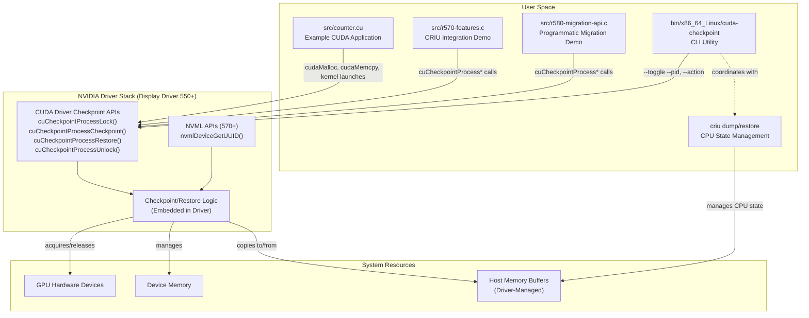
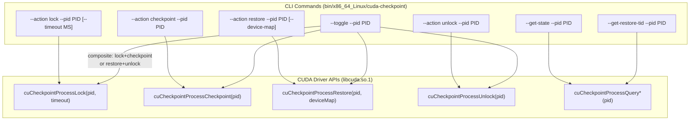
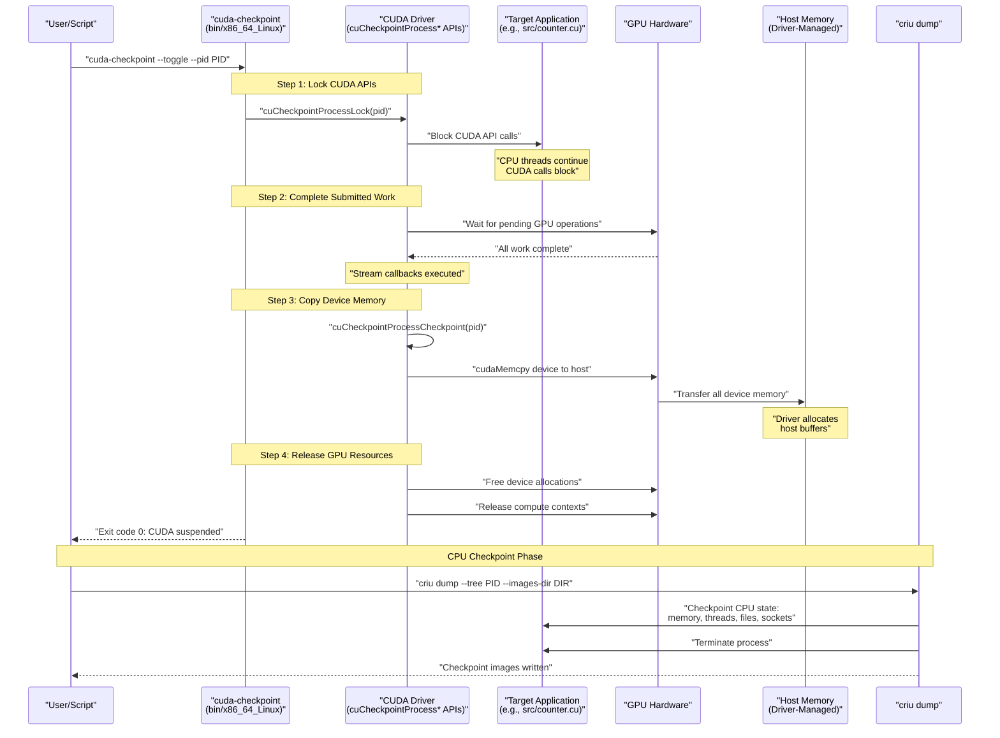
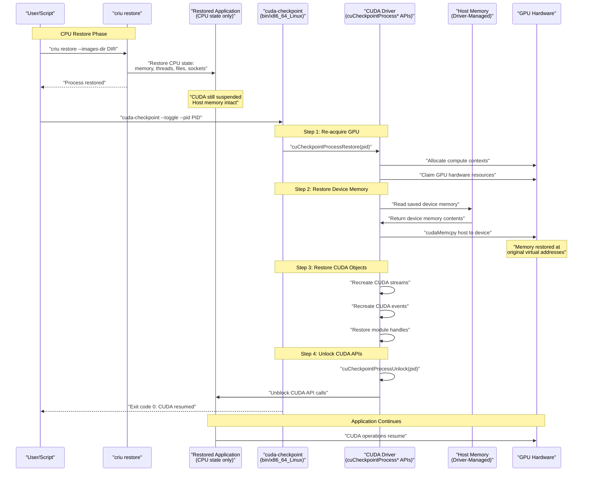
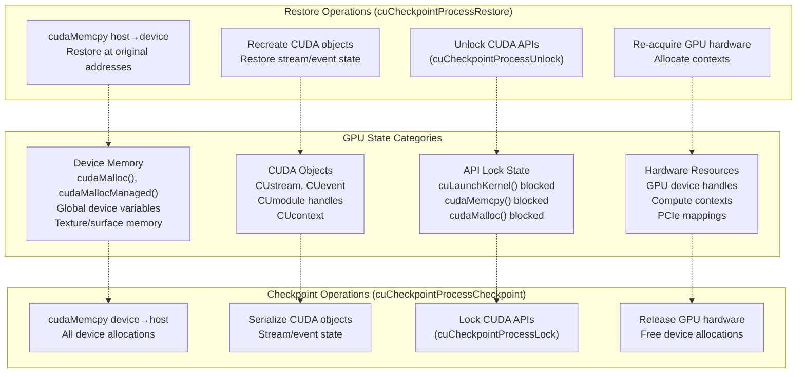
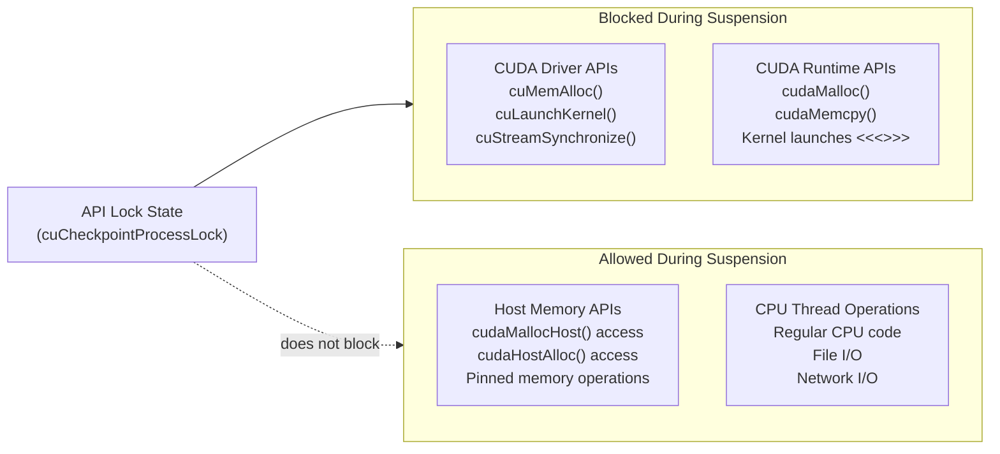
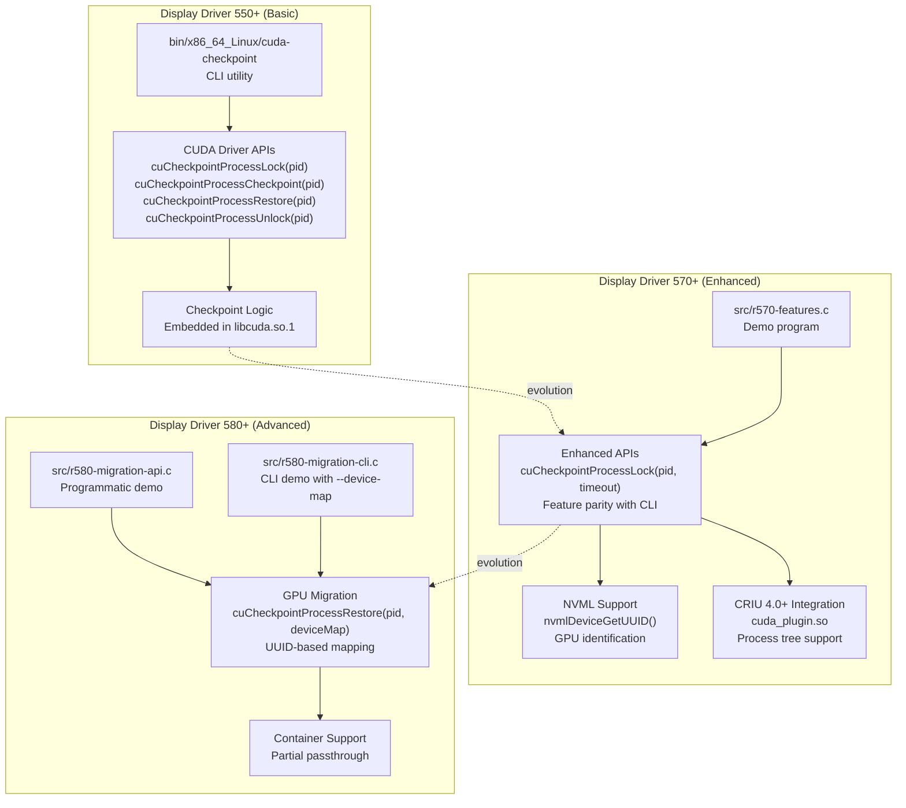
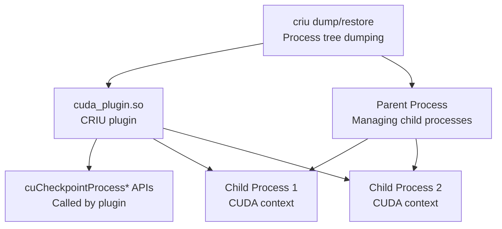
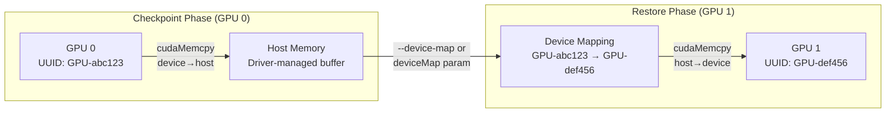

<!-- source: DeepWiki mcp.deepwiki.com · repo NVIDIA/cuda-checkpoint · page 2 Architecture and Design · fetched 2026-10-26 -->

# Architecture and Design

Relevant source files

The following files were used as context for generating this wiki page:

- [README.md](README.md)

This document explains the internal architecture of the cuda-checkpoint system, focusing on how it bridges CRIU and CUDA to enable transparent checkpointing of GPU-accelerated applications. It covers the technical approach to managing GPU state during checkpoint/restore operations and the coordination mechanisms between different system components.

For step-by-step usage instructions, see [Getting Started](#3). For specific command-line options and parameters, see [Command-Line Reference](#4).

## System Architecture Overview

The cuda-checkpoint system implements a **driver-embedded architecture** where checkpoint/restore functionality resides within the NVIDIA CUDA driver itself. The `cuda-checkpoint` utility is a thin command-line wrapper that exposes this driver functionality. This design solves the fundamental problem that CRIU alone cannot handle GPU resources, which exist outside the standard Linux kernel resource model.

**Key Architectural Principle**: The `cuda-checkpoint` utility simply exposes functionality that is contained in the driver. Driver updates add new capabilities without requiring changes to the utility itself.

### High-Level Component Interaction

**Two-Phase Coordination Model**: The architecture enforces strict sequencing where GPU state suspension must complete before CPU checkpointing begins, and CPU restoration must complete before GPU state resumption. This separation allows CRIU to operate on process state without encountering active GPU resources.

Sources: [README.md:3-4](), [README.md:26-27](), [README.md:260-263]()

### Core Components and Responsibilities

| Component | Primary Responsibility | Driver Version Requirements | Code Reference |
|-----------|----------------------|---------------------------|----------------|
| `bin/x86_64_Linux/cuda-checkpoint` | Exposes driver checkpoint APIs via CLI | 550+ | Binary utility |
| CRIU (`criu` command) | CPU state checkpointing and process tree management | Any version (4.0+ for process tree) | External dependency |
| CUDA Driver Checkpoint APIs | Low-level GPU resource management embedded in driver | 550+ | `cuCheckpointProcess*` functions |
| NVML Integration | GPU device identification and monitoring | 570+ | `nvmlDeviceGetUUID()` |
| `src/r570-features.c` | Demonstrates CRIU 4.0+ integration features | 570+ | Demo program |
| `src/r580-migration-api.c` | Demonstrates programmatic GPU migration | 580+ | Demo program |
| `src/r580-migration-cli.c` | Demonstrates CLI-based GPU migration | 580+ | Demo program |

The system architecture evolves across driver versions:
- **Driver 550+**: Core checkpoint/restore with CLI utility
- **Driver 570+**: CUDA Driver APIs at feature parity with CLI, NVML support, CRIU 4.0+ integration, timeout-based locking
- **Driver 580+**: GPU migration via device mapping, container support

Sources: [README.md:8-22](), [README.md:58-59]()

## Command Interface Architecture

The `cuda-checkpoint` utility provides a command-line interface that maps directly to CUDA Driver checkpoint APIs embedded in the driver. The interface is designed for both manual operation and script integration (as demonstrated in [src/example.sh]()).

### Command-to-Driver API Mapping

### Command Interface Design

| CLI Option | Driver API | Parameters | Driver Version | Purpose |
|------------|-----------|------------|----------------|---------|
| `--get-state --pid <pid>` | Query functions | Process ID | 550+ | Check if CUDA is suspended or running |
| `--action lock --pid <pid>` | `cuCheckpointProcessLock()` | Process ID, optional timeout | 550+ (timeout in 570+) | Lock CUDA APIs and prepare for checkpoint |
| `--action checkpoint --pid <pid>` | `cuCheckpointProcessCheckpoint()` | Process ID | 550+ | Save GPU state to host memory |
| `--action restore --pid <pid>` | `cuCheckpointProcessRestore()` | Process ID, optional device map | 550+ (device-map in 580+) | Restore GPU state from host memory |
| `--action unlock --pid <pid>` | `cuCheckpointProcessUnlock()` | Process ID | 550+ | Unlock CUDA APIs and resume execution |
| `--toggle --pid <pid>` | Composite operation | Process ID | 550+ | Automatic suspend/resume based on current state |
| `--get-restore-tid --pid <pid>` | Query function | Process ID | 550+ | Get thread ID used for restore operations |

**Process Targeting**: All operations require `--pid <pid>` to specify the target process. This enables precise control over individual CUDA contexts within multi-process applications (as demonstrated in [src/r570-features.c:59-108]()).

**Timeout Support (570+)**: The `--timeout <ms>` parameter prevents indefinite blocking during lock operations, addressing potential deadlock scenarios in production deployments.

**Device Mapping (580+)**: The `--device-map` parameter enables GPU migration by mapping source GPU UUIDs to destination GPU UUIDs during restore operations (demonstrated in [src/r580-migration-cli.c:72-89]()).

Sources: [README.md:58-89](), [README.md:20]()

## Checkpoint/Restore Workflow Architecture

The checkpoint and restore workflow implements a four-step state machine for GPU state management. These steps coordinate with CRIU to enable complete application checkpointing.

### Suspend (Checkpoint) Workflow

**Diagram: Complete Suspend Workflow with CRIU Integration**

**Workflow Details**:
1. **Lock Phase** ([README.md:97]()): CUDA driver APIs are locked, blocking new GPU operations. CPU threads continue executing and can access host memory.
2. **Completion Phase** ([README.md:98]()): Already-submitted CUDA work completes, including stream callbacks.
3. **Memory Transfer Phase** ([README.md:99]()): Device memory is copied to host memory allocations managed by the driver.
4. **Release Phase** ([README.md:100]()): GPU resources are fully released, leaving no OS-level GPU handles in the process.

After suspension, the process no longer references GPU hardware and can be checkpointed by CRIU ([README.md:106-107]()).

Sources: [README.md:95-107]()

### Resume (Restore) Workflow

**Diagram: Complete Restore Workflow with CRIU Integration**

**Workflow Details**:
1. **Re-acquisition Phase** ([README.md:111]()): GPUs are re-acquired by the process, allocating compute contexts and hardware resources.
2. **Memory Restore Phase** ([README.md:112]()): Device memory is copied back to the GPU with memory mappings restored at original addresses.
3. **Object Restore Phase** ([README.md:113]()): CUDA objects such as streams, events, and contexts are recreated.
4. **Unlock Phase** ([README.md:114]()): CUDA driver APIs are unlocked, allowing GPU operations to resume.

At this point, CUDA calls unblock and the application continues execution as if it had never been suspended ([README.md:116]()).

**Critical Ordering Constraint**: CRIU must restore CPU state before `cuda-checkpoint` restores GPU state. This ordering ensures that the driver can access restored host memory when rebuilding GPU state.

Sources: [README.md:109-116]()

### Example Workflow Script

The [src/example.sh]() script demonstrates the complete workflow:
- Lines 14-18: Launch counter application
- Lines 20-21: Suspend CUDA state with `cuda-checkpoint --toggle`
- Lines 23-24: Checkpoint CPU state with `criu dump`
- Lines 26-27: Restore CPU state with `criu restore`
- Lines 29-30: Resume CUDA state with `cuda-checkpoint --toggle`

Sources: [README.md:118-250]()

## State Management Architecture

The CUDA driver manages four categories of GPU state during checkpoint/restore operations. All state management logic is embedded in the driver itself, with the `cuda-checkpoint` utility acting only as a trigger.

### GPU State Categories and Management

**Diagram: State Category Management**

### State Category Details

| State Category | Checkpoint Behavior | Restore Behavior | Code Example |
|----------------|---------------------|------------------|--------------|
| **Device Memory** | Copied to driver-managed host buffers via `cudaMemcpy` | Copied back to GPU at original virtual addresses | [src/counter.cu:132]() `__device__ int counter` |
| **CUDA Objects** | Stream/event/context state serialized by driver | Objects recreated with identical handles and state | `CUstream`, `CUevent` objects |
| **API Locks** | All CUDA APIs blocked (except host memory access) | APIs unblocked, allowing operation submission | `cuLaunchKernel()`, `cudaMalloc()` |
| **Hardware Resources** | GPU device handles released, process has no GPU attachment | GPU contexts re-allocated, hardware resources claimed | Compute contexts, PCIe mappings |

**Memory Address Preservation**: The driver ensures GPU memory mappings are restored at their original virtual addresses ([README.md:112]()), maintaining pointer validity across checkpoint/restore cycles. This allows device pointers stored in host memory to remain valid.

**Thread Behavior During Suspension**: CPU threads continue executing during CUDA suspension ([README.md:102-104]()). Host memory allocated by CUDA APIs (via `cudaMallocHost`, `cudaHostAlloc`) remains accessible. CUDA API calls block until unlock.

Sources: [README.md:95-114]()

### API Locking Scope

**Diagram: API Blocking Behavior**

The driver's API locking mechanism selectively blocks GPU-related operations while allowing CPU operations and host memory access to continue. This enables CPU threads to remain active during suspension, supporting use cases like maintaining network connections while GPU state is checkpointed.

Sources: [README.md:102-104]()

### API Locking Mechanism

The system implements a sophisticated API locking mechanism to ensure consistency during state transitions:

| Lock Scope | Affected APIs | Behavior During Lock |
|------------|---------------|---------------------|
| Driver APIs | `cuMemAlloc`, `cuLaunchKernel`, `cuStreamSynchronize` | Block until unlock |
| Runtime APIs | `cudaMalloc`, `cudaMemcpy`, kernel launches | Block until unlock |
| Host Memory APIs | `cudaMallocHost`, `cudaHostAlloc` | **Continue operating** |
| CPU Threads | Application CPU code | **Continue executing** |

**Thread Safety**: CPU threads continue execution during CUDA suspension and can safely access host memory allocated by CUDA APIs, but CUDA API calls will block until resumption.

Sources: [README.md:95-97]()

## Driver Integration Model

The checkpoint/restore functionality is embedded within the NVIDIA display driver and evolves across driver versions. The `cuda-checkpoint` utility remains unchanged while driver updates add new capabilities.

### Feature Evolution Across Driver Versions

**Diagram: Driver Version Feature Availability**

### Driver Version Feature Matrix

| Feature | Driver 550+ | Driver 570+ | Driver 580+ | Code Reference |
|---------|-------------|-------------|-------------|----------------|
| **CLI Utility** | `bin/x86_64_Linux/cuda-checkpoint` | Same utility, no changes | Same utility, no changes | Binary unchanged |
| **Lock API** | `cuCheckpointProcessLock(pid)` | `cuCheckpointProcessLock(pid, timeout)` | Same as 570 | Timeout parameter added |
| **Checkpoint API** | `cuCheckpointProcessCheckpoint(pid)` | Same | Same | No changes |
| **Restore API** | `cuCheckpointProcessRestore(pid)` | Same | `cuCheckpointProcessRestore(pid, deviceMap)` | Device mapping added |
| **Unlock API** | `cuCheckpointProcessUnlock(pid)` | Same | Same | No changes |
| **NVML Support** | ❌ | ✅ `nvmlDeviceGetUUID()` | ✅ | [README.md:17]() |
| **CRIU Integration** | Basic | CRIU 4.0+ with `cuda_plugin.so` | Same as 570 | [README.md:18]() |
| **Process Tree Support** | ❌ | ✅ via CRIU 4.0+ | ✅ | [src/r570-features.c:59-108]() |
| **Timeout Mechanism** | ❌ | ✅ `--timeout <ms>` | ✅ | [README.md:20]() |
| **GPU Migration** | ❌ | ❌ | ✅ `--device-map` parameter | [README.md:10](), [src/r580-migration-api.c](), [src/r580-migration-cli.c]() |
| **Container Support** | ❌ | ❌ | ✅ Partial passthrough | [README.md:11]() |
| **Programmatic APIs** | ❌ | ✅ Feature parity with CLI | ✅ | [README.md:19]() |

**Architectural Insight**: The binary utility at `bin/x86_64_Linux/cuda-checkpoint` does not change across driver versions. New features are exposed by the underlying driver APIs, demonstrating the driver-embedded architecture ([README.md:260-263]()).

Sources: [README.md:8-22]()

### Driver 570+ CRIU Integration

Driver 570 introduced deeper integration with CRIU 4.0+ through a plugin mechanism:

**Diagram: CRIU Plugin Architecture (570+)**

The [src/r570-features.c]() demo shows this integration, where a parent process forks child processes that each have CUDA contexts. CRIU 4.0+ can checkpoint the entire process tree, with the `cuda_plugin.so` ensuring each child process's GPU state is properly suspended and resumed.

Sources: [README.md:18](), [src/r570-features.c:59-108]()

### Driver 580+ GPU Migration Architecture

Driver 580 added GPU migration capabilities, allowing checkpoint on one GPU and restore on a different GPU:

**Diagram: GPU Migration with Device Mapping**

Migration is demonstrated in two ways:
- **Programmatic**: [src/r580-migration-api.c]() uses `cuCheckpointProcessRestore()` with a device map structure
- **CLI**: [src/r580-migration-cli.c]() uses `cuda-checkpoint --action restore --device-map` parameter

The device map specifies source GPU UUID to destination GPU UUID mappings, allowing the driver to redirect GPU allocations during restore.

Sources: [README.md:10-13](), [src/r580-migration-api.c](), [src/r580-migration-cli.c]()

## System Limitations and Constraints

The current architecture has specific limitations that constrain its applicability:

### Architectural Constraints

| Limitation Category | Specific Constraints | Architectural Impact |
|-------------------|---------------------|---------------------|
| Platform Support | x64 only | Memory layout assumptions |
| Memory Types | No UVM or IPC memory support | Simplified memory management model |
| Migration | No GPU migration support | Single-node constraint |
| Work Completion | Must wait for submitted work | Synchronous checkpoint model |
| Error Handling | Limited error recovery | Fail-fast approach |

**Work Completion Model**: The architecture implements a **completion-based** approach where all submitted CUDA work must finish before checkpoint proceeds, rather than attempting to serialize in-flight operations.

**Error Recovery Strategy**: The system follows a **fail-fast** approach where encountering unsupported features (like UVM allocations) during checkpoint results in leaving the process in an undefined state rather than attempting partial recovery.

Sources: [README.md:245-257]()

---

