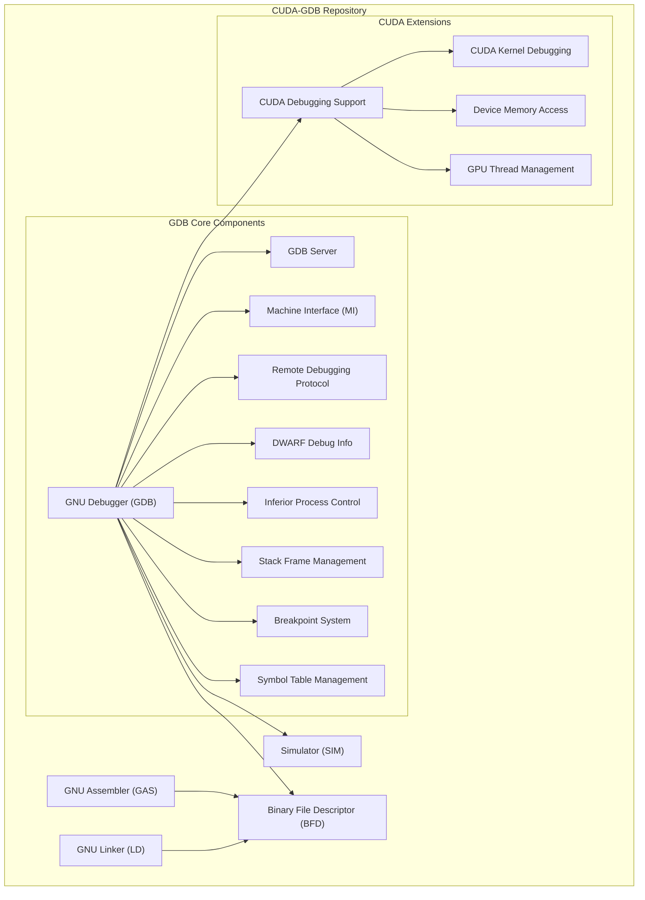
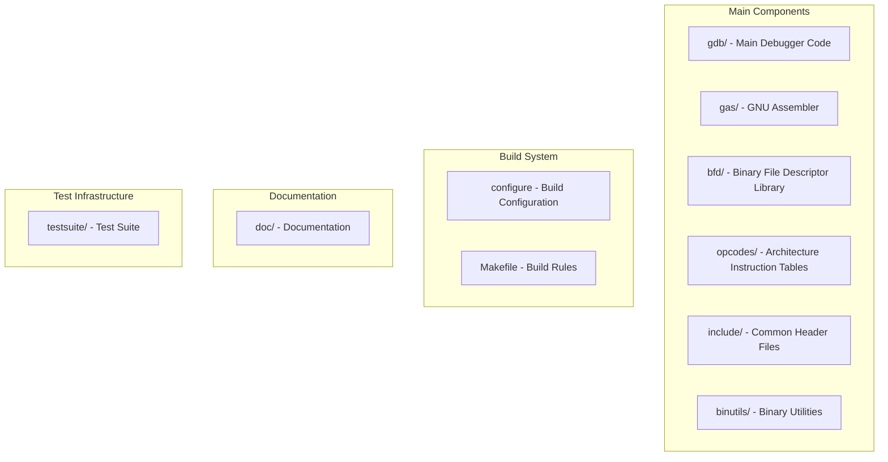
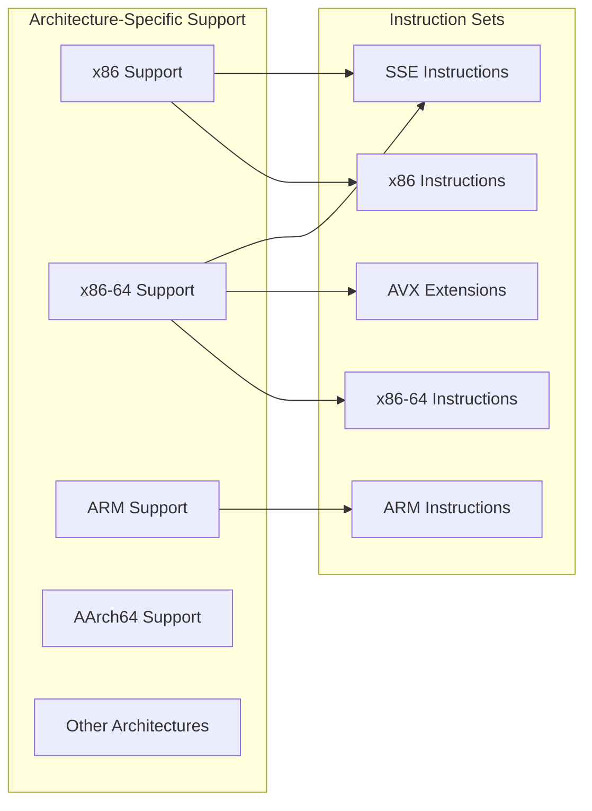
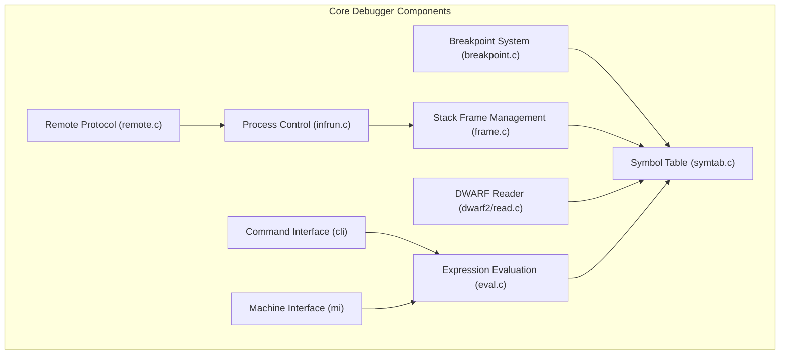

<!-- source: DeepWiki mcp.deepwiki.com · repo NVIDIA/cuda-gdb · page 1 Overview · fetched 2026-10-26 -->

# Overview

Relevant source files

The following files were used as context for generating this wiki page:

- [ChangeLog](ChangeLog)
- [bfd/ChangeLog](bfd/ChangeLog)
- [bfd/doc/chew.c](bfd/doc/chew.c)
- [bfd/doc/doc.str](bfd/doc/doc.str)
- [bfd/doc/proto.str](bfd/doc/proto.str)
- [binutils/ChangeLog](binutils/ChangeLog)
- [binutils/NEWS](binutils/NEWS)
- [binutils/dwarf.c](binutils/dwarf.c)
- [binutils/dwarf.h](binutils/dwarf.h)
- [binutils/elfcomm.c](binutils/elfcomm.c)
- [binutils/elfcomm.h](binutils/elfcomm.h)
- [binutils/readelf.c](binutils/readelf.c)
- [binutils/testsuite/binutils-all/display-section-0.r](binutils/testsuite/binutils-all/display-section-0.r)
- [binutils/testsuite/binutils-all/display-section-rel.r](binutils/testsuite/binutils-all/display-section-rel.r)
- [binutils/testsuite/binutils-all/dw5.W](binutils/testsuite/binutils-all/dw5.W)
- [binutils/testsuite/binutils-all/objdump.WL](binutils/testsuite/binutils-all/objdump.WL)
- [binutils/testsuite/binutils-all/pr26160.r](binutils/testsuite/binutils-all/pr26160.r)
- [binutils/testsuite/binutils-all/readelf-debug-str-offsets-dw4.d](binutils/testsuite/binutils-all/readelf-debug-str-offsets-dw4.d)
- [binutils/testsuite/binutils-all/readelf-debug-str-offsets-dw4.s](binutils/testsuite/binutils-all/readelf-debug-str-offsets-dw4.s)
- [binutils/testsuite/binutils-all/readelf.exp](binutils/testsuite/binutils-all/readelf.exp)
- [binutils/testsuite/binutils-all/relr.s](binutils/testsuite/binutils-all/relr.s)
- [cpu/ChangeLog](cpu/ChangeLog)
- [elfcpp/ChangeLog](elfcpp/ChangeLog)
- [gas/ChangeLog](gas/ChangeLog)
- [gas/NEWS](gas/NEWS)
- [gas/config/tc-i386.c](gas/config/tc-i386.c)
- [gas/doc/c-bpf.texi](gas/doc/c-bpf.texi)
- [gas/doc/c-i386.texi](gas/doc/c-i386.texi)
- [gas/testsuite/gas/i386/i386.exp](gas/testsuite/gas/i386/i386.exp)
- [gas/testsuite/gas/i386/x86-64.exp](gas/testsuite/gas/i386/x86-64.exp)
- [gold/ChangeLog](gold/ChangeLog)
- [gprof/ChangeLog](gprof/ChangeLog)
- [include/ChangeLog](include/ChangeLog)
- [include/elf/common.h](include/elf/common.h)
- [include/opcode/bpf.h](include/opcode/bpf.h)
- [opcodes/ChangeLog](opcodes/ChangeLog)
- [opcodes/bpf-opc.c](opcodes/bpf-opc.c)
- [opcodes/i386-dis.c](opcodes/i386-dis.c)
- [opcodes/i386-gen.c](opcodes/i386-gen.c)
- [opcodes/i386-init.h](opcodes/i386-init.h)
- [opcodes/i386-mnem.h](opcodes/i386-mnem.h)
- [opcodes/i386-opc.h](opcodes/i386-opc.h)
- [opcodes/i386-opc.tbl](opcodes/i386-opc.tbl)
- [opcodes/i386-tbl.h](opcodes/i386-tbl.h)

CUDA-GDB is a specialized version of the GNU Debugger (GDB) that adds support for debugging NVIDIA CUDA applications. This document provides an introduction to the CUDA-GDB repository and its major components.

CUDA-GDB allows developers to debug both CPU and GPU code within CUDA applications, providing features like breakpoints, memory inspection, and variable examination across the full CPU-GPU execution environment.

## Purpose and Scope

The CUDA-GDB repository contains modified and extended versions of GDB components to support debugging of CUDA applications. It is built on the GNU Debugger infrastructure with NVIDIA-specific extensions for working with CUDA kernels running on GPUs.

For detailed information on the architecture and components, see [Architecture](#1.1). For build instructions, see [Build System](#1.2).

## Components Overview

Sources: [gas/config/tc-i386.c:21-27](), [opcodes/i386-opc.tbl:21-26]()

## Key Features

CUDA-GDB extends the standard GDB debugger with capabilities specific to CUDA development:

- Debugging of CUDA applications across CPU and GPU code
- Support for multiple CUDA contexts and devices
- Ability to set breakpoints in GPU kernels
- Inspection of GPU memory and variables
- Focus mode for managing thousands of GPU threads
- Support for debugging optimized CUDA code

## Repository Structure

The repository follows the standard GNU toolchain structure with additional components for CUDA support:

Sources: [gas/config/tc-i386.c](), [binutils/ChangeLog](), [gprof/ChangeLog](), [opcodes/i386-opc.tbl]()

## Architecture Support

CUDA-GDB supports various CPU architectures, with a primary focus on x86 and x86-64 platforms where CUDA development is most common. The support for different architectures is organized as follows:

| Architecture | Support Level | Description |
|--------------|--------------|-------------|
| x86-64       | Primary      | Full support for host-side debugging |
| x86 (32-bit) | Good         | Support for 32-bit host applications |
| ARM          | Limited      | Support for some ARM-based platforms |
| AArch64      | Limited      | Support for some 64-bit ARM platforms |
| POWER        | Limited      | Support for IBM POWER platforms |

The repository contains extensive processor-specific code, particularly for x86-based systems, as shown in the architecture-specific support files:

Sources: [gas/config/tc-i386.c:1037-1176](), [opcodes/i386-opc.tbl:29-179]()

## Debugger Components

The GDB core of CUDA-GDB consists of several key subsystems that work together to provide the debugging functionality:

Sources: [gas/config/tc-i386.c:147-172](), [binutils/dwarf.c:52-62]()

## Relation to Standard GDB

CUDA-GDB is built on the GNU Debugger infrastructure with extensions for GPU debugging. It maintains compatibility with standard GDB commands while adding CUDA-specific capabilities.

Key differences include:
1. Support for setting breakpoints in CUDA kernels
2. Ability to inspect GPU memory spaces (global, shared, local, etc.)
3. Special focus mode for managing thousands of GPU threads
4. Extensions for handling CUDA-specific constructs like grids, blocks, and warps

Sources: [binutils/readelf.c:26-41]()

## Summary

CUDA-GDB provides a powerful debugging environment for CUDA applications by extending the GNU Debugger with GPU-specific capabilities. It allows developers to debug across CPU and GPU boundaries, inspect GPU memory, and manage the complex parallelism of CUDA applications.

The repository contains modified versions of the standard GNU toolchain components, with specific extensions to support the unique requirements of CUDA development and debugging.

---

