# Page: Overview

# Overview

<details>
<summary>Relevant source files</summary>

The following files were used as context for generating this wiki page:

- [ChangeLog](ChangeLog)
- [bfd/ChangeLog](bfd/ChangeLog)
- [bfd/doc/chew.c](bfd/doc/chew.c)
- [bfd/doc/doc.str](bfd/doc/doc.str)
- [bfd/doc/proto.str](bfd/doc/proto.str)
- [binutils/ChangeLog](binutils/ChangeLog)
- [binutils/NEWS](binutils/NEWS)
- [binutils/dwarf.c](binutils/dwarf.c)
- [binutils/dwarf.h](binutils/dwarf.h)
- [binutils/elfcomm.c](binutils/elfcomm.c)
- [binutils/elfcomm.h](binutils/elfcomm.h)
- [binutils/readelf.c](binutils/readelf.c)
- [binutils/testsuite/binutils-all/display-section-0.r](binutils/testsuite/binutils-all/display-section-0.r)
- [binutils/testsuite/binutils-all/display-section-rel.r](binutils/testsuite/binutils-all/display-section-rel.r)
- [binutils/testsuite/binutils-all/dw5.W](binutils/testsuite/binutils-all/dw5.W)
- [binutils/testsuite/binutils-all/objdump.WL](binutils/testsuite/binutils-all/objdump.WL)
- [binutils/testsuite/binutils-all/pr26160.r](binutils/testsuite/binutils-all/pr26160.r)
- [binutils/testsuite/binutils-all/readelf-debug-str-offsets-dw4.d](binutils/testsuite/binutils-all/readelf-debug-str-offsets-dw4.d)
- [binutils/testsuite/binutils-all/readelf-debug-str-offsets-dw4.s](binutils/testsuite/binutils-all/readelf-debug-str-offsets-dw4.s)
- [binutils/testsuite/binutils-all/readelf.exp](binutils/testsuite/binutils-all/readelf.exp)
- [binutils/testsuite/binutils-all/relr.s](binutils/testsuite/binutils-all/relr.s)
- [cpu/ChangeLog](cpu/ChangeLog)
- [elfcpp/ChangeLog](elfcpp/ChangeLog)
- [gas/ChangeLog](gas/ChangeLog)
- [gas/NEWS](gas/NEWS)
- [gas/config/tc-i386.c](gas/config/tc-i386.c)
- [gas/doc/c-bpf.texi](gas/doc/c-bpf.texi)
- [gas/doc/c-i386.texi](gas/doc/c-i386.texi)
- [gas/testsuite/gas/i386/i386.exp](gas/testsuite/gas/i386/i386.exp)
- [gas/testsuite/gas/i386/x86-64.exp](gas/testsuite/gas/i386/x86-64.exp)
- [gold/ChangeLog](gold/ChangeLog)
- [gprof/ChangeLog](gprof/ChangeLog)
- [include/ChangeLog](include/ChangeLog)
- [include/elf/common.h](include/elf/common.h)
- [include/opcode/bpf.h](include/opcode/bpf.h)
- [opcodes/ChangeLog](opcodes/ChangeLog)
- [opcodes/bpf-opc.c](opcodes/bpf-opc.c)
- [opcodes/i386-dis.c](opcodes/i386-dis.c)
- [opcodes/i386-gen.c](opcodes/i386-gen.c)
- [opcodes/i386-init.h](opcodes/i386-init.h)
- [opcodes/i386-mnem.h](opcodes/i386-mnem.h)
- [opcodes/i386-opc.h](opcodes/i386-opc.h)
- [opcodes/i386-opc.tbl](opcodes/i386-opc.tbl)
- [opcodes/i386-tbl.h](opcodes/i386-tbl.h)

</details>


CUDA-GDB is a specialized version of the GNU Debugger (GDB) that adds support for debugging NVIDIA CUDA applications. This document provides an introduction to the CUDA-GDB repository and its major components.

CUDA-GDB allows developers to debug both CPU and GPU code within CUDA applications, providing features like breakpoints, memory inspection, and variable examination across the full CPU-GPU execution environment.

## Purpose and Scope

The CUDA-GDB repository contains modified and extended versions of GDB components to support debugging of CUDA applications. It is built on the GNU Debugger infrastructure with NVIDIA-specific extensions for working with CUDA kernels running on GPUs.

For detailed information on the architecture and components, see [Architecture](#1.1). For build instructions, see [Build System](#1.2).

## Components Overview

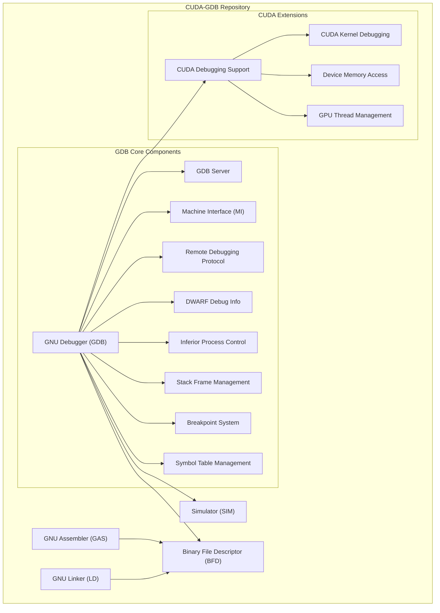

Sources: [gas/config/tc-i386.c:21-27](), [opcodes/i386-opc.tbl:21-26]()

## Key Features

CUDA-GDB extends the standard GDB debugger with capabilities specific to CUDA development:

- Debugging of CUDA applications across CPU and GPU code
- Support for multiple CUDA contexts and devices
- Ability to set breakpoints in GPU kernels
- Inspection of GPU memory and variables
- Focus mode for managing thousands of GPU threads
- Support for debugging optimized CUDA code

## Repository Structure

The repository follows the standard GNU toolchain structure with additional components for CUDA support:

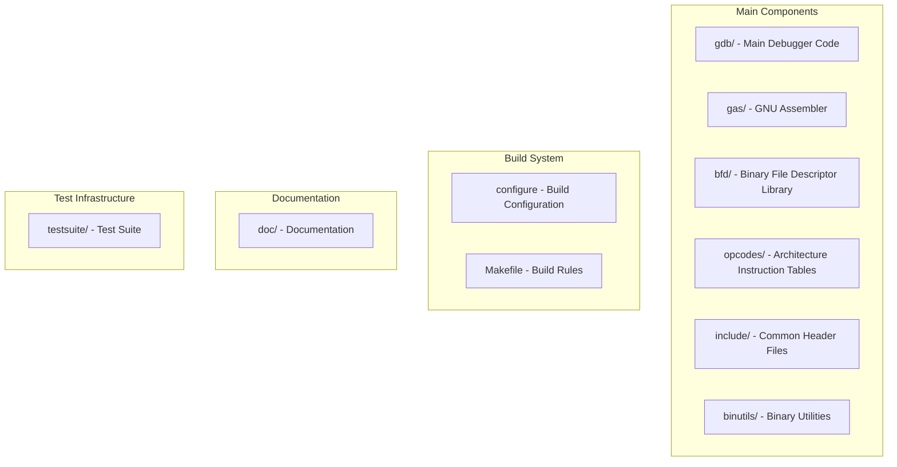

Sources: [gas/config/tc-i386.c](), [binutils/ChangeLog](), [gprof/ChangeLog](), [opcodes/i386-opc.tbl]()

## Architecture Support

CUDA-GDB supports various CPU architectures, with a primary focus on x86 and x86-64 platforms where CUDA development is most common. The support for different architectures is organized as follows:

| Architecture | Support Level | Description |
|--------------|--------------|-------------|
| x86-64       | Primary      | Full support for host-side debugging |
| x86 (32-bit) | Good         | Support for 32-bit host applications |
| ARM          | Limited      | Support for some ARM-based platforms |
| AArch64      | Limited      | Support for some 64-bit ARM platforms |
| POWER        | Limited      | Support for IBM POWER platforms |

The repository contains extensive processor-specific code, particularly for x86-based systems, as shown in the architecture-specific support files:

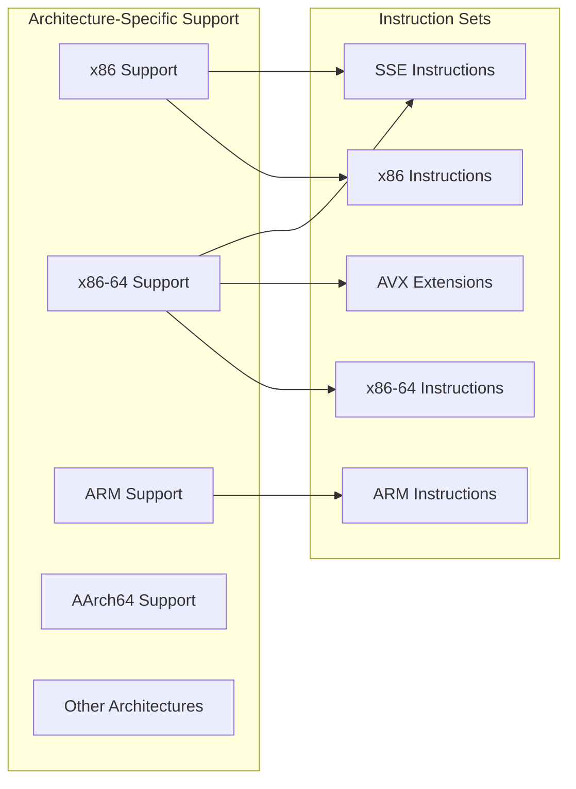

Sources: [gas/config/tc-i386.c:1037-1176](), [opcodes/i386-opc.tbl:29-179]()

## Debugger Components

The GDB core of CUDA-GDB consists of several key subsystems that work together to provide the debugging functionality:

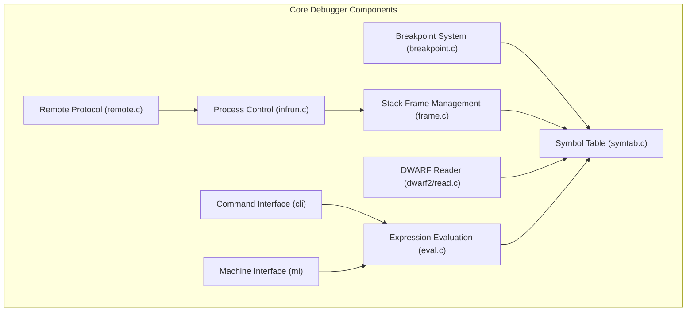

Sources: [gas/config/tc-i386.c:147-172](), [binutils/dwarf.c:52-62]()

## Relation to Standard GDB

CUDA-GDB is built on the GNU Debugger infrastructure with extensions for GPU debugging. It maintains compatibility with standard GDB commands while adding CUDA-specific capabilities.

Key differences include:
1. Support for setting breakpoints in CUDA kernels
2. Ability to inspect GPU memory spaces (global, shared, local, etc.)
3. Special focus mode for managing thousands of GPU threads
4. Extensions for handling CUDA-specific constructs like grids, blocks, and warps

Sources: [binutils/readelf.c:26-41]()

## Summary

CUDA-GDB provides a powerful debugging environment for CUDA applications by extending the GNU Debugger with GPU-specific capabilities. It allows developers to debug across CPU and GPU boundaries, inspect GPU memory, and manage the complex parallelism of CUDA applications.

The repository contains modified versions of the standard GNU toolchain components, with specific extensions to support the unique requirements of CUDA development and debugging.

---

# Page: Architecture

# Architecture

<details>
<summary>Relevant source files</summary>

The following files were used as context for generating this wiki page:

- [bfd/aout-target.h](bfd/aout-target.h)
- [bfd/elf-bfd.h](bfd/elf-bfd.h)
- [bfd/elf.c](bfd/elf.c)
- [bfd/elf32-i386.c](bfd/elf32-i386.c)
- [bfd/elf64-x86-64.c](bfd/elf64-x86-64.c)
- [bfd/elfcode.h](bfd/elfcode.h)
- [bfd/elflink.c](bfd/elflink.c)
- [bfd/elfxx-target.h](bfd/elfxx-target.h)
- [bfd/elfxx-x86.c](bfd/elfxx-x86.c)
- [bfd/elfxx-x86.h](bfd/elfxx-x86.h)
- [bfd/mach-o-target.c](bfd/mach-o-target.c)
- [bfd/plugin.c](bfd/plugin.c)
- [bfd/ppcboot.c](bfd/ppcboot.c)
- [gas/config/tc-aarch64-ginsn.c](gas/config/tc-aarch64-ginsn.c)
- [gas/config/tc-aarch64.h](gas/config/tc-aarch64.h)
- [gas/config/tc-i386-intel.c](gas/config/tc-i386-intel.c)
- [gas/config/tc-i386.h](gas/config/tc-i386.h)
- [gas/testsuite/gas/i386/x86-64-apx-egpr-inval.l](gas/testsuite/gas/i386/x86-64-apx-egpr-inval.l)
- [gas/testsuite/gas/i386/x86-64-apx-egpr-inval.s](gas/testsuite/gas/i386/x86-64-apx-egpr-inval.s)
- [gdb/compile/compile-loc2c.c](gdb/compile/compile-loc2c.c)
- [gdb/dwarf2/abbrev-table-cache.c](gdb/dwarf2/abbrev-table-cache.c)
- [gdb/dwarf2/abbrev-table-cache.h](gdb/dwarf2/abbrev-table-cache.h)
- [gdb/dwarf2/abbrev.c](gdb/dwarf2/abbrev.c)
- [gdb/dwarf2/abbrev.h](gdb/dwarf2/abbrev.h)
- [gdb/dwarf2/aranges.c](gdb/dwarf2/aranges.c)
- [gdb/dwarf2/aranges.h](gdb/dwarf2/aranges.h)
- [gdb/dwarf2/attribute.c](gdb/dwarf2/attribute.c)
- [gdb/dwarf2/attribute.h](gdb/dwarf2/attribute.h)
- [gdb/dwarf2/call-site.h](gdb/dwarf2/call-site.h)
- [gdb/dwarf2/comp-unit-head.c](gdb/dwarf2/comp-unit-head.c)
- [gdb/dwarf2/comp-unit-head.h](gdb/dwarf2/comp-unit-head.h)
- [gdb/dwarf2/cooked-index.c](gdb/dwarf2/cooked-index.c)
- [gdb/dwarf2/cooked-index.h](gdb/dwarf2/cooked-index.h)
- [gdb/dwarf2/cu.c](gdb/dwarf2/cu.c)
- [gdb/dwarf2/cu.h](gdb/dwarf2/cu.h)
- [gdb/dwarf2/die.c](gdb/dwarf2/die.c)
- [gdb/dwarf2/die.h](gdb/dwarf2/die.h)
- [gdb/dwarf2/dwz.c](gdb/dwarf2/dwz.c)
- [gdb/dwarf2/dwz.h](gdb/dwarf2/dwz.h)
- [gdb/dwarf2/index-cache.c](gdb/dwarf2/index-cache.c)
- [gdb/dwarf2/index-cache.h](gdb/dwarf2/index-cache.h)
- [gdb/dwarf2/index-common.h](gdb/dwarf2/index-common.h)
- [gdb/dwarf2/index-write.c](gdb/dwarf2/index-write.c)
- [gdb/dwarf2/line-header.h](gdb/dwarf2/line-header.h)
- [gdb/dwarf2/mapped-index.h](gdb/dwarf2/mapped-index.h)
- [gdb/dwarf2/read-debug-names.c](gdb/dwarf2/read-debug-names.c)
- [gdb/dwarf2/read-debug-names.h](gdb/dwarf2/read-debug-names.h)
- [gdb/dwarf2/read-gdb-index.c](gdb/dwarf2/read-gdb-index.c)
- [gdb/dwarf2/read.c](gdb/dwarf2/read.c)
- [gdb/dwarf2/read.h](gdb/dwarf2/read.h)
- [gdb/dwarf2/section.c](gdb/dwarf2/section.c)
- [gdb/gdb-gdb.gdb.in](gdb/gdb-gdb.gdb.in)
- [gdb/osdata.c](gdb/osdata.c)
- [gdb/regcache-dump.c](gdb/regcache-dump.c)
- [gdb/regcache.c](gdb/regcache.c)
- [gdb/regcache.h](gdb/regcache.h)
- [gdb/testsuite/gdb.dwarf2/gdb-index-cxx.exp](gdb/testsuite/gdb.dwarf2/gdb-index-cxx.exp)
- [gdb/testsuite/gdb.gdb/index-file.exp](gdb/testsuite/gdb.gdb/index-file.exp)
- [gdb/testsuite/gdb.linespec/cpcompletion.cc](gdb/testsuite/gdb.linespec/cpcompletion.cc)
- [gdb/testsuite/gdb.linespec/cpcompletion.exp](gdb/testsuite/gdb.linespec/cpcompletion.exp)
- [gdb/testsuite/gdb.linespec/cpls.cc](gdb/testsuite/gdb.linespec/cpls.cc)
- [gdb/testsuite/gdb.server/server-run.exp](gdb/testsuite/gdb.server/server-run.exp)
- [gdbserver/debug.cc](gdbserver/debug.cc)
- [gdbserver/debug.h](gdbserver/debug.h)
- [gdbserver/gdbthread.h](gdbserver/gdbthread.h)
- [gdbserver/inferiors.cc](gdbserver/inferiors.cc)
- [gdbserver/inferiors.h](gdbserver/inferiors.h)
- [gdbserver/linux-arm-low.cc](gdbserver/linux-arm-low.cc)
- [gdbserver/linux-low.cc](gdbserver/linux-low.cc)
- [gdbserver/linux-low.h](gdbserver/linux-low.h)
- [gdbserver/linux-mips-low.cc](gdbserver/linux-mips-low.cc)
- [gdbserver/linux-ppc-low.cc](gdbserver/linux-ppc-low.cc)
- [gdbserver/linux-s390-low.cc](gdbserver/linux-s390-low.cc)
- [gdbserver/mem-break.cc](gdbserver/mem-break.cc)
- [gdbserver/netbsd-low.cc](gdbserver/netbsd-low.cc)
- [gdbserver/netbsd-low.h](gdbserver/netbsd-low.h)
- [gdbserver/regcache.cc](gdbserver/regcache.cc)
- [gdbserver/regcache.h](gdbserver/regcache.h)
- [gdbserver/remote-utils.cc](gdbserver/remote-utils.cc)
- [gdbserver/server.cc](gdbserver/server.cc)
- [gdbserver/target.cc](gdbserver/target.cc)
- [gdbserver/target.h](gdbserver/target.h)
- [gdbserver/thread-db.cc](gdbserver/thread-db.cc)
- [gdbserver/tracepoint.cc](gdbserver/tracepoint.cc)
- [gdbserver/win32-low.cc](gdbserver/win32-low.cc)
- [gdbsupport/common-regcache.h](gdbsupport/common-regcache.h)
- [ld/testsuite/ld-i386/i386.exp](ld/testsuite/ld-i386/i386.exp)
- [ld/testsuite/ld-i386/start.s](ld/testsuite/ld-i386/start.s)
- [ld/testsuite/ld-x86-64/apx-load1.s](ld/testsuite/ld-x86-64/apx-load1.s)
- [ld/testsuite/ld-x86-64/apx-load1a.d](ld/testsuite/ld-x86-64/apx-load1a.d)
- [ld/testsuite/ld-x86-64/apx-load1b.d](ld/testsuite/ld-x86-64/apx-load1b.d)
- [ld/testsuite/ld-x86-64/apx-load1c.d](ld/testsuite/ld-x86-64/apx-load1c.d)
- [ld/testsuite/ld-x86-64/apx-load1d.d](ld/testsuite/ld-x86-64/apx-load1d.d)
- [ld/testsuite/ld-x86-64/load4.d](ld/testsuite/ld-x86-64/load4.d)
- [ld/testsuite/ld-x86-64/load4.s](ld/testsuite/ld-x86-64/load4.s)
- [ld/testsuite/ld-x86-64/pr19609-4c.d](ld/testsuite/ld-x86-64/pr19609-4c.d)
- [ld/testsuite/ld-x86-64/pr32067.s](ld/testsuite/ld-x86-64/pr32067.s)
- [ld/testsuite/ld-x86-64/tlsie5.d](ld/testsuite/ld-x86-64/tlsie5.d)
- [ld/testsuite/ld-x86-64/x86-64.exp](ld/testsuite/ld-x86-64/x86-64.exp)

</details>


This document explains the high-level architecture of CUDA-GDB, a specialized version of the GNU Debugger (GDB) that adds support for debugging NVIDIA CUDA applications. It provides an overview of the major components of the system and how they interact to enable debugging of GPU code.

## Overview of CUDA-GDB

CUDA-GDB extends the standard GNU Debugger with capabilities for debugging applications that use NVIDIA's CUDA platform. It integrates with the existing GDB architecture while adding specialized components for GPU debugging.

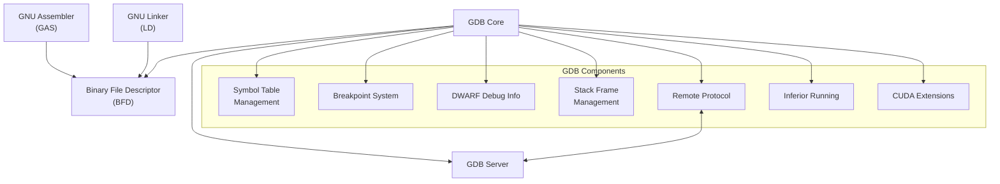

Sources: [gdb/dwarf2/read.c:1-100](). [bfd/elf.c:16-45](). [gdbserver/server.cc:19-50]().

## Major Subsystems

CUDA-GDB consists of several major subsystems that work together to provide debugging capabilities:

### 1. Core GDB

The GDB core provides the foundation for the debugger, with components handling symbols, breakpoints, stack frames, and process control.

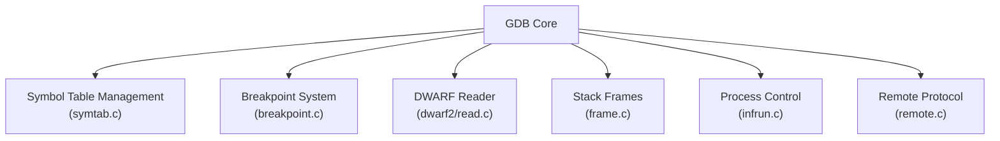

Sources: [gdb/dwarf2/read.c:500-750](). [gdb/regcache.c:5-20]().

### 2. Binary File Descriptor (BFD)

The BFD library provides a uniform interface to access various object file formats:

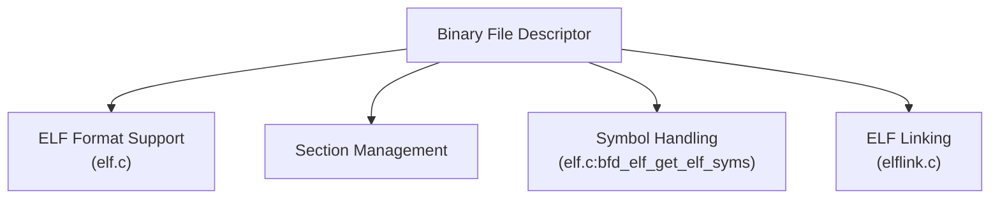

Sources: [bfd/elf.c:361-410](). [bfd/elflink.c:180-230](). [bfd/elf-bfd.h:65-85]().

### 3. DWARF Debug Information Processing

CUDA-GDB heavily relies on DWARF debug information for debugging both CPU and GPU code:

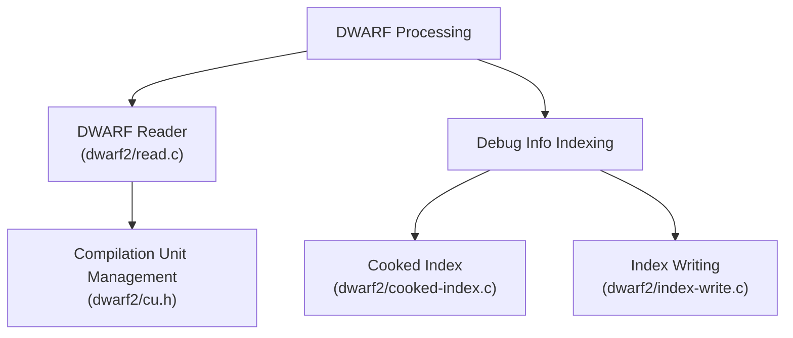

Sources: [gdb/dwarf2/read.c:27-100](). [gdb/dwarf2/cooked-index.c:1-100](). [gdb/dwarf2/cooked-index.h:19-100](). [gdb/dwarf2/index-write.c:19-70](). [gdb/dwarf2/cu.h:1-20]().

### 4. Remote Debugging

CUDA-GDB supports remote debugging through GDB Server:

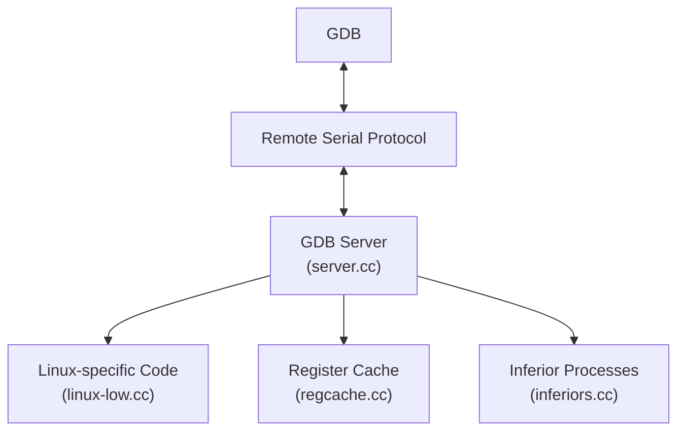

Sources: [gdbserver/server.cc:1-100](). [gdbserver/linux-low.cc:1-100](). [gdbserver/regcache.cc:1-50](). [gdbserver/inferiors.cc:1-20]().

### 5. Cooked Index System

The cooked index is an optimized index of debugging information that CUDA-GDB uses to efficiently locate symbols and types:

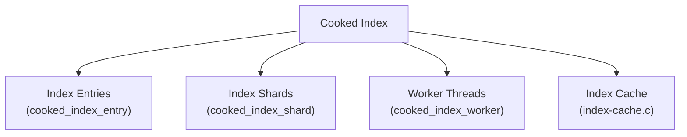

Sources: [gdb/dwarf2/cooked-index.h:102-259](). [gdb/dwarf2/cooked-index.c:449-560](). [gdb/dwarf2/index-cache.c:1-20]().

## Data Flow in CUDA-GDB

The following diagram illustrates how data flows through the different components during a debugging session:

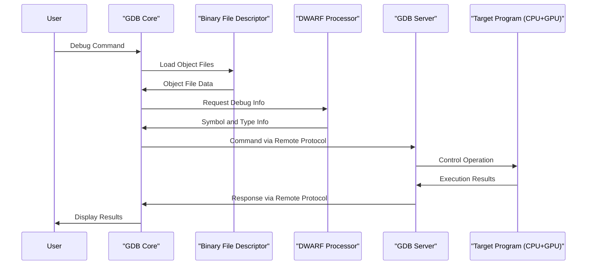

Sources: [gdbserver/server.cc:168-235](). [gdb/dwarf2/read.c:168-235]().

## Symbol Table Management

Symbol tables are a critical part of the debugging infrastructure:

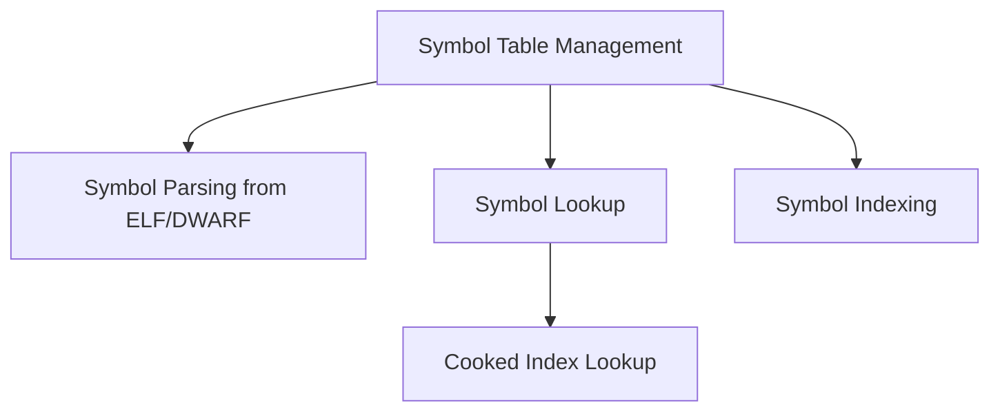

Symbol table management involves:

1. Parsing symbols from ELF sections and DWARF debug information
2. Creating efficient lookup structures
3. Supporting various symbol types (functions, variables, types)
4. Handling both static and dynamic symbols

Sources: [bfd/elf.c:525-560](). [gdb/dwarf2/cooked-index.c:210-250]().

## Architecture-Specific Support

CUDA-GDB includes support for various CPU architectures, with a focus on x86-64 as the primary host platform:

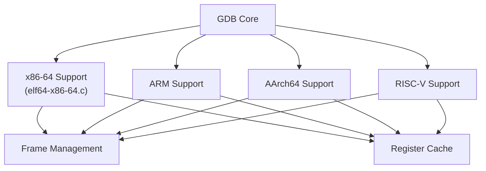

Each architecture has target-dependent code that implements architecture-specific aspects of debugging, such as frame unwinding and register handling.

Sources: [bfd/elf64-x86-64.c:1-70](). [gas/config/tc-i386.h:1-30](). [gas/config/tc-i386-intel.c:1-55]().

## Binary Format Handling

CUDA-GDB primarily deals with ELF binary formats:

| Component | Responsibility |
|-----------|----------------|
| BFD Library | Provides object file format abstraction |
| ELF Handling | Reads and interprets ELF headers, sections, and symbols |
| ELF Linking | Handles dynamic linking information in ELF files |
| Symbol Resolution | Resolves symbols from multiple object files |

Sources: [bfd/elf.c:50-100](). [bfd/elflink.c:100-150](). [bfd/elfxx-x86.c:1-40]().

## Register Cache System

The register cache system manages access to CPU and GPU registers:

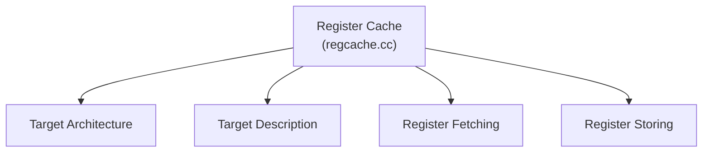

The register cache:
1. Stores current values of registers
2. Provides efficient access to register values
3. Handles architecture-specific register sets
4. Supports both CPU and GPU registers for CUDA applications

Sources: [gdbserver/regcache.cc:26-110](). [gdbserver/regcache.h:19-30]().

## GDB Server Architecture

GDB Server is a key component for remote debugging:

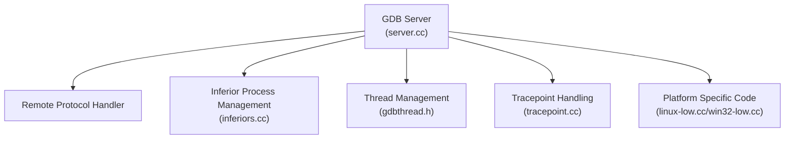

GDB Server provides:
1. Remote debugging capabilities
2. Process control and monitoring
3. Memory and register access
4. Support for breakpoints and watchpoints
5. CUDA-specific extensions for GPU debugging

Sources: [gdbserver/server.cc:78-147](). [gdbserver/tracepoint.cc:1-60](). [gdbserver/linux-low.cc:139-200](). [gdbserver/gdbthread.h:1-16]().

## Conclusion

CUDA-GDB's architecture extends the standard GDB architecture with specialized components for GPU debugging. It maintains compatibility with the GNU toolchain while adding capabilities for CUDA-specific debugging tasks. The system integrates multiple subsystems, including symbol handling, binary file reading, DWARF debug information processing, and remote debugging protocols, to provide a comprehensive debugging environment for CUDA applications.

The architecture enables developers to:
1. Debug both CPU and GPU code within a single environment
2. Set breakpoints in GPU code
3. Inspect GPU memory and registers
4. Monitor and control CUDA threads and blocks
5. Analyze the execution of CUDA kernels

Sources: [gdb/dwarf2/read.h:19-97](). [gdbserver/server.cc:16-50](). [bfd/elfxx-x86.c:32-37]().

---

# Page: Build System

# Build System

<details>
<summary>Relevant source files</summary>

The following files were used as context for generating this wiki page:

- [ChangeLog](ChangeLog)
- [bfd/ChangeLog](bfd/ChangeLog)
- [bfd/doc/chew.c](bfd/doc/chew.c)
- [bfd/doc/doc.str](bfd/doc/doc.str)
- [bfd/doc/proto.str](bfd/doc/proto.str)
- [binutils/ChangeLog](binutils/ChangeLog)
- [binutils/NEWS](binutils/NEWS)
- [binutils/dwarf.c](binutils/dwarf.c)
- [binutils/dwarf.h](binutils/dwarf.h)
- [binutils/elfcomm.c](binutils/elfcomm.c)
- [binutils/elfcomm.h](binutils/elfcomm.h)
- [binutils/readelf.c](binutils/readelf.c)
- [binutils/testsuite/binutils-all/display-section-0.r](binutils/testsuite/binutils-all/display-section-0.r)
- [binutils/testsuite/binutils-all/display-section-rel.r](binutils/testsuite/binutils-all/display-section-rel.r)
- [binutils/testsuite/binutils-all/dw5.W](binutils/testsuite/binutils-all/dw5.W)
- [binutils/testsuite/binutils-all/objdump.WL](binutils/testsuite/binutils-all/objdump.WL)
- [binutils/testsuite/binutils-all/pr26160.r](binutils/testsuite/binutils-all/pr26160.r)
- [binutils/testsuite/binutils-all/readelf-debug-str-offsets-dw4.d](binutils/testsuite/binutils-all/readelf-debug-str-offsets-dw4.d)
- [binutils/testsuite/binutils-all/readelf-debug-str-offsets-dw4.s](binutils/testsuite/binutils-all/readelf-debug-str-offsets-dw4.s)
- [binutils/testsuite/binutils-all/readelf.exp](binutils/testsuite/binutils-all/readelf.exp)
- [binutils/testsuite/binutils-all/relr.s](binutils/testsuite/binutils-all/relr.s)
- [cpu/ChangeLog](cpu/ChangeLog)
- [elfcpp/ChangeLog](elfcpp/ChangeLog)
- [gas/ChangeLog](gas/ChangeLog)
- [gas/doc/c-bpf.texi](gas/doc/c-bpf.texi)
- [gold/ChangeLog](gold/ChangeLog)
- [gprof/ChangeLog](gprof/ChangeLog)
- [include/ChangeLog](include/ChangeLog)
- [include/elf/common.h](include/elf/common.h)
- [include/opcode/bpf.h](include/opcode/bpf.h)
- [opcodes/ChangeLog](opcodes/ChangeLog)
- [opcodes/bpf-opc.c](opcodes/bpf-opc.c)
- [sim/Makefile.am](sim/Makefile.am)
- [sim/Makefile.in](sim/Makefile.in)
- [sim/aclocal.m4](sim/aclocal.m4)
- [sim/common/defs.h](sim/common/defs.h)
- [sim/common/local.mk](sim/common/local.mk)
- [sim/config.h.in](sim/config.h.in)
- [sim/configure](sim/configure)
- [sim/configure.ac](sim/configure.ac)
- [sim/igen/local.mk](sim/igen/local.mk)
- [sim/m4/sim_ac_option_smp.m4](sim/m4/sim_ac_option_smp.m4)
- [sim/m4/sim_ac_option_warnings.m4](sim/m4/sim_ac_option_warnings.m4)
- [sim/m4/sim_ac_platform.m4](sim/m4/sim_ac_platform.m4)
- [sim/m4/sim_ac_toolchain.m4](sim/m4/sim_ac_toolchain.m4)
- [sim/mips/acinclude.m4](sim/mips/acinclude.m4)
- [sim/ppc/emul_netbsd.c](sim/ppc/emul_netbsd.c)
- [sim/ppc/emul_unix.c](sim/ppc/emul_unix.c)
- [sim/ppc/hw_sem.c](sim/ppc/hw_sem.c)
- [sim/ppc/hw_shm.c](sim/ppc/hw_shm.c)
- [sim/ppc/mon.c](sim/ppc/mon.c)
- [sim/ppc/options.c](sim/ppc/options.c)
- [sim/ppc/pk.h](sim/ppc/pk.h)
- [sim/ppc/std-config.h](sim/ppc/std-config.h)

</details>


This page documents the build system for CUDA-GDB, explaining how to configure and build the toolchain from source. The build system is based on GNU Autotools and supports building simulators for various architectures.

## Overview

The CUDA-GDB build system uses GNU Autotools (Autoconf, Automake, and Libtool) to generate platform-specific build scripts from template files. This enables the codebase to be built on a wide variety of platforms while maintaining a consistent interface for developers and users.

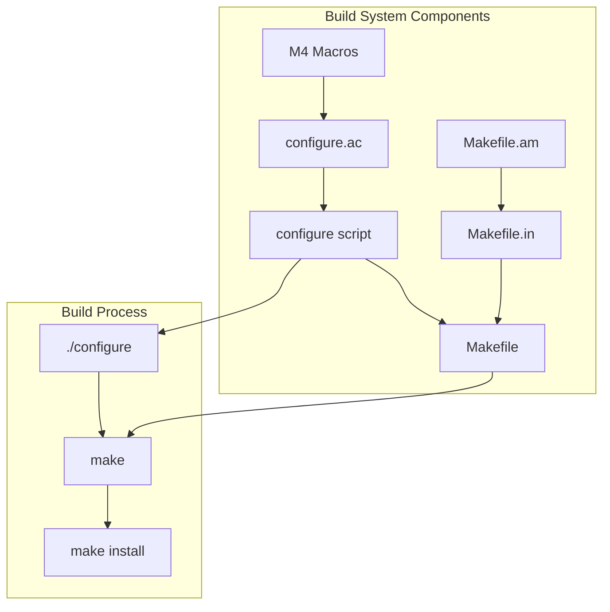

Sources: [sim/configure:1-153](), [sim/Makefile.am:1-65](), [sim/Makefile.in:1-160]()

## Configuration Process

The configuration process is handled by the `configure` script, which is generated from `configure.ac`. Running this script performs platform detection, checks for required tools and libraries, and sets up the build environment according to the specified options.

### Key Configuration Options

The following options can be passed to the `configure` script to customize the build:

| Option | Description |
|--------|-------------|
| `--enable-sim` | Enable the GNU simulator |
| `--enable-example-sims` | Enable example GNU simulators |
| `--enable-targets=<list>` | Specify alternative target architectures (comma-separated) |
| `--enable-werror` | Treat compiler warnings as errors |
| `--with-system-zlib` | Use the system's zlib library |

Sources: [sim/configure.ac:30-49](), [sim/configure:136-162](), [sim/m4/sim_ac_option_warnings.m4:19-35]()

### Target Architecture Support

The simulator can be built for a variety of architectures. The list is defined in the configuration files and includes:

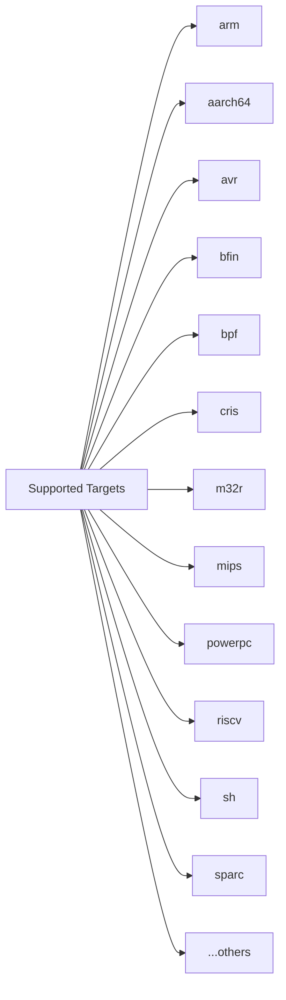

Sources: [sim/configure.ac:97-129](), [sim/Makefile.in:139-319]()

## Build Process

After configuration, the build process follows these steps:

1. Common components are built first
2. Target-specific components are built
3. Components are linked together to form the final binaries

### Common Components

The `common/` directory contains shared functionality used by all targets. This includes callback mechanisms, simulation control APIs, and other utilities.

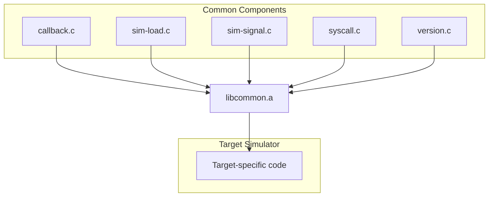

Sources: [sim/common/local.mk:29-40](), [sim/Makefile.in:397-403]()

### Target-specific Build

Each supported architecture has its own directory containing target-specific code. The build system compiles these components based on the enabled targets.

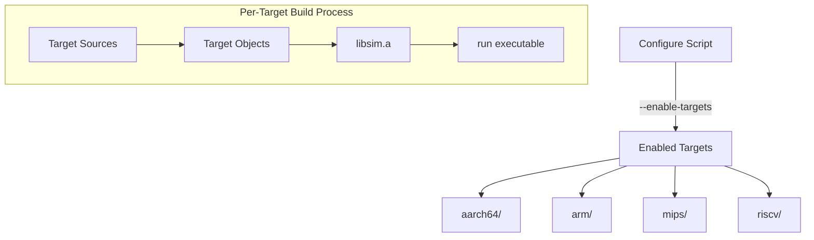

Sources: [sim/Makefile.in:380-420](), [sim/configure.ac:61-82]()

## Environment Variables

Several environment variables can influence the build process:

| Variable | Description |
|----------|-------------|
| `CC` | Compiler to use for C code |
| `CFLAGS` | Flags for the C compiler |
| `LDFLAGS` | Flags for the linker |
| `SIM_WERROR_CFLAGS` | Additional warning flags |

Sources: [sim/m4/sim_ac_option_warnings.m4:32-35](), [sim/Makefile.am:48-58]()

## Compiler Warnings

The build system has extensive support for compiler warnings. The `sim_ac_option_warnings.m4` file defines a comprehensive set of warning flags that can be enabled. By default, warnings are treated as errors in development builds.

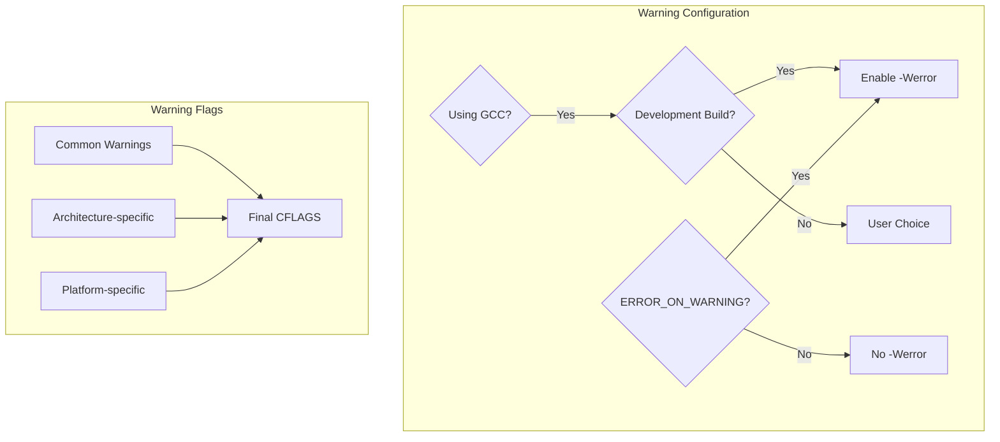

Sources: [sim/m4/sim_ac_option_warnings.m4:19-87](), [sim/Makefile.am:48-52]()

## Build Products

The main build products include:

1. Architecture-specific libraries (`libsim.a`)
2. Simulator runtime executables (`run`)
3. Test programs for validation

These are organized by architecture in the build directory.

Sources: [sim/Makefile.in:110-122](), [sim/Makefile.in:139-308]()

## Common Issues and Solutions

### Missing Dependencies

If the build fails due to missing dependencies, you may need to install development packages. Common requirements include:

- GNU development tools (gcc, make, etc.)
- zlib development files
- bison and flex for some targets

### Cross-compilation Issues

When cross-compiling, ensure that:

1. The appropriate cross-compiler toolchain is installed
2. The `--target` option is correctly specified for `configure`
3. Target-specific libraries are available

Sources: [sim/configure:157-159](), [sim/Makefile.in:103-109]()

## Adding a New Target

To add support for a new architecture:

1. Create a new directory for the target
2. Implement the required simulator interfaces
3. Add the target to the list in `configure.ac`
4. Create appropriate Makefile rules

```mermaid
flowchart TB
    subgraph "Adding New Target"
        CREATE["Create directory"]
        IMPLEMENT["Implement simulator"]
        UPDATE_CONFIG["Update configure.ac"]
        ADD_MAKE["Add Makefile entries"]
        
        CREATE --> IMPLEMENT
        IMPLEMENT --> UPDATE_CONFIG
        UPDATE_CONFIG --> ADD_MAKE
    end
    
    ADD_MAKE --> BUILD["Build System"]
    BUILD --> NEW_TARGET["New Target Support"]
```

Sources: [sim/configure.ac:97-129](), [sim/Makefile.in:380-420]()

## Advanced Configuration

The build system has several mechanisms for advanced configuration:

1. M4 macros for defining platform-specific behavior
2. Host/target/build triplet handling for cross-compilation
3. Endianness detection and word size configuration

These settings can be found in the `sim/m4/` directory macros and are used throughout the configuration process.

Sources: [sim/m4/sim_ac_platform.m4:1-14](), [sim/m4/sim_ac_option_warnings.m4:37-87]()

---

# Page: GNU Debugger (GDB)

# GNU Debugger (GDB)

<details>
<summary>Relevant source files</summary>

The following files were used as context for generating this wiki page:

- [gdb/ada-lang.c](gdb/ada-lang.c)
- [gdb/ada-lang.h](gdb/ada-lang.h)
- [gdb/ada-valprint.c](gdb/ada-valprint.c)
- [gdb/breakpoint.c](gdb/breakpoint.c)
- [gdb/breakpoint.h](gdb/breakpoint.h)
- [gdb/c-valprint.c](gdb/c-valprint.c)
- [gdb/coff-pe-read.c](gdb/coff-pe-read.c)
- [gdb/coffread.c](gdb/coffread.c)
- [gdb/cp-valprint.c](gdb/cp-valprint.c)
- [gdb/ctfread.c](gdb/ctfread.c)
- [gdb/dbxread.c](gdb/dbxread.c)
- [gdb/debuginfod-support.h](gdb/debuginfod-support.h)
- [gdb/disasm.c](gdb/disasm.c)
- [gdb/disasm.h](gdb/disasm.h)
- [gdb/dwarf2/ada-imported.c](gdb/dwarf2/ada-imported.c)
- [gdb/dwarf2/expr.c](gdb/dwarf2/expr.c)
- [gdb/dwarf2/loc.c](gdb/dwarf2/loc.c)
- [gdb/elfread.c](gdb/elfread.c)
- [gdb/eval.c](gdb/eval.c)
- [gdb/f-lang.c](gdb/f-lang.c)
- [gdb/findvar.c](gdb/findvar.c)
- [gdb/gdb-stabs.h](gdb/gdb-stabs.h)
- [gdb/gdbtypes.c](gdb/gdbtypes.c)
- [gdb/gdbtypes.h](gdb/gdbtypes.h)
- [gdb/linespec.c](gdb/linespec.c)
- [gdb/machoread.c](gdb/machoread.c)
- [gdb/mdebugread.c](gdb/mdebugread.c)
- [gdb/minsyms.c](gdb/minsyms.c)
- [gdb/minsyms.h](gdb/minsyms.h)
- [gdb/objfiles.c](gdb/objfiles.c)
- [gdb/objfiles.h](gdb/objfiles.h)
- [gdb/opencl-lang.c](gdb/opencl-lang.c)
- [gdb/p-valprint.c](gdb/p-valprint.c)
- [gdb/psymtab.c](gdb/psymtab.c)
- [gdb/psymtab.h](gdb/psymtab.h)
- [gdb/quick-symbol.h](gdb/quick-symbol.h)
- [gdb/rust-lang.c](gdb/rust-lang.c)
- [gdb/source-cache.c](gdb/source-cache.c)
- [gdb/source-cache.h](gdb/source-cache.h)
- [gdb/source.c](gdb/source.c)
- [gdb/source.h](gdb/source.h)
- [gdb/stabsread.c](gdb/stabsread.c)
- [gdb/stabsread.h](gdb/stabsread.h)
- [gdb/symfile-debug.c](gdb/symfile-debug.c)
- [gdb/symfile.c](gdb/symfile.c)
- [gdb/symmisc.c](gdb/symmisc.c)
- [gdb/symtab.c](gdb/symtab.c)
- [gdb/symtab.h](gdb/symtab.h)
- [gdb/testsuite/gdb.multi/pending-bp-del-inferior.c](gdb/testsuite/gdb.multi/pending-bp-del-inferior.c)
- [gdb/testsuite/gdb.multi/pending-bp-del-inferior.exp](gdb/testsuite/gdb.multi/pending-bp-del-inferior.exp)
- [gdb/tracepoint.c](gdb/tracepoint.c)
- [gdb/valarith.c](gdb/valarith.c)
- [gdb/valops.c](gdb/valops.c)
- [gdb/valprint.c](gdb/valprint.c)
- [gdb/value.c](gdb/value.c)
- [gdb/value.h](gdb/value.h)
- [gdb/xcoffread.c](gdb/xcoffread.c)

</details>


This page describes the core architecture and internal components of the GNU Debugger (GDB). GDB allows programmers to see what's happening inside a program while it executes or what it was doing when it crashed. For information about specific debugging commands and usage patterns, see the user documentation.

## Overview

GDB is composed of several core subsystems that work together to provide debugging functionality. The main components include:

- Symbol table management - tracks functions, variables, and types from program debug information
- Breakpoint system - manages where and when to stop program execution
- Value system - represents and manipulates data from the debugged program
- Type system - represents types of variables and expressions
- Expression evaluator - parses and executes user expressions for inspection and modification

These systems interact with target interfaces (processes, threads, memory) to debug programs across various architectures and platforms.

## Architecture Overview

```mermaid
graph TD
    subgraph "User Interfaces"
        CLI["Command Line Interface"]
        MI["Machine Interface"]
    end
    
    subgraph "Core Systems"
        BP["Breakpoint System"]
        ST["Symbol Table Management"]
        VAL["Value System"]
        TYP["Type System"]
        EXPR["Expression Evaluation"]
    end
    
    subgraph "Target Interface"
        INF["Inferior Process Control"]
        MEM["Memory Access"]
        REG["Register Access"]
    end
    
    CLI --> EXPR
    CLI --> BP
    MI --> EXPR
    MI --> BP
    
    EXPR --> ST
    EXPR --> VAL
    EXPR --> TYP
    
    BP --> INF
    BP --> MEM
    
    VAL --> MEM
    VAL --> REG
    VAL --> TYP
    
    ST --> TYP
```

Sources: [breakpoint.c:1-500](), [symtab.c:1-400](), [value.c:1-200](), [gdbtypes.c:1-200](), [eval.c:1-100]()

## Symbol Table Management

The symbol table system is responsible for loading, organizing, and accessing debug information from executables. It allows GDB to map between source code elements (functions, variables) and memory addresses.

```mermaid
graph TD
    OBJ["objfile\n(loaded binary)"] --> CUST["compunit_symtab\n(compilation unit)"]
    CUST --> SYMTAB["symtab\n(source file)"]
    SYMTAB --> BLOCK["block\n(lexical scope)"]
    BLOCK --> SYMBOL["symbol\n(variable/function)"]
    SYMBOL --> TYPE["type\n(data type)"]
```

Key structures:
- `struct objfile`: Represents a loaded executable or shared library
- `struct compunit_symtab`: Represents a compilation unit within an objfile
- `struct symtab`: Represents a source file
- `struct block`: Represents a lexical scope (e.g., function, nested block)
- `struct symbol`: Represents a symbol like a variable or function

### Symbol Lookup

Symbol lookup is performed using functions like:
- `lookup_symbol`: Find a symbol in the current scope
- `lookup_block_symbol`: Find a symbol in a specific block
- `lookup_bound_symbol`: Find a fully qualified symbol

```
lookup_symbol
  ↳ lookup_symbol_in_objfile
    ↳ lookup_local_symbol
      ↳ block_lookup_symbol
```

The lookup process may use caching to improve performance, particularly with the symbol cache implemented in `symtab.c`.

Sources: [symtab.c:120-400](), [symtab.h:1-200](), [objfiles.c:250-300]()

## Value System

The value system represents and manipulates data from the debugged program. Values encapsulate both the data itself and metadata about the value, such as its type, location, and how to access it.

```mermaid
graph TD
    VAL["value"] --> TYPE["type"]
    VAL --> LVAL["lval_type\n(location type)"]
    VAL --> CONT["contents\n(actual data)"]
    
    LVAL -->|lval_memory| ADDR["memory address"]
    LVAL -->|lval_register| REG["register number"]
    LVAL -->|lval_computed| FUNC["functions to compute value"]
    
    VAL --> LAZY["lazy flag\n(deferred read)"]
```

### Value Types and States

Values can be in several states:
- **Lazy**: Contents not yet read from target (loaded on demand)
- **Not Lazy**: Contents already loaded
- **Optimized Out**: Compiler optimized the value away
- **Unavailable**: Value exists but cannot be accessed

Values have different location types:
- `lval_memory`: Value stored in target's memory
- `lval_register`: Value stored in a register
- `lval_computed`: Value computed by callbacks
- `lval_not_lval`: Value is not a location (just a computed value)

### Key Operations

- `value::allocate`: Create a value of a specified type
- `value::fetch_lazy`: Load a lazy value's contents
- `value_cast`: Convert a value to a different type
- `value_assign`: Assign to a modifiable value

Sources: [value.c:150-400](), [value.h:100-400](), [findvar.c:50-60]()

## Type System

The type system represents the data types of program values, ranging from simple primitive types to complex compound types. Types are used for value representation, type checking, and debugging operations.

```mermaid
graph TD
    TYPE["type"] --> CODE["type_code\n(INT, PTR, STRUCT, etc)"]
    TYPE --> MTYPE["main_type"]
    MTYPE --> FIELDS["fields\n(for structs/classes)"]
    MTYPE --> FLAGS["flags\n(const, volatile, etc)"]
    MTYPE --> TARGET["target_type\n(for pointers, arrays)"]
    TYPE --> LENGTH["length\n(size in bytes)"]
```

### Type Categories

Types are categorized by their `type_code`:
- Primitive types: `TYPE_CODE_INT`, `TYPE_CODE_FLT`, etc.
- Pointers and references: `TYPE_CODE_PTR`, `TYPE_CODE_REF`
- Compound types: `TYPE_CODE_STRUCT`, `TYPE_CODE_ARRAY`
- Functions: `TYPE_CODE_FUNC`
- And many more...

Types can have modifiers like `const`, `volatile`, or `restrict` as reflected in their instance flags.

### Type Operations

- `check_typedef`: Resolve typedefs to their actual types
- `lookup_pointer_type`: Get/create a pointer to a specific type
- `lookup_function_type`: Get/create a function type
- `create_range_type`: Create an array/range type

Sources: [gdbtypes.c:180-250](), [gdbtypes.h:65-120](), [gdbtypes.h:500-700]()

## Breakpoint System

The breakpoint system manages program execution stopping points. It supports various breakpoint types, conditions, and commands to be executed when breakpoints are hit.

```mermaid
graph TD
    BP["breakpoint"] --> BPTYPE["bp_type\n(breakpoint, watchpoint, etc)"]
    BP --> LOCS["locations\n(where to insert)"]
    BP --> COND["condition\n(when to stop)"]
    BP --> CMDS["commands\n(what to execute)"]
    
    LOCS --> BPLOC["bp_location\n(actual insertion location)"]
    BPLOC --> ADDR["address"]
    BPLOC --> SHAD["shadow_contents\n(original instructions)"]
    BPLOC --> OWNER["owner\n(breakpoint)"]
```

### Breakpoint Types

- Regular breakpoints (`bp_breakpoint`)
- Hardware breakpoints (`bp_hardware_breakpoint`)
- Watchpoints (`bp_watchpoint`, `bp_hardware_watchpoint`)
- Catchpoints (`bp_catchpoint`)
- Tracepoints (`bp_tracepoint`)

### Key Operations

- `create_breakpoint`: Create a new breakpoint
- `delete_breakpoint`: Remove a breakpoint
- `update_global_location_list`: Update program memory with breakpoint instructions
- `bpstat_check`: Check if a breakpoint has been hit

Sources: [breakpoint.c:90-300](), [breakpoint.h:100-300](), [breakpoint.c:600-700]()

## Expression Evaluation

The expression evaluation system parses and executes expressions entered by users, allowing inspection and modification of program state.

```mermaid
graph TD
    EXPR["expression"] --> LANG["language\n(C, C++, etc)"]
    EXPR --> OP["operation tree"]
    OP --> EVAL["evaluate()\n(execute expression)"]
    EVAL --> VAL["value\n(result)"]
    
    PARSE["parse_expression()"] --> EXPR
```

### Expression Operations

- `parse_expression`: Parse a string into an expression tree
- `evaluate_expression`: Execute an expression and return a value
- `parse_and_eval`: Convenience function for both steps
- `value_assign`: Assign a value to a target location

### Implementation

Expression evaluation relies on language-specific parsers (C, C++, Ada, etc.) to convert text into operation trees. These trees are then evaluated to produce values by interacting with the target.

Sources: [eval.c:45-90](), [expression.h](), [expop.c]()

## Object File Management

The object file system manages the loading and inspection of program binaries, extracting symbols, debug information, and memory layouts.

```mermaid
graph TD
    OBJ["objfile"] --> BFD["BFD\n(Binary File Descriptor)"]
    OBJ --> SYMS["symbols"]
    OBJ --> PSYMS["partial_symbols"]
    OBJ --> SECTS["sections\n(code, data, etc)"]
    OBJ --> SOFF["section_offsets"]
    
    BFD --> FORMAT["object format\n(ELF, COFF, etc)"]
```

### Object File Operations

- Symbol table loading from various formats (DWARF, STABS)
- Section mapping for code and data regions
- Address translation between file and memory addresses
- Symbol lookup across multiple loaded object files

Sources: [objfiles.c:250-300](), [objfiles.h:20-50]()

## Integration and Workflow

The various GDB subsystems work together during a debugging session. Here's a typical workflow:

1. User sets a breakpoint at a function:
   - Parser interprets the command
   - Symbol tables locate the function
   - Breakpoint system creates and installs breakpoint

2. Program hits the breakpoint:
   - Target system notifies GDB of the stop
   - Breakpoint system verifies the hit condition
   - Frame system captures the current execution context

3. User evaluates an expression:
   - Parser creates an expression tree
   - Evaluator traverses the tree
   - Symbol tables resolve variable names
   - Value system fetches and manipulates values
   - Type system ensures type correctness

This tight integration allows GDB to provide a seamless debugging experience across a wide range of programs, languages, and architectures.

Sources: [breakpoint.c:1095-1200](), [eval.c:100-120](), [symtab.c:700-750]()

---

# Page: Core Components

# Core Components

<details>
<summary>Relevant source files</summary>

The following files were used as context for generating this wiki page:

- [gdb/aarch64-linux-nat.c](gdb/aarch64-linux-nat.c)
- [gdb/aarch64-linux-tdep.c](gdb/aarch64-linux-tdep.c)
- [gdb/aarch64-tdep.c](gdb/aarch64-tdep.c)
- [gdb/aarch64-tdep.h](gdb/aarch64-tdep.h)
- [gdb/ada-lang.c](gdb/ada-lang.c)
- [gdb/ada-lang.h](gdb/ada-lang.h)
- [gdb/ada-valprint.c](gdb/ada-valprint.c)
- [gdb/alpha-tdep.c](gdb/alpha-tdep.c)
- [gdb/amd64-tdep.c](gdb/amd64-tdep.c)
- [gdb/amd64-windows-tdep.c](gdb/amd64-windows-tdep.c)
- [gdb/arch/aarch64-scalable-linux.c](gdb/arch/aarch64-scalable-linux.c)
- [gdb/arch/aarch64-scalable-linux.h](gdb/arch/aarch64-scalable-linux.h)
- [gdb/arch/aarch64.c](gdb/arch/aarch64.c)
- [gdb/arch/aarch64.h](gdb/arch/aarch64.h)
- [gdb/arm-tdep.c](gdb/arm-tdep.c)
- [gdb/breakpoint.c](gdb/breakpoint.c)
- [gdb/breakpoint.h](gdb/breakpoint.h)
- [gdb/c-valprint.c](gdb/c-valprint.c)
- [gdb/cli/cli-interp.c](gdb/cli/cli-interp.c)
- [gdb/cli/cli-interp.h](gdb/cli/cli-interp.h)
- [gdb/coff-pe-read.c](gdb/coff-pe-read.c)
- [gdb/coffread.c](gdb/coffread.c)
- [gdb/cp-valprint.c](gdb/cp-valprint.c)
- [gdb/ctfread.c](gdb/ctfread.c)
- [gdb/dbxread.c](gdb/dbxread.c)
- [gdb/debuginfod-support.h](gdb/debuginfod-support.h)
- [gdb/disasm.c](gdb/disasm.c)
- [gdb/disasm.h](gdb/disasm.h)
- [gdb/dwarf2/ada-imported.c](gdb/dwarf2/ada-imported.c)
- [gdb/dwarf2/expr.c](gdb/dwarf2/expr.c)
- [gdb/dwarf2/loc.c](gdb/dwarf2/loc.c)
- [gdb/elfread.c](gdb/elfread.c)
- [gdb/eval.c](gdb/eval.c)
- [gdb/f-lang.c](gdb/f-lang.c)
- [gdb/features/aarch64-sme.c](gdb/features/aarch64-sme.c)
- [gdb/features/aarch64-sme2.c](gdb/features/aarch64-sme2.c)
- [gdb/findvar.c](gdb/findvar.c)
- [gdb/frame.c](gdb/frame.c)
- [gdb/frame.h](gdb/frame.h)
- [gdb/gdb-stabs.h](gdb/gdb-stabs.h)
- [gdb/gdbtypes.c](gdb/gdbtypes.c)
- [gdb/gdbtypes.h](gdb/gdbtypes.h)
- [gdb/i386-tdep.c](gdb/i386-tdep.c)
- [gdb/i386-tdep.h](gdb/i386-tdep.h)
- [gdb/i387-tdep.c](gdb/i387-tdep.c)
- [gdb/i387-tdep.h](gdb/i387-tdep.h)
- [gdb/ia64-tdep.c](gdb/ia64-tdep.c)
- [gdb/infcall.c](gdb/infcall.c)
- [gdb/infcmd.c](gdb/infcmd.c)
- [gdb/infrun.c](gdb/infrun.c)
- [gdb/infrun.h](gdb/infrun.h)
- [gdb/interps.c](gdb/interps.c)
- [gdb/interps.h](gdb/interps.h)
- [gdb/linespec.c](gdb/linespec.c)
- [gdb/m68k-tdep.c](gdb/m68k-tdep.c)
- [gdb/machoread.c](gdb/machoread.c)
- [gdb/mdebugread.c](gdb/mdebugread.c)
- [gdb/mi/mi-cmd-stack.c](gdb/mi/mi-cmd-stack.c)
- [gdb/mi/mi-interp.c](gdb/mi/mi-interp.c)
- [gdb/mi/mi-interp.h](gdb/mi/mi-interp.h)
- [gdb/minsyms.c](gdb/minsyms.c)
- [gdb/minsyms.h](gdb/minsyms.h)
- [gdb/mips-tdep.c](gdb/mips-tdep.c)
- [gdb/nat/aarch64-scalable-linux-ptrace.c](gdb/nat/aarch64-scalable-linux-ptrace.c)
- [gdb/nat/aarch64-scalable-linux-ptrace.h](gdb/nat/aarch64-scalable-linux-ptrace.h)
- [gdb/nat/aarch64-scalable-linux-sigcontext.h](gdb/nat/aarch64-scalable-linux-sigcontext.h)
- [gdb/objfiles.c](gdb/objfiles.c)
- [gdb/objfiles.h](gdb/objfiles.h)
- [gdb/observable.c](gdb/observable.c)
- [gdb/observable.h](gdb/observable.h)
- [gdb/opencl-lang.c](gdb/opencl-lang.c)
- [gdb/p-valprint.c](gdb/p-valprint.c)
- [gdb/printcmd.c](gdb/printcmd.c)
- [gdb/psymtab.c](gdb/psymtab.c)
- [gdb/psymtab.h](gdb/psymtab.h)
- [gdb/python/py-framefilter.c](gdb/python/py-framefilter.c)
- [gdb/quick-symbol.h](gdb/quick-symbol.h)
- [gdb/riscv-tdep.c](gdb/riscv-tdep.c)
- [gdb/rust-lang.c](gdb/rust-lang.c)
- [gdb/s390-tdep.c](gdb/s390-tdep.c)
- [gdb/s390-tdep.h](gdb/s390-tdep.h)
- [gdb/source-cache.c](gdb/source-cache.c)
- [gdb/source-cache.h](gdb/source-cache.h)
- [gdb/source.c](gdb/source.c)
- [gdb/source.h](gdb/source.h)
- [gdb/sparc-nat.c](gdb/sparc-nat.c)
- [gdb/sparc-tdep.c](gdb/sparc-tdep.c)
- [gdb/sparc64-tdep.c](gdb/sparc64-tdep.c)
- [gdb/stabsread.c](gdb/stabsread.c)
- [gdb/stabsread.h](gdb/stabsread.h)
- [gdb/stack.c](gdb/stack.c)
- [gdb/symfile-debug.c](gdb/symfile-debug.c)
- [gdb/symfile.c](gdb/symfile.c)
- [gdb/symmisc.c](gdb/symmisc.c)
- [gdb/symtab.c](gdb/symtab.c)
- [gdb/symtab.h](gdb/symtab.h)
- [gdb/testsuite/gdb.base/infcall-failure.c](gdb/testsuite/gdb.base/infcall-failure.c)
- [gdb/testsuite/gdb.base/infcall-failure.exp](gdb/testsuite/gdb.base/infcall-failure.exp)
- [gdb/testsuite/gdb.base/inferior-clone.exp](gdb/testsuite/gdb.base/inferior-clone.exp)
- [gdb/testsuite/gdb.mi/mi-reverse.exp](gdb/testsuite/gdb.mi/mi-reverse.exp)
- [gdb/testsuite/gdb.multi/gdb-settings.c](gdb/testsuite/gdb.multi/gdb-settings.c)
- [gdb/testsuite/gdb.multi/gdb-settings.exp](gdb/testsuite/gdb.multi/gdb-settings.exp)
- [gdb/testsuite/gdb.multi/pending-bp-del-inferior.c](gdb/testsuite/gdb.multi/pending-bp-del-inferior.c)
- [gdb/testsuite/gdb.multi/pending-bp-del-inferior.exp](gdb/testsuite/gdb.multi/pending-bp-del-inferior.exp)
- [gdb/testsuite/gdb.reverse/amd64-tailcall-reverse.exp](gdb/testsuite/gdb.reverse/amd64-tailcall-reverse.exp)
- [gdb/testsuite/gdb.reverse/finish-reverse-next.c](gdb/testsuite/gdb.reverse/finish-reverse-next.c)
- [gdb/testsuite/gdb.reverse/finish-reverse-next.exp](gdb/testsuite/gdb.reverse/finish-reverse-next.exp)
- [gdb/testsuite/gdb.reverse/i386-avx-reverse.c](gdb/testsuite/gdb.reverse/i386-avx-reverse.c)
- [gdb/testsuite/gdb.reverse/i386-avx-reverse.exp](gdb/testsuite/gdb.reverse/i386-avx-reverse.exp)
- [gdb/testsuite/gdb.reverse/singlejmp-reverse.exp](gdb/testsuite/gdb.reverse/singlejmp-reverse.exp)
- [gdb/testsuite/gdb.reverse/step-indirect-call-thunk.exp](gdb/testsuite/gdb.reverse/step-indirect-call-thunk.exp)
- [gdb/testsuite/gdb.reverse/until-precsave.exp](gdb/testsuite/gdb.reverse/until-precsave.exp)
- [gdb/testsuite/gdb.reverse/until-reverse.exp](gdb/testsuite/gdb.reverse/until-reverse.exp)
- [gdb/tracepoint.c](gdb/tracepoint.c)
- [gdb/valarith.c](gdb/valarith.c)
- [gdb/valops.c](gdb/valops.c)
- [gdb/valprint.c](gdb/valprint.c)
- [gdb/value.c](gdb/value.c)
- [gdb/value.h](gdb/value.h)
- [gdb/xcoffread.c](gdb/xcoffread.c)
- [gdbserver/linux-aarch64-low.cc](gdbserver/linux-aarch64-low.cc)

</details>


This page provides an overview of the fundamental components that form the core of CUDA-GDB. These components work together to provide the basic functionality needed for debugging. This document focuses on explaining what these core components are and how they interact, while detailed documentation for specific components can be found in their respective wiki pages.

## Overview of the Core Components

CUDA-GDB is built upon several critical subsystems that collectively enable debugging functionality. The core components include:

- **Symbol Table Management**: Handles symbols from debugging information
- **Type System**: Represents and manages data types
- **Value System**: Represents and manipulates values in the debugged program
- **Breakpoint System**: Manages breakpoints, watchpoints, and catchpoints
- **Frame Handling**: Manages and navigates stack frames
- **Inferior Process Control**: Controls execution of the debugged program

```mermaid
graph TD
    classDef component fill:#f9f9f9,stroke:#333,stroke-width:1px
    
    A["GDB Core"] :::component
    B["Symbol Table Management"] :::component
    C["Type System"] :::component
    D["Value System"] :::component
    E["Breakpoint System"] :::component
    F["Frame Handling"] :::component
    G["Inferior Process Control"] :::component
    H["User Interface"] :::component
    
    A --> B
    A --> C
    A --> D
    A --> E
    A --> F
    A --> G
    A --> H
    
    B <--> C
    C <--> D
    E --> G
    F <--> G
    D <--> B
```

Sources: [gdb/symtab.c:1-100](), [gdb/gdbtypes.c:1-100](), [gdb/value.c:1-100](), [gdb/breakpoint.c:1-100](), [gdb/frame.c:1-100](), [gdb/infrun.c:1-100]()

## Symbol Table Management

Symbol Table Management handles the parsing, storage, and lookup of debug symbols. This component is crucial for:

- Mapping source code to machine code
- Looking up variable names
- Finding function definitions
- Supporting various debug formats

The central structures include:
- `struct symbol`: Represents a single debug symbol
- `struct symtab`: Symbol table for a single source file
- `struct objfile`: Container for symbols from an object file
- `struct block`: Lexical scope in the program

For detailed documentation on the Symbol Table Management, see [Symbol Table Management](#2.1.1).

Sources: [gdb/symtab.c:100-200](), [gdb/symtab.h:100-200]()

## Type System

The Type System represents data types of variables, functions, and expressions in the debugged program. It provides facilities for:

- Type creation and manipulation
- Type checking for expressions
- Type printing for user display

The central structure is `struct type` which represents a data type with its various attributes like size, code, name, and fields.

```mermaid
graph LR
    classDef structure fill:#f9f9f9,stroke:#333,stroke-width:1px
    
    T["struct type"] :::structure
    M["struct main_type"] :::structure
    C["type_code (enum)"] :::structure
    F["Fields"] :::structure
    
    T --> M
    M --> C
    M --> F
    
    subgraph "Type Codes"
        TC1["TYPE_CODE_INT"]
        TC2["TYPE_CODE_STRUCT"]
        TC3["TYPE_CODE_PTR"]
        TC4["TYPE_CODE_ARRAY"]
        TC5["..."]
    end
    
    C --- TC1
    C --- TC2
    C --- TC3
    C --- TC4
    C --- TC5
```

Sources: [gdb/gdbtypes.c:180-300](), [gdb/gdbtypes.h:60-100](), [gdb/gdbtypes.h:250-350]()

## Value System

The Value System represents actual values of variables and expressions in the debugged program. Values are intimately connected to types, as each value has an associated type that describes its structure.

The central structure is `struct value` which represents a typed value with attributes like:
- Type information
- Memory location (if applicable)
- Actual content
- Optimized-out status
- Unavailable status

Values can be:
- In memory (lval_memory)
- In registers (lval_register)
- Computed (lval_computed)
- Optimized out
- Not in memory/registers (not_lval)

```mermaid
graph TD
    classDef structure fill:#f9f9f9,stroke:#333,stroke-width:1px
    
    V["struct value"] :::structure
    T["struct type"] :::structure
    L["lval_type (enum)"] :::structure
    C["Contents (data)"] :::structure
    
    V --> T
    V --> L
    V --> C
    
    subgraph "lval types"
        L1["not_lval"]
        L2["lval_memory"]
        L3["lval_register"]
        L4["lval_computed"]
    end
    
    L --- L1
    L --- L2
    L --- L3
    L --- L4
```

Sources: [gdb/value.c:150-500](), [gdb/value.h:130-400]()

## Breakpoint System

The Breakpoint System manages breakpoints, watchpoints, and catchpoints that control program execution. It provides facilities for:

- Setting breakpoints at addresses, source lines, or functions
- Managing condition expressions for conditional breakpoints
- Tracking hit counts
- Printing break messages
- Executing commands when breakpoints are hit

The core structure is `struct breakpoint` which represents a breakpoint with its attributes like type, location, condition, and commands.

For detailed documentation on the Breakpoint System, see [Breakpoint System](#2.1.2).

Sources: [gdb/breakpoint.c:300-500](), [gdb/breakpoint.h:100-300]()

## Frame Handling

Frame Handling manages stack frames, which represent function calls in the program being debugged. This component provides:

- Navigation between frames (up/down)
- Access to local variables in each frame
- Information about function arguments
- Source location information

The core structure is `struct frame_info` which represents a stack frame with its attributes like level, address, function, and source location.

For detailed documentation on the Stack Frame Management, see [Stack Frame Management](#2.1.3).

Sources: [gdb/frame.c:100-300](), [gdb/frame.h:50-150]()

## Inferior Process Control

Inferior Process Control manages the execution of the debugged program (the "inferior"). This component provides:

- Starting and stopping the program
- Stepping through code
- Handling signals
- Managing threads
- Controlling execution modes (non-stop, all-stop)

The core structure is `struct inferior` which represents a debugged program with its attributes like pid, target, and state.

For detailed documentation on the Inferior Process Control, see [Inferior Process Control](#2.1.4).

Sources: [gdb/infrun.c:600-800](), [gdb/infcmd.c:100-300](), [gdb/inferior.h:50-150]()

## Core Components Interaction

The following diagram illustrates how the core components interact during typical debugging operations:

```mermaid
sequenceDiagram
    participant U as "User Interface"
    participant B as "Breakpoint System"
    participant F as "Frame Handling"
    participant S as "Symbol Table"
    participant T as "Type System"
    participant V as "Value System"
    participant I as "Inferior Control"
    
    U->>B: Set breakpoint at function
    B->>S: Look up function symbol
    S-->>B: Return symbol information
    B->>I: Insert breakpoint at address
    I-->>B: Acknowledge breakpoint
    B-->>U: Breakpoint set

    U->>I: Start/continue program
    I->>I: Run until breakpoint hit
    I->>B: Process breakpoint hit
    B->>F: Build frame information
    F->>S: Look up context symbols
    S-->>F: Return symbol information
    F-->>B: Frame information
    B-->>I: Breakpoint handling complete
    I-->>U: Program stopped at breakpoint

    U->>V: Request variable value
    V->>S: Look up variable symbol
    S-->>V: Return symbol information
    V->>T: Get variable type
    T-->>V: Return type information
    V->>I: Read memory/registers
    I-->>V: Return raw value
    V-->>U: Formatted value
```

Sources: [gdb/breakpoint.c:900-1100](), [gdb/infrun.c:400-600](), [gdb/value.c:600-800](), [gdb/symtab.c:400-600]()

## Architecture-Specific Support

GDB supports multiple CPU architectures through architecture-specific code. The core components work with these architecture-specific modules to provide platform-specific debugging capabilities:

```mermaid
graph TD
    classDef component fill:#f9f9f9,stroke:#333,stroke-width:1px
    
    C["GDB Core Components"] :::component
    
    subgraph "Architecture-Specific Support"
        A1["i386-tdep.c"]
        A2["aarch64-tdep.c"]
        A3["arm-tdep.c"]
        A4["riscv-tdep.c"]
        A5["..."]
    end
    
    C <--> A1
    C <--> A2
    C <--> A3
    C <--> A4
    C <--> A5
```

Each architecture module provides implementations for:
- Register handling
- Frame unwinding
- Breakpoint insertion
- Instruction interpretation
- ABI compliance

Sources: [gdb/i386-tdep.c:70-150](), [gdb/aarch64-tdep.c:20-100](), [gdb/arm-tdep.c:20-100](), [gdb/riscv-tdep.c:1-100]()

## Language Support

The core components also interact with language-specific modules to support various programming languages:

```mermaid
graph TD
    classDef component fill:#f9f9f9,stroke:#333,stroke-width:1px
    
    C["GDB Core Components"] :::component
    
    subgraph "Language Support"
        L1["ada-lang.c"]
        L2["c-lang.c"]
        L3["cplus-lang.c"]
        L4["rust-lang.c"]
        L5["..."]
    end
    
    C <--> L1
    C <--> L2
    C <--> L3
    C <--> L4
    C <--> L5
```

Each language module provides:
- Language-specific symbol lookup
- Expression parsing
- Type printing
- Value formatting

Sources: [gdb/ada-lang.c:100-200]()

## CUDA-Specific Extensions

CUDA-GDB extends the core GDB components to support debugging CUDA applications. These extensions allow debugging of GPU code alongside CPU code:

- Extended symbol table handling for device code
- Special breakpoint types for CUDA kernels and device functions
- Value system extensions for device memory
- Frame handling for CUDA threads and blocks
- Special inferior control for CUDA devices

For CUDA-specific functionality, see the dedicated CUDA extensions pages.

---

# Page: Symbol Table Management

# Symbol Table Management

<details>
<summary>Relevant source files</summary>

The following files were used as context for generating this wiki page:

- [gdb/coff-pe-read.c](gdb/coff-pe-read.c)
- [gdb/coffread.c](gdb/coffread.c)
- [gdb/compile/compile-loc2c.c](gdb/compile/compile-loc2c.c)
- [gdb/ctfread.c](gdb/ctfread.c)
- [gdb/dbxread.c](gdb/dbxread.c)
- [gdb/debuginfod-support.h](gdb/debuginfod-support.h)
- [gdb/disasm.c](gdb/disasm.c)
- [gdb/disasm.h](gdb/disasm.h)
- [gdb/dwarf2/abbrev-table-cache.c](gdb/dwarf2/abbrev-table-cache.c)
- [gdb/dwarf2/abbrev-table-cache.h](gdb/dwarf2/abbrev-table-cache.h)
- [gdb/dwarf2/abbrev.c](gdb/dwarf2/abbrev.c)
- [gdb/dwarf2/abbrev.h](gdb/dwarf2/abbrev.h)
- [gdb/dwarf2/ada-imported.c](gdb/dwarf2/ada-imported.c)
- [gdb/dwarf2/aranges.c](gdb/dwarf2/aranges.c)
- [gdb/dwarf2/aranges.h](gdb/dwarf2/aranges.h)
- [gdb/dwarf2/attribute.c](gdb/dwarf2/attribute.c)
- [gdb/dwarf2/attribute.h](gdb/dwarf2/attribute.h)
- [gdb/dwarf2/call-site.h](gdb/dwarf2/call-site.h)
- [gdb/dwarf2/comp-unit-head.c](gdb/dwarf2/comp-unit-head.c)
- [gdb/dwarf2/comp-unit-head.h](gdb/dwarf2/comp-unit-head.h)
- [gdb/dwarf2/cooked-index.c](gdb/dwarf2/cooked-index.c)
- [gdb/dwarf2/cooked-index.h](gdb/dwarf2/cooked-index.h)
- [gdb/dwarf2/cu.c](gdb/dwarf2/cu.c)
- [gdb/dwarf2/cu.h](gdb/dwarf2/cu.h)
- [gdb/dwarf2/die.c](gdb/dwarf2/die.c)
- [gdb/dwarf2/die.h](gdb/dwarf2/die.h)
- [gdb/dwarf2/dwz.c](gdb/dwarf2/dwz.c)
- [gdb/dwarf2/dwz.h](gdb/dwarf2/dwz.h)
- [gdb/dwarf2/index-cache.c](gdb/dwarf2/index-cache.c)
- [gdb/dwarf2/index-cache.h](gdb/dwarf2/index-cache.h)
- [gdb/dwarf2/index-common.h](gdb/dwarf2/index-common.h)
- [gdb/dwarf2/index-write.c](gdb/dwarf2/index-write.c)
- [gdb/dwarf2/line-header.h](gdb/dwarf2/line-header.h)
- [gdb/dwarf2/mapped-index.h](gdb/dwarf2/mapped-index.h)
- [gdb/dwarf2/read-debug-names.c](gdb/dwarf2/read-debug-names.c)
- [gdb/dwarf2/read-debug-names.h](gdb/dwarf2/read-debug-names.h)
- [gdb/dwarf2/read-gdb-index.c](gdb/dwarf2/read-gdb-index.c)
- [gdb/dwarf2/read.c](gdb/dwarf2/read.c)
- [gdb/dwarf2/read.h](gdb/dwarf2/read.h)
- [gdb/dwarf2/section.c](gdb/dwarf2/section.c)
- [gdb/elfread.c](gdb/elfread.c)
- [gdb/f-lang.c](gdb/f-lang.c)
- [gdb/gdb-gdb.gdb.in](gdb/gdb-gdb.gdb.in)
- [gdb/gdb-stabs.h](gdb/gdb-stabs.h)
- [gdb/gdbtypes.c](gdb/gdbtypes.c)
- [gdb/gdbtypes.h](gdb/gdbtypes.h)
- [gdb/linespec.c](gdb/linespec.c)
- [gdb/machoread.c](gdb/machoread.c)
- [gdb/mdebugread.c](gdb/mdebugread.c)
- [gdb/minsyms.c](gdb/minsyms.c)
- [gdb/minsyms.h](gdb/minsyms.h)
- [gdb/objfiles.c](gdb/objfiles.c)
- [gdb/objfiles.h](gdb/objfiles.h)
- [gdb/osdata.c](gdb/osdata.c)
- [gdb/psymtab.c](gdb/psymtab.c)
- [gdb/psymtab.h](gdb/psymtab.h)
- [gdb/quick-symbol.h](gdb/quick-symbol.h)
- [gdb/rust-lang.c](gdb/rust-lang.c)
- [gdb/source-cache.c](gdb/source-cache.c)
- [gdb/source-cache.h](gdb/source-cache.h)
- [gdb/source.c](gdb/source.c)
- [gdb/source.h](gdb/source.h)
- [gdb/stabsread.c](gdb/stabsread.c)
- [gdb/stabsread.h](gdb/stabsread.h)
- [gdb/symfile-debug.c](gdb/symfile-debug.c)
- [gdb/symfile.c](gdb/symfile.c)
- [gdb/symmisc.c](gdb/symmisc.c)
- [gdb/symtab.c](gdb/symtab.c)
- [gdb/symtab.h](gdb/symtab.h)
- [gdb/testsuite/gdb.dwarf2/gdb-index-cxx.exp](gdb/testsuite/gdb.dwarf2/gdb-index-cxx.exp)
- [gdb/testsuite/gdb.gdb/index-file.exp](gdb/testsuite/gdb.gdb/index-file.exp)
- [gdb/testsuite/gdb.linespec/cpcompletion.cc](gdb/testsuite/gdb.linespec/cpcompletion.cc)
- [gdb/testsuite/gdb.linespec/cpcompletion.exp](gdb/testsuite/gdb.linespec/cpcompletion.exp)
- [gdb/testsuite/gdb.linespec/cpls.cc](gdb/testsuite/gdb.linespec/cpls.cc)
- [gdb/xcoffread.c](gdb/xcoffread.c)

</details>


This page documents the symbol table management system in CUDA-GDB. Symbol tables are data structures that store information about program elements such as functions, variables, and types, along with their names, memory locations, and other attributes. They enable the debugger to map between symbols in source code and their corresponding locations in memory.

This document covers how symbols are stored, organized, and accessed in CUDA-GDB. For information about loading symbol files, see [Symfile Management](#5). For details about type system implementation, see [Types](#2.2).

## Overview of Symbol Table System

Symbol table management in CUDA-GDB consists of several interrelated components that work together to organize and provide access to symbolic information from debug data.

```mermaid
graph TD
    subgraph "Symbol Table Components"
        A["Objfile"] --> B["Compilation Units"]
        B --> C["Symbol Tables"]
        C --> D["Blocks"]
        D --> E["Symbols"]
        A --> F["Minimal Symbols"]
    end

    subgraph "Symbol Table Access"
        G["Symbol Lookup"] --> H["Symbol Cache"]
        G --> I["Language-specific Lookup"]
        I --> J["Name Demangling"]
    end

    subgraph "Debug Information"
        K["DWARF Reader"] --> L["Cooked Index"]
        K --> M["Symbol Creation"]
        M --> E
    end
```

Sources: [gdb/symtab.h:400-445](), [gdb/symtab.c:130-190](), [gdb/dwarf2/read.c:30-85]()

## Core Data Structures

The symbol table system is built around several key data structures, with the most important being the general symbol information structure, which is the foundation for both full symbols and minimal symbols.

### Symbol Information

The base structure for all symbols is `struct general_symbol_info`, which contains:

```mermaid
classDiagram
    class general_symbol_info {
        const char* m_name
        union value
        language m_language
        struct language_specific
    }
```

This structure holds:

- The symbol's linkage name (as it appears in the object file)
- A union containing the symbol's value, which varies by symbol type
- The language associated with the symbol
- Language-specific information, such as demangled name

Sources: [gdb/symtab.h:446-562](), [gdb/symtab.c:837-884]()

### Full Symbols vs. Minimal Symbols

CUDA-GDB maintains two main types of symbols:

| Type | Description | Main Structure | Storage |
|------|-------------|----------------|---------|
| Full Symbols | Complete symbols with type information | `struct symbol` | In block structures within symbol tables |
| Minimal Symbols | Light-weight symbols with just name and address | `struct minimal_symbol` | In object files |

Full symbols provide comprehensive information but require more memory. Minimal symbols provide basic linking information for functions and variables when debug info isn't available.

Sources: [gdb/symtab.h:1320-1441](), [gdb/minsyms.c:20-100]()

### Symbol Tables and Blocks

Symbols are organized into a hierarchy of structures:

```mermaid
graph TD
    A["objfile"] --> B["compunit_symtab"]
    B --> C["symtab (per source file)"]
    C --> D["global_block"]
    C --> E["static_block"]
    D --> F["symbols"]
    E --> F
```

- **Object File**: Contains symbol information loaded from one binary
- **Compilation Unit**: Represents a single compiled source file or module
- **Symbol Table**: Contains symbols for a single source file
- **Blocks**: Represent scopes (global, static, function, lexical blocks)

Sources: [gdb/symtab.h:400-560](), [gdb/objfiles.h:20-100](), [gdb/symtab.c:475-520]()

## Symbol Lookup Mechanisms

CUDA-GDB provides various functions to look up symbols by name, with support for different scoping rules and language-specific requirements.

### Lookup Process

The symbol lookup process follows these general steps:

1. Check the symbol cache for previous lookup results
2. Apply language-specific canonicalization if needed
3. Search within the specified block or scope
4. Search through nested blocks according to language rules
5. Handle multiple matches according to user preferences
6. Cache the result for future lookups

```mermaid
flowchart TD
    A["Symbol Lookup Request"] --> B{"In Cache?"}
    B -->|"Yes"| C["Return Cached Result"]
    B -->|"No"| D["Canonicalize Name"]
    D --> E["Search in Block"]
    E --> F{"Found?"}
    F -->|"Yes"| G["Cache and Return"]
    F -->|"No"| H["Search Global Scope"]
    H --> I{"Found?"}
    I -->|"Yes"| G
    I -->|"No"| J["Return NULL"]
```

Sources: [gdb/symtab.c:80-110](), [gdb/symtab.c:270-320]()

### Symbol Cache

To improve performance, CUDA-GDB implements a symbol cache:

```mermaid
classDiagram
    class symbol_cache {
        block_symbol_cache* global_symbols
        block_symbol_cache* static_symbols
    }
    
    class block_symbol_cache {
        unsigned int hits
        unsigned int misses
        unsigned int collisions
        unsigned int size
        symbol_cache_slot symbols[]
    }
    
    class symbol_cache_slot {
        slot_state state
        objfile* objfile_context
        domain_search_flags domain
        union value
    }
    
    symbol_cache --> block_symbol_cache : contains
    block_symbol_cache --> symbol_cache_slot : contains
```

The symbol cache reduces the need for repeated lookups of the same symbol, which can be expensive, especially with large debug information. The cache is organized by symbol type (global vs. static) and uses hashing to provide quick access.

Sources: [gdb/symtab.c:166-305](), [gdb/symtab.c:225-261]()

## Symbol Name Handling

Symbol names require special handling due to complexities like name mangling, language-specific rules, and required transformations.

### Name Types

Each symbol can have several different name representations:

- **Linkage Name**: The name used by the linker (might be mangled)
- **Natural Name**: The demangled, user-visible name
- **Print Name**: The name to display (demangled or not based on settings)
- **Search Name**: The name used for lookups (varies by language)

Sources: [gdb/symtab.h:454-475](), [gdb/symtab.c:455-476]()

### Name Demangling

For languages like C++ that use name mangling, CUDA-GDB provides demangling support:

```mermaid
flowchart LR
    A["Mangled Name"] --> B["Demangler"]
    B --> C["Demangled Name"]
    D["Language-specific Rule"] --> B
```

The demangling process:
1. Identify the symbol's language
2. Apply language-specific demangling rules
3. Store both the original and demangled names
4. Use the appropriate name based on context

The demangled names are cached to avoid repeated demangling of the same symbol.

Sources: [gdb/symtab.c:885-989](), [gdb/cp-support.c]()

## DWARF Debug Information Processing

DWARF is the primary debug information format used by modern compilers. CUDA-GDB parses DWARF information to create symbol tables.

### DWARF Reader

The DWARF reader processes debug information from object files and converts it into GDB's internal symbol structures. Key components include:

```mermaid
flowchart TD
    A["Object File"] --> B["DWARF Sections"]
    B --> C["Compilation Units"]
    C --> D["DIE Parser"]
    D --> E["Symbol Creation"]
    E --> F["Symbol Tables"]
    
    subgraph "DWARF Sections"
        G[".debug_info"]
        H[".debug_abbrev"]
        I[".debug_line"]
        J[".debug_str"]
    end
```

DIE = Debug Information Entry, the basic unit of information in DWARF.

Sources: [gdb/dwarf2/read.c:30-100](), [gdb/dwarf2/read.c:740-820]()

### Cooked Index

The "cooked index" is an optimized in-memory representation of the DWARF debug information:

```mermaid
classDiagram
    class cooked_index {
        vector<cooked_index_shard> m_vector
        wait(cooked_state)
        find(string name, bool completing)
    }
    
    class cooked_index_shard {
        vector<cooked_index_entry*> m_entries
        addrmap_fixed* m_addrmap
        find(string name, bool completing)
    }
    
    class cooked_index_entry {
        const char* name
        const char* canonical
        dwarf_tag tag
        cooked_index_flag flags
        language lang
        sect_offset die_offset
        dwarf2_per_cu_data* per_cu
    }
    
    cooked_index --> cooked_index_shard : contains
    cooked_index_shard --> cooked_index_entry : contains
```

The cooked index provides fast access to symbols through various optimizations:
- Canonical representation of names for efficient lookup
- Maintained index of symbols by name
- Support for name completion
- Cached information to avoid re-parsing debug data

Sources: [gdb/dwarf2/cooked-index.h:102-258](), [gdb/dwarf2/cooked-index.c:50-145]()

## Symbol Table Creation and Population

Symbol tables are created and populated during the loading of debug information from object files.

### Symbol Creation Process

```mermaid
flowchart TD
    A["Load Object File"] --> B["Read Debug Info"]
    B --> C{"Debug Format?"}
    C -->|"DWARF"| D["Parse DWARF"]
    C -->|"STABS"| E["Parse STABS"]
    C -->|"COFF"| F["Parse COFF"]
    D --> G["Create Symbol Tables"]
    E --> G
    F --> G
    G --> H["Build Indexes"]
    H --> I["Complete Loading"]
```

Key steps in the process:
1. Object file loading and initial analysis
2. Identification of the debug format
3. Format-specific parsing of debug information
4. Creation of compilation units and symbol tables
5. Building lookup indices for efficient access

Sources: [gdb/symfile.c:89-104](), [gdb/dwarf2/read.c:1015-1080]()

### Language-Specific Handling

CUDA-GDB supports multiple programming languages, with each language potentially requiring special handling for symbols:

| Language | Special Symbol Handling |
|----------|-------------------------|
| C | Name canonicalization for lookup |
| C++ | Name demangling, namespace handling, template processing |
| Rust | Path separation with "::" |
| Ada | Encoding/decoding of names, case insensitivity |
| Fortran | Case insensitivity, common blocks |

Sources: [gdb/dwarf2/cooked-index.c:234-256](), [gdb/symtab.c:274-320]()

## Practical Usage of Symbol Tables

This section explores how symbol tables are used in practice within the debugger.

### Symbol Lookup Use Cases

Symbol tables support various lookup scenarios:

1. **By name**: Finding a symbol by its name (potentially with scope)
2. **By address**: Finding the symbol corresponding to a memory address
3. **By location**: Looking up symbols in a specific file and line
4. **With wildcards**: Finding symbols matching patterns
5. **Multiple matches**: Handling cases where multiple symbols match

Sources: [gdb/symtab.c:80-120](), [gdb/symtab.c:705-744]()

### Integration with Breakpoints

Symbol tables are crucial for setting breakpoints:

```mermaid
flowchart TD
    A["Breakpoint Request"] --> B["Parse Location"]
    B --> C["Symbol Lookup"]
    C --> D["Resolve Address"]
    D --> E["Set Hardware Breakpoint"]
```

When a user sets a breakpoint by name (e.g., "break function_name"), the debugger:
1. Looks up the symbol in the symbol tables
2. Determines the corresponding memory address
3. Sets a hardware breakpoint at that address

Sources: [gdb/linespec.c:71-108]()

## Performance Considerations

Symbol table management can significantly impact debugger performance, especially with large applications.

### Memory Usage

Several strategies help manage memory usage:
- Minimal symbols for basic information
- Partial symbol tables (psymtabs) loaded initially
- Full symbol tables loaded on demand
- Symbol caching to speed up repeated lookups

Sources: [gdb/psymtab.c:1-50](), [gdb/symtab.c:166-220]()

### Lazy Loading

CUDA-GDB uses lazy loading techniques to improve performance:

1. Only load minimal symbol information initially
2. Partially load symbols necessary for basic operation
3. Load full symbol information on demand
4. Use indexing to avoid loading unnecessary symbols

Sources: [gdb/dwarf2/read.c:1060-1100]()

## Conclusion

Symbol table management is a core component of CUDA-GDB, enabling the debugger to map between source-level symbols and their memory locations. The system balances comprehensive debug information with performance considerations through techniques like caching, indexing, and lazy loading.

The symbol table system integrates with multiple debug formats, handles language-specific requirements, and provides the foundation for many debugger features including variable inspection, breakpoints, and source display.

---

# Page: Breakpoint System

# Breakpoint System

<details>
<summary>Relevant source files</summary>

The following files were used as context for generating this wiki page:

- [gdb/ada-lang.c](gdb/ada-lang.c)
- [gdb/ada-lang.h](gdb/ada-lang.h)
- [gdb/ada-valprint.c](gdb/ada-valprint.c)
- [gdb/breakpoint.c](gdb/breakpoint.c)
- [gdb/breakpoint.h](gdb/breakpoint.h)
- [gdb/c-valprint.c](gdb/c-valprint.c)
- [gdb/cp-valprint.c](gdb/cp-valprint.c)
- [gdb/dwarf2/expr.c](gdb/dwarf2/expr.c)
- [gdb/dwarf2/loc.c](gdb/dwarf2/loc.c)
- [gdb/eval.c](gdb/eval.c)
- [gdb/findvar.c](gdb/findvar.c)
- [gdb/opencl-lang.c](gdb/opencl-lang.c)
- [gdb/p-valprint.c](gdb/p-valprint.c)
- [gdb/testsuite/gdb.multi/pending-bp-del-inferior.c](gdb/testsuite/gdb.multi/pending-bp-del-inferior.c)
- [gdb/testsuite/gdb.multi/pending-bp-del-inferior.exp](gdb/testsuite/gdb.multi/pending-bp-del-inferior.exp)
- [gdb/tracepoint.c](gdb/tracepoint.c)
- [gdb/valarith.c](gdb/valarith.c)
- [gdb/valops.c](gdb/valops.c)
- [gdb/valprint.c](gdb/valprint.c)
- [gdb/value.c](gdb/value.c)
- [gdb/value.h](gdb/value.h)

</details>


The Breakpoint System in GDB provides mechanisms for setting, managing, and handling breakpoints, watchpoints, catchpoints, and other stop-related events during debugging. This page documents the architecture, key data structures, and operation of the breakpoint system in CUDA-GDB.

## Overview

The breakpoint system is one of the core components of a debugger. It allows users to:

- Pause program execution at specific points in code
- Monitor memory for changes (watchpoints)
- Trap on specific events like exceptions (catchpoints)
- Conditionally stop based on expressions
- Execute commands when a breakpoint is hit

This system maintains the state of all breakpoints, handles their insertion and removal from the target program, and processes breakpoint hits during debugging.

Sources: [gdb/breakpoint.c:1-100](), [gdb/breakpoint.h:1-50]()

## Architecture

The breakpoint system has the following key components:

```mermaid
graph TD
    BC["breakpoint_chain<br>(Global list of all breakpoints)"] --> B1["struct breakpoint<br>(Base class)"]
    BC --> B2["struct breakpoint<br>(Base class)"]
    BC --> B3["..."]
    
    BL["bp_locations<br>(All locations sorted by address)"] --> L1["struct bp_location"]
    BL --> L2["struct bp_location"]
    BL --> L3["..."]
    
    B1 --> L1
    B1 --> L2
    B2 --> L3
    
    B1 --> OPS1["struct breakpoint_ops<br>(Virtual functions)"]
    B2 --> OPS2["struct breakpoint_ops"]
    
    L1 --> TI1["struct bp_target_info<br>(Target-specific info)"]
    L2 --> TI2["struct bp_target_info"]
    L3 --> TI3["struct bp_target_info"]
```

The system's core components include:

- **breakpoint_chain**: An intrusive list that stores all breakpoints
- **bp_locations**: A vector of locations where breakpoints are placed in the target
- **breakpoint**: The base class for all breakpoint types
- **bp_location**: Represents a specific location where a breakpoint is inserted
- **breakpoint_ops**: Interface defining operations (virtual functions) for breakpoints
- **bp_target_info**: Contains information needed to insert breakpoints in the target

Sources: [gdb/breakpoint.c:698-735](), [gdb/breakpoint.h:260-305]()

## Class Hierarchy

The breakpoint system uses inheritance to implement different types of breakpoints:

```mermaid
graph TD
    BP["struct breakpoint<br>(Base class)"] --> CB["struct code_breakpoint<br>(Code breakpoints)"]
    BP --> CP["struct catchpoint<br>(Event catchpoints)"]
    BP --> TP["struct tracepoint<br>(Data collection)"]
    
    CB --> OB["struct ordinary_breakpoint<br>(Standard breakpoints)"]
    CB --> IB["struct internal_breakpoint<br>(Debugger internals)"]
    CB --> MB["struct momentary_breakpoint<br>(Temporary)"]
    
    OB --> DB["struct dprintf_breakpoint<br>(Printf-style)"]
    OB --> RB["struct ranged_breakpoint<br>(Address ranges)"]
    
    TP --> SMT["struct static_marker_tracepoint"]
```

Key breakpoint types include:

- **ordinary_breakpoint**: Standard code breakpoints
- **internal_breakpoint**: Used internally by the debugger
- **momentary_breakpoint**: Temporary breakpoints (removed after being hit)
- **dprintf_breakpoint**: Printf-style breakpoints (print without stopping)
- **catchpoint**: Trigger on events like exceptions or syscalls
- **tracepoint**: Collect data without stopping execution

Sources: [gdb/breakpoint.c:330-450](), [gdb/breakpoint.h:89-217]()

## State and Disposition

Breakpoints have both a state (enabled/disabled) and a disposition (what to do after being hit):

| State | Description |
|-------|-------------|
| `bp_enabled` | Active and can trigger |
| `bp_disabled` | Inactive, cannot trigger |
| `bp_call_disabled` | Temporarily disabled during a function call |

| Disposition | Description |
|-------------|-------------|
| `disp_del` | Delete after being hit |
| `disp_del_at_next_stop` | Delete at next stop (hit or not) |
| `disp_disable` | Disable after being hit |
| `disp_donttouch` | Leave unchanged after being hit |

Sources: [gdb/breakpoint.h:221-248]()

## Breakpoint Lifecycle

### Creation

1. The user specifies a location (file:line, function name, or address)
2. The location is parsed via `parse_breakpoint_sals()`
3. A breakpoint object is created via `create_breakpoints_sal()`
4. The new breakpoint is added to `breakpoint_chain` via `add_to_breakpoint_chain()`
5. Locations are inserted into the target via `update_global_location_list()`

Sources: [gdb/breakpoint.c:95-120](), [gdb/breakpoint.c:116-124]()

### Location Management

A single logical breakpoint can have multiple locations. For example:

- Breakpoints in template functions
- Breakpoints in inlined functions
- Breakpoints in shared libraries loaded multiple times

The system manages these locations through:

- **update_global_location_list()**: Updates the global location list with one of three insert modes:
  - `UGLL_DONT_INSERT`: Don't insert locations, only remove
  - `UGLL_MAY_INSERT`: Insert if breakpoints should be inserted now
  - `UGLL_INSERT`: Always insert, regardless of current state

Sources: [gdb/breakpoint.c:176-207](), [gdb/breakpoint.c:271-275]()

### Condition Evaluation

Breakpoints can have associated conditions:

```c
// Example of setting a condition
set_breakpoint_condition(b, "i == 10", 0, false);
```

Conditions can be evaluated by:
- The host (GDB)
- The target (if supported)
- Automatically choosing based on capabilities

The condition evaluation mode is controlled by the `condition_evaluation_mode` setting, which can be:
- `auto`: Choose best option
- `host`: Evaluate on host only
- `target`: Evaluate on target when possible

Sources: [gdb/breakpoint.c:629-685](), [gdb/breakpoint.c:1106-1198]()

### Breakpoint Hit Processing

When a breakpoint is hit, the system:

1. Determines which breakpoint was hit
2. Evaluates any condition
3. Executes any associated commands
4. Updates hit count
5. Applies the disposition (delete, disable, etc.)
6. Decides whether to report the stop to the user

If conditions are false or commands include a "continue" directive, execution may resume without the user being notified.

Sources: [gdb/breakpoint.c:140-170]()

## API Examples

### Creating a Breakpoint

```c
// Creating a breakpoint at a specific address
struct symtab_and_line sal;
sal.pc = address;
sal.section = find_pc_overlay(sal.pc);
sal.pspace = current_program_space;
breakpoint *b = create_breakpoint(gdbarch, bp_breakpoint, 0, &sal, 
                                 0, 0, 0, 1, AUTO_BOOLEAN_TRUE);

// Creating a watchpoint
std::vector<value_ref_ptr> vals;
vals.push_back(value_ref_ptr::new_reference(value_from_expression(expr)));
create_watchpoint(NULL, vals, 0, bp_hardware_watchpoint);
```

### Modifying Breakpoints

```c
// Setting a condition
set_breakpoint_condition(b, "i == 10", 0, false);

// Enabling/disabling
enable_breakpoint(b);
disable_breakpoint(b);

// Deleting
delete_breakpoint(b);
```

## Optimizations and Special Features

### Hardware Breakpoints

When software breakpoints can't be used (e.g., in ROM), hardware breakpoints are employed:

```c
// Check if hardware breakpoints are supported and available
static int hw_breakpoint_used_count(void);
```

### Always-Inserted Mode

For performance reasons, GDB can keep breakpoints inserted even when the program is stopped:

```c
// Global variable controlling always-inserted mode
static bool always_inserted_mode = false;
```

### Target-Side Condition Evaluation

Conditions can be evaluated on the target to improve performance:

```c
// For target-side condition evaluation
static bool gdb_evaluates_breakpoint_condition_p(void);
```

## Conclusion

The breakpoint system is a core component of GDB, providing a flexible and powerful infrastructure for stopping program execution based on various criteria. It handles the complexities of setting breakpoints, managing their locations, evaluating conditions, and processing breakpoint hits.

Understanding this system is essential for extending GDB with new breakpoint types or for debugging issues related to breakpoints.

Sources: [gdb/breakpoint.c:500-1200](), [gdb/breakpoint.h:318-400]()

---

# Page: Stack Frame Management

# Stack Frame Management

<details>
<summary>Relevant source files</summary>

The following files were used as context for generating this wiki page:

- [gdb/aarch64-linux-nat.c](gdb/aarch64-linux-nat.c)
- [gdb/aarch64-linux-tdep.c](gdb/aarch64-linux-tdep.c)
- [gdb/aarch64-tdep.c](gdb/aarch64-tdep.c)
- [gdb/aarch64-tdep.h](gdb/aarch64-tdep.h)
- [gdb/alpha-tdep.c](gdb/alpha-tdep.c)
- [gdb/amd64-tdep.c](gdb/amd64-tdep.c)
- [gdb/amd64-windows-tdep.c](gdb/amd64-windows-tdep.c)
- [gdb/arch/aarch64-scalable-linux.c](gdb/arch/aarch64-scalable-linux.c)
- [gdb/arch/aarch64-scalable-linux.h](gdb/arch/aarch64-scalable-linux.h)
- [gdb/arch/aarch64.c](gdb/arch/aarch64.c)
- [gdb/arch/aarch64.h](gdb/arch/aarch64.h)
- [gdb/arm-tdep.c](gdb/arm-tdep.c)
- [gdb/features/aarch64-sme.c](gdb/features/aarch64-sme.c)
- [gdb/features/aarch64-sme2.c](gdb/features/aarch64-sme2.c)
- [gdb/frame.c](gdb/frame.c)
- [gdb/frame.h](gdb/frame.h)
- [gdb/i386-tdep.c](gdb/i386-tdep.c)
- [gdb/i386-tdep.h](gdb/i386-tdep.h)
- [gdb/i387-tdep.c](gdb/i387-tdep.c)
- [gdb/i387-tdep.h](gdb/i387-tdep.h)
- [gdb/ia64-tdep.c](gdb/ia64-tdep.c)
- [gdb/m68k-tdep.c](gdb/m68k-tdep.c)
- [gdb/mi/mi-cmd-stack.c](gdb/mi/mi-cmd-stack.c)
- [gdb/mips-tdep.c](gdb/mips-tdep.c)
- [gdb/nat/aarch64-scalable-linux-ptrace.c](gdb/nat/aarch64-scalable-linux-ptrace.c)
- [gdb/nat/aarch64-scalable-linux-ptrace.h](gdb/nat/aarch64-scalable-linux-ptrace.h)
- [gdb/nat/aarch64-scalable-linux-sigcontext.h](gdb/nat/aarch64-scalable-linux-sigcontext.h)
- [gdb/printcmd.c](gdb/printcmd.c)
- [gdb/python/py-framefilter.c](gdb/python/py-framefilter.c)
- [gdb/riscv-tdep.c](gdb/riscv-tdep.c)
- [gdb/s390-tdep.c](gdb/s390-tdep.c)
- [gdb/s390-tdep.h](gdb/s390-tdep.h)
- [gdb/sparc-nat.c](gdb/sparc-nat.c)
- [gdb/sparc-tdep.c](gdb/sparc-tdep.c)
- [gdb/sparc64-tdep.c](gdb/sparc64-tdep.c)
- [gdb/stack.c](gdb/stack.c)
- [gdb/testsuite/gdb.reverse/i386-avx-reverse.c](gdb/testsuite/gdb.reverse/i386-avx-reverse.c)
- [gdb/testsuite/gdb.reverse/i386-avx-reverse.exp](gdb/testsuite/gdb.reverse/i386-avx-reverse.exp)
- [gdbserver/linux-aarch64-low.cc](gdbserver/linux-aarch64-low.cc)

</details>


This page describes how GDB manages stack frames, which are the fundamental structures that represent function calls in a program's execution. Stack frame management involves tracking the state of the call stack, navigating through frames, and extracting values of registers and variables in different frames.

For information about stack commands in the user interface, see [CLI/CLI-cmds](#2.1.4). For information about architecture-specific frame implementations, see the corresponding architecture pages.

## Core Concepts and Data Structures

GDB maintains a cache of stack frames created when the program being debugged stops. The innermost frame (representing the currently executing function) is created first, and additional frames are created on demand as the user navigates up the call stack.

```mermaid
graph TD
    subgraph "Frame Cache Structure"
        SF["sentinel_frame"] --> F0["frame_info<br/>(innermost frame)"]
        F0 --> F1["frame_info<br/>(caller frame)"]
        F1 --> F2["frame_info<br/>(further caller)"]
        
        classDef frameNode fill:#f9f9f9,stroke:#333,stroke-width:1px
        class SF,F0,F1,F2 frameNode
    end
```

Sources: [gdb/frame.c:58-59](), [gdb/frame.c:108-196]()

### The frame_info Structure

The `frame_info` structure is the primary data structure for representing a stack frame in GDB. Each frame contains:

```mermaid
classDiagram
    class frame_info {
        int level
        struct program_space* pspace
        const address_space* aspace
        void* prologue_cache
        const frame_unwind* unwind
        frame_id this_id
        const frame_base* base
        void* base_cache
        frame_info* next
        frame_info* prev
        enum unwind_stop_reason stop_reason
        const char* stop_string
    }
```

- **level**: Frame depth (innermost frame is 0)
- **next/prev**: Pointers to adjacent frames (inner/outer)
- **unwind**: Methods to extract information from this frame
- **prologue_cache**: Architecture-specific frame data
- **this_id**: Unique identifier for this frame

Sources: [gdb/frame.c:108-196]()

### Frame ID

Each frame is identified by a unique `frame_id` structure that allows GDB to track frames across stops and avoid duplicates.

```mermaid
classDiagram
    class frame_id {
        CORE_ADDR stack_addr
        CORE_ADDR code_addr
        CORE_ADDR special_addr
        enum frame_id_stack_status stack_status
        int artificial_depth
        bool special_addr_p
        bool code_addr_p
        bool user_created_p
    }
```

A frame ID can be constructed in different ways depending on the available information. The most common forms include:

- **Normal frame ID**: Stack pointer + code address
- **Stack-less frame ID**: Just a code address (when stack is unavailable)
- **Special frame ID**: Includes additional architecture-specific address

Sources: [gdb/frame.c:689-755](), [gdb/frame.h:181-227]()

## Frame Unwinding Process

Frame unwinding is the process of determining the state of registers (especially the program counter and stack pointer) in the caller's frame. This is essential for navigating up the call stack and displaying correct backtraces.

```mermaid
graph TD
    subgraph "Frame Unwinding Process"
        A["Current Frame"] -->|"frame_unwind_register"| B["Read Register Value"]
        B -->|"Architecture-specific unwinder"| C["Determine Previous Value"]
        C --> D["Build Caller Frame"]
    end
```

The unwinding process is architecture-specific because different processors have different calling conventions and register saving behaviors. GDB uses a pluggable unwinder system where each architecture defines how to:

1. Recover the program counter (PC) of the caller
2. Determine the stack pointer (SP) of the caller
3. Extract the values of other registers as they were in the caller's frame

Sources: [gdb/frame.c:968-1007](), [gdb/frame.c:1199-1217](), [gdb/i386-tdep.c:998-1044](), [gdb/aarch64-tdep.c:164-194]()

### Frame Unwind Interface

Architecture implementations provide frame unwinders that implement methods to:

- **this_id**: Generate a unique ID for a frame
- **prev_register**: Determine register values in the caller frame
- **prev_pc**: Extract the caller's PC value

Sources: [gdb/frame-unwind.h](), [gdb/frame.c:582-627]()

## Prologue Analysis

Many architecture-specific implementations perform prologue analysis to understand frame structure. This involves examining the instructions at the beginning of a function to determine:

- Where the frame pointer is established
- Which registers are saved and where
- How the stack pointer is adjusted

```mermaid
graph TD
    subgraph "Prologue Analysis"
        A["Function Entry"] --> B["Decode Instructions"]
        B --> C["Track Register Operations"]
        C --> D["Identify Stack Adjustments"]
        D --> E["Locate Saved Registers"]
        E --> F["Build Frame Info"]
    end
```

This information is used to build a prologue cache that guides the unwinding process for that function.

Sources: [gdb/i386-tdep.c:1017-1097](), [gdb/aarch64-tdep.c:314-586]()

## Types of Frames

GDB supports several types of frames to handle different execution contexts:

1. **NORMAL_FRAME**: Standard function call frames
2. **DUMMY_FRAME**: Created for functions called by GDB itself
3. **INLINE_FRAME**: Represents inlined functions (no actual stack frame)
4. **TAILCALL_FRAME**: For tail call optimizations
5. **SIGTRAMP_FRAME**: Used for signal handlers
6. **ARCH_FRAME**: Architecture-specific special frames
7. **SENTINEL_FRAME**: Marks the end of the frame chain

Different frame types may require special handling during unwinding and presentation.

Sources: [gdb/frame.h:447-474](), [gdb/frame.c:450-474]()

## Frame Lookup and Navigation

### Finding Frames

GDB provides several methods to locate frames:

1. **By ID**: Using the frame's unique ID
2. **By Level**: Counting from the innermost frame
3. **By Address**: Finding the frame containing a specific address
4. **By Function**: Finding a frame executing a specific function

To optimize lookups, GDB maintains a frame stash (hash table) for quick retrieval of previously accessed frames.

Sources: [gdb/frame.c:915-965](), [gdb/frame.c:221-341]()

### Frame Navigation

The primary navigation functions include:

- **get_prev_frame**: Move to the caller's frame
- **get_next_frame**: Move to the called frame
- **skip_artificial_frames**: Skip past inline or tail call frames
- **select_frame**: Make a specific frame current

Sources: [gdb/frame.c:528-581](), [gdb/frame.h:278-358]()

## Architecture-Specific Extensions

Different architectures implement their own frame handling strategies:

```mermaid
graph TD
    subgraph "Architecture-Specific Frame Handling"
        Base["Base Frame Implementation"] --> X86["x86/x86-64<br/>i386-tdep.c/amd64-tdep.c"]
        Base --> ARM["ARM<br/>arm-tdep.c"]
        Base --> AARCH64["AArch64<br/>aarch64-tdep.c"]
        Base --> RISCV["RISC-V<br/>riscv-tdep.c"]
        Base --> Other["Other Architectures"]
    end
```

Each architecture defines:

1. A frame cache structure for storing architecture-specific data
2. Prologue analysis functions to understand frame layout
3. Register unwinding methods for extracting caller state
4. Special frame handling (e.g., signal frames, compact unwinding)

Sources: [gdb/i386-tdep.c:998-1044](), [gdb/aarch64-tdep.c:164-194](), [gdb/arm-tdep.c:275-428](), [gdb/riscv-tdep.c:143-162]()

## Implementation Details

### Frame Cache Management

The frame cache is the central repository for frame information:

- Created when the program stops
- Invalidated when the program resumes or when context changes
- Frames are created on demand as navigation occurs
- Frames are linked in a doubly-linked list

```mermaid
graph TB
    subgraph "Frame Cache Lifecycle"
        A["Program Stops"] --> B["Create Sentinel Frame"]
        B --> C["Create Innermost Frame"]
        C --> D["User Requests Backtrace"] 
        D --> E["Create Additional Frames On Demand"]
        F["Program Resumes"] --> G["Invalidate Frame Cache"]
        G --> A
    end
```

Sources: [gdb/frame.c:57-70](), [gdb/frame.c:336-341]()

### Handling Special Cases

GDB includes special handling for various edge cases:

1. **Inline functions**: Multiple logical frames share a single physical frame
2. **Tail call optimization**: Last call in a function reuses the current frame
3. **Signal handlers**: Special frames with unique unwinding requirements
4. **Stack corruption**: Detecting and reporting invalid frame chains
5. **Missing debug info**: Fallback strategies when detailed info is unavailable

Sources: [gdb/frame.c:528-581](), [gdb/inline-frame.c]()

### Frame Register Access

Reading registers from a specific frame involves:

1. For the innermost frame: Reading directly from the target
2. For other frames: Using the unwinder to recover the previous value
3. Caching register values to avoid redundant computation

The `frame_register_unwind` and `frame_unwind_register` functions handle this process.

Sources: [gdb/frame.c:1174-1238]()

## Conclusion

Stack frame management is a core part of GDB's debugging functionality, enabling navigation through the call stack and inspection of program state at different levels of execution. The system uses a flexible architecture that supports different processor types and special frame conditions while providing a consistent interface to the rest of the debugger.

The combination of generic frame management with architecture-specific unwinders allows GDB to handle the complexities of diverse execution environments while presenting a unified view to the user.

---

# Page: Inferior Process Control

# Inferior Process Control

<details>
<summary>Relevant source files</summary>

The following files were used as context for generating this wiki page:

- [gdb/cli/cli-interp.c](gdb/cli/cli-interp.c)
- [gdb/cli/cli-interp.h](gdb/cli/cli-interp.h)
- [gdb/infcall.c](gdb/infcall.c)
- [gdb/infcmd.c](gdb/infcmd.c)
- [gdb/infrun.c](gdb/infrun.c)
- [gdb/infrun.h](gdb/infrun.h)
- [gdb/interps.c](gdb/interps.c)
- [gdb/interps.h](gdb/interps.h)
- [gdb/mi/mi-interp.c](gdb/mi/mi-interp.c)
- [gdb/mi/mi-interp.h](gdb/mi/mi-interp.h)
- [gdb/observable.c](gdb/observable.c)
- [gdb/observable.h](gdb/observable.h)
- [gdb/testsuite/gdb.base/infcall-failure.c](gdb/testsuite/gdb.base/infcall-failure.c)
- [gdb/testsuite/gdb.base/infcall-failure.exp](gdb/testsuite/gdb.base/infcall-failure.exp)
- [gdb/testsuite/gdb.base/inferior-clone.exp](gdb/testsuite/gdb.base/inferior-clone.exp)
- [gdb/testsuite/gdb.mi/mi-reverse.exp](gdb/testsuite/gdb.mi/mi-reverse.exp)
- [gdb/testsuite/gdb.multi/gdb-settings.c](gdb/testsuite/gdb.multi/gdb-settings.c)
- [gdb/testsuite/gdb.multi/gdb-settings.exp](gdb/testsuite/gdb.multi/gdb-settings.exp)
- [gdb/testsuite/gdb.reverse/amd64-tailcall-reverse.exp](gdb/testsuite/gdb.reverse/amd64-tailcall-reverse.exp)
- [gdb/testsuite/gdb.reverse/finish-reverse-next.c](gdb/testsuite/gdb.reverse/finish-reverse-next.c)
- [gdb/testsuite/gdb.reverse/finish-reverse-next.exp](gdb/testsuite/gdb.reverse/finish-reverse-next.exp)
- [gdb/testsuite/gdb.reverse/singlejmp-reverse.exp](gdb/testsuite/gdb.reverse/singlejmp-reverse.exp)
- [gdb/testsuite/gdb.reverse/step-indirect-call-thunk.exp](gdb/testsuite/gdb.reverse/step-indirect-call-thunk.exp)
- [gdb/testsuite/gdb.reverse/until-precsave.exp](gdb/testsuite/gdb.reverse/until-precsave.exp)
- [gdb/testsuite/gdb.reverse/until-reverse.exp](gdb/testsuite/gdb.reverse/until-reverse.exp)

</details>


This document explains how GDB controls the execution of target programs (called "inferiors"). It covers how GDB starts, stops, steps through, and generally manages the execution lifecycle of debugged programs, including handling events like signals and breakpoints. For information about the breakpoint system itself, see [Breakpoint System](#2.1.2).

## Overview

In GDB, the program being debugged is called the "inferior" process. Inferior process control encompasses all mechanisms GDB uses to control the execution of this process - starting it, stopping it, stepping through it, executing until a specified point, and so on.

```mermaid
graph TD
    subgraph "Inferior Process Control"
        Proceed["proceed()"]
        Resume["resume()"]
        Wait["wait_for_inferior()"]
        ProceedStatus["clear_proceed_status()"]
        RunCmd["run_command()"]
        ContCmd["continue_command()"]
        StepCmd["step_command()"]
        NextCmd["next_command()"]
    end

    User[/"User Interface"/] --> |"issue command"| Commands
    
    subgraph "Commands"
        RunCmd
        ContCmd
        StepCmd
        NextCmd
    end
    
    Commands --> ProceedStatus
    Commands --> Proceed
    
    Proceed --> Resume
    Resume --> |"resume inferior"| Target
    Resume --> Wait
    
    Wait --> |"wait for event"| Target
    Target --> |"receive event"| HandleEvent

    subgraph "Event Handling"
        HandleEvent["handle_inferior_event()"]
        NormalStop["normal_stop()"]
    end
    
    HandleEvent --> NormalStop
    NormalStop --> |"notify"| User
    
    Target["Target Process"]
```

Sources: [gdb/infrun.c:82-100](). [gdb/infrun.c:150-220](). [gdb/infcmd.c:127-195]().

## Core Components

### Key Structures and Functions

The core of inferior process control is implemented in `infrun.c` which contains the functions for executing, stepping through, and controlling the inferior process.

#### Key Structures

- `thread_info`: Represents a thread in the inferior process, containing its state, waiting status, and control information.
- `inferior`: Represents an inferior process with its own address space, threads, and execution state.

#### Central Control Functions

- `proceed()`: The main function to continue execution of the inferior.
- `resume()`: Sends the resume command to the target. 
- `wait_for_inferior()`: Waits for the inferior to stop.
- `clear_proceed_status()`: Clears out variables indicating what to do when the inferior is continued.

Sources: [gdb/infrun.c:133-147](). [gdb/infrun.c:100-120]().

### Execution States

Threads and inferiors in GDB can be in various states that control how they respond to commands:

```mermaid
stateDiagram-v2
    [*] --> THREAD_STOPPED: Initial state
    THREAD_STOPPED --> THREAD_RUNNING: resume(), proceed()
    THREAD_RUNNING --> THREAD_STOPPED: stop event
    THREAD_RUNNING --> THREAD_EXITED: exit event
    THREAD_STOPPED --> THREAD_EXITED: exit while stopped
    THREAD_EXITED --> [*]
```

Sources: [gdb/infrun.c:162-174](). [gdb/gdbthread.h:56-80]().

### Execution Command Flow

When a user executes a command like `continue` or `step`, GDB follows this general flow:

1. The command handler (like `continue_command()`) is called
2. `clear_proceed_status()` clears the execution state
3. Command-specific setup is performed (e.g., setting step ranges)
4. `proceed()` is called to start execution
5. GDB waits for the inferior to stop with `wait_for_inferior()`
6. When the inferior stops, GDB processes the stop event and updates its state

Sources: [gdb/infcmd.c:600-646](). [gdb/infrun.c:100-120]().

## Process Execution Commands

GDB provides several commands to control the execution of the inferior process:

| Command | Function | Description |
|---------|----------|-------------|
| `run` | `run_command()` | Start execution from the beginning |
| `continue` | `continue_command()` | Continue execution from current point |
| `step` | `step_command()` | Step to next source line, entering functions |
| `next` | `next_command()` | Step to next source line, stepping over functions |
| `stepi` | `stepi_command()` | Step one machine instruction, entering functions |
| `nexti` | `nexti_command()` | Step one machine instruction, stepping over functions |
| `finish` | `finish_command()` | Continue until the current function returns |
| `until` | `until_command()` | Continue until control reaches a different line |

Sources: [gdb/infcmd.c:507-537](). [gdb/infcmd.c:651-736](). [gdb/infcmd.c:759-784]().

### Implementation of Execution Commands

The execution commands are implemented using a finite state machine (FSM) approach in newer versions of GDB:

```mermaid
graph TD
    Init["Initialize Command FSM"] -->|"setup parameters"| Prepare["Prepare for execution"]
    Prepare -->|"prepare one step"| Execute["Execute command"]
    Execute -->|"wait for stop"| StopCheck["Check if should stop"]
    StopCheck -->|"yes"| Done["Command done"]
    StopCheck -->|"no, take another step"| Prepare
```

The `step_command_fsm` class handles stepping through code, tracking how many steps are left and what kind of stepping is being done (e.g., stepping over functions vs. into them).

Sources: [gdb/infcmd.c:789-804](). [gdb/infcmd.c:812-889](). [gdb/infcmd.c:885-901]().

## Handling Special Execution Cases

### Multi-threaded Execution

GDB can operate in two modes for multi-threaded programs:

1. **All-stop mode**: When one thread stops, all threads stop
2. **Non-stop mode**: Threads can be controlled independently

The `non_stop` setting controls this behavior, and GDB has special handling to determine which threads to resume based on the current mode.

```mermaid
graph TD
    CheckMode["Check execution mode"] -->|"non-stop mode"| NonStop["Resume only specified thread"]
    CheckMode -->|"all-stop mode"| AllStop["Resume all threads"]
    NonStop --> SendResume["Send resume command to target"]
    AllStop --> SendResume
```

Sources: [gdb/infrun.c:229-304](). [gdb/infcmd.c:598-646]().

### Fork/Vfork Handling

When the inferior process calls `fork()` or `vfork()`, GDB provides options to control which process to follow:

- `follow-fork-mode`: Determines whether to follow the parent or child process
- `detach-on-fork`: Determines whether to detach from the process not being followed

GDB implements this in `follow_fork_inferior()` which sets up the appropriate inferior structures and adjusts the debugging state.

Sources: [gdb/infrun.c:440-731](). [gdb/infrun.c:739-752]().

### Reverse Execution

GDB supports reverse execution, allowing you to step or continue backward in the program's execution:

```mermaid
graph LR
    subgraph "Forward Execution"
        Continue["continue"]
        Step["step"]
        Next["next"]
        Finish["finish"]
    end
    
    subgraph "Reverse Execution"
        RContinue["reverse-continue"]
        RStep["reverse-step"]
        RNext["reverse-next"]
        RFinish["reverse-finish"]
    end
    
    Direction["execution_direction"] --> Forward["EXEC_FORWARD"]
    Direction --> Reverse["EXEC_REVERSE"]
    
    Forward --> Continue
    Forward --> Step
    Forward --> Next
    Forward --> Finish
    
    Reverse --> RContinue
    Reverse --> RStep
    Reverse --> RNext
    Reverse --> RFinish
```

Reverse execution requires support from the target (usually through record and replay functionality) and is controlled by the `execution_direction` variable.

Sources: [gdb/infrun.h:110-119](). [gdb/testsuite/gdb.reverse/finish-reverse-next.exp:24-52]().

## Event Notification System

GDB uses an observer pattern to notify various components about execution events:

```mermaid
graph TD
    Event["Execution Event"] -->|"notify"| Observer["GDB Observer System"]
    
    Observer -->|"notify"| UI["User Interface"]
    Observer -->|"notify"| MI["Machine Interface"]
    Observer -->|"notify"| Extensions["Extensions/Plugins"]
    
    subgraph "Observable Events"
        Normal["normal_stop"]
        Signal["signal_received"]
        Exited["exited"]
        NewThread["new_thread"]
        ThreadExit["thread_exit"]
        Resumed["target_resumed"]
    end
```

Key observable events include:
- `normal_stop`: When execution stops normally (at a breakpoint, etc.)
- `signal_received`: When the inferior receives a signal
- `exited`: When the inferior exits
- `target_resumed`: When the inferior is resumed

Sources: [gdb/observable.h:55-57](). [gdb/observable.h:215-248](). [gdb/interps.h:94-152]().

## Interpreter Integration

Different interpreters (CLI, MI, etc.) can handle execution events differently. GDB uses an interpreter system to route execution events to the appropriate handler:

```mermaid
graph TD
    Event["Execution Event"] -->|"notify"| Observers["Observer System"]
    Observers -->|"interps_notify_*()"| Interpreters["Interpreter System"]
    
    Interpreters -->|"on_*()"| CLI["CLI Interpreter"]
    Interpreters -->|"on_*()"| MI["MI Interpreter"]
    Interpreters -->|"on_*()"| TUI["TUI Interpreter"]
    
    CLI -->|"display"| CLIOutput["CLI Output"]
    MI -->|"generate"| MIOutput["MI Output"]
    TUI -->|"update"| TUIDisplay["TUI Display"]
```

Different interpreters implement methods like `on_normal_stop()`, `on_signal_received()`, etc., to handle execution events in a way appropriate for their interface.

Sources: [gdb/interps.h:94-152](). [gdb/interps.c:360-371](). [gdb/cli/cli-interp.c:106-173](). [gdb/mi/mi-interp.c:397-448]().

## Asynchronous Execution

GDB supports asynchronous execution where the GDB command prompt is available while the target is running:

```mermaid
graph TD
    AsyncCmd["Async Command"] -->|"check target capability"| AsyncCheck["Check async support"]
    AsyncCheck -->|"target supports async"| RunAsync["Run in async mode"]
    AsyncCheck -->|"target doesn't support async"| SyncExec["Run in sync mode"]
    
    RunAsync -->|"setup async handlers"| AsyncHandler["Register event handler"]
    AsyncHandler -->|"issue resume command"| Resume["Resume target"]
    Resume -->|"return to command loop"| CmdLoop["Command loop"]
    
    CmdLoop -->|"event arrives"| HandleEvent["Handle inferior event"]
    HandleEvent -->|"process event"| Notify["Notify user"]
    
    SyncExec -->|"block until complete"| WaitCompletion["Wait for completion"]
    WaitCompletion -->|"process result"| Notify
```

Key components:
- `target_can_async_p()`: Checks if the target supports asynchronous execution
- `infrun_async()`: Enables/disables asynchronous mode
- `async_event_handler`: Processes asynchronous events from the inferior

Sources: [gdb/infrun.c:115-139](). [gdb/infcmd.c:332-350](). [gdb/event-top.c:100-200]().

## Error and Signal Handling

GDB has special handling for signals and errors that occur during inferior execution:

```mermaid
graph TD
    Signal["Signal in Inferior"] -->|"check signal table"| SigHandle["Signal handling table"]
    SigHandle -->|"stop"| Stop["Stop execution"]
    SigHandle -->|"print"| Print["Print notification"]
    SigHandle -->|"pass"| Pass["Pass to inferior"]
    
    Error["Error in inferior call"] -->|"check settings"| ErrHandle["Error handling settings"]
    ErrHandle -->|"unwind_on_signal"| Unwind["Unwind stack"]
    ErrHandle -->|"!unwind_on_signal"| KeepState["Keep execution state"]
```

Key settings:
- `signal_stop[]`, `signal_print[]`, `signal_program[]`: Tables determining how to handle signals
- `unwind_on_signal_p`: Controls whether to unwind the stack when a signal is received during an inferior function call
- `unwind_on_terminating_exception_p`: Controls unwinding on C++ exceptions

Sources: [gdb/infrun.c:330-359](). [gdb/infcall.c:183-218]().

## Conclusion

Inferior process control is a core part of GDB that manages the execution of debugged programs. It involves a complex interplay of command processing, target communication, event handling, and state management. The system is designed to handle various execution modes, special cases like fork/vfork, and provide flexible interfaces for different user interfaces.

---

# Page: DWARF Debug Information

# DWARF Debug Information

<details>
<summary>Relevant source files</summary>

The following files were used as context for generating this wiki page:

- [gdb/compile/compile-loc2c.c](gdb/compile/compile-loc2c.c)
- [gdb/dwarf2/abbrev-table-cache.c](gdb/dwarf2/abbrev-table-cache.c)
- [gdb/dwarf2/abbrev-table-cache.h](gdb/dwarf2/abbrev-table-cache.h)
- [gdb/dwarf2/abbrev.c](gdb/dwarf2/abbrev.c)
- [gdb/dwarf2/abbrev.h](gdb/dwarf2/abbrev.h)
- [gdb/dwarf2/aranges.c](gdb/dwarf2/aranges.c)
- [gdb/dwarf2/aranges.h](gdb/dwarf2/aranges.h)
- [gdb/dwarf2/attribute.c](gdb/dwarf2/attribute.c)
- [gdb/dwarf2/attribute.h](gdb/dwarf2/attribute.h)
- [gdb/dwarf2/call-site.h](gdb/dwarf2/call-site.h)
- [gdb/dwarf2/comp-unit-head.c](gdb/dwarf2/comp-unit-head.c)
- [gdb/dwarf2/comp-unit-head.h](gdb/dwarf2/comp-unit-head.h)
- [gdb/dwarf2/cooked-index.c](gdb/dwarf2/cooked-index.c)
- [gdb/dwarf2/cooked-index.h](gdb/dwarf2/cooked-index.h)
- [gdb/dwarf2/cu.c](gdb/dwarf2/cu.c)
- [gdb/dwarf2/cu.h](gdb/dwarf2/cu.h)
- [gdb/dwarf2/die.c](gdb/dwarf2/die.c)
- [gdb/dwarf2/die.h](gdb/dwarf2/die.h)
- [gdb/dwarf2/dwz.c](gdb/dwarf2/dwz.c)
- [gdb/dwarf2/dwz.h](gdb/dwarf2/dwz.h)
- [gdb/dwarf2/index-cache.c](gdb/dwarf2/index-cache.c)
- [gdb/dwarf2/index-cache.h](gdb/dwarf2/index-cache.h)
- [gdb/dwarf2/index-common.h](gdb/dwarf2/index-common.h)
- [gdb/dwarf2/index-write.c](gdb/dwarf2/index-write.c)
- [gdb/dwarf2/line-header.h](gdb/dwarf2/line-header.h)
- [gdb/dwarf2/mapped-index.h](gdb/dwarf2/mapped-index.h)
- [gdb/dwarf2/read-debug-names.c](gdb/dwarf2/read-debug-names.c)
- [gdb/dwarf2/read-debug-names.h](gdb/dwarf2/read-debug-names.h)
- [gdb/dwarf2/read-gdb-index.c](gdb/dwarf2/read-gdb-index.c)
- [gdb/dwarf2/read.c](gdb/dwarf2/read.c)
- [gdb/dwarf2/read.h](gdb/dwarf2/read.h)
- [gdb/dwarf2/section.c](gdb/dwarf2/section.c)
- [gdb/gdb-gdb.gdb.in](gdb/gdb-gdb.gdb.in)
- [gdb/osdata.c](gdb/osdata.c)
- [gdb/testsuite/gdb.dwarf2/gdb-index-cxx.exp](gdb/testsuite/gdb.dwarf2/gdb-index-cxx.exp)
- [gdb/testsuite/gdb.gdb/index-file.exp](gdb/testsuite/gdb.gdb/index-file.exp)
- [gdb/testsuite/gdb.linespec/cpcompletion.cc](gdb/testsuite/gdb.linespec/cpcompletion.cc)
- [gdb/testsuite/gdb.linespec/cpcompletion.exp](gdb/testsuite/gdb.linespec/cpcompletion.exp)
- [gdb/testsuite/gdb.linespec/cpls.cc](gdb/testsuite/gdb.linespec/cpls.cc)

</details>


This page explains how GDB uses DWARF debug information to enable source-level debugging. DWARF is a standardized debugging data format that provides information about the program structure, types, variables, and more to debuggers like GDB. This document focuses on how GDB reads, processes, and utilizes DWARF debug information, including indexing and caching mechanisms to improve performance.

For general information about the DWARF standard, see the DWARF specification. For information about how GDB uses other debugging formats, see the corresponding wiki pages.

## DWARF Data Structure Overview

DWARF organizes debugging information in a hierarchical structure of Debugging Information Entries (DIEs) grouped into Compilation Units (CUs).

### Compilation Units

Each Compilation Unit (CU) typically corresponds to a source file that was compiled. In GDB, CUs are represented by the `dwarf2_per_cu_data` structure, which contains metadata about the CU as well as references to its DIEs.

**Compilation Unit Header Structure**

```mermaid
graph TD
    subgraph "comp_unit_head"
        length["length: Size of the CU data"]
        version["version: DWARF version (2-5)"]
        abbrev_offset["abbrev_offset: Offset in .debug_abbrev"]
        addr_size["addr_size: Size of addresses"]
        offset_size["offset_size: Size of references"]
        unit_type["unit_type: Type of unit (normal/skeleton/etc)"]
    end
```

Sources: [gdb/dwarf2/comp-unit-head.h:45-104](), [gdb/dwarf2/comp-unit-head.c:1-100]()

### Debugging Information Entries (DIEs)

DIEs are the fundamental elements in DWARF that describe program elements such as types, variables, functions, etc. Each DIE has a tag that identifies what kind of entity it represents (e.g., `DW_TAG_variable` for a variable) and a set of attributes that provide additional information.

**DIE Structure**

```mermaid
graph TD
    subgraph "die_info"
        tag["tag: DW_TAG_*"]
        has_children["has_children: Boolean"]
        abbrev["abbrev: Abbreviation code"]
        offset["offset: Position in .debug_info"]
        attributes["attributes: DIE attributes"]
        parent["parent: Parent DIE"]
        siblings["siblings: Next DIE at same level"]
        children["children: Child DIEs"]
    end
```

Sources: [gdb/dwarf2/die.h:37-126](), [gdb/dwarf2/die.c:1-100]()

## Reading DWARF Information in GDB

GDB reads DWARF debug information from several sections in the executable file, such as `.debug_info`, `.debug_abbrev`, `.debug_line`, etc. The reading process is designed to be efficient and uses lazy loading to avoid parsing data until it's needed.

### Main Components for DWARF Processing

```mermaid
graph TD
    BFD["BFD (Binary File Descriptor)"] --> |"reads sections"| DWARF["DWARF Sections"]
    DWARF --> |"parsed into"| CU["Compilation Units (dwarf2_per_cu_data)"]
    CU --> |"contains"| DIE["DIEs (die_info)"]
    DIE --> |"has"| ATTR["Attributes"]
    
    DWARF --> |"indexes created"| IDX["Indexes (.gdb_index, .debug_names)"]
    IDX --> |"speeds up"| SYM_LOOKUP["Symbol Lookup"]
    
    CU --> |"managed by"| PER_BFD["dwarf2_per_bfd"]
    PER_BFD --> |"per objfile wrapper"| PER_OBJFILE["dwarf2_per_objfile"]
```

Sources: [gdb/dwarf2/read.h:96-364](), [gdb/dwarf2/read.c:30-173]()

### Key Data Structures

- **`dwarf2_per_cu_data`**: Represents a compilation unit's persistent data.
- **`dwarf2_cu`**: Contains the parsed content of a compilation unit, including DIEs.
- **`dwarf2_per_bfd`**: Contains data shared across multiple object files using the same BFD.
- **`dwarf2_per_objfile`**: Contains data specific to a particular object file.

Sources: [gdb/dwarf2/read.h:96-364](), [gdb/dwarf2/cu.h:51-212]()

### Reading Process

1. GDB initially reads the minimal information needed to identify CUs in the object file.
2. As debugging proceeds, GU reads more information on demand.
3. Information is cached to avoid rereading the same data.

Sources: [gdb/dwarf2/read.c:1050-1070](), [gdb/dwarf2/read.c:1060-1083]()

## DWARF Indexing for Efficient Lookups

DWARF information can be very large, making linear searches for symbols impractical. GDB uses several types of indices to speed up lookups.

### Types of Indices

```mermaid
graph TD
    IDX["DWARF Indexes"] --> GDB_IDX[".gdb_index"]
    IDX --> DEBUG_NAMES[".debug_names (DWARF 5)"]
    IDX --> COOKED["Cooked Index (in-memory)"]
    
    GDB_IDX --> |"read by"| READ_GDB["read_gdb_index"]
    DEBUG_NAMES --> |"read by"| READ_DEBUG["read_debug_names"]
    
    COOKED --> |"used for"| SYMBOL_LOOKUP["Symbol Lookup"]
    COOKED --> |"used for"| ADDR_LOOKUP["Address Lookup"]
    
    IDX_CACHE["Index Cache"] --> |"stores/retrieves"| GDB_IDX
    IDX_CACHE --> |"stores/retrieves"| DEBUG_NAMES
```

Sources: [gdb/dwarf2/read-gdb-index.c:1-120](), [gdb/dwarf2/read-debug-names.c:1-60](), [gdb/dwarf2/cooked-index.h:1-100]()

### GDB Index (.gdb_index)

The `.gdb_index` section is a custom index format created by GDB. It provides fast lookup for symbols and mapping between addresses and compilation units.

Components of a GDB index:
- Symbol table: Maps symbol names to compilation units
- Address table: Maps address ranges to compilation units
- Constant pool: Stores strings and other data
- Compilation unit list: Lists all compilation units

Sources: [gdb/dwarf2/read-gdb-index.c:107-189]()

### DWARF 5 Debug Names (.debug_names)

DWARF 5 introduced a standardized indexing format called `.debug_names`. This is similar in purpose to `.gdb_index` but follows the DWARF standard.

Sources: [gdb/dwarf2/read-debug-names.c:32-60]()

### Cooked Index

GDB also builds an in-memory index called the "cooked index" for efficient symbol lookups. This is created by scanning DIEs and building a searchable structure.

Key features:
- Name-based lookups with support for C++ namespaces
- Language-specific name canonicalization (e.g., for C++)
- Support for completion of partial names

Sources: [gdb/dwarf2/cooked-index.h:102-259](), [gdb/dwarf2/cooked-index.c:102-348]()

## Index Caching for Performance

GDB implements a caching system for index data to avoid reprocessing the same debug information repeatedly.

### Index Cache Mechanism

```mermaid
graph TD
    OBJ["Object File"] --> |"has"| BUILD_ID["Build ID"]
    BUILD_ID --> |"used as key"| IDX_CACHE["Index Cache"]
    IDX_CACHE --> |"stores"| GDB_IDX[".gdb_index"]
    IDX_CACHE --> |"stores"| DEBUG_NAMES[".debug_names"]
    
    IDX_CACHE --> |"on hit"| LOAD["Load from Cache"]
    IDX_CACHE --> |"on miss"| BUILD["Build Index"]
    BUILD --> |"store for future"| IDX_CACHE
```

Sources: [gdb/dwarf2/index-cache.h:20-138](), [gdb/dwarf2/index-cache.c:92-155]()

### Cache Operations

The index cache works by:
1. Identifying an object file by its build ID
2. Checking if a cached index exists for that build ID
3. Using the cached index if it exists, or creating a new one if not
4. Storing newly created indices in the cache for future use

Sources: [gdb/dwarf2/index-cache.c:204-244]()

## DWARF Sections and Their Purpose

This table shows the main DWARF sections and their roles in debugging:

| Section Name | Purpose |
|-------------|---------|
| .debug_info | Contains DIEs describing program entities |
| .debug_abbrev | Contains abbreviation tables for DIEs |
| .debug_line | Maps between machine code and source code |
| .debug_str | Contains string data referenced by DIEs |
| .debug_loc | Contains location information for variables |
| .debug_ranges | Contains address ranges for entities |
| .debug_types | Contains type units (DWARF 4) |
| .debug_addr | Contains addresses referenced by DIEs (DWARF 5) |
| .debug_str_offsets | Contains offsets into .debug_str (DWARF 5) |
| .debug_loclists | Contains location lists (DWARF 5) |
| .debug_rnglists | Contains range lists (DWARF 5) |
| .gdb_index | Contains GDB's custom index |
| .debug_names | Contains DWARF 5 standard index |

Sources: [gdb/dwarf2/read.c:180-202]()

## Advanced Features

### Split DWARF (DWO/DWP)

Split DWARF separates debug information from the main binary, storing it in separate DWO (DWARF object) files or DWP (DWARF package) files. This reduces the size of the executable while maintaining full debugging capabilities.

```mermaid
graph TD
    EXE["Executable"] --> |"contains"| SKELETON["Skeleton Units"]
    SKELETON --> |"references"| DWO["DWO Files"]
    DWO --> |"contains"| FULL_DEBUG["Full Debug Info"]
    
    DWO --> |"can be packaged into"| DWP["DWP File"]
    DWP --> |"contains multiple"| DWO
```

Sources: [gdb/dwarf2/read.c:290-382](), [gdb/dwarf2/dwz.c:1-50]()

### Compressed Sections

DWARF sections can be compressed to save disk space. GDB supports compressed sections, which typically have names like `.zdebug_info` instead of `.debug_info`.

Sources: [gdb/dwarf2/read.c:180-202]()

### Address Maps

GDB builds maps between address ranges and compilation units to quickly identify which compilation unit contains information about code at a specific address. This is essential for setting breakpoints and displaying source code context.

Sources: [gdb/dwarf2/aranges.c:1-50]()

## Performance Considerations

DWARF debug information can be very large and complex, so GDB implements several strategies to maintain good performance:

1. **Lazy Loading**: Only load and parse information when needed
2. **Indexing**: Use pre-built or on-the-fly indices for fast lookups
3. **Caching**: Cache processed information to avoid reprocessing
4. **Parallel Processing**: Use worker threads to build indices in the background
5. **Memory Management**: Use efficient data structures and object pooling

Sources: [gdb/dwarf2/cooked-index.c:476-527](), [gdb/dwarf2/cooked-index.h:567-618]()

## DWARF Version Support

GDB supports DWARF versions 2 through 5, with each version introducing new features:

- **DWARF 2**: Basic DIE structure, attributes, and compilation units
- **DWARF 3**: Added type units, improved location descriptions
- **DWARF 4**: Improved type information, standardized data encoding
- **DWARF 5**: Added .debug_names index, improved location and range lists

GDB detects the DWARF version and adjusts its processing accordingly.

Sources: [gdb/dwarf2/comp-unit-head.c:90-98]()

## Summary

DWARF debug information provides GDB with the necessary information to map between the machine code and the source code, understand data types, display variables, and navigate the program structure. GDB's DWARF implementation includes sophisticated mechanisms for reading, indexing, and caching this information to provide a responsive debugging experience.

---

# Page: Remote Debugging Protocol

# Remote Debugging Protocol

<details>
<summary>Relevant source files</summary>

The following files were used as context for generating this wiki page:

- [gdb/regcache-dump.c](gdb/regcache-dump.c)
- [gdb/regcache.c](gdb/regcache.c)
- [gdb/regcache.h](gdb/regcache.h)
- [gdb/testsuite/gdb.server/server-run.exp](gdb/testsuite/gdb.server/server-run.exp)
- [gdbserver/debug.cc](gdbserver/debug.cc)
- [gdbserver/debug.h](gdbserver/debug.h)
- [gdbserver/gdbthread.h](gdbserver/gdbthread.h)
- [gdbserver/inferiors.cc](gdbserver/inferiors.cc)
- [gdbserver/inferiors.h](gdbserver/inferiors.h)
- [gdbserver/linux-arm-low.cc](gdbserver/linux-arm-low.cc)
- [gdbserver/linux-low.cc](gdbserver/linux-low.cc)
- [gdbserver/linux-low.h](gdbserver/linux-low.h)
- [gdbserver/linux-mips-low.cc](gdbserver/linux-mips-low.cc)
- [gdbserver/linux-ppc-low.cc](gdbserver/linux-ppc-low.cc)
- [gdbserver/linux-s390-low.cc](gdbserver/linux-s390-low.cc)
- [gdbserver/mem-break.cc](gdbserver/mem-break.cc)
- [gdbserver/netbsd-low.cc](gdbserver/netbsd-low.cc)
- [gdbserver/netbsd-low.h](gdbserver/netbsd-low.h)
- [gdbserver/regcache.cc](gdbserver/regcache.cc)
- [gdbserver/regcache.h](gdbserver/regcache.h)
- [gdbserver/remote-utils.cc](gdbserver/remote-utils.cc)
- [gdbserver/server.cc](gdbserver/server.cc)
- [gdbserver/target.cc](gdbserver/target.cc)
- [gdbserver/target.h](gdbserver/target.h)
- [gdbserver/thread-db.cc](gdbserver/thread-db.cc)
- [gdbserver/tracepoint.cc](gdbserver/tracepoint.cc)
- [gdbserver/win32-low.cc](gdbserver/win32-low.cc)
- [gdbsupport/common-regcache.h](gdbsupport/common-regcache.h)

</details>


The Remote Debugging Protocol enables communication between a GDB client and a remote target running GDBserver. This protocol enables users to debug programs on remote systems where GDB itself cannot run natively, or in specialized environments like embedded systems or multi-architecture setups. This document explains how GDBserver implements the protocol, its packet formats, and the overall architecture of the remote debugging system.

For information about the GDB server implementation specifically, see [GDB Server](#2.5). For information on the machine interface, see [Machine Interface (MI)](#2.4).

## Protocol Overview

The GDB Remote Serial Protocol (RSP) is a text-based, packet-oriented protocol. It allows GDB to control program execution, access memory, set breakpoints, and inspect registers on a remote target. The protocol works by exchanging command and response packets over a communication channel (typically TCP/IP or serial).

### Communication Architecture

```mermaid
graph TD
    GDB["GDB Client"] <--> |"Remote Serial Protocol"| GDBSERVER["GDBserver"]
    GDBSERVER --> |"ptrace/platform API"| INFERIOR["Inferior Process"]
    
    subgraph "GDB Components"
        REMOTE_C["remote.c"]
    end
    
    subgraph "GDBserver Components"
        SERVER_C["server.cc"]
        REGCACHE["regcache.cc"]
        LINUX_LOW["linux-low.cc (or platform-specific)"]
        THREAD_DB["thread-db.cc"]
    end
    
    REMOTE_C --> GDB
    SERVER_C --> GDBSERVER
    REGCACHE --> GDBSERVER
    LINUX_LOW --> GDBSERVER
    THREAD_DB --> GDBSERVER
```

Sources: [gdbserver/server.cc:1-150](), [gdbserver/regcache.cc:1-50](), [gdbserver/linux-low.cc:1-50]()

### Packet Format

The protocol uses packets with the following format:

1. `$` - Marks the start of a packet
2. Packet content - Command and parameters
3. `#` - Marks the end of the packet
4. Two-digit hex checksum - Sum of all bytes in packet content modulo 256

For example: `$m800,4#12` (Read 4 bytes of memory starting at address 0x800)

Responses follow similar format. A reply might be:
- `$00112233#56` - Data from memory
- `+` - Acknowledgment (if using acknowledgment mode)
- `-` - Request retransmission (if checksum error)

Sources: [gdbserver/server.cc:300-400](), [gdbserver/remote-utils.cc:100-200]()

## Protocol Implementation

### Client State Management

GDBserver maintains a client state structure to track the current debugging session:

```mermaid
classDiagram
    class client_state {
        ptid_t general_thread
        ptid_t continue_thread
        ptid_t last_ptid
        target_waitstatus last_status
        int noack_mode
        int multi_process
        int report_thread_events
        int disable_randomization
        bool pass_signals[GDB_SIGNAL_LAST]
        bool program_signals[GDB_SIGNAL_LAST]
        bool program_signals_p
    }
```

Sources: [gdbserver/server.cc:150-200]()

### Protocol Command Handling

GDBserver processes various command packets received from GDB. Key packet types include:

| Packet Type | Example | Description |
|-------------|---------|-------------|
| g | `$g#67` | Read all registers |
| G | `$G...#xx` | Write all registers |
| m | `$m800,4#12` | Read memory |
| M | `$M800,4:00112233#ab` | Write memory |
| c | `$c#63` | Continue execution |
| s | `$s#73` | Single step |
| ? | `$?#3f` | Request stop reason |
| H | `$Hc1#b1` | Set thread for subsequent operations |
| q | `$qC#b4` | Query current thread |
| Q | `$QStartNoAckMode#b0` | Set parameters |
| v | `$vCont;c#a8` | Extended commands |
| Z | `$Z0,800,1#fb` | Insert breakpoint |
| z | `$z0,800,1#eb` | Remove breakpoint |

Sources: [gdbserver/server.cc:600-800](), [gdbserver/server.cc:800-1000]()

## Register Management

Register values are a fundamental part of the remote debugging protocol. GDBserver uses a register cache mechanism to efficiently handle register operations.

### Register Cache Architecture

```mermaid
graph TD
    GDB["GDB Client"] -->|"g packet"| SERVER["GDBserver"]
    SERVER -->|"fetch_registers()"| TARGET["Target Process"]
    TARGET -->|"register values"| SERVER
    
    SERVER -->|"store in cache"| REGCACHE["Register Cache"]
    REGCACHE -->|"retrieve from cache"| SERVER
    
    SERVER -->|"g response"| GDB
    
    REGCACHE -->|"has"| REG_STATUS["Register Status (valid/invalid)"]
    REGCACHE -->|"has"| REG_BUFFER["Register Values Buffer"]
```

Sources: [gdbserver/regcache.cc:1-100](), [gdbserver/regcache.h:1-50]()

### Register Operations

The protocol supports various register operations:

1. **Read all registers** (g packet):
   - GDBserver receives `g` packet
   - Calls `registers_to_string()` to convert register values to hex string
   - Sends response with all register values

2. **Write all registers** (G packet):
   - GDBserver receives `G` packet with register values
   - Calls `registers_from_string()` to update register cache
   - Writes values to target with `regcache_invalidate()`

3. **Read/Write individual registers** (p/P packets)

Sources: [gdbserver/regcache.cc:150-200](), [gdbserver/regcache.cc:200-250]()

## Thread Management

The remote protocol supports multi-threaded debugging through thread-specific commands and thread tracking.

### Thread Data Structures

```mermaid
graph TD
    PROCESS["process_info"] -->|"contains"| THREAD_LIST["thread_list"]
    THREAD_LIST -->|"contains"| THREAD1["thread_info 1"]
    THREAD_LIST -->|"contains"| THREAD2["thread_info 2"]
    
    THREAD1 -->|"has"| REGCACHE1["regcache"]
    THREAD2 -->|"has"| REGCACHE2["regcache"]
    
    CURR_THREAD["current_thread"] -->|"points to"| THREAD1
```

Sources: [gdbserver/gdbthread.h:1-50](), [gdbserver/inferiors.h:1-50]()

### Thread Operations

Thread-related operations in the protocol:

1. **Set current thread** (`H` packet):
   - `$Hg1` - Set general operations thread to 1
   - `$Hc1` - Set continue/step operations thread to 1

2. **Query thread info** (`qfThreadInfo` packet):
   - Returns a list of all thread IDs

3. **Thread-specific continue** (`vCont` packet):
   - `$vCont;c:1;s:2` - Continue thread 1, step thread 2

Sources: [gdbserver/server.cc:300-350](), [gdbserver/inferiors.cc:1-100]()

## Process Control

GDBserver provides process control operations through various protocol commands.

### Execution Control Flow

```mermaid
sequenceDiagram
    participant GDB as GDB Client
    participant Server as GDBserver
    participant Inferior as Inferior Process
    
    GDB->>Server: Continue ($c)
    Server->>Inferior: resume()
    Note over Inferior: Running...
    Inferior->>Server: Breakpoint hit (SIGTRAP)
    Server->>GDB: Stop reply ($T05thread:01;)
    
    GDB->>Server: Step ($s)
    Server->>Inferior: single_step()
    Inferior->>Server: Step complete
    Server->>GDB: Stop reply
    
    GDB->>Server: Attach to process ($vAttach;1234)
    Server->>Inferior: attach(1234)
    Server->>GDB: Stop reply
    
    GDB->>Server: Detach ($D)
    Server->>Inferior: detach()
    Server->>GDB: OK
```

Sources: [gdbserver/server.cc:250-350](), [gdbserver/linux-low.cc:900-1000]()

### Process Creation and Attachment

The protocol allows:

1. **Creating new processes**:
   - Using `vRun` packet
   - GDBserver creates process with `fork()` and `exec()`

2. **Attaching to existing processes**:
   - Using `vAttach` packet
   - GDBserver attaches using `ptrace(PTRACE_ATTACH,...)`

Sources: [gdbserver/server.cc:300-350](), [gdbserver/linux-low.cc:900-1000]()

## Breakpoint and Watchpoint Management

The protocol provides commands for managing breakpoints and watchpoints on the remote target.

### Breakpoint Types

```mermaid
graph TD
    GDB["GDB Client"] -->|"Z0 (software BP)"| SERVER["GDBserver"]
    GDB -->|"Z1 (hardware BP)"| SERVER
    GDB -->|"Z2 (write watchpoint)"| SERVER
    GDB -->|"Z3 (read watchpoint)"| SERVER
    GDB -->|"Z4 (access watchpoint)"| SERVER
    
    SERVER -->|"insert_point()"| BPM["Breakpoint Manager"]
    BPM -->|"SW breakpoint"| MEMORY["Replace instruction with trap"]
    BPM -->|"HW breakpoint"| DEBUG_REG["Set debug registers"]
    BPM -->|"Watchpoint"| DEBUG_REG
```

Sources: [gdbserver/linux-low.cc:300-400](), [gdbserver/mem-break.cc:1-100]()

### Breakpoint Implementation

1. **Software breakpoints**:
   - Replace instruction with trap instruction (e.g., INT3 on x86)
   - Save original instruction
   - Restore original instruction when single-stepping

2. **Hardware breakpoints and watchpoints**:
   - Use platform-specific debug registers
   - Limited by architecture (typically 4 on x86)

Sources: [gdbserver/linux-low.cc:300-400](), [gdbserver/mem-break.cc:1-100]()

## Advanced Protocol Features

### Non-Stop Mode

Non-stop mode allows some threads to run while others are stopped:

1. GDB enables with `QNonStop:1` packet
2. GDBserver processes with `start_non_stop()`
3. Stop events sent asynchronously with `vStopped` notification

Sources: [gdbserver/server.cc:818-852]()

### Extended Features

The protocol supports various extended features through query packets:

1. **Target description** (`qXfer:features:read`):
   - XML descriptions of target architecture
   - Register information
   - Available features

2. **Memory map** (`qXfer:memory-map:read`):
   - Memory regions and their attributes

3. **Thread-specific options** (`QThreadOptions`):
   - Enable/disable event reporting for specific threads

4. **Tracepoint support** (`QTStart`, `QTStop`):
   - Trace data collection without stopping execution

Sources: [gdbserver/server.cc:1100-1200](), [gdbserver/tracepoint.cc:1-100]()

## Platform-Specific Implementations

The remote protocol implementation in GDBserver has platform-specific adaptations:

```mermaid
graph TD
    GDBSERVER["GDBserver Core"] -->|"uses"| LINUX_LOW["linux-low.cc (Linux)"]
    GDBSERVER -->|"uses"| WIN32_LOW["win32-low.cc (Windows)"]
    GDBSERVER -->|"uses"| NETBSD_LOW["netbsd-low.cc (NetBSD)"]
    
    LINUX_LOW -->|"specializes"| ARM_LOW["linux-arm-low.cc"]
    LINUX_LOW -->|"specializes"| X86_LOW["linux-x86-low.cc"]
    LINUX_LOW -->|"specializes"| PPC_LOW["linux-ppc-low.cc"]
    LINUX_LOW -->|"specializes"| MIPS_LOW["linux-mips-low.cc"]
    LINUX_LOW -->|"specializes"| S390_LOW["linux-s390-low.cc"]
```

Sources: [gdbserver/linux-low.cc:1-50](), [gdbserver/linux-arm-low.cc:1-50](), [gdbserver/win32-low.cc:1-50](), [gdbserver/netbsd-low.cc:1-50]()

Each platform implementation provides:
- Register definitions specific to the architecture
- Memory access methods
- Process control operations
- Debug register support for hardware breakpoints/watchpoints

## Protocol Extensions

GDBserver includes several protocol extensions beyond the base GDB Remote Serial Protocol:

1. **QStartNoAckMode** - Disables packet acknowledgments for better performance
2. **QNonStop** - Enables non-stop debugging mode
3. **QThreadEvents** - Controls reporting of thread creation/exit events
4. **QDisableRandomization** - Controls ASLR for target processes
5. **vCont** - Enhanced continue/step commands with thread specificity

Sources: [gdbserver/server.cc:800-900]()

## Limitations and Considerations

1. **Platform support varies** - Not all features available on all platforms
2. **Performance overhead** - Remote protocol adds communication latency
3. **Security considerations** - Protocol has limited authentication mechanisms
4. **Resource limitations** - Hardware breakpoints/watchpoints limited by architecture

By understanding the Remote Debugging Protocol, developers can effectively debug applications across different environments and platforms using GDB and GDBserver.

---

# Page: Machine Interface (MI)

# Machine Interface (MI)

<details>
<summary>Relevant source files</summary>

The following files were used as context for generating this wiki page:

- [gdb/mi/mi-cmd-disas.c](gdb/mi/mi-cmd-disas.c)
- [gdb/mi/mi-symbol-cmds.c](gdb/mi/mi-symbol-cmds.c)
- [gdb/testsuite/gdb.ada/call-no-debug.exp](gdb/testsuite/gdb.ada/call-no-debug.exp)
- [gdb/testsuite/gdb.ada/call-no-debug/pck.adb](gdb/testsuite/gdb.ada/call-no-debug/pck.adb)
- [gdb/testsuite/gdb.ada/call-no-debug/pck.ads](gdb/testsuite/gdb.ada/call-no-debug/pck.ads)
- [gdb/testsuite/gdb.ada/call-no-debug/prog.adb](gdb/testsuite/gdb.ada/call-no-debug/prog.adb)
- [gdb/testsuite/gdb.base/hbreak-unmapped.exp](gdb/testsuite/gdb.base/hbreak-unmapped.exp)
- [gdb/testsuite/gdb.mi/mi-break-qualified.exp](gdb/testsuite/gdb.mi/mi-break-qualified.exp)
- [gdb/testsuite/gdb.mi/mi-break.exp](gdb/testsuite/gdb.mi/mi-break.exp)
- [gdb/testsuite/gdb.mi/mi-disassemble.exp](gdb/testsuite/gdb.mi/mi-disassemble.exp)
- [gdb/testsuite/gdb.mi/mi-nsmoribund.exp](gdb/testsuite/gdb.mi/mi-nsmoribund.exp)
- [gdb/testsuite/gdb.mi/mi-nsthrexec.exp](gdb/testsuite/gdb.mi/mi-nsthrexec.exp)
- [gdb/testsuite/gdb.mi/mi-pending.exp](gdb/testsuite/gdb.mi/mi-pending.exp)
- [gdb/testsuite/gdb.mi/mi-vla-c99.exp](gdb/testsuite/gdb.mi/mi-vla-c99.exp)
- [gdb/testsuite/gdb.mi/mi-vla-fortran.exp](gdb/testsuite/gdb.mi/mi-vla-fortran.exp)
- [gdb/testsuite/gdb.mi/mi-watch.exp](gdb/testsuite/gdb.mi/mi-watch.exp)
- [gdb/testsuite/gdb.testsuite/gdb-test.exp](gdb/testsuite/gdb.testsuite/gdb-test.exp)
- [gdb/testsuite/gdb.testsuite/parse_options_args.exp](gdb/testsuite/gdb.testsuite/parse_options_args.exp)
- [gdb/testsuite/lib/gdb.exp](gdb/testsuite/lib/gdb.exp)
- [gdb/testsuite/lib/mi-support.exp](gdb/testsuite/lib/mi-support.exp)

</details>


The Machine Interface (MI) is GDB's structured protocol for programmatic control, designed for integrated development environments (IDEs) and other tools to interact with GDB. Unlike GDB's command-line interface (CLI), MI provides a consistent machine-parseable output format, making it ideal for automated tools rather than direct human interaction.

## Purpose and Scope

This document describes the GDB Machine Interface architecture, command/response protocol, and key functionality areas. It covers how MI works internally, the format of commands and responses, and how to interact with GDB programmatically.

For information about using MI from client applications, see the official GDB documentation on MI.

## Architecture Overview

MI is implemented as an interpreter within GDB. When a client communicates with GDB using MI, the commands are processed through the MI subsystem which parses them, dispatches them to the appropriate internal GDB functions, and returns structured responses.

```mermaid
flowchart TD
    subgraph "External Environment"
        IDE["IDE/Client"]
    end

    subgraph "GDB"
        CLI["CLI Interpreter"]
        MI["MI Interpreter"]
        Core["GDB Core"]
        
        subgraph "MI Components"
            Parser["MI Command Parser"]
            Dispatcher["Command Dispatcher"]
            Responder["Response Formatter"]
        end

        subgraph "Core Components"
            BreakpointSys["Breakpoint System"]
            SymbolTable["Symbol Table"]
            InferiorCtrl["Inferior Control"]
        end
    end
    
    IDE -- "MI Commands" --> MI
    MI -- "Results" --> IDE
    MI --> Parser
    Parser --> Dispatcher
    Dispatcher --> Core
    Core --> Responder
    Responder --> MI
    
    Dispatcher --> BreakpointSys
    Dispatcher --> SymbolTable
    Dispatcher --> InferiorCtrl
```

Sources: [gdb/testsuite/lib/mi-support.exp:1-100](), [gdb/mi/mi-cmd-disas.c:1-20]()

## Command Protocol

### Command Format

MI commands follow this general syntax:

```
[token-]operation [options] [arguments]
```

- **token**: An optional integer that is echoed back in the response, allowing clients to match responses to requests
- **operation**: The command name (always prefixed with a hyphen)
- **options**: Optional flags that modify the command behavior
- **arguments**: Command-specific parameters

Example command:
```
123-break-insert -t main
```

This sets a temporary breakpoint at the `main` function with token 123.

### Response Format

MI responses consist of several types of records:

1. **Result records**: Begin with `^` and indicate command completion
   - `^done`: Command succeeded
   - `^error`: Command failed
   - `^running`: Program execution started
   - `^exit`: GDB is exiting

2. **Output records**: Various types of textual output
   - `~"text"`: Console output (what would appear on CLI)
   - `@"text"`: Target output (program output)
   - `&"text"`: Log output (GDB's internal messages)

3. **Asynchronous records**: Status notifications
   - `*stopped`: Execution stopped (breakpoint hit, etc.)
   - `=thread-created`: A new thread was created
   - Other events like breakpoint creation, library loading, etc.

Example response:
```
123^done,breakpoint={number="1",type="breakpoint",disp="del",enabled="y",addr="0x08048564",func="main",file="main.c",line="68",times="0"}
```

This response indicates the command with token 123 succeeded and created a breakpoint with the specified attributes.

Sources: [gdb/testsuite/lib/mi-support.exp:677-887](), [gdb/testsuite/gdb.mi/mi-break.exp:65-95]()

## MI Command Processing Flow

```mermaid
sequenceDiagram
    participant Client as "Client Application"
    participant MI as "MI Interpreter"
    participant Parser as "Command Parser"
    participant Dispatch as "Command Dispatcher"
    participant GDB as "GDB Core Functions"
    participant UI as "UI Output System"

    Client->>MI: Send command with token
    MI->>Parser: Parse command string
    Parser->>Dispatch: Dispatch to command handler
    Dispatch->>GDB: Execute internal GDB functions
    GDB-->>Dispatch: Return results
    Dispatch-->>MI: Format structured response
    MI-->>Client: Send response with token
    
    GDB->>UI: Generate output/notifications
    UI-->>MI: Format as output records
    MI-->>Client: Send output records
    
    Note over GDB,MI: Asynchronous events (stops, etc.)
    GDB-->>MI: Notify of event
    MI-->>Client: Send async notification
```

Sources: [gdb/testsuite/lib/mi-support.exp:200-336](), [gdb/mi/mi-cmd-disas.c:52-100]()

## Key Command Categories

MI commands are organized into functional categories:

### Execution Control

Commands to control program execution:
- `-exec-run`: Start program execution
- `-exec-continue`: Continue program execution
- `-exec-step`: Step program by one line
- `-exec-next`: Step over function calls

Sources: [gdb/testsuite/lib/mi-support.exp:932-1007]()

### Breakpoint Management

Commands for managing breakpoints:
- `-break-insert`: Set a breakpoint
- `-break-delete`: Remove a breakpoint
- `-break-enable`/`-break-disable`: Enable/disable a breakpoint
- `-break-list`: List all breakpoints

MI breakpoints support features like conditions, ignore counts, and commands to execute when hit.

Sources: [gdb/testsuite/gdb.mi/mi-break.exp:49-95](), [gdb/testsuite/gdb.mi/mi-pending.exp:54-62]()

### Stack and Frame Manipulation

Commands for examining the call stack:
- `-stack-list-frames`: List stack frames
- `-stack-select-frame`: Select a frame
- `-stack-list-variables`: List variables in current frame

### Variable Objects

MI provides a specialized "variable object" (varobj) system for efficiently examining variables:
- `-var-create`: Create a variable object
- `-var-update`: Check if variables have changed
- `-var-delete`: Delete a variable object
- `-var-evaluate-expression`: Get a variable's value

Sources: [gdb/testsuite/gdb.mi/mi-watch.exp:61-82](), [gdb/testsuite/gdb.mi/mi-vla-c99.exp:60-73]()

### Disassembly

Commands for disassembling code:
- `-data-disassemble`: Disassemble specified functions or address ranges

Sources: [gdb/mi/mi-cmd-disas.c:52-268](), [gdb/testsuite/gdb.mi/mi-disassemble.exp:33-72]()

### Symbol Information

Commands for examining symbols:
- `-symbol-list-lines`: List all line numbers and addresses for a source file
- `-symbol-info-functions`: List all functions
- `-symbol-info-variables`: List all variables
- `-symbol-info-types`: List all types

Sources: [gdb/mi/mi-symbol-cmds.c:30-65](), [gdb/mi/mi-symbol-cmds.c:385-492]()

## MI Implementation Details

### Command Parsing

MI commands go through a three-stage process:
1. Lexical analysis: Split into token, operation, and arguments
2. Option parsing: Process command-specific options
3. Validation and execution: Verify arguments and call appropriate handlers

Many MI commands use a common option parsing infrastructure to handle flags:

```mermaid
flowchart TD
    MICmd["MI Command Input"]
    Parse["Parse Token & Operation"]
    Opts["Process Options (mi_getopt)"]
    ValidateArgs["Validate Arguments"]
    Dispatch["Dispatch to Handler"]
    Execute["Execute GDB Functionality"]
    Format["Format Result"]
    Return["Return Response"]
    
    MICmd --> Parse
    Parse --> Opts
    Opts --> ValidateArgs
    ValidateArgs --> Dispatch
    Dispatch --> Execute
    Execute --> Format
    Format --> Return
```

Sources: [gdb/mi/mi-cmd-disas.c:92-121](), [gdb/mi/mi-symbol-cmds.c:177-240]()

### Asynchronous Operation

MI can operate in two modes:
1. **Synchronous mode**: Commands block until completion
2. **Asynchronous mode**: Commands return immediately, with results delivered later

Asynchronous mode is particularly important for long-running operations like program execution. In this mode, the client receives a `^running` response immediately, followed by an asynchronous `*stopped` notification when execution stops.

Sources: [gdb/testsuite/lib/mi-support.exp:329-336](), [gdb/testsuite/gdb.mi/mi-nsmoribund.exp:36-37]()

## Testing MI Commands

The GDB test suite includes comprehensive tests for MI functionality. These tests demonstrate proper MI usage patterns and verify the correct behavior of all MI commands.

Key testing utilities include:
- `mi_gdb_test`: Send a command and verify the response
- `mi_create_breakpoint`: Create a breakpoint and verify the result
- `mi_run_cmd`: Run the program and check the result

Sources: [gdb/testsuite/lib/mi-support.exp:678-887](), [gdb/testsuite/gdb.mi/mi-disassemble.exp:33-72]()

## Best Practices for MI Clients

When developing applications that use the MI interface:

1. **Always use tokens** for commands to match responses to requests
2. **Handle asynchronous notifications** for events like program stops
3. **Parse responses robustly**, as the exact format may evolve
4. **Use the variable object system** for efficient variable tracking
5. **Consider non-stop debugging mode** for advanced debugging scenarios

Sources: [gdb/testsuite/gdb.mi/mi-nsmoribund.exp:36-37]()

## Limitations and Considerations

- Not all GDB functionality is exposed through MI
- Some commands behave differently in MI than in CLI
- The response format is stable but may be enhanced in newer versions
- Complex operations may require sequences of MI commands

Sources: [gdb/testsuite/gdb.mi/mi-break.exp:162-167]()

## Example MI Session

A typical MI session flow:

1. Start GDB with MI enabled (`gdb -i=mi`)
2. Load a program (`-file-exec-and-symbols program`)
3. Set breakpoints (`-break-insert main`)
4. Run the program (`-exec-run`)
5. When program stops, examine stack (`-stack-list-frames`)
6. Examine variables (`-var-create`, `-var-evaluate-expression`)
7. Continue execution (`-exec-continue`)
8. Handle program exit or further stops

This pattern is demonstrated in many of the MI test cases in the GDB test suite.

Sources: [gdb/testsuite/lib/mi-support.exp:148-187](), [gdb/testsuite/gdb.mi/mi-watch.exp:100-176]()

---

# Page: GDB Server

# GDB Server

<details>
<summary>Relevant source files</summary>

The following files were used as context for generating this wiki page:

- [gdb/regcache-dump.c](gdb/regcache-dump.c)
- [gdb/regcache.c](gdb/regcache.c)
- [gdb/regcache.h](gdb/regcache.h)
- [gdb/testsuite/gdb.server/server-run.exp](gdb/testsuite/gdb.server/server-run.exp)
- [gdbserver/debug.cc](gdbserver/debug.cc)
- [gdbserver/debug.h](gdbserver/debug.h)
- [gdbserver/gdbthread.h](gdbserver/gdbthread.h)
- [gdbserver/inferiors.cc](gdbserver/inferiors.cc)
- [gdbserver/inferiors.h](gdbserver/inferiors.h)
- [gdbserver/linux-arm-low.cc](gdbserver/linux-arm-low.cc)
- [gdbserver/linux-low.cc](gdbserver/linux-low.cc)
- [gdbserver/linux-low.h](gdbserver/linux-low.h)
- [gdbserver/linux-mips-low.cc](gdbserver/linux-mips-low.cc)
- [gdbserver/linux-ppc-low.cc](gdbserver/linux-ppc-low.cc)
- [gdbserver/linux-s390-low.cc](gdbserver/linux-s390-low.cc)
- [gdbserver/mem-break.cc](gdbserver/mem-break.cc)
- [gdbserver/netbsd-low.cc](gdbserver/netbsd-low.cc)
- [gdbserver/netbsd-low.h](gdbserver/netbsd-low.h)
- [gdbserver/regcache.cc](gdbserver/regcache.cc)
- [gdbserver/regcache.h](gdbserver/regcache.h)
- [gdbserver/remote-utils.cc](gdbserver/remote-utils.cc)
- [gdbserver/server.cc](gdbserver/server.cc)
- [gdbserver/target.cc](gdbserver/target.cc)
- [gdbserver/target.h](gdbserver/target.h)
- [gdbserver/thread-db.cc](gdbserver/thread-db.cc)
- [gdbserver/tracepoint.cc](gdbserver/tracepoint.cc)
- [gdbserver/win32-low.cc](gdbserver/win32-low.cc)
- [gdbsupport/common-regcache.h](gdbsupport/common-regcache.h)

</details>


GDB Server is a component of the remote debugging architecture in the CUDA-GDB toolkit. It acts as an intermediary between a GDB client (debugger frontend) and a target program, allowing developers to debug applications running on a different machine or system than the one running the debugger. For information about GDB client functionality, see [GNU Debugger (GDB)](#2).

## Purpose and Functionality

GDB Server provides the following key capabilities:

- Remote debugging of applications over a network or serial connection
- Support for multiple connection types including TCP/IP and stdio
- Process control (start, stop, step)
- Memory inspection and modification
- Register access
- Breakpoint/watchpoint management
- Multi-threaded debugging support
- Tracepoint functionality for collecting execution data

Sources: [gdbserver/server.cc:1-19](), [gdbserver/tracepoint.cc:19-61]()

## Architecture Overview

GDB Server operates using a client-server architecture with the following components:

```mermaid
graph TD
    subgraph "GDB Client"
        client["GDB Client"]
    end
    
    subgraph "GDB Server"
        server["Server Core<br>server.cc"]
        regcache["Register Cache<br>regcache.cc"]
        threads["Thread Management<br>gdbthread.h"]
        proc["Process Management<br>inferiors.cc"]
        tp["Tracepoint Engine<br>tracepoint.cc"]
        proto["Remote Protocol<br>RSP"]
        target["Target Interface"]
    end
    
    subgraph "Target System"
        inferior["Target Process"]
    end
    
    client -- "RSP Protocol" --> proto
    proto --> server
    server --> regcache
    server --> threads
    server --> proc
    server --> tp
    server --> target
    
    target -- "Platform-specific APIs" --> inferior
    
    classDef component fill:#f9f9f9,stroke:#333,stroke-width:1px;
    class server,regcache,threads,proc,tp,proto,target component;
```

Sources: [gdbserver/server.cc](), [gdbserver/regcache.cc](), [gdbserver/gdbthread.h](), [gdbserver/inferiors.cc](), [gdbserver/tracepoint.cc]()

## Core Components

### Remote Protocol Handler

GDB Server communicates with GDB clients using the GDB Remote Serial Protocol (RSP). The protocol consists of ASCII-based packets that follow this general format:

```
$<packet-data>#<checksum>
```

The server receives commands from the client, processes them, and sends back responses. Key protocol handling functions include:

- Packet processing and validation
- Command interpretation
- Response generation
- Connection management

Common RSP packets include:
- `g` - Read registers
- `G` - Write registers
- `m` - Read memory
- `M` - Write memory  
- `c` - Continue execution
- `s` - Step instruction
- `Z` - Insert breakpoint
- `z` - Remove breakpoint

Sources: [gdbserver/server.cc:279-392](), [gdbserver/remote-utils.cc:84-127]()

### Process and Thread Management

GDB Server maintains data structures to track target processes and their threads:

```mermaid
graph TD
    process["process_info<br>- PID<br>- Attached status<br>- Target desc<br>- Breakpoints<br>- Thread list"]
    thread["thread_info<br>- Thread ID<br>- Status<br>- Register cache"]
    lwp["lwp_info<br>(Linux-specific)<br>- Thread state<br>- Wait status"]
    
    process --> thread
    thread --> lwp
    
    classDef struct fill:#f9f9f9,stroke:#333,stroke-width:1px;
    class process,thread,lwp struct;
```

Key functionality:
- Process creation with `create_inferior`
- Process attachment with `attach_inferior`
- Thread tracking and management
- Switching between threads
- State tracking for threads and processes

Sources: [gdbserver/inferiors.h:40-126](), [gdbserver/gdbthread.h:29-95](), [gdbserver/linux-low.cc:922-933]()

### Register Cache

The register cache component maintains the state of CPU registers for debugging:

```mermaid
graph TD
    regcache["regcache<br>- Register values<br>- Register status<br>- Architecture info"]
    thread["thread_info"]
    tdesc["target_desc<br>(Target Description)"]
    
    thread --> regcache
    regcache --> tdesc
    
    classDef struct fill:#f9f9f9,stroke:#333,stroke-width:1px;
    class regcache,thread,tdesc struct;
```

Key operations:
- Fetching registers from the target with `fetch_registers`
- Storing registers to the target with `store_registers`
- Caching register values to reduce target interactions
- Tracking register status (valid, invalid, unavailable)
- Converting between raw and cooked register formats

Sources: [gdbserver/regcache.h:32-98](), [gdbserver/regcache.cc:114-153]()

### Breakpoint Handling

GDB Server supports multiple types of breakpoints:

- Software breakpoints (instruction replacement)
- Hardware breakpoints (using debug registers)
- Watchpoints (memory access breakpoints)

Breakpoint implementation varies by platform but generally involves:
1. Inserting a trap instruction or debug register configuration
2. Detecting when the breakpoint is hit
3. Stopping execution and notifying the client
4. Restoring original instructions for stepping

Sources: [gdbserver/linux-low.cc:799-919](), [gdbserver/mem-break.cc]()

### Tracepoint Subsystem

Tracepoints are similar to breakpoints but collect data without stopping execution:

```mermaid
graph TD
    tp["tracepoint<br>- Address<br>- Condition<br>- Actions"]
    action["tracepoint_action<br>- M: Memory collection<br>- R: Register collection<br>- X: Expression evaluation"]
    buffer["trace_buffer<br>- Collected data<br>- Buffer management"]
    
    tp --> action
    action --> buffer
    
    classDef struct fill:#f9f9f9,stroke:#333,stroke-width:1px;
    class tp,action,buffer struct;
```

Fast tracepoints use jump instructions instead of traps for better performance:
- A jump instruction is placed at the tracepoint location
- The jump redirects to a "trampoline" function
- The trampoline collects data and returns to original execution

Sources: [gdbserver/tracepoint.cc:405-437](), [gdbserver/tracepoint.cc:605-696]()

## Platform-Specific Implementations

GDB Server supports multiple platforms through target-specific implementations:

```mermaid
graph TD
    target["process_stratum_target<br>(Abstract Interface)"]
    
    linux["linux_process_target<br>linux-low.cc"]
    win32["win32_process_target<br>win32-low.cc"]
    netbsd["netbsd_process_target<br>netbsd-low.cc"]
    
    arm["arm_target<br>linux-arm-low.cc"]
    mips["mips_target<br>linux-mips-low.cc"]
    ppc["ppc_target<br>linux-ppc-low.cc"]
    s390["s390_target<br>linux-s390-low.cc"]
    
    target --> linux
    target --> win32
    target --> netbsd
    
    linux --> arm
    linux --> mips
    linux --> ppc
    linux --> s390
    
    classDef class fill:#f9f9f9,stroke:#333,stroke-width:1px;
    class target,linux,win32,netbsd,arm,mips,ppc,s390 class;
```

### Linux Implementation

The Linux implementation (`linux_process_target`) uses ptrace for process control:

- Process creation and attachment
- Memory reading/writing
- Register access
- Signal handling
- Thread enumeration and control

Key methods:
- `create_inferior` - Creates a new process
- `attach` - Attaches to an existing process
- `wait` - Waits for process events
- `fetch_registers` - Reads process registers
- `store_registers` - Writes process registers

Sources: [gdbserver/linux-low.cc:975-1011](), [gdbserver/linux-low.h:138-317]()

### Architecture-Specific Extensions

For each supported architecture (ARM, MIPS, PPC, etc.), there are extensions to handle:

- Architecture-specific registers
- Breakpoint implementations
- Single-stepping behavior
- Register format conversions
- Hardware-specific features

Sources: [gdbserver/linux-arm-low.cc:59-120](), [gdbserver/linux-mips-low.cc:28-55]()

## Operation Flow

### Server Initialization and Connection

1. GDB Server starts and initializes
2. It either creates or attaches to a target process
3. Waits for a connection from a GDB client
4. Establishes communication using the RSP protocol

Sources: [gdbserver/server.cc:3747-3770]()

### Command Processing Loop

```mermaid
sequenceDiagram
    participant GDB as "GDB Client"
    participant Server as "GDB Server"
    participant Target as "Target Process"
    
    GDB->>Server: Connect
    Server->>GDB: Connection ACK
    
    loop Command Processing
        GDB->>Server: Command Packet ($cmd#checksum)
        Server->>Server: Process Command
        
        alt Memory or Register Access
            Server->>Target: Read/Write Memory or Registers
            Target->>Server: Result
        else Control Command
            Server->>Target: Control Action (Step, Continue)
            Target->>Server: Stop Event
        end
        
        Server->>GDB: Response Packet
    end
    
    GDB->>Server: Detach Command
    Server->>Target: Detach
    Server->>GDB: OK Response
```

Sources: [gdbserver/server.cc:4180-4350]()

### Remote Protocol Packet Handling

Each RSP packet is handled by specialized functions:

- `handle_*` functions for different commands
- Packet parsing and validation
- Response formatting
- Error handling

Key packet handlers include:
- Memory read/write (`handle_m`, `handle_M`)
- Register read/write (`handle_g`, `handle_G`)
- Breakpoint control (`handle_z`, `handle_Z`)
- Execution control (`handle_c`, `handle_s`)
- Extended operations (`handle_v*` functions)

Sources: [gdbserver/server.cc:4180-4350](), [gdbserver/server.cc:3190-3390]()

## Performance Considerations

### Fast Tracepoints

Fast tracepoints use jump instructions instead of breakpoint traps:
- Much lower overhead (microseconds vs milliseconds)
- Support for high-frequency tracing
- Uses in-process agent (IPA) for faster data collection

Sources: [gdbserver/tracepoint.cc:62-116]()

### Register Caching

The register cache minimizes interactions with the target:
- Registers fetched only when needed
- Status tracking for changed registers
- Batch operations when possible

Sources: [gdbserver/regcache.cc:28-61](), [gdbserver/regcache.h:28-54]()

## Configuration and Usage

GDB Server can be launched with various options:

```
gdbserver [OPTIONS] COMM PROG [ARGS...]
gdbserver [OPTIONS] --attach COMM PID
```

Where:
- `COMM` is the communication method (e.g., `localhost:2000`)
- `PROG` is the program to debug
- `PID` is the process ID to attach to
- `OPTIONS` include debug level settings and behavior flags

Common options:
- `--debug` - Enable debug output
- `--remote-debug` - Log all packets
- `--multi` - Allow multiple debugging sessions
- `--once` - Exit after a single debugging session

Sources: [gdbserver/server.cc:3747-3770]()

## Summary

GDB Server provides a bridge between GDB clients and target programs, enabling remote debugging capabilities. It implements the GDB Remote Serial Protocol (RSP) and uses platform-specific mechanisms to control and inspect target processes. The architecture supports multiple platforms and processor types while providing a unified interface to GDB clients.

Sources: [gdbserver/server.cc:1-19](), [gdbserver/regcache.cc:1-17](), [gdbserver/linux-low.cc:1-17]()

---

# Page: Testing Framework

# Testing Framework

<details>
<summary>Relevant source files</summary>

The following files were used as context for generating this wiki page:

- [gdb/mi/mi-cmd-disas.c](gdb/mi/mi-cmd-disas.c)
- [gdb/mi/mi-symbol-cmds.c](gdb/mi/mi-symbol-cmds.c)
- [gdb/testsuite/gdb.ada/call-no-debug.exp](gdb/testsuite/gdb.ada/call-no-debug.exp)
- [gdb/testsuite/gdb.ada/call-no-debug/pck.adb](gdb/testsuite/gdb.ada/call-no-debug/pck.adb)
- [gdb/testsuite/gdb.ada/call-no-debug/pck.ads](gdb/testsuite/gdb.ada/call-no-debug/pck.ads)
- [gdb/testsuite/gdb.ada/call-no-debug/prog.adb](gdb/testsuite/gdb.ada/call-no-debug/prog.adb)
- [gdb/testsuite/gdb.base/hbreak-unmapped.exp](gdb/testsuite/gdb.base/hbreak-unmapped.exp)
- [gdb/testsuite/gdb.mi/mi-break-qualified.exp](gdb/testsuite/gdb.mi/mi-break-qualified.exp)
- [gdb/testsuite/gdb.mi/mi-break.exp](gdb/testsuite/gdb.mi/mi-break.exp)
- [gdb/testsuite/gdb.mi/mi-disassemble.exp](gdb/testsuite/gdb.mi/mi-disassemble.exp)
- [gdb/testsuite/gdb.mi/mi-nsmoribund.exp](gdb/testsuite/gdb.mi/mi-nsmoribund.exp)
- [gdb/testsuite/gdb.mi/mi-nsthrexec.exp](gdb/testsuite/gdb.mi/mi-nsthrexec.exp)
- [gdb/testsuite/gdb.mi/mi-pending.exp](gdb/testsuite/gdb.mi/mi-pending.exp)
- [gdb/testsuite/gdb.mi/mi-vla-c99.exp](gdb/testsuite/gdb.mi/mi-vla-c99.exp)
- [gdb/testsuite/gdb.mi/mi-vla-fortran.exp](gdb/testsuite/gdb.mi/mi-vla-fortran.exp)
- [gdb/testsuite/gdb.mi/mi-watch.exp](gdb/testsuite/gdb.mi/mi-watch.exp)
- [gdb/testsuite/gdb.testsuite/gdb-test.exp](gdb/testsuite/gdb.testsuite/gdb-test.exp)
- [gdb/testsuite/gdb.testsuite/parse_options_args.exp](gdb/testsuite/gdb.testsuite/parse_options_args.exp)
- [gdb/testsuite/lib/gdb.exp](gdb/testsuite/lib/gdb.exp)
- [gdb/testsuite/lib/mi-support.exp](gdb/testsuite/lib/mi-support.exp)

</details>


This page describes the testing framework used by CUDA-GDB, which is based on the GDB test suite. The testing framework allows developers to write and run automated tests to verify the correctness of CUDA-GDB functionality. It provides various utilities for controlling GDB, setting up test environments, and verifying expected behaviors.

## Overview

GDB's testing framework is built on top of DejaGNU, which provides a standardized way to write and execute regression tests. The framework includes a rich set of utility functions to interact with GDB, set breakpoints, execute commands, and verify the output.

The tests are organized into directories by domain:
- `gdb.base`: Basic GDB functionality tests
- `gdb.mi`: Tests for the Machine Interface (MI)
- `gdb.cuda`: CUDA-specific tests
- And others for specific language support (Ada, C++, etc.)

```mermaid
graph TD
    subgraph "Test Suite Organization"
        A["GDB Test Suite"] --> B["Base Tests (gdb.base)"]
        A --> C["MI Tests (gdb.mi)"]
        A --> D["CUDA Tests (gdb.cuda)"]
        A --> E["Language-Specific Tests"]
        A --> F["Platform-Specific Tests"]
    end
```

Sources: [gdb/testsuite/lib/gdb.exp:1-27]()

## Architecture

The GDB testing framework consists of several key components:

```mermaid
graph TD
    subgraph "Testing Framework Architecture"
        A["Test Scripts (.exp files)"] --> B["GDB Testing Utilities (gdb.exp)"]
        C["MI Testing Utilities (mi-support.exp)"] --> B
        D["Test Runners (DejaGNU)"] --> B
        B --> E["GDB Process"]
        E --> F["Test Program (.c, .cc, etc.)"]
    end
```

Each test file (`.exp`) typically performs the following steps:
1. Set up the environment
2. Compile the test program
3. Start GDB with appropriate flags
4. Run tests using utility functions
5. Clean up

Sources: [gdb/testsuite/lib/gdb.exp:338-470](), [gdb/testsuite/lib/mi-support.exp:196-336]()

## Core Testing Utilities

The framework provides a comprehensive set of utility functions for interacting with GDB:

| Function | Purpose |
|----------|---------|
| `gdb_test` | Executes a command and verifies the output matches a pattern |
| `gdb_test_multiple` | Executes a command with multiple possible output patterns |
| `runto` | Sets a breakpoint and runs until it's hit |
| `delete_breakpoints` | Removes all breakpoints |
| `gdb_breakpoint` | Sets a breakpoint at a specified location |
| `gdb_continue_to_breakpoint` | Continues execution until a breakpoint is hit |

Sources: [gdb/testsuite/lib/gdb.exp:671-744](), [gdb/testsuite/lib/gdb.exp:746-852](), [gdb/testsuite/lib/gdb.exp:399-437]()

### Test Execution Flow

```mermaid
sequenceDiagram
    participant T as "Test Script"
    participant F as "Test Framework"
    participant G as "GDB Process"
    participant P as "Test Program"
    
    T->>F: Initialize test
    F->>G: Start GDB
    T->>F: Compile test program
    F->>G: Load program
    T->>F: Set breakpoints
    F->>G: Set breakpoints
    T->>F: Run to main
    F->>G: Run command
    G->>P: Start execution
    P-->>G: Hit breakpoint
    G-->>F: Notify stop
    F-->>T: Report results
    T->>F: Execute test commands
    F->>G: Send commands
    G-->>F: Return output
    F-->>T: Verify patterns
    T->>F: Cleanup
    F->>G: Exit GDB
```

Sources: [gdb/testsuite/lib/gdb.exp:472-586](), [gdb/testsuite/lib/mi-support.exp:49-109]()

## Writing Tests

Tests are written as Tcl scripts with the `.exp` extension. A typical test file follows this structure:

1. Load required libraries
2. Define the test file and compile it
3. Start GDB with the test binary
4. Execute test cases
5. Verify results
6. Clean up resources

Example of a basic test file structure:

```
# Load the common test utilities
load_lib gdb.exp

# Define the test source file
standard_testfile example.c

# Compile the test program
if {[gdb_compile "${srcdir}/${subdir}/${srcfile}" "${binfile}" executable debug] != ""} {
    untested "failed to compile"
    return -1
}

# Start GDB and load the binary
clean_restart ${binfile}

# Run to main
if ![runto_main] {
    return -1
}

# Execute tests
gdb_test "print 1+1" "= 2" "basic addition test"

# Clean up
gdb_exit
```

Sources: [gdb/testsuite/gdb.ada/call-no-debug.exp:16-45](), [gdb/testsuite/gdb.mi/mi-break.exp:22-65]()

## Machine Interface (MI) Testing

The framework provides special support for testing GDB's Machine Interface (MI), which is a structured interface for tools like IDEs to interact with GDB.

```mermaid
graph TD
    subgraph "MI Testing Components"
        A["MI Test Scripts"] --> B["MI Support Functions (mi-support.exp)"]
        B --> C["GDB with MI Interface"]
        C --> D["Test Program"]
        B --> E["MI Output Parser"]
        E --> F["Test Results"]
    end
```

MI tests use specialized functions to interact with the MI interface:

| Function | Purpose |
|----------|---------|
| `mi_gdb_test` | Sends a command and verifies the MI output |
| `mi_create_breakpoint` | Creates a breakpoint and verifies the MI output |
| `mi_run_cmd` | Runs the program and handles MI notifications |
| `mi_expect_stop` | Waits for the program to stop and verifies the reason |

Sources: [gdb/testsuite/lib/mi-support.exp:677-887](), [gdb/testsuite/lib/mi-support.exp:919-1007](), [gdb/testsuite/gdb.mi/mi-break.exp:48-65]()

## Specialized Tests

### Hardware Breakpoint Tests

For testing hardware breakpoints, the framework provides specialized functions:

```
require allow_hw_watchpoint_tests
```

This checks if the target supports hardware watchpoints before running the tests.

Sources: [gdb/testsuite/gdb.base/hbreak-unmapped.exp:16-56](), [gdb/testsuite/gdb.mi/mi-watch.exp:29-146]()

### Multi-threaded Program Tests

Tests for multi-threaded programs often use specific patterns to verify thread behavior:

```
mi_check_thread_states {"running" "stopped"} "thread state check"
```

Sources: [gdb/testsuite/gdb.mi/mi-nsmoribund.exp:57-65](), [gdb/testsuite/gdb.mi/mi-nsthrexec.exp:60-65]()

## Running Tests

The DejaGNU framework provides a standardized way to run tests. Tests can be run individually or as groups:

```
make check RUNTESTFLAGS="gdb.mi/mi-break.exp"  # Run a specific test
make check                                      # Run all tests
```

Test results are categorized as:
- PASS: Test succeeded
- FAIL: Test failed
- XFAIL: Expected failure
- KFAIL: Known failure
- UNSUPPORTED: Test not supported on this platform

Sources: [gdb/testsuite/lib/gdb.exp:220-230]()

## Extending the Framework

Custom test utilities can be added to the framework by creating new Tcl procedures. These can be added to existing library files or new library files that are then loaded by tests:

```
load_lib mi-support.exp
load_lib fortran.exp
```

Sources: [gdb/testsuite/gdb.mi/mi-vla-fortran.exp:19-24](), [gdb/testsuite/lib/gdb.exp:155-159]()

## Handling Test Output

The framework provides utilities for handling various types of output from GDB:

```mermaid
graph LR
    subgraph "Output Handling"
        A["GDB Output"] --> B["Pattern Matching"]
        B --> C["Test Result (PASS/FAIL)"]
        A --> D["Error Handling"]
        D --> E["Test Failure"]
    end
```

The `gdb_test` function handles most of the output parsing and pattern matching:

Sources: [gdb/testsuite/lib/gdb.exp:1116-1169](), [gdb/testsuite/lib/mi-support.exp:677-887]()

## Summary

The GDB/CUDA-GDB testing framework provides a comprehensive environment for testing debugger functionality. It supports both traditional command-line interface tests and structured Machine Interface tests. The framework includes utilities for all aspects of testing, from setting up environments to verifying complex behavior patterns.

Understanding this testing framework is essential for developing robust features in CUDA-GDB and ensuring that changes don't break existing functionality.

---

# Page: GNU Assembler (GAS)

# GNU Assembler (GAS)

<details>
<summary>Relevant source files</summary>

The following files were used as context for generating this wiki page:

- [bfd/cpu-riscv.c](bfd/cpu-riscv.c)
- [bfd/elfxx-riscv.c](bfd/elfxx-riscv.c)
- [gas/NEWS](gas/NEWS)
- [gas/config/tc-aarch64.c](gas/config/tc-aarch64.c)
- [gas/config/tc-i386.c](gas/config/tc-i386.c)
- [gas/config/tc-riscv.c](gas/config/tc-riscv.c)
- [gas/doc/c-aarch64.texi](gas/doc/c-aarch64.texi)
- [gas/doc/c-i386.texi](gas/doc/c-i386.texi)
- [gas/doc/c-riscv.texi](gas/doc/c-riscv.texi)
- [gas/testsuite/gas/elf/dwarf2-6.d](gas/testsuite/gas/elf/dwarf2-6.d)
- [gas/testsuite/gas/i386/i386.exp](gas/testsuite/gas/i386/i386.exp)
- [gas/testsuite/gas/i386/x86-64.exp](gas/testsuite/gas/i386/x86-64.exp)
- [gas/testsuite/gas/riscv/csr-version-1p10.d](gas/testsuite/gas/riscv/csr-version-1p10.d)
- [gas/testsuite/gas/riscv/csr-version-1p10.l](gas/testsuite/gas/riscv/csr-version-1p10.l)
- [gas/testsuite/gas/riscv/csr-version-1p11.d](gas/testsuite/gas/riscv/csr-version-1p11.d)
- [gas/testsuite/gas/riscv/csr-version-1p11.l](gas/testsuite/gas/riscv/csr-version-1p11.l)
- [gas/testsuite/gas/riscv/csr-version-1p12.d](gas/testsuite/gas/riscv/csr-version-1p12.d)
- [gas/testsuite/gas/riscv/csr-version-1p12.l](gas/testsuite/gas/riscv/csr-version-1p12.l)
- [gas/testsuite/gas/riscv/csr.s](gas/testsuite/gas/riscv/csr.s)
- [gas/testsuite/gas/riscv/imply.d](gas/testsuite/gas/riscv/imply.d)
- [gas/testsuite/gas/riscv/imply.s](gas/testsuite/gas/riscv/imply.s)
- [gas/testsuite/gas/riscv/march-help.l](gas/testsuite/gas/riscv/march-help.l)
- [gas/testsuite/gas/riscv/sifive-insns.d](gas/testsuite/gas/riscv/sifive-insns.d)
- [gas/testsuite/gas/riscv/sifive-insns.s](gas/testsuite/gas/riscv/sifive-insns.s)
- [gas/testsuite/gas/riscv/x-thead-vector-fail.d](gas/testsuite/gas/riscv/x-thead-vector-fail.d)
- [gas/testsuite/gas/riscv/x-thead-vector-fail.l](gas/testsuite/gas/riscv/x-thead-vector-fail.l)
- [gas/testsuite/gas/riscv/x-thead-vector.d](gas/testsuite/gas/riscv/x-thead-vector.d)
- [gas/testsuite/gas/riscv/x-thead-vector.s](gas/testsuite/gas/riscv/x-thead-vector.s)
- [include/opcode/aarch64.h](include/opcode/aarch64.h)
- [include/opcode/riscv-opc.h](include/opcode/riscv-opc.h)
- [include/opcode/riscv.h](include/opcode/riscv.h)
- [opcodes/aarch64-asm-2.c](opcodes/aarch64-asm-2.c)
- [opcodes/aarch64-asm.c](opcodes/aarch64-asm.c)
- [opcodes/aarch64-asm.h](opcodes/aarch64-asm.h)
- [opcodes/aarch64-dis-2.c](opcodes/aarch64-dis-2.c)
- [opcodes/aarch64-dis.c](opcodes/aarch64-dis.c)
- [opcodes/aarch64-dis.h](opcodes/aarch64-dis.h)
- [opcodes/aarch64-opc-2.c](opcodes/aarch64-opc-2.c)
- [opcodes/aarch64-opc.c](opcodes/aarch64-opc.c)
- [opcodes/aarch64-opc.h](opcodes/aarch64-opc.h)
- [opcodes/aarch64-tbl.h](opcodes/aarch64-tbl.h)
- [opcodes/i386-dis.c](opcodes/i386-dis.c)
- [opcodes/i386-gen.c](opcodes/i386-gen.c)
- [opcodes/i386-init.h](opcodes/i386-init.h)
- [opcodes/i386-mnem.h](opcodes/i386-mnem.h)
- [opcodes/i386-opc.h](opcodes/i386-opc.h)
- [opcodes/i386-opc.tbl](opcodes/i386-opc.tbl)
- [opcodes/i386-tbl.h](opcodes/i386-tbl.h)
- [opcodes/riscv-dis.c](opcodes/riscv-dis.c)
- [opcodes/riscv-opc.c](opcodes/riscv-opc.c)

</details>


The GNU Assembler (GAS) is a key component of the GNU Binutils toolchain that translates assembly language source code into machine code object files. This document provides an overview of GAS architecture, components, and how it processes assembly code across different CPU architectures, primarily focusing on x86/x86-64, AArch64, and RISC-V.

## Architecture Overview

GAS provides a modular architecture that supports multiple target processors through a common front-end and architecture-specific backends. The assembler processes assembly source files through multiple stages, including lexical analysis, parsing, instruction encoding, and object file generation.

```mermaid
graph TD
    ASM["Assembly Source (.s)"] --> LEXER["Lexical Analysis"]
    LEXER --> PARSER["Parser"]
    PARSER --> DIRECTIVES["Directive Processing"]
    PARSER --> INSN["Instruction Processing"]
    DIRECTIVES --> SYMBOLS["Symbol Management"]
    INSN --> BACKEND["Architecture-Specific Backend"]
    BACKEND --> ENCODE["Instruction Encoding"]
    ENCODE --> RELOCS["Relocation Generation"]
    SYMBOLS --> RELOCS
    RELOCS --> OBJ["Object File Generation"]
    OBJ --> OUTPUT["Object File (.o)"]
```

Sources: [gas/config/tc-i386.c:28-47](). [opcodes/i386-opc.tbl:1-20]().

## Core Components

### Front-End Processing

The front-end of GAS handles the common aspects of assembly processing regardless of the target architecture, including:

1. **Lexical Analysis**: Tokenizing assembly source code
2. **Parsing**: Interpreting assembly statements and directives
3. **Symbol Table Management**: Tracking labels and symbol definitions
4. **Directive Processing**: Handling assembly directives like `.global`, `.section`, etc.

### Backend Architecture

GAS implements architecture-specific support through separate backend modules:

```mermaid
graph TD
    FRONTEND["Front-end Parser"] --> COMMON["Common Code Utilities"]
    FRONTEND --> BACKENDS["Architecture-Specific Backends"]
    
    BACKENDS --> I386["x86/x86-64 Backend
    tc-i386.c"]
    BACKENDS --> AARCH64["AArch64 Backend
    tc-aarch64.c"]
    BACKENDS --> RISCV["RISC-V Backend
    tc-riscv.c"]
    
    I386 --> OPC_I386["x86 Opcode Tables
    i386-opc.tbl"]
    AARCH64 --> OPC_AARCH64["AArch64 Opcode Tables
    aarch64-tbl.h"]
    RISCV --> OPC_RISCV["RISC-V Opcode Tables
    riscv-opc.c"]
    
    I386 --> DIS_I386["x86 Disassembler
    i386-dis.c"]
    AARCH64 --> DIS_AARCH64["AArch64 Disassembler
    aarch64-dis-2.c"]
    RISCV --> DIS_RISCV["RISC-V Disassembler
    riscv-dis.c"]
    
    COMMON --> BFD["BFD Library"]
    COMMON --> REGALLOC["Register Allocation"]
    COMMON --> SYMTAB["Symbol Table"]
    COMMON --> SECALLOC["Section Management"]
    COMMON --> RELOC["Relocation Generation"]
    
    BFD --> ELFXX["ELF Support"]
    ELFXX --> ELFXX_I386["x86 ELF Support"]
    ELFXX --> ELFXX_AARCH64["AArch64 ELF Support"]
    ELFXX --> ELFXX_RISCV["RISC-V ELF Support
    elfxx-riscv.c"]
```

Sources: [gas/config/tc-i386.c:28-68](). [gas/config/tc-aarch64.c:1-40](). [gas/config/tc-riscv.c:1-50](). [bfd/elfxx-riscv.c:1-45]().

## Instruction Processing

GAS processes assembly instructions through the following steps:

1. **Mnemonic Matching**: Identifying the instruction name
2. **Operand Parsing**: Interpreting instruction operands
3. **Template Selection**: Finding the correct instruction template
4. **Encoding**: Converting the instruction to machine code
5. **Relocation Generation**: Creating relocation entries for external references

### Instruction Templates

Each architecture defines instruction templates that specify the opcode, operands, encoding format, and CPU requirements for each instruction:

#### x86/x86-64 Example (simplified):

```
mov, 0xa0, No64, D|W|CheckOperandSize|No_sSuf|No_qSuf, { Disp16|Disp32|Unspecified|Byte|Word|Dword, Acc|Byte|Word|Dword }
```

This template entry specifies the `mov` instruction with opcode `0xa0` that is not available in 64-bit mode, with operand validation and suffix restrictions.

Sources: [opcodes/i386-opc.tbl:185-206](). [opcodes/i386-tbl.h:25-85]().

## Architecture-Specific Backends

### x86/x86-64 Backend

The x86/x86-64 backend is one of the most complex due to the architecture's long history and numerous extensions:

- **Instruction Formats**: ModR/M, SIB, numerous prefix bytes
- **Addressing Modes**: Register indirect, displacement, scaled index
- **Syntax Support**: Both AT&T (default) and Intel syntax
- **Extension Support**: MMX, SSE, AVX, AVX-512, AMX, MPX, and more

The backend handles various x86-specific complexities including:
- REX prefixes for 64-bit register access
- VEX/EVEX/MVEX encoding for vector instructions
- Segment override prefixes
- Complex addressing modes with base+index+scale+displacement

```mermaid
graph TD
    INPUT["Assembly Input"] --> PARSE["Parse Instruction"]
    PARSE --> SYNTAX["Syntax Processing
    (AT&T or Intel)"]
    SYNTAX --> TEMPLATE["Template Selection"]
    TEMPLATE --> OPERANDS["Operand Processing"]
    OPERANDS --> ENCODING["Instruction Encoding"]
    
    ENCODING --> PREFIX["Prefix Generation
    (REX, VEX, etc.)"]
    ENCODING --> OPCODE["Opcode Generation"]
    ENCODING --> MODRM["ModR/M Generation"]
    ENCODING --> SIB["SIB Generation"]
    ENCODING --> DISP["Displacement"]
    ENCODING --> IMM["Immediate Values"]
    
    PREFIX --> MACHINE["Machine Code"]
    OPCODE --> MACHINE
    MODRM --> MACHINE
    SIB --> MACHINE
    DISP --> MACHINE
    IMM --> MACHINE
```

Sources: [gas/config/tc-i386.c:60-150](). [gas/config/tc-i386.c:285-470]().

### AArch64 Backend

The AArch64 backend supports the ARM 64-bit architecture:

- **Instruction Format**: Fixed 32-bit width instructions
- **Operand Types**: Registers, immediates, memory operands
- **Register Sets**: General-purpose, NEON/FP, SVE, and system registers
- **Extensions**: SVE, SME, pointer authentication, memory tagging

The backend includes support for various ARM architecture versions and extensions:

```mermaid
graph TD
    ARM_ASM["AArch64 Assembly"] --> PARSE["Parse Instruction"]
    PARSE --> OPCODE["Opcode Lookup"]
    OPCODE --> CONSTRAINT["Constraint Checking"]
    CONSTRAINT --> OPERAND["Operand Encoding"]
    OPERAND --> INSN["Instruction Generation"]
    
    subgraph "Extension Support"
        SVE["SVE"]
        SVE2["SVE2"]
        SME["SME"]
        FEAT_LSE["Large System Extensions"]
        PAUTH["Pointer Authentication"]
        MTE["Memory Tagging"]
    end
    
    PARSE --> SVE
    PARSE --> SVE2
    PARSE --> SME
    PARSE --> FEAT_LSE
    PARSE --> PAUTH
    PARSE --> MTE
    
    OPERAND --> REG["Register Encoding"]
    OPERAND --> IMM["Immediate Encoding"]
    OPERAND --> MEM["Memory Operand Encoding"]
    
    REG --> GPR["General Purpose (X0-X30)"]
    REG --> FPR["Floating Point (V0-V31)"]
    REG --> SVE_REG["SVE Registers (Z0-Z31, P0-P15)"]
    REG --> SYS["System Registers"]
```

Sources: [gas/config/tc-aarch64.c:35-100](). [include/opcode/aarch64.h:22-80](). [opcodes/aarch64-tbl.h:20-100]().

### RISC-V Backend

The RISC-V backend supports the open RISC-V ISA:

- **Instruction Formats**: R, I, S, B, U, J-type instructions
- **Base ISA Support**: RV32I, RV64I
- **Extension Support**: M, A, F, D, C, V, and various others
- **ABI Support**: ILP32, LP64

```mermaid
graph TD
    RISCV_ASM["RISC-V Assembly"] --> PARSE["Parse Instruction"]
    PARSE --> LOOKUP["Opcode Lookup"]
    LOOKUP --> FORMAT["Instruction Format"]
    FORMAT --> ENCODE["Instruction Encoding"]
    
    ENCODE --> BASE["Base Instruction Set"]
    BASE --> RV32I["RV32I"]
    BASE --> RV64I["RV64I"]
    
    ENCODE --> EXT["Extensions"]
    EXT --> M["M (Multiplication)"]
    EXT --> A["A (Atomic)"]
    EXT --> F["F (Float)"]
    EXT --> D["D (Double)"]
    EXT --> C["C (Compressed)"]
    EXT --> V["V (Vector)"]
    EXT --> B["B (Bit Manipulation)"]
    EXT --> Z["Z* (Various Extensions)"]
    
    FORMAT --> R["R-type Format"]
    FORMAT --> I["I-type Format"]
    FORMAT --> S["S-type Format"]
    FORMAT --> B1["B-type Format"]
    FORMAT --> U["U-type Format"]
    FORMAT --> J["J-type Format"]
```

Sources: [gas/config/tc-riscv.c:22-60](). [opcodes/riscv-opc.c:1-35](). [include/opcode/riscv.h:1-20](). [include/opcode/riscv-opc.h:1-40]().

## Object File Generation

The final stage of assembly involves generating object files:

1. **Section Organization**: Placing machine code and data in appropriate sections
2. **Symbol Table Generation**: Creating symbol table entries
3. **Relocation Table Generation**: Recording locations that need fixups during linking
4. **ELF Header Generation**: Creating the ELF file header and section headers

The object file format used by GAS is primarily ELF (Executable and Linkable Format), though other formats can be supported depending on the target.

## Integration with GNU Toolchain

GAS works as part of the larger GNU toolchain:

```mermaid
graph TD
    SRC["Source Code (.c/.cpp)"] --> GCC["GCC Compiler"]
    ASM["Assembly Source (.s)"] --> GAS["GNU Assembler (gas)"]
    GCC --> GAS
    GAS --> OBJ["Object Files (.o)"]
    OBJ --> LD["GNU Linker (ld)"]
    ARCHIVE["Static Libraries (.a)"] --> LD
    SHARED["Shared Libraries (.so)"] --> LD
    LD --> EXEC["Executable"]
    LD --> LIB["Shared Library (.so)"]
```

Sources: [bfd/elfxx-riscv.c:45-100]().

## Command-Line Interface

GAS provides various command-line options for controlling assembly:

- **Architecture Selection**: `-march=<arch>` specifies the target architecture
- **Output Format Control**: `-o <file>` specifies the output file
- **Listing Control**: `-a[cdhlns]` controls assembly listings
- **Debug Information**: `--gdwarf-<version>` enables DWARF debug info
- **Architecture-specific options**: Various options specific to each target

## Syntax Differences

GAS traditionally uses AT&T syntax for x86 assembly, which differs from Intel syntax:

| Feature | AT&T Syntax | Intel Syntax |
|---------|-------------|--------------|
| Register naming | `%eax` | `eax` |
| Operand order | `movl $1, %eax` (src, dest) | `mov eax, 1` (dest, src) |
| Immediate values | `$1234` | `1234` |
| Memory references | `disp(%base,%index,scale)` | `[base + index*scale + disp]` |
| Instruction suffixes | `movl`, `movw`, `movb` | `mov` (size inferred) |

Sources: [gas/config/tc-i386.c:673-700](). [gas/doc/c-i386.texi:1-50]().

## Architecture Extensions

Each backend supports CPU-specific extensions through feature flags and instruction templates:

### x86/x86-64 Extensions
- SSE, SSE2, SSE3, SSSE3, SSE4.1, SSE4.2
- AVX, AVX2, AVX-512
- BMI, BMI2
- FMA, AES, SHA
- MPX, SGX, CET
- APX

### AArch64 Extensions
- SVE, SVE2
- SME
- MTE (Memory Tagging)
- BTI (Branch Target Identification)
- TM (Transactional Memory)
- FEAT_LPA (Large Physical Addressing)

### RISC-V Extensions
- M (Integer Multiplication and Division)
- A (Atomic Operations)
- F (Single-Precision Floating-Point)
- D (Double-Precision Floating-Point)
- C (Compressed Instructions)
- V (Vector Operations)
- B (Bit Manipulation)
- Zicsr, Zifencei, and other Z-extensions

Sources: [gas/config/tc-i386.c:1036-1175](). [gas/doc/c-aarch64.texi:1-40](). [gas/doc/c-riscv.texi:1-30]().

## Documentation and Resources

GAS documentation is available through:
- `man as` - Man page
- `info as` - Info documentation
- Architecture-specific documentation in the gas/doc directory:
  - `c-i386.texi` - x86/x86-64 assembly documentation
  - `c-aarch64.texi` - AArch64 assembly documentation
  - `c-riscv.texi` - RISC-V assembly documentation

Sources: [gas/doc/c-i386.texi:1-50](). [gas/doc/c-aarch64.texi:1-30](). [gas/doc/c-riscv.texi:1-20]().

## Recent Changes

Recent enhancements to GAS include:
- Support for x86 Intel Diamond Rapids AMX instructions
- Intel AVX10.2 instructions
- Support for RISC-V extensions like Zicfiss, Zicfilp, Zcmp, and Zcmt
- Enhanced AArch64 SME and SVE support
- x86 APX (Advanced Performance Extensions) support including CCMP and CTEST features

Sources: [gas/NEWS:1-50]().

---

# Page: Architecture Overview

# Architecture Overview

<details>
<summary>Relevant source files</summary>

The following files were used as context for generating this wiki page:

- [ChangeLog](ChangeLog)
- [bfd/ChangeLog](bfd/ChangeLog)
- [bfd/doc/chew.c](bfd/doc/chew.c)
- [bfd/doc/doc.str](bfd/doc/doc.str)
- [bfd/doc/proto.str](bfd/doc/proto.str)
- [binutils/ChangeLog](binutils/ChangeLog)
- [binutils/NEWS](binutils/NEWS)
- [binutils/dwarf.c](binutils/dwarf.c)
- [binutils/dwarf.h](binutils/dwarf.h)
- [binutils/elfcomm.c](binutils/elfcomm.c)
- [binutils/elfcomm.h](binutils/elfcomm.h)
- [binutils/readelf.c](binutils/readelf.c)
- [binutils/testsuite/binutils-all/display-section-0.r](binutils/testsuite/binutils-all/display-section-0.r)
- [binutils/testsuite/binutils-all/display-section-rel.r](binutils/testsuite/binutils-all/display-section-rel.r)
- [binutils/testsuite/binutils-all/dw5.W](binutils/testsuite/binutils-all/dw5.W)
- [binutils/testsuite/binutils-all/objdump.WL](binutils/testsuite/binutils-all/objdump.WL)
- [binutils/testsuite/binutils-all/pr26160.r](binutils/testsuite/binutils-all/pr26160.r)
- [binutils/testsuite/binutils-all/readelf-debug-str-offsets-dw4.d](binutils/testsuite/binutils-all/readelf-debug-str-offsets-dw4.d)
- [binutils/testsuite/binutils-all/readelf-debug-str-offsets-dw4.s](binutils/testsuite/binutils-all/readelf-debug-str-offsets-dw4.s)
- [binutils/testsuite/binutils-all/readelf.exp](binutils/testsuite/binutils-all/readelf.exp)
- [binutils/testsuite/binutils-all/relr.s](binutils/testsuite/binutils-all/relr.s)
- [cpu/ChangeLog](cpu/ChangeLog)
- [elfcpp/ChangeLog](elfcpp/ChangeLog)
- [gas/ChangeLog](gas/ChangeLog)
- [gas/NEWS](gas/NEWS)
- [gas/config/tc-i386.c](gas/config/tc-i386.c)
- [gas/doc/c-bpf.texi](gas/doc/c-bpf.texi)
- [gas/doc/c-i386.texi](gas/doc/c-i386.texi)
- [gas/testsuite/gas/i386/i386.exp](gas/testsuite/gas/i386/i386.exp)
- [gas/testsuite/gas/i386/x86-64.exp](gas/testsuite/gas/i386/x86-64.exp)
- [gold/ChangeLog](gold/ChangeLog)
- [gprof/ChangeLog](gprof/ChangeLog)
- [include/ChangeLog](include/ChangeLog)
- [include/elf/common.h](include/elf/common.h)
- [include/opcode/bpf.h](include/opcode/bpf.h)
- [opcodes/ChangeLog](opcodes/ChangeLog)
- [opcodes/bpf-opc.c](opcodes/bpf-opc.c)
- [opcodes/i386-dis.c](opcodes/i386-dis.c)
- [opcodes/i386-gen.c](opcodes/i386-gen.c)
- [opcodes/i386-init.h](opcodes/i386-init.h)
- [opcodes/i386-mnem.h](opcodes/i386-mnem.h)
- [opcodes/i386-opc.h](opcodes/i386-opc.h)
- [opcodes/i386-opc.tbl](opcodes/i386-opc.tbl)
- [opcodes/i386-tbl.h](opcodes/i386-tbl.h)

</details>


This page describes the high-level architecture of the GNU Assembler (GAS), focusing on its main components, processing flow, and internal organization. The GNU Assembler is a key component in the GNU toolchain that translates assembly language source code into machine code object files for various processor architectures.

## Purpose and Components

The GNU Assembler provides a unified framework for assembly across different architectures while allowing architecture-specific customization. Understanding its architecture is essential for working with the debugger system, as GAS produces the object files that contain debugging information.

```mermaid
graph TD
    subgraph "GNU Assembler Pipeline"
        Input["Assembly Source"] --> Parser["Parser"]
        Parser --> Backend["Architecture-specific Backend"]
        Backend --> ObjGen["Object File Generator"]
        ObjGen --> Output["Object File"]
    end

    subgraph "Main Components"
        Core["Core Components"]
        ArchBackends["Architecture Backends"]
        ObjFormats["Object File Formats"]
        Core --- ArchBackends
        Core --- ObjFormats
    end
```

Sources:
- [gas/config/tc-i386.c:21-27]()
- [gas/NEWS:1-6]()

## Core Architecture

GAS follows a modular architecture with clear separation between generic assembly handling and architecture-specific code. This design allows it to support many target architectures while maintaining a consistent interface.

```mermaid
graph TB
    subgraph "GNU Assembler Architecture"
        ASM["Assembly Source"]
        OBJ["Object File"]
        
        subgraph "Core Components"
            Parser["Parser"]
            SymTab["Symbol Table Manager"]
            SecMan["Section Manager"]
            RelMan["Relocation Manager"]
            DirProc["Directive Processor"]
        end

        subgraph "Target-specific Components"
            TargetDesc["Target Descriptor"]
            InstEnc["Instruction Encoder"]
            OpTable["Opcode Tables"]
        end

        subgraph "Output Formats"
            ELF["ELF Writer"]
            COFF["COFF Writer"]
            Other["Other Format Writers"]
        end

        ASM --> Parser
        Parser --> DirProc
        Parser --> InstEnc
        InstEnc --> OpTable
        InstEnc --> TargetDesc
        DirProc --> SecMan
        DirProc --> SymTab
        InstEnc --> RelMan
        SecMan --> ELF
        SecMan --> COFF
        SecMan --> Other
        SymTab --> ELF
        SymTab --> COFF
        SymTab --> Other
        RelMan --> ELF
        RelMan --> COFF
        RelMan --> Other
        ELF --> OBJ
        COFF --> OBJ
        Other --> OBJ
    end
```

Sources:
- [gas/config/tc-i386.c:28-56]()
- [opcodes/i386-gen.c:30-45]()

## Instruction Processing

The core of GAS is its instruction processing system. Assembly instructions go through multiple phases:

1. **Parsing**: The source is tokenized and converted to an internal representation
2. **Template Matching**: Finding the appropriate instruction template in the opcode table
3. **Operand Processing**: Validating and encoding instruction operands
4. **Encoding**: Converting to machine code based on architecture rules
5. **Relocation**: Creating relocation entries for addresses to be resolved by the linker

```mermaid
sequenceDiagram
    participant Source as "Assembly Source"
    participant Parser as "Parser"
    participant Backend as "Target Backend"
    participant Tables as "Opcode Tables"
    participant ObjGen as "Object Generator"
    
    Source->>Parser: Input line
    Parser->>Parser: Tokenize
    Parser->>Parser: Handle directives
    Parser->>Backend: Pass instruction
    Backend->>Tables: Match instruction template
    Tables->>Backend: Return matching template
    Backend->>Backend: Process operands
    Backend->>Backend: Generate machine code
    Backend->>ObjGen: Add to section data
    ObjGen->>ObjGen: Create relocations
    ObjGen->>ObjGen: Update symbol table
```

Sources:
- [gas/config/tc-i386.c:132-202]()
- [gas/config/tc-i386.c:304-486]()

## Opcode Tables

The opcode tables are critical data structures that define the mapping between assembly mnemonics and their machine code representations. For x86, these tables are defined in `i386-opc.tbl` and processed into C structures by the `i386-gen.c` code generator.

### Table Structure

Each instruction in the opcode table typically contains:

| Component | Description |
|-----------|-------------|
| Mnemonic | Assembly instruction name (e.g., `mov`, `add`) |
| Opcode | Base machine code byte(s) |
| CPU Requirements | Processor features needed for this instruction |
| Operand Types | Valid types for each operand (registers, immediates, memory) |
| Encoding Flags | Special encoding rules for the instruction |

```mermaid
graph TD
    subgraph "Opcode Table Organization"
        Mnemonic["Instruction Mnemonic<br>(e.g., 'mov')"]
        Templates["Instruction Templates"]
        Template1["Template 1<br>mov r32, r/m32"]
        Template2["Template 2<br>mov r/m32, r32"]
        Template3["Template 3<br>mov r32, imm32"]
        
        Mnemonic --> Templates
        Templates --> Template1
        Templates --> Template2
        Templates --> Template3
        
        subgraph "Template Details"
            Opcode["Base Opcode<br>(0x89)"]
            ModRM["ModR/M Encoding"]
            CPUFlags["CPU Requirements<br>(e.g., i386+)"]
            OperandTypes["Operand Types<br>(register, memory, immediate)"]
            EncodingRules["Special Encoding Rules"]
        end
        
        Template1 -.-> Opcode
        Template1 -.-> ModRM
        Template1 -.-> CPUFlags
        Template1 -.-> OperandTypes
        Template1 -.-> EncodingRules
    end
```

Sources:
- [opcodes/i386-opc.tbl:185-520]()
- [opcodes/i386-tbl.h:20-100]()

## Architecture-Specific Backend

The architecture-specific part of GAS handles the unique aspects of each processor architecture. For x86, this is implemented in `tc-i386.c`.

### i386 Backend Components

```mermaid
graph TD
    subgraph "i386 Backend Components"
        MD["md_assemble<br>Main Entry Point"]
        Parse["parse_insn<br>Instruction Parser"]
        Templates["current_templates<br>Instruction Templates"]
        Match["match_template<br>Template Matcher"]
        Encode["build_modrm_byte<br>ModR/M Encoder"]
        Output["output_insn<br>Machine Code Generator"]
        
        MD --> Parse
        Parse --> Templates
        Templates --> Match
        Match --> Encode
        Encode --> Output
    end
    
    subgraph "Supporting Data Structures"
        InsInfo["i386_insn<br>Instruction Info"]
        RegTable["reg_entry<br>Register Definitions"]
        OpTable["insn_template<br>Opcode Table Entries"]
        
        Match --> OpTable
        Encode --> RegTable
        Parse --> InsInfo
    end
```

The i386 backend architecture revolves around these key data structures:

1. **i386_insn**: Represents a parsed instruction with all its components
2. **insn_template**: Defines the encoding rules for each instruction variant
3. **reg_entry**: Contains information about registers (name, size, encoding)

The backend contains specialized handling for:
- Vector instructions (SSE, AVX)
- Addressing modes
- Operand size determination
- Instruction prefixes
- REX prefix generation (for x86-64)
- Optimizations for shorter encodings

Sources:
- [gas/config/tc-i386.c:304-486]()
- [gas/config/tc-i386.c:132-202]()

## Instruction Encoding Process

The instruction encoding process in GAS for x86 architectures follows these steps:

```mermaid
flowchart TD
    Start["Parse Assembly Instruction"] --> Match["Match Instruction Template"]
    Match --> Validate["Validate Operand Types"]
    Validate --> Operands["Process Operand Encodings"]
    Operands --> ModRM["Build ModR/M Byte"]
    ModRM --> SIB["Generate SIB Byte (if needed)"]
    SIB --> Immediates["Process Immediate Values"]
    Immediates --> Displacements["Process Displacements"]
    Displacements --> Assemble["Assemble Final Machine Code"]
    Assemble --> Relocations["Generate Relocations (if needed)"]
    
    subgraph "Key Functions"
        F1["md_assemble()"]
        F2["parse_insn()"]
        F3["match_template()"]
        F4["build_modrm_byte()"]
        F5["output_insn()"]
    end
    
    Start -.-> F1
    Match -.-> F2
    Validate -.-> F3
    ModRM -.-> F4
    Assemble -.-> F5
```

Sources:
- [gas/config/tc-i386.c:148-202]()
- [gas/config/tc-i386.c:1035-1128]()

## Opcode Tables and Instruction Template Matching

The heart of the instruction encoding system is the opcode table, which maps assembly mnemonics to their machine code representations. The tables are generated from `i386-opc.tbl` and processed into C structures.

### Instruction Template Structure

Each instruction template in the opcode table contains:

| Field | Description |
|-------|-------------|
| Mnemonic | Instruction name (index into string table) |
| Opcode | Base opcode byte(s) |
| Extension | Opcode extension (for ModR/M.reg or /digit) |
| Operand Count | Number of operands |
| CPU Requirements | Processor features needed for the instruction |
| Operand Types | Valid types for each operand |
| Flags | Special encoding rules |

The template matching process tries to find the best match for the given instruction and operands, considering:
- Operand sizes and types
- CPU feature requirements
- Encoding optimizations
- Addressing modes

Sources:
- [opcodes/i386-opc.tbl:185-250]()
- [opcodes/i386-tbl.h:20-90]()
- [opcodes/i386-gen.c:30-45]()

## Object File Generation

After encoding instructions, GAS organizes them into sections and produces an object file. This process handles:

1. Section management
2. Symbol table generation
3. Relocation processing
4. Output format generation (ELF, COFF, etc.)

```mermaid
graph TD
    subgraph "Object File Generation"
        Sections["Sections<br>(.text, .data, etc.)"]
        Symbols["Symbol Table"]
        Relocs["Relocations"]
        Output["Object File Writer"]
        
        Sections --> Output
        Symbols --> Output
        Relocs --> Output
        
        subgraph "ELF Format"
            ELFHeader["ELF Header"]
            SectionHeaders["Section Headers"]
            SymbolTable["Symbol Table"]
            RelocationTable["Relocation Table"]
            StringTable["String Table"]
            SectionData["Section Data"]
            
            ELFHeader --> SectionHeaders
            SectionHeaders --> SymbolTable
            SectionHeaders --> RelocationTable
            SectionHeaders --> StringTable
            SectionHeaders --> SectionData
        end
        
        Output --> ELFHeader
    end
```

Sources:
- [bfd/ChangeLog:1-20]()
- [binutils/readelf.c:1-40]()

## Integration with Other Components

GAS is part of the larger GNU toolchain and interacts with other components:

```mermaid
graph LR
    subgraph "GNU Toolchain"
        GCC["GCC Compiler"] --> GAS["GNU Assembler (GAS)"]
        GAS --> LD["GNU Linker (LD)"]
        LD --> EXE["Executable"]
        GAS --> OBJDUMP["objdump"]
        GAS --> READELF["readelf"]
        LD --> GDB["GNU Debugger (GDB)"]
        EXE --> GDB
    end
```

GAS generates object files that:
1. Can be linked by the GNU Linker
2. Contain debug information used by debuggers like GDB and CUDA-GDB
3. Can be analyzed by tools like objdump and readelf

Sources:
- [binutils/ChangeLog:1-20]()
- [bfd/ChangeLog:1-20]()

## Conclusion

The GNU Assembler is a sophisticated system with a modular architecture that separates generic and architecture-specific components. Its design enables support for numerous architectures while providing consistent behavior and output formats. The key to understanding GAS is recognizing how the frontend parser, architecture-specific backends, and object file generation components work together to transform assembly code into executable machine code.

Understanding the GAS architecture is particularly important for working with the debugging system, as it produces the object files that contain debugging information used by tools like CUDA-GDB.

Sources:
- [gas/config/tc-i386.c:21-27]()
- [opcodes/i386-gen.c:20-30]()

---

# Page: x86 Backend

# x86 Backend

<details>
<summary>Relevant source files</summary>

The following files were used as context for generating this wiki page:

- [gas/NEWS](gas/NEWS)
- [gas/config/tc-i386.c](gas/config/tc-i386.c)
- [gas/doc/c-i386.texi](gas/doc/c-i386.texi)
- [gas/testsuite/gas/i386/i386.exp](gas/testsuite/gas/i386/i386.exp)
- [gas/testsuite/gas/i386/x86-64.exp](gas/testsuite/gas/i386/x86-64.exp)
- [opcodes/i386-dis.c](opcodes/i386-dis.c)
- [opcodes/i386-gen.c](opcodes/i386-gen.c)
- [opcodes/i386-init.h](opcodes/i386-init.h)
- [opcodes/i386-mnem.h](opcodes/i386-mnem.h)
- [opcodes/i386-opc.h](opcodes/i386-opc.h)
- [opcodes/i386-opc.tbl](opcodes/i386-opc.tbl)
- [opcodes/i386-tbl.h](opcodes/i386-tbl.h)

</details>


## Purpose and Scope

This document provides an overview of the x86 backend component in the CUDA-GDB repository, specifically focusing on the GNU Assembler (GAS) implementation for x86 architectures. The x86 backend is responsible for translating x86 assembly language into machine code, supporting various processor variants including i386, x86-64, and different instruction sets like SSE, AVX, etc. This document covers the architecture, key components, and processing flow of the x86 backend.

## Architecture Overview

The x86 backend consists of several interconnected components that work together to translate assembly language into machine code. This section covers the high-level architecture and how these components interact.

### X86 Backend Component Architecture

```mermaid
graph TD
    ASM["Assembly Source"] --> PARSER["parse_insn()"]
    PARSER --> OPCODE_LOOKUP["match_template()"]
    PARSER --> OPERAND_PARSE["parse_operands()"]
    OPCODE_LOOKUP --> TEMPLATES["i386_optab[]"]
    OPERAND_PARSE --> OPERAND_PROCESS["process_operands()"]
    TEMPLATES --> MATCHER["process_suffix()"]
    OPERAND_PROCESS --> MATCHER
    MATCHER --> CPU_CHECK["cpu_arch_flags"]
    CPU_CHECK --> ENCODER["output_insn()"]
    ENCODER --> BINARY["Binary Output"]
```

Sources: [gas/config/tc-i386.c:144-170](), [gas/config/tc-i386.c:173-196](), [gas/config/tc-i386.c:303-486]()

The diagram above illustrates the flow from assembly source to binary output:

1. The assembly source is parsed using `parse_insn()` which separates the instruction into mnemonic and operands
2. The mnemonic is used to look up potential instruction templates in `i386_optab[]`
3. Operands are parsed by `parse_operands()` and processed by `process_operands()`
4. `match_template()` and `process_suffix()` find the correct template for the instruction
5. The instruction is validated against CPU feature flags in `cpu_arch_flags`
6. Finally, `output_insn()` generates the binary encoding

## Key Data Structures

The x86 backend relies on several important data structures for instruction representation and processing.

### Core Data Structures

```mermaid
classDiagram
    class insn_template {
        +mnem_off
        +base_opcode
        +operands
        +opcode_space
        +opcode_modifier
        +operand_types[]
    }
    
    class i386_insn {
        +tm
        +operands
        +reg_operands
        +disp_operands
        +mem_operands
        +imm_operands
        +types[]
        +op[]
        +flags[]
        +base_reg
        +index_reg
        +log2_scale_factor
        +modrm
        +sib
        +rex
    }
    
    class modrm_byte {
        +regmem
        +reg
        +mode
    }
    
    class sib_byte {
        +base
        +index
        +scale
    }
    
    insn_template "1" -- "*" i386_insn: "matched by"
    i386_insn "1" -- "1" modrm_byte: "contains"
    i386_insn "1" -- "1" sib_byte: "contains if needed"
```

Sources: [gas/config/tc-i386.c:100-106](), [gas/config/tc-i386.c:107-127](), [gas/config/tc-i386.c:304-486]()

The key data structures include:

1. `insn_template`: Represents a potential instruction form defined in the opcode table
2. `i386_insn`: The internal representation of an x86 instruction being processed
3. `modrm_byte`: Represents the ModR/M byte used in many x86 instructions for operand encoding
4. `sib_byte`: Represents the SIB (Scale, Index, Base) byte used for complex addressing modes

## Instruction Processing Flow

The x86 backend follows a specific process for translating assembly instructions into machine code.

### Instruction Translation Pipeline

```mermaid
graph TD
    subgraph "Instruction Parsing"
        INSN["Assembly Instruction"] --> MD_ASSEMBLE["md_assemble()"]
        MD_ASSEMBLE --> PARSE_INSN["parse_insn()"]
        PARSE_INSN --> PARSE_OPERANDS["parse_operands()"]
        PARSE_OPERANDS --> I_STRUCT["Populate i386_insn"]
    end
    
    subgraph "Template Matching"
        I_STRUCT --> MATCH_TEMPLATE["match_template()"]
        MATCH_TEMPLATE --> PROCESS_SUFFIX["process_suffix()"]
        PROCESS_SUFFIX --> PROCESS_OPERANDS["process_operands()"]
        PROCESS_OPERANDS --> BUILD_MODRM["build_modrm_byte()"]
    end
    
    subgraph "Output Generation"
        BUILD_MODRM --> OUTPUT_INSN["output_insn()"]
        OUTPUT_INSN --> OUTPUT_OPCODE["Emit Opcode Bytes"]
        OUTPUT_OPCODE --> OUTPUT_MODRM["Emit ModRM Byte"]
        OUTPUT_MODRM --> OUTPUT_SIB["Emit SIB Byte if needed"]
        OUTPUT_SIB --> OUTPUT_DISP["output_disp()"]
        OUTPUT_DISP --> OUTPUT_IMM["output_imm()"]
    end
```

Sources: [gas/config/tc-i386.c:173-196](), [gas/config/tc-i386.c:690-750](), [gas/config/tc-i386.c:1190-1230]()

The processing flow is divided into three main stages:

1. **Instruction Parsing**: The assembly instruction is parsed to identify the mnemonic and operands
2. **Template Matching**: The instruction is matched against templates in the opcode table
3. **Output Generation**: The matched instruction is encoded into binary form

## Opcode Table Structure

The opcode table is a critical component of the x86 backend, defining all supported instructions and their encoding details.

### Opcode Table Organization

```mermaid
graph TD
    subgraph "Opcode Table Structure"
        INSN_TMPL["insn_template in i386-tbl.h"] --> MNEMONIC["Mnemonic (e.g., mov)"]
        INSN_TMPL --> OPCODE["Base Opcode (e.g., 0x88)"]
        INSN_TMPL --> CPU_REQ["CPU Requirement (e.g., 386)"]
        INSN_TMPL --> MODIFIERS["Opcode Modifiers"]
        INSN_TMPL --> OPERAND_TYPES["Operand Types"]
    end
    
    subgraph "Opcode Modifiers"
        MODIFIERS --> D_BIT["Direction Bit (D)"]
        MODIFIERS --> W_BIT["Word/Byte Bit (W)"]
        MODIFIERS --> MODRM_MOD["ModRM Required"]
        MODIFIERS --> REG_MEM["Register/Memory"]
    end
    
    subgraph "Operand Types"
        OPERAND_TYPES --> REG_TYPE["Register Type"]
        OPERAND_TYPES --> MEM_TYPE["Memory Type"]
        OPERAND_TYPES --> IMM_TYPE["Immediate Type"]
    end
```

Sources: [opcodes/i386-opc.tbl:186-535](), [opcodes/i386-tbl.h:25-215]()

The opcode table (defined in `i386-opc.tbl` and generated into `i386-tbl.h`) is structured as follows:

1. Each entry defines an instruction template with a mnemonic, base opcode, and CPU requirement
2. Opcode modifiers specify how the opcode should be adjusted (direction bit, size bit, etc.)
3. Operand types define the valid operand combinations for the instruction

The template for a MOV instruction in the opcode table looks like:

```
mov, 0x88, 0, D|W|CheckOperandSize|Modrm|No_sSuf|HLEPrefixRelease, { Reg8|Reg16|Reg32|Reg64, Reg8|Reg16|Reg32|Reg64|Unspecified|BaseIndex }
```

This defines a MOV instruction with:
- Base opcode: 0x88
- No specific CPU requirement (0)
- Modifiers: Direction bit, Word/Byte bit, operand size checking, ModRM encoding
- Operand types: First operand can be any register size, second can be register or memory

## CPU Feature Support

The x86 backend implements a comprehensive system for tracking CPU features and ensuring instructions are valid for the target CPU.

### CPU Feature Flags

CPU features are represented using bitfields defined in `i386-opc.h` and initialized in `i386-init.h`. Each supported CPU feature (like SSE, AVX, etc.) has a corresponding flag that can be checked when processing instructions.

```
#define CPU_386_FLAGS \
  { { 1, 1, 1, 0, 0, 0, 0, 0, 0, 0, 0, 0, 0, 0, 0, 0, 0, 0, 0, 0, \
      /* ... many more zeros ... */ } }
```

Sources: [opcodes/i386-opc.h:29-462](), [opcodes/i386-init.h:21-70](), [gas/config/tc-i386.c:856-871]()

The backend uses these flags to:
1. Validate instructions against the current CPU architecture setting
2. Generate appropriate error messages for unsupported instructions
3. Implement CPU-specific behavior for certain instructions

## Instruction Encoding

Once an instruction is matched and validated, it must be encoded into the binary machine code format.

### Encoding Components

The x86 instruction encoding can include several components:

1. **Prefixes**: Optional bytes that modify the instruction (REP, LOCK, segment overrides)
2. **Opcode**: The main instruction code (1-3 bytes)
3. **ModR/M byte**: Encodes operand types and registers (if needed)
4. **SIB byte**: Scale-Index-Base addressing (if needed)
5. **Displacement**: Address displacement value (1, 2, or 4 bytes)
6. **Immediate**: Immediate operand value (1, 2, or 4 bytes)

The `output_insn()` function in `tc-i386.c` handles this encoding process, emitting each component in the correct order and with the correct values.

Sources: [gas/config/tc-i386.c:1190-1230](), [gas/config/tc-i386.c:1231-1270]()

## Syntax Support

The x86 backend supports both AT&T and Intel assembly syntax styles, which differ in several important ways.

### AT&T vs. Intel Syntax

| Feature | AT&T Syntax | Intel Syntax |
|---------|-------------|--------------|
| Operand Order | Source, Destination | Destination, Source |
| Register Names | Prefixed with % (%eax) | No prefix (eax) |
| Immediate Values | Prefixed with $ ($10) | No prefix (10) |
| Memory References | Disp(base,index,scale) | [base+index*scale+disp] |
| Instruction Suffixes | Uses size suffixes (movl) | No size suffixes (mov) |

The syntax handling is controlled by settings in the `i386_insn` structure, particularly the `intel_syntax` and `intel_mnemonic` flags. When Intel syntax is used, the operand parsing and processing functions adapt their behavior accordingly.

Sources: [gas/config/tc-i386.c:686-695](), [gas/config/tc-i386.c:380-385]()

## Special Features

The x86 backend implements several special features to handle the complexity of the x86 architecture.

### Instruction Relaxation

For conditional and unconditional jumps, the backend implements "relaxation" which allows it to automatically select between short and long jump forms based on the displacement needed. This is handled by the relaxation logic in the assembler.

### Addressing Modes

The x86 architecture supports complex addressing modes, which the backend must parse and encode correctly:

1. **Register direct**: The operand is in a register (MOV EAX, EBX)
2. **Immediate**: The operand is a constant value (MOV EAX, 10)
3. **Memory direct**: The operand is at a specific memory address (MOV EAX, [1000])
4. **Register indirect**: The operand is at the address in a register (MOV EAX, [EBX])
5. **Based indexed**: The operand uses base and index registers (MOV EAX, [EBX+ECX*4])
6. **Based indexed with displacement**: Adds a displacement value (MOV EAX, [EBX+ECX*4+10])

These addressing modes are handled by the `parse_operands()` and `build_modrm_byte()` functions.

Sources: [gas/config/tc-i386.c:949-1000](), [gas/config/tc-i386.c:1020-1060]()

## Conclusion

The x86 backend in the GNU Assembler is a sophisticated system for translating x86 assembly language into machine code. It handles the complexities of the x86 instruction set, including multiple syntax styles, various addressing modes, and CPU feature validation. The backend is built around a comprehensive opcode table and a well-defined instruction processing pipeline that ensures correct and efficient encoding of assembly instructions.

---

# Page: AArch64 Backend

# AArch64 Backend

<details>
<summary>Relevant source files</summary>

The following files were used as context for generating this wiki page:

- [gas/config/tc-aarch64.c](gas/config/tc-aarch64.c)
- [gas/doc/c-aarch64.texi](gas/doc/c-aarch64.texi)
- [include/opcode/aarch64.h](include/opcode/aarch64.h)
- [opcodes/aarch64-asm-2.c](opcodes/aarch64-asm-2.c)
- [opcodes/aarch64-asm.c](opcodes/aarch64-asm.c)
- [opcodes/aarch64-asm.h](opcodes/aarch64-asm.h)
- [opcodes/aarch64-dis-2.c](opcodes/aarch64-dis-2.c)
- [opcodes/aarch64-dis.c](opcodes/aarch64-dis.c)
- [opcodes/aarch64-dis.h](opcodes/aarch64-dis.h)
- [opcodes/aarch64-opc-2.c](opcodes/aarch64-opc-2.c)
- [opcodes/aarch64-opc.c](opcodes/aarch64-opc.c)
- [opcodes/aarch64-opc.h](opcodes/aarch64-opc.h)
- [opcodes/aarch64-tbl.h](opcodes/aarch64-tbl.h)

</details>


## Purpose and Scope

This document describes the AArch64 backend of the GNU Assembler (GAS) component within the CUDA-GDB repository. The backend enables assembly and disassembly of instructions for the AArch64 architecture. It covers the parsing of AArch64 assembly syntax, encoding of instructions into machine code, and handling of AArch64-specific features.

This document focuses on the internal implementation details of the backend. For information about using AArch64-specific assembler directives, see [AArch64 Directives](#2.5). For information about AArch64 opcodes, see [AArch64 Opcodes](#2.6).

Sources: [gas/config/tc-aarch64.c:1-31]()

## Architecture Overview

The AArch64 backend consists of several interrelated components that work together to process AArch64 assembly code.

```mermaid
flowchart TD
    subgraph "AArch64 Backend"
        Parser["Assembly Parser"]
        Encoder["Instruction Encoder"]
        Decoder["Instruction Decoder"]
        Features["Feature Management"]
    end
    
    Assembly["Assembly Source"] --> Parser
    Parser --> Encoder
    Encoder --> MachineCode["Machine Code"]
    MachineCode --> Decoder
    Decoder --> DisassembledCode["Disassembled Code"]
    
    Features --> Parser
    Features --> Encoder
    Features --> Decoder
```

The backend follows a modular design where different components handle specific aspects of the assembly/disassembly process. The main components are:

1. **Assembly Parser**: Parses AArch64 assembly syntax, including operands, registers, and immediate values.
2. **Instruction Encoder**: Maps parsed instructions to their binary representation based on opcode tables and encoding rules.
3. **Instruction Decoder**: Converts binary machine code back to human-readable assembly.
4. **Feature Management**: Handles architecture variants, extensions, and feature flags.

Sources: [gas/config/tc-aarch64.c:40-263](), [opcodes/aarch64-opc.c:21-36]()

## Core Data Structures

The AArch64 backend relies on several key data structures to represent instructions, operands, and encoding information.

```mermaid
classDiagram
    class aarch64_opcode {
        const char *name
        uint32_t opcode
        uint32_t mask
        aarch64_operand operands[5]
        aarch64_feature_set features
    }
    
    class aarch64_operand {
        enum aarch64_operand_class class
        const char *name
        unsigned flags
        enum aarch64_field_kind fields[4]
        const char *desc
    }
    
    class aarch64_field {
        int lsb
        int width
    }
    
    class aarch64_feature_set {
        uint64_t flags[2]
    }
    
    aarch64_opcode "1" --> "0..*" aarch64_operand : has
    aarch64_opcode "1" --> "1" aarch64_feature_set : requires
    aarch64_operand "1" --> "0..*" aarch64_field : uses
```

### Key Structures

1. **aarch64_opcode**: Represents an instruction, including its name, binary encoding (opcode and mask), operand descriptors, and feature requirements.

2. **aarch64_operand**: Describes an instruction operand, including its class (register, immediate, etc.), name, flags, fields within the instruction encoding, and a description for error messages.

3. **aarch64_field**: Defines a bit field within an instruction encoding, specifying its position (lsb) and width.

4. **aarch64_feature_set**: Represents a set of architecture features that may be required by an instruction.

Sources: [include/opcode/aarch64.h:433-452](), [opcodes/aarch64-opc.h:242-246]()

## Instruction Encoding and Decoding

The encoding and decoding processes involve mapping between assembly syntax and binary representation.

### Opcode Tables

The instruction set is defined in tables of `aarch64_opcode` structures that specify the binary pattern for each instruction and its operands. These tables are used for both assembly (encoding) and disassembly (decoding).

```mermaid
flowchart LR
    subgraph "Instruction Encoding"
        parse["Parse Instruction"]
        lookup["Lookup Opcode"]
        encode["Encode Operands"]
        emit["Emit Binary"]
    end
    
    parse --> lookup
    lookup --> encode
    encode --> emit
```

The encoding process:
1. Parses the mnemonic and operands from the assembly text
2. Looks up the opcode in the tables based on the mnemonic
3. Validates and encodes each operand according to its type
4. Inserts the encoded values into the appropriate fields of the instruction

Sources: [opcodes/aarch64-tbl.h:22-46](), [opcodes/aarch64-opc-2.c:25-89]()

### Field Extraction and Insertion

Bit fields within instructions are managed through the `aarch64_field` structure and associated utility functions:

- **insert_field**: Inserts a value into a specific field in an instruction
- **extract_field**: Extracts a value from a specific field in an instruction
- **insert_fields/extract_fields**: Handle multiple fields at once

The field definitions are stored in an array indexed by `enum aarch64_field_kind`.

Sources: [opcodes/aarch64-opc.c:224-387](), [opcodes/aarch64-asm.c:38-58](), [opcodes/aarch64-dis.c:147-169]()

## Assembly Syntax Handling

### Operand Parsing

The backend supports a variety of operand types:

| Operand Type | Description | Handling Functions |
|-------------|-------------|-------------------|
| Registers | General-purpose, SIMD, floating-point | parse_reg, aarch64_reg_parse_32_64 |
| Immediate values | Constants, bit masks, shifts | aarch64_get_expression |
| Memory references | Address expressions | parse_address, parse_address_offset_or_pc_rel |
| Register lists | For load/store multiple | parse_reglist |
| Vector elements | For SIMD instructions | parse_vector_type_for_operand |

Complex operands, such as shifted registers or memory addresses with pre/post-indexing, are handled by specialized parsing functions that validate the syntax and extract the relevant components.

Sources: [gas/config/tc-aarch64.c:876-1227]()

### Register Handling

The AArch64 architecture has multiple register classes:

| Register Class | Examples | Description |
|---------------|----------|-------------|
| General-purpose (X) | X0-X30, XZR, SP | 64-bit integer registers |
| General-purpose (W) | W0-W30, WZR, WSP | 32-bit integer registers |
| SIMD/FP (V) | V0-V31 | Vector/floating-point registers |
| SIMD scalar (S/D) | S0-S31, D0-D31 | Scalar SIMD elements |
| Predicate (P) | P0-P15 | SVE predicate registers |
| ZA | ZA0-ZA15 | SME ZA registers |

Each register class has specific encoding rules and can only be used with compatible instructions. The backend validates register usage and applies the appropriate constraints.

Sources: [gas/config/tc-aarch64.c:282-390]()

## AArch64-specific Features

### Architecture Extensions

The AArch64 backend supports various architecture extensions that add new instructions and capabilities:

```mermaid
flowchart TB
    subgraph "Architecture Extensions"
        V8A["ARMv8-A\nBase Architecture"]
        FP["Floating Point"]
        SIMD["Advanced SIMD (NEON)"]
        CRC["CRC Extension"]
        LSE["Large System Extension"]
        SVE["Scalable Vector Extension"]
        SVE2["SVE2"]
        SME["Scalable Matrix Extension"]
        BF16["BFloat16 Extension"]
    end
    
    V8A --> FP
    V8A --> SIMD
    V8A --> CRC
    V8A --> LSE
    FP --> SVE
    SIMD --> SVE
    SVE --> SVE2
    SVE2 --> SME
    FP --> BF16
```

The backend handles these extensions through feature flags that control which instructions are available. The `-march` and `-mcpu` command-line options enable specific extensions.

Sources: [include/opcode/aarch64.h:43-291](), [gas/doc/c-aarch64.texi:141-416]()

### Feature Management

Features are represented using the `aarch64_feature_set` structure, which contains bitfields for each feature. The backend:

1. Initializes the feature set based on command-line options
2. Validates instructions against the active feature set
3. Reports errors for instructions that require unavailable features

This allows the assembler to support different architecture versions and CPU implementations with varying feature sets.

Sources: [include/opcode/aarch64.h:432-487](), [gas/config/tc-aarch64.c:40-60]()

## Command-line Options

The AArch64 backend provides several command-line options to control its behavior:

| Option | Description |
|--------|-------------|
| -EB | Generate big-endian code |
| -EL | Generate little-endian code (default) |
| -mabi=ilp32/lp64 | Select the ABI (32-bit or 64-bit) |
| -mcpu=processor | Specify the target processor (e.g., cortex-a53) |
| -march=architecture | Specify the architecture version (e.g., armv8.2-a) |
| -mverbose-error | Enable verbose error messages |

These options allow fine-grained control over the generated code and ensure compatibility with specific hardware targets.

Sources: [gas/doc/c-aarch64.texi:34-139]()

## Integration with GDB

The AArch64 backend integrates with CUDA-GDB by providing:

1. **Disassembly capabilities**: Converts binary code to human-readable assembly during debugging
2. **Address computation**: Helps resolve symbol addresses and offsets
3. **Register information**: Provides register names, sizes, and groups for debugging
4. **Architecture feature detection**: Identifies available CPU features

This integration enables CUDA-GDB to properly support debugging of AArch64 code, including correct interpretation of instructions, registers, and memory layouts.

```mermaid
flowchart LR
    subgraph "CUDA-GDB"
        MI["MI Interface"]
        CLI["Command Line Interface"]
        Core["Core Debugging"]
    end
    
    subgraph "AArch64 Backend"
        Disassembler["Disassembler"]
        RegInfo["Register Info"]
        FeatureInfo["Architecture Info"]
    end
    
    Core --> Disassembler
    Core --> RegInfo
    Core --> FeatureInfo
    MI --> Core
    CLI --> Core
```

Sources: [opcodes/aarch64-dis.c:47-57](), [opcodes/aarch64-dis.c:660-735]()

## Error Handling

The backend provides comprehensive error detection and reporting for assembly errors, including:

1. **Syntax errors**: Invalid instruction syntax or operand formats
2. **Constraint violations**: Register or immediate values outside allowed ranges
3. **Feature requirements**: Instructions requiring unavailable architecture features
4. **Encoding limitations**: Values that cannot be encoded in the available instruction formats

Error messages include contextual information to help identify and fix the issues.

Sources: [gas/config/tc-aarch64.c:203-283]()

## Conclusion

The AArch64 backend is a critical component of the GNU Assembler in the CUDA-GDB repository. It provides comprehensive support for the AArch64 architecture, enabling assembly and disassembly of instructions for debugging and analysis. The modular design and extensive feature support make it adaptable to various AArch64 implementations and extensions.

---

# Page: RISC-V Backend

# RISC-V Backend

<details>
<summary>Relevant source files</summary>

The following files were used as context for generating this wiki page:

- [bfd/cpu-riscv.c](bfd/cpu-riscv.c)
- [bfd/elfxx-riscv.c](bfd/elfxx-riscv.c)
- [gas/config/tc-riscv.c](gas/config/tc-riscv.c)
- [gas/doc/c-riscv.texi](gas/doc/c-riscv.texi)
- [gas/testsuite/gas/elf/dwarf2-6.d](gas/testsuite/gas/elf/dwarf2-6.d)
- [gas/testsuite/gas/riscv/csr-version-1p10.d](gas/testsuite/gas/riscv/csr-version-1p10.d)
- [gas/testsuite/gas/riscv/csr-version-1p10.l](gas/testsuite/gas/riscv/csr-version-1p10.l)
- [gas/testsuite/gas/riscv/csr-version-1p11.d](gas/testsuite/gas/riscv/csr-version-1p11.d)
- [gas/testsuite/gas/riscv/csr-version-1p11.l](gas/testsuite/gas/riscv/csr-version-1p11.l)
- [gas/testsuite/gas/riscv/csr-version-1p12.d](gas/testsuite/gas/riscv/csr-version-1p12.d)
- [gas/testsuite/gas/riscv/csr-version-1p12.l](gas/testsuite/gas/riscv/csr-version-1p12.l)
- [gas/testsuite/gas/riscv/csr.s](gas/testsuite/gas/riscv/csr.s)
- [gas/testsuite/gas/riscv/imply.d](gas/testsuite/gas/riscv/imply.d)
- [gas/testsuite/gas/riscv/imply.s](gas/testsuite/gas/riscv/imply.s)
- [gas/testsuite/gas/riscv/march-help.l](gas/testsuite/gas/riscv/march-help.l)
- [gas/testsuite/gas/riscv/sifive-insns.d](gas/testsuite/gas/riscv/sifive-insns.d)
- [gas/testsuite/gas/riscv/sifive-insns.s](gas/testsuite/gas/riscv/sifive-insns.s)
- [gas/testsuite/gas/riscv/x-thead-vector-fail.d](gas/testsuite/gas/riscv/x-thead-vector-fail.d)
- [gas/testsuite/gas/riscv/x-thead-vector-fail.l](gas/testsuite/gas/riscv/x-thead-vector-fail.l)
- [gas/testsuite/gas/riscv/x-thead-vector.d](gas/testsuite/gas/riscv/x-thead-vector.d)
- [gas/testsuite/gas/riscv/x-thead-vector.s](gas/testsuite/gas/riscv/x-thead-vector.s)
- [include/opcode/riscv-opc.h](include/opcode/riscv-opc.h)
- [include/opcode/riscv.h](include/opcode/riscv.h)
- [opcodes/riscv-dis.c](opcodes/riscv-dis.c)
- [opcodes/riscv-opc.c](opcodes/riscv-opc.c)

</details>


## Purpose and Scope

This document details the RISC-V backend for the GNU Assembler (GAS) in CUDA-GDB. It explains how RISC-V instructions are processed, encoded, and assembled, as well as how various RISC-V architecture extensions are handled. This backend enables GAS to assemble RISC-V assembly code into machine code and create proper object files. For information about architecture-specific support in BFD (Binary File Descriptor library), see [Architecture-Specific Support](#4.2).

## Architecture Overview

The RISC-V backend consists of several key components that work together to process RISC-V assembly code. The following diagram shows the main components and their relationships:

```mermaid
graph TB
    subgraph "RISC-V Backend Components"
        TC["Target Code<br>(tc-riscv.c)"]
        OPC["Opcode Tables<br>(riscv-opc.c)"]
        DIS["Disassembler<br>(riscv-dis.c)"]
        ELF["ELF Support<br>(elfxx-riscv.c)"]
        
        OPCH["Opcode Headers<br>(riscv-opc.h)"]
        RISCH["RISC-V Headers<br>(riscv.h)"]
    end
    
    TC --> OPC
    TC --> ELF
    DIS --> OPC
    OPC --> OPCH
    OPC --> RISCH
    DIS --> RISCH
    
    ASM["Assembly Source"] --> TC
    TC --> BIN["Binary Output"]
    BIN --> DIS
    DIS --> DASM["Disassembly Output"]
```

Sources: [gas/config/tc-riscv.c](gas/config/tc-riscv.c), [opcodes/riscv-opc.c](opcodes/riscv-opc.c), [opcodes/riscv-dis.c](opcodes/riscv-dis.c), [bfd/elfxx-riscv.c](bfd/elfxx-riscv.c), [include/opcode/riscv-opc.h](include/opcode/riscv-opc.h), [include/opcode/riscv.h](include/opcode/riscv.h)

## Core Data Structures

The RISC-V backend uses several key data structures to represent and process RISC-V instructions:

### Instruction Representation

The main structure for representing RISC-V instructions during assembly is `riscv_cl_insn`:

```mermaid
classDiagram
    class riscv_cl_insn {
        +const struct riscv_opcode* insn_mo
        +insn_t insn_opcode
        +char insn_long_opcode[RISCV_MAX_INSN_LEN]
        +struct frag* frag
        +long where
        +fixS* fixp
    }
```

This structure holds:
- A pointer to the opcode entry (`insn_mo`)
- The encoded instruction bits (`insn_opcode`)
- Extended instruction bits for long opcodes (`insn_long_opcode`)
- Fragment and fixup information for linking

Sources: [gas/config/tc-riscv.c:40-60](gas/config/tc-riscv.c:40-60)

### Opcode Table

The opcode table is defined as an array of `riscv_opcode` structures in `riscv-opc.c`. Each entry describes a RISC-V instruction:

```
const struct riscv_opcode riscv_opcodes[] = {
  /* name, xlen, isa, operands, match, mask, match_func, pinfo */
  {"prefetch.i",  0, INSN_CLASS_ZICBOP, "Wif(s)", MATCH_PREFETCH_I, MASK_PREFETCH_I, match_opcode, 0 },
  ...
}
```

Sources: [opcodes/riscv-opc.c:418-421](opcodes/riscv-opc.c:418-421)

## Instruction Processing Flow

The assembly process for RISC-V instructions follows these steps:

```mermaid
flowchart TB
    START["Assembly Source"] --> PARSE["Parse Instruction<br>(riscv_ip)"]
    PARSE --> MATCH["Match Opcode<br>(match_opcode)"]
    MATCH --> ENCODE["Encode Instruction<br>(create_insn)"]
    ENCODE --> RELOC["Process Relocations<br>(add_reloc)"]
    RELOC --> OUTPUT["Add to Output<br>(add_fixed_insn/add_relaxed_insn)"]
    OUTPUT --> FRAG["Fragment Chain"]
```

1. **Parsing**: The assembler parses the instruction mnemonic and operands
2. **Matching**: Finds the corresponding opcode entry in the opcode table
3. **Encoding**: Encodes the instruction with immediate values and registers
4. **Relocations**: Adds necessary relocations for addresses
5. **Output**: Adds the encoded instruction to the output fragment

Sources: [gas/config/tc-riscv.c:749-766](gas/config/tc-riscv.c:749-766), [gas/config/tc-riscv.c:799-812](gas/config/tc-riscv.c:799-812)

## RISC-V Architecture Extension Handling

The RISC-V backend supports a wide range of standard and custom extensions through a modular architecture management system:

```mermaid
graph TD
    ARC["Architecture String<br>(-march option)"] --> PARSE["Parse Architecture<br>(riscv_parse_subset)"]
    PARSE --> SL["Subset List<br>(riscv_subsets)"]
    SL --> CHECK["Extension Check<br>(riscv_subset_supports)"]
    
    SL --> ATTR["Generate Attributes<br>(riscv_elf_attributes)"]
    
    SL --> RVC["RVC Support<br>(riscv_set_rvc)"]
    SL --> ABI["ABI Selection<br>(riscv_set_abi_by_arch)"]
    
    CHECK --> VALID["Extension Validation"]
```

The RISC-V backend maintains a list of enabled extensions parsed from the architecture string. This list is used to:

1. Check if specific extensions are supported (`riscv_subset_supports`)
2. Generate ELF attributes in the output
3. Enable or disable specific features (like compressed instructions)
4. Determine the appropriate ABI

Sources: [gas/config/tc-riscv.c:350-379](gas/config/tc-riscv.c:350-379), [gas/config/tc-riscv.c:398-442](gas/config/tc-riscv.c:398-442)

## CSR (Control and Status Register) Handling

The RISC-V backend has special handling for CSRs, which are privileged registers in RISC-V:

```mermaid
graph TB
    CSR["CSR Name"] --> LOOKUP["CSR Lookup<br>(reg_csr_lookup_internal)"]
    LOOKUP --> EXTRA["CSR Extra Info<br>(riscv_csr_extra)"]
    EXTRA --> CLASS["CSR Class Check<br>(CSR_CLASS_*)"]
    CLASS --> ADDRESS["Get CSR Address<br>(riscv_csr_address)"]
    
    subgraph "CSR Classes"
        C1["CSR_CLASS_I"]
        C2["CSR_CLASS_F"]
        C3["CSR_CLASS_DEBUG"]
        C4["CSR_CLASS_H"]
        C5["..."]
    end
```

CSRs are classified into different categories (user, machine, supervisor level, etc.) and are version-dependent. The backend checks CSR validity based on:

1. The current architecture extensions
2. The privilege specification version
3. The bit width (some CSRs are only valid in RV32 or RV64)

Sources: [gas/config/tc-riscv.c:1000-1207](gas/config/tc-riscv.c:1000-1207)

## Relocation Types

RISC-V uses a variety of relocation types to handle different addressing modes and instruction formats:

| Relocation Type | Description | Usage |
|-----------------|-------------|-------|
| R_RISCV_HI20 | High 20 bits of 32-bit address | Used for lui instructions |
| R_RISCV_LO12_I | Low 12 bits for I-type instructions | Used for load/immediate instructions |
| R_RISCV_LO12_S | Low 12 bits for S-type instructions | Used for store instructions |
| R_RISCV_PCREL_HI20 | PC-relative high 20 bits | Used for auipc instructions |
| R_RISCV_PCREL_LO12_I | PC-relative low 12 bits (I-type) | Used for PC-relative loads |
| R_RISCV_CALL | 32-bit PC-relative function call | Used for function calls |
| R_RISCV_BRANCH | 12-bit PC-relative branch offset | Used for conditional branches |
| R_RISCV_JAL | 20-bit PC-relative jump offset | Used for jal instructions |

These relocations are processed by the linker to resolve final addresses.

Sources: [bfd/elfxx-riscv.c:46-238](bfd/elfxx-riscv.c:46-238)

## Command Line Options and Assembler Directives

The RISC-V backend provides several command-line options and assembler directives:

### Command-line Options

- `-march=ISA`: Specifies the base ISA and extensions
- `-mabi=ABI`: Selects the ABI (ilp32/lp64 with optional f/d/q)
- `-mrelax`/`-mno-relax`: Controls linker relaxation
- `-mpriv-spec=PRIVspec`: Selects the privileged spec version
- `-mcsr-check`/`-mno-csr-check`: Enables/disables CSR validation
- `-march-attr`/`-mno-arch-attr`: Controls ELF attribute generation

### Directives

The `.option` directive allows controlling assembler features inline:

```assembly
.option push            # Save current options
.option norelax         # Disable relaxation
la gp, __global_pointer$
.option pop             # Restore saved options
```

Other directives include:
- `.attribute`: Set ELF attributes
- `.insn`: Define a custom instruction
- `.half`, `.word`, `.dword`: Generate data

Sources: [gas/doc/c-riscv.texi:30-111](gas/doc/c-riscv.texi:30-111), [gas/doc/c-riscv.texi:150-178](gas/doc/c-riscv.texi:150-178)

## Instruction Encoding Process

The RISC-V backend uses a set of macros to extract and insert fields during instruction encoding:

```mermaid
graph TB
    INS["Instruction"] --> MATCH["Match Opcode<br>(match_opcode)"]
    MATCH --> EXTRACT["Extract Fields<br>(EXTRACT_* macros)"]
    EXTRACT --> INSERT["Insert Fields<br>(INSERT_OPERAND)"]
    INSERT --> ENCODE["Final Encoding"]
    
    subgraph "Field Extraction/Insertion Macros"
        E1["EXTRACT_ITYPE_IMM"]
        E2["EXTRACT_STYPE_IMM"]
        E3["EXTRACT_BTYPE_IMM"]
        E4["INSERT_OPERAND"]
    end
```

For example, to encode an immediate value in an I-type instruction:

1. The assembler parses the immediate value
2. It uses macros like `ENCODE_ITYPE_IMM` to position the bits correctly
3. It inserts the encoded value using `INSERT_OPERAND`

Sources: [include/opcode/riscv.h:60-77](include/opcode/riscv.h:60-77), [include/opcode/riscv.h:136-157](include/opcode/riscv.h:136-157), [gas/config/tc-riscv.c:508-509](gas/config/tc-riscv.c:508-509)

## Extension Support

The RISC-V backend has extensive support for both standard and custom extensions. The following table shows some of the key extensions supported:

| Extension | Description | Support Files |
|-----------|-------------|--------------|
| I | Base Integer | riscv-opc.c, tc-riscv.c |
| M | Integer Multiplication/Division | riscv-opc.c |
| A | Atomic Operations | riscv-opc.c |
| F | Single-precision Floating-point | riscv-opc.c |
| D | Double-precision Floating-point | riscv-opc.c |
| C | Compressed Instructions | riscv-opc.c, tc-riscv.c |
| V | Vector Operations | riscv-opc.c |
| Zicsr | Control and Status Register | riscv-opc.c, tc-riscv.c |
| Zifencei | Instruction-Fetch Fence | riscv-opc.c |
| ZihintXXX | Hints | riscv-opc.c |

Custom extensions like `xtheadvector` are also supported through the extension mechanism:

```mermaid
graph TB
    ARC["Architecture String<br>rv32if_xtheadvector"] --> PARSE["Parse Architecture"]
    PARSE --> STD["Standard Extensions<br>(i, f)"]
    PARSE --> CUSTOM["Custom Extensions<br>(xtheadvector)"]
    
    CUSTOM --> OPCODES["Custom Opcodes<br>(th.*)"]
    
    OPCODES --> MNEM["Custom Mnemonics<br>(th.vsetvl, th.vlb.v, etc.)"]
```

Sources: [gas/testsuite/gas/riscv/march-help.l](gas/testsuite/gas/riscv/march-help.l), [gas/testsuite/gas/riscv/x-thead-vector.s](gas/testsuite/gas/riscv/x-thead-vector.s)

## Register Handling

The RISC-V backend manages different register sets, including general-purpose registers (GPRs), floating-point registers (FPRs), and vector registers:

```mermaid
graph TB
    REG["Register Name"] --> LOOKUP["Register Lookup<br>(reg_lookup_internal)"]
    LOOKUP --> CLASS["Register Class<br>(RCLASS_*)"]
    
    subgraph "Register Classes"
        C1["RCLASS_GPR<br>(x0-x31)"]
        C2["RCLASS_FPR<br>(f0-f31)"]
        C3["RCLASS_VECR<br>(v0-v31)"]
        C4["RCLASS_VECM<br>(v0.t)"]
        C5["RCLASS_CSR<br>(CSRs)"]
    end
```

Register names are stored in tables and can be represented in different formats (numeric or ABI names):

```c
// Numeric format
const char riscv_gpr_names_numeric[NGPR][NRC] = {
  "x0",   "x1",   "x2",   "x3",   /* ... */
};

// ABI format
const char riscv_gpr_names_abi[NGPR][NRC] = {
  "zero", "ra",   "sp",   "gp",   /* ... */
};
```

Sources: [opcodes/riscv-opc.c:29-59](opcodes/riscv-opc.c:29-59), [gas/config/tc-riscv.c:967-986](gas/config/tc-riscv.c:967-986)

## Conclusion

The RISC-V backend in CUDA-GDB provides comprehensive support for the RISC-V architecture, handling standard and custom extensions, different instruction formats, and various architectural features like CSRs. It processes assembly code through a well-defined pipeline from parsing to encoding and generates appropriate relocations for the linker. The modular design allows for easy addition of new extensions and features as the RISC-V specification evolves.

---

# Page: Binary File Descriptor (BFD)

# Binary File Descriptor (BFD)

<details>
<summary>Relevant source files</summary>

The following files were used as context for generating this wiki page:

- [ChangeLog](ChangeLog)
- [bfd/ChangeLog](bfd/ChangeLog)
- [bfd/aout-target.h](bfd/aout-target.h)
- [bfd/doc/chew.c](bfd/doc/chew.c)
- [bfd/doc/doc.str](bfd/doc/doc.str)
- [bfd/doc/proto.str](bfd/doc/proto.str)
- [bfd/elf-bfd.h](bfd/elf-bfd.h)
- [bfd/elf.c](bfd/elf.c)
- [bfd/elf32-i386.c](bfd/elf32-i386.c)
- [bfd/elf64-x86-64.c](bfd/elf64-x86-64.c)
- [bfd/elfcode.h](bfd/elfcode.h)
- [bfd/elflink.c](bfd/elflink.c)
- [bfd/elfxx-target.h](bfd/elfxx-target.h)
- [bfd/elfxx-x86.c](bfd/elfxx-x86.c)
- [bfd/elfxx-x86.h](bfd/elfxx-x86.h)
- [bfd/mach-o-target.c](bfd/mach-o-target.c)
- [bfd/plugin.c](bfd/plugin.c)
- [bfd/ppcboot.c](bfd/ppcboot.c)
- [binutils/ChangeLog](binutils/ChangeLog)
- [binutils/NEWS](binutils/NEWS)
- [binutils/dwarf.c](binutils/dwarf.c)
- [binutils/dwarf.h](binutils/dwarf.h)
- [binutils/elfcomm.c](binutils/elfcomm.c)
- [binutils/elfcomm.h](binutils/elfcomm.h)
- [binutils/readelf.c](binutils/readelf.c)
- [binutils/testsuite/binutils-all/display-section-0.r](binutils/testsuite/binutils-all/display-section-0.r)
- [binutils/testsuite/binutils-all/display-section-rel.r](binutils/testsuite/binutils-all/display-section-rel.r)
- [binutils/testsuite/binutils-all/dw5.W](binutils/testsuite/binutils-all/dw5.W)
- [binutils/testsuite/binutils-all/objdump.WL](binutils/testsuite/binutils-all/objdump.WL)
- [binutils/testsuite/binutils-all/pr26160.r](binutils/testsuite/binutils-all/pr26160.r)
- [binutils/testsuite/binutils-all/readelf-debug-str-offsets-dw4.d](binutils/testsuite/binutils-all/readelf-debug-str-offsets-dw4.d)
- [binutils/testsuite/binutils-all/readelf-debug-str-offsets-dw4.s](binutils/testsuite/binutils-all/readelf-debug-str-offsets-dw4.s)
- [binutils/testsuite/binutils-all/readelf.exp](binutils/testsuite/binutils-all/readelf.exp)
- [binutils/testsuite/binutils-all/relr.s](binutils/testsuite/binutils-all/relr.s)
- [cpu/ChangeLog](cpu/ChangeLog)
- [elfcpp/ChangeLog](elfcpp/ChangeLog)
- [gas/ChangeLog](gas/ChangeLog)
- [gas/config/tc-aarch64-ginsn.c](gas/config/tc-aarch64-ginsn.c)
- [gas/config/tc-aarch64.h](gas/config/tc-aarch64.h)
- [gas/config/tc-i386-intel.c](gas/config/tc-i386-intel.c)
- [gas/config/tc-i386.h](gas/config/tc-i386.h)
- [gas/doc/c-bpf.texi](gas/doc/c-bpf.texi)
- [gas/testsuite/gas/i386/x86-64-apx-egpr-inval.l](gas/testsuite/gas/i386/x86-64-apx-egpr-inval.l)
- [gas/testsuite/gas/i386/x86-64-apx-egpr-inval.s](gas/testsuite/gas/i386/x86-64-apx-egpr-inval.s)
- [gold/ChangeLog](gold/ChangeLog)
- [gprof/ChangeLog](gprof/ChangeLog)
- [include/ChangeLog](include/ChangeLog)
- [include/elf/common.h](include/elf/common.h)
- [include/opcode/bpf.h](include/opcode/bpf.h)
- [ld/testsuite/ld-i386/i386.exp](ld/testsuite/ld-i386/i386.exp)
- [ld/testsuite/ld-i386/start.s](ld/testsuite/ld-i386/start.s)
- [ld/testsuite/ld-x86-64/apx-load1.s](ld/testsuite/ld-x86-64/apx-load1.s)
- [ld/testsuite/ld-x86-64/apx-load1a.d](ld/testsuite/ld-x86-64/apx-load1a.d)
- [ld/testsuite/ld-x86-64/apx-load1b.d](ld/testsuite/ld-x86-64/apx-load1b.d)
- [ld/testsuite/ld-x86-64/apx-load1c.d](ld/testsuite/ld-x86-64/apx-load1c.d)
- [ld/testsuite/ld-x86-64/apx-load1d.d](ld/testsuite/ld-x86-64/apx-load1d.d)
- [ld/testsuite/ld-x86-64/load4.d](ld/testsuite/ld-x86-64/load4.d)
- [ld/testsuite/ld-x86-64/load4.s](ld/testsuite/ld-x86-64/load4.s)
- [ld/testsuite/ld-x86-64/pr19609-4c.d](ld/testsuite/ld-x86-64/pr19609-4c.d)
- [ld/testsuite/ld-x86-64/pr32067.s](ld/testsuite/ld-x86-64/pr32067.s)
- [ld/testsuite/ld-x86-64/tlsie5.d](ld/testsuite/ld-x86-64/tlsie5.d)
- [ld/testsuite/ld-x86-64/x86-64.exp](ld/testsuite/ld-x86-64/x86-64.exp)
- [opcodes/ChangeLog](opcodes/ChangeLog)
- [opcodes/bpf-opc.c](opcodes/bpf-opc.c)

</details>


The Binary File Descriptor (BFD) library is a core component of the GNU Binutils suite that provides a uniform interface for manipulating object files, archive files, and executables across different architectures and file formats. BFD serves as an abstraction layer between the various file formats (such as ELF, COFF, PE) and the tools that need to work with these files (like `objdump`, `readelf`, and `ld`).

BFD allows binutils tools to focus on their specific functions without needing to understand the details of different object file formats. This makes it easier to add support for new architectures or file formats, as only the BFD layer needs to be updated rather than modifying each tool separately.

## Architecture Overview

```mermaid
graph TD
    subgraph "Binutils Tools"
        OBJDUMP["objdump"]
        READELF["readelf"]
        LD["ld"]
        AR["ar"]
        STRIP["strip"]
    end

    subgraph "BFD Library"
        API["BFD API"]
        CORE["Core Functionality"]
        
        subgraph "Format Support"
            ELF["ELF Support"]
            COFF["COFF Support"]
            PE["PE Support"]
            AOUT["a.out Support"]
        end
        
        subgraph "Architecture Support"
            X86["x86/x86-64"]
            ARM["ARM"]
            PPC["PowerPC"]
            OTHERS["Other Archs"]
        end
    end
    
    OBJDUMP --> API
    READELF --> API
    LD --> API
    AR --> API
    STRIP --> API
    
    API --> CORE
    CORE --> ELF
    CORE --> COFF
    CORE --> PE
    CORE --> AOUT
    
    CORE --> X86
    CORE --> ARM
    CORE --> PPC
    CORE --> OTHERS
```

Sources: 
- [bfd/elf.c:1-22]()
- [bfd/elflink.c:1-21]()
- [ChangeLog:1-21]()

## BFD Object Model

BFD uses an object-oriented model to represent binary files and their components. The key abstractions include:

```mermaid
classDiagram
    class bfd {
        +filename: char*
        +format: enum bfd_format
        +flags: flagword
        +sections: asection*
        +section_count: unsigned int
        +symbols: asymbol**
        +symcount: unsigned int
        +arch_info: const bfd_arch_info_type*
    }
    
    class asection {
        +name: const char*
        +index: int
        +flags: flagword
        +vma: bfd_vma
        +lma: bfd_vma
        +size: bfd_size_type
        +output_section: asection*
        +output_offset: bfd_vma
        +alignment_power: unsigned int
    }
    
    class asymbol {
        +name: const char*
        +value: symvalue
        +flags: flagword
        +section: asection*
        +udata: void*
    }
    
    class arelent {
        +address: bfd_vma
        +addend: bfd_vma
        +sym_ptr_ptr: asymbol**
        +howto: reloc_howto_type*
    }
    
    bfd "1" --> "*" asection: has
    bfd "1" --> "*" asymbol: has
    asection "1" --> "*" arelent: has
    arelent --> asymbol: references
```

Sources:
- [bfd/elf-bfd.h:69-90]()
- [bfd/elflink.c:127-179]()

## Core Components

### Core Data Structures

The BFD library defines several key data structures for representing different aspects of object files:

1. **bfd** - The main data structure representing an open file
2. **asection** - Represents a section in an object file
3. **asymbol** - Represents a symbol within a file
4. **arelent** - Represents a relocation entry

### File Format Handling

BFD supports multiple object file formats, with ELF (Executable and Linkable Format) being the most commonly used on modern Unix-like systems. Each format has specific backend implementations:

- **ELF** - Implemented in `bfd/elf.c`, with format-specific routines
- **COFF** - Common Object File Format, used historically and in Windows systems
- **PE** - Portable Executable, Microsoft's executable format
- **a.out** - An older Unix object file format

For each format, BFD provides functions for reading and writing file headers, sections, symbols, and relocations.

Sources:
- [bfd/elf.c:63-191]()
- [bfd/elfcode.h:1-5]()

## ELF Support

ELF (Executable and Linkable Format) is the primary object file format on modern Unix-like systems. BFD provides comprehensive support for working with ELF files.

### ELF Data Structures

BFD defines numerous data structures for handling ELF files:

- `Elf_Internal_Ehdr` - ELF file header
- `Elf_Internal_Phdr` - Program header
- `Elf_Internal_Shdr` - Section header
- `Elf_Internal_Sym` - Symbol table entry
- `Elf_Internal_Rel/Rela` - Relocation entries

### ELF-Specific Operations

BFD provides various functions for ELF-specific operations:

- `bfd_elf_hash` and `bfd_elf_gnu_hash` - Hash functions for symbol lookup
- `bfd_elf_get_elf_syms` - Read and convert symbols to internal format
- `bfd_elf_string_from_elf_section` - Extract strings from string tables
- `_bfd_elf_make_section_from_shdr` - Create BFD sections from ELF section headers

```mermaid
graph TD
    subgraph "ELF File Components"
        ELF_HEADER["ELF Header\n(Elf_Internal_Ehdr)"]
        PROGRAM_HEADERS["Program Headers\n(Elf_Internal_Phdr)"]
        SECTION_HEADERS["Section Headers\n(Elf_Internal_Shdr)"]
        SYMBOL_TABLE[".symtab\n(Elf_Internal_Sym)"]
        DYNAMIC_SYMBOLS[".dynsym\n(Elf_Internal_Sym)"]
        RELOCATIONS[".rel/.rela sections\n(Elf_Internal_Rel/Rela)"]
        STRING_TABLE[".strtab"]
        DYNAMIC_STRING_TABLE[".dynstr"]
    end
    
    ELF_HEADER --> PROGRAM_HEADERS
    ELF_HEADER --> SECTION_HEADERS
    SECTION_HEADERS --> SYMBOL_TABLE
    SECTION_HEADERS --> DYNAMIC_SYMBOLS
    SECTION_HEADERS --> RELOCATIONS
    SYMBOL_TABLE --> STRING_TABLE
    DYNAMIC_SYMBOLS --> DYNAMIC_STRING_TABLE
    RELOCATIONS --> SYMBOL_TABLE
```

Sources:
- [bfd/elf.c:372-526]() - Symbol table handling
- [bfd/elf.c:195-208]() - ELF hash function
- [bfd/elf.c:213-222]() - GNU hash function
- [bfd/elf.c:795-1073]() - Section creation

## Linking Support

The BFD library provides extensive support for linking object files, particularly through the ELF format. The linking functionality is primarily implemented in `elflink.c`.

### Link Hash Tables

BFD uses hash tables to track symbols during linking. The primary structures are:

- `struct elf_link_hash_entry` - An entry in the hash table for a symbol
- `struct elf_link_hash_table` - The hash table itself

### Dynamic Linking

BFD supports creating dynamically linked executables and shared libraries with functions like:

- `_bfd_elf_create_got_section` - Create Global Offset Table (GOT) sections
- `_bfd_elf_create_dynamic_sections` - Create sections needed for dynamic linking
- `_bfd_elf_link_create_dynstrtab` - Create dynamic string tables

```mermaid
graph TD
    subgraph "Linking Process"
        READ["Read Input Objects"]
        RESOLVE["Symbol Resolution"]
        LAYOUT["Layout Sections"]
        RELOCATE["Apply Relocations"]
        WRITE["Write Output File"]
    end
    
    subgraph "Dynamic Linking Structures"
        GOT[".got - Global Offset Table"]
        PLT[".plt - Procedure Linkage Table"]
        DYNAMIC[".dynamic - Dynamic Section"]
        DYNSYM[".dynsym - Dynamic Symbols"]
        DYNSTR[".dynstr - Dynamic Strings"]
    end
    
    READ --> RESOLVE
    RESOLVE --> LAYOUT
    LAYOUT --> RELOCATE
    RELOCATE --> WRITE
    
    LAYOUT --> GOT
    LAYOUT --> PLT
    LAYOUT --> DYNAMIC
    LAYOUT --> DYNSYM
    LAYOUT --> DYNSTR
```

Sources:
- [bfd/elflink.c:330-457]() - Dynamic section creation
- [bfd/elflink.c:224-280]() - GOT section creation
- [bfd/elflink.c:283-321]() - Dynamic string table creation

## Architecture-Specific Support

BFD includes support for various processor architectures, with specific implementations for each. For the x86 architecture family, which includes both 32-bit (i386) and 64-bit (x86-64) variants, support is provided in files like `elfxx-x86.c`, `elf32-i386.c`, and `elf64-x86-64.c`.

Key aspects of architecture-specific support include:

1. Relocation handling specific to the architecture
2. Architecture-specific section handling (e.g., for TLS, GOT)
3. Instruction set specific features

```mermaid
graph TD
    subgraph "Architecture Support"
        COMMON["Common BFD Code"]
        
        subgraph "x86 Family"
            X86_COMMON["x86 Common (elfxx-x86.c)"]
            X86_32["32-bit x86 (elf32-i386.c)"]
            X86_64["64-bit x86-64 (elf64-x86-64.c)"]
        end
        
        subgraph "Other Architectures"
            ARM["ARM"]
            AARCH64["AArch64"]
            PPC["PowerPC"]
            MIPS["MIPS"]
            RISC_V["RISC-V"]
        end
    end
    
    COMMON --> X86_COMMON
    X86_COMMON --> X86_32
    X86_COMMON --> X86_64
    
    COMMON --> ARM
    COMMON --> AARCH64
    COMMON --> PPC
    COMMON --> MIPS
    COMMON --> RISC_V
```

Sources:
- [bfd/elfxx-x86.c:32-44]() - x86 object creation
- [bfd/elf64-x86-64.c:45-189]() - x86-64 relocation handling
- [bfd/elf32-i386.c:1-3]() - i386 support

## Key APIs and Usage Patterns

### Opening and Closing BFD Files

To work with a file using BFD, you first open it using the appropriate function, then close it when done:

```c
bfd *abfd = bfd_openr(filename, target);
if (abfd != NULL) {
    if (bfd_check_format(abfd, bfd_object)) {
        // Process the file
    }
    bfd_close(abfd);
}
```

### Section Handling

BFD provides numerous functions for working with sections:

```c
// Get a section by name
asection *sect = bfd_get_section_by_name(abfd, ".text");

// Iterate through all sections
for (asection *sect = abfd->sections; sect != NULL; sect = sect->next) {
    // Process each section
}

// Get section contents
bfd_byte *contents;
bfd_get_section_contents(abfd, sect, contents, 0, sect->size);
```

### Symbol Handling

Symbols represent named entities in the binary (functions, variables, etc.):

```c
// Get number of symbols
long symcount = bfd_get_symtab_upper_bound(abfd);

// Read symbols
asymbol **symtab = malloc(symcount);
bfd_canonicalize_symtab(abfd, symtab);

// Find a symbol by name
for (int i = 0; i < symcount; i++) {
    if (strcmp(symtab[i]->name, "main") == 0) {
        // Found main symbol
    }
}
```

Sources:
- [bfd/elf.c:237-262]() - Object creation
- [bfd/elf.c:547-562]() - Symbol naming
- [bfd/elf.c:794-986]() - Section handling

## Integration with Binutils

BFD is the foundation for various tools in the GNU Binutils suite:

1. **objdump** - Uses BFD to read object files and display their contents
2. **readelf** - Displays information about ELF files (though it uses its own ELF parser, not BFD)
3. **ld** - The GNU linker, uses BFD for object file manipulation during linking
4. **as** - The GNU assembler, uses BFD to create object files
5. **ar** - Uses BFD to manipulate archive files
6. **strip** - Uses BFD to remove symbols and sections from binaries

Each of these tools leverages BFD's capabilities to perform their specific functions while maintaining compatibility across different architectures and object file formats.

Sources:
- [binutils/readelf.c:1-41]() - Explains BFD vs. readelf approach
- [binutils/dwarf.c:1-20]() - DWARF debug info in binutils tools

## Conclusion

The Binary File Descriptor (BFD) library serves as the backbone of the GNU Binutils suite, providing a unified interface for working with various binary file formats. By abstracting away the details of specific formats like ELF, COFF, and PE, BFD allows toolchain developers to focus on implementing functionality rather than handling the complexities of different object file formats.

BFD's modular design, with its clear separation between core functionality, format-specific code, and architecture-specific code, makes it extensible and maintainable. This architecture has allowed it to evolve over time to support new file formats and processor architectures while maintaining backward compatibility.

---

# Page: ELF File Format Support

# ELF File Format Support

<details>
<summary>Relevant source files</summary>

The following files were used as context for generating this wiki page:

- [bfd/aout-target.h](bfd/aout-target.h)
- [bfd/elf-bfd.h](bfd/elf-bfd.h)
- [bfd/elf.c](bfd/elf.c)
- [bfd/elf32-i386.c](bfd/elf32-i386.c)
- [bfd/elf64-x86-64.c](bfd/elf64-x86-64.c)
- [bfd/elfcode.h](bfd/elfcode.h)
- [bfd/elflink.c](bfd/elflink.c)
- [bfd/elfxx-target.h](bfd/elfxx-target.h)
- [bfd/elfxx-x86.c](bfd/elfxx-x86.c)
- [bfd/elfxx-x86.h](bfd/elfxx-x86.h)
- [bfd/mach-o-target.c](bfd/mach-o-target.c)
- [bfd/plugin.c](bfd/plugin.c)
- [bfd/ppcboot.c](bfd/ppcboot.c)
- [gas/config/tc-aarch64-ginsn.c](gas/config/tc-aarch64-ginsn.c)
- [gas/config/tc-aarch64.h](gas/config/tc-aarch64.h)
- [gas/config/tc-i386-intel.c](gas/config/tc-i386-intel.c)
- [gas/config/tc-i386.h](gas/config/tc-i386.h)
- [gas/testsuite/gas/i386/x86-64-apx-egpr-inval.l](gas/testsuite/gas/i386/x86-64-apx-egpr-inval.l)
- [gas/testsuite/gas/i386/x86-64-apx-egpr-inval.s](gas/testsuite/gas/i386/x86-64-apx-egpr-inval.s)
- [ld/testsuite/ld-i386/i386.exp](ld/testsuite/ld-i386/i386.exp)
- [ld/testsuite/ld-i386/start.s](ld/testsuite/ld-i386/start.s)
- [ld/testsuite/ld-x86-64/apx-load1.s](ld/testsuite/ld-x86-64/apx-load1.s)
- [ld/testsuite/ld-x86-64/apx-load1a.d](ld/testsuite/ld-x86-64/apx-load1a.d)
- [ld/testsuite/ld-x86-64/apx-load1b.d](ld/testsuite/ld-x86-64/apx-load1b.d)
- [ld/testsuite/ld-x86-64/apx-load1c.d](ld/testsuite/ld-x86-64/apx-load1c.d)
- [ld/testsuite/ld-x86-64/apx-load1d.d](ld/testsuite/ld-x86-64/apx-load1d.d)
- [ld/testsuite/ld-x86-64/load4.d](ld/testsuite/ld-x86-64/load4.d)
- [ld/testsuite/ld-x86-64/load4.s](ld/testsuite/ld-x86-64/load4.s)
- [ld/testsuite/ld-x86-64/pr19609-4c.d](ld/testsuite/ld-x86-64/pr19609-4c.d)
- [ld/testsuite/ld-x86-64/pr32067.s](ld/testsuite/ld-x86-64/pr32067.s)
- [ld/testsuite/ld-x86-64/tlsie5.d](ld/testsuite/ld-x86-64/tlsie5.d)
- [ld/testsuite/ld-x86-64/x86-64.exp](ld/testsuite/ld-x86-64/x86-64.exp)

</details>


This page documents the Executable and Linkable Format (ELF) file format support in CUDA-GDB. It covers how the system parses, interprets, and manipulates ELF files during the debugging process. This infrastructure serves as the foundation for loading and analyzing executable files, shared libraries, and core dumps.

For information about specific platform implementations of ELF, see [Architecture-Specific Support](#4.2).

## Overview of ELF Format

ELF (Executable and Linkable Format) is the standard binary file format used for executables, object files, shared libraries, and core dumps on Linux, BSD, and similar operating systems. CUDA-GDB uses the BFD (Binary File Descriptor) library to handle ELF files and provide a consistent interface for accessing binary file contents regardless of their specific format.

The ELF format consists of several key components:

- **ELF Header**: Contains metadata about the file, including its type, target architecture, entry point, and the locations of other parts of the file.
- **Program Headers**: Define segments used at runtime by the program loader.
- **Section Headers**: Define sections containing code, data, symbols, and other information used for linking and debugging.
- **Data**: The actual contents of sections, including code, data, symbol tables, string tables, and relocation information.

```mermaid
graph TD
    subgraph "ELF File Structure"
        EH["ELF Header"]
        PH["Program Headers"]
        SH["Section Headers"]
        DATA["Data Sections"]
        SYMTAB["Symbol Table"]
        STRTAB["String Table"]
        RELTAB["Relocation Tables"]
        DYNAMIC["Dynamic Section"]
        
        EH --> PH
        EH --> SH
        SH --> DATA
        SH --> SYMTAB
        SH --> STRTAB
        SH --> RELTAB
        SH --> DYNAMIC
    end
```

Sources: [bfd/elf.c:1-39](), [bfd/elf-bfd.h:1-116]()

## ELF Processing in CUDA-GDB

CUDA-GDB processes ELF files through a series of stages, starting with parsing the ELF header, examining the section headers, and loading the necessary sections into memory. The BFD library abstracts the details of different file formats and provides a common interface for accessing binary files.

### ELF Object Creation and Initialization

When an ELF file is opened, CUDA-GDB allocates and initializes an ELF object representation. This involves:

1. Allocating the ELF object data structure
2. Reading the ELF header and section headers
3. Creating internal representations of sections
4. Processing symbols and relocations

```mermaid
sequenceDiagram
    participant User as "Debugger"
    participant BFD as "BFD Library"
    participant ELF as "ELF Processor"
    participant File as "ELF File"
    
    User->>BFD: Open binary file
    BFD->>File: Read file
    BFD->>ELF: Identify as ELF format
    ELF->>File: Read ELF header
    ELF->>BFD: Allocate ELF object
    ELF->>File: Read section headers
    loop For each section
        ELF->>BFD: Create section representation
    end
    ELF->>File: Read symbol tables
    ELF->>BFD: Create symbol table
    ELF->>BFD: Return initialized object
    BFD->>User: Return BFD file handle
```

The key functions involved in this process include:

- `bfd_elf_allocate_object`: Allocates the ELF object structure
- `bfd_elf_make_object`: Initializes the ELF object
- `_bfd_elf_make_section_from_shdr`: Creates BFD sections from ELF section headers

Sources: [bfd/elf.c:226-252](), [bfd/elf.c:795-920]()

### Section and String Handling

ELF files organize information into sections, each with a specific purpose. String tables are special sections that store names of symbols, sections, and other strings. CUDA-GDB includes utilities to extract and manage these string tables:

- `bfd_elf_get_str_section`: Retrieves a string table section
- `bfd_elf_string_from_elf_section`: Extracts a string from a string table

Sources: [bfd/elf.c:264-362]()

## Symbol Table Management

Symbol tables are central to debugging, providing information about functions, variables, and other named entities in the program. The ELF format defines symbols in a structured way, with each symbol entry containing information about its name, type, binding, and value.

### Symbol Reading and Processing

CUDA-GDB reads symbols from ELF files and creates an internal representation that can be used for debugging. This involves:

1. Reading the symbol table sections
2. Converting each symbol from the ELF format to the internal format
3. Resolving symbol names using string tables
4. Organizing symbols for efficient lookup

The following diagram illustrates the relationship between ELF symbols and CUDA-GDB's internal representation:

```mermaid
graph TD
    subgraph "ELF File"
        SYMTAB["Symbol Table Section"]
        STRTAB["String Table Section"]
        SYMTAB_SHNDX["Symbol Table Section Index"]
    end
    
    subgraph "BFD Internal Representation"
        INT_SYMTAB["Internal Symbol Table"]
        ASYMBOL["asymbol Structures"]
        ELF_SYM["elf_symbol_type Structures"]
    end
    
    SYMTAB --> |"bfd_elf_get_elf_syms"| INT_SYMTAB
    STRTAB --> |"Referenced for names"| INT_SYMTAB
    SYMTAB_SHNDX --> |"Used for extended indices"| INT_SYMTAB
    INT_SYMTAB --> ASYMBOL
    ASYMBOL --- ELF_SYM
```

Key functions for symbol management include:
- `bfd_elf_get_elf_syms`: Reads and converts ELF symbols to internal format
- `bfd_elf_sym_name`: Retrieves the name of a symbol

Sources: [bfd/elf.c:372-525](), [bfd/elf.c:547-560](), [bfd/elf-bfd.h:69-90]()

## Relocation Support

Relocations specify how references in the code should be modified when sections are loaded at different addresses than those assumed during compilation. ELF supports various types of relocations, each with specific semantics and processing requirements.

### Relocation Types and Processing

The ELF format defines architecture-specific relocation types. For example, x86-64 has relocation types for 64-bit absolute addresses, 32-bit relative addresses, GOT entries, and more.

```mermaid
graph LR
    subgraph "Relocation Process"
        OBJ["Object File"] --> LINK["Linker"]
        LINK --> |"Apply Relocations"| EXEC["Executable"]
        REL["Relocation Records"] --> LINK
        SYM["Symbol Table"] --> LINK
    end
```

In CUDA-GDB, relocations are handled by architecture-specific code. For x86-64, this is defined in `bfd/elf64-x86-64.c`. The relocation handling includes:

1. Defining the relocation types and their properties
2. Implementing functions to apply relocations
3. Managing dynamic relocations for shared libraries

Sources: [bfd/elf64-x86-64.c:45-223](), [bfd/elflink.c:1089-1123]()

## Dynamic Linking Support

ELF provides robust support for dynamic linking, allowing programs to use shared libraries loaded at runtime. CUDA-GDB includes functionality to handle dynamic linking constructs like the Global Offset Table (GOT) and Procedure Linkage Table (PLT).

### Dynamic Sections and Symbols

When a program uses dynamic linking, several specialized sections are created:

- `.dynamic`: Contains information needed by the dynamic linker
- `.dynsym`: A symbol table for dynamic linking
- `.dynstr`: String table for dynamic symbols
- `.got`: Global Offset Table for accessing external variables
- `.plt`: Procedure Linkage Table for calling external functions

```mermaid
graph TD
    subgraph "Dynamic Linking Sections"
        DYNAMIC[".dynamic Section"]
        DYNSYM[".dynsym Section"]
        DYNSTR[".dynstr Section"]
        GOT[".got Section"]
        GOTPLT[".got.plt Section"]
        PLT[".plt Section"]
        RELPLT[".rel.plt Section"]
        RELDYN[".rel.dyn Section"]
    end
    
    DYNAMIC --> DYNSYM
    DYNSYM --> DYNSTR
    DYNAMIC --> GOT
    DYNAMIC --> GOTPLT
    DYNAMIC --> PLT
    PLT --> GOTPLT
    RELPLT --> PLT
    RELDYN --> GOT
```

Key functions for dynamic linking support include:
- `_bfd_elf_create_dynamic_sections`: Creates the dynamic sections needed
- `bfd_elf_link_record_dynamic_symbol`: Records a symbol in the dynamic symbol table
- `_bfd_elf_create_got_section`: Creates the Global Offset Table

Sources: [bfd/elflink.c:224-280](), [bfd/elflink.c:330-457](), [bfd/elflink.c:587-664]()

## ELF Section Groups

ELF section groups are a feature that allows grouping related sections together. This is particularly useful for supporting C++ with its inline functions and templates, where multiple copies of the same code might exist in different object files.

Section groups ensure that only one copy of the grouped sections is included in the final linked executable. CUDA-GDB provides support for handling section groups through functions like `process_sht_group_entries`.

```mermaid
graph TD
    GROUP[".group Section"] -->|"Contains"| SIGNATURE["Group Signature"]
    GROUP -->|"References"| MEMBER1["Member Section 1"]
    GROUP -->|"References"| MEMBER2["Member Section 2"]
    GROUP -->|"References"| MEMBER3["Member Section 3"]
    
    SIGNATURE -->|"Points to"| SYMBOL["Symbol in Symbol Table"]
```

Sources: [bfd/elf.c:565-700](), [bfd/elf.c:778-794]()

## ELF Core File Support

ELF core files are generated when a program crashes and contain a snapshot of the program's memory and state at the time of the crash. CUDA-GDB can analyze these core files to help determine what caused the program to crash.

The core file support in CUDA-GDB includes:
- Parsing core file notes sections
- Extracting register state and memory contents
- Identifying the program that generated the core file
- Displaying information about the process that crashed

Sources: [bfd/elf.c:254-262](), [bfd/elf64-x86-64.c:374-471]()

## Architecture-Specific ELF Support

While the basic ELF format is standard, there are architecture-specific extensions and variations. CUDA-GDB includes specialized support for various architectures, with a particular focus on x86-64 for CUDA applications.

### X86-64 ELF Support

The x86-64 architecture has specific relocation types and handling requirements. CUDA-GDB includes dedicated support for x86-64 in `bfd/elf64-x86-64.c`, which defines:

- X86-64 specific relocation types
- How to handle these relocations during linking and loading
- X86-64 specific ELF extensions

```mermaid
graph LR
    subgraph "X86-64 ELF Support"
        RELOC["Relocation Types"]
        PLT["PLT Entries"]
        GOT["GOT Entries"]
        TLS["Thread-Local Storage"]
    end
    
    RELOC --> |"Defined in"| HOWTO["Relocation Howto Table"]
    PLT --> |"Layout defined in"| LAYOUT["PLT Layout Definitions"]
    GOT --> |"Accessed via"| GOTPCREL["GOTPCREL Relocations"]
    TLS --> |"Accessed via"| TLSREL["TLS Relocations"]
```

Sources: [bfd/elf64-x86-64.c:45-223](), [bfd/elf64-x86-64.c:587-644]()

## Integration with Debugging Process

ELF file format support is a fundamental component of CUDA-GDB's debugging capabilities. By understanding the ELF format and interpreting its contents, CUDA-GDB can:

1. Load executable files and shared libraries
2. Set breakpoints at specific locations in the code
3. Examine variables and memory
4. Analyze stack traces
5. Interpret core dumps after crashes

```mermaid
graph TD
    ELF_PARSER["ELF Parser"] -->|"Feeds"| BFD["Binary File Descriptor"]
    BFD -->|"Provides"| SYMBOLS["Symbol Table"]
    BFD -->|"Provides"| SECTIONS["Section Information"]
    BFD -->|"Provides"| RELOCS["Relocation Information"]
    
    SYMBOLS -->|"Used by"| DEBUGGER["CUDA-GDB Core"]
    SECTIONS -->|"Used by"| DEBUGGER
    RELOCS -->|"Used by"| DEBUGGER
    
    DEBUGGER -->|"Controls"| INFERIOR["Debugged Program"]
```

Sources: [bfd/elf.c](), [bfd/elflink.c](), [bfd/elf-bfd.h]()

## Conclusion

ELF File Format support in CUDA-GDB provides the essential foundation for debugging CUDA applications. The robust handling of ELF files, including their sections, symbols, relocations, and dynamic linking information, enables CUDA-GDB to provide detailed insight into program execution.

The implementation leverages the BFD library's abstraction of file formats while providing specialized support for architecture-specific ELF features, particularly for x86-64, which is commonly used for CUDA development.

This thorough support for the ELF format ensures that CUDA-GDB can effectively debug applications across various platforms and configurations, making it a powerful tool for CUDA developers.

Sources: [bfd/elf.c](), [bfd/elflink.c](), [bfd/elf64-x86-64.c](), [bfd/elf-bfd.h]()

---

# Page: Architecture-Specific Support

# Architecture-Specific Support

<details>
<summary>Relevant source files</summary>

The following files were used as context for generating this wiki page:

- [ChangeLog](ChangeLog)
- [bfd/ChangeLog](bfd/ChangeLog)
- [bfd/aout-target.h](bfd/aout-target.h)
- [bfd/doc/chew.c](bfd/doc/chew.c)
- [bfd/doc/doc.str](bfd/doc/doc.str)
- [bfd/doc/proto.str](bfd/doc/proto.str)
- [bfd/elf-bfd.h](bfd/elf-bfd.h)
- [bfd/elf.c](bfd/elf.c)
- [bfd/elf32-i386.c](bfd/elf32-i386.c)
- [bfd/elf64-x86-64.c](bfd/elf64-x86-64.c)
- [bfd/elfcode.h](bfd/elfcode.h)
- [bfd/elflink.c](bfd/elflink.c)
- [bfd/elfxx-target.h](bfd/elfxx-target.h)
- [bfd/elfxx-x86.c](bfd/elfxx-x86.c)
- [bfd/elfxx-x86.h](bfd/elfxx-x86.h)
- [bfd/mach-o-target.c](bfd/mach-o-target.c)
- [bfd/plugin.c](bfd/plugin.c)
- [bfd/ppcboot.c](bfd/ppcboot.c)
- [binutils/ChangeLog](binutils/ChangeLog)
- [binutils/NEWS](binutils/NEWS)
- [binutils/dwarf.c](binutils/dwarf.c)
- [binutils/dwarf.h](binutils/dwarf.h)
- [binutils/elfcomm.c](binutils/elfcomm.c)
- [binutils/elfcomm.h](binutils/elfcomm.h)
- [binutils/readelf.c](binutils/readelf.c)
- [binutils/testsuite/binutils-all/display-section-0.r](binutils/testsuite/binutils-all/display-section-0.r)
- [binutils/testsuite/binutils-all/display-section-rel.r](binutils/testsuite/binutils-all/display-section-rel.r)
- [binutils/testsuite/binutils-all/dw5.W](binutils/testsuite/binutils-all/dw5.W)
- [binutils/testsuite/binutils-all/objdump.WL](binutils/testsuite/binutils-all/objdump.WL)
- [binutils/testsuite/binutils-all/pr26160.r](binutils/testsuite/binutils-all/pr26160.r)
- [binutils/testsuite/binutils-all/readelf-debug-str-offsets-dw4.d](binutils/testsuite/binutils-all/readelf-debug-str-offsets-dw4.d)
- [binutils/testsuite/binutils-all/readelf-debug-str-offsets-dw4.s](binutils/testsuite/binutils-all/readelf-debug-str-offsets-dw4.s)
- [binutils/testsuite/binutils-all/readelf.exp](binutils/testsuite/binutils-all/readelf.exp)
- [binutils/testsuite/binutils-all/relr.s](binutils/testsuite/binutils-all/relr.s)
- [cpu/ChangeLog](cpu/ChangeLog)
- [elfcpp/ChangeLog](elfcpp/ChangeLog)
- [gas/ChangeLog](gas/ChangeLog)
- [gas/config/tc-aarch64-ginsn.c](gas/config/tc-aarch64-ginsn.c)
- [gas/config/tc-aarch64.h](gas/config/tc-aarch64.h)
- [gas/config/tc-i386-intel.c](gas/config/tc-i386-intel.c)
- [gas/config/tc-i386.h](gas/config/tc-i386.h)
- [gas/doc/c-bpf.texi](gas/doc/c-bpf.texi)
- [gas/testsuite/gas/i386/x86-64-apx-egpr-inval.l](gas/testsuite/gas/i386/x86-64-apx-egpr-inval.l)
- [gas/testsuite/gas/i386/x86-64-apx-egpr-inval.s](gas/testsuite/gas/i386/x86-64-apx-egpr-inval.s)
- [gold/ChangeLog](gold/ChangeLog)
- [gprof/ChangeLog](gprof/ChangeLog)
- [include/ChangeLog](include/ChangeLog)
- [include/elf/common.h](include/elf/common.h)
- [include/opcode/bpf.h](include/opcode/bpf.h)
- [ld/testsuite/ld-i386/i386.exp](ld/testsuite/ld-i386/i386.exp)
- [ld/testsuite/ld-i386/start.s](ld/testsuite/ld-i386/start.s)
- [ld/testsuite/ld-x86-64/apx-load1.s](ld/testsuite/ld-x86-64/apx-load1.s)
- [ld/testsuite/ld-x86-64/apx-load1a.d](ld/testsuite/ld-x86-64/apx-load1a.d)
- [ld/testsuite/ld-x86-64/apx-load1b.d](ld/testsuite/ld-x86-64/apx-load1b.d)
- [ld/testsuite/ld-x86-64/apx-load1c.d](ld/testsuite/ld-x86-64/apx-load1c.d)
- [ld/testsuite/ld-x86-64/apx-load1d.d](ld/testsuite/ld-x86-64/apx-load1d.d)
- [ld/testsuite/ld-x86-64/load4.d](ld/testsuite/ld-x86-64/load4.d)
- [ld/testsuite/ld-x86-64/load4.s](ld/testsuite/ld-x86-64/load4.s)
- [ld/testsuite/ld-x86-64/pr19609-4c.d](ld/testsuite/ld-x86-64/pr19609-4c.d)
- [ld/testsuite/ld-x86-64/pr32067.s](ld/testsuite/ld-x86-64/pr32067.s)
- [ld/testsuite/ld-x86-64/tlsie5.d](ld/testsuite/ld-x86-64/tlsie5.d)
- [ld/testsuite/ld-x86-64/x86-64.exp](ld/testsuite/ld-x86-64/x86-64.exp)
- [opcodes/ChangeLog](opcodes/ChangeLog)
- [opcodes/bpf-opc.c](opcodes/bpf-opc.c)

</details>


This page describes how Binary File Descriptor (BFD) library within CUDA-GDB provides support for different CPU architectures through a flexible backend system. Architecture-specific support is critical for binary file manipulation as different CPU architectures have unique instruction sets, relocation types, and register models that must be handled appropriately.

## Architecture Representation in BFD

BFD maintains an internal representation of CPU architectures through an enumeration and associated data structures. Each supported architecture has a corresponding backend that implements architecture-specific operations such as relocation processing, symbol handling, and section interpretation.

```mermaid
graph TD
    classDef section fill:#f9f9f9,stroke:#666,stroke-width:1px
    
    subgraph "Architecture Representation"
        ARCH["bfd_architecture Enumeration"]
        ARCH_INFO["bfd_arch_info_type Structures"]
        BACKENDS["Architecture Backends"]
    end
    
    ARCH --> ARCH_INFO
    ARCH_INFO --> BACKENDS
    
    subgraph "Architecture-Specific Operations" 
        RELOC["Relocation Processing"]
        SYMTAB["Symbol Table Handling"]
        SECTIONS["Section Processing"]
        DISASM["Disassembly Support"]
    end
    
    BACKENDS --> RELOC
    BACKENDS --> SYMTAB
    BACKENDS --> SECTIONS
    BACKENDS --> DISASM
```

BFD defines the supported architectures in `archures.c` through the `bfd_architecture` enumeration. Each architecture has an associated `bfd_arch_info_type` structure that contains information such as the machine type, default flags, and a string representation.

Sources: [bfd/archures.c], [bfd/bfd-in2.h]

## ELF Architecture-Specific Handling

The ELF (Executable and Linkable Format) file format requires special handling for architecture-specific details. BFD uses backend-specific hooks to process architecture-specific ELF headers, sections, and relocations.

```mermaid
graph TD
    classDef section fill:#f9f9f9,stroke:#666,stroke-width:1px
    
    ELF_FILE["ELF File"]
    BFD["BFD Core"]
    ELF_BACKEND["ELF Backend"]
    ARCH_BACKEND["Architecture-Specific Backend"]
    
    ELF_FILE --> BFD
    BFD --> ELF_BACKEND
    ELF_BACKEND --> ARCH_BACKEND
    
    subgraph "Architecture-Specific Processing"
        ELF_HEADER["ELF Header Processing"]
        SECTION_PROC["Section Processing"]
        RELOC_PROC["Relocation Processing"]
        SYMBOL_PROC["Symbol Processing"]
    end
    
    ARCH_BACKEND --> ELF_HEADER
    ARCH_BACKEND --> SECTION_PROC
    ARCH_BACKEND --> RELOC_PROC
    ARCH_BACKEND --> SYMBOL_PROC
```

### ELF Header Processing

Architecture-specific fields in the ELF header, such as `e_machine`, `e_flags`, and architecture-specific ELF extensions are processed by the corresponding backend. Each architecture may have unique requirements for these fields.

For example, the x86-64 backend in `elf64-x86-64.c` processes specific flags and extensions for x86-64 architecture ELF files.

Sources: [bfd/elf.c:800-900], [bfd/elf64-x86-64.c], [bfd/elfxx-x86.c]

### Section Processing

Architecture-specific sections, such as `.got`, `.plt`, `.eh_frame`, and architecture-specific debug sections, are handled by the corresponding backend. The backend is responsible for interpreting the contents of these sections correctly.

For example, x86-64 specific sections are processed by functions in `elf64-x86-64.c` that understand the x86-64 specific layout and semantics of these sections.

Sources: [bfd/elf.c:700-800], [bfd/elf64-x86-64.c], [bfd/elfxx-x86.c]

### Relocation Processing

Different architectures have different relocation types and processing requirements. BFD's architecture-specific backends implement relocation processing functions that understand the semantics of architecture-specific relocations.

```mermaid
graph TD
    classDef section fill:#f9f9f9,stroke:#666,stroke-width:1px
    
    RELOC["Relocation Record"]
    BFD_RELOC["BFD Relocation Handling"]
    ARCH_RELOC["Architecture-Specific Relocation"]
    
    RELOC --> BFD_RELOC
    BFD_RELOC --> ARCH_RELOC
    
    subgraph "Architecture-Specific Relocation"
        RELOC_TYPE["Relocation Type Mapping"]
        RELOC_CALC["Relocation Value Calculation"]
        RELOC_APPLY["Apply Relocation to Output"]
    end
    
    ARCH_RELOC --> RELOC_TYPE
    ARCH_RELOC --> RELOC_CALC
    ARCH_RELOC --> RELOC_APPLY
```

For example, the x86-64 backend in `elf64-x86-64.c` implements a relocation processing function that understands x86-64 specific relocations such as `R_X86_64_PC32`, `R_X86_64_PLT32`, and many others. Each relocation type has specific semantics and processing requirements.

Sources: [bfd/elf.c:1000-1100], [bfd/elf64-x86-64.c:45-190], [bfd/elfxx-x86.c]

## Architecture-Specific Linking

During linking, BFD needs to handle architecture-specific requirements such as GOT (Global Offset Table) and PLT (Procedure Linkage Table) generation, architecture-specific symbol resolution, and other architecture-specific linking behavior.

```mermaid
graph TD
    classDef section fill:#f9f9f9,stroke:#666,stroke-width:1px
    
    LINK_PROCESS["Linking Process"]
    BFD_LINK["BFD Link Handling"]
    ARCH_LINK["Architecture-Specific Link"]
    
    LINK_PROCESS --> BFD_LINK
    BFD_LINK --> ARCH_LINK
    
    subgraph "Architecture-Specific Linking"
        GOTPLT["GOT/PLT Generation"]
        SYM_RESOLVE["Symbol Resolution"]
        RELOC_LINK["Relocation Processing"]
        TLS["Thread-Local Storage"]
    end
    
    ARCH_LINK --> GOTPLT
    ARCH_LINK --> SYM_RESOLVE
    ARCH_LINK --> RELOC_LINK
    ARCH_LINK --> TLS
```

### GOT and PLT Generation

The Global Offset Table (GOT) and Procedure Linkage Table (PLT) are architecture-specific mechanisms used for position-independent code and dynamic linking. Each architecture has specific requirements for GOT and PLT generation.

For example, the x86-64 backend in `elf64-x86-64.c` implements functions to create and populate GOT and PLT sections according to x86-64 specific requirements.

Sources: [bfd/elflink.c:200-300], [bfd/elf64-x86-64.c], [bfd/elfxx-x86.c]

### Symbol Resolution

Architecture-specific symbol resolution rules, such as special handling for architecture-specific symbols or symbol versions, are implemented by the corresponding backend.

Sources: [bfd/elflink.c:500-600], [bfd/elf64-x86-64.c]

### Thread-Local Storage (TLS)

Thread-Local Storage (TLS) is a mechanism for allocating variables that are local to each thread. Different architectures have different TLS models and implementations. BFD's architecture-specific backends handle TLS relocation types and TLS model-specific processing.

For example, the x86-64 backend supports TLS relocations like `R_X86_64_DTPMOD64`, `R_X86_64_DTPOFF64`, and `R_X86_64_TPOFF64` for different TLS models (General Dynamic, Local Dynamic, Initial Exec, Local Exec).

Sources: [bfd/elflink.c:700-800], [bfd/elf64-x86-64.c:95-110]

## Supported Architectures

BFD supports a wide range of architectures, including:

| Architecture | Description | Key Files |
|--------------|-------------|-----------|
| x86 | 32-bit Intel IA-32 architecture | `bfd/elf32-i386.c`, `gas/config/tc-i386.h` |
| x86-64 | 64-bit AMD64/Intel EM64T architecture | `bfd/elf64-x86-64.c`, `gas/config/tc-i386.h` |
| ARM | 32-bit ARM architecture | `bfd/elf32-arm.c` |
| AArch64 | 64-bit ARM architecture | `bfd/elf64-aarch64.c` |
| RISC-V | RISC-V architecture | `bfd/elfnn-riscv.c` |
| PowerPC | PowerPC architecture | `bfd/elf32-ppc.c`, `bfd/elf64-ppc.c` |
| MIPS | MIPS architecture | `bfd/elf32-mips.c`, `bfd/elf64-mips.c` |
| BPF | Berkeley Packet Filter | `bfd/elf64-bpf.c`, `opcodes/bpf-opc.c` |

Each architecture has specific features and limitations. The architecture-specific backend implements the necessary functions to handle these specifics.

Sources: [bfd/archures.c], [bfd/config.bfd], [include/elf/common.h]

## Architecture-Specific Debugging Information

Debugging information, such as DWARF data, requires architecture-specific processing for register mapping, stack unwinding, and other architecture-specific debugging features.

```mermaid
graph TD
    classDef section fill:#f9f9f9,stroke:#666,stroke-width:1px
    
    DEBUG_INFO["Debugging Information"]
    BFD_DEBUG["BFD Debug Handling"]
    ARCH_DEBUG["Architecture-Specific Debug"]
    
    DEBUG_INFO --> BFD_DEBUG
    BFD_DEBUG --> ARCH_DEBUG
    
    subgraph "Architecture-Specific Debug"
        REG_MAP["Register Mapping"]
        STACK_UNWIND["Stack Unwinding"]
        DWARF_PROC["DWARF Processing"]
        FRAME_INFO["Frame Information"]
    end
    
    ARCH_DEBUG --> REG_MAP
    ARCH_DEBUG --> STACK_UNWIND
    ARCH_DEBUG --> DWARF_PROC
    ARCH_DEBUG --> FRAME_INFO
```

### Register Mapping

Different architectures have different register sets and naming conventions. BFD's architecture-specific backends provide register mapping information to translate between register numbers in ELF/DWARF and the corresponding register names.

For example, the x86-64 backend provides mapping for registers like `%rax`, `%rbx`, etc., to their corresponding DWARF register numbers.

Sources: [binutils/dwarf.c:50-70]

### Stack Unwinding and Frame Information

Stack unwinding and frame information are architecture-specific as different architectures have different calling conventions and stack frame layouts. BFD's architecture-specific backends provide functions to interpret frame information and unwind the stack according to architecture-specific rules.

For example, x86-64 has a specific calling convention and stack frame layout that affects how stack unwinding is performed.

Sources: [bfd/dwarf2.c], [binutils/dwarf.c]

## Implementation in BFD

BFD implements architecture-specific support through a system of target vectors and backend data structures. Each supported architecture has a corresponding target vector that contains function pointers for architecture-specific operations.

```mermaid
graph TD
    classDef section fill:#f9f9f9,stroke:#666,stroke-width:1px
    
    BFD_OBJECT["BFD Object"]
    TARGET_VECTOR["Target Vector"]
    BACKEND_DATA["Backend Data"]
    
    BFD_OBJECT --> TARGET_VECTOR
    TARGET_VECTOR --> BACKEND_DATA
    
    subgraph "Backend Components"
        ARCH_OPS["Architecture-Specific Operations"]
        RELOC_FUNCS["Relocation Functions"]
        SECTION_FUNCS["Section Processing Functions"]
        SYMBOL_FUNCS["Symbol Processing Functions"]
    end
    
    BACKEND_DATA --> ARCH_OPS
    BACKEND_DATA --> RELOC_FUNCS
    BACKEND_DATA --> SECTION_FUNCS
    BACKEND_DATA --> SYMBOL_FUNCS
```

The architecture-specific backend data structure (`elf_backend_data` for ELF files) contains function pointers and data for architecture-specific operations. These operations include relocation processing, section handling, symbol processing, and many others.

For example, the x86-64 backend in `elf64-x86-64.c` defines an `elf_backend_data` structure that contains function pointers for x86-64 specific operations.

Sources: [bfd/elf-bfd.h:400-500], [bfd/elf64-x86-64.c], [bfd/elfxx-x86.c]

## Conclusion

BFD's architecture-specific support is a critical component that enables it to handle binary files for a wide range of CPU architectures. The flexible backend system allows for adding support for new architectures without modifying the core BFD code. Each architecture-specific backend implements the necessary functions to handle the unique requirements of that architecture, including ELF processing, linking, and debugging information interpretation.

This architecture-specific support is what makes BFD a powerful library for binary file manipulation across different platforms and architectures.

Sources: [bfd/elf-bfd.h], [bfd/elf.c], [bfd/elflink.c], [bfd/elf64-x86-64.c], [bfd/elfxx-x86.c]

---

# Page: GNU Linker (LD)

# GNU Linker (LD)

<details>
<summary>Relevant source files</summary>

The following files were used as context for generating this wiki page:

- [bfd/aout-target.h](bfd/aout-target.h)
- [bfd/elf-bfd.h](bfd/elf-bfd.h)
- [bfd/elf.c](bfd/elf.c)
- [bfd/elf32-i386.c](bfd/elf32-i386.c)
- [bfd/elf32-pru.c](bfd/elf32-pru.c)
- [bfd/elf64-x86-64.c](bfd/elf64-x86-64.c)
- [bfd/elfcode.h](bfd/elfcode.h)
- [bfd/elflink.c](bfd/elflink.c)
- [bfd/elfxx-target.h](bfd/elfxx-target.h)
- [bfd/elfxx-x86.c](bfd/elfxx-x86.c)
- [bfd/elfxx-x86.h](bfd/elfxx-x86.h)
- [bfd/mach-o-target.c](bfd/mach-o-target.c)
- [bfd/plugin.c](bfd/plugin.c)
- [bfd/ppcboot.c](bfd/ppcboot.c)
- [gas/config/tc-aarch64-ginsn.c](gas/config/tc-aarch64-ginsn.c)
- [gas/config/tc-aarch64.h](gas/config/tc-aarch64.h)
- [gas/config/tc-i386-intel.c](gas/config/tc-i386-intel.c)
- [gas/config/tc-i386.h](gas/config/tc-i386.h)
- [gas/testsuite/gas/i386/x86-64-apx-egpr-inval.l](gas/testsuite/gas/i386/x86-64-apx-egpr-inval.l)
- [gas/testsuite/gas/i386/x86-64-apx-egpr-inval.s](gas/testsuite/gas/i386/x86-64-apx-egpr-inval.s)
- [include/bfdlink.h](include/bfdlink.h)
- [ld/ChangeLog](ld/ChangeLog)
- [ld/NEWS](ld/NEWS)
- [ld/emultempl/elf.em](ld/emultempl/elf.em)
- [ld/ld.h](ld/ld.h)
- [ld/ld.texi](ld/ld.texi)
- [ld/ldelf.c](ld/ldelf.c)
- [ld/ldelf.h](ld/ldelf.h)
- [ld/ldexp.c](ld/ldexp.c)
- [ld/ldexp.h](ld/ldexp.h)
- [ld/ldfile.c](ld/ldfile.c)
- [ld/ldfile.h](ld/ldfile.h)
- [ld/ldgram.y](ld/ldgram.y)
- [ld/ldlang.c](ld/ldlang.c)
- [ld/ldlang.h](ld/ldlang.h)
- [ld/ldlex.h](ld/ldlex.h)
- [ld/ldlex.l](ld/ldlex.l)
- [ld/lexsup.c](ld/lexsup.c)
- [ld/plugin.c](ld/plugin.c)
- [ld/testsuite/ld-elf/elf.exp](ld/testsuite/ld-elf/elf.exp)
- [ld/testsuite/ld-elf/merge4.out](ld/testsuite/ld-elf/merge4.out)
- [ld/testsuite/ld-elf/merge4a.c](ld/testsuite/ld-elf/merge4a.c)
- [ld/testsuite/ld-elf/merge4b.s](ld/testsuite/ld-elf/merge4b.s)
- [ld/testsuite/ld-i386/i386.exp](ld/testsuite/ld-i386/i386.exp)
- [ld/testsuite/ld-i386/start.s](ld/testsuite/ld-i386/start.s)
- [ld/testsuite/ld-scripts/asciz.d](ld/testsuite/ld-scripts/asciz.d)
- [ld/testsuite/ld-scripts/asciz.t](ld/testsuite/ld-scripts/asciz.t)
- [ld/testsuite/ld-scripts/script.exp](ld/testsuite/ld-scripts/script.exp)
- [ld/testsuite/ld-x86-64/apx-load1.s](ld/testsuite/ld-x86-64/apx-load1.s)
- [ld/testsuite/ld-x86-64/apx-load1a.d](ld/testsuite/ld-x86-64/apx-load1a.d)
- [ld/testsuite/ld-x86-64/apx-load1b.d](ld/testsuite/ld-x86-64/apx-load1b.d)
- [ld/testsuite/ld-x86-64/apx-load1c.d](ld/testsuite/ld-x86-64/apx-load1c.d)
- [ld/testsuite/ld-x86-64/apx-load1d.d](ld/testsuite/ld-x86-64/apx-load1d.d)
- [ld/testsuite/ld-x86-64/load4.d](ld/testsuite/ld-x86-64/load4.d)
- [ld/testsuite/ld-x86-64/load4.s](ld/testsuite/ld-x86-64/load4.s)
- [ld/testsuite/ld-x86-64/pr19609-4c.d](ld/testsuite/ld-x86-64/pr19609-4c.d)
- [ld/testsuite/ld-x86-64/pr32067.s](ld/testsuite/ld-x86-64/pr32067.s)
- [ld/testsuite/ld-x86-64/tlsie5.d](ld/testsuite/ld-x86-64/tlsie5.d)
- [ld/testsuite/ld-x86-64/x86-64.exp](ld/testsuite/ld-x86-64/x86-64.exp)

</details>


The GNU Linker (LD) is a component of the GNU Binutils suite that combines multiple object files and libraries into a single executable, library, or object file. It performs critical functions in the compilation process such as symbol resolution, memory layout management, and relocation processing. This page provides an overview of the GNU Linker's architecture, operation, and key components.

## Purpose and Role

The GNU Linker serves as the final stage in the compilation process, taking compiled object files (.o files) created by a compiler or assembler and transforming them into executable programs, libraries, or relocatable object files. During this process, the linker:

- Resolves external symbol references between object files
- Assigns memory addresses to various code and data sections
- Performs relocations to adjust address references
- Applies memory layout as defined in linker scripts
- Creates the final output file in the appropriate format (e.g., ELF, PE/COFF)

Sources: [ld/ld.texi:189-238](), [bfd/elflink.c:122-221]()

## Architecture Overview

The GNU Linker has a modular architecture that separates core functionality from target-specific implementations.

```mermaid
graph TD
    subgraph "Linker Core Components"
        A["Command Line Parser<br>(lexsup.c)"] --> B["Main Linker Engine<br>(ldmain.c)"]
        B --> C["Linker Script Parser<br>(ldgram.y, ldlex.l)"]
        B --> D["Language Support<br>(ldlang.c)"]
        B --> E["File Handling<br>(ldfile.c)"]
        B --> F["Symbol Management"]
        B --> G["Output Generation<br>(ldwrite.c)"]
    end
    
    subgraph "Support Libraries"
        H["BFD Library<br>(Binary File Descriptor)"] --> B
        I["Target Emulations"] --> B
    end
    
    subgraph "Input/Output"
        J["Input Object Files"] --> E
        K["Libraries"] --> E
        G --> L["Output File<br>(executable/library)"]
    end
```

Sources: [ld/ldmain.c](), [ld/ldlang.c:63-153](), [ld/lexsup.c](), [ld/ldfile.c]()

## Linking Process

The GNU Linker follows a multi-stage process to transform input files into the output executable or library.

```mermaid
flowchart TD
    A["Parse Command Line<br>Options"] --> B["Open and Read<br>Input Files"]
    B --> C["Build Symbol Table"]
    C --> D["Layout Memory<br>(Apply Linker Script)"]
    D --> E["Relocate Sections"]
    E --> F["Resolve Symbols"]
    F --> G["Write Output File"]
    
    subgraph "Symbol Resolution Process"
        C1["Collect Symbols<br>from All Inputs"] --> C2["Resolve Duplicate<br>Definitions"]
        C2 --> C3["Mark Undefined<br>Symbols"]
    end
    
    subgraph "Section Layout Process"
        D1["Create Output<br>Sections"] --> D2["Map Input Sections<br>to Output Sections"]
        D2 --> D3["Assign VMA/LMA<br>Addresses"]
    end
    
    C -.-> C1
    F -.-> C3
    D -.-> D1
```

Sources: [ld/ldmain.c](), [ld/ldlang.c:455-776](), [bfd/elflink.c:579-664]()

## Component Descriptions

### Command Line Interface

The linker's command line interface is handled primarily by `lexsup.c`, which parses options and sets corresponding internal flags. Command line options can control virtually every aspect of the linking process, from search paths for libraries to the final memory layout.

Key option groups include:
- File and path options (-L, -l, etc.)
- Output format control (-r, -shared, etc.)
- Symbol handling (--export-dynamic, --undefined, etc.)
- Section handling (--section-start, --gc-sections, etc.)
- Architecture-specific options

Sources: [ld/lexsup.c](), [ld/ld.texi:240-360]()

### Object File Handling

The GNU Linker uses the Binary File Descriptor (BFD) library to read and write object files in various formats. This abstraction layer allows the linker to support multiple object file formats and target architectures without changing the core linking logic.

The linker identifies and processes these object file types:
- Regular object files (typically .o files)
- Archive libraries (.a files)
- Shared libraries (.so files on Unix-like systems)
- Linker scripts

Sources: [ld/ldfile.c:79-130](), [bfd/elf.c:795-882]()

### Memory Layout and Sections

The linker organizes the output file into sections, which are contiguous blocks of memory with specific properties (executable, read-only, initialized data, etc.). Section handling is one of the linker's most complex tasks, involving:

1. Creating output sections based on input sections and linker scripts
2. Determining the order and alignment of sections
3. Assigning virtual memory addresses (VMA) and load memory addresses (LMA)
4. Handling special sections like .text, .data, .bss, .got, .plt, etc.

```mermaid
graph TD
    A["Input Object Files"] --> B["Input Sections"]
    B --> C["Section Mapping<br>(per Linker Script)"]
    C --> D["Output Sections"]
    D --> E["Memory Regions"]
    E --> F["Final Executable Layout"]
    
    G["Linker Script"] --> C
    G --> E
    
    subgraph "Example Section Flow"
        H[".text in file1.o"] --> I[".text Output Section"]
        J[".text in file2.o"] --> I
        K[".data in file1.o"] --> L[".data Output Section"]
        M[".data in file2.o"] --> L
    end
```

Sources: [ld/ldlang.c:455-776](), [ld/emultempl/elf.em]()

### Symbol Resolution

Symbol resolution maps symbol references to their definitions across multiple input files. The linker builds a global symbol table and resolves symbols according to language-specific and user-provided rules. Key aspects include:

- Symbol definition: where a symbol is defined with its value
- Symbol reference: where a symbol is used
- Weak symbols: symbols that can be overridden by strong definitions
- Common symbols: symbols with size but not allocated yet
- Undefined symbols: referenced but not defined symbols

The linker follows specific rules to resolve duplicates and handle undefined symbols, which can be modified by command-line options like `--allow-multiple-definition` or `--unresolved-symbols`.

Sources: [bfd/elflink.c:579-664](), [ld/ldexp.c]()

### Relocation Processing

Relocation is the process of adjusting references to symbols based on their final assigned addresses. When a compiler generates code, it cannot know the final address of external symbols, so it creates relocations—markers indicating where addresses need to be filled in or adjusted by the linker.

The relocation process involves:
1. Reading relocation entries from input files
2. Finding the target symbol's final address
3. Calculating the appropriate value based on the relocation type
4. Modifying the code or data at the relocation site

Different architectures have different relocation types, handled by architecture-specific code.

Sources: [bfd/elf.c:1077-1123](), [bfd/elf64-x86-64.c:45-203](), [bfd/elf32-i386.c]()

### Target Emulations

The GNU Linker supports multiple target architectures and operating systems through "emulations"—modules that customize the linker's behavior for specific targets. Emulations handle target-specific aspects like:

- Default memory layouts
- Special section handling
- Target-specific relocations
- Format-specific output generation

```mermaid
graph TD
    A["Generic Linker Code"] --> B["Emulation Layer"]
    B --> C["ELF Emulation<br>(elf.em)"]
    B --> D["PE/COFF Emulation<br>(pe.em)"]
    B --> E["Other Format<br>Emulations"]
    
    C --> F["x86_64 ELF<br>(elf_x86_64.em)"]
    C --> G["ARM ELF<br>(armelf.em)"]
    C --> H["Other Architecture<br>ELF Emulations"]
    
    D --> I["i386 PE<br>(pei386.em)"]
    D --> J["x86_64 PE<br>(pex64.em)"]
```

Sources: [ld/emultempl/elf.em](), [ld/ldmain.c]()

## Command Line Options

The GNU Linker provides a comprehensive set of command line options to control the linking process. Some of the most commonly used options include:

| Option | Description |
|--------|-------------|
| `-o file` | Set output file name |
| `-l library` | Search for library when linking |
| `-L dir` | Add directory to library search path |
| `-shared` | Create a shared library |
| `-r` | Generate relocatable output |
| `-s` | Strip all symbols |
| `-T script` | Use script as the linker script |
| `--entry=symbol` | Set entry point address |
| `--gc-sections` | Remove unused sections |
| `--print-map` | Print a link map |

A complete list of options and their descriptions is available in the GNU Linker documentation.

Sources: [ld/ld.texi:261-360](), [ld/lexsup.c:370-685]()

## Linker Scripts

Linker scripts control how input sections are mapped to output sections and how the sections are placed in memory. They provide fine-grained control over the linking process. A linker script defines:

- Memory layout
- Output section composition
- Symbol assignments
- Overlay structures
- Other special processing

The linker script language has its own syntax and semantics, interpreted by the linker script parser (`ldgram.y` and `ldlex.l`). For detailed information on linker scripts, see [Linker Scripts](#5.1).

Sources: [ld/ldgram.y](), [ld/ldlex.l](), [ld/ld.texi:429-450]()

## Interaction with Binary File Descriptor (BFD)

The GNU Linker heavily relies on the Binary File Descriptor (BFD) library for handling object files. BFD provides an abstraction layer that allows the linker to work with multiple object file formats (ELF, PE/COFF, etc.) using a consistent interface.

Key BFD functions used by the linker include:
- Opening and parsing object files
- Reading symbol tables
- Processing relocations
- Writing output files

```mermaid
graph TD
    A["GNU Linker<br>(ld)"] --> B["BFD Library API"]
    B --> C["BFD Core"]
    C --> D["Target Backends"]
    D --> E["ELF Backend"]
    D --> F["PE/COFF Backend"]
    D --> G["Other Format<br>Backends"]
    
    E --> H["ELF Format<br>Handling"]
    F --> I["PE/COFF Format<br>Handling"]
    
    H --> J["Architecture-Specific<br>ELF Handling"]
    I --> K["Architecture-Specific<br>PE/COFF Handling"]
```

Sources: [bfd/elf.c](), [bfd/elflink.c](), [bfd/elfxx-target.h]()

## Architecture-Specific Handling

While the core linking algorithms are architecture-independent, many aspects of linking are specific to particular architectures. Architecture-specific code handles:

- Relocation types and processing
- Special section requirements
- Architecture-specific optimizations
- Platform-specific conventions

The GNU Linker includes specialized code for many architectures, including:
- x86 and x86-64
- ARM and AArch64
- MIPS
- PowerPC
- RISC-V
- Many others

Sources: [bfd/elf64-x86-64.c](), [bfd/elf32-i386.c](), [bfd/elfxx-x86.c](), [gas/config/tc-i386.h]()

This overview provides a high-level understanding of the GNU Linker, its architecture, components, and operation. For more detailed information on specific aspects like linker scripts and symbol resolution, refer to their dedicated wiki pages.

---

# Page: Linker Scripts

# Linker Scripts

<details>
<summary>Relevant source files</summary>

The following files were used as context for generating this wiki page:

- [bfd/elf32-pru.c](bfd/elf32-pru.c)
- [include/bfdlink.h](include/bfdlink.h)
- [ld/ChangeLog](ld/ChangeLog)
- [ld/NEWS](ld/NEWS)
- [ld/emultempl/elf.em](ld/emultempl/elf.em)
- [ld/ld.h](ld/ld.h)
- [ld/ld.texi](ld/ld.texi)
- [ld/ldelf.c](ld/ldelf.c)
- [ld/ldelf.h](ld/ldelf.h)
- [ld/ldexp.c](ld/ldexp.c)
- [ld/ldexp.h](ld/ldexp.h)
- [ld/ldfile.c](ld/ldfile.c)
- [ld/ldfile.h](ld/ldfile.h)
- [ld/ldgram.y](ld/ldgram.y)
- [ld/ldlang.c](ld/ldlang.c)
- [ld/ldlang.h](ld/ldlang.h)
- [ld/ldlex.h](ld/ldlex.h)
- [ld/ldlex.l](ld/ldlex.l)
- [ld/lexsup.c](ld/lexsup.c)
- [ld/plugin.c](ld/plugin.c)
- [ld/testsuite/ld-elf/elf.exp](ld/testsuite/ld-elf/elf.exp)
- [ld/testsuite/ld-elf/merge4.out](ld/testsuite/ld-elf/merge4.out)
- [ld/testsuite/ld-elf/merge4a.c](ld/testsuite/ld-elf/merge4a.c)
- [ld/testsuite/ld-elf/merge4b.s](ld/testsuite/ld-elf/merge4b.s)
- [ld/testsuite/ld-scripts/asciz.d](ld/testsuite/ld-scripts/asciz.d)
- [ld/testsuite/ld-scripts/asciz.t](ld/testsuite/ld-scripts/asciz.t)
- [ld/testsuite/ld-scripts/script.exp](ld/testsuite/ld-scripts/script.exp)

</details>


This page documents the linker script functionality in the CUDA-GDB repository, explaining how linker scripts control the layout and organization of linked programs. For related functionality regarding plugin support, see [Plugins](#4).

## Introduction to Linker Scripts

Linker scripts are text files that provide explicit control over how the GNU linker (ld) combines input files into an output file. They're used to control memory layout, section arrangement, and symbol placement in the final executable or library.

In the context of CUDA debugging, linker scripts help ensure proper organization of both host and device code sections, facilitating accurate debugging information.

```mermaid
graph TD
    subgraph "Linker Script Processing"
        A["Input Files"] --> B["GNU Linker (ld)"]
        C["Linker Script"] --> B
        B --> D["Output File"]
    end

    subgraph "Main Components"
        E["MEMORY Command"] --> C
        F["SECTIONS Command"] --> C
        G["PHDRS Command"] --> C
        H["VERSION Command"] --> C
        I["Symbol Assignments"] --> C
    end
```

Sources: [ld/ld.texi:187-189](), [ld/ldlang.c:21-45]()

## Linker Script Commands

Linker scripts contain a series of commands that define how the linker should construct the output file. The most commonly used commands include:

| Command | Purpose |
|---------|---------|
| ENTRY | Specifies the entry point (first instruction executed) |
| MEMORY | Defines memory regions with addresses and sizes |
| SECTIONS | Specifies how input sections map to output sections |
| PHDRS | Defines program headers for ELF files |
| VERSION | Controls symbol versioning in shared libraries |
| INCLUDE | Includes another linker script file |

Each command follows a specific syntax defined by the linker's command language parser.

Sources: [ld/ldgram.y:130-140](), [ld/ldlex.l:260-267]()

## MEMORY Command

The MEMORY command defines the memory layout of the target system, specifying regions with their addresses, sizes, and attributes:

```
MEMORY
{
  name [(attr)] : ORIGIN = origin, LENGTH = len
  ...
}
```

- `name`: Identifier for the memory region
- `attr`: Optional attributes (r=read, w=write, x=execute, a=allocate)
- `origin`: Starting address of the region
- `length`: Size of the region

The linker uses these definitions to place sections in appropriate memory regions.

```mermaid
graph LR
    subgraph "Memory Command Processing"
        A["MEMORY Declaration"] --> B["lang_memory_region_type"]
        B --> C["Memory Region List"]
        C --> D["Section Placement"]
    end
```

Sources: [ld/ldlang.c:50-69](), [ld/ldlang.h:50-69]()

## SECTIONS Command

The SECTIONS command is the core of most linker scripts. It defines how input sections from object files are combined into output sections in the final executable:

```
SECTIONS
{
  output-section-name [address] [(type)] : 
  {
    input-section-description
    ...
  } [>region] [AT>lma_region] [=fill]
  ...
}
```

- `output-section-name`: Name of the output section
- `address`: Optional VMA (Virtual Memory Address)
- `type`: Optional section type
- `input-section-description`: Specifies which input sections to include
- `region`: Memory region for this section
- `fill`: Pattern to fill gaps

The section mapping is implemented in the `map_input_to_output_sections` function in the linker.

```mermaid
flowchart TD
    A["Input Object Files"] --> B["map_input_to_output_sections()"]
    C["Linker Script\nSECTIONS Command"] --> B
    B --> D["lang_output_section_statement_type"]
    D --> E["Output File Sections"]
    
    subgraph "Section Processing Flow"
        F["Wild Section Matching"] --> G["Section Sorting"]
        G --> H["Address Assignment"]
        H --> I["Fill Processing"]
    end
```

Sources: [ld/ldlang.c:89-232](), [ld/ldlang.h:131-178]()

## Input Section Wildcards

Input section descriptions in the SECTIONS command can use wildcards to match sections from input files:

```
*(.text)        /* All .text sections from all files */
file.o(.data)   /* .data section from file.o */
*(COMMON)       /* All common symbols */
*(.text.*)      /* All .text and subsections */
```

Wildcard matching is implemented through pattern matching functions like `spec_match`.

```mermaid
graph TD
    A["Input Section Pattern"] --> B["spec_match()"]
    B --> C{"Match?"}
    C -->|Yes| D["Add to Output Section"]
    C -->|No| E["Try Next Pattern"]
```

Sources: [ld/ldlang.c:242-322](), [ld/ldlang.c:452-464]()

## Section Sorting

Sections can be sorted within an output section using SORT directives:

```
SORT_BY_NAME(input-sections)
SORT_BY_ALIGNMENT(input-sections)
SORT_BY_INIT_PRIORITY(input-sections)
REVERSE(input-sections)
```

Sorting is implemented in the `wild_sort` function, which determines the ordering of sections within an output section.

Sources: [ld/ldlang.c:599-737](), [ld/NEWS:67-72]()

## Symbol Assignments

Linker scripts can define symbols using assignment statements:

```
symbol = expression;
symbol += expression;
symbol -= expression;
```

The expressions can reference other symbols, constants, the location counter (.), or use operators. Symbol assignment is processed by the expression evaluation subsystem.

Sources: [ld/ldexp.c:1-50](), [ld/ldlang.c:98-103](), [ld/ldgram.y:1076-1100]()

## The Location Counter

The special symbol "." (period) represents the current address during linking. It can be both read and assigned:

```
. = 0x1000;           /* Set current address to 0x1000 */
symbol = .;           /* Assign current address to symbol */
. = ALIGN(4);         /* Align current address to 4-byte boundary */
```

The location counter is fundamental to controlling addresses in the output file.

Sources: [ld/ld.texi:3000-3100]()

## PHDRS Command

For ELF output files, the PHDRS command defines program headers:

```
PHDRS
{
  name type [FILEHDR] [PHDRS] [AT(address)] [FLAGS(flags)];
  ...
}
```

- `name`: Name of the program header
- `type`: Type (PT_LOAD, PT_DYNAMIC, etc.)
- `FILEHDR`: Include the ELF file header
- `PHDRS`: Include the program headers themselves

Program headers are used by the system loader and are especially important for shared libraries and PIE executables.

Sources: [ld/ldgram.y:812-848](), [ld/ldlang.h:134-140]()

## VERSION Command

For shared libraries, the VERSION command controls symbol versioning:

```
VERSION
{
  version-name {
    global-symbol;
    ...
  };
  ...
}
```

Versioning allows multiple versions of a symbol to coexist in a shared library, supporting backward compatibility.

Sources: [ld/ldgram.y:853-895](), [ld/ldlang.c:105-106]()

## Advanced Features

### OVERLAY Directive

The OVERLAY directive creates memory overlays, useful for memory-constrained systems:

```
OVERLAY start : AT(ldaddr)
{
  .section1 { ... }
  .section2 { ... }
} = fill
```

Overlays allow multiple sections to occupy the same memory at different times.

### ASSERT Function

The ASSERT function adds validation to linker scripts:

```
ASSERT(expression, message)
```

This causes the linker to exit with an error if the expression evaluates to zero.

Sources: [ld/ldgram.y:1400-1410](), [ld/ldlang.c:279]()

## Linker Script Processing

```mermaid
flowchart TD
    A["Input Script"] --> B["Lexical Analysis\n(ldlex.l)"]
    B --> C["Parsing\n(ldgram.y)"]
    C --> D["Statement Creation"]
    D --> E["lang_process()"]
    
    E --> F["Memory Regions Setup"]
    E --> G["Assign Sections to Regions"]
    G --> H["Symbol Resolution"]
    H --> I["Section Layout"]
    I --> J["Output File Generation"]
    
    subgraph "Process Flow"
        K["lang_finish()"]
        L["map_input_to_output_sections()"]
        M["lang_process_script()"]
    end
```

Sources: [ld/ldlang.c:89-106](), [ld/ldlang.c:1000-1100]()

## Example Linker Script

Below is a basic example of a linker script with common elements:

```
/* Define the entry point */
ENTRY(_start)

/* Define memory regions */
MEMORY
{
  FLASH (rx) : ORIGIN = 0x00000000, LENGTH = 64K
  RAM (rwx)  : ORIGIN = 0x20000000, LENGTH = 16K
}

/* Define program headers */
PHDRS
{
  text PT_LOAD;
  data PT_LOAD;
}

/* Define sections */
SECTIONS
{
  .text : {
    *(.text)
    *(.text.*)
  } >FLASH :text
  
  .data : {
    *(.data)
    *(.data.*)
  } >RAM AT>FLASH :data
  
  .bss : {
    *(.bss)
    *(COMMON)
  } >RAM
  
  /* Define symbols */
  __data_start = ADDR(.data);
  __data_end = __data_start + SIZEOF(.data);
  __data_load = LOADADDR(.data);
  __bss_start = ADDR(.bss);
  __bss_end = __bss_start + SIZEOF(.bss);
}
```

This example defines memory regions, sections with appropriate placement, and symbols that can be used by the program.

Sources: [ld/ld.texi:3200-3300]()

## Linker Script Integration with CUDA-GDB

In the CUDA-GDB context, linker scripts help organize both host and device code sections, ensuring proper debug information is available during debugging sessions. This is particularly important for CUDA applications where code executes across both CPU and GPU.

The linker ensures that debug information sections (.debug_*) are properly linked to facilitate source-level debugging. For CUDA applications, this includes maintaining the relationship between host and device code sections.

Sources: [ld/ldelf.c:153-170]()

---

# Page: Symbol Resolution

# Symbol Resolution

<details>
<summary>Relevant source files</summary>

The following files were used as context for generating this wiki page:

- [bfd/aout-target.h](bfd/aout-target.h)
- [bfd/elf-bfd.h](bfd/elf-bfd.h)
- [bfd/elf.c](bfd/elf.c)
- [bfd/elf32-i386.c](bfd/elf32-i386.c)
- [bfd/elf32-pru.c](bfd/elf32-pru.c)
- [bfd/elf64-x86-64.c](bfd/elf64-x86-64.c)
- [bfd/elfcode.h](bfd/elfcode.h)
- [bfd/elflink.c](bfd/elflink.c)
- [bfd/elfxx-target.h](bfd/elfxx-target.h)
- [bfd/elfxx-x86.c](bfd/elfxx-x86.c)
- [bfd/elfxx-x86.h](bfd/elfxx-x86.h)
- [bfd/mach-o-target.c](bfd/mach-o-target.c)
- [bfd/plugin.c](bfd/plugin.c)
- [bfd/ppcboot.c](bfd/ppcboot.c)
- [gas/config/tc-aarch64-ginsn.c](gas/config/tc-aarch64-ginsn.c)
- [gas/config/tc-aarch64.h](gas/config/tc-aarch64.h)
- [gas/config/tc-i386-intel.c](gas/config/tc-i386-intel.c)
- [gas/config/tc-i386.h](gas/config/tc-i386.h)
- [gas/testsuite/gas/i386/x86-64-apx-egpr-inval.l](gas/testsuite/gas/i386/x86-64-apx-egpr-inval.l)
- [gas/testsuite/gas/i386/x86-64-apx-egpr-inval.s](gas/testsuite/gas/i386/x86-64-apx-egpr-inval.s)
- [include/bfdlink.h](include/bfdlink.h)
- [ld/ChangeLog](ld/ChangeLog)
- [ld/NEWS](ld/NEWS)
- [ld/emultempl/elf.em](ld/emultempl/elf.em)
- [ld/ld.h](ld/ld.h)
- [ld/ld.texi](ld/ld.texi)
- [ld/ldelf.c](ld/ldelf.c)
- [ld/ldelf.h](ld/ldelf.h)
- [ld/ldexp.c](ld/ldexp.c)
- [ld/ldexp.h](ld/ldexp.h)
- [ld/ldfile.c](ld/ldfile.c)
- [ld/ldfile.h](ld/ldfile.h)
- [ld/ldgram.y](ld/ldgram.y)
- [ld/ldlang.c](ld/ldlang.c)
- [ld/ldlang.h](ld/ldlang.h)
- [ld/ldlex.h](ld/ldlex.h)
- [ld/ldlex.l](ld/ldlex.l)
- [ld/lexsup.c](ld/lexsup.c)
- [ld/plugin.c](ld/plugin.c)
- [ld/testsuite/ld-elf/elf.exp](ld/testsuite/ld-elf/elf.exp)
- [ld/testsuite/ld-elf/merge4.out](ld/testsuite/ld-elf/merge4.out)
- [ld/testsuite/ld-elf/merge4a.c](ld/testsuite/ld-elf/merge4a.c)
- [ld/testsuite/ld-elf/merge4b.s](ld/testsuite/ld-elf/merge4b.s)
- [ld/testsuite/ld-i386/i386.exp](ld/testsuite/ld-i386/i386.exp)
- [ld/testsuite/ld-i386/start.s](ld/testsuite/ld-i386/start.s)
- [ld/testsuite/ld-scripts/asciz.d](ld/testsuite/ld-scripts/asciz.d)
- [ld/testsuite/ld-scripts/asciz.t](ld/testsuite/ld-scripts/asciz.t)
- [ld/testsuite/ld-scripts/script.exp](ld/testsuite/ld-scripts/script.exp)
- [ld/testsuite/ld-x86-64/apx-load1.s](ld/testsuite/ld-x86-64/apx-load1.s)
- [ld/testsuite/ld-x86-64/apx-load1a.d](ld/testsuite/ld-x86-64/apx-load1a.d)
- [ld/testsuite/ld-x86-64/apx-load1b.d](ld/testsuite/ld-x86-64/apx-load1b.d)
- [ld/testsuite/ld-x86-64/apx-load1c.d](ld/testsuite/ld-x86-64/apx-load1c.d)
- [ld/testsuite/ld-x86-64/apx-load1d.d](ld/testsuite/ld-x86-64/apx-load1d.d)
- [ld/testsuite/ld-x86-64/load4.d](ld/testsuite/ld-x86-64/load4.d)
- [ld/testsuite/ld-x86-64/load4.s](ld/testsuite/ld-x86-64/load4.s)
- [ld/testsuite/ld-x86-64/pr19609-4c.d](ld/testsuite/ld-x86-64/pr19609-4c.d)
- [ld/testsuite/ld-x86-64/pr32067.s](ld/testsuite/ld-x86-64/pr32067.s)
- [ld/testsuite/ld-x86-64/tlsie5.d](ld/testsuite/ld-x86-64/tlsie5.d)
- [ld/testsuite/ld-x86-64/x86-64.exp](ld/testsuite/ld-x86-64/x86-64.exp)

</details>


Symbol resolution is the process by which the GNU linker resolves symbolic references (such as function names and variable references) to their actual definitions during the linking process. This page explains how symbol resolution works in the CUDA-GDB codebase, focusing on the mechanisms used to match symbol references in one object file with their definitions in other object files or libraries.

## Overview of Symbol Resolution Process

When linking object files, the linker must resolve all symbolic references to create a functional executable or library. The symbol resolution process involves several key stages:

```mermaid
graph TD
    A["Input Object Files"] --> B["1. Read Symbol Tables"]
    B --> C["2. Build Global Symbol Table"]
    C --> D["3. Resolve Undefined Symbols"]
    D --> E["4. Handle Symbol Binding/Visibility"]
    E --> F["5. Apply Relocations"]
    F --> G["Final Executable/Library"]
```

Sources: [bfd/elf.c:372-525](), [bfd/elflink.c:587-664](), [ld/ldlang.c]()

## ELF Symbol Structure

In ELF files, symbols are stored in symbol tables (typically in `.symtab` and `.dynsym` sections). The structure of an ELF symbol is defined in the codebase as `Elf_Internal_Sym`:

```mermaid
graph TD
    symbol["ELF Symbol"] --> name["st_name: Index into String Table"]
    symbol --> value["st_value: Symbol Value (Address/Offset)"]
    symbol --> size["st_size: Symbol Size"]
    symbol --> info["st_info: Type and Binding Information"]
    symbol --> other["st_other: Visibility Information"]
    symbol --> shndx["st_shndx: Section Index"]
```

Each symbol entry in an ELF file contains this information, which the linker uses during symbol resolution.

Sources: [bfd/elf-bfd.h](), [bfd/elf.c:547-560]()

## Symbol Table Management

Symbol tables are crucial for the linking process. The linker reads symbol tables from input files and builds a global symbol table.

### Reading Symbol Tables

The function `bfd_elf_get_elf_syms` in `bfd/elf.c` reads symbols from an ELF section:

```
Elf_Internal_Sym *
bfd_elf_get_elf_syms (bfd *ibfd,
                      Elf_Internal_Shdr *symtab_hdr,
                      size_t symcount,
                      size_t symoffset,
                      Elf_Internal_Sym *intsym_buf,
                      void *extsym_buf,
                      Elf_External_Sym_Shndx *extshndx_buf)
```

This function converts external symbol representations to internal form, which the linker can process more efficiently.

Sources: [bfd/elf.c:372-525]()

### Symbol Name Resolution

The function `bfd_elf_sym_name` retrieves a symbol's name:

```
const char *
bfd_elf_sym_name (bfd *abfd,
                  Elf_Internal_Shdr *symtab_hdr,
                  Elf_Internal_Sym *isym,
                  asection *sym_sec)
```

Symbol names are stored in string tables, and `bfd_elf_string_from_elf_section` is used to retrieve them:

```
char *
bfd_elf_string_from_elf_section (bfd *abfd,
                                 unsigned int shindex,
                                 unsigned int strindex)
```

Sources: [bfd/elf.c:308-362](), [bfd/elf.c:547-560]()

## Symbol Hashing and Lookup

To efficiently look up symbols, the linker uses hash tables. Two hash functions are implemented:

1. **Standard ELF Hash** (`bfd_elf_hash`): The traditional ELF hash function
2. **GNU Hash** (`bfd_elf_gnu_hash`): An optimized hash function introduced by GNU

```mermaid
graph LR
    A["Symbol Name"] --> B["Hash Function"]
    B --> C["Hash Table"]
    C --> D["Symbol Entry"]
    
    subgraph "Hash Functions"
    E["bfd_elf_hash()"]
    F["bfd_elf_gnu_hash()"]
    end
```

### Symbol Hash Computation

The standard ELF hash function is implemented in `bfd_elf_hash`:

```c
unsigned long
bfd_elf_hash (const char *namearg)
{
  uint32_t h = 0;

  for (const unsigned char *name = (const unsigned char *) namearg;
       *name; name++)
    {
      h = (h << 4) + *name;
      h ^= (h >> 24) & 0xf0;
    }
  return h & 0x0fffffff;
}
```

The GNU hash function is implemented in `bfd_elf_gnu_hash`:

```c
unsigned long
bfd_elf_gnu_hash (const char *namearg)
{
  uint32_t h = 5381;

  for (const unsigned char *name = (const unsigned char *) namearg;
       *name; name++)
    h = (h << 5) + h + *name;
  return h;
}
```

Sources: [bfd/elf.c:196-208](), [bfd/elf.c:213-222]()

### Symbol Lookup Functions

Functions for looking up symbols in hash tables include:

- `get_link_hash_entry`: Retrieves a hash entry for a symbol
- `_bfd_elf_get_link_hash_entry`: Wrapper around `get_link_hash_entry`

Sources: [bfd/elflink.c:100-131]()

## Symbol Binding and Visibility

Symbols can have different binding types, which affect how they are resolved:

- **Local (STB_LOCAL)**: Visible only within the file where defined
- **Global (STB_GLOBAL)**: Visible to all files being linked
- **Weak (STB_WEAK)**: Similar to global, but can be overridden

Symbol visibility attributes control the visibility of symbols in shared libraries:

- **Default (STV_DEFAULT)**: Symbol is visible outside the shared object
- **Hidden (STV_HIDDEN)**: Symbol is not visible outside the shared object
- **Protected (STV_PROTECTED)**: Symbol is visible but not preemptible

The function `bfd_elf_link_record_dynamic_symbol` handles symbol visibility and binding:

```c
bool
bfd_elf_link_record_dynamic_symbol (struct bfd_link_info *info,
                                   struct elf_link_hash_entry *h)
{
  // ...
  /* XXX: The ABI draft says the linker must turn hidden and
     internal symbols into STB_LOCAL symbols when producing the
     DSO. However, if ld.so honors st_other in the dynamic table,
     this would not be necessary.  */
  switch (ELF_ST_VISIBILITY (h->other))
    {
    case STV_INTERNAL:
    case STV_HIDDEN:
      if (h->root.type != bfd_link_hash_undefined
          && h->root.type != bfd_link_hash_undefweak)
        {
          h->forced_local = 1;
          return true;
        }
    // ...
    }
  // ...
}
```

Sources: [bfd/elflink.c:587-664](), [bfd/elf-bfd.h:127-217]()

## Symbol Resolution in Action

When resolving symbols, the linker follows these general rules:

1. For each undefined symbol, the linker searches for a definition in the global symbol table
2. If multiple definitions exist, binding rules determine which one is used:
   - Global symbols take precedence over weak symbols
   - If multiple global symbols exist, the linker reports a multiple definition error
3. If no definition is found for a symbol that isn't weak, the linker reports an undefined symbol error
4. For weak undefined symbols with no definition, the value is typically set to zero

```mermaid
graph TD
    A["Undefined Symbol"] --> B{"Definition Found?"}
    B -->|"Yes"| C{"Multiple Definitions?"}
    B -->|"No"| D{"Is Weak?"}
    C -->|"Yes"| E{"Same Binding?"}
    C -->|"No"| F["Use Definition"]
    D -->|"Yes"| G["Set to Zero"]
    D -->|"No"| H["Undefined Symbol Error"]
    E -->|"Yes"| I["Multiple Definition Error"]
    E -->|"No"| J["Use Stronger Binding"]
```

Sources: [bfd/elflink.c](), [ld/ldlang.c]()

## Managing Dynamic Symbols

For dynamic linking, the linker needs to record symbols in the dynamic symbol table:

```c
bool
bfd_elf_link_record_dynamic_symbol (struct bfd_link_info *info,
                                   struct elf_link_hash_entry *h)
{
  if (h->dynindx == -1)
    {
      struct elf_strtab_hash *dynstr;
      char *p;
      const char *name;
      size_t indx;
      
      // Add symbol to dynamic symbol table
      h->dynindx = elf_hash_table (info)->dynsymcount;
      ++elf_hash_table (info)->dynsymcount;
      
      // Handle symbol name in string table
      // ...
    }
  return true;
}
```

Sources: [bfd/elflink.c:587-664]()

## Common Symbol Resolution Issues

Common issues in symbol resolution include:

1. **Undefined Symbols**: When a symbol is referenced but not defined in any input file
2. **Multiple Definitions**: When the same symbol is defined in multiple input files
3. **Weak Symbol Resolution**: How weak symbols are handled when conflicts arise

The linker has specific rules for handling these cases, which are implemented in functions throughout the codebase.

Sources: [ld/ldlang.c](), [bfd/elflink.c]()

## Integration with the Overall Linking Process

Symbol resolution is a crucial part of the overall linking process, which includes:

```mermaid
graph TD
    input["Input Files"] --> parse["Parse Object Files"]
    parse --> symres["Symbol Resolution"]
    symres --> layout["Memory Layout"]
    layout --> reloc["Relocation Processing"]
    reloc --> output["Output File Generation"]
```

Symbol resolution feeds into the relocation process, where the linker updates addresses based on the resolved symbols.

Sources: [ld/ldlang.c](), [ld/ldelf.c]()

## Conclusion

Symbol resolution is a fundamental part of the linking process in the GNU linker. It involves reading symbols from input files, managing a global symbol table, resolving symbol references according to binding and visibility rules, and supporting dynamic linking when necessary. Understanding this process is crucial for debugging linking issues and comprehending how the linker combines multiple object files into a cohesive executable or library.

---

# Page: Simulator (SIM)

# Simulator (SIM)

<details>
<summary>Relevant source files</summary>

The following files were used as context for generating this wiki page:

- [sim/Makefile.am](sim/Makefile.am)
- [sim/Makefile.in](sim/Makefile.in)
- [sim/aclocal.m4](sim/aclocal.m4)
- [sim/common/defs.h](sim/common/defs.h)
- [sim/common/local.mk](sim/common/local.mk)
- [sim/config.h.in](sim/config.h.in)
- [sim/configure](sim/configure)
- [sim/configure.ac](sim/configure.ac)
- [sim/igen/local.mk](sim/igen/local.mk)
- [sim/m4/sim_ac_option_smp.m4](sim/m4/sim_ac_option_smp.m4)
- [sim/m4/sim_ac_option_warnings.m4](sim/m4/sim_ac_option_warnings.m4)
- [sim/m4/sim_ac_platform.m4](sim/m4/sim_ac_platform.m4)
- [sim/m4/sim_ac_toolchain.m4](sim/m4/sim_ac_toolchain.m4)
- [sim/mips/acinclude.m4](sim/mips/acinclude.m4)
- [sim/ppc/emul_netbsd.c](sim/ppc/emul_netbsd.c)
- [sim/ppc/emul_unix.c](sim/ppc/emul_unix.c)
- [sim/ppc/hw_sem.c](sim/ppc/hw_sem.c)
- [sim/ppc/hw_shm.c](sim/ppc/hw_shm.c)
- [sim/ppc/mon.c](sim/ppc/mon.c)
- [sim/ppc/options.c](sim/ppc/options.c)
- [sim/ppc/pk.h](sim/ppc/pk.h)
- [sim/ppc/std-config.h](sim/ppc/std-config.h)

</details>


The Simulator (SIM) component in CUDA-GDB provides a software-based simulation environment for executing programs on various target architectures. It allows for debugging and testing programs without requiring physical hardware by accurately simulating the behavior of different CPUs. This document covers the architecture, components, and usage of the simulator framework within the CUDA-GDB project.

## Overview

The simulator is designed as a modular framework that supports multiple CPU architectures. It acts as an execution environment for target programs, providing detailed control and introspection capabilities needed for debugging. The simulator can be used both as a standalone application and as part of the GDB debugging environment.

When used with GDB, the simulator provides an alternative to hardware-based debugging or remote debugging via GDB Server. It's particularly useful for development scenarios where hardware is unavailable or when testing code that might crash physical hardware.

### Architecture Overview

The simulator framework follows a modular design with common core components shared across different CPU architecture implementations.

```mermaid
graph TD
    subgraph "Simulator System"
        SimCore["SIM Core Components"]
        SimArch["Architecture-Specific Implementations"]
        SimHw["Hardware Device Simulation"]
        SimConfig["Configuration Subsystem"]
        
        SimCore --> SimConfig
        SimArch --> SimCore
        SimHw --> SimCore
    end
    
    GDB["GDB Core"]
    Prog["Target Program"]
    
    GDB --> SimCore
    Prog --> SimArch
```

Sources: [sim/common/local.mk:76-175](). [sim/configure.ac:14-167]()

### Relationship with GDB

The simulator integrates with GDB through a well-defined interface, allowing GDB to control program execution, inspect memory and registers, and handle breakpoints.

```mermaid
graph TD
    subgraph "GDB"
        GDBCore["GDB Core"]
        GDBRemote["Remote Protocol"]
        GDBExec["Execution Control"]
    end
    
    subgraph "Simulator"
        SimCore["SIM Core"]
        SimCPU["CPU Simulation"]
        SimMem["Memory Simulation"]
        SimIO["I/O Simulation"]
    end
    
    GDBCore --> GDBExec
    GDBExec --> SimCore
    SimCore --> SimCPU
    SimCore --> SimMem
    SimCore --> SimIO
    
    SrcCode["Source Code"] --> GDBCore
    BinFile["Binary File"] --> SimCore
```

Sources: [sim/configure.ac:32-41]()

## Core Components

The simulator consists of several key subsystems that work together to provide simulation functionality.

### Common Subsystems

The core components are shared across all architecture implementations and provide common functionality:

| Component | Purpose |
|-----------|---------|
| sim-arange | Address range management |
| sim-bits | Bit manipulation utilities |
| sim-command | Command processing |
| sim-config | Configuration handling |
| sim-core | Core simulation engine |
| sim-cpu | CPU state management |
| sim-endian | Endianness handling |
| sim-engine | Instruction execution engine |
| sim-events | Event scheduling system |
| sim-io | Input/output simulation |
| sim-module | Module loading and management |
| sim-syscall | System call handling |
| sim-trace | Execution tracing |

Sources: [sim/common/local.mk:76-103]()

### Hardware Simulation

The simulator includes components for simulating hardware devices that interact with the CPU:

```mermaid
graph TD
    CPU["CPU Simulation"] --> Memory["Memory Subsystem"]
    CPU --> Devices["Device Subsystem"]
    
    subgraph "Devices"
        CoreDev["Core Devices"]
        CFIDev["CFI Devices"]
        PALDev["PAL Devices"]
        GlueDev["Glue Logic"]
    end
    
    Devices --> CoreDev
    Devices --> CFIDev
    Devices --> PALDev
    Devices --> GlueDev
```

Sources: [sim/common/local.mk:105-111]()

## Architecture Support

The simulator supports a wide range of processor architectures. Each architecture has its own implementation directory containing specific simulation code.

| Architecture | Directory | Description |
|--------------|-----------|-------------|
| AArch64 | aarch64/ | 64-bit ARM architecture |
| ARM | arm/ | 32-bit ARM architecture |
| AVR | avr/ | Atmel AVR microcontrollers |
| Blackfin | bfin/ | Analog Devices Blackfin DSPs |
| BPF | bpf/ | Berkeley Packet Filter |
| CRIS | cris/ | Axis Communications ETRAX CRIS |
| MIPS | mips/ | MIPS architecture |
| PowerPC | ppc/ | IBM PowerPC architecture |
| RISC-V | riscv/ | RISC-V architecture |
| ... | ... | Additional architectures |

Sources: [sim/configure.ac:94-128](), [sim/Makefile.am:106-201]()

## Build System and Configuration

The simulator uses the autoconf/automake build system with extensive configuration options.

### Build-time Configuration Options

The simulator can be configured with various options at build time:

```mermaid
flowchart TD
    Configure["./configure"] --> ArchOptions["Architecture Options"]
    Configure --> DebugOptions["Debug Options"]
    Configure --> EnvOptions["Environment Options"]
    
    ArchOptions --> TargetArch["--enable-targets"]
    DebugOptions --> Debug["--enable-sim-debug"]
    DebugOptions --> Trace["--enable-sim-trace"]
    EnvOptions --> Env["--enable-sim-environment"]
    EnvOptions --> Hardware["--enable-sim-hardware"]
```

Sources: [sim/configure.ac:140-156](), [sim/m4/sim_ac_option_warnings.m4:18-95]()

Key configuration options include:

| Option | Purpose |
|--------|---------|
| --enable-sim | Enable the simulator |
| --enable-targets | Specify which target architectures to build |
| --enable-sim-debug | Enable debugging features |
| --enable-sim-trace | Enable execution tracing |
| --enable-sim-hardware | Enable hardware device simulation |
| --enable-sim-alignment | Set alignment handling |
| --enable-sim-endian | Set endianness handling |
| --enable-sim-smp | Enable multi-processor simulation |

Sources: [sim/configure.ac:32-41](), [sim/m4/sim_ac_option_smp.m4:15-38]()

### Runtime Features

The simulator supports various runtime features:

1. **Environment Simulation**: Can simulate user, virtual, or operating system environments
2. **Multi-processor Support**: Can simulate multiple processors for SMP architectures
3. **Hardware Device Simulation**: Simulates peripheral devices and system components
4. **Tracing and Debugging**: Detailed execution tracing and debugging facilities

Sources: [sim/ppc/std-config.h:102-123](), [sim/m4/sim_ac_option_smp.m4:15-38]()

## Execution Model

The simulator executes programs by:

1. Loading the binary into simulated memory
2. Setting up the initial CPU state
3. Executing instructions one by one
4. Handling events (interrupts, exceptions, etc.)
5. Managing I/O and system calls

```mermaid
sequenceDiagram
    participant GDB as GDB
    participant SIM as Simulator
    participant CPU as CPU Simulation
    participant MEM as Memory Simulation
    participant IO as I/O Simulation
    
    GDB->>SIM: Load program
    SIM->>MEM: Allocate memory
    SIM->>MEM: Write program
    GDB->>SIM: Set breakpoints
    GDB->>SIM: Run program
    
    loop Execution
        SIM->>CPU: Fetch instruction
        CPU->>MEM: Read memory
        CPU->>CPU: Execute instruction
        CPU->>MEM: Write results
        CPU->>IO: Handle I/O (if needed)
        SIM->>GDB: Check breakpoints
    end
    
    SIM->>GDB: Program terminated
```

Sources: [sim/common/local.mk:76-103]()

## System Call Emulation

The simulator provides emulation of system calls to allow programs to interact with the host system:

```mermaid
flowchart TD
    App["Target Application"] --> Syscall["System Call"]
    Syscall --> Emulation["Syscall Emulation"]
    
    subgraph "System Call Emulation"
        FileOps["File Operations"]
        ProcessOps["Process Operations"]
        MemoryOps["Memory Operations"]
        TimeOps["Time Operations"]
    end
    
    Emulation --> FileOps
    Emulation --> ProcessOps
    Emulation --> MemoryOps
    Emulation --> TimeOps
    
    FileOps --> HostOS["Host OS"]
    ProcessOps --> HostOS
    MemoryOps --> HostOS
    TimeOps --> HostOS
```

Sources: [sim/ppc/emul_unix.c:139-200](), [sim/ppc/emul_netbsd.c:130-163]()

## Usage

The simulator can be used in several ways:

1. **From GDB**: Launch with `target sim` command inside GDB
2. **Standalone**: Run directly with appropriate options
3. **As a library**: Integrated into other applications

Example GDB session:
```
$ gdb program
(gdb) target sim
(gdb) load
(gdb) run
```

The simulator provides executables named `run` or `run-<arch>` for standalone usage:
```
$ ./run-ppc program [options]
```

Sources: [sim/Makefile.am:213-222]()

## Architecture-Specific Features

Each supported architecture may have unique features and capabilities. For example:

### MIPS Simulator

The MIPS simulator supports multiple variants of the MIPS architecture and can be configured for different instruction set versions.

Sources: [sim/mips/acinclude.m4:17-85]()

### PowerPC Simulator

The PowerPC simulator includes extensive options for different PowerPC variants, floating-point support, and SMP capabilities.

Sources: [sim/ppc/options.c:110-148]()

## Hardware Device Simulation

The simulator includes a hardware device framework for simulating peripherals and system components:

```mermaid
flowchart TD
    CPU["CPU Core"] --> MemBus["Memory Bus"]
    MemBus --> RAM["RAM"]
    MemBus --> ROM["ROM"]
    MemBus --> Devices["Device Bus"]
    
    Devices --> Serial["Serial Device"]
    Devices --> Timer["Timer Device"]
    Devices --> Network["Network Device"]
    Devices --> Interrupt["Interrupt Controller"]
    Devices --> GPIO["GPIO Device"]
    Devices --> Semaphore["Semaphore Device"]
```

Sources: [sim/ppc/hw_sem.c:32-85](), [sim/common/local.mk:105-127]()

## Conclusion

The Simulator (SIM) in CUDA-GDB provides a powerful and flexible framework for simulating various processor architectures. It enables debugging and testing of programs without physical hardware, with detailed control over execution and extensive configuration options. The modular design allows for adding new architectures and features while maintaining a consistent interface with GDB.