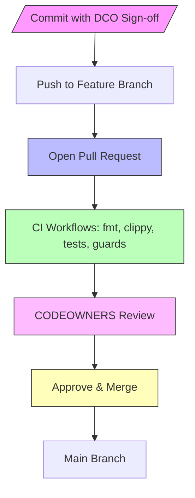
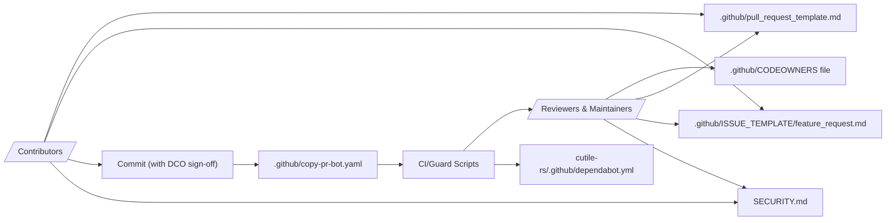

<!-- source: DeepWiki mcp.deepwiki.com · repo NVIDIA/cuda-rust · page 5.4 Contributing and Project Governance · fetched 2026-10-26 -->

# 5.4 Contributing and Project Governance

<details>
<summary>Relevant source files</summary>

The following files were used as context for generating this wiki page:

- [.github/CODEOWNERS](.github/CODEOWNERS)
- [.github/ISSUE_TEMPLATE/feature_request.md](.github/ISSUE_TEMPLATE/feature_request.md)
- [.github/copy-pr-bot.yaml](.github/copy-pr-bot.yaml)
- [.github/pull_request_template.md](.github/pull_request_template.md)
- [LICENSE](LICENSE)
- [SECURITY.md](SECURITY.md)
- [cutile-rs/.github/dependabot.yml](cutile-rs/.github/dependabot.yml)

</details>


This section outlines the contribution process, project governance policies, and repository management conventions for the NVIDIA `cuda-rust` monorepo. It covers the legal sign-off procedure, branching and pull request conventions, code ownership, issue and pull request templates, security policies, and automated dependency management. The goal is to maintain code quality, ensure compliance, and facilitate smooth collaboration among developers.

---

## 1. Developer Certificate of Origin (DCO) Sign-Off

All contributions to the repository require a Developer Certificate of Origin (DCO) sign-off to confirm that contributors have the right to submit the changes under the project's license and that they agree to the terms therein.

- **DCO Requirement:** Every commit pushing to the repo must include a `Signed-off-by` line in the commit message added via `git commit -s`.
- **Verification:** The CI workflows enforce this by checking the presence of DCO sign-offs before merging.
- **Contributor Guidelines:** Pull request templates remind contributors to add this sign-off.

This ensures traceability and legal compliance with the Apache 2.0 license covering the project [LICENSE:1-126]().

---

## 2. Branch and Pull Request Conventions

The repository adopts clear conventions to streamline changes and maintain code health:

- **Branch Naming:** Feature branches and bug fixes should be descriptive and concise, preferably prefixed by the type, e.g., `feature/` or `fix/`.
- **PR Workflow:** Contributors submit pull requests for review. The CI runs automated checks including formatting, linting, testing, and guard scripts.
- **Ready vs Draft PRs:** Draft PRs signal work in progress and do not trigger all CI jobs. Ready PRs auto-trigger CI runs and get mirrored by the `copy-pr-bot` (see below).
- **Commit Content:** Commits must pass formatting (`rustfmt`), linting (`clippy`), and must include SPDX headers and DCO sign-offs.
- **Automated Mirroring:** Due to NVIDIA self-hosted runner restrictions, the [`copy-pr-bot` GitHub App](.github/copy-pr-bot.yaml) mirrors ready PRs from `pull_request` events to `push` events under `pull-request/<n>` branches to enable CI workflows [`.github/copy-pr-bot.yaml:1-15`]().
  
These policies reduce integration conflicts and maintain quality standards.

---

## 3. CODEOWNERS for Review and Approval

Ownership of source code areas is delineated in the `.github/CODEOWNERS` file:

```
# Shared host crates: Tile DRI plus Keith / Rob / Nihal.
(cuda-bindings/, cuda-core/, cuda-core-derive/, cuda-async) -> @elibol @kkraus14 @rparolin @nihalpasham

# Model trees.
cutile-rs/ -> @elibol
cuda-oxide/ -> @nihalpasham

# Remaining git-root files (Cargo.toml, CI, docs, etc.)
* -> @nihalpasham @binarybana @kkraus14 @elibol @rparolin @cryos @roivanov
```

- **Review Requirements:** Pull requests touching files in a directory require review by the mapped code owners.
- **Role of Maintainers:** Larger or root scope areas require additional maintainers.
- **Automatic Review Requests:** GitHub assigns reviewers automatically based on `CODEOWNERS`.

This division simplifies responsibility and accountability in reviews [`.github/CODEOWNERS:1-18`]().

---

## 4. Issue and Pull Request Templates

To standardize communication and triage, the repository uses GitHub issue and PR templates:

### Pull Request Template

- Located at `.github/pull_request_template.md`.
- Prompts for: summary, changes, testing verification steps, and a checklist for DCO and SPDX headers.
- Encourages linking relevant smoke tests and outputs.

Example snippet:

```markdown
## Summary

<!-- One paragraph: what does this change and why? -->

## Testing

<!-- How did you verify this? Paste relevant cargo oxide run / tests output -->

- [ ] `just -f cuda-oxide/Justfile check` passes
- [ ] `cargo oxide run <example>` passes
- [ ] New example added (if applicable)

## Checklist

- [ ] All commits signed off (`git commit -s`)
- [ ] SPDX headers on new source files
```

### Issue Templates

- Variants include feature requests (`feature_request.md`) requesting new intrinsics, language features, host API extensions, or tooling improvements.
- Feature request template covers problem statement, proposed API, alternatives, and additional context with markdown code blocks for examples.
- Both templates encourage discussion via the project's Discord channel when appropriate.

These templates aid in consistent, high-quality contributions and faster review cycles [.github/pull_request_template.md:1-24, .github/ISSUE_TEMPLATE/feature_request.md:1-26]().

---

## 5. Security Policy and Reporting

The project provides clear guidance on reporting security vulnerabilities:

- **No Public Reporting:** Contributors are explicitly instructed **not to report security issues via GitHub issues or PRs**.
- **Official Channels:** Vulnerabilities should be reported using NVIDIA's Security Vulnerability Submission Form or direct email to `psirt@nvidia.com`.
- **Information to Include:** Product name/version, vulnerability type, reproduction instructions, exploit code, and impact.
- **PGP Encryption:** NVIDIA provides a public PGP key to encrypt sensitive communications.
- **Acknowledgment Policy:** Although no bug bounty program currently exists, external reports resulting in fixes are acknowledged publicly.
- **Links:** Detailed security info is available at NVIDIA's Product Security portal.

This controlled disclosure helps the team manage vulnerabilities efficiently and securely [SECURITY.md:1-24]().

---

## 6. Dependabot Configuration for Dependency Updates

Automated dependency updates are facilitated via Dependabot with a configuration specific to GitHub Actions workflows:

- **Location:** The configuration resides in `cutile-rs/.github/dependabot.yml`.
- **Scope:** Only updates GitHub Actions workflows (`package-ecosystem: "github-actions"`).
- **Schedule:** Weekly update checks.
- **Labeling:** Updated PRs are labeled `CI`.
- **Ignored Dependencies:** Certain pinned action dependencies (`taiki-e/install-action`, `swatinem/rust-cache`) are excluded to prevent workflow failures due to strict pinning policies.
- **Grouping:** All other actions grouped for bulk updates.

No dependabot config exists at the root because of policy control over GitHub Action versions [cutile-rs/.github/dependabot.yml:1-27]().

---

## 7. Governance Diagram: Contribution Flow and Code Roles



**Explanation:**  
- Contributions originate as commits signed with DCO.  
- Contributors push branches and open PRs with required templates filled.  
- CI checks run automated formatting, linting, testing, and repository guard scripts.  
- Code owners assigned via `.github/CODEOWNERS` review changes.  
- Once approved, PR merges proceed, maintaining repo quality.

Sources: `.github/CODEOWNERS:1-18`, `.github/pull_request_template.md:1-24`


---

## 8. Governance Diagram: Repository Metadata and Workflow Integration



**Explanation:**  
- Contributors use templates and submit commits with DCO sign-off.  
- `copy-pr-bot` replicates PRs to trigger CI on push events.  
- CI performs tests and guards before notifying maintainers.  
- Maintainers rely on `CODEOWNERS` to delegate reviews.  
- Security and dependency update policies are central governance elements.

Sources: `.github/CODEOWNERS:1-18`, `.github/pull_request_template.md:1-24`, `.github/ISSUE_TEMPLATE/feature_request.md:1-26`, `SECURITY.md:1-25`, `cutile-rs/.github/dependabot.yml:1-28`, `.github/copy-pr-bot.yaml:1-15`

---

## Summary Table of Key Governance Files

| File                               | Purpose                                    | Highlights                                          |
|-----------------------------------|--------------------------------------------|-----------------------------------------------------|
| `.github/CODEOWNERS`               | Code owner mappings                         | Assigns reviewers by directory; automates PR review |
| `.github/pull_request_template.md`| PR submission template                      | Guides summary, testing, DCO sign-off checklist     |
| `.github/ISSUE_TEMPLATE/feature_request.md` | Issue template for enhancements          | Structured feature request details and discussion links |
| `SECURITY.md`                     | Security reporting policy                   | Private reporting instructions and webmaster contact |
| `cutile-rs/.github/dependabot.yml` | Dependabot config for GitHub Actions       | Scheduled weekly GitHub Actions upgrades, with pins |
| `.github/copy-pr-bot.yaml`         | Mirroring PR pushes to enable CI on forks  | Enables CI despite runner event limitations         |

---

This section ensures contributors and maintainers have clear, technically precise guidance to collaborate securely, efficiently, and in accordance with governance policies designed by NVIDIA.

---

**Sources:**  
`.github/CODEOWNERS:1-18`  
`.github/pull_request_template.md:1-24`  
`.github/ISSUE_TEMPLATE/feature_request.md:1-26`  
`SECURITY.md:1-25`  
`cutile-rs/.github/dependabot.yml:1-28`  
`.github/copy-pr-bot.yaml:1-15`  
`LICENSE:1-126`

---

