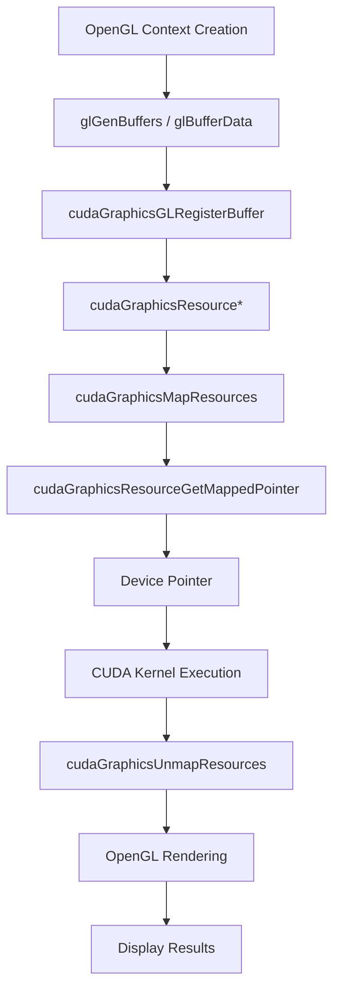
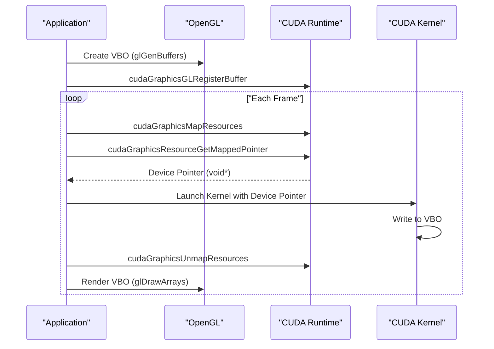
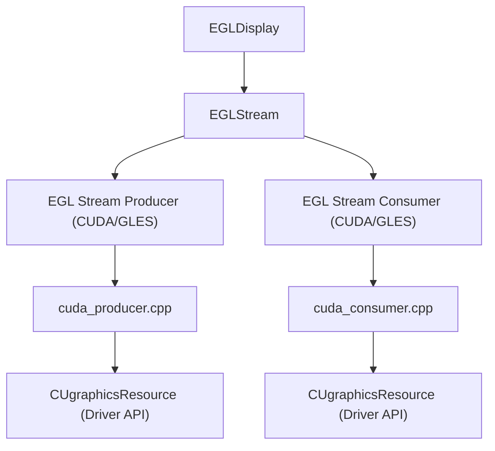

<!-- source: DeepWiki mcp.deepwiki.com · repo NVIDIA/cuda-samples · page 8.1 OpenGL and EGL Integration · fetched 2026-10-26 -->

# OpenGL and EGL Integration

Relevant source files

The following files were used as context for generating this wiki page:

- [Common/GL/freeglut.h](Common/GL/freeglut.h)
- [Common/GL/freeglut_ext.h](Common/GL/freeglut_ext.h)
- [Common/GL/freeglut_std.h](Common/GL/freeglut_std.h)
- [Common/GL/glew.h](Common/GL/glew.h)
- [Common/GL/glext.h](Common/GL/glext.h)
- [Common/GL/glut.h](Common/GL/glut.h)
- [Common/GL/glxew.h](Common/GL/glxew.h)
- [Common/GL/glxext.h](Common/GL/glxext.h)
- [Common/helper_gl.h](Common/helper_gl.h)
- [Common/lib/x64/freeglut.lib](Common/lib/x64/freeglut.lib)
- [Common/lib/x64/glew64.lib](Common/lib/x64/glew64.lib)
- [Common/rendercheck_gl.h](Common/rendercheck_gl.h)
- [Common/rendercheck_gles.h](Common/rendercheck_gles.h)
- [bin/win64/Debug/freeglut.dll](bin/win64/Debug/freeglut.dll)
- [bin/win64/Debug/glew64.dll](bin/win64/Debug/glew64.dll)

## Purpose and Scope

This document covers CUDA integration with OpenGL and EGL (Embedded-System Graphics Library) APIs, enabling zero-copy interoperability between CUDA compute operations and graphics rendering. The samples demonstrate vertex buffer object (VBO) mapping, real-time particle simulations, isosurface extraction, and cross-GPU data transfer using EGL streams.

Key samples covered: `particles`, `smokeParticles`, `nbody`, `marchingCubes`, `boxFilter`, `oceanFFT`, and EGL stream samples. This page also details the common graphics infrastructure provided in `Common/GL/`, including `freeglut` and `GLEW` headers.

For Direct3D integration on Windows platforms, see page 8.2. For modern Vulkan API integration, see page 8.3.

## Common Graphics Infrastructure (Common/GL)

The CUDA samples provide a consistent set of headers and libraries for OpenGL development across platforms, located in the `Common/GL/` directory.

### Header Libraries
- **freeglut**: A utility toolkit for window management and input handling. The `freeglut_std.h` header ensures that standard OpenGL and GLU headers are included [Common/GL/freeglut_std.h:84-85](). It also provides extension handling via `freeglut_ext.h` [Common/GL/freeglut_ext.h:1-115]().
- **GLEW (OpenGL Extension Wrangler)**: Handles loading of OpenGL extensions. The `glew.h` header must be included before any other OpenGL headers to avoid conflicts [Common/GL/glew.h:83-85]().
- **GLXEW**: The GLX Extension Wrangler for X11/Linux environments [Common/GL/glxew.h:51-69]().

### Helper Utilities
- **helper_gl.h**: Provides namespace `__HelperGL` for checking GL versions and extension support [Common/helper_gl.h:56-58](). On Linux, it includes macros like `USE_GL_FUNC` to resolve GL function pointers via `glXGetProcAddress` [Common/helper_gl.h:61-65]().
- **rendercheck_gl.h**: Contains the `CheckRender` class, which facilitates automated testing by reading back framebuffers to system memory for comparison [Common/rendercheck_gl.h:61-116](). It supports PBO (Pixel Buffer Object) readbacks for performance [Common/rendercheck_gl.h:89-95]().

Sources: [Common/GL/freeglut_std.h:1-100](), [Common/GL/glew.h:79-100](), [Common/helper_gl.h:28-128](), [Common/rendercheck_gl.h:28-116]()

## OpenGL-CUDA Interoperability Overview

CUDA-OpenGL interoperability allows CUDA kernels to directly read from and write to OpenGL resources (vertex buffers, pixel buffers, textures) without copying data between device memory spaces.

### Core Interoperability Workflow

Sources: [Common/helper_gl.h:67-81](), [Common/rendercheck_gl.h:123-137]()

## VBO Registration and Mapping

### Registration Process

OpenGL Vertex Buffer Objects (VBOs) are registered with CUDA using `cudaGraphicsGLRegisterBuffer`. The `cudaGraphicsMapFlagsWriteDiscard` flag is commonly used to indicate CUDA will overwrite the entire buffer, allowing driver optimizations.

### Mapping and Accessing VBO Memory

Sources: [Common/helper_gl.h:67-71](), [Common/rendercheck_gl.h:78-84]()

## Particle and Simulation Samples

### particles and smokeParticles
The `particles` sample demonstrates a basic particle system where CUDA updates positions in a VBO, and OpenGL renders them as points. The `smokeParticles` sample extends this by using **Thrust** for depth sorting (essential for alpha blending smoke) and 3D noise textures.

### nbody
The `nbody` sample simulates gravitational interactions. It highlights:
- **Double Precision Support**: Using `GL_DOUBLE` vertex attributes for high-precision simulation [Common/GL/freeglut_std.h:98-110]().
- **Instanced Rendering**: Efficiently drawing large numbers of particles.

### marchingCubes
This sample extracts isosurfaces from volume data.
- **Multiple VBOs**: It maps both a Position VBO and a Normal VBO [Common/helper_gl.h:67-71]().
- **Stream Compaction**: Uses Thrust to determine the number of generated triangles before writing to the VBOs.

## EGL Integration

### EGL Stream Technology
EGL streams provide a mechanism for transferring image frames between different graphics and compute APIs, particularly useful on Tegra platforms.

### EGLSync Interop
`EGLSync` objects enable hardware-level synchronization between CUDA and EGL. This allows a CUDA producer to signal when a frame is ready for an OpenGL consumer without CPU intervention.

Sources: [Common/GL/glxew.h:101-125](), [Common/GL/glext.h:76-118]()

## Build Configuration

OpenGL samples require linking against system libraries and the provided `freeglut` and `glew` binaries.

| Platform | Library File | Source |
|----------|--------------|--------|
| Windows x64 | `freeglut.lib`, `glew64.lib` | [Common/lib/x64/freeglut.lib:1](), [Common/lib/x64/glew64.lib:1]() |
| Windows DLLs | `freeglut.dll`, `glew64.dll` | [bin/win64/Debug/freeglut.dll:1](), [bin/win64/Debug/glew64.dll:1]() |

Sources: [Common/lib/x64/freeglut.lib:1-5](), [Common/lib/x64/glew64.lib:1-28](), [Common/GL/freeglut_std.h:38-66]()

---

